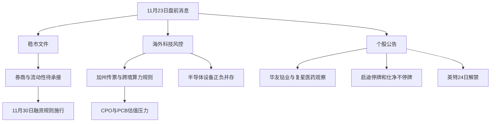

# 2026-11-23 · 消息面事件驱动

> 盘前研究｜新鲜度 partial｜置信度 0.50｜事实、反应和传导分列。

## 一句话结论
周末稳市政策打开修复预期；券商未确立进攻，海外科技及个股硬风险照常交接。

## 消息面全景图

## 市场先行：托底不是资金转向
11/20 沪指 -1.23%、创业板 -3.54%、科创综指 -5.23%，上证50 +0.45%；313 涨、5,236 跌，成交 14,222 亿元。iFinD 的全 ETF 净流入 899.25 亿元说明申赎统计强，不能穿透买入者；成交额不是净申购。R1 同日盘前判断为震荡分化、情绪主跌，本阶段不再给同底层广度第二票。

11/22 政策先改善预期：保证金 11/30 才生效、做市仍为征求意见、降费按项目实行。11/20 券商查询前十里申万宏源 +1.40%、华泰 +1.10%、中信 +0.79%，早于政策，不能解释为消息后资金确认；不拿榜首作今日龙头。只有券商扩散、宽度回暖与承接同时出现，才支持修复；权重独拉仍是托底。若金融高开回落、成长再破位，则由 D1 独立重评，R4 不据渠道缺口签发全市场停买。

## 硬事件与负面交接
26 条可核披露/事实；另有 1 条同一 BIS 规则的条件传导，不加硬事件数。逐条按强度和衰减排序；个股风险不扩到全行业。

### E20261123_018 · 启迪设计停牌一日并实施其他风险警示

负面｜high｜个股级｜衰减权重 -0.950；研究日期 2026-11-23，可见证据时间 2026-11-23。

- **事实**：11/23停牌；11/24以ST启设复牌，日涨跌幅20%；预罚非最终处罚，不是重大违法强退。
- **大资金意图**：未核买卖主体；11/20该股行情见逐票引用；不推定因果。
- **为什么走强／走弱**：风险限于公告主体，不按行业泛化。 这是待验证传导，不是资金归因。
- **逻辑够不够硬**：原始事实可核；映射并非必然。最终结果、适用规则和公司回应见原公告；不由R4改写逐票硬否决。
- **有效窗口／失效**：实际停复牌及最终监管结果。已知周末/盘后转下一开市日；时分不明不声称盘内已知。
- **已查来源及窗口**：[PDF:90](https://static.cninfo.com.cn/finalpage/2026-11-23/1225681839.PDF)（11/22–11/23公告日期窗口）；[PDF:89](https://static.cninfo.com.cn/finalpage/2026-11-23/1225681840.PDF)（11/22–11/23公告日期窗口）；[PDF:88](https://static.cninfo.com.cn/finalpage/2026-11-23/1225681841.PDF)（11/22–11/23公告日期窗口）；`D:300500.SZ`（2026-11-12 至 11/20，保留 11/20）。未列渠道不视为无负面。
- 启迪设计 `300500.SZ`：直接风险对象；11/20 收 6.87 / -6.40%，Tushare 日线已核。

### E20261123_019 · *ST仕净叠加其他风险警示但不停牌

负面｜high｜个股级｜衰减权重 -0.900；研究日期 2026-11-23，可见证据时间 2026-11-21。

- **事实**：11/23叠加其他风险警示，简称仍*ST仕净，涨跌幅20%，原文明确不停牌；原退市警示不消失。
- **大资金意图**：未核买卖主体；未核独立逐票行情；公告价格描述不等于当前资金。
- **为什么走强／走弱**：风险限于公告主体，不按行业泛化。 这是待验证传导，不是资金归因。
- **逻辑够不够硬**：原始事实可核；映射并非必然。最终结果、适用规则和公司回应见原公告；不由R4改写逐票硬否决。
- **有效窗口／失效**：监管结论/风险警示状态变更。已知周末/盘后转下一开市日；时分不明不声称盘内已知。
- **已查来源及窗口**：[PDF:1030](https://static.cninfo.com.cn/finalpage/2026-11-21/1225682079.PDF)（11/19–11/21扩展公告日期窗口）；[PDF:1031](https://static.cninfo.com.cn/finalpage/2026-11-21/1225682080.PDF)（11/19–11/21扩展公告日期窗口）；`news_cls:1933`（11/20–11/23 盘前样本（详见审计））；`news_major:285`（11/20–11/23 盘前样本（详见审计））。未列渠道不视为无负面。
- *ST仕净 `301030.SZ`：直接风险对象；独立行情未核。

### E20261123_001 · 三所融资保证金下限降至80%但11月30日才施行

正面｜high｜公开催化｜衰减权重 +0.870；研究日期 2026-11-23，可见证据时间 2026-11-22 18:33。

- **事实**：11/22公布由100%降至80%；沪市未了结融资合同可由会员按新规相应下调，并非所有账户自动调整。
- **大资金意图**：未核买卖主体；11/20券商相对大盘坚挺但早于公告。11/23开盘与实际融资流未发生／未核。
- **为什么走强／走弱**：先交易政策预期；券商与流动性先受益于参与度改善的可能性，不等于直接利润。 这是待验证传导，不是资金归因。
- **逻辑够不够硬**：原始事实可核；映射并非必然。4000亿元是理论沟通口径而非流入；券商风控与风险偏好仍约束，11/30前不是已实施。
- **有效窗口／失效**：11/23验证修复；11/30生效后再看两融量和券商合力。已知周末/盘后转下一开市日；时分不明不声称盘内已知。
- **已查来源及窗口**：[SSE80](https://www.sse.com.cn/lawandrules/sselawsrules2025/trade/specific/margin/c/c_20261122_10838633.shtml)（11/18–11/23盘前复核；8-K为更早背景）；`news_cls:194`（11/20–11/23 盘前样本（详见审计））；`news_cls:1503`（11/20–11/23 盘前样本（详见审计））；`MARKET10`（2026-11-20 收盘）；`GROUP-PACK`（11/22–11/23盘前）。未列渠道不视为无负面。

### E20261123_020 · 荣盛发展首次收盘低于1元提示面值退市风险

负面｜high｜个股级｜衰减权重 -0.780；研究日期 2026-11-23，可见证据时间 2026-11-23。

- **事实**：11/20收0.96；连续20个交易日收盘低于1元触发，首次低于不是已退市。
- **大资金意图**：未核买卖主体；11/20该股行情见逐票引用；不推定因果。
- **为什么走强／走弱**：风险限于公告主体，不按行业泛化。 这是待验证传导，不是资金归因。
- **逻辑够不够硬**：原始事实可核；映射并非必然。最终结果、适用规则和公司回应见原公告；不由R4改写逐票硬否决。
- **有效窗口／失效**：逐日核报价与规则触发。已知周末/盘后转下一开市日；时分不明不声称盘内已知。
- **已查来源及窗口**：[PDF:110](https://static.cninfo.com.cn/finalpage/2026-11-23/1225682330.PDF)（11/22–11/23公告日期窗口）；`D:002146.SZ`（2026-11-12 至 11/20，保留 11/20）。未列渠道不视为无负面。
- 荣盛发展 `002146.SZ`：直接风险对象；11/20 收 0.96 / -5.88%，Tushare 日线已核。

### E20261123_021 · ST洲际获证监会立案告知

负面｜high｜个股级｜衰减权重 -0.780；研究日期 2026-11-23，可见证据时间 2026-11-23。

- **事实**：11/20公司收到立案，涉嫌信披违法；公司称经营正常，不抵消立案，非油气行业立案。
- **大资金意图**：未核买卖主体；11/20该股行情见逐票引用；不推定因果。
- **为什么走强／走弱**：风险限于公告主体，不按行业泛化。 这是待验证传导，不是资金归因。
- **逻辑够不够硬**：原始事实可核；映射并非必然。最终结果、适用规则和公司回应见原公告；不由R4改写逐票硬否决。
- **有效窗口／失效**：调查进展与正式结论。已知周末/盘后转下一开市日；时分不明不声称盘内已知。
- **已查来源及窗口**：[PDF:55](https://static.cninfo.com.cn/finalpage/2026-11-23/1225682859.PDF)（11/22–11/23公告日期窗口）；`D:600759.SH`（2026-11-12 至 11/20，保留 11/20）。未列渠道不视为无负面。
- ST洲际 `600759.SH`：直接风险对象；11/20 收 1.86 / -2.11%，Tushare 日线已核。

### E20261123_022 · 天阳科技获证监会立案告知

负面｜high｜个股级｜衰减权重 -0.750；研究日期 2026-11-23，可见证据时间 2026-11-23。

- **事实**：11/20公司收到立案，涉嫌信披违法，未有结论。
- **大资金意图**：未核买卖主体；11/20该股行情见逐票引用；不推定因果。
- **为什么走强／走弱**：风险限于公告主体，不按行业泛化。 这是待验证传导，不是资金归因。
- **逻辑够不够硬**：原始事实可核；映射并非必然。最终结果、适用规则和公司回应见原公告；不由R4改写逐票硬否决。
- **有效窗口／失效**：调查进展、处分或结案。已知周末/盘后转下一开市日；时分不明不声称盘内已知。
- **已查来源及窗口**：[PDF:67](https://static.cninfo.com.cn/finalpage/2026-11-23/1225682709.PDF)（11/22–11/23公告日期窗口）；`D:300872.SZ`（2026-11-12 至 11/20，保留 11/20）。未列渠道不视为无负面。
- 天阳科技 `300872.SZ`：直接风险对象；11/20 收 11.28 / -8.66%，Tushare 日线已核。

### E20261123_012 · 逸飞激光收到湖北证监局警示函

负面｜high｜个股级｜衰减权重 -0.680；研究日期 2026-11-23，可见证据时间 2026-11-23。

- **事实**：11/19收〔2026〕142号警示函；募资违规使用2800万元、历史收入确认等问题。
- **大资金意图**：未核买卖主体；11/20 -7.47%；不作原因归属。
- **为什么走强／走弱**：治理质量和订单利润口径均应谨慎。 这是待验证传导，不是资金归因。
- **逻辑够不够硬**：原始事实可核；映射并非必然。募集资金公告称已归还；同次回购是11/22提议而非执行，不抵消监管。
- **有效窗口／失效**：后续整改和监管反馈前。已知周末/盘后转下一开市日；时分不明不声称盘内已知。
- **已查来源及窗口**：[PDF:7](https://static.cninfo.com.cn/finalpage/2026-11-23/1225682839.PDF)（11/22–11/23公告日期窗口）；[PDF:8](https://static.cninfo.com.cn/finalpage/2026-11-23/1225682872.PDF)（11/22–11/23公告日期窗口）；`D:688646.SH`（2026-11-12 至 11/20，保留 11/20）。未列渠道不视为无负面。
- 负面暴露：锂电设备。
- 逸飞激光 `688646.SH`：直接风险对象；11/20 收 42.85 / -7.47%，Tushare 日线已核。

### E20261123_009 · 华友钴业提出10至15亿元维护价值类回购

正面｜high｜公开催化｜衰减权重 +0.650；研究日期 2026-11-23，可见证据时间 2026-11-23。

- **事实**：披露集中竞价回购方案10–15亿元、上限45元、董事会通过起3个月内。
- **大资金意图**：未核买卖主体；11/20收28.50、-3.72%；早于公告；未核回购新方案成交。
- **为什么走强／走弱**：金额与维护权益用途直接关联本公司，列研究观察优先，不外推资源价格。 这是待验证传导，不是资金归因。
- **逻辑够不够硬**：原始事实可核；映射并非必然。有色弱势背景及原料周期未核；45元是回购上限不是目标；对照复星用途和周期不同。
- **有效窗口／失效**：首笔/进度及3个月窗口。已知周末/盘后转下一开市日；时分不明不声称盘内已知。
- **已查来源及窗口**：[PDF:38](https://static.cninfo.com.cn/finalpage/2026-11-23/1225682899.PDF)（11/22–11/23公告日期窗口）；`D:603799.SH`（2026-11-12 至 11/20，保留 11/20）。未列渠道不视为无负面。
- 华友钴业 `603799.SH`：公告直接观察；11/20 收 28.50 / -3.72%，Tushare 日线已核。
  - **买入理由**（仅观察，不具资格）：维护价值类10–15亿、三个月；比复星方案更集中，但不是材料主线。
  - **风险点**：有色弱势背景及原料周期未核；45元是回购上限不是目标；对照复星用途和周期不同。 逐票公告窗口非穷尽；板型、核心、盈亏比未核，不填“无命中”。
  - **止损条件**：26.51 为 11/20 收盘 × 93% 的研究标尺；没有 11/23 入场、有效目标或执行止损。
  - **可验证假设**：若早盘放量承接且板块有跟随，由独立D1核结构和必要风险；回购/上会节点失效则从观察撤下。东财 2026Q3 的 500 条及问财被核样本未给出该票今日新预增依据。

### E20261123_014 · 拓荆科技收购获证监会同意注册

正面｜high｜公开催化｜衰减权重 +0.590；研究日期 2026-11-23，可见证据时间 2026-11-21。

- **事实**：11/20收批复3270号并在11/21披露；拟购无锡尚积82.97%及两家平台全部股权。
- **大资金意图**：未核买卖主体；11/20收528、-3.56%；不能把前收当注册后的确认。
- **为什么走强／走弱**：监管不确定性下降，主要影响该公司并购概率。 这是待验证传导，不是资金归因。
- **逻辑够不够硬**：原始事实可核；映射并非必然。不等于交割、并表、募资到账或行业订单；海外设备抛压使板块冲突。
- **有效窗口／失效**：交割公告、配套融资进度或变更。已知周末/盘后转下一开市日；时分不明不声称盘内已知。
- **已查来源及窗口**：[PDF:8072](https://static.cninfo.com.cn/finalpage/2026-11-21/1225682663.PDF)（11/19–11/21扩展公告日期窗口）；`CAL`（截止 11/22 07:36）；`news_major:169`（11/20–11/23 盘前样本（详见审计））；`D:688072.SH`（2026-11-12 至 11/20，保留 11/20）。未列渠道不视为无负面。
- 拓荆科技 `688072.SH`：公告直接观察；11/20 收 528.00 / -3.56%，Tushare 日线已核。

### E20261123_024 · 利仁科技收到北京证监局警示函

负面｜high｜个股级｜衰减权重 -0.590；研究日期 2026-11-23，可见证据时间 2026-11-23。

- **事实**：6000万元关联交易未按规审议披露及异动澄清不及时；行政监管警示非立案。
- **大资金意图**：未核买卖主体；11/20该股行情见逐票引用；不推定因果。
- **为什么走强／走弱**：风险限于公告主体，不按行业泛化。 这是待验证传导，不是资金归因。
- **逻辑够不够硬**：原始事实可核；映射并非必然。最终结果、适用规则和公司回应见原公告；不由R4改写逐票硬否决。
- **有效窗口／失效**：整改及后续监管反馈。已知周末/盘后转下一开市日；时分不明不声称盘内已知。
- **已查来源及窗口**：[PDF:111](https://static.cninfo.com.cn/finalpage/2026-11-23/1225682878.PDF)（11/22–11/23公告日期窗口）；`D:001259.SZ`（2026-11-12 至 11/20，保留 11/20）。未列渠道不视为无负面。
- 利仁科技 `001259.SZ`：直接风险对象；11/20 收 31.23 / -8.66%，Tushare 日线已核。

### E20261123_023 · 金科股份控股股东获证监会立案告知

负面｜high｜个股级｜衰减权重 -0.550；研究日期 2026-11-23，可见证据时间 2026-11-23。

- **事实**：两控股股东11/20收立案，另有合伙人被立案；上市公司非涉事主体；11/18–20累计正异常及截至11/20已回购6263.42万元是反证，不抹掉治理风险。
- **大资金意图**：未核买卖主体；11/20该股行情见逐票引用；不推定因果。
- **为什么走强／走弱**：风险限于公告主体，不按行业泛化。 这是待验证传导，不是资金归因。
- **逻辑够不够硬**：原始事实可核；映射并非必然。最终结果、适用规则和公司回应见原公告；不由R4改写逐票硬否决。
- **有效窗口／失效**：对控制权或公司实质影响披露时重评。已知周末/盘后转下一开市日；时分不明不声称盘内已知。
- **已查来源及窗口**：[PDF:117](https://static.cninfo.com.cn/finalpage/2026-11-23/1225682508.PDF)（11/22–11/23公告日期窗口）；[PDF:118](https://static.cninfo.com.cn/finalpage/2026-11-23/1225682507.PDF)（11/22–11/23公告日期窗口）；`D:000656.SZ`（2026-11-12 至 11/20，保留 11/20）。未列渠道不视为无负面。
- 金科股份 `000656.SZ`：直接风险对象；11/20 收 1.04 / +1.96%，Tushare 日线已核。

### E20261123_004 · 加州向英伟达发出调查传票

负面｜high｜行业级｜衰减权重 -0.548；研究日期 2026-11-20，可见证据时间 2026-11-19。

- **事实**：加州司法部11/19确认传票和调查。另有SEC会计调查媒体报道，SEC拒评／公司未回应报道，不能合并为两项已官方证实违规。
- **大资金意图**：未核买卖主体；11/20纳指-5.28%、NVDA-14.01%、费半媒体近-11%；卖出主体未知，且同窗有多重变量。
- **为什么走强／走弱**：首先是估值与风险敞口；CPO/PCB等按海外客户和订单敞口再分化，不等同逐票项目取消。 这是待验证传导，不是资金归因。
- **逻辑够不够硬**：原始事实可核；映射并非必然。报道的盘后反弹与甲骨文称合同资金筹齐是反证；立案和传票不等于定罪。
- **有效窗口／失效**：11/23盘前至首轮A股反馈；监管正式结果或海外企稳后重评。已知周末/盘后转下一开市日；时分不明不声称盘内已知。
- **已查来源及窗口**：[CA](https://oag.ca.gov/news/press-releases/attorney-general-bonta-serves-investigative-subpoena-nvidia)（11/18–11/23盘前复核；8-K为更早背景）；`news_cls:454`（11/20–11/23 盘前样本（详见审计））；`news_cls:1056`（11/20–11/23 盘前样本（详见审计））；[8K](https://www.sec.gov/Archives/edgar/data/1045810/0001045810-26-000082.txt)（11/18–11/23盘前复核；8-K为更早背景）；`USclose`（11/20已完成交易）；[AH](https://stock.stockstar.com/IG2026112100008864.shtml)（11/18–11/23盘前复核；8-K为更早背景）；`news_cls:925`（11/20–11/23 盘前样本（详见审计））。未列渠道不视为无负面。
- 负面暴露：海外AI硬件、光模块/CPO、PCB、存储/HBM、液冷/铜连接、半导体设备。

### E20261123_005 · BIS先进算力远程访问最终用途规则生效

负面｜high｜行业级｜衰减权重 -0.523；研究日期 2026-11-20，可见证据时间 2026-11-19。

- **事实**：11/19美东生效；特定终端、物项及大于1200万 aggregate TPP 门槛满足时触发许可，包括对合规出口后改变用途的限制。
- **大资金意图**：未核买卖主体；无可归因当日专项资金流。
- **为什么走强／走弱**：跨境供给与合规成本上升，收入映射按真实部署和客户逐一核。 这是待验证传导，不是资金归因。
- **逻辑够不够硬**：原始事实可核；映射并非必然。不是所有跨境云服务禁运；H200企业停供和美方许可口径不一致；不能作放开。
- **有效窗口／失效**：规则生效后至修订/许可明确；当周核订单及客户暴露。已知周末/盘后转下一开市日；时分不明不声称盘内已知。
- **已查来源及窗口**：[BIS](https://www.federalregister.gov/documents/full_text/html/2026/11/19/2026-23529.html)（11/18–11/23盘前复核；8-K为更早背景）；`CAL`（截止 11/22 07:36）；`news_cls:490`（11/20–11/23 盘前样本（详见审计））。未列渠道不视为无负面。
- 负面暴露：跨境算力/海外IDC、海外AI硬件、光模块/CPO、PCB。

### E20261123_003 · 交易所披露新一批降费措施

正面｜high｜公开催化｜衰减权重 +0.500；研究日期 2026-11-23，可见证据时间 2026-11-22 18:35。

- **事实**：上交所明确新一批降费与部分既有减免延长；深交所同日公布。
- **大资金意图**：未核买卖主体；未核11/23成交与流向。
- **为什么走强／走弱**：降低交易单位与部分服务成本；更多是环境改善。 这是待验证传导，不是资金归因。
- **逻辑够不够硬**：原始事实可核；映射并非必然。让利估算不是市场新增流入；不能直接外推券商净利润或指数反转。
- **有效窗口／失效**：按适用费用项目和实施节点重评。已知周末/盘后转下一开市日；时分不明不声称盘内已知。
- **已查来源及窗口**：[FEE](https://www.sse.com.cn/aboutus/mediacenter/hotandd/c/c_20261122_10838652.shtml)（11/18–11/23盘前复核；8-K为更早背景）；`news_cls:192`（11/20–11/23 盘前样本（详见审计））；[wechat_official_20:31](https://mp.weixin.qq.com/s?__biz=MjM5MDIwNDEyMg==&mid=2651280016&idx=1&sn=b5905d12c761cc2c2444adb5789b50a8&chksm=bc211e75cdd24dd3482e1b00dd6758594c1c9ba61869b4ddd687067466d6c55e8e703ba620c3)（11/20–11/23 盘前样本（详见审计））。未列渠道不视为无负面。

### E20261123_002 · 深交所就创业板做市细则征求意见

正面｜high｜公开催化｜衰减权重 +0.490；研究日期 2026-11-23，可见证据时间 2026-11-22 18:35。

- **事实**：深交所11/22公开征求意见；不是做市商正式开始交易。
- **大资金意图**：未核买卖主体；11/20创业板-3.54%；早于征求意见。无11/23资金。
- **为什么走强／走弱**：未来合资格券商可申请备案；对板块报价韧性是条件利好。 这是待验证传导，不是资金归因。
- **逻辑够不够硬**：原始事实可核；映射并非必然。并非科创订单、个股普增或短期流动性增量；不得与融资规则当同一资金已到账。
- **有效窗口／失效**：到正式细则/名单或撤回时重评。已知周末/盘后转下一开市日；时分不明不声称盘内已知。
- **已查来源及窗口**：[SZMM](https://www.szse.cn/aboutus/trends/news/t20261122_623984.html)（11/18–11/23盘前复核；8-K为更早背景）；`news_cls:1504`（11/20–11/23 盘前样本（详见审计））；`Aclose`（11/20已完成交易）。未列渠道不视为无负面。

### E20261123_010 · 复星医药披露2.5至5亿元A股回购方案

正面｜high｜公开催化｜衰减权重 +0.430；研究日期 2026-11-23，可见证据时间 2026-11-23。

- **事实**：2.5–5亿元，价格上限33元，12个月；用于可转债转股及/或员工持股激励，不等于即刻注销。
- **大资金意图**：未核买卖主体；11/20收20.30、-1.98%；早于披露。
- **为什么走强／走弱**：现金回购只影响自身，验证实际回购节奏再推供需。 这是待验证传导，不是资金归因。
- **逻辑够不够硬**：原始事实可核；映射并非必然。对照华友：虽较抗跌，但较长窗口且用途不是单纯护盘，未排更前。
- **有效窗口／失效**：12个月窗口；首笔与变更重评。已知周末/盘后转下一开市日；时分不明不声称盘内已知。
- **已查来源及窗口**：[PDF:60](https://static.cninfo.com.cn/finalpage/2026-11-23/1225682901.PDF)（11/22–11/23公告日期窗口）；`D:600196.SH`（2026-11-12 至 11/20，保留 11/20）。未列渠道不视为无负面。
- 复星医药 `600196.SH`：公告直接观察；11/20 收 20.30 / -1.98%，Tushare 日线已核。
  - **买入理由**（仅观察，不具资格）：明确2.5–5亿且前收较抗跌；窗口长、用途偏激励和转股，次于华友。
  - **风险点**：对照华友：虽较抗跌，但较长窗口且用途不是单纯护盘，未排更前。 逐票公告窗口非穷尽；板型、核心、盈亏比未核，不填“无命中”。
  - **止损条件**：18.88 为 11/20 收盘 × 93% 的研究标尺；没有 11/23 入场、有效目标或执行止损。
  - **可验证假设**：若早盘放量承接且板块有跟随，由独立D1核结构和必要风险；回购/上会节点失效则从观察撤下。东财 2026Q3 的 500 条及问财被核样本未给出该票今日新预增依据。

### E20261123_017 · 英特科技确认为11月24日解禁并修正流通口径

负面｜high｜个股级｜衰减权重 -0.414；研究日期 2026-11-20，可见证据时间 2026-11-19。

- **事实**：解除限售105050656股（56.7780%），实际上市流通44995939股约24.32%；上市流通11/24。
- **大资金意图**：未核买卖主体；11/20收12.59、-8.97%；公告已有公开，不归为周末新增交易反应。
- **为什么走强／走弱**：解禁带来潜在供给，不等于抛售。 这是待验证传导，不是资金归因。
- **逻辑够不够硬**：原始事实可核；映射并非必然。高管锁定区分；不是11/23且不是56.78%全部可流通；其余远期表不一概转为可卖。
- **有效窗口／失效**：11/24前后核量价、减持披露。已知周末/盘后转下一开市日；时分不明不声称盘内已知。
- **已查来源及窗口**：[PDF:399](https://static.cninfo.com.cn/finalpage/2026-11-19/1225679271.PDF)（11/19–11/21扩展公告日期窗口）；`CAL`（截止 11/22 07:36）；`D:301399.SZ`（2026-11-12 至 11/20，保留 11/20）。未列渠道不视为无负面。
- 负面暴露：个股供给/解禁。
- 英特科技 `301399.SZ`：直接风险对象；11/20 收 12.59 / -8.97%，Tushare 日线已核。

### E20261123_007 · 英国对中国原产割草机器人启动反倾销调查

负面｜high｜行业级｜衰减权重 -0.401；研究日期 2026-11-19，可见证据时间 2026-11-18。

- **事实**：TRA 11/18立案；大叶11/20公告。调查期2025/10/1–2026/9/30，按公司公告12/3前交抽样答卷。
- **大资金意图**：未核买卖主体；大叶11/20收11.53、-9.50%；与公开事件的当日具体先后未定，不作归因。
- **为什么走强／走弱**：中国原产出口增加合规和税率不确定性；不扩至整个人形机器人。 这是待验证传导，不是资金归因。
- **逻辑够不够硬**：原始事实可核；映射并非必然。调查不等于征税；AL-KO奥地利基地可缓冲，实际替代量/原产合规/税率未定。
- **有效窗口／失效**：12/3问卷节点；初裁或产地核实后重评。11/18英国官方立案（钟点未给），保守映射到下一A股交易日11/19；11/20大叶公告问卷时间和应对是另一个事实点。
- **已查来源及窗口**：[TRA](https://public-file.trade-remedies.service.gov.uk/case/ad0097)（11/18–11/23盘前复核；8-K为更早背景）；[PDF:879](https://static.cninfo.com.cn/finalpage/2026-11-20/1225681871.PDF)（11/19–11/21扩展公告日期窗口）；`D:300879.SZ`（2026-11-12 至 11/20，保留 11/20）；`CAL`（截止 11/22 07:36）。未列渠道不视为无负面。
- 负面暴露：园林设备/割草机器人出口。
- 大叶股份 `300879.SZ`：直接风险对象；11/20 收 11.53 / -9.50%，Tushare 日线已核。

### E20261123_026 · 中超控股定增新增股11月26日上市并形成被动稀释

负面｜high｜个股级｜衰减权重 -0.380；研究日期 2026-11-23，可见证据时间 2026-11-23。

- **事实**：发行244384236股，4.06元/股；原控股股东及一致行动人比例16.55%→14.04%。
- **大资金意图**：未核买卖主体；11/20收4元；没有11/23资金。
- **为什么走强／走弱**：每股与持股权重受稀释；放在明确负面风险侧，不外推全板块。 这是待验证传导，不是资金归因。
- **逻辑够不够硬**：原始事实可核；映射并非必然。新增股份本次可流通0股、锁定6个月，非股东减持；约9.72亿元募集净额可为业务提供资金。
- **有效窗口／失效**：11/26上市及6个月锁定节点。已公开文件自然日11/23，分秒未知。
- **已查来源及窗口**：[PDF:100](https://static.cninfo.com.cn/finalpage/2026-11-23/1225682379.PDF)（11/22–11/23公告日期窗口）；[PDF:101](https://static.cninfo.com.cn/finalpage/2026-11-23/1225682383.PDF)（11/22–11/23公告日期窗口）；`D:002471.SZ`（2026-11-12 至 11/20，保留 11/20）。未列渠道不视为无负面。
- 中超控股 `002471.SZ`：直接风险对象；11/20 收 4.00 / -5.44%，Tushare 日线已核。

### E20261123_016 · 联合光电发行股份购买资产进入上会安排

正面｜high｜公开催化｜衰减权重 +0.330；研究日期 2026-11-23，可见证据时间 2026-11-23。

- **事实**：拟购长益光电92.62%，交易所定11/27审核。
- **大资金意图**：未核买卖主体；11/20收11.64、-8.78%，无11/23反馈。
- **为什么走强／走弱**：光学镜头业务同类，日期明确可验证。 这是待验证传导，不是资金归因。
- **逻辑够不够硬**：原始事实可核；映射并非必然。不是审核通过，还需同意注册；不等同光模块/CPO订单。
- **有效窗口／失效**：11/27结果前后重评。已知周末/盘后转下一开市日；时分不明不声称盘内已知。
- **已查来源及窗口**：[PDF:81](https://static.cninfo.com.cn/finalpage/2026-11-23/1225682890.PDF)（11/22–11/23公告日期窗口）；`D:300691.SZ`（2026-11-12 至 11/20，保留 11/20）。未列渠道不视为无负面。
- 联合光电 `300691.SZ`：公告直接观察；11/20 收 11.64 / -8.78%，Tushare 日线已核。
  - **买入理由**（仅观察，不具资格）：直接业务且11/27有时间锚；跌幅较深、上会不是通过，排在回购观察之后。
  - **风险点**：不是审核通过，还需同意注册；不等同光模块/CPO订单。 逐票公告窗口非穷尽；板型、核心、盈亏比未核，不填“无命中”。
  - **止损条件**：10.83 为 11/20 收盘 × 93% 的研究标尺；没有 11/23 入场、有效目标或执行止损。
  - **可验证假设**：若早盘放量承接且板块有跟随，由独立D1核结构和必要风险；回购/上会节点失效则从观察撤下。东财 2026Q3 的 500 条及问财被核样本未给出该票今日新预增依据。

### E20261123_011 · 金海通披露激励用途回购报告书

正面｜high｜公开催化｜衰减权重 +0.320；研究日期 2026-11-23，可见证据时间 2026-11-23。

- **事实**：0.5–1亿元、上限230元、不超过6个月，未来员工持股或激励。
- **大资金意图**：未核买卖主体；11/20收183.97、-10.00%，收盘等于日内低价；未把跌幅四舍五入当独立跌停板型验证。
- **为什么走强／走弱**：个股回购可缓和预期；与海外设备风险同板块正负并存。 这是待验证传导，不是资金归因。
- **逻辑够不够硬**：原始事实可核；映射并非必然。不存在新增设备订单证据；弱前收与激励用途使其不作优先观察。
- **有效窗口／失效**：首笔回购及海外设备修复重评。已知周末/盘后转下一开市日；时分不明不声称盘内已知。
- **已查来源及窗口**：[PDF:52](https://static.cninfo.com.cn/finalpage/2026-11-23/1225682900.PDF)（11/22–11/23公告日期窗口）；`D:603061.SH`（2026-11-12 至 11/20，保留 11/20）；`USclose`（11/20已完成交易）。未列渠道不视为无负面。
- 金海通 `603061.SH`：公告直接观察；11/20 收 183.97 / -10.00%，Tushare 日线已核。

### E20261123_015 · 华天科技披露配套募集资金发行报告

正面｜high｜公开催化｜衰减权重 +0.300；研究日期 2026-11-23，可见证据时间 2026-11-21。

- **事实**：11/21披露向特定对象发行股票募集配套资金报告。
- **大资金意图**：未核买卖主体；11/20收13.80、-6.31%；无后续资金承接。
- **为什么走强／走弱**：配套融资执行进度提供项目资金可得性信息。 这是待验证传导，不是资金归因。
- **逻辑够不够硬**：原始事实可核；映射并非必然。新增发行存在稀释，成本、锁定与产能订单不得由标题推断；不进首板观察。
- **有效窗口／失效**：后续股份登记/项目兑现重评。已知周末/盘后转下一开市日；时分不明不声称盘内已知。
- **已查来源及窗口**：[PDF:2185](https://static.cninfo.com.cn/finalpage/2026-11-21/1225680704.PDF)（11/19–11/21扩展公告日期窗口）；`CAL`（截止 11/22 07:36）；`D:002185.SZ`（2026-11-12 至 11/20，保留 11/20）。未列渠道不视为无负面。
- 华天科技 `002185.SZ`：公告直接观察；11/20 收 13.80 / -6.31%，Tushare 日线已核。

### E20261123_025 · 广百股份公告三日负向异常波动

负面｜high｜个股级｜衰减权重 -0.300；研究日期 2026-11-23，可见证据时间 2026-11-23。

- **事实**：11/18–20三日跌幅偏离累计超过20%；公司自查称无应披露未披露事项，非监管立案。
- **大资金意图**：未核买卖主体；未核独立逐票行情；公告价格描述不等于当前资金。
- **为什么走强／走弱**：风险限于公告主体，不按行业泛化。 这是待验证传导，不是资金归因。
- **逻辑够不够硬**：原始事实可核；映射并非必然。最终结果、适用规则和公司回应见原公告；不由R4改写逐票硬否决。
- **有效窗口／失效**：复核后续异动及公告。已知周末/盘后转下一开市日；时分不明不声称盘内已知。
- **已查来源及窗口**：[PDF:109](https://static.cninfo.com.cn/finalpage/2026-11-23/1225682069.PDF)（11/22–11/23公告日期窗口）。未列渠道不视为无负面。
- 广百股份 `002187.SZ`：直接风险对象；独立行情未核。

### E20261123_013 · 逸飞激光收到控股股东第三期回购提议

正面｜high｜公开催化｜衰减权重 +0.260；研究日期 2026-11-23，可见证据时间 2026-11-23。

- **事实**：11/22董事会收到回购提议。
- **大资金意图**：未核买卖主体；无实施流量；前收-7.47%早于提议。
- **为什么走强／走弱**：仅体现意愿，和同日监管冲突单列。 这是待验证传导，不是资金归因。
- **逻辑够不够硬**：原始事实可核；映射并非必然。警示函不能被提议覆盖；尚未等同董事会实施，不进首板观察队列。
- **有效窗口／失效**：董事会决议/实际实施前。已知周末/盘后转下一开市日；时分不明不声称盘内已知。
- **已查来源及窗口**：[PDF:8](https://static.cninfo.com.cn/finalpage/2026-11-23/1225682872.PDF)（11/22–11/23公告日期窗口）；[PDF:7](https://static.cninfo.com.cn/finalpage/2026-11-23/1225682839.PDF)（11/22–11/23公告日期窗口）；`D:688646.SH`（2026-11-12 至 11/20，保留 11/20）。未列渠道不视为无负面。
- 逸飞激光 `688646.SH`：公告直接观察；11/20 收 42.85 / -7.47%，Tushare 日线已核。

### E20261123_027 · 清源股份披露回购进度

正面｜high｜公开催化｜衰减权重 +0.240；研究日期 2026-11-23，可见证据时间 2026-11-23。

- **事实**：11/1–11/20新增回购49万股、约446.69万元；累计2162.90万元。
- **大资金意图**：未核买卖主体；已印证公司自身的历史回购买盘；并非11/23新流入。
- **为什么走强／走弱**：个股回购兑现，不迁移到光伏板块。 这是待验证传导，不是资金归因。
- **逻辑够不够硬**：原始事实可核；映射并非必然。原计划9月披露，用于股权激励；不是新回购方案。
- **有效窗口／失效**：后续回购进展或届满。已公开文件自然日11/23，分秒未知。
- **已查来源及窗口**：[PDF:50](https://static.cninfo.com.cn/finalpage/2026-11-23/1225682861.PDF)（11/22–11/23公告日期窗口）；`D:603628.SH`（2026-11-12 至 11/20，保留 11/20）。未列渠道不视为无负面。
- 清源股份 `603628.SH`：公告直接观察；11/20 收 8.83 / -3.92%，Tushare 日线已核。

### E20261123_008 · 证监与公安发布四起虚假信息典型案例

负面｜medium｜板块级｜衰减权重 -0.410；研究日期 2026-11-23，可见证据时间 精确时点未知。

- **事实**：证监会11/20网站发布四例；同期深交所周报被转述为80起异常交易自律措施，是另一项监管披露，非四加八十拼新事件。
- **大资金意图**：未核买卖主体；此前小盘弱，未证监管单独引发回落。
- **为什么走强／走弱**：高位小票排除仅有流言与虚假申报证据的风险敞口，不据此泛化停买。 这是待验证传导，不是资金归因。
- **逻辑够不够硬**：原始事实可核；映射并非必然。常态化监管并非突然加码买卖限制；违法与否按个案。
- **有效窗口／失效**：11/23–本周，下一周报或个案澄清后重评。已知周末/盘后转下一开市日；时分不明不声称盘内已知。
- **已查来源及窗口**：[CSRC4](https://www.csrc.gov.cn/csrc/c100028/c7671953/content.shtml)（11/20 文件检索）；`news_cls:2050`（11/20–11/23 盘前样本（详见审计））；`news_cls:1853`（11/20–11/23 盘前样本（详见审计））。未列渠道不视为无负面。
- 负面暴露：高位题材接力。

### E20261123_006 · 远程算力新增许可边界带来国产替代观察

正面｜medium｜条件传导，不计硬事件｜衰减权重 +0.223；研究日期 2026-11-20，可见证据时间 2026-11-19。

- **事实**：BIS同一已生效规则使部分境外算力取得更复杂。
- **大资金意图**：未核买卖主体；11/20成长普跌，无国产算力独立承接证据。
- **为什么走强／走弱**：若客户转为境内部署且国产交付可满足，存在替代；只是同一条款的反向中期传导。 这是待验证传导，不是资金归因。
- **逻辑够不够硬**：规则可核，国产订单尚未核。需求也可能被推迟或删减；没核新增国内订单，不用板块代理票。
- **有效窗口／失效**：仅中期预期；有可信本土订单或规则改变时重评。已知周末/盘后转下一开市日；时分不明不声称盘内已知。
- **已查来源及窗口**：[BIS](https://www.federalregister.gov/documents/full_text/html/2026/11/19/2026-23529.html)（11/18–11/23盘前复核；8-K为更早背景）；`CAL`（截止 11/22 07:36）；`Aclose`（11/20已完成交易）。未列渠道不视为无负面。

## 板块极性叉乘

同板块有正有负即为分歧，不按净值覆盖硬风险；相同底层来源只取一组。金额/评分均不等于板块资金。

| 板块 | 事件锚 | 净极性 | 衰减权重和 | 资金或裁决 |
|---|---|---|---:|---|
| 券商 | 001, 002, 003 | 正面 | +1.860 | 政策预期；实施节点不同，11/20强弱不等于11/23资金确认。 |
| A股流动性 | 001, 003 | 正面 | +1.370 | 政策预期；实施节点不同，11/20强弱不等于11/23资金确认。 |
| 钴锂材料 | 009 | 正面 | +0.650 | 11/23 资金未核；仅方向研究 |
| 创业板流动性 | 002 | 正面 | +0.490 | 11/23 资金未核；仅方向研究 |
| 医药 | 010 | 正面 | +0.430 | 11/23 资金未核；仅方向研究 |
| 半导体设备 | 004, 011, 014 | 分歧 | +0.362 | 正负并存，不因净值抵消硬风险；观察而非确认进攻。 |
| 光学镜头 | 016 | 正面 | +0.330 | 11/23 资金未核；仅方向研究 |
| 半导体封测 | 015 | 正面 | +0.300 | 11/23 资金未核；仅方向研究 |
| 国产算力/IDC | 006 | 正面 | +0.223 | 正项仅为同一BIS规则的条件传导；无国内订单/资金确认。 |
| 园林设备/割草机器人出口 | 007 | 负面 | -0.401 | 11/23 资金未核；仅方向研究 |
| 高位题材接力 | 008 | 负面 | -0.410 | 11/23 资金未核；仅方向研究 |
| 个股供给/解禁 | 017 | 负面 | -0.414 | 11/23 资金未核；仅方向研究 |
| 锂电设备 | 012, 013 | 分歧 | -0.420 | 正负并存，不因净值抵消硬风险；观察而非确认进攻。 |
| 跨境算力/海外IDC | 005 | 负面 | -0.523 | 11/23 资金未核；仅方向研究 |
| 存储/HBM | 004 | 负面 | -0.548 | 11/23 资金未核；仅方向研究 |
| 液冷/铜连接 | 004 | 负面 | -0.548 | 11/23 资金未核；仅方向研究 |
| 海外AI硬件 | 004, 005 | 负面 | -1.071 | 11/23 资金未核；仅方向研究 |
| 光模块/CPO | 004, 005 | 负面 | -1.071 | 11/23 资金未核；仅方向研究 |
| PCB | 004, 005 | 负面 | -1.071 | 11/23 资金未核；仅方向研究 |

## 对照对象为什么不进

- `603061.SH`：前收约-10%且存在海外半导体设备冲突；回购为激励用途。 [PDF:52](https://static.cninfo.com.cn/finalpage/2026-11-23/1225682900.PDF)、`D:603061.SH`、`USclose`。
- `688646.SH`：回购只是控股股东提议，与警示函冲突；不选作回购核心。 [PDF:7](https://static.cninfo.com.cn/finalpage/2026-11-23/1225682839.PDF)、[PDF:8](https://static.cninfo.com.cn/finalpage/2026-11-23/1225682872.PDF)。
- `688072.SH`：注册批复尚非交割、设备链承压；保留事件不升级为直接进攻。 [PDF:8072](https://static.cninfo.com.cn/finalpage/2026-11-21/1225682663.PDF)、`USclose`。
- `002185.SZ`：融资报告非订单；新增发行存在稀释。 [PDF:2185](https://static.cninfo.com.cn/finalpage/2026-11-21/1225680704.PDF)。
- `603628.SH`：年内旧方案披露进展，非启动级新增。 [PDF:50](https://static.cninfo.com.cn/finalpage/2026-11-23/1225682861.PDF)。
- `002812.SZ`：7月方案进展及旧业绩预告，非新增业绩驱动；不和新回购等权。 [PDF:93](https://static.cninfo.com.cn/finalpage/2026-11-23/1225682167.PDF)。
- `001208.SZ`：仅上会稿摘要，未形成新的批准或明确可选条件。 [PDF:114](https://static.cninfo.com.cn/finalpage/2026-11-23/1225682881.PDF)。
- `000166.SZ`：11/20券商榜领涨早于周末通知，未核核心、板块承接和逐票公告。 `MARKET10`。

## 🔥 中报业绩预告命中
本批东财实取的是 **2026Q3**，不把它报成中报。归母预增下限排序、按证券代码去重后与本文直接对象无交集。江波龙／星宸科技属于存储或芯片链的邻接对照，天齐锂业与钴锂材料邻接；上市公司单季环比、扣非及价格未核，不能认作正面业绩催化。金海通旧三季报预告为 +148.04% 至 +172.04%，不覆盖今日设备链压力。

| 代码 | 公告日 | 归母预增下限至上限 | 直接命中 |
|---|---|---:|---|
| `300821.SZ` 东岳硅材 | 2026-10-08 | 19047.97% 至 19748.08% | 否 |
| `000703.SZ` 恒逸石化 | 2026-10-16 | 3318.59% 至 3405.13% | 否 |
| `002466.SZ` 天齐锂业 | 2026-10-21 | 2734.97% 至 3235.26% | 否 |
| `688808.SH` 联讯仪器 | 2026-10-13 | 1866.00% 至 2072.95% | 否 |
| `301308.SZ` 江波龙 | 2026-10-15 | 1864.55% 至 1990.84% | 否 |
| `605189.SH` 富春染织 | 2026-10-14 | 1347.69% 至 1519.01% | 否 |
| `688388.SH` 嘉元科技 | 2026-10-15 | 1196.60% 至 1318.92% | 否 |
| `000626.SZ` 远大控股 | 2026-10-15 | 890.00% 至 1018.00% | 否 |
| `002493.SZ` 荣盛石化 | 2026-10-15 | 777.93% 至 822.95% | 否 |
| `301536.SZ` 星宸科技 | 2026-10-13 | 663.13% 至 697.75% | 否 |
| `301511.SZ` 德福科技 | 2026-10-14 | 560.72% 至 620.78% | 否 |
| `002552.SZ` 宝鼎科技 | 2026-10-14 | 536.88% 至 614.07% | 否 |
| `300199.SZ` 翰宇药业 | 2026-10-13 | 502.65% 至 530.68% | 否 |
| `300592.SZ` 华凯易佰 | 2026-10-14 | 456.61% 至 517.33% | 否 |
| `688378.SH` 奥来德 | 2026-10-13 | 442.16% 至 537.83% | 否 |

## 不确定性 / 反证

- **SEC会计调查报道**：匿名消息，SEC拒评，公司当时无回应；不得借州传票或公司8-K补证SEC。 `news_cls:1056`、[CA](https://oag.ca.gov/news/press-releases/attorney-general-bonta-serves-investigative-subpoena-nvidia)、[8K](https://www.sec.gov/Archives/edgar/data/1045810/0001045810-26-000082.txt)。
- **谷歌下调TPU 8i订单约100万颗**：同一产业调研源；未获Google/Broadcom确认；同源报道称8t可能上修。 `news_cls:1322`、`news_cls:1361`。
- **特朗普海外数据中心税**：口头表态不是成文税；已生效BIS另案。 `news_cls:1222`、[BIS](https://www.federalregister.gov/documents/full_text/html/2026/11/19/2026-23529.html)。
- **库克鹰派发言与金银铜回落**：报道与取得的官方讲话节选不能逐句对齐；海外快照大宗跳过，未核分项跌幅与归因；单人表态不等于FOMC定案。 `news_cls:1221`、[COOK](https://www.federalreserve.gov/newsevents/speech/cook20261120a.htm)。
- **软银/SK海力士收购**：知情人士报道且软银发言人称不再积极评估，不加存储正分。 `news_cls:755`、`CAL`。
- **H200政策/实际出货**：政府许可、口头表态及企业停供是不同层级；不是开闸。 `CAL`、`news_cls:490`。
- **中期解禁供给簇**：朗坤科技301305、金沃股份300984及其他日历簇为接口披露口径，原公告、可流通量和成本未逐票确认，保留线索而不造可卖量。 `CAL`。
- **周五沪市回购增持与ETF流入**：超80单是同类公告统计不是80个新事件；ETF净流入899.25亿为iFinD统计，不能穿透买方，不与ETF成交额混用。 `news_cls:1783`、`news_cls:773`、`Aclose`。
- 报道显示美股盘后科技股反弹；甲骨文称相关合同资金筹齐。这足以反对“必然继续崩”的说法，不等于海外调查或跨境规则风险消失。

## 群聊图片的传播证据
仅检查本日指定 OCR 侧文件。清单显示 5/5 群完成缓存枚举：45 个候选文件、26 个资产族、17 张唯一图、9 次同图重复，12 个族只有缩略图。17 行实际读取均为 `vision_batch_timeout`，没有可消费的非空正文或低清文字片段。

采集时点 2026-11-23 06:01；行级缓存mtime范围 2026-11-22 10:20 至 2026-11-23 00:03。两者不是公开或发消息的时点；`published_at` 和 `message_time` 均未知。不猜发送人，不补读图片缓存，不据此宣称无人发图、群无分歧或新闻真实。群文字中的政策转载与公众号同稿，不加独立信源。

## 关键证据
- [SSE80](https://www.sse.com.cn/lawandrules/sselawsrules2025/trade/specific/margin/c/c_20261122_10838633.shtml) 确认80%下限及11/30施行；[SZMM](https://www.szse.cn/aboutus/trends/news/t20261122_623984.html) 明确是征求意见。
- [PDF:90](https://static.cninfo.com.cn/finalpage/2026-11-23/1225681839.PDF)：启迪11/23停牌；[PDF:1030](https://static.cninfo.com.cn/finalpage/2026-11-21/1225682079.PDF)：仕净叠加警示但不停牌。
- [PDF:399](https://static.cninfo.com.cn/finalpage/2026-11-19/1225679271.PDF)：11/24解禁、44,995,939股实际上市流通；不是日历旧口径。
- 运输专题原文仅 3,600 字符；前缀与SHA核对，非全文。日历线索和同根原始公告不叠权。R1内嵌qingxu保持partial，未作独立事件证据。

## 数据源审计

| 源 | 覆盖窗口（北京时间/来源注明） | 状态 | 数量 | 实际用途或缺口 |
|---|---|:---:|---:|---|
| `manifest` | 本轮 06:00至06:06汇集 | 🟢 ok | 未知 | 原局部=0、全局=2仅健康；不把已停服务或图片故障作市场禁买。 |
| `mcp_health` | 11/23 06:05 探针 | 🟡 partial | 未知 | Tushare/RSS可用；WeFlow降级，sanji已退役，QMT不属职责。 |
| `wechat_official_20` | 11/22 07:00–23:44 | 🟡 partial | 55 | 取阅19 feed均可达、14有文，盘前纪要为空；RSS兼容镜像同哈希只计一次；公开号文章不等于监管官方。 |
| `wechat_cli_5groups` | 11/22 06:01起至本轮采集（清单） | 🟢 ok | 109 | 5群均返回；只按匿名传播线索，群条20/25同稿与RSS52复投不增信。 |
| `wechat_image_ocr` | 11/22 06:01–11/23 06:01（缓存mtime） | 🔴 timeout | 17 | 5/5仅完成缓存枚举；26族处理、17唯一图全部vision_batch_timeout；12族仅缩略图。无正常或低清识出片段，未知传播文本；无发送人推断。 |
| `news_cls` | 11/20 09:01–11/23 05:56 | 🟡 partial | 2251 | 新浪1488、同花顺763；字段无独立CLS源，不按文件名宣称已覆盖财联社原流。 |
| `news_major` | 11/21 14:50–11/23 03:57 | 🟡 partial | 800 | content全空，标题定位，不替代正文。 |
| `eastmoney_earnings_predict` | 2026Q3（报告期9/30；不是当日业绩日历） | 🟡 partial | 500 | 筛独立代码Top15并做对象交集；个别旧样本不升当天新催化。 |
| `anns_window` | 11/22–11/23自然日截至06:05 | 🟡 partial | 119 | 47家公司；盘前事件追踪MD为同源分类。个别公告扩查至11/19–11/21；PDF按相关段核。不保证后续全量、分钟可见性或逐票全风险。 |
| `primary_filings` | 11/18–11/23盘前 | 🟡 partial | 27 | 已核文号和关键段；补取仕净、英特、大叶、拓荆、华天；公告转载同根。网页单一通知镜像502后改深交所官网新闻正文。 |
| `news_search` | 11/18–11/23盘前 | 🟡 partial | 未知 | 融资公告、英伟达和BIS均检索；问财BIS有非相关结果，改联邦公报原文。 |
| `announcement_search` | 11/19–11/23 | 🟡 partial | 未知 | 批量查询出现2024旧样本，改按精确PDF号核事实，不把查偏当无风险。 |
| `hithink_market_query` | 11/20已完成交易 | 🟡 partial | 10 | 证券行业前十非受益承诺；第一次证券概念＋涨停条件0条，改行业涨跌；未核其它板块成员。 |
| `hithink_business_query` | 盘前查最新主营 | 🟡 partial | 64 | 返回64行/6主体；实际可用于本文定量的只有联合光电与逸飞激光样本，未核标准分母。 |
| `hithink_event_query` | 11/14–11/23部分对象；另查11/24英特解禁 | 🟡 partial | 5 | 对象查询返回5个Q3标签，不证明期间无预告，英特以公司公告为准。 |
| `report_search` | 请求10/24–11/23 | 🟡 partial | 15 | 重复且主题/日期跑偏，只有检索背景，未采用为增量硬事件或逐票覆盖。 |
| `tushare_daily_and_calendar` | 开市日11/23、行情取11/20 | 🟢 ok | 18 | 确认为交易日；T-1尾行18只定向取样，不是今早行情。 |
| `tushare_cctv_news` | 11/20–11/22 | 🟡 partial | 37 | 三天完成定词核对；本轮事件未采用其为独立确认，不推断节目没有其他相关内容。 |
| `overseas_snapshot` | 美股11/20已完成盘；抓取06:05 | 🟡 partial | 未知 | 美元、商品、部分指数缺口；行情不证明卖出者或事件因果。 |
| `topic_catalyst_calendar` | 11/22 07:36截止 | 🟡 partial | 1 | 只审传入原文3600字符和精确对象原文；不称全文核验。 |
| `R1` | 11/20收盘及11/23盘前判断 | 🟡 partial | 1 | 震荡分化、情绪主跌；用作风格对照，不继承账户预算、旧停买或独立采纳R1内嵌情绪。 |
| `previous_event_tracker` | 本轮未纳入或未产出 | 🟡 not_checked | 未知 | 未定位到提交的11/20 events/anns_classified；已用盘前公告及关键11/20–21扩窗补充。 |
| `R3_R7` | 本轮未纳入或未产出 | 🟡 not_checked | 未知 | 本轮整合未读取R3/R7正式结果；KOL和5日主力未知。 |
| `xtick_hot_news_datapro_vibe` | 本轮未纳入或未产出 | 🟡 not_checked | 未知 | 未直调该组端点；按允许替代走问财/Tushare/监管公司原文；逐票Vibe新闻和板块全覆盖欠缺。 |

## 与其他 R / D 阶段的关系
R2 可比较直接事件与板块，不把三只观察对象当已确认龙头；R5 仍以已核 R2 对象精确匹配；R6 从研究 JSON 读明确负面和反证；D1 独立判断市场窗口并遵守真实用户及账户约束。`in_today_plan` 未知、不进执行；不改仓位、有效硬预算、T+1、人工确认和逐票硬否决。

## Sub-Agent 元数据
- skill: analyze_news_impact_v1@1.7
- artifact: `data/research/20261123/R4_news.json`
- 本轮实际生成：2026-11-23 06:22（不是资料公开时点）
- run_id: `20261123T061007-13781-556`；知识 context_sha256: `799178ba7e274bc4624c281072b67e6840b825b281d1fe64f517fd594b7fa4ed`
- 用量未能完整计量，08:30 仅交付目标，外部结果待核。
