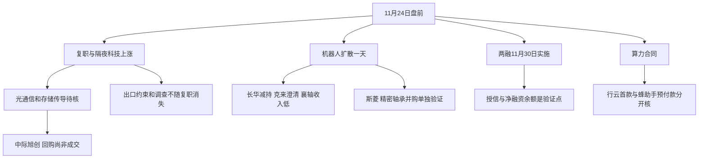

# 2026-11-24 · 消息面事件驱动

> 数据源 partial；置信度0.5是研究覆盖判断，不是概率。A股最近完成交易日11/23，实时盘前研究截止 2026-11-24T06:24:58+08:00。

## 一句话结论
海外科技强反弹，A股昨日奖励机器人与AI应用；今天仍要看承接，个股澄清与监管风险不能被普涨掩盖。

## 市场先于个股
11/23 上涨4658、下跌783；沪指+0.15%、创业板+3.08%、科创50−0.26%。收评口径两市约1.55万亿元、放量1307亿元；Tushare涨停146、炸板24、跌停3，不与媒体151混算。机器人热度由4增至67，AI应用17；持续性只确认本次扩散一天，分板块封板率未核。盛剑、真视通的高度不是实体业务验证。正式复职晚于A股收盘，不解释11/23相对强弱。

阶段事实：**2026-11-23 高潮**。已绑定 `lianban_six_v1`，来源本身版本未知，收盘由 today 交叉支持；绑定 as_of 2026-11-24T06:05:47.889136+08:00，无11/24盘中估计。页面条件行：修复1%、升温3%、高潮36%、降温33%、退潮15%、冰点11%；取整合计99%，不归一、不补余量。阶段同景是高潮第1天、分母96，基础首位高潮33%、次位降温30%；精确转移未核。指数环境样本不是独立的阶段转移证据。

11/24首选**高潮**，备选**降温**。维持基础排序：前一日广度与成交共同放大，隔夜外盘及A50提供正向证据。最大逆风是权重弱、63日新低多于新高、机器人扩散一天且前排公告澄清。若首个可比窗口核心承接和板块扩散同步转弱、炸板上升，则改判降温；外盘涨幅不能替代本地验证。仅适用盘前到首个可比盘中窗口，独立D1重评；不新增全局停买。

## 🗺️ 消息面全景图


## 关键硬事件（41条；负面21条）

### E20261124_ML · *ST美丽收到立案和责令改正 · high/负面
- **事实**：证监会11/17决定立案，上市公司同时收到责令改正监管措施；收入成本跨期、不规范计提及公司治理问题列明。 证据级别：公告原文定向确认。
- **大资金意图**：未核成交主体或申赎，不把价格变动、回购计划或标题当资金意图。
- **为什么走强**（或是否已转弱）：11/23收1元报道为盘前基线，不是收到公告后的反应。
- **逻辑够不够硬**：合规与价格面风险叠加，逐票交下游复核。 反证：等于1元不是低于1元；立案不是处罚或退市结果。
- 窗口与来源：2026-11-23 19:21:57；研究归属 20261124；板块 生态工程；A1808、P1808、N790、W15、D [公告原件1](https://static.cninfo.com.cn/finalpage/2026-11-24/1225684790.PDF)。已查窗口：公告日期20261123–20261124；不代表公告精确公开时间；2026-11-21 09:19 至11-24 05:59:42（实际记录）；2026-11-23 06:43 至11-24 00:00（条目时间）；仅20261123收盘。
- 重评条件：至正式调查结论、整改进展及价格更正。

### E20261124_JK · 金科股份三重风险：股东立案、公司责令改正及面值提示 · high/负面
- **事实**：被立案为控股股东及其合伙人、非上市公司；公司因独董补选收到责令改正；11/23收0.98元，披露面值风险提示。 证据级别：公告原文定向确认。
- **大资金意图**：未核成交主体或申赎，不把价格变动、回购计划或标题当资金意图。
- **为什么走强**（或是否已转弱）：0.98元是触发风险提示的收盘事实，不是公告后反应。
- **逻辑够不够硬**：治理及面值风险不被重组叙事遮蔽；只对该票。 反证：未触发连续20日条件的结论须另核；不把股东立案改写成公司立案。
- 窗口与来源：首次公开时分未核；研究归属 20261124；板块 地产；A529、P529、A530、P530、A1726、P1726、K2、K2b、D [公告原件1](https://static.cninfo.com.cn/finalpage/2026-11-23/1225682509.PDF)；[公告原件2](https://static.cninfo.com.cn/finalpage/2026-11-23/1225682508.PDF)；[公告原件3](https://static.cninfo.com.cn/finalpage/2026-11-24/1225684262.PDF)。已查窗口：公告日期20261123–20261124；不代表公告精确公开时间；11/23晨间报告，截止07:36；非11/23收盘；仅20261123收盘。
- 重评条件：按整改、监管与连续收盘序列更新。

### E20261124_SS · 盛剑科技监管工作函与光刻胶业务澄清 · high/负面
- **事实**：媒体快讯援引上交所监管工作函；公司公告确认近五日涨61.01%、前三季归母亏1.50亿元，电子化学品不含光刻胶，剥离液是配套清洗试剂，2025年该业务收入占4.41%且毛利率为负。 证据级别：公告原文定向确认。
- **大资金意图**：未核成交主体或申赎，不把价格变动、回购计划或标题当资金意图。
- **为什么走强**（或是否已转弱）：11/23五连板是在该晚公告前；收盘表现不代表对监管已定价。
- **逻辑够不够硬**：高度票若失去承接，题材接力可能走弱；不能把绿色厂务核心收入当光刻胶。 反证：工作函不是立案或处罚；公司有剥离液，并不是完全无半导体业务。
- 窗口与来源：2026-11-23 18:23:27；研究归属 20261124；板块 光刻材料；A869、P869、N972、W52、D [公告原件1](https://static.cninfo.com.cn/finalpage/2026-11-24/1225684238.PDF)。已查窗口：公告日期20261123–20261124；不代表公告精确公开时间；2026-11-21 09:19 至11-24 05:59:42（实际记录）；2026-11-23 06:43 至11-24 00:00（条目时间）；仅20261123收盘。
- 重评条件：11/24起至后续正式澄清；逐票风险。

### E20261124_RM · *ST瑞茂警示进展与债务风险 · high/负面
- **事实**：累计相关逾期本金约62.74亿元，近12个月诉讼仲裁执行涉案约123.72亿元，未形成确定的重整方案。 证据级别：公告原文定向确认。
- **大资金意图**：未核成交主体或申赎，不把价格变动、回购计划或标题当资金意图。
- **为什么走强**（或是否已转弱）：股价异常波动不能证明庭外方案落地。
- **逻辑够不够硬**：逐票保留债务、冻结和重整失败风险。 反证：债权申报、初步确认及暂缓确认不是同一口径。
- 窗口与来源：首次公开时分未核；研究归属 20261124；板块 ST重整；A1129、P1129、A1130、P1130、D [公告原件1](https://static.cninfo.com.cn/finalpage/2026-11-24/1225684512.PDF)；[公告原件2](https://static.cninfo.com.cn/finalpage/2026-11-24/1225684533.PDF)。已查窗口：公告日期20261123–20261124；不代表公告精确公开时间；仅20261123收盘。
- 重评条件：至明确重整方案或司法更新。

### E20261124_QD · 启迪设计戴帽并复牌 · high/负面
- **事实**：11/19收到处罚事先告知书，2021年虚增利润1052.14万元、2022年虚减利润482.49万元；11/23停牌，11/24复牌简称ST启设、日涨跌幅20%。 证据级别：公告原文定向确认。
- **大资金意图**：未核成交主体或申赎，不把价格变动、回购计划或标题当资金意图。
- **为什么走强**（或是否已转弱）：11/23无交易不能记零收益或当反应；11/24盘前未有复牌交易。
- **逻辑够不够硬**：明确逐票状态和必要风险。 反证：事先告知书不等于最终行政处罚，其他风险警示不等于退市。
- 窗口与来源：2026-11-23；研究归属 20261123；板块 建筑设计；A413、P413、A415、P415、K2、D [公告原件1](https://static.cninfo.com.cn/finalpage/2026-11-23/1225681840.PDF)；[公告原件2](https://static.cninfo.com.cn/finalpage/2026-11-23/1225681839.PDF)。已查窗口：公告日期20261123–20261124；不代表公告精确公开时间；11/23晨间报告，截止07:36；非11/23收盘；仅20261123收盘。
- 重评条件：11/24生效；正式处罚或撤销公告才重评。

### E20261124_CH · 长华集团澄清机器人业务份额并披露减持 · high/负面
- **事实**：公司称执行器结构件收入约8.8万元且对净利无重大影响；披露股东合计减持235万股，占0.50%，仍在此前计划期间，公告披露剩余约0.50%。 证据级别：公告原文定向确认。
- **大资金意图**：未核成交主体或申赎，不把价格变动、回购计划或标题当资金意图。
- **为什么走强**（或是否已转弱）：11/23二连板；披露后A股无新行情。
- **逻辑够不够硬**：板型可作情绪温度，但不能作为真实人形订单领涨锚。 反证：两份文件同一轮披露不为同一减持叠加评分；单票减持不是板块资金净流出。
- 窗口与来源：首次公开时分未核；研究归属 20261124；板块 人形机器人；A791、P791、A792、P792、D [公告原件1](https://static.cninfo.com.cn/finalpage/2026-11-24/1225684934.PDF)；[公告原件2](https://static.cninfo.com.cn/finalpage/2026-11-24/1225684935.PDF)。已查窗口：公告日期20261123–20261124；不代表公告精确公开时间；仅20261123收盘。
- 重评条件：至减持完成或实质订单披露。

### E20261124_KL · 克来机电澄清不涉及人形机器人业务 · high/负面
- **事实**：公司公告称目前不涉及人形机器人业务，相关智能装卸系统2025年收入占比极低，前三季归母亏544.91万元。 证据级别：公告原文定向确认。
- **大资金意图**：未核成交主体或申赎，不把价格变动、回购计划或标题当资金意图。
- **为什么走强**（或是否已转弱）：11/23二连板；披露前定价。
- **逻辑够不够硬**：将两连板地位与真实产业暴露拆开，不用其确认机器人订单。 反证：不否认工业自动化本业；单票澄清不否定同板块其他公司。
- 窗口与来源：首次公开时分未核；研究归属 20261124；板块 人形机器人；A794、P794、D [公告原件1](https://static.cninfo.com.cn/finalpage/2026-11-24/1225684354.PDF)。已查窗口：公告日期20261123–20261124；不代表公告精确公开时间；仅20261123收盘。
- 重评条件：至业务更新或下一交易反馈。

### E20261124_ZJ · 中际旭创董事会通过20至40亿元回购方案 · high/正面
- **事实**：拟回购20–40亿元，限价600元/股，拟用于员工持股/激励和维护价值，董事会后不超过三个月。 证据级别：公告原文定向确认。
- **大资金意图**：未核成交主体或申赎，不把价格变动、回购计划或标题当资金意图。
- **为什么走强**（或是否已转弱）：11/23板块内已存在相对强势，回购盘后公布，未见实施成交。
- **逻辑够不够硬**：直接公司催化，强于把港股指数调整当成A股买流。 反证：上限不是成交或目标价，不是全部注销。 通过研报节选保留反证：云厂商资本开支不及预期、光模块竞争压利润、供应链和关税风险；报告发布不等于回购新证据或一致预期。
- 窗口与来源：2026-11-23 20:25:16；研究归属 20261124；板块 光通信/CPO；A1315、P1315、W46、N648、D、AUX:report-search [公告原件1](https://static.cninfo.com.cn/finalpage/2026-11-24/1225685032.PDF)。已查窗口：公告日期20261123–20261124；不代表公告精确公开时间；2026-11-23 06:43 至11-24 00:00（条目时间）；2026-11-21 09:19 至11-24 05:59:42（实际记录）；仅20261123收盘；2026-10-25 至 11-24；中际旭创；研报检索片段。
- 重评条件：3个月实施期；首次成交或变更后复核。

### E20261124_TY · 天阳科技遭立案 · high/负面
- **事实**：上市公司11/20收到立案告知，涉嫌信披违法违规；同时公告窗口另有回购材料，不能相互抵销。 证据级别：公告原文定向确认。
- **大资金意图**：未核成交主体或申赎，不把价格变动、回购计划或标题当资金意图。
- **为什么走强**（或是否已转弱）：11/23行情与公告的因果未核。
- **逻辑够不够硬**：逐票保留监管风险。 反证：立案不同于处罚；回购与立案不是同一事件。
- 窗口与来源：2026-11-23；研究归属 20261123；板块 金融IT；A323、P323、K2、K2b、D [公告原件1](https://static.cninfo.com.cn/finalpage/2026-11-23/1225682709.PDF)。已查窗口：公告日期20261123–20261124；不代表公告精确公开时间；11/23晨间报告，截止07:36；非11/23收盘；仅20261123收盘。
- 重评条件：至正式监管更新。

### E20261124_ZJY · ST洲际遭立案 · high/负面
- **事实**：上市公司11/20收到立案通知，涉嫌信披违法违规，公告落款11/22。 证据级别：公告原文定向确认。
- **大资金意图**：未核成交主体或申赎，不把价格变动、回购计划或标题当资金意图。
- **为什么走强**（或是否已转弱）：11/23日线在JSON对象审计，不能单独归因为立案。
- **逻辑够不够硬**：只约束该票合规判断。 反证：不等于处罚、退市或全油气赛道事件。
- 窗口与来源：2026-11-22；研究归属 20261123；板块 油气；A132、P132、K2、K2b、D [公告原件1](https://static.cninfo.com.cn/finalpage/2026-11-23/1225682859.PDF)。已查窗口：公告日期20261123–20261124；不代表公告精确公开时间；11/23晨间报告，截止07:36；非11/23收盘；仅20261123收盘。
- 重评条件：至正式监管更新。

### E20261124_SSM · 斯菱智驱拟现金收购银球科技 · high/正面
- **事实**：草案披露现金购买银球科技75.6573%股权，作价10.514142亿元，完成后合计持100%；标的主营微小型等精密轴承。 证据级别：公告原文定向确认。
- **大资金意图**：未核成交主体或申赎，不把价格变动、回购计划或标题当资金意图。
- **为什么走强**（或是否已转弱）：11/23收盘上涨为公告前；盘后消息不是涨幅因果。
- **逻辑够不够硬**：相较于只有题材标签的公司，本案存在可比资产与价格，但不等于人形机器人客户订单。 反证：尚需股东会批准；现金对价、整合及交割仍有不确定性。
- 窗口与来源：2026-11-23 20:58；研究归属 20261124；板块 轴承/精密制造；A186、P186、W12、N592、D [公告原件1](https://static.cninfo.com.cn/finalpage/2026-11-23/1225684994.PDF)。已查窗口：公告日期20261123–20261124；不代表公告精确公开时间；2026-11-23 06:43 至11-24 00:00（条目时间）；2026-11-21 09:19 至11-24 05:59:42（实际记录）；仅20261123收盘。
- 重评条件：至股东会及交割节点。

### E20261124_ICE · 冰山冷热澄清冰雪及液冷兑现 · high/负面
- **事实**：冰雪场馆业务今年尚未确认收入，液冷主要研发试制/初步推广，前三季扣非净利同比降50.99%。 证据级别：公告原文定向确认。
- **大资金意图**：未核成交主体或申赎，不把价格变动、回购计划或标题当资金意图。
- **为什么走强**（或是否已转弱）：11/23涨停是公告前表现。
- **逻辑够不够硬**：防止把两个热标签当成新增收入。 反证：研发投入存在但不是当前业绩确认。
- 窗口与来源：首次公开时分未核；研究归属 20261124；板块 冰雪产业、液冷；A1777、P1777、D [公告原件1](https://static.cninfo.com.cn/finalpage/2026-11-24/1225684265.PDF)。已查窗口：公告日期20261123–20261124；不代表公告精确公开时间；仅20261123收盘。
- 重评条件：至实际订单验收或收入确认。

### E20261124_XY · 襄阳轴承澄清减速器业务体量 · high/负面
- **事实**：部分轴承可用于谐波/RV减速器；相关累计收入20.52万元、约前三季营收0.018%、未盈利且不涉及海外客户；前三季归母亏2617.4万元。 证据级别：公告原文定向确认。
- **大资金意图**：未核成交主体或申赎，不把价格变动、回购计划或标题当资金意图。
- **为什么走强**（或是否已转弱）：11/23涨停属先于公告的价格表现。
- **逻辑够不够硬**：反证“海外放量已落业绩”。 反证：有产品用途不代表没有成长空间，但当前兑现不足。
- 窗口与来源：首次公开时分未核；研究归属 20261124；板块 人形机器人；A1723、P1723、D [公告原件1](https://static.cninfo.com.cn/finalpage/2026-11-24/1225683750.PDF)。已查窗口：公告日期20261123–20261124；不代表公告精确公开时间；仅20261123收盘。
- 重评条件：至新订单或披露更新。

### E20261124_XYC · 行云科技与豆神子公司签算力服务合同 · high/正面
- **事实**：双方签署2.9856亿元含税五年合同，32套服务单元已验收交付，季度预付，首笔含保证金共2488万元。 证据级别：公告原文定向确认。
- **大资金意图**：未核成交主体或申赎，不把价格变动、回购计划或标题当资金意图。
- **为什么走强**（或是否已转弱）：设备交付是履约进度，不是二级净流入；首笔实收未核。
- **逻辑够不够硬**：比设备贸易更适合验证持续服务收入，收入按期间而非一次入账。 反证：同一合同两边披露不算两条；采购方支付义务不是利润利好，ST豆神不进观察池。
- 窗口与来源：2026-11-23 18:12:27；研究归属 20261124；板块 算力服务；A1344、P1344、N988、N896、W44、D [公告原件1](https://static.cninfo.com.cn/finalpage/2026-11-24/1225684153.PDF)。已查窗口：公告日期20261123–20261124；不代表公告精确公开时间；2026-11-21 09:19 至11-24 05:59:42（实际记录）；2026-11-23 06:43 至11-24 00:00（条目时间）；仅20261123收盘。
- 重评条件：首款至各季度支付/验收。

### E20261124_YH · 盐湖股份拟注销式回购 · high/正面
- **事实**：拟以自有资金回购15–20亿元并注销，限价33.66元，尚需股东会审议；同期公告财务总监因工作调整辞职及继任。 证据级别：公告原文定向确认。
- **大资金意图**：未核成交主体或申赎，不把价格变动、回购计划或标题当资金意图。
- **为什么走强**（或是否已转弱）：盘后新披露，未核实施买盘。
- **逻辑够不够硬**：若实施，对股份总数的传导比激励型明确。 反证：股东会、实际成交及商品价格仍是变量，不把正常人事公告升级为已证实利空。
- 窗口与来源：2026-11-23 19:34；研究归属 20261124；板块 钾肥/盐湖锂；A1705、P1705、A1704、W16、W47、N753、D [公告原件1](https://static.cninfo.com.cn/finalpage/2026-11-24/1225684861.PDF)。已查窗口：公告日期20261123–20261124；不代表公告精确公开时间；2026-11-23 06:43 至11-24 00:00（条目时间）；2026-11-21 09:19 至11-24 05:59:42（实际记录）；仅20261123收盘。
- 重评条件：股东会加其后12个月履行窗。

### E20261124_GT · 广田集团首次面值风险提示 · high/负面
- **事实**：11/23收0.99元，首次低于1元；公司公告解释面值退市条件。 证据级别：公告原文定向确认。
- **大资金意图**：未核成交主体或申赎，不把价格变动、回购计划或标题当资金意图。
- **为什么走强**（或是否已转弱）：该收盘价是触发事实，尚无披露后交易。
- **逻辑够不够硬**：只影响逐票风险而非城市更新规划逻辑。 反证：首次跌破不同于连续20日。
- 窗口与来源：2026-11-23 19:08:38；研究归属 20261124；板块 建筑装饰；A1521、P1521、N827、D [公告原件1](https://static.cninfo.com.cn/finalpage/2026-11-24/1225684689.PDF)。已查窗口：公告日期20261123–20261124；不代表公告精确公开时间；2026-11-21 09:19 至11-24 05:59:42（实际记录）；仅20261123收盘。
- 重评条件：按后续收盘价及交易所披露。

### E20261124_DF · 东方海洋风险提示 · high/负面
- **事实**：11/20、11/23偏离值累计超20%；前三季归母亏6793.11万元，两大板块均亏，提示短期价格偏离。 证据级别：公告原文定向确认。
- **大资金意图**：未核成交主体或申赎，不把价格变动、回购计划或标题当资金意图。
- **为什么走强**（或是否已转弱）：两日涨幅/成交加大是公告所指异常，不是基本面改善。
- **逻辑够不够硬**：适用于水产方向的单票反证。 反证：加工子业务盈利不等于海洋板块盈利。
- 窗口与来源：首次公开时分未核；研究归属 20261124；板块 水产品；A1617、P1617、D [公告原件1](https://static.cninfo.com.cn/finalpage/2026-11-24/1225684381.PDF)。已查窗口：公告日期20261123–20261124；不代表公告精确公开时间；仅20261123收盘。
- 重评条件：至经营财报或新披露。

### E20261124_FENG · 蜂助手签署16.64亿元服务器贸易合同 · high/正面
- **事实**：与E公司签设备销售合同16.64亿元含税，以50%预付款足额到账次日启动14–20周交付；公告明确偶发贸易按净额法核算。 证据级别：公告原文定向确认。
- **大资金意图**：未核成交主体或申赎，不把价格变动、回购计划或标题当资金意图。
- **为什么走强**（或是否已转弱）：新增订单披露后的A股反馈未见；预付款到账未核。
- **逻辑够不够硬**：硬合同但净额利润而非全额收入，不能直接和长期算力租赁比较。 反证：买方豁免披露、现金到账和交付风险，不把合同额计入净利润。
- 窗口与来源：2026-11-23 18:24；研究归属 20261124；板块 算力服务；A207、P207、W53、N968、D [公告原件1](https://static.cninfo.com.cn/finalpage/2026-11-23/1225684261.PDF)。已查窗口：公告日期20261123–20261124；不代表公告精确公开时间；2026-11-23 06:43 至11-24 00:00（条目时间）；2026-11-21 09:19 至11-24 05:59:42（实际记录）；仅20261123收盘。
- 重评条件：首款节点及14–20周交付窗。

### E20261124_SY · 邵阳液压一致行动人被警示 · high/负面
- **事实**：实控人一致行动人未及时准确告知其被调查处罚事项，收到湖南证监局警示函并记诚信档案。 证据级别：公告原文定向确认。
- **大资金意图**：未核成交主体或申赎，不把价格变动、回购计划或标题当资金意图。
- **为什么走强**（或是否已转弱）：未核对披露的可归因价格反应。
- **逻辑够不够硬**：是股东信披配合风险，不外推全板块。 反证：对象不是上市公司；公司称不影响正常经营。
- 窗口与来源：2026-11-23；研究归属 20261124；板块 工业液压；A281、P281、D [公告原件1](https://static.cninfo.com.cn/finalpage/2026-11-23/1225682935.PDF)。已查窗口：公告日期20261123–20261124；不代表公告精确公开时间；仅20261123收盘。
- 重评条件：至整改或新监管披露。

### E20261124_AW · 艾为电子拟购钰泰半导体并复牌 · high/正面
- **事实**：拟发行股份及支付现金购钰泰100%股权并募资，11/24开市股票和转债复牌并恢复转股。 证据级别：公告原文定向确认。
- **大资金意图**：未核成交主体或申赎，不把价格变动、回购计划或标题当资金意图。
- **为什么走强**（或是否已转弱）：停牌前价格不是并购后市场反馈。
- **逻辑够不够硬**：模拟芯片平台整合，有产业相关性但独立于外盘。 反证：审计评估未完成，需后续审议审核、注册；复牌溢价与能否成交均未知。
- 窗口与来源：2026-11-23 18:34:52；研究归属 20261124；板块 模拟芯片；A553、P553、A548、P548、W12、W44、N928、D [公告原件1](https://static.cninfo.com.cn/finalpage/2026-11-24/1225684519.PDF)；[公告原件2](https://static.cninfo.com.cn/finalpage/2026-11-24/1225684510.PDF)。已查窗口：公告日期20261123–20261124；不代表公告精确公开时间；2026-11-23 06:43 至11-24 00:00（条目时间）；2026-11-21 09:19 至11-24 05:59:42（实际记录）；仅20261123收盘。
- 重评条件：11/24复牌至下一交易披露。

### E20261124_RS · 荣盛发展首次面值风险提示 · high/负面
- **事实**：11/20收0.96元，首次低于1元；原文是风险提示。 证据级别：公告原文定向确认。
- **大资金意图**：未核成交主体或申赎，不把价格变动、回购计划或标题当资金意图。
- **为什么走强**（或是否已转弱）：0.96为公告对应触发日，不等于11/23收盘。
- **逻辑够不够硬**：核后续连续低于1元天数。 反证：并非已决定退市。
- 窗口与来源：2026-11-23；研究归属 20261123；板块 地产；A512、P512、D [公告原件1](https://static.cninfo.com.cn/finalpage/2026-11-23/1225682330.PDF)。已查窗口：公告日期20261123–20261124；不代表公告精确公开时间；仅20261123收盘。
- 重评条件：至价格序列中断或交易所后续决定。

### E20261124_NV · 黄仁勋恢复英伟达CEO等职务 · medium/正面
- **事实**：多家快讯转引董事会一致表决恢复总裁、CEO与董事职务并立即生效。 证据级别：底层官方发布经媒体转述；正文回读缺口。
- **大资金意图**：未核成交主体或申赎，不把价格变动、回购计划或标题当资金意图。
- **为什么走强**（或是否已转弱）：美股11/23道指+3.01%、标普约+4.7%、纳指约+6.5%；快讯报英伟达+31.31%、费半约+14%，个股行情快照仍是11/20，不作独立确认；A50夜盘+0.99%。
- **逻辑够不够硬**：治理折价短线回补，A股硬件可获隔夜传导。 反证：11/23 A股已经收盘，不能归因于正式复职；董事会决定不等于SEC结案或出口规则放开；海外涨幅不可等比例外推。
- 窗口与来源：2026-11-23 21:56；研究归属 20261124；板块 海外AI硬件、光通信/CPO、存储、半导体设备、算力服务；N1523、N400、W49、N48、N1460、O、N28、G89、G166、N470、N475、N176、N138、N1511 。已查窗口：2026-11-21 09:19 至11-24 05:59:42（实际记录）；2026-11-23 06:43 至11-24 00:00（条目时间）；US完成交易日20261123；个股缓存20261120未用；2026-11-23 06:01:29 至11-24抓取（群聊）。
- 重评条件：11/24开盘至首个收盘；硬件前排冲高回落且无扩散即重评。

### E20261124_GY · 国仪公司获双束电子显微镜订单 · medium/正面
- **事实**：已接受采购框架下多份订单，总金额1.4219亿元含税；标的是高端双束电子显微镜。 证据级别：公告原文定向确认。
- **大资金意图**：未核成交主体或申赎，不把价格变动、回购计划或标题当资金意图。
- **为什么走强**（或是否已转弱）：公告时分未知；无可归因价格反应。
- **逻辑够不够硬**：是实际订单，不当泛量子或半导体设备行业需求全面改善。 反证：客户与履行期限豁免披露，确认收入看交付与验收。
- 窗口与来源：2026-11-23 20:28；研究归属 20261124；板块 科研仪器；A537、P537、N646、D [公告原件1](https://static.cninfo.com.cn/finalpage/2026-11-24/1225685121.PDF)。已查窗口：公告日期20261123–20261124；不代表公告精确公开时间；2026-11-21 09:19 至11-24 05:59:42（实际记录）；仅20261123收盘。
- 重评条件：依交付验收进度。

### E20261124_JY · 京仪装备11月30日首发限售股流通 · medium/负面
- **事实**：公告确认4725万股、占28.1250%，单一持有人京仪集团，11/30上市流通。 证据级别：公告原文定向确认。
- **大资金意图**：未核成交主体或申赎，不把价格变动、回购计划或标题当资金意图。
- **为什么走强**（或是否已转弱）：未见可归因解禁抛压，价格不作减持代理。
- **逻辑够不够硬**：供给预期需与芯源微ETF增持分开看票。 反证：解禁不等于可即时大量卖出；旧专题未查到计划不代表本轮确认不存在，最新计划及实际持仓待核。
- 窗口与来源：2026-11-23；研究归属 20261124；板块 半导体设备；A76、P76、K3、D [公告原件1](https://static.cninfo.com.cn/finalpage/2026-11-23/1225682860.PDF)。已查窗口：公告日期20261123–20261124；不代表公告精确公开时间；11/23晨间报告，截止07:36；非11/23收盘；仅20261123收盘。
- 重评条件：11/30流通及后续减持披露。

### E20261124_BL · ST八菱其他风险警示进展 · medium/负面
- **事实**：历史违规质押担保遗留未处理完毕；其中1.5亿元存单纠纷已获最高法立案审查，另案累计收回1.03亿元。 证据级别：公告原文定向确认。
- **大资金意图**：未核成交主体或申赎，不把价格变动、回购计划或标题当资金意图。
- **为什么走强**（或是否已转弱）：未核新交易反应。
- **逻辑够不够硬**：诉讼进展不支持摘帽确定性。 反证：此处司法立案审查不是证监会对公司立案；不同案件不合并金额。
- 窗口与来源：首次公开时分未核；研究归属 20261124；板块 汽零；A1451、P1451、D [公告原件1](https://static.cninfo.com.cn/finalpage/2026-11-24/1225684216.PDF)。已查窗口：公告日期20261123–20261124；不代表公告精确公开时间；仅20261123收盘。
- 重评条件：至司法文书或交易所撤销警示。

### E20261124_LAN · 兰剑智能签化成分容物流线合同 · medium/正面
- **事实**：与武汉楚能签2.841亿元含税化成分容物流线合同，若顺利履行预计主要贡献2027年。 证据级别：公告原文定向确认。
- **大资金意图**：未核成交主体或申赎，不把价格变动、回购计划或标题当资金意图。
- **为什么走强**（或是否已转弱）：公告精确公开时刻未知，不归因11/23股价。
- **逻辑够不够硬**：物流设备有真实合同，但不映射成人形机器人订单。 反证：交期以正式邮件为准，利润未定。
- 窗口与来源：2026-11-23；研究归属 20261124；板块 锂电设备/工业物流；A80、P80、D [公告原件1](https://static.cninfo.com.cn/finalpage/2026-11-23/1225682843.PDF)。已查窗口：公告日期20261123–20261124；不代表公告精确公开时间；仅20261123收盘。
- 重评条件：至交付通知与验收。

### E20261124_HY · 华友钴业维护价值型回购方案 · medium/正面
- **事实**：董事会审议10–15亿元回购，三个月；并非因11/23晚出口报道新发，另有贷款承诺公告。 证据级别：公告原文定向确认。
- **大资金意图**：未核成交主体或申赎，不把价格变动、回购计划或标题当资金意图。
- **为什么走强**（或是否已转弱）：与钴价、出口新闻的独立价格效应未分离。
- **逻辑够不够硬**：公司层正向，不能抵消实体发运风险。 反证：回购用途与价格约束；不按注销式处理，不把前期旧方案再算。
- 窗口与来源：2026-11-23；研究归属 20261124；板块 钴盐/电池材料；A114、P114、A811、D [公告原件1](https://static.cninfo.com.cn/finalpage/2026-11-23/1225682899.PDF)。已查窗口：公告日期20261123–20261124；不代表公告精确公开时间；仅20261123收盘。
- 重评条件：董事会审议后3个月。

### E20261124_MT · 摩尔线程董事会通过5至10亿元回购方案 · medium/正面
- **事实**：拟回购5–10亿元，价格上限511元，用于员工持股计划或股权激励，期限12个月。 证据级别：公告原文定向确认。
- **大资金意图**：未核成交主体或申赎，不把价格变动、回购计划或标题当资金意图。
- **为什么走强**（或是否已转弱）：没有本次回购已成交证据。
- **逻辑够不够硬**：直接公司情绪信号，与外盘复职不同事件。 反证：回购贷款承诺非实际用款，激励并非注销。
- 窗口与来源：2026-11-23 18:57:32；研究归属 20261124；板块 国产算力；A559、P559、W16、N867、D [公告原件1](https://static.cninfo.com.cn/finalpage/2026-11-24/1225684739.PDF)。已查窗口：公告日期20261123–20261124；不代表公告精确公开时间；2026-11-23 06:43 至11-24 00:00（条目时间）；2026-11-21 09:19 至11-24 05:59:42（实际记录）；仅20261123收盘。
- 重评条件：12个月实施期；看成交与条款变化。

### E20261124_FT · 凡拓数创异动披露前三季亏损 · medium/负面
- **事实**：异动公告提示前三季归母亏1.2337亿元，原有业务未见明显改善。 证据级别：公告原文定向确认。
- **大资金意图**：未核成交主体或申赎，不把价格变动、回购计划或标题当资金意图。
- **为什么走强**（或是否已转弱）：异动公告针对11/20和11/23交易。
- **逻辑够不够硬**：不以数字/AI标签覆盖既有亏损。 反证：正常异动不是立案。
- 窗口与来源：首次公开时分未核；研究归属 20261124；板块 数字内容；A225、P225、D [公告原件1](https://static.cninfo.com.cn/finalpage/2026-11-23/1225684827.PDF)。已查窗口：公告日期20261123–20261124；不代表公告精确公开时间；仅20261123收盘。
- 重评条件：至财报或业务披露。

### E20261124_JXN · 金新农异常波动风险提示 · medium/负面
- **事实**：连续两交易日收盘涨幅偏离值累计超20%，11/23收4.14元、换手15.79%，公司称短期股价偏离基本面。 证据级别：公告原文定向确认。
- **大资金意图**：未核成交主体或申赎，不把价格变动、回购计划或标题当资金意图。
- **为什么走强**（或是否已转弱）：涨幅只证明交易热，不证明猪价和利润改善。
- **逻辑够不够硬**：不将独立高换手当作行业趋势。 反证：公告内自查范围不是全渠道无负面。
- 窗口与来源：首次公开时分未核；研究归属 20261124；板块 生猪养殖；A1460、P1460、D [公告原件1](https://static.cninfo.com.cn/finalpage/2026-11-24/1225684786.PDF)。已查窗口：公告日期20261123–20261124；不代表公告精确公开时间；仅20261123收盘。
- 重评条件：11/24至后续公告。

### E20261124_XYW · 芯源微ETF持股达到5% · medium/正面
- **事实**：科创半导体ETF华夏11/20增持106302股至10105015股，占5.00%，不触及要约收购。 证据级别：公告原文定向确认。
- **大资金意图**：未核成交主体或申赎，不把价格变动、回购计划或标题当资金意图。
- **为什么走强**（或是否已转弱）：增持是11/20的已发生交易，不是11/24的新买入。
- **逻辑够不够硬**：验证ETF持有事实，不能推出主动机构新押注。 反证：权重变化/申赎原因未核；控股权不变。
- 窗口与来源：2026-11-23 19:11；研究归属 20261124；板块 半导体设备；A736、P736、W17、W44、D [公告原件1](https://static.cninfo.com.cn/finalpage/2026-11-24/1225684232.PDF)。已查窗口：公告日期20261123–20261124；不代表公告精确公开时间；2026-11-23 06:43 至11-24 00:00（条目时间）；仅20261123收盘。
- 重评条件：11/24短线披露窗；之后按持股更新。

### E20261124_YL · 英力特拟注入宝丰光伏并复牌 · medium/正面
- **事实**：拟发行股份收购宝丰光伏100%股权，并行控股权变更尚在推进，11/24开市复牌。 证据级别：公告原文定向确认。
- **大资金意图**：未核成交主体或申赎，不把价格变动、回购计划或标题当资金意图。
- **为什么走强**（或是否已转弱）：尚无复牌后量价。
- **逻辑够不够硬**：资产注入是单票事件，不推光伏制造订单改善。 反证：审计评估和定价未完、预计重组上市；原氯碱业绩承压。
- 窗口与来源：2026-11-23 17:31:39；研究归属 20261124；板块 光伏运营；A1736、P1736、W18、W44、N1080、D [公告原件1](https://static.cninfo.com.cn/finalpage/2026-11-24/1225683758.PDF)。已查窗口：公告日期20261123–20261124；不代表公告精确公开时间；2026-11-23 06:43 至11-24 00:00（条目时间）；2026-11-21 09:19 至11-24 05:59:42（实际记录）；仅20261123收盘。
- 重评条件：11/24复牌至下一披露。

### E20261124_NVREG · 英伟达成立国家安全及出口管制委员会且调查报道未消失 · medium/负面
- **事实**：公司表态经快讯转引称新设委员会；加州总检察长及美参议员各自称相关调查仍在继续。不同调查对象与主管机关不能合并为SEC会计调查。 证据级别：底层官方发布经媒体转述；正文回读缺口。
- **大资金意图**：未核成交主体或申赎，不把价格变动、回购计划或标题当资金意图。
- **为什么走强**（或是否已转弱）：隔夜股价仍大涨；市场阶段性折价下降不是风险解除。
- **逻辑够不够硬**：合规约束保留，不能以CEO复职直接上调受限订单预期。 反证：旧SEC会计调查媒体报道未获本轮监管确认；未见新出口规则变更。
- 窗口与来源：2026-11-23 22:00:49；研究归属 20261124；板块 海外AI硬件、光通信/CPO、存储、半导体设备；N470、N475、N176、N138、N1511、K4 。已查窗口：2026-11-21 09:19 至11-24 05:59:42（实际记录）；11/23晨间报告，截止07:36；非11/23收盘。
- 重评条件：至监管结论或产品许可更新。

### E20261124_ETF · 首批18只主动ETF上市 · medium/正面
- **事实**：11/23首批18只主动ETF上市，沪深各9只；媒体称合计募集约360亿元。 证据级别：底层官方发布经媒体转述；正文回读缺口。
- **大资金意图**：未核成交主体或申赎，不把价格变动、回购计划或标题当资金意图。
- **为什么走强**（或是否已转弱）：央视稿转引称开盘不到半小时各产品成交破亿元；未核股票净买入额。
- **逻辑够不够硬**：为主动管理资金提供新通道，不是全市场新增同金额净买入。 反证：募集和二级成交均不是当日新增入市；不以此推个股。
- 窗口与来源：2026-11-23 16:31:52；研究归属 20261123；板块 券商/两融、市场流动性；N987、N1236、W32、W34 。已查窗口：2026-11-21 09:19 至11-24 05:59:42（实际记录）；2026-11-23 06:43 至11-24 00:00（条目时间）。
- 重评条件：上市周；用申赎与实际持仓变化重评。

### E20261124_KE · 开尔新材签搪瓷钢板供应合同 · medium/正面
- **事实**：含税暂定3775.66万元、不含税约为上年营收11.36%，供应澳大利亚工程搪瓷钢板。 证据级别：公告原文定向确认。
- **大资金意图**：未核成交主体或申赎，不把价格变动、回购计划或标题当资金意图。
- **为什么走强**（或是否已转弱）：公告时分未知，未归因股价。
- **逻辑够不够硬**：对象级订单而不是建筑板块主线。 反证：分批分节点回款、交付违约风险。
- 窗口与来源：2026-11-23；研究归属 20261124；板块 工程材料；A460、P460、D [公告原件1](https://static.cninfo.com.cn/finalpage/2026-11-23/1225683513.PDF)。已查窗口：公告日期20261123–20261124；不代表公告精确公开时间；仅20261123收盘。
- 重评条件：按供货回款进度验证。

### E20261124_HB · 翰博高新湿电子化学品收购框架 · medium/正面
- **事实**：签框架拟现金收购拓合科技51%，100%股权估值参考上限5.4亿元，股票不停牌。 证据级别：公告原文定向确认。
- **大资金意图**：未核成交主体或申赎，不把价格变动、回购计划或标题当资金意图。
- **为什么走强**（或是否已转弱）：没有披露后A股验证。
- **逻辑够不够硬**：较明确的湿电子化学品业务映射，仍弱于正式交易草案。 反证：审计评估及补充协议未定；估值上限非实际成交价。
- 窗口与来源：2026-11-23 20:48；研究归属 20261124；板块 电子材料；A224、P224、W14、D [公告原件1](https://static.cninfo.com.cn/finalpage/2026-11-23/1225683687.PDF)。已查窗口：公告日期20261123–20261124；不代表公告精确公开时间；2026-11-23 06:43 至11-24 00:00（条目时间）；仅20261123收盘。
- 重评条件：至正式协议或终止。

### E20261124_AA · 艾艾精工要约结果披露并复牌 · medium/正面
- **事实**：要约到期披露，约1308万股按同等比例收购；公告11/24开市复牌。 证据级别：公告原文定向确认。
- **大资金意图**：未核成交主体或申赎，不把价格变动、回购计划或标题当资金意图。
- **为什么走强**（或是否已转弱）：复牌价与股权分布实际变动未核。
- **逻辑够不够硬**：仅标已披露交易节点。 反证：过户与后续控制权另读，不推行业普涨。
- 窗口与来源：首次公开时分未核；研究归属 20261124；板块 工业制造；A849、P849、D [公告原件1](https://static.cninfo.com.cn/finalpage/2026-11-24/1225683916.PDF)。已查窗口：公告日期20261123–20261124；不代表公告精确公开时间；仅20261123收盘。
- 重评条件：11/24复牌至过户披露。

### E20261124_LIQ · 央行隔夜逆回购净投放 · medium/正面
- **事实**：央行11/23开展4995亿元隔夜逆回购、利率1.25%；同日3795亿元到期的报道口径下净投放1200亿元。 证据级别：底层官方发布经媒体转述；正文回读缺口。
- **大资金意图**：未核成交主体或申赎，不把价格变动、回购计划或标题当资金意图。
- **为什么走强**（或是否已转弱）：未核银行间分时或对应权益净流入。
- **逻辑够不够硬**：短期缓冲流动性，不等于宽信用。 反证：隔夜操作有自然到期；无当月MLF结果。
- 窗口与来源：2026-11-23 09:23；研究归属 20261123；板块 市场流动性；N1949、W38 。已查窗口：2026-11-21 09:19 至11-24 05:59:42（实际记录）；2026-11-23 06:43 至11-24 00:00（条目时间）。
- 重评条件：适用于11/23资金日；11/24只作背景。

### E20261124_ANT · 蚂蚁披露开源医疗模型及健康硬件 · medium/正面
- **事实**：媒体转述蚂蚁宣布开源百灵医疗健康模型；大会另展示阿福健康硬件。 证据级别：底层官方发布经媒体转述；正文回读缺口。
- **大资金意图**：未核成交主体或申赎，不把价格变动、回购计划或标题当资金意图。
- **为什么走强**（或是否已转弱）：未核有归因的板块成交与相关经营数据。
- **逻辑够不够硬**：医疗模型供给及硬件入口出现新节点。 反证：厂商榜单与评测不能替代临床、安全合规、人群覆盖或医院付费；不开A股代理名单。
- 窗口与来源：2026-11-23 11:27；研究归属 20261123；板块 医疗AI；N1883、N1863、N1888、W2 。已查窗口：2026-11-21 09:19 至11-24 05:59:42（实际记录）；2026-11-23 06:43 至11-24 00:00（条目时间）。
- 重评条件：产品首周至实际部署数据。

### E20261124_GM · 果麦文化提示交易异动 · low/负面
- **事实**：公司公告确认交易异动，现有信息无须订补；在公告自查范围下没有应披露未披露的重大事项。 证据级别：公告原文定向确认。
- **大资金意图**：未核成交主体或申赎，不把价格变动、回购计划或标题当资金意图。
- **为什么走强**（或是否已转弱）：11/23涨停仅是披露前状态。
- **逻辑够不够硬**：不以AI漫剧走强外推该公司新订单。 反证：普通异动公告不是立案，也不代表全渠道排除负面。
- 窗口与来源：首次公开时分未核；研究归属 20261124；板块 AI应用/漫剧；A288、P288、W4、D [公告原件1](https://static.cninfo.com.cn/finalpage/2026-11-23/1225683292.PDF)。已查窗口：公告日期20261123–20261124；不代表公告精确公开时间；2026-11-23 06:43 至11-24 00:00（条目时间）；仅20261123收盘。
- 重评条件：至新的业务或风险披露。

### E20261124_GC · 国瓷材料可转债扩产及既往监管披露 · low/正面
- **事实**：媒体转述拟发可转债不超过10亿元，拟用于牙科陶瓷、5000吨高性能球硅粉体及补流；另经公告确认既往监管措施与整改披露。 证据级别：公告原文定向确认。
- **大资金意图**：未核成交主体或申赎，不把价格变动、回购计划或标题当资金意图。
- **为什么走强**（或是否已转弱）：尚无募资完成或新产能出货，盘后无A股归因反应。
- **逻辑够不够硬**：材料方向潜在供给，审批和产能爬坡未完成。 反证：拟发行增加潜在摊薄；定期回溯披露不是今日新处罚，但既往2025监管函不能抹去。
- 窗口与来源：2026-11-23 17:22:04；研究归属 20261124；板块 PCB/覆铜板、电子材料；N1106、N630、A1333、P1333、D [公告原件1](https://static.cninfo.com.cn/finalpage/2026-11-24/1225683650.PDF)。已查窗口：2026-11-21 09:19 至11-24 05:59:42（实际记录）；公告日期20261123–20261124；不代表公告精确公开时间；仅20261123收盘。
- 重评条件：至股东会、审核注册及产能验证。

## 板块 × 事件极性叉乘
事件绝对衰减分 × 板块方向；单票影响保留作用域。未映射不是零效应，未核线索不进入净分。

| 板块 | 净极性 | 贡献（按事件ID复算） | 净值 |
|---|---|---|---:|
| 人形机器人 | 负面 | CH -0.790；KL -0.760；XY -0.700 | -2.250 |
| 算力服务 | 正面 | NV +0.800；XYC +0.700；FENG +0.650 | +2.150 |
| 地产 | 负面 | JK -0.920；RS -0.568 | -1.488 |
| 光通信/CPO | 正面 | NV +0.800；ZJ +0.740；NVREG -0.500 | +1.040 |
| 生态工程 | 负面 | ML -0.950 | -0.950 |
| 光刻材料 | 负面 | SS -0.890 | -0.890 |
| 市场流动性 | 正面 | ETF +0.473；LIQ +0.387 | +0.861 |
| ST重整 | 负面 | RM -0.860 | -0.860 |
| 建筑设计 | 负面 | QD -0.818 | -0.818 |
| 金融IT | 负面 | TY -0.732 | -0.732 |
| 油气 | 负面 | ZJY -0.732 | -0.732 |
| 轴承/精密制造 | 正面 | SSM +0.710 | +0.710 |
| 冰雪产业 | 负面 | ICE -0.700 | -0.700 |
| 液冷 | 负面 | ICE -0.700 | -0.700 |
| 钾肥/盐湖锂 | 正面 | YH +0.690 | +0.690 |
| 建筑装饰 | 负面 | GT -0.680 | -0.680 |
| 水产品 | 负面 | DF -0.650 | -0.650 |
| 工业液压 | 负面 | SY -0.640 | -0.640 |
| 模拟芯片 | 正面 | AW +0.630 | +0.630 |
| 科研仪器 | 正面 | GY +0.620 | +0.620 |
| 汽零 | 负面 | BL -0.610 | -0.610 |
| 锂电设备/工业物流 | 正面 | LAN +0.610 | +0.610 |
| 钴盐/电池材料 | 正面 | HY +0.580 | +0.580 |
| 国产算力 | 正面 | MT +0.580 | +0.580 |
| 数字内容 | 负面 | FT -0.560 | -0.560 |
| 生猪养殖 | 负面 | JXN -0.550 | -0.550 |
| 光伏运营 | 正面 | YL +0.540 | +0.540 |
| 券商/两融 | 正面 | ETF +0.473 | +0.473 |
| 工程材料 | 正面 | KE +0.430 | +0.430 |
| 电子材料 | 正面 | HB +0.420；GC +0.000 | +0.420 |
| 工业制造 | 正面 | AA +0.410 | +0.410 |
| 医疗AI | 正面 | ANT +0.344 | +0.344 |
| AI应用/漫剧 | 负面 | GM -0.330 | -0.330 |
| PCB/覆铜板 | 正面 | GC +0.310 | +0.310 |
| 海外AI硬件 | 正面 | NV +0.800；NVREG -0.500 | +0.300 |
| 存储 | 正面 | NV +0.800；NVREG -0.500 | +0.300 |
| 半导体设备 | 正面 | NV +0.800；JY -0.620；XYW +0.550；NVREG -0.500 | +0.230 |

光通信的正向来自隔夜与公司回购，但出口约束仍是反面。设备板块同时面对海外正反、ETF历史增持及京仪供给预期，不能合成为资金净买。机器人是昨日价格领涨方向，表内三份澄清描述的是逐票业务暴露，不是全行业下跌。钴上游供给与下游成本方向相反；原始通知未核前不并入已核净分。

## 研究观察与排除（非执行）

### 中际旭创 300308 · 观察
- **买入理由**（研究假设）：光通信直接主营、公告并非盘中涨幅原因；相对港股同名纳入，A股回购映射更直接。
- **风险点**：上限不是成交或目标价，不是全部注销。 通过研报节选保留反证：云厂商资本开支不及预期、光模块竞争压利润、供应链和关税风险；报告发布不等于回购新证据或一致预期。 逐票风险未穷尽。
- **止损条件**：未核入场/止损锚，止损价和盈亏比未知。
- **可验证假设**：回购首单或CPO价格与成交扩散；冲高后核心承接丢失则撤观察。
- 板型：11/23 日线有记录但未命中该口径涨停清单；不认定11/24板型；龙头认定、D1计划归属和禁止清单未核全。
- 已查：公告日期11/23–24、11/23行情、晚间分类与标题检索；原件引用：P1315。业绩：旧Q3样本未命中；问财只返回三季报标签，不证明无新预告。

### 斯菱智驱 301550 · 观察
- **买入理由**（研究假设）：有对价的精密轴承并购比概念澄清对象更可验证；并非人形机器人确定订单。
- **风险点**：尚需股东会批准；现金对价、整合及交割仍有不确定性。 逐票风险未穷尽。
- **止损条件**：未核入场/止损锚，止损价和盈亏比未知。
- **可验证假设**：比较同方向承接与股东会进程；若议案未过或竞价强度不延续则降级。
- 板型：11/23 日线有记录但未命中该口径涨停清单；不认定11/24板型；龙头认定、D1计划归属和禁止清单未核全。
- 已查：公告日期11/23–24、11/23行情、晚间分类与标题检索；原件引用：P185、P186。业绩：旧Q3样本未命中；问财只返回三季报标签，不证明无新预告。

### 行云科技 300209 · 观察
- **买入理由**（研究假设）：设备已交付、季度预付比蜂助手未核预付款的偶发贸易更容易观察兑现。
- **风险点**：同一合同两边披露不算两条；采购方支付义务不是利润利好，ST豆神不进观察池。 逐票风险未穷尽。
- **止损条件**：未核入场/止损锚，止损价和盈亏比未知。
- **可验证假设**：核首笔款与下一季度交付；逾期或实际业务不及公告预期则撤观察。
- 板型：11/23 日线有记录但未命中该口径涨停清单；不认定11/24板型；龙头认定、D1计划归属和禁止清单未核全。
- 已查：公告日期11/23–24、11/23行情、晚间分类与标题检索；原件引用：P1344。业绩：[{'NOTICE_DATE': '2026-10-08 00:00:00', 'REPORT_DATE': '2026-09-30 00:00:00', 'PREDICT_FINANCE_CODE': '005', 'PREDICT_TYPE': '扭亏', 'ADD_AMP_LOWER': 413.15, 'ADD_AMP_UPPER': 477.06}, {'NOTICE_DATE': '2026-10-08 00:00:00', 'REPORT_DATE': '2026-09-30 00:00:00', 'PREDICT_FINANCE_CODE': '004', 'PREDICT_TYPE': '扭亏', 'ADD_AMP_LOWER': 431.84, 'ADD_AMP_UPPER': 500.98}]

对照不选：
- 301382：偶发净额贸易且首款与交付未核，相较行云不入本轮优先观察；事件保留。
- 605018：减持仍在执行且机器人收入极低，只作板型参照。
- 603960：明确不涉及人形机器人，且亏损；不把二板当产业核心。
- 000678：机器人应用收入体量过低、仍亏损。
- 603324：监管工作函和业务澄清、亏损压过高度，不作为催化观察。
- 002196：匿名低清OCR不足确认主体业务关系，不从片段造票。
- 688828：硬订单但客户/期限豁免、交易地位未核，事件保留，不以量子标签代理。
- 688557：合同更可能贡献2027年，且为锂电工艺物流而非人形机器人；事件保留。
- 688798：复牌价格及审计未定，不从预案事件直接纳入观察名单。

## 🔥 中报业绩预告命中（实际覆盖仅 2026Q3）
实际不是本期中报；按归母净利润预告增速上限去代码重后交叉前15个。未完成单季和预期差核验，不算新业绩硬事件。

| 代码 | 名称 | 旧预告区间 | 文本命中板块 | 本轮直接事件 |
|---|---|---|---|---|
| 001309 | 德明利 | 32046.52% 至 33154.49% | 未命中词表 | 未交叉命中 |
| 300821 | 东岳硅材 | 19047.97% 至 19748.08% | 未命中词表 | 未交叉命中 |
| 000703 | 恒逸石化 | 3318.59% 至 3405.13% | 未命中词表 | 未交叉命中 |
| 002466 | 天齐锂业 | 2734.97% 至 3235.26% | 未命中词表 | 未交叉命中 |
| 688825 | 长鑫科技 | 2581.06% 至 2609.47% | 未命中词表 | 未交叉命中 |
| 002812 | 恩捷股份 | 1884% 至 2474.8% | 锂电设备/工业物流 | 未交叉命中 |
| 688808 | 联讯仪器 | 1866% 至 2072.95% | 光通信/CPO | 未交叉命中 |
| 301308 | 江波龙 | 1864.55% 至 1990.84% | 存储 | 未交叉命中 |
| 605189 | 富春染织 | 1347.69% 至 1519.01% | 未命中词表 | 未交叉命中 |
| 688388 | 嘉元科技 | 1196.6% 至 1318.92% | 未命中词表 | 未交叉命中 |
| 603991 | 领先股份 | 1238.57% 至 1238.57% | 半导体设备 | 未交叉命中 |
| 603026 | 石大胜华 | 968.14% 至 1032.45% | 未命中词表 | 未交叉命中 |
| 000626 | 远大控股 | 890% 至 1018% | 未命中词表 | 未交叉命中 |
| 002493 | 荣盛石化 | 777.93% 至 822.95% | 未命中词表 | 未交叉命中 |
| 300497 | 富祥股份 | 658% 至 785% | 锂电设备/工业物流 | 未交叉命中 |

## 关键证据与专题裁决
- 专题 `3d7cb3b879125afcc3e76ebff592df3809a69dc83db6533db049703b27b33569`：11/23晨间日历有限截取；采用政策生效时点与逐票核验锚。京仪、启迪、三家立案回到公告，不把旧美股与拼接融资余额作当前值。
- 连板 today/mainline/qingxu 同底层、均 partial。分别采用价格结构、板块扩散、绑定原生阶段与历史频率；不把三页算三票。
- OCR：5组枚举、142个候选文件、100个资产族，按图去重后70张；69张 vision_batch_timeout，唯一可读图为低清 partial（135×180，6区、5区低置信）。采集 2026-11-24T06:01:41+08:00；可用图缓存mtime 2026-11-23T09:42:50+08:00；候选缓存窗 2026-11-23T06:01:41+08:00–2026-11-24T06:01:41+08:00。原帖 `published_at` 和 `message_time` 均未知。
- 匿名图片OCR逐字保留；只把「方正电机是」视为未完成名称线索，不猜补、不归因发送人、不确认业务关系或订单。正文查重无可证同稿；无法判断69张空识别图片是否转载。全部不增加独立信源。

```text
OIBEM原点
小期科技日翅
方正电机是
\BIRO
N瞧/深度缘定关节
供煎商
```

## 数据源审计
| 源 | 日期或范围 | 状态 | 备注 |
|---|---|:---:|---|
| news_cls | 2026-11-21  至11-24 （实际记录） | 🟢 | 2168条；2168条；sina 1455 / 10jqka 713；非财联社直连，转载去重 |
| news_major | 2026-11-23  至11-24 （标题） | 🟡 | 800条；800条正文均空；标题检索仅作线索 |
| wechat_official_20 | 2026-11-23  至11-24 （条目时间） | 🟢 | 92条；92篇；与wechat_official_rss字节一致，不重复统计；3个订阅源无文章 |
| wechat_cli_5groups | 2026-11-23  至11-24抓取（群聊） | 🟢 | 382条；群聊传播，不作独立事实 |
| anns_window | 公告日期20261123–20261124；不代表公告精确公开时间 | 🟢 | 1808条；1808行；公告日不是公开分钟；与19:00快照/媒体去重 |
| lianban_reference | 事实日20261123，11/24 :09抓取；partial | 🟡 | 3条；公开正文可用；事实日11/23，会员和精确统计未核 |
| wechat_image_ocr | 11/23 –11/24 （缓存mtime） | 🟡 | 70条；70图1条部分识别；69超时 |
| eastmoney_earnings_predict | 2026Q3；公告日08/26–11/04 | 🔴 | 500条；已查旧样本及候选精确代码；不能排除新预告 |
| giant_announcement_originals | 公告日期20261123–20261124；不代表公告精确公开时间 | 🟢 | 47条；巨潮定向回读；上游PDF索引与媒体同底层；非全公告回读 |
| Tushare_daily_limit_index | 20261123 | 🟢 | 5570条；收盘日线、指数、涨跌停，非今日盘中 |
| previous_event_tracker | 20261123 19:00档 | 🟡 | 304条；已查分类记录；仅快照 |
| overseas_snapshot | 美股20261123/20261120 | 🟡 | 指数Tencent回退鲜活；个股缓存旧、商品跳过 |
| mcp_health_manifest | 11/24抓取批次 | 🟢 | 已查manifest与mcp_health；历史探针不等于本会话调用 |
| news-search | 融资保证金 80% | 🔴 | 官方问财财经资讯/公告搜索CLI实际提交定向查询，未获可消费结构化响应；未计独立支持。 |
| announcement-search | 中际旭创 回购 | 🔴 | 官方问财财经资讯/公告搜索CLI实际提交定向查询，未获可消费结构化响应；未计独立支持。 |
| hithink-market-query | 2026年11月23日人形机器人概念涨停股票，收盘涨幅和最终涨停时间 | 🟡 | 8条；人形机器人概念历史查询返回52个代码；仅看首8行用于标签交叉，不作为全池或新增订单。 |
| hithink-event-query | 2026年11月14日至11月24日中际旭创、斯菱智驱、蜂助手、行云科技、兰剑智能、国仪公司、盐湖股份业绩预告 | 🟡 | 7条；七个目标均仅三季报标签；不能证明窗口无新预告。 |
| hithink-business-query | 斯菱智驱 蜂助手 中际旭创 国仪公司 2026年主营业务构成 | 🟡 | 8条；四对象之查询；返回行主要覆盖中际、斯菱；报告期不全。 |
| report-search | 2026-10-25 至 11-24；中际旭创；研报检索片段 | 🟡 | 10条；通过研报节选保留反证：云厂商资本开支不及预期、光模块竞争压利润、供应链和关税风险；报告发布不等于回购新证据或一致预期。 |
| appointment-news-search | 黄仁勋 | 🔴 | 官方问财财经资讯/公告搜索CLI实际提交定向查询，未获可消费结构化响应；未计独立支持。 |
| xtick/datapro/stock_news_provider | 本会话 | 🟡 | 未直调；公告PDF、Tushare渠道和公开RSS补足部分，不冒充已核专业网关或全覆盖 |
| R3/R7 | 本轮 | 🟡 | 未消费正式R3/R7；净流、板块净买与KOL共振未知 |

## 未确认事件与反证交接
- **融资保证金11月30日下调及风控配套**｜未满足硬事件原始来源门槛。11/22交易所通知将融资保证金下限由100%下调到80%、11/30实施；11/23媒体转述监管细则：新老合约可适用，异常交易从严，维持比例与追保安排按条件动态管理。 旧日历2.17万亿元为跨日拼接；理论额度不等于进场，传闻的增量金额不采用。配套监管原件未直读。 已查：K1、W23、W56、N1085、N1854、K5。
- **美国服务业PMI初值弱于预期**｜未满足硬事件原始来源门槛。11月服务业初值54.7低于预期55.6和前值56.1；制造业54.5符合预期，综合54.6低于前值55.9。 服务业仍在扩张区；无同口径本轮利率概率，不沿用上期CME/OIS数字。 已查：N346、N1498。
- **智谱GLM-5.4上线**｜未满足硬事件原始来源门槛。据公司公开发文的媒体转述，GLM-5.4上线并开放给Coding Plan用户，扩展视频、3D等代码生成；API及权重尚待后续安排。 官方自报模型表现不作第三方实测；泛Coding不是物理世界模型，同质应用也可能被低成本工具压价。 已查：W57、W9。
- **刚果（金）报道月底再暂停钴出口**｜未满足硬事件原始来源门槛。快讯转述ARECOMS通知称11/30起暂停钴出口，恢复另行通知。 无监管原件、库存及企业发运敞口，不给华友等统一加分；回购与供给事件分开。 已查：N698、N683。
- **上金所提示贵金属交易风险**｜未满足硬事件原始来源门槛。上金所通知（人民财讯转录）要求做好近期风控并提示波动显著加剧；所读文本未公布调整保证金比例。 夜盘上涨削弱看空价格的解释；未核商品主源，未据风险提示推个股。 已查：W37、N114。
- **恒生科技指数扩容调整**｜未满足硬事件原始来源门槛。媒体转述恒指公司公告称恒生科技指数30到50只，12/4收市后实施、12/7生效；点名的是港股成分。 约12%是调整估算，不等于12%净流入；未直读指数商原文。 已查：W22。
- **北京发布十五五城市更新规划**｜未满足硬事件原始来源门槛。证券时报转述北京市政府印发规划，到2030年城市更新年度投资目标3000亿元。 投资目标不是当年预算、更不是签约订单。 已查：W31。
- **社会保险基金监督条例公开征求意见**｜未满足硬事件原始来源门槛。媒体转引人社部征求意见稿，11/23至12/23收集意见；基本养老基金投资运营依法委托，仍须满足安全及支付约束。 征求意见不等于正式施行或提高权益比例。 已查：N1368、N1352、N1357、W29。
- **机器人量产时间表与方正电机低清截图**｜待核非硬事件。 财联社转载的特斯拉时间表是管理层预测而非订单；OCR仅认出部分文字，不确认交易关系。 已查：W4、OCR53、P791、P794、P1723、LB2。
- **旧SEC会计调查与当期其他监管不合并**｜SEC会计报道待证实。 保持公开报道未确认；复职不消除加州、国会、内部出口合规审查。 已查：K4、N475、N176、N138、N1511。
- **启环面值与预重整**｜报道线索逐票待核。 RSS称11/23午间0.98元且公司尚未拿到法院受理重整文书；午间行情不作收盘连续序列，正式文书未核，不能按重整成功或取消风险。 已查：W69、D。
- **未来排期仅作验证窗口**｜部分待核。 11/30两融按通知核实施；京仪11/30以原公告确认；12/4–12/7港股调仓以指数商正文待补；12/6创业板做市仅征求意见，11/25 MLF和11/27联合光电仅见上期目录提示且本轮未回核官方更新/时点。 已查：K1、P76、W22。
- 逐票公告风险、已核原件与仍待查的对象窗口写入JSON；立案、工作函、事先告知、戴帽、面值提示分别处理。
- 图片、新闻标题、个股新闻接口及机构观点的缺失只降相应维度；不申报市场性停买，不改变有效预算与交易权限。

## 与其他 R/D/E 的关系
- 采用本轮原始快照、连板公开正文、绑定阶段与定向公告回读。R3/R7及账户数据未用于证明共振或净流。
- R2比较产业暴露和板面，R5按代码复核，R6消费内嵌反证，D1独立重评风险及执行门禁。

## 阶段元数据
- Skill: analyze_news_impact_v1@1.7；本会话实际生成 2026-11-24T06:24:58+08:00。
- 机读：`data/research/20261124/R4_news.json`；用量未计量；08:30是交付观测点。
