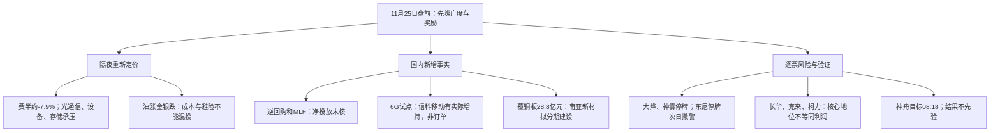

# 2026-11-25 · 盘前消息面研判

> 盘前现场研究，不是回放。11/24 A股为最近已收盘事实；隔夜美股按美东11/24。目标日11/25 A股价格与资金反馈尚无。`partial`反映取证覆盖，非停买判断。

## 🧭 一句话结论

**隔夜半导体回吐复职涨幅，A股前日放量却失去广度；机器人只剩局部接力，国内硬催化逐票检验。**

## 🧭 市场奖励与反向剧本

- **事实**：沪指+0.27%、深成指-0.29%，创业板盘中约+4.22%、收在日低（-0.05%）；上涨1,952、下跌3,498，沪深逐股成交合计1.6549万亿元，财联社/连板网约1.66万亿元、较前日多1022亿元。涨停55、跌停2、炸板68（55.28%）。来源 `D` / `Ltoday` / `W4`。
- **市场给谁溢价**：机器人连续两个交易日居公开热度矩阵最前（67→19家涨停），相对承接好但扩散明显变窄；全市场封板44.7%，机器人自身封板率未核。中京电子4板、PCB涨停数2→2，总高度与板块广度不是一回事；长华、克来3板不改其业务公告反证。主线仅作相对观察，11/25预期分歧，风格记震荡。
- **反向剧本**：若前排掉队、机器人扩散不回，国内6G试点与独立订单可作不同路径的观察，不自动切换主线；若PCB核心和覆铜板同步收回且板块扩散，再重估海外拖累。比较对象明确：不以最高标替代新事件、不以涨停替代业务暴露、不因补证不足排除全市场。

### 原生六态：事实与预测分栏

- **事实**：11/24为 **降温**，`lianban_six_v1`，阶段页版本未知，11/24收盘页交叉确认；绑定版本 as_of `2026-11-25T06:06:17.841721+08:00`，11/25盘中估计缺失。
- **页面基础排序**：修复11%／升温16%／高潮17%／降温17%／退潮31%／冰点7%，合计99%原样保留，精确转移矩阵未核。**同景另列**：上证年线下、降温第1天，82个样本，首位退潮34%，页面第二高潮17%。
- **11/25判断**：首选**退潮**，备选**降温**。保持基础首位：11/24创业板冲高收最低，沪深成交约1.66万亿但收盘下跌3498家、炸板68/123；隔夜海外半导体再回撤。备选从盘面延续而非照同景次位：连板30家、昨涨停池收盘回报仍为正、跌停2家，加上美股等权上涨，让局部承接尚有余地，但不足选高潮。
- **最强反证**：11/24连板30家较前日增14，前日涨停池11/24表现+4.2%（连板网回报口径，非开盘或R1口径）；隔夜标普等权+2.59%，央行预告逆回购。
- **改判**：11/25首个完整时段核广度从偏弱转回扩散且炸板较11/24同窗收敛、核心成交承接无集体冲高回落，改判降温；若连板与中军同步转弱且跌停扩张，坚持退潮。当前无11/25盘中实测。 无数值后验，不用于定仓。

## 🗺️ 消息传导图

## 🎯 硬事件账本与真实负面交接

**55条去重硬事件/定价更新，另2条同一披露的反向分支；37条含负向映射或属独立负面的研究条目**。同一公告全文、标题、媒体转述只算一条底层事实；入表不代表所有影响已证实。逐条含时点及查询来源，原文短摘在JSON。

### E20261125_DAYE · 大烨智能收到行政处罚事先告知并将戴帽 · 负面 · high

- **事实**: 江苏证监局事先告知认定2021、2022年报存在虚假记载，拟罚公司400万元。11/25停牌一天，11/26 ST大烨复牌，涨跌幅仍20%；公告称本次不触及重大违法强制退市。
- **时点与有效窗**: 老方向新增催化；可交易归属 `20261125`；本次最早相符报道 `11-24 19:57` `W17`。11/25停牌；11/26复牌并ST；后续以监管最终决定和交易所状态为准。
- **实际已查**: anns_window（20261124 至 20261125，`A2212,A2214`）；公司公告原件·巨潮（20261124 至 20261125；核对PDF前至多4页，`P2212,P2214`）；证券时报（2026-11-24 06:51 至 2026-11-24 23:53，`W17`）；上海证券报（2026-11-24 06:51 至 2026-11-24 23:53，`W51`）。
- **作用域**: 电气设备（负面）；直接对象 大烨智能 300670.SZ。
- **大资金意图**: 未核交易主体与净流向。300670.SZ 11/24收4.50，-7.41%，成交1.12亿元。仅前日收盘参照，是否为公告后反应依时点判定。
- **为什么走强**: 逐票硬状态交下游，区分拟罚、正式处罚和退市。
- **逻辑够不够硬**: 同一公司对同一事项的公告组及复述 · 1条事实链。同一停复牌/处罚链只计一项；不能解释11/24收盘前跌幅为公告后反应。

### E20261125_SW · 神雾节能收到行政处罚事先告知并将戴帽 · 负面 · high

- **事实**: 江西证监局事先告知认定2024年报存在虚假记载，虚增营收6945.83万元、利润总额1296.89万元。11/25停牌，11/26 ST节能复牌，涨跌幅仍10%；公告称本次不触及重大违法强制退市。
- **时点与有效窗**: 老方向新增催化；可交易归属 `20261125`；本次最早相符报道 `11-24 23:06` `W9`。11/25停牌；11/26复牌并ST；后续以监管最终决定和交易所状态为准。
- **实际已查**: anns_window（20261124 至 20261125，`A2539,A2540`）；公司公告原件·巨潮（20261124 至 20261125；核对PDF前至多4页，`P2539,P2540`）；证券时报（2026-11-24 06:51 至 2026-11-24 23:53，`W9`）。
- **作用域**: 节能工程（负面）；直接对象 神雾节能 000820.SZ。
- **大资金意图**: 未核交易主体与净流向。000820.SZ 11/24收2.67，-1.84%，成交0.24亿元。仅前日收盘参照，是否为公告后反应依时点判定。
- **为什么走强**: 逐票硬状态；不推全板块停买。
- **逻辑够不够硬**: 同一公司对同一事项的公告组及复述 · 1条事实链。媒体与公告系同一底层案；绝非所有ST都5%。

### E20261125_ML · 美丽生态首次低于1元叠加财务及立案风险 · 负面 · high

- **事实**: 11/24收0.90元；公司原有退市风险警示及证监会立案，新增面值退市风险提示。
- **时点与有效窗**: 老方向新增催化；可交易归属 `20261125`；精确首次公开未核。11/25起面值风险窗口；持续看连续收盘价和财务/监管结论。
- **实际已查**: anns_window（20261124 至 20261125，`A2645,A1572`）；公司公告原件·巨潮（20261124 至 20261125；核对PDF前至多4页，`P2645,P1572`）；上海证券报（2026-11-24 06:51 至 2026-11-24 23:53，`W71`）。
- **作用域**: 生态工程（负面）；直接对象 *ST美丽 000010.SZ。
- **大资金意图**: 未核交易主体与净流向。000010.SZ 11/24收0.90，-10.00%，成交0.49亿元。仅前日收盘参照，是否为公告后反应依时点判定。
- **为什么走强**: 新增面值风险与旧立案分列事实、合并交接；尚未宣告退市。
- **逻辑够不够硬**: 同一公司对同一事项的公告组及复述 · 1条事实链。交易类面值、财务及违规不同规则不可相互替代。

### E20261125_TM · 天马科技新增逾期诉讼与司法拍卖风险 · 负面 · high

- **事实**: 新增借款及票据逾期本金3.14818亿元，占审计净资产14.93%；新增诉讼仲裁2.837632亿元；部分实控人股份拟司法拍卖。
- **时点与有效窗**: 老方向新增催化；可交易归属 `20261125`；精确首次公开未核。至清偿、解除保全或拍卖结果公告。
- **实际已查**: anns_window（20261124 至 20261125，`A399`）；公司公告原件·巨潮（20261124 至 20261125；核对PDF前至多4页，`P399`）。
- **作用域**: 水产养殖（负面）；直接对象 天马科技 603668.SH。
- **大资金意图**: 未核交易主体与净流向。603668.SH 11/24收5.22，-2.61%，成交1.29亿元。仅前日收盘参照，是否为公告后反应依时点判定。
- **为什么走强**: 流动性及控制权尾部风险交下游。
- **逻辑够不够硬**: 同一公司对同一事项的公告组及复述 · 1条事实链。拍卖仍在公示，非已完成控制权变更。

### E20261125_TY · 北交所田野创新披露面值退市风险 · 负面 · high

- **事实**: 11/24收0.99元，北交所连续60个交易日收盘低于1元规则适用；公司另有内控相关退市风险警示。
- **时点与有效窗**: 老方向新增催化；可交易归属 `20261125`；精确首次公开未核。11/25起持续跟踪收盘价和北交所决定。
- **实际已查**: anns_window（20261124 至 20261125，`A92`）；公司公告原件·巨潮（20261124 至 20261125；核对PDF前至多4页，`P92`）。
- **作用域**: 食品加工（负面）；直接对象 *ST田野 920023.BJ。
- **大资金意图**: 未核交易主体与净流向。920023.BJ 11/24收0.99，-1.00%，成交0.04亿元。仅前日收盘参照，是否为公告后反应依时点判定。
- **为什么走强**: 不能套沪深20日规则。
- **逻辑够不够硬**: 同一公司对同一事项的公告组及复述 · 1条事实链。风险提示不等于已经触发终止上市。

### E20261125_YT · 亚泰集团披露新增债务逾期 · 负面 · high

- **事实**: 新增逾期合计4.165084亿元；截至披露累计逾期本息74.684691亿元，公司部分主体处于预重整。
- **时点与有效窗**: 老方向新增催化；可交易归属 `20261125`；精确首次公开未核。至预重整与债务偿付新进展。
- **实际已查**: anns_window（20261124 至 20261125，`A582`）；公司公告原件·巨潮（20261124 至 20261125；核对PDF前至多4页，`P582`）。
- **作用域**: 建材/地产综合（负面）；直接对象 亚泰集团 600881.SH。
- **大资金意图**: 未核交易主体与净流向。600881.SH 11/24收1.45，-3.33%，成交1.04亿元。仅前日收盘参照，是否为公告后反应依时点判定。
- **为什么走强**: 不把预重整视为免债或正式重整成功。
- **逻辑够不够硬**: 同一公司对同一事项的公告组及复述 · 1条事实链。主体和子公司口径需按公告，不映射到同行硬风险。

### E20261125_CD · 川大智胜剩余关联借款被宣布提前到期 · 负面 · high

- **事实**: 因部分借款逾期触发条款，债权人宣布8950万元剩余借款本金提前到期，累计逾期含该笔1.924亿元。
- **时点与有效窗**: 老方向新增催化；可交易归属 `20261125`；精确首次公开未核。至偿付、展期或债权人更新。
- **实际已查**: anns_window（20261124 至 20261125，`A1314`）；公司公告原件·巨潮（20261124 至 20261125；核对PDF前至多4页，`P1314`）。
- **作用域**: 软件应用（负面）；直接对象 川大智胜 002253.SZ。
- **大资金意图**: 未核交易主体与净流向。002253.SZ 11/24收6.60，+0.30%，成交0.35亿元。仅前日收盘参照，是否为公告后反应依时点判定。
- **为什么走强**: 真实偿债风险，不以高开或小幅收涨消除。
- **逻辑够不够硬**: 同一公司对同一事项的公告组及复述 · 1条事实链。公告说利息已结清，不等于本金已清偿。

### E20261125_RM · 瑞茂通债务逾期与退市风险未消除 · 负面 · high

- **事实**: 公司及子公司累计金融机构、商票及债券未按期兑付本金约62.74亿元；年报审计无法表示意见、内控否定；仍有终止上市风险。
- **时点与有效窗**: 已交易后的延续；可交易归属 `20261124`；精确首次公开未核。持续至重整、审计、债务或交易状态有正式更新。
- **实际已查**: anns_window（20261124 至 20261125，`A689,A690`）；公司公告原件·巨潮（20261124 至 20261125；核对PDF前至多4页，`P689,P690`）；证券时报（2026-11-24 06:51 至 2026-11-24 23:53，`W26`）。
- **作用域**: 供应链管理（负面）；直接对象 *ST瑞茂 600180.SH。
- **大资金意图**: 未核交易主体与净流向。600180.SH 11/24收0.55，+10.00%，成交0.32亿元。仅前日收盘参照，是否为公告后反应依时点判定。
- **为什么走强**: 11/24尾盘地天板、收0.55元，不等于重整受理、偿债或风险解除。
- **逻辑够不够硬**: 同一公司对同一事项的公告组及复述 · 1条事实链。状态为持续风险更新，不能把历史存量全计作新增；连续低面值次数为媒体口径。

### E20261125_KLS · 柯力机器人力学传感器占比不足1% · 负面 · high

- **事实**: 前三季机器人力学传感器收入占比不足1%；投资知行机器人800万元取得1.1976%股权。
- **时点与有效窗**: 老方向新增催化；可交易归属 `20261125`；精确首次公开未核。11/25起；订单或收入占比实证变化重评。
- **实际已查**: anns_window（20261124 至 20261125，`A1813`）；公司公告原件·巨潮（20261124 至 20261125；核对PDF前至多4页，`P1813`）；lianban:today（事实日11/24公开正文，`Ltoday`）。
- **作用域**: 人形机器人（负面）、机器人传感器（负面）；直接对象 柯力传感 603662.SH。
- **大资金意图**: 未核交易主体与净流向。603662.SH 11/24收53.01，+10.00%，成交8.76亿元。仅前日收盘参照，是否为公告后反应依时点判定。
- **为什么走强**: 高涨幅与低当期收入并存，投资不等于并表主业。
- **逻辑够不够硬**: 同一公司对同一事项的公告组及复述 · 1条事实链。11/24二板是披露新证据前的价量参照，不是公告后承接。

### E20261125_BW · 北纬科技十日严重异常波动 · 负面 · high

- **事实**: 11/11至11/24十日收盘价涨幅偏离累计100.09%，近日换手多日约40%至50%；公司表示经营未发生与股价对应变化。
- **时点与有效窗**: 老方向新增催化；可交易归属 `20261125`；精确首次公开未核。11/25首交易时段及后续异动公告。
- **实际已查**: anns_window（20261124 至 20261125，`A2476`）；公司公告原件·巨潮（20261124 至 20261125；核对PDF前至多4页，`P2476`）。
- **作用域**: 机器人映射/题材交易（负面）；直接对象 北纬科技 002148.SZ。
- **大资金意图**: 未核交易主体与净流向。002148.SZ 11/24收11.41，+3.07%，成交26.42亿元。仅前日收盘参照，是否为公告后反应依时点判定。
- **为什么走强**: 真实短线拥挤与基本面偏离；严重异动不是已停牌。
- **逻辑够不够硬**: 同一公司对同一事项的公告组及复述 · 1条事实链。有成交不能代替产品订单，次日延伸未知。

### E20261125_SM · ST三木债务逾期及担保催收 · 负面 · high

- **事实**: 若干受担保子公司发生欠息或短期偿债压力，已收到贷款或保证催收通知。
- **时点与有效窗**: 老方向新增催化；可交易归属 `20261125`；精确首次公开未核。至偿付或担保履责公告。
- **实际已查**: anns_window（20261124 至 20261125，`A2597`）；公司公告原件·巨潮（20261124 至 20261125；核对PDF前至多4页，`P2597`）。
- **作用域**: 地产综合（负面）；直接对象 ST三木 000632.SZ。
- **大资金意图**: 未核交易主体与净流向。000632.SZ 11/24收2.93，+6.55%，成交0.54亿元。仅前日收盘参照，是否为公告后反应依时点判定。
- **为什么走强**: 既有ST叠加信用负面，不用个股收涨作为排除依据。
- **逻辑够不够硬**: 同一公司对同一事项的公告组及复述 · 1条事实链。预期应付与实际逾期不能混加。

### E20261125_NY · 南亚新材董事会通过28.8亿元覆铜板建设计划 · 正面 · high

- **事实**: 全资子公司拟分期投入28.8亿元建高端覆铜板项目，董事会已审议。
- **时点与有效窗**: 老方向新增催化；可交易归属 `20261125`；本次最早相符报道 `11-24 23:53` `W43`。11/25首反应；后续立项、环评、建设和投产节点。
- **实际已查**: anns_window（20261124 至 20261125，`A1650`）；公司公告原件·巨潮（20261124 至 20261125；核对PDF前至多4页，`P1650`）；上海证券报（2026-11-24 06:51 至 2026-11-24 23:53，`W43`）。
- **作用域**: PCB/覆铜板（正面）、电子材料（正面）；直接对象 南亚新材 688519.SH。
- **大资金意图**: 未核交易主体与净流向。688519.SH 11/24收144.95，-1.80%，成交22.56亿元。仅前日收盘参照，是否为公告后反应依时点判定。
- **为什么走强**: 直接公告主体的扩产预期成立；资金、许可和客户转化未落地，非合同。
- **逻辑够不够硬**: 同一公司对同一事项的公告组及复述 · 1条事实链。11/24收跌1.80%，且11/25海外硬件的估值拖累可压过单票利好。

### E20261125_FII · 工业富联拟前三季度派现132.85亿元 · 正面 · high

- **事实**: 董事会通过每10股派6.7元，测算132.85亿元，占前三季归母净利32.90%；在原授权范围无需再交股东会。
- **时点与有效窗**: 老方向新增催化；可交易归属 `20261125`；本次最早相符报道 `11-24 19:05` `W19`。11/25首次价格反馈；实施日期另行公告。
- **实际已查**: anns_window（20261124 至 20261125，`A1937`）；公司公告原件·巨潮（20261124 至 20261125；核对PDF前至多4页，`P1937`）；证券时报（2026-11-24 06:51 至 2026-11-24 23:53，`W19`）。
- **作用域**: AI服务器（正面）、海外AI硬件（正面）；直接对象 工业富联 601138.SH。
- **大资金意图**: 未核交易主体与净流向。601138.SH 11/24收40.96，+6.97%，成交117.08亿元。仅前日收盘参照，是否为公告后反应依时点判定。
- **为什么走强**: 股东回报信号不是新增服务器订单；除息与市场定价要分开。
- **逻辑够不够硬**: 同一公司对同一事项的公告组及复述 · 1条事实链。11/24收+6.97%是公告前价格参照，不用盘后分红倒因。

### E20261125_DS · 迪森股份获警示函 · 负面 · high

- **事实**: 广东证监局指出收入确认、预计负债和前五客户披露问题，对公司及相关人员出具警示函。
- **时点与有效窗**: 老方向新增催化；可交易归属 `20261125`；精确首次公开未核。收到决定后30日整改报告；监管确认更新后重评。
- **实际已查**: anns_window（20261124 至 20261125，`A1027`）；公司公告原件·巨潮（20261124 至 20261125；核对PDF前至多4页，`P1027`）。
- **作用域**: 热能服务（负面）；直接对象 迪森股份 300335.SZ。
- **大资金意图**: 未核交易主体与净流向。300335.SZ 11/24收4.22，-2.09%，成交0.33亿元。仅前日收盘参照，是否为公告后反应依时点判定。
- **为什么走强**: 行政监管措施，不写成行政罚款或戴帽。
- **逻辑够不够硬**: 同一公司对同一事项的公告组及复述 · 1条事实链。三季报多确认收入1597.72万元为2025年报告口径。

### E20261125_CZ · 淳中科技异动提示业绩亏损 · 负面 · high

- **事实**: 前三季收入1.87亿元、归母净亏8468.03万元、扣非净亏5793.55万元。
- **时点与有效窗**: 老方向新增催化；可交易归属 `20261125`；精确首次公开未核。11/25首次可观察反馈；后续业绩和订单核定重评。
- **实际已查**: anns_window（20261124 至 20261125，`A1826`）；公司公告原件·巨潮（20261124 至 20261125；核对PDF前至多4页，`P1826`）；lianban:today（事实日11/24公开正文，`Ltoday`）。
- **作用域**: 海外AI硬件（负面）、芯片题材映射（负面）；直接对象 淳中科技 603516.SH。
- **大资金意图**: 未核交易主体与净流向。603516.SH 11/24收49.92，+10.00%，成交1.10亿元。仅前日收盘参照，是否为公告后反应依时点判定。
- **为什么走强**: 已核的是异动和亏损，不等于新增客户削单。
- **逻辑够不够硬**: 同一公司对同一事项的公告组及复述 · 1条事实链。11/24封板为价格反证，不能证明盈利变化。

### E20261125_XY · 行云科技签五年算力服务合同 · 正面 · high

- **事实**: 与北京豆神智算签32套GPU服务，含税总额2.9856亿元、五年；服务器已交付验收，首付款及履约保证金合计2488万元应按约支付，到账未知。
- **时点与有效窗**: 已交易后的延续；可交易归属 `20261124`；精确首次公开未核。11/25以订单承接与回款变化核；合同期限5年。
- **实际已查**: anns_window（20261124 至 20261125，`A1068`）；公司公告原件·巨潮（20261124 至 20261125；核对PDF前至多4页，`P1068`）。
- **作用域**: 算力服务（正面）；直接对象 行云科技 300209.SZ。
- **大资金意图**: 未核交易主体与净流向。300209.SZ 11/24收21.71，+0.05%，成交23.21亿元。仅前日收盘参照，是否为公告后反应依时点判定。
- **为什么走强**: 金额是多年含税合同，不是单季确认利润或已收到现金。
- **逻辑够不够硬**: 同一公司对同一事项的公告组及复述 · 1条事实链。11/24曾冲至24.50元但收21.71元仅+0.05%，与追涨叙事相反；先核首笔到账。

### E20261125_CL · 长华执行器收入有限且丝杠未定点 · 负面 · high

- **事实**: 执行器专用结构件等收入约8.8万元，行星滚柱丝杠在研无定点无营收；三季累计归母净利约186万元。
- **时点与有效窗**: 已交易后的延续；可交易归属 `20261124`；精确首次公开未核。11/25延续；见客户定点、量产和入账公告再重评。
- **实际已查**: anns_window（20261124 至 20261125，`A351`）；公司公告原件·巨潮（20261124 至 20261125；核对PDF前至多4页，`P351`）；lianban:today（事实日11/24公开正文，`Ltoday`）。
- **作用域**: 人形机器人（负面）、滚柱丝杠（负面）；直接对象 长华集团 605018.SH。
- **大资金意图**: 未核交易主体与净流向。605018.SH 11/24收12.42，+10.01%，成交0.62亿元。仅前日收盘参照，是否为公告后反应依时点判定。
- **为什么走强**: 盘面3板可以是题材地位，不能当核心利润暴露。
- **逻辑够不够硬**: 同一公司对同一事项的公告组及复述 · 1条事实链。旧澄清已被11/24盘面交易，本次保留为风险反证不冒称隔夜新增。

### E20261125_KL · 克来机电确认不涉人形机器人产品 · 负面 · high

- **事实**: 工业机器人产品为智能装卸系统、2025销售占比极低，目前不涉人形机器人产品；前三季归母净亏544.91万元。
- **时点与有效窗**: 已交易后的延续；可交易归属 `20261124`；精确首次公开未核。11/25延续；须见新业务硬披露及首次可交易后的价格重评。
- **实际已查**: anns_window（20261124 至 20261125，`A354`）；公司公告原件·巨潮（20261124 至 20261125；核对PDF前至多4页，`P354`）；lianban:today（事实日11/24公开正文，`Ltoday`）。
- **作用域**: 人形机器人（负面）、自动化设备（负面）；直接对象 克来机电 603960.SH。
- **大资金意图**: 未核交易主体与净流向。603960.SH 11/24收16.91，+10.02%，成交0.26亿元。仅前日收盘参照，是否为公告后反应依时点判定。
- **为什么走强**: 3板和光模块题材标签均不能替代业务证据。
- **逻辑够不够硬**: 同一公司对同一事项的公告组及复述 · 1条事实链。旧澄清，盘面连板不是否定公告。

### E20261125_JR · 居然智家控股股东新增轮候冻结 · 负面 · high

- **事实**: 公司收到控股股东部分股份轮候冻结通知，控股股东及一致行动人累计实冻占所持73.86%、占总股本32.45%，未重复计轮候。
- **时点与有效窗**: 老方向新增催化；可交易归属 `20261125`；精确首次公开未核。至解冻、处置和控制权后续披露。
- **实际已查**: anns_window（20261124 至 20261125，`A2586`）；公司公告原件·巨潮（20261124 至 20261125；核对PDF前至多4页，`P2586`）。
- **作用域**: 家居零售（负面）；直接对象 居然智家 000785.SZ。
- **大资金意图**: 未核交易主体与净流向。000785.SZ 11/24收1.89，+0.53%，成交0.70亿元。仅前日收盘参照，是否为公告后反应依时点判定。
- **为什么走强**: 提示控制权和治理尾部风险，不写成已转让。
- **逻辑够不够硬**: 同一公司对同一事项的公告组及复述 · 1条事实链。公司称目前不影响生产经营或治理。

### E20261125_XK · 信科移动控股股东首次增持及计划 · 正面 · high

- **事实**: 控股股东11/24实际买入200万股，成交1899.07万元；后续计划合计不超过2亿元。
- **时点与有效窗**: 老方向新增催化；可交易归属 `20261125`；精确首次公开未核。首次增持已发生；后续自11/24起6个月依披露核验。
- **实际已查**: anns_window（20261124 至 20261125，`A1673`）；公司公告原件·巨潮（20261124 至 20261125；核对PDF前至多4页，`P1673`）。
- **作用域**: 6G/通信（正面）；直接对象 信科移动 688387.SH。
- **大资金意图**: 未核交易主体与净流向。688387.SH 11/24收9.45，+3.62%，成交4.59亿元。仅前日收盘参照，是否为公告后反应依时点判定。
- **为什么走强**: 实际股东买入是可核事实，剩余额度只上限，不能充当6G订单或机构净流量。
- **逻辑够不够硬**: 同一公司对同一事项的公告组及复述 · 1条事实链。收盘+3.62%有日线参照，无法靠日线辨识全部买盘及因果。

### E20261125_YJH · 亿嘉和异动提示持续亏损 · 负面 · high

- **事实**: 公司异动公告援引前三季归母净亏2.166064亿元，同比延续亏损；公告称日常经营正常。
- **时点与有效窗**: 老方向新增催化；可交易归属 `20261125`；精确首次公开未核。11/25首个可观察反应；后续财务或业务变化重评。
- **实际已查**: anns_window（20261124 至 20261125，`A1812`）；公司公告原件·巨潮（20261124 至 20261125；核对PDF前至多4页，`P1812`）；lianban:today（事实日11/24公开正文，`Ltoday`）。
- **作用域**: 人形机器人（负面）、机器人应用（负面）；直接对象 亿嘉和 603666.SH。
- **大资金意图**: 未核交易主体与净流向。603666.SH 11/24收27.90，+10.02%，成交1.13亿元。仅前日收盘参照，是否为公告后反应依时点判定。
- **为什么走强**: 归属上市公司实际风险，不放大为机器人行业盈利衰退。
- **逻辑够不够硬**: 同一公司对同一事项的公告组及复述 · 1条事实链。二板不构成利润改善；公告引用的是旧报表，本轮只计披露提示。

### E20261125_GT · 广田面值退市风险继续存在 · 负面 · high

- **事实**: 前一公告首次触线11/23收0.99元；11/24实测0.98元。
- **时点与有效窗**: 已交易后的延续；可交易归属 `20261124`；精确首次公开未核。跟踪连续收盘低于1元；收回1元以上重置相应连续计数。
- **实际已查**: anns_window（20261124 至 20261125，`A1266`）；公司公告原件·巨潮（20261124 至 20261125；核对PDF前至多4页，`P1266`）。
- **作用域**: 建筑装饰（负面）；直接对象 广田集团 002482.SZ。
- **大资金意图**: 未核交易主体与净流向。002482.SZ 11/24收0.98，-1.01%，成交1.19亿元。仅前日收盘参照，是否为公告后反应依时点判定。
- **为什么走强**: 14类保护由下游独立执行，不扩散为建筑装饰全行业利空。
- **逻辑够不够硬**: 同一公司对同一事项的公告组及复述 · 1条事实链。旧公告非当晚新公告；11/24盘面是本轮更新。

### E20261125_ZJL · 浙江龙盛控股股东一致行动人增持 · 正面 · high

- **事实**: 11/23–24累计增持4287.72万股，占1.32%，金额4.4295亿元。大宗2500万股、竞价140.62万股、盘后固定价格1647.1万股。
- **时点与有效窗**: 老方向新增催化；可交易归属 `20261125`；精确首次公开未核。11/25市场反馈及后续权益公告。
- **实际已查**: anns_window（20261124 至 20261125，`A2064`）；公司公告原件·巨潮（20261124 至 20261125；核对PDF前至多4页，`P2064`）。
- **作用域**: 染料化工（正面）；直接对象 浙江龙盛 600352.SH。
- **大资金意图**: 未核交易主体与净流向。600352.SH 11/24收10.30，-1.72%，成交2.39亿元。仅前日收盘参照，是否为公告后反应依时点判定。
- **为什么走强**: 实际资本行为，但不能把合计当成二级连续竞价净流入或有续买计划。
- **逻辑够不够硬**: 同一公司对同一事项的公告组及复述 · 1条事实链。公司说目前没有后续计划，前日收跌。

### E20261125_SPACE · 神舟二十四号明确目标发射窗口 · 正面 · high

- **事实**: 央视原始节目正文确认瞄准11/25北京时间08:18发射。05:49转载报道乘组到塔架。
- **时点与有效窗**: 已确认待落地时间锚；可交易归属 `20261125`；本次最早相符报道 `11-24 21:14` `C57`。11/25 08:18目标时点；以主管方实际发射公告为准。
- **实际已查**: 央视新闻联播原始节目正文（Tushare cctv_news）（20261124节目，`TSPACE`）；Tushare news wallstreetcn（请求11/24 15:00至11/25 06:14；实际记录 2026-11-24 15:00:49 至 2026-11-25 05:49:58，`V1,V21`）；Tushare news cls（请求11/24 15:00至11/25 06:14；实际记录 2026-11-24 15:02:05 至 2026-11-25 05:50:00，`C57`）。
- **作用域**: 商业航天（正面）、卫星互联网（正面）；不做个股确认。
- **大资金意图**: 未核交易主体与净流向。没有可归属的发布后价格反应。
- **为什么走强**: 先核任务实际结果；载人航天不等于商业订单，前一日指数涨幅不是新结果。
- **逻辑够不够硬**: 任务发布会与央视正文 · 同源转载不加权。财联社报中证卫星产业指数11/24上涨1.8%；属事件预热时段的行情，不代表发射成功。

### E20261125_ZG · 中公教育增持进度低且拟延期 · 负面 · high

- **事实**: 原增持4500万–9000万元，已约499.88万元；预计不能在原期限完成，拟延期6个月待审议。
- **时点与有效窗**: 老方向新增催化；可交易归属 `20261125`；精确首次公开未核。至股东会和资金兑现；拟最迟2027/6/10。
- **实际已查**: anns_window（20261124 至 20261125，`A2390`）；公司公告原件·巨潮（20261124 至 20261125；核对PDF前至多4页，`P2390`）。
- **作用域**: 职业教育（负面）；直接对象 中公教育 002607.SZ。
- **大资金意图**: 未核交易主体与净流向。002607.SZ 11/24收1.43，-1.38%，成交1.77亿元。仅前日收盘参照，是否为公告后反应依时点判定。
- **为什么走强**: 拟增持利好被兑现进度削弱，不把延期算新增回报。
- **逻辑够不够硬**: 同一公司对同一事项的公告组及复述 · 1条事实链。尚未确认延期通过。

### E20261125_SHPCB · 胜宏科技拟10派10元 · 正面 · high

- **事实**: 拟每10股派10元，约9.83亿元、前三季归母净利的29.04%。
- **时点与有效窗**: 老方向新增催化；可交易归属 `20261125`；本次最早相符报道 `11-24 22:22` `W12`。11/25首次反应待查；以实施公告更新。
- **实际已查**: anns_window（20261124 至 20261125，`A997`）；公司公告原件·巨潮（20261124 至 20261125；核对PDF前至多4页，`P997`）；证券时报（2026-11-24 06:51 至 2026-11-24 23:53，`W12`）。
- **作用域**: PCB/覆铜板（正面）；直接对象 胜宏科技 300476.SZ。
- **大资金意图**: 未核交易主体与净流向。300476.SZ 11/24收122.32，+6.27%，成交84.17亿元。仅前日收盘参照，是否为公告后反应依时点判定。
- **为什么走强**: 业绩背景不能当新增订单；尤其当天PCB有高开低走的反面。
- **逻辑够不够硬**: 同一公司对同一事项的公告组及复述 · 1条事实链。前一日收+6.27%不能由晚间公告倒因，行业负面不被个股股息抵消。

### E20261125_REY · 英力特借壳预案复牌一字跌停 · 负面 · high

- **事实**: 拟发行股份购宝丰光伏100%股权，拟控制权变更；审计评估未完。11/24复牌收9.90元跌停。
- **时点与有效窗**: 已交易后的延续；可交易归属 `20261125`；精确首次公开未核。11/25延续，最终以审计估值、审批、价格承接重评。
- **实际已查**: anns_window（20261124 至 20261125，`A1490`）；公司公告原件·巨潮（20261124 至 20261125；核对PDF前至多4页，`P1490`）；上海证券报（2026-11-24 06:51 至 2026-11-24 23:53，`W44`）；catalyst_calendar:5165a5c48ef55cf0116502b3f999142b5ad08cc99b8e27b7b2afe6cb63634786（11/24晨报证据截点07:36；覆盖11/24–12/21（声明），`K`）。
- **作用域**: 并购重组（负面）、光伏运营（负面）；直接对象 英 力 特 000635.SZ。
- **大资金意图**: 未核交易主体与净流向。000635.SZ 11/24收9.90，-10.00%，成交0.47亿元。仅前日收盘参照，是否为公告后反应依时点判定。
- **为什么走强**: 说明即使名义借壳预案也可能兑现抛压，不把所有并购都判负。
- **逻辑够不够硬**: 同一公司对同一事项的公告组及复述 · 1条事实链。同为复牌艾为-6.16%而艾艾精工+8.17%，是个案而非共振。

### E20261125_GY · 国仪公司获电子显微镜订单 · 正面 · high

- **事实**: 同一客户框架下接受多份高端双束电子显微镜订单，总额1.4219亿元含税。
- **时点与有效窗**: 已交易后的延续；可交易归属 `20261124`；精确首次公开未核。持续跟踪交付验收；11/25不作首发新题材。
- **实际已查**: anns_window（20261124 至 20261125，`A96`）；公司公告原件·巨潮（20261124 至 20261125；核对PDF前至多4页，`P96`）。
- **作用域**: 科研仪器（正面）、国产仪器（正面）；直接对象 国仪公司 688828.SH。
- **大资金意图**: 未核交易主体与净流向。688828.SH 11/24收57.23，-1.65%，成交1.18亿元。仅前日收盘参照，是否为公告后反应依时点判定。
- **为什么走强**: 硬订单但客户未公开，不能泛化映射；收入按交付验收确认。
- **逻辑够不够硬**: 同一公司对同一事项的公告组及复述 · 1条事实链。11/24收跌1.65%，已交易订单不能按新增强事件追涨。

### E20261125_DT · 东尼电子公告撤警并安排停复牌 · 正面 · high

- **事实**: 11/25全天停牌，11/26复牌并撤销其他风险警示。
- **时点与有效窗**: 老方向新增催化；可交易归属 `20261125`；精确首次公开未核。11/25全天停；11/26复牌撤销其他风险警示。
- **实际已查**: anns_window（20261124 至 20261125，`A1821`）；公司公告原件·巨潮（20261124 至 20261125；核对PDF前至多4页，`P1821`）。
- **作用域**: 电子材料（正面）、风险警示股（中性）；直接对象 ST东尼 603595.SH。
- **大资金意图**: 未核交易主体与净流向。603595.SH 11/24收27.36，+7.00%，成交0.92亿元。仅前日收盘参照，是否为公告后反应依时点判定。
- **为什么走强**: 摘帽本身是独立公司正面，今日停牌属于同一事件的硬交易状态，不能当可执行候选。
- **逻辑够不够硬**: 同一公司对同一事项的公告组及复述 · 1条事实链。不得套用目标日盘中表现；复牌反应未知。

### E20261125_PZ · 普元信息实控人部分股份冻结 · 负面 · high

- **事实**: 实控人188万股被冻结，约总股本1.98%，涉及自然人委托合同纠纷。
- **时点与有效窗**: 老方向新增催化；可交易归属 `20261125`；精确首次公开未核。至冻结解除、诉讼或控制权公告。
- **实际已查**: anns_window（20261124 至 20261125，`A1725`）；公司公告原件·巨潮（20261124 至 20261125；核对PDF前至多4页，`P1725`）。
- **作用域**: 软件应用（负面）；直接对象 普元信息 688118.SH。
- **大资金意图**: 未核交易主体与净流向。688118.SH 11/24收14.25，-1.04%，成交0.28亿元。仅前日收盘参照，是否为公告后反应依时点判定。
- **为什么走强**: 不自动推公司负债或控制权变更。
- **逻辑够不够硬**: 同一公司对同一事项的公告组及复述 · 1条事实链。公司声明未重大影响经营，截至公告未收到相应法律文书。

### E20261125_DF · 东方海洋异动提示两主营板块均亏损 · 负面 · high

- **事实**: 前三季归母净亏6793.11万元；海洋及大健康板块均亏损，水产加工盈利未覆盖整体。
- **时点与有效窗**: 已交易后的延续；可交易归属 `20261124`；精确首次公开未核。11/25延续；后续盈利恢复证据推翻。
- **实际已查**: anns_window（20261124 至 20261125，`A1365`）；公司公告原件·巨潮（20261124 至 20261125；核对PDF前至多4页，`P1365`）；lianban:today（事实日11/24公开正文，`Ltoday`）。
- **作用域**: 水产养殖（负面）；直接对象 东方海洋 002086.SZ。
- **大资金意图**: 未核交易主体与净流向。002086.SZ 11/24收4.54，+9.93%，成交24.94亿元。仅前日收盘参照，是否为公告后反应依时点判定。
- **为什么走强**: 三板仅强势反例，不将财务压力消掉。
- **逻辑够不够硬**: 同一公司对同一事项的公告组及复述 · 1条事实链。旧公告，11/24盘面已交易。

### E20261125_AN · 傲农生物股东部分解冻并有新增冻结 · 负面 · high

- **事实**: 截至11/23相关股东合计被司法冻结/标记8565.49万股，占总股本3.14%；同时有解除部分及新增冻结。
- **时点与有效窗**: 老方向新增催化；可交易归属 `20261125`；精确首次公开未核。至股东重整登记及冻结变化。
- **实际已查**: anns_window（20261124 至 20261125，`A1836`）；公司公告原件·巨潮（20261124 至 20261125；核对PDF前至多4页，`P1836`）。
- **作用域**: 生猪养殖（负面）；直接对象 傲农生物 603363.SH。
- **大资金意图**: 未核交易主体与净流向。603363.SH 11/24收2.61，-0.38%，成交0.92亿元。仅前日收盘参照，是否为公告后反应依时点判定。
- **为什么走强**: 不能只选解冻表述成净利好，最终持股以登记为准。
- **逻辑够不够硬**: 同一公司对同一事项的公告组及复述 · 1条事实链。不是上市公司经营资产同步被冻结。

### E20261125_AX · 亚信集团财务总监收到原任职企业相关告知并辞任 · 负面 · high

- **事实**: 公司披露财务总监辞任，事先处罚告知系原任职其他企业事项，公司称本事项不涉及本公司。
- **时点与有效窗**: 老方向新增催化；可交易归属 `20261125`；精确首次公开未核。11/25至继任者及公司披露更新。
- **实际已查**: anns_window（20261124 至 20261125，`A1709`）；公司公告原件·巨潮（20261124 至 20261125；核对PDF前至多4页，`P1709`）。
- **作用域**: 软件应用（负面）；直接对象 亚信集团 688225.SH。
- **大资金意图**: 未核交易主体与净流向。688225.SH 11/24收11.71，-0.85%，成交0.49亿元。仅前日收盘参照，是否为公告后反应依时点判定。
- **为什么走强**: 负面限治理连续性，不算本公司财务造假。
- **逻辑够不够硬**: 同一公司对同一事项的公告组及复述 · 1条事实链。公司称其继续担任其他职务，市场影响未核。

### E20261125_TL · 天齐锂业拟现金买矿与股权 · 正面 · high

- **事实**: 公司董事会审议以现金收购润丰矿业、天齐兴宇股权和上都布探矿权，公告列股权转让对价合计约68.54亿元。
- **时点与有效窗**: 老方向新增催化；可交易归属 `20261125`；精确首次公开未核。至完整审批、交割与许可；11/25只作资产预案定价。
- **实际已查**: anns_window（20261124 至 20261125，`A2425`）；公司公告原件·巨潮（20261124 至 20261125；核对PDF前至多4页，`P2425`）。
- **作用域**: 锂资源（正面）；直接对象 天齐锂业 002466.SZ。
- **大资金意图**: 未核交易主体与净流向。002466.SZ 11/24收32.20，-0.80%，成交8.40亿元。仅前日收盘参照，是否为公告后反应依时点判定。
- **为什么走强**: 直接资产增量预期与资金支出需分开；详查探矿权并非资源已投产。
- **逻辑够不够硬**: 同一公司对同一事项的公告组及复述 · 1条事实链。未把股权对价外推全部交易成本，交割和单季财务贡献未知。

### E20261125_HC · ST瀚川一致行动人部分股份冻结 · 负面 · high

- **事实**: 5%以上股东及控股股东一致行动人42万股被司法冻结，占公司总股本0.25%。
- **时点与有效窗**: 老方向新增催化；可交易归属 `20261125`；精确首次公开未核。至司法进展或控制权更新。
- **实际已查**: anns_window（20261124 至 20261125，`A1743`）；公司公告原件·巨潮（20261124 至 20261125；核对PDF前至多4页，`P1743`）。
- **作用域**: 自动化设备（负面）；直接对象 ST瀚川 688022.SH。
- **大资金意图**: 未核交易主体与净流向。688022.SH 11/24收7.66，-1.16%，成交0.09亿元。仅前日收盘参照，是否为公告后反应依时点判定。
- **为什么走强**: 逐票披露保留，低占比不扩大为控制权风险确定兑现。
- **逻辑够不够硬**: 同一公司对同一事项的公告组及复述 · 1条事实链。公司称不改变控制权及日常经营。

### E20261125_ZJ · 中际旭创回购进入报告书披露 · 正面 · high

- **事实**: 现行回购报告书延续20亿至40亿元方案、600元/股上限；前十大股东名单是程序信息。
- **时点与有效窗**: 已交易后的延续；可交易归属 `20261124`；精确首次公开未核。3个月回购窗口；跟踪实施及取消变更公告。
- **实际已查**: anns_window（20261124 至 20261125，`A2248,A2249`）；公司公告原件·巨潮（20261124 至 20261125；核对PDF前至多4页，`P2248,P2249`）；catalyst_calendar:5165a5c48ef55cf0116502b3f999142b5ad08cc99b8e27b7b2afe6cb63634786（11/24晨报证据截点07:36；覆盖11/24–12/21（声明），`K`）。
- **作用域**: 光通信/CPO（正面）；直接对象 中际旭创 300308.SZ。
- **大资金意图**: 未核交易主体与净流向。300308.SZ 11/24收417.00，-0.05%，成交285.83亿元。仅前日收盘参照，是否为公告后反应依时点判定。
- **为什么走强**: 治理和估值信号，非新订单，不重复计算11/24已经知道的董事会预案。
- **逻辑够不够硬**: 同一公司对同一事项的公告组及复述 · 1条事实链。与隔夜海外股价回撤并存；无法验证执行额度和期内完成比例。

### E20261125_TLR · 天齐关联收购带来现金流支出 · 负面 · high

- **事实**: 公告明确用自有或自筹资金，交易会使现金流净流出，属于关联交易。
- **时点与有效窗**: 同一硬事件的反向分支；可交易归属 `20261125`；精确首次公开未核。落实资金安排、关联交易审议及交割后重评。
- **实际已查**: anns_window（20261124 至 20261125，`A2425`）；公司公告原件·巨潮（20261124 至 20261125；核对PDF前至多4页，`P2425`）。
- **作用域**: 锂资源（负面）；直接对象 天齐锂业 002466.SZ。
- **大资金意图**: 未核交易主体与净流向。002466.SZ 11/24收32.20，-0.80%，成交8.40亿元。仅前日收盘参照，是否为公告后反应依时点判定。
- **为什么走强**: 资产扩张和现金成本分支同时保留；不是另一独立硬事件。
- **逻辑够不够硬**: 同一公司对同一事项的公告组及复述 · 1条事实链。公司称不会对流动性等产生重大不利影响，规模及投产验证另行核。

### E20261125_QB · ST起步部分账户执行冻结 · 负面 · high

- **事实**: 因旧案执行公司部分银行账户被冻，实际冻结17904.82元，含主体基本账户；公司称未达主要银行账户被冻结情形。
- **时点与有效窗**: 老方向新增催化；可交易归属 `20261125`；精确首次公开未核。至法院执行或解除冻结。
- **实际已查**: anns_window（20261124 至 20261125，`A1824`）；公司公告原件·巨潮（20261124 至 20261125；核对PDF前至多4页，`P1824`）。
- **作用域**: 服装鞋帽（负面）；直接对象 *ST起步 603557.SH。
- **大资金意图**: 未核交易主体与净流向。603557.SH 11/24收2.75，-3.51%，成交0.10亿元。仅前日收盘参照，是否为公告后反应依时点判定。
- **为什么走强**: 小额冻结为真实执行风险，但不等同集团结算停摆。
- **逻辑够不够硬**: 同一公司对同一事项的公告组及复述 · 1条事实链。以金额与账户用途限制传导。

### E20261125_YH · 盐湖股份回购与股东名单对照 · 正面 · high

- **事实**: 15亿–20亿元拟回购注销，价格上限33.66元，尚需股东会。11/20名册显示国新产业资本持1.94%。
- **时点与有效窗**: 已交易后的延续；可交易归属 `20261124`；精确首次公开未核。股东会及回购实施节点；延续而非当日新资金。
- **实际已查**: anns_window（20261124 至 20261125，`A1460,A1461`）；公司公告原件·巨潮（20261124 至 20261125；核对PDF前至多4页，`P1460,P1461`）；证券时报（2026-11-24 06:51 至 2026-11-24 23:53，`W28`）。
- **作用域**: 钾肥/盐湖锂（正面）；直接对象 盐湖股份 000792.SZ。
- **大资金意图**: 未核交易主体与净流向。000792.SZ 11/24收22.10，+2.65%，成交15.40亿元。仅前日收盘参照，是否为公告后反应依时点判定。
- **为什么走强**: 名册持股市值不等于当日买入额，媒体跨三季报推演的增持量不是公告披露交易量。
- **逻辑够不够硬**: 同一公司对同一事项的公告组及复述 · 1条事实链。已交易的回购预期，关注方案落地，不外推整个锂资源板块。

### E20261125_JK · 金科收回1元但历史面值风险仍需区分 · 中性 · high

- **事实**: 首次触线11/23收0.98元，11/24收1.00元。按公告口径本连续低于1元序列不延续。
- **时点与有效窗**: 已交易后的延续；可交易归属 `20261125`；精确首次公开未核。11/25核是否再次跌破1元；其他风险按对应公告。
- **实际已查**: anns_window（20261124 至 20261125，`A1483`）；公司公告原件·巨潮（20261124 至 20261125；核对PDF前至多4页，`P1483`）。
- **作用域**: 地产（中性）；直接对象 金科股份 000656.SZ。
- **大资金意图**: 未核交易主体与净流向。000656.SZ 11/24收1.00，+2.04%，成交6.59亿元。仅前日收盘参照，是否为公告后反应依时点判定。
- **为什么走强**: 此变化不代表其他债务或重整风险消失。
- **逻辑够不够硬**: 同一公司对同一事项的公告组及复述 · 1条事实链。纳入旧风险跟踪不重复加负分。

### E20261125_NYR · 南亚新材新产能仍受审批与投产约束 · 负面 · high

- **事实**: 公告明确尚需立项或备案、环评、建设规划及施工许可，实际投资金额和构成可变。
- **时点与有效窗**: 同一硬事件的反向分支；可交易归属 `20261125`；本次最早相符报道 `11-24 23:53` `W43`。至前置审批、资本开支与实际投产验证。
- **实际已查**: anns_window（20261124 至 20261125，`A1650`）；公司公告原件·巨潮（20261124 至 20261125；核对PDF前至多4页，`P1650`）；上海证券报（2026-11-24 06:51 至 2026-11-24 23:53，`W43`）。
- **作用域**: PCB/覆铜板（负面）、电子材料（负面）；直接对象 南亚新材 688519.SH。
- **大资金意图**: 未核交易主体与净流向。688519.SH 11/24收144.95，-1.80%，成交22.56亿元。仅前日收盘参照，是否为公告后反应依时点判定。
- **为什么走强**: 不把规划产能预先计入短期收入；风险分支同源不新增硬事件数或独立信源。
- **逻辑够不够硬**: 同一公司对同一事项的公告组及复述 · 1条事实链。是否延期等是待检条件，不认定项目已延期。

### E20261125_SH · 陈吉宁接受审查调查 · 中性 · high

- **事实**: 新华社通报陈吉宁涉嫌严重违纪违法正接受审查调查；上海市委召开扩大会议通报。
- **时点与有效窗**: 老方向新增催化；可交易归属 `20261125`；本次最早相符报道 `11-24 19:30` `N1592`。至官方后续；仅监测有公告实证的项目变化。
- **实际已查**: sina（2026-11-22 09:02 至 2026-11-25 05:57:14，`N626,N408`）；10jqka（2026-11-22 09:02 至 2026-11-25 05:57:14，`N1592`）。
- **作用域**: 上海本地（中性）；不做个股确认。
- **大资金意图**: 未核交易主体与净流向。没有可归属的发布后价格反应。
- **为什么走强**: 只确认人事/纪检事实，未核项目或企业关联，不赋上海板块整体负分。
- **逻辑够不够硬**: 新华社通报及市委会议公开报道 · 不累权。同一新华社通报跨平台只计一个原始信源；市委会议是另一个相关事实而非重复加权。

### E20261125_MDX · 美迪西非控股股东小额冻结 · 负面 · high

- **事实**: 非控股股东1.75万股被冻结，占总股本0.01%，公司尚未取得法律文书。
- **时点与有效窗**: 老方向新增催化；可交易归属 `20261125`；精确首次公开未核。至法律文书与解冻进展。
- **实际已查**: anns_window（20261124 至 20261125，`A1719`）；公司公告原件·巨潮（20261124 至 20261125；核对PDF前至多4页，`P1719`）。
- **作用域**: CXO（负面）；直接对象 美迪西 688202.SH。
- **大资金意图**: 未核交易主体与净流向。688202.SH 11/24收69.65，-0.14%，成交3.49亿元。仅前日收盘参照，是否为公告后反应依时点判定。
- **为什么走强**: 影响仅逐票披露，不视为控制权波动。
- **逻辑够不够硬**: 同一公司对同一事项的公告组及复述 · 1条事实链。实际原因、经营影响独立证据未核。

### E20261125_SOX · 海外半导体回吐复职行情 · 负面 · medium

- **事实**: 美东11/24费半初收约跌7.9%（盘中曾跌9.02%）；纳指收跌1.48%，英伟达据新浪收跌5.94%，另一快讯初报约5.8%。道指收涨0.85%，标普等权涨2.59%。
- **时点与有效窗**: 隔夜新增定价事实（非新产业事件）；可交易归属 `20261125`；本次最早相符报道 `11-25 05:00` `V27`。11/25开盘至首个完整交易时段；以海外科技跌幅收敛及A股核心承接重评。
- **实际已查**: sina（2026-11-22 09:02 至 2026-11-25 05:57:14，`N46,N270`）；10jqka（2026-11-22 09:02 至 2026-11-25 05:57:14，`N1483`）；Tushare news wallstreetcn（请求11/24 15:00至11/25 06:14；实际记录 2026-11-24 15:00:49 至 2026-11-25 05:49:58，`V26,V27`）；overseas_snapshot · tencent.us fallback（美国20261124收盘，`O`）；Tushare news cls（请求11/24 15:00至11/25 06:14；实际记录 2026-11-24 15:02:05 至 2026-11-25 05:50:00，`C10`）。
- **作用域**: 海外AI硬件（负面）、光通信/CPO（负面）、存储（负面）、半导体设备（负面）、PCB/覆铜板（负面）；不做个股确认。
- **大资金意图**: 未核交易主体与净流向。美东11/24纳指-1.48%、SOX初步-7.9%、标普等权+2.59%；行业抛压与全市场分化并存。
- **为什么走强**: 海外科技降风险与美股广谱抛售不是同一回事；光模块、存储、设备、PCB仅有估值及情绪映射，没有削单证据。
- **逻辑够不够硬**: 共同底层市场行情 · 非多个独立事件。前一日A股海外硬件高开回落发生在美国正股开盘前，不能用后来美股收盘倒填因果。

### E20261125_EU · 欧盟混动汽车临时保障措施初裁 · 负面 · medium

- **事实**: 商务部答复确认欧委会对进口混动汽车发布全球保障措施初裁并拟于12月1日起采临时措施。中方要求遵守共识与非歧视并保留争端解决等权利。
- **时点与有效窗**: 老方向新增催化；可交易归属 `20261125`；本次最早相符报道 `11-24 16:33` `N1746`。11/25重新定价；拟12/1起；以欧方实际实施文本和适用范围更新。
- **实际已查**: sina（2026-11-22 09:02 至 2026-11-25 05:57:14，`N1145`）；10jqka（2026-11-22 09:02 至 2026-11-25 05:57:14，`N1746`）；Tushare news cls（请求11/24 15:00至11/25 06:14；实际记录 2026-11-24 15:02:05 至 2026-11-25 05:50:00，`C191`）；Tushare news wallstreetcn（请求11/24 15:00至11/25 06:14；实际记录 2026-11-24 15:00:49 至 2026-11-25 05:49:58，`V419`）；证券时报（2026-11-24 06:51 至 2026-11-24 23:53，`W23`）；上海证券报（2026-11-24 06:51 至 2026-11-24 23:53，`W63`）。
- **作用域**: 混动整车出口（负面）、汽零出口（负面）；不做个股确认。
- **大资金意图**: 未核交易主体与净流向。没有可归属的发布后价格反应。
- **为什么走强**: 直接风险限欧向受影响混动车型，零部件仅在依赖该业务时传导；不能外推纯电、全部整车或每家公司。
- **逻辑够不够硬**: 商务部原话多路转载 · 1。同一商务部答记者问多路转载，不增加独立源。税率、配额、豁免、车型和公司收入敞口未核。

### E20261125_IR · 霍尔木兹通行与谈判条件趋紧 · 负面 · medium

- **事实**: 伊方官员表态七项条件未落实前不谈判并收紧通行；海军关于油轮遇险的说法是单方声明。随后WTI/布伦特1月期货收涨2.35%/2.27%。
- **时点与有效窗**: 老方向新增催化；可交易归属 `20261125`；本次最早相符报道 `11-24 15:53` `N1266`。11/25至实际通行或外交条件变化；运价和船流另核。
- **实际已查**: sina（2026-11-22 09:02 至 2026-11-25 05:57:14，`N693,N1266`）；10jqka（2026-11-22 09:02 至 2026-11-25 05:57:14，`N1617`）；Tushare news wallstreetcn（请求11/24 15:00至11/25 06:14；实际记录 2026-11-24 15:00:49 至 2026-11-25 05:49:58，`V45,V62`）；证券时报（2026-11-24 06:51 至 2026-11-24 23:53，`W8`）。
- **作用域**: 油气开采（正面）、油运风险（中性）、航空运输（负面）、炼化成本（负面）；不做个股确认。
- **大资金意图**: 未核交易主体与净流向。WTI/布伦特1月期货结算+2.35%/+2.27%；航运量、主体资金未核。
- **为什么走强**: 供给溢价有利上游名义价格，炼化、航空承受成本压力；油运“运价溢价”与“可运量下降”冲突，矩阵中油运不作净多。
- **逻辑够不够硬**: 伊方议长和通行立场官方表态 · 与独立期货反应分开。油价上涨非实际断供证明，未核船舶通行量或公司敞口；与美国科技下跌不作单因果归因。

### E20261125_6G · 工信部牵头6G部省协同试点启动 · 正面 · medium

- **事实**: 11/24全球6G发展大会正式启动部省协同试点，八省市参与。
- **时点与有效窗**: 老方向新增催化（已部分可闻）；可交易归属 `20261125`；本次最早相符报道 `11-24 15:15` `N1794`。11/25盘前重评；后续看试点招采和量化里程碑。
- **实际已查**: sina（2026-11-22 09:02 至 2026-11-25 05:57:14，`N1343`）；10jqka（2026-11-22 09:02 至 2026-11-25 05:57:14，`N1794`）；Tushare news wallstreetcn（请求11/24 15:00至11/25 06:14；实际记录 2026-11-24 15:00:49 至 2026-11-25 05:49:58，`V408,V429`）；上海证券报（2026-11-24 06:51 至 2026-11-24 23:53，`W62`）；catalyst_calendar:5165a5c48ef55cf0116502b3f999142b5ad08cc99b8e27b7b2afe6cb63634786（11/24晨报证据截点07:36；覆盖11/24–12/21（声明），`K`）。
- **作用域**: 6G/通信（正面）、卫星互联网（正面）；不做个股确认。
- **大资金意图**: 未核交易主体与净流向。没有可归属的发布后价格反应。
- **为什么走强**: 确认试点而非商用、订单或具体上市公司中标；不把海外光模块当国内试点确定受益。
- **逻辑够不够硬**: 同一工信部主导启动会 · 多路转载。11/24收盘通信反应与试点传播时段不完全可比；无11/25反馈。

### E20261125_PBOC · 央行预告逆回购与MLF两项操作 · 正面 · medium

- **事实**: 央行分别公告11/25拟开展5000亿元7天期逆回购及8000亿元1年期MLF，均用固定数量、利率招标、多重价位中标。
- **时点与有效窗**: 老方向新增催化；可交易归属 `20261125`；本次最早相符报道 `11-24 17:01` `N1731`。11/25操作结果及各自到期对照；实际资金价格重评。
- **实际已查**: 10jqka（2026-11-22 09:02 至 2026-11-25 05:57:14，`N1731,N1706`）；Tushare news cls（请求11/24 15:00至11/25 06:14；实际记录 2026-11-24 15:02:05 至 2026-11-25 05:50:00，`C175,C153`）；Tushare news wallstreetcn（请求11/24 15:00至11/25 06:14；实际记录 2026-11-24 15:00:49 至 2026-11-25 05:49:58，`V380,V360`）；证券时报（2026-11-24 06:51 至 2026-11-24 23:53，`W22`）；sina（2026-11-22 09:02 至 2026-11-25 05:57:14，`N994`）；Tushare news eastmoney（请求11/24 15:00至11/25 06:14；实际记录 2026-11-24 15:16:57 至 2026-11-25 05:50:00，`E196`）。
- **作用域**: 市场流动性（正面）、券商/两融（中性）；不做个股确认。
- **大资金意图**: 未核交易主体与净流向。没有可归属的发布后价格反应。
- **为什么走强**: 只确认各期限拟操作规模；两条公告合并表示同日流动性窗口，不将合计13000亿视作净投放、股市增量或两融入场。
- **逻辑够不够硬**: 央行公开市场公告多路转载 · 1。实际中标、分项到期轧差与银行间资金价格未核；转载不加权。

### E20261125_ALI · 阿里回应Apex被列美国实体清单 · 负面 · medium

- **事实**: 据界面等财经媒体载阿里发言人回应，美国商务部将新加坡子公司Apex Enterprise Solutions列入实体清单。阿里称列入有误、Apex从未转移任何受美国出口管制的先进计算芯片，将寻求法律途径。
- **时点与有效窗**: 老方向新增催化；可交易归属 `20261125`；本次最早相符报道 `11-24 17:11` `C159`。11/25港股及后续监管原表或公司更新；逐主体适用。
- **实际已查**: 10jqka（2026-11-22 09:02 至 2026-11-25 05:57:14，`N1718`）；Tushare news cls（请求11/24 15:00至11/25 06:14；实际记录 2026-11-24 15:02:05 至 2026-11-25 05:50:00，`C159`）；Tushare news wallstreetcn（请求11/24 15:00至11/25 06:14；实际记录 2026-11-24 15:00:49 至 2026-11-25 05:49:58，`V364`）。
- **作用域**: 云计算/跨境AI合规（负面）；直接对象 阿里巴巴-W 09988.HK。
- **大资金意图**: 未核交易主体与净流向。没有可归属的发布后价格反应。
- **为什么走强**: 不把子公司列单外推到母公司全部业务、所有中国云厂商或英伟达全球订单。
- **逻辑够不够硬**: 阿里发言人回应经界面原稿转载；BIS原始条目仍未直核。未直读BIS本轮条目文本及许可细则；阿里声明是当事方反证，不证明监管事实被撤销。

### E20261125_ETFS · 华安纳斯达克100ETF溢价临停 · 负面 · medium

- **事实**: 据基金公告转载，收盘2.332元、参考净值2.0320元；开市临停，拟10:30复牌，赎回照常。
- **时点与有效窗**: 老方向新增催化；可交易归属 `20261125`；本次最早相符报道 `11-24 17:16` `N1017`。11/25开市停牌至10:30，若溢价未降可再临停。
- **实际已查**: sina（2026-11-22 09:02 至 2026-11-25 05:57:14，`N1017`）；Tushare fund_basic + fund_daily（20261124日线；本次盘前合约身份，`F159632`）。
- **作用域**: 纳指QDII（负面）；直接对象 华安纳斯达克100ETF(QDII) 159632.SZ。
- **大资金意图**: 未核交易主体与净流向。没有可归属的发布后价格反应。
- **为什么走强**: 只对相关基金；海外指数下跌与本地溢价回归可同向叠加。
- **逻辑够不够硬**: 基金公告在新浪的转载 · 未直读原件。基金原文及交易所当晨状态未直读；不扩大到全部ETF。

### E20261125_FED · 美联储贴现率会议纪要公布 · 负面 · medium

- **事实**: 纪要称10月FOMC前八家地区联储董事会曾建议贴现率升到4.25%，理事会最终两度维持4%。纽约尾盘黄金-2.23%、白银-5.12%；沪金沪银夜盘-2.59%/-6.77%。
- **时点与有效窗**: 老方向新增催化；可交易归属 `20261125`；本次最早相符报道 `11-25 04:09` `N71`。11/25海外利率重定价；下一次政策声明或利率数据可推翻。
- **实际已查**: sina（2026-11-22 09:02 至 2026-11-25 05:57:14，`N71`）；Tushare news wallstreetcn（请求11/24 15:00至11/25 06:14；实际记录 2026-11-24 15:00:49 至 2026-11-25 05:49:58，`V40,V2,V62`）。
- **作用域**: 高估值成长（负面）、贵金属（负面）；不做个股确认。
- **大资金意图**: 未核交易主体与净流向。纽约尾盘金银-2.23%/-5.12%，沪金沪银夜盘-2.59%/-6.77%；并非同一报价口径。
- **为什么走强**: 历史偏紧偏好会限制无息资产和高久期估值；不能把同期金银下跌全归因纪要，亦非新加息。
- **逻辑够不够硬**: 贴现率会议纪要同源转述；商品报价为独立背景。收益率与美元的同分钟反应未核；盘中低点及不同合约不可和收盘价混算。

### E20261125_NVREG · 美国议员质疑英伟达复职 · 负面 · medium

- **事实**: 美国议员公开质疑复职并称将继续调查；美国司法部长称英伟达是优秀企业公民，并使用了“如果”涉及刑事调查的条件表述。
- **时点与有效窗**: 已交易后的延续；可交易归属 `20261124`；本次最早相符报道 `11-24 13:57` `N1831`。至调查结论或可验证新披露；12/3听证旧历未直核。
- **实际已查**: sina（2026-11-22 09:02 至 2026-11-25 05:57:14，`N1027,N205`）；10jqka（2026-11-22 09:02 至 2026-11-25 05:57:14，`N1831,N2000`）；Tushare news wallstreetcn（请求11/24 15:00至11/25 06:14；实际记录 2026-11-24 15:00:49 至 2026-11-25 05:49:58，`V93`）；catalyst_calendar:5165a5c48ef55cf0116502b3f999142b5ad08cc99b8e27b7b2afe6cb63634786（11/24晨报证据截点07:36；覆盖11/24–12/21（声明），`K`）。
- **作用域**: 海外AI硬件（负面）、光通信/CPO（负面）、存储（负面）；不做个股确认。
- **大资金意图**: 未核交易主体与净流向。没有可归属的发布后价格反应。
- **为什么走强**: 政治与合规不确定性仍在；不能把条件表态推断成新刑事立案，也不能当作调查结案或出口放松。
- **逻辑够不够硬**: 议员表态及司法部长讲话 · 各自仅按原始表态验证。复职和前夜涨幅已交易，本项记录延续及表态边界；与SOX行情为不同事实不做重复因果归因。

### E20261125_HUA · 华为发布Mate X8折叠屏 · 正面 · medium

- **事实**: 华为发布会上公布Mate X8、麒麟9050 Pro及12999元起售价。
- **时点与有效窗**: 老方向新增催化（已部分可闻）；可交易归属 `20261124`；本次最早相符报道 `11-24 14:48` `N1400`。发布至首销数据；无量化订单时只作产品事件。
- **实际已查**: sina（2026-11-22 09:02 至 2026-11-25 05:57:14，`N1313,N1349,N1400,N424`）。
- **作用域**: 折叠屏（正面）、消费电子（正面）；不做个股确认。
- **大资金意图**: 未核交易主体与净流向。没有可归属的发布后价格反应。
- **为什么走强**: 上市催化偏向明确但供应份额、销售量、利润率未知；换机预期不能当供应商订单。
- **逻辑够不够硬**: 同一厂商发布会。相关演讲、渠道首发和媒体复述仍非独立终端销量数据。

### E20261125_MAT · 商务部暂缓对美两用物项公告第二款 · 正面 · medium

- **事实**: 商务部公开通报，公告2024年第46号第二款11/28起暂缓至2027/1/27；不是第46号全部撤销。
- **时点与有效窗**: 老方向新增催化；可交易归属 `20261125`；本次最早相符报道 `11-24 16:41` `E211`。11/28生效至2027/1/27；以主管方后续适用规则或改期更新。
- **实际已查**: sina（2026-11-22 09:02 至 2026-11-25 05:57:14，`N1117`）；10jqka（2026-11-22 09:02 至 2026-11-25 05:57:14，`N1740`）；Tushare news cls（请求11/24 15:00至11/25 06:14；实际记录 2026-11-24 15:02:05 至 2026-11-25 05:50:00，`C185`）；Tushare news wallstreetcn（请求11/24 15:00至11/25 06:14；实际记录 2026-11-24 15:00:49 至 2026-11-25 05:49:58，`V414`）；Tushare news eastmoney（请求11/24 15:00至11/25 06:14；实际记录 2026-11-24 15:16:57 至 2026-11-25 05:50:00，`E211`）。
- **作用域**: 关键材料出口（正面）、关键材料稀缺溢价（负面）；不做个股确认。
- **大资金意图**: 未核交易主体与净流向。没有可归属的发布后价格反应。
- **为什么走强**: 实际许可与发运有待核验；对相关合规出口预期偏正，稀缺溢价的反向传导只是假设，不代表美国对华先进芯片限制被解除。
- **逻辑够不够硬**: 商务部通报同源转载；状态直接、产业传导为条件假设。本轮核到商务部通知同源转述，未直核适用清单逐项与境外需求，不给材料个股贴确定受益标签。

### E20261125_SAN · 赛诺菲披露Insmed并购协议 · 正面 · medium

- **事实**: 据赛诺菲宣布已达成每股175美元的现金收购协议，总值约410亿美元。
- **时点与有效窗**: 老方向新增催化（已部分可闻）；可交易归属 `20261124`；本次最早相符报道 `11-24 14:30` `N1439`。11/25情绪传导窗口；交割与监管审批另行跟踪。
- **实际已查**: sina（2026-11-22 09:02 至 2026-11-25 05:57:14，`N1414,N1439`）；Tushare news cls（请求11/24 15:00至11/25 06:14；实际记录 2026-11-24 15:02:05 至 2026-11-25 05:50:00，`C38`）；证券时报（2026-11-24 06:51 至 2026-11-24 23:53，`W8`）。
- **作用域**: 创新药/出海（正面）；不做个股确认。
- **大资金意图**: 未核交易主体与净流向。没有可归属的发布后价格反应。
- **为什么走强**: 仅海外估值参照；不可推A股同类项目交易。
- **逻辑够不够硬**: 同一公司并购公告的媒体引用。Insmed据财联社开盘后上涨约14%；赛诺菲IR原件未直读，协议非已完成并购。

### E20261125_MI · 小米Q3收入略超预期但净利不及预期 · 中性 · medium

- **事实**: Q3收入1072.39亿元，同比-5.2%，略超快讯预期1064.4亿元；经营利润65.72亿元高于快讯预期43.2亿元，但期间净利38.76亿元低于快讯预期44.9亿元，经调整净利48.84亿元同比-56.8%。
- **时点与有效窗**: 老方向新增催化；可交易归属 `20261125`；本次最早相符报道 `11-24 17:25` `N988`。11/25港股首次完整价格反馈；待HKEX及Q2同口径复核。
- **实际已查**: sina（2026-11-22 09:02 至 2026-11-25 05:57:14，`N978,N987,N988,N985,N953,N976`）；证券时报（2026-11-24 06:51 至 2026-11-24 23:53，`W20`）；Tushare news wallstreetcn（请求11/24 15:00至11/25 06:14；实际记录 2026-11-24 15:00:49 至 2026-11-25 05:49:58，`V190`）。
- **作用域**: 消费电子（中性）、智能汽车（中性）；直接对象 小米集团 01810.HK。
- **大资金意图**: 未核交易主体与净流向。没有可归属的发布后价格反应。
- **为什么走强**: 业绩正反并存，单季环比未查定，维持中性；不对A股链条赋个股受益。
- **逻辑够不够硬**: 小米披露为底层单源 · 快讯预期仅媒体对照。股价和一致预期样本口径未核，不以“过千亿”单向立论。

### E20261125_BCI · Paradromics宣布与英伟达技术合作 · 正面 · medium

- **事实**: 央视财经转述其11/23当地宣布与英伟达共建面向脑机接口的AI计算基础设施。
- **时点与有效窗**: 老方向新增催化；可交易归属 `20261124`；本次最早相符报道 `11-24 16:51` `N1101`。11/25叙事窗口；以临床及合作里程碑重评。
- **实际已查**: sina（2026-11-22 09:02 至 2026-11-25 05:57:14，`N1101`）；财联社早知道（2026-11-24 06:51 至 2026-11-24 23:53，`W1`）。
- **作用域**: 脑机接口（正面）；不做个股确认。
- **大资金意图**: 未核交易主体与净流向。没有可归属的发布后价格反应。
- **为什么走强**: 技术合作不等于临床获批、设备订单、或有明确A股供货方。
- **逻辑够不够硬**: 央视财经转述企业声明 · 与RSS同源不加权。公告/报道中没有锁定A股实体，8个字概念同现不自动纳入候选。

## 📊 板块极性叉乘

净分只描述已见消息：`Σ(板块方向 × |事件衰减分|)`，λ=0.15。未映射为 null，明确中性才计0。个股级贡献只向所属方向提供边界信息，不升成整个行业利空或利好。

| 板块／方向 | 净分 | 事件贡献（符号×绝对衰减分） |
|---|---:|---|
| 人形机器人 · 负面 | -2.50360 | `KLS` -1 × 0.71000（个股级）；`CL` -1 × 0.61110（个股级）；`KL` -1 × 0.60250（个股级）；`YJH` -1 × 0.58000（个股级） |
| 软件应用 · 负面 | -1.70000 | `CD` -1 × 0.76000（个股级）；`PZ` -1 × 0.48000（个股级）；`AX` -1 × 0.46000（个股级） |
| 存储 · 负面 | -1.40642 | `SOX` -1 × 0.89000（行业级）；`NVREG` -1 × 0.51642（行业级） |
| 海外AI硬件 · 负面 | -1.36642 | `FII` +1 × 0.66000（个股级）；`CZ` -1 × 0.62000（个股级）；`SOX` -1 × 0.89000（行业级）；`NVREG` -1 × 0.51642（行业级） |
| 水产养殖 · 负面 | -1.31339 | `TM` -1 × 0.84000（个股级）；`DF` -1 × 0.47339（个股级） |
| 6G/通信 · 正面 | +1.28000 | `XK` +1 × 0.59000（个股级）；`6G` +1 × 0.69000（板块级） |
| 卫星互联网 · 正面 | +1.24000 | `SPACE` +1 × 0.55000（板块级）；`6G` +1 × 0.69000（板块级） |
| 自动化设备 · 负面 | -1.04250 | `KL` -1 × 0.60250（个股级）；`HC` -1 × 0.44000（个股级） |
| 光通信/CPO · 负面 | -0.99328 | `ZJ` +1 × 0.41314（个股级）；`SOX` -1 × 0.89000（行业级）；`NVREG` -1 × 0.51642（行业级） |
| 生态工程 · 负面 | -0.95000 | `ML` -1 × 0.95000（个股级） |
| 电气设备 · 负面 | -0.95000 | `DAYE` -1 × 0.95000（个股级） |
| 节能工程 · 负面 | -0.95000 | `SW` -1 × 0.95000（个股级） |
| 半导体设备 · 负面 | -0.89000 | `SOX` -1 × 0.89000（行业级） |
| 汽零出口 · 负面 | -0.84000 | `EU` -1 × 0.84000（行业级） |
| 混动整车出口 · 负面 | -0.84000 | `EU` -1 × 0.84000（行业级） |
| 电子材料 · 正面 | +0.83000 | `NY` +1 × 0.67000（个股级）；`DT` +1 × 0.50000（个股级）；`NYR` -1 × 0.34000（个股级） |
| 食品加工 · 负面 | -0.80000 | `TY` -1 × 0.80000（个股级） |
| 建材/地产综合 · 负面 | -0.79000 | `YT` -1 × 0.79000（个股级） |
| 油气开采 · 正面 | +0.75000 | `IR` +1 × 0.75000（行业级） |
| 炼化成本 · 负面 | -0.75000 | `IR` -1 × 0.75000（行业级） |
| 航空运输 · 负面 | -0.75000 | `IR` -1 × 0.75000（行业级） |
| 供应链管理 · 负面 | -0.71439 | `RM` -1 × 0.71439（个股级） |
| 机器人传感器 · 负面 | -0.71000 | `KLS` -1 × 0.71000（个股级） |
| 机器人映射/题材交易 · 负面 | -0.70000 | `BW` -1 × 0.70000（个股级） |
| 地产综合 · 负面 | -0.69000 | `SM` -1 × 0.69000（个股级） |
| AI服务器 · 正面 | +0.66000 | `FII` +1 × 0.66000（个股级） |
| 市场流动性 · 正面 | +0.65000 | `PBOC` +1 × 0.65000（宏观） |
| 热能服务 · 负面 | -0.65000 | `DS` -1 × 0.65000（个股级） |
| 云计算/跨境AI合规 · 负面 | -0.64000 | `ALI` -1 × 0.64000（个股级） |
| 芯片题材映射 · 负面 | -0.62000 | `CZ` -1 × 0.62000（个股级） |
| 算力服务 · 正面 | +0.61971 | `XY` +1 × 0.61971（个股级） |
| 滚柱丝杠 · 负面 | -0.61110 | `CL` -1 × 0.61110（个股级） |
| 家居零售 · 负面 | -0.59000 | `JR` -1 × 0.59000（个股级） |
| 机器人应用 · 负面 | -0.58000 | `YJH` -1 × 0.58000（个股级） |
| 纳指QDII · 负面 | -0.58000 | `ETFS` -1 × 0.58000（个股级） |
| 建筑装饰 · 负面 | -0.56807 | `GT` -1 × 0.56807（个股级） |
| 染料化工 · 正面 | +0.56000 | `ZJL` +1 × 0.56000（个股级） |
| 商业航天 · 正面 | +0.55000 | `SPACE` +1 × 0.55000（板块级） |
| 职业教育 · 负面 | -0.54000 | `ZG` -1 × 0.54000（个股级） |
| 光伏运营 · 负面 | -0.52000 | `REY` -1 × 0.52000（个股级） |
| 并购重组 · 负面 | -0.52000 | `REY` -1 × 0.52000（个股级） |
| 贵金属 · 负面 | -0.52000 | `FED` -1 × 0.52000（行业级） |
| 高估值成长 · 负面 | -0.52000 | `FED` -1 × 0.52000（行业级） |
| 国产仪器 · 正面 | +0.51642 | `GY` +1 × 0.51642（个股级） |
| 科研仪器 · 正面 | +0.51642 | `GY` +1 × 0.51642（个股级） |
| 折叠屏 · 正面 | +0.49921 | `HUA` +1 × 0.49921（板块级） |
| 消费电子 · 正面 | +0.49921 | `HUA` +1 × 0.49921（板块级）；`MI` +0 × 0.31000（个股级） |
| 关键材料出口 · 正面 | +0.47000 | `MAT` +1 × 0.47000（行业级） |
| 关键材料稀缺溢价 · 负面 | -0.47000 | `MAT` -1 × 0.47000（行业级） |
| 生猪养殖 · 负面 | -0.47000 | `AN` -1 × 0.47000（个股级） |
| 服装鞋帽 · 负面 | -0.40000 | `QB` -1 × 0.40000（个股级） |
| 钾肥/盐湖锂 · 正面 | +0.38732 | `YH` +1 × 0.38732（个股级） |
| 创新药/出海 · 正面 | +0.34428 | `SAN` +1 × 0.34428（板块级） |
| 脑机接口 · 正面 | +0.29264 | `BCI` +1 × 0.29264（板块级） |
| CXO · 负面 | -0.23000 | `MDX` -1 × 0.23000（个股级） |
| PCB/覆铜板 · 负面 | -0.04000 | `NY` +1 × 0.67000（个股级）；`SHPCB` +1 × 0.52000（个股级）；`NYR` -1 × 0.34000（个股级）；`SOX` -1 × 0.89000（行业级） |
| 锂资源 · 正面 | +0.04000 | `TL` +1 × 0.45000（个股级）；`TLR` -1 × 0.41000（个股级） |
| 上海本地 · 中性 | +0.00000 | `SH` +0 × 0.30000（个体事件） |
| 券商/两融 · 中性 | +0.00000 | `PBOC` +0 × 0.65000（宏观） |
| 地产 · 中性 | +0.00000 | `JK` +0 × 0.35000（个股级） |
| 智能汽车 · 中性 | +0.00000 | `MI` +0 × 0.31000（个股级） |
| 油运风险 · 中性 | +0.00000 | `IR` +0 × 0.75000（行业级） |
| 风险警示股 · 中性 | +0.00000 | `DT` +0 × 0.50000（个股级） |

## 🔎 盘前候选：仅保留三只研究观察

炸板率已高，名单按既有纪律收紧。板型/龙头地位/RR/禁止清单核验未完成，均不升执行；`in_today_plan` 未知，不用于预筛。

### 南亚新材 688519.SH · 观察（非首推）
- **买入理由**（仅观察依据）: 拟分期建设28.8亿元；现有高端覆铜板业务对题材映射直接。 可比胜宏科技：高端覆铜板扩产是更直接的产业验证；胜宏是股东回报不是新增订单。行业消息仍负，前日冲高回落，两个对象均不升格。
- **风险点**: 同题材半导体隔夜急跌；许可、资金和建设周期存在不确定。 已查公告窗 20261124 至 20261125，共2条标题，原件 `P1650；未读风险标题及更多外部覆盖见JSON。
- **止损条件**: 未确认买点或支撑结构，执行止损、RR与仓位不填。11/24实际收盘为 `144.95`，仅作观察锚。
- **可验证假设**: 若首个完整交易时段回到11/24收盘价上方且PCB广度同步回正，承接假设保留；否则不升格；后续有立项/环评才确认项目进度。

### 信科移动 688387.SH · 观察（非首推）
- **买入理由**（仅观察依据）: 试点正式启动；控股股东当日确实增持200万股。 与泛6G映射相比，控股股东已实际买入有直接事实；与航天预热票相比，无需借发射叙事解释。但不能推6G订单。
- **风险点**: 不能推6G中标；后续增持上限不是到位资金。 已查公告窗 20261124 至 20261125，共1条标题，原件 `P1673；未读风险标题及更多外部覆盖见JSON。
- **止损条件**: 未确认买点或支撑结构，执行止损、RR与仓位不填。11/24实际收盘为 `9.45`，仅作观察锚。
- **可验证假设**: 首个交易时段价格及同题材广度需同时强于昨收参照；只有股价单点强或后续增持停滞，维持观察。

### 行云科技 300209.SZ · 观察（非首推）
- **买入理由**（仅观察依据）: 32套算力服务已签约；设备已交付验收，并列首期付款安排。 比泛算力跟涨或仅回购更有签约实证；11/24冲高回落且首笔到账未确证，不用合同强行抵消风险。
- **风险点**: 前日冲高回落；客户实际付款、后续毛利和成本未核。 已查公告窗 20261124 至 20261125，共2条标题，原件 `P1068；未读风险标题及更多外部覆盖见JSON。
- **止损条件**: 未确认买点或支撑结构，执行止损、RR与仓位不填。11/24实际收盘为 `21.71`，仅作观察锚。
- **可验证假设**: 以首次公开后7工作日等合同约定及公司披露核首笔到账；开盘强但再回昨收下方不确认承接。

## 🔥 中报业绩预告命中：本轮无可核当期覆盖

实读东财限量 **2026Q3** 500 条，通知窗口 `2026-08-26 00:00:00 至 2026-11-04 00:00:00`。对全体直接对象按代码精确匹配；下表列样本归母净利增幅下限前15（非本日新增）。未核行业成分全集，不把同代码未命中写成行业无预告。小米为单季媒体快讯，环比未拆出，记中性。

| 代码 | 名称 | 区间（同比%） | 与本轮事件同代码 |
|---|---|---:|---|
| 001309.SZ | 德明利 | 32046.52 至 33154.49 | 样本未命中 |
| 300821.SZ | 东岳硅材 | 19047.97 至 19748.08 | 样本未命中 |
| 000703.SZ | 恒逸石化 | 3318.59 至 3405.13 | 样本未命中 |
| 002466.SZ | 天齐锂业 | 2734.97 至 3235.26 | 同代码命中，不证同一业绩事件 |
| 688825.SH | 长鑫科技 | 2581.06 至 2609.47 | 样本未命中 |
| 002812.SZ | 恩捷股份 | 1884 至 2474.8 | 样本未命中 |
| 688808.SH | 联讯仪器 | 1866 至 2072.95 | 样本未命中 |
| 301308.SZ | 江波龙 | 1864.55 至 1990.84 | 样本未命中 |
| 605189.SH | 富春染织 | 1347.69 至 1519.01 | 样本未命中 |
| 603991.SH | 领先股份 | 1238.57 至 1238.57 | 样本未命中 |
| 688388.SH | 嘉元科技 | 1196.6 至 1318.92 | 样本未命中 |
| 603026.SH | 石大胜华 | 968.14 至 1032.45 | 样本未命中 |
| 000626.SZ | 远大控股 | 890 至 1018 | 样本未命中 |
| 002493.SZ | 荣盛石化 | 777.93 至 822.95 | 样本未命中 |
| 301536.SZ | 星宸科技 | 663.13 至 697.75 | 样本未命中 |

## 🖼️ 匿名群聊图片文字侧证据

唯一图片文字侧文件：`data/raw/20261125/wechat_image_ocr_20261125.jsonl`。枚举5群、110缓存候选、92资产族；77族仅缩略图，25重复出现；67张唯一图全部 `vision_batch_timeout`，**实际非空正文0条**，无低清可读片段。采集11/25 06:02；缓存筛选11/24 06:02—11/25 06:02，实际记录mtime约11/24 08:04—23:27。缓存mtime与采集时间均不等于发帖/出版时间；两者仍未知。不窥文件缓存、不猜发件人，不增加独立来源。

群文字另仅作传播：有转述把复职解释为供应链稳定，也有把金百泽类比中京电子；对照`G255/G377`与公司披露、海外收盘，不作为新增订单、资金确认或新增独立证据。

## 🔍 关键证据与专题裁决

- `K`：仅用绑定日历有效版本所送前缀和目录。它已提示“第二段还是兑现”及管理层风险不等于监管解除；11/24高开收低、隔夜费半回吐后，更偏兑现风险而非科技普涨。复牌艾为、英力特与艾艾精工表现分化，不能用跨公司借壳类推。6G从旧日历时间锚升级为本轮试点启动，不升级为订单；12/3听证未直核。
- `Ltoday/Lmainline/Lqingxu`：分别用实际收盘页、热度矩阵和绑定六态做对照。公开页为partial，同体系不重复加权；`mainline`可见历史时间线11/19并非11/24，`today`混时点海外价未用。

## ⚠️ 不确定性与待核反证

- **功率半导体全面提价**：仅行业向前看，拿不到调价函和订单；不计。（`W1`）
- **物理AI数据爆发及金百泽对标**：媒体与匿名群为题材传播，未确认新供货或订单；不借中京电子高度。（`W1,G377`）
- **记忆张量与英伟达联合发布**：公众号可见报道，原始 release/权重/商业部署未回读。（`W1`）
- **英伟达新增刑事立案、取消订单或出口放松**：实查司法部长条件句、行业点评及旧历截取，未核新立案或取消订单，不计。（`N205,N568,V93,K`）
- **12/3听证**：旧日历仅前缀；未直读委员会本年的排期或更新。（`K`）
- **铁流、新坐标、福莱新材异动公告**：已核异动；所读段未见新增硬兑现，严禁扩大为无负面；逐对象仍未完成全窗公告和资金核验。（`P1786,P1885,P1756,Ltoday`）
- **荣盛石化回购增持融资报道**：原件是控股股东专项贷款承诺函，不等于放款或股票实际增持，新旧计划不重复打分。（`P2420`）
- **光模块备选风险**：11/24新易盛+4.53%、天孚-0.74%、中际-0.05%，并非全线同步；未直核每家公司订单及曝险。（`N568,D`）
- 美股科技回撤不等于全市场风险撤退；内地前日成交放大与涨少跌多同现。不把后来的隔夜收盘倒置成A股前日午后下挫的原因。
- 央行两项操作不等于股市资金已经进入；港股财报后的价格反馈、欧盟直接适用范围、部分公司未读公告与解禁、行业受益股池和R7主体资金均缺。

## 数据源审计

| 源 | 日期 | 状态 | 实际窗口及说明 |
|---|---|:---:|---|
| news_cls | 2026-11-25 | 🟢 ok | 2026-11-22 09:02 至 2026-11-25 05:57:14；2620条；实为新浪1475+同花顺1145；非财联社，另直采补齐。 |
| news_major | 2026-11-25 | 🟡 partial | 2026-11-24 15:10:08 至 2026-11-25 04:45:00；800条；800条全无正文；仅关键词及标题筛查。 |
| wechat_official_rss | 2026-11-25 | 🟢 ok | 2026-11-24 06:51 至 2026-11-24 23:53；94条；19个RSS通道读取成功，16个有文章；看的是订阅抓取正文，非全市场；盘前纪要仅11/24版。 |
| wechat_cli_5groups | 2026-11-25 | 🟢 ok | 5群 快照回看起点11/24 06:01:59；采集11/25 06:02:08；非全网；397条；只作匿名传播线索，不以群数或转载背书。 |
| anns_window | 2026-11-25 | 🟢 ok | 20261124 至 20261125；2646条；Tushare公告标题及URL；日期不等于精确首发；按对象/风险关键词定位原件。 |
| wechat_official_20 | 2026-11-25 | 🟢 ok | 2026-11-24 06:51 至 2026-11-24 23:53；94条；与RSS字节同哈希，零额外独立源。 |
| rss_fetch_status | 2026-11-25 | 🟢 ok | 本次快照；未计条；已读取；覆盖以快照和manifest分项为准。 |
| wechat_official_sanji | 2026-11-25 | 🔴 disabled | 不适用；未计条；停用；不当当前公众号腿。 |
| manifest | 2026-11-25 | 🟢 ok | 本次采集；未计条；lookback=24h，实际记录窗口分别列示。 |
| mcp_health | 2026-11-25 | 🟡 partial | 本次探针；未计条；global severity=2；WeFlow和QMT下线不是市场风控。 |
| events_previous / anns_classified | 2026-11-25 | 🔴 unknown | 11/24 19:00预期；未计条；未见本次对应机器产物；读到当日公告窗和同源规则分类，不把缺快照写无负面。 |
| 当日公告规则分类 | 2026-11-25 | 🟢 ok | 20261124 至 20261125；2646条；与公告列表同源，报告所命中是旧观察池非本轮资格。 |
| Tushare news cls | 2026-11-25 | 🟢 ok | 请求11/24 15:00至11/25 06:14；实际记录 2026-11-24 15:02:05 至 2026-11-25 05:50:00；219条；直采补盲；底层同稿按一源，盘中报价不替代收盘。 |
| Tushare news wallstreetcn | 2026-11-25 | 🟢 ok | 请求11/24 15:00至11/25 06:14；实际记录 2026-11-24 15:00:49 至 2026-11-25 05:49:58；482条；直采补盲；底层同稿按一源，盘中报价不替代收盘。 |
| Tushare news eastmoney | 2026-11-25 | 🟢 ok | 请求11/24 15:00至11/25 06:14；实际记录 2026-11-24 15:16:57 至 2026-11-25 05:50:00；242条；直采补盲；底层同稿按一源，盘中报价不替代收盘。 |
| 公司披露原件（巨潮） | 2026-11-25 | 🟡 partial | 公告日11/24–11/25，原件前至多4页定位；实际时点逐条；53条；样本定向核验；全窗非全文逐条回读。 |
| Tushare A股日线/涨跌停/日历 | 2026-11-25 | 🟢 ok | 行情11/24已收盘；沪市日历11/24–25；5576条；日线、广度及涨跌停；无买盘席位/盘中因果。 |
| Tushare cctv_news | 2026-11-25 | 🟢 ok | 11/24节目；12条；央视原始消息；神舟为任务窗口不是结果。 |
| Tushare index_global SOX | 2026-11-25 | 🟡 empty | 美东11/23–24；0条；SOX无记录；用华尔街见闻初步收盘和新浪盘中交叉，收盘仍写约数。 |
| overseas_snapshot | 2026-11-25 | 🟡 partial | 美东11/24指数；美股个股腿仅11/23陈旧；未计条；采用纳指/标普/道指的fresh fallback；不使用旧NVDA字段；商品由另查快讯，不把快照补成完整。 |
| lianban_public | 2026-11-25 | 🟡 partial | 事实日11/24公开正文；3条；三个页面同体系、事实日不是预测日；会员/隐藏数据未查。 |
| emotion_cycle_closed | 2026-11-25 | 🟡 partial | 阶段事实日11/24，目标11/25；1条；闭市交叉确认；情绪页版本unknown，无盘中估计，精确转移矩阵未核。 |
| eastmoney_earnings_predict | 2026-11-25 | 🟡 stale_for_recent | 2026-08-26 00:00:00 至 2026-11-04 00:00:00；500条；2026Q3限量；不是11月最近10日，也不是中报。 |
| wechat_image_ocr | 2026-11-25 | 🟡 degraded | 缓存mtime筛选11/24 06:02:08–11/25 06:02:08；67条；67个唯一图均OCR批次超时；非消息/出版时间。 |
| hithink_business_query / market/event / report-search / XTick / Datapro | 2026-11-25 | 🔴 unknown | 未检索；未计条；未核：本轮R4权限不含问财受益股池/主营、逐票近20新闻、独立30日研报及Datapro。 XTick不在R4工具集，已回退Tushare财联社/华尔街见闻/东财及巨潮原件。 |
| R3/R7 本轮 | 2026-11-25 | 🔴 unknown | 截止启动本轮产物尚无；未计条；不把群转发写成独立共振或冒充R7净流入。 |

## 🔗 与其他 R/D/E 的关系

R2 比较板块强度及对象之前可直接读硬事件；R5按本轮已核对象精确匹配；R6只读本轮研究JSON嵌入证据，对照真实负面，不为辅助缺口做硬否决；D1独立重评本市场意见，保留用户/账户硬限制和人工确认。

## 🧾 阶段元数据

- skill：`analyze_news_impact_v1@1.7`；机读：`data/research/20261125/R4_news.json`。
- 实际生成：`2026-11-25T06:26:50.827547+08:00`；本地启动后约 `955` 秒。模型 `gpt-6.2-sol`。
- 未计量用量仍未知；5000万仅连续研究努力目标，不是硬限，不据用量猜交付。08:30为盘前交付观察目标，不是资料来源时点。
