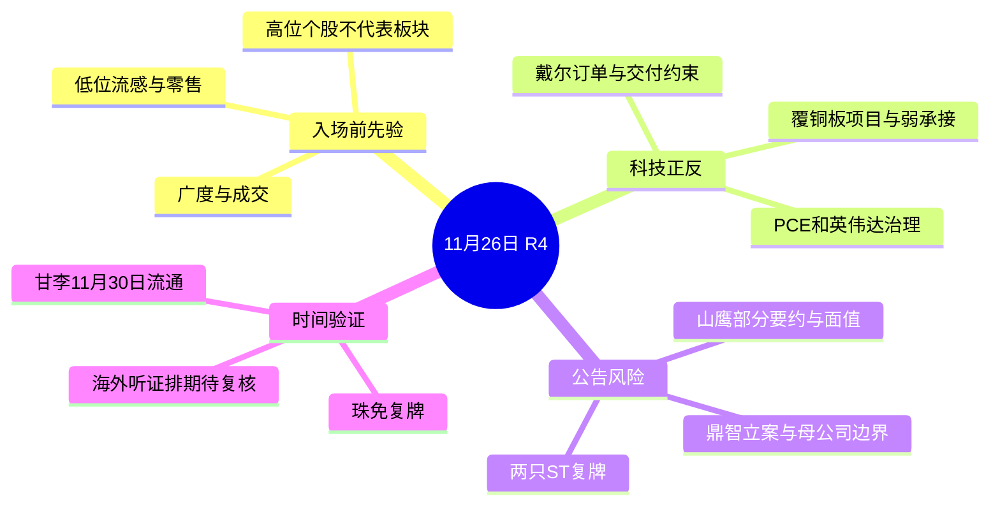

# 2026年11月26日 · R4 消息面

> 盘前研究 · partial · 52 个去重硬事实、56 条传导（42 条负向）、44 个板块/风险分组。无已确认执行对象。

## 一句话结论
流感与零售逆势扩散，但缩量普跌和隔夜科技承压仍占上风；只保留研究观察。

## 市场奖励与开盘验证

11/25沪指−2.03%、创业板−4.19%、科创50−5.12%，586涨、4926跌、61平；51涨停、43跌停、30炸板，炸板率37.04%。沪深成交约1.38万亿元、少2720亿元。结构属主跌，昨日涨停样本当日中位−4.5%、35%翻红。连板矩阵医药12、零售4、农业5，算力4（前一日7）、机器人3（前一日19、再前一日67）。中京电子五板与PCB扩散不是一回事。11/25两只科技反向样本：新易盛+0.72%，中际旭创−1.92%，未呈普遍修复。

夜间10月核心PCE偏高不能解释11/25日盘；美股从期指低位收敛，仍是纳指−0.62%、道指+0.33%，不是全面风险出清；NVDA−4.00%出自收盘快讯、非过期个股快照。尾盘宽基ETF确有成交放大，但无买方或净申赎确认。

**原生阶段**：11/25事实为冰点，连续第6天。`lianban_six_v1`；来源版本未知，today收盘交叉；绑定截至2026-11-26T06:06:10.395799+08:00，11/26盘中估计缺席。显示转移行：修复53%、升温2%、高潮12%、降温·、退潮4%、冰点26%；合计97%，不归一、不补余量。另按连续≥4天的同景样本，分母5，首位冰点60%，已显示高潮20%；其余未核，不把指数次日涨跌频率当情绪频率。

**11/26判断**：首选冰点，备选修复。相对全样本首位偏离、与同景首位一致。最大反证是美股收盘较盘前跌幅收敛、尾盘宽基有承接迹象与低位扩散。早盘若红盘扩散、昨日跌停明显收敛且放量不是仅权重推升，改首选修复。无数值后验，不授买权、不定仓。

## 消息面全景图

## 研究对象：观察，不进执行池

| 对象 | 角色及板型 | 为什么不选对照对象 | 改判条件 |
|---|---|---|---|
| 珠免集团 `600185` | 公司预案直接受影响，仅复牌事件观察，板型未知；11/25停牌，目标日板型未知 | 对照山鹰国际600567：同日复牌但要约只涵盖5%且面值风险未解；也不拿杭州解百的高度替珠免确认。 | 用复牌后成交及免税方向联动检验；同时等待估值、定价和审批。 |
| 南亚新材 `688519` | 直接项目公告对象，前收回落，不是首板信号；前收不在涨停榜，目标日板型待核 | 对照中京电子002579：五板但异动公告无新增实质业务；南亚有明确项目，不因产业证据强于对照而相信短期价格。 | 价格回到前收附近并见PCB广度改善才保留承接假设；中期由用地、环评与开工检验。 |
| 特一药业 `002728` | 低位首板响应样本，不认定为核心；11/25涨停1连，开板0次 | 对照人民同泰600829：同日首板开4次且是医药流通；特一的0次开板使它更适合验证药品端承接，但不等于销量已上升。 | 首30分钟观察药品端扩散及首次分歧能否承接；不同来源样本数不混算。 |

三只均未认定为可交易核心，盈亏比、止损价、完整禁止清单与 `in_today_plan` 均未知；未查不写无负面。珠免承接风险与南亚项目执行风险进入负面交接；无“首推”价位。

## 硬事件与负面传导（逐条审计）

已知公开样本不是原始发布时间。逐条来源窗口和原文定位保存在JSON `evidence_registry`，下列亦按本轮实际检索列出。行业传导和对象特有风险分开；正反分支共用底层事实。

### E20261126_020 · 大烨智能收到事先告知与ST复牌
范围：个股级；电网装备；300670。可交易日锚 20261126；可定位公众时间 时分未核；窗口：至下一份正式公告或状态变更。
- **事实**：告知书涉及2021/2022年报虚假记载；11/25停牌、11/26复牌并ST；涨跌幅20%不变。
- **大资金意图**：未核账户级流向与买卖方。**价格/资金反应**：前日停牌，复牌表现未核。
- **为什么走强**：不预设走强。传导假设：告知书非最终罚决，ST处理为正式公告，逐票交接。
- **逻辑够不够硬**：公告/官源原文；事实成立范围为该事件，证券业绩或盘口不自动确认。
- **已查来源/窗口**：P848 巨潮公告原文 [公告日11/25—26；自然日，非逐分钟；重点PDF]；P849 巨潮公告原文 [公告日11/25—26；自然日，非逐分钟；重点PDF]；N2004 news_cls [2026-11-23 09:01—11-26 05:55:07；公告转载及滚动；选择相关项]；N2005 news_cls [2026-11-23 09:01—11-26 05:55:07；公告转载及滚动；选择相关项]；S Tushare suspend_d [20261126停复牌记录，不是全市场正常交易保证]

### E20261126_021 · 神雾节能收到事先告知与ST复牌
范围：个股级；节能环保；000820。可交易日锚 20261126；可定位公众时间 时分未核；窗口：至下一份正式公告或状态变更。
- **事实**：告知书称子公司项目虚增2024年营收；11/25停牌、11/26复牌并ST，公告日限幅10%不变。
- **大资金意图**：未核账户级流向与买卖方。**价格/资金反应**：前日停牌，复牌表现未核。
- **为什么走强**：不预设走强。传导假设：非最终罚决，不把异常限幅套用别的ST个案。
- **逻辑够不够硬**：公告/官源原文；事实成立范围为该事件，证券业绩或盘口不自动确认。
- **已查来源/窗口**：P1265 巨潮公告原文 [公告日11/25—26；自然日，非逐分钟；重点PDF]；P1266 巨潮公告原文 [公告日11/25—26；自然日，非逐分钟；重点PDF]；N1947 news_cls [2026-11-23 09:01—11-26 05:55:07；公告转载及滚动；选择相关项]；N1951 news_cls [2026-11-23 09:01—11-26 05:55:07；公告转载及滚动；选择相关项]；S Tushare suspend_d [20261126停复牌记录，不是全市场正常交易保证]

### E20261126_019 · 鼎智科技及前任董事长被立案
范围：个股级；机器人；920593、300660。可交易日锚 20261126；可定位公众时间 2026-11-25T21:20:00+08:00；窗口：至下一份正式公告或状态变更。
- **事实**：鼎智科技涉嫌信披违法；前任董事长另涉信披及减持。江苏雷利为控股股东；非其本体立案。11/4苏达个人立案是历史，不重计。
- **大资金意图**：未核账户级流向与买卖方。**价格/资金反应**：公告在盘后公开；日内相关两股−7.19%和−7.09%不能归因于该发布。
- **为什么走强**：不预设走强。传导假设：行业聚合只作个案风险，不将同行推定涉案；公司称经营正常不等于结案。
- **逻辑够不够硬**：公告/官源原文；事实成立范围为该事件，证券业绩或盘口不自动确认。
- **已查来源/窗口**：P12 巨潮公告原文 [公告日11/25—26；自然日，非逐分钟；重点PDF]；P850 巨潮公告原文 [公告日11/25—26；自然日，非逐分钟；重点PDF]；W12 wechat_official_20 [2026-11-25 06:51—11-26 00:40；选读相关正文]

### E20261126_022 · *ST易录受理重整并叠加退市风险警示
范围：个股级；数据要素；300212。可交易日锚 20261126；可定位公众时间 时分未核；窗口：至下一份正式公告或状态变更。
- **事实**：11/25收到受理裁定；11/26叠加，简称、代码及20%限幅不变。
- **大资金意图**：未核账户级流向与买卖方。**价格/资金反应**：按已知日期保留收盘或状态；目标日反馈未核。
- **为什么走强**：不预设走强。传导假设：重整受理非救济完成；面值/市值风险不泛化至同业。
- **逻辑够不够硬**：公告/官源原文；事实成立范围为该事件，证券业绩或盘口不自动确认。
- **已查来源/窗口**：P937 巨潮公告原文 [公告日11/25—26；自然日，非逐分钟；重点PDF]；S Tushare suspend_d [20261126停复牌记录，不是全市场正常交易保证]

### E20261126_023 · *ST华幸受理重整并叠加退市风险警示
范围：个股级；地产；600340。可交易日锚 20261126；可定位公众时间 时分未核；窗口：至下一份正式公告或状态变更。
- **事实**：11/26叠加警示，简称及10%日限幅不变；不等同完成重整。
- **大资金意图**：未核账户级流向与买卖方。**价格/资金反应**：按已知日期保留收盘或状态；目标日反馈未核。
- **为什么走强**：不预设走强。传导假设：重整受理非救济完成；面值/市值风险不泛化至同业。
- **逻辑够不够硬**：公告/官源原文；事实成立范围为该事件，证券业绩或盘口不自动确认。
- **已查来源/窗口**：P1861 巨潮公告原文 [公告日11/25—26；自然日，非逐分钟；重点PDF]；S Tushare suspend_d [20261126停复牌记录，不是全市场正常交易保证]

### E20261126_024 · *ST英飞及子公司受理重整并叠加退市风险警示
范围：个股级；安防；002528。可交易日锚 20261126；可定位公众时间 时分未核；窗口：至下一份正式公告或状态变更。
- **事实**：11/26叠加警示，无需停牌，10%限幅不变；重整失败仍有退市风险。
- **大资金意图**：未核账户级流向与买卖方。**价格/资金反应**：按已知日期保留收盘或状态；目标日反馈未核。
- **为什么走强**：不预设走强。传导假设：重整受理非救济完成；面值/市值风险不泛化至同业。
- **逻辑够不够硬**：公告/官源原文；事实成立范围为该事件，证券业绩或盘口不自动确认。
- **已查来源/窗口**：P2299 巨潮公告原文 [公告日11/25—26；自然日，非逐分钟；重点PDF]；S Tushare suspend_d [20261126停复牌记录，不是全市场正常交易保证]

### E20261126_025 · 金科股份触发首次面值退市风险提示
范围：个股级；地产；000656。可交易日锚 20261126；可定位公众时间 时分未核；窗口：至下一份正式公告或状态变更。
- **事实**：11/25收0.98元；首次风险提示，不是已满足20个交易日条件。
- **大资金意图**：未核账户级流向与买卖方。**价格/资金反应**：按已知日期保留收盘或状态；目标日反馈未核。
- **为什么走强**：不预设走强。传导假设：重整受理非救济完成；面值/市值风险不泛化至同业。
- **逻辑够不够硬**：公告/官源原文；事实成立范围为该事件，证券业绩或盘口不自动确认。
- **已查来源/窗口**：P2451 巨潮公告原文 [公告日11/25—26；自然日，非逐分钟；重点PDF]；D Tushare日线与涨跌停榜 [20261125收盘]

### E20261126_026 · *ST瑞茂连续十个交易日低于面值
范围：个股级；大宗供应链；600180。可交易日锚 20261126；可定位公众时间 时分未核；窗口：至下一份正式公告或状态变更。
- **事实**：11/25收0.61元、连续10日低于1元；仍未进入司法重整；公司自查有未履行审议披露程序的控股股东担保。
- **大资金意图**：未核账户级流向与买卖方。**价格/资金反应**：按已知日期保留收盘或状态；目标日反馈未核。
- **为什么走强**：不预设走强。传导假设：重整受理非救济完成；面值/市值风险不泛化至同业。
- **逻辑够不够硬**：公告/官源原文；事实成立范围为该事件，证券业绩或盘口不自动确认。
- **已查来源/窗口**：P1934 巨潮公告原文 [公告日11/25—26；自然日，非逐分钟；重点PDF]；P1935 巨潮公告原文 [公告日11/25—26；自然日，非逐分钟；重点PDF]；D Tushare日线与涨跌停榜 [20261125收盘]

### E20261126_028 · 闽灿坤B触发收盘市值风险
范围：个股级；家电；200512。可交易日锚 20261126；可定位公众时间 时分未核；窗口：至下一份正式公告或状态变更。
- **事实**：11/25折人民币收盘市值2.95亿元，低于3亿元；证券为B股，仅对象层，不进A股候选。
- **大资金意图**：未核账户级流向与买卖方。**价格/资金反应**：按已知日期保留收盘或状态；目标日反馈未核。
- **为什么走强**：不预设走强。传导假设：重整受理非救济完成；面值/市值风险不泛化至同业。
- **逻辑够不够硬**：公告/官源原文；事实成立范围为该事件，证券业绩或盘口不自动确认。
- **已查来源/窗口**：P2155 巨潮公告原文 [公告日11/25—26；自然日，非逐分钟；重点PDF]

### E20261126_018 · 山鹰国际面值退市风险未解除
范围：个股级；造纸；600567。可交易日锚 20261126；可定位公众时间 时分未核；窗口：至重新站回面值或交易所状态更新。
- **事实**：停牌前连续三日收盘不足1元（0.94/0.85/0.92）；部分要约摘要不是风险解除公告。
- **大资金意图**：未核账户级流向与买卖方。**价格/资金反应**：复牌价格未知；不存在按1.18元全仓确定退出的证据。
- **为什么走强**：不预设走强。传导假设：若复牌后收盘持续低于1元需复核连续计算，不将溢价当托底。
- **逻辑够不够硬**：公告/官源原文；事实成立范围为该事件，证券业绩或盘口不自动确认。
- **已查来源/窗口**：P1820 巨潮公告原文 [公告日11/25—26；自然日，非逐分钟；重点PDF]；P1821 巨潮公告原文 [公告日11/25—26；自然日，非逐分钟；重点PDF]；W44 wechat_official_20 [2026-11-25 06:51—11-26 00:40；选读相关正文]；M82 news_major [2026-11-25 15:33:20—11-26 03:58:19；标题]；S Tushare suspend_d [20261126停复牌记录，不是全市场正常交易保证]

### E20261126_031 · 华东重机严重异动及芯片业务澄清
范围：个股级；半导体；002685。可交易日锚 20261126；可定位公众时间 时分未核；窗口：至下一份正式公告或状态变更。
- **事实**：10日涨幅偏离累计超100%；主营港口装卸，H1芯片业务收入占2.32%、亏203.30万元；定增获注册不抵销上述事实。
- **大资金意图**：未核账户级流向与买卖方。**价格/资金反应**：11/25收8.99元，+0.45%；按公开时间区分反应，盘后稿不能解释盘中。
- **为什么走强**：不预设走强。传导假设：区分高位交易与实际经营，异动不等同处罚或停牌；不进入候选。
- **逻辑够不够硬**：公告/官源原文；事实成立范围为该事件，证券业绩或盘口不自动确认。
- **已查来源/窗口**：P2270 巨潮公告原文 [公告日11/25—26；自然日，非逐分钟；重点PDF]；P2268 巨潮公告原文 [公告日11/25—26；自然日，非逐分钟；重点PDF]；M233 news_major [2026-11-25 15:33:20—11-26 03:58:19；标题]；D Tushare日线与涨跌停榜 [20261125收盘]

### E20261126_032 · 九阳股份第二次风险提示
范围：个股级；家电；002242。可交易日锚 20261126；可定位公众时间 时分未核；窗口：至下一份正式公告或状态变更。
- **事实**：两日偏离24.70%；截至11/24滚动PE 404.9倍（行业18.63）；前三季营收/归母净利分别−9.55%/−41.75%。
- **大资金意图**：未核账户级流向与买卖方。**价格/资金反应**：11/25收38.56元，+10.01%；按公开时间区分反应，盘后稿不能解释盘中。
- **为什么走强**：不预设走强。传导假设：区分高位交易与实际经营，异动不等同处罚或停牌；不进入候选。
- **逻辑够不够硬**：公告/官源原文；事实成立范围为该事件，证券业绩或盘口不自动确认。
- **已查来源/窗口**：P2334 巨潮公告原文 [公告日11/25—26；自然日，非逐分钟；重点PDF]；D Tushare日线与涨跌停榜 [20261125收盘]

### E20261126_034 · 克来机电澄清工业机器人小占比且不涉及人形产品
范围：个股级；机器人、光通信；603960。可交易日锚 20261126；可定位公众时间 时分未核；窗口：至下一份正式公告或状态变更。
- **事实**：公司公告称工业机器人相关产品年度销售金额占比极小且不涉及人形机器人；提示短线下跌风险。光模块是页面归类，非公告验证的收入。
- **大资金意图**：未核账户级流向与买卖方。**价格/资金反应**：11/25收18.60元，+9.99%；按公开时间区分反应，盘后稿不能解释盘中。
- **为什么走强**：不预设走强。传导假设：区分高位交易与实际经营，异动不等同处罚或停牌；不进入候选。
- **逻辑够不够硬**：公告/官源原文；事实成立范围为该事件，证券业绩或盘口不自动确认。
- **已查来源/窗口**：P267 巨潮公告原文 [公告日11/25—26；自然日，非逐分钟；重点PDF]；P1560 巨潮公告原文 [公告日11/25—26；自然日，非逐分钟；重点PDF]；L1 lianban:today [20261125公开正文，不是20261126观测]；D Tushare日线与涨跌停榜 [20261125收盘]

### E20261126_027 · *ST美丽再次披露面值风险
范围：个股级；园林工程；000010。可交易日锚 20261125；可定位公众时间 时分未核；窗口：至下一份正式公告或状态变更。
- **事实**：11/24收0.90元触发面值风险，已有财务类警示；不等于退市结果。
- **大资金意图**：未核账户级流向与买卖方。**价格/资金反应**：按已知日期保留收盘或状态；目标日反馈未核。
- **为什么走强**：不预设走强。传导假设：重整受理非救济完成；面值/市值风险不泛化至同业。
- **逻辑够不够硬**：公告/官源原文；事实成立范围为该事件，证券业绩或盘口不自动确认。
- **已查来源/窗口**：P1380 巨潮公告原文 [公告日11/25—26；自然日，非逐分钟；重点PDF]；D Tushare日线与涨跌停榜 [20261125收盘]

### E20261126_016 · 珠免集团预案收购免税公司剩余49%并复牌
范围：正向研究映射；免税、零售；600185。可交易日锚 20261126；可定位公众时间 2026-11-25T20:07:00+08:00；窗口：11/26复牌至下一版定价预案。
- **事实**：拟发行股份及支付现金买26%+23%股权并配套募集；公司原持51%；构成关联交易、预计重大重组；定价/估值未定；11/26复牌。
- **大资金意图**：未核账户级流向与买卖方。**价格/资金反应**：11/25停牌无价格；零售前一日4家涨停并非预案发布后反应。
- **为什么走强**：不预设走强。传导假设：直接业务映射，不推零售同业；复牌占位不等于赚钱效应，先验估值、审批与成交承接。
- **逻辑够不够硬**：公告/官源原文；事实成立范围为该事件，证券业绩或盘口不自动确认。
- **已查来源/窗口**：P1918 巨潮公告原文 [公告日11/25—26；自然日，非逐分钟；重点PDF]；P1929 巨潮公告原文 [公告日11/25—26；自然日，非逐分钟；重点PDF]；W15 wechat_official_20 [2026-11-25 06:51—11-26 00:40；选读相关正文]；S Tushare suspend_d [20261126停复牌记录，不是全市场正常交易保证]

### E20261126_029 · 甘李药业限售股安排11/30流通
范围：个股级；医药；603087。可交易日锚 20261125；可定位公众时间 时分未核；窗口：11/30起至大宗/减持或供给消化复核。
- **事实**：28508550股、占总股本约4.77%，均由控股股东持有；11/30上市流通。
- **大资金意图**：未核账户级流向与买卖方。**价格/资金反应**：11/25收61.90元跌2.06%，该跌幅不能认作解禁抛售。
- **为什么走强**：不预设走强。传导假设：解禁是供给权利不是减持；与流感题材并非同一产品口径。
- **逻辑够不够硬**：公告/官源原文；事实成立范围为该事件，证券业绩或盘口不自动确认。
- **已查来源/窗口**：P359 巨潮公告原文 [公告日11/25—26；自然日，非逐分钟；重点PDF]；H hithink-event-query [变动日期11/26—12/03；3只精确代码；仅甘李返回具体解禁字段]

### E20261126_050 · 交建股份控股股东与一致行动人新增轮候冻结
范围：个股级；工程建设；603815。可交易日锚 20261126；可定位公众时间 时分未核；窗口：至下一份正式公告或状态变更。
- **事实**：控股股东所持股份累计被司法冻结100%；本次新增轮候冻结不等于已处置或控制权已变更。
- **大资金意图**：未核账户级流向与买卖方。**价格/资金反应**：未核公告后目标日反应。
- **为什么走强**：不预设走强。传导假设：对象级实质风险，不能以板块反弹抵销。
- **逻辑够不够硬**：公告/官源原文；事实成立范围为该事件，证券业绩或盘口不自动确认。
- **已查来源/窗口**：P1581 巨潮公告原文 [公告日11/25—26；自然日，非逐分钟；重点PDF]；D Tushare日线与涨跌停榜 [20261125收盘]

### E20261126_051 · *ST航图预计年底前无法完成重整
范围：个股级；通信设备；688066。可交易日锚 20261126；可定位公众时间 时分未核；窗口：至下一份正式公告或状态变更。
- **事实**：立案暂无结论，公司预计年底前无法完成重整，并有财务/终止上市风险。
- **大资金意图**：未核账户级流向与买卖方。**价格/资金反应**：未核公告后目标日反应。
- **为什么走强**：不预设走强。传导假设：对象级实质风险，不能以板块反弹抵销。
- **逻辑够不够硬**：公告/官源原文；事实成立范围为该事件，证券业绩或盘口不自动确认。
- **已查来源/窗口**：P1519 巨潮公告原文 [公告日11/25—26；自然日，非逐分钟；重点PDF]；D Tushare日线与涨跌停榜 [20261125收盘]

### E20261126_052 · *ST开元预重整并非正式受理重整
范围：个股级；教育；300338。可交易日锚 20261126；可定位公众时间 时分未核；窗口：至下一份正式公告或状态变更。
- **事实**：法院准许预重整；未收到进入正式重整程序法律文书，并提示退市风险。
- **大资金意图**：未核账户级流向与买卖方。**价格/资金反应**：未核公告后目标日反应。
- **为什么走强**：不预设走强。传导假设：对象级实质风险，不能以板块反弹抵销。
- **逻辑够不够硬**：公告/官源原文；事实成立范围为该事件，证券业绩或盘口不自动确认。
- **已查来源/窗口**：P2128 巨潮公告原文 [公告日11/25—26；自然日，非逐分钟；重点PDF]；D Tushare日线与涨跌停榜 [20261125收盘]

### E20261126_053 · 东方海洋收到优先破产债权确认纠纷应诉通知
范围：个股级；水产；002086。可交易日锚 20261126；可定位公众时间 时分未核；窗口：至下一份正式公告或状态变更。
- **事实**：法院受理，尚未开庭；公司称如获确认按重整计划清偿。
- **大资金意图**：未核账户级流向与买卖方。**价格/资金反应**：未核公告后目标日反应。
- **为什么走强**：不预设走强。传导假设：对象级实质风险，不能以板块反弹抵销。
- **逻辑够不够硬**：公告/官源原文；事实成立范围为该事件，证券业绩或盘口不自动确认。
- **已查来源/窗口**：P2371 巨潮公告原文 [公告日11/25—26；自然日，非逐分钟；重点PDF]；D Tushare日线与涨跌停榜 [20261125收盘]

### E20261126_030 · 中京电子五板后披露异常波动
范围：个股级；PCB；002579。可交易日锚 20261126；可定位公众时间 时分未核；窗口：至下一份正式公告或状态变更。
- **事实**：11/24—25两日收盘价涨幅偏离累计超20%；自查无应披露未披露事项。
- **大资金意图**：未核账户级流向与买卖方。**价格/资金反应**：11/25收17.82元，+10.00%；按公开时间区分反应，盘后稿不能解释盘中。
- **为什么走强**：不预设走强。传导假设：区分高位交易与实际经营，异动不等同处罚或停牌；不进入候选。
- **逻辑够不够硬**：公告/官源原文；事实成立范围为该事件，证券业绩或盘口不自动确认。
- **已查来源/窗口**：P2291 巨潮公告原文 [公告日11/25—26；自然日，非逐分钟；重点PDF]；D Tushare日线与涨跌停榜 [20261125收盘]；L1 lianban:today [20261125公开正文，不是20261126观测]

### E20261126_036 · 铁流股份发布交易风险提示
范围：个股级；机器人；603926。可交易日锚 20261126；可定位公众时间 时分未核；窗口：至下一份正式公告或状态变更。
- **事实**：公告提示连续异动与短期上涨后的回落风险，滚动PE 40.25倍。
- **大资金意图**：未核账户级流向与买卖方。**价格/资金反应**：11/25收17.97元，+9.98%；按公开时间区分反应，盘后稿不能解释盘中。
- **为什么走强**：不预设走强。传导假设：区分高位交易与实际经营，异动不等同处罚或停牌；不进入候选。
- **逻辑够不够硬**：公告/官源原文；事实成立范围为该事件，证券业绩或盘口不自动确认。
- **已查来源/窗口**：P1563 巨潮公告原文 [公告日11/25—26；自然日，非逐分钟；重点PDF]；L1 lianban:today [20261125公开正文，不是20261126观测]；D Tushare日线与涨跌停榜 [20261125收盘]

### E20261126_037 · 杭州解百披露交易风险
范围：个股级；零售；600814。可交易日锚 20261126；可定位公众时间 时分未核；窗口：至下一份正式公告或状态变更。
- **事实**：公司提示短期涨幅较大后下跌风险；不能用地方活动替代同店业绩。
- **大资金意图**：未核账户级流向与买卖方。**价格/资金反应**：11/25收8.35元，+10.01%；按公开时间区分反应，盘后稿不能解释盘中。
- **为什么走强**：不预设走强。传导假设：区分高位交易与实际经营，异动不等同处罚或停牌；不进入候选。
- **逻辑够不够硬**：公告/官源原文；事实成立范围为该事件，证券业绩或盘口不自动确认。
- **已查来源/窗口**：P1769 巨潮公告原文 [公告日11/25—26；自然日，非逐分钟；重点PDF]；L1 lianban:today [20261125公开正文，不是20261126观测]；D Tushare日线与涨跌停榜 [20261125收盘]

### E20261126_038 · 金新农生猪业务亏损与涨幅背离
范围：个股级；农业、生猪养殖；002548。可交易日锚 20261126；可定位公众时间 时分未核；窗口：至下一份正式公告或状态变更。
- **事实**：公告提示股价已严重偏离公司基本面，猪价显著下跌导致生猪养殖大幅亏损。
- **大资金意图**：未核账户级流向与买卖方。**价格/资金反应**：11/25收5.01元，+10.11%；按公开时间区分反应，盘后稿不能解释盘中。
- **为什么走强**：不预设走强。传导假设：区分高位交易与实际经营，异动不等同处罚或停牌；不进入候选。
- **逻辑够不够硬**：公告/官源原文；事实成立范围为该事件，证券业绩或盘口不自动确认。
- **已查来源/窗口**：P2293 巨潮公告原文 [公告日11/25—26；自然日，非逐分钟；重点PDF]；L1 lianban:today [20261125公开正文，不是20261126观测]；D Tushare日线与涨跌停榜 [20261125收盘]

### E20261126_039 · ST东尼撤销其他风险警示并复牌
范围：正向研究映射；消费电子；603595。可交易日锚 20261126；可定位公众时间 时分未核；窗口：11/26复牌至市场重新定价。
- **事实**：11/25停牌、11/26复牌及撤销其他风险警示，更名东尼电子；属指定状态变更。
- **大资金意图**：未核账户级流向与买卖方。**价格/资金反应**：25日无成交，26日反馈未发生。
- **为什么走强**：不预设走强。传导假设：摘帽不等同新增订单或其他风险消失，不把其他ST套用。
- **逻辑够不够硬**：公告/官源原文；事实成立范围为该事件，证券业绩或盘口不自动确认。
- **已查来源/窗口**：P304 巨潮公告原文 [公告日11/25—26；自然日，非逐分钟；重点PDF]；S Tushare suspend_d [20261126停复牌记录，不是全市场正常交易保证]

### E20261126_054 · *ST宝馨子公司融资租赁纠纷获法院受理
范围：个股级；光伏；002514。可交易日锚 20261125；可定位公众时间 时分未核；窗口：至下一份正式公告或状态变更。
- **事实**：法院受理，涉及100MW光伏电站设备融资租赁合同；尚无判决，损益影响不确定。
- **大资金意图**：未核账户级流向与买卖方。**价格/资金反应**：未核公告后目标日反应。
- **为什么走强**：不预设走强。传导假设：对象级实质风险，不能以板块反弹抵销。
- **逻辑够不够硬**：公告/官源原文；事实成立范围为该事件，证券业绩或盘口不自动确认。
- **已查来源/窗口**：P1125 巨潮公告原文 [公告日11/25—26；自然日，非逐分钟；重点PDF]；D Tushare日线与涨跌停榜 [20261125收盘]

### E20261126_055 · ST豆神披露其他风险警示事项进展
范围：个股级；AI应用；300010。可交易日锚 20261125；可定位公众时间 时分未核；窗口：至下一份正式公告或状态变更。
- **事实**：披露相关事项进展并提示潜在退市规则条件；不是已决定退市。
- **大资金意图**：未核账户级流向与买卖方。**价格/资金反应**：未核公告后目标日反应。
- **为什么走强**：不预设走强。传导假设：对象级实质风险，不能以板块反弹抵销。
- **逻辑够不够硬**：公告/官源原文；事实成立范围为该事件，证券业绩或盘口不自动确认。
- **已查来源/窗口**：P996 巨潮公告原文 [公告日11/25—26；自然日，非逐分钟；重点PDF]；D Tushare日线与涨跌停榜 [20261125收盘]

### E20261126_033 · 北纬科技严重异动后跌停
范围：个股级；机器人；002148。可交易日锚 20261125；可定位公众时间 时分未核；窗口：至下一份正式公告或状态变更。
- **事实**：截至11/24累计10日偏离100.09%，公告提示明显估值偏离和高换手。
- **大资金意图**：未核账户级流向与买卖方。**价格/资金反应**：11/25收10.27元，-9.99%；按公开时间区分反应，盘后稿不能解释盘中。
- **为什么走强**：不预设走强。传导假设：区分高位交易与实际经营，异动不等同处罚或停牌；不进入候选。
- **逻辑够不够硬**：公告/官源原文；事实成立范围为该事件，证券业绩或盘口不自动确认。
- **已查来源/窗口**：P1193 巨潮公告原文 [公告日11/25—26；自然日，非逐分钟；重点PDF]；D Tushare日线与涨跌停榜 [20261125收盘]

### E20261126_035 · 长华集团披露滚珠丝杠研发风险
范围：个股级；机器人；605018。可交易日锚 20261125；可定位公众时间 时分未核；窗口：至下一份正式公告或状态变更。
- **事实**：相关产品处于研发阶段，尚未获客户定点及实现收入。
- **大资金意图**：未核账户级流向与买卖方。**价格/资金反应**：11/25收13.03元，+4.91%；按公开时间区分反应，盘后稿不能解释盘中。
- **为什么走强**：不预设走强。传导假设：区分高位交易与实际经营，异动不等同处罚或停牌；不进入候选。
- **逻辑够不够硬**：公告/官源原文；事实成立范围为该事件，证券业绩或盘口不自动确认。
- **已查来源/窗口**：P258 巨潮公告原文 [公告日11/25—26；自然日，非逐分钟；重点PDF]；W62 wechat_official_20 [2026-11-25 06:51—11-26 00:40；选读相关正文]；D Tushare日线与涨跌停榜 [20261125收盘]

### E20261126_017 · 山鹰国际披露部分要约摘要并复牌
范围：正向研究映射；造纸；600567。可交易日锚 20261126；可定位公众时间 2026-11-25T17:32:25+08:00；窗口：至复牌及正式要约落地。
- **事实**：1.18元拟要约收购5%即310272906股，最高资金约3.66亿元已存指定账户；11/26开市复牌。
- **大资金意图**：未核账户级流向与买卖方。**价格/资金反应**：停牌前0.92元；25日无成交，尚无复牌反馈。
- **为什么走强**：不预设走强。传导假设：部分要约非保价或全额承接；报告正式流程及面值风险均不可省略。
- **逻辑够不够硬**：公告/官源原文；事实成立范围为该事件，证券业绩或盘口不自动确认。
- **已查来源/窗口**：P1820 巨潮公告原文 [公告日11/25—26；自然日，非逐分钟；重点PDF]；P1821 巨潮公告原文 [公告日11/25—26；自然日，非逐分钟；重点PDF]；W44 wechat_official_20 [2026-11-25 06:51—11-26 00:40；选读相关正文]；N1068 news_cls [2026-11-23 09:01—11-26 05:55:07；公告转载及滚动；选择相关项]；S Tushare suspend_d [20261126停复牌记录，不是全市场正常交易保证]

### E20261126_015 · 南亚新材拟建高端覆铜板产线
范围：正向研究映射；PCB；688519。可交易日锚 20261125；可定位公众时间 时分未核；窗口：至审批、资金和爬坡进展。
- **事实**：子公司计划投资28.8亿元，分期实施，经董事会审议；用地、立项、环评等仍待落实。
- **大资金意图**：未核账户级流向与买卖方。**价格/资金反应**：11/25收137.19元跌5.35%，在日低。
- **为什么走强**：不预设走强。传导假设：供给扩张的公司催化而非行业涨价，也不是已获新增订单。
- **逻辑够不够硬**：公告/官源原文；事实成立范围为该事件，证券业绩或盘口不自动确认。
- **已查来源/窗口**：P134 巨潮公告原文 [公告日11/25—26；自然日，非逐分钟；重点PDF]；W72 wechat_official_20 [2026-11-25 06:51—11-26 00:40；选读相关正文]

### E20261126_043 · ST人福终止研发项目并计提减值
范围：个股级；医药；600079。可交易日锚 20261126；可定位公众时间 时分未核；窗口：至下一份正式公告或状态变更。
- **事实**：同意终止pUDK-HGF研究申报工作，并按会计谨慎性原则对研发资本化金额全额计提；不视作其他业务的收入下修。
- **大资金意图**：未核账户级流向与买卖方。**价格/资金反应**：未核公告发布后分时或目标日反应。
- **为什么走强**：不预设走强。传导假设：只限公告主体，反证与后续正式披露并看。
- **逻辑够不够硬**：公告/官源原文；事实成立范围为该事件，证券业绩或盘口不自动确认。
- **已查来源/窗口**：P1955 巨潮公告原文 [公告日11/25—26；自然日，非逐分钟；重点PDF]；D Tushare日线与涨跌停榜 [20261125收盘]

### E20261126_044 · 通化金马旗下终止并购意向
范围：个股级；医药；000766。可交易日锚 20261126；可定位公众时间 时分未核；窗口：至下一份正式公告或状态变更。
- **事实**：全资子公司终止并购意向，未签署有法律效力的正式交易协议；损失新资产想象，不等于存量业绩恶化。
- **大资金意图**：未核账户级流向与买卖方。**价格/资金反应**：未核公告发布后分时或目标日反应。
- **为什么走强**：不预设走强。传导假设：只限公告主体，反证与后续正式披露并看。
- **逻辑够不够硬**：公告/官源原文；事实成立范围为该事件，证券业绩或盘口不自动确认。
- **已查来源/窗口**：P2437 巨潮公告原文 [公告日11/25—26；自然日，非逐分钟；重点PDF]；D Tushare日线与涨跌停榜 [20261125收盘]

### E20261126_013 · 天齐锂业签署关联收矿协议
范围：正向研究映射；锂矿；002466。可交易日锚 20261125；可定位公众时间 时分未核；窗口：至股东会/交割及许可证取得。
- **事实**：三项资产作价约68.72亿元；纳入承担债务的报道口径约77.93亿；烧炭沟采矿权变更等未完成。
- **大资金意图**：未核账户级流向与买卖方。**价格/资金反应**：11/25收−5.22%，并未显示市场普遍认可正向资源增量。
- **为什么走强**：不预设走强。传导假设：长线资源保障和短期资金负担分开，协议非交割更非产出。
- **逻辑够不够硬**：公告/官源原文；事实成立范围为该事件，证券业绩或盘口不自动确认。
- **已查来源/窗口**：P1140 巨潮公告原文 [公告日11/25—26；自然日，非逐分钟；重点PDF]；W35 wechat_official_20 [2026-11-25 06:51—11-26 00:40；选读相关正文]；W73 wechat_official_20 [2026-11-25 06:51—11-26 00:40；选读相关正文]

### E20261126_042 · 亚信集团财务总监辞任
范围：个股级；软件服务；688225。可交易日锚 20261125；可定位公众时间 时分未核；窗口：至下一份正式公告或状态变更。
- **事实**：处罚事先告知涉及原任职其他企业，不涉及亚信；现任财务总监辞去职务，副董事长/总经理代行。
- **大资金意图**：未核账户级流向与买卖方。**价格/资金反应**：未核公告发布后分时或目标日反应。
- **为什么走强**：不预设走强。传导假设：只限公告主体，反证与后续正式披露并看。
- **逻辑够不够硬**：公告/官源原文；事实成立范围为该事件，证券业绩或盘口不自动确认。
- **已查来源/窗口**：P192 巨潮公告原文 [公告日11/25—26；自然日，非逐分钟；重点PDF]；D Tushare日线与涨跌停榜 [20261125收盘]

### E20261126_045 · 华发股份终止向特定对象发行
范围：个股级；地产；600325。可交易日锚 20261125；可定位公众时间 时分未核；窗口：至下一份正式公告或状态变更。
- **事实**：董事会终止2026年度定增并撤回申请，拟募集上限30亿元系原方案；不能类推为资金链断裂。
- **大资金意图**：未核账户级流向与买卖方。**价格/资金反应**：未核公告发布后分时或目标日反应。
- **为什么走强**：不预设走强。传导假设：只限公告主体，反证与后续正式披露并看。
- **逻辑够不够硬**：公告/官源原文；事实成立范围为该事件，证券业绩或盘口不自动确认。
- **已查来源/窗口**：P549 巨潮公告原文 [公告日11/25—26；自然日，非逐分钟；重点PDF]；D Tushare日线与涨跌停榜 [20261125收盘]

### E20261126_046 · 纽泰格终止设立美国子公司
范围：个股级；汽车零部件；301229。可交易日锚 20261125；可定位公众时间 时分未核；窗口：至下一份正式公告或状态变更。
- **事实**：公司审议终止美国全资子公司投资事项；海外扩张预期后撤，不能推导现有订单取消。
- **大资金意图**：未核账户级流向与买卖方。**价格/资金反应**：未核公告发布后分时或目标日反应。
- **为什么走强**：不预设走强。传导假设：只限公告主体，反证与后续正式披露并看。
- **逻辑够不够硬**：公告/官源原文；事实成立范围为该事件，证券业绩或盘口不自动确认。
- **已查来源/窗口**：P721 巨潮公告原文 [公告日11/25—26；自然日，非逐分钟；重点PDF]；D Tushare日线与涨跌停榜 [20261125收盘]

### E20261126_014 · 天齐关联交易资金负担及矿权前置风险
范围：个股级；锂矿；002466。可交易日锚 20261125；可定位公众时间 时分未核；窗口：至交割及审批/融资更新。
- **事实**：交易涉及关联方、现金对价及承接债务；矿业权变更与开发审批尚待落实。
- **大资金意图**：未核账户级流向与买卖方。**价格/资金反应**：股价走弱同时受锂价及市场因素影响。
- **为什么走强**：不预设走强。传导假设：在压力情景下关注回款、净负债与投产周期，不和收矿正项加为两份底层事实。
- **逻辑够不够硬**：公告/官源原文；事实成立范围为该事件，证券业绩或盘口不自动确认。
- **已查来源/窗口**：P1140 巨潮公告原文 [公告日11/25—26；自然日，非逐分钟；重点PDF]；W35 wechat_official_20 [2026-11-25 06:51—11-26 00:40；选读相关正文]

### E20261126_011 · 神舟二十四号发射并完成对接
范围：正向研究映射；商业航天、航天装备；不强配个股。可交易日锚 20261125；可定位公众时间 2026-11-25T08:41+08:00；窗口：11/26盘面确认窗或新项目披露。
- **事实**：央视与载人航天工程办公室发布：发射成功并对接，乘组会师。
- **大资金意图**：未核账户级流向与买卖方。**价格/资金反应**：未核军工或商业航天后续持续放量；不把上市公司媒体自述当新合同。
- **为什么走强**：不预设走强。传导假设：任务节点已兑现；没有新订单到A股公司时不扩成主线重估。
- **逻辑够不够硬**：公告/官源原文；事实成立范围为该事件，证券业绩或盘口不自动确认。
- **已查来源/窗口**：C Tushare cctv_news [11/25晚间新闻联播]；N1857 news_cls [2026-11-23 09:01—11-26 05:55:07；公告转载及滚动；选择相关项]；X3199 e1_xtick_news_20261125 [11/25 00:00:08—18:02:43；既有存档非直调]；M782 news_major [2026-11-25 15:33:20—11-26 03:58:19；标题]

### E20261126_048 · 珠免集团重组的定价和发行不确定性
范围：个股级；免税、零售；600185。可交易日锚 20261126；可定位公众时间 时分未核；窗口：至下一份正式公告或状态变更。
- **事实**：关联交易定价未定且涉及发行和配套募资；审计评估及审批未完成。
- **大资金意图**：未核账户级流向与买卖方。**价格/资金反应**：目标日公告后定价未核。
- **为什么走强**：不预设走强。传导假设：若溢价过高或方案延期则撤去正向假设。
- **逻辑够不够硬**：公告/官源原文；事实成立范围为该事件，证券业绩或盘口不自动确认。
- **已查来源/窗口**：P1918 巨潮公告原文 [公告日11/25—26；自然日，非逐分钟；重点PDF]；P1929 巨潮公告原文 [公告日11/25—26；自然日，非逐分钟；重点PDF]

### E20261126_040 · 中贝通信披露首次回购
范围：正向研究映射；AI算力；603220。可交易日锚 20261126；可定位公众时间 时分未核；窗口：至后续回购披露。
- **事实**：11/25首次回购142.66万股、约1951.60万元，用于员工持股/股权激励。
- **大资金意图**：未核账户级流向与买卖方。**价格/资金反应**：披露定格于本轮盘前，历史价格不倒推已交易。
- **为什么走强**：不预设走强。传导假设：实际执行好于单一承诺，但非新增订单或自动涨价。
- **逻辑够不够硬**：公告/官源原文；事实成立范围为该事件，证券业绩或盘口不自动确认。
- **已查来源/窗口**：P1674 巨潮公告原文 [公告日11/25—26；自然日，非逐分钟；重点PDF]；D Tushare日线与涨跌停榜 [20261125收盘]

### E20261126_041 · 行云科技披露首次回购
范围：正向研究映射；汽车零部件；300209。可交易日锚 20261126；可定位公众时间 时分未核；窗口：至后续回购披露。
- **事实**：11/24首次回购87.21万股、约1999.83万元；用于维护价值后按期出售。
- **大资金意图**：未核账户级流向与买卖方。**价格/资金反应**：披露定格于本轮盘前，历史价格不倒推已交易。
- **为什么走强**：不预设走强。传导假设：实际执行好于单一承诺，但非新增订单或自动涨价。
- **逻辑够不够硬**：公告/官源原文；事实成立范围为该事件，证券业绩或盘口不自动确认。
- **已查来源/窗口**：P2137 巨潮公告原文 [公告日11/25—26；自然日，非逐分钟；重点PDF]；D Tushare日线与涨跌停榜 [20261125收盘]

### E20261126_049 · 南亚新材资本开支与执行前提
范围：个股级；PCB；688519。可交易日锚 20261125；可定位公众时间 时分未核；窗口：至下一份正式公告或状态变更。
- **事实**：分期资本开支须落实用地、立项、环评和许可；董事会预计不对现金流产生重大不利影响，但最终投资金额未定。
- **大资金意图**：未核账户级流向与买卖方。**价格/资金反应**：目标日公告后定价未核。
- **为什么走强**：不预设走强。传导假设：公司层执行风险，不等于行业需求走弱。
- **逻辑够不够硬**：公告/官源原文；事实成立范围为该事件，证券业绩或盘口不自动确认。
- **已查来源/窗口**：P134 巨潮公告原文 [公告日11/25—26；自然日，非逐分钟；重点PDF]

### E20261126_001 · 美国10月核心PCE超预期
范围：行业级；AI算力、半导体、贵金属、有色金属；不强配个股。可交易日锚 20261126；可定位公众时间 2026-11-25T21:31:35+08:00；窗口：至下一宏观数据/利率重定价。
- **事实**：主流快讯报核心同比3.3%（预期3.2%）及整体3.8%；N424另有2.3%表述，未回读BEA表核其口径。加息仍是预期，不是决议。
- **大资金意图**：未核账户级流向与买卖方。**价格/资金反应**：数据公布前期指已经明显走弱（W14）；公布后美股从低位回升，道指+0.33%、标普−0.25%、纳指−0.62%。
- **为什么走强**：不预设走强。传导假设：实际利率与高估值方向仍有压力；不能把11/25 A股下跌归因于夜间数据，也非普遍抛售。
- **逻辑够不够硬**：官源报道或不同底层证据交叉；原始政策/财报页未直读；事实成立范围为该事件，证券业绩或盘口不自动确认。
- **已查来源/窗口**：N514 news_cls [2026-11-23 09:01—11-26 05:55:07；公告转载及滚动；选择相关项]；N442 news_cls [2026-11-23 09:01—11-26 05:55:07；公告转载及滚动；选择相关项]；N424 news_cls [2026-11-23 09:01—11-26 05:55:07；公告转载及滚动；选择相关项]；W11 wechat_official_20 [2026-11-25 06:51—11-26 00:40；选读相关正文]；N1472 news_cls [2026-11-23 09:01—11-26 05:55:07；公告转载及滚动；选择相关项]；O 海外快照 [美东11/25已收盘；指数新鲜，个股腿旧]

### E20261126_002 · 英伟达复职后调查与治理风险未解除
范围：行业级；AI算力、半导体、存储、光通信、PCB；不强配个股。可交易日锚 20261125；可定位公众时间 2026-11-25T08:41:42+08:00；窗口：至公司/监管更新及听证。
- **事实**：加州总检察长公开表态继续推进调查；标普认为离职与复职未充分回答治理疑问。12/3听证为报道转述的排期；赦免只是有条件表态。
- **大资金意图**：未核账户级流向与买卖方。**价格/资金反应**：英伟达新一交易日收盘−4.00%，费半−0.65%为快讯口径；较此前盘前跌幅有收敛。
- **为什么走强**：不预设走强。传导假设：复职与赦免表态不能抵销存量问询；不从单股跌幅倒推所有海外算力订单走弱。
- **逻辑够不够硬**：官源报道或不同底层证据交叉；原始政策/财报页未直读；事实成立范围为该事件，证券业绩或盘口不自动确认。
- **已查来源/窗口**：X3189 e1_xtick_news_20261125 [11/25 00:00:08—18:02:43；既有存档非直调]；N85 news_cls [2026-11-23 09:01—11-26 05:55:07；公告转载及滚动；选择相关项]；W18 wechat_official_20 [2026-11-25 06:51—11-26 00:40；选读相关正文]；K1 catalyst_calendar:e124d1d3654d846a56b0d71f2282edf2ad1ca47719fd0ce59b56cfff369d0789 [11/25晨报，截至07:40；引用11/24历史]；N22 news_cls [2026-11-23 09:01—11-26 05:55:07；公告转载及滚动；选择相关项]；N1472 news_cls [2026-11-23 09:01—11-26 05:55:07；公告转载及滚动；选择相关项]

### E20261126_012 · 国内碳酸锂主力显著下跌
范围：行业级；锂矿、锂电池；002466、300750。可交易日锚 20261125；可定位公众时间 2026-11-25T10:55:00+08:00；窗口：至主力止跌及现货/库存验证。
- **事实**：25日10:55主力报82640元/吨跌8%；日盘收评主力跌超8%，21:00夜盘连续合约另报−8.08%，不同报价口径不相加。
- **大资金意图**：未核账户级流向与买卖方。**价格/资金反应**：天齐−5.22%、宁德−8.33%；方向一致，不据此推导所有下游盈利同向。
- **为什么走强**：不预设走强。传导假设：锂矿价格和库存风险更直接；采购成本下降对部分加工端可能有对冲。
- **逻辑够不够硬**：官源报道或不同底层证据交叉；原始政策/财报页未直读；事实成立范围为该事件，证券业绩或盘口不自动确认。
- **已查来源/窗口**：N1791 news_cls [2026-11-23 09:01—11-26 05:55:07；公告转载及滚动；选择相关项]；N1703 news_cls [2026-11-23 09:01—11-26 05:55:07；公告转载及滚动；选择相关项]；N607 news_cls [2026-11-23 09:01—11-26 05:55:07；公告转载及滚动；选择相关项]；W25 wechat_official_20 [2026-11-25 06:51—11-26 00:40；选读相关正文]；W3 wechat_official_20 [2026-11-25 06:51—11-26 00:40；选读相关正文]

### E20261126_056 · 日上集团披露越南车轮规避调查初裁
范围：个股级；汽车零部件、出口链；002593。可交易日锚 20261126；可定位公众时间 2026-11-25T17:01:16+08:00；窗口：至下一份正式公告或状态变更。
- **事实**：11/16作出初裁；11/25盘后公司公告转述对越南用中国热轧钢板制造的特定钢制车轮认定规避美国贸易救济；终裁未出。
- **大资金意图**：未核账户级流向与买卖方。**价格/资金反应**：盘后披露，目标日价格未核。
- **为什么走强**：不预设走强。传导假设：具体产品/产地范围不扩成全行业已经加征；终裁与保证金执行须核。
- **逻辑够不够硬**：官源报道或不同底层证据交叉；原始政策/财报页未直读；事实成立范围为该事件，证券业绩或盘口不自动确认。
- **已查来源/窗口**：A2286 Tushare公告索引 [公告日11/25—26；自然日；仅标题]；X468 e1_xtick_news_20261125 [11/25 00:00:08—18:02:43；既有存档非直调]；X558 e1_xtick_news_20261125 [11/25 00:00:08—18:02:43；既有存档非直调]；D Tushare日线与涨跌停榜 [20261125收盘]

### E20261126_004 · 流感进入流行季获疾控局通报
范围：正向研究映射；流感、医药商业；002728、600829。可交易日锚 20261125；可定位公众时间 2026-11-24T15:06:00+08:00；窗口：至疾控周报和渠道销量/板块承接复核。
- **事实**：11/24疾控局例行发布会确认进入流行季；未提供这些上市公司的新增销量或采购。
- **大资金意图**：未核账户级流向与买卖方。**价格/资金反应**：11/25特一药业首板不炸，人民同泰首板开4次；连板医药矩阵12家。
- **为什么走强**：不预设走强。传导假设：是前一日信息的已交易延续。连锁/流通不等同药品制造；分歧看低位扩散是否保留。
- **逻辑够不够硬**：官源报道或不同底层证据交叉；原始政策/财报页未直读；事实成立范围为该事件，证券业绩或盘口不自动确认。
- **已查来源/窗口**：N2206 news_cls [2026-11-23 09:01—11-26 05:55:07；公告转载及滚动；选择相关项]；W3 wechat_official_20 [2026-11-25 06:51—11-26 00:40；选读相关正文]；W20 wechat_official_20 [2026-11-25 06:51—11-26 00:40；选读相关正文]；L1 lianban:today [20261125公开正文，不是20261126观测]

### E20261126_007 · 欧盟混动汽车临时保障措施遭商务部回应
范围：行业级；混动汽车、汽车出口；不强配个股。可交易日锚 20261125；可定位公众时间 时分未核；窗口：至欧方生效文本/企业敞口确认。
- **事实**：商务部答问确认欧方宣布采取临时保障措施；12/1是前版日历所列拟生效日；未直读欧方税则和执行细目。
- **大资金意图**：未核账户级流向与买卖方。**价格/资金反应**：没有经核的公告后混动出口组合超额收益；理想财报并非政策反证。
- **为什么走强**：不预设走强。传导假设：暴露限于适用车型、出口地和规则范围，不泛化至所有汽车。
- **逻辑够不够硬**：官源报道或不同底层证据交叉；原始政策/财报页未直读；事实成立范围为该事件，证券业绩或盘口不自动确认。
- **已查来源/窗口**：X3331 e1_xtick_news_20261125 [11/25 00:00:08—18:02:43；既有存档非直调]；K1 catalyst_calendar:e124d1d3654d846a56b0d71f2282edf2ad1ca47719fd0ce59b56cfff369d0789 [11/25晨报，截至07:40；引用11/24历史]

### E20261126_047 · 英力特重组预案复牌后连续一字跌停
范围：个股级；并购重组、氯碱；000635。可交易日锚 20261125；可定位公众时间 2026-11-25T10:11:00+08:00；窗口：至卖压和后续方案变化。
- **事实**：此前公告拟转让控制权并发行股份收购光伏资产、预计重组上市。11/25续跌停为对已披露预案的第二日反馈。
- **大资金意图**：未核账户级流向与买卖方。**价格/资金反应**：11/25收8.91元、开高低收同价，跌10.00%，连续第二个跌停。
- **为什么走强**：不预设走强。传导假设：同类重组的反向样本，不类推珠免必涨或必跌；不是新一次公告。
- **逻辑够不够硬**：官源报道或不同底层证据交叉；原始政策/财报页未直读；事实成立范围为该事件，证券业绩或盘口不自动确认。
- **已查来源/窗口**：W67 wechat_official_20 [2026-11-25 06:51—11-26 00:40；选读相关正文]；X2012 e1_xtick_news_20261125 [11/25 00:00:08—18:02:43；既有存档非直调]；D Tushare日线与涨跌停榜 [20261125收盘]

### E20261126_003 · 戴尔披露AI服务器积压订单创新高
范围：正向研究映射；AI算力、光通信、存储；不强配个股。可交易日锚 20261125；可定位公众时间 2026-11-25T05:52:57+08:00；窗口：至订单转收入与公司指引更新。
- **事实**：公开财报及电话会获转述：AI服务器积压1323亿美元；全年AI服务器销售指引由740亿上调至780亿美元；消费PC收入同比下降15%。
- **大资金意图**：未核账户级流向与买卖方。**价格/资金反应**：后续戴尔盘前一度跌7.2%；A股当日算力涨停家数由7降至4。
- **为什么走强**：不预设走强。传导假设：是需求反证，不是A股具体供货、确认收入或盈利能力实证。同步保留PC采购延后和交付短缺。
- **逻辑够不够硬**：官源报道或不同底层证据交叉；原始政策/财报页未直读；事实成立范围为该事件，证券业绩或盘口不自动确认。
- **已查来源/窗口**：X3642 e1_xtick_news_20261125 [11/25 00:00:08—18:02:43；既有存档非直调]；X3672 e1_xtick_news_20261125 [11/25 00:00:08—18:02:43；既有存档非直调]；W61 wechat_official_20 [2026-11-25 06:51—11-26 00:40；选读相关正文]；N1316 news_cls [2026-11-23 09:01—11-26 05:55:07；公告转载及滚动；选择相关项]；X34 e1_xtick_news_20261125 [11/25 00:00:08—18:02:43；既有存档非直调]

### E20261126_010 · 小鹏科技日给出IRON量产计划
范围：正向研究映射；机器人；不强配个股。可交易日锚 20261126；可定位公众时间 2026-11-25T16:13:50+08:00；窗口：至实际量产、定点或推迟。
- **事实**：科技日公布目标2027年1月进入硬件量产，2月对外发布；不是已经量产或A股供应商定点。
- **大资金意图**：未核账户级流向与买卖方。**价格/资金反应**：16:13快讯晚于收盘；同日机器人涨停67→19→3（三日）。
- **为什么走强**：不预设走强。传导假设：需求计划成立但不抵销监管个案，不由演示指定供应链名单。
- **逻辑够不够硬**：官源报道或不同底层证据交叉；原始政策/财报页未直读；事实成立范围为该事件，证券业绩或盘口不自动确认。
- **已查来源/窗口**：X904 e1_xtick_news_20261125 [11/25 00:00:08—18:02:43；既有存档非直调]；N1304 news_cls [2026-11-23 09:01—11-26 05:55:07；公告转载及滚动；选择相关项]；M364 news_major [2026-11-25 15:33:20—11-26 03:58:19；标题]

### E20261126_008 · 外交部回应美国拟加征关税报道
范围：行业级；出口链；不强配个股。可交易日锚 20261126；可定位公众时间 2026-11-25T15:25:27+08:00；窗口：至美方正式行动文件/撤回。
- **事实**：外交部记者会答复反对以所谓产能过剩为由进行政治操弄；不是美方征税文件，税目、税率及生效时间未核。
- **大资金意图**：未核账户级流向与买卖方。**价格/资金反应**：记者会在11/25盘后；未核目标日出口组合反馈。
- **为什么走强**：不预设走强。传导假设：仅为政策不确定性，不能把报道写成已征税。
- **逻辑够不够硬**：官源报道或不同底层证据交叉；原始政策/财报页未直读；事实成立范围为该事件，证券业绩或盘口不自动确认。
- **已查来源/窗口**：X1298 e1_xtick_news_20261125 [11/25 00:00:08—18:02:43；既有存档非直调]；W21 wechat_official_20 [2026-11-25 06:51—11-26 00:40；选读相关正文]；W53 wechat_official_20 [2026-11-25 06:51—11-26 00:40；选读相关正文]；K1 catalyst_calendar:e124d1d3654d846a56b0d71f2282edf2ad1ca47719fd0ce59b56cfff369d0789 [11/25晨报，截至07:40；引用11/24历史]

### E20261126_006 · 国有大行披露回购增持贷款合同与承诺
范围：正向研究映射；市场流动性、银行；不强配个股。可交易日锚 20261126；可定位公众时间 2026-11-25T22:55:00+08:00；窗口：至投放与实际回购公示核对。
- **事实**：建行超千亿合同、工行近1800亿合同、中行超1800亿承诺；统计含不同口径，不是当晚新增投放。
- **大资金意图**：未核账户级流向与买卖方。**价格/资金反应**：夜间报道晚于A股收盘，不能认领尾盘ETF成交。
- **为什么走强**：不预设走强。传导假设：分清承诺、合同、放款、回购四步；后续以实际发生额和用途为验。
- **逻辑够不够硬**：官源报道或不同底层证据交叉；原始政策/财报页未直读；事实成立范围为该事件，证券业绩或盘口不自动确认。
- **已查来源/窗口**：W10 wechat_official_20 [2026-11-25 06:51—11-26 00:40；选读相关正文]；W72 wechat_official_20 [2026-11-25 06:51—11-26 00:40；选读相关正文]

### E20261126_005 · MLF与逆回购操作对冲到期
范围：正向研究映射；市场流动性、银行；不强配个股。可交易日锚 20261125；可定位公众时间 时分未核；窗口：跨月窗口/下一操作与到期核对。
- **事实**：央行11/24公告11/25计划开展8000亿元一年期MLF及5000亿元七天逆回购；不是净投放额。
- **大资金意图**：未核账户级流向与买卖方。**价格/资金反应**：11/25沪指−2.03%、成交较上一日缩2720亿元（沪深）；未见普涨确认。
- **为什么走强**：不预设走强。传导假设：流动性呵护不等于对股市增量资金；不与回购贷款重复计。
- **逻辑够不够硬**：官源报道或不同底层证据交叉；原始政策/财报页未直读；事实成立范围为该事件，证券业绩或盘口不自动确认。
- **已查来源/窗口**：W72 wechat_official_20 [2026-11-25 06:51—11-26 00:40；选读相关正文]；X3331 e1_xtick_news_20261125 [11/25 00:00:08—18:02:43；既有存档非直调]

### E20261126_009 · 中美农业工作组完成首次会议
范围：正向研究映射；农业；不强配个股。可交易日锚 20261125；可定位公众时间 2026-11-25T13:00:42+08:00；窗口：至官方准入/订单更新。
- **事实**：11/23—24在京会议讨论监管、准入和贸易；未公布新进口量级及配额。
- **大资金意图**：未核账户级流向与买卖方。**价格/资金反应**：11/25连板口径农业5家涨停（前一日2家）；不证实会议致涨。
- **为什么走强**：不预设走强。传导假设：沟通改善预期但无订单，不能冲销猪价与个股业绩风险。
- **逻辑够不够硬**：官源报道或不同底层证据交叉；原始政策/财报页未直读；事实成立范围为该事件，证券业绩或盘口不自动确认。
- **已查来源/窗口**：X2069 e1_xtick_news_20261125 [11/25 00:00:08—18:02:43；既有存档非直调]；W26 wechat_official_20 [2026-11-25 06:51—11-26 00:40；选读相关正文]

## 板块极性叉乘

按已核传导分支 × 板块方向 × 绝对衰减分计算（λ=0.15）；未映射留空而非0。同一公告的正负项不能重复算信源。净分是消息方向描述，不是资金或交易排序。

| 板块 | 正向分支 | 负向分支 | 净值 | 行业传导 | 对象切片 |
|---|---|---|---:|---:|---:|
| AI应用 | 未纳入 | 055 | -0.422 | 未映射 | -0.422 |
| AI算力 | 040、003 | 001、002 | -0.838 | -1.108 | +0.270 |
| PCB | 015 | 030、049、002 | -0.979 | -0.654 | -0.325 |
| 光伏 | 未纳入 | 054 | -0.422 | 未映射 | -0.422 |
| 光通信 | 003 | 034、002 | -0.918 | -0.258 | -0.660 |
| 免税 | 016 | 048 | +0.320 | 未映射 | +0.320 |
| 农业 | 009 | 038 | -0.273 | +0.207 | -0.480 |
| 出口链 | 未纳入 | 056、008 | -0.860 | -0.330 | -0.530 |
| 医药 | 未纳入 | 029、043、044 | -1.219 | 未映射 | -1.219 |
| 医药商业 | 004 | 未纳入 | +0.499 | 未映射 | +0.499 |
| 半导体 | 未纳入 | 031、001、002 | -2.164 | -1.504 | -0.660 |
| 商业航天 | 011 | 未纳入 | +0.284 | +0.284 | 未映射 |
| 园林工程 | 未纳入 | 027 | -0.654 | 未映射 | -0.654 |
| 地产 | 未纳入 | 023、025、045 | -1.830 | 未映射 | -1.830 |
| 大宗供应链 | 未纳入 | 026 | -0.760 | 未映射 | -0.760 |
| 存储 | 003 | 002 | -0.258 | -0.258 | 未映射 |
| 安防 | 未纳入 | 024 | -0.760 | 未映射 | -0.760 |
| 家电 | 未纳入 | 028、032 | -1.420 | 未映射 | -1.420 |
| 工程建设 | 未纳入 | 050 | -0.490 | 未映射 | -0.490 |
| 市场流动性 | 006、005 | 未纳入 | +0.552 | +0.552 | 未映射 |
| 并购重组 | 未纳入 | 047 | -0.448 | 未映射 | -0.448 |
| 教育 | 未纳入 | 052 | -0.490 | 未映射 | -0.490 |
| 数据要素 | 未纳入 | 022 | -0.760 | 未映射 | -0.760 |
| 有色金属 | 未纳入 | 001 | -0.850 | -0.850 | 未映射 |
| 机器人 | 010 | 019、034、036、033、035 | -2.416 | +0.380 | -2.796 |
| 氯碱 | 未纳入 | 047 | -0.448 | 未映射 | -0.448 |
| 水产 | 未纳入 | 053 | -0.490 | 未映射 | -0.490 |
| 汽车出口 | 未纳入 | 007 | -0.465 | -0.465 | 未映射 |
| 汽车零部件 | 041 | 046、056 | -0.570 | 未映射 | -0.570 |
| 流感 | 004 | 未纳入 | +0.499 | 未映射 | +0.499 |
| 消费电子 | 039 | 未纳入 | +0.430 | 未映射 | +0.430 |
| 混动汽车 | 未纳入 | 007 | -0.465 | -0.465 | 未映射 |
| 生猪养殖 | 未纳入 | 038 | -0.480 | 未映射 | -0.480 |
| 电网装备 | 未纳入 | 020 | -0.870 | 未映射 | -0.870 |
| 航天装备 | 011 | 未纳入 | +0.284 | +0.284 | 未映射 |
| 节能环保 | 未纳入 | 021 | -0.870 | 未映射 | -0.870 |
| 贵金属 | 未纳入 | 001 | -0.850 | -0.850 | 未映射 |
| 软件服务 | 未纳入 | 042 | -0.310 | 未映射 | -0.310 |
| 通信设备 | 未纳入 | 051 | -0.490 | 未映射 | -0.490 |
| 造纸 | 017 | 018 | -0.340 | 未映射 | -0.340 |
| 银行 | 006、005 | 未纳入 | +0.552 | +0.552 | 未映射 |
| 锂电池 | 未纳入 | 012 | -0.534 | -0.534 | 未映射 |
| 锂矿 | 013 | 014、012 | -0.516 | -0.534 | +0.017 |
| 零售 | 016 | 037、048 | -0.160 | 未映射 | -0.160 |

流感是已交易延续，与零售的低位扩散相比有更明确的官方事件；零售仍要区分板块轮动与珠免自身复牌。算力的订单正项不能抹掉实际风险；PCB项目与个股异动并存。机器人量产计划不能抵消立案，个案不能推成全行业涉案。锂矿交易与价格压力分列，造纸要约不抹去面值退市风险。

## 真实负面与未证实线索分别交接

上表全部负向分支进入JSON `negative_handoff`，对象级风险不升级为全市场停买。下列公告的事实已核到，影响未完整评估，因此不并入行业分：
- `603557` *ST起步：关于公司部分银行账户资金被冻结的公告（P307；公告日11/25—26；自然日，非逐分钟；重点PDF）。
- `688202` 美迪西：关于股东部分股份被司法冻结的公告（P202；公告日11/25—26；自然日，非逐分钟；重点PDF）。
- `688118` 普元信息技术股份有限公司关于控股股东、实际控制人部分股份被冻结的公告（P208；公告日11/25—26；自然日，非逐分钟；重点PDF）。
- `688022` 关于持股5%以上股东所持公司股份被司法冻结的公告（P227；公告日11/25—26；自然日，非逐分钟；重点PDF）。
- `603363` 福建傲农生物科技集团股份有限公司关于持股5%以上股东及其一致行动人部分股份解除冻结、解除轮候冻结及新增司法冻结的公告（P320；公告日11/25—26；自然日，非逐分钟；重点PDF）。
- `000785` 关于控股股东部分股份被轮候冻结的公告（P1314；公告日11/25—26；自然日，非逐分钟；重点PDF）。
- `002789` 关于重大诉讼进展情况及新增累计诉讼、仲裁情况的公告（P2221；公告日11/25—26；自然日，非逐分钟；重点PDF）。
- `600381` 青海春天关于对上海证券交易所《关于对青海春天药用资源科技股份有限公司2026年三季报的信息披露监管问询函》的部分内容回复的公告（P1851；公告日11/25—26；自然日，非逐分钟；重点PDF）。

不计入硬事件的线索与反证：
- 源杰产业园一期启动（W66、X2931、D）：11/24项目启动，上证报现场报道预计2027年底设备搬入，2028年投产；17.44亿元采购订单系11月13日晚旧披露。 11/25盘中一度转正，收571元跌4.72%，接近日低568元。 项目确有里程碑但资金日内正反馈未守住；新产能不能当当期利润。
- 匿名台北纪要及存储减产（W80、W81、W61）：匿名网传无法验证；券商评级是观点，戴尔称企业级存储供需紧张；库存和资本开支方向不采为事实。
- GPU租金下调与退租传闻（W83、M10）：均追溯SemiAnalysis同稿；未见当事方公告；不推全体AI需求坍塌。
- 赛诺菲并购与评级压力（W7、N787）：报道与评级指向收购；未直核交易原文、标的及A股映射，不用私有段落猜公司；负面评级进待核。
- 麦角硫因准入（W5、L1）：来源是关联方自述；未回读卫健委原公告及工艺/上市公司敞口，不把丽人丽妆或福瑞达股价当资格。
- 12/1及12/3监管排期与两用物项续期（K1、W18、X3331）：参院12/3报道转述（报道为当地10时；未直核官方时区，不填确定北京时间），众院12/1具体问询及11/28延续条款未独立直核；旧日历仅线索。
- 智能眼镜规模、场景AI及零售活动（W1、W84）：产业预测、展会与活动不等于订单；观察方向，不独立加权。
- 缅甸跨境污染争议（X1262）：仅已核外交部回应，停产未核，企业敞口未知，不列为实际供给收紧。

## 🔥 中报业绩预告命中（本轮实为东财Q3历史切片）

样本公告日 2026-08-26—2026-11-04，限量500条。前15条归母预告按同比下限排序仅作交叉查，旧累计数不当今日增量；观察三只的目标日预告均为未知，不写“无”；单季/扣非/预期差未核，不用数字推方向。

| 代码 | 名称 | 公告日 | 旧预告同比区间 | 与本轮关联 |
|---|---|---|---|---|
| 001309 | 德明利 | 2026-10-17 | 32046.52% ~ 33154.49% | 仅产业背景 |
| 300821 | 东岳硅材 | 2026-10-08 | 19047.97% ~ 19748.08% | 仅产业背景 |
| 000703 | 恒逸石化 | 2026-10-16 | 3318.59% ~ 3405.13% | 仅产业背景 |
| 002466 | 天齐锂业 | 2026-10-21 | 2734.97% ~ 3235.26% | 逐票命中 |
| 688825 | 长鑫科技 | 2026-10-17 | 2581.06% ~ 2609.47% | 逐票命中 |
| 002812 | 恩捷股份 | 2026-10-14 | 1884% ~ 2474.8% | 仅产业背景 |
| 688808 | 联讯仪器 | 2026-10-13 | 1866% ~ 2072.95% | 仅产业背景 |
| 301308 | 江波龙 | 2026-10-15 | 1864.55% ~ 1990.84% | 仅产业背景 |
| 605189 | 富春染织 | 2026-10-14 | 1347.69% ~ 1519.01% | 未纳入 |
| 603991 | 领先股份 | 2026-10-21 | 1238.57% ~ 1238.57% | 未纳入 |
| 688388 | 嘉元科技 | 2026-10-15 | 1196.6% ~ 1318.92% | 仅产业背景 |
| 603026 | 石大胜华 | 2026-10-15 | 968.14% ~ 1032.45% | 仅产业背景 |
| 000626 | 远大控股 | 2026-10-15 | 890% ~ 1018% | 未纳入 |
| 002493 | 荣盛石化 | 2026-10-15 | 777.93% ~ 822.95% | 仅产业背景 |
| 301536 | 星宸科技 | 2026-10-13 | 663.13% ~ 697.75% | 未纳入 |

## 数据源审计

匿名五群缓存枚举：124个候选文件、98个资产族、其中81个仅缩略图；按图像hash去重为67张，其中55张低清。67张均 `vision_batch_timeout`，没有非空或部分正文。本轮未猜补、未归因发送人。缓存mtime最早11/25 06:50:45、最晚23:18:19，选择窗为11/25 06:02:02至11/26 06:02:02；原帖发布时间和消息时间均未知。枚举完成不代表覆盖全部群消息。独立新闻证据增量为0，不据此否定传播。

| 源 | 日期/范围 | 状态 | 实际读取与缺口 |
|---|---|---|---|
| news_cls | 11/25—11/26核验；精确各源窗见JSON | 🟢 ok | 文件名非源身份：sina 1466 / 10jqka 1421；部分为财联社等转载，不按平台重复加权。 |
| news_major | 11/25—11/26核验；精确各源窗见JSON | 🟡 partial | 800条均无正文，标题只用于定位和旁证。 |
| wechat_official_20 | 11/25—11/26核验；精确各源窗见JSON | 🟢 ok | 19订阅、14有条目；兼容RSS镜像只计一次；非所有公众号，也无11/26 07:00以后内容。 |
| wechat_cli_5groups | 11/25—11/26核验；精确各源窗见JSON | 🟢 ok | 匿名五群，文字传播线索；并非5个独立原始信源。 |
| wechat_image_ocr | 11/25—11/26核验；精确各源窗见JSON | 🔴 timeout | 67/67超时，0条可用正文；不能否定传播事实。 |
| eastmoney_earnings_predict | 11/25—11/26核验；精确各源窗见JSON | 🟡 stale | 历史截断样本，不是11/26新业绩，不以累计同比定极性。 |
| anns_window | 11/25—11/26核验；精确各源窗见JSON | 🟢 ok | 54份重点原文有文本；其余标题扫描，不是2491份正文已通读。 |
| previous_evening_event_tracker | 11/25—11/26核验；精确各源窗见JSON | 🟡 partial | 标准events_20261125.json / anns_classified.json本轮未见；旧晚间MD未作为已查证据，本轮以盘前同源公告交叉。 |
| xtick_hot_news | 11/25—11/26核验；精确各源窗见JSON | 🟡 partial | 历史档覆盖到11/25 18:02；未直接调用MCP，不冒充11/26实时覆盖。 |
| tushare_cctv_news | 11/25—11/26核验；精确各源窗见JSON | 🟢 ok | 载人航天为直接证据；其他不泛化。 |
| tushare_trade_cal_suspend | 11/25—11/26核验；精确各源窗见JSON | 🟢 ok | 11/26开市，5条复牌记录，个股交易还看执行端。 |
| lianban_reference | 11/25—11/26核验；精确各源窗见JSON | 🟡 partial | 页面公开正文，非完整会员档。today收盘；mainline矩阵；qingxu版本未知。 |
| previous_close | 11/25—11/26核验；精确各源窗见JSON | 🟢 ok | 落盘mtime仅证明文件观测时点；日线、涨停跌停炸板分别核。 |
| overseas_snapshot | 11/25—11/26核验；精确各源窗见JSON | 🟡 partial | 三个主指数新鲜；个股腿stale，改用收盘快讯；商品跳过，不补汇率。 |
| news-search | 11/25—11/26核验；精确各源窗见JSON | 🟡 partial | 返回5篇计数；CLI未呈现可引用原文，不视为已读5篇。 |
| announcement-search | 11/25—11/26核验；精确各源窗见JSON | 🔴 error | CLI返回too many values to unpack；重点走Tushare题录回查巨潮原文。 |
| hithink-event-query | 11/25—11/26核验；精确各源窗见JSON | 🟡 partial | 返回三个对象；只有甘李含具体解禁字段。 |
| hithink-business-query | 11/25—11/26核验；精确各源窗见JSON | 🟡 partial | 三只问句仅见珠免10行，报告期不明；不认作其他两只已核主营。 |
| hithink-market-query | 11/25—11/26核验；精确各源窗见JSON | 🟡 partial | 组合查询0行，拆流感复查13只；不同于连板医药12只，不能加总。 |
| weflow | 11/25—11/26核验；精确各源窗见JSON | 🔴 error | 404，仅辅助。 |
| wechat_official_sanji | 11/25—11/26核验；精确各源窗见JSON | 🟡 disabled | 现行RSS替代；不继承旧健康为市场风险。 |
| R1_R2_R3_R7 | 11/25—11/26核验；精确各源窗见JSON | 🟡 unknown | 同轮文件未见；不从旧计划推知资金及候选资质。 |
| policy_IR_report_search | 11/25—11/26核验；精确各源窗见JSON | 🟡 unknown | PCE BEA、欧盟税目、听证官网未直读；公司PDF直查与核明的官方转述保留。 |

## 送达与专题裁决

专题 `context_sha256=8aa67b672910c081247ac6765da270e593ecd0833305adc5f6e1f336d27d5dc6`。11/25晨报只采用其可定位前缀，11/24光链与广度用于历史对照，12月排期仅作线索；不把旧隔夜报价或同源转载当11/26双重支持。连板三个公开源逐源裁决，均保持partial，不等于独立三源。

本轮不设市场性停买，不把旧研究零仓继承为执行政策。真实用户/账户停买、有效硬预算（含0）、仓位硬上限、T+1、人工确认及既有逐票硬否决不变。目标日盘中尚无数据；判据仅有效至开盘第一观察窗，由D1独立重评。

生成：2026-11-26T06:22:22+08:00；本轮盘前取证，非回放。专题截止 2026-11-26T06:10:55.710793+08:00，新闻快照 2026-11-26T06:06:09+08:00，补证各见实测时点。08:30是观察性交付目标；usage未计量，不当0。JSON：`data/research/20261126/R4_news.json`。

