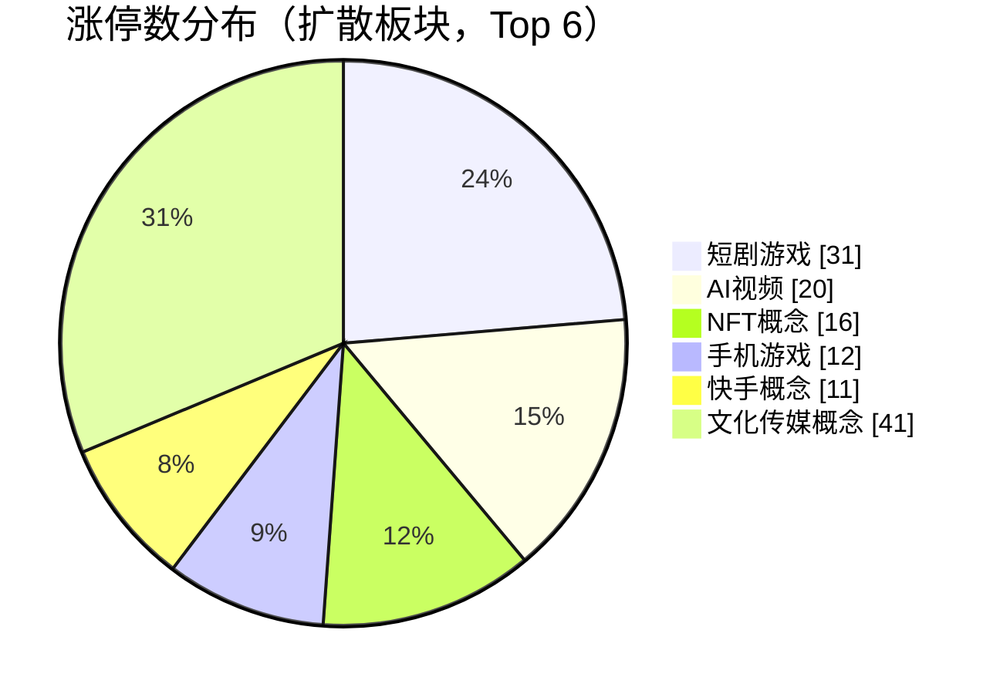
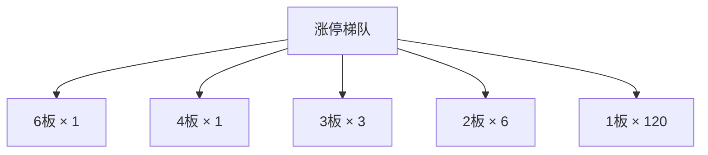

## 当日总览（截至 15:00）

> **结论**：全市场涨4681/跌818（广度0.85）；涨停131/跌停10；中位涨幅+2.01%；局部修复。 钱在：短剧游戏(涨停31/成分99，中位+8.12%)、AI视频(涨停20/成分67，中位+8.69%)、NFT概念(涨停16/成分70，中位+6.93%)；零星涨停：低辐射玻璃(Low-E)(2)。 退潮：光伏概念(跌停3)、电子商务(跌停3)、ST板块(跌停2)。 梯队：6板×1、4板×1、3板×3、2板×6、1板×120，最高6板。 预案：无有效对照。 较上一轮广度基本持平。

> 🔒 **no_trade / 买入预算 0 / max_position_pct 0 —— 全部内容仅供研究，不授予交易权限。**

### 板块扩散

> 口径：XTick 概念成分 × 全市场实时报价；分母 = 板块内有有效报价的成分数。排序用涨停密度（涨停数/有效成分数），已剔除宽基属性板块（全市场 432 个板块中剔 16 个）。

**扩散中（题材，按涨停密度排序）**

| 板块 | 涨停 | 有效成分 | 涨停密度 | 上涨广度 | 中位涨幅 | 相对全市场 | 成交(亿) |
|---|---|---|---|---|---|---|---|
| 短剧游戏 | 31 | 99 | 0.313 | 0.95 | +8.12% | +6.11% | 572 |
| AI视频 | 20 | 67 | 0.298 | 1.00 | +8.69% | +6.68% | 482 |
| NFT概念 | 16 | 70 | 0.229 | 0.96 | +6.93% | +4.92% | 339 |
| 手机游戏 | 12 | 56 | 0.214 | 0.91 | +8.06% | +6.05% | 330 |
| 快手概念 | 11 | 52 | 0.211 | 0.90 | +7.20% | +5.19% | 320 |
| 文化传媒概念 | 41 | 197 | 0.208 | 0.95 | +6.22% | +4.21% | 797 |
| 知识产权保护 | 9 | 51 | 0.176 | 0.94 | +7.08% | +5.07% | 205 |
| 中韩自贸区 | 3 | 17 | 0.176 | 0.88 | +1.86% | -0.15% | 56 |
| 网络游戏 | 10 | 58 | 0.172 | 0.90 | +7.07% | +5.06% | 378 |
| 低辐射玻璃(Low-E) ⬦ | 2 | 12 | 0.167 | 0.92 | +1.74% | -0.27% | 17 |
| IP经济(谷子经济) | 32 | 198 | 0.162 | 0.93 | +4.42% | +2.41% | 698 |
| 云游戏 | 4 | 27 | 0.148 | 1.00 | +7.44% | +5.43% | 173 |

> ⬦ = 涨停 <3 只，零星个例，不构成扩散（不计入「钱在」判定）。



零星涨停板块（<3 只）：低辐射玻璃(Low-E)(2)

**退潮中（跌停集中）**

| 板块 | 跌停 | 有效成分 | 上涨广度 | 中位涨幅 |
|---|---|---|---|---|
| 光伏概念 | 3 | 602 | 0.84 | +2.19% |
| 电子商务 | 3 | 676 | 0.90 | +2.52% |
| ST板块 | 2 | 197 | 0.64 | +0.81% |
| 小金属概念 | 2 | 172 | 0.75 | +1.27% |
| 人形机器人 | 2 | 482 | 0.77 | +1.85% |
| 风电 | 2 | 444 | 0.79 | +1.60% |
| 绿色电力 | 2 | 436 | 0.81 | +1.65% |
| 光伏建筑一体化 | 2 | 135 | 0.81 | +1.68% |
| 人民币贬值受益 | 2 | 612 | 0.82 | +2.04% |
| TOPCON电池 | 2 | 82 | 0.83 | +2.39% |
| 充电桩 | 2 | 390 | 0.86 | +2.27% |
| 金属镍 | 1 | 39 | 0.64 | +0.84% |

### 涨停梯队

> 最高 6 板 ｜ 涨停 131 ｜ 跌停 10 ｜ 炸板 31 ｜ 封板率 80.9% ｜ 打板成功率 22.45% ｜ 一进二 15.00% ｜ 二进三 50.00%

| 身位 | 家数 | 成员（涨幅/封单亿/首封） |
|---|---|---|
| 6板 | 1 | 青岛食品 +9.98%/0.007亿/09:54 |
| 4板 | 1 | 澳洋健康 +9.98%/0.007亿/09:30 |
| 3板 | 3 | 阳光照明 +10.02%/0.056亿/09:25；东方海洋 +9.89%/0.026亿/09:25；桂林三金 +10.01%/0.019亿/09:25 |
| 2板 | 6 | 皇台酒业 +10.01%/0.016亿/09:30；红太阳 +10.02%/0.013亿/09:25；合百集团 +10.00%/0.007亿/09:50；泉阳泉 +9.95%/0.002亿/09:38；地素时尚 +10.00%/0.001亿/09:51 |
| 1板 | 120 | 高争民爆 +10.00%/0.089亿/09:25；劲旅环境 +10.01%/0.042亿/09:25；太平洋 +9.94%/0.014亿/09:50；芒果超媒 +20.00%/0.013亿/11:25；华是科技 +19.99%/0.013亿/11:22 |



炸板 31 只（前几）：快意电梯(8次)、电广传媒(6次)、*ST威领(5次)、榕基软件(5次)、新泉股份(4次)

### 预案池对照

| 票 | 池 | 板块 | 现价 | 涨幅 | 触发价 | 买区 | 风险位 | 判定 |
|---|---|---|---|---|---|---|---|---|
| 水井坊 `600779.SH` | 观察池 | 白酒概念 | 28.12 | +10.02% | — | — | 25.13 | **无预案价** |
| 国金证券 `600109.SH` | 观察池 | 证券 | 8.45 | +10.03% | — | — | 7.97 | **无预案价** |
| 皇台酒业 `000995.SZ` | 观察池 | 白酒概念 | 15.6 | +10.01% | — | — | 13.67 | **无预案价** |
| 益方生物 `688382.SH` | 观察池 | 创新药 | 13.17 | +6.30% | — | — | 11.57 | **无预案价** |
| 东方海洋 `002086.SZ` | 观察池 | CRO概念 | 3.11 | +9.89% | — | — | 2.73 | **无预案价** |
| 上海沪工 `603131.SH` | 观察池 | 机器人概念 | 17.3 | -1.42% | — | — | 16.92 | **无预案价** |
| 高争民爆 `002827.SZ` | 观察池 | 民爆概念 | 56.98 | +10.00% | — | — | 49.95 | **无预案价** |


> ⚠ D1 明确 no_trade=true、买入预算 0、个股 max_position_pct=0。以上为研究对照，**不构成任何买入许可**。

### 盘面 vs 静态复盘 vs 消息面

| 维度 | 对象 | T-1 静态基线 | 今日盘面 | 关系 |
|---|---|---|---|---|
| 板块主线 | 创新药 | R2 次线 score=68.0 涨停None（T-1 口径） | 今日盘中该板块 2 只涨停 / 成分275 广度0.83 中位1.46%（相对全市场-0.55%） | **无响应** |
| 板块主线 | 机器人概念 | R2 次线 score=54.0 涨停None（T-1 口径） | 盘面未见该板块成分票涨停 | **背离** |
| 板块主线 | 证券 | R2 次线 score=52.0 涨停None（T-1 口径） | 盘面未见该板块成分票涨停 | **背离** |
| 板块主线 | CRO概念 | R2 次线 score=50.0 涨停None（T-1 口径） | 今日盘中该板块 1 只涨停 / 成分77 广度0.70 中位1.23%（相对全市场-0.78%） | **无响应** |
| 梯队结构 | 最高6板 | T-1 最高梯队 4 板、首板 29、炸板率 39.06% | 今日 6板×1、4板×1、3板×3、2板×6、1板×120；封板率0.8086 炸板31只 | **印证** |
| 预案验证 | 水井坊(600779.SH) | 预案 白酒概念／watch／触发价None／买区None | 无预案价：预案未给触发价/买区（情景作废或待重导） | **无响应** |
| 预案验证 | 国金证券(600109.SH) | 预案 证券／watch／触发价None／买区None | 无预案价：预案未给触发价/买区（情景作废或待重导） | **无响应** |
| 预案验证 | 皇台酒业(000995.SZ) | 预案 白酒概念／watch／触发价None／买区None | 无预案价：预案未给触发价/买区（情景作废或待重导） | **无响应** |
| 预案验证 | 益方生物(688382.SH) | 预案 创新药／watch／触发价None／买区None | 无预案价：预案未给触发价/买区（情景作废或待重导） | **无响应** |
| 预案验证 | 东方海洋(002086.SZ) | 预案 CRO概念／watch／触发价None／买区None | 无预案价：预案未给触发价/买区（情景作废或待重导） | **无响应** |
| 预案验证 | 上海沪工(603131.SH) | 预案 机器人概念／watch／触发价None／买区None | 无预案价：预案未给触发价/买区（情景作废或待重导） | **无响应** |
| 预案验证 | 高争民爆(002827.SZ) | 预案 民爆概念／watch／触发价None／买区None | 无预案价：预案未给触发价/买区（情景作废或待重导） | **无响应** |
| 消息面对照 | 盘面热点板块 | R4 消息面（T-1 口径） | 实时快讯未出现热点板块关键词 | **无响应** |

**分歧点（不掩盖）：**
- 板块主线·机器人概念 → 背离：T-1 有辨识度但今日盘中无涨停响应，题材未获资金确认
- 板块主线·证券 → 背离：T-1 有辨识度但今日盘中无涨停响应，题材未获资金确认

### 全天广度轨迹

| 时点 | 涨 | 跌 | 广度 | 涨停 | 跌停 | 成交(亿) | 有效样本 |
|---|---|---|---|---|---|---|---|
| 0930 | 3384 | 1893 | 0.608 | 19 | 9 | 688 | 5570 |
| 0940 | 1741 | 3680 | 0.312 | 26 | 22 | 3,208 | 5571 |
| 0950 | 2882 | 2510 | 0.517 | 34 | 12 | 4,638 | 5571 |
| 1000 | 2520 | 2838 | 0.452 | 37 | 15 | 5,732 | 5571 |
| 1010 | 3542 | 1868 | 0.636 | 49 | 15 | 6,798 | 5571 |
| 1020 | 3541 | 1850 | 0.636 | 51 | 17 | 7,634 | 5571 |
| 1030 | 3082 | 2320 | 0.553 | 51 | 19 | 8,242 | 5571 |
| 1040 | 3195 | 2214 | 0.574 | 52 | 16 | 8,773 | 5571 |
| 1050 | 3181 | 2204 | 0.571 | 54 | 14 | 9,245 | 5571 |
| 1100 | 3044 | 2363 | 0.546 | 56 | 14 | 9,589 | 5571 |
| 1110 | 3920 | 1523 | 0.704 | 63 | 14 | 10,033 | 5571 |
| 1120 | 4506 | 978 | 0.809 | 77 | 8 | 10,747 | 5571 |
| 1130 | 4783 | 714 | 0.859 | 93 | 6 | 11,474 | 5571 |
| 1140 | 4783 | 714 | 0.859 | 93 | 6 | 11,474 | 5571 |
| 1150 | 4783 | 714 | 0.859 | 93 | 6 | 11,474 | 5571 |
| 1200 | 4783 | 714 | 0.859 | 93 | 6 | 11,474 | 5571 |
| 1210 | 4783 | 714 | 0.859 | 93 | 6 | 11,474 | 5571 |
| 1220 | 4783 | 714 | 0.859 | 93 | 6 | 11,474 | 5571 |
| 1231 | 4783 | 714 | 0.859 | 93 | 6 | 11,474 | 5571 |
| 1240 | 4783 | 714 | 0.859 | 93 | 6 | 11,474 | 5571 |
| 1250 | 4783 | 714 | 0.859 | 93 | 6 | 11,474 | 5571 |
| 1300 | 4775 | 732 | 0.857 | 95 | 5 | 11,682 | 5571 |
| 1310 | 3918 | 1512 | 0.703 | 90 | 6 | 12,335 | 5571 |
| 1320 | 3841 | 1596 | 0.690 | 87 | 7 | 12,774 | 5571 |
| 1330 | 3846 | 1587 | 0.690 | 86 | 9 | 13,141 | 5571 |
| 1340 | 4419 | 1052 | 0.793 | 99 | 7 | 13,652 | 5571 |
| 1350 | 4775 | 727 | 0.857 | 121 | 7 | 14,367 | 5571 |
| 1400 | 4804 | 703 | 0.862 | 125 | 7 | 14,965 | 5571 |
| 1410 | 4554 | 935 | 0.817 | 120 | 9 | 15,468 | 5571 |
| 1420 | 4707 | 778 | 0.845 | 127 | 7 | 15,877 | 5571 |
| 1430 | 4698 | 806 | 0.843 | 128 | 8 | 16,248 | 5571 |
| 1440 | 4610 | 890 | 0.828 | 129 | 8 | 16,697 | 5571 |
| 1450 | 4633 | 862 | 0.832 | 130 | 11 | 17,259 | 5571 |
| 1500 | 2536 | 335 | 0.874 | 64 | 4 | 9,361 | 2902 |

> ⚠ **数据冻结段**：1130–1250 数值连续完全一致，说明行情源未刷新，**不是市场横盘**，该段不可解读为盘面变化。

> ⚠ **分母变化**：1500（5571→2902） 有效样本变动超 15%，该时点广度与前后不可直接比较（数据降级）。

```mermaid
xychart-beta
    title "全市场广度轨迹（09:30 → 15:00）"
    x-axis "09:30 09:40 09:50 10:00 10:10 10:20 10:30 10:40 10:50 11:00 11:10 11:20 11:30 11:40 11:50 12:00 12:10 12:20 12:31 12:40 12:50 13:00 13:10 13:20 13:30 13:40 13:50 14:00 14:10 14:20 14:30 14:40 14:50 15:00"
    y-axis "广度(上涨占比)" 0 --> 1
    line 0.608 0.312 0.517 0.452 0.636 0.636 0.553 0.574 0.571 0.546 0.704 0.809 0.859 0.859 0.859 0.859 0.859 0.859 0.859 0.859 0.859 0.857 0.703 0.69 0.69 0.793 0.857 0.862 0.817 0.845 0.843 0.828 0.832 0.874
```

```mermaid
gantt
    title 全天截面时点分布（每个截面一个条目）
    09:30 截面 :done
    09:40 截面 :done
    09:50 截面 :done
    10:00 截面 :done
    10:10 截面 :done
    10:20 截面 :done
    10:30 截面 :done
    10:40 截面 :done
    10:50 截面 :done
    11:00 截面 :done
    11:10 截面 :done
    11:20 截面 :done
    11:30 截面 :done
    11:40 截面 :done
    11:50 截面 :done
    12:00 截面 :done
    12:10 截面 :done
    12:20 截面 :done
    12:31 截面 :done
    12:40 截面 :done
    12:50 截面 :done
    13:00 截面 :done
    13:10 截面 :done
    13:20 截面 :done
    13:30 截面 :done
    13:40 截面 :done
    13:50 截面 :done
    14:00 截面 :done
    14:10 截面 :done
    14:20 截面 :done
    14:30 截面 :done
    14:40 截面 :done
    14:50 截面 :done
    15:00 截面 :done
```

### 观察建议（仅研究）

- **环境**：涨停 131.0 / 跌停 10.0，打板成功率 22.4%，一进二 15.0%。
- **方向**：今日形成实质扩散的是 短剧游戏（涨停31/成分99，密度0.313，中位+8.12%）、AI视频（涨停20/成分67，密度0.298，中位+8.69%）、NFT概念（涨停16/成分70，密度0.229，中位+6.93%）。**需确认**：次日能否维持涨停家数且中位涨幅不掉队，否则只是普跌中的避险轮动。
- **零星**：低辐射玻璃(Low-E)(2只/12成分) 属零星个例，不视为题材，不据此选股。
- **回避**：光伏概念（跌停3）、电子商务（跌停3）、ST板块（跌停2） 板块中位跌幅深，趋势未止跌前不接。
- **身位**：最高 6 板。梯队有高度不等于可接力，需逐票核验封单稳定性与开板次数后再定。

<details>
<summary>原始截面与数据质量（折叠）</summary>

**跨源校验**

```json
{
  "xtick": {
    "up": 4681,
    "down": 818,
    "n": 5577,
    "amount_yi": 17832.5
  },
  "rtk_snapshot": {
    "up": 2536,
    "down": 335,
    "valid_n": 2902,
    "amount_yi": 9360.9,
    "up_limit": 64,
    "down_limit": 4
  },
  "note": "两源口径不同（XTick 全市场含全部票；rt_k 返回样本）"
}
```

**rt_k 截面（原始）**

```json
{
  "market": {
    "total": 5581,
    "up": 2536,
    "down": 335,
    "flat": 31,
    "requested_n": 5581,
    "received_n": 5581,
    "valid_n": 2902,
    "missing_n": 2679,
    "universe_requested_n": null,
    "population_scope": "returned_rows_not_verified_all_a_universe",
    "up_ratio": 0.4544,
    "legacy_up_ratio_placeholder": false,
    "up_ratio_is_observed": true,
    "up_ratio_all": 0.4544,
    "up_ratio_valid": 0.8739,
    "up_ratio_denominator": "requested_n",
    "degraded": true,
    "limit_known_n": 2902,
    "limit_unknown_n": 0,
    "limit_counts_complete": true,
    "limit_source_errors": [],
    "up_gt3": 987,
    "up_gt5": 443,
    "up_limit": 64,
    "down_gt3": 63,
    "down_gt5": 24,
    "down_limit": 4,
    "amount_yi": 9360.9,
    "amount_sum_overflow": false,
    "amount_valid_n": 2902,
    "amount_missing_n": 0
  },
  "source_time_quality": {
    "quote_age_min_seconds": 40.351867,
    "quote_age_max_seconds": 40.351867,
    "source_age_limit_seconds": null,
    "freshness_status": "age_limit_not_configured",
    "age_reference_at": "2026-11-02T15:00:40.351867+08:00"
  },
  "trading_authorized": false
}
```

</details>

## 分时研判记录

### 09:35 研判增量
- **趋势**：开盘呈现“多数上涨、强势点分散”，尚不能确认主线扩散或修复拐点。本轮依据2026-11-02 09:30分析件（09:30:57生成；rt_k报价09:30:21—09:30:48），不是09:35实时行情；当天仅这一份分析，故广度、涨停数、梯队高度与板块排名均只能建立基线，不能称“较上一轮走弱”。特别是顶部广度混有口径差异：XTick为2805/5223＝53.70%，rt_k为3384/5570＝60.75%；顶部0.57另用上涨/涨跌合计，不能跨源或跨分母相减。自动摘要的“较上一轮广度走弱”不采纳。上海沪工的4板仅延续静态复盘所列高度，不等于高度已拓展；开盘封板及晋级指标不能外推全天接力胜率。
- **轮动**：工业母机虽有3/110只涨停，但仅46/110上涨、中位涨幅-0.24%、相对市场-0.40个百分点，更像少数强股集中，不能直接认定整条线在扩散。反而国资云38/54上涨但仅2只涨停，白酒35/47上涨但仅1只涨停，属于有广度、尚缺封板助攻的观察方向。传媒与游戏多个口径同时偏弱，强弱分布支持“局部分化”假设；但没有第二时点及净流向证据，尚不能认定资金由传媒流入这些方向的跷跷板。绿色电力虽有3只跌停，仍有276/433上涨且中位+0.36%，是尾部风险与多数上涨并存，不支持顶部把整板概括为深跌退潮。
- **剧本**：指定的当日watchlist_plan.json及当日运行副本均未找到，分析件plan_check为空，无法核验逐票触发价、买区和reason；这属于预案交付缺口，不是“全部条件失效”，也不能补造价位或改用旧日预案。静态复盘只提供梯队结构印证，消息关键词未匹配也不等于没有催化，尚未形成主线、消息与盘面的三方一致。继续研究，但严格保留本任务明确的no_trade=true、买入预算0、max_position_pct=0；不追高，不授予任何买入许可。
- **下一步看**：下一份同源且有效样本覆盖可比的截面中，检验工业母机能否保持至少3只涨停、上涨占比高于本轮46/110并让中位涨幅转正；若板数维持但广度不改善，仍按强股集中而非扩散。国资云须看涨停是否从2只达到至少3只，同时上涨占比不低于本轮38/54，才升级扩散观察。上海沪工以本轮4板、封单0.03亿元为对照锚，需后续盘口与开板路径确认，不能由一次封板认定稳封；传媒则看上涨占比是否高于本轮24/130、跌停是否少于本轮2只，未改善前不称轮动回流。预案未补齐前，逐票触发判定继续标缺失，所有条件只用于研究。

### 09:45 研判增量
- **趋势**：09:30—09:40从开盘多数上涨转为强股集中、多数走弱，不能把涨停增加解释为全市场修复。有效报价口径上涨占比由3384/5570（60.75%）变为1741/5571（31.25%）；分母增加1，只分别报告比率，不报严格同样本百分点差，也不宣称已验证无遗漏全A覆盖。梯队源涨停18→26、跌停10→19、炸板4→7，封板率81.82%→78.79%；首板12→19，但最高仍4板，增加的是低位封板而非高度突破。本轮依据2026-11-02 09:40分析件（09:40:53生成；配套rt_k采集09:40:41—09:40:50、报价09:40:18—09:40:48），不是09:45实时报价；两轮数据已变化，非冻结。两源跌停数不同，以下梯队判断只用同一梯队源，不混用rt_k的22只。
- **轮动**：白酒在所列涨停密度榜由第10升至第2，涨停1→3/47，但上涨35→30/47、中位涨幅+1.16%→+1.03%；这是头部封板增加、相对抗跌增强，不是整个板块加速普涨。另一个顶部题材表没有呈现的增量是金融：非银金融上涨64→70/77、中位+1.62%→+2.10%，银行上涨20→32/42，属于行业广度转强，不冒充多只涨停的题材扩散。反面是人形机器人上涨176→88/462、跌停2→6，国资云涨停2→1、上涨38→27/54。支持“金融及白酒相对走强、成长方向承压”的跷跷板假设，但没有净流向证据，不能断言资金实际从一方搬到另一方。传媒行业则上涨24→54/130、中位-1.16%→-0.49%，较开盘局部回流；跌停仍2只，不能把开盘弱方向一概判死，也不能称已全面修复。
- **剧本**：上一轮提出的工业母机扩散条件未兑现：涨停仍3/110，上涨却46→21/110，中位-0.24%→-1.45%，更支持孤立强股而非板块带动；国资云的封板助攻也在减少。上海沪工仍4板，但封单0.030→0.026亿元，不能由高度未断推断承接增强；新增二板成员泉阳泉已有2次开板、截面封单0.001亿元，也不宜把二板家数增加当稳固接力。白酒新增两条消息匹配均在报道同一盘面表现，不是两个独立催化，尚不足以补齐主线、静态复盘与消息源的三方一致。原预案及运行副本仍缺失，plan_check仍空，不能判任何逐票触发价、买区或reason已满足或失效；不补造价位、不追高，继续保留本任务明确的no_trade=true、买入预算0、max_position_pct=0。
- **下一步看**：白酒若保有至少3只涨停，且上涨占比从30/47回到开盘35/47，才支持由头部集中向板块扩散；若涨停少于3只或上涨占比继续低于本轮30/47，则下调持续性判断。金融须先观察非银70/77、银行32/42的上涨占比能否维持，再看市场有效报价上涨占比是否高于本轮1741/5571、梯队源跌停是否不再高于19只；金融强而多数个股继续弱，只能称结构性强弱分化，不能称普遍修复。传媒下一轮须在上涨占比不低于54/130的同时，让跌停少于本轮2只，才进一步确认回流而非尾部风险未消；上述均为后续可证伪的研究观察条件，不是新增买入门槛或交易许可。

### 09:55 研判增量
- **趋势**：09:40—09:50由“少数强股集中”转为上涨面扩大的修复，但高位接力并未同步稳固。同源rt_k有效报价分母均为5571，上涨1741→2882只，上涨占比31.25%→51.73%，提高20.48个百分点；XTick按返回样本5223只计算也由31.84%回到50.07%，方向一致，不混用顶部的涨跌合计分母。梯队源涨停26→34、跌停19→12，新增封板主要体现在首板19→27；最高仍4板，却由上海沪工换为澳洋健康，前者进入炸板名单且已有3次开板，不能把“高度未断”读成原领涨股承接稳定。本轮引用2026-11-02 09:50分析件（09:50:53生成；配套rt_k采集09:50:40—09:50:50、报价09:50:12—09:50:48），不是09:55实时报价；尚未核上市名录，不宣称无遗漏全A覆盖。
- **轮动**：资金表现更像“金融维持强势、零售与传媒加入修复”，不是金融撤出后的单向跷跷板：非银上涨70→73/77，银行32→36/42，传媒则54→105/130、跌停2→0，中位涨幅-0.49%→+1.88%，上一轮传媒回流观察条件得到截面印证。社区团购上涨10→40/51、涨停2→3，是广度与封板同时扩展；玻璃基板虽涨停2→3/63，上涨仅34→35/63，中位+0.30%→+0.25%，更偏头部加强，扩散质量弱于社区团购。白酒密度榜第2→第10、涨停3→2/47，但上涨30→40/47、中位+1.03%→+1.97%，只是封板持续性下降，不能由排名下滑断言整板失血。电子商务也已上涨445/675、中位+0.62%，顶部因4只跌停将其列“退潮”只反映尾部风险；人形机器人虽反弹，仍仅125/462上涨、相对市场中位涨幅为-1.30个百分点，属于跟不上修复。无净流向证据，不断言资金实际搬家。
- **剧本**：上一轮“金融强、市场也要跟上”的条件已部分兑现，传媒回流也获印证；工业母机则涨停3→2/110、中位仍-0.78%，扩散假设继续不成立。二板总数未变，但泉阳泉转入炸板名单、开板2→3次，合百集团进入二板名单，不能只看家数判断梯队稳固。分析件内09:49零售拉升、09:50证券及金融科技ETF上涨快讯与盘面同向，自动关键词“无响应”不等于完全没有相关报道；这些是行情报道，不是独立事件催化，且T-1仅有梯队基线，尚不足以确认三方一致的新主线。当日正式预案及运行副本仍未找到，plan_check为空，trigger_price、buy_zone、reason缺失，逐票价位剧本无法核验，不能写成已触发或已失效。保留任务明确的no_trade=true、买入预算0、max_position_pct=0；不追高，不授予买入许可。
- **下一步看**：后续同口径截面先看上涨占比能否维持不低于本轮2882/5571、梯队源涨停不低于34且跌停不高于12；若涨停继续增而上涨占比回落，则重新按强股集中解释。社区团购须同时保持至少3只涨停与不低于40/51的上涨占比，传媒须保持不低于105/130上涨且不重新出现跌停，才能继续支持本轮扩散；玻璃基板若仍仅35/63上涨、中位不高于本轮+0.25%，即使板数增加也不升级为广泛扩散。白酒观察涨停能否恢复至上轮3只，同时不丢本轮40/47的上涨覆盖。澳洋健康虽由上轮炸板名单回到4板封板名单，仍须补盘口路径才能确认稳定；上海沪工需看是否离开炸板名单、开板次数是否继续增加。上述只作可证伪的研究条件；预案未补齐前不补造任何具体买卖价。

### 10:05 研判增量
- **趋势**：上一轮警惕的“涨停增加、上涨面回落”已经出现，09:50的普遍修复正转为强势集中，而非修复继续加速。09:50—10:00，rt_k有效报价分母均为5571，上涨2882→2520只，占比51.73%→45.23%，回落6.50个百分点；XTick同为5223只返回样本，上涨占比50.07%→45.28%，方向一致。梯队源涨停34→37，但炸板8→15、封板率80.95%→71.15%、跌停12→13，封板质量反而下降。本轮依据2026-11-02 10:00分析件；配套截面采集10:00:41—10:00:50、报价10:00:03—10:00:48，不是10:05实时行情，两轮数据非冻结；返回样本未核上市名录，不宣称无遗漏全A覆盖。
- **轮动**：消费内部出现强弱再分配。白酒涨停密度榜第10→第5，涨停2→3/47、上涨40→41/47、中位+1.97%→+2.36%，上一轮的封板恢复条件得到印证；农村电商第6→第3、涨停2→3/37，但上涨28→27/37、中位+1.40%→+1.17%，只是头部加强，不能与白酒等同。社区团购涨停3→2/51，虽退出至少3只涨停的扩散观察，上涨仍40/51、中位+1.00%→+1.52%，并非整板失血。玻璃基板涨停仍3/63，上涨却35→31/63、中位+0.25%→-0.14%，更不支持广泛扩散；人形机器人上涨125→95/462、跌停4→5，修复继续落后。非银仍71/77上涨，不能说金融已撤出；更像消费增强、部分成长转弱的结构分化，无净流向证据，不确认真实资金搬家的跷跷板。
- **剧本**：高度刷新不等于接力转稳：最高4→6来自青岛食品09:54新进入封板榜，并非原最高标在十分钟内晋两级；分析件T-1最高4板与当轮6板的历史链条尚待核验，不能仅凭自动“印证”升级为主升判断。泉阳泉从炸板名单回到二板封板名单，但开板次数3→4；上海沪工仍在炸板名单、累计3次开板，风险并未随高度上移消失。白酒的两条关键词匹配仍是09:31的同一行情报道，不是本轮新增独立催化，三方一致尚未建立。指定当日正式预案及运行副本仍缺失，plan_check为空，trigger_price、buy_zone、reason无法核验，不判逐票已触发或已失效、不补造价位。本任务明确的no_trade=true、买入预算0、max_position_pct=0保持不变，全部仅研究、不追高。
- **下一步看**：先检验本轮回落能否被扭转：同源有效样本覆盖可比时，上涨占比重回09:50的2882/5571，且梯队源涨停不低于本轮37、炸板少于本轮15，才支持修复重新扩开。消费内部，白酒须保持至少3只涨停且上涨占比不低于41/47；社区团购须恢复至少3只涨停并保有40/51的上涨覆盖，否则仍只作广度较好的观察方向。玻璃基板须恢复至至少35/63上涨、中位涨幅不低于09:50的+0.25%，否则不因仍有3只涨停升级判断。青岛食品下一轮看是否仍列6板封板、是否新增开板，并以本轮封单0.020亿元为对照；泉阳泉看累计4次开板是否继续增加，截面回榜不替代持续稳封证据。以上是对已有观测锚的研究检验，不是买入门槛或交易许可。

### 10:15 研判增量
- **趋势**：10:00—10:10重新由强势集中转为上涨面扩大的修复，上一轮“广度回升、炸板减少”的观察条件兑现，但还不是全天反转定论。同源rt_k有效报价分母均为5571，上涨2520→3542只，占比45.23%→63.58%，提高18.35个百分点；XTick按固定5223只返回样本也由45.28%升至62.67%，非数据冻结。梯队源涨停37→49、炸板15→11、封板率71.15%→81.67%，改善主要来自首板28→39、二板4→5，最高仍6板；跌停13→14，说明尾部风险没有同步消除。本轮依据2026-11-02 10:10分析件，配套行情采集10:10:43—10:10:52、报价10:10:06—10:10:51，不是10:15实时报价；返回样本未核上市名录。
- **轮动**：新增信息不只是白酒走强，而是金融内部出现“银行回落、非银及金融科技扩散”的分化：银行上涨31→21/42、中位+0.56%→+0.13%，非银却71→73/77、中位+2.57%→+3.63%；互联网金融涨停2→4/205、上涨140→168/205，数字货币涨停0→3/90、上涨69→83/90，后两者未进顶部密度短榜却已有封板与广度共振。支持从防御向风险偏好方向切换的轮动假设，但无净流向证据，不能确认真实资金搬家；概念成分尚未核去重，不能相加计算独立助攻。白酒密度榜第5→第4、社区团购恢复3/51涨停，均未显示整板撤退；玻璃基板虽第8→第10，上涨31→44/63、中位-0.14%→+1.00%，反而兑现上一轮扩散观察，排名下降不等于失血。电子商务涨停11→18/675、上涨433→514/675，4只跌停反映尾部风险，不能照自动标签把整板判作退潮；人形机器人仍仅163/462上涨，修复继续落后。
- **剧本**：市场修复剧本获印证，高位稳封剧本仍缺连续路径。银之杰首封10:09且累计开板0次，恒生电子首封10:06但累计开板2次，金融相关首板出现新助攻，不等于全部稳封；新进入二板封板展示的地素时尚累计开板已7次、封单仅0.002亿元，二板家数增加不能掩盖个股承接反复。青岛食品仍6板、开板0次，但澳洋健康封单0.021→0.012亿元，高位并非一起增强。消息匹配仍是旧白酒行情报道，T-1只给梯队基线，不能把自动“印证”当新主线的三方确认。当日正式预案与运行副本仍缺失、plan_check为空，trigger_price、buy_zone、reason无法核验；这是交付缺口，不是逐票失效。保留本任务明确的no_trade=true、买入预算0、max_position_pct=0：全部仅研究、不追高，不授予买入许可。
- **下一步看**：下一份同源、覆盖可比的截面，先看上涨占比能否不低于本轮3542/5571、涨停不少于49、炸板不多于11；若只增板而广度回落，仍退回强势集中解释。新增金融扩散须检验互联网金融至少保有4只涨停及168/205上涨、数字货币至少3只涨停及83/90上涨；若银行仍不高于21/42上涨而上述方向保持，则继续支持金融内部轮动假设。玻璃基板须保有3只涨停及44/63上涨，否则撤回本轮扩散升级；传媒虽上涨91→105/130，却重新出现2只跌停，须看尾部风险能否减少，不能只看多数上涨。个股看银之杰是否新增开板、恒生电子累计2次及地素时尚累计7次开板是否继续增加，截面封单不替代稳定性验证。以上仅用已有观测锚检验持续性；预案未补齐前不补造买卖价位。

### 10:28 研判增量
- **趋势**：修复的上涨面暂未丢失，但封板质量先转弱，不能把新增涨停继续解读成修复加速。以下均比较2026-11-02 10:10—10:20：rt_k有效样本均为5571，上涨3542→3541只，占比63.58%→63.56%，基本持平；梯队源涨停49→51、首板39→41，最高仍6板，炸板却11→15、封板率81.67%→77.27%、跌停14→17。上一轮“炸板不多于11”的观察条件已未守住。成交额及板块数据均在更新，不是数据冻结。本轮依据10:20分析件，配套行情采集10:20:41—10:20:50、报价10:20:06—10:20:48，不是标题时点的实时报价；返回样本未核上市名录。
- **轮动**：新扩散更多落在玻璃基板与光伏，而非消费、金融一起增强：玻璃基板仍3/63涨停，上涨44→50/63、中位+1.00%→+1.35%；光伏涨停4→5/574、上涨357→389/574、中位+0.54%→+0.78%，但仍有3只跌停，是扩散与尾部风险并存。白酒虽保持4/47涨停，上涨43→41/47、中位+2.86%→+2.27%；银行上涨21→13/42、非银73→70/77，后者中位+3.63%→+3.05%，不能沿用“银行弱、非银继续加速”的上一轮假设。中韩自贸区密度榜第2→第1、涨停2→3/16，但上涨15→14/16、中位+1.41%→+1.39%，排名上升来自头部加强，不是整板加速。支持强势方向内部再分配的假设，无净流向及成分去重证据，不确认资金搬家的跷跷板。
- **剧本**：上一轮的金融封板稳定性观察出现新警讯：银之杰开板次数仍0，但封单0.093→0.048亿元；恒生电子开板仍2次，封单0.081→0.061亿元；澳洋健康则累计开板1→2次。封板名单还在，不代表承接一起增强，也不能仅由封单减少断言出货。本轮新增静态对照将“证券”标作无涨停响应，但太平洋、国金证券仍在首板名单，提示板块名称映射缺口，不能采纳该自动背离结论；创新药上涨152→131/266、CRO上涨21→17/75，则支持对应次线响应继续偏弱。10:18:33光伏拉升快讯与盘面同向，但属行情报道，旧白酒消息匹配也未更新，尚非独立催化的三方确认。当日正式预案及运行副本仍缺失、plan_check为空，触发价、买区、reason无法核验，不能判逐票满足或失效。保留任务明确的no_trade=true、买入预算0、max_position_pct=0，仅研究、不追高。
- **下一步看**：同源且覆盖可比时，先看上涨占比能否守住本轮3541/5571，并让炸板从15回到不高于上轮11、跌停从17回到不高于上轮14；若只增涨停、炸板与跌停继续增，按修复中的分化处理。玻璃基板须保有3只涨停及不低于50/63上涨，光伏须保有5只涨停及不低于389/574上涨、跌停不高于3，才支持本轮扩散延续；白酒若重回43/47上涨且保有4只涨停，才撤回本轮降温判断。金融观察互联网金融4只涨停与167/205上涨、数字货币3只涨停与81/90上涨能否保持，结合银之杰是否新增开板、恒生电子累计2次及澳洋健康累计2次是否继续增加；封单只作本轮对照锚，不替代分钟路径。预案未补齐前不补造买卖价位，以上条件不授予任何买入许可。

### 10:39 研判增量
- **趋势**：上一轮“封板质量先弱”的警讯，现已发展为上涨面收缩，10:10以来的修复没有继续扩开。比较2026-11-02 10:20—10:30，同源rt_k有效样本均为5571，上涨3541→3082只，占比63.56%→55.32%，回落8.24个百分点；XTick固定5223只返回样本也由63.16%降至54.34%，方向一致。涨停仍51、最高仍6板，但rt_k跌停17→19；梯队源跌停仍17、炸板仍15，口径不同，不能混写成同步改善或认定数据冻结。成交额和个股开板记录有更新。本轮依据10:30分析件（10:31:07生成），配套行情采集10:30:48—10:31:00、报价10:29:33—10:30:54，不是10:39实时报价；返回样本未核上市名录。
- **轮动**：撤回上一轮玻璃基板、光伏“扩散延续”的假设：前者密度榜仍第10、涨停仍3/63，但上涨50→41/63、中位+1.35%→+0.73%；后者涨停仍5/574，上涨389→325/574、中位+0.78%→+0.38%。榜位和板数未变，掩盖了助攻面流失。相反银行上涨13→21/42、中位-0.47%→+0.04%，非银上涨仍70/77、中位+3.05%→+3.47%，出现“金融承接、部分科技回落”的跷跷板迹象；无净流向证据，不确认资金搬家，也不把行业上涨等同题材多板扩散。白酒仍4/47涨停、41/47上涨，中位却+2.27%→+2.11%，相对强度提高主要因为市场回落，不能称绝对加速。
- **剧本**：银之杰累计开板0→1次，上一轮“是否新增开板”的风险观察已命中；虽仍列首板封板名单、封单0.048→0.052亿元，也不能据截面认定承接转稳。青岛食品仍6板、累计开板0次，说明高度暂未断，不代表多数个股修复成立。10:29:50乳业上涨快讯只是行情报道，对应样本仍仅1/34涨停、上涨29→28/34，不足以新增扩散主线；静态研究未确认主线，三方一致仍未建立。当日正式预案及运行副本仍缺失、逐票判定为空，触发价、买区和入选理由无法核验，不判满足或失效。继续保留本任务的no_trade=true、买入预算0、max_position_pct=0，仅研究、不追高，不授予买入许可。
- **下一步看**：后续同源且覆盖可比时，若上涨占比继续低于本轮3082/5571、涨停仍未高于51，按修复继续收窄处理；重回上轮3541/5571且rt_k跌停少于本轮19，才支持广度重新扩开。玻璃基板须恢复50/63上涨并保有3只涨停，光伏须恢复389/574上涨并保有5只涨停，否则不恢复扩散延续判断。金融检验银行能否守住21/42上涨、非银守住70/77及中位+3.47%；若它们转弱而科技尚未恢复，则撤回局部承接假设。银之杰看累计1次开板是否继续增加，并补连续盘口路径，不能仅凭回到封板名单认定稳定；所有阈值均为已有截面的研究对照锚，不是交易门槛。

### 10:48 研判增量
- **趋势**：上涨面小幅回补，但封板质量继续走弱，尚不能确认修复重新扩开。比较2026-11-02 10:30—10:40，rt_k有效样本均为5571，上涨3082→3195只，占比55.32%→57.35%，回升2.03个百分点，仍未恢复10:20的3541/5571。梯队源涨停51→52、跌停17→15，但炸板15→18、封板率77.27%→74.29%；增加的仍是首板41→42，最高与各连板层家数未变。新增封板与开板反复并存，不是接力质量同步增强。本轮依据10:40分析件（10:40:55生成），配套行情采集10:40:42—10:40:52、报价10:39:21—10:40:51，不是10:48实时报价；数据有更新，返回样本未核上市名录。
- **轮动**：新增扩散重心转到传媒、游戏，而不是原有消费方向继续加速。手机游戏由涨停密度前12名之外进入第6，涨停2→4/55、上涨40→42/55、中位+2.63%→+2.96%；文化传媒概念涨停2→4/194、上涨140→153/194、跌停3→1，强股与助攻面同时改善。两类概念可能重叠，不能相加当独立助攻。银行则上涨21→15/42、中位+0.04%→-0.22%，撤回上一轮银行承接延续的假设；非银仍70/77上涨，不能扩大为金融整体撤退。白酒虽上涨41→42/47、仍4只涨停，中位却+2.11%→+2.01%；社区团购仍3/51涨停、37/51上涨，中位+1.71%→+1.31%，表现为相对降温。支持“传媒游戏增强、银行转弱”的价格跷跷板假设，不等于已核实资金从一方流向另一方。
- **剧本**：传媒的新助攻有个股截面印证：上海电影首次封板时间10:40、首板且累计开板0次，是首次上板，不是回封，也不证明持续稳封。与此同时，青岛食品仍6板但封单0.019→0.017亿元，银之杰累计开板仍1次、封单0.052→0.043亿元；新方向扩散与原核心封单减弱并存，不能把总涨停增加读成老核心承接增强，也不凭封单缩小直接判出货。本轮消息关键词新增仍是皇台酒业的行情报道，未补足传媒游戏的独立催化；静态研究未确认主线，三方一致仍未建立。当日正式预案及运行副本仍缺失、逐票判定为空，触发价、买区及入选理由无法核验，不补造价位或判逐票失效。no_trade=true、买入预算0、max_position_pct=0保持不变，仅研究、不追高。
- **下一步看**：同源且覆盖可比时，先看上涨占比能否守住本轮3195/5571，同时炸板由18降至不高于上一轮15；若广度回补但炸板继续增加，仍按修复中的分化处理。手机游戏须保有至少4只涨停及42/55上涨，文化传媒概念须保有至少4只涨停、153/194上涨且跌停不高于1，才支持本轮扩散延续；若板数保住、助攻面却缩小，则降为强股集中。银行须恢复上一轮21/42上涨及中位+0.04%，才重新讨论银行承接。个股观察上海电影是否新增开板、银之杰累计1次开板是否继续增加；只有后续盘口路径才能检验稳定性，不能由一次封板截面追认买点。以上均为已有观测锚，不是新增交易门槛或买入许可。

### 10:58 研判增量
- **趋势**：封板质量小修、上涨面停滞，仍是强势集中，不是修复全面加速。比较2026-11-02 10:40—10:50，rt_k有效样本均为5571，上涨3195→3181只，占比57.35%→57.10%，回落0.25个百分点；梯队源涨停52→54、跌停15→13，炸板仍18，封板率74.29%→75.00%。首板42→44、连板各层家数与最高6板均未变，增量落在首板而非高位晋级。本轮依据10:50分析件（10:50:50生成；配套行情采集10:50:40—10:50:48、报价10:49:45—10:50:45），不是10:58实时报价；数据有更新，返回样本未核上市名录。
- **轮动**：热点密度前12名顺序未变，但内部质量分化，不能由榜位稳定认定轮动结束。手机游戏仍4/55涨停，上涨42→43/55、跌停2→1、中位+2.96%→+3.25%，延续增强；文化传媒概念仍4/194涨停，跌停1→0，但上涨153→149/194，上一轮“保持153/194上涨”的条件未守住，属于尾部风险缓解、助攻面略收窄，不是整板退潮。光伏涨停4→6/574，上涨却353→339/574、中位+0.53%→+0.39%，新增封板更集中于头部。银行上涨15→12/42，白酒则42→43/47且仍4只涨停，消费承接略回暖；更像游戏、消费相对占优与银行转弱并存，无净流向证据，不确认资金搬家的跷跷板，重叠概念板数也不相加。
- **剧本**：上一轮要求的广度不回落、炸板减少尚未兑现，不能因涨停增加就升级修复。青岛食品仍6板、累计开板0次，但封单0.017→0.016亿元；银之杰仍首板、累计开板1次，封单0.043→0.041亿元，截面在榜不证明持续稳封，也不凭金额缩小判出货。消息匹配仍是原有白酒行情报道，静态研究未确认主线，不能升级为三方一致。当日正式预案及运行副本仍缺失、逐票判定为空，触发价、买区及入选理由无法核验，不补造价位或判逐票失效。no_trade=true、买入预算0、max_position_pct=0继续保留，仅研究、不追高，不授予买入许可。
- **下一步看**：同源且覆盖可比时，先看上涨占比能否重回上一轮3195/5571、涨停不低于本轮54，并让炸板少于本轮18，才支持修复重新扩开。手机游戏检验4只涨停、43/55上涨能否同时保持；文化传媒概念须恢复153/194上涨且不重新出现跌停，才恢复“助攻面继续扩散”的判断。光伏若保有6只涨停，却不能恢复353/574上涨及中位+0.53%，仍按头部集中，不升级整板扩散。青岛食品、银之杰分别观察累计0次、1次开板是否增加，稳定性仍需连续盘口路径；以上均为已有观测锚，不是交易门槛。

### 11:09 研判增量
- **趋势**：强势集中进一步加深，上轮期待的广度回升、炸板减少仍未兑现。比较2026-11-02 10:50—11:00，同源rt_k有效样本均5571，上涨3181→3044，占比57.10%→54.64%，回落2.46个百分点；梯队源涨停54→56、首板44→46，最高仍6板，炸板18→19、封板率75.00%→74.67%。涨停增加并未带动多数个股，不能沿用顶部“广度基本持平”的判断。润建股份由首板封板展示转入炸板展示，开板1→2次、涨幅+10.00%→+7.70%，是承接分化的新证据。本轮锁定11:00分析件；配套行情采集11:00:41—11:00:49、报价10:59:27—11:00:45，不是标题时点实时报价，数据非冻结，返回样本未核上市名录。
- **轮动**：传媒游戏在市场收窄时继续增强：手机游戏仍4/55涨停，上涨43→44/55、中位+3.25%→+3.85%；文化传媒概念仍4/194涨停，上涨149→153/194且无跌停，兑现上一轮助攻面恢复条件。网络游戏密度榜第11→第12，但上涨41→42/58、中位+2.85%→+3.04%，排名下降并非退潮。反面是光伏涨停6→5/574、上涨339→317/574，中位+0.39%→+0.29%；人形机器人虽跌停4→3，上涨却172→165/462、中位-0.53%→-0.66%，尾部缓解不等于修复。支持“传媒游戏相对增强、光伏及机器人承压”的价格轮动假设；没有净流向证据，不确认资金搬家的跷跷板，重叠概念不相加。
- **剧本**：更新上一轮缺失判断：当日正式预案现已可读，生成标记11:00:39，明确是迟交的条件研究，不是盘前预测；观察池7只、执行池空，11:00分析件的逐票对照仍空，不能再据此说预案不存在。白酒研究方向有首板水井坊、二板皇台酒业及43/47上涨的联动印证，但未升级为已确认可交易主线。逐票原锚为：水井坊触发25.56、买区25.43—25.94；皇台14.18、14.11—14.39；国金证券8.27、8.23—8.39；益方生物12.39、12.33—12.58；东方海洋2.83、2.82—2.87；上海沪工17.55、17.46—17.81。上述六票在预案内10:16:01—10:16:03旧报价时均已高于新买区上沿；本轮分析没有六票同刻现价，当前价区判定标缺失，不能把旧价当11:00报价、倒推买点成立，或下移买区接弱。东方海洋仍列三板，但CRO仅15/75上涨，不支持行业共振；上海沪工仍在炸板名单、累计3次开板，也不支持老龙稳封假设。高争民爆触发价与买区均缺失，只留复牌事件观察、不盲排。预案所述益方临床事件不等于收入落地，白酒快讯仍是行情报道，三方一致尚未建立。no_trade=true、买入预算0、仓位上限0保持，仅研究、不追高。
- **下一步看**：同源且覆盖可比时，市场须恢复不低于上轮3181/5571上涨、保持不少于本轮56只涨停，并让炸板回到不高于上轮18，才支持扩散重新改善；否则仍按强势集中。手机游戏检验4只涨停与44/55上涨、文化传媒检验4只涨停与153/194上涨且无跌停能否同时保持；若封板仍在、助攻面回落，就撤回扩散延续判断。光伏须恢复上轮6只涨停及339/574上涨，才撤回本轮降温判断。预案下一次逐票对照必须补齐带源时标的价格：水井坊高于25.94、皇台高于14.39时仍属超买区，不因首板/二板在榜追补；其余按上述原价区核验，重新进入价区也不自动代表站稳或允许买入。上述均为已有观测锚，不改变禁新与零预算。

### 11:23 研判增量
- **趋势**：撤回上一条“强势集中进一步加深”的当下判断：11:10已开始扩开，11:20进一步出现上涨面与封板质量共振。比较2026-11-02 11:10—11:20，rt_k有效样本均5571，上涨3920→4506，占比70.36%→80.88%，提高10.52个百分点；11:00仅54.64%，说明不是只增涨停、不增助攻。梯队源涨停63→78、炸板19→15、跌停13→8、封板率76.83%→83.87%；首板53→67、二板5→6，最高仍6板，改善主要来自低位扩散，不能升级为高位接力全面转稳。本轮锁定最新11:20分析件（11:20:56生成；配套行情采集11:20:43—11:20:53、报价11:19:39—11:20:51），不是标题时点实时报价；两源上涨占比同向改善、数据非冻结，返回样本未核上市名录。rt_k涨停为77，与梯队源78不同，以下不混用。
- **轮动**：传媒游戏由相对强转向更广的封板扩散：文化传媒概念涨停6→12/194、上涨165→176/194、中位+2.76%→+4.12%；手机游戏仍5/55涨停，上涨45→48/55、中位+4.54%→+6.10%，跌停1→0。网络游戏密度榜第8→第10，却上涨44→49/58、中位+3.85%→+5.46%，排名下降不是失血。光伏也由425→475/574上涨、涨停7→8、跌停4→1；人形机器人由279→367/462上涨、中位+0.50%→+1.71%，不再支持整条线继续承压，自动“退潮”标签不能照抄。白酒仍4/47涨停、上涨44→46/47，但相对市场中位优势+1.40→+0.90个百分点，是跟涨中相对降温，不是绝对下跌；银行上涨11→10/42、中位-0.53%→-0.66%，与传媒构成价格跷跷板迹象，无净流向证据不确认资金搬家，重叠概念不相加。
- **剧本**：逐票对照已恢复，但自动“无预案价”存在读取缺口：正式预案的entry_rules内六票均有触发价和买区，不能误写成预案未给或情景全废。按11:20分析件报价核对原区间，水井坊28.12＞上沿25.94、皇台酒业15.60＞14.39、国金证券8.45＞8.39、东方海洋3.11＞2.87、上海沪工18.34＞17.81，五票仍超买区，不追补；益方生物12.47→12.55，仍在原12.33—12.58区间且高于触发12.39，只满足价格几何，不证明承接转强或原场景自动复活；其原理由仍是临床事件观察，创新药虽上涨157→199/266，却仅2只涨停、相对市场-0.67个百分点，行业共振不足。高争民爆仍无有效触发价/买区，不盲排。新助攻掌阅科技11:15首次上板、累计开板0次；沈阳机床由炸板名单回到二板封板名单、累计1次开板，均不等于持续稳封。新闻样本新增游戏ETF走强及游戏销量报道，前者是行情回声，后者未核原文和A股受益映射，不能据此把T-1结构、消息与盘面认作三方一致。逐票价缺独立源时标、仅属该分析批次；沪工炸板榜仍显示+9.80%，与逐票价+4.50%不一致，不用榜单涨幅替代当前报价或补造路径。no_trade=true、买入预算0、max_position_pct=0不变，全部仅研究。
- **下一步看**：后续同源且覆盖可比时，先检验4506/5571上涨能否维持，同时梯队源涨停不低于78、炸板不高于15、跌停不高于8；若继续增板而广度回落，则改回强股集中解释。传媒须同时守住12/194涨停、176/194上涨且无跌停，手机游戏须保有5只涨停、48/55上涨且无跌停，才支持本轮扩散延续。光伏检验8只涨停、475/574上涨及跌停不高于1；人形机器人检验4只涨停、367/462上涨及跌停不高于2，不能因沪工单票未回封否定整板修复。益方只在带源时标的后续报价仍位于12.33—12.58且不低于12.39时继续保留价区观察，跌回12.39下方即不再满足当前触发几何，高于12.58则离区不追；还须分钟路径与同窗口资金确认。掌阅看累计0次、沈阳机床累计1次开板是否增加；以上均为已有观测锚，不新增交易门槛或买入许可。

### 11:38 研判增量
- **趋势**：上午末段仍在扩散，不是只增涨停、不增上涨面；但炸板家数回升，不能升级成无分歧主升。比较2026-11-02 11:20—11:30，rt_k有效样本均5571，上涨4506→4783，占比80.88%→85.86%，提高4.97个百分点；梯队源涨停78→93，增量全部体现在首板67→82，各连板层家数及最高6板不变。封板率83.87%→84.55%，炸板却15→17，上一轮“炸板不高于15”的条件未守住，扩散与个股分化并存。本轮依据11:30分析件；配套行情采集11:30:41—11:30:44、报价11:30:00—11:30:42，不是11:38实时报价，数据非冻结，返回样本未核上市名录。
- **轮动**：传媒游戏继续获得封板助攻：文化传媒概念涨停12→20/194、上涨176→181/194；短剧游戏涨停8→13/98、上涨90→93/98、中位+5.29%→+6.13%。这些概念有重叠，不相加当独立助攻。中韩自贸区虽仍居密度榜首，涨停仍3/16、中位+1.92%已略低于市场中位，不能把小分母榜首当最强主线。银行上涨10→8/42、中位-0.66%→-0.68%，与传媒构成价格跷跷板迹象，但无净流向证据，不确认资金搬家。人形机器人反而涨停4→8/462、上涨367→389/462，继续跟涨修复，不能因上海沪工单票弱就否定整板；传媒相对领先不等于其他方向整体失血。
- **剧本**：新增的价区变化是益方生物12.55→12.67，由原12.33—12.58区间内转为超买区；虽仍高于触发12.39，却已不满足价格留在原区间的条件，撤下上一轮“区内观察”，离区不追。原理由是临床事件研究，不是业绩兑现；创新药虽上涨199→217/266，涨停仍2只、相对市场中位优势反而-0.67→-0.80个百分点，行业共振不足。沿用上轮已核的正式预案入场规则，其余五只有效价区票也仍超区，高争民爆仍无有效触发价/买区；上海沪工18.34→18.30仍高于原上沿17.81，不能将小幅回落误判为风险位失效。新增首板芒果超媒11:25、东山精密11:27首次上板、累计开板均0次，只说明新增强股加入，不证明持续稳封或授予交易资格。最新消息样本主要是行情收评与券商观点，不能冒充新增独立事件；静态“局部修复”已滞后于本轮上涨面，但尚不足以认定结构、消息、盘面三方一致。逐票价仍缺独立源时标，仅属本分析批次；no_trade=true、买入预算0、max_position_pct=0不变，全部仅研究。
- **下一步看**：午后首份真正刷新的同源、可比覆盖截面，检验4783/5571上涨、93只涨停能否保持，炸板能否回到上轮15只以内；若板数保住而广度回落、炸板增加，则转为强势集中解释。传媒检验20只涨停与181/194上涨，短剧游戏检验13只涨停与93/98上涨能否同时保持；封板维持、助攻面收缩时不称继续扩散。芒果超媒、东山精密观察累计0次开板是否增加，并补连续盘口路径；益方高于原上沿12.58继续离区不追，回到12.33—12.58也须不低于12.39且重新核承接，不自动恢复情景。午休若数值不变只标未刷新，不解读成企稳；以上均为已有观测锚，不新增买入门槛或交易许可。

### 13:05 研判增量
- **趋势**：午后开场保住上午的普遍修复，但新增强度更集中，尚未出现上涨面再扩张的拐点。本轮依据2026-11-02 13:00分析件；配套行情采集13:00:38—13:00:47、报价13:00:00—13:00:45，不是13:05实时报价。相邻12:50件的广度、成交与梯队仍是午休留存，不把冻结段解释成横盘。rt_k有效样本均5571，上涨4783→4775，占比85.86%→85.71%，仅回落0.14个百分点；梯队源涨停93→95、首板82→84，最高仍6板、炸板仍17，封板率84.55%→84.82%。变化是少量首板增加，不是高位晋级加速，也不足以认定修复转坏；返回样本未核上市名录，不宣称无遗漏全A覆盖。
- **轮动**：以下对比12:50同分母板块样本，不与上午旧成分数直接相减。短剧游戏密度榜第5→第3，涨停13→15/99、上涨94→95/99；AI视频涨停9→10/67、上涨仍66/67；文化传媒概念涨停20→23/197、上涨184→186/197，说明传媒游戏的封板与助攻面继续增强，概念重叠不相加。反面是光伏涨停9→8/602、上涨521→520/602，属于小幅降温而非整板退潮；银行仍仅8/42上涨，中位-0.68%→-0.82%。支持传媒游戏增强、银行偏弱的价格跷跷板假设，缺净流向证据，不断言真实资金搬家。白酒仍48/48上涨、4只涨停，不能因密度排名第11→第12就判失血。
- **剧本**：价区身份没有新增转变：益方生物12.67→12.69，仍高于原买区上沿12.58，不能因高于触发12.39就追认买点；临床事件仍不等于收入兑现。其余五只有效价区票也未回到原区间，高争民爆仍缺有效触发价与买区，不盲排。自动“无预案价”仍是读取缺口，不作新失效证据；逐票价缺独立源时标，仅属本分析批次。芒果超媒、东山精密仍为首板、累计开板均0次，上一轮的新增开板风险尚未在截面中出现，但不等于已证明持续稳封。快讯关键词命中由2条变0、样本354→305，只说明报道窗口变化，不证明催化撤回；新的传媒独立催化仍未核，不能升级为静态研究、消息与盘面的三方一致。
- **下一步看**：下一份同源且覆盖可比的截面，检验4775/5571上涨、梯队源95只涨停及17只炸板；若继续增板而上涨占比继续回落，或炸板高于17，按集中加深而非扩散加速处理。传媒延续须同时检验短剧游戏15只涨停与95/99上涨、AI视频10只涨停与66/67上涨；封板保住但助攻面缩小，就下调扩散判断。光伏若恢复上轮9只涨停与521/602上涨，才撤回本轮降温判断。芒果超媒、东山精密看累计0次开板是否增加；益方只有回到原12.33—12.58且不低于12.39，才重新核价区与承接，不能自动恢复情景。上述均为已有观测锚；no_trade=true、买入预算0、max_position_pct=0不变，仅研究、不追高，不授予买入许可。

### 13:18 研判增量
- **趋势**：上一轮“修复尚未转坏”需要下修：午后上涨面与封板质量同时收缩，已不是少量首板增减，但也不能据此宣布全面转空。比较2026-11-02 13:00—13:10，同源rt_k有效样本均5571，上涨4775→3918，占比85.71%→70.33%，回落15.38个百分点；梯队源涨停95→89、炸板17→30、封板率84.82%→74.79%。减少全部体现在首板84→78，各连板层家数及最高6板未变，是低位扩散先退、存量高标暂留，不是高位承接同步增强。本轮依据13:10分析件；配套行情采集13:10:37—13:10:45、报价13:10:00—13:10:42，不是13:18实时报价。成交与价格均有更新，非午休冻结；返回样本未核上市名录，不宣称无遗漏全A覆盖。
- **轮动**：撤回传媒游戏“继续扩散”的当下判断，但保留其相对领先地位：AI视频密度榜第4→第6，涨停10→7/67、上涨66→64/67；短剧游戏涨停15→13/99、上涨95→91/99，中位+6.77%→+5.34%，强股与助攻面均回吐，而非榜位变化而已。另一个不能误读的新方向是固态电池：涨停2→4/300，但上涨267→223/300、中位+2.00%→+1.00%，只是头部封板增加，不是整板扩散接棒；概念重叠不相加。银行反而上涨8→10/42、中位-0.82%→-0.58%，与传媒构成小幅价格跷跷板，但多数银行仍跌、无净流向证据，不能确认资金转入防御。当前更像多数方向回吐、少数头部留强，不支持已经找到新接棒主线。
- **剧本**：本轮真正新增的价区迁移是益方生物12.69→12.55，重新进入原12.33—12.58区间且高于触发12.39；这只满足价格几何，是回落入区，不是右侧转强或情景自动复活。原理由已提示日线下降、盘中冲高回落，创新药上涨也由227→175/275、涨停仍仅2只，尚无板块共振升级。其余五只有效价区票仍在原区间上方，高争民爆仍缺有效触发价与买区，均无新增放行依据；自动“无预案价”的读取缺口不作失效证据。芒果超媒仍首板、累计开板0次，但封单0.117→0.096亿元，核心在榜不抵销板块扩散回吐，也不凭封单减少断言出货。本轮快讯样本未补齐传媒新增独立催化，静态研究、消息与盘面仍未形成三方一致。逐票价缺独立源时标，仅属13:10分析批次。
- **下一步看**：后续同源且覆盖可比时，先检验上涨占比能否不低于3918/5571、梯队源涨停不低于89且炸板少于30，作为分歧不再扩大的观察；若上涨面继续缩、炸板继续增，即使最高6板仍在也不升级修复。传媒游戏须先守住短剧13只涨停与91/99上涨、AI视频7只涨停与64/67上涨；只有分别恢复上一轮15只与95/99、10只与66/67，才重新讨论扩散恢复。固态电池若保住4只涨停却不能恢复267/300上涨，仍按头部集中。益方观察原触发12.39与上沿12.58：跌回12.39下方即不再满足当前触发几何，高于12.58则再次离区不追；留在原区间也须补分钟承接与同窗口资金，不能把走弱回落当买点。no_trade=true、买入预算0、max_position_pct=0保持不变，以上仅为研究检验，不新增买入门槛或交易许可。

### 13:28 研判增量
- **趋势**：午后上涨面继续收缩，但传媒的头部封板开始回补，不能把全市场回吐与热点退潮画等号。比较2026-11-02 13:10—13:20，同源rt_k有效样本均5571，上涨3918→3841，占比70.33%→68.95%，再降1.38个百分点；梯队源涨停89→87、炸板30→32、封板率74.79%→73.11%，首板78→76，各连板层家数及最高6板未变。上一轮“上涨面守住、炸板减少”的条件均未兑现，高标留在榜上不能抵销低位扩散流失。本轮依据13:20分析件；配套行情采集13:20:37—13:20:45、报价13:19:30—13:20:42，不是13:28实时报价；数据非冻结，返回样本未核上市名录。
- **轮动**：相对上一轮，传媒游戏不再是一齐回吐：短剧涨停13→14/99，上涨仍91/99；文化传媒概念涨停18→19/197，上涨却176→173/197，是头部回补、助攻面仍收窄；AI视频仍7/67涨停，上涨64→63/67，但中位+5.57%→+5.85%，更像强势集中而非整板再扩张。手机游戏虽保有7/56涨停，却新增1只跌停，内部风险不能忽略。固态电池涨停4→3/300、上涨223→219/300，上一轮的接棒假设进一步缺证；医药生物上涨328→289/509，失去助攻更明显。银行仍仅10/42上涨，中位虽-0.58%→-0.40%，不足以确认防御接棒；无净流向证据，不认定真实资金搬家的跷跷板，重叠概念不相加。
- **剧本**：益方生物12.55→12.47，仍在正式预案12.33—12.58区间且高于触发12.39，但这是继续回落，不是右侧转强；创新药上涨175→159/275、涨停仍2只，与原理由中的下降趋势、冲高回落风险同向，不能因“进了买区”恢复交易情景。其余五只有效价区票仍超区，高争民爆仍缺有效触发价和买区，判定身份没有新增迁移；上海沪工18.18→18.20仍高于原上沿17.81，不因反弹补追。芒果超媒仍首板、累计开板0次，封单0.096→0.090亿元，说明核心仍在但不能证明持续稳封。分析件新收录了银行券商会议的媒体转述，未经原始公告核验；非银金融中位反而+3.51%→+3.29%，尚不能作为证券接棒或静态研究、消息、盘面三方一致的依据。逐票价缺独立源时标，仅属13:20分析批次。
- **下一步看**：同源且覆盖可比时，若上涨占比继续低于本轮3841/5571、炸板继续高于32，维持分歧扩大的判断；重回上一轮3918/5571、梯队源涨停不低于89且炸板少于30，才支持回吐缓解。短剧检验14只涨停与91/99上涨能否同时保持；文化传媒概念须保有19只涨停并恢复176/197上涨，才把头部回补升级为助攻面恢复；手机游戏新增的1只跌停也须消退，不能只盯封板数。益方跌回原触发12.39下方即不再满足当前触发几何，高于原上沿12.58则离区不追，留区仍须另核分钟承接；芒果看累计0次开板是否增加。no_trade=true、买入预算0、max_position_pct=0不变，以上仅为已有观测锚的研究检验，不授予买入许可。

### 13:35 研判增量
- **趋势**：上涨面暂止缩，封板风险却开始波及二板，尚不是修复拐点。比较2026-11-02 13:20—13:30，rt_k有效样本均5571，上涨3841→3846，占比68.95%→69.04%，仅回升0.09个百分点；梯队源涨停87→85、炸板32→36、跌停7→9，封板率73.11%→70.25%。首板76→75、二板6→5，最高仍6板，不能再概括为只有首板退、连板层稳。本轮依据13:30分析件，配套行情采集13:30:38—13:30:46、报价13:29:27—13:30:42，不是标题时点实时报价；数据非冻结，返回样本未核上市名录。
- **轮动**：上一轮要求的传媒助攻面恢复已兑现：文化传媒概念涨停19→20/197、上涨173→176/197；短剧仍14/99涨停、上涨91→92/99，AI视频仍7/67涨停、上涨63→64/67。三者概念重叠，不相加当独立助攻。反面是人形机器人涨停6→5/482、跌停1→2，固态电池涨停3→2/300，后者已不满足至少3只涨停的扩散观察条件；这是传媒回补、部分硬件方向承压，不是全市场同步修复。银行仍仅10/42上涨、中位-0.40%→-0.46%，也不支持防御接棒。无净流向证据，只认价格强弱轮动，不断言资金搬家。
- **剧本**：新增梯队破坏来自沈阳机床：由二板封板名单转入炸板名单，累计开板1→3次，原先低位接力尚稳的假设需要下修。益方生物12.47→12.40，仍在正式预案12.33—12.58区间且高于触发12.39，但继续向触发线回落；创新药上涨159→155/275、涨停仍2只，与原理由中的冲高回落风险同向，不是右侧转强。其余五只有效价区票仍超区、高争民爆仍缺有效价区，身份没有迁移，不追补。逐票价缺独立源时标，仅属13:30分析批次。新收录的13:30电路板、光通信回落快讯是行情报道，不是独立催化；不能据此升级为静态研究、消息与盘面三方一致。
- **下一步看**：后续同源且覆盖可比时，检验上涨占比能否重回13:10的3918/5571、梯队源涨停恢复至少上轮87只且炸板少于上轮32只；广度小稳而炸板继续增加，仍不确认修复拐点。传媒延续须同时守住20只涨停与176/197上涨，短剧守住14只涨停与92/99上涨；手机游戏现存1只跌停仍须消退，避免只盯封板。沈阳机床观察累计3次开板是否继续增加，回到封板名单也不等于持续稳封。益方跌回原触发12.39下方即不再满足当前触发几何，高于原上沿12.58则离区不追，留区仍须补分钟承接与同窗口资金，不下移买区接弱。no_trade=true、买入预算0、max_position_pct=0不变，以上仅供研究，不授予任何买入许可。

### 13:48 研判增量
- **趋势**：上一轮“尚无修复拐点”需更新为上涨面与封板质量同步回补，但还不能认定全天反转。比较2026-11-02 13:30—13:40，同源rt_k有效样本均5571，上涨3846→4419，占比69.04%→79.32%，提高10.29个百分点；梯队源涨停85→99、炸板36→28、跌停9→7，封板率70.25%→77.95%，上轮的回吐缓解条件已兑现。净增封板全部体现在首板75→89，二板仍5、最高仍6板，不能把低位扩散恢复等同高位接力转稳。本轮依据13:40分析件；配套行情采集13:40:37—13:40:45、报价13:39:27—13:40:42，不是13:48实时报价；数据非冻结，返回样本未核上市名录。
- **轮动**：传媒仍领先，但不能再说其他方向整体失血：文化传媒概念密度榜第8→第6，涨停20→24/197、上涨176→181/197；AI语料从榜外进入第10，涨停3→5/53、上涨45→47/53，是新增封板与助攻面共同改善。固态电池也涨停2→5/300、上涨220→249/300，人形机器人涨停5→8/482、上涨308→367/482，上一轮硬件承压的判断需下修为跟随修复，尚不代表接棒传媒。银行仍仅10/42上涨，中位-0.46%→-0.74%，与传媒形成价格跷跷板迹象；无净流向证据，不确认资金搬家，重叠概念不相加。
- **剧本**：益方生物12.40→12.74，再次越过原买区12.33—12.58上沿；撤下区内观察，高于触发12.39不等于还有原买点，离区不追。原理由是临床事件观察，创新药虽上涨155→199/275，涨停仍2只、相对市场中位-0.65个百分点，未形成领先共振。上海沪工18.11→17.89，在板块回补时反向走弱，仍高于原上沿17.81；不能因靠近买区就下移条件接弱。其余四只有效价区票仍超区，高争民爆仍缺有效价区，均无新增放行依据。赢时胜13:33首次上板、累计0次开板，是新增首板助攻，不等于持续稳封；沈阳机床仍在炸板名单、累计3次开板，二板修复尚未兑现。新增宽基ETF放量快讯属于行情报道，不能补齐独立催化与静态研究的三方确认；逐票价缺独立源时标，仅属13:40分析批次。
- **下一步看**：同源且覆盖可比时，检验4419/5571上涨、梯队源99只涨停及炸板不高于28能否同时保持；若继续增板而广度回落，则重新按强势集中解释。传媒须守住24只涨停与181/197上涨，AI视频须守住9只涨停与65/67上涨，手机游戏本轮1→0只跌停的改善也须保留。固态电池检验5只涨停与249/300上涨，失去助攻面就撤回跟随扩散判断。益方高于12.58继续离区不追，回到原区间且不低于12.39也须重新核分钟承接；沪工只核原17.55触发及17.46—17.81区间，不因回落自动恢复剧本。赢时胜观察累计0次、沈阳机床累计3次开板是否增加，须补连续路径。no_trade=true、买入预算0、max_position_pct=0保持不变，以上仅供研究，不授予任何买入许可。

### 13:58 研判增量
- **趋势**：修复由首板扩散进一步传到二板，但高位稳固仍未获证明。比较2026-11-02 13:40—13:50，rt_k有效样本均5571，上涨4419→4775，占比79.32%→85.71%，提高6.39个百分点；梯队源涨停99→120、炸板28→26、封板率77.95%→82.19%，上一轮的扩散延续条件得到印证。首板89→108、二板5→7，最高仍6板；不是只有高度在撑，也不是高标晋级加速。本轮锁定13:50分析件；配套行情采集13:50:37—13:50:45、报价13:49:51—13:50:42，不是13:58实时报价。数据非冻结，返回样本未核上市名录；涨停数不混用rt_k的121只。
- **轮动**：传媒游戏从领先转为明显加速：短剧密度榜第3→第1，涨停16→27/99、上涨93→95/99；AI视频第5→第2，涨停9→17/67、上涨65→67/67；文化传媒概念涨停24→38/197、上涨181→190/197。AI语料虽跌出前12，涨停却5→6/53、上涨47→49/53，不能因榜外就判失血，重叠概念也不相加。固态电池仍5/300涨停、上涨249→267/300，属于跟随修复而非被传媒抽干。银行中位-0.74%→-0.75%，但上涨10→11/42，反而非银上涨71→74/77；只支持传媒与银行的相对强弱分化，不能扩大成金融整体撤退，更无净流向证据确认资金搬家。
- **剧本**：新增价区迁移是上海沪工17.89→17.81，回到原17.46—17.81区间上沿且高于触发17.55；这是逆着板块回补而回落入区，不是右侧转强。原理由明确不接高位老龙，人形机器人上涨367→405/482、涨停8→9，不能以它单票走弱否定整板，也不能以板块修复替它放行。益方12.74→13.11继续高于原上沿12.58，其余四只有效价区票也仍超区；高争民爆仍无有效价区，不追补、不盲排。智度股份13:49首次上板进入二板、累计开板0次，沈阳机床则由炸板名单回到二板封板名单、累计仍3次开板，新增接力与反复回榜要分开，截面均不证明稳封。新收录13:48:51影视ETF触板快讯与传媒扩散同向，但只是行情回声，未补齐独立催化与静态研究的三方确认；逐票价缺独立源时标，仅属13:50分析批次。
- **下一步看**：后续同源且覆盖可比时，检验4775/5571上涨、梯队源120只涨停、炸板不高于26能否同时保持；若只增板而广度回落，降为强势集中。传媒须同时守住38只涨停与190/197上涨，AI视频守住17只涨停与67/67上涨；助攻面收缩即撤回加速延续判断。智度看累计0次开板是否增加，沈阳机床看累计3次是否增加，回榜不替代连续盘口验证。沪工只按原触发17.55与上沿17.81核验：低于17.55不再满足当前触发几何，高于17.81离区不追，留区也须重验承接，绝不下移条件接弱。no_trade=true、买入预算0、max_position_pct=0保持不变，以上仅供研究，不授予任何买入许可。

### 14:07 研判增量
- **趋势**：普遍修复仍在，但上一轮的同步加速已转为封板分歧。比较2026-11-02 13:50—14:00，rt_k有效样本均5571，上涨4775→4804，占比85.71%→86.23%，仅提高0.52个百分点；梯队源涨停120→123，炸板却26→32、封板率82.19%→79.35%，上轮“炸板不高于26”的条件未守住。首板108→112、二板7→6、最高仍6板，新增首板不能抵销低位接力回吐。本轮依据14:00分析件；配套行情采集14:00:38—14:00:47、报价13:59:48—14:00:45，不是标题时点实时报价。数据非冻结，返回样本未核上市名录，不宣称无遗漏全A覆盖。
- **轮动**：传媒仍领先，但边际更多是已有强股封板，而非新增上涨成分：短剧涨停27→28/99、上涨仍95/99；AI视频17→18/67、上涨仍67/67；文化传媒概念密度榜第5→第4、涨停38→39/197，上涨仍190/197。手机游戏中位涨幅却+8.22%→+8.11%，不能再概括为传媒游戏全线加速，重叠概念不相加。银行上涨11→8/42、中位-0.75%→-1.11%，与传媒的价格跷跷板更明显；但人形机器人上涨405→418/482、板数9→8，是多数跟涨与头部开板并存，不是整板被抽干。无净流向证据，不确认真实资金搬家。
- **剧本**：上一轮关注的二板风险已出现：沈阳机床再次由封板名单转入炸板名单，累计开板3→4次；智度股份仍二板、累计开板0次，但封单0.027→0.022亿元，不能因在榜就认定接力转稳。上海沪工17.81→17.75，仍在原17.46—17.81区间且高于触发17.55，却继续逆着板块回补而走弱；原理由“不接高位老龙”没有被价格入区推翻。益方13.11→13.33仍高于原上沿12.58，临床事件研究不转成追高依据；水井坊、皇台酒业、国金证券、东方海洋仍超原区间，高争民爆仍缺有效价区，均无新增买点确认。逐票价缺独立源时标，仅属14:00分析批次，自动“无预案价”仍按已核入场规则纠偏。新收录的宽基ETF放量报道印证成交活跃，但不是传媒独立催化，未补齐静态研究、消息与盘面的三方确认。
- **下一步看**：同源且覆盖可比时，检验4804/5571上涨、梯队源123只涨停能否保持，并让炸板回到上轮26只以内、二板恢复上轮7只，才重新讨论封板质量与广度共振；若广度仍高而炸板继续高于本轮32，维持“普遍修复中的接力分歧”。传媒检验39只涨停与190/197上涨、AI视频18只涨停与67/67上涨能否同时保持，不能只看板数。沈阳机床看累计4次开板是否增加，智度看累计0次是否增加，稳封仍需连续盘口；沪工跌回原触发17.55下方即不再满足当前触发几何，留区也不能把走弱当转强，不下移条件。no_trade=true、买入预算0、max_position_pct=0不变，全部仅供研究，不授予任何买入许可。

### 14:18 研判增量
- **趋势**：上一轮的封板分歧已扩展为上涨面回吐，但多数个股仍上涨，不能直接判成全面转空。比较2026-11-02 14:00—14:10，同源rt_k有效报价分母均5571，上涨4804→4554，占比86.23%→81.74%，回落4.49个百分点；梯队源涨停123→117、炸板32→39、封板率79.35%→75.00%，首板112→107、二板6→5，最高仍6板。原先“广度和涨停保持、炸板减少”的条件均未守住，高度未断不能抵销助攻收缩。本轮依据14:10分析件；配套行情采集14:10:37—14:10:45、报价14:09:15—14:10:42，不是标题时点实时报价。数据非冻结，返回样本未核上市名录；梯队数不与rt_k的120只涨停混用。
- **轮动**：传媒仍领先，但本轮是领先方向内部降温，不是继续扩散：短剧涨停28→26/99、上涨95→94/99；AI视频涨停18→17/67、上涨仍67/67；文化传媒概念涨停39→36/197、上涨190→185/197。手机游戏密度排名第5→第3，涨停却仍11/56、上涨52→51/56，是其他方向降温后的相对升位，不是新助攻增加。人形机器人也上涨418→381/482、涨停8→7；白酒仍4/48涨停、47/48上涨，但中位+3.04%→+2.75%，只是相对抗跌，不是绝对加速。银行仍仅8/42上涨，非银仍73/77上涨，尚不支持防御接棒；更像多数方向共同回吐，重叠概念不相加。14:10:04新收录的资金统计报道提及TMT强、银行弱，只是媒体口径旁证，缺同窗口原始资金表，不确认真实资金搬家的跷跷板，也不是新增独立事件催化。
- **剧本**：新增价区迁移是上海沪工17.75→18.00，由原17.46—17.81区内转为超区；虽然高于触发17.55，原价区观察已撤下，不能把反弹自动认作右侧买点，更不能推翻原理由“不接高位老龙”。益方13.33→13.15仍高于原上沿12.58，回落尚未回区，临床事件不转成追价依据；其余四只有效价区票也仍超区，高争民爆仍缺有效触发价及买区。按正式预案入场规则核对，当前六票超区、一票缺价区，不采纳自动“全部无预案价”的读取结果。上一轮关注的智度股份已退出二板封板名单，沈阳机床仍在炸板名单、累计4次开板；前者的当前开板次数未提供，不能补造，也不能由退出名单推定全天已断板。芒果超媒仍首板、累计0次开板，只说明核心暂留，不抵销传媒封板流失。静态结构、消息与盘面未新增三方一致证据；逐票价缺独立源时标，仅属14:10分析批次，不补造分钟承接。
- **下一步看**：下一份同源且覆盖可比的截面，若上涨占比继续低于4554/5571且炸板高于39，按回吐扩大处理；重回上一轮4804/5571、梯队源涨停恢复123且炸板不高于32，才重新讨论广度与封板质量共振。传媒须同时恢复39只涨停与190/197上涨，AI视频须恢复18只涨停并保住67/67上涨，否则不恢复加速判断。智度观察是否回到二板封板名单并补连续盘口路径，回榜不等于稳封；沪工高于原上沿17.81继续离区不追，回区也须保有原触发17.55并重验承接，不下移条件接弱。no_trade=true、买入预算0、max_position_pct=0保持不变，以上仅为研究观察，不授予任何买入许可。

### 14:28 研判增量
- **趋势**：上一轮回吐已出现广度与封板质量同步回补，但尚未恢复14:00的上涨覆盖，不宜直接升级为全面加速。比较2026-11-02 14:10—14:20，同源rt_k有效报价分母均5571，上涨4554→4707，占比81.74%→84.49%，提高2.75个百分点；梯队源涨停117→126、炸板39→32、封板率75.00%→79.75%。净增封板全部体现在首板107→116，二板仍5、最高仍6板：低位扩散恢复，不等于接力层修复。涨停已超过14:00的123只，上涨数却仍低于当时4804只，强势集中与多数上涨并存。本轮依据14:20分析件；配套行情采集14:20:37—14:20:44、报价14:19:09—14:20:42，不是标题时点实时报价，数据非冻结，返回样本未核上市名录；不混用rt_k的127只涨停。
- **轮动**：传媒游戏重新扩散，而非新方向接棒：短剧涨停26→30/99、上涨94→95/99；AI视频涨停17→19/67、上涨仍67/67；文化传媒概念涨停36→41/197、上涨185→189/197。传媒密度排名第5→第6却更强，是其他方向封板更快造成的相对降位，不是失血；知识产权保护涨停6→9/51、上涨仍48/51，新增更集中于已有强股。概念重叠，不相加当独立助攻。银行上涨8→7/42、中位-1.05%→-1.15%，与传媒再次呈价格跷跷板；人形机器人却上涨381→395/482、涨停7→8，不能扩大成硬件整体被抽干。没有同窗口原始净流向，不确认资金实际搬家。
- **剧本**：上海沪工18.00→17.84，虽接近正式预案原上沿17.81，仍属超区，没有重新入区，更不是承接转强；原理由“不接高位老龙”未被推翻。益方13.15→13.32，仍高于原上沿12.58，临床事件不转成追价依据。六票超区、一票缺有效价区的身份没有新迁移，不重抄价格表，也不采用自动“全部无预案价”的读取结果。智度股份仍未回到二板封板名单，沈阳机床仍列炸板、累计4次开板，首板增加尚未修复这处接力分歧；芒果超媒仍首板、累计0次开板，截面不证明持续稳封。新增消息样本中的新泉股份研报两条是重复转述，不能当作传媒新增独立催化，静态研究、消息与盘面仍未新增三方一致证据。逐票价缺独立源时标，仅属14:20分析批次，不补造分钟路径。
- **下一步看**：同源且覆盖可比时，先看上涨数能否恢复14:00的4804/5571，同时梯队源涨停保持不低于本轮126、炸板不高于32；若只增板、上涨占比又回落，仍按强势集中而非全面加速。传媒须同时守住41只涨停与189/197上涨，AI视频守住19只涨停与67/67上涨，板数留住但助攻面缩小就下调扩散判断；二板须恢复14:00的6只，才讨论接力层回补，回榜仍须连续盘口验证。沪工只按原17.55触发与17.46—17.81区间核验，高于17.81不追，回区不自动恢复情景、不下移条件。no_trade=true、买入预算0、max_position_pct=0保持不变，全部仅供研究，不授予任何买入许可。

### 14:38 研判增量
- **趋势**：普遍修复仍在，但上一轮的同步回补转为高广度下的强股集中，尚无再次加速。比较2026-11-02 14:20—14:30，rt_k有效报价分母均5571，上涨4707→4698，占比84.49%→84.33%，微降0.16个百分点；梯队源涨停126→128、炸板32→31、封板率79.75%→80.50%。首板116→118、二板仍5、最高仍6板，封板质量小修不等于接力层回补。本轮依据14:30分析件；配套行情采集14:30:37—14:30:46、报价14:29:33—14:30:42，不是14:38实时报价；数据非冻结，返回样本未核上市名录，不宣称无遗漏全A覆盖。
- **轮动**：传媒游戏仍领先，增量却更集中于已有强股：短剧涨停30→31/99、上涨仍95/99；AI视频涨停19→20/67、上涨仍67/67，中位涨幅却+9.05%→+8.87%；文化传媒概念仍41/197涨停，上涨189→187/197，上一轮“保持189/197上涨”的条件未守住，应撤回整板继续扩开的判断，而非判整板退潮。热点密度前12名顺序未变，榜位掩盖了助攻面变化，重叠概念不相加。银行反而上涨7→8/42、中位-1.15%→-0.91%，本轮不再支持传媒加强、银行继续失血的跷跷板扩大；多数银行仍跌，也不能说防御已接棒。没有同窗口原始净流向，只解释价格强弱。
- **剧本**：新增价区迁移是上海沪工17.84→17.64，再次回到正式预案17.46—17.81区间且高于触发17.55；这是回落入区，不是右侧转强，原理由“不接高位老龙”未被推翻。人形机器人上涨395→393/482、仍8只涨停，也不能用整板尚有强股替单票放行。其余五只有效价区票仍超区，高争民爆仍缺有效价区；不采纳自动“全部无预案价”的读取结果，不下移买区接弱。二板分歧另有新增证据：沈阳机床累计开板4→5次，仍列炸板；传媒首板芒果超媒累计开板仍0次，但封单0.055→0.050亿元，在榜不等于持续稳封，也不凭封单减少断言出货。逐票价缺独立源时标，仅属14:30分析批次；本轮消息样本未补上传媒新增独立催化，静态研究、消息与盘面仍未新增三方一致证据。
- **下一步看**：后续同源且覆盖可比时，检验上涨数能否恢复上一轮4707/5571，同时梯队源涨停不低于128、炸板不高于31；只增板而上涨面继续缩，仍按强势集中处理。传媒须保有41只涨停并恢复189/197上涨，AI视频须同时守住20只涨停与67/67上涨，才能讨论助攻面重新扩开；二板恢复14:00的6只前，不以总涨停增加替代接力修复。沈阳机床看累计5次开板是否再增，芒果看累计0次是否变化，稳封仍需连续盘口。沪工跌回原触发17.55下方即不再满足当前触发几何，高于17.81则离区不追，留区也须重新核承接，不能把回落当买点。no_trade=true、买入预算0、max_position_pct=0保持不变，以上仅供研究，不授予任何买入许可。

### 14:48 研判增量
- **趋势**：高广度下的强股集中开始伴随更明显的上涨面回吐，上一轮期待的助攻恢复未兑现，仍不能把多数上涨判成全面退潮。比较2026-11-02 14:30—14:40，同源rt_k有效报价分母均5571，上涨4698→4610，占比84.33%→82.75%，回落1.58个百分点；梯队源涨停仍128、炸板31→32、封板率80.50%→80.00%，首板118、二板5及最高6板均未增加。原有封板留住，但没有继续带动上涨面，顶部“广度基本持平”掩盖了这一变化。本轮依据14:40分析件；配套行情采集14:40:37—14:40:44、报价14:39:30—14:40:42，不是标题时点实时行情；数据非冻结，返回样本未核上市名录，不混用rt_k的129只涨停。
- **轮动**：热点密度前列顺序不变，内部却从加板转为守板：短剧涨停31→30/99、上涨95→94/99，中位虽+8.34%→+8.45%，也不能掩盖助攻减少；AI视频仍20/67涨停、67/67上涨，中位+8.87%→+8.85%，相对强度上升主要因市场回落，不是自身加速。文化传媒概念仍41/197涨停、187/197上涨，领先地位未丢，但没有重新扩开；重叠概念不相加。人形机器人上涨393→371/482、商业航天427→406/507，板数分别仍8、7，跟涨面流失比传媒明显。银行上涨8→9/42、中位-0.91%→-0.80%，只是弱势小修，不足以说防御接棒；无同窗口净流向，不确认资金搬家的跷跷板。
- **剧本**：本轮没有新增价区迁移，只有承接强弱的新证据：上海沪工仍17.64，位于正式预案17.46—17.81且高于触发17.55，但原理由“不接高位老龙”不因留区而消失；益方13.36→13.22仍高于原上沿12.58，回落不是重新入区，临床事件也不等于收入兑现。其余四只有效价区票仍超区、高争民爆仍缺有效价区，不追补、不盲排。芒果超媒仍首板、累计0次开板，封单却0.050→0.039亿元；沈阳机床仍列炸板、累计5次开板，二板回补未兑现。截面在榜不证明持续稳封，封单减少也不直接证明出货。逐票报价缺独立源时标，仅属14:40分析批次；消息样本未补齐传媒新增独立催化，静态研究、消息与盘面未新增三方一致证据。
- **下一步看**：后续同源且覆盖可比时，先检验上涨数能否恢复上轮4698/5571，同时梯队源涨停保有128、炸板回到不高于31；若上涨面继续低于本轮4610/5571而炸板高于32，就按回吐扩大处理，不由最高6板仍在推断承接转好。短剧须恢复31只涨停与95/99上涨，传媒须保有41只涨停并恢复14:20的189/197上涨，才重新讨论助攻扩张；AI视频检验20只涨停与67/67上涨能否同时保留。芒果看累计0次开板是否增加及封单能否恢复本轮前0.050亿元，仍需连续盘口验证；沪工只核原触发17.55及上沿17.81，失守触发则撤下当前触发观察，越过上沿则离区不追，绝不下移买区。no_trade=true、买入预算0、max_position_pct=0保持不变，以上仅供研究，不授予任何买入许可。

### 14:58 研判增量
- **趋势**：上涨面小修、二板回补，但跌停同步增加，不是全面再加速。比较2026-11-02 14:40—14:50，rt_k有效报价分母均5571，上涨4610→4633，占比82.75%→83.16%，回升0.41个百分点，仍低于14:30的4698只。梯队源涨停128→130、炸板32→31、封板率80.00%→80.75%，首板118→119、二板5→6，最高仍6板；跌停却7→9，改善与尾部风险扩大并存。本轮依据14:50分析件；配套行情采集14:50:37—14:50:45、报价14:50:03—14:50:42，不是14:58实时行情。数据非冻结，返回样本未核上市名录；梯队跌停数不与rt_k的8→11混用。
- **轮动**：传媒榜位上升不等于助攻重新扩开：文化传媒概念密度榜第6→第5、涨停41→42/197，上涨却187→186/197；AI视频仍20/67涨停，上涨67→66/67，上一轮保持全部上涨的观察条件未守住。短剧仍30/99涨停、94/99上涨，中位+8.45%→+8.20%，是守住强势而非加速。网络游戏涨停10→11/58，却同时新增1只跌停，体现板块内部两极化；概念重叠，不相加。人形机器人上涨371→377/482、银行中位-0.80%→-0.67%，反而小修，不能沿用传媒抽走其他方向资金的单向跷跷板推断；缺同窗口净流向，不确认资金搬家。
- **剧本**：新增价区变化是上海沪工17.64→17.35，同时跌回原触发17.55与买区下沿17.46之下，撤下此前“区内且已过触发线”的观察；原理由“不接高位老龙”未被推翻，不能下移价区接弱，也不把风险参考位直接当卖出指令。其余五只有效价区票仍超区，高争民爆仍缺有效价区，均无新增放行依据。接力层的新改善来自沈阳机床由炸板名单回到二板封板名单，累计仍5次开板、截面封单0.001亿元，回榜不证明稳封；芒果超媒仍首板、累计0次开板，封单0.039→0.032亿元，核心留在榜上也不能替代助攻面扩张。逐票报价缺独立源时标，仅属14:50分析批次；新增快讯未补齐传媒独立催化，未新增静态研究、消息与盘面的三方一致证据。
- **下一步看**：收盘前后用同源、覆盖可比的截面检验：上涨数能否恢复14:30的4698/5571，同时梯队源涨停保有130、炸板不高于31、跌停回到上轮7只以内；只增封板而跌停继续增加，不升级全面加速。传媒须保有42只涨停并恢复187/197上涨，AI视频须保有20只涨停并恢复67/67上涨，才重新讨论助攻扩张。沈阳机床看累计5次开板是否再增，并补连续盘口；沪工须先回到原17.46—17.81区间且不低于17.55，才重新核触发几何，回区本身仍不是承接转强或情景复活。no_trade=true、买入预算0、max_position_pct=0不变，以上仅为已有观测锚的研究检验，不追高、不授予任何买入许可。


## 尾盘定论

### 15:02 尾盘定论

主跌后普遍修复，非主升确认。15:00梯队涨停131、跌停10，炸板19.14%、封板80.86%，一进二15%、二进三50%，中位+2.01%；广度仅用14:50样本4633/5571。10月30日补跌基线与辅助主升标签冲突。
盘面主线传媒：短剧31/99、AI视频20/67，午后持续跑赢；白酒4/48次位延续。创新药/CRO相对落后、背离旧次线；传媒消息未覆盖，非三方确认。
青岛食品6板09:54首封、0开板；芒果超媒首板11:25、开板1次，传媒缺连板承接，不能称稳封。
11:00事后预案：水井坊/国金证券/皇台酒业/益方生物/东方海洋超区；沪工曾触发、现17.30未到17.55，转弱；高争无有效买点。多票价区错配，全部重导；自动缺价系漏读规则。
2026-11-03（日历已核）：传媒首板晋级＝延续；皇台晋级且白酒扩板＝次线承接；广度缩且炸板增＝修复失败。
质量：11:30—12:50冻结；12:31成分换档；有效数开盘5570→5571、15:00降至2902，禁止跨分母比，非暴跌。禁新、预算与单票仓位0，仅研究、不追高。
