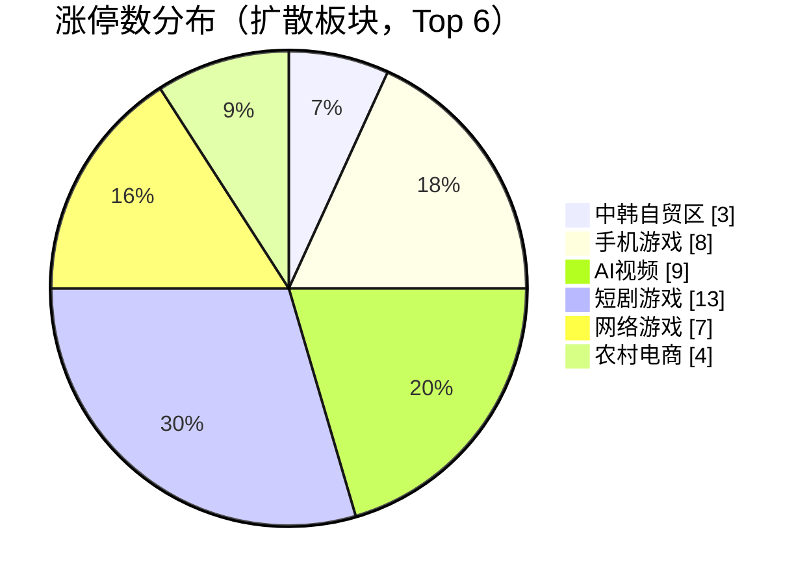
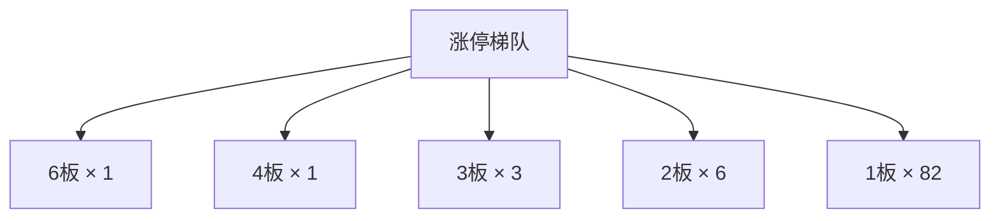

## 当日总览（截至 11:50）

> **结论**：全市场涨4464/跌682（广度0.87）；涨停93/跌停6；中位涨幅+1.95%；局部修复。 钱在：中韩自贸区(涨停3/成分16，中位+1.92%)、手机游戏(涨停8/成分55，中位+6.56%)、AI视频(涨停9/成分66，中位+6.58%)；零星涨停：低辐射玻璃(Low-E)(2)、高压氧舱(1)。 退潮：金属镍(跌停1)、金属铜(跌停1)、ST板块(跌停1)。 梯队：6板×1、4板×1、3板×3、2板×6、1板×82，最高6板。 预案：无有效对照。 较上一轮广度基本持平。

> 🔒 **no_trade / 买入预算 0 / max_position_pct 0 —— 全部内容仅供研究，不授予交易权限。**

### 板块扩散

> 口径：XTick 概念成分 × 全市场实时报价；分母 = 板块内有有效报价的成分数。排序用涨停密度（涨停数/有效成分数），已剔除宽基属性板块（全市场 432 个板块中剔 16 个）。

**扩散中（题材，按涨停密度排序）**

| 板块 | 涨停 | 有效成分 | 涨停密度 | 上涨广度 | 中位涨幅 | 相对全市场 | 成交(亿) |
|---|---|---|---|---|---|---|---|
| 中韩自贸区 | 3 | 16 | 0.188 | 0.94 | +1.92% | -0.03% | 36 |
| 低辐射玻璃(Low-E) ⬦ | 2 | 12 | 0.167 | 0.92 | +1.51% | -0.44% | 13 |
| 手机游戏 | 8 | 55 | 0.145 | 0.89 | +6.56% | +4.61% | 210 |
| AI视频 | 9 | 66 | 0.136 | 0.98 | +6.58% | +4.63% | 283 |
| 短剧游戏 | 13 | 98 | 0.133 | 0.95 | +6.13% | +4.18% | 339 |
| 网络游戏 | 7 | 58 | 0.121 | 0.88 | +5.86% | +3.91% | 232 |
| 农村电商 | 4 | 37 | 0.108 | 0.92 | +2.21% | +0.26% | 55 |
| 文化传媒概念 | 20 | 194 | 0.103 | 0.93 | +4.59% | +2.64% | 478 |
| 高压氧舱 ⬦ | 1 | 10 | 0.100 | 0.80 | +1.59% | -0.36% | 24 |
| IP经济(谷子经济) | 17 | 193 | 0.088 | 0.93 | +3.49% | +1.54% | 444 |
| 电子竞技 | 3 | 35 | 0.086 | 0.89 | +4.49% | +2.54% | 107 |
| 白酒概念 | 4 | 47 | 0.085 | 1.00 | +2.80% | +0.85% | 248 |

> ⬦ = 涨停 <3 只，零星个例，不构成扩散（不计入「钱在」判定）。



零星涨停板块（<3 只）：低辐射玻璃(Low-E)(2)、高压氧舱(1)

**退潮中（跌停集中）**

| 板块 | 跌停 | 有效成分 | 上涨广度 | 中位涨幅 |
|---|---|---|---|---|
| 金属镍 | 1 | 37 | 0.68 | +1.08% |
| 金属铜 | 1 | 89 | 0.69 | +1.00% |
| ST板块 | 1 | 194 | 0.72 | +0.96% |
| 小金属概念 | 1 | 167 | 0.77 | +1.50% |
| 绿色电力 | 1 | 433 | 0.81 | +1.52% |
| 风电 | 1 | 423 | 0.83 | +1.57% |
| 西部大开发 | 1 | 598 | 0.84 | +1.78% |
| 医药电商 | 1 | 181 | 0.84 | +1.29% |
| 一带一路 | 1 | 752 | 0.84 | +1.84% |
| 人形机器人 | 1 | 462 | 0.84 | +2.05% |
| 家庭医生 | 1 | 26 | 0.85 | +2.23% |
| 回购增持再贷款概念 | 1 | 476 | 0.85 | +1.77% |

### 涨停梯队

> 最高 6 板 ｜ 涨停 93 ｜ 跌停 6 ｜ 炸板 17 ｜ 封板率 84.5% ｜ 打板成功率 22.45% ｜ 一进二 15.00% ｜ 二进三 50.00%

| 身位 | 家数 | 成员（涨幅/封单亿/首封） |
|---|---|---|
| 6板 | 1 | 青岛食品 +9.98%/0.014亿/09:54 |
| 4板 | 1 | 澳洋健康 +9.98%/0.009亿/09:30 |
| 3板 | 3 | 阳光照明 +10.02%/0.106亿/09:25；桂林三金 +10.01%/0.027亿/09:25；东方海洋 +9.89%/0.026亿/09:25 |
| 2板 | 6 | 沈阳机床 +10.06%/0.025亿/09:32；皇台酒业 +10.01%/0.020亿/09:30；红太阳 +10.02%/0.014亿/09:25；合百集团 +10.00%/0.011亿/09:50；泉阳泉 +9.95%/0.005亿/09:38 |
| 1板 | 82 | 东山精密 +10.00%/0.301亿/11:27；芒果超媒 +20.00%/0.114亿/11:25；高争民爆 +10.00%/0.110亿/09:25；长飞光纤 +10.00%/0.055亿/11:28；太平洋 +9.94%/0.055亿/09:50 |



炸板 17 只（前几）：欢瑞世纪(6次)、上海沪工(3次)、细分化工(3次)、*ST瑞和(2次)、中公高科(2次)

### 预案池对照

| 票 | 池 | 板块 | 现价 | 涨幅 | 触发价 | 买区 | 风险位 | 判定 |
|---|---|---|---|---|---|---|---|---|
| 水井坊 `600779.SH` | 观察池 | 白酒概念 | 28.12 | +10.02% | — | — | 25.13 | **无预案价** |
| 国金证券 `600109.SH` | 观察池 | 证券 | 8.45 | +10.03% | — | — | 7.97 | **无预案价** |
| 皇台酒业 `000995.SZ` | 观察池 | 白酒概念 | 15.6 | +10.01% | — | — | 13.67 | **无预案价** |
| 益方生物 `688382.SH` | 观察池 | 创新药 | 12.67 | +2.26% | — | — | 11.57 | **无预案价** |
| 东方海洋 `002086.SZ` | 观察池 | CRO概念 | 3.11 | +9.89% | — | — | 2.73 | **无预案价** |
| 上海沪工 `603131.SH` | 观察池 | 机器人概念 | 18.3 | +4.27% | — | — | 16.92 | **无预案价** |
| 高争民爆 `002827.SZ` | 观察池 | 民爆概念 | 56.98 | +10.00% | — | — | 49.95 | **无预案价** |


> ⚠ D1 明确 no_trade=true、买入预算 0、个股 max_position_pct=0。以上为研究对照，**不构成任何买入许可**。

### 盘面 vs 静态复盘 vs 消息面

| 维度 | 对象 | T-1 静态基线 | 今日盘面 | 关系 |
|---|---|---|---|---|
| 板块主线 | 创新药 | R2 次线 score=68.0 涨停None（T-1 口径） | 今日盘中该板块 2 只涨停 / 成分266 广度0.82 中位1.15%（相对全市场-0.80%） | **无响应** |
| 板块主线 | 机器人概念 | R2 次线 score=54.0 涨停None（T-1 口径） | 盘面未见该板块成分票涨停 | **背离** |
| 板块主线 | 证券 | R2 次线 score=52.0 涨停None（T-1 口径） | 盘面未见该板块成分票涨停 | **背离** |
| 板块主线 | CRO概念 | R2 次线 score=50.0 涨停None（T-1 口径） | 今日盘中该板块 1 只涨停 / 成分75 广度0.68 中位0.99%（相对全市场-0.96%） | **无响应** |
| 梯队结构 | 最高6板 | T-1 最高梯队 4 板、首板 29、炸板率 39.06% | 今日 6板×1、4板×1、3板×3、2板×6、1板×82；封板率0.8455 炸板17只 | **印证** |
| 预案验证 | 水井坊(600779.SH) | 预案 白酒概念／watch／触发价None／买区None | 无预案价：预案未给触发价/买区（情景作废或待重导） | **无响应** |
| 预案验证 | 国金证券(600109.SH) | 预案 证券／watch／触发价None／买区None | 无预案价：预案未给触发价/买区（情景作废或待重导） | **无响应** |
| 预案验证 | 皇台酒业(000995.SZ) | 预案 白酒概念／watch／触发价None／买区None | 无预案价：预案未给触发价/买区（情景作废或待重导） | **无响应** |
| 预案验证 | 益方生物(688382.SH) | 预案 创新药／watch／触发价None／买区None | 无预案价：预案未给触发价/买区（情景作废或待重导） | **无响应** |
| 预案验证 | 东方海洋(002086.SZ) | 预案 CRO概念／watch／触发价None／买区None | 无预案价：预案未给触发价/买区（情景作废或待重导） | **无响应** |
| 预案验证 | 上海沪工(603131.SH) | 预案 机器人概念／watch／触发价None／买区None | 无预案价：预案未给触发价/买区（情景作废或待重导） | **无响应** |
| 预案验证 | 高争民爆(002827.SZ) | 预案 民爆概念／watch／触发价None／买区None | 无预案价：预案未给触发价/买区（情景作废或待重导） | **无响应** |
| 消息面对照 | 盘面热点板块 | R4 消息面（T-1 口径） | 实时快讯中命中热点板块关键词 2 条 | **印证** |

**分歧点（不掩盖）：**
- 板块主线·机器人概念 → 背离：T-1 有辨识度但今日盘中无涨停响应，题材未获资金确认
- 板块主线·证券 → 背离：T-1 有辨识度但今日盘中无涨停响应，题材未获资金确认

### 全天广度轨迹

| 时点 | 涨 | 跌 | 广度 | 涨停 | 跌停 | 成交(亿) | 有效样本 |
|---|---|---|---|---|---|---|---|
| 0930 | 3384 | 1893 | 0.608 | 19 | 9 | 688 | 5570 |
| 0940 | 1741 | 3680 | 0.312 | 26 | 22 | 3,208 | 5571 |
| 0950 | 2882 | 2510 | 0.517 | 34 | 12 | 4,638 | 5571 |
| 1000 | 2520 | 2838 | 0.452 | 37 | 15 | 5,732 | 5571 |
| 1010 | 3542 | 1868 | 0.636 | 49 | 15 | 6,798 | 5571 |
| 1020 | 3541 | 1850 | 0.636 | 51 | 17 | 7,634 | 5571 |
| 1030 | 3082 | 2320 | 0.553 | 51 | 19 | 8,242 | 5571 |
| 1040 | 3195 | 2214 | 0.574 | 52 | 16 | 8,773 | 5571 |
| 1050 | 3181 | 2204 | 0.571 | 54 | 14 | 9,245 | 5571 |
| 1100 | 3044 | 2363 | 0.546 | 56 | 14 | 9,589 | 5571 |
| 1110 | 3920 | 1523 | 0.704 | 63 | 14 | 10,033 | 5571 |
| 1120 | 4506 | 978 | 0.809 | 77 | 8 | 10,747 | 5571 |
| 1130 | 4783 | 714 | 0.859 | 93 | 6 | 11,474 | 5571 |
| 1140 | 4783 | 714 | 0.859 | 93 | 6 | 11,474 | 5571 |
| 1150 | 4783 | 714 | 0.859 | 93 | 6 | 11,474 | 5571 |

> ⚠ **数据冻结段**：1130–1150 数值连续完全一致，说明行情源未刷新，**不是市场横盘**，该段不可解读为盘面变化。

```mermaid
xychart-beta
    title "全市场广度轨迹（09:30 → 11:50）"
    x-axis "09:30 09:40 09:50 10:00 10:10 10:20 10:30 10:40 10:50 11:00 11:10 11:20 11:30 11:40 11:50"
    y-axis "广度(上涨占比)" 0 --> 1
    line 0.608 0.312 0.517 0.452 0.636 0.636 0.553 0.574 0.571 0.546 0.704 0.809 0.859 0.859 0.859
```

```mermaid
gantt
    title 全天截面时点分布（每个截面一个条目）
    09:30 截面 :done
    09:40 截面 :done
    09:50 截面 :done
    10:00 截面 :done
    10:10 截面 :done
    10:20 截面 :done
    10:30 截面 :done
    10:40 截面 :done
    10:50 截面 :done
    11:00 截面 :done
    11:10 截面 :done
    11:20 截面 :done
    11:30 截面 :done
    11:40 截面 :done
    11:50 截面 :done
```

### 观察建议（仅研究）

- **环境**：涨停 93.0 / 跌停 6.0，打板成功率 22.4%，一进二 15.0%。
- **方向**：今日形成实质扩散的是 中韩自贸区（涨停3/成分16，密度0.188，中位+1.92%）、手机游戏（涨停8/成分55，密度0.145，中位+6.56%）、AI视频（涨停9/成分66，密度0.136，中位+6.58%）。**需确认**：次日能否维持涨停家数且中位涨幅不掉队，否则只是普跌中的避险轮动。
- **零星**：低辐射玻璃(Low-E)(2只/12成分)、高压氧舱(1只/10成分) 属零星个例，不视为题材，不据此选股。
- **回避**：金属镍（跌停1）、金属铜（跌停1）、ST板块（跌停1） 板块中位跌幅深，趋势未止跌前不接。
- **身位**：最高 6 板。梯队有高度不等于可接力，需逐票核验封单稳定性与开板次数后再定。

<details>
<summary>原始截面与数据质量（折叠）</summary>

**跨源校验**

```json
{
  "xtick": {
    "up": 4464,
    "down": 682,
    "n": 5223,
    "amount_yi": 11397.5
  },
  "rtk_snapshot": {
    "up": 4783,
    "down": 714,
    "valid_n": 5571,
    "amount_yi": 11474.2,
    "up_limit": 93,
    "down_limit": 6
  },
  "note": "两源口径不同（XTick 全市场含全部票；rt_k 返回样本）"
}
```

**rt_k 截面（原始）**

```json
{
  "market": {
    "total": 5581,
    "up": 4783,
    "down": 714,
    "flat": 74,
    "requested_n": 5581,
    "received_n": 5581,
    "valid_n": 5571,
    "missing_n": 10,
    "universe_requested_n": null,
    "population_scope": "returned_rows_not_verified_all_a_universe",
    "up_ratio": 0.857,
    "legacy_up_ratio_placeholder": false,
    "up_ratio_is_observed": true,
    "up_ratio_all": 0.857,
    "up_ratio_valid": 0.8586,
    "up_ratio_denominator": "requested_n",
    "degraded": false,
    "limit_known_n": 5571,
    "limit_unknown_n": 0,
    "limit_counts_complete": true,
    "limit_source_errors": [],
    "up_gt3": 1683,
    "up_gt5": 698,
    "up_limit": 93,
    "down_gt3": 123,
    "down_gt5": 48,
    "down_limit": 6,
    "amount_yi": 11474.2,
    "amount_sum_overflow": false,
    "amount_valid_n": 5571,
    "amount_missing_n": 0
  },
  "source_time_quality": {
    "quote_age_min_seconds": 1.801274,
    "quote_age_max_seconds": 60.801274,
    "source_age_limit_seconds": null,
    "freshness_status": "age_limit_not_configured",
    "age_reference_at": "2026-11-02T11:50:42.801274+08:00"
  },
  "trading_authorized": false
}
```

</details>

## 分时研判记录

### 09:35 研判增量
- **趋势**：开盘呈现“多数上涨、强势点分散”，尚不能确认主线扩散或修复拐点。本轮依据2026-11-02 09:30分析件（09:30:57生成；rt_k报价09:30:21—09:30:48），不是09:35实时行情；当天仅这一份分析，故广度、涨停数、梯队高度与板块排名均只能建立基线，不能称“较上一轮走弱”。特别是顶部广度混有口径差异：XTick为2805/5223＝53.70%，rt_k为3384/5570＝60.75%；顶部0.57另用上涨/涨跌合计，不能跨源或跨分母相减。自动摘要的“较上一轮广度走弱”不采纳。上海沪工的4板仅延续静态复盘所列高度，不等于高度已拓展；开盘封板及晋级指标不能外推全天接力胜率。
- **轮动**：工业母机虽有3/110只涨停，但仅46/110上涨、中位涨幅-0.24%、相对市场-0.40个百分点，更像少数强股集中，不能直接认定整条线在扩散。反而国资云38/54上涨但仅2只涨停，白酒35/47上涨但仅1只涨停，属于有广度、尚缺封板助攻的观察方向。传媒与游戏多个口径同时偏弱，强弱分布支持“局部分化”假设；但没有第二时点及净流向证据，尚不能认定资金由传媒流入这些方向的跷跷板。绿色电力虽有3只跌停，仍有276/433上涨且中位+0.36%，是尾部风险与多数上涨并存，不支持顶部把整板概括为深跌退潮。
- **剧本**：指定的当日watchlist_plan.json及当日运行副本均未找到，分析件plan_check为空，无法核验逐票触发价、买区和reason；这属于预案交付缺口，不是“全部条件失效”，也不能补造价位或改用旧日预案。静态复盘只提供梯队结构印证，消息关键词未匹配也不等于没有催化，尚未形成主线、消息与盘面的三方一致。继续研究，但严格保留本任务明确的no_trade=true、买入预算0、max_position_pct=0；不追高，不授予任何买入许可。
- **下一步看**：下一份同源且有效样本覆盖可比的截面中，检验工业母机能否保持至少3只涨停、上涨占比高于本轮46/110并让中位涨幅转正；若板数维持但广度不改善，仍按强股集中而非扩散。国资云须看涨停是否从2只达到至少3只，同时上涨占比不低于本轮38/54，才升级扩散观察。上海沪工以本轮4板、封单0.03亿元为对照锚，需后续盘口与开板路径确认，不能由一次封板认定稳封；传媒则看上涨占比是否高于本轮24/130、跌停是否少于本轮2只，未改善前不称轮动回流。预案未补齐前，逐票触发判定继续标缺失，所有条件只用于研究。

### 09:45 研判增量
- **趋势**：09:30—09:40从开盘多数上涨转为强股集中、多数走弱，不能把涨停增加解释为全市场修复。有效报价口径上涨占比由3384/5570（60.75%）变为1741/5571（31.25%）；分母增加1，只分别报告比率，不报严格同样本百分点差，也不宣称已验证无遗漏全A覆盖。梯队源涨停18→26、跌停10→19、炸板4→7，封板率81.82%→78.79%；首板12→19，但最高仍4板，增加的是低位封板而非高度突破。本轮依据2026-11-02 09:40分析件（09:40:53生成；配套rt_k采集09:40:41—09:40:50、报价09:40:18—09:40:48），不是09:45实时报价；两轮数据已变化，非冻结。两源跌停数不同，以下梯队判断只用同一梯队源，不混用rt_k的22只。
- **轮动**：白酒在所列涨停密度榜由第10升至第2，涨停1→3/47，但上涨35→30/47、中位涨幅+1.16%→+1.03%；这是头部封板增加、相对抗跌增强，不是整个板块加速普涨。另一个顶部题材表没有呈现的增量是金融：非银金融上涨64→70/77、中位+1.62%→+2.10%，银行上涨20→32/42，属于行业广度转强，不冒充多只涨停的题材扩散。反面是人形机器人上涨176→88/462、跌停2→6，国资云涨停2→1、上涨38→27/54。支持“金融及白酒相对走强、成长方向承压”的跷跷板假设，但没有净流向证据，不能断言资金实际从一方搬到另一方。传媒行业则上涨24→54/130、中位-1.16%→-0.49%，较开盘局部回流；跌停仍2只，不能把开盘弱方向一概判死，也不能称已全面修复。
- **剧本**：上一轮提出的工业母机扩散条件未兑现：涨停仍3/110，上涨却46→21/110，中位-0.24%→-1.45%，更支持孤立强股而非板块带动；国资云的封板助攻也在减少。上海沪工仍4板，但封单0.030→0.026亿元，不能由高度未断推断承接增强；新增二板成员泉阳泉已有2次开板、截面封单0.001亿元，也不宜把二板家数增加当稳固接力。白酒新增两条消息匹配均在报道同一盘面表现，不是两个独立催化，尚不足以补齐主线、静态复盘与消息源的三方一致。原预案及运行副本仍缺失，plan_check仍空，不能判任何逐票触发价、买区或reason已满足或失效；不补造价位、不追高，继续保留本任务明确的no_trade=true、买入预算0、max_position_pct=0。
- **下一步看**：白酒若保有至少3只涨停，且上涨占比从30/47回到开盘35/47，才支持由头部集中向板块扩散；若涨停少于3只或上涨占比继续低于本轮30/47，则下调持续性判断。金融须先观察非银70/77、银行32/42的上涨占比能否维持，再看市场有效报价上涨占比是否高于本轮1741/5571、梯队源跌停是否不再高于19只；金融强而多数个股继续弱，只能称结构性强弱分化，不能称普遍修复。传媒下一轮须在上涨占比不低于54/130的同时，让跌停少于本轮2只，才进一步确认回流而非尾部风险未消；上述均为后续可证伪的研究观察条件，不是新增买入门槛或交易许可。

### 09:55 研判增量
- **趋势**：09:40—09:50由“少数强股集中”转为上涨面扩大的修复，但高位接力并未同步稳固。同源rt_k有效报价分母均为5571，上涨1741→2882只，上涨占比31.25%→51.73%，提高20.48个百分点；XTick按返回样本5223只计算也由31.84%回到50.07%，方向一致，不混用顶部的涨跌合计分母。梯队源涨停26→34、跌停19→12，新增封板主要体现在首板19→27；最高仍4板，却由上海沪工换为澳洋健康，前者进入炸板名单且已有3次开板，不能把“高度未断”读成原领涨股承接稳定。本轮引用2026-11-02 09:50分析件（09:50:53生成；配套rt_k采集09:50:40—09:50:50、报价09:50:12—09:50:48），不是09:55实时报价；尚未核上市名录，不宣称无遗漏全A覆盖。
- **轮动**：资金表现更像“金融维持强势、零售与传媒加入修复”，不是金融撤出后的单向跷跷板：非银上涨70→73/77，银行32→36/42，传媒则54→105/130、跌停2→0，中位涨幅-0.49%→+1.88%，上一轮传媒回流观察条件得到截面印证。社区团购上涨10→40/51、涨停2→3，是广度与封板同时扩展；玻璃基板虽涨停2→3/63，上涨仅34→35/63，中位+0.30%→+0.25%，更偏头部加强，扩散质量弱于社区团购。白酒密度榜第2→第10、涨停3→2/47，但上涨30→40/47、中位+1.03%→+1.97%，只是封板持续性下降，不能由排名下滑断言整板失血。电子商务也已上涨445/675、中位+0.62%，顶部因4只跌停将其列“退潮”只反映尾部风险；人形机器人虽反弹，仍仅125/462上涨、相对市场中位涨幅为-1.30个百分点，属于跟不上修复。无净流向证据，不断言资金实际搬家。
- **剧本**：上一轮“金融强、市场也要跟上”的条件已部分兑现，传媒回流也获印证；工业母机则涨停3→2/110、中位仍-0.78%，扩散假设继续不成立。二板总数未变，但泉阳泉转入炸板名单、开板2→3次，合百集团进入二板名单，不能只看家数判断梯队稳固。分析件内09:49零售拉升、09:50证券及金融科技ETF上涨快讯与盘面同向，自动关键词“无响应”不等于完全没有相关报道；这些是行情报道，不是独立事件催化，且T-1仅有梯队基线，尚不足以确认三方一致的新主线。当日正式预案及运行副本仍未找到，plan_check为空，trigger_price、buy_zone、reason缺失，逐票价位剧本无法核验，不能写成已触发或已失效。保留任务明确的no_trade=true、买入预算0、max_position_pct=0；不追高，不授予买入许可。
- **下一步看**：后续同口径截面先看上涨占比能否维持不低于本轮2882/5571、梯队源涨停不低于34且跌停不高于12；若涨停继续增而上涨占比回落，则重新按强股集中解释。社区团购须同时保持至少3只涨停与不低于40/51的上涨占比，传媒须保持不低于105/130上涨且不重新出现跌停，才能继续支持本轮扩散；玻璃基板若仍仅35/63上涨、中位不高于本轮+0.25%，即使板数增加也不升级为广泛扩散。白酒观察涨停能否恢复至上轮3只，同时不丢本轮40/47的上涨覆盖。澳洋健康虽由上轮炸板名单回到4板封板名单，仍须补盘口路径才能确认稳定；上海沪工需看是否离开炸板名单、开板次数是否继续增加。上述只作可证伪的研究条件；预案未补齐前不补造任何具体买卖价。

### 10:05 研判增量
- **趋势**：上一轮警惕的“涨停增加、上涨面回落”已经出现，09:50的普遍修复正转为强势集中，而非修复继续加速。09:50—10:00，rt_k有效报价分母均为5571，上涨2882→2520只，占比51.73%→45.23%，回落6.50个百分点；XTick同为5223只返回样本，上涨占比50.07%→45.28%，方向一致。梯队源涨停34→37，但炸板8→15、封板率80.95%→71.15%、跌停12→13，封板质量反而下降。本轮依据2026-11-02 10:00分析件；配套截面采集10:00:41—10:00:50、报价10:00:03—10:00:48，不是10:05实时行情，两轮数据非冻结；返回样本未核上市名录，不宣称无遗漏全A覆盖。
- **轮动**：消费内部出现强弱再分配。白酒涨停密度榜第10→第5，涨停2→3/47、上涨40→41/47、中位+1.97%→+2.36%，上一轮的封板恢复条件得到印证；农村电商第6→第3、涨停2→3/37，但上涨28→27/37、中位+1.40%→+1.17%，只是头部加强，不能与白酒等同。社区团购涨停3→2/51，虽退出至少3只涨停的扩散观察，上涨仍40/51、中位+1.00%→+1.52%，并非整板失血。玻璃基板涨停仍3/63，上涨却35→31/63、中位+0.25%→-0.14%，更不支持广泛扩散；人形机器人上涨125→95/462、跌停4→5，修复继续落后。非银仍71/77上涨，不能说金融已撤出；更像消费增强、部分成长转弱的结构分化，无净流向证据，不确认真实资金搬家的跷跷板。
- **剧本**：高度刷新不等于接力转稳：最高4→6来自青岛食品09:54新进入封板榜，并非原最高标在十分钟内晋两级；分析件T-1最高4板与当轮6板的历史链条尚待核验，不能仅凭自动“印证”升级为主升判断。泉阳泉从炸板名单回到二板封板名单，但开板次数3→4；上海沪工仍在炸板名单、累计3次开板，风险并未随高度上移消失。白酒的两条关键词匹配仍是09:31的同一行情报道，不是本轮新增独立催化，三方一致尚未建立。指定当日正式预案及运行副本仍缺失，plan_check为空，trigger_price、buy_zone、reason无法核验，不判逐票已触发或已失效、不补造价位。本任务明确的no_trade=true、买入预算0、max_position_pct=0保持不变，全部仅研究、不追高。
- **下一步看**：先检验本轮回落能否被扭转：同源有效样本覆盖可比时，上涨占比重回09:50的2882/5571，且梯队源涨停不低于本轮37、炸板少于本轮15，才支持修复重新扩开。消费内部，白酒须保持至少3只涨停且上涨占比不低于41/47；社区团购须恢复至少3只涨停并保有40/51的上涨覆盖，否则仍只作广度较好的观察方向。玻璃基板须恢复至至少35/63上涨、中位涨幅不低于09:50的+0.25%，否则不因仍有3只涨停升级判断。青岛食品下一轮看是否仍列6板封板、是否新增开板，并以本轮封单0.020亿元为对照；泉阳泉看累计4次开板是否继续增加，截面回榜不替代持续稳封证据。以上是对已有观测锚的研究检验，不是买入门槛或交易许可。

### 10:15 研判增量
- **趋势**：10:00—10:10重新由强势集中转为上涨面扩大的修复，上一轮“广度回升、炸板减少”的观察条件兑现，但还不是全天反转定论。同源rt_k有效报价分母均为5571，上涨2520→3542只，占比45.23%→63.58%，提高18.35个百分点；XTick按固定5223只返回样本也由45.28%升至62.67%，非数据冻结。梯队源涨停37→49、炸板15→11、封板率71.15%→81.67%，改善主要来自首板28→39、二板4→5，最高仍6板；跌停13→14，说明尾部风险没有同步消除。本轮依据2026-11-02 10:10分析件，配套行情采集10:10:43—10:10:52、报价10:10:06—10:10:51，不是10:15实时报价；返回样本未核上市名录。
- **轮动**：新增信息不只是白酒走强，而是金融内部出现“银行回落、非银及金融科技扩散”的分化：银行上涨31→21/42、中位+0.56%→+0.13%，非银却71→73/77、中位+2.57%→+3.63%；互联网金融涨停2→4/205、上涨140→168/205，数字货币涨停0→3/90、上涨69→83/90，后两者未进顶部密度短榜却已有封板与广度共振。支持从防御向风险偏好方向切换的轮动假设，但无净流向证据，不能确认真实资金搬家；概念成分尚未核去重，不能相加计算独立助攻。白酒密度榜第5→第4、社区团购恢复3/51涨停，均未显示整板撤退；玻璃基板虽第8→第10，上涨31→44/63、中位-0.14%→+1.00%，反而兑现上一轮扩散观察，排名下降不等于失血。电子商务涨停11→18/675、上涨433→514/675，4只跌停反映尾部风险，不能照自动标签把整板判作退潮；人形机器人仍仅163/462上涨，修复继续落后。
- **剧本**：市场修复剧本获印证，高位稳封剧本仍缺连续路径。银之杰首封10:09且累计开板0次，恒生电子首封10:06但累计开板2次，金融相关首板出现新助攻，不等于全部稳封；新进入二板封板展示的地素时尚累计开板已7次、封单仅0.002亿元，二板家数增加不能掩盖个股承接反复。青岛食品仍6板、开板0次，但澳洋健康封单0.021→0.012亿元，高位并非一起增强。消息匹配仍是旧白酒行情报道，T-1只给梯队基线，不能把自动“印证”当新主线的三方确认。当日正式预案与运行副本仍缺失、plan_check为空，trigger_price、buy_zone、reason无法核验；这是交付缺口，不是逐票失效。保留本任务明确的no_trade=true、买入预算0、max_position_pct=0：全部仅研究、不追高，不授予买入许可。
- **下一步看**：下一份同源、覆盖可比的截面，先看上涨占比能否不低于本轮3542/5571、涨停不少于49、炸板不多于11；若只增板而广度回落，仍退回强势集中解释。新增金融扩散须检验互联网金融至少保有4只涨停及168/205上涨、数字货币至少3只涨停及83/90上涨；若银行仍不高于21/42上涨而上述方向保持，则继续支持金融内部轮动假设。玻璃基板须保有3只涨停及44/63上涨，否则撤回本轮扩散升级；传媒虽上涨91→105/130，却重新出现2只跌停，须看尾部风险能否减少，不能只看多数上涨。个股看银之杰是否新增开板、恒生电子累计2次及地素时尚累计7次开板是否继续增加，截面封单不替代稳定性验证。以上仅用已有观测锚检验持续性；预案未补齐前不补造买卖价位。

### 10:28 研判增量
- **趋势**：修复的上涨面暂未丢失，但封板质量先转弱，不能把新增涨停继续解读成修复加速。以下均比较2026-11-02 10:10—10:20：rt_k有效样本均为5571，上涨3542→3541只，占比63.58%→63.56%，基本持平；梯队源涨停49→51、首板39→41，最高仍6板，炸板却11→15、封板率81.67%→77.27%、跌停14→17。上一轮“炸板不多于11”的观察条件已未守住。成交额及板块数据均在更新，不是数据冻结。本轮依据10:20分析件，配套行情采集10:20:41—10:20:50、报价10:20:06—10:20:48，不是标题时点的实时报价；返回样本未核上市名录。
- **轮动**：新扩散更多落在玻璃基板与光伏，而非消费、金融一起增强：玻璃基板仍3/63涨停，上涨44→50/63、中位+1.00%→+1.35%；光伏涨停4→5/574、上涨357→389/574、中位+0.54%→+0.78%，但仍有3只跌停，是扩散与尾部风险并存。白酒虽保持4/47涨停，上涨43→41/47、中位+2.86%→+2.27%；银行上涨21→13/42、非银73→70/77，后者中位+3.63%→+3.05%，不能沿用“银行弱、非银继续加速”的上一轮假设。中韩自贸区密度榜第2→第1、涨停2→3/16，但上涨15→14/16、中位+1.41%→+1.39%，排名上升来自头部加强，不是整板加速。支持强势方向内部再分配的假设，无净流向及成分去重证据，不确认资金搬家的跷跷板。
- **剧本**：上一轮的金融封板稳定性观察出现新警讯：银之杰开板次数仍0，但封单0.093→0.048亿元；恒生电子开板仍2次，封单0.081→0.061亿元；澳洋健康则累计开板1→2次。封板名单还在，不代表承接一起增强，也不能仅由封单减少断言出货。本轮新增静态对照将“证券”标作无涨停响应，但太平洋、国金证券仍在首板名单，提示板块名称映射缺口，不能采纳该自动背离结论；创新药上涨152→131/266、CRO上涨21→17/75，则支持对应次线响应继续偏弱。10:18:33光伏拉升快讯与盘面同向，但属行情报道，旧白酒消息匹配也未更新，尚非独立催化的三方确认。当日正式预案及运行副本仍缺失、plan_check为空，触发价、买区、reason无法核验，不能判逐票满足或失效。保留任务明确的no_trade=true、买入预算0、max_position_pct=0，仅研究、不追高。
- **下一步看**：同源且覆盖可比时，先看上涨占比能否守住本轮3541/5571，并让炸板从15回到不高于上轮11、跌停从17回到不高于上轮14；若只增涨停、炸板与跌停继续增，按修复中的分化处理。玻璃基板须保有3只涨停及不低于50/63上涨，光伏须保有5只涨停及不低于389/574上涨、跌停不高于3，才支持本轮扩散延续；白酒若重回43/47上涨且保有4只涨停，才撤回本轮降温判断。金融观察互联网金融4只涨停与167/205上涨、数字货币3只涨停与81/90上涨能否保持，结合银之杰是否新增开板、恒生电子累计2次及澳洋健康累计2次是否继续增加；封单只作本轮对照锚，不替代分钟路径。预案未补齐前不补造买卖价位，以上条件不授予任何买入许可。

### 10:39 研判增量
- **趋势**：上一轮“封板质量先弱”的警讯，现已发展为上涨面收缩，10:10以来的修复没有继续扩开。比较2026-11-02 10:20—10:30，同源rt_k有效样本均为5571，上涨3541→3082只，占比63.56%→55.32%，回落8.24个百分点；XTick固定5223只返回样本也由63.16%降至54.34%，方向一致。涨停仍51、最高仍6板，但rt_k跌停17→19；梯队源跌停仍17、炸板仍15，口径不同，不能混写成同步改善或认定数据冻结。成交额和个股开板记录有更新。本轮依据10:30分析件（10:31:07生成），配套行情采集10:30:48—10:31:00、报价10:29:33—10:30:54，不是10:39实时报价；返回样本未核上市名录。
- **轮动**：撤回上一轮玻璃基板、光伏“扩散延续”的假设：前者密度榜仍第10、涨停仍3/63，但上涨50→41/63、中位+1.35%→+0.73%；后者涨停仍5/574，上涨389→325/574、中位+0.78%→+0.38%。榜位和板数未变，掩盖了助攻面流失。相反银行上涨13→21/42、中位-0.47%→+0.04%，非银上涨仍70/77、中位+3.05%→+3.47%，出现“金融承接、部分科技回落”的跷跷板迹象；无净流向证据，不确认资金搬家，也不把行业上涨等同题材多板扩散。白酒仍4/47涨停、41/47上涨，中位却+2.27%→+2.11%，相对强度提高主要因为市场回落，不能称绝对加速。
- **剧本**：银之杰累计开板0→1次，上一轮“是否新增开板”的风险观察已命中；虽仍列首板封板名单、封单0.048→0.052亿元，也不能据截面认定承接转稳。青岛食品仍6板、累计开板0次，说明高度暂未断，不代表多数个股修复成立。10:29:50乳业上涨快讯只是行情报道，对应样本仍仅1/34涨停、上涨29→28/34，不足以新增扩散主线；静态研究未确认主线，三方一致仍未建立。当日正式预案及运行副本仍缺失、逐票判定为空，触发价、买区和入选理由无法核验，不判满足或失效。继续保留本任务的no_trade=true、买入预算0、max_position_pct=0，仅研究、不追高，不授予买入许可。
- **下一步看**：后续同源且覆盖可比时，若上涨占比继续低于本轮3082/5571、涨停仍未高于51，按修复继续收窄处理；重回上轮3541/5571且rt_k跌停少于本轮19，才支持广度重新扩开。玻璃基板须恢复50/63上涨并保有3只涨停，光伏须恢复389/574上涨并保有5只涨停，否则不恢复扩散延续判断。金融检验银行能否守住21/42上涨、非银守住70/77及中位+3.47%；若它们转弱而科技尚未恢复，则撤回局部承接假设。银之杰看累计1次开板是否继续增加，并补连续盘口路径，不能仅凭回到封板名单认定稳定；所有阈值均为已有截面的研究对照锚，不是交易门槛。

### 10:48 研判增量
- **趋势**：上涨面小幅回补，但封板质量继续走弱，尚不能确认修复重新扩开。比较2026-11-02 10:30—10:40，rt_k有效样本均为5571，上涨3082→3195只，占比55.32%→57.35%，回升2.03个百分点，仍未恢复10:20的3541/5571。梯队源涨停51→52、跌停17→15，但炸板15→18、封板率77.27%→74.29%；增加的仍是首板41→42，最高与各连板层家数未变。新增封板与开板反复并存，不是接力质量同步增强。本轮依据10:40分析件（10:40:55生成），配套行情采集10:40:42—10:40:52、报价10:39:21—10:40:51，不是10:48实时报价；数据有更新，返回样本未核上市名录。
- **轮动**：新增扩散重心转到传媒、游戏，而不是原有消费方向继续加速。手机游戏由涨停密度前12名之外进入第6，涨停2→4/55、上涨40→42/55、中位+2.63%→+2.96%；文化传媒概念涨停2→4/194、上涨140→153/194、跌停3→1，强股与助攻面同时改善。两类概念可能重叠，不能相加当独立助攻。银行则上涨21→15/42、中位+0.04%→-0.22%，撤回上一轮银行承接延续的假设；非银仍70/77上涨，不能扩大为金融整体撤退。白酒虽上涨41→42/47、仍4只涨停，中位却+2.11%→+2.01%；社区团购仍3/51涨停、37/51上涨，中位+1.71%→+1.31%，表现为相对降温。支持“传媒游戏增强、银行转弱”的价格跷跷板假设，不等于已核实资金从一方流向另一方。
- **剧本**：传媒的新助攻有个股截面印证：上海电影首次封板时间10:40、首板且累计开板0次，是首次上板，不是回封，也不证明持续稳封。与此同时，青岛食品仍6板但封单0.019→0.017亿元，银之杰累计开板仍1次、封单0.052→0.043亿元；新方向扩散与原核心封单减弱并存，不能把总涨停增加读成老核心承接增强，也不凭封单缩小直接判出货。本轮消息关键词新增仍是皇台酒业的行情报道，未补足传媒游戏的独立催化；静态研究未确认主线，三方一致仍未建立。当日正式预案及运行副本仍缺失、逐票判定为空，触发价、买区及入选理由无法核验，不补造价位或判逐票失效。no_trade=true、买入预算0、max_position_pct=0保持不变，仅研究、不追高。
- **下一步看**：同源且覆盖可比时，先看上涨占比能否守住本轮3195/5571，同时炸板由18降至不高于上一轮15；若广度回补但炸板继续增加，仍按修复中的分化处理。手机游戏须保有至少4只涨停及42/55上涨，文化传媒概念须保有至少4只涨停、153/194上涨且跌停不高于1，才支持本轮扩散延续；若板数保住、助攻面却缩小，则降为强股集中。银行须恢复上一轮21/42上涨及中位+0.04%，才重新讨论银行承接。个股观察上海电影是否新增开板、银之杰累计1次开板是否继续增加；只有后续盘口路径才能检验稳定性，不能由一次封板截面追认买点。以上均为已有观测锚，不是新增交易门槛或买入许可。

### 10:58 研判增量
- **趋势**：封板质量小修、上涨面停滞，仍是强势集中，不是修复全面加速。比较2026-11-02 10:40—10:50，rt_k有效样本均为5571，上涨3195→3181只，占比57.35%→57.10%，回落0.25个百分点；梯队源涨停52→54、跌停15→13，炸板仍18，封板率74.29%→75.00%。首板42→44、连板各层家数与最高6板均未变，增量落在首板而非高位晋级。本轮依据10:50分析件（10:50:50生成；配套行情采集10:50:40—10:50:48、报价10:49:45—10:50:45），不是10:58实时报价；数据有更新，返回样本未核上市名录。
- **轮动**：热点密度前12名顺序未变，但内部质量分化，不能由榜位稳定认定轮动结束。手机游戏仍4/55涨停，上涨42→43/55、跌停2→1、中位+2.96%→+3.25%，延续增强；文化传媒概念仍4/194涨停，跌停1→0，但上涨153→149/194，上一轮“保持153/194上涨”的条件未守住，属于尾部风险缓解、助攻面略收窄，不是整板退潮。光伏涨停4→6/574，上涨却353→339/574、中位+0.53%→+0.39%，新增封板更集中于头部。银行上涨15→12/42，白酒则42→43/47且仍4只涨停，消费承接略回暖；更像游戏、消费相对占优与银行转弱并存，无净流向证据，不确认资金搬家的跷跷板，重叠概念板数也不相加。
- **剧本**：上一轮要求的广度不回落、炸板减少尚未兑现，不能因涨停增加就升级修复。青岛食品仍6板、累计开板0次，但封单0.017→0.016亿元；银之杰仍首板、累计开板1次，封单0.043→0.041亿元，截面在榜不证明持续稳封，也不凭金额缩小判出货。消息匹配仍是原有白酒行情报道，静态研究未确认主线，不能升级为三方一致。当日正式预案及运行副本仍缺失、逐票判定为空，触发价、买区及入选理由无法核验，不补造价位或判逐票失效。no_trade=true、买入预算0、max_position_pct=0继续保留，仅研究、不追高，不授予买入许可。
- **下一步看**：同源且覆盖可比时，先看上涨占比能否重回上一轮3195/5571、涨停不低于本轮54，并让炸板少于本轮18，才支持修复重新扩开。手机游戏检验4只涨停、43/55上涨能否同时保持；文化传媒概念须恢复153/194上涨且不重新出现跌停，才恢复“助攻面继续扩散”的判断。光伏若保有6只涨停，却不能恢复353/574上涨及中位+0.53%，仍按头部集中，不升级整板扩散。青岛食品、银之杰分别观察累计0次、1次开板是否增加，稳定性仍需连续盘口路径；以上均为已有观测锚，不是交易门槛。

### 11:09 研判增量
- **趋势**：强势集中进一步加深，上轮期待的广度回升、炸板减少仍未兑现。比较2026-11-02 10:50—11:00，同源rt_k有效样本均5571，上涨3181→3044，占比57.10%→54.64%，回落2.46个百分点；梯队源涨停54→56、首板44→46，最高仍6板，炸板18→19、封板率75.00%→74.67%。涨停增加并未带动多数个股，不能沿用顶部“广度基本持平”的判断。润建股份由首板封板展示转入炸板展示，开板1→2次、涨幅+10.00%→+7.70%，是承接分化的新证据。本轮锁定11:00分析件；配套行情采集11:00:41—11:00:49、报价10:59:27—11:00:45，不是标题时点实时报价，数据非冻结，返回样本未核上市名录。
- **轮动**：传媒游戏在市场收窄时继续增强：手机游戏仍4/55涨停，上涨43→44/55、中位+3.25%→+3.85%；文化传媒概念仍4/194涨停，上涨149→153/194且无跌停，兑现上一轮助攻面恢复条件。网络游戏密度榜第11→第12，但上涨41→42/58、中位+2.85%→+3.04%，排名下降并非退潮。反面是光伏涨停6→5/574、上涨339→317/574，中位+0.39%→+0.29%；人形机器人虽跌停4→3，上涨却172→165/462、中位-0.53%→-0.66%，尾部缓解不等于修复。支持“传媒游戏相对增强、光伏及机器人承压”的价格轮动假设；没有净流向证据，不确认资金搬家的跷跷板，重叠概念不相加。
- **剧本**：更新上一轮缺失判断：当日正式预案现已可读，生成标记11:00:39，明确是迟交的条件研究，不是盘前预测；观察池7只、执行池空，11:00分析件的逐票对照仍空，不能再据此说预案不存在。白酒研究方向有首板水井坊、二板皇台酒业及43/47上涨的联动印证，但未升级为已确认可交易主线。逐票原锚为：水井坊触发25.56、买区25.43—25.94；皇台14.18、14.11—14.39；国金证券8.27、8.23—8.39；益方生物12.39、12.33—12.58；东方海洋2.83、2.82—2.87；上海沪工17.55、17.46—17.81。上述六票在预案内10:16:01—10:16:03旧报价时均已高于新买区上沿；本轮分析没有六票同刻现价，当前价区判定标缺失，不能把旧价当11:00报价、倒推买点成立，或下移买区接弱。东方海洋仍列三板，但CRO仅15/75上涨，不支持行业共振；上海沪工仍在炸板名单、累计3次开板，也不支持老龙稳封假设。高争民爆触发价与买区均缺失，只留复牌事件观察、不盲排。预案所述益方临床事件不等于收入落地，白酒快讯仍是行情报道，三方一致尚未建立。no_trade=true、买入预算0、仓位上限0保持，仅研究、不追高。
- **下一步看**：同源且覆盖可比时，市场须恢复不低于上轮3181/5571上涨、保持不少于本轮56只涨停，并让炸板回到不高于上轮18，才支持扩散重新改善；否则仍按强势集中。手机游戏检验4只涨停与44/55上涨、文化传媒检验4只涨停与153/194上涨且无跌停能否同时保持；若封板仍在、助攻面回落，就撤回扩散延续判断。光伏须恢复上轮6只涨停及339/574上涨，才撤回本轮降温判断。预案下一次逐票对照必须补齐带源时标的价格：水井坊高于25.94、皇台高于14.39时仍属超买区，不因首板/二板在榜追补；其余按上述原价区核验，重新进入价区也不自动代表站稳或允许买入。上述均为已有观测锚，不改变禁新与零预算。

### 11:23 研判增量
- **趋势**：撤回上一条“强势集中进一步加深”的当下判断：11:10已开始扩开，11:20进一步出现上涨面与封板质量共振。比较2026-11-02 11:10—11:20，rt_k有效样本均5571，上涨3920→4506，占比70.36%→80.88%，提高10.52个百分点；11:00仅54.64%，说明不是只增涨停、不增助攻。梯队源涨停63→78、炸板19→15、跌停13→8、封板率76.83%→83.87%；首板53→67、二板5→6，最高仍6板，改善主要来自低位扩散，不能升级为高位接力全面转稳。本轮锁定最新11:20分析件（11:20:56生成；配套行情采集11:20:43—11:20:53、报价11:19:39—11:20:51），不是标题时点实时报价；两源上涨占比同向改善、数据非冻结，返回样本未核上市名录。rt_k涨停为77，与梯队源78不同，以下不混用。
- **轮动**：传媒游戏由相对强转向更广的封板扩散：文化传媒概念涨停6→12/194、上涨165→176/194、中位+2.76%→+4.12%；手机游戏仍5/55涨停，上涨45→48/55、中位+4.54%→+6.10%，跌停1→0。网络游戏密度榜第8→第10，却上涨44→49/58、中位+3.85%→+5.46%，排名下降不是失血。光伏也由425→475/574上涨、涨停7→8、跌停4→1；人形机器人由279→367/462上涨、中位+0.50%→+1.71%，不再支持整条线继续承压，自动“退潮”标签不能照抄。白酒仍4/47涨停、上涨44→46/47，但相对市场中位优势+1.40→+0.90个百分点，是跟涨中相对降温，不是绝对下跌；银行上涨11→10/42、中位-0.53%→-0.66%，与传媒构成价格跷跷板迹象，无净流向证据不确认资金搬家，重叠概念不相加。
- **剧本**：逐票对照已恢复，但自动“无预案价”存在读取缺口：正式预案的entry_rules内六票均有触发价和买区，不能误写成预案未给或情景全废。按11:20分析件报价核对原区间，水井坊28.12＞上沿25.94、皇台酒业15.60＞14.39、国金证券8.45＞8.39、东方海洋3.11＞2.87、上海沪工18.34＞17.81，五票仍超买区，不追补；益方生物12.47→12.55，仍在原12.33—12.58区间且高于触发12.39，只满足价格几何，不证明承接转强或原场景自动复活；其原理由仍是临床事件观察，创新药虽上涨157→199/266，却仅2只涨停、相对市场-0.67个百分点，行业共振不足。高争民爆仍无有效触发价/买区，不盲排。新助攻掌阅科技11:15首次上板、累计开板0次；沈阳机床由炸板名单回到二板封板名单、累计1次开板，均不等于持续稳封。新闻样本新增游戏ETF走强及游戏销量报道，前者是行情回声，后者未核原文和A股受益映射，不能据此把T-1结构、消息与盘面认作三方一致。逐票价缺独立源时标、仅属该分析批次；沪工炸板榜仍显示+9.80%，与逐票价+4.50%不一致，不用榜单涨幅替代当前报价或补造路径。no_trade=true、买入预算0、max_position_pct=0不变，全部仅研究。
- **下一步看**：后续同源且覆盖可比时，先检验4506/5571上涨能否维持，同时梯队源涨停不低于78、炸板不高于15、跌停不高于8；若继续增板而广度回落，则改回强股集中解释。传媒须同时守住12/194涨停、176/194上涨且无跌停，手机游戏须保有5只涨停、48/55上涨且无跌停，才支持本轮扩散延续。光伏检验8只涨停、475/574上涨及跌停不高于1；人形机器人检验4只涨停、367/462上涨及跌停不高于2，不能因沪工单票未回封否定整板修复。益方只在带源时标的后续报价仍位于12.33—12.58且不低于12.39时继续保留价区观察，跌回12.39下方即不再满足当前触发几何，高于12.58则离区不追；还须分钟路径与同窗口资金确认。掌阅看累计0次、沈阳机床累计1次开板是否增加；以上均为已有观测锚，不新增交易门槛或买入许可。

### 11:38 研判增量
- **趋势**：上午末段仍在扩散，不是只增涨停、不增上涨面；但炸板家数回升，不能升级成无分歧主升。比较2026-11-02 11:20—11:30，rt_k有效样本均5571，上涨4506→4783，占比80.88%→85.86%，提高4.97个百分点；梯队源涨停78→93，增量全部体现在首板67→82，各连板层家数及最高6板不变。封板率83.87%→84.55%，炸板却15→17，上一轮“炸板不高于15”的条件未守住，扩散与个股分化并存。本轮依据11:30分析件；配套行情采集11:30:41—11:30:44、报价11:30:00—11:30:42，不是11:38实时报价，数据非冻结，返回样本未核上市名录。
- **轮动**：传媒游戏继续获得封板助攻：文化传媒概念涨停12→20/194、上涨176→181/194；短剧游戏涨停8→13/98、上涨90→93/98、中位+5.29%→+6.13%。这些概念有重叠，不相加当独立助攻。中韩自贸区虽仍居密度榜首，涨停仍3/16、中位+1.92%已略低于市场中位，不能把小分母榜首当最强主线。银行上涨10→8/42、中位-0.66%→-0.68%，与传媒构成价格跷跷板迹象，但无净流向证据，不确认资金搬家。人形机器人反而涨停4→8/462、上涨367→389/462，继续跟涨修复，不能因上海沪工单票弱就否定整板；传媒相对领先不等于其他方向整体失血。
- **剧本**：新增的价区变化是益方生物12.55→12.67，由原12.33—12.58区间内转为超买区；虽仍高于触发12.39，却已不满足价格留在原区间的条件，撤下上一轮“区内观察”，离区不追。原理由是临床事件研究，不是业绩兑现；创新药虽上涨199→217/266，涨停仍2只、相对市场中位优势反而-0.67→-0.80个百分点，行业共振不足。沿用上轮已核的正式预案入场规则，其余五只有效价区票也仍超区，高争民爆仍无有效触发价/买区；上海沪工18.34→18.30仍高于原上沿17.81，不能将小幅回落误判为风险位失效。新增首板芒果超媒11:25、东山精密11:27首次上板、累计开板均0次，只说明新增强股加入，不证明持续稳封或授予交易资格。最新消息样本主要是行情收评与券商观点，不能冒充新增独立事件；静态“局部修复”已滞后于本轮上涨面，但尚不足以认定结构、消息、盘面三方一致。逐票价仍缺独立源时标，仅属本分析批次；no_trade=true、买入预算0、max_position_pct=0不变，全部仅研究。
- **下一步看**：午后首份真正刷新的同源、可比覆盖截面，检验4783/5571上涨、93只涨停能否保持，炸板能否回到上轮15只以内；若板数保住而广度回落、炸板增加，则转为强势集中解释。传媒检验20只涨停与181/194上涨，短剧游戏检验13只涨停与93/98上涨能否同时保持；封板维持、助攻面收缩时不称继续扩散。芒果超媒、东山精密观察累计0次开板是否增加，并补连续盘口路径；益方高于原上沿12.58继续离区不追，回到12.33—12.58也须不低于12.39且重新核承接，不自动恢复情景。午休若数值不变只标未刷新，不解读成企稳；以上均为已有观测锚，不新增买入门槛或交易许可。

