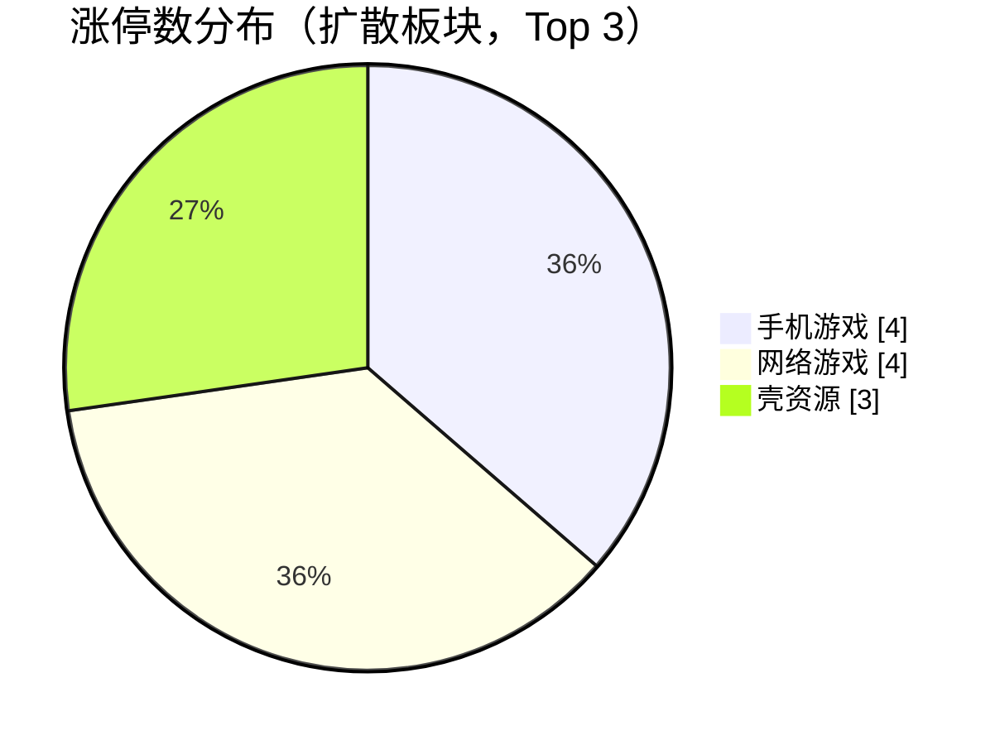
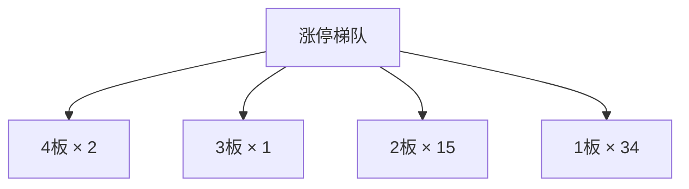

## 当日总览（截至 15:00）

> **结论**：全市场涨2108/跌3318（广度0.39）；涨停52/跌停17；中位涨幅-0.64%；局部修复。 钱在：手机游戏(涨停4/成分56，中位-0.09%)、网络游戏(涨停4/成分58，中位-0.09%)、壳资源(涨停3/成分51，中位-0.82%)；零星涨停：低辐射玻璃(Low-E)(1)、共享单车(1)、可燃冰(1)、租售同权(2)、托育服务(1)。 退潮：数据中心(AIDC)(跌停7)、商业航天(跌停5)、集成电路概念(跌停4)。 梯队：4板×2、3板×1、2板×15、1板×34，最高4板。 预案：无有效对照。 较上一轮广度基本持平。

> 🔒 **no_trade / 买入预算 0 / max_position_pct 0 —— 全部内容仅供研究，不授予交易权限。**

### 板块扩散

> 口径：XTick 概念成分 × 全市场实时报价；分母 = 板块内有有效报价的成分数。排序用涨停密度（涨停数/有效成分数），已剔除宽基属性板块（全市场 432 个板块中剔 16 个）。

**扩散中（题材，按涨停密度排序）**

| 板块 | 涨停 | 有效成分 | 涨停密度 | 上涨广度 | 中位涨幅 | 相对全市场 | 成交(亿) |
|---|---|---|---|---|---|---|---|
| 低辐射玻璃(Low-E) ⬦ | 1 | 12 | 0.083 | 0.83 | +0.61% | +1.25% | 18 |
| 手机游戏 | 4 | 56 | 0.071 | 0.46 | -0.09% | +0.55% | 352 |
| 共享单车 ⬦ | 1 | 14 | 0.071 | 0.50 | +0.00% | +0.64% | 12 |
| 可燃冰 ⬦ | 1 | 14 | 0.071 | 0.29 | -0.38% | +0.26% | 37 |
| 网络游戏 | 4 | 58 | 0.069 | 0.45 | -0.09% | +0.55% | 399 |
| 租售同权 ⬦ | 2 | 29 | 0.069 | 0.59 | +0.43% | +1.07% | 48 |
| 托育服务 ⬦ | 1 | 15 | 0.067 | 0.40 | -0.53% | +0.11% | 26 |
| 壳资源 | 3 | 51 | 0.059 | 0.27 | -0.82% | -0.18% | 65 |
| 中韩自贸区 ⬦ | 1 | 17 | 0.059 | 0.71 | +0.89% | +1.53% | 59 |
| PVDF概念 ⬦ | 1 | 17 | 0.059 | 0.47 | -0.23% | +0.41% | 65 |
| 乳业 ⬦ | 2 | 36 | 0.056 | 0.72 | +0.86% | +1.50% | 125 |
| 黑龙江自贸区 ⬦ | 2 | 36 | 0.056 | 0.58 | +0.53% | +1.17% | 79 |

> ⬦ = 涨停 <3 只，零星个例，不构成扩散（不计入「钱在」判定）。



零星涨停板块（<3 只）：低辐射玻璃(Low-E)(1)、共享单车(1)、可燃冰(1)、租售同权(2)、托育服务(1)、中韩自贸区(1)、PVDF概念(1)、乳业(2)

**退潮中（跌停集中）**

| 板块 | 跌停 | 有效成分 | 上涨广度 | 中位涨幅 |
|---|---|---|---|---|
| 数据中心(AIDC) | 7 | 664 | 0.26 | -1.52% |
| 商业航天 | 5 | 507 | 0.25 | -1.54% |
| 集成电路概念 | 4 | 241 | 0.16 | -3.29% |
| 汽车电子 | 4 | 399 | 0.17 | -2.62% |
| 2026三季报预增 | 4 | 103 | 0.26 | -2.68% |
| 高端装备 | 4 | 401 | 0.35 | -0.97% |
| 2025年报预增 | 4 | 504 | 0.36 | -0.90% |
| 共封装光学(CPO) | 3 | 230 | 0.10 | -5.23% |
| 液冷服务器 | 3 | 240 | 0.17 | -2.56% |
| 5G | 3 | 454 | 0.18 | -2.44% |
| 人民币贬值受益 | 3 | 612 | 0.35 | -0.99% |
| 2026中报预增 | 3 | 514 | 0.35 | -0.85% |

### 涨停梯队

> 最高 4 板 ｜ 涨停 52 ｜ 跌停 17 ｜ 炸板 35 ｜ 封板率 59.8% ｜ 打板成功率 13.74% ｜ 一进二 12.50% ｜ 二进三 16.67%

| 身位 | 家数 | 成员（涨幅/封单亿/首封） |
|---|---|---|
| 4板 | 2 | 东方海洋 +9.97%/0.022亿/09:25；阳光照明 +10.00%/0.020亿/09:25 |
| 3板 | 1 | 皇台酒业 +10.00%/0.014亿/09:25 |
| 2板 | 15 | 高争民爆 +10.00%/0.055亿/09:25；大晟文化 +10.07%/0.025亿/09:25；龙版传媒 +10.00%/0.016亿/09:25；浙文影业 +10.09%/0.016亿/09:25；奥飞娱乐 +9.99%/0.012亿/09:30 |
| 1板 | 34 | 圣阳股份 +10.02%/0.026亿/09:36；百洋股份 +9.96%/0.010亿/10:19；陕西旅游 +9.99%/0.010亿/10:49；太阳能 +10.07%/0.009亿/09:47；丰元股份 +10.04%/0.009亿/09:55 |



炸板 35 只（前几）：掌阅科技(14次)、西麦食品(5次)、昆船智能(5次)、登康口腔(4次)、中稀有色(4次)

### 预案池对照

| 票 | 池 | 板块 | 现价 | 涨幅 | 触发价 | 买区 | 风险位 | 判定 |
|---|---|---|---|---|---|---|---|---|
| 芒果超媒 `300413.SZ` | 执行池 | 传媒/AI内容 | 27.8 | +3.89% | — | — | 25.33 | **无预案价** |
| 国金证券 `600109.SH` | 执行池 | 证券/金融科技 | 8.42 | -0.36% | — | — | 8.15 | **无预案价** |
| 龙版传媒 `605577.SH` | 观察池 | 传媒/AI内容 | 14.3 | +10.00% | — | — | 12.53 | **无预案价** |
| 捷成股份 `300182.SZ` | 观察池 | 传媒/AI内容 | 5.57 | -1.24% | — | — | — | **无预案价** |
| 欢瑞世纪 `000892.SZ` | 观察池 | 传媒/AI内容 | 4.5 | +2.04% | — | — | — | **无预案价** |
| 新华传媒 `600825.SH` | 观察池 | 传媒/AI内容 | 12.31 | -1.28% | — | — | 12.03 | **无预案价** |
| 银之杰 `300085.SZ` | 观察池 | 证券/金融科技 | 28.86 | +8.17% | — | — | 28.34 | **无预案价** |
| 太平洋 `601099.SH` | 观察池 | 证券/金融科技 | 3.58 | +1.13% | — | — | 3.43 | **无预案价** |
| 东方财富 `300059.SZ` | 观察池 | 证券/金融科技 | 18.86 | +0.80% | — | — | 17.93 | **无预案价** |
| 恒生电子 `600570.SH` | 观察池 | 证券/金融科技 | 21.17 | +1.97% | — | — | 20.29 | **无预案价** |
| 皇台酒业 `000995.SZ` | 观察池 | 白酒 | 17.16 | +10.00% | — | — | 15.14 | **无预案价** |
| 水井坊 `600779.SH` | 观察池 | 白酒 | 29.39 | +4.52% | — | — | 28.83 | **无预案价** |
| 泉阳泉 `600189.SH` | 观察池 | 白酒 | 9.4 | -3.29% | — | — | 9.38 | **无预案价** |


> ⚠ D1 明确 no_trade=true、买入预算 0、个股 max_position_pct=0。以上为研究对照，**不构成任何买入许可**。

### 盘面 vs 静态复盘 vs 消息面

| 维度 | 对象 | T-1 静态基线 | 今日盘面 | 关系 |
|---|---|---|---|---|
| 板块主线 | 白酒 | R2 次线 score=None 涨停None（T-1 口径） | 盘面未见该板块成分票涨停 | **背离** |
| 板块主线 | 机器人 | R2 次线 score=None 涨停None（T-1 口径） | 盘面未见该板块成分票涨停 | **背离** |
| 板块主线 | 半导体 | R2 次线 score=None 涨停None（T-1 口径） | 盘面未见该板块成分票涨停 | **背离** |
| 板块主线 | 航空成本改善 | R2 次线 score=None 涨停None（T-1 口径） | 盘面未见该板块成分票涨停 | **背离** |
| 梯队结构 | 最高4板 | T-1 最高梯队 4 板、首板 29、炸板率 39.06% | 今日 4板×2、3板×1、2板×15、1板×34；封板率0.5977 炸板35只 | **印证** |
| 预案验证 | 芒果超媒(300413.SZ) | 预案 传媒/AI内容／leader／触发价None／买区None | 无预案价：预案未给触发价/买区（情景作废或待重导） | **无响应** |
| 预案验证 | 国金证券(600109.SH) | 预案 证券/金融科技／leader／触发价None／买区None | 无预案价：预案未给触发价/买区（情景作废或待重导） | **无响应** |
| 预案验证 | 龙版传媒(605577.SH) | 预案 传媒/AI内容／watch／触发价None／买区None | 无预案价：预案未给触发价/买区（情景作废或待重导） | **无响应** |
| 预案验证 | 捷成股份(300182.SZ) | 预案 传媒/AI内容／watch／触发价None／买区None | 无预案价：预案未给触发价/买区（情景作废或待重导） | **无响应** |
| 预案验证 | 欢瑞世纪(000892.SZ) | 预案 传媒/AI内容／watch／触发价None／买区None | 无预案价：预案未给触发价/买区（情景作废或待重导） | **无响应** |
| 预案验证 | 新华传媒(600825.SH) | 预案 传媒/AI内容／watch／触发价None／买区None | 无预案价：预案未给触发价/买区（情景作废或待重导） | **无响应** |
| 预案验证 | 银之杰(300085.SZ) | 预案 证券/金融科技／watch／触发价None／买区None | 无预案价：预案未给触发价/买区（情景作废或待重导） | **无响应** |
| 预案验证 | 太平洋(601099.SH) | 预案 证券/金融科技／watch／触发价None／买区None | 无预案价：预案未给触发价/买区（情景作废或待重导） | **无响应** |
| 预案验证 | 东方财富(300059.SZ) | 预案 证券/金融科技／watch／触发价None／买区None | 无预案价：预案未给触发价/买区（情景作废或待重导） | **无响应** |
| 预案验证 | 恒生电子(600570.SH) | 预案 证券/金融科技／watch／触发价None／买区None | 无预案价：预案未给触发价/买区（情景作废或待重导） | **无响应** |
| 预案验证 | 皇台酒业(000995.SZ) | 预案 白酒／watch／触发价None／买区None | 无预案价：预案未给触发价/买区（情景作废或待重导） | **无响应** |
| 预案验证 | 水井坊(600779.SH) | 预案 白酒／watch／触发价None／买区None | 无预案价：预案未给触发价/买区（情景作废或待重导） | **无响应** |
| 预案验证 | 泉阳泉(600189.SH) | 预案 白酒／watch／触发价None／买区None | 无预案价：预案未给触发价/买区（情景作废或待重导） | **无响应** |
| 消息面对照 | 盘面热点板块 | R4 消息面（T-1 口径） | 实时快讯未出现热点板块关键词 | **无响应** |

**分歧点（不掩盖）：**
- 板块主线·白酒 → 背离：T-1 有辨识度但今日盘中无涨停响应，题材未获资金确认
- 板块主线·机器人 → 背离：T-1 有辨识度但今日盘中无涨停响应，题材未获资金确认
- 板块主线·半导体 → 背离：T-1 有辨识度但今日盘中无涨停响应，题材未获资金确认
- 板块主线·航空成本改善 → 背离：T-1 有辨识度但今日盘中无涨停响应，题材未获资金确认

### 全天广度轨迹

| 时点 | 涨 | 跌 | 广度 | 涨停 | 跌停 | 成交(亿) | 有效样本 |
|---|---|---|---|---|---|---|---|
| 0930 | 1395 | 3771 | 0.251 | 17 | 4 | 590 | 5557 |
| 0940 | 1651 | 3628 | 0.296 | 26 | 3 | 2,719 | 5570 |
| 0950 | 3091 | 2268 | 0.555 | 33 | 3 | 4,084 | 5570 |
| 1000 | 3144 | 2245 | 0.565 | 40 | 3 | 5,164 | 5570 |
| 1010 | 3817 | 1641 | 0.685 | 45 | 3 | 6,092 | 5570 |
| 1020 | 3912 | 1559 | 0.702 | 47 | 3 | 6,820 | 5570 |
| 1030 | 4078 | 1407 | 0.732 | 48 | 3 | 7,468 | 5570 |
| 1040 | 3712 | 1728 | 0.666 | 51 | 3 | 8,046 | 5570 |
| 1050 | 3708 | 1736 | 0.666 | 50 | 3 | 8,477 | 5570 |
| 1100 | 3391 | 2059 | 0.609 | 50 | 4 | 8,913 | 5570 |
| 1110 | 3568 | 1896 | 0.641 | 53 | 4 | 9,318 | 5570 |
| 1120 | 3409 | 2028 | 0.612 | 54 | 4 | 9,680 | 5570 |
| 1130 | 3303 | 2135 | 0.593 | 55 | 4 | 9,996 | 5570 |
| 1140 | 3303 | 2135 | 0.593 | 55 | 4 | 9,996 | 5570 |
| 1150 | 3303 | 2135 | 0.593 | 55 | 4 | 9,996 | 5570 |
| 1200 | 3303 | 2135 | 0.593 | 55 | 4 | 9,996 | 5570 |
| 1210 | 3303 | 2135 | 0.593 | 55 | 4 | 9,996 | 5570 |
| 1220 | 3303 | 2135 | 0.593 | 55 | 4 | 9,996 | 5570 |
| 1230 | 3303 | 2135 | 0.593 | 55 | 4 | 9,996 | 5570 |
| 1240 | 3303 | 2135 | 0.593 | 55 | 4 | 9,996 | 5570 |
| 1250 | 3303 | 2135 | 0.593 | 55 | 4 | 9,996 | 5570 |
| 1300 | 2758 | 2640 | 0.495 | 57 | 4 | 10,159 | 5570 |
| 1310 | 2560 | 2843 | 0.460 | 56 | 5 | 10,759 | 5570 |
| 1320 | 2294 | 3096 | 0.412 | 55 | 6 | 11,357 | 5570 |
| 1330 | 1982 | 3428 | 0.356 | 50 | 9 | 11,935 | 5570 |
| 1340 | 2139 | 3261 | 0.384 | 50 | 9 | 12,530 | 5570 |
| 1350 | 1791 | 3609 | 0.322 | 48 | 10 | 12,979 | 5570 |
| 1400 | 1707 | 3687 | 0.306 | 48 | 9 | 13,370 | 5570 |
| 1410 | 1775 | 3632 | 0.319 | 49 | 13 | 13,852 | 5570 |
| 1420 | 1567 | 3852 | 0.281 | 47 | 16 | 14,411 | 5570 |
| 1430 | 2310 | 3094 | 0.415 | 52 | 10 | 15,005 | 5570 |
| 1440 | 2300 | 3132 | 0.413 | 53 | 12 | 15,651 | 5570 |
| 1450 | 2184 | 3249 | 0.392 | 54 | 16 | 16,325 | 5570 |
| 1500 | 1066 | 1745 | 0.367 | 26 | 7 | 8,925 | 2901 |

> ⚠ **数据冻结段**：1130–1250 数值连续完全一致，说明行情源未刷新，**不是市场横盘**，该段不可解读为盘面变化。

> ⚠ **分母变化**：1500（5570→2901） 有效样本变动超 15%，该时点广度与前后不可直接比较（数据降级）。

> [!WARNING] Mermaid 校验失败；以下保留原始图代码，未渲染。
> 原图块 3，原起始行 177，parse: Parse error on line 5: ...15 0.413 0.392 0.367 -----------------------^ Expecting 'SQUARE_BRACES_START', got 'NEWLINE'

```text
xychart-beta
    title "全市场广度轨迹（09:30 → 15:00）"
    x-axis "09:30 09:40 09:50 10:00 10:10 10:20 10:30 10:40 10:50 11:00 11:10 11:20 11:30 11:40 11:50 12:00 12:10 12:20 12:30 12:40 12:50 13:00 13:10 13:20 13:30 13:40 13:50 14:00 14:10 14:20 14:30 14:40 14:50 15:00"
    y-axis "广度(上涨占比)" 0 --> 1
    line 0.251 0.296 0.555 0.565 0.685 0.702 0.732 0.666 0.666 0.609 0.641 0.612 0.593 0.593 0.593 0.593 0.593 0.593 0.593 0.593 0.593 0.495 0.46 0.412 0.356 0.384 0.322 0.306 0.319 0.281 0.415 0.413 0.392 0.367
```

> [!WARNING] Mermaid 校验失败；以下保留原始图代码，未渲染。
> 原图块 4，原起始行 185，render: Cannot read properties of undefined (reading 'endTime')

```text
gantt
    title 全天截面时点分布（每个截面一个条目）
    09:30 截面 :done
    09:40 截面 :done
    09:50 截面 :done
    10:00 截面 :done
    10:10 截面 :done
    10:20 截面 :done
    10:30 截面 :done
    10:40 截面 :done
    10:50 截面 :done
    11:00 截面 :done
    11:10 截面 :done
    11:20 截面 :done
    11:30 截面 :done
    11:40 截面 :done
    11:50 截面 :done
    12:00 截面 :done
    12:10 截面 :done
    12:20 截面 :done
    12:30 截面 :done
    12:40 截面 :done
    12:50 截面 :done
    13:00 截面 :done
    13:10 截面 :done
    13:20 截面 :done
    13:30 截面 :done
    13:40 截面 :done
    13:50 截面 :done
    14:00 截面 :done
    14:10 截面 :done
    14:20 截面 :done
    14:30 截面 :done
    14:40 截面 :done
    14:50 截面 :done
    15:00 截面 :done
```

### 观察建议（仅研究）

- **环境**：涨停 52.0 / 跌停 17.0，打板成功率 13.7%，一进二 12.5%。
- **方向**：今日形成实质扩散的是 手机游戏（涨停4/成分56，密度0.071，中位-0.09%）、网络游戏（涨停4/成分58，密度0.069，中位-0.09%）、壳资源（涨停3/成分51，密度0.059，中位-0.82%）。**需确认**：次日能否维持涨停家数且中位涨幅不掉队，否则只是普跌中的避险轮动。
- **零星**：低辐射玻璃(Low-E)(1只/12成分)、共享单车(1只/14成分)、可燃冰(1只/14成分)、租售同权(2只/29成分)、托育服务(1只/15成分) 属零星个例，不视为题材，不据此选股。
- **回避**：数据中心(AIDC)（跌停7）、商业航天（跌停5）、集成电路概念（跌停4） 板块中位跌幅深，趋势未止跌前不接。
- **身位**：最高 4 板。梯队有高度不等于可接力，需逐票核验封单稳定性与开板次数后再定。

<details>
<summary>原始截面与数据质量（折叠）</summary>

**跨源校验**

```json
{
  "xtick": {
    "up": 2108,
    "down": 3318,
    "n": 5615,
    "amount_yi": 17029.1
  },
  "rtk_snapshot": {
    "up": 1066,
    "down": 1745,
    "valid_n": 2901,
    "amount_yi": 8925.4,
    "up_limit": 26,
    "down_limit": 7
  },
  "note": "两源口径不同（XTick 全市场含全部票；rt_k 返回样本）"
}
```

**rt_k 截面（原始）**

```json
{
  "market": {
    "total": 5582,
    "up": 1066,
    "down": 1745,
    "flat": 90,
    "requested_n": 5582,
    "received_n": 5582,
    "valid_n": 2901,
    "missing_n": 2681,
    "universe_requested_n": null,
    "population_scope": "returned_rows_not_verified_all_a_universe",
    "up_ratio": 0.191,
    "legacy_up_ratio_placeholder": false,
    "up_ratio_is_observed": true,
    "up_ratio_all": 0.191,
    "up_ratio_valid": 0.3675,
    "up_ratio_denominator": "requested_n",
    "degraded": true,
    "limit_known_n": 2901,
    "limit_unknown_n": 0,
    "limit_counts_complete": true,
    "limit_source_errors": [],
    "up_gt3": 161,
    "up_gt5": 70,
    "up_limit": 26,
    "down_gt3": 646,
    "down_gt5": 303,
    "down_limit": 7,
    "amount_yi": 8925.4,
    "amount_sum_overflow": false,
    "amount_valid_n": 2901,
    "amount_missing_n": 0
  },
  "source_time_quality": {
    "quote_age_min_seconds": 42.645171,
    "quote_age_max_seconds": 42.645171,
    "source_age_limit_seconds": null,
    "freshness_status": "age_limit_not_configured",
    "age_reference_at": "2026-11-03T15:00:42.645171+08:00"
  },
  "trading_authorized": false
}
```

</details>

## 分时研判记录

### 09:35 研判增量
- **趋势**：本轮依据2026-11-03的09:30分析（09:30:50生成；对应报价09:30:12—09:30:45），不是09:35新行情。当天仅此一轮，不能认定“较上一轮持平”、拐点或数据冻结。相对于盘前预案引用的11月2日“广谱修复、传媒与证券双线优先”，开盘只印证传媒局部延续，并未印证广谱修复：rt_k有效样本上涨1395/5557、广度25.10%；不与另一源或只取涨跌股票的分母混比。最高仍为4板，但开盘大量首封来自09:25，尚不足证明连续交易接力稳定，更不能把开盘封板率当全天胜率。
- **轮动**：传媒行业上涨84/131、涨停5/131，而非银金融上涨16/77、无涨停，说明原“双线”在本截面表现不对称；手机游戏、网络游戏、短剧游戏宜视为相关内容方向，成分未去重，不能把几个标签的涨停数相加当独立扩散。集成电路仅13/241上涨、中位跌幅1.92%，与内容方向形成相对强弱对照；只有单截面和成交额，不能宣称资金已从半导体净流向传媒或跷跷板成立。同轮快讯明确报道AI漫剧、大晟文化／浙文影业／电魂网络二连板，与梯队对应，故自动对照里的“消息无响应”不能照抄；这是行情报道的交叉印证，并非已核新增产业催化。白酒概念实际有2/48涨停，不能写“无涨停”，但尚非板块扩散，皇台三板不能代替全线转强。
- **剧本**：自动表中的“无预案价”不等于原研究情景不存在：价位在预案entry_rules内，买入资格仍明确受阻。逐组对照：芒果27.89高于原买区上沿27.53，国金8.70高于8.58，龙版14.30高于13.19，皇台17.16高于15.94，均不追，不能写成买点兑现；龙版当前二板也不解除原反抽观察限制。新华12.63在12.41—12.66内且高于触发12.47，恒生21.23在20.93—21.36内且高于触发21.04，仅价格条件触达，放量／承接／必要风险审核并未由截面证明。银之杰、太平洋、东方财富、水井坊、泉阳泉分别未到30.34、3.56、18.98、29.90、9.72，不拿风险位反推“已失效”。捷成与欢瑞原有硬否决保留，欢瑞进入快讯且上涨也不能覆盖。以上为11月3日原预案的研究参照，非更新执行指令。
- **下一步看**：先等下一轮同口径有效报价；若广度高于25.10%且涨停不少于17，才有检验修复是否扩面的依据；若涨停增加而广度下降，则仍是强势集中。内容方向对照手机游戏5/56涨停、39/56上涨及传媒5/131涨停、84/131上涨是否维持，重点核大晟／浙文／电魂／龙版二板是否开板，及已开板的掌阅是否真正重新封住；未取得路径不预写回封。证券双线恢复须见非银上涨面改善于16/77，并观察太平洋3.56、东财18.98是否与板块同步触达，而非国金独强。白酒替代剧本先看水井坊能否到原触发29.90并落在29.75—30.35内，同时板块涨停较现有2只增加；只皇台封住不算。芒果27.12、国金8.45仅保留原突破参照，回落进入原买区也须重评路径，不能把转弱当补票机会。禁新仓、本任务买入预算0、各票max_position_pct=0保持不变；预案账户预算字段为未知，不补造成已核资金。全部仅供研究，不授予买入许可。

### 09:45 研判增量
- **趋势**：涨停在增加，但承接更挑剔，不能升级为全面转强。依据2026-11-03最新09:40分析（09:40:50生成），对比09:30；不是09:45即时行情。返回有效样本上涨1395/5557→1651/5570、广度25.10%→29.64%；有效分母增加13只，未取得固定交集，不把百分比之差包装成严格同样本改善幅度。涨停17→26主要伴随首板3→11，最高仍4板；与此同时炸板2→5、封板率89.47%→83.87%。阳光照明虽仍在4板，累计开板1→6次，劲旅环境由二板在列转为开板、涨幅6.38%，说明“高度没断”并不等于接力质量改善。
- **轮动**：内容方向由扩面转为前排集中：短剧游戏涨停4/99→6/99，但上涨61/99→52/99；文化传媒概念涨停7/197→9/197，上涨却104/197→91/197。慈文传媒09:40首板为新增助攻，大晟／浙文／龙版仍列二板；手机游戏上涨39/56→40/56、涨停仍5/56，比内容大池更稳。白酒上涨23/48→30/48、中位涨幅0→+0.54%，正在改善，但涨停仍2/48，尚不足升级为接棒主线；非银金融上涨16/77→26/77，仍无涨停，“传媒＋证券双线同步”只获得部分印证。集成电路虽上涨13/241→43/241，中位跌幅反而由1.92%扩大至2.11%，不是整线止跌。白酒与内容广度反向变化只构成相对轮动苗头，无净流和持续时序，不确认资金跷跷板。最新消息样本新增港股航空受成本改善拉升的报道，但A股航空扩散未核，不能用港股报道直接认证原航空备选剧本。
- **剧本**：沿用预案入场规则内的原价位，而非自动表顶层空值。本轮有实质状态变化的是：太平洋3.50→3.59，进入3.54—3.61并越过原触发3.56；泉阳泉9.16→9.78，进入9.67—9.87并越过9.72——均仅价格条件触达，未证明放量、持续承接或必要风险审核通过，泉阳泉原资金净卖／多次开板反证不因翻红解除。新华传媒12.63→12.90，由原买区内移至上沿12.66之上，应改为“买点已越过，不追”，不是自动晋级。国金8.70→8.60仍高于上沿8.58，回落不等于给出新买点；芒果继续在原上沿27.53之上。银之杰上行至28.29，仍未到原触发30.34。捷成、欢瑞的原硬否决未解除，不随传媒局部强势递补。
- **下一步看**：内容扩面须看下一截面能否同时保住文化传媒概念9只、短剧游戏6只涨停，并把上涨面分别恢复至原先104/197、61/99；若涨停增加而上涨面继续收缩，仍按前排集中而非普涨解释。白酒备选先看涨停是否突破现有2只，以及水井坊能否触达原29.90且处于29.75—30.35；不把29.43的上行提前写成触发。太平洋须补核3.56—3.61内的分钟承接，泉阳泉须补核9.72—9.87内路径；若再落回各自触发价下，只撤回“当前价格触达”判断，不倒推曾经站稳或新增卖出指令。证券仍须观察东方财富18.98与非银上涨面能否同步改善，不能只看太平洋一只。下一轮同时核阳光照明开板次数是否继续增加。no_trade=true、本任务买入预算0、各票max_position_pct=0不变；真实账户预算仍未知。全部仅供研究，不授予任何买入许可。

### 09:55 研判增量
- **趋势**：修复由前排局部延伸到多数返回样本，但高度尚未突破、内容前排仍有松动。依据2026-11-03的09:50分析（09:50:48生成，采集09:50:38—09:50:47，对应报价09:49:48—09:50:44），对比09:40，不是09:55即时行情。两轮有效分母均5570，上涨1651→3091，广度29.64%→55.49%，提高25.85个百分点；涨停26→33、跌停仍3，二板12→15、首板11→15，最高仍4板。封板率83.87%→84.62%小幅改善，不能当盈利胜率；慈文传媒却由首板在列转入开板名单、累计开板2次，阳光照明累计开板仍6次。新增信息是“扩面修复与核心分歧并存”，不是简单延续上一轮的前排集中，也不是一致主升。
- **轮动**：新增扩散不能只看截断的热点榜。电力设备行业涨停4/418→8/418、上涨211/418→339/418，中位涨幅+0.05%→+1.46%；概念侧光伏建筑一体化涨停2/135→4/135、钠离子电池1/144→3/144，梯队新增太阳能、龙蟠科技09:47首板，构成内容之外的新强势观察方向，但未核逐票概念纯度及流通市值，不据此推荐新票。文化传媒概念上涨91/197→117/197，涨停反而9/197→8/197，相对全市场中位优势+0.58→+0.08个百分点：上涨面修复而前排封板收缩，不能说资金全面撤离，也不能说主线同步加速。银行中位跌幅由1.14%扩大至1.79%、上涨仍0/42，与09:49银行下挫快讯相互印证；与电力设备构成价格上的相对跷跷板，尚无净流证据证明两者资金直接搬家。相关概念成分重叠，涨停数不相加；新强势方向的增量催化尚未核实，不升级为盘面／静态研究／消息三方一致。
- **剧本**：11月2日基线中的“广谱修复”得到新增盘面支持，但“传媒＋证券双线同步”仍未完整兑现：非银金融上涨26/77→42/77，却仍无涨停，中位涨幅+0.22%、相对市场为-0.02个百分点。按原预案入场规则内价位核对，本轮三处状态变化最重要：国金8.60→8.54，从原上沿8.58之外退回8.41—8.58区间且仍高于触发8.45，这是回落进入价格带，不是重新放量突破确认；恒生21.24→21.46，越过原上沿21.36，改为买点已越过、不追；泉阳泉9.78→9.65，落回触发9.72及买区下沿9.67之下，撤回上一轮“当前价格触达”判断，不能倒推曾站稳，也不以风险位直接判已失效。水井坊虽29.43→29.70，仍未进入29.75—30.35、未到29.90，白酒备选未触发，概念涨停仍2/48也未出现新的板块级扩散。其余原价位状态未切换，不重复旧表；原反证和硬否决均保留。
- **下一步看**：以本截面作研究观察基线，而非新增交易门槛：下一轮同口径有效样本广度能否维持55.49%、涨停不少于33，同时电力设备保住8/418涨停及339/418上涨、钠电保住3/144涨停；若只见广度上升却这些封板减少，扩面不等于核心强化。内容侧看慈文能否重新进入涨停名单，以及阳光照明累计开板是否超过现有6次，不凭当前价预写回封稳定。国金只观察8.45—8.58内是否补齐分钟承接与板块同步，跌回8.45下便撤回当前越线描述，不因回到区间就补票；白酒须同时看水井坊触达29.90且不超过原上沿30.35、板块涨停突破现有2只，泉阳泉须先收回9.72再核路径。禁新仓no_trade=true、本任务买入预算0、各票max_position_pct=0不变；真实账户预算仍未知，全部仅供研究，不授予任何买入许可。

### 10:05 研判增量
- **趋势**：扩面修复明显减速，新增封板与原双线转弱并存。依据2026-11-03的10:00分析，对比09:50；本轮采集10:00:38—10:00:50、报价09:59:51—10:00:47，不是10:05即时行情。两轮有效返回样本均5570，上涨3091→3144、广度55.49%→56.45%，仅增0.96个百分点，低于上一段的25.85个百分点；涨停33→40，主要来自首板15→21，二板15→16、最高仍4板。炸板6→8、封板率84.62%→83.33%，掌阅科技新增进入开板名单、累计3次：修复仍在，但不能沿用上一轮的扩面速度或升级为一致主升，封板率也不是盈利胜率。
- **轮动**：电力设备继续强化：涨停8/418→11/418、上涨339/418→342/418；题材侧钠离子电池涨停3/144→5/144、上涨125/144→126/144，在剔除宽基且涨停不少于3只的概念密度排序中由第9升至第5，盟固利09:54首板为新增梯队观察。相反，短剧游戏涨停5/99→4/99、上涨65/99→56/99；非银金融上涨42/77→21/77，中位涨幅+0.22%→-0.26%，仍无涨停。由此推断新能源相对内容、金融走强，但没有净流证据，不确认资金直接搬家；行业与重叠概念不相加。11月2日“传媒＋证券双线优先”的基线进一步受挑战；新快讯样本出现消费环境活动和港股消费走强，但不能据此认证A股白酒接棒，也未给出新能源新增催化，三方尚未一致。
- **剧本**：仍按原预案entry_rules核价，不沿用自动表顶层空值的“无预案价”。太平洋3.59→3.54，虽在3.54—3.61内，却跌回触发3.56下，撤回“当前已越线”；国金8.54→8.48仍高于8.45，但与非银转弱同现，原放量突破剧本没有得到加强。新华12.72→12.66、恒生21.46→21.36分别退回原买区上沿，只是回落进入价带，不是新的突破确认。泉阳泉9.65→10.48，直接由低于买区转为超过原上沿9.87，不能因重新越过9.72就视作合格触发，更不追高；原资金净卖、多次开板反证不解除。水井坊29.70→29.45，离原触发29.90更远，消费消息没有替代价格兑现。
- **下一步看**：以本轮实测数作研究观察基线，不新增交易门槛：钠电能否维持5/144涨停、126/144上涨，电力设备能否保住11/418涨停，同时返回样本广度不弱于56.45%、涨停不少于40；若只增涨停而广度退，按强势集中解释。原双线修复先看非银上涨面能否恢复至上一轮42/77，以及太平洋重回3.56—3.61、国金守住8.45—8.58后是否补齐分钟承接；只有截面不认定站稳。新华、恒生回到原价带不自动递补，泉阳泉超区不追，不下移或抬高原买区。no_trade=true、本任务买入预算0、各票max_position_pct=0不变；预案真实账户预算字段仍为未知，全部仅供研究，不授予任何买入许可。

### 10:15 研判增量
- **趋势**：上一轮减速后，扩面修复重新加快，但高位封板质量没有同步变稳。依据2026-11-03的10:10分析，对比10:00；本轮采集10:10:38—10:10:48、对应报价10:10:09—10:10:45，不是10:15即时行情。两轮有效返回样本均5570，上涨3144→3817、广度56.45%→68.53%，提高12.08个百分点；涨停40→45、跌停仍3，二板16→18、首板21→24，最高仍4板。封板率83.33%→84.91%，但东方海洋虽仍列4板，累计开板0→3次；不能把高度未断或整体封板率改善当成高标承接稳定，更不是盈利胜率。
- **轮动**：内容重新扩面，上一轮“新能源强、内容金融弱”的单向轮动需要修正。短剧游戏涨停4/99→5/99、上涨56/99→77/99；传媒行业上涨65/131→100/131，相对市场中位表现由-0.26→+0.32个百分点。新能源并未因此失血：电力设备涨停11/418→12/418，钠电5/144→6/144、上涨126/144→133/144，钠电在剔除宽基且涨停不少于3只的概念密度排序中由第5升至第4，但相对中位优势+1.47→+1.28个百分点有所收窄。非银上涨21/77→45/77、中位涨幅转正，相对市场仍为-0.54个百分点且无涨停，只能认定跟随修复，不能升级为领涨；银行仅2/42上涨，仍明显落后。本轮是多方向同修复，没有资金净流证据，不确认板块间直接搬家或跷跷板。11月2日基线的“广谱修复”得到进一步印证，“传媒＋证券双线优先”仍只部分成立。10:09快讯样本新增电池行情及研报转述，补上新能源的消息呼应，但不是已核公司新增公告，也不能将固态电池叙事直接等同于钠电催化；不据此宣布新主线确立。
- **剧本**：按原预案入场规则，本轮太平洋3.54→3.58，重新越过3.56且在3.54—3.61内；国金8.48→8.54仍在8.41—8.58内且高于8.45，叠加非银上涨面恢复，原双线剧本获得部分修复，但截面没有补齐放量、同分钟资金和持续承接，均不能写成确认买点。新华12.66→12.80、恒生21.36→21.45，分别再次越过原上沿12.66、21.36，撤回“当前处于原价带”的描述，不追。芒果27.60→28.55与内容扩面同向，但仍高于原上沿27.53，方向走对不等于买点合格。白酒上涨面虽改善，涨停仍2/48，水井坊29.45→29.38仍未到29.90，备选剧本没有接棒；其余未切换的原价位状态不重列，既有硬否决及必要审核缺口不解除。
- **下一步看**：只用本轮已观测值作研究基线：下一截面有效分母不降级时，广度能否维持68.53%、涨停不少于45，同时短剧游戏保住5/99涨停及77/99上涨、钠电保住6/144涨停及133/144上涨；若广度继续提高而核心封板减少，扩面与前排质量须分开解释。另核东方海洋累计开板是否超过现有3次，不能仅看仍处涨停。证券恢复领涨须看非银相对中位表现是否改善于-0.54个百分点，并补核国金8.45—8.58、太平洋3.56—3.61内的分钟承接；东方财富仍须触达原18.98且不超过原上沿19.26，未到价不提前认证。上述仅检验原研究剧本，不延长或修改正式预案，不调整买区；no_trade=true、本任务买入预算0、各票max_position_pct=0保持不变，预案真实账户预算仍未知，全部仅供研究，不授予任何买入许可。

### 10:25 研判增量
- **趋势**：扩面仍在，但速度再次放缓，新增强度更偏向内容方向。依据2026-11-03的10:20分析，对比10:10；本轮采集10:20:38—10:20:48、对应报价10:19:36—10:20:47，不是10:25即时行情。两轮有效返回样本均5570，上涨3817→3912、广度68.53%→70.23%，改善明显慢于上一段；涨停45→47、二板18→19、首板24→25，最高仍4板。炸板8→9、封板率84.91%→83.93%，不能把广度走高等同封板质量同步改善。华智数媒10:12封出20cm二板，形成新增弹性观察锚；掌阅科技虽列二板，累计开板7次，辨识度与稳定性仍须分开。
- **轮动**：内容从“重新扩面”推进到前排与上涨面同步强化：短剧游戏涨停5/99→7/99、上涨77/99→84/99；传媒行业涨停6/131→8/131、上涨100/131→109/131。AI视频由2/67→3/67涨停，刚达到扩散观察门槛，但中位表现仍落后市场0.02个百分点，不直接升为主线。钠电在剔除宽基、涨停不少于3只的概念密度排序中由第4退至第7，却仍为6/144涨停、133/144上涨，相对中位优势反从+1.28扩大到+1.67个百分点；掉出顶部榜不等于失血。电力设备涨停12/418→11/418、上涨359/418→369/418，是封板收缩与面上继续走强并存，新增开板名单中的清源股份需留意，不能据此否定整线。集成电路上涨仍108/241、中位跌幅0.21%→0.36%，与内容形成更明显的相对分化，但没有净流证据，不确认直接资金跷跷板。10:20:10快讯与华智数媒二板、内容扩散相互印证，支持11月2日基线的传媒方向；它是行情报道，不是新产业催化，报道中“此前慈文涨停”也不能覆盖本截面慈文仍在开板名单的事实。
- **剧本**：原“传媒＋证券双线”新增的是证券跟随范围扩大，而非已经领涨：非银上涨45/77→63/77，相对中位表现-0.54→-0.26个百分点，仍无涨停；10:20:14政策解读转述的是11月2日事件，不当作新政策落地或实际资金入市。按原预案入场规则核对，国金8.54→8.60，越过原买区上沿8.58，撤回“当前处于原价带”描述，不追；太平洋3.58→3.59仍在原价带、东财18.85→18.87仍未到原触发18.98，只有板块扩面，尚未补齐分钟承接与同步资金确认。白酒上涨42/48→43/48但涨停仍2/48、水井坊29.38→29.13离原触发29.90更远，备选没有接棒；泉阳泉10.08→9.94虽回落，仍高于原上沿9.87，不能把回落提前叫新买点。其余未切换的状态不重列，既有硬否决与必要审核缺口不解除。
- **下一步看**：以本轮实测值作研究对照，不新增交易门槛：下一截面有效分母不降级时，广度能否维持70.23%、涨停不少于47，同时内容保住7/99短剧涨停与84/99上涨、传媒保住8/131涨停；若封板再减而广度升，继续分开评价扩面与前排质量。新能源看电力设备能否恢复上一轮12/418涨停，钠电能否维持6/144涨停及133/144上涨，不凭榜位下降判退潮。证券观察非银能否改善于当前-0.26个百分点的相对中位表现，并核东财触达18.98且不超过原上沿19.26；国金回到8.45—8.58也只能重评路径，不自动补票。另核华智数媒、掌阅后续是否开板及累计开板是否超过本轮记录，单截面不认证持续封稳。no_trade=true、本任务买入预算0、各票max_position_pct=0不变；预案真实账户预算仍未知，全部仅供研究，不授予任何买入许可。

### 10:35 研判增量
- **趋势**：修复继续扩面，但传媒与证券的上涨面没有同步扩大，不能把榜位未变当成主线继续加速。依据2026-11-03的10:30分析，对比10:20；本轮采集10:30:38—10:30:47、对应报价10:29:42—10:30:44，不是10:35即时行情。两轮有效返回样本均5570，上涨3912→4078、广度70.23%→73.21%，提高2.98个百分点；涨停47→48，梯队净增只落在二板19→20，首板仍25、最高仍4板。炸板9→10、封板率83.93%→82.76%，利君股份新增进入展示的开板名单。广度改善与封板质量回落并存，仍不支持一致主升或高标接力已变稳。
- **轮动**：内容前列名次未动，内部扩散却降温：网络游戏仍5/58涨停，上涨49/58→45/58，相对市场中位优势+0.81→+0.43个百分点；传媒行业仍8/131涨停，上涨109/131→102/131。新能源重新扩面：电力设备涨停11/418→12/418、上涨369/418→372/418；钠电仍6/144涨停，上涨133/144→136/144，相对中位优势+1.67→+1.69个百分点。由此更像新能源强化、内容前排维持而后排回吐，不是内容整线退潮；相关概念不叠加计数。非银上涨63/77→60/77、相对中位表现-0.26→-0.44个百分点，原证券跟随修复也未继续增强。11月2日“广谱修复”的基线仍获印证，“传媒＋证券同步优先”则进一步打折；10:30:01电池报道与新能源盘面呼应，但其中昨日ETF流入不是今日净流证据，固态电池叙事也不直接认证钠电催化。只能推断相对轮动，不确认板块间资金直接搬家。
- **剧本**：按原预案入场规则，本轮两只由超买区退回原价带：国金8.60→8.54，重新落入8.41—8.58且高于触发8.45；泉阳泉9.94→9.86，回到9.67—9.87且高于9.72。两者均是回落进入价带，不是新的放量突破确认；国金同时遇到非银扩面退步，泉阳泉原资金净卖、多次开板反证也未解除，不能把价格回区当补票机会。太平洋3.59→3.61已到原买区上沿，再上涨就不应仍描述为区内；银之杰虽28.85→29.54，仍未到原触发30.34，不用涨幅替代触发。其余未切换的原价位状态不重列，原硬否决与必要审核缺口保留；这里只比较原研究情景，不延长正式预案有效期。
- **下一步看**：以下均以本轮实测值作研究对照，不新增交易门槛：有效分母不降级时，广度能否维持73.21%、涨停不少于48；若广度继续提高但封板数回落，仍分开评价扩面与接力。内容侧看网络游戏上涨面能否恢复上一轮49/58且保住5只涨停；新能源看电力设备保住12/418涨停、钠电保住6/144涨停及136/144上涨，检验是否只是短时相对优势。国金8.45—8.58、泉阳泉9.72—9.87内须补核分钟承接，跌回各自触发价下便撤回“当前价格触达”，不倒推曾经站稳；太平洋不追过3.61。no_trade=true、本任务买入预算0、各票max_position_pct=0不变；预案真实账户预算仍未知，全部仅供研究，不授予任何买入许可。

### 10:45 研判增量
- **趋势**：扩面修复转为强势集中，不再沿用10:35“继续扩面”的判断。固定比较11月3日10:40与10:30分析，不是10:45新行情；本轮10:40:49生成，rt_k采集10:40:38—47、报价10:39:09—10:40:45。两轮有效返回样本均5570，上涨4078→3712、广度73.21%→66.64%，回落6.57个百分点；涨停却48→51，净增落在首板25→28，二板仍20、最高仍4板。炸板仍10，封板率82.76%→83.61%主要随封板数增加，不能据此认定高标接力更稳。时标与总量均更新，非整组冻结；报价龄阈值未配置，不冒充全源时效认证。
- **轮动**：新能源相对抗跌，但也不再全面扩面：电力设备涨停12/418→13/418，上涨372/418→365/418；钠电仍6/144涨停，上涨136/144→134/144，相对中位优势+1.69→+1.74个百分点，不能把相对优势扩大说成绝对加速。内容的前排与后排分离更明显：短剧仍7/99涨停，上涨84/99→72/99；AI视频仍3/67涨停，上涨49/67→38/67。分母均为有效报价成分，重叠概念不相加。新增三变科技10:37首板与10:39:24电网设备快讯对应；10:40:02资金快讯也报道电力设备流入，但只是媒体口径，不是本地同口径净流核验，不能证明传媒资金直接搬家。
- **剧本**：11月2日“广谱修复、传媒与证券双线优先”的基线，本轮转为修复回吐、双线同步继续受挫：非银上涨60/77→49/77，仍无涨停。按原预案entry_rules逐票核完13只，唯一价带状态切换是泉阳泉9.86→9.60，跌回触发9.72与买区下沿9.67之下，撤回“当前价格触达”，不拿风险位判失效。国金8.54→8.46虽仍在原区且高于8.45，却与板块收缩同现，靠近触发不等于承接确认；太平洋3.61→3.58也只是区内回落。白酒仍2/48涨停、上涨43/48→38/48，水井坊29.20→28.99离29.90更远，皇台三板没有带出新的板块扩散。其余价带状态未切换，超区不追、原硬否决与必要审核缺口均保留。
- **下一步看**：强剧本须先看同口径广度能否从66.64%向上一轮73.21%恢复，同时保住本轮51只涨停；新能源看13/418电力设备、6/144钠电涨停能否维持，内容看短剧上涨面能否恢复84/99且保住7只涨停。反向若广度继续低于66.64%而涨停增加，只认集中强化，不认全面企稳；这些是实测对照，不是新增买入门槛。国金8.45—8.58、太平洋3.56—3.61仍须补核分钟承接；泉阳泉须先收回9.72且不越原上沿9.87，不下移买区接弱。no_trade=true、本任务买入预算0、各票max_position_pct=0不变；真实账户预算仍未知，正式预案09:30有效期不自动延长。全部仅供研究，不授予买入许可。

### 11:05 研判增量
- **趋势**：修复回吐再加快，局部补板没有带回上涨面。本轮固定依据2026-11-03的11:00分析，对比相邻10:50分析；本轮采集11:00:38—47、对应报价10:59:03—11:00:45，不是11:05即时行情。两轮有效返回样本均5570，上涨3708→3391、广度66.57%→60.88%，回落5.69个百分点；rt_k涨停仍50，XTick梯队口径则49→50、净增落在首板26→27，最高仍4板、二板仍20，两源不混算。跌停3→4，华丰股份新增进入跌停名单，说明弱端风险也在扩大。另须保留数据反证：展示的开板样例价格及累计次数在10:40、10:50、11:00完全相同，按该字段未刷新处理，不能拿它证明开板风险未增或高标已经封稳。
- **轮动**：新能源是前排补板、后排回吐，不是继续全面扩散：电力设备涨停12/418→13/418，但上涨364/418→347/418、中位涨幅+2.16%→+1.73%；钠电涨停仍6/144，上涨131/144→126/144。传媒行业上涨90/131→92/131、涨停仍8/131，相对市场中位优势+0.11→+0.32个百分点，却伴随自身中位涨幅+0.89%→+0.81%，只能称相对承接，不能称绝对加速。概念热榜前列顺序未变，也没有替代成分扩散核验；相关标签不相加。由此推断新能源与内容的强弱差在收敛，但缺同口径净流，不能确认直接资金搬家。文件快讯在11:00:35新增国产算力训练报道，属转述、未获公司原始确认，且接近截面末端；集成电路上涨105/241→84/241、AIDC上涨386/664→344/664，尚未显示广泛价格响应，不能把新消息直接升级为硬科技转强或倒推本段波动原因。
- **剧本**：11月2日“广谱修复、传媒与证券双线优先”的基线，本轮进一步表现为传媒相对抗跌、证券确认退步，而非双线共振。按原预案入场规则，国金8.45→8.43，虽仍在8.41—8.58内，却已低于触发8.45，撤回“当前价格触达”；东方财富18.90→18.88，从原买区内未触发退至下沿18.89之外，仍未到18.98；太平洋3.59→3.56恰到触发价，不能写成持续站稳。非银上涨53/77→49/77、仍无涨停，与上述退步同向。芒果28.04→28.33虽独立走强，仍超过原上沿27.53，方向受支持不等于买点合格，不追。其余原价带状态没有新增切换；自动“无预案价”不用于覆盖原规则，原硬否决与必要审核缺口不解除，也不凭风险位把未到价误判为失效。
- **下一步看**：只以已观测值作研究对照：同口径广度须先从60.88%向上一轮66.57%恢复，且涨停不低于本轮50、跌停不继续超过4，才有重评扩面修复的依据；若涨停维持或增加而广度继续低于60.88%，仍按强势集中解释。传媒看能否保住8/131涨停及92/131上涨，钠电看能否在保留6/144涨停的同时恢复上一轮131/144上涨，避免把相对抗跌当整线强化。证券先核国金重新达到8.45且不越原上沿8.58、东财达到18.98且不越19.26，并补齐分钟承接与板块同步；太平洋跌回3.56下便撤回当前越线描述，不下移买区接弱。这些不是新增买入门槛或授权：no_trade=true、本任务买入预算0、各票max_position_pct=0不变，真实账户预算仍未知；正式预案有效期不延长，全部仅供研究，不授予任何买入许可。

### 11:15 研判增量
- **趋势**：上一轮回吐后出现反弹，但尚未收复回吐前的上涨面，不能升级为修复重新加速。固定比较2026-11-03的11:10与11:00分析；本轮采集11:10:38—48、报价11:09:33—11:10:47，不是11:15即时行情。两轮有效返回样本均5570，上涨3391→3568、广度60.88%→64.06%，提高3.18个百分点，仍低于10:50的66.57%；涨停50→53、跌停仍4，净增均落在首板27→30，二板仍20、最高仍4板。展示样例新增九牧王11:01首板，只证明新增封板，不证明题材地位或交易资格。整体封板率79.37%→81.54%，但开板样例的价格与次数继续未更新，不能据此认证慈文等已回封或高标封稳。
- **轮动**：内容与金融补涨面恢复，新能源并未同步失血，更像多方向修复而非单向跷跷板。传媒行业上涨92/131→99/131、涨停仍8/131，相对市场中位优势+0.32→+0.50个百分点；IP经济上涨142/198→150/198、涨停8/198→9/198，在剔除宽基且涨停不少于3只的概念密度排序中由第8升至第5，说明内容周边新增助攻，重叠概念不相加。电力设备上涨347/418→351/418、涨停仍13/418，钠电上涨126/144→129/144、涨停仍6/144，但钠电相对中位优势+1.59→+1.44个百分点收窄，是相对优势被追近，不是整线撤退。固态电池虽仍有2只跌停，同时有7/300涨停、222/300上涨，不能照抄“整板退潮”。中船系由0→1/10涨停便升至密度榜首，仍属零星上板；自动消息“印证”的3条实际是10:37—10:38同一行情报道的多平台转述，不是本轮新增催化，不能据此宣布主线切换。
- **剧本**：11月2日“传媒＋证券双线优先”的原推论获得部分修复，但证券仍是跟随：非银上涨49/77→66/77，相对中位表现-0.19→-0.08个百分点，仍无涨停。按原预案入场规则，国金8.43→8.45，重新恰到触发价且在8.41—8.58内；东方财富18.88→18.97，重新进入18.89—19.26，却仍未到触发18.98；太平洋3.56→3.59仍在原触发价带。三者合看比上一轮改善，但截面没有补齐放量、同分钟资金和持续承接。芒果28.33→28.82与传媒扩面同向，却继续超过原上沿27.53，不追；其余原价带状态无新增切换，硬否决与必要审核缺口不解除。最新快讯样本新增AI治理和数据效能报道，但未核实与上述个股的直接催化关系，不能把双线修复认证为三方一致。
- **下一步看**：以已有实测值作研究对照：同口径有效样本不降级时，广度能否从64.06%继续恢复至10:50的66.57%，同时涨停不少于53、跌停不超过4；若再跌回64.06%以下而涨停维持或增加，仍按强势集中而非全面企稳解释。内容看IP经济能否保住9/198涨停、传媒保住8/131涨停及99/131上涨，避免只由单票上板制造榜位变化。证券核国金8.45—8.58、太平洋3.56—3.61内的分钟承接，以及东财能否达到18.98且不越19.26；国金再低于8.45便撤回当前价格触达，不下移买区。以上不新增买入门槛，不延长正式预案有效期；no_trade=true、本任务买入预算0、各票max_position_pct=0不变，真实账户预算仍未知，全部仅供研究，不授予任何买入许可。

### 11:25 研判增量
- **趋势**：11:10的反弹再次回吐，新增涨停不能证明修复延续。固定比较2026-11-03的11:20与11:10分析；本轮采集11:20:39—46、对应报价11:18:54—11:20:44，不是11:25即时行情。两轮有效返回样本均5570，上涨3568→3409、广度64.06%→61.20%，回到11:00附近，并非顶部自动结论所称“广度基本持平”。涨停53→54、跌停仍4，但二板20→19、首板30→32、最高仍4板，炸板12→15；新增封板与接力收缩同时发生，更像强势集中而非全面转强。总量和时标更新，不属整组冻结；部分开板样例仍沿用旧价与次数，不据其认证个股回封或持续封稳。
- **轮动**：内容与新能源上涨面都在收缩，差别在相对承接：传媒行业涨停仍8/131，上涨99/131→92/131，相对全市场中位优势+0.50→+0.28个百分点；电力设备涨停仍13/418，上涨351/418→341/418，相对优势+1.13→+1.15个百分点。新能源相对抗跌，不等于绝对加速。新增补板出现在纺织服饰3/108→4/108、商贸零售2/100→3/100，但上涨面分别85/108→82/108、83/100→74/100，仍是消费前排集中，不能宣布接棒主线；行业标签也不等于已核题材驱动。以上分母均为有效报价成分，相关分组不相加，无同口径净流证据，不确认资金直接搬家或跷跷板。文件新增11:20:30产业政策快讯，接近采集尾端，原文与后续价格响应尚待验证，不能用它倒推本段硬科技回落原因或宣布反转。
- **剧本**：11月2日“传媒＋证券双线优先”的原推论再次受削弱：非银上涨66/77→58/77，仍无涨停。逐票核对原预案入场规则，价带身份均无新切换，新增的是同步性退步：国金仍8.45、恰到原触发价，太平洋3.59→3.56退至触发价，东财18.97→18.91仍未到18.98；不能把价格贴线写成放量突破或站稳。芒果28.82→28.10随传媒回吐，却仍高于原买区上沿27.53，不把回落当补票机会。龙版仍列二板、现价14.30仍超原上沿13.19，辨识度不解除原反抽观察限制；捷成、欢瑞原硬否决与其余对象必要审核缺口均保留。自动“无预案价”不覆盖原研究规则，研究对照也不延长正式预案有效期。
- **下一步看**：以下只用已有实测值作研究对照，不新增买入门槛：同口径分母不降级时，上涨广度能否先收回上一轮64.06%，同时保住本轮54只涨停、二板恢复上一轮20只、炸板不继续多于15；若广度低于本轮61.20%而涨停不减，仍按集中强化解释。消费补板须同时保住纺织服饰4/108、商贸零售3/100涨停，并恢复上一轮85/108、83/100上涨，才重评是否真正扩面。证券继续核国金8.45—8.58、太平洋3.56—3.61内的分钟承接，以及东财能否达到18.98且不越19.26；跌回各自触发价下便撤回当前价格触达描述，不下移买区接弱。禁新仓no_trade=true、本任务买入预算0、各票max_position_pct=0不变；账户预算原字段仍未知，全部仅供研究，不授予任何买入许可。

### 11:35 研判增量
- **趋势**：上午修复继续回吐，封板进一步集中，尚无新拐点。固定比较2026-11-03的11:30与11:20分析；本轮rt_k采集11:30:38—41、报价11:30:00—39，不是11:35即时行情。两轮有效返回样本均5570，上涨3409→3303、广度61.20%→59.30%，回落1.90个百分点，已低于11:00的60.88%；涨停54→55仅对应首板32→33，二板仍19、最高仍4板，炸板15→16、封板率78.26%→77.46%。新增封板没有阻止上涨面收缩；部分开板样例仍未刷新，不据其认证回封或封稳。
- **轮动**：内容的涨停密度前列排名未变，内部却继续收缩：短剧游戏涨停仍7/99，上涨71/99→67/99；传媒行业涨停仍8/131，上涨92/131→85/131。新能源也非全面扩散：电力设备涨停仍13/418，上涨341/418→337/418、中位涨幅+1.67%→+1.48%。新增助攻偏向消费：食品饮料涨停2/127→3/127、上涨95/127→101/127；乳业涨停1/36→2/36、上涨30/36→32/36，虽强化但尚属零星上板，不能宣布接棒主线。分母均为有效报价成分，行业不等于题材驱动，重叠概念不相加；只有价格强弱分化，没有同口径净流证据，不确认资金直接搬家或跷跷板。
- **剧本**：11月2日“传媒＋证券双线优先”的原推论，截至午盘仍未同步兑现：非银上涨58/77→57/77、仍无涨停，国金8.45、太平洋3.56继续恰到原触发价，东财18.91→18.89退至原买区下沿，不能把贴线认成站稳。逐票核对原入场规则，唯一新增价带身份切换是泉阳泉9.40→9.94，由未到价直接转为超过原上沿9.87；不追，也不解除原资金净卖、多次开板反证。芒果28.10→28.27局部回升，但仍高于原上沿27.53，方向受支持不等于买点合格。水井坊29.06→28.86仍未到原触发29.90，消费助攻不能替代白酒备选兑现。本轮快讯样本未提供上述候选的新增直接催化，尚不足认定盘面、静态研究与消息三方一致；其余原价带身份及硬否决未变，不重复旧表。
- **下一步看**：午休原数不作企稳证据；等午后首轮报价时标真正更新、有效分母未降级的截面，先看广度能否收回上一轮61.20%，同时保住55只涨停、二板不少于19只、炸板不继续超过16只，再重评回吐是否收敛。消费须保住食品饮料3/127涨停及101/127上涨；若只补板而上涨面再缩，仍是前排集中。原证券情景只作研究对照：核国金8.45—8.58、太平洋3.56—3.61内的分钟承接，东财须达到18.98且不越19.26；不凭午休同价认证持续站稳，不下移或抬高原买区。正式预案有效期不延长；no_trade=true、本任务买入预算0、各票max_position_pct=0维持，账户真实预算仍未知。全部仅供研究，不授予任何买入许可。

### 13:05 研判增量
- **趋势**：午后首个截面显示修复进一步退向前排集中，二板恢复不能抵消上涨面回吐。依据2026-11-03的13:00分析；采集13:00:38—47、对应报价13:00:00—45，不是13:05即时行情。相邻12:50的广度、成交额、板块及预案价格与11:30完全相同，故实际比较的是午盘基线，不解读午休冻结段。两轮有效返回样本均5570，上涨3303→2758、广度59.30%→49.52%，回落9.78个百分点；涨停55→57，来自二板19→20及首板33→34，最高仍4板、炸板仍16。上涨面跌破半数而封板增加，是分化加深，不是全面企稳；仅有复市首个截面，不能推断午后持续走势。展示的开板样例价格与次数仍完全相同，不能据其认证回封或封稳。
- **轮动**：内容前列排名未换，但优势主要来自相对抗跌而非新增扩散：短剧游戏仍7/99涨停，上涨67/99→64/99；传媒行业仍8/131涨停，上涨85/131→81/131、自身中位涨幅+0.65%→+0.55%，相对市场优势却+0.23→+0.55个百分点。电力设备仍13/418涨停，上涨337/418→298/418、中位涨幅+1.48%→+0.98%，回吐更明显；集成电路上涨84/241→55/241，弱端继续承压。新增补板见商贸零售3/100→4/100，展示样例友好集团13:00首板，但上涨面80/100→62/100；壳资源虽新入密度榜前列，上涨也36/51→29/51，均不足认定整线接棒。分母为有效报价成分，重叠概念不相加；只能推断相对强弱变化，没有同口径净流证据，不确认资金直接搬家或跷跷板。
- **剧本**：11月2日“传媒＋证券双线优先”的基线进一步分化：非银上涨57/77→47/77、仍无涨停，证券同步确认退步。按原预案入场规则核完全部13只，新增价带状态切换有三处：太平洋3.56→3.55，虽仍在3.54—3.61内，却跌回原触发3.56下，撤回当前价格触达；东方财富18.89→18.86，退到原买区下沿18.89之外，仍未到18.98；泉阳泉9.94→9.79，从超区退回9.67—9.87且高于9.72，只是回落进入价带，不是新的突破确认，原净卖、多次开板反证不解除。国金仍8.45贴触发价，不能因同价认定承接稳定；芒果仍超原上沿27.53，不追。其余状态不重列，原硬否决与必要审核缺口保留。本轮快讯样本未提供双线候选的新增直接催化，自动关键词“印证”不能升级为盘面、静态研究、消息三方一致。
- **下一步看**：以已有实测值作研究对照：下一截面同口径广度能否从49.52%收回午盘59.30%，同时保住57只涨停、20只二板；若广度继续下探而只增封板，仍按强势集中解释。内容扩面看短剧保住7/99涨停并恢复午盘67/99上涨，新能源看电力设备保住13/418涨停并恢复337/418上涨；零售只有恢复80/100上涨且保住4只涨停，才重评是否真正扩面。原证券情景核太平洋能否重新达到3.56且不越3.61、东财能否达到18.98且不越19.26，并补分钟承接与板块同步；泉阳泉在9.72—9.87内也须重评路径，不把回区当补票。以上不是新增买入门槛，不延长正式预案及原上午研究窗口；no_trade=true、本任务买入预算0、各票max_position_pct=0不变，真实账户预算仍未知。全部仅供研究，不授予任何买入许可。

### 13:15 研判增量
- **趋势**：由“上涨面回吐、封板增加”发展为上涨面与接力同步收缩，前排也开始松动。固定比较2026-11-03的13:10与13:00分析；本轮采集13:10:39—47、报价13:09:54—13:10:45，不是13:15即时行情。两轮有效返回样本均5570，上涨2758→2560、广度49.52%→45.96%；涨停57→56、二板20→19、首板仍34、最高仍4板，炸板16→19。上一轮二板恢复未能延续，不能再用“高度没断”解释为接力改善。三变科技新入展示的开板名单；梯队每档明细仅展示部分成员，旧开板样例仍有未刷新字段，不据名单缺席推断某票开板，也不认证回封或封稳。
- **轮动**：内容榜位未换不等于强度未变：剔除宽基且涨停不少于3只的概念密度榜，手机游戏、网络游戏、短剧游戏仍居前三，但涨停分别5/56→4/56、5/58→4/58、7/99→6/99，短剧上涨64/99→58/99；电力设备也由13/418→12/418涨停、上涨298/418→278/418。新增相对承接在金融与消费：非银上涨47/77→58/77、中位涨幅+0.23%→+0.48%，但仍无涨停；食品饮料上涨86/127→93/127、保持3/127涨停。更像内容／新能源回吐、金融／消费补上涨面，不是新主线已接棒；分母均为有效报价成分，重叠概念不相加，缺同口径净流证据，不确认资金直接搬家或跷跷板成立。
- **剧本**：11月2日“传媒＋证券双线优先”的推论，本轮变为证券局部修复、传媒继续收缩，而非双线共振。按原预案入场规则核完13只，新增价带身份变化仅两处：太平洋3.55→3.56，重新恰到原触发价且在3.54—3.61内；东方财富18.86→18.92，回到18.89—19.26，却仍未到18.98。国金8.45→8.46与非银改善同向，仍未补齐放量、同分钟资金与持续承接；芒果28.22→28.04仍高于原上沿27.53，不把回落当补票机会。其余价带身份与原硬否决未变，不重列旧表。13:09快讯样本新增乌镇AI／开源相关言论，只作行业背景，未核为候选直接催化，不能宣布盘面、静态研究与消息三方一致。
- **下一步看**：只用已有实测值作研究对照：同口径广度先看能否收回上一轮49.52%，同时恢复57只涨停、20只二板且炸板不继续超过19；若广度与封板继续同降，维持修复回吐判断。内容看短剧能否保住6/99涨停并恢复上一轮64/99上涨；金融看非银能否保住58/77上涨，并补核国金8.45—8.58、太平洋3.56—3.61内分钟承接，东财须先达到18.98且不越19.26。跌回触发价下只撤回当前价格触达，不拿风险位判未到价对象失效，不下移买区接弱。正式预案及原上午研究窗口不延长；no_trade=true、本任务买入预算0、各票max_position_pct=0保持，真实账户预算仍未知，全部仅供研究，不授予任何买入许可。

### 13:25 研判增量
- **趋势**：上一轮金融、消费补上涨面的修复未延续，回吐仍在加深。固定比较2026-11-03的13:20与13:10分析；本轮采集13:20:38—46、对应报价13:19:36—13:20:44，不是13:25即时行情。两轮有效返回样本均5570，上涨2560→2294、广度45.96%→41.18%，回落4.78个百分点；涨停56→55、跌停5→6、炸板19→22。净收缩落在首板34→33，二板仍19、最高仍4板；统一股份虽在本轮梯队记录为13:17首封二板，二板总数并未净增，不能用单票补板认证接力恢复。总量与报价时标均更新，不是午休冻结段的重复。
- **轮动**：内容密度前三名未换，内部却继续退：短剧游戏涨停仍6/99，上涨58/99→47/99；电力设备涨停仍12/418，上涨278/418→253/418。上一轮相对补面的非银上涨58/77→50/77、仍无涨停，自身中位涨幅+0.48%→+0.40%，相对市场优势却+0.58→+0.77个百分点；食品饮料保持3/127涨停，上涨93/127→87/127，中位涨幅+0.88%→+0.87%。因此本轮是多方向一起回吐、金融消费相对抗跌，不是已出现吸金扩散或新主线接棒；没有同口径净流证据，不确认资金直接搬家。分母均为有效报价成分，行业标签不等于题材驱动，重叠概念不相加。
- **剧本**：11月2日“传媒＋证券双线优先”的基线，本轮同步性再受削弱。逐票核完原预案13只入场规则，新增四处价带状态变化：新华12.67→12.59，退回12.41—12.66且高于触发12.47；恒生21.40→21.35，退回20.93—21.36且高于21.04——两者均是回落入区，不是新的放量突破，原降级观察不变。东财18.92→18.85，跌出原下沿18.89，仍未到18.98；泉阳泉9.80→9.53，跌回触发9.72及下沿9.67之下，撤回“当前价格触达”，不拿风险位判未到价对象失效。其余价带身份未切换，原硬否决与必要审核缺口保留。最新快讯样本新增对11月2日回购规则优化及午间次新股表现的转述，未补上双线候选的直接催化，不据此宣布盘面、静态研究、消息三方一致。
- **下一步看**：只以已有实测值作研究对照：同口径广度先看能否收回13:10的45.96%，涨停恢复56、二板至少保住19且炸板不再超过22；若广度继续低于本轮41.18%并伴随封板减少或炸板增加，继续按回吐扩大解释。内容看短剧能否保住6只涨停并恢复58/99上涨，金融看非银能否恢复58/77上涨，不能只看相对优势上升。东财先核能否重返原下沿18.89、再到触发18.98且不越19.26；新华与恒生即使留在原价带，也须补分钟承接，不能把回落当补票。正式预案及原上午研究窗口不延长，不调整买区；no_trade=true、本任务买入预算0、各票max_position_pct=0不变，真实账户预算仍未知。全部仅供研究，不授予任何买入许可。

### 13:35 研判增量
- **趋势**：回吐已进一步侵蚀接力，不沿用顶部“局部修复”的定性。固定比较2026-11-03的13:30与13:20分析；本轮采集13:30:39—47、对应报价13:29:39—13:30:45，不是13:35即时行情。两轮有效返回样本均5570，上涨2294→1982、广度41.18%→35.58%，回落5.60个百分点；涨停55→50、跌停6→9、炸板22→27，二板19→16、首板33→31，最高仍4板。新增风险是前排与上涨面同步收缩，而非仅后排回吐；本轮展示新增华智数媒开板记录（涨幅18.86%、累计3次），对内容弹性接力构成反证，但展示名单不完整，不能据缺席认证其他票开板，也不倒推具体开板时刻。总量及报价时标更新，不是冻结段重复。
- **轮动**：壳资源由合格概念密度第4升至第1，却仍仅3/51涨停，上涨22/51→15/51，是其他方向退得更快，不是新资金扩散的证明；分母为有效报价成分。内容收缩更实在：短剧涨停6/99→4/99、上涨47/99→40/99，传媒行业涨停8/131→6/131、上涨64/131→52/131。钠电由合格密度第8升至第4，仍6/144涨停，上涨却100/144→95/144；电力设备仍12/418涨停、上涨253/418→225/418，仅相对抗跌。金融与消费也未接棒：非银上涨50/77→47/77且仍无涨停，食品饮料涨停3/127→2/127、上涨87/127→81/127。当前没有可核的新增吸金扩面方向，不能把榜位上升或相对优势扩大说成资金搬家；重叠概念不相加，无同口径净流证据，不确认跷跷板。
- **剧本**：11月2日“传媒＋证券双线优先”的基线进一步背离。按原预案入场规则核完13只，新增四处价带身份变化：国金8.46→8.41，虽到原买区下沿，却跌回触发8.45下；太平洋3.57→3.55，也退回触发3.56下；新华12.59→12.39，跌出原下沿12.41且低于触发12.47，均撤回“当前价格触达”，不拿风险位代替原剧本判断。泉阳泉9.53→9.68重新进入9.67—9.87，却仍未到9.72，不能因回区就写成突破；原净卖、多次开板反证不解除。其余价带身份未切换，超区对象不追，原硬否决及必要审核缺口保留。本轮13:30新增快讯样本主要为黄金下跌、支持香港金融中心及海外炼厂事件转述，未补上双线候选的直接催化，不认证盘面、静态研究、消息三方一致。
- **下一步看**：只用已有实测值作研究对照：同口径广度先看能否收回上一轮41.18%、涨停恢复55、二板恢复19且炸板不继续超过27；若上涨面与封板继续同降，就不宣布止跌。内容须观察短剧能否同时恢复6/99涨停与47/99上涨；钠电须在保住6/144涨停的同时恢复100/144上涨，不能只看排名。原价位对照分别核国金重新达到8.45且不越8.58、太平洋达到3.56且不越3.61、新华达到12.47且不越12.66，之后仍须补分钟承接；泉阳泉须先到9.72且不越9.87，进入价带本身不算确认。这些不是新增买入门槛，不延长正式预案及原上午研究窗口，不调整买区；no_trade=true、本任务买入预算0、各票max_position_pct=0保持，真实账户预算仍未知。全部仅供研究，不授予任何买入许可。

### 13:45 研判增量
- **趋势**：午后连续回吐后首次出现截面反弹，但接力尚未修复。固定比较2026-11-03的13:40与13:30分析；本轮采集13:40:39—47、对应报价13:39:36—13:40:45，不是13:45即时行情。两轮有效返回样本均5570，上涨1982→2139、广度35.58%→38.40%，提高2.82个百分点，仍未收复13:20的41.18%；涨停仍50、二板仍16、首板仍31、最高仍4板，炸板仍27。新增的是上涨面止住连续收缩，不是接力重新强化。XTick跌停9→7，但rt_k仍为9，两源分开看，不能据单源减少宣布弱端风险解除。展示的开板样例价格与次数仍完全一致，该字段未刷新，不据此认证华智数媒回封或高标封稳。
- **轮动**：内容在补板，不等于整条传媒重新扩面：手机游戏涨停3/56→4/56、上涨26/56→28/56；短剧游戏涨停4/99→5/99、上涨40/99→42/99；传媒行业涨停6/131→7/131，上涨反而52/131→51/131，前排修补快于后排恢复。钠电在剔除宽基且涨停不少于3只的概念密度排序中由第4退至第7，却仍6/144涨停、上涨95/144→101/144、中位涨幅+0.94%→+1.15%，这是榜位被内容追过，不是新能源失血。食品饮料上涨81/127→79/127、涨停仍2/127，未跟随本段反弹。分母均为有效报价成分，重叠概念不相加；更像内容前排与新能源同步修补，缺同口径净流证据，不确认资金直接搬家或跷跷板。
- **剧本**：原预案入场规则出现三处价带变化：新华12.39→12.58，重返12.41—12.66并越过触发12.47；太平洋3.55→3.57，重新越过3.56且仍在3.54—3.61内——两者只是当前价格重新触达，未证明放量、持续承接，新华原降级观察与太平洋助攻身份不变。泉阳泉9.68→9.49，由区内未触发退到下沿9.67之外，这两轮均未到原触发9.72，不能写成先触发后止损。国金仍8.41、低于8.45，东财18.81仍低于原下沿18.89及触发18.98；因此11月2日“传媒＋证券双线优先”只获局部修补，不是双线共振。芒果仍超原上沿27.53，不追。其余价带身份、原硬否决及必要审核缺口未变；本轮快讯样本未补上双线候选的新增直接催化，盘面、静态研究、消息尚未三方一致。
- **下一步看**：以本轮新增变化检验反弹延续，而非新增交易门槛：同口径广度先看能否收回13:20的41.18%，同时涨停恢复55、二板恢复19；若又跌回13:30的35.58%以下且封板减少，不再沿用“回吐暂缓”。内容须在保住手机游戏4/56涨停的同时，看短剧能否恢复13:20的6/99涨停与47/99上涨；钠电看能否保住6/144涨停及本轮101/144上涨，不凭榜位下滑判退潮。新增越线的新华12.47—12.66、太平洋3.56—3.61须补分钟承接，跌回各自触发价下便撤回当前价格触达；证券同步还须见国金重到8.45且不越8.58。正式预案及原上午研究窗口不延长，不调整买区；no_trade=true、本任务买入预算0、各票max_position_pct=0保持，真实账户预算仍未知。全部仅供研究，不授予任何买入许可。

### 13:55 研判增量
- **趋势**：13:40的反弹未延续，下一截面已跌破反弹前的上涨面，撤回“回吐暂缓”，不沿用顶部“局部修复”。固定比较2026-11-03的13:50与13:40分析；本轮采集13:50:39—47、对应报价13:49:33—13:50:45，不是13:55即时行情。两轮有效返回样本均5570，上涨2139→1791、广度38.40%→32.15%，回落6.25个百分点，低于13:30的35.58%；同源涨停50→48、跌停9→10。另源XTick梯队涨停50→47、二板16→14、首板31→30、炸板27→30，最高仍4板。前排与上涨面再次同退，不是只有后排分化；本轮开板样例中掌阅科技记录累计13次，仅作当前风险证据，不倒推首次开板时刻或完整分时路径。
- **轮动**：内容补板被撤回：短剧游戏涨停5/99→3/99、上涨42/99→34/99；传媒行业涨停7/131→5/131、上涨51/131→42/131。钠电在剔除宽基且涨停不少于3只的概念密度排序中第7→第4，却仍6/144涨停、上涨101/144→96/144、中位涨幅+1.15%→+0.87%，只是相对抗跌，不是新增扩散；壳资源第3→第1也仍3/51涨停、上涨15/51→11/51，不把榜首当吸金证据。弱端另有扩大：AIDC与商业航天跌停均由2→4，对应有效成分分别664、507只，概念重叠不相加。当前未见可核的新增接棒扩面方向；只有价格强弱，缺同口径净流，不确认资金直接搬家或跷跷板。
- **剧本**：11月2日“传媒＋证券双线优先”的基线再受削弱，非银上涨48/77→38/77且仍无涨停。按原预案入场规则核完13只，只有两处新增价带身份变化：国金8.41→8.38，跌出原买区下沿8.41，仍未恢复触发8.45；太平洋3.57→3.55，虽仍在3.54—3.61内，却重新跌回触发3.56下，撤回上一轮“当前价格触达”。芒果27.88→27.58与内容回吐同向，但仍高于原上沿27.53，不把接近买区写成补票机会。龙版仍列二板不代表传媒整线恢复，也不解除原反抽观察限制；其余价带身份、原硬否决及必要审核缺口未变。本轮快讯样本未补上双线候选的新增直接催化，盘面、静态研究与消息尚未三方一致；不拿风险位替代触发价判未到价对象失效。
- **下一步看**：以下仅以已有实测值作研究对照：同口径广度先看能否收回13:30的35.58%，再恢复上一轮38.40%，同时同源涨停恢复50、跌停不继续超过10，另源二板恢复16且炸板不继续超过30；上涨面与封板未同时改善前，不宣布止跌。内容须看短剧能否恢复上一轮5/99涨停及42/99上涨；钠电须在保住6/144涨停的同时恢复101/144上涨，不能只看排名。国金须先回原下沿8.41、再到8.45且不越8.58，太平洋须重新达到3.56且不越3.61，之后仍需分钟承接与板块同步；不下移买区接弱。正式预案及原上午研究窗口不延长；no_trade=true、本任务买入预算0、各票max_position_pct=0保持，预案真实账户预算字段仍未知。全部仅供研究，不授予任何买入许可。

### 14:05 研判增量
- **趋势**：游戏前排补板，但上涨面继续收缩，回落减速不等于止跌拐点。固定比较2026-11-03的14:00与13:50分析；本轮rt_k采集14:00:39—47、对应报价13:59:09—14:00:45，不是14:05即时行情。两轮有效返回样本均5570，上涨1791→1707、广度32.15%→30.65%，回落1.51个百分点；同源涨停仍48、跌停10→9，跌超3%的样本却1220→1316、跌超5%的576→632，弱端风险未随跌停减少而消失。另源XTick涨停47→48、二板14→15、炸板30→29，首板仍30、最高仍4板：接力局部修补，尚未带回上涨面，不把两源数量混算，也不从截断名单猜具体新增晋级者。
- **轮动**：游戏重回合格题材涨停密度前两位，有真实补板，但仍是局部修补：手机游戏涨停3/56→4/56、上涨22/56→25/56；网络游戏涨停3/58→4/58、上涨21/58→25/58。短剧涨停3/99→4/99，上涨却仅34/99→35/99；传媒行业涨停5/131→6/131、上涨42/131→46/131，中位涨幅反由-0.82%降至-0.89%，不是整条内容线普遍回升。钠电仍6/144涨停，上涨96/144→92/144；壳资源仍3/51涨停，上涨11/51→7/51，榜首让位也伴随自身收缩。上述分母均为有效报价成分，重叠概念不相加；可确认内容局部相对改善、新能源后排回吐，没有同口径净流证据，不确认资金直接搬家或跷跷板。
- **剧本**：解包原预案入场规则核完13只，分析层池价只有太平洋新增价带身份变化：3.55→3.56，重新恰到原触发3.56且在3.54—3.61内；但同轮rt_k池价为3.55、仍未触发，两源未核同秒且缺逐票时标，只记价格触达存在分歧，不写站稳。新华12.51→12.47，退至原触发价本身、仍在12.41—12.66内，不算新增突破；国金仍8.38，低于原下沿8.41及触发8.45，芒果27.58→27.60仍超原上沿27.53，不追。非银上涨仍38/77且无涨停，游戏修补没有换来证券龙一响应，11月2日“传媒＋证券双线优先”仍未同步印证。新到快讯样本未补上候选直接催化，三方尚未一致；其余价带身份、原观察定位、硬否决与必要审核缺口未变。
- **下一步看**：只用已有实测值检验补板能否传导，不新增交易门槛：有效分母不降级时，rt_k广度先看能否收回上一轮32.15%，并保住48只涨停；另源XTick二板能否保住15、炸板不继续超过29。游戏须分别保住手机4/56、网络4/58涨停及各25只上涨，传媒保住6/131涨停、46/131上涨且中位表现不再走弱，才有重评扩面修复的依据；若只增封板而广度再降，仍按前排集中解释。太平洋先核清3.56与3.55的跨源分歧，并补3.56—3.61内分钟承接；新华再低于12.47便撤回当前价格触达，国金先回8.41、再到8.45且不越8.58。不下移买区接弱，不延长正式预案及原上午研究窗口；no_trade=true、本任务买入预算0、各票max_position_pct=0保持，真实账户预算仍未知。全部仅供研究，不授予任何买入许可。

### 14:15 研判增量
- **趋势**：上涨面小幅反弹，弱端却继续恶化，尚不能认定止跌。固定比较2026-11-03的14:10与14:00分析；本轮采集14:10:39—47、对应报价14:09:45—14:10:44，不是14:15即时行情。两轮有效返回样本均5570，上涨1707→1775、广度30.65%→31.87%，提高1.22个百分点，仍未收回13:50的32.15%；同源涨停48→49，跌停却9→13。另源XTick跌停9→12，两源分别看，方向都不支持弱端风险解除。接力净增仅在首板30→31，二板仍15、最高仍4板；利群股份记录14:01首封，为新增首板观察，不代表高度恢复或交易资格。展示的开板样例价格与次数仍完全相同，按该字段未刷新处理，不能把炸板总数不变解释成高标封稳。
- **轮动**：新增封板偏零售消费，但仍有前排集中：商贸零售涨停4/100→5/100，上涨反由45/100→44/100；预制菜涨停3/101→4/101、上涨55/101→57/101，中位涨幅却+0.54%→+0.43%。游戏没有继续补板，手机仍4/56涨停、25/56上涨，网络仍4/58涨停、上涨25/58→26/58；钠电仍6/144涨停，上涨92/144→93/144、中位涨幅+0.70%→+0.98%，仅小幅修补。上述分母均为有效报价成分，行业标签不等于当日题材，重叠概念不相加。AIDC跌停4/664→6/664、CPO中位跌幅4.98%→5.15%，说明硬科技弱端仍在承压。14:10:03资金快讯转述电力设备净流入36.05亿元，与其上涨194/418→202/418部分呼应，但板块跌停也1→2；这是媒体口径，不是本地同口径净流验证，不能确认资金从硬科技直接搬向消费或新能源，跷跷板仍是假设。
- **剧本**：核对原预案入场规则，13只价带身份均无新增切换，新增的是金融上涨面38/77→44/77、仍无涨停，与龙一未响应的分歧：国金8.38→8.40，仍低于原下沿8.41及触发8.45；银之杰28.34→28.90虽走强，仍未到30.34，不能以涨幅替代原条件。新华12.47→12.56仅离开触发价边缘，仍是原降级观察，不认证持续承接；太平洋分析池价3.56、rt_k池价3.55的分歧继续存在，不能写成站稳。芒果27.60→27.83与内容小幅修补同向，却仍高于原上沿27.53，不追。11月2日“传媒＋证券双线优先”只获局部价格支持，尚非同步兑现；新快讯未补上候选直接催化，不能升级为三方一致。其余原硬否决与必要审核缺口保留。
- **下一步看**：只以已观测值作研究对照：下一截面有效分母不降级时，广度须先收回13:50的32.15%，同时保住49只涨停，并观察跌停能否从本轮13向上一轮9收敛；若上涨面回弹而跌停继续增加，仍按分化加剧解释。零售须保住5/100涨停并恢复上一轮45/100上涨，才重评补板是否传向后排；钠电看能否保住6/144涨停及93/144上涨，不凭榜位或媒体净流转述升级主线。原证券情景先核国金回8.41、再到8.45且不越8.58，银之杰仍以30.34为原触发参照；太平洋须先核清跨源差异再谈3.56—3.61内分钟承接。以上不是新增买入门槛，不下移买区接弱，不延长正式预案及原上午研究窗口；no_trade=true、本任务买入预算0、各票max_position_pct=0不变，真实账户预算仍未知。全部仅供研究，不授予任何买入许可。

### 14:25 研判增量
- **趋势**：14:10的反弹被下一截面撤回，上涨面创午后新低，不沿用顶部“局部修复”的定性。固定比较2026-11-03的14:20与14:10分析；本轮采集14:20:39—47、对应报价14:19:54—14:20:44，不是14:25即时行情。两轮有效返回样本均5570，上涨1775→1567、广度31.87%→28.13%，回落3.73个百分点；同源涨停49→47、跌停13→16。另源XTick首板31→29、二板仍15、最高仍4板、炸板29→31：上涨面与封板再度同退，新增收缩在首板，不是高度突破。总量与时标更新，非整组冻结；展示的开板样例价格与次数仍完全相同，不能据其认证高标封稳。
- **轮动**：上一轮钠电“保住6只涨停”的观察条件已落空：涨停6/144→4/144、上涨93/144→87/144，在剔除宽基且涨停不少于3只的概念密度排序中由第4退至第10，不能继续只称后排回吐；固态电池也由7/300→5/300涨停、跌停3/300→5/300，新能源前排同步受损。游戏虽仍各4只涨停，手机上涨25/56→23/56、网络26/58→23/58；商贸零售保持5/100涨停，上涨44/100→42/100，都没有接棒扩面。手机游戏相对市场中位优势+0.91→+1.00个百分点，却伴随自身中位涨幅-0.07%→-0.24%，只是跌得较少，不是资金加速流入。分母均为有效报价成分，重叠概念不相加；缺同口径净流，不确认直接资金搬家或跷跷板。
- **剧本**：按原预案入场规则核完13只，新增两处价带身份变化须保留跨源限制：国金分析池价8.40→8.41，恰回原下沿8.41但仍未到触发8.45；同轮rt_k仍8.40，不能认证已稳定回区。太平洋分析池价3.56→3.55，同轮rt_k也为3.55，上一轮差异收敛为两源均未到触发3.56，而非转强。新华12.56→12.47退至原触发价边缘，仍是降级观察，没有新增突破；芒果27.83→27.79仍超原上沿27.53，不追。非银上涨44/77→41/77且仍无涨停，11月2日“传媒＋证券双线优先”的基线未获同步修复。本轮新快讯样本未补上上述候选的直接催化，三方尚未一致；其余价带身份及原硬否决、必要审核缺口未变，不拿风险位判未到价对象失效。
- **下一步看**：仅以已有实测值检验回吐是否收敛：同口径有效分母不降级时，广度先看能否收回上一轮31.87%、涨停恢复49，同时跌停能否由16向13收敛；若仍低于28.13%并伴封板减少或炸板超过31，不宣布止跌。钠电须观察能否恢复上一轮6/144涨停及93/144上涨；游戏至少保住各4只涨停，并分别恢复手机25/56、网络26/58上涨，才重评扩面。新华若低于12.47便撤回当前价格触达；国金须先核清8.41与8.40的差异，再检验8.45—8.58内承接；太平洋须重新达到3.56且不越3.61，均不能用单截面认证站稳。这些不是新增买入门槛，不调整原买区或延长原研究窗口；no_trade=true、本任务买入预算0、各票max_position_pct=0保持，真实账户预算仍未知。全部仅供研究，不授予任何买入许可。

### 14:35 研判增量
- **趋势**：14:20急跌后出现明显扩面反弹，不再沿用上一轮“上涨面与封板同退”，但尚未收复午后失地。固定比较2026-11-03的14:30与14:20分析；本轮采集14:30:39—49、对应报价14:29:48—14:30:47，不是14:35即时行情。两轮有效返回样本均5570，上涨1567→2310、广度28.13%→41.47%，提高13.34个百分点；同源涨停47→52、跌停16→10。另源梯队二板15→17、首板29→32、炸板31→28，最高仍4板：上涨面、低位接力与弱端同时改善，比此前仅补板更扎实，但只有一个反弹截面，不能宣布反转。大洋电机记录14:28首封首板，仅作新增封板观察；开板样例仍有未刷新值，不据此认证高标封稳。
- **轮动**：内容与新能源本轮一起修补，不是已确认的单向跷跷板。短剧游戏涨停4/99→5/99、上涨31/99→47/99，在剔除宽基且涨停不少于3只的概念密度排序中由第5升至第4；手机游戏仍4/56涨停，上涨23/56→33/56，说明改善已向后排传导，但短剧上涨仍未过半。钠电名次第10→第14，却仍4/144涨停、上涨87/144→104/144、中位涨幅+0.73%→+1.52%，不能凭掉榜判失血；电力设备也由11/418→12/418涨停、上涨183/418→245/418。硬科技仅减轻跌势：CPO上涨14/230→30/230、仍无涨停、中位跌幅仍4.19%，不与内容修复等量齐观。上述分母均为有效报价成分，重叠概念不相加；缺同口径净流，不确认资金直接搬家。
- **剧本**：按原预案入场规则核完13只，新增三处价带身份变化：太平洋3.55→3.59，重新越过3.56且在3.54—3.61内，同轮两源均报3.59，只证明当前价格触达；东财18.80→18.94，重回18.89—19.26，但仍未到18.98；恒生21.17→21.38，越过原上沿21.36，改为买点已越过、不追。非银上涨41/77→62/77、仍无涨停，国金虽8.41→8.43却仍未到8.45，故11月2日“传媒＋证券双线优先”获得局部修复，而非龙一与助攻同步确认。其余原价带身份及硬否决、必要审核缺口未变。14:30:13芯片合作快讯是匿名消息转述、接近截面末端且非双线候选直接催化，不能倒推为本段反弹原因；盘面、静态研究与消息尚未三方一致。
- **下一步看**：以本轮实测值检验反弹能否延续：有效分母不降级时，广度能否保住41.47%、涨停不少于52、跌停不再超过10，同时二板保住17；若上涨面再退而封板独撑，仍按前排集中解释，不提前认反转。内容须看短剧能否保住5/99涨停及47/99上涨、手机游戏保住4/56涨停及33/56上涨；钠电若仍只有4只涨停，即便104/144上涨，也只是面上修补，尚未恢复此前6只封板。证券看国金能否达到8.45且不越8.58、东财达到18.98且不越19.26，并补分钟承接与板块同步；太平洋再低于3.56便撤回当前价格触达，恒生超过21.36不追。这些不是新增买入门槛，不调整原买区、不延长正式预案及原上午研究窗口；no_trade=true、本任务买入预算0、各票max_position_pct=0保持，真实账户预算仍未知。全部仅供研究，不授予任何买入许可。

### 14:45 研判增量
- **趋势**：14:30反弹暂停扩面，接力质量反而退步，不能用涨停净增认定修复延续。固定比较2026-11-03的14:40与14:30分析；本轮采集14:40:39—49、对应报价14:39:30—14:40:47，不是14:45即时行情。两轮有效返回样本均5570，上涨2310→2300、广度41.47%→41.29%，小退0.18个百分点；同源涨停52→53，跌停却10→12。另源XTick二板17→15、首板32→35、炸板28→32，最高仍4板：新增首板掩盖了二板收缩，上一轮“二板保住17”的观察条件已落空。展示名单不完整，不据缺席猜具体断板者，也不认证高标封稳。
- **轮动**：内容与新能源不再同步扩面：短剧游戏涨停5/99→4/99、上涨47/99→44/99，合格题材涨停密度排名第4退至第5；传媒行业涨停7/131→6/131、上涨63/131→57/131。钠电排名第14升至第12，却仍4/144涨停、上涨104/144→100/144，是别的方向回落更快，不是新增吸金。消费相对补面：商贸零售上涨57/100→59/100、食品饮料81/127→85/127，涨停分别仍5/100、3/127，尚非前排加速。分母均为有效报价成分，重叠概念不相加；仅能推断相对轮动，缺同口径净流，不确认资金直接搬家或跷跷板。
- **剧本**：按原预案入场规则核完13只，仅两处新增价带身份切换：恒生21.38→21.29，从超区退回20.93—21.36且高于触发21.04，只是回落入区，不是新的突破确认，原降级观察及开板次数跨源冲突未解除；泉阳泉9.51→9.70，重返9.67—9.87，却仍未到9.72，不能把回区写成触发。国金仍8.43、东财18.93，分别未到8.45、18.98；芒果28.06→27.76仍超原上沿27.53，不追。因此11月2日“传媒＋证券双线优先”仍未同步兑现，其余身份、硬否决及必要审核缺口保留。14:40快讯样本转述油价上行，对原“航空成本改善”备选形成待核反证；报道接近截面末端，不能倒推本段回落原因，也未补上双线候选的直接催化，三方尚未一致。
- **下一步看**：仅以已观测值检验修复，不新增买入门槛：同口径广度能否收回41.47%、二板恢复17、炸板不继续超过32，同时跌停能否从12回到上一轮10；只增首板而二板继续缩，不认接力恢复。内容须看短剧能否同时恢复5/99涨停及47/99上涨，而非只保住游戏榜位。恒生回到21.04—21.36须补分钟承接，不能因回区补票；泉阳泉先看能否到9.72且不越9.87，国金能否到8.45且不越8.58，截面越线均不算站稳。不调整原买区、不延长正式预案及原上午研究窗口；no_trade=true、本任务买入预算0、各票max_position_pct=0不变，真实账户预算仍未知。全部仅供研究，不授予任何买入许可。

### 14:55 研判增量
- **趋势**：14:30反弹由暂停扩面转为继续回吐，弱端重新恶化，不沿用顶部“局部修复”。固定比较2026-11-03的14:50与14:40分析；本轮采集14:50:39—45、对应报价14:50:00—44，不是14:55即时行情。两轮有效返回样本均5570，上涨2300→2184、广度41.29%→39.21%，回落2.08个百分点；同源涨停53→54，跌停却12→16，回到14:20的跌停家数。另源XTick涨停仍53、二板仍15、首板仍35、最高仍4板，炸板32→33：新增封板没有带来接力或弱端修复。两源分开比较，不把总数未变或部分开板样例同值当成持续封稳。
- **轮动**：合格题材密度前三仍为手机游戏、网络游戏、壳资源，但本轮没有新增扩面：手机与网络均保持4只涨停，上涨却分别31/56→29/56、31/58→29/58；短剧仍4/99涨停，上涨44/99→40/99。钠电上涨100/144→101/144、涨停仍4/144，中位涨幅却+1.27%→+1.00%，只是微补上涨面，不是加速。上一轮消费补面也未继续：零售仍59/100上涨，食品饮料85/127→84/127。弱线则加重，AIDC跌停5/664→6/664、商业航天4/507→5/507。分母均为有效报价成分，重叠概念不相加；当前更像多线回吐、前排留存，没有同口径净流证据确认资金搬家或跷跷板。
- **剧本**：按原预案入场规则核完13只，新增两处价带变化：新华12.51→12.46，虽仍在12.41—12.66内，却跌回触发12.47下，撤回“当前价格触达”；泉阳泉9.70→9.58，退出原区9.67—9.87，两轮均未到9.72，不能写成触发后止损。国金仍8.43、未到8.45，非银上涨61/77→58/77且仍无涨停；芒果27.76→27.89虽局部回升，仍超原上沿27.53，不追。11月2日“传媒＋证券双线优先”仍未同步兑现，其余身份、硬否决与必要审核缺口保留。文件14:50:27快讯转述跨境开放表态，但接近截面末端且非候选直接催化，不倒推为本段波动原因，不认证盘面、静态研究与消息三方一致。
- **下一步看**：以随后有效收盘截面核验，不预写收盘结论：同口径广度能否先恢复14:40的41.29%，跌停由16向12收敛，同时XTick二板至少保住15、炸板不继续超过33；若只增涨停而弱端继续扩大，仍按分化加剧解释。内容先看手机、网络能否各恢复31只上涨并保住各4只涨停，短剧能否恢复44/99上涨。新华须先收回12.47且不越12.66，国金须到8.45且不越8.58，之后仍须分钟承接与板块同步；不因回区补票、不下移买区。以上仅为研究观察，不调整原预案或延长原窗口；no_trade=true、本任务新增买入预算0、各票max_position_pct=0保持，账户实际预算字段仍未知，不授予任何买入许可。


## 尾盘定论

### 15:04 尾盘定论

11月3日早修复、午后回吐，高位震荡转弱。15:00 XTick涨/跌停52/17、炸/封40.23%/59.77%、最高4板；一进二12.50%、二进三16.67%，中位-0.64%。广度采用14:50有效样本39.21%。
主线：手机游戏全程3—5/56涨停、相对中位为正，局部持续；半导体次线背离，印证海外风险；金融政策未兑现接力；白酒2/48非主线。
核心：东方海洋/阳光照明4板，首封09:25、开板3/6次，带动未核；龙版2板开板1次，不证明封稳。
预案：芒果/龙版/皇台超区；国金/新华/泉阳泉触价后退；银之杰/东财/水井坊未到价；太平洋/恒生仅触价；捷成/欢瑞仍否决。跳区暴露价带不适配，窗口已过，须重导，不追。
11月4日（日历已核）：①广度过半且跌停减＝修复；②游戏保4/56且上涨过半＝延续；③国金回8.45—8.58且非银出涨停＝重评；④开板/跌停扩大＝反向否定。
质量：午休11:30—12:50冻结非趋势；有效分母5557→5570→2901，15:00降级不可环比。分析漏读价位、11月2日高标应6非4。禁新、本任务预算0、逐票上限0，仅研究。
