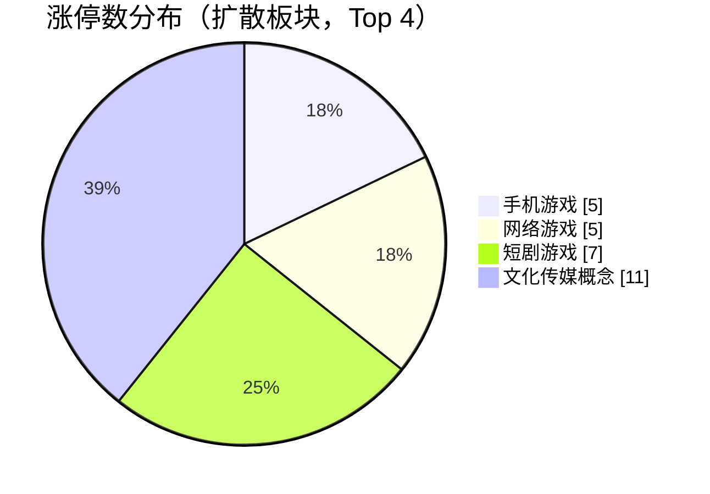

## 当日总览（截至 11:50）

> **结论**：全市场涨3303/跌2147（广度0.61）；涨停55/跌停4；中位涨幅+0.42%；局部修复。 钱在：手机游戏(涨停5/成分56，中位+1.00%)、网络游戏(涨停5/成分58，中位+0.80%)、短剧游戏(涨停7/成分99，中位+0.69%)；零星涨停：中船系(1)、低辐射玻璃(Low-E)(1)、共享单车(1)、可燃冰(1)、中韩自贸区(1)。 退潮：数据中心(AIDC)(跌停2)、固态电池(跌停2)、集成电路概念(跌停1)。 梯队：4板×2、3板×1、2板×19、1板×33，最高4板。 预案：无有效对照。 较上一轮广度基本持平。

> 🔒 **no_trade / 买入预算 0 / max_position_pct 0 —— 全部内容仅供研究，不授予交易权限。**

### 板块扩散

> 口径：XTick 概念成分 × 全市场实时报价；分母 = 板块内有有效报价的成分数。排序用涨停密度（涨停数/有效成分数），已剔除宽基属性板块（全市场 432 个板块中剔 16 个）。

**扩散中（题材，按涨停密度排序）**

| 板块 | 涨停 | 有效成分 | 涨停密度 | 上涨广度 | 中位涨幅 | 相对全市场 | 成交(亿) |
|---|---|---|---|---|---|---|---|
| 中船系 ⬦ | 1 | 10 | 0.100 | 0.90 | +2.55% | +2.13% | 47 |
| 手机游戏 | 5 | 56 | 0.089 | 0.75 | +1.00% | +0.58% | 242 |
| 网络游戏 | 5 | 58 | 0.086 | 0.69 | +0.80% | +0.38% | 260 |
| 低辐射玻璃(Low-E) ⬦ | 1 | 12 | 0.083 | 0.92 | +1.84% | +1.42% | 13 |
| 共享单车 ⬦ | 1 | 14 | 0.071 | 0.64 | +0.61% | +0.19% | 6 |
| 可燃冰 ⬦ | 1 | 14 | 0.071 | 0.50 | -0.01% | -0.43% | 23 |
| 短剧游戏 | 7 | 99 | 0.071 | 0.68 | +0.69% | +0.27% | 393 |
| 中韩自贸区 ⬦ | 1 | 17 | 0.059 | 0.76 | +1.10% | +0.68% | 37 |
| 文化传媒概念 | 11 | 197 | 0.056 | 0.67 | +0.74% | +0.32% | 498 |
| 乳业 ⬦ | 2 | 36 | 0.056 | 0.89 | +1.69% | +1.27% | 75 |
| 黑龙江自贸区 ⬦ | 2 | 36 | 0.056 | 0.69 | +0.74% | +0.32% | 48 |
| 电子竞技 ⬦ | 2 | 37 | 0.054 | 0.70 | +0.50% | +0.08% | 111 |

> ⬦ = 涨停 <3 只，零星个例，不构成扩散（不计入「钱在」判定）。



零星涨停板块（<3 只）：中船系(1)、低辐射玻璃(Low-E)(1)、共享单车(1)、可燃冰(1)、中韩自贸区(1)、乳业(2)、黑龙江自贸区(2)、电子竞技(2)

**退潮中（跌停集中）**

| 板块 | 跌停 | 有效成分 | 上涨广度 | 中位涨幅 |
|---|---|---|---|---|
| 数据中心(AIDC) | 2 | 664 | 0.49 | +0.00% |
| 固态电池 | 2 | 300 | 0.70 | +1.24% |
| 集成电路概念 | 1 | 241 | 0.35 | -0.92% |
| 汽车电子 | 1 | 399 | 0.36 | -0.63% |
| 传感器 | 1 | 273 | 0.38 | -0.43% |
| 物联网 | 1 | 471 | 0.47 | -0.08% |
| 血氧仪 | 1 | 24 | 0.50 | +0.22% |
| 航空发动机 | 1 | 100 | 0.50 | +0.02% |
| 商业航天 | 1 | 507 | 0.50 | +0.08% |
| 区块链 | 1 | 261 | 0.52 | +0.10% |
| 医疗器械概念 | 1 | 417 | 0.53 | +0.20% |
| 智能制造 | 1 | 459 | 0.54 | +0.22% |

### 涨停梯队

> 最高 4 板 ｜ 涨停 55 ｜ 跌停 4 ｜ 炸板 16 ｜ 封板率 77.5% ｜ 打板成功率 16.79% ｜ 一进二 15.83% ｜ 二进三 16.67%

| 身位 | 家数 | 成员（涨幅/封单亿/首封） |
|---|---|---|
| 4板 | 2 | 东方海洋 +9.97%/0.032亿/09:25；阳光照明 +10.00%/0.029亿/09:25 |
| 3板 | 1 | 皇台酒业 +10.00%/0.019亿/09:25 |
| 2板 | 19 | 高争民爆 +10.00%/0.076亿/09:25；大晟文化 +10.07%/0.044亿/09:25；浙文影业 +10.09%/0.026亿/09:25；龙版传媒 +10.00%/0.026亿/09:25；青岛双星 +10.02%/0.020亿/09:43 |
| 1板 | 33 | 圣阳股份 +10.02%/0.084亿/09:36；太阳能 +10.07%/0.040亿/09:47；盟固利 +19.99%/0.036亿/09:54；龙蟠科技 +9.99%/0.024亿/09:47；大西洋 +10.05%/0.022亿/09:37 |


炸板 16 只（前几）：登康口腔(4次)、中稀有色(4次)、澳洋健康(3次)、东方创业(3次)、惠发食品(3次)

### 预案池对照

| 票 | 池 | 板块 | 现价 | 涨幅 | 触发价 | 买区 | 风险位 | 判定 |
|---|---|---|---|---|---|---|---|---|
| 芒果超媒 `300413.SZ` | 执行池 | 传媒/AI内容 | 28.27 | +5.64% | — | — | 25.33 | **无预案价** |
| 国金证券 `600109.SH` | 执行池 | 证券/金融科技 | 8.45 | +0.00% | — | — | 8.15 | **无预案价** |
| 龙版传媒 `605577.SH` | 观察池 | 传媒/AI内容 | 14.3 | +10.00% | — | — | 12.53 | **无预案价** |
| 捷成股份 `300182.SZ` | 观察池 | 传媒/AI内容 | 5.68 | +0.71% | — | — | — | **无预案价** |
| 欢瑞世纪 `000892.SZ` | 观察池 | 传媒/AI内容 | 4.62 | +4.76% | — | — | — | **无预案价** |
| 新华传媒 `600825.SH` | 观察池 | 传媒/AI内容 | 12.72 | +2.00% | — | — | 12.03 | **无预案价** |
| 银之杰 `300085.SZ` | 观察池 | 证券/金融科技 | 29.06 | +8.92% | — | — | 28.34 | **无预案价** |
| 太平洋 `601099.SH` | 观察池 | 证券/金融科技 | 3.56 | +0.56% | — | — | 3.43 | **无预案价** |
| 东方财富 `300059.SZ` | 观察池 | 证券/金融科技 | 18.89 | +0.96% | — | — | 17.93 | **无预案价** |
| 恒生电子 `600570.SH` | 观察池 | 证券/金融科技 | 21.44 | +3.28% | — | — | 20.29 | **无预案价** |
| 皇台酒业 `000995.SZ` | 观察池 | 白酒 | 17.16 | +10.00% | — | — | 15.14 | **无预案价** |
| 水井坊 `600779.SH` | 观察池 | 白酒 | 28.86 | +2.63% | — | — | 28.83 | **无预案价** |
| 泉阳泉 `600189.SH` | 观察池 | 白酒 | 9.94 | +2.26% | — | — | 9.38 | **无预案价** |


> ⚠ D1 明确 no_trade=true、买入预算 0、个股 max_position_pct=0。以上为研究对照，**不构成任何买入许可**。

### 盘面 vs 静态复盘 vs 消息面

| 维度 | 对象 | T-1 静态基线 | 今日盘面 | 关系 |
|---|---|---|---|---|
| 板块主线 | 白酒 | R2 次线 score=None 涨停None（T-1 口径） | 盘面未见该板块成分票涨停 | **背离** |
| 板块主线 | 机器人 | R2 次线 score=None 涨停None（T-1 口径） | 盘面未见该板块成分票涨停 | **背离** |
| 板块主线 | 半导体 | R2 次线 score=None 涨停None（T-1 口径） | 盘面未见该板块成分票涨停 | **背离** |
| 板块主线 | 航空成本改善 | R2 次线 score=None 涨停None（T-1 口径） | 盘面未见该板块成分票涨停 | **背离** |
| 梯队结构 | 最高4板 | T-1 最高梯队 4 板、首板 29、炸板率 39.06% | 今日 4板×2、3板×1、2板×19、1板×33；封板率0.7746 炸板16只 | **印证** |
| 预案验证 | 芒果超媒(300413.SZ) | 预案 传媒/AI内容／leader／触发价None／买区None | 无预案价：预案未给触发价/买区（情景作废或待重导） | **无响应** |
| 预案验证 | 国金证券(600109.SH) | 预案 证券/金融科技／leader／触发价None／买区None | 无预案价：预案未给触发价/买区（情景作废或待重导） | **无响应** |
| 预案验证 | 龙版传媒(605577.SH) | 预案 传媒/AI内容／watch／触发价None／买区None | 无预案价：预案未给触发价/买区（情景作废或待重导） | **无响应** |
| 预案验证 | 捷成股份(300182.SZ) | 预案 传媒/AI内容／watch／触发价None／买区None | 无预案价：预案未给触发价/买区（情景作废或待重导） | **无响应** |
| 预案验证 | 欢瑞世纪(000892.SZ) | 预案 传媒/AI内容／watch／触发价None／买区None | 无预案价：预案未给触发价/买区（情景作废或待重导） | **无响应** |
| 预案验证 | 新华传媒(600825.SH) | 预案 传媒/AI内容／watch／触发价None／买区None | 无预案价：预案未给触发价/买区（情景作废或待重导） | **无响应** |
| 预案验证 | 银之杰(300085.SZ) | 预案 证券/金融科技／watch／触发价None／买区None | 无预案价：预案未给触发价/买区（情景作废或待重导） | **无响应** |
| 预案验证 | 太平洋(601099.SH) | 预案 证券/金融科技／watch／触发价None／买区None | 无预案价：预案未给触发价/买区（情景作废或待重导） | **无响应** |
| 预案验证 | 东方财富(300059.SZ) | 预案 证券/金融科技／watch／触发价None／买区None | 无预案价：预案未给触发价/买区（情景作废或待重导） | **无响应** |
| 预案验证 | 恒生电子(600570.SH) | 预案 证券/金融科技／watch／触发价None／买区None | 无预案价：预案未给触发价/买区（情景作废或待重导） | **无响应** |
| 预案验证 | 皇台酒业(000995.SZ) | 预案 白酒／watch／触发价None／买区None | 无预案价：预案未给触发价/买区（情景作废或待重导） | **无响应** |
| 预案验证 | 水井坊(600779.SH) | 预案 白酒／watch／触发价None／买区None | 无预案价：预案未给触发价/买区（情景作废或待重导） | **无响应** |
| 预案验证 | 泉阳泉(600189.SH) | 预案 白酒／watch／触发价None／买区None | 无预案价：预案未给触发价/买区（情景作废或待重导） | **无响应** |
| 消息面对照 | 盘面热点板块 | R4 消息面（T-1 口径） | 实时快讯中命中热点板块关键词 6 条 | **印证** |

**分歧点（不掩盖）：**
- 板块主线·白酒 → 背离：T-1 有辨识度但今日盘中无涨停响应，题材未获资金确认
- 板块主线·机器人 → 背离：T-1 有辨识度但今日盘中无涨停响应，题材未获资金确认
- 板块主线·半导体 → 背离：T-1 有辨识度但今日盘中无涨停响应，题材未获资金确认
- 板块主线·航空成本改善 → 背离：T-1 有辨识度但今日盘中无涨停响应，题材未获资金确认

### 全天广度轨迹

| 时点 | 涨 | 跌 | 广度 | 涨停 | 跌停 | 成交(亿) | 有效样本 |
|---|---|---|---|---|---|---|---|
| 0930 | 1395 | 3771 | 0.251 | 17 | 4 | 590 | 5557 |
| 0940 | 1651 | 3628 | 0.296 | 26 | 3 | 2,719 | 5570 |
| 0950 | 3091 | 2268 | 0.555 | 33 | 3 | 4,084 | 5570 |
| 1000 | 3144 | 2245 | 0.565 | 40 | 3 | 5,164 | 5570 |
| 1010 | 3817 | 1641 | 0.685 | 45 | 3 | 6,092 | 5570 |
| 1020 | 3912 | 1559 | 0.702 | 47 | 3 | 6,820 | 5570 |
| 1030 | 4078 | 1407 | 0.732 | 48 | 3 | 7,468 | 5570 |
| 1040 | 3712 | 1728 | 0.666 | 51 | 3 | 8,046 | 5570 |
| 1050 | 3708 | 1736 | 0.666 | 50 | 3 | 8,477 | 5570 |
| 1100 | 3391 | 2059 | 0.609 | 50 | 4 | 8,913 | 5570 |
| 1110 | 3568 | 1896 | 0.641 | 53 | 4 | 9,318 | 5570 |
| 1120 | 3409 | 2028 | 0.612 | 54 | 4 | 9,680 | 5570 |
| 1130 | 3303 | 2135 | 0.593 | 55 | 4 | 9,996 | 5570 |
| 1140 | 3303 | 2135 | 0.593 | 55 | 4 | 9,996 | 5570 |
| 1150 | 3303 | 2135 | 0.593 | 55 | 4 | 9,996 | 5570 |

> ⚠ **数据冻结段**：1130–1150 数值连续完全一致，说明行情源未刷新，**不是市场横盘**，该段不可解读为盘面变化。

```mermaid
xychart-beta
    title "全市场广度轨迹（09:30 → 11:50）"
    x-axis "09:30 09:40 09:50 10:00 10:10 10:20 10:30 10:40 10:50 11:00 11:10 11:20 11:30 11:40 11:50"
    y-axis "广度(上涨占比)" 0 --> 1
    line 0.251 0.296 0.555 0.565 0.685 0.702 0.732 0.666 0.666 0.609 0.641 0.612 0.593 0.593 0.593
```

```mermaid
gantt
    title 全天截面时点分布（每个截面一个条目）
    09:30 截面 :done
    09:40 截面 :done
    09:50 截面 :done
    10:00 截面 :done
    10:10 截面 :done
    10:20 截面 :done
    10:30 截面 :done
    10:40 截面 :done
    10:50 截面 :done
    11:00 截面 :done
    11:10 截面 :done
    11:20 截面 :done
    11:30 截面 :done
    11:40 截面 :done
    11:50 截面 :done
```

### 观察建议（仅研究）

- **环境**：涨停 55.0 / 跌停 4.0，打板成功率 16.8%，一进二 15.8%。
- **方向**：今日形成实质扩散的是 手机游戏（涨停5/成分56，密度0.089，中位+1.00%）、网络游戏（涨停5/成分58，密度0.086，中位+0.80%）、短剧游戏（涨停7/成分99，密度0.071，中位+0.69%）。**需确认**：次日能否维持涨停家数且中位涨幅不掉队，否则只是普跌中的避险轮动。
- **零星**：中船系(1只/10成分)、低辐射玻璃(Low-E)(1只/12成分)、共享单车(1只/14成分)、可燃冰(1只/14成分)、中韩自贸区(1只/17成分) 属零星个例，不视为题材，不据此选股。
- **回避**：数据中心(AIDC)（跌停2）、固态电池（跌停2）、集成电路概念（跌停1） 板块中位跌幅深，趋势未止跌前不接。
- **身位**：最高 4 板。梯队有高度不等于可接力，需逐票核验封单稳定性与开板次数后再定。

<details>
<summary>原始截面与数据质量（折叠）</summary>

**跨源校验**

```json
{
  "xtick": {
    "up": 3303,
    "down": 2147,
    "n": 5615,
    "amount_yi": 9922.2
  },
  "rtk_snapshot": {
    "up": 3303,
    "down": 2135,
    "valid_n": 5570,
    "amount_yi": 9996.3,
    "up_limit": 55,
    "down_limit": 4
  },
  "note": "两源口径不同（XTick 全市场含全部票；rt_k 返回样本）"
}
```

**rt_k 截面（原始）**

```json
{
  "market": {
    "total": 5582,
    "up": 3303,
    "down": 2135,
    "flat": 132,
    "requested_n": 5582,
    "received_n": 5582,
    "valid_n": 5570,
    "missing_n": 12,
    "universe_requested_n": null,
    "population_scope": "returned_rows_not_verified_all_a_universe",
    "up_ratio": 0.5917,
    "legacy_up_ratio_placeholder": false,
    "up_ratio_is_observed": true,
    "up_ratio_all": 0.5917,
    "up_ratio_valid": 0.593,
    "up_ratio_denominator": "requested_n",
    "degraded": false,
    "limit_known_n": 5570,
    "limit_unknown_n": 0,
    "limit_counts_complete": true,
    "limit_source_errors": [],
    "up_gt3": 391,
    "up_gt5": 139,
    "up_limit": 55,
    "down_gt3": 486,
    "down_gt5": 184,
    "down_limit": 4,
    "amount_yi": 9996.3,
    "amount_sum_overflow": false,
    "amount_valid_n": 5570,
    "amount_missing_n": 0
  },
  "source_time_quality": {
    "quote_age_min_seconds": 1.716276,
    "quote_age_max_seconds": 61.716276,
    "source_age_limit_seconds": null,
    "freshness_status": "age_limit_not_configured",
    "age_reference_at": "2026-11-03T11:50:40.716276+08:00"
  },
  "trading_authorized": false
}
```

</details>

## 分时研判记录

### 09:35 研判增量
- **趋势**：本轮依据2026-11-03的09:30分析（09:30:50生成；对应报价09:30:12—09:30:45），不是09:35新行情。当天仅此一轮，不能认定“较上一轮持平”、拐点或数据冻结。相对于盘前预案引用的11月2日“广谱修复、传媒与证券双线优先”，开盘只印证传媒局部延续，并未印证广谱修复：rt_k有效样本上涨1395/5557、广度25.10%；不与另一源或只取涨跌股票的分母混比。最高仍为4板，但开盘大量首封来自09:25，尚不足证明连续交易接力稳定，更不能把开盘封板率当全天胜率。
- **轮动**：传媒行业上涨84/131、涨停5/131，而非银金融上涨16/77、无涨停，说明原“双线”在本截面表现不对称；手机游戏、网络游戏、短剧游戏宜视为相关内容方向，成分未去重，不能把几个标签的涨停数相加当独立扩散。集成电路仅13/241上涨、中位跌幅1.92%，与内容方向形成相对强弱对照；只有单截面和成交额，不能宣称资金已从半导体净流向传媒或跷跷板成立。同轮快讯明确报道AI漫剧、大晟文化／浙文影业／电魂网络二连板，与梯队对应，故自动对照里的“消息无响应”不能照抄；这是行情报道的交叉印证，并非已核新增产业催化。白酒概念实际有2/48涨停，不能写“无涨停”，但尚非板块扩散，皇台三板不能代替全线转强。
- **剧本**：自动表中的“无预案价”不等于原研究情景不存在：价位在预案entry_rules内，买入资格仍明确受阻。逐组对照：芒果27.89高于原买区上沿27.53，国金8.70高于8.58，龙版14.30高于13.19，皇台17.16高于15.94，均不追，不能写成买点兑现；龙版当前二板也不解除原反抽观察限制。新华12.63在12.41—12.66内且高于触发12.47，恒生21.23在20.93—21.36内且高于触发21.04，仅价格条件触达，放量／承接／必要风险审核并未由截面证明。银之杰、太平洋、东方财富、水井坊、泉阳泉分别未到30.34、3.56、18.98、29.90、9.72，不拿风险位反推“已失效”。捷成与欢瑞原有硬否决保留，欢瑞进入快讯且上涨也不能覆盖。以上为11月3日原预案的研究参照，非更新执行指令。
- **下一步看**：先等下一轮同口径有效报价；若广度高于25.10%且涨停不少于17，才有检验修复是否扩面的依据；若涨停增加而广度下降，则仍是强势集中。内容方向对照手机游戏5/56涨停、39/56上涨及传媒5/131涨停、84/131上涨是否维持，重点核大晟／浙文／电魂／龙版二板是否开板，及已开板的掌阅是否真正重新封住；未取得路径不预写回封。证券双线恢复须见非银上涨面改善于16/77，并观察太平洋3.56、东财18.98是否与板块同步触达，而非国金独强。白酒替代剧本先看水井坊能否到原触发29.90并落在29.75—30.35内，同时板块涨停较现有2只增加；只皇台封住不算。芒果27.12、国金8.45仅保留原突破参照，回落进入原买区也须重评路径，不能把转弱当补票机会。禁新仓、本任务买入预算0、各票max_position_pct=0保持不变；预案账户预算字段为未知，不补造成已核资金。全部仅供研究，不授予买入许可。

### 09:45 研判增量
- **趋势**：涨停在增加，但承接更挑剔，不能升级为全面转强。依据2026-11-03最新09:40分析（09:40:50生成），对比09:30；不是09:45即时行情。返回有效样本上涨1395/5557→1651/5570、广度25.10%→29.64%；有效分母增加13只，未取得固定交集，不把百分比之差包装成严格同样本改善幅度。涨停17→26主要伴随首板3→11，最高仍4板；与此同时炸板2→5、封板率89.47%→83.87%。阳光照明虽仍在4板，累计开板1→6次，劲旅环境由二板在列转为开板、涨幅6.38%，说明“高度没断”并不等于接力质量改善。
- **轮动**：内容方向由扩面转为前排集中：短剧游戏涨停4/99→6/99，但上涨61/99→52/99；文化传媒概念涨停7/197→9/197，上涨却104/197→91/197。慈文传媒09:40首板为新增助攻，大晟／浙文／龙版仍列二板；手机游戏上涨39/56→40/56、涨停仍5/56，比内容大池更稳。白酒上涨23/48→30/48、中位涨幅0→+0.54%，正在改善，但涨停仍2/48，尚不足升级为接棒主线；非银金融上涨16/77→26/77，仍无涨停，“传媒＋证券双线同步”只获得部分印证。集成电路虽上涨13/241→43/241，中位跌幅反而由1.92%扩大至2.11%，不是整线止跌。白酒与内容广度反向变化只构成相对轮动苗头，无净流和持续时序，不确认资金跷跷板。最新消息样本新增港股航空受成本改善拉升的报道，但A股航空扩散未核，不能用港股报道直接认证原航空备选剧本。
- **剧本**：沿用预案入场规则内的原价位，而非自动表顶层空值。本轮有实质状态变化的是：太平洋3.50→3.59，进入3.54—3.61并越过原触发3.56；泉阳泉9.16→9.78，进入9.67—9.87并越过9.72——均仅价格条件触达，未证明放量、持续承接或必要风险审核通过，泉阳泉原资金净卖／多次开板反证不因翻红解除。新华传媒12.63→12.90，由原买区内移至上沿12.66之上，应改为“买点已越过，不追”，不是自动晋级。国金8.70→8.60仍高于上沿8.58，回落不等于给出新买点；芒果继续在原上沿27.53之上。银之杰上行至28.29，仍未到原触发30.34。捷成、欢瑞的原硬否决未解除，不随传媒局部强势递补。
- **下一步看**：内容扩面须看下一截面能否同时保住文化传媒概念9只、短剧游戏6只涨停，并把上涨面分别恢复至原先104/197、61/99；若涨停增加而上涨面继续收缩，仍按前排集中而非普涨解释。白酒备选先看涨停是否突破现有2只，以及水井坊能否触达原29.90且处于29.75—30.35；不把29.43的上行提前写成触发。太平洋须补核3.56—3.61内的分钟承接，泉阳泉须补核9.72—9.87内路径；若再落回各自触发价下，只撤回“当前价格触达”判断，不倒推曾经站稳或新增卖出指令。证券仍须观察东方财富18.98与非银上涨面能否同步改善，不能只看太平洋一只。下一轮同时核阳光照明开板次数是否继续增加。no_trade=true、本任务买入预算0、各票max_position_pct=0不变；真实账户预算仍未知。全部仅供研究，不授予任何买入许可。

### 09:55 研判增量
- **趋势**：修复由前排局部延伸到多数返回样本，但高度尚未突破、内容前排仍有松动。依据2026-11-03的09:50分析（09:50:48生成，采集09:50:38—09:50:47，对应报价09:49:48—09:50:44），对比09:40，不是09:55即时行情。两轮有效分母均5570，上涨1651→3091，广度29.64%→55.49%，提高25.85个百分点；涨停26→33、跌停仍3，二板12→15、首板11→15，最高仍4板。封板率83.87%→84.62%小幅改善，不能当盈利胜率；慈文传媒却由首板在列转入开板名单、累计开板2次，阳光照明累计开板仍6次。新增信息是“扩面修复与核心分歧并存”，不是简单延续上一轮的前排集中，也不是一致主升。
- **轮动**：新增扩散不能只看截断的热点榜。电力设备行业涨停4/418→8/418、上涨211/418→339/418，中位涨幅+0.05%→+1.46%；概念侧光伏建筑一体化涨停2/135→4/135、钠离子电池1/144→3/144，梯队新增太阳能、龙蟠科技09:47首板，构成内容之外的新强势观察方向，但未核逐票概念纯度及流通市值，不据此推荐新票。文化传媒概念上涨91/197→117/197，涨停反而9/197→8/197，相对全市场中位优势+0.58→+0.08个百分点：上涨面修复而前排封板收缩，不能说资金全面撤离，也不能说主线同步加速。银行中位跌幅由1.14%扩大至1.79%、上涨仍0/42，与09:49银行下挫快讯相互印证；与电力设备构成价格上的相对跷跷板，尚无净流证据证明两者资金直接搬家。相关概念成分重叠，涨停数不相加；新强势方向的增量催化尚未核实，不升级为盘面／静态研究／消息三方一致。
- **剧本**：11月2日基线中的“广谱修复”得到新增盘面支持，但“传媒＋证券双线同步”仍未完整兑现：非银金融上涨26/77→42/77，却仍无涨停，中位涨幅+0.22%、相对市场为-0.02个百分点。按原预案入场规则内价位核对，本轮三处状态变化最重要：国金8.60→8.54，从原上沿8.58之外退回8.41—8.58区间且仍高于触发8.45，这是回落进入价格带，不是重新放量突破确认；恒生21.24→21.46，越过原上沿21.36，改为买点已越过、不追；泉阳泉9.78→9.65，落回触发9.72及买区下沿9.67之下，撤回上一轮“当前价格触达”判断，不能倒推曾站稳，也不以风险位直接判已失效。水井坊虽29.43→29.70，仍未进入29.75—30.35、未到29.90，白酒备选未触发，概念涨停仍2/48也未出现新的板块级扩散。其余原价位状态未切换，不重复旧表；原反证和硬否决均保留。
- **下一步看**：以本截面作研究观察基线，而非新增交易门槛：下一轮同口径有效样本广度能否维持55.49%、涨停不少于33，同时电力设备保住8/418涨停及339/418上涨、钠电保住3/144涨停；若只见广度上升却这些封板减少，扩面不等于核心强化。内容侧看慈文能否重新进入涨停名单，以及阳光照明累计开板是否超过现有6次，不凭当前价预写回封稳定。国金只观察8.45—8.58内是否补齐分钟承接与板块同步，跌回8.45下便撤回当前越线描述，不因回到区间就补票；白酒须同时看水井坊触达29.90且不超过原上沿30.35、板块涨停突破现有2只，泉阳泉须先收回9.72再核路径。禁新仓no_trade=true、本任务买入预算0、各票max_position_pct=0不变；真实账户预算仍未知，全部仅供研究，不授予任何买入许可。

### 10:05 研判增量
- **趋势**：扩面修复明显减速，新增封板与原双线转弱并存。依据2026-11-03的10:00分析，对比09:50；本轮采集10:00:38—10:00:50、报价09:59:51—10:00:47，不是10:05即时行情。两轮有效返回样本均5570，上涨3091→3144、广度55.49%→56.45%，仅增0.96个百分点，低于上一段的25.85个百分点；涨停33→40，主要来自首板15→21，二板15→16、最高仍4板。炸板6→8、封板率84.62%→83.33%，掌阅科技新增进入开板名单、累计3次：修复仍在，但不能沿用上一轮的扩面速度或升级为一致主升，封板率也不是盈利胜率。
- **轮动**：电力设备继续强化：涨停8/418→11/418、上涨339/418→342/418；题材侧钠离子电池涨停3/144→5/144、上涨125/144→126/144，在剔除宽基且涨停不少于3只的概念密度排序中由第9升至第5，盟固利09:54首板为新增梯队观察。相反，短剧游戏涨停5/99→4/99、上涨65/99→56/99；非银金融上涨42/77→21/77，中位涨幅+0.22%→-0.26%，仍无涨停。由此推断新能源相对内容、金融走强，但没有净流证据，不确认资金直接搬家；行业与重叠概念不相加。11月2日“传媒＋证券双线优先”的基线进一步受挑战；新快讯样本出现消费环境活动和港股消费走强，但不能据此认证A股白酒接棒，也未给出新能源新增催化，三方尚未一致。
- **剧本**：仍按原预案entry_rules核价，不沿用自动表顶层空值的“无预案价”。太平洋3.59→3.54，虽在3.54—3.61内，却跌回触发3.56下，撤回“当前已越线”；国金8.54→8.48仍高于8.45，但与非银转弱同现，原放量突破剧本没有得到加强。新华12.72→12.66、恒生21.46→21.36分别退回原买区上沿，只是回落进入价带，不是新的突破确认。泉阳泉9.65→10.48，直接由低于买区转为超过原上沿9.87，不能因重新越过9.72就视作合格触发，更不追高；原资金净卖、多次开板反证不解除。水井坊29.70→29.45，离原触发29.90更远，消费消息没有替代价格兑现。
- **下一步看**：以本轮实测数作研究观察基线，不新增交易门槛：钠电能否维持5/144涨停、126/144上涨，电力设备能否保住11/418涨停，同时返回样本广度不弱于56.45%、涨停不少于40；若只增涨停而广度退，按强势集中解释。原双线修复先看非银上涨面能否恢复至上一轮42/77，以及太平洋重回3.56—3.61、国金守住8.45—8.58后是否补齐分钟承接；只有截面不认定站稳。新华、恒生回到原价带不自动递补，泉阳泉超区不追，不下移或抬高原买区。no_trade=true、本任务买入预算0、各票max_position_pct=0不变；预案真实账户预算字段仍为未知，全部仅供研究，不授予任何买入许可。

### 10:15 研判增量
- **趋势**：上一轮减速后，扩面修复重新加快，但高位封板质量没有同步变稳。依据2026-11-03的10:10分析，对比10:00；本轮采集10:10:38—10:10:48、对应报价10:10:09—10:10:45，不是10:15即时行情。两轮有效返回样本均5570，上涨3144→3817、广度56.45%→68.53%，提高12.08个百分点；涨停40→45、跌停仍3，二板16→18、首板21→24，最高仍4板。封板率83.33%→84.91%，但东方海洋虽仍列4板，累计开板0→3次；不能把高度未断或整体封板率改善当成高标承接稳定，更不是盈利胜率。
- **轮动**：内容重新扩面，上一轮“新能源强、内容金融弱”的单向轮动需要修正。短剧游戏涨停4/99→5/99、上涨56/99→77/99；传媒行业上涨65/131→100/131，相对市场中位表现由-0.26→+0.32个百分点。新能源并未因此失血：电力设备涨停11/418→12/418，钠电5/144→6/144、上涨126/144→133/144，钠电在剔除宽基且涨停不少于3只的概念密度排序中由第5升至第4，但相对中位优势+1.47→+1.28个百分点有所收窄。非银上涨21/77→45/77、中位涨幅转正，相对市场仍为-0.54个百分点且无涨停，只能认定跟随修复，不能升级为领涨；银行仅2/42上涨，仍明显落后。本轮是多方向同修复，没有资金净流证据，不确认板块间直接搬家或跷跷板。11月2日基线的“广谱修复”得到进一步印证，“传媒＋证券双线优先”仍只部分成立。10:09快讯样本新增电池行情及研报转述，补上新能源的消息呼应，但不是已核公司新增公告，也不能将固态电池叙事直接等同于钠电催化；不据此宣布新主线确立。
- **剧本**：按原预案入场规则，本轮太平洋3.54→3.58，重新越过3.56且在3.54—3.61内；国金8.48→8.54仍在8.41—8.58内且高于8.45，叠加非银上涨面恢复，原双线剧本获得部分修复，但截面没有补齐放量、同分钟资金和持续承接，均不能写成确认买点。新华12.66→12.80、恒生21.36→21.45，分别再次越过原上沿12.66、21.36，撤回“当前处于原价带”的描述，不追。芒果27.60→28.55与内容扩面同向，但仍高于原上沿27.53，方向走对不等于买点合格。白酒上涨面虽改善，涨停仍2/48，水井坊29.45→29.38仍未到29.90，备选剧本没有接棒；其余未切换的原价位状态不重列，既有硬否决及必要审核缺口不解除。
- **下一步看**：只用本轮已观测值作研究基线：下一截面有效分母不降级时，广度能否维持68.53%、涨停不少于45，同时短剧游戏保住5/99涨停及77/99上涨、钠电保住6/144涨停及133/144上涨；若广度继续提高而核心封板减少，扩面与前排质量须分开解释。另核东方海洋累计开板是否超过现有3次，不能仅看仍处涨停。证券恢复领涨须看非银相对中位表现是否改善于-0.54个百分点，并补核国金8.45—8.58、太平洋3.56—3.61内的分钟承接；东方财富仍须触达原18.98且不超过原上沿19.26，未到价不提前认证。上述仅检验原研究剧本，不延长或修改正式预案，不调整买区；no_trade=true、本任务买入预算0、各票max_position_pct=0保持不变，预案真实账户预算仍未知，全部仅供研究，不授予任何买入许可。

### 10:25 研判增量
- **趋势**：扩面仍在，但速度再次放缓，新增强度更偏向内容方向。依据2026-11-03的10:20分析，对比10:10；本轮采集10:20:38—10:20:48、对应报价10:19:36—10:20:47，不是10:25即时行情。两轮有效返回样本均5570，上涨3817→3912、广度68.53%→70.23%，改善明显慢于上一段；涨停45→47、二板18→19、首板24→25，最高仍4板。炸板8→9、封板率84.91%→83.93%，不能把广度走高等同封板质量同步改善。华智数媒10:12封出20cm二板，形成新增弹性观察锚；掌阅科技虽列二板，累计开板7次，辨识度与稳定性仍须分开。
- **轮动**：内容从“重新扩面”推进到前排与上涨面同步强化：短剧游戏涨停5/99→7/99、上涨77/99→84/99；传媒行业涨停6/131→8/131、上涨100/131→109/131。AI视频由2/67→3/67涨停，刚达到扩散观察门槛，但中位表现仍落后市场0.02个百分点，不直接升为主线。钠电在剔除宽基、涨停不少于3只的概念密度排序中由第4退至第7，却仍为6/144涨停、133/144上涨，相对中位优势反从+1.28扩大到+1.67个百分点；掉出顶部榜不等于失血。电力设备涨停12/418→11/418、上涨359/418→369/418，是封板收缩与面上继续走强并存，新增开板名单中的清源股份需留意，不能据此否定整线。集成电路上涨仍108/241、中位跌幅0.21%→0.36%，与内容形成更明显的相对分化，但没有净流证据，不确认直接资金跷跷板。10:20:10快讯与华智数媒二板、内容扩散相互印证，支持11月2日基线的传媒方向；它是行情报道，不是新产业催化，报道中“此前慈文涨停”也不能覆盖本截面慈文仍在开板名单的事实。
- **剧本**：原“传媒＋证券双线”新增的是证券跟随范围扩大，而非已经领涨：非银上涨45/77→63/77，相对中位表现-0.54→-0.26个百分点，仍无涨停；10:20:14政策解读转述的是11月2日事件，不当作新政策落地或实际资金入市。按原预案入场规则核对，国金8.54→8.60，越过原买区上沿8.58，撤回“当前处于原价带”描述，不追；太平洋3.58→3.59仍在原价带、东财18.85→18.87仍未到原触发18.98，只有板块扩面，尚未补齐分钟承接与同步资金确认。白酒上涨42/48→43/48但涨停仍2/48、水井坊29.38→29.13离原触发29.90更远，备选没有接棒；泉阳泉10.08→9.94虽回落，仍高于原上沿9.87，不能把回落提前叫新买点。其余未切换的状态不重列，既有硬否决与必要审核缺口不解除。
- **下一步看**：以本轮实测值作研究对照，不新增交易门槛：下一截面有效分母不降级时，广度能否维持70.23%、涨停不少于47，同时内容保住7/99短剧涨停与84/99上涨、传媒保住8/131涨停；若封板再减而广度升，继续分开评价扩面与前排质量。新能源看电力设备能否恢复上一轮12/418涨停，钠电能否维持6/144涨停及133/144上涨，不凭榜位下降判退潮。证券观察非银能否改善于当前-0.26个百分点的相对中位表现，并核东财触达18.98且不超过原上沿19.26；国金回到8.45—8.58也只能重评路径，不自动补票。另核华智数媒、掌阅后续是否开板及累计开板是否超过本轮记录，单截面不认证持续封稳。no_trade=true、本任务买入预算0、各票max_position_pct=0不变；预案真实账户预算仍未知，全部仅供研究，不授予任何买入许可。

### 10:35 研判增量
- **趋势**：修复继续扩面，但传媒与证券的上涨面没有同步扩大，不能把榜位未变当成主线继续加速。依据2026-11-03的10:30分析，对比10:20；本轮采集10:30:38—10:30:47、对应报价10:29:42—10:30:44，不是10:35即时行情。两轮有效返回样本均5570，上涨3912→4078、广度70.23%→73.21%，提高2.98个百分点；涨停47→48，梯队净增只落在二板19→20，首板仍25、最高仍4板。炸板9→10、封板率83.93%→82.76%，利君股份新增进入展示的开板名单。广度改善与封板质量回落并存，仍不支持一致主升或高标接力已变稳。
- **轮动**：内容前列名次未动，内部扩散却降温：网络游戏仍5/58涨停，上涨49/58→45/58，相对市场中位优势+0.81→+0.43个百分点；传媒行业仍8/131涨停，上涨109/131→102/131。新能源重新扩面：电力设备涨停11/418→12/418、上涨369/418→372/418；钠电仍6/144涨停，上涨133/144→136/144，相对中位优势+1.67→+1.69个百分点。由此更像新能源强化、内容前排维持而后排回吐，不是内容整线退潮；相关概念不叠加计数。非银上涨63/77→60/77、相对中位表现-0.26→-0.44个百分点，原证券跟随修复也未继续增强。11月2日“广谱修复”的基线仍获印证，“传媒＋证券同步优先”则进一步打折；10:30:01电池报道与新能源盘面呼应，但其中昨日ETF流入不是今日净流证据，固态电池叙事也不直接认证钠电催化。只能推断相对轮动，不确认板块间资金直接搬家。
- **剧本**：按原预案入场规则，本轮两只由超买区退回原价带：国金8.60→8.54，重新落入8.41—8.58且高于触发8.45；泉阳泉9.94→9.86，回到9.67—9.87且高于9.72。两者均是回落进入价带，不是新的放量突破确认；国金同时遇到非银扩面退步，泉阳泉原资金净卖、多次开板反证也未解除，不能把价格回区当补票机会。太平洋3.59→3.61已到原买区上沿，再上涨就不应仍描述为区内；银之杰虽28.85→29.54，仍未到原触发30.34，不用涨幅替代触发。其余未切换的原价位状态不重列，原硬否决与必要审核缺口保留；这里只比较原研究情景，不延长正式预案有效期。
- **下一步看**：以下均以本轮实测值作研究对照，不新增交易门槛：有效分母不降级时，广度能否维持73.21%、涨停不少于48；若广度继续提高但封板数回落，仍分开评价扩面与接力。内容侧看网络游戏上涨面能否恢复上一轮49/58且保住5只涨停；新能源看电力设备保住12/418涨停、钠电保住6/144涨停及136/144上涨，检验是否只是短时相对优势。国金8.45—8.58、泉阳泉9.72—9.87内须补核分钟承接，跌回各自触发价下便撤回“当前价格触达”，不倒推曾经站稳；太平洋不追过3.61。no_trade=true、本任务买入预算0、各票max_position_pct=0不变；预案真实账户预算仍未知，全部仅供研究，不授予任何买入许可。

### 10:45 研判增量
- **趋势**：扩面修复转为强势集中，不再沿用10:35“继续扩面”的判断。固定比较11月3日10:40与10:30分析，不是10:45新行情；本轮10:40:49生成，rt_k采集10:40:38—47、报价10:39:09—10:40:45。两轮有效返回样本均5570，上涨4078→3712、广度73.21%→66.64%，回落6.57个百分点；涨停却48→51，净增落在首板25→28，二板仍20、最高仍4板。炸板仍10，封板率82.76%→83.61%主要随封板数增加，不能据此认定高标接力更稳。时标与总量均更新，非整组冻结；报价龄阈值未配置，不冒充全源时效认证。
- **轮动**：新能源相对抗跌，但也不再全面扩面：电力设备涨停12/418→13/418，上涨372/418→365/418；钠电仍6/144涨停，上涨136/144→134/144，相对中位优势+1.69→+1.74个百分点，不能把相对优势扩大说成绝对加速。内容的前排与后排分离更明显：短剧仍7/99涨停，上涨84/99→72/99；AI视频仍3/67涨停，上涨49/67→38/67。分母均为有效报价成分，重叠概念不相加。新增三变科技10:37首板与10:39:24电网设备快讯对应；10:40:02资金快讯也报道电力设备流入，但只是媒体口径，不是本地同口径净流核验，不能证明传媒资金直接搬家。
- **剧本**：11月2日“广谱修复、传媒与证券双线优先”的基线，本轮转为修复回吐、双线同步继续受挫：非银上涨60/77→49/77，仍无涨停。按原预案entry_rules逐票核完13只，唯一价带状态切换是泉阳泉9.86→9.60，跌回触发9.72与买区下沿9.67之下，撤回“当前价格触达”，不拿风险位判失效。国金8.54→8.46虽仍在原区且高于8.45，却与板块收缩同现，靠近触发不等于承接确认；太平洋3.61→3.58也只是区内回落。白酒仍2/48涨停、上涨43/48→38/48，水井坊29.20→28.99离29.90更远，皇台三板没有带出新的板块扩散。其余价带状态未切换，超区不追、原硬否决与必要审核缺口均保留。
- **下一步看**：强剧本须先看同口径广度能否从66.64%向上一轮73.21%恢复，同时保住本轮51只涨停；新能源看13/418电力设备、6/144钠电涨停能否维持，内容看短剧上涨面能否恢复84/99且保住7只涨停。反向若广度继续低于66.64%而涨停增加，只认集中强化，不认全面企稳；这些是实测对照，不是新增买入门槛。国金8.45—8.58、太平洋3.56—3.61仍须补核分钟承接；泉阳泉须先收回9.72且不越原上沿9.87，不下移买区接弱。no_trade=true、本任务买入预算0、各票max_position_pct=0不变；真实账户预算仍未知，正式预案09:30有效期不自动延长。全部仅供研究，不授予买入许可。

### 11:05 研判增量
- **趋势**：修复回吐再加快，局部补板没有带回上涨面。本轮固定依据2026-11-03的11:00分析，对比相邻10:50分析；本轮采集11:00:38—47、对应报价10:59:03—11:00:45，不是11:05即时行情。两轮有效返回样本均5570，上涨3708→3391、广度66.57%→60.88%，回落5.69个百分点；rt_k涨停仍50，XTick梯队口径则49→50、净增落在首板26→27，最高仍4板、二板仍20，两源不混算。跌停3→4，华丰股份新增进入跌停名单，说明弱端风险也在扩大。另须保留数据反证：展示的开板样例价格及累计次数在10:40、10:50、11:00完全相同，按该字段未刷新处理，不能拿它证明开板风险未增或高标已经封稳。
- **轮动**：新能源是前排补板、后排回吐，不是继续全面扩散：电力设备涨停12/418→13/418，但上涨364/418→347/418、中位涨幅+2.16%→+1.73%；钠电涨停仍6/144，上涨131/144→126/144。传媒行业上涨90/131→92/131、涨停仍8/131，相对市场中位优势+0.11→+0.32个百分点，却伴随自身中位涨幅+0.89%→+0.81%，只能称相对承接，不能称绝对加速。概念热榜前列顺序未变，也没有替代成分扩散核验；相关标签不相加。由此推断新能源与内容的强弱差在收敛，但缺同口径净流，不能确认直接资金搬家。文件快讯在11:00:35新增国产算力训练报道，属转述、未获公司原始确认，且接近截面末端；集成电路上涨105/241→84/241、AIDC上涨386/664→344/664，尚未显示广泛价格响应，不能把新消息直接升级为硬科技转强或倒推本段波动原因。
- **剧本**：11月2日“广谱修复、传媒与证券双线优先”的基线，本轮进一步表现为传媒相对抗跌、证券确认退步，而非双线共振。按原预案入场规则，国金8.45→8.43，虽仍在8.41—8.58内，却已低于触发8.45，撤回“当前价格触达”；东方财富18.90→18.88，从原买区内未触发退至下沿18.89之外，仍未到18.98；太平洋3.59→3.56恰到触发价，不能写成持续站稳。非银上涨53/77→49/77、仍无涨停，与上述退步同向。芒果28.04→28.33虽独立走强，仍超过原上沿27.53，方向受支持不等于买点合格，不追。其余原价带状态没有新增切换；自动“无预案价”不用于覆盖原规则，原硬否决与必要审核缺口不解除，也不凭风险位把未到价误判为失效。
- **下一步看**：只以已观测值作研究对照：同口径广度须先从60.88%向上一轮66.57%恢复，且涨停不低于本轮50、跌停不继续超过4，才有重评扩面修复的依据；若涨停维持或增加而广度继续低于60.88%，仍按强势集中解释。传媒看能否保住8/131涨停及92/131上涨，钠电看能否在保留6/144涨停的同时恢复上一轮131/144上涨，避免把相对抗跌当整线强化。证券先核国金重新达到8.45且不越原上沿8.58、东财达到18.98且不越19.26，并补齐分钟承接与板块同步；太平洋跌回3.56下便撤回当前越线描述，不下移买区接弱。这些不是新增买入门槛或授权：no_trade=true、本任务买入预算0、各票max_position_pct=0不变，真实账户预算仍未知；正式预案有效期不延长，全部仅供研究，不授予任何买入许可。

### 11:15 研判增量
- **趋势**：上一轮回吐后出现反弹，但尚未收复回吐前的上涨面，不能升级为修复重新加速。固定比较2026-11-03的11:10与11:00分析；本轮采集11:10:38—48、报价11:09:33—11:10:47，不是11:15即时行情。两轮有效返回样本均5570，上涨3391→3568、广度60.88%→64.06%，提高3.18个百分点，仍低于10:50的66.57%；涨停50→53、跌停仍4，净增均落在首板27→30，二板仍20、最高仍4板。展示样例新增九牧王11:01首板，只证明新增封板，不证明题材地位或交易资格。整体封板率79.37%→81.54%，但开板样例的价格与次数继续未更新，不能据此认证慈文等已回封或高标封稳。
- **轮动**：内容与金融补涨面恢复，新能源并未同步失血，更像多方向修复而非单向跷跷板。传媒行业上涨92/131→99/131、涨停仍8/131，相对市场中位优势+0.32→+0.50个百分点；IP经济上涨142/198→150/198、涨停8/198→9/198，在剔除宽基且涨停不少于3只的概念密度排序中由第8升至第5，说明内容周边新增助攻，重叠概念不相加。电力设备上涨347/418→351/418、涨停仍13/418，钠电上涨126/144→129/144、涨停仍6/144，但钠电相对中位优势+1.59→+1.44个百分点收窄，是相对优势被追近，不是整线撤退。固态电池虽仍有2只跌停，同时有7/300涨停、222/300上涨，不能照抄“整板退潮”。中船系由0→1/10涨停便升至密度榜首，仍属零星上板；自动消息“印证”的3条实际是10:37—10:38同一行情报道的多平台转述，不是本轮新增催化，不能据此宣布主线切换。
- **剧本**：11月2日“传媒＋证券双线优先”的原推论获得部分修复，但证券仍是跟随：非银上涨49/77→66/77，相对中位表现-0.19→-0.08个百分点，仍无涨停。按原预案入场规则，国金8.43→8.45，重新恰到触发价且在8.41—8.58内；东方财富18.88→18.97，重新进入18.89—19.26，却仍未到触发18.98；太平洋3.56→3.59仍在原触发价带。三者合看比上一轮改善，但截面没有补齐放量、同分钟资金和持续承接。芒果28.33→28.82与传媒扩面同向，却继续超过原上沿27.53，不追；其余原价带状态无新增切换，硬否决与必要审核缺口不解除。最新快讯样本新增AI治理和数据效能报道，但未核实与上述个股的直接催化关系，不能把双线修复认证为三方一致。
- **下一步看**：以已有实测值作研究对照：同口径有效样本不降级时，广度能否从64.06%继续恢复至10:50的66.57%，同时涨停不少于53、跌停不超过4；若再跌回64.06%以下而涨停维持或增加，仍按强势集中而非全面企稳解释。内容看IP经济能否保住9/198涨停、传媒保住8/131涨停及99/131上涨，避免只由单票上板制造榜位变化。证券核国金8.45—8.58、太平洋3.56—3.61内的分钟承接，以及东财能否达到18.98且不越19.26；国金再低于8.45便撤回当前价格触达，不下移买区。以上不新增买入门槛，不延长正式预案有效期；no_trade=true、本任务买入预算0、各票max_position_pct=0不变，真实账户预算仍未知，全部仅供研究，不授予任何买入许可。

### 11:25 研判增量
- **趋势**：11:10的反弹再次回吐，新增涨停不能证明修复延续。固定比较2026-11-03的11:20与11:10分析；本轮采集11:20:39—46、对应报价11:18:54—11:20:44，不是11:25即时行情。两轮有效返回样本均5570，上涨3568→3409、广度64.06%→61.20%，回到11:00附近，并非顶部自动结论所称“广度基本持平”。涨停53→54、跌停仍4，但二板20→19、首板30→32、最高仍4板，炸板12→15；新增封板与接力收缩同时发生，更像强势集中而非全面转强。总量和时标更新，不属整组冻结；部分开板样例仍沿用旧价与次数，不据其认证个股回封或持续封稳。
- **轮动**：内容与新能源上涨面都在收缩，差别在相对承接：传媒行业涨停仍8/131，上涨99/131→92/131，相对全市场中位优势+0.50→+0.28个百分点；电力设备涨停仍13/418，上涨351/418→341/418，相对优势+1.13→+1.15个百分点。新能源相对抗跌，不等于绝对加速。新增补板出现在纺织服饰3/108→4/108、商贸零售2/100→3/100，但上涨面分别85/108→82/108、83/100→74/100，仍是消费前排集中，不能宣布接棒主线；行业标签也不等于已核题材驱动。以上分母均为有效报价成分，相关分组不相加，无同口径净流证据，不确认资金直接搬家或跷跷板。文件新增11:20:30产业政策快讯，接近采集尾端，原文与后续价格响应尚待验证，不能用它倒推本段硬科技回落原因或宣布反转。
- **剧本**：11月2日“传媒＋证券双线优先”的原推论再次受削弱：非银上涨66/77→58/77，仍无涨停。逐票核对原预案入场规则，价带身份均无新切换，新增的是同步性退步：国金仍8.45、恰到原触发价，太平洋3.59→3.56退至触发价，东财18.97→18.91仍未到18.98；不能把价格贴线写成放量突破或站稳。芒果28.82→28.10随传媒回吐，却仍高于原买区上沿27.53，不把回落当补票机会。龙版仍列二板、现价14.30仍超原上沿13.19，辨识度不解除原反抽观察限制；捷成、欢瑞原硬否决与其余对象必要审核缺口均保留。自动“无预案价”不覆盖原研究规则，研究对照也不延长正式预案有效期。
- **下一步看**：以下只用已有实测值作研究对照，不新增买入门槛：同口径分母不降级时，上涨广度能否先收回上一轮64.06%，同时保住本轮54只涨停、二板恢复上一轮20只、炸板不继续多于15；若广度低于本轮61.20%而涨停不减，仍按集中强化解释。消费补板须同时保住纺织服饰4/108、商贸零售3/100涨停，并恢复上一轮85/108、83/100上涨，才重评是否真正扩面。证券继续核国金8.45—8.58、太平洋3.56—3.61内的分钟承接，以及东财能否达到18.98且不越19.26；跌回各自触发价下便撤回当前价格触达描述，不下移买区接弱。禁新仓no_trade=true、本任务买入预算0、各票max_position_pct=0不变；账户预算原字段仍未知，全部仅供研究，不授予任何买入许可。

### 11:35 研判增量
- **趋势**：上午修复继续回吐，封板进一步集中，尚无新拐点。固定比较2026-11-03的11:30与11:20分析；本轮rt_k采集11:30:38—41、报价11:30:00—39，不是11:35即时行情。两轮有效返回样本均5570，上涨3409→3303、广度61.20%→59.30%，回落1.90个百分点，已低于11:00的60.88%；涨停54→55仅对应首板32→33，二板仍19、最高仍4板，炸板15→16、封板率78.26%→77.46%。新增封板没有阻止上涨面收缩；部分开板样例仍未刷新，不据其认证回封或封稳。
- **轮动**：内容的涨停密度前列排名未变，内部却继续收缩：短剧游戏涨停仍7/99，上涨71/99→67/99；传媒行业涨停仍8/131，上涨92/131→85/131。新能源也非全面扩散：电力设备涨停仍13/418，上涨341/418→337/418、中位涨幅+1.67%→+1.48%。新增助攻偏向消费：食品饮料涨停2/127→3/127、上涨95/127→101/127；乳业涨停1/36→2/36、上涨30/36→32/36，虽强化但尚属零星上板，不能宣布接棒主线。分母均为有效报价成分，行业不等于题材驱动，重叠概念不相加；只有价格强弱分化，没有同口径净流证据，不确认资金直接搬家或跷跷板。
- **剧本**：11月2日“传媒＋证券双线优先”的原推论，截至午盘仍未同步兑现：非银上涨58/77→57/77、仍无涨停，国金8.45、太平洋3.56继续恰到原触发价，东财18.91→18.89退至原买区下沿，不能把贴线认成站稳。逐票核对原入场规则，唯一新增价带身份切换是泉阳泉9.40→9.94，由未到价直接转为超过原上沿9.87；不追，也不解除原资金净卖、多次开板反证。芒果28.10→28.27局部回升，但仍高于原上沿27.53，方向受支持不等于买点合格。水井坊29.06→28.86仍未到原触发29.90，消费助攻不能替代白酒备选兑现。本轮快讯样本未提供上述候选的新增直接催化，尚不足认定盘面、静态研究与消息三方一致；其余原价带身份及硬否决未变，不重复旧表。
- **下一步看**：午休原数不作企稳证据；等午后首轮报价时标真正更新、有效分母未降级的截面，先看广度能否收回上一轮61.20%，同时保住55只涨停、二板不少于19只、炸板不继续超过16只，再重评回吐是否收敛。消费须保住食品饮料3/127涨停及101/127上涨；若只补板而上涨面再缩，仍是前排集中。原证券情景只作研究对照：核国金8.45—8.58、太平洋3.56—3.61内的分钟承接，东财须达到18.98且不越19.26；不凭午休同价认证持续站稳，不下移或抬高原买区。正式预案有效期不延长；no_trade=true、本任务买入预算0、各票max_position_pct=0维持，账户真实预算仍未知。全部仅供研究，不授予任何买入许可。

