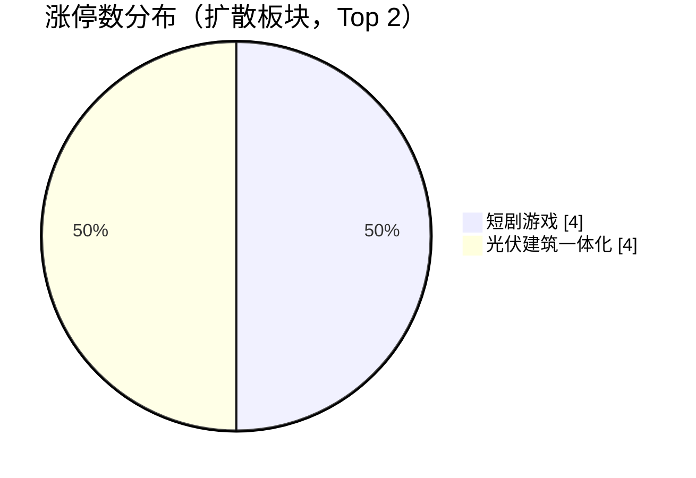
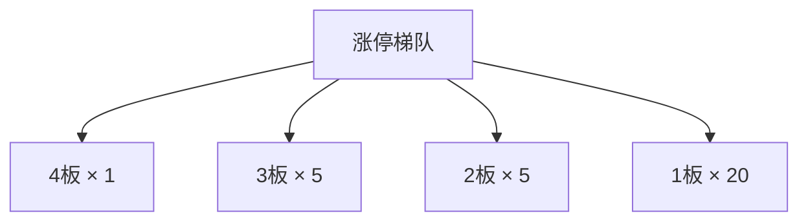

## 当日总览（截至 11:50）

> **结论**：全市场涨1656/跌3757（广度0.31）；涨停31/跌停16；中位涨幅-0.68%；局部修复。 钱在：短剧游戏(涨停4/成分99，中位+0.27%)、光伏建筑一体化(涨停4/成分135，中位-0.98%)；零星涨停：高压氧舱(1)、可燃冰(1)、黑龙江自贸区(2)、转基因(1)、信托概念(1)。 退潮：三胎概念(跌停3)、数字经济(跌停3)、电子商务(跌停3)。 梯队：4板×1、3板×5、2板×5、1板×20，最高4板。 预案：无有效对照。 较上一轮广度基本持平。

> 🔒 **no_trade / 买入预算 0 / max_position_pct 0 —— 全部内容仅供研究，不授予交易权限。**

### 板块扩散

> 口径：XTick 概念成分 × 全市场实时报价；分母 = 板块内有有效报价的成分数。排序用涨停密度（涨停数/有效成分数），已剔除宽基属性板块（全市场 432 个板块中剔 16 个）。

**扩散中（题材，按涨停密度排序）**

| 板块 | 涨停 | 有效成分 | 涨停密度 | 上涨广度 | 中位涨幅 | 相对全市场 | 成交(亿) |
|---|---|---|---|---|---|---|---|
| 高压氧舱 ⬦ | 1 | 11 | 0.091 | 0.36 | -1.04% | -0.36% | 17 |
| 可燃冰 ⬦ | 1 | 14 | 0.071 | 0.43 | -0.01% | +0.67% | 21 |
| 黑龙江自贸区 ⬦ | 2 | 36 | 0.056 | 0.25 | -0.73% | -0.05% | 55 |
| 转基因 ⬦ | 1 | 21 | 0.048 | 0.67 | +0.72% | +1.40% | 29 |
| 信托概念 ⬦ | 1 | 23 | 0.043 | 0.17 | -0.85% | -0.17% | 28 |
| 短剧游戏 | 4 | 99 | 0.040 | 0.57 | +0.27% | +0.95% | 384 |
| 民爆概念 ⬦ | 1 | 25 | 0.040 | 0.40 | -0.19% | +0.49% | 25 |
| 有机硅概念 ⬦ | 2 | 57 | 0.035 | 0.25 | -0.83% | -0.15% | 56 |
| 工业大麻 ⬦ | 1 | 31 | 0.032 | 0.45 | -0.25% | +0.43% | 40 |
| AI视频 ⬦ | 2 | 67 | 0.030 | 0.58 | +0.19% | +0.87% | 310 |
| 光伏建筑一体化 | 4 | 135 | 0.030 | 0.19 | -0.98% | -0.30% | 154 |
| 玉米 ⬦ | 1 | 34 | 0.029 | 0.50 | +0.06% | +0.74% | 58 |

> ⬦ = 涨停 <3 只，零星个例，不构成扩散（不计入「钱在」判定）。



零星涨停板块（<3 只）：高压氧舱(1)、可燃冰(1)、黑龙江自贸区(2)、转基因(1)、信托概念(1)、民爆概念(1)、有机硅概念(2)、工业大麻(1)

**退潮中（跌停集中）**

| 板块 | 跌停 | 有效成分 | 上涨广度 | 中位涨幅 |
|---|---|---|---|---|
| 三胎概念 | 3 | 211 | 0.17 | -1.29% |
| 数字经济 | 3 | 513 | 0.22 | -0.83% |
| 电子商务 | 3 | 676 | 0.23 | -0.92% |
| 乡村振兴 | 3 | 440 | 0.25 | -0.73% |
| 一带一路 | 3 | 797 | 0.25 | -0.74% |
| 乳业 | 2 | 36 | 0.06 | -1.88% |
| 污水处理 | 2 | 225 | 0.20 | -0.85% |
| 网络直播 | 2 | 279 | 0.24 | -0.78% |
| 数据中心(AIDC) | 2 | 664 | 0.24 | -0.82% |
| 冷链物流 | 2 | 155 | 0.25 | -0.80% |
| 新材料概念 | 2 | 382 | 0.26 | -0.77% |
| 固态电池 | 2 | 300 | 0.27 | -0.93% |

### 涨停梯队

> 最高 4 板 ｜ 涨停 31 ｜ 跌停 16 ｜ 炸板 23 ｜ 封板率 57.4% ｜ 打板成功率 21.15% ｜ 一进二 14.71% ｜ 二进三 33.33%

| 身位 | 家数 | 成员（涨幅/封单亿/首封） |
|---|---|---|
| 4板 | 1 | 皇台酒业 +10.02%/0.015亿/09:30 |
| 3板 | 5 | 高争民爆 +10.00%/0.062亿/09:25；浙文影业 +9.95%/0.041亿/09:30；大晟文化 +9.98%/0.024亿/09:25；*ST亿晶 +9.74%/0.004亿/09:25；龙版传媒 +10.00%/0.003亿/09:31 |
| 2板 | 5 | 永臻股份 +10.01%/0.019亿/10:00；大东方 +10.11%/0.010亿/09:30；大连友谊 +9.97%/0.010亿/09:25；马矿股份 +10.02%/0.004亿/09:25；鲁阳节能 +9.96%/0.002亿/09:30 |
| 1板 | 20 | 上证下游 +10.01%/0.048亿/09:25；索辰科技 +20.00%/0.043亿/10:10；金 螳 螂 +9.97%/0.029亿/09:30；顺灏股份 +9.98%/0.026亿/10:18；引力传媒 +10.00%/0.024亿/09:31 |



炸板 23 只（前几）：文投控股(5次)、天元智能(4次)、汇通能源(3次)、冰山冷热(2次)、ST东尼(2次)

### 预案池对照

| 票 | 池 | 板块 | 现价 | 涨幅 | 触发价 | 买区 | 风险位 | 判定 |
|---|---|---|---|---|---|---|---|---|
| 圣阳股份 `002580.SZ` | 执行池 | 电池（固态/储能局部扩散） | 19.36 | +3.70% | — | — | 18.0 | **无预案价** |
| 七匹狼 `002029.SZ` | 执行池 | 服装家纺（低位情绪扩散） | 9.59 | -7.16% | — | — | 10.9 | **无预案价** |
| 紫竹高科 `002058.SZ` | 观察池 | 电池（固态/储能局部扩散） | 20.94 | -0.90% | — | — | 20.38 | **无预案价** |
| 宁德时代 `300750.SZ` | 观察池 | 电池（固态/储能局部扩散） | 248.21 | -0.45% | — | — | 232.82 | **无预案价** |
| 九牧王 `601566.SH` | 观察池 | 服装家纺（低位情绪扩散） | 11.68 | +1.13% | — | — | 11.13 | **无预案价** |
| 东方海洋 `002086.SZ` | 观察池 | 羊/洋/阳、皇字及狼线索的情绪比较 | 3.22 | -5.85% | — | — | 3.3 | **无预案价** |
| 阳光照明 `600261.SH` | 观察池 | 羊/洋/阳、皇字及狼线索的情绪比较 | 4.46 | -9.90% | — | — | 4.77 | **无预案价** |


> ⚠ D1 明确 no_trade=true、买入预算 0、个股 max_position_pct=0。以上为研究对照，**不构成任何买入许可**。

### 盘面 vs 静态复盘 vs 消息面

| 维度 | 对象 | T-1 静态基线 | 今日盘面 | 关系 |
|---|---|---|---|---|
| 板块主线 | 羊/洋/阳、皇字及狼线索的情绪比较 | R2 次线 score=None 涨停None（T-1 口径） | 盘面未见该板块成分票涨停 | **背离** |
| 板块主线 | 传媒/短剧接力 | R2 次线 score=58.0 涨停None（T-1 口径） | 盘面未见该板块成分票涨停 | **背离** |
| 板块主线 | 磷化铟订单事件 | R2 次线 score=None 涨停None（T-1 口径） | 盘面未见该板块成分票涨停 | **背离** |
| 板块主线 | 保险容量回流 | R2 次线 score=None 涨停None（T-1 口径） | 盘面未见该板块成分票涨停 | **背离** |
| 梯队结构 | 最高4板 | T-1 最高梯队 4 板、首板 29、炸板率 39.06% | 今日 4板×1、3板×5、2板×5、1板×20；封板率0.5741 炸板23只 | **印证** |
| 预案验证 | 圣阳股份(002580.SZ) | 预案 电池（固态/储能局部扩散）／leader／触发价None／买区None | 无预案价：预案未给触发价/买区（情景作废或待重导） | **无响应** |
| 预案验证 | 七匹狼(002029.SZ) | 预案 服装家纺（低位情绪扩散）／leader／触发价None／买区None | 无预案价：预案未给触发价/买区（情景作废或待重导） | **无响应** |
| 预案验证 | 紫竹高科(002058.SZ) | 预案 电池（固态/储能局部扩散）／watch／触发价None／买区None | 无预案价：预案未给触发价/买区（情景作废或待重导） | **无响应** |
| 预案验证 | 宁德时代(300750.SZ) | 预案 电池（固态/储能局部扩散）／watch／触发价None／买区None | 无预案价：预案未给触发价/买区（情景作废或待重导） | **无响应** |
| 预案验证 | 九牧王(601566.SH) | 预案 服装家纺（低位情绪扩散）／watch／触发价None／买区None | 无预案价：预案未给触发价/买区（情景作废或待重导） | **无响应** |
| 预案验证 | 东方海洋(002086.SZ) | 预案 羊/洋/阳、皇字及狼线索的情绪比较／watch／触发价None／买区None | 无预案价：预案未给触发价/买区（情景作废或待重导） | **无响应** |
| 预案验证 | 阳光照明(600261.SH) | 预案 羊/洋/阳、皇字及狼线索的情绪比较／watch／触发价None／买区None | 无预案价：预案未给触发价/买区（情景作废或待重导） | **无响应** |
| 消息面对照 | 盘面热点板块 | R4 消息面（T-1 口径） | 实时快讯中命中热点板块关键词 1 条 | **印证** |

**分歧点（不掩盖）：**
- 板块主线·羊/洋/阳、皇字及狼线索的情绪比较 → 背离：T-1 有辨识度但今日盘中无涨停响应，题材未获资金确认
- 板块主线·传媒/短剧接力 → 背离：T-1 有辨识度但今日盘中无涨停响应，题材未获资金确认
- 板块主线·磷化铟订单事件 → 背离：T-1 有辨识度但今日盘中无涨停响应，题材未获资金确认
- 板块主线·保险容量回流 → 背离：T-1 有辨识度但今日盘中无涨停响应，题材未获资金确认

### 全天广度轨迹

| 时点   | 涨    | 跌    | 广度    | 涨停  | 跌停  | 成交(亿) | 有效样本 |
| ---- | ---- | ---- | ----- | --- | --- | ----- | ---- |
| 0930 | 2393 | 2740 | 0.431 | 12  | 3   | 511   | 5555 |
| 0940 | 1661 | 3714 | 0.298 | 18  | 13  | 2,514 | 5572 |
| 0950 | 2277 | 3010 | 0.409 | 20  | 14  | 3,726 | 5572 |
| 1000 | 2158 | 3139 | 0.387 | 25  | 9   | 4,636 | 5572 |
| 1010 | 3177 | 2046 | 0.570 | 28  | 14  | 5,477 | 5572 |
| 1020 | 3328 | 1917 | 0.597 | 32  | 12  | 6,184 | 5572 |
| 1030 | 2301 | 3048 | 0.413 | 36  | 14  | 6,794 | 5572 |
| 1040 | 2120 | 3261 | 0.381 | 35  | 13  | 7,365 | 5572 |
| 1050 | 2005 | 3377 | 0.360 | 30  | 17  | 7,813 | 5572 |
| 1100 | 1713 | 3665 | 0.307 | 30  | 15  | 8,214 | 5572 |
| 1110 | 1547 | 3871 | 0.278 | 32  | 19  | 8,647 | 5572 |
| 1120 | 1778 | 3601 | 0.319 | 32  | 19  | 9,002 | 5572 |
| 1130 | 1656 | 3748 | 0.297 | 31  | 17  | 9,313 | 5572 |
| 1140 | 1656 | 3748 | 0.297 | 31  | 17  | 9,313 | 5572 |
| 1150 | 1656 | 3748 | 0.297 | 31  | 17  | 9,313 | 5572 |

> ⚠ **数据冻结段**：1130–1150 数值连续完全一致，说明行情源未刷新，**不是市场横盘**，该段不可解读为盘面变化。

```mermaid
xychart-beta
    title "全市场广度轨迹（09:30 → 11:50）"
    x-axis "09:30 09:40 09:50 10:00 10:10 10:20 10:30 10:40 10:50 11:00 11:10 11:20 11:30 11:40 11:50"
    y-axis "广度(上涨占比)" 0 --> 1
    line 0.431 0.298 0.409 0.387 0.57 0.597 0.413 0.381 0.36 0.307 0.278 0.319 0.297 0.297 0.297
```

```mermaid
gantt
    title 全天截面时点分布（每个截面一个条目）
    09:30 截面 :done
    09:40 截面 :done
    09:50 截面 :done
    10:00 截面 :done
    10:10 截面 :done
    10:20 截面 :done
    10:30 截面 :done
    10:40 截面 :done
    10:50 截面 :done
    11:00 截面 :done
    11:10 截面 :done
    11:20 截面 :done
    11:30 截面 :done
    11:40 截面 :done
    11:50 截面 :done
```

### 观察建议（仅研究）

- **环境**：涨停 31.0 / 跌停 16.0，打板成功率 21.1%，一进二 14.7%。
- **方向**：今日形成实质扩散的是 短剧游戏（涨停4/成分99，密度0.040，中位+0.27%）、光伏建筑一体化（涨停4/成分135，密度0.030，中位-0.98%）。**需确认**：次日能否维持涨停家数且中位涨幅不掉队，否则只是普跌中的避险轮动。
- **零星**：高压氧舱(1只/11成分)、可燃冰(1只/14成分)、黑龙江自贸区(2只/36成分)、转基因(1只/21成分)、信托概念(1只/23成分) 属零星个例，不视为题材，不据此选股。
- **回避**：三胎概念（跌停3）、数字经济（跌停3）、电子商务（跌停3） 板块中位跌幅深，趋势未止跌前不接。
- **身位**：最高 4 板。梯队有高度不等于可接力，需逐票核验封单稳定性与开板次数后再定。

<details>
<summary>原始截面与数据质量（折叠）</summary>

**跨源校验**

```json
{
  "xtick": {
    "up": 1656,
    "down": 3757,
    "n": 5615,
    "amount_yi": 9249.5
  },
  "rtk_snapshot": {
    "up": 1656,
    "down": 3748,
    "valid_n": 5572,
    "amount_yi": 9312.9,
    "up_limit": 31,
    "down_limit": 17
  },
  "note": "两源口径不同（XTick 全市场含全部票；rt_k 返回样本）"
}
```

**rt_k 截面（原始）**

```json
{
  "market": {
    "total": 5582,
    "up": 1656,
    "down": 3748,
    "flat": 168,
    "requested_n": 5582,
    "received_n": 5582,
    "valid_n": 5572,
    "missing_n": 10,
    "universe_requested_n": null,
    "population_scope": "returned_rows_not_verified_all_a_universe",
    "up_ratio": 0.2967,
    "legacy_up_ratio_placeholder": false,
    "up_ratio_is_observed": true,
    "up_ratio_all": 0.2967,
    "up_ratio_valid": 0.2972,
    "up_ratio_denominator": "requested_n",
    "degraded": false,
    "limit_known_n": 5572,
    "limit_unknown_n": 0,
    "limit_counts_complete": true,
    "limit_source_errors": [],
    "up_gt3": 269,
    "up_gt5": 120,
    "up_limit": 31,
    "down_gt3": 355,
    "down_gt5": 105,
    "down_limit": 17,
    "amount_yi": 9312.9,
    "amount_sum_overflow": false,
    "amount_valid_n": 5572,
    "amount_missing_n": 0
  },
  "source_time_quality": {
    "quote_age_min_seconds": 1.662375,
    "quote_age_max_seconds": 61.662375,
    "source_age_limit_seconds": null,
    "freshness_status": "age_limit_not_configured",
    "age_reference_at": "2026-11-04T11:50:40.662375+08:00"
  },
  "trading_authorized": false
}
```

</details>

## 分时研判记录

### 09:35 研判增量
- **趋势**：首轮更像“服装接力与电池回流分化”，还不能认定普涨修复。依据为2026-11-04 09:30截面，分析生成于09:30:54；配套价格采集09:30:38—09:30:48，报价时标09:30:03—09:30:45，不是09:35现价。本日仅此一份，上一轮缺失，广度、涨停、梯队及排名的环比均不可判；总览“较上一轮基本持平”没有比较基线。后续采用有效返回样本2393/5555、广度43.08%的口径，不混用总览0.45或另一源涨停数。梯队仍报皇台酒业4板，但东方海洋、阳光照明这两只昨日4板分别跌4.39%、7.88%，说明“高度尚在”不等于老高标整体安全；开盘炸板计数也不能与昨日全天直接推成风险下降。
- **轮动**：总览“无形成扩散的题材”不能覆盖完整明细：同一截面的网络直播有3家涨停/279只有效成分、163家上涨，电子商务5/676、339家上涨，新零售3/324、174家上涨；纺织服饰行业为3/108、61家上涨，已不只是单票独强。相反，固态电池0/300、81家上涨，锂电池概念1/614、183家上涨，尚未印证昨日电池回流的板块延续。这与预案“电池走弱、服装保持扩散”的反向剧本方向相符，但缺同窗资金净额及连续截面，只能作为轮动假设，不能宣称资金已从电池搬到服装；重叠概念和加权行业不累加。短剧游戏已有2/99涨停、64家上涨，梯队亦报大晟文化、浙文影业3板，故自动对照“传媒无涨停响应”不能照抄；消息关键词未匹配只是消息缺证，不是题材已证伪。
- **剧本**：自动表将全部候选列“无预案价”，但原预案的入场规则中实际有价位，不能据此判方案作废。按07:23预案、价格基准2026-11-03，对照09:30价格：七匹狼11.36高于触发11.30且处于11.24—11.47价带，源报身位升至3板，价格条件局部印证，但没有分钟承接和可成交证据，不能写成已批准买入；圣阳股份19.17高于原价带18.58—18.95、紫竹高科21.55高于21.02—21.45、九牧王12.71高于11.49—11.72，均为超买区，不追高、不临时上移买区；宁德时代248.09处于248.07—253.06价带，却仍低于249.32触发价，只是进入观察范围。东方海洋3.27低于3.42触发价、阳光照明4.56低于4.95触发价，原突破条件未满足，且高标接力风险判断获得价格侧印证；不能仅用现价低于风险参考位倒推“已触发后失效”。
- **下一步看**：先等同口径下一份截面；若涨停增加而有效样本广度低于本轮43.08%，只认强势集中，不认普涨。服装以本轮3家涨停/108只、61家上涨为观察基线，看后续能否维持或扩展，并核七匹狼是否仍在11.30及原价带上沿11.47之间、封单与实际承接是否延续；跌回11.30以下则突破条件不再满足，只有截面不能确认持续站稳。电池方向看宁德能否重新达到249.32，同时固态电池广度能否高于81/300；圣阳继续高于18.95或紫竹高于21.45时仍只观察，不因服装走强而追入已离带对象。上述均为研究验证条件，不是新增交易门槛或买入许可：no_trade=true、各票max_position_pct=0保持，本任务新增买入预算按0处理；原预案账户预算字段仍为null/未核，不能冒称已核实账户预算为零。

### 09:45 研判增量
- **趋势**：09:30—09:40的新变化是“封板增加，但亏钱扩散更快”，不是普涨修复。依据2026-11-04最新09:40分析（09:40:53生成）；配套价格采集09:40:38—09:40:48，报价09:40:18—09:40:45，并非09:45现价。同一XTick来源两轮均返回5615条，上涨2331→1659；价格源有效样本则由5555变为5572，分轮上涨比例43.08%、29.81%，不把不同分母直接相减。涨停梯队源报涨停13→18、跌停3→12、炸板0→6，最高仍4板；二板5→3，九牧王、鲁阳节能退出封板梯队，新增首板不能掩盖接力分化。只确认风险扩散，不从两轮截面推断全天胜率。
- **轮动**：上一轮“服装保持扩散”的假设需要降温：纺织服饰上涨61→33/108，涨停仍3家，中位涨幅+0.26%→-0.65%，是前排维持、后排失血。短剧游戏涨停2→3/99，但上涨64→48/99；传媒行业上涨96→70/131、中位仍+0.22%，短剧相对强不等于板块全面走强。新增09:40:36短剧异动报道，与既有传媒接力研究、当前涨停响应形成局部印证，不能继续照抄自动对照中的“消息无响应”；报道所引产业统计尚未独立核验。另一边稀缺资源上涨25→33/48、中位+0.18%→+0.75%，与服装走弱呈价格侧跷跷板迹象，但仅1家涨停、缺同窗净流量，不升级为新主线，也不宣称资金已搬家；重叠概念不累加。
- **剧本**：按07:23预案入场规则中的原价位，而非自动表的空值判断。宁德时代248.09→251.86，由低于249.32触发价变为高于触发价且仍在248.07—253.06价带，是本轮新增的价格侧印证；紫竹高科21.55→23.24、源报进入3板，但固态电池上涨81→73/300、涨停0→2，说明容量与前排回流尚未带动多数成分。圣阳股份19.17→20.14、紫竹均继续高于原买区上沿18.95、21.45，不追高。七匹狼11.36未变、仍在原价带且高于11.30，但服装助攻转弱，不能把价格命中当成完整条件兑现；九牧王12.71→12.50并开板，仍高于原上沿11.72，不因回落改成低吸。东方海洋3.27→3.35仍未到3.42；阳光照明4.56→4.46且源列跌停，旧高标风险继续分化。涨停源与价格源并非同秒，不据此补造开板回封先后或持续承接。
- **下一步看**：下一轮先核报价更新及有效样本可比，再看本轮29.81%的上涨比例能否止跌，梯队源跌停12、炸板6是否继续增加。短剧要守住3家涨停/99只有效成分，并检验上涨家数能否由48恢复至上一轮64；服装须看到上涨家数向61/108恢复，不能只凭七匹狼维持3板就恢复扩散判断。电池以固态上涨73/300是否回升、宁德是否仍在249.32—253.06为联合观察条件；宁德跌回249.32下方则本轮新增价格印证撤回，突破253.06则原价带已错过，均不挪价追单。这些只是研究验证锚，分钟承接、同分钟资金及必要审核仍缺；no_trade=true、各票max_position_pct=0不变，本任务新增买入预算0，不授予买入许可，原预案账户预算null/未核不改写。

### 09:55 研判增量
- **趋势**：与上一轮相比，新增的是“广度回暖，但前排封板质量继续下降”，不能把广度反弹等同接力转强。依据2026-11-04的09:40→09:50分析；本轮09:50:50生成，配套价格采集09:50:39—09:50:49、报价09:49:51—09:50:45，不是09:55现价。两轮有效返回样本均为5572，上涨1661→2277、比例29.81%→40.87%，回升11.06个百分点；该口径不混用总览按涨跌家数计算的广度。梯队源涨停18→20的同时，跌停12→14、炸板6→11，封板率75.00%→64.52%；最高仍4板，三板6→5、首板8→11。龙版传媒由上轮炸板名单进入三板梯队，七匹狼、紫竹高科退出封板三板名单，结构正在换队，而非所有旧前排一起修复。
- **轮动**：上一轮短剧“只有前排相对强”的判断，本轮获得成分扩散补证：短剧上涨48→82/99、涨停3→4；文化传媒概念上涨78→143/197、涨停3→5，传媒行业亦由70→119/131上涨、中位涨幅+0.22%→+1.69%。与之相比，纺织服饰只由33→34/108上涨且涨停3→2；固态电池虽由73→100/300上涨，涨停却2→1、相对全市场中位表现-0.10→-0.36个百分点，属于跟随回暖、前排退潮，不是强势接棒。因而本轮价格侧更支持“传媒获得扩散、电池与服装相对掉队”，原预案“电池弱而服装承接”的备选条件没有兑现；缺同窗净流量，不能断言资金已从一边搬到另一边。既有传媒接力研究、09:40:36短剧异动报道与本轮扩散形成进一步局部印证；报道产业统计仍未独立核验，自动对照的“传媒无涨停响应”与本轮明细冲突，不予采信。重叠概念与行业不能累加成独立涨停数。
- **剧本**：按07:23预案的入场规则原价位（价格基准2026-11-03），七匹狼11.36→10.14，已由触发价11.30及11.24—11.47价带内跌到其下，上一轮价格侧印证撤回，不能下移买区接弱，也不假定此前发生过成交。宁德时代251.86→249.85仍高于249.32触发价、在248.07—253.06内，但容量锚回落叠加电池前排减弱，完整承接条件未获确认。九牧王12.50→11.70重新进入11.49—11.72，却是从高位回落入带，不能凭“价格回到买区”认定强势低吸成立；东方海洋3.35→3.42仅由未到价变为恰及触发价，不解除旧高标风险。圣阳股份20.14→19.74、紫竹高科23.24→21.61仍高于原价带上沿18.95、21.45，回落不等于新买点。紫竹、九牧王的梯队源涨幅与配套价格存在明显差异，须分别记录，不能拼接成同秒的回封、站稳或先后路径。
- **下一步看**：以本轮为锚，核下轮有效样本口径不变后，上涨比例能否守住40.87%，且跌停14、炸板11不继续扩张；若广度回落而炸板再增，撤回“修复正在扩展”的假设。传媒观察短剧能否维持4家涨停及82/99上涨，传媒行业119/131上涨是否回落，并核龙版三板与引力传媒首板的封板延续，不能只凭单票涨停保留整线强势结论。预案中宁德跌回249.32下方则价格印证撤回；九牧王须在11.55—11.72内出现新的分钟承接与同窗资金确认，东方海洋须在3.42—3.47内取得相同补证，单次越线均不升级；七匹狼未重回11.30且服装未恢复助攻前，不恢复原突破剧本。以上均为研究验证锚，不是新买入门槛：no_trade=true、各票max_position_pct=0、本任务新增买入预算0保持；原预案账户预算null/未核不改写，不授予任何买入许可。

### 10:05 研判增量
- **趋势**：09:50→10:00由“广度回暖”转成“封板增多、赚钱面收窄”，上一轮修复扩展的假设需降温。依据2026-11-04的10:00分析（10:00:53生成）；配套价格采集10:00:38—10:00:51、报价10:00:03—10:00:48，不是10:05现价。两轮有效返回样本均5572，上涨2277→2158、比例40.87%→38.73%，下降2.14个百分点。涨停梯队口径涨停20→25、跌停14→10、封板率64.52%→67.57%，较上一轮前排质量略改善，但炸板11→12，最高仍4板；新增主要在首板11→15及二板3→4，不能据此判全面转强。配套价格源跌停为9，与梯队源10分别保留，不混成同一口径。
- **轮动**：传媒由扩散加速转为强势降温：短剧涨停仍4/99，但上涨82→73/99、中位+1.80%→+0.97%；传媒行业上涨119→107/131，中位+1.69%→+1.01%。仍有多数成分上涨，不是一只龙头转弱就否定整线。新变化是光伏建筑一体化涨停3→4/135、源报永臻股份新进入二板，但上涨仅46→48/135、中位-0.22%→-0.29%；人形机器人涨停1→3/482、上涨148→191/482，中位仍-0.17%。两者是前排新增响应，尚未接成多数成分转强的新主线。固态电池上涨100→85/300，服装仅34→37/108，不能把传媒降温解读为电池或服装接棒；缺同窗净流量，跷跷板仅保留价格侧假设。昨日传媒接力研究的价格印证仍在、力度转弱；本轮消息匹配仍空，新增催化缺证，不把关键词漏匹配当消息证伪，重叠概念不累加。
- **剧本**：按07:23预案入场规则原价位（价格基准2026-11-03）核对，新增两处印证撤回：宁德时代249.85→247.23，已同时低于249.32触发价和248.07买区下沿，电池容量锚的突破条件不再满足；东方海洋3.42→3.38，也低于3.42触发及3.40下沿，上一轮恰及触发不能保留为确认。紫竹高科21.61→21.40由超买区回到21.02—21.45，虽仍高于21.13，却是回落入带，叠加固态成分走弱，不认新突破或强势低吸；原财务风险与降级观察不变。九牧王11.70→11.95重新高于11.72上沿，上一轮价带内承接观察已不适用，不追、不上移价带；圣阳19.74→19.30仍高于18.95上沿。七匹狼10.14→9.90继续远低11.30，服装切换备选不成立；阳光照明4.46未变、仍低于4.95，只保留风险观察。梯队与配套价格存在单票分歧，缺分钟路径，不补造站稳、回封或实际成交。
- **下一步看**：下轮先核报价更新及有效样本分母，再看上涨比例能否收复上一轮40.87%，同时涨停25与封板率67.57%不回落；若只涨停增、广度仍低于本轮38.73%，继续按强势集中而非普涨解释。传媒看短剧能否守住4家涨停、上涨由73/99向82/99恢复，并核龙版三板与引力传媒首板是否留在封板队列；光伏建筑一体化须在4家涨停之外看到上涨家数高于48/135、中位不再低于-0.29%，否则仍只是前排拉开。电池先看宁德重回原买区且达到249.32、固态上涨由85/300恢复到上一轮100/300，不能靠紫竹一次落回价带恢复整线判断。紫竹只有在21.13—21.45内出现新的分钟承接与同窗资金补证才值得重评，低于21.13撤回价格侧突破条件，高于21.45继续不追；均非新增交易门槛。no_trade=true、各票max_position_pct=0、本任务新增买入预算0保持；原预案账户预算null/未核不改写，全部仅研究，不授予任何买入许可。

### 10:15 研判增量
- **趋势**：10:00→10:10从“封板集中”转为“上涨面重新扩展”，上一轮对修复的降温判断获得新反证，但尚不能宣告主跌结束。依据2026-11-04的10:10分析（10:10:49生成）；配套价格采集10:10:38—10:10:48、报价10:10:12—10:10:45，不是10:15现价。两轮有效返回样本均5572，上涨2158→3177、比例38.73%→57.02%，回升18.29个百分点；梯队源涨停25→28、炸板仍12、封板率67.57%→70.00%，增量来自首板15→17及二板4→5，最高仍4板。尾部风险没有同步消退：梯队源跌停10→11，配套价格源9→14，分别保留；龙版传媒虽仍列三板，开板次数2→3、封单显示值继续缩小，不能把板块扩散等同所有前排稳封。
- **轮动**：传媒恢复扩散，同时机器人出现新的板块级响应，而不是电池退、服装接的原备选剧本。短剧上涨73→89/99、涨停仍4家，传媒行业107→123/131上涨；人形机器人上涨191→355/482、涨停3→5，中位-0.17%→+0.76%，比上一轮只有前排响应更扎实。10:08:55物理AI异动快讯与源报福莱新材、兆威机电首板同窗，只作价格与消息的局部印证，个股概念纯度未在本轮核验，重叠概念不累加。光伏建筑一体化虽由48→62/135上涨、仍4家涨停，相对全市场中位表现却-0.11→-0.19个百分点；纺织服饰也仅37→41/108上涨、相对表现+0.04→-0.22，都是绝对回暖却相对掉队，不能称接棒。传媒与机器人同涨，不支持两者互相跷跷板；缺同窗净流量，不把相对强弱写成已证实资金搬家。
- **剧本**：按07:23预案入场规则原价位（价格基准2026-11-03），本轮新增的是宁德时代247.23→250.46，重新高于249.32且回到248.07—253.06价带，恢复价格侧印证；固态电池上涨85→145/300但涨停仍1家且新增1家跌停，容量回暖尚不等于电池前排接力恢复，10:09:28电池回收走弱快讯也只对应其子方向，不外推全行业。紫竹21.40→21.29仍在21.02—21.45且高于21.13，却不是新增突破，财务反证及降级观察不变。圣阳19.30→19.59虽越过预案辅助压力19.50，仍高于原买区上沿18.95，不追、不挪价。七匹狼、东方海洋仍未到原触发价，九牧王仍超原买区，阳光照明弱势未改，不因广度回暖恢复这些原剧本；均缺分钟承接与同分钟资金，不补造站稳、回封或成交。
- **下一步看**：下一份报价更新、有效样本仍5572时，检验上涨比例能否守住本轮57.02%，且涨停28、封板率70.00%不回落；若广度回落而跌停继续增加，只认修复反复。短剧以4家涨停、89/99上涨，机器人以5家涨停、355/482上涨为本轮对照锚，观察是否继续扩展，龙版开板次数若再增则保留前排分歧，不能用后排普涨掩盖。宁德跌回249.32下方撤回本轮价格印证，高于253.06则原价带错过、不追；单次重越线不算持续确认。上述均为研究条件，不是新增交易门槛：no_trade=true、各票max_position_pct=0、本任务新增买入预算0保持；原预案账户预算仍null/未核，不授予任何买入许可。

### 10:25 研判增量
- **趋势**：10:10→10:20修复继续扩展，但速度放缓，新增强度在首板而非高位晋级。依据2026-11-04的10:20分析（10:20:50生成）；配套价格采集10:20:38—10:20:48、报价10:19:54—10:20:45，不是10:25现价。两轮有效返回样本均5572，上涨3177→3328、比例57.02%→59.73%，增加2.71个百分点，弱于上一段18.29个百分点的跃升。梯队源涨停28→32，首板17→21，二板、三板及最高4板均未增加；封板率70.00%→71.11%，但炸板12→13。梯队源跌停11→10，配套价格源14→12，尾部有所缓和却未消失。龙版传媒仍列三板、累计开板3→4次，前排分歧继续，不能用整体修复掩盖。
- **轮动**：机器人由上一轮“新响应”进一步扩散：涨停5→7/482、上涨355→401/482，中位+0.76%→+1.66%；短剧密度排名仍第6、涨停仍4/99，上涨却89→86/99，传媒行业123→116/131上涨、中位+1.47%→+1.35%，属于仍强但边际降温，不是整线退潮。集成电路上涨189→207/241、中位+1.12%→+1.74%，但涨停仍2家，只认价格扩散，不另封涨停主线。相反，纺织服饰上涨41→38/108、涨停2→1，高股息样本上涨147→104/285、中位+0.09%→-0.16%，更支持科技弹性增强、服装与防御相对失血的轮动假设；缺同窗净流量，不宣称资金已搬家。机器人延续上轮物理AI快讯后的价格响应，本轮未取得新增相关催化，不能升级为三方完全一致；概念交叉不累加。
- **剧本**：按07:23预案入场规则原价位（基准日2026-11-03），新增变化是紫竹高科21.29→21.52，已由原21.02—21.45价带内转为超买区，撤掉“带内承接观察”，不追、不上移买区；降级观察及财务反证保留。宁德时代250.46→249.40，仍在248.07—253.06且略高于249.32，但容量锚的价格印证明显变薄；固态电池上涨145→175/300、涨停仍1家，呈“成分回暖、容量回落”的分歧，尚非原电池前排接力完整兑现。圣阳19.59→19.50仍超18.95上沿，九牧王11.98→11.80仍超11.72，回落都不自动产生新买点；七匹狼10.01→9.86且服装助攻再减，原突破与服装切换备选继续不成立。东方海洋、阳光照明本轮价格未变，单票不动不代表全源冻结，也没有新增恢复证据。自动表仍报“无预案价”，本轮沿用原入场规则，不把展示空值当方案作废。
- **下一步看**：下轮先核报价更新及有效样本分母，观察上涨比例能否守住59.73%、涨停能否保有32家；若涨停增加而广度回落，只认强势集中。机器人以7家涨停、401/482上涨作延续锚；若回落而传媒上涨重新向123/131恢复，再检验是否出现反向轮动，不先押资金去向。龙版累计开板若超过本轮4次，前排质量警报继续。宁德跌回249.32以下即撤回价格侧印证，高于253.06仍不追；紫竹高于21.45不恢复原带内观察，即使回带也须新增分钟承接与同分钟资金补证，不能只凭截面批准。以上都是研究验证锚：no_trade=true、各票max_position_pct=0、本任务新增买入预算0不变；原预案账户预算null/未核不改写，不授予任何买入许可。

### 10:35 研判增量
- **趋势**：10:20→10:30修复明显回撤，上一轮“继续扩展”的判断撤回，转为前排封板增加、后排重新失血。依据2026-11-04的10:30分析（10:30:52生成）；配套价格采集10:30:38—10:30:49、报价10:29:30—10:30:48，不是10:35现价。两轮有效返回样本均5572，上涨3328→2301、比例59.73%→41.30%，下降18.43个百分点；另一行情源上涨家数亦同步减少，不是样本分母跳变。梯队源涨停32→36、首板21→25，二板、三板及最高4板均未增加；跌停10→13，价格源跌停12→14，尾部风险再升。封板率提高不能抵消赚钱面收缩，也不能据此宣告主跌结束。
- **轮动**：传媒与机器人本轮都在降温，不支持两者已经形成反向跷跷板。短剧上涨86→77/99、涨停仍4家，传媒行业116→112/131上涨；短剧中位涨幅+1.47%→+1.30%，相对全市场却+1.18→+1.49个百分点，是绝对回落、相对抗跌增强，不是新一轮加速。机器人上涨401→348/482、涨停仍7家，集成电路上涨207→171/241、中位+1.74%→+0.85%，上一轮科技扩散减弱；本轮快讯样本虽新增半导体回购报道，尚未独立核验，也未见同步扩散增强，不能只凭正面标题恢复加速判断。固态电池上涨175→101/300且新增1家跌停，纺织服饰38→23/108上涨，两边都弱，原“电池退、服装接”的备选不成立。缺同窗净流量，不将相对强弱写成资金已搬家；重叠概念不累加。传媒仍有板块价格印证，不能采信自动对照“无涨停响应”，但新增消息共振仍缺证。
- **剧本**：按07:23预案入场规则原价位（基准日2026-11-03），本轮新增两项转折：宁德249.40→249.18，跌回249.32触发价以下，虽仍在248.07—253.06价带，上一轮薄弱的突破印证已撤回；紫竹21.52→21.38，由超买区返回21.02—21.45且仍高于21.13，但这是回落入带，叠加电池成分转弱，不认新突破，财务反证与降级观察不变。东方海洋3.30→3.16进一步远离3.42触发价，旧高标风险加重；没有此前成交与分钟路径，不用风险参考位倒推已买后止损。圣阳、九牧王仍超原买区，七匹狼仍低于原触发价，阳光照明没有新增恢复证据，原判定不升级、不下移或上移价带。自动表的空价位仍不能覆盖原入场规则。
- **下一步看**：下轮有效样本及报价刷新可比后，先看上涨比例能否从41.30%向上一轮59.73%恢复，且梯队源跌停不再超过本轮13家；若涨停继续增加而广度再降，仍按强势集中、非普涨解释。短剧看4家涨停及77/99上涨能否保有、机器人看7家涨停及348/482上涨是否再缩；龙版三板累计开板仍4次但封单显示值缩小，须核后续是否新增开板，不能把留在梯队当稳封。宁德仅重回249.32—253.06才恢复价格侧观察；紫竹在21.13—21.45内仍须新增分钟承接与同分钟资金补证，低于21.13撤回突破条件、高于21.45不追。以上只是研究验证锚：no_trade=true、各票max_position_pct=0、本任务新增买入预算0保持；原预案账户预算未核不改写，不授予任何买入许可。

### 10:45 研判增量
- **趋势**：10:30→10:40不只是后排失血，前排封板质量也开始转差；总览“广度基本持平”不适用于同口径比较。依据2026-11-04的10:40分析（10:40:52生成），配套价格采集10:40:38—10:40:49、报价10:39:30—10:40:45，不是10:45现价。两轮有效返回样本均5572，上涨2301→2120、比例41.30%→38.05%，下降3.25个百分点；涨停梯队源涨停36→35、炸板13→16、封板率73.47%→68.63%，首板25→24，最高4板及二、三板家数未变。梯队源跌停仍13，价格源14→13，尾部略缓不能抵消赚钱面和封板质量双弱；这是对上一轮修复回撤的延续确认，不是数据冻结。
- **轮动**：本轮新增的是“机器人重新扩散、传媒继续降温”的反向变化，上一轮两者同弱的状态已改变：人形机器人涨停7→8/482、上涨348→367/482，中位+1.14%→+1.62%；梯队源新增柯力传感首板，首封标为10:40，属于新增前排响应，不能仅因它未进顶部密度榜就漏掉整线。短剧涨停仍4/99，上涨77→69/99、中位+1.30%→+0.82%；其密度排名第6→第4主要来自前列零星题材退位，并非自身加速。光伏建筑一体化虽仍4家涨停，上涨41→30/135、中位-0.28%→-0.53%，更像前排孤立而非新扩散。机器人相对传媒的价格侧跷跷板假设增强，但缺同窗净流量，不宣称资金已搬家；原有传媒研究仍获局部价格印证，新增消息共振未核。概念重叠不累加，首封时标不证明持续稳封或可成交。
- **剧本**：按07:23预案入场规则原价位（价格基准2026-11-03），新增两项状态变化：紫竹21.38→20.91，同时跌破21.13触发价及21.02买区下沿，撤回上一轮带内价格观察，不能下移买区接弱，原财务反证保留；九牧王11.90→11.71重回11.49—11.72且高于11.55，但属于回落入带，服装上涨23→19/108，不能把价位命中当强势低吸，也不自动递补七匹狼。宁德249.18→248.81仍在原价带而低于249.32，突破印证未恢复；圣阳19.53→19.44仍超18.95上沿，不追。分析所存10:40:04快讯转述圣阳净流出居前，尚未用原始同分钟资金核验，至少不能沿用昨日净入替代今日承接。七匹狼继续远低11.30，东方海洋虽反弹仍低于3.42，阳光照明未获新增恢复证据；电池弱、服装也弱，原服装切换备选仍不成立。自动表判定未变不代表实际剧本没有变化。
- **下一步看**：下轮先核报价更新及有效样本可比；上涨比例重回上一轮41.30%、封板率向73.47%恢复且炸板不超过本轮16家，才有修复重启的补证，否则不升级全市场判断。机器人以8家涨停、367/482上涨为延续锚；若机器人维持而短剧跌破本轮69/99上涨，强化相对切换假设；若两者同时回落，则撤回跷跷板、改按共同降温解释。短剧若恢复到上一轮77/99且仍有4家涨停，再评传媒承接。紫竹只有重回21.13—21.45才重新进入价格侧复核；九牧王须在11.55—11.72内补出新的分钟承接与同分钟资金证据，低于11.55撤回突破条件、高于11.72不追，回带本身不恢复买权。no_trade=true、各票max_position_pct=0、本任务新增买入预算0不变；原预案账户预算仍未核、不改写，全部仅供研究，不授予任何买入许可。

### 10:55 研判增量
- **趋势**：10:40→10:50从“封板质量转差”进一步变成“首板收缩、尾部风险扩张”，总览“局部修复”不足以描述本轮方向。依据2026-11-04的10:50分析（10:50:50生成）；价格采集10:50:38—10:50:48、报价10:49:06—10:50:45，不是10:55现价。有效返回样本均5572，上涨2120→2005、比例38.05%→35.98%，下降2.06个百分点；梯队源涨停35→30、炸板16→22、封板率68.63%→57.69%，减少集中于首板24→19，二、三板及最高4板家数未变。梯队源跌停13→15、价格源13→17分别保留，不能混成同一口径；高度没降不代表风险没升，前排与后排同时走弱，修复重启未获补证。
- **轮动**：上一轮机器人获得扩散的判断本轮撤回：人形机器人涨停8→6/482、上涨367→324/482、中位+1.62%→+0.85%；数据中心亦由4→1家涨停/664只、上涨258→206/664，说明科技弹性的扩散在收缩。传媒相对更抗跌，却不是重新加速：短剧涨停仍4/99、上涨69→67/99，中位+0.82%→+0.77%；传媒行业上涨97→100/131，但中位同样回落。两者不再支持上一轮“机器人增强、传媒减弱”的切换方向，也没有足够证据反过来宣布资金搬回传媒；缺同窗净流量。光伏建筑一体化涨停仍4家，上涨30→28/135，不能把前排未掉板当新扩散。传媒既有研究的价格响应尚在，最新快讯样本未提供相关新增催化，三方共振不升级；重叠概念不累加。
- **剧本**：按07:23预案入场规则原价位（价格基准2026-11-03），新增三项状态变化：紫竹20.91→21.05，重回21.02—21.45价带但仍低于21.13触发价，只恢复带内观察，不恢复突破印证，原财务反证保留；宁德248.81→247.31，进一步跌出248.07下沿，容量锚走弱，固态电池上涨103→85/300且跌停1→2家，原电池接力条件没有恢复；九牧王11.71→11.90再次超11.72上沿，撤掉上一轮带内承接观察，不追、不上移买区。圣阳19.44→19.55虽重新越过原辅助压力19.50，仍超原买区上沿18.95，不能把越压力当原买点兑现；七匹狼9.51→9.72仍远低11.30，服装上涨19→21/108不足以恢复切换备选。东方海洋3.23→3.19仍未到3.42，阳光照明4.46未变，旧高标风险判断不升级。自动表判定全未变掩盖了上述迁移；梯队与价格源单票涨幅有分歧，不拼成同秒路径，不补造回封、站稳或成交。
- **下一步看**：下轮报价刷新且样本可比后，上涨比例能否收复上一轮38.05%、涨停向35家及封板率68.63%恢复，并观察炸板是否继续超过本轮22家；只有反弹价格、没有封板质量改善，不恢复修复判断。机器人若向8家涨停、367/482上涨恢复，才有重新扩散的补证；短剧若跌破本轮4家涨停且上涨家数低于67/99，则连相对抗跌也需降级，龙版三板若新增开板，继续记录前排分歧。紫竹达到21.13且不越21.45、宁德重回249.32—253.06时，也须补分钟承接与同分钟资金；九牧王高于11.72仍不追，不能为成交挪价。全部只是研究验证锚：no_trade=true、各票max_position_pct=0、本任务新增买入预算0保持；原预案账户预算仍未核、不改写，不授予任何买入许可。


### 11:05 研判增量
- **趋势**：10:50→11:00由“首板收缩”延续为“封板数量暂稳、上涨面加速收窄”，没有止跌拐点。依据2026-11-04的11:00分析（11:00:52生成），配套价格采集11:00:39—11:00:49、报价10:59:42—11:00:45，不是11:05现价。有效返回样本均5572，上涨2005→1713、比例35.98%→30.74%，下降5.24个百分点；涨停仍30、最高仍4板、各层家数未变，但炸板22→23、封板率57.69%→56.60%。索辰科技由上轮首板名单进入本轮炸板名单，顺灏股份累计开板1→2次，数量未减掩盖了成员和封板质量变化。梯队源跌停仍15，价格源17→15，尾部略缓并不等于多数票止跌；两源更新，非全源冻结。
- **轮动**：传媒的抗跌优势本轮明显收缩：短剧上涨67→56/99、中位+0.77%→+0.18%，涨停仍4家；传媒行业上涨100→77/131。机器人亦由324→311/482上涨、中位+0.85%→+0.65%、涨停仍6家，属于两线共同降温，不支持“机器人退、传媒接”的反向切换。集成电路中位+0.52%→+0.53%、上涨162→157/241，价格更有韧性但涨停仍2家，只作相对承接观察，不宣布新主线。短剧密度排名第4→第6、黑龙江自贸区第10→第3，后者却仅2家涨停/36只、上涨11→10/36，排名上移不是整线扩散。光伏建筑一体化仍4家涨停、上涨28→24/135，也没有接棒。上述为价格侧比较，缺同窗净流量；本轮快讯样本未补出相关新催化，既有传媒研究的价格印证减弱，不升级三方共振，重叠概念不累加。
- **剧本**：按07:23预案入场规则原价位（价格基准2026-11-03），新增变化集中于紫竹与圣阳：紫竹21.05→20.96，再次低于21.02买区下沿，撤回上一轮“带内但未触发”的观察，21.13突破条件仍未恢复，财务反证保留；圣阳19.55→19.40，跌回原辅助压力19.50下方，上一轮越压力的补证撤回，但仍高于原买区上沿18.95，不因回落改成低吸或挪价追单。宁德247.31→246.17继续低于248.07下沿，固态上涨85→79/300；七匹狼9.72→9.59仍远低11.30，服装上涨21→15/108，两边都弱，原服装切换备选继续不成立。九牧王11.90→11.85仍超11.72，东方海洋3.19→3.18未到3.42，阳光照明4.46未变，均无新增升级证据；没有分钟承接和同分钟资金，不补造回封、站稳或成交。自动表仍报“无预案价”，本轮判定沿用原入场规则，不修改正式预案。
- **下一步看**：同口径下一轮先看上涨比例能否收复10:50的35.98%、涨停保持30家且封板率恢复至57.69%，炸板不再超过本轮23家；若上涨面继续低于30.74%，即使涨停未减也维持收缩判断。传媒要看到短剧上涨恢复至67/99、仍有4家涨停，才有抗跌修复补证；若机器人同时低于本轮311/482上涨或6家涨停，不解释成两线跷跷板。个股只复核原锚：紫竹重新达到21.13且不越21.45、宁德重回249.32—253.06后再补承接证据；圣阳即使重越19.50仍超原买区，不追。no_trade=true、各票max_position_pct=0、本任务新增买入预算0保持；原预案账户预算仍未核、不改写，全部仅供研究，不授予任何买入许可。

### 11:15 研判增量
- **趋势**：11:00→11:10新增的是“封板略修、赚钱面继续收窄”，不是全市场修复重启。依据2026-11-04的11:10分析（11:10:48生成）；配套价格采集11:10:38—11:10:47、报价11:09:12—11:10:45，不是11:15现价。两轮有效返回样本均5572，上涨1713→1547、比例30.74%→27.76%，下降2.98个百分点；梯队源涨停30→32、炸板23→22、封板率56.60%→59.26%，改善只在首板19→21，二、三板与最高4板未变。索辰科技由上一轮炸板名单返回首板梯队、累计开板仍2次，只确认截面状态迁移，不证明持续稳封。梯队源跌停15→18、配套价格源15→19，尾部风险反而扩大；两源数据已更新，不能把前排改善概括成多数票止跌。
- **轮动**：新出现的是银行相对承接增强、科技弹性继续收缩的价格侧跷跷板：银行上涨21→28/42、中位+0.08%→+0.43%，人形机器人虽涨停6→7/482，上涨却311→281/482、中位+0.65%→+0.38%；集成电路上涨157→131/241，中位+0.53%→+0.16%。银行没有涨停，不能按题材涨停扩散认定新主线，更不能临时补进预案。短剧上涨56→55/99、涨停仍4家，中位却+0.18%→+0.28%，属于局部抗跌回升；传媒行业上涨77→73/131，尚未形成整线回暖。短剧密度排名第6→第7，并不否定其局部改善；白酒虽由1→2家涨停/48只、进入前列，也仍只是零星响应，不能由皇台4板外推整线强。以上缺同窗净流量，不宣称资金已搬家；本轮快讯样本没有补出传媒、机器人相关新催化，既有传媒研究只保留局部价格印证，不升级三方共振，重叠概念不累加。
- **剧本**：按07:23预案入场规则原价位（价格基准2026-11-03），本轮没有新增价格条件触发：宁德246.17→247.20虽反弹，仍低于248.07买区下沿和249.32触发价；紫竹20.96→20.68进一步远离21.02下沿及21.13触发价，固态电池上涨79→72/300，电池接力未恢复。七匹狼9.59→9.50继续低于11.30，服装虽上涨15→17/108，中位却-1.15%→-1.39%，不够恢复“电池退、服装接”的备选。九牧王11.85→11.76正在靠近11.72上沿，但尚未回带，不能预判买点已到或自动递补；圣阳19.40→19.35仍超18.95上沿，不追、不挪买区。东方海洋3.18→3.22仍未到3.42；分析所存11:09:54水运建设快讯尚未独立核验，且不能把水运工程政策套成海洋捕捞公司的新增订单。阳光照明无新增恢复证据。自动判定全未变不等于条件改善，缺分钟承接与同分钟资金，不补造站稳、回封或成交。
- **下一步看**：下一轮先核报价刷新及有效样本可比；上涨比例能否重回上一轮30.74%，同时涨停不低于本轮32家、梯队源跌停不再超过18家，是区分“前排小修”与修复扩展的观察锚；若广度仍低于27.76%而跌停增加，继续按收缩解释。机器人要在保有7家涨停之外看到上涨恢复到311/482，短剧则看4家涨停及55/99上涨能否保有；银行若仍有28/42上涨而上述科技样本继续缩，才增强防御切换假设，不能据此增补交易对象。九牧王只有进入11.55—11.72且补出新的分钟承接、同分钟资金后才重评，高于11.72不追、低于11.55撤回突破条件；宁德、紫竹未重回各自原触发价前不恢复价格印证。全部只是研究条件：no_trade=true、各票max_position_pct=0、本任务新增买入预算0保持；原预案账户预算未核、不改写，不授予任何买入许可。

### 11:25 研判增量
- **趋势**：11:10→11:20由连续收窄转为一次广度反弹，上一轮“赚钱面继续收缩”不再延续，但还不是反转确认。依据2026-11-04的11:20分析（11:20:49生成）；配套价格采集11:20:38—11:20:47、报价11:19:21—11:20:45，不是11:25现价。有效返回样本均5572，上涨1547→1778、比例27.76%→31.91%，回升4.15个百分点；涨停仍32、最高仍4板、各层家数及封板率59.26%均未变，反弹尚未增加封板梯队。梯队源跌停18→15，但配套价格源仍19，不能宣布尾部风险同步消退。顺灏股份仍列首板、累计开板2→3次，说明数量持平也不能代表封板稳定；广度、成交已刷新，非全源冻结。
- **轮动**：上一轮“银行增强、科技收缩”的价格侧切换本轮反向：银行上涨28→22/42、中位+0.43%→+0.23%；短剧上涨55→61/99、涨停仍4家，传媒行业73→85/131上涨；机器人281→294/482上涨、涨停仍7家，集成电路131→153/241上涨、中位+0.16%→+0.61%。更像防御降温、科技与传媒回补，不是传媒和机器人互相跷跷板；缺同窗净流量，不宣称资金已搬家。短剧密度排名仍第7，但成分修复，排名不变不等于没有新增信息。既有传媒接力研究的价格印证增强，新增相关硬催化仍缺；11:20:35半导体增资快讯未独立核验，不据同窗报道推定上涨原因，三方共振不升级，重叠概念不累加。
- **剧本**：按07:23预案入场规则原价位（价格基准2026-11-03），本轮新增状态是九牧王11.76→11.62，由超买区回到11.49—11.72且高于11.55；但这是回落入带，服装仅17→18/108上涨、中位仍-1.21%，不是强势低吸已成立，更不自动递补七匹狼。紫竹20.68→20.90、宁德247.20→247.50虽反弹，仍分别低于21.02、248.07买区下沿及各自触发价；固态电池上涨72→79/300、跌停2→1仅是弱修复，电池接力与服装切换备选均未恢复。其余候选没有新增价格条件满足，圣阳仍超原买区、不追、不挪价；自动表空价位不覆盖原入场规则，也不把单次回带当站稳或成交。
- **下一步看**：下一轮报价刷新且样本可比后，先看上涨比例能否保有31.91%、再向10:50的35.98%恢复，同时涨停保持32家；若再跌回27.76%附近而封板未增，只认弱反弹反复。短剧以4家涨停、61/99上涨，机器人以7家涨停、294/482上涨为延续锚；若科技样本重新缩而银行恢复28/42上涨，再重评防御切换。九牧王在11.55—11.72内须补新的分钟承接与同分钟资金，低于11.55撤回突破条件、高于11.72不追；宁德、紫竹仍须重回原触发价后才复核，不能因全市场反弹放松。以上均为研究观察条件：no_trade=true、各票max_position_pct=0、本任务新增买入预算0保持；账户实际预算仍未核、不改写，不授予任何买入许可。

### 11:35 研判增量
- **趋势**：11:20→11:30的广度反弹未能延续，赚钱面与封板质量再度同弱，上一轮修复扩展的观察条件没有兑现。依据2026-11-04的11:30分析（11:30:43生成）；配套价格采集11:30:38—11:30:41、报价11:30:00—11:30:39，不是11:35现价。有效返回样本均5572，上涨1778→1656、比例31.91%→29.72%，下降2.19个百分点；梯队源涨停32→31、炸板22→23、封板率59.26%→57.41%，缩减仍在首板21→20，二、三板及最高4板不变。梯队源跌停15→16，价格源却19→17，方向不一致，不能宣称尾部风险同步好转。两源已刷新，非数据冻结；高度保留不等于接力环境改善。
- **轮动**：上一轮“防御降温、科技回补”的方向本轮又反向：银行上涨22→26/42、中位+0.23%→+0.28%；机器人上涨294→264/482、中位+0.51%→+0.28%，涨停仍7家；短剧上涨61→56/99、中位+0.50%→+0.27%，涨停仍4家。更像防御承接增强、弹性方向回补失败的价格侧跷跷板，缺同窗净流量，不宣称资金已搬家。短剧密度排名第7→第6是被动前移，不是扩散加速；光伏建筑一体化虽进入顶部榜，涨停仍4/135、上涨29→25/135，也不是新接棒。传媒既有研究仍有价格响应，但边际转弱；本轮分析所存股指期货早盘收涨快讯尚未独立核价，既不能推翻多数个股走弱，也不是传媒、机器人的新增催化，三方共振不升级。重叠概念与行业不累加。
- **剧本**：按07:23预案入场规则原价位（价格基准2026-11-03），新增状态只有宁德247.50→248.21，由低于248.07下沿回到248.07—253.06价带，但仍未达到249.32触发价；只恢复带内价格观察，不恢复突破印证。固态电池虽上涨79→80/300，跌停却1→2、中位-0.70%→-0.93%，容量锚回带尚未带动整线。九牧王11.62→11.68仍在原价带且高于11.55，但服装上涨18→17/108、中位-1.21%→-1.44%，价格局部回升不够恢复服装切换备选，更不自动递补七匹狼；其余候选无新增价格条件触发。另一个本轮到期事项：圣阳、七匹狼原研究入场规则的09:30—11:30窗口已结束，上午未确认的条件不能自动顺延到午后；圣阳仍超原买区，不追、不挪价。本段仅按既有规则对照，不修改正式预案，也不凭两次截面补造持续站稳、回封或成交。
- **下一步看**：午休报价不更新不算企稳，等午后实际报价刷新、样本口径可比后，再以收复上一轮31.91%上涨比例、32家涨停及59.26%封板率为修复补证锚，不把它们设成新交易门槛。短剧须由56/99向61/99上涨恢复且保有4家涨停，机器人须由264/482向294/482恢复且保有7家；若两者继续缩而银行仍有26/42上涨，则强化防御切换观察。宁德达到249.32且不越253.06后再核新的分钟承接与同分钟资金，跌回248.07下方则撤回本轮带内观察；九牧王高于11.72不追、低于11.55撤回突破条件。圣阳、七匹狼的上午规则不自动续期。no_trade=true、各票max_position_pct=0、本任务新增买入预算0保持；账户实际预算仍未核、不改写，全部仅供研究，不授予任何买入许可。

### 11:45 研判增量
- **趋势**：本轮只有消息更新，没有新增价量拐点。依据2026-11-04的11:40分析（11:40:42生成）；与11:30相比，两源广度与成交额、概念及行业成分统计、整套涨停梯队、七只预案票报价均完全一致。正值午休，只记“行情数值未刷新”，不能把新文件生成、源时标前移解释成企稳、横盘或持续承接；本轮不重复上午行情表。
- **轮动**：新增分歧在消息侧：自动消息对照由“无响应”改为“印证”，但唯一匹配是一则ETF午评，分析仅列关键词与标题，没有提供支持短剧专属新增催化的具体内容，不能据此升级为研究、消息、盘面三方共振。快讯样本另新增海外芯片走弱报道，其事实及因果解释本轮未独立核验，只增加午后科技承压的待证假设；不能用午休未动的行情证明风险已经传导，更不能反推它是上午走弱的原因。原有板块排名与成分没有新变化，不追加资金搬家或跷跷板确认。
- **剧本**：本轮没有新增价格条件触发或失效，重复报价不能补成“持续站稳”的路径证据。仍按07:23预案入场规则中的原价位对照，不拿自动表的空价位宣布方案作废；新增午间报道也不能替代预案要求的同分钟资金、分时承接和必要审核。研究判断不改变正式限制：no_trade=true、各票max_position_pct=0、本任务新增买入预算0；账户实际预算仍未核，不授予任何买入许可。
- **下一步看**：午后先核同口径成交额是否超过上午样本的9312.9亿元、报价内容是否实际更新，而非只有时间标签刷新；未更新则不作新趋势研判。针对新增海外风险假设，以11:30集成电路概念143/241家上涨、2家涨停为对照：若两项同步收缩，才增加价格侧承压证据；若反而扩展，则是承接的反证，不按负面标题先判利空兑现。短剧的自动“印证”还须补出题材相关原文，并与午后同窗成分变化核对，关键词命中本身不升级判断。上述只是研究验证基线，不是新增交易门槛。

### 11:55 研判增量
- **趋势**：新增信息只在消息侧，不在行情侧。依据2026-11-04的11:50分析（11:50:42生成）；11:30、11:40、11:50的两源广度与成交额、概念及行业成分统计、涨停梯队、七只预案票报价均相同，情绪数值也仅更新时间标签变化。午休行情未刷新，不能推导企稳、持续承接或新拐点，本轮不重复行情表。
- **轮动**：11:49:08快讯样本新增AMD的Helios机柜四季度交付放量报道，摘要提到联想等厂商，但正文截断、原始业绩会材料未核。它与上一轮海外芯片走弱报道形成“产业交付预期偏正面、风险偏好承压”的消息分歧，不能只挑一个方向当结论；更不能用未更新的A股价格宣称算力已获资金回流或传媒已让位。仅增加午后算力承接的研究假设，不升级三方共振。
- **剧本**：海外服务器交付标题不等于电池或服装候选获得新订单，不能移植为原预案的新增催化。相同报价也没有新增触发或失效证据，既有分钟承接、同分钟资金与必要审核缺口未被补齐；圣阳、七匹狼的上午规则不因此自动顺延，不挪原价带、不临时补票。no_trade=true、各票max_position_pct=0、本任务新增买入预算0保持；账户实际预算仍未核、不改写，不授予任何买入许可。
- **下一步看**：午后实际报价恢复更新后，针对这条新增交付假设，以11:30数据中心(AIDC)的158/664家上涨、1家涨停、中位-0.82%为基线：同口径上涨家数及中位涨幅同时改善、且涨停家数增加，才有初步价格侧响应；仍只有1家涨停不能称题材扩散。若集成电路同时弱于其143/241家上涨、2家涨停基线，则海外风险偏好压制的假设获得更多价格证据，但仍不据此认证因果。分母变化先重核，消息原文未补齐前不作公司订单映射；这些只是研究验证条件，不是交易门槛。

