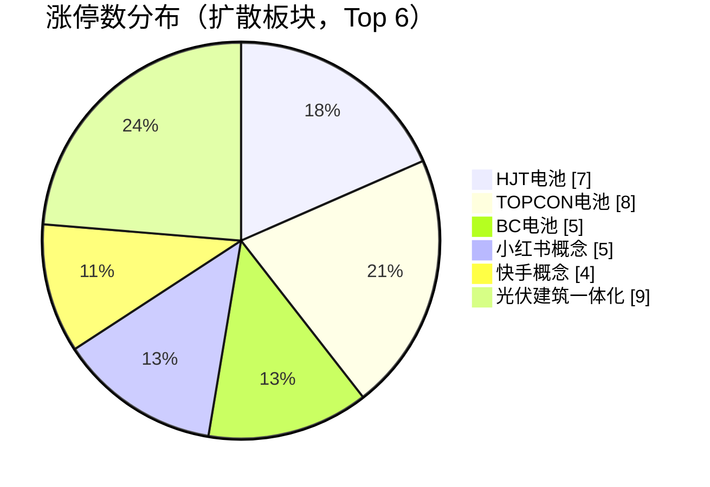
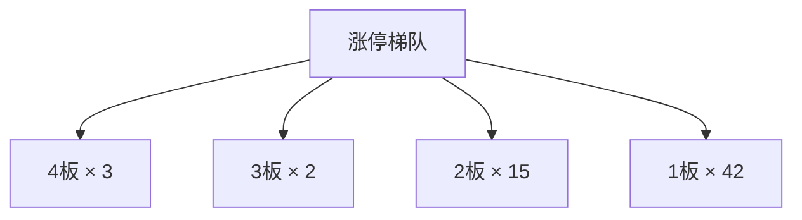
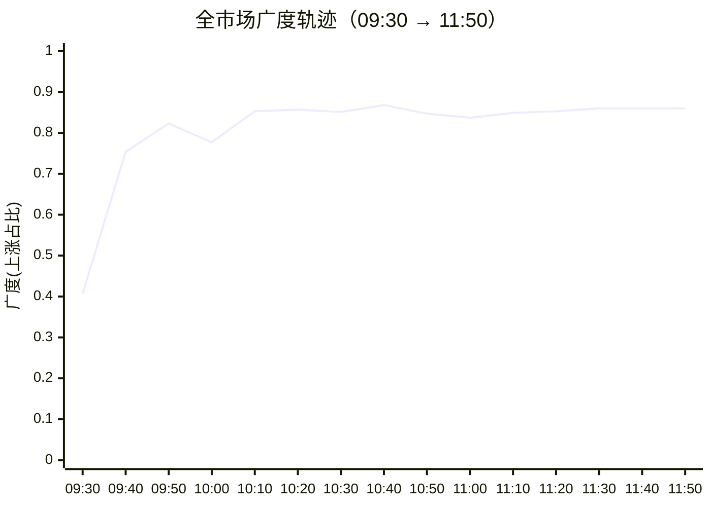

## 当日总览（截至 11:50）

> **结论**：全市场涨4794/跌683（广度0.88）；涨停62/跌停0；中位涨幅+1.88%；局部修复。 钱在：HJT电池(涨停7/成分69，中位+4.58%)、TOPCON电池(涨停8/成分82，中位+4.70%)、BC电池(涨停5/成分52，中位+5.75%)；零星涨停：可燃冰(1)、POE胶膜(2)。 退潮：无明显集中跌停板块。 梯队：4板×3、3板×2、2板×15、1板×42，最高4板。 预案：已触发 通富微电、闽发铝业、长电科技、北方华创、博杰股份、沃格光电、云南锗业、永臻股份、阳光电源、龙版传媒、浙文影业、福莱新材、翰宇药业、四川黄金、九牧王、深中华A；未到价 新易盛、中际旭创、华盛昌、武汉天源、七匹狼。 较上一轮广度基本持平。

> 🔒 **no_trade / 买入预算 0 / max_position_pct 0 —— 全部内容仅供研究，不授予交易权限。**

### 板块扩散

> 口径：XTick 概念成分 × 全市场实时报价；分母 = 板块内有有效报价的成分数。排序用涨停密度（涨停数/有效成分数），已剔除宽基属性板块（全市场 432 个板块中剔 16 个）。

**扩散中（题材，按涨停密度排序）**

| 板块 | 涨停 | 有效成分 | 涨停密度 | 上涨广度 | 中位涨幅 | 相对全市场 | 成交(亿) |
|---|---|---|---|---|---|---|---|
| HJT电池 | 7 | 69 | 0.101 | 0.97 | +4.58% | +2.70% | 316 |
| TOPCON电池 | 8 | 82 | 0.098 | 0.94 | +4.70% | +2.82% | 421 |
| BC电池 | 5 | 52 | 0.096 | 0.96 | +5.75% | +3.87% | 301 |
| 小红书概念 | 5 | 55 | 0.091 | 0.96 | +3.75% | +1.87% | 266 |
| 快手概念 | 4 | 52 | 0.077 | 0.94 | +3.19% | +1.31% | 310 |
| 可燃冰 ⬦ | 1 | 14 | 0.071 | 0.50 | +0.05% | -1.83% | 29 |
| POE胶膜 ⬦ | 2 | 29 | 0.069 | 0.86 | +3.09% | +1.21% | 74 |
| 光伏建筑一体化 | 9 | 135 | 0.067 | 0.91 | +2.77% | +0.89% | 294 |
| 钙钛矿电池 | 6 | 92 | 0.065 | 0.95 | +4.04% | +2.16% | 460 |
| 华为数字能源 | 3 | 46 | 0.065 | 0.85 | +2.39% | +0.51% | 140 |
| 光热发电 | 3 | 51 | 0.059 | 0.84 | +1.82% | -0.06% | 69 |
| 硅能源 | 4 | 73 | 0.055 | 0.95 | +3.60% | +1.72% | 277 |

> ⬦ = 涨停 <3 只，零星个例，不构成扩散（不计入「钱在」判定）。



零星涨停板块（<3 只）：可燃冰(1)、POE胶膜(2)

### 涨停梯队

> 最高 4 板 ｜ 涨停 62 ｜ 跌停 0 ｜ 炸板 41 ｜ 封板率 60.2% ｜ 打板成功率 16.53% ｜ 一进二 13.89% ｜ 二进三 33.33%

| 身位 | 家数 | 成员（涨幅/封单亿/首封） |
|---|---|---|
| 4板 | 3 | 浙文影业 +10.00%/0.036亿/09:25；闽发铝业 +9.90%/0.032亿/09:25；*ST亿晶 +10.06%/0.002亿/10:09 |
| 3板 | 2 | 永臻股份 +9.98%/0.038亿/09:25；鲁阳节能 +10.04%/0.006亿/09:56 |
| 2板 | 15 | 先导基电 +10.00%/0.047亿/09:31；有研新材 +10.00%/0.041亿/09:39；金 螳 螂 +10.00%/0.029亿/09:25；贝特利 +19.98%/0.027亿/09:30；引力传媒 +10.01%/0.017亿/09:30 |
| 1板 | 42 | 利欧股份 +10.03%/0.057亿/09:40；大金重工 +9.99%/0.046亿/10:02；协鑫集成 +9.96%/0.042亿/09:32；润建股份 +10.01%/0.036亿/09:46；钧达股份 +10.00%/0.035亿/09:39 |



炸板 41 只（前几）：赤峰黄金(49次)、兴业银锡(10次)、金海通(7次)、瑞芯微(6次)、三利谱(5次)

### 预案池对照

| 票 | 池 | 板块 | 现价 | 涨幅 | 触发价 | 买区 | 风险位 | 判定 |
|---|---|---|---|---|---|---|---|---|
| 通富微电 `002156.SZ` | 执行池 | 先进封装/半导体修复 | 45.39 | +7.23% | 42.33 | — | 40.81 | **已触发** |
| 新易盛 `300502.SZ` | 执行池 | 光通信/磷化铟事件链 | 185.71 | -5.49% | 196.5 | — | 183.49 | **未到价** |
| 闽发铝业 `002578.SZ` | 执行池 | 光伏/储能修复 | 4.55 | +9.90% | 4.22 | — | 4.07 | **已触发** |
| 长电科技 `600584.SH` | 观察池 | 先进封装/半导体修复 | 54.2 | +4.75% | 51.74 | — | 49.89 | **已触发** |
| 北方华创 `002371.SZ` | 观察池 | 先进封装/半导体修复 | 567.34 | +5.95% | 535.5 | — | 516.35 | **已触发** |
| 博杰股份 `002975.SZ` | 观察池 | 先进封装/半导体修复 | 81.2 | +5.00% | 77.33 | — | 74.57 | **已触发** |
| 沃格光电 `603773.SH` | 观察池 | 先进封装/半导体修复 | 59.63 | +4.34% | 57.15 | — | 55.11 | **已触发** |
| 云南锗业 `002428.SZ` | 观察池 | 光通信/磷化铟事件链 | 79.25 | +5.13% | 75.38 | — | 73.68 | **已触发** |
| 中际旭创 `300308.SZ` | 观察池 | 光通信/磷化铟事件链 | 496.5 | -6.91% | 533.38 | — | 498.07 | **未到价** |
| 华盛昌 `002980.SZ` | 观察池 | 光通信/磷化铟事件链 | 70.8 | -0.66% | 71.27 | — | 68.72 | **未到价** |
| 永臻股份 `603381.SH` | 观察池 | 光伏/储能修复 | 18.85 | +9.98% | 17.14 | — | 16.53 | **已触发** |
| 阳光电源 `300274.SZ` | 观察池 | 光伏/储能修复 | 87.22 | +7.45% | 83.92 | — | 78.77 | **已触发** |
| 龙版传媒 `605577.SH` | 观察池 | 短剧/影视/出版情绪 | 15.98 | +1.59% | 15.73 | — | 15.17 | **已触发** |
| 浙文影业 `601599.SH` | 观察池 | 短剧/影视/出版情绪 | 4.62 | +10.00% | 4.2 | — | 4.05 | **已触发** |
| 福莱新材 `605488.SH` | 观察池 | 人形机器人/物理AI | 48.12 | +7.43% | 44.79 | — | 43.19 | **已触发** |
| 兆威机电 `003021.SZ` | 观察池 | 人形机器人/物理AI | 97.32 | +4.76% | — | — | — | **无预案价** |
| 武汉天源 `301127.SZ` | 观察池 | 共享储能工程事件 | 13.75 | +1.03% | 15.98 | — | 14.92 | **未到价** |
| 翰宇药业 `300199.SZ` | 观察池 | 创新药/GLP-1事件 | 24.72 | +8.85% | 22.71 | — | 21.21 | **已触发** |
| 四川黄金 `001337.SZ` | 观察池 | 黄金/资源弹性对照 | 39.8 | +7.05% | 37.18 | — | 36.55 | **已触发** |
| 七匹狼 `002029.SZ` | 观察池 | 羊年/狼/名字梗跨年情绪 | 9.09 | -2.26% | 9.3 | — | 8.97 | **未到价** |
| 九牧王 `601566.SH` | 观察池 | 羊年/狼/名字梗跨年情绪 | 11.09 | +1.28% | 10.95 | — | 10.55 | **已触发** |
| 深中华A `000017.SZ` | 观察池 | 羊年/狼/名字梗跨年情绪 | 7.02 | +10.03% | 6.38 | — | 6.16 | **已触发** |

- **通富微电** — 现价45.39 ≥ 触发价42.33
- **闽发铝业** — 现价4.55 ≥ 触发价4.22
- **长电科技** — 现价54.2 ≥ 触发价51.74
- **北方华创** — 现价567.34 ≥ 触发价535.5
- **博杰股份** — 现价81.2 ≥ 触发价77.33
- **沃格光电** — 现价59.63 ≥ 触发价57.15
- **云南锗业** — 现价79.25 ≥ 触发价75.38
- **永臻股份** — 现价18.85 ≥ 触发价17.14
- **阳光电源** — 现价87.22 ≥ 触发价83.92
- **龙版传媒** — 现价15.98 ≥ 触发价15.73
- **浙文影业** — 现价4.62 ≥ 触发价4.2
- **福莱新材** — 现价48.12 ≥ 触发价44.79
- **翰宇药业** — 现价24.72 ≥ 触发价22.71
- **四川黄金** — 现价39.8 ≥ 触发价37.18
- **九牧王** — 现价11.09 ≥ 触发价10.95
- **深中华A** — 现价7.02 ≥ 触发价6.38

> ⚠ D1 明确 no_trade=true、买入预算 0、个股 max_position_pct=0。以上为研究对照，**不构成任何买入许可**。

### 盘面 vs 静态复盘 vs 消息面

| 维度 | 对象 | T-1 静态基线 | 今日盘面 | 关系 |
|---|---|---|---|---|
| 板块主线 | 短剧/影视/出版情绪 | R2 次线 score=57 涨停None（T-1 口径） | 盘面未见该板块成分票涨停 | **背离** |
| 板块主线 | 人形机器人/物理AI | R2 次线 score=68 涨停None（T-1 口径） | 盘面未见该板块成分票涨停 | **背离** |
| 板块主线 | 共享储能工程事件 | R2 次线 score=None 涨停None（T-1 口径） | 盘面未见该板块成分票涨停 | **背离** |
| 板块主线 | 创新药/GLP-1事件 | R2 次线 score=None 涨停None（T-1 口径） | 盘面未见该板块成分票涨停 | **背离** |
| 板块主线 | 黄金/资源弹性对照 | R2 次线 score=None 涨停None（T-1 口径） | 盘面未见该板块成分票涨停 | **背离** |
| 板块主线 | 羊年/狼/名字梗跨年情绪 | R2 次线 score=None 涨停None（T-1 口径） | 盘面未见该板块成分票涨停 | **背离** |
| 梯队结构 | 最高4板 | T-1 最高梯队 4 板、首板 29、炸板率 39.06% | 今日 4板×3、3板×2、2板×15、1板×42；封板率0.6019 炸板41只 | **印证** |
| 预案验证 | 通富微电(002156.SZ) | 预案 先进封装/半导体修复／leader／触发价42.33／买区None | 已触发：现价45.39 ≥ 触发价42.33 | **印证** |
| 预案验证 | 新易盛(300502.SZ) | 预案 光通信/磷化铟事件链／core_largecap／触发价196.5／买区None | 未到价：现价185.71，触发价196.5，还差5.81% | **无响应** |
| 预案验证 | 闽发铝业(002578.SZ) | 预案 光伏/储能修复／leader／触发价4.22／买区None | 已触发：现价4.55 ≥ 触发价4.22 | **印证** |
| 预案验证 | 长电科技(600584.SH) | 预案 先进封装/半导体修复／watch／触发价51.74／买区None | 已触发：现价54.2 ≥ 触发价51.74 | **印证** |
| 预案验证 | 北方华创(002371.SZ) | 预案 先进封装/半导体修复／watch／触发价535.5／买区None | 已触发：现价567.34 ≥ 触发价535.5 | **印证** |
| 预案验证 | 博杰股份(002975.SZ) | 预案 先进封装/半导体修复／watch／触发价77.33／买区None | 已触发：现价81.2 ≥ 触发价77.33 | **印证** |
| 预案验证 | 沃格光电(603773.SH) | 预案 先进封装/半导体修复／watch／触发价57.15／买区None | 已触发：现价59.63 ≥ 触发价57.15 | **印证** |
| 预案验证 | 云南锗业(002428.SZ) | 预案 光通信/磷化铟事件链／watch／触发价75.38／买区None | 已触发：现价79.25 ≥ 触发价75.38 | **印证** |
| 预案验证 | 中际旭创(300308.SZ) | 预案 光通信/磷化铟事件链／watch／触发价533.38／买区None | 未到价：现价496.5，触发价533.38，还差7.43% | **无响应** |
| 预案验证 | 华盛昌(002980.SZ) | 预案 光通信/磷化铟事件链／watch／触发价71.27／买区None | 未到价：现价70.8，触发价71.27，还差0.66% | **无响应** |
| 预案验证 | 永臻股份(603381.SH) | 预案 光伏/储能修复／watch／触发价17.14／买区None | 已触发：现价18.85 ≥ 触发价17.14 | **印证** |
| 预案验证 | 阳光电源(300274.SZ) | 预案 光伏/储能修复／watch／触发价83.92／买区None | 已触发：现价87.22 ≥ 触发价83.92 | **印证** |
| 预案验证 | 龙版传媒(605577.SH) | 预案 短剧/影视/出版情绪／watch／触发价15.73／买区None | 已触发：现价15.98 ≥ 触发价15.73 | **印证** |
| 预案验证 | 浙文影业(601599.SH) | 预案 短剧/影视/出版情绪／watch／触发价4.2／买区None | 已触发：现价4.62 ≥ 触发价4.2 | **印证** |
| 预案验证 | 福莱新材(605488.SH) | 预案 人形机器人/物理AI／watch／触发价44.79／买区None | 已触发：现价48.12 ≥ 触发价44.79 | **印证** |
| 预案验证 | 兆威机电(003021.SZ) | 预案 人形机器人/物理AI／watch／触发价None／买区None | 无预案价：预案未给触发价/买区（情景作废或待重导） | **无响应** |
| 预案验证 | 武汉天源(301127.SZ) | 预案 共享储能工程事件／watch／触发价15.98／买区None | 未到价：现价13.75，触发价15.98，还差16.22% | **无响应** |
| 预案验证 | 翰宇药业(300199.SZ) | 预案 创新药/GLP-1事件／watch／触发价22.71／买区None | 已触发：现价24.72 ≥ 触发价22.71 | **印证** |
| 预案验证 | 四川黄金(001337.SZ) | 预案 黄金/资源弹性对照／watch／触发价37.18／买区None | 已触发：现价39.8 ≥ 触发价37.18 | **印证** |
| 预案验证 | 七匹狼(002029.SZ) | 预案 羊年/狼/名字梗跨年情绪／watch／触发价9.3／买区None | 未到价：现价9.09，触发价9.3，还差2.31% | **无响应** |
| 预案验证 | 九牧王(601566.SH) | 预案 羊年/狼/名字梗跨年情绪／watch／触发价10.95／买区None | 已触发：现价11.09 ≥ 触发价10.95 | **印证** |
| 预案验证 | 深中华A(000017.SZ) | 预案 羊年/狼/名字梗跨年情绪／watch／触发价6.38／买区None | 已触发：现价7.02 ≥ 触发价6.38 | **印证** |
| 消息面对照 | 盘面热点板块 | R4 消息面（T-1 口径） | 实时快讯中命中热点板块关键词 1 条 | **印证** |

**分歧点（不掩盖）：**
- 板块主线·短剧/影视/出版情绪 → 背离：T-1 有辨识度但今日盘中无涨停响应，题材未获资金确认
- 板块主线·人形机器人/物理AI → 背离：T-1 有辨识度但今日盘中无涨停响应，题材未获资金确认
- 板块主线·共享储能工程事件 → 背离：T-1 有辨识度但今日盘中无涨停响应，题材未获资金确认
- 板块主线·创新药/GLP-1事件 → 背离：T-1 有辨识度但今日盘中无涨停响应，题材未获资金确认
- 板块主线·黄金/资源弹性对照 → 背离：T-1 有辨识度但今日盘中无涨停响应，题材未获资金确认
- 板块主线·羊年/狼/名字梗跨年情绪 → 背离：T-1 有辨识度但今日盘中无涨停响应，题材未获资金确认

### 全天广度轨迹

| 时点 | 涨 | 跌 | 广度 | 涨停 | 跌停 | 成交(亿) | 有效样本 |
|---|---|---|---|---|---|---|---|
| 0930 | 2267 | 2906 | 0.407 | 11 | 0 | 913 | 5568 |
| 0940 | 4200 | 1205 | 0.754 | 30 | 1 | 4,022 | 5571 |
| 0950 | 4584 | 840 | 0.823 | 39 | 0 | 5,975 | 5571 |
| 1000 | 4330 | 1074 | 0.777 | 41 | 0 | 7,522 | 5571 |
| 1010 | 4753 | 706 | 0.853 | 50 | 0 | 8,943 | 5571 |
| 1020 | 4775 | 699 | 0.857 | 62 | 0 | 10,034 | 5571 |
| 1030 | 4738 | 721 | 0.851 | 68 | 0 | 11,079 | 5571 |
| 1040 | 4834 | 637 | 0.868 | 68 | 0 | 11,934 | 5571 |
| 1050 | 4716 | 747 | 0.847 | 69 | 0 | 12,671 | 5571 |
| 1100 | 4663 | 770 | 0.837 | 63 | 0 | 13,343 | 5571 |
| 1110 | 4727 | 738 | 0.849 | 68 | 0 | 13,872 | 5571 |
| 1120 | 4753 | 710 | 0.853 | 61 | 0 | 14,385 | 5571 |
| 1130 | 4792 | 676 | 0.860 | 62 | 0 | 14,766 | 5571 |
| 1140 | 4792 | 676 | 0.860 | 62 | 0 | 14,766 | 5571 |
| 1150 | 4792 | 676 | 0.860 | 62 | 0 | 14,766 | 5571 |

> ⚠ **数据冻结段**：1130–1150 数值连续完全一致，说明行情源未刷新，**不是市场横盘**，该段不可解读为盘面变化。



### 观察建议（仅研究）

- **环境**：涨停 62.0 / 跌停 0.0，打板成功率 16.5%，一进二 13.9%。
- **方向**：今日形成实质扩散的是 HJT电池（涨停7/成分69，密度0.101，中位+4.58%）、TOPCON电池（涨停8/成分82，密度0.098，中位+4.70%）、BC电池（涨停5/成分52，密度0.096，中位+5.75%）。**需确认**：次日能否维持涨停家数且中位涨幅不掉队，否则只是普跌中的避险轮动。
- **零星**：可燃冰(1只/14成分)、POE胶膜(2只/29成分) 属零星个例，不视为题材，不据此选股。
- **身位**：最高 4 板。梯队有高度不等于可接力，需逐票核验封单稳定性与开板次数后再定。
- **预案待检验**：新易盛(触发价196.5，还差+5.81%)、中际旭创(触发价533.38，还差+7.43%)、华盛昌(触发价71.27，还差+0.66%)、武汉天源(触发价15.98，还差+16.22%)、七匹狼(触发价9.3，还差+2.31%) 尚未触及触发价，剧本未被盘面检验，继续按原失效条件看。

<details>
<summary>原始截面与数据质量（折叠）</summary>

**跨源校验**

```json
{
  "xtick": {
    "up": 4794,
    "down": 683,
    "n": 5583,
    "amount_yi": 14642.2
  },
  "rtk_snapshot": {
    "up": 4792,
    "down": 676,
    "valid_n": 5571,
    "amount_yi": 14765.6,
    "up_limit": 62,
    "down_limit": 0
  },
  "note": "两源口径不同（XTick 全市场含全部票；rt_k 返回样本）"
}
```

**rt_k 截面（原始）**

```json
{
  "market": {
    "total": 5582,
    "up": 4792,
    "down": 676,
    "flat": 103,
    "requested_n": 5582,
    "received_n": 5582,
    "valid_n": 5571,
    "missing_n": 11,
    "universe_requested_n": null,
    "population_scope": "returned_rows_not_verified_all_a_universe",
    "up_ratio": 0.8585,
    "legacy_up_ratio_placeholder": false,
    "up_ratio_is_observed": true,
    "up_ratio_all": 0.8585,
    "up_ratio_valid": 0.8602,
    "up_ratio_denominator": "requested_n",
    "degraded": false,
    "limit_known_n": 5571,
    "limit_unknown_n": 0,
    "limit_counts_complete": true,
    "limit_source_errors": [],
    "up_gt3": 1569,
    "up_gt5": 504,
    "up_limit": 62,
    "down_gt3": 78,
    "down_gt5": 31,
    "down_limit": 0,
    "amount_yi": 14765.6,
    "amount_sum_overflow": false,
    "amount_valid_n": 5571,
    "amount_missing_n": 0
  },
  "source_time_quality": {
    "quote_age_min_seconds": 1.312131,
    "quote_age_max_seconds": 62.312131,
    "source_age_limit_seconds": null,
    "freshness_status": "age_limit_not_configured",
    "age_reference_at": "2026-11-05T11:50:41.312131+08:00"
  },
  "trading_authorized": false
}
```

</details>

## 分时研判记录

### 09:35 研判增量
- **趋势**：首轮只能建立开盘基线，不能认定“较上一轮持平”或已经出现修复拐点。依据为今日唯一的09:30分析（09:30:50生成）；所附报价采集于09:30:40—09:30:46，源报价时点09:30:14—09:30:44，不冒充09:35现价。上涨广度按有效返回样本为2267/5568＝40.71%，尚未核对完整上市名录；顶部约45%的另一口径不用于后续环比。开盘封板率与09:25首封只是起点，不能代替连续交易中的封单稳定性。
- **轮动**：与盘前“科技容量修复”判断出现结构性分歧：先进封装仅32/210成分上涨、无涨停、中位跌1.03%，几只容量票上涨尚未带动板块；黄金61/82上涨、3/82涨停，对预案黄金备选方向构成初步印证。自动对照中“黄金无涨停响应”的文字与成分统计冲突，不能照单认定背离。顶部板块表之外，光伏概念已有4/602涨停，但仅271/602上涨、中位持平，仍是前排强而非全面扩散；短剧2/99涨停也不是完全无响应，但不足确认主线。当前只能提出“黄金相对科技更强”的竞争假说，单个截面不能证明资金从科技转入黄金；两条黄金快讯均在复述竞价行情，不算两次独立催化。
- **剧本**：总览的11只“已触发”只比较了触发价，漏掉预案入场规则内的买区。按原区间复核全部22只：10只现价超过买区上沿，仅长电科技在区内且越过触发价，另2只在区内尚未越过触发价、9只低于买区。通富43.24高于原上沿42.96、北方华创556.95高于543.53、四川黄金39.35高于37.74，均不能把“方向强”改写为“原买点成立”，不追高、不抬价带。长电虽满足价格位置，原预案的多次开板与资金反证仍在，不能因通富离带就递补；永臻股份、沃格光电的原财务硬否决不因涨停或后续触价解除。新易盛、中际旭创仍未到原触发价，不能拿拟成交后的风险位给未成交剧本判止损。
- **下一步看**：下轮先核有效样本与源时标，再比较广度是否高于本轮40.71%、涨停是否多于本轮11只；样本质量跳变或报价冻结则停止趋势推断。黄金观察能否维持至少3只涨停及不弱于61/82的上涨覆盖；先进封装观察32/210的上涨覆盖和中位跌1.03%能否同步改善，未改善前不把个股红盘升级为板块修复。阳光电源83.50已在原83.38—85.06区内但未越83.80，博杰77.22已在76.94—78.49区内但未越77.33；后续须在原区间内越过各自触发价，并有分时承接与同板块扩散证据，越线本身不是买点确认，价格离带后才确认则取消原入场情景。以上全部仅供研究：no_trade=true、买入预算0、各票max_position_pct=0，不授予任何买入许可。

### 09:45 研判增量
- **趋势**：09:30→09:40已从开盘偏弱转为广谱修复，不只是少数强票抱团。有效返回样本上涨占比由2267/5568＝40.71%升至4200/5571＝75.39%；分母小幅变化，不计算严格同分母的百分点差，且尚未核对完整上市名录。涨停11→30、炸板1→6，新增力量主要在首板与二板，最高仍为4板：扩散改善，但高标尚未拔高，不能直接升级为主升阶段。依据为09:40:50生成的分析；报价采集09:40:39—09:40:47、源时点09:39:39—09:40:45，不冒充09:45现价。
- **轮动**：光伏由“前排独强”转向成分扩散：同为602只有效成分，涨停4→17、上涨271→495；BC与TOPCON从零涨停进入扩散，光伏强度已超过开盘领先的黄金。但黄金涨停3→4、上涨61/82→74/82，并未失血，暂不能认定光伏与黄金形成跷跷板。先进封装上涨32/210→139/210，中位由-1.03%转为+0.61%，对盘前科技修复构成新增印证，但仍落后同期市场中位+0.85%，仅1/210涨停，尚未夺回扩散领先。不能因光伏602只成分中有1只跌停就沿用顶部“板块退潮”的机械标签。09:39快讯样本中的半导体ETF拉升与修复方向相符，但只是行情报道，不是新增产业催化；光伏本轮新增催化证据缺失，三方尚未完全一致。
- **剧本**：机械“已触发”11→15，不等于原买点增加。按预案入场规则内的原买区复核22只，超区10→14；唯一“区内且越触发”的对象由长电换成沃格，后者仍有原财务硬否决。长电由52.06升至53.11，超过原上沿52.52；新增触价的博杰78.72、阳光86.11、龙版16.18，也分别超过原上沿78.49、85.06、15.97。上一轮等待的博杰、阳光已经离带，不能用本轮触价倒推此前在带时承接已确认，更不能追高补单。云南锗业继续走强，而新易盛183.50→183.00、中际旭创488.00→487.50，说明事件链内部仍分化；不能把云南的强势外推为光模块容量同步转强。
- **下一步看**：下轮先核源时标与有效样本，再看光伏能否维持17/602涨停及495/602上涨覆盖；若涨停增加而上涨覆盖收缩，只能解释为强势集中。先进封装观察能否从1/210涨停继续扩散、板块中位能否追上同期市场中位，不能只凭通富上涨宣布重夺主线。博杰78.49、阳光85.06、长电52.52仍是各自原价带上沿，不上抬；后续即使回带，也不自动恢复已经迟到的确认情景，须重新核分时路径、原反证与必要审核。报价冻结或样本质量跳变时停止趋势推断。本轮全部仅供研究：no_trade=true、买入预算0、各票max_position_pct=0，不授予任何买入许可。

### 09:55 研判增量
- **趋势**：修复继续扩面，但封板质量没有同步增强。09:40→09:50，有效返回样本同为5571只，上涨占比75.39%→82.28%，提高6.89个百分点；涨停30→39、首板14→21、二板13→15，增量仍在低梯队，闽发铝业、浙文影业所在的最高4板未拔高。同时炸板6→9、封板率83.33%→81.25%，不能把普遍上涨直接升级为接力转强或主升。依据为11月5日09:50分析；报价采集09:50:39—09:50:47、源时点09:50:14—09:50:44，不冒充09:55现价，亦不声称已核无遗漏全A覆盖。
- **轮动**：上轮等待的封装扩散已出现：上涨139/210→193/210、涨停1/210→3/210，中位涨幅相对市场由落后0.24个百分点转为领先0.69个百分点，盘前科技修复判断获得新增印证。小红书涨停1/55→4/55、快手1/52→3/52，由零星上涨转为达到扩散门槛；短剧也由2/99→3/99，不能沿用自动对照的“传媒无涨停响应”。光伏同时保持涨停17/602→18/602、上涨495/602→546/602，当前更像多线并行扩散，尚非光伏与科技此消彼长。黄金涨停仍为4/82，上涨74/82→72/82、相对市场优势0.54→0.42个百分点；新增金价上涨快讯与方向相符，却未带来A股黄金扩散加速，不升级为避险资金主导。概念成分重叠，不把各线涨停相加；以上为价格结构推断，不冒充净资金迁移证据。
- **剧本**：机械“已触发”15→16，但复核全部22只的原入场规则后，超买区14→15，区内且越触发仍只有1只，只是对象从沃格换成华盛昌。华盛昌69.79→72.22，进入原70.91—72.34区间并越过71.27，价格条件开始响应；原预案的晚封、应收及经营现金流反证和必要审核缺口未解除，截面越线不等于承接确认。沃格57.78→59.17，已越原上沿58.01，且原财务硬否决仍在，不把板块转强当作放行理由。新易盛、中际旭创较上轮收窄跌幅，但仍低于各自原触发价196.50、533.38；只能认定弱势修复，不能据云南锗业强势宣布光通信事件链全面共振。
- **下一步看**：同口径下观察封装能否维持至少3/210涨停且中位继续强于市场，同时光伏能否守住18/602涨停与546/602上涨覆盖；若前者继续扩散而后者覆盖持续收缩，才加强轮动假说。小红书4/55、快手3/52为本轮扩散基线，回落时检验是少数前排维持还是助攻仍在。华盛昌仅在原70.91—72.34内且不低于71.27时继续核分时承接与必要风险，超过72.34后才确认则取消原入场情景，不抬价带；没有分钟路径、个股资金与审核闭环就保持观察。报价冻结或样本质量跳变时停止趋势推断。本轮全部仅供研究：no_trade=true、买入预算0、各票max_position_pct=0，不授予任何买入许可。

### 10:05 研判增量
- **趋势**：广谱修复首次出现截面回撤，涨停增加转为强势集中，不是继续普涨扩面。09:50→10:00，有效返回样本同为5571只，上涨4584→4330、占比82.28%→77.72%，下降4.56个百分点；涨停39→41，但炸板9→10、封板率81.25%→80.39%，最高仍为4板。鲁阳节能09:56进入梯队的3板档，只说明局部强反转；快讯称“5天4板”，统计口径不同，不据此上调连续板高度或认定全场反转。依据为11月5日10:00分析（10:00:47生成）；所附rt_k采集10:00:39—10:00:46、源报价10:00:06—10:00:44，不冒充10:05现价，也不声称已核无遗漏全A覆盖。
- **轮动**：光伏涨停18/602→19/602，上涨覆盖却546/602→513/602，前排继续集中；先进封装涨停仍3/210，上涨193/210→167/210，相对市场中位优势0.69→0.24个百分点，上一轮科技扩散正在降温，而不是接棒光伏。小红书涨停4/55→3/55、中位涨幅4.13%→2.40%；短剧涨停仍3/99，上涨92/99→79/99，说明传媒高标维持不等于助攻延续。黄金上涨72/82→73/82，但中位涨幅1.73%→1.54%，尚不足认定避险资金接力。当前更像多线同步回吐、光伏相对抗跌，不是已证实的此消彼长；没有同窗口净流向证据，不把价格分化写成资金迁移。新增BC关键词命中含空标题，不能据命中条数增加就声称产业催化增强。
- **剧本**：上一轮唯一“区内且越触发”的华盛昌72.22→70.39，已落到原买区70.91—72.34下方、也低于触发价71.27，价格响应未能延续，撤销上一轮近触发观察，不下移买区接弱；这不等于用拟成交后的风险位判止损。按预案入场规则复核全部22只，现为15只超区、7只低于买区，已无区内对象，不能把机械15只“已触发”当作可执行机会。阳光电源86.14→87.46进一步离开原上沿85.06，印证光伏容量相对强，却不是原买点重新成立；新易盛、中际旭创再度走弱，光通信链的全面共振剧本仍未兑现。
- **下一步看**：同口径下先看上涨覆盖能否在4330/5571止跌并向上一轮4584/5571恢复，同时涨停能否维持41只；若涨停继续增而覆盖继续缩，仍按前排集中而非普涨解释。光伏看能否维持19/602涨停、上涨覆盖由513/602向546/602恢复；封装看167/210上涨能否回升且守住3/210涨停，相对中位优势不能继续收窄；小红书若跌破本轮3/55涨停，原扩散判断需降级。华盛昌即使重新进入70.91—72.34且越过71.27，也仅恢复价格待核，须重新核分时承接、个股资金与原必要审核，不能自动恢复旧入场情景；阳光85.06上沿不抬。报价冻结或有效样本质量跳变则停止环比推断。本轮全部仅供研究：no_trade=true、买入预算0、各票max_position_pct=0，不授予任何买入许可。

### 10:15 研判增量
- **趋势**：10:00的回撤后重新扩面，上一轮“多线回吐”暂未延续。10:00→10:10，有效返回样本同为5571只，上涨4330→4753，占比77.72%→85.32%，按原始计数提高约7.59个百分点，并超过09:50；涨停41→50、炸板仍10，封板率80.39%→83.33%，本轮广度与封板质量同向改善。但最高仍4板，二板15→20才是主要梯队增量；新增二板瑞芯微记录3次开板，不能由整体改善推定逐票封单稳定。依据为11月5日10:10分析；所附rt_k采集10:10:40—10:10:49、源报价10:09:42—10:10:47，不冒充10:15现价；板块与池价为同轮XTick截面，逐票源时标未提供。
- **轮动**：光伏由前排集中重新转向扩散：上涨513/602→567/602、涨停19/602→22/602；封装同步从167/210上涨回升到199/210，涨停仍3/210，但相对市场中位优势0.24→1.42个百分点，对盘前科技修复判断形成新增印证，不是科技接棒、光伏失血。人形机器人涨停2/482→5/482、上涨321/482→439/482，10:08的探底回升快讯与价格方向相符；自动对照仍称“无涨停响应”与成分统计冲突，不能采纳，且该快讯只是行情报道，不是新增产业催化。另一处分化是小红书、快手涨停均3→2，跌回扩散门槛下，但上涨覆盖分别53/55→54/55、47/52→48/52，属于封板端分化，不能说整线失血。暂无同窗口净流向证据，不确认跷跷板，重叠概念不合计涨停。
- **剧本**：本轮唯一新增价格响应是华盛昌70.39→71.73，重返原70.91—72.34区间并再次越过71.27；结合前两轮反复，只能恢复“价格待核”，不能自动恢复原入场情景，晚封、应收与经营现金流反证及必要审核缺口仍在。按原预案入场规则复核全部22只：15只超区、6只低于买区、1只区内且越触发；机械“已触发”15→16不等于出现买入资格。新易盛183.66→188.00、中际旭创493.79→504.66虽收窄跌幅，仍低于原触发价196.50、533.38，光通信全面共振剧本尚未兑现。光伏与封装强票离带不追，不抬高原上沿，也不因板块回暖解除沃格、永臻的原财务硬否决。
- **下一步看**：先核源时标与有效样本，检验上涨覆盖能否维持本轮4753/5571、涨停能否守住50只；若再次回到10:00的4330/5571附近，则是修复持续性再受考验，不再把本轮回升外推。光伏观察22/602涨停与567/602上涨覆盖是否一起保持，封装观察3/210涨停及199/210上涨覆盖能否延续，人形机器人看5/482涨停是否保住；只增前排而覆盖收缩时仍按集中解释。华盛昌低于71.27撤销触价观察、低于70.91撤销本次回带状态，超过72.34后才取得确认则取消原情景，不能挪价带；区内也须另核分钟承接、个股资金及原必要审核。本轮全部仅供研究：no_trade=true、买入预算0、各票max_position_pct=0，不授予任何买入许可；报价冻结或样本质量跳变时停止环比推断。

### 10:25 研判增量
- **趋势**：修复由大幅扩面转为高广度下抬升强度，尚不是高标接力全面转强。10:10→10:20，有效返回样本同为5571只，上涨4753→4775、占比85.32%→85.71%，仅提高0.39个百分点；涨停却50→62，首板25→34、二板20→24，新增强度主要落在低梯队。封板率83.33%→83.78%仅小幅改善，炸板10→12；最高仍4板，鲁阳节能从3板封板梯队转入开板名单，3板家数2→1，不能用涨停总数掩盖身位分化。依据为11月5日10:20分析（10:20:44生成）；所附rt_k采集10:20:39—10:20:42、源报价10:20:11—10:20:40，不冒充10:25现价；尚未核对完整上市名录，板块与池价为同轮XTick截面、逐票源时标缺失。
- **轮动**：本轮最明显的新增扩散在封装：涨停3/210→7/210，上涨199/210→201/210，相对市场中位优势1.42→1.72个百分点，对盘前“直接封测前排续强”形成更强价格印证。光伏同时涨停22/602→25/602、上涨567/602→572/602，并未失血；HJT在真实扩散板块热表中前移，小红书2/55→4/55、快手2/52→3/52重新越过扩散门槛。当前更像光伏与科技并行、传媒封板端修复，不是已确认的跷跷板。黄金仍5/82涨停，但上涨76/82→75/82、相对优势0.39→0.36个百分点，只能说扩散未加速，不能据此认定净流出。新增光伏ETF快讯与盘面同向，但两个来源为同稿行情报道，不算两次独立产业催化；三方对照仍只到价格印证，不据关键词命中升级为产业逻辑兑现。
- **剧本**：通富微电46.19→46.56，梯队记录10:17首封二板、截至该截面开板0次，盘前续强研究假设获得新增印证；但已远超原买区上沿42.96，方向走对不等于原买点仍在，不追板补单，也不解除必要补审。复核全部22只原入场规则，仍为15只超区、6只低于买区、1只区内且越触发，原价带内没有新增对象。唯一华盛昌71.73→72.24已逼近原上沿72.34，虽仍高于71.27，却不能由两次截面在带推断中间持续站稳；原风险审核与分钟承接缺口仍在，不能用追涨补确认。新易盛188.00→190.50、中际旭创504.66→513.70继续修复，但未过196.50、533.38，光通信容量共振仍未兑现。
- **下一步看**：封装能否同时维持7/210涨停、201/210上涨，通富二板是否继续处于封板状态；若封装退回上一轮3/210，而光伏仍守25/602并出现相对强度反向，才加强竞争轮动假说。光伏以572/602上涨覆盖检验是否继续扩面，小红书4/55、快手3/52检验重新扩散能否保住，不把同成分重复计数。全样本广度以4775/5571、涨停62为本轮基线；若涨停再增而覆盖收缩，则改判强势集中。华盛昌若超过72.34后才补齐确认，原情景取消；未越上沿也不能跳过原审核，原价带不抬。本轮全部仅供研究：no_trade=true、买入预算0、各票max_position_pct=0，不授予任何买入许可；报价冻结或有效样本质量跳变则停止环比推断。

### 10:35 研判增量
- **趋势**：上一轮等待的“涨停再增而覆盖收缩”已经出现，修复转为高广度下的强势集中，不能继续写扩面。11月5日10:20→10:30，有效返回样本同为5571只，上涨4775→4738、占比85.71%→85.05%，下降0.66个百分点；涨停62→68，但炸板12→15、封板率83.78%→81.93%，市场中位涨幅2.07%→1.90%。新增首板34→39，二板仍24；三板1→2是鲁阳节能从开板名单回到封板梯队、累计开板2次，不是高度晋级，最高仍4板。依据为10:31:08生成的10:30分析；所附rt_k采集10:30:43—10:31:04、源报价10:29:57—10:31:02，不冒充10:35现价；完整上市名录尚未核对，板块与池价为同轮XTick截面、逐票源时标缺失。
- **轮动**：光伏与封装都在“增板、缩覆盖”，不是一条线失血、另一条线全面接棒：光伏涨停25/602→28/602，上涨572/602→568/602；封装涨停7/210→8/210，上涨201/210→198/210，相对市场中位优势1.72→1.27个百分点。HJT涨停6/69→8/69，强化的是光伏内部前排；封装仍印证盘前科技修复方向，但容量与助攻的边际强度已放缓。新增分歧在传媒与机器人：文化传媒涨停7/197→6/197、上涨172/197→165/197；人形机器人则6/482→7/482、上涨446/482→447/482，存在相对强弱分流迹象，但没有同窗口净流向，不能宣布资金已从传媒搬往机器人。新增半导体设备ETF报道属于行情复述，不是独立产业催化，不能用关键词“印证”覆盖本轮回吐；概念成分重叠，不合计涨停数。
- **剧本**：10:29:11版预案把通富微电、新易盛、闽发铝业列为优先候选，是方案身份调整，不是本轮新增买点或买权。通富、闽发现价分别仍为46.56、4.55，高于各自原买区上沿42.96、4.28；新易盛仍190.50，低于原买区195.52—199.45及触发价196.50，三个候选均未形成当前可用的原价带情景。全部22只复核后，区内且越触发仍只有华盛昌，72.24→71.80，价格响应没有升级，必要审核与分钟承接仍缺，不能由截面连续在带推断站稳。兆威机电“未到价→无预案价”来自预案改用MA50情景、缺触发及完整退出节点；其现价97.70仍远高于该情景73.08—74.55，不是股价转弱造成的失效，也不能当作没有原价带。机械“已触发”家数未变，不代表执行资格改善。
- **下一步看**：先检验同口径上涨覆盖能否重回4775/5571、同时维持本轮68只涨停；若覆盖继续低于4738/5571、封板率继续低于81.93%，则强化“前排集中、承接降温”判断。光伏以28/602涨停、568/602上涨，封装以8/210涨停、198/210上涨及相对中位优势1.27个百分点为本轮锚；仅增板不恢复覆盖，不升级普涨或主线加速。传媒6/197涨停与机器人7/482涨停若继续反向变化，再核同窗口资金证据验证轮动。华盛昌低于71.27撤销触价观察、低于70.91撤销本次回带状态；超过72.34后才补齐确认则取消原情景，不挪价带、不追高。预案候选身份不改变no_trade=true、买入预算0、各票max_position_pct=0，全部仅供研究；报价冻结或有效样本质量跳变则停止趋势推断。

### 10:45 研判增量
- **趋势**：广度重新扩面，但封板质量继续下降，不能把普遍反弹等同接力转强。11月5日10:30→10:40，有效返回样本同为5571只，上涨4738→4834、占比85.05%→86.77%，提高1.72个百分点，越过上轮等待的4775只基线；市场中位涨幅1.90%→2.12%。但同口径rt_k涨停仍68只，XTick梯队为68→69只，两源不混算；炸板15→18、封板率81.93%→79.31%，二板24→23、首板39→41，最高仍4板。改善的是上涨覆盖，走弱的是封板保持能力。依据为10:40:49生成的分析；所附rt_k采集10:40:39—10:40:48、源报价10:39:42—10:40:45，不冒充10:45现价；完整上市名录未核，XTick板块与池价逐票源时标缺失。
- **轮动**：新增强度偏向锂电与机器人，而不是封装全面接棒：锂电涨停11/614→12/614、上涨572/614→582/614，融捷股份10:39首次封首板；人形机器人涨停仍7/482，上涨447/482→456/482。先进封装则涨停8/210→7/210、上涨仍198/210，相对市场中位优势1.27→1.01个百分点，盘前科技修复方向仍有响应，但边际力度继续减弱。光伏涨停仍28/602、上涨仍568/602，HJT/TOPCON/BC的涨停密度前三顺序未变、各自中位涨幅却回落，不能只看排名说再加速。CPO上涨203/230→199/230、涨停2/230→1/230，偏弱方向更明确；10:40资金快讯转述新能源核心净买、光模块核心净卖，与价格分化同向，但未独立核同口径净流向，暂只提出竞争轮动假说。同期碳酸锂报价下跌快讯与锂股上涨背离，不编成“锂价上涨驱动”，消息与盘面尚非三方一致；重叠概念不合计涨停数。
- **剧本**：本轮关键反证是通富微电46.56→46.00，已离开上轮二板封板状态，不能继续沿用“零开板续强已兑现”；尚无分钟路径，不据此认定破均线或发出卖出指令。现价仍高于原买区上沿42.96，回落不是原买点重现，不追高也不下移价带。新易盛190.50→188.18、中际旭创511.91→504.66再度转弱，云南锗业80.15→80.50反而走强，强化事件链内部材料与容量分化，不能互相继承合同逻辑或买权。全部22只机械判定均未变化，但通富封板状态已变，说明“已触发”掩盖了路径转弱；按现行预案原入场规则，区内且越触发仍只有华盛昌，71.80→71.57，处于70.91—72.34内且高于71.27，必要审核、分钟承接与资金确认仍缺，维持观察而非升级。
- **下一步看**：通富先看能否重返本轮前的46.56并回到二板封板梯队，再用分钟/盘口检验回封持续性；仅一次触及涨停价不算稳定回封，即使回封也不恢复已离带的原入场情景。封装须先恢复到上一轮8/210涨停并保持至少198/210上涨，才能削弱本轮承接降温判断。锂电以12/614涨停、582/614上涨为新增扩散基线，光伏以28/602、568/602为对照：两者同强是并行修复，不是跷跷板；若锂电扩散而CPO低于本轮199/230上涨且仍仅1/230涨停，再补同窗口资金证据。若上涨覆盖维持4834/5571附近而封板率继续低于79.31%、二板继续减少，仍判普遍反弹与接力质量脱节。华盛昌失守71.27则撤销触价观察，低于70.91撤销本次回带状态，超过72.34后才确认则取消原情景。本轮全部仅供研究：no_trade=true、买入预算0、各票max_position_pct=0，不授予任何买入许可；报价冻结或有效样本质量跳变时停止环比推断。

### 10:55 研判增量
- **趋势**：10:40的再扩面未能延续，本轮上涨覆盖与封板质量同时回落，不能沿用顶部“广度基本持平”。2026年11月5日10:40→10:50，有效返回样本同为5571只，上涨4834→4716、占比86.77%→84.65%，下降2.12个百分点；市场中位涨幅2.12%→1.68%。同口径XTick涨停仍69只，rt_k为68→69只，两源不混算；炸板18→25、封板率79.31%→73.40%，二板23→20而首板41→44，最高仍4板。瑞芯微由二板封板转入开板名单、累计开板3→4次，新增首板没有抵消接力承接走弱。依据为10:50:49生成的分析；附带rt_k采集10:50:39—10:50:48、源报价10:49:42—10:50:45，不冒充10:55现价；完整上市名录未核，XTick板块与池价逐票源时标缺失。
- **轮动**：新增封板仍偏新能源前排，但不是继续普涨扩散：光伏涨停28/602→30/602，上涨568/602→562/602；锂电涨停12/614→15/614，上涨582/614→574/614，鹏辉能源10:46首次封首板。BC在涨停密度排序中升至第二，强化的是光伏内部集中；两条新能源大板块中位涨幅都回落至2.74%，不能只数新增板。上轮改善的机器人本轮涨停7/482→6/482、上涨456/482→430/482；CPO虽涨停1/230→2/230，上涨199/230→186/230、相对市场中位优势0.36→0.05个百分点，未形成容量回流。封装涨停7/210→8/210，却上涨198/210→197/210、中位3.13%→2.43%，仍仅部分印证盘前科技修复，不能宣布全面接棒。价格结构支持“新能源前排相对占优、机器人与光模块降温”的竞争轮动假说，但缺同窗口净流向，尚不确认跷跷板；本轮快讯样本未提供新能源新增产业催化，不把热点关键词命中当三方一致，重叠概念不合计涨停。
- **剧本**：上一轮华盛昌的撤销条件已发生：71.57→70.89，既低于触发价71.27，也跌出原70.91—72.34买区，撤销本次回带与触价观察，不下移价带接弱。复核现行预案全部22只的入场规则，区内且越触发由1只降为0只，当前16只高于原买区、6只低于原买区；兆威虽无完整触发节点，仍有原MA50研究区间，已计入超区，不能按缺值漏算。通富46.00→45.45继续回吐，未恢复46.56的二板封板状态，且仍高于原上沿42.96；盘前续强假设的承接证据进一步减弱，回落不等于原买点重现。新易盛与中际旭创继续走弱且仍未到原触发价；云南锗业80.50→79.27也回吐，不能再把材料端相对强势外推为整条事件链转强。原必要审核与财务硬否决不因新增涨停解除，不追高补确认。
- **下一步看**：先检验同口径上涨覆盖能否向上一轮4834/5571恢复、XTick封板率能否重回79.31%；若低于本轮4716/5571与73.40%且二板继续少于20只，则加强“修复降温、接力退化”判断，不由仍有69只涨停宣布企稳。新能源以光伏30/602涨停、562/602上涨，锂电15/614涨停、574/614上涨为新基线；只增板不恢复覆盖，仍判前排集中。封装本轮虽重回8/210涨停，尚未达到上轮要求的198/210上涨覆盖，须两项同步恢复且通富回到二板封板状态，才削弱承接降温判断，分钟/盘口持续性仍另核。华盛昌只有重返原70.91—72.34并重新越过71.27后才恢复价格待核，原风险审核和分钟承接不能省略，更不能自动恢复旧入场情景。本轮全部仅供研究：no_trade=true、买入预算0、各票max_position_pct=0，不授予任何买入许可；报价冻结或有效样本质量跳变时停止环比推断。

### 11:05 研判增量
- **趋势**：上一轮设定的降温条件已同时发生：2026年11月5日10:50→11:00，有效返回样本同为5571只，上涨4716→4663、占比84.65%→83.70%，下降0.95个百分点；两源涨停各自均为69→63，XTick炸板25→33、封板率73.40%→65.62%，二板20→17、首板44→41，最高仍4板。已从“覆盖回吐、涨停持平”转为覆盖与封板同步走弱，但上涨仍占多数，不据此判全市场主跌。依据为11:00:49生成的分析；附带rt_k采集11:00:39—11:00:48、源报价10:59:33—11:00:45，不冒充11:05现价。完整上市名录未核，XTick板块与池价逐票源时标缺失。
- **轮动**：光伏由增板转为存量前排维持：涨停仍30/602，上涨562/602→547/602；锂电则涨停15/614→14/614、上涨574/614→569/614，新增封板扩散开始收缩。封装仍8/210涨停，上涨197/210→190/210、相对市场中位优势0.75→0.59个百分点，盘前科技修复只获部分印证；CPO上涨186/230→168/230、中位由略强于市场转为略弱，未见容量接棒。短剧上涨77/99→81/99、中位1.35%→1.65%，但涨停4/99→3/99，属于覆盖修复与封板分化，不能笼统说传媒失血，也不能升为新主线。缺同窗口净流向，不确认跷跷板，重叠概念不合计。新增锂矿快讯称碳酸锂期货反弹，尚未独立核验；与早前现货报价不是同一标的，不能拼成“锂价先跌后涨”或把同稿双渠道当两次催化。
- **剧本**：唯一新增机械触价是九牧王10.62→11.26，本轮价虽高于触发价10.95，却也超过原买区10.90—11.11上沿；只能确认本轮价格响应，不能倒推区内承接曾成立，更不据单票反弹宣布旧名字线回归。按现行预案逐票核对全部22只入场规则，超区16→17、低于买区6→5，区内对象仍为零；“已触发”15→16增加的是离带对象，不是原买点。福莱新材由上一轮涨停价49.27回落至预案池48.19，且列入开板名单，进一步印证机器人承接降温；梯队与池价涨幅有差异，不拼成同一瞬间、不据截面声称破均线。通富45.45→45.31仍远高于42.96上沿，华盛昌70.89→70.37继续低于70.91下沿；不追高、不下移价带，原风险审核和硬否决不解除。
- **下一步看**：修复回暖先检验上涨覆盖能否重回4716/5571，同时涨停恢复至上一轮69只、封板率重回73.40%；若低于本轮4663/5571、63只与65.62%，则降温继续，不能只凭四板尚在说承接稳定。光伏以30/602涨停、547/602上涨为本轮锚，锂电须至少恢复15/614涨停和574/614上涨，封装须恢复8/210涨停及197/210上涨，才有扩散重新增强的证据。短剧若能恢复4/99涨停且保持81/99上涨，再核是否真正接力；九牧王仅回到10.90—11.11且不低于10.95时恢复价格待核，仍须分钟路径、同线助攻及原必要审核，不能自动恢复旧情景。本轮全部仅供研究：no_trade=true、买入预算0、各票max_position_pct=0，不授予任何买入许可；报价冻结或有效样本质量跳变时停止环比推断。

### 11:15 研判增量
- **趋势**：上一轮的同步降温暂被打断，但只是局部回暖，尚未恢复封板质量。2026年11月5日11:00→11:10，有效返回样本同为5571只，上涨4663→4727、占比83.70%→84.85%，提高1.15个百分点，越过上轮等待的4716只；同口径XTick涨停63→67、炸板33→32、封板率65.62%→67.68%，仍未达到上轮设定的69只与73.40%。rt_k涨停另为63→68，不与XTick混算。新增强度主要在首板41→45，二板仍17、最高仍4板；瑞芯微虽从开板名单回到二板封板名单、累计开板4次，不能据此说接力整体转强。依据为11:10:48生成的分析；附带rt_k采集11:10:39—11:10:47、源报价11:09:12—11:10:45，不冒充11:15现价；完整上市名录未核，XTick逐票源时标缺失。
- **轮动**：本轮新增扩散在传媒，而非科技容量回流：文化传媒涨停5/197→8/197、上涨158/197→178/197，相对市场中位由落后0.17个百分点转为领先0.35个百分点；短剧涨停3/99→5/99、上涨81/99→89/99，已超过上轮提出的恢复条件。小红书涨停3/55→5/55、快手2/52→4/52，分别升至本轮热表第四、第七，浙文影业四板之外开始有更多助攻。但光伏涨停30/602→29/602、上涨547/602→553/602，属于覆盖改善、封板略退，不是整线失血；锂电涨停14/614→13/614、上涨569/614→568/614，封装涨停8/210→7/210、上涨仍190/210，边际力度较弱。CPO上涨168/230→166/230，也未随全场回暖。由此加强“传媒边际接力、新能源与封装封板降温”的竞争轮动假说，尚无同窗口净流向证明跷跷板；与盘前科技领先基线存在分歧，本轮快讯样本又缺传媒新增产业催化，不能升级为三方一致。重叠概念不合计涨停。
- **剧本**：九牧王11.26→10.91，上一轮离带触价迅速退回原10.90—11.11区间且低于10.95触发价，说明那次价格响应未延续；当前只是区内未触发，不是回踩确认。按现行预案逐票复核全部22只原入场规则，超区17→16、低于买区仍5只，新增1只区内未触发，区内且越触发仍为零；机械“已触发”16→15并不代表新增买点。传媒助攻增强对浙文影业的情绪身位形成新增印证，但龙版传媒16.02→16.16仍高于原上沿15.97，不能因板块走强撤销其原板型禁止或抬价补买。新易盛185.55→184.46、中际旭创494.66→491.57继续走弱，容量续强剧本仍未到原触发价；不把传媒转强或云南锗业相对强势外推为光通信共振。
- **下一步看**：先检验短剧能否同时守住5/99涨停、89/99上涨，文化传媒能否保持8/197涨停与178/197上涨；若仅浙文高标不动而助攻回落，便不能把本轮扩散外推为持续主线。光伏以29/602涨停、553/602上涨为对照：若与传媒同步改善是并行修复，不是跷跷板；封装须先恢复8/210涨停及197/210上涨，才能削弱持续降温判断。全样本上涨覆盖回到4716/5571之上的条件虽已满足，XTick涨停恢复69只、封板率重回73.40%的条件仍未满足，下一轮须分别验，不能仅凭广度回升宣布全面转强。九牧王仅在原10.90—11.11内重新越过10.95才恢复价格待核，低于10.90则撤销本次回带状态；原兑现反证、分钟承接与必要审核仍独立，不追高、不挪价带。本轮全部仅供研究：no_trade=true、买入预算0、各票max_position_pct=0，不授予任何买入许可；报价冻结或样本质量跳变时停止环比推断。

### 11:25 研判增量
- **趋势**：上涨覆盖继续改善，封板质量却明显恶化，上一轮的短暂回暖没有延续到强势股承接。2026年11月5日11:10→11:20，有效返回样本同为5571只，上涨4727→4753、占比84.85%→85.32%，提高0.47个百分点；但同口径XTick涨停67→59、炸板32→42、封板率67.68%→58.42%，首板45→38、二板17→16，最高仍4板。rt_k涨停另为68→61，不与XTick混算。不是全市场普跌，而是普遍红盘与封板保持能力进一步脱节。依据为11:20:48生成的分析；附带rt_k采集11:20:39—11:20:46、源报价11:18:57—11:20:44，不冒充11:25现价；完整上市名录未核，XTick逐票源时标缺失。
- **轮动**：上轮传媒边际接力未继续扩散：文化传媒涨停8/197→7/197、上涨178/197→171/197；短剧仍5/99涨停，但上涨89/99→88/99、中位涨幅2.57%→2.08%，不能因浙文影业四板仍在就认定助攻稳定。封装涨停7/210→4/210、上涨仍190/210，相对市场中位优势0.58→0.36个百分点，盘前科技修复的价格印证继续减弱。新能源也未接走全部强度：光伏涨停29/602→25/602、上涨553/602→555/602，锂电涨停13/614→9/614、上涨仍568/614，均是封板收缩而非整线转跌。黄金上涨76/82→78/82、涨停仍3/82，只能说相对抗跌，尚非完整接棒。当前更像多线封板降温，不确认跷跷板；缺同窗口净流向，本轮快讯样本也未给出传媒或封装新增独立催化，不能把关键词命中当三方一致，重叠概念不合计涨停。
- **剧本**：本轮唯一新增价格响应是九牧王10.91→10.99，仍在原10.90—11.11内并重新越过10.95；按现行预案入场规则复核全部22只，仍16只超区、5只低于买区，唯一1只区内对象从未触发变为越触发。其原理由仍是旧线兑现、缺独立新催化和当下承接，截面再次越线只能恢复价格待核，不是回踩确认或旧名字线回归，更不能从别的情绪票继承助攻。通富45.35→45.27仍高于原上沿42.96，封装助攻反而收缩；不能用机械“已触发”15→16掩盖续强证据减弱，也不因买不到前排改推九牧王。原必要审核与硬否决不变，不追高、不下移买区。
- **下一步看**：回暖先检验XTick涨停能否恢复上一轮67只、封板率重回67.68%，同时有效样本上涨覆盖不弱于4753/5571；若只有广度上升而封板率继续低于本轮58.42%，仍按承接退化解释。封装先看4/210涨停能否恢复7/210，光伏能否恢复29/602且保住555/602上涨覆盖；传媒须重回8/197涨停、178/197上涨，短剧同时守5/99涨停并恢复89/99上涨，才削弱本轮助攻回吐判断。九牧王低于10.95撤销触价观察、低于10.90撤销回带状态，超过11.11后才补齐确认则取消原入场情景；区内也须另核分钟承接、同线助攻及原必要审核。本轮全部仅供研究：no_trade=true、买入预算0、各票max_position_pct=0，不授予任何买入许可；报价冻结或样本质量跳变时停止环比推断。

### 11:35 研判增量
- **趋势**：上午收尾出现小幅修复，但强势股承接尚未扭转。2026年11月5日11:20→11:30，有效返回样本同为5571只，上涨4753→4792、占比85.32%→86.02%，提高0.70个百分点；XTick涨停59→62、炸板42→41、封板率58.42%→60.19%，仍未达到上轮等待的67只与67.68%。rt_k涨停另为61→62，不混算。增量在首板38→42，二板反而16→15，最高仍4板；瑞芯微从二板封板名单转入开板名单、累计开板4→6次，不能把涨停回补说成接力恢复。另有梯队代码000017标为“新综指”、预案池标为“深中华A”的身份冲突，该条不用于认定新增二板。依据为11:30:43生成的分析；附带rt_k采集11:30:39—11:30:42、源报价11:30:00—11:30:40，不冒充11:35现价；完整上市名录未核，XTick逐票源时标缺失。
- **轮动**：传媒呈现更明显的前排集中，而非重新扩面：文化传媒涨停7/197→8/197，上涨却171/197→169/197，中位涨幅1.76%→1.73%、相对市场由领先0.02个百分点转为落后0.15个百分点；短剧仍5/99涨停，上涨88/99→87/99、中位2.08%→1.93%。小红书涨停4/55→5/55、在热表超过快手，不代表整个传媒助攻恢复。光伏则涨停仍25/602，上涨555/602→557/602，HJT/TOPCON/BC维持密度前三且相对市场优势均扩大，边际承接强于传媒；封装也从190/210上涨恢复至194/210、相对优势0.36→0.52个百分点，但涨停仍4/210，只是部分修复。没有同窗口净流向，不确认跷跷板；本轮热点快讯仍是较早的同一ETF上涨报道，未提供新增独立产业催化，不能把盘前逻辑与价格局部回暖升级为三方一致；重叠概念不合计涨停。
- **剧本**：全部22只按现行预案入场规则复核，价格状态分类没有迁移，仍16只超区、5只低于买区、唯一九牧王区内且越触发。九牧王10.99→11.09，逼近原上沿11.11；原理由仍缺独立新催化、同线赚钱效应与当下承接，不能把反复越线改写成站稳。龙版传媒16.02→15.98虽接近原上沿15.97，仍在区外且原板型禁止未解除，不为临近一分钱上抬价带。通富45.27→45.39只是回升、仍超过原上沿42.96；新易盛184.38→185.71、中际旭创493.66→496.50仍未到196.50、533.38，容量续强尚未兑现，不能把价格回升当作原买点重现。预案中基于T-1的市场仓位研究意见有效窗口止于今日11:30，不自动续到午后，也不改变原零执行额度。
- **下一步看**：午后先确认源报价已越过11:30，再判断盘面；若午休与13:00截面数值相同，只标未刷新，不解释为企稳。回暖继续沿用上轮67只涨停、67.68%封板率的验证锚，并检验上涨覆盖能否保持本轮4792/5571；二板若继续少于15只，则即使首板增加也不能称接力恢复。传媒需同时恢复178/197上涨覆盖并维持8/197涨停、短剧重回89/99上涨且守5/99涨停，才削弱前排孤立判断；光伏以25/602涨停、557/602上涨作午后基线，封装恢复7/210涨停且上涨不少于194/210才算进一步扩散。九牧王超过11.11后才补齐确认则取消原情景，低于10.95撤销触价观察、低于10.90撤销回带状态；不追高、不挪价带，分钟承接与必要审核另核。本轮全部仅供研究：no_trade=true、买入预算0、各票max_position_pct=0，不授予任何买入许可；源冻结、样本质量跳变或身份冲突未解的条目不作趋势及买点确认。

### 11:55 研判增量
- **趋势**：本轮只有消息增量，没有新的盘面趋势证据。2026年11月5日11:50分析与11:40、11:30的两源广度及成交额、板块成分统计、涨停梯队、全部22只预案价格判定完全一致；午休冻结段不解释为企稳、横盘或承接改善。文件生成时间11:50:42及更新中的源时标，不等于出现了新的成交或价格确认，价格判断仍停留在上午收尾。
- **轮动**：新增待核的是午休快讯：11:50:29新浪财经样本称均胜电子机器人高算力控制器累计交付突破2000套；11:49:27样本转述元力股份钠离子电池用硬碳已量产及批量供货。两条均未核公告原文与首次披露时间，只增加机器人、钠电材料的午后验证线索，不能解释消息发布前的上午涨势，也不能据冻结报价宣布资金从光伏或传媒转入机器人。港股南下净卖出快讯不替代A股板块资金证据；本轮无新增跷跷板确认。
- **剧本**：消息当事公司的业务进展不能移植给同题材预案票。福莱新材上午末价48.12仍高于原44.57—45.46买区及44.79触发价；原理由中的柔性传感收入贡献低、五日资金净出与高波动，不因均胜控制器交付消息而消失。兆威机电原73.08—74.55回踩研究区间及必要审核缺口也不变，不换价带凑当前价。全部预案判定未迁移，不重复制造触价确认；原研究窗口已于11:30到期，不自动续到午后，不追高、不解除原限制。
- **下一步看**：午后先取得真正恢复成交的有效报价，再以消息发布前的上午截面检验传导：人形机器人须在482只有效成分可比时，涨停多于4只且上涨不少于421只；钠离子电池须在144只有效成分可比时，涨停多于3只且上涨不少于135只，并核中位相对强度是否改善。只有当事公司走强、助攻未扩散，仍是个股消息响应，不升级板块主线；均胜、元力的原文核验、当日盘口与流通市值均缺，不临时纳入可交易名单或编买点。以上阈值只作研究对照，不是入场门槛；no_trade=true、买入预算0、各票max_position_pct=0，全部内容不构成任何买入许可。

