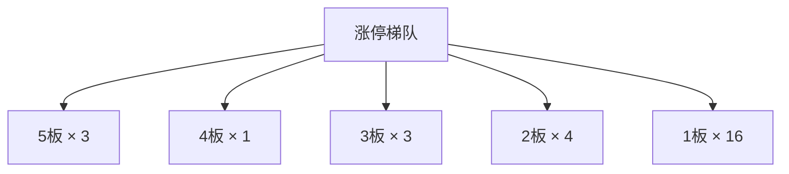
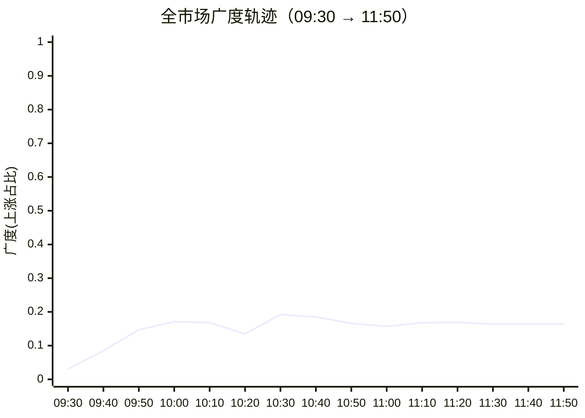

## 当日总览（截至 11:50）

> **结论**：全市场涨911/跌4556（广度0.17）；涨停27/跌停1；中位涨幅-1.27%；局部修复。 钱在：无形成扩散的题材（涨停零星）；零星涨停：低辐射玻璃(Low-E)(2)、黑龙江自贸区(2)、转基因(1)、信托概念(1)、汽车拆解概念(1)。 退潮：集成电路概念(跌停1)、民爆概念(跌停1)、2024中报预增(跌停1)。 梯队：5板×3、4板×1、3板×3、2板×4、1板×16，最高5板。 预案：无有效对照。 较上一轮广度基本持平。

> 🔒 **no_trade / 买入预算 0 / max_position_pct 0 —— 全部内容仅供研究，不授予交易权限。**

### 板块扩散

> 口径：XTick 概念成分 × 全市场实时报价；分母 = 板块内有有效报价的成分数。排序用涨停密度（涨停数/有效成分数），已剔除宽基属性板块（全市场 432 个板块中剔 16 个）。

**扩散中（题材，按涨停密度排序）**

| 板块 | 涨停 | 有效成分 | 涨停密度 | 上涨广度 | 中位涨幅 | 相对全市场 | 成交(亿) |
|---|---|---|---|---|---|---|---|
| 低辐射玻璃(Low-E) ⬦ | 2 | 12 | 0.167 | 0.25 | -1.21% | +0.06% | 14 |
| 黑龙江自贸区 ⬦ | 2 | 36 | 0.056 | 0.25 | -0.90% | +0.37% | 65 |
| 转基因 ⬦ | 1 | 21 | 0.048 | 0.86 | +1.07% | +2.34% | 51 |
| 信托概念 ⬦ | 1 | 23 | 0.043 | 0.22 | -0.66% | +0.61% | 34 |
| 汽车拆解概念 ⬦ | 1 | 23 | 0.043 | 0.22 | -1.00% | +0.27% | 37 |
| 粮食概念 ⬦ | 2 | 48 | 0.042 | 0.50 | +0.09% | +1.36% | 103 |
| 供应链金融 ⬦ | 2 | 50 | 0.040 | 0.20 | -0.82% | +0.45% | 76 |
| 光热发电 ⬦ | 2 | 51 | 0.039 | 0.33 | -0.30% | +0.97% | 86 |
| 石墨电极 ⬦ | 1 | 26 | 0.038 | 0.19 | -1.07% | +0.20% | 44 |
| 有机硅概念 ⬦ | 2 | 57 | 0.035 | 0.09 | -1.45% | -0.18% | 82 |
| 广东自贸区 ⬦ | 1 | 29 | 0.035 | 0.21 | -1.13% | +0.14% | 40 |
| 冰雪产业 ⬦ | 2 | 61 | 0.033 | 0.18 | -0.93% | +0.34% | 106 |

> ⬦ = 涨停 <3 只，零星个例，不构成扩散（不计入「钱在」判定）。

零星涨停板块（<3 只）：低辐射玻璃(Low-E)(2)、黑龙江自贸区(2)、转基因(1)、信托概念(1)、汽车拆解概念(1)、粮食概念(2)、供应链金融(2)、光热发电(2)

**退潮中（跌停集中）**

| 板块 | 跌停 | 有效成分 | 上涨广度 | 中位涨幅 |
|---|---|---|---|---|
| 集成电路概念 | 1 | 241 | 0.11 | -2.26% |
| 民爆概念 | 1 | 25 | 0.12 | -1.11% |
| 2024中报预增 | 1 | 653 | 0.13 | -1.25% |
| 雅下水电概念 | 1 | 89 | 0.15 | -0.78% |
| 西部大开发 | 1 | 636 | 0.20 | -0.94% |

### 涨停梯队

> 最高 5 板 ｜ 涨停 27 ｜ 跌停 1 ｜ 炸板 11 ｜ 封板率 71.0% ｜ 打板成功率 12.79% ｜ 一进二 6.25% ｜ 二进三 17.65%

| 身位 | 家数 | 成员（涨幅/封单亿/首封） |
|---|---|---|
| 5板 | 3 | 浙文影业 +9.96%/0.041亿/09:25；闽发铝业 +10.11%/0.033亿/09:25；*ST亿晶 +10.22%/0.001亿/09:39 |
| 4板 | 1 | 永臻股份 +10.03%/0.028亿/09:25 |
| 3板 | 3 | 贝特利 +20.00%/0.012亿/09:34；新亚制程 +10.07%/0.011亿/10:27；春光科技 +10.00%/0.009亿/09:31 |
| 2板 | 4 | 阳光照明 +9.98%/0.019亿/09:49；东方海洋 +9.97%/0.016亿/10:02；国光电器 +10.00%/0.014亿/09:25；南侨食品 +10.03%/0.009亿/09:25 |
| 1板 | 16 | 日出东方 +10.04%/0.038亿/09:45；东方新能 +9.95%/0.032亿/09:48；上海电影 +10.00%/0.025亿/10:27；立新能源 +10.00%/0.023亿/09:34；万向德农 +10.04%/0.019亿/09:36 |



炸板 11 只（前几）：邦基科技(5次)、东方创业(3次)、海源复材(3次)、太阳电缆(3次)、顺发恒能(2次)

### 预案池对照

| 票 | 池 | 板块 | 现价 | 涨幅 | 触发价 | 买区 | 风险位 | 判定 |
|---|---|---|---|---|---|---|---|---|
| 利欧股份 `002131.SZ` | 执行池 | AI内容应用/短剧 | 4.32 | -1.59% | — | — | 4.24 | **无预案价** |
| 闽发铝业 `002578.SZ` | 执行池 | 光伏/光储修复 | 5.01 | +10.11% | — | — | 4.39 | **无预案价** |
| 浙文影业 `601599.SH` | 执行池 | AI内容应用/短剧 | 5.08 | +9.96% | — | — | 4.46 | **无预案价** |
| 永臻股份 `603381.SH` | 观察池 | 光伏/光储修复 | 20.74 | +10.03% | — | — | 18.17 | **无预案价** |
| 先导基电 `600641.SH` | 观察池 | 半导体自主可控 | 31.83 | +2.61% | — | — | 29.92 | **无预案价** |
| 有研新材 `600206.SH` | 观察池 | 半导体自主可控 | 38.37 | -0.05% | — | — | 37.02 | **无预案价** |
| 天赐材料 `002709.SZ` | 观察池 | 锂电材料/电解液 | 28.72 | -1.00% | — | — | 27.98 | **无预案价** |
| 海创药业 `688302.SH` | 观察池 | 创新药 | 34.2 | -3.63% | — | — | 33.14 | **无预案价** |
| 翰宇药业 `300199.SZ` | 观察池 | 创新药 | 24.12 | -3.02% | — | — | 23.22 | **无预案价** |
| 宏盛华源 `601096.SH` | 观察池 | 电网设备/特高压 | 3.81 | +0.53% | — | — | 3.66 | **无预案价** |
| 金刚光伏 `300093.SZ` | 观察池 | 算力租赁 | 19.86 | +6.43% | — | — | 17.42 | **无预案价** |
| 阳光电源 `300274.SZ` | 观察池 | 光伏/光储修复 | 82.48 | -3.12% | — | — | — | **无预案价** |
| 中微公司 `688012.SH` | 观察池 | 半导体自主可控 | 252.7 | -0.51% | — | — | — | **无预案价** |


> ⚠ D1 明确 no_trade=true、买入预算 0、个股 max_position_pct=0。以上为研究对照，**不构成任何买入许可**。

### 盘面 vs 静态复盘 vs 消息面

| 维度 | 对象 | T-1 静态基线 | 今日盘面 | 关系 |
|---|---|---|---|---|
| 板块主线 | 锂电材料/电解液 | R2 次线 score=77 涨停None（T-1 口径） | 盘面未见该板块成分票涨停 | **背离** |
| 板块主线 | 电网设备/特高压 | R2 次线 score=None 涨停None（T-1 口径） | 盘面未见该板块成分票涨停 | **背离** |
| 板块主线 | 创新药 | R2 次线 score=None 涨停None（T-1 口径） | 今日盘中该板块 0 只涨停 / 成分275 广度0.11 中位-1.27%（相对全市场+0.00%） | **无响应** |
| 板块主线 | 机器人/人形 | R2 次线 score=69 涨停None（T-1 口径） | 盘面未见该板块成分票涨停 | **背离** |
| 板块主线 | 算力租赁 | R2 次线 score=67 涨停None（T-1 口径） | 今日盘中该板块 0 只涨停 / 成分188 广度0.15 中位-1.65%（相对全市场-0.38%） | **无响应** |
| 板块主线 | 羊年/狼及名字梗 | R2 次线 score=None 涨停None（T-1 口径） | 盘面未见该板块成分票涨停 | **背离** |
| 梯队结构 | 最高5板 | T-1 最高梯队 4 板、首板 29、炸板率 39.06% | 今日 5板×3、4板×1、3板×3、2板×4、1板×16；封板率0.7105 炸板11只 | **印证** |
| 预案验证 | 利欧股份(002131.SZ) | 预案 AI内容应用/短剧／core_largecap／触发价None／买区None | 无预案价：预案未给触发价/买区（情景作废或待重导） | **无响应** |
| 预案验证 | 闽发铝业(002578.SZ) | 预案 光伏/光储修复／leader／触发价None／买区None | 无预案价：预案未给触发价/买区（情景作废或待重导） | **无响应** |
| 预案验证 | 浙文影业(601599.SH) | 预案 AI内容应用/短剧／leader／触发价None／买区None | 无预案价：预案未给触发价/买区（情景作废或待重导） | **无响应** |
| 预案验证 | 永臻股份(603381.SH) | 预案 光伏/光储修复／watch／触发价None／买区None | 无预案价：预案未给触发价/买区（情景作废或待重导） | **无响应** |
| 预案验证 | 先导基电(600641.SH) | 预案 半导体自主可控／watch／触发价None／买区None | 无预案价：预案未给触发价/买区（情景作废或待重导） | **无响应** |
| 预案验证 | 有研新材(600206.SH) | 预案 半导体自主可控／watch／触发价None／买区None | 无预案价：预案未给触发价/买区（情景作废或待重导） | **无响应** |
| 预案验证 | 天赐材料(002709.SZ) | 预案 锂电材料/电解液／watch／触发价None／买区None | 无预案价：预案未给触发价/买区（情景作废或待重导） | **无响应** |
| 预案验证 | 海创药业(688302.SH) | 预案 创新药／watch_elastic／触发价None／买区None | 无预案价：预案未给触发价/买区（情景作废或待重导） | **无响应** |
| 预案验证 | 翰宇药业(300199.SZ) | 预案 创新药／watch_elastic／触发价None／买区None | 无预案价：预案未给触发价/买区（情景作废或待重导） | **无响应** |
| 预案验证 | 宏盛华源(601096.SH) | 预案 电网设备/特高压／watch／触发价None／买区None | 无预案价：预案未给触发价/买区（情景作废或待重导） | **无响应** |
| 预案验证 | 金刚光伏(300093.SZ) | 预案 算力租赁／watch_elastic／触发价None／买区None | 无预案价：预案未给触发价/买区（情景作废或待重导） | **无响应** |
| 预案验证 | 阳光电源(300274.SZ) | 预案 光伏/光储修复／watch_elastic／触发价None／买区None | 无预案价：预案未给触发价/买区（情景作废或待重导） | **无响应** |
| 预案验证 | 中微公司(688012.SH) | 预案 半导体自主可控／watch_elastic／触发价None／买区None | 无预案价：预案未给触发价/买区（情景作废或待重导） | **无响应** |
| 消息面对照 | 盘面热点板块 | R4 消息面（T-1 口径） | 实时快讯中命中热点板块关键词 2 条 | **印证** |

**分歧点（不掩盖）：**
- 板块主线·锂电材料/电解液 → 背离：T-1 有辨识度但今日盘中无涨停响应，题材未获资金确认
- 板块主线·电网设备/特高压 → 背离：T-1 有辨识度但今日盘中无涨停响应，题材未获资金确认
- 板块主线·机器人/人形 → 背离：T-1 有辨识度但今日盘中无涨停响应，题材未获资金确认
- 板块主线·羊年/狼及名字梗 → 背离：T-1 有辨识度但今日盘中无涨停响应，题材未获资金确认

### 全天广度轨迹

| 时点 | 涨 | 跌 | 广度 | 涨停 | 跌停 | 成交(亿) | 有效样本 |
|---|---|---|---|---|---|---|---|
| 0930 | 172 | 5381 | 0.031 | 7 | 0 | 1,098 | 5573 |
| 0940 | 475 | 5048 | 0.085 | 14 | 3 | 4,031 | 5573 |
| 0950 | 820 | 4666 | 0.147 | 19 | 4 | 5,653 | 5573 |
| 1000 | 953 | 4513 | 0.171 | 22 | 3 | 6,713 | 5573 |
| 1010 | 938 | 4508 | 0.168 | 26 | 2 | 7,504 | 5573 |
| 1020 | 752 | 4711 | 0.135 | 22 | 1 | 8,184 | 5573 |
| 1030 | 1069 | 4328 | 0.192 | 24 | 0 | 8,881 | 5573 |
| 1040 | 1034 | 4383 | 0.185 | 22 | 0 | 9,564 | 5573 |
| 1050 | 925 | 4514 | 0.166 | 23 | 0 | 10,098 | 5573 |
| 1100 | 877 | 4577 | 0.157 | 24 | 0 | 10,496 | 5573 |
| 1110 | 935 | 4519 | 0.168 | 25 | 0 | 10,804 | 5573 |
| 1120 | 939 | 4505 | 0.169 | 27 | 1 | 11,053 | 5573 |
| 1130 | 911 | 4549 | 0.164 | 27 | 1 | 11,307 | 5573 |
| 1140 | 911 | 4549 | 0.164 | 27 | 1 | 11,307 | 5573 |
| 1150 | 911 | 4549 | 0.164 | 27 | 1 | 11,307 | 5573 |

> ⚠ **数据冻结段**：1130–1150 数值连续完全一致，说明行情源未刷新，**不是市场横盘**，该段不可解读为盘面变化。



### 观察建议（仅研究）

- **环境**：涨停 27.0 / 跌停 1.0，打板成功率 12.8%，一进二 6.2%。
- **方向**：全市场无形成扩散的题材（涨停均零星），**今日无右侧主线**。零星涨停：低辐射玻璃(Low-E)(2)、黑龙江自贸区(2)、转基因(1)、信托概念(1)、汽车拆解概念(1)、粮食概念(2)。
- **回避**：集成电路概念（跌停1）、民爆概念（跌停1）、2024中报预增（跌停1） 板块中位跌幅深，趋势未止跌前不接。
- **身位**：最高 5 板。梯队有高度不等于可接力，需逐票核验封单稳定性与开板次数后再定。

<details>
<summary>原始截面与数据质量（折叠）</summary>

**跨源校验**

```json
{
  "xtick": {
    "up": 911,
    "down": 4556,
    "n": 5584,
    "amount_yi": 11209.7
  },
  "rtk_snapshot": {
    "up": 911,
    "down": 4549,
    "valid_n": 5573,
    "amount_yi": 11307.3,
    "up_limit": 27,
    "down_limit": 1
  },
  "note": "两源口径不同（XTick 全市场含全部票；rt_k 返回样本）"
}
```

**rt_k 截面（原始）**

```json
{
  "market": {
    "total": 5583,
    "up": 911,
    "down": 4549,
    "flat": 113,
    "requested_n": 5583,
    "received_n": 5583,
    "valid_n": 5573,
    "missing_n": 10,
    "universe_requested_n": null,
    "population_scope": "returned_rows_not_verified_all_a_universe",
    "up_ratio": 0.1632,
    "legacy_up_ratio_placeholder": false,
    "up_ratio_is_observed": true,
    "up_ratio_all": 0.1632,
    "up_ratio_valid": 0.1635,
    "up_ratio_denominator": "requested_n",
    "degraded": false,
    "limit_known_n": 5572,
    "limit_unknown_n": 1,
    "limit_counts_complete": false,
    "limit_source_errors": [],
    "up_gt3": 149,
    "up_gt5": 74,
    "up_limit": 27,
    "down_gt3": 886,
    "down_gt5": 232,
    "down_limit": 1,
    "amount_yi": 11307.3,
    "amount_sum_overflow": false,
    "amount_valid_n": 5573,
    "amount_missing_n": 0
  },
  "source_time_quality": {
    "quote_age_min_seconds": 1.572166,
    "quote_age_max_seconds": 61.572166,
    "source_age_limit_seconds": null,
    "freshness_status": "age_limit_not_configured",
    "age_reference_at": "2026-11-06T11:50:46.572166+08:00"
  },
  "trading_authorized": false
}
```

</details>

## 分时研判记录

### 09:35 研判增量
- **趋势**：截至2026-11-06首轮09:30截面（分析生成09:30:55，不是09:35新报价），结构是“高标晋级、绝大多数股票下跌”，不能据顶部自动摘要称为普遍修复。有效报价样本上涨172/5573，广度3.09%；T-1最高4板升至本轮5板，但首板仅1只，说明高度与扩散脱节。当天尚无上一轮分析，广度、涨停家数、板块排名及预案状态均只能建立基线，不能写成“较上轮持平”或确认拐点。闽发铝业记录开板1次，当前在板与统计封板率100%不代表从未开板或持续封稳；零跌停也不能抵消极弱广度。
- **轮动**：只见相对强弱，尚不能证明资金跷跷板。宁德时代概念虽有3只涨停/304只有效成分，但仅9/304上涨、中位-2.41%；光伏概念在完整板块列表中同样有3/602涨停、36/602上涨、中位-2.30%，不能因未进顶部热度榜就漏掉，也不能把少数高标撑住等同整条线扩散。短剧游戏12/99上涨、中位-1.55%，相对抗跌但仅2只涨停；集成电路6/241上涨、中位-3.52%，偏弱。后者与盘前半导体隔夜冲击假设、分析内科创50下跌4.67%的快讯同向，但缺同窗资金证据，不能认定钱已从半导体转入内容或光伏。天赐的订单、海创的许可逻辑尚无板块扩散印证；热点关键词未匹配不等于没有相关消息。
- **剧本**：分析表统一标“无预案价”，但原计划的入场规则实际保留价位，不能据展示空值宣布全部情景作废。以下引用11月5日为基准的原计划，仅作09:30价格位置复核：利欧4.42处4.37—4.46区间且高于4.39触发价，先导基电31.08处30.86—31.49且高于31.02，均只是价位条件到位，未核放量突破与持续承接；先导仍为降级观察。天赐28.89在28.86—29.45内但未越29.01；有研37.90未到38.20—38.97及38.39触发，翰宇24.50未到24.75—25.24及24.87，宏盛华源3.72未到3.77—3.85及3.79，均是待检验而非凭风险位判失效。闽发5.01、浙文5.08、永臻20.74分别高于原区上沿4.62、4.69、19.13，且三者触发价空置，不因涨停恢复买点；永臻另有原计划财务硬否决。海创36.06高于36.02、金刚光伏19.94高于18.94，均超原观察区，不追高；金刚的算力合同不能充当光伏订单。阳光电源、中微公司本来没有入场情景，只作容量温度计。盘前市场仓位假设已在09:30到期，不沿用其覆盖禁新约束：no_trade=true、买入预算0、max_position_pct=0，全部仅供研究，不构成任何买入许可。
- **下一步看**：下一轮先核报价更新和有效样本可比性，再看广度是否高于本轮3.09%、涨停是否多于7且首板增加；若只有涨停增、广度不升，仍属强势集中而非普涨修复。短剧须观察上涨成员能否超过本轮12/99、涨停超过2；光伏须看上涨成员能否超过36/602、中位涨幅改善于-2.30%，不能只盯闽发。利欧后续完整分钟路径能否守住4.39及原区下沿4.37、且不超4.46；天赐能否重上29.01而不超29.45，并伴电池链扩散改善，才继续验证容量外溢或订单承接假设；天赐该价位仍是昨收回退参照，不认证技术突破。任何条件未满足均不下移买区，超区回落也不自动变成买点，所有观察不改变零预算和禁买状态。

### 09:45 研判增量
- **趋势**：09:30→09:40是“极弱开盘后局部扩展，亏钱端仍加深”，不是全面反转。本轮使用2026-11-06的09:40分析；配套报价采集09:40:44—09:40:55、源时标09:40:23—09:40:53，不是09:45实时价。两轮有效报价分母均5573，上涨172→475，广度3.09%→8.52%（增加5.44个百分点）；涨停7→14、首板1→5，新增立新能源、安彩高科等，说明不再只有高标撑场。但跌超5%的样本340→468，修复与深跌同时扩大。最高仍5板，5板家数2→3的新增来自源记录的*ST亿晶，不据此提升普通股接力判断；炸板0→3也说明分歧出现。两轮报价及成交均更新，非冻结；跌停rt_k为0→3、XTick为0→2，保留源间差异，不混算。
- **轮动**：完整板块列表出现顶部榜漏掉的新能源扩展：光伏涨停3→7/602、上涨36→89/602；绿色电力涨停1→5/436、上涨25→88/436、中位-1.65%→-1.00%；风电涨停0→3/444。这些方向已跨过至少3只涨停的观察门槛，不能沿用自动摘要“没有扩散题材”，但多数成分仍下跌，且概念重叠不能相加。短剧密度榜第2→第8，涨停仍2/99，上涨12→9/99、中位-1.55%→-2.26%，浙文在板未能带出容量外溢；CPO上涨仍1/230、中位-4.69%→-5.00%，由抗跌差异转为更明显分化。可提出“新能源相对承接、内容及光通信失血”的跷跷板假设，但无同窗净流入证据，不确认为资金迁移。盘前保留光伏前排的假设获局部印证，内容外溢假设减弱；本轮快讯样本未提供与新能源扩展直接对应的新催化，三方尚未一致。
- **剧本**：机械判定虽仍显示“无预案价”，原计划入场规则对应的价格状态已有实质变化。利欧4.42→4.36，跌回4.39触发价及4.37—4.46原区下方，09:35所观察的承接条件未保持；先导基电31.08→30.70，同样退出30.86—31.49原区、低于31.02触发，不能把这类走弱重新包装成更低买点。相反，有研37.90→38.71，进入38.20—38.97且越38.39；天赐28.89→29.42，越29.01且仍在28.86—29.45内，价位条件改善，但前者原有多次开板禁入与审核缺口、后者分支梯队及审核缺口均未解除。海创36.06→35.42是超区后回到35.31—36.02、却低于35.49触发，不是确认转强；宏盛华源3.72→3.77只到原区下沿，尚未越3.79。其余未改变位置类别的对象不重复列示；高标仍超区，不能因板块扩展追高。
- **下一步看**：同分母广度能否继续高于8.52%，同时跌超5%家数不再高于468；只改善前者仍是两极分化。光伏能否保持7/602涨停、上涨超过89/602且中位改善于-2.01%，绿电能否保持5/436涨停及88/436以上上涨；若两者回落而短剧从9/99恢复，才进一步检验轮动假设。利欧须在完整分钟路径重新收复4.37与4.39、且不超4.46，再谈重建而非原买点延续；天赐观察29.01—29.45、有研观察38.39—38.97内的持续承接，越上沿即超原区，不上调价位；海创重上35.49、宏盛越3.79前均不写已触发。单次截面越价不证明放量突破、站稳或可成交。no_trade=true、买入预算0、max_position_pct=0保持，全部仅研究，不构成任何买入许可。

### 09:55 研判增量
- **趋势**：09:40→09:50的新增改善是“上涨面扩大，同时深跌面开始收敛”，较上一轮只有局部扩展更扎实，但尚非普遍反转。本轮依据2026-11-06的09:50分析，配套报价采集09:50:44—09:50:54、源时标09:50:15—09:50:53，不是09:55实时价。有效报价分母同为5573，上涨475→820，广度8.52%→14.71%（增加6.19个百分点），跌超5%样本468→419；报价、成交均已更新，非冻结。涨停14→19、首板5→10，新增可见日出东方、东方新能、乐山电力，二板新增阳光照明，增量主要在低位而非最高高度上移。最高仍5板，五板家数3→2来自源记录中*ST亿晶转入炸板名单，并非闽发、浙文掉队；跌停按同一rt_k口径仍由3→4，尾部风险未解除。首板汇总10只而明细仅列8只，不能据此补造完整新增名单。
- **轮动**：新能源承接继续扩展而非被顶部小板块取代：光伏涨停7→9/602、上涨89→153/602、中位-2.01%→-1.22%；绿电涨停5→6/436、上涨88→162/436、中位-1.00%→-0.36%；阳光电源85.75→87.09也支持从高标向容量扩展的假设，但多数成分仍未翻红。光伏密度排名后移、短剧第8→第14，不能单凭排名认定失血：短剧上涨9→14/99，但涨停仍2只、相对全市场中位表现-0.28→-0.31个百分点，修复仍弱于新能源。CPO虽中位跌幅略收窄，跌停却2→3/230、相对落后-3.02→-3.40个百分点；本轮快讯中的光通信、PCB急跌与此相互印证。可保留“新能源承接、光通信风险集中”的跷跷板假设，尚无同窗净流入证据确认资金迁移。转基因上涨14→16/21、仅1只涨停，属于新增相对强观察，不升级为新主线；新能源扩展仍缺本轮直接催化佐证。
- **剧本**：按原计划入场规则中的既有价位复核，本轮不是分析表“无预案价”所暗示的毫无变化。利欧4.36→4.42，重新回到4.37—4.46并越4.39，但这是失守后的重建观察，不证明原突破已经持续成立。有研38.71→39.15、天赐29.42→29.81，分别越过38.97、29.45原区上沿：强度改善，原观察价却已错过，不追高、不上调买区，既有必要审核及有研禁入约束不变。宏盛华源3.77→3.79仅触及触发价、尚在3.77—3.85内，须验证中标逻辑能否带出自身承接，不能把绿电走强当作电网订单扩散。海创35.42→35.16跌出35.31原区下沿，且上一轮仍未越35.49触发，说明许可消息尚未形成右侧价格确认，而不是依据风险位发出卖出指令；创新药成分修复与该票走弱的分歧需保留。
- **下一步看**：下轮在有效样本可比、报价更新前提下，观察广度能否继续高于14.71%、跌超5%家数低于419，并且跌停不继续多于本轮4只；若只有涨停增加，仍不能叫普涨。新能源延续须看光伏能否保持9/602涨停且上涨超过153/602、绿电能否保持6/436涨停且上涨超过162/436；若这些条件回落而CPO跌停继续多于3/230，优先判分化加剧，不把防御承接写成科技修复。利欧需用后续完整分钟路径验证4.39之上承接且不超4.46；宏盛需验证3.79之上、3.85之内的持续承接；海创未重新收复35.31及35.49前，继续按未确认处理。天赐、有研即使回落原区也不自动恢复买点。no_trade=true、买入预算0、max_position_pct=0保持，全部仅供研究，不构成任何买入许可。

### 10:05 研判增量
- **趋势**：09:50→10:00仍在修复，但扩展速度放缓、封板分歧增大，不是顶部所写的“广度基本持平”。依据2026-11-06的10:00分析及配套截面；报价采集10:00:44—10:00:56，源时标10:00:21—10:00:53，不是10:05实时价。有效报价样本分母同为5573，上涨820→953，广度14.71%→17.10%（增加2.39个百分点，弱于前段增加6.19个百分点）；跌超5%家数419→401、跌停4→3，弱势尾部继续收敛，非数据冻结。但XTick涨停19→21时，炸板4→7、封板率82.61%→75.00%，新增强势并未换来更稳定的封板。最高仍5板，首板10→12；明细新见东方日升、大东方，乐山电力则从在板转入炸板名单。首板明细未全列，不能据可见名单补齐净增来源；rt_k边界统计涨停19→22，与XTick的21只保留口径差异，不混算。
- **轮动**：新能源的新增变化是细分加点，而非整条线加速：HJT涨停2→3/69、密度排名第8→第4，东方日升首板与贝特利、海源复材三板构成可见呼应；但上涨仅27→29/69，中位涨幅反由-0.80%至-0.86%。光伏涨停仍9/602、上涨153→184/602，绿电涨停仍6/436、上涨162→189/436，支持承接延续而非退潮，却尚无新一轮涨停扩张。对照短剧上涨14→15/99但中位-1.71%→-1.89%，集成电路上涨22→17/241且中位-2.74%→-3.10%，新能源与内容、半导体的强弱分化仍在；无同窗净流入证据，不确认资金迁移。09:58两源HJT快讯是同一行情播报，不是两项独立产业催化。电网另有新增走强快讯，但10:00截面太阳电缆已在炸板名单；特高压上涨43→54/130、涨停仍1只，不能沿用自动对照的“全无响应”，也不能升级为已扩散主线。
- **剧本**：依11月5日为基准的原计划入场规则，利欧4.42→4.37回到原区4.37—4.46下沿、再低于4.39触发价，上一轮重建承接仍未保持；不是因风险位发出卖出指令。先导基电30.32→31.08重新进入30.86—31.49并越31.02，但集成电路整体反弱，属于个股修复与板块背离，未证明持续突破，原降级观察不变。宏盛华源3.79→3.81仍在3.77—3.85内且高于3.79，叠加电网新增响应，中标逻辑的价格验证有所推进，但快讯中上板个股已开板，不能把行业回暖认成该票确认。海创35.16→34.95继续低于35.31原区下沿，而创新药上涨49→78/275、中位-0.88%→-0.48%，许可消息没有转成该票右侧强势；翰宇仍低于原区。天赐、有研虽小幅回落仍超原区上沿，不因回落自动恢复买点；金刚光伏20.24→21.78同样超区，算力租赁板块仅18/188上涨、无涨停，不能用它的上涨证明算力合同带出同族扩散。其余位置类别未变者不重复。
- **下一步看**：先核样本可比、报价继续更新，再看广度能否高于17.10%、跌超5%家数低于401，同时XTick封板率能否回升于75.00%、炸板不继续多于7只；否则只是修复中的分歧扩大。HJT需保持3/69涨停且上涨超过29/69、中位改善于-0.86%，同时光伏守住9/602涨停、绿电守住6/436，才继续验证细分带动而非孤立首板。电网观察特高压涨停能否多于1/130、上涨超过54/130，并核太阳电缆后续真实回封路径；不凭快讯认定封稳。利欧未重新越4.39前不写条件满足；先导需核31.02之上、31.49之内及板块同步改善，宏盛需核3.79之上、3.85之内的持续承接，单次截面均不认证站稳。原审核、禁买约束不解除；按本任务明确禁令维持no_trade=true、买入预算0、max_position_pct=0，全部仅供研究，不构成任何买入许可。

### 10:15 研判增量
- **趋势**：10:00→10:10首次从持续扩面转为“强势集中、深跌收敛”，不能继续称全面修复加速。本轮依据2026-11-06的10:10分析；配套报价采集10:10:44—10:10:53、源时标10:10:12—10:10:51，不是10:15实时价。两轮有效报价样本分母同为5573，上涨953→938，广度17.10%→16.83%（下降0.27个百分点）；跌超5%家数401→316、跌停3→2，说明弱势尾部改善，但未转成更多股票翻红。XTick涨停21→26、炸板7→5、封板率75.00%→83.87%，首板汇总12→15，封板质量较上一轮回升；rt_k涨停则22→26，不混用起点。最高仍5板，五板家数增加来自源记录中*ST亿晶重列在板，不是高度抬升；浙文影业开板记录0→1，提示整体封板率改善不等于核心没有分歧。报价、成交及个股价均更新，非冻结。
- **轮动**：新能源仍在获得更多涨停席位，却出现“板增、面不增”：光伏涨停9→12/602，上涨184→167/602；绿电涨停6→8/436，上涨仍189/436；HJT保持3/69涨停，但上涨29→25/69。光伏建筑一体化按涨停密度排序第14→第9、涨停3→4/135，上涨反从52→50/135，排名提升不能等同普遍扩散。更重要的反证是容量温度计阳光电源86.68→85.16，前排向容量传导的力度减弱。短剧上涨15→13/99、中位-1.89%→-2.29%，创新药上涨78→48/275、中位-0.48%→-0.79%，是本轮相对失血方向；CPO中位跌幅由-4.69%收窄至-4.09%，却仅7/230上涨，属于深跌缓和，不是科技回流确认。可保留新能源相对承接的轮动假设，但缺同窗净流入证据，不确认资金迁移，重叠概念涨停不相加。盘前“光伏前排保留”继续获局部印证，“内容容量外溢”进一步背离；消息样本新增10:09碳酸锂上涨快讯，不等于电解液新增订单或利润兑现，旧HJT行情播报也不能算本轮新增产业催化。
- **剧本**：按原计划入场规则复核，机械判定仍全部“无预案价”，不能据此忽略价格位置变化。利欧4.37→4.35，已从原区下沿退到4.37—4.46之外、仍低于4.39触发价，容量承接剧本进一步走弱，不下移买区。天赐29.67→29.32，从超区回到28.86—29.45且仍高于29.01，但这是回落入区，不是新增右侧突破；与新增锂价快讯存在消息、价格不同步，不能自动恢复买点。有研39.10→38.98仍略超38.97原区上沿，回落不等于到价；既有禁入约束不变。宏盛华源3.81→3.83仍在3.77—3.85、位于3.79之上，价格观察延续；太阳电缆、乐山电力在本轮截面由炸板名单转回在板，给电力方向新增响应，但特高压虽涨停1→2/130，上涨却54→50/130，尚不能确认中标逻辑带出广泛合力。以上均未取得完整分钟路径，不认证持续站稳或回封稳定，其余位置类别未变者不重复。
- **下一步看**：同口径广度能否重新高于上一轮17.10%、跌超5%家数不再高于316，同时保住本轮26只涨停及83.87%的封板率；若只增加涨停而广度继续下滑，仍按集中而非扩面处理。新能源要进一步验证，需光伏保持12/602涨停且上涨重新超过上一轮184/602，绿电保持8/436涨停并突破189/436上涨，另看阳光电源能否收回上一轮86.68这一观察锚；仅高标在板不足以确认容量接力。利欧须先重新收复4.37及4.39、且不超4.46；天赐只在29.01—29.45内核后续真实承接，不因回区直接判买点成立；宏盛观察3.79之上、3.85之内的路径及特高压涨停能否多于2/130、上涨恢复超过54/130。所有价位均沿用原计划或既有截面锚，不上调追高、不把风险位当即时卖出指令。no_trade=true、买入预算0、max_position_pct=0保持，全部仅供研究，不构成任何买入许可。

### 10:25 研判增量
- **趋势**：10:10→10:20已从“涨停集中、深跌收敛”转为“上涨面与封板一起收缩”，上一轮期待的扩面没有出现。依据2026-11-06的10:20分析，配套报价采集10:20:44—10:20:52、源时标10:19:48—10:20:50，不是10:25实时价。两轮有效报价样本分母均5573，上涨938→752，广度16.83%→13.49%（下降3.34个百分点），跌超5%家数316→336；报价、成交均更新，非冻结。XTick涨停26→22、炸板5→9、封板率83.87%→70.97%，首板15→11而最高仍5板，新增风险在扩散端回撤，不是高标高度抬升。跌停2→1不能抵消广度与封板同步转弱；首板和炸板明细未全列，不补造完整开板名单。
- **轮动**：新能源由“板增、面不增”进一步转为板、面双缩：光伏涨停12→9/602、上涨167→103/602；绿电涨停8→6/436、上涨189→141/436；HJT涨停3→2/69、上涨25→13/69，涨停密度排名第4→第9。阳光电源85.16→83.63同步转弱，削弱前排向容量传导的假设。但完整板块列表仍有光伏9/602、绿电6/436、光伏建筑一体化3/135涨停，不能沿用顶部“无扩散题材”的绝对判断，应称原扩展方向收缩、而非完全消失。转基因上涨16→17/21、中位+1.09%→+1.23%，是新增相对承接观察，仍仅1只涨停；短剧上涨13→14/99、中位-2.29%→-2.20%，也只是微修复，均不足以确认接替新能源。CPO虽跌停2→0，上涨却7→5/230、中位-4.09%→-4.28%，不是科技回流。缺同窗净流入证据，跷跷板仍是假设；本轮10:18组件拆解装备入选快讯不是整条光伏新增订单，消息与价格尚未形成新共振。
- **剧本**：按原计划11月5日基准的入场规则复核，新增位置变化相反：先导基电31.24→31.65，越过30.86—31.49原区上沿，个股修复增强但原观察价已超区，不追高；有研38.98→38.91回到38.20—38.97且高于38.39，是回落入区而非新突破，原多次开板禁入及审核缺口不解除。天赐29.32→29.01退到触发价本身，仍在28.86—29.45内，却未保住上一轮触发价之上的空间，订单逻辑未换来持续承接。宏盛3.83→3.81虽仍在3.77—3.85且高于3.79，特高压上涨50→37/130、涨停2→1，太阳电缆与乐山电力又进入炸板明细，中标逻辑的板块验证倒退。利欧4.35→4.32继续远离4.37原区下沿与4.39触发，内容容量外溢尚未重建。其余位置类别未变者不重复，不把上述回落或风险位比较改写成即时卖出指令。
- **下一步看**：在报价更新、有效样本可比前提下，先检验广度能否收回上一轮16.83%、跌超5%家数回到316以下，以及封板率能否恢复83.87%；仅跌停减少不足以确认再修复。新能源观察光伏能否恢复12/602涨停及167/602以上上涨、HJT能否重回3/69涨停；太阳电缆、乐山电力须核后续完整分钟或盘口回封路径，不能凭下一张截面在板就称封稳。转基因若仍只有1只涨停，继续列相对强观察，不升级主线。天赐若跌回29.01下即不再满足触发价，宏盛若跌回3.79下同理；跌出原区也不下移价位接弱。先导超31.49不追，有研回区不自动恢复买点，利欧先收复4.37及4.39再谈重建。所有条件仅用于研究验证，单次越线不认证站稳；no_trade=true、买入预算0、max_position_pct=0保持，不构成任何买入许可。

### 10:35 研判增量
- **趋势**：10:20→10:30重新扩面，收复上一轮广度回撤，但封板质量没有同步修复。依据2026-11-06的10:30分析；配套报价采集10:30:44—10:30:53、源时标10:29:54—10:30:50，不是10:35实时价。两轮有效报价样本分母均5573，上涨752→1069，广度13.49%→19.18%（增加5.69个百分点），跌超5%家数336→179，报价、成交均更新，非冻结。XTick涨停22→24、首板11→13，但炸板9→10、封板率70.97%→70.59%，最高仍5板：新增改善在下跌面收敛，不在接力稳定性。三板明细由海源复材退出、新亚制程10:27出现，家数不变掩盖内部换人；首板明细未全列，不补造完整净增名单。上述广度只代表有效返回样本，未核无遗漏全A名录；涨跌停边界另有1只未知，不把统计零跌停写成风险清零。
- **轮动**：内容方向首次出现较明显的新增呼应：文化传媒涨停2→3/197、上涨24→54/197，上海电影10:27首封与浙文五板形成可见梯队；短剧上涨14→28/99、中位-2.20%→-0.81%，但涨停仍2只，不能把传媒泛概念扩展全算成短剧催化兑现。新能源则是跌幅收窄而非新一轮封板扩张：光伏上涨103→143/602、涨停仍9只，绿电上涨141→178/436、涨停仍6只；HJT涨停反由2→1/69，阳光电源83.63→82.78，容量承接继续背离。HJT退出顶部热度榜不等于整条光伏线消失，顶部“没有扩散题材”也不能覆盖完整成分列表。可提出“内容修复相对加快、新能源容量偏弱”的轮动假设，但缺同窗净流入证据，不确认资金迁移。转基因仍17/21上涨且仅1只涨停，相对优势收窄主要伴随市场回升，不是已证实农业失血。本轮消息样本新增10:30核电开工快讯，截面核电0/350涨停、87/350上涨，须等后续响应；不能用同一分钟快讯反推传媒上涨原因。盘前内容外溢假设获部分价格印证，消息、资金尚未三方一致。
- **剧本**：沿用原计划入场规则中11月5日基准价位，新增分化是利欧重建、天赐退回触发价下。利欧4.32→4.39，回到4.37—4.46并触及4.39，叠加内容扩面，较上一轮更接近容量承接剧本，但只是再次收复，不认证放量突破或持续站稳。天赐29.01→28.90虽仍在28.86—29.45内，却已不满足29.01触发条件，主营订单消息尚未换来持续右侧承接，不下移买区。有研38.91→39.30，再超38.97原区上沿，价格转强但原观察价已错过，不追高，多次开板禁入和必要审核缺口不解除。宏盛3.81→3.82仍在3.77—3.85且高于3.79，特高压上涨37→46/130、涨停仍1只，中标逻辑的板块验证仅温和恢复。其余位置类别未变者不重列；机械“无预案价”仍不能替代原规则对照，风险位不改成即时卖出指令。
- **下一步看**：下一轮先核报价与分母，再看广度能否高于本轮19.18%、跌超5%家数低于179，并在涨停不少于24只时让封板率重新高于上一轮70.97%；只有扩面、封板不改善，仍不升级接力判断。传媒须保持3/197涨停且上涨超过54/197，短剧须在28/99上涨之外出现超过2只涨停，才继续检验由高标向同族扩展；概念重叠不相加。新能源看HJT能否恢复上一轮2/69涨停、阳光电源能否收回83.63，而非只盯闽发在板。利欧用完整分钟路径核4.39之上、4.46之内的承接；天赐重新越29.01且不超29.45之前，不写条件满足；宏盛失守3.79则不再满足触发价。单次越线或超区回落都不自动恢复买点。no_trade=true、买入预算0、max_position_pct=0保持，全部仅供研究，不构成任何买入许可。

### 10:45 研判增量
- **趋势**：10:30→10:40是“扩面再停步、封板继续变差，但深跌仍收敛”，不是修复加速，也不是杀跌全面扩大。依据2026-11-06的10:40分析；配套报价采集10:40:44—10:40:53、源时标10:39:42—10:40:51，不是10:45实时价。有效返回样本分母均5573，上涨1069→1034，广度19.18%→18.55%（下降0.63个百分点）；跌超5%家数179→117，说明尾部缓和尚在。XTick涨停24→22、炸板10→12、封板率70.59%→64.71%，上一轮要求的“扩面与封板同时改善”未兑现。最高仍5板；三板3→4来自海源复材重新列在板，二板4→3、首板13→11，不能把中间一层变厚解释成梯队整体增强。报价、成交均更新，非冻结；名录全覆盖未核、涨跌停边界仍有1只未知，保留统计限制。
- **轮动**：内容相对新能源的修复优势继续扩大：传媒上涨54→63/197、涨停保持3只，短剧上涨28→35/99、涨停仍2只，按原密度排序第20→第18；这是同族参与面改善，但尚非短剧涨停梯队新增扩张。光伏涨停9→10/602时，上涨反由143→124/602，绿电涨停6→5/436、上涨178→163/436、密度排名第43→第46，新增表现是光伏更集中、绿电收缩。HJT由1→2/69涨停、排名第38→第9，上涨却仍17/69，海源重列在板不能被包装成细分全面回暖；阳光电源82.78→82.53仍背离容量接力。转基因17→18/21上涨、中位+1.23%→+1.58%，仅1只涨停，仍是相对强观察。快讯样本新增电力、农业净流入报道，与相对承接方向部分呼应，但电力参与面正在收缩，不能以单条资金播报确认跷跷板。新增算力投资报道尚未换来算力租赁涨停响应；上轮核电催化后上涨87→75/350、仍无涨停，消息与价格的分歧继续保留，不认定资金已经迁移。
- **剧本**：沿用原计划11月5日基准的入场规则，本轮没有可升级的新增买点。利欧仍4.39，虽短剧参与面继续改善，容量核心却只停在4.39触发锚、位于4.37—4.46内，不能由两张同价截面认定中间持续站稳或放量突破；内容外溢只获板块层面的部分印证。天赐28.90→28.86恰到原区下沿，仍低于29.01触发，订单逻辑的价格承接进一步变弱，不下移买区。宏盛3.82→3.80尚在3.77—3.85且高于3.79，但特高压上涨46→42/130、涨停仍1只，中标逻辑的板块验证再退一步。先导32.11→32.69、有研39.30→39.52、中微254.74→258.49显示半导体个股修复增强，集成电路也由31→33/241上涨；然而前两者仍高于原区上沿31.49、38.97，后者本无入场情景，不能把观察转强改成追价许可，既有审核与禁入约束不变。其余位置类别未变者不重复，不以风险位比较发出卖出指令。
- **下一步看**：先核报价更新和分母可比，再看广度能否重新高于上一轮19.18%、涨停恢复至24只，同时封板率高于70.59%、跌超5%家数不再多于117；只满足深跌收敛，不升级接力判断。内容需传媒保持3/197涨停且上涨超过63/197、短剧在35/99上涨之外出现超过2只涨停；光伏若仍是涨停增加而上涨少于143/602、阳光电源未收回82.78，继续按集中而非扩面处理。利欧须用完整分钟路径核4.39之上、4.46之内的承接；天赐若跌出28.86则离开原区，重上29.01且不超29.45前不写触发；宏盛若失守3.79则不再满足触发价。以上是既有价位和本轮样本锚的验证条件，不是新增入场门槛，也不自动解除必要审核。no_trade=true、买入预算0、max_position_pct=0保持，全部仅供研究，不构成任何买入许可。

### 10:55 研判增量
- **趋势**：10:40→10:50从“扩面停步、深跌仍收敛”转为“上涨面继续收缩、深跌重新增加”，上一轮仅存的尾部改善也出现反复。依据2026-11-06的10:50分析；配套报价采集10:50:45—10:50:53、源时标10:49:51—10:50:50，不是10:55实时价。有效返回样本分母均5573，上涨1034→925，广度18.55%→16.60%（下降1.96个百分点）；跌超5%家数117→132、跌超3%家数550→679，报价、成交及池内价格均更新，非冻结。XTick涨停22→23却伴炸板12→13、封板率64.71%→63.89%，不能把涨停净增解释为修复。最高仍5板；三板4→3来自海源复材转入炸板名单，首板11→13，可见新增思美传媒10:42首封，属于低位局部加点而非梯队整体增强。首板明细未全列，不补齐净增来源；全A名录覆盖未核、涨跌停边界仍有1只未知。
- **轮动**：内容方向的变化是“涨停扩张，容量与多数成分未同步”：短剧涨停2→3/99、密度排名第18→第9，但上涨35→34/99、中位-0.68%→-0.78%；传媒涨停3→4/197、上涨63→67/197，中位却由-0.52%降至-0.70%。思美首板与浙文五板、上海电影首板形成新增呼应，只能确认局部抱团，不能称全面扩面。对照光伏涨停10→9/602、上涨124→113/602，HJT涨停2→1/69、上涨17→14/69，绿电涨停保持5/436而上涨163→157/436，新能源承接继续收缩；概念重叠不相加，也没有同窗净流入证据确认资金已转往内容。本轮消息样本新增“科创50翻红”播报，但集成电路上涨33→29/241、中位-1.64%→-1.86%，指数播报与成分截面并未同步，不能据此确认科技回流。盘前内容前排保留获部分印证，容量外溢仍背离，尚无新增直接催化把三方对照补齐。
- **剧本**：按原计划以11月5日为基准的入场规则复核，利欧4.39→4.36，再度跌回4.39触发价及4.37—4.46原区下方：短剧多出涨停并未传导到原定容量核心，上一轮承接观察未保持，不下移买区接弱。天赐28.86→28.79跌出原区28.86—29.45、继续低于29.01触发价，主营订单逻辑与右侧承接的分歧扩大；这是价位条件不满足，不是用风险位发卖出指令。宏盛3.80→3.81仍在3.77—3.85内、高于3.79，但特高压上涨42→38/130、涨停仍1只，中标逻辑只剩个股相对抗跌，不能确认板块合力。其他未改变位置类别的对象不重列；原有超区不追及必要审核约束不解除，机械“无预案价”也不替代原规则。
- **下一步看**：先核报价继续更新与样本可比，再看广度能否收回18.55%、跌超3%家数降回550以下、跌超5%家数降回117以下，并在至少保住23只涨停时让封板率高于64.71%；只增加涨停不算修复。短剧在3/99涨停基础上，上涨能否超过上一轮35/99、中位改善于-0.68%，同时核思美首封后的完整分钟或盘口路径；否则仍是少数票撑场，当前在板不证明封稳。光伏能否恢复10/602涨停与124/602以上上涨，才检验新能源止缩。利欧先重新收复4.37及4.39、且不超4.46，天赐先收复28.86及29.01、且不超29.45，再用完整路径核承接；单次收复不自动恢复买点。no_trade=true、买入预算0、max_position_pct=0保持，全部仅供研究，不构成任何买入许可。

### 11:05 研判增量
- **趋势**：10:50→11:00延续上涨面收缩，且深跌明显加重；封板率小幅回升尚不足以扭转弱化。依据2026-11-06的11:00分析，配套报价采集11:00:44—11:00:53、源时标10:59:48—11:00:51，不是11:05实时价。有效返回样本分母均5573，上涨925→877，广度16.60%→15.74%（下降0.86个百分点），自10:30以来连续回落；跌超3%家数679→974、跌超5%家数132→233，比上一轮的轻微反复更明显。涨停23→24、炸板仍13、最高仍5板，首板汇总13→14，是低位零星加点而非整体修复；首板明细未全列，不能补造新增封板名单。报价、成交及池内价格均更新，非冻结；未核上市名录全覆盖，涨跌停边界仍有1只未知。
- **轮动**：内容没有延续参与面扩张：短剧涨停仍3/99、上涨仍34/99，中位却由-0.78%降至-1.18%；传媒涨停仍4/197，上涨67→57/197，属于高标撑住、同族走弱。光伏涨停仍9/602，上涨113→95/602，阳光电源82.60→82.33同步转弱，内容与新能源本轮都在收缩，不能继续推断二者存在一强一弱的资金跷跷板。新进顶部热度榜的建筑节能涨停2→3/104，但上涨18→15/104；低辐射玻璃涨停1→2/12、上涨4→3/12，新增封板同样缺参与面支持，两类概念也不能相加。农业相对抗跌：粮食涨停1→2/48、上涨仍24/48，玉米上涨19→20/34、中位+0.64%→+0.73%，但均未达到至少3只涨停的扩散观察门槛。11:00快讯样本新增粮食收购政策播报，只能作为后续催化观察，不能倒推早已走强的农业全由此驱动；缺同窗净流入证据，不确认资金迁移，三方仍未一致。
- **剧本**：原计划入场规则出现新的“回落入区”，不是新增突破：有研39.28→38.94，回到38.20—38.97且高于38.39触发价；但集成电路上涨29→24/241、中位-1.86%→-2.26%，板块反而更弱，原多次开板禁入及必要审核缺口均未解除。先导32.33→31.83仍高于31.49原区上沿，不能把回落写成到价；利欧4.36→4.35、天赐28.79→28.69继续低于原区下沿4.37、28.86，分别削弱内容容量外溢与订单承接假设，不下移买区。宏盛仍3.81、位于3.77—3.85且高于3.79，但特高压上涨38→31/130、涨停仍1只，中标逻辑的板块验证继续减弱。其余位置类别未变者不重复；机械“无预案价”不替代原规则，风险位不作即时卖出指令。
- **下一步看**：先核报价更新与样本可比，再看上涨能否恢复到925/5573以上、跌超3%及跌超5%家数分别回到679、132以下，并至少保持本轮24只涨停；否则封板率单项回升仍不升级为修复。建筑节能须在保持3/104涨停之外，上涨重新超过上一轮18/104，才检验是否从个别封板变成参与面扩展；粮食若仍仅2/48涨停且上涨不超过24/48，继续列相对抗跌观察。内容要重验，短剧需在3/99涨停基础上，上涨超过34/99且中位改善于-0.78%，同时利欧先收复4.37及4.39、且不超4.46；有研只在38.39—38.97内核后续完整分钟承接，回区不自动恢复买点或解除禁入。no_trade=true、买入预算0、max_position_pct=0保持，全部仅供研究，不构成任何买入许可。

### 11:15 研判增量
- **趋势**：11:00→11:10首次打断10:30以来的连续缩面，但只是弱修复，尚未恢复此前扩面水平。依据2026-11-06的11:10分析；配套报价采集11:10:44—11:10:52、源时标11:09:09—11:10:50，不是11:15实时价。有效返回样本分母均5573，上涨877→935，广度15.74%→16.78%（增加1.04个百分点），中位涨幅-1.36%→-1.26%；涨停24→25、炸板仍13、封板率64.86%→65.79%。最高仍5板，首板14→15，可见新增智动力11:08首封，改善来自低位加点而非高度上移；首板明细仅列部分，名单排序消失不能当作开板。报价、成交均更新，非冻结；返回样本不等于已验无遗漏全A覆盖。
- **轮动**：热度榜排序未变，内部却分叉：建筑节能保持3/104涨停，上涨15→24/104，兑现上一轮等待的参与面恢复；短剧保持3/99涨停，上涨反由34→28/99、中位-1.18%→-1.37%，从略强于市场转为略弱，浙文五板仍未带出同族扩面。完整列表中光伏保持9/602涨停、上涨95→110/602，绿电保持5/436涨停、上涨152→165/436，但阳光电源82.33→82.25，仍是参与面回暖、容量未确认。可重提“新能源相对回暖、内容失血”的轮动假设，缺同窗净流入证据，不确认资金迁移。粮食上涨24→25/48、仍仅2只涨停；本轮粮食安全快讯延续同一发布会，不当成多项独立催化或新主线确认。盘前内容容量外溢仍背离，消息与价格未三方一致。
- **剧本**：机械判定虽未变，原计划入场规则对应的承接强弱继续分化。沿用11月5日基准价位：利欧4.35→4.32，仍低于4.37原区下沿和4.39触发价，半路突破假设没有重建；天赐28.69→28.81虽反弹，仍未回28.86—29.45及29.01触发，主营订单逻辑尚未换来条件满足。宏盛3.81→3.82仍在3.77—3.85且高于3.79，特高压上涨31→36/130、涨停仍1只，中标逻辑仅获温和价格响应，不是板块合力确认。有研38.94→38.80虽仍高于38.39、位于38.20—38.97，却在回落而非新突破，原多次开板禁入及必要审核约束不解除。其余位置类别未变者不重列，不下移买区接弱，不用风险位比较发卖出指令。
- **下一步看**：下轮先核报价更新与分母可比，再看广度能否继续高于16.78%、至少保持25只涨停且封板率高于65.79%；若又退回15.74%以下，不能沿用本轮弱修复判断。建筑节能须保持3/104涨停且上涨继续超过24/104；短剧若不能恢复到上一轮34/99以上上涨、改善于-1.18%的中位涨幅，仍按少数强股撑场处理。利欧先收复4.37及4.39、且不超4.46，天赐先收复28.86及29.01、且不超29.45，再核完整分钟承接；宏盛失守3.79即不再满足触发价。上述均为既有锚的研究验证，单次越线不认证站稳，也不自动恢复买点。no_trade=true、买入预算0、max_position_pct=0保持，全部仅供研究，不构成任何买入许可。

### 11:25 研判增量
- **趋势**：11:10→11:20是“封板改善明显、普遍扩面近乎停步”，上一轮弱修复没有升级为广谱回暖。依据2026-11-06的11:20分析；配套报价采集11:20:44—11:20:52、源时标11:19:15—11:20:50，不是11:25实时价。有效返回样本分母均5573，上涨935→939，广度16.78%→16.85%（仅增加0.07个百分点）；跌超3%家数904→845、跌超5%家数224→213，尾部略有缓和。涨停25→27、炸板13→11、封板率65.79%→71.05%，改善集中在强势端；与此同时新增高争民爆跌停，不能把封板改善写成风险解除。最高仍5板，二板3→4来自东方海洋重新列入在板明细，其首封仍记10:02，不能写成11:20首次上板或已确认稳定回封；首板15→16但明细未全列，不补造新增名单。报价与成交已更新，非冻结；未核上市名录完整覆盖，涨跌停边界仍有1只未知。
- **轮动**：上一轮建筑节能扩面未延续：涨停仍3/104，上涨24→20/104，退出热度榜前12；新进入的信托仅1/23涨停、上涨7→6/23，不是新主线接棒。完整列表中光伏仍9/602涨停、上涨仍110/602，绿电仍5/436涨停、上涨165→155/436；短剧仍3/99涨停、上涨28→27/99，都是少数强股撑住，不能由榜单名次变化推断资金迁移。粮食上涨25→27/48，中位却由+0.34%降至+0.20%，转基因仍18/21上涨、中位+1.58%→+1.23%，且分别只有2、1只涨停，农业相对抗跌未升级为涨停扩散。暂无同窗净流入证据确认跷跷板。本轮快讯样本新增半导体公司业绩报道，但集成电路上涨仍27/241、中位-2.15%→-2.22%，个别公司消息未形成板块回流印证；盘前广谱修复假设与当前窄幅抱团仍有分歧。
- **剧本**：原计划价位类别没有新增晋级，不能把接近买区写成条件已满足。按11月5日基准的入场规则，利欧4.32→4.33仍低于4.37—4.46原区及4.39触发价，内容涨停端改善未传到容量核心；天赐28.81→28.85仍未回28.86原区下沿、亦未越29.01，主营订单备选尚未接棒。宏盛仍3.82、位于3.77—3.85且高于3.79，但特高压上涨36→35/130、涨停仍1只，中标逻辑没有新增板块合力。有研38.80→38.69虽仍在38.20—38.97且高于38.39，中微255.30→253.66却由红转绿，半导体承接并未同步；有研原多次开板禁入及必要审核约束不解除。机械“无预案价”不替代原规则，既有超区对象不追高，不下移买区，也不用风险位比较发出卖出指令。
- **下一步看**：下一轮先核报价更新及分母，再看上涨能否超过939/5573、涨停至少保持27只且封板率不低于71.05%，同时跌超3%、跌超5%家数不再高于845、213；若仅封板改善而广度不扩，继续按集中抱团处理。建筑节能需保持3/104涨停并恢复到上一轮24/104以上上涨；短剧在保持3/99涨停之外，需恢复到上一轮28/99以上上涨，才检验参与面是否止缩。利欧先收复4.37及4.39、且不超4.46，天赐先收复28.86及29.01、且不超29.45，再核完整分钟承接；宏盛须在3.79之上、3.85之内并伴特高压上涨超过上一轮36/130。所有数字为原计划或既有截面观察锚，单次越价不认证站稳，回区不自动恢复买点。no_trade=true、买入预算0、max_position_pct=0保持，全部仅供研究，不构成任何买入许可。

### 11:35 研判增量
- **趋势**：11:20→11:30由“封板改善、扩面停步”转为“封板停步、下跌面再扩大”，上一轮等待的修复没有兑现。依据2026-11-06的11:30分析；配套报价采集11:30:44—11:30:47、源时标11:30:00—11:30:45，不是11:35新报价。有效返回样本分母均5573，上涨939→911，广度16.85%→16.35%（下降0.50个百分点）；跌超3%家数845→886、跌超5%家数213→232。涨停仍27、炸板仍11、封板率仍71.05%，最高仍5板、首板仍16，强势端没有继续扩张，不能沿用“局部修复”概括本轮。梯队计数相同但成交、报价及池内价格已更新，非数据冻结；未核上市名录全覆盖，涨跌停边界仍有1只未知。
- **轮动**：新增分化是内容参与面回暖、电力更集中，而非新能源整条线回流。短剧退出热度榜前12，但上涨27→30/99、中位-1.37%→-1.32%，传媒上涨49→57/197、涨停保持4只，排名后移不等于失血；短剧涨停仍3只，也没有新增梯队扩张。绿电涨停5→6/436时，上涨反由155→137/436；光伏涨停9→8/602、上涨仅110→112/602，光伏建筑一体化涨停3→2/135，前排向同族传导仍不顺。农业也未接棒：粮食上涨27→24/48、中位+0.20%→+0.09%，仍仅2只涨停。以上支持内容相对修复、电力集中化的轮动观察，缺同窗净流入证据，不确认资金迁移，重叠概念不相加。本轮消息样本新增股指期货早盘全线下跌报道，与弱广度同向，却未提供解释内容增量的直接催化；盘前广谱修复假设仍未获盘面印证。
- **剧本**：新增的关键降级在有研新材：38.69→38.37，虽仍在原区38.20—38.97，却已低于38.39触发价，原有价格承接条件未保持；集成电路上涨27→26/241、中位-2.22%→-2.26%，没有板块转强替它托底，原多次开板禁入及必要审核约束不变。内容扩面也没有传到原定容量核心：利欧4.33→4.32，仍低于4.37原区下沿及4.39触发价，浙文五板不能替代利欧半路条件。天赐28.85→28.72，上一轮接近28.86下沿后并未收复，订单备选的右侧承接再次落空，而不是更低买点。价位均沿用原计划11月5日基准；其余位置类别未变者不重列，机械“无预案价”不替代原入场规则，也不以风险位比较发出卖出指令。
- **下一步看**：午后先核行情源真正更新、有效样本可比，午休同值不作企稳证据；再看上涨能否恢复到上一轮939/5573以上、跌超3%及跌超5%家数回到845、213以下，同时至少保持27只涨停及71.05%封板率，才重验扩面修复。内容需保持短剧3/99涨停、上涨继续超过30/99，并由利欧收复4.37及4.39、且不超4.46作容量互证；只有同族翻红而利欧仍弱，继续保留分歧。绿电须在保持6/436涨停之外，恢复到上一轮155/436以上上涨，不能只看新增封板。有研重新越38.39且不超38.97、天赐收复28.86及29.01且不超29.45后，再核完整分钟承接；单次越价不认证站稳，不下移买区、不追原超区对象。所有条件只是研究验证，不解除必要审核；no_trade=true、买入预算0、max_position_pct=0保持，不构成任何买入许可。

### 11:45 研判增量
- **趋势**：2026-11-06的11:40分析与11:30相比，两源广度与成交、全部板块统计、涨停梯队及池内报价判定完全一致，属于午休重复截面，本轮行情无新增变化。文件生成时间与情绪接口更新时间刷新，不代表新增成交；不把重复值解读为企稳、横盘或新拐点。
- **轮动**：新增的是消息对照标签，不是资金扩散：11:34:46的午评因命中“粮食概念”，让自动对照由“无响应”变成“印证”。这只证明行情综述出现相关关键词，分析未给出新增政策、订单等独立催化证据，也没有午后价格响应，不能升级为三方共振，更不能声称午休资金转入农业或确认跷跷板。
- **剧本**：复核原计划入场规则与本轮池价，没有新增的条件满足项；内容容量突破、订单承接及半导体再确认均无新证据，沿用11:35的待确认与超原区不追结论，不因消息标签升级恢复买点。no_trade=true、买入预算0、max_position_pct=0保持，全部仅研究，不构成任何买入许可。
- **下一步看**：午后先核真实报价日期与时点、成交是否重新变化，以及有效样本分母是否仍可比，再谈趋势。农业若要从相对抗跌升级为扩展观察，须见粮食概念涨停超过午盘2/48、上涨超过24/48且中位涨幅改善于+0.09%，再对照独立催化；这些是既有截面比较锚，不是新增买入门槛。只有午评复述、没有新成交与成分扩展，不新增“消息已获资金印证”的判断。

