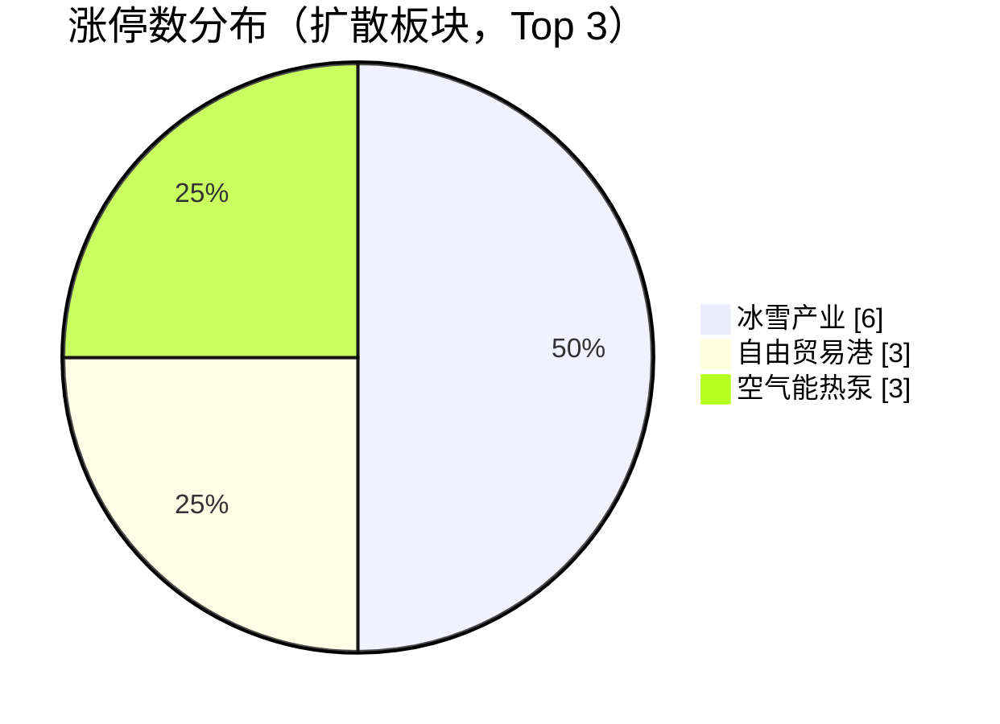
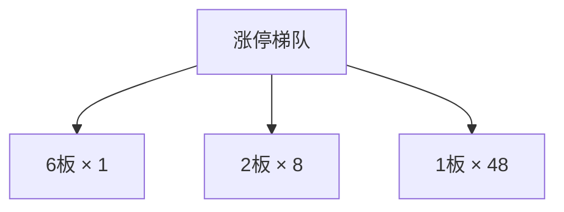
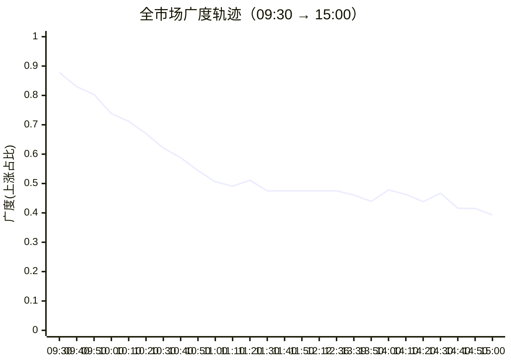

## 当日总览（截至 15:00）

> **结论**：全市场涨2244/跌3153（广度0.42）；涨停57/跌停2；中位涨幅-0.30%；局部修复。 钱在：冰雪产业(涨停6/成分61，中位+0.00%)、自由贸易港(涨停3/成分47，中位-0.58%)、空气能热泵(涨停3/成分56，中位+0.59%)；零星涨停：高压氧舱(1)、汽车拆解概念(2)、广东自贸区(2)、钛白粉概念(1)、黑龙江自贸区(2)。 退潮：磷化工(跌停1)、金属锌(跌停1)、金属铅(跌停1)。 梯队：6板×1、2板×8、1板×48，最高6板。 预案：无有效对照。 较上一轮广度基本持平。

> 🔒 **no_trade / 买入预算 0 / max_position_pct 0 —— 全部内容仅供研究，不授予交易权限。**

### 板块扩散

> 口径：XTick 概念成分 × 全市场实时报价；分母 = 板块内有有效报价的成分数。排序用涨停密度（涨停数/有效成分数），已剔除宽基属性板块（全市场 432 个板块中剔 16 个）。

**扩散中（题材，按涨停密度排序）**

| 板块 | 涨停 | 有效成分 | 涨停密度 | 上涨广度 | 中位涨幅 | 相对全市场 | 成交(亿) |
|---|---|---|---|---|---|---|---|
| 冰雪产业 | 6 | 61 | 0.098 | 0.48 | +0.00% | +0.30% | 162 |
| 高压氧舱 ⬦ | 1 | 11 | 0.091 | 0.36 | -0.43% | -0.13% | 26 |
| 汽车拆解概念 ⬦ | 2 | 23 | 0.087 | 0.39 | -0.39% | -0.09% | 45 |
| 广东自贸区 ⬦ | 2 | 29 | 0.069 | 0.45 | +0.00% | +0.30% | 59 |
| 钛白粉概念 ⬦ | 1 | 15 | 0.067 | 0.20 | -1.28% | -0.98% | 26 |
| 自由贸易港 | 3 | 47 | 0.064 | 0.34 | -0.58% | -0.28% | 56 |
| 黑龙江自贸区 ⬦ | 2 | 36 | 0.056 | 0.58 | +0.24% | +0.54% | 88 |
| 农村电商 ⬦ | 2 | 37 | 0.054 | 0.32 | -0.55% | -0.25% | 101 |
| 空气能热泵 | 3 | 56 | 0.054 | 0.59 | +0.59% | +0.89% | 169 |
| 培育钻石 ⬦ | 1 | 19 | 0.053 | 0.58 | +0.34% | +0.64% | 49 |
| 草甘膦 ⬦ | 1 | 19 | 0.053 | 0.11 | -1.20% | -0.90% | 28 |
| 特色小镇 ⬦ | 2 | 40 | 0.050 | 0.33 | -0.79% | -0.49% | 61 |

> ⬦ = 涨停 <3 只，零星个例，不构成扩散（不计入「钱在」判定）。



零星涨停板块（<3 只）：高压氧舱(1)、汽车拆解概念(2)、广东自贸区(2)、钛白粉概念(1)、黑龙江自贸区(2)、农村电商(2)、培育钻石(1)、草甘膦(1)

**退潮中（跌停集中）**

| 板块 | 跌停 | 有效成分 | 上涨广度 | 中位涨幅 |
|---|---|---|---|---|
| 磷化工 | 1 | 67 | 0.16 | -1.20% |
| 金属锌 | 1 | 43 | 0.21 | -0.77% |
| 金属铅 | 1 | 38 | 0.26 | -0.75% |
| 小金属概念 | 1 | 172 | 0.34 | -0.42% |
| 垃圾分类 | 1 | 98 | 0.35 | -0.48% |
| 锂电池概念 | 1 | 614 | 0.36 | -0.55% |
| 统一大市场 | 1 | 120 | 0.37 | -0.24% |
| 一带一路 | 1 | 797 | 0.39 | -0.32% |
| 壳资源 | 1 | 51 | 0.39 | -0.60% |
| ST板块 | 1 | 197 | 0.40 | -0.32% |
| 航运概念 | 1 | 87 | 0.45 | +0.00% |

### 涨停梯队

> 最高 6 板 ｜ 涨停 57 ｜ 跌停 2 ｜ 炸板 45 ｜ 封板率 55.9% ｜ 打板成功率 27.27% ｜ 一进二 38.10% ｜ 二进三 0.00%

| 身位 | 家数 | 成员（涨幅/封单亿/首封） |
|---|---|---|
| 6板 | 1 | 闽发铝业 +9.98%/0.019亿/09:25 |
| 2板 | 8 | 日出东方 +10.01%/0.080亿/09:25；东方新能 +9.91%/0.023亿/09:25；东方嘉盛 +9.99%/0.018亿/09:30；龙江交通 +9.97%/0.010亿/09:30；大东方 +9.98%/0.007亿/09:30 |
| 1板 | 48 | 保利联合 +10.05%/0.044亿/09:25；西部材料 +9.99%/0.027亿/09:30；冰山冷热 +10.00%/0.024亿/09:32；超声电子 +9.98%/0.015亿/10:05；顺灏股份 +10.02%/0.014亿/09:30 |



炸板 45 只（前几）：彩虹集团(7次)、东方海洋(6次)、上海电影(5次)、上海沪工(4次)、安彩高科(3次)

### 预案池对照

| 票 | 池 | 板块 | 现价 | 涨幅 | 触发价 | 买区 | 风险位 | 判定 |
|---|---|---|---|---|---|---|---|---|
| 中微公司 `688012.SH` | 执行池 | 半导体设备 | 248.0 | -2.36% | — | — | 237.19 | **无预案价** |
| 北方华创 `002371.SZ` | 执行池 | 半导体设备 | 544.81 | -2.71% | — | — | 539.98 | **无预案价** |
| 闽发铝业 `002578.SZ` | 观察池 | 光伏概念 | 5.51 | +9.98% | — | — | — | **无预案价** |
| 永臻股份 `603381.SH` | 观察池 | 光伏概念 | 19.9 | -4.05% | — | — | — | **无预案价** |
| 日出东方 `603366.SH` | 观察池 | 光伏概念 | 9.89 | +10.01% | — | — | — | **无预案价** |
| 新亚制程 `002388.SZ` | 观察池 | 光伏概念 | 6.82 | +2.25% | — | — | — | **无预案价** |
| 安彩高科 `600207.SH` | 观察池 | 光伏概念 | 5.14 | +5.33% | — | — | — | **无预案价** |
| 拓荆科技 `688072.SH` | 观察池 | 半导体设备 | 488.0 | -1.81% | — | — | 464.09 | **无预案价** |
| 精智达 `688627.SH` | 观察池 | 半导体设备 | 227.65 | +1.63% | — | — | — | **无预案价** |
| 新能股份 `000595.SZ` | 观察池 | 电力/绿色电力 | 5.51 | +2.42% | — | — | — | **无预案价** |
| 立新能源 `001258.SZ` | 观察池 | 电力/绿色电力 | 9.55 | -0.21% | — | — | — | **无预案价** |
| 东方新能 `002310.SZ` | 观察池 | 电力/绿色电力 | 2.55 | +9.91% | — | — | — | **无预案价** |
| 浙文影业 `601599.SH` | 观察池 | 短剧游戏/传媒情绪 | 5.38 | +5.91% | — | — | — | **无预案价** |
| 思美传媒 `002712.SZ` | 观察池 | 短剧游戏/传媒情绪 | 5.87 | -1.51% | — | — | — | **无预案价** |
| 城市传媒 `600229.SH` | 观察池 | 短剧游戏/传媒情绪 | 6.27 | -2.34% | — | — | — | **无预案价** |
| 上纬新材 `688585.SH` | 观察池 | 机器人/消费级具身智能 | 216.02 | +20.00% | — | — | — | **无预案价** |
| 杰创智能 `301248.SZ` | 观察池 | 算力服务/磷化铟事件对照 | 46.41 | +3.02% | — | — | — | **无预案价** |
| 光智科技 `300489.SZ` | 观察池 | 算力服务/磷化铟事件对照 | 197.08 | +1.07% | — | — | — | **无预案价** |
| 世运电路 `603920.SH` | 观察池 | PCB回购事件 | 33.58 | +9.99% | — | — | — | **无预案价** |
| 泰和新材 `002254.SZ` | 观察池 | 芳纶贸易救济 | 9.86 | -0.20% | — | — | — | **无预案价** |
| 天安新材 `603725.SH` | 观察池 | 光通信并购 | 11.26 | +5.33% | — | — | — | **无预案价** |
| 华新建材 `600801.SH` | 观察池 | 水泥出海并购 | 25.12 | -8.52% | — | — | — | **无预案价** |
| 春光科技 `603657.SH` | 观察池 | 机器人传导待核 | 33.58 | -0.89% | — | — | — | **无预案价** |
| 七匹狼 `002029.SZ` | 观察池 | 名字梗观察 | 9.05 | +1.69% | — | — | — | **无预案价** |


> ⚠ D1 明确 no_trade=true、买入预算 0、个股 max_position_pct=0。以上为研究对照，**不构成任何买入许可**。

### 盘面 vs 静态复盘 vs 消息面

| 维度 | 对象 | T-1 静态基线 | 今日盘面 | 关系 |
|---|---|---|---|---|
| 板块主线 | 电力/绿色电力 | R2 次线 score=None 涨停None（T-1 口径） | 盘面未见该板块成分票涨停 | **背离** |
| 板块主线 | 短剧游戏/传媒情绪 | R2 次线 score=None 涨停None（T-1 口径） | 盘面未见该板块成分票涨停 | **背离** |
| 板块主线 | 商业航天 | R2 次线 score=None 涨停None（T-1 口径） | 今日盘中该板块 14 只涨停 / 成分507 广度0.65 中位0.74%（相对全市场+1.04%） | **无响应** |
| 板块主线 | 机器人/消费级具身智能 | R2 次线 score=None 涨停None（T-1 口径） | 盘面未见该板块成分票涨停 | **背离** |
| 板块主线 | 算力服务/磷化铟事件对照 | R2 次线 score=None 涨停None（T-1 口径） | 盘面未见该板块成分票涨停 | **背离** |
| 板块主线 | 生肖/名字梗观察 | R2 次线 score=None 涨停None（T-1 口径） | 盘面未见该板块成分票涨停 | **背离** |
| 梯队结构 | 最高6板 | T-1 最高梯队 4 板、首板 29、炸板率 39.06% | 今日 6板×1、2板×8、1板×48；封板率0.5588 炸板45只 | **印证** |
| 预案验证 | 中微公司(688012.SH) | 预案 半导体设备／core_largecap／触发价None／买区None | 无预案价：预案未给触发价/买区（情景作废或待重导） | **无响应** |
| 预案验证 | 北方华创(002371.SZ) | 预案 半导体设备／core_largecap／触发价None／买区None | 无预案价：预案未给触发价/买区（情景作废或待重导） | **无响应** |
| 预案验证 | 闽发铝业(002578.SZ) | 预案 光伏概念／watch／触发价None／买区None | 无预案价：预案未给触发价/买区（情景作废或待重导） | **无响应** |
| 预案验证 | 永臻股份(603381.SH) | 预案 光伏概念／watch／触发价None／买区None | 无预案价：预案未给触发价/买区（情景作废或待重导） | **无响应** |
| 预案验证 | 日出东方(603366.SH) | 预案 光伏概念／watch／触发价None／买区None | 无预案价：预案未给触发价/买区（情景作废或待重导） | **无响应** |
| 预案验证 | 新亚制程(002388.SZ) | 预案 光伏概念／watch／触发价None／买区None | 无预案价：预案未给触发价/买区（情景作废或待重导） | **无响应** |
| 预案验证 | 安彩高科(600207.SH) | 预案 光伏概念／watch／触发价None／买区None | 无预案价：预案未给触发价/买区（情景作废或待重导） | **无响应** |
| 预案验证 | 拓荆科技(688072.SH) | 预案 半导体设备／watch／触发价None／买区None | 无预案价：预案未给触发价/买区（情景作废或待重导） | **无响应** |
| 预案验证 | 精智达(688627.SH) | 预案 半导体设备／watch／触发价None／买区None | 无预案价：预案未给触发价/买区（情景作废或待重导） | **无响应** |
| 预案验证 | 新能股份(000595.SZ) | 预案 电力/绿色电力／watch／触发价None／买区None | 无预案价：预案未给触发价/买区（情景作废或待重导） | **无响应** |
| 预案验证 | 立新能源(001258.SZ) | 预案 电力/绿色电力／watch／触发价None／买区None | 无预案价：预案未给触发价/买区（情景作废或待重导） | **无响应** |
| 预案验证 | 东方新能(002310.SZ) | 预案 电力/绿色电力／watch／触发价None／买区None | 无预案价：预案未给触发价/买区（情景作废或待重导） | **无响应** |
| 预案验证 | 浙文影业(601599.SH) | 预案 短剧游戏/传媒情绪／watch／触发价None／买区None | 无预案价：预案未给触发价/买区（情景作废或待重导） | **无响应** |
| 预案验证 | 思美传媒(002712.SZ) | 预案 短剧游戏/传媒情绪／watch／触发价None／买区None | 无预案价：预案未给触发价/买区（情景作废或待重导） | **无响应** |
| 预案验证 | 城市传媒(600229.SH) | 预案 短剧游戏/传媒情绪／watch／触发价None／买区None | 无预案价：预案未给触发价/买区（情景作废或待重导） | **无响应** |
| 预案验证 | 上纬新材(688585.SH) | 预案 机器人/消费级具身智能／watch／触发价None／买区None | 无预案价：预案未给触发价/买区（情景作废或待重导） | **无响应** |
| 预案验证 | 杰创智能(301248.SZ) | 预案 算力服务/磷化铟事件对照／watch／触发价None／买区None | 无预案价：预案未给触发价/买区（情景作废或待重导） | **无响应** |
| 预案验证 | 光智科技(300489.SZ) | 预案 算力服务/磷化铟事件对照／watch／触发价None／买区None | 无预案价：预案未给触发价/买区（情景作废或待重导） | **无响应** |
| 预案验证 | 世运电路(603920.SH) | 预案 PCB回购事件／watch／触发价None／买区None | 无预案价：预案未给触发价/买区（情景作废或待重导） | **无响应** |
| 预案验证 | 泰和新材(002254.SZ) | 预案 芳纶贸易救济／watch／触发价None／买区None | 无预案价：预案未给触发价/买区（情景作废或待重导） | **无响应** |
| 预案验证 | 天安新材(603725.SH) | 预案 光通信并购／watch／触发价None／买区None | 无预案价：预案未给触发价/买区（情景作废或待重导） | **无响应** |
| 预案验证 | 华新建材(600801.SH) | 预案 水泥出海并购／watch／触发价None／买区None | 无预案价：预案未给触发价/买区（情景作废或待重导） | **无响应** |
| 预案验证 | 春光科技(603657.SH) | 预案 机器人传导待核／watch／触发价None／买区None | 无预案价：预案未给触发价/买区（情景作废或待重导） | **无响应** |
| 预案验证 | 七匹狼(002029.SZ) | 预案 名字梗观察／watch／触发价None／买区None | 无预案价：预案未给触发价/买区（情景作废或待重导） | **无响应** |
| 消息面对照 | 盘面热点板块 | R4 消息面（T-1 口径） | 实时快讯未出现热点板块关键词 | **无响应** |

**分歧点（不掩盖）：**
- 板块主线·电力/绿色电力 → 背离：T-1 有辨识度但今日盘中无涨停响应，题材未获资金确认
- 板块主线·短剧游戏/传媒情绪 → 背离：T-1 有辨识度但今日盘中无涨停响应，题材未获资金确认
- 板块主线·机器人/消费级具身智能 → 背离：T-1 有辨识度但今日盘中无涨停响应，题材未获资金确认
- 板块主线·算力服务/磷化铟事件对照 → 背离：T-1 有辨识度但今日盘中无涨停响应，题材未获资金确认
- 板块主线·生肖/名字梗观察 → 背离：T-1 有辨识度但今日盘中无涨停响应，题材未获资金确认

### 全天广度轨迹

| 时点 | 涨 | 跌 | 广度 | 涨停 | 跌停 | 成交(亿) | 有效样本 |
|---|---|---|---|---|---|---|---|
| 0930 | 4884 | 507 | 0.878 | 14 | 1 | 453 | 5564 |
| 0940 | 4625 | 783 | 0.830 | 29 | 1 | 2,824 | 5573 |
| 0950 | 4476 | 868 | 0.803 | 38 | 1 | 4,258 | 5573 |
| 1000 | 4112 | 1224 | 0.738 | 44 | 1 | 5,367 | 5573 |
| 1010 | 3969 | 1352 | 0.712 | 52 | 1 | 6,354 | 5573 |
| 1020 | 3733 | 1544 | 0.670 | 51 | 1 | 7,109 | 5573 |
| 1030 | 3460 | 1834 | 0.621 | 53 | 1 | 7,668 | 5573 |
| 1040 | 3278 | 2019 | 0.588 | 56 | 1 | 8,163 | 5573 |
| 1050 | 3034 | 2264 | 0.544 | 55 | 1 | 8,623 | 5573 |
| 1100 | 2820 | 2510 | 0.506 | 50 | 1 | 9,044 | 5573 |
| 1110 | 2735 | 2577 | 0.491 | 49 | 1 | 9,423 | 5573 |
| 1120 | 2847 | 2497 | 0.511 | 50 | 1 | 9,798 | 5573 |
| 1130 | 2650 | 2707 | 0.475 | 51 | 1 | 10,181 | 5573 |
| 1140 | 2650 | 2707 | 0.475 | 51 | 1 | 10,181 | 5573 |
| 1150 | 2650 | 2707 | 0.475 | 51 | 1 | 10,181 | 5573 |
| 1212 | 2650 | 2707 | 0.475 | 51 | 1 | 10,181 | 5573 |
| 1236 | 2650 | 2707 | 0.475 | 51 | 1 | 10,181 | 5573 |
| 1339 | 2568 | 2808 | 0.461 | 51 | 1 | 11,847 | 5573 |
| 1350 | 2447 | 2903 | 0.439 | 49 | 1 | 12,082 | 5573 |
| 1400 | 2663 | 2702 | 0.478 | 52 | 1 | 12,364 | 5573 |
| 1410 | 2578 | 2802 | 0.463 | 56 | 1 | 12,657 | 5573 |
| 1420 | 2439 | 2928 | 0.438 | 53 | 1 | 12,966 | 5573 |
| 1430 | 2602 | 2774 | 0.467 | 55 | 1 | 13,291 | 5573 |
| 1440 | 2316 | 3069 | 0.416 | 56 | 1 | 13,698 | 5573 |
| 1450 | 2311 | 3076 | 0.415 | 55 | 3 | 14,230 | 5573 |
| 1500 | 1139 | 1681 | 0.393 | 35 | 2 | 8,000 | 2902 |

> ⚠ **数据冻结段**：1130–1236 数值连续完全一致，说明行情源未刷新，**不是市场横盘**，该段不可解读为盘面变化。

> ⚠ **分母变化**：1500（5573→2902） 有效样本变动超 15%，该时点广度与前后不可直接比较（数据降级）。



### 观察建议（仅研究）

- **环境**：涨停 57.0 / 跌停 2.0，打板成功率 27.3%，一进二 38.1%。
- **方向**：今日形成实质扩散的是 冰雪产业（涨停6/成分61，密度0.098，中位+0.00%）、自由贸易港（涨停3/成分47，密度0.064，中位-0.58%）、空气能热泵（涨停3/成分56，密度0.054，中位+0.59%）。**需确认**：次日能否维持涨停家数且中位涨幅不掉队，否则只是普跌中的避险轮动。
- **零星**：高压氧舱(1只/11成分)、汽车拆解概念(2只/23成分)、广东自贸区(2只/29成分)、钛白粉概念(1只/15成分)、黑龙江自贸区(2只/36成分) 属零星个例，不视为题材，不据此选股。
- **回避**：磷化工（跌停1）、金属锌（跌停1）、金属铅（跌停1） 板块中位跌幅深，趋势未止跌前不接。
- **身位**：最高 6 板。梯队有高度不等于可接力，需逐票核验封单稳定性与开板次数后再定。

<details>
<summary>原始截面与数据质量（折叠）</summary>

**跨源校验**

```json
{
  "xtick": {
    "up": 2244,
    "down": 3153,
    "n": 5616,
    "amount_yi": 14824.4
  },
  "rtk_snapshot": {
    "up": 1139,
    "down": 1681,
    "valid_n": 2902,
    "amount_yi": 8000.4,
    "up_limit": 35,
    "down_limit": 2
  },
  "note": "两源口径不同（XTick 全市场含全部票；rt_k 返回样本）"
}
```

**rt_k 截面（原始）**

```json
{
  "market": {
    "total": 5583,
    "up": 1139,
    "down": 1681,
    "flat": 82,
    "requested_n": 5583,
    "received_n": 5583,
    "valid_n": 2902,
    "missing_n": 2681,
    "universe_requested_n": null,
    "population_scope": "returned_rows_not_verified_all_a_universe",
    "up_ratio": 0.204,
    "legacy_up_ratio_placeholder": false,
    "up_ratio_is_observed": true,
    "up_ratio_all": 0.204,
    "up_ratio_valid": 0.3925,
    "up_ratio_denominator": "requested_n",
    "degraded": true,
    "limit_known_n": 2902,
    "limit_unknown_n": 0,
    "limit_counts_complete": true,
    "limit_source_errors": [],
    "up_gt3": 239,
    "up_gt5": 121,
    "up_limit": 35,
    "down_gt3": 108,
    "down_gt5": 20,
    "down_limit": 2,
    "amount_yi": 8000.4,
    "amount_sum_overflow": false,
    "amount_valid_n": 2902,
    "amount_missing_n": 0
  },
  "source_time_quality": {
    "quote_age_min_seconds": 46.396793,
    "quote_age_max_seconds": 46.396793,
    "source_age_limit_seconds": null,
    "freshness_status": "age_limit_not_configured",
    "age_reference_at": "2026-11-09T15:00:46.396793+08:00"
  },
  "trading_authorized": false
}
```

</details>

## 分时研判记录

### 09:35 研判增量
- **趋势**：截至2026-11-09 09:30，本日只有首个分析截面，没有上一轮，不能把顶部“广度基本持平”当作趋势证据，也不能确认拐点。后续广度沿用 rt_k 有效样本口径（4,884/5,564，87.78%），不与 XTick 家数拼接；该样本未完成上市名录覆盖核验。rt_k 报价为09:30:03—09:30:26，并非09:35现价。结构上闽发铝业六板与二板之间断档，开盘普遍红盘尚不等于接力链恢复；静态“四板”与实时“六板”的基线时点未核，不能解释成隔夜直接晋级。
- **轮动**：相对强弱比密度榜名次更有信息：土壤修复虽有3只涨停/91只有效成分，中位涨幅仍落后市场0.11个百分点，尚不能据此独占主线判断。商业航天、人形机器人分别仅2/507、1/482涨停，但上涨广度95.46%、97.72%，中位涨幅领先市场0.72、0.98个百分点，属于广度较强、涨停扩散尚待确认；东数西算已有3/417涨停、中位领先0.31个百分点，不应因未进顶部密度榜而漏看。相对弱端是短剧游戏：38/99上涨、中位-0.39%。这支持“科技方向相对强、短剧相对弱”的观察假设，单个截面不能证明资金已从短剧迁入科技，更不能确认跷跷板。
- **剧本**：今日正式预案 `data/plans/20261109/watchlist_plan.json` 缺失，逐票对照为空；触发价、买区、理由均无法核验，不能把空对照解释为全部未触发或全部失效。现有三方对照称绿色电力、机器人“未见涨停”，但同一分析的绿色电力实际有2/436涨停、人形机器人有1/482，须保留名称对应与标签冲突，不据此否定整条线；实时快讯未匹配热点，也不等于没有催化。按本任务既定约束维持禁止新仓、买入预算0、仓位上限0，以下仅供研究，不授予买入权限。
- **下一步看**：下一轮先核有效样本数与报价刷新，再看广度能否维持首轮87.78%、涨停是否超过14只；若涨停增加而广度下降，应判强势集中而非普涨。土壤修复看3只涨停能否保留且中位涨幅转为领先市场；商业航天看能否由2只增至至少3只，并保留相对强度。接力看日出东方、东方嘉盛等二板是否维持涨停、首板能否继续增加，而非只盯闽发铝业孤峰；本截面封单不能证明持续稳定。正式预案补齐前，不补造任何个股价位条件。

### 09:45 研判增量
- **趋势**：09:30→09:40由开盘普遍红盘转向强势集中，不能沿用顶部“广度基本持平”。rt_k有效样本分别为5,564、5,573只，上涨比例分别为87.78%、82.99%；分母有变化且没有共同股票交集，故不计算严格同分母广度差，也不称无遗漏全A。同期涨停14→29、首板7→23，封板率却从87.50%降至80.56%，炸板2→7：强股增多与分歧扩大同时发生。二板6→5，大东方、华升股份转入开板名单，康冠科技新进入二板梯队；最高仍为6板，不能把首板扩张解释为高位接力修复。本轮采集09:40:08—09:40:28，rt_k报价09:39:51—09:40:26；不是09:45即时行情，两轮数据已刷新，并非冻结。
- **轮动**：密度榜前列并未覆盖真正增强的方向：商业航天涨停2/507→10/507、人形机器人1/482→8/482，中位涨幅相对市场领先分别从0.72→1.08、0.98→1.54个百分点，显示已有涨停扩散，但两者上涨家数仍从484→474、471→466，属于强势集中而非广度继续铺开。新增反转在短剧游戏：38/99→83/99上涨，中位涨幅-0.39%→+1.29%，上轮“短剧相对弱”的判断已不再适用，也不能推演科技与传媒互斥；只有1只涨停，暂不升为扩散主线。相对失血端是生物医药179/199→141/199上涨、涨停1→0；东数西算虽379/417上涨，涨停却3→1，说明涨价与封板扩散分化。冰雪、土壤修复的中位涨幅分别仍落后市场0.54、0.31个百分点，不能仅凭密度靠前称其主导。以上是价格反馈的轮动线索，无净资金迁移证据，不确认跷跷板；概念成分重叠，涨停数不能跨板块相加。
- **剧本**：上一轮商业航天“至少3只涨停”的观察条件已满足，但只能升级为盘面扩散得到印证，不能连带确认催化、持续封单或买点。分析原文把商业航天标为“无响应”、机器人标为“未见涨停”，与本轮成分统计冲突，不能照抄；静态研究仅列次线，消息匹配仍为空，三方一致尚未建立。今日正式预案文件仍缺失，逐票对照为空，无法核验任何trigger_price、buy_zone或reason，也无法判断哪只票正在触发或失效；不把开板个股擅自纳入预案。按本任务约束继续禁止新仓、买入预算0、仓位上限0，研究变化不授予买入许可。
- **下一步看**：先核报价刷新与有效样本覆盖；商业航天、人形机器人分别以本轮10/507、8/482涨停及相对领先1.08、1.54个百分点作保持强度的参照，若涨停回落且相对强度同步收窄，撤回扩散增强判断。短剧游戏看83/99上涨与1只涨停能否保留，东数西算看能否恢复首轮3/417涨停，分清普遍反弹与封板扩散。接力看现有5只二板是否继续缩减、大东方和华升股份是否重新封板；下一截面在涨停价只证明该时点状态，不证明中途路径或封单持续稳定。若涨停继续增加、有效样本上涨比例仍降且炸板多于本轮7只，保留强势集中、接力分歧的判断，不把它改写为全面转强；预案补齐前不补造个股价位。

### 09:55 研判增量
- **趋势**：09:40→09:50继续向强势方向集中，尚不是普涨加速。rt_k两轮有效样本均为5,573只，上涨比例82.99%→80.32%，下降2.67个百分点，涨停却29→38；这是返回样本口径，未核无遗漏全A覆盖。另看XTick梯队，二板5→7、首板23→31，但炸板7→11、封板率80.56%→78.00%，高度仍为6板，中间断档未补。上轮待验证的大东方已从开板名单回到二板，累计开板4次；润贝航科新入二板，属于接力局部恢复，不能据此宣布分歧结束。依据2026-11-09的09:50分析截面；rt_k采集09:50:08—09:50:26、报价09:49:42—09:50:23，非09:55即时价。
- **轮动**：商业航天涨停10/507→15/507、人形机器人8/482→11/482，相对市场中位涨幅优势分别1.08→1.37、1.54→1.86个百分点，涨停密度名次均上移，说明强势仍在这两条线内部扩散，而非转去顶部密度榜的零星方向。新增补强是东数西算由1/417恢复至3/417涨停，满足上轮观察条件；汽车热管理2/144→3/144，中位涨幅2.41%→2.50%。相对掉队的是绿色电力334/436→303/436上涨、相对强度-0.33→-0.50个百分点，以及冰雪50/61→44/61上涨、涨停仍3只：后者并未因密度靠前而获得更广承接。仅能推断价格反馈向科技强线集中，尚无净资金迁移证据，不确认跷跷板；重叠概念涨停不能相加。
- **剧本**：本轮新读到09:49:18生成的补交预案，上一轮“文件缺失”已不适用，但09:50分析的逐票对照仍为空，不能说已完成预案核价。预案保留2只优先候选、22只观察票；中微公司参考触发254.00、买区252.73—257.81，北方华创560.00、557.20—568.40，观察票拓荆科技497.00、494.51—504.45。三组价位来自2026-11-06参考事实，前高、趋势与复权仍未核，不是今日已确认压力位；本轮无这三只的同窗现价，不能判已触发、超买区或失效，也不能拿旧资金排序替代预案要求的价格、板块、资金同窗转强。上纬新材09:42首次封板并进入本轮首板名单，对其机器人事件观察形成个股价格响应，但不能把下线等同销售或利润兑现；催化与具体传导仍未独立核验，不升级为三方一致。其余未给触发价的观察票不补造价位。
- **下一步看**：先核下一截面报价刷新与有效样本口径；以本轮航天15/507、机器人11/482涨停及相对优势1.37、1.86个百分点作参照，若涨停数和相对优势同步回落，撤回扩散增强判断；东数西算看能否保留3/417涨停。市场若恢复上轮82.99%样本上涨比例、且封板率不再低于本轮78.00%，才增加“分歧缓和”的证据，不由涨停单独增加下结论；大东方继续看累计开板是否超过本轮4次。预案三只有价位票须先补同窗报价，再对照原触发与买区、核资金共振；超过各自买区上沿不追，不下移买区接弱。这些是研究观察参照，不是新交易门槛；禁止新仓、买入预算0、逐票仓位上限0保持不变，研究情景不授予买入许可。

### 10:05 研判增量
- **趋势**：09:50→10:00，强势集中未结束，普通股票回吐反而加快：rt_k两轮有效样本均5,573只，上涨比例80.32%→73.78%，下降6.53个百分点，跌幅大于上一窗口的2.67个百分点；同期涨停38→44。XTick二板7→9、首板31→34，但炸板11→15、封板率78.00%→74.58%，最高仍6板且中间断档。新增二板与封板质量下降并存，不是接力全面恢复；样本仍多数上涨，也不能写成普跌。依据2026-11-09 10:00分析件，rt_k采集10:00:08—10:00:30、报价09:59:33—10:00:29，非10:05即时价；未核上市名录全覆盖，广度不采用顶部另一种分母。
- **轮动**：新增扩散在传媒内容方向：短剧游戏由77/99→87/99上涨、涨停1→3，相对市场中位优势0.16→1.27个百分点；AI视频涨停1/67→3/67，中位涨幅1.60%→2.31%。思美传媒本轮首次封至二板、上海电影从上轮开板名单回到二板，与这一变化相互支持；两概念重叠，不能合计涨停数。商业航天15/507→16/507涨停、相对优势1.37→1.38个百分点，仍强；人形机器人11/482→10/482、相对优势1.86→1.64个百分点，上纬新材新进入开板名单、累计1次，属于线内分歧扩大，不能由一票开板否定整条线。可提出“传媒增强、机器人边际降温”的轮动假设，尚无净资金迁移证据，不确认跷跷板。冰雪密度榜第4→第2，但上涨仍44/61、中位仍落后市场0.12个百分点；绿色电力虽涨停2/436→3/436，上涨却303→265只、中位0.60%→0.36%，不能把新增封板等同防守资金全面承接。
- **剧本**：本轮逐票报价对照从空表变为24只，已能检验上轮三只有价位候选。分析件统一写“无预案价”，但正式预案的entry_rules实际有触发价和买区；这里只按原文做研究对照，不修改正式判定或补造价位。中微公司252.21低于原买区下沿252.73及触发254.00，北方华创551.50低于557.20及560.00，均是当前未到价，不是跌破风险位即失效；预案所依赖的旧资金排序尚未转成这两只的右侧价格确认。拓荆科技497.00恰到原触发497.00，处于494.51—504.45买区，但只证明该截面位置到价，没有持续站稳、板块和同窗资金共振证据，也不能自动递补优先候选。三组参考事实日仍为2026-11-06，前高、趋势及复权未认证。思美上板印证的是价格响应，原预案保留的行业治理约束未被消除；实时消息匹配仍为空，不能升级成复盘、消息、盘面三方一致。
- **下一步看**：以本轮73.78%样本上涨比例和74.58%封板率作观察参照，下一截面若两者继续降、涨停却增加，维持“强势集中且分歧扩大”；两者同时回升才增加分歧缓和证据。传媒看短剧3/99、AI视频3/67涨停能否保持，且上涨家数不低于本轮87/99、61/67；若封板和广度同步回落，撤回新增扩散增强判断。机器人看能否保留10/482涨停及1.64个百分点相对优势，上纬看累计开板是否超过本轮1次，单次回到涨停价不证明封单持续稳定。设备只观察中微能否重回原252.73—257.81买区并站上254.00、北方能否回到557.20—568.40并站上560.00；拓荆须保留原买区且补足同窗共振证据，不能因仅到497.00便批准。超过各自原买区上沿不追、不下移买区；这些仅为研究验证条件，禁止新仓、买入预算0、逐票仓位上限0不变。

### 10:15 研判增量
- **趋势**：10:00→10:10，新增变化是“强股封板质量修复，普通股票仍回吐”，应收回上轮把两者一起概括为分歧扩大的说法。rt_k有效样本均5,573只，上涨比例73.78%→71.22%，下降2.57个百分点，回落速度较上一窗口放缓，但尚未出现广度拐点；该源涨停44→52。另看XTick，涨停44→53、炸板15→14、封板率74.58%→79.10%，新亚制程进入4板梯队、记录曾开板1次，补出中段身位；最高仍6板，5板与3板仍缺，不能说梯队已完整。本轮依据2026-11-09 10:10分析件；rt_k采集10:10:07—10:10:27、报价10:09:03—10:10:26，非10:15即时行情；数据已刷新，返回样本未认证无遗漏全A覆盖，两源涨停数不混用。
- **轮动**：上轮“传媒增强、机器人降温”本轮不再适合描述两者关系：人形机器人涨停10/482→12/482，上涨444→446只，相对市场中位优势1.64→1.72个百分点；上纬新材逐票涨幅17.10%→20.00%，支持价格反馈修复，不证明封单持续稳定。新增扩散更清楚的是光纤概念2/116→3/116涨停、中位涨幅2.04%→2.44%，共封装光学(CPO)2/230→4/230涨停、上涨214→222只。商业航天16/507→18/507涨停，但上涨465→454只，仍是强势集中。短剧游戏涨停3/99→4/99、上涨87→90只，中位涨幅却2.11%→1.98%，是扩散保持而非涨幅加速；手机、网络游戏虽新进入密度榜展示，上涨家数分别50/56→46/56、50/58→45/58，不能把榜位上升等同整体转强。相对失血仍在绿色电力：涨停维持3/436，上涨265→232只、中位0.36%→0.21%；生态农业也是3/66涨停未变、上涨37→27只，不宜因密度靠前列为强主线。以上仅是价格轮动线索，无净资金迁移证据，不确认跷跷板；重叠概念不能累加涨停。
- **剧本**：上轮拓荆科技497.00恰到原触发，本轮494.14已低于原买区下沿494.51，“站上确认”没有延续；这是参考情景到价后的回落，不是已触发正式止损，更不是下移买区的理由。中微公司252.21→252.11、北方华创551.50→550.88，仍未返回各自原买区，旧资金排序尚未转成优先候选的价格确认。正式预案entry_rules有价位、分析件仍统一判“无预案价”的读取分歧继续存在，本轮只作原文研究对照。新亚制程的4板回应了预案中的身位观察，但不把光伏成分重叠认证为独立氟化工主线；上纬的价格修复也不消除预案“下线不等于销售利润”的限定。实时快讯仍未匹配热点，三方一致未建立；不能沿用自动表里“机器人、传媒未见涨停”的标签否定本轮成分事实。
- **下一步看**：下轮先核报价刷新和同口径样本；若上涨比例回升至本轮71.22%以上、XTick封板率不低于79.10%，才增加由封板修复传向普通股票的证据；若涨停继续增而广度仍降，维持强势集中判断。新扩散以光纤3/116、CPO4/230涨停及上涨104/116、222/230为保持参照，封板与上涨家数同步回落则撤回增强判断；机器人看12/482与1.72个百分点相对优势能否保留。设备先看拓荆能否重回494.51—504.45并重新站上497.00，再补板块与同窗资金证据；中微254.00、北方560.00原触发价不变，未到价不叫失效，超过各自原买区上沿不追。价位参考事实日仍为2026-11-06，前高、趋势及复权未核；上述均为研究观察参照，不是新买入门槛，禁止新仓、买入预算0、逐票仓位上限0保持不变。

### 10:25 研判增量
- **趋势**：10:10→10:20，上一轮封板质量修复未延续，转为广度与封板同步回落。rt_k有效样本均5,573只，上涨比例71.22%→66.98%，下降4.23个百分点，回吐较上一窗口再加快；涨停52→51。另看XTick，涨停53→51、炸板14→17、封板率79.10%→75.00%，二板10→9、首板41→40，最高6板与4板仍在，但新增接力没有延续扩张。仍是多数股票上涨，不能写成普跌或全面退潮。本轮依据2026-11-09 10:20分析件，rt_k采集10:20:08—10:20:27、报价10:19:39—10:20:26，非10:25即时价；数据已刷新，返回样本未认证无遗漏全A覆盖，两源不混口径。
- **轮动**：没有出现明确的新方向接棒，更像强线内部淘汰。商业航天涨停维持18/507，但上涨454→446只、相对市场中位优势1.47→1.32个百分点；人形机器人12/482→11/482涨停、上涨446→431只，相对优势1.72→1.36个百分点，上纬新材重新进入开板名单、累计3次，上一轮机器人修复须降为反复。短剧游戏涨停4/99→3/99、上涨90→87只，也不能当作机器人失血后的接收方向。相对保留强度的是CPO：4/230涨停未减、219/230仍上涨，相对优势1.65→1.66个百分点，但上涨家数由222下降，不是继续铺开；AI视频上涨61/67→62/67、涨停仍3只，中位涨幅却2.23%→1.82%，密度榜展示第12→第11不等于加速。冰雪中位涨幅仍0.60%，相对优势由负转正只是市场中位回落，不能据此推断防守资金主动涌入。以上为价格反馈，无净资金迁移证据，不确认跷跷板；重叠概念不累加。
- **剧本**：本轮实质变化是拓荆科技494.14→494.85，重新进入原494.51—504.45买区，但仍低于497.00触发价，只恢复位置条件，未恢复站上确认；中微252.11→251.00、北方550.88→548.01，进一步远离原254.00、560.00触发，价格、板块、资金同窗转强的原推论仍未获支持，不能下移买区。分析件判定列仍统一“无预案价”，这里按正式预案entry_rules对照，不改写正式状态；参考事实日为2026-11-06，前高、趋势及复权仍未核。另一个新增差异是光智科技194.80→199.61、由绿转红，说明该观察对象的价格响应增强，但原预案保留的供货意向、最终协议与出口许可条件并未因此消失；实时热点消息匹配仍为空，不升级为消息、静态研究、盘面三方一致。未给价位的观察票不补造触发条件。
- **下一步看**：先看下轮同口径上涨比例能否回到10:10的71.22%、XTick封板率能否恢复79.10%，二者未同步回升前不宣布修复重新扩散；若跌破本轮66.98%与75.00%，则增加转弱证据。CPO以4/230涨停、219/230上涨为保持参照，机器人以11/482、431/482为参照，封板与上涨家数同时减少则继续降级；上纬若累计开板超过本轮3次，进一步削弱封板持续性假设，单一截面回到涨停不算稳定。拓荆先守原494.51买区下沿，再看497.00能否在后续报价中持续站上并补齐同窗资金；中微、北方未到原触发不叫止损失效，超过各自原买区上沿不追。这些仅为研究验证条件，no_trade=true、买入预算0、逐票max_position_pct=0不变，不授予任何买入许可。

### 10:35 研判增量
- **趋势**：10:20→10:30，新增变化是强股封板略回升、普通股票继续回吐，并非全面修复。rt_k两轮有效样本均5,573只，上涨比例66.98%→62.09%，下降4.90个百分点，回落幅度较上一窗口扩大；涨停51→53。另看XTick，首板40→42、二板仍9，炸板仍17，封板率75.00%→75.71%；最高6板、4板身位均未变，中段断档未补。封板率小幅回升不足以推翻广度转弱，也不能把多数股票仍上涨写成普跌。依据2026-11-09 10:30分析件，rt_k采集10:30:08—10:30:28、报价10:29:18—10:30:26，非10:35即时价；数据已刷新，返回样本未认证无遗漏全A覆盖，两源不混口径。
- **轮动**：顶部密度榜次序未变，真正新增的强弱差在机器人与传媒、光通信之间。人形机器人涨停11/482→12/482，中位涨幅1.94%→2.09%，上纬新材213.61→216.02、回到涨停价；但上涨431→425只，属于核心修复而非广度铺开，单个截面不证明封单稳定。商业航天18/507→19/507涨停，上涨446→440只，也仍在集中；短剧游戏虽保留3/99涨停，上涨87→78只、相对市场中位优势1.23→0.87个百分点，CPO虽保留4/230涨停，上涨219→215只、相对优势1.66→1.42个百分点。绿色电力上涨230/436→206/436，已不足半数，不能作为资金转向防守的证据。以上支持“机器人核心修复、传媒与光通信边际回吐”的价格轮动假设，不证明净资金迁移或跷跷板；重叠概念不累加。
- **剧本**：拓荆科技494.85→493.02，再次跌出原494.51—504.45买区，上一轮“恢复位置条件”未延续，497.00站上确认仍未成立；不下移买区接弱，也不写成正式止损。中微251.00→251.60只是小幅回升，仍低于原买区下沿252.73及触发254.00；北方548.01→547.11，仍未回到557.20—568.40或触发560.00。预案要求的价格、板块、资金同窗转强尚无新增完整证据，分析件统一“无预案价”仍不能代替对entry_rules原文的核验。新增消息差异是10:27:18快讯样本已出现短剧出海异动报道，不能沿用自动匹配为空就断言“没有消息响应”；但这是行情叙事线索，短剧广度反而回落，思美仍在二板、城市传媒却6.43→6.34由红转绿，不能因此升级整条传媒线，更未消除预案保留的行业治理约束。三方一致仍未建立。
- **下一步看**：市场先看有效样本上涨比例能否收复上轮66.98%、封板率是否同步回升，不能只看涨停超过本轮53只。机器人以12/482涨停为保持参照，并看上涨家数能否恢复431/482；若涨停与中位涨幅同时回落，撤回本轮核心修复判断。短剧须保留3/99涨停并修复至上轮87/99上涨，才增加新叙事向广度传导的证据；绿色电力未恢复上轮230/436上涨前不确认防守接棒。设备只沿原价位：拓荆先重回494.51再看497.00，中微先回252.73再看254.00，北方先回557.20再看560.00；到价仍须后续路径及同窗资金确认，超过原买区上沿不追。价位参考事实日仍为2026-11-06、前高/趋势/复权未核；上述仅研究观察，no_trade=true、买入预算0、逐票max_position_pct=0不变，不授予买入许可。

### 10:45 研判增量
- **趋势**：10:30→10:40，上轮封板率的小幅回升再次中断，转为“涨停增加、广度与封板质量下降”。rt_k两轮有效样本均5,573只，上涨比例62.09%→58.82%，下降3.27个百分点，降速较上一窗口放缓，但不是止跌拐点；该源涨停53→56。另看XTick，涨停53→55、炸板17→20、封板率75.71%→73.33%，增量来自首板42→44，二板仍9、最高仍6板，不能解释成接力层级改善。依据2026-11-09 10:40分析件；rt_k采集10:40:07—10:40:25、报价10:38:45—10:40:23，非10:45即时价；行情已刷新，返回样本未认证无遗漏全A覆盖，两源不混口径。
- **轮动**：上轮“光通信边际回吐”本轮出现修复：CPO保留4/230涨停与215/230上涨，中位涨幅1.85%→2.02%；商业航天涨停19/507→21/507、中位1.83%→1.95%，但上涨440→430只，增强仍偏向强股集中。反向变化在传媒：短剧游戏、AI视频涨停均3→2，上涨分别78/99→67/99、57/67→52/67，已跌出至少3只涨停的扩散观察条件，须撤回前期扩散保持判断。绿色电力上涨206/436→192/436，没有证据承接防守轮动。价格反馈支持“航天、光通信相对增强，传媒回吐”的轮动假设，不证明资金从一线净迁入另一线，更不确认跷跷板；重叠概念不累加。
- **剧本**：设备线新增的是精智达223.82→226.86、由绿转红，但优先候选中微251.60→251.86仍未回原买区下沿252.73，北方547.11→545.71反而更弱；拓荆493.02→493.17仍低于原494.51下沿。局部新品事件票转强，不等于预案要求的容量核心价格、板块、资金同窗转强，不能因此递补或下移买区。分析判定仍统一“无预案价”、没有状态迁移，研究价位沿正式预案entry_rules核对。消息面新出现10:40:04机器人快讯，转述进博会及苹果机器人叙事，不能再以自动匹配为空说没有消息响应；但同窗人形机器人虽涨停12/482→13/482，上涨425→417只、中位涨幅2.09%→1.83%，热叙事尚未转成更广承接。快讯原始出处与因果未核，不能升级成静态研究、消息、盘面三方一致，也不消除上纬“下线不等于销售利润”的原限定。
- **下一步看**：市场先看有效样本上涨比例能否收复10:30的62.09%、XTick封板率能否同步恢复75.71%；仅涨停超过本轮55只不算修复。航天以21/507涨停及1.60个百分点相对优势、CPO以4/230涨停和215/230上涨作保持参照，若封板与相对强度同步回落，撤回增强判断；传媒先恢复原3/99、3/67涨停，再看上涨家数能否回到78/99、57/67，未恢复前不把消息热度当接棒。设备仍只观察中微回252.73再看254.00、北方回557.20再看560.00、拓荆回494.51再看497.00，后续路径与同窗资金缺一不能称已确认；不追超出原买区上沿的价格。价位参考事实日为2026-11-06，前高/趋势/复权仍未核；上述是研究验证条件，no_trade=true、买入预算0、逐票max_position_pct=0不变，不授予买入许可。

### 10:55 研判增量
- **趋势**：10:40→10:50，新增变化是涨停也停止扩张，不能再用“涨停增加”描述本轮。rt_k有效样本均5,573只，上涨比例58.82%→54.44%，下降4.38个百分点，回吐较上一窗口的3.27个百分点加快；涨停56→55。另看XTick，涨停仍55，炸板20→23、封板率73.33%→70.51%；二板9→10但首板44→43，闽发铝业6板、新亚制程4板身位未变，局部接力增加没有传成整体修复。依据2026-11-09 10:50分析件；rt_k采集10:50:07—10:50:25、报价10:49:18—10:50:23，非10:55即时价。数据已刷新；这是未核上市名录全覆盖的返回样本，两源不混口径。
- **轮动**：上轮航天、光通信边际增强本轮未延续：商业航天涨停21/507→20/507、上涨430→414只，相对市场中位优势1.60→1.27个百分点；CPO保留4/230涨停，但上涨215→203只、中位涨幅2.02%→1.70%，只能说仍相对强，不能说继续扩散。人形机器人同步由13/482→12/482涨停、417→393只上涨，上纬新材216.02→212.80并重入开板名单、累计4次，进一步削弱持续封板假设。新增的自由贸易港虽由2/47→3/47涨停，上涨仅22→23只、中位仍0.00%，尚不足以证明承接科技撤出的资金；冰雪上涨38/61→33/61，也不是全面防守接棒。更像多条强线共同收缩，而非已确认的跷跷板；概念重叠不累加，无净资金迁移证据。
- **剧本**：设备优先候选中微251.86→250.95、北方545.71→545.01，观察票拓荆493.17→490.78，均进一步远离原买区，预案要求的价格、板块、资金同窗转强仍未获新增支持；这是未到价或未恢复确认，不是跌破风险位即触发正式止损。分析件24只判定仍统一“无预案价”，本轮没有机器状态迁移，价位须沿正式预案entry_rules核对。消息样本10:49:45新增“比亚迪闪充机械臂”报道，但同窗机器人广度与封板回落，不能把新叙事直接映射成上纬或春光的订单受益，更不能升级为静态研究、消息、盘面三方一致；原文真实性及供应链映射未独立核验。
- **下一步看**：先看同口径上涨比例能否收复上轮58.82%、XTick封板率能否同步恢复73.33%，否则不宣布拐点。航天看能否恢复21/507涨停且上涨家数回到430/507；CPO看能否保留4/230涨停并恢复215/230上涨，未恢复前不重提扩散增强。自由贸易港须保留3/47涨停且中位涨幅转正，才增加接棒证据。设备只沿原区间：中微252.73—257.81并站上254.00，北方557.20—568.40并站上560.00，拓荆494.51—504.45并站上497.00，再核后续路径及同窗资金；超过原买区上沿不追、不下移买区。价位参考事实日仍为2026-11-06、前高/趋势/复权未核；以上仅研究观察参照，no_trade=true、买入预算0、逐票max_position_pct=0不变，不授予任何买入许可。

### 11:05 研判增量
- **趋势**：10:50→11:00，强势集中进一步转为封板收缩，尚无止跌拐点。rt_k有效样本均5,573只，上涨比例54.44%→50.60%，下降3.84个百分点，涨停55→50；另看XTick，涨停同样55→50，炸板23→30、封板率70.51%→62.50%，二板10→9、首板43→39。上海电影由二板转入开板名单，累计开板3→4次，说明上轮局部接力增加也未守住；闽发6板、新亚4板仍在，不等于中低梯队恢复。上涨仍略过半，不能写成普跌。依据2026-11-09 11:00分析件，rt_k采集11:00:07—11:00:26、报价10:59:24—11:00:23，非11:05即时价；数据已刷新，返回样本未核上市名录全覆盖，两源不混分母。
- **轮动**：密度榜前列次序未变，但内部承接继续收缩，不是盘面横盘：商业航天涨停20/507→19/507、人形机器人12/482→10/482，上涨家数分别414→409、393→388。CPO保留4/230涨停、上涨203→202只，中位涨幅1.70%→1.63%，相对市场优势却1.51→1.57个百分点；这是市场中位0.19%→0.06%下的相对抗跌，不是主动扩散增强。短剧游戏上涨58/99→47/99、中位0.26%→0.00%，多数红盘优势已丢；自由贸易港虽保留3/47涨停，上涨23→18只，上轮接棒观察仍未获支持。暂无明确新方向承接，也无净资金迁移证据，不确认跷跷板；重叠概念涨停不累加。
- **剧本**：设备优先候选中微250.95→250.57、北方545.01→543.55，观察票拓荆490.78→489.69，均继续低于原买区，预案要求的价格、板块、资金同窗转强未恢复。分析件24只仍统一“无预案价”，无机器判定迁移；本段沿正式预案entry_rules核对，不把未到价误写为正式止损失效。电力备选也未接棒：绿色电力涨停仍3/436，上涨183→169只；A方向走弱不能单独满足B方向切换条件。新增10:59:42“农业拉升”快讯与生态农业上涨20/66→19/66、中位-0.38%→-0.46%的同窗反馈有分歧，只能保留局部异动线索，不能据标题升级整条农业线；快讯来源及成分映射未独立核验，三方一致仍未建立。
- **下一步看**：先核下一截面报价刷新，市场以恢复10:50同口径54.44%上涨比例、70.51%封板率为修复参照；两者未同步回升，不因最高板还在就宣布企稳。航天与机器人先看能否恢复上轮20/507、12/482涨停，并同步修复上涨家数；若继续减少，保留封板收缩判断。电力先看能否恢复183/436上涨及原3只涨停，再核独立核心与同窗资金，不能只凭东方新能二板切换。设备仍须中微重回252.73并站上254.00、北方重回557.20并站上560.00、拓荆重回494.51并站上497.00，且补足后续路径与同窗共振；超过各自原买区上沿不追、不下移买区。价位参考事实日为2026-11-06，前高/趋势/复权仍未核；no_trade=true、买入预算0、逐票max_position_pct=0不变，以上仅研究验证，不授予任何买入许可。

### 11:15 研判增量
- **趋势**：11:00→11:10，新增变化是上涨覆盖跌破半数，而非顶部所称“广度基本持平”。rt_k两轮有效样本均5,573只，上涨比例50.60%→49.08%，下降1.53个百分点；回落较上一窗口放缓，但不能把降速当拐点，也不等于下跌股票已过半。两源涨停均50→49；XTick炸板30→33、封板率62.50%→59.76%，首板39→38，二板仍9、最高仍6板，封板质量继续转弱。依据2026-11-09 11:10分析件；rt_k采集11:10:07—11:10:25、报价11:08:48—11:10:23，非11:15即时价。数据已刷新；这是未核上市名录全覆盖的返回样本，不混用顶部广度分母。
- **轮动**：6G涨停4/99→5/99、涨停密度名次13→10，但上涨88→85只、中位涨幅2.40%→2.02%，是封板向少数核心集中，不是整条线加速。CPO仍4/230涨停、中位1.63%→1.67%，上涨却202→199只，只能增加局部抗跌证据；反向收缩更明确的是人形机器人10/482→8/482涨停、388→362只上涨，中位1.26%→0.88%。行业侧另有煤炭33/33上涨、中位3.02%→3.16%的相对强势，但涨停仍2/33，不能冒充新增题材涨停扩散，也不能仅凭行业标签解释驱动。以上支持“部分通信核心抗跌、机器人继续降温”的价格轮动假设，无净资金迁移证据，不确认跷跷板；重叠概念不相加。
- **剧本**：中微250.57→249.79、北方543.55→541.92、拓荆489.69→488.09，继续低于各自原买区，旧资金排序仍未兑现为设备容量核心的右侧价格确认，不能由6G局部增强外推设备剧本正在满足。上纬211.88→206.43与机器人封板、广度同步回吐，对其强势延续假设增加反证；不由单票否定全线，也不将“下线”升级为销售利润兑现。机器逐票标签仍无迁移；研究对照沿正式预案entry_rules原文，不把“无预案价”当作真实缺价，也不把未到价写成正式止损失效。本轮快讯样本未补出上述方向的新增可核催化，静态研究、消息、盘面三方一致仍未建立。
- **下一步看**：先看同口径上涨比例能否收复11:00的50.60%、XTick封板率能否同步恢复62.50%，否则不把回落减速解释为企稳。6G以保留5/99涨停、上涨家数恢复88/99作观察参照；机器人须先恢复10/482涨停并修复388/482上涨，才增加止缩证据。设备仍须中微先回252.73再看254.00、北方先回557.20再看560.00、拓荆先回494.51再看497.00，并补足后续路径与同窗资金；超过原买区上沿不追、不下移买区。上述价位参考事实日为2026-11-06，前高/趋势/复权未核；原研究情景于今日11:35到期，届时无新确认不得自动延长。no_trade=true、买入预算0、逐票max_position_pct=0不变，全部仅研究，不授予任何买入许可。

### 11:25 研判增量
- **趋势**：11:10→11:20出现09:40以来首次采样广度回升，应撤回“继续恶化”，但尚不足以确认全面反转。rt_k有效样本均5,573只，上涨比例49.08%→51.09%，回升2.01个百分点；上轮观察的50.60%已收复。另看XTick，涨停49→50、首板38→40，二板却9→8，炸板仍33，封板率59.76%→60.24%，尚未恢复11:00的62.50%；闽发6板、新亚4板未变，广度反弹尚未修复接力质量。本轮依据2026-11-09 11:20分析件；rt_k采集11:20:08—11:20:26、报价11:19:18—11:20:23，非11:25即时价。数据已刷新，返回样本未核上市名录全覆盖，两源不混口径。
- **轮动**：新增扩散更清楚地落在光通信：CPO涨停4/230→5/230、上涨199→215只，中位涨幅1.67%→2.30%，不再只是上轮的局部抗跌。6G虽在密度展示榜第10→第9，中位2.02%→2.59%，涨停仍5/99，榜位上移本身不是新增封板；人形机器人8/482→9/482涨停、362→383只上涨，是对上轮收缩的部分修复，尚未恢复11:00的10只涨停与388只上涨。相对失血端是生态农业：上涨仍20/66，中位-0.44%→-0.58%，新赛股份由二板进入开板名单、累计开板1→2次，不能把此前农业异动快讯当整条线承接。以上支持“科技强线回暖、农业掉队”的价格轮动假设，无净资金迁移证据，不确认跷跷板；重叠概念不累加。
- **剧本**：设备三只有价位候选由继续回落转为反弹：中微249.79→251.59、北方541.92→549.00、拓荆488.09→493.00，但仍全部低于各自原买区下沿，不能把广义科技回暖等同设备预案已触发；原推论所需的价格、板块、资金同窗转强仍缺完整证据。分析件24只标签没有迁移，仍统一“无预案价”；研究对照沿正式预案entry_rules，不把读取缺项当真实缺价，也不把未到价当正式止损失效。新增11:20新易盛成交活跃快讯与光通信增强同向，但只是行情报道，不是新增产业催化；静态研究的设备优先逻辑与本轮通信扩散不能相互替代，三方一致尚未建立。
- **下一步看**：下一截面先看同口径上涨比例能否保持本轮51.09%、XTick封板率能否收复11:00的62.50%，且二板不再少于本轮8只；若广度重新跌回11:10的49.08%附近、封板同步转弱，撤回本轮止缩迹象。CPO以5/230涨停、215/230上涨作保持参照，两项同步回落则撤回扩散增强判断。设备仍只沿原价位：中微先回252.73再看254.00、北方先回557.20再看560.00、拓荆先回494.51再看497.00，到价后仍须路径及同窗资金确认；超过原买区上沿不追、不下移买区。价位参考事实日2026-11-06，前高/趋势/复权未核；原研究情景今日11:35到期，不自动延期。no_trade=true、买入预算0、逐票max_position_pct=0保持，以上仅研究，不授予买入许可。

### 11:35 研判增量
- **趋势**：11:20→11:30，上一轮止缩迹象未延续，应撤回“广度开始修复”的延伸判断。rt_k两轮有效样本均5,573只，上涨比例51.09%→47.55%，下降3.53个百分点；涨停却50→51。另看XTick，炸板33→34、封板率60.24%→60.00%，新增来自首板40→41，二板仍8只、最高仍6板，是少数强股留下而普通股票再度回吐，不是普涨恢复，也不等于下跌股票已过半。二板总数不变掩盖了成员替换：思美传媒退出、华升股份进入，不能用家数持平推断接力稳定。依据2026-11-09 11:30分析件；rt_k采集11:30:07—11:30:19、报价11:29:50—11:30:17，非11:35即时价。数据已刷新，返回样本未核上市名录全覆盖，两源不混分母。
- **轮动**：上轮光通信增强转为回吐：CPO仍5/230涨停，但上涨215→202只、中位涨幅2.30%→1.82%；6G仍5/99涨停，上涨86→84只、中位2.59%→2.15%，只是相对强线保留封板，不是扩散加速。6G密度展示名次第9→第11，也不能单凭掉榜推断撤资；排在前面的钛白粉仅新增1/15涨停，不构成方向接棒。传媒失血更明确：短剧游戏涨停2/99→1/99、上涨42→31只，AI视频同样2/67→1/67、28→21只。柔性屏虽2/109→3/109涨停，上涨却80→71只；冰雪仍4/61涨停、上涨32→30只，均不足以证明承接科技回吐的资金。更像多线缩广度、局部增封板，无净资金迁移证据，不确认跷跷板；重叠概念不相加。
- **剧本**：中微251.59→250.50、北方549.00→548.05，上一轮设备容量核心反弹没有延续；拓荆493.00→493.01，仍低于原买区下沿494.51，不能把几乎不变的价格写成新增确认。三只均未恢复原位置条件，预案要求的价格、板块、资金同窗转强仍未得到完整支持。思美6.56→5.93并退出二板梯队，与传媒广度收缩同向，增加其强势延续假设的反证；只有截面，不能补写盘中下跌路径，也不把无触发价的观察票改判正式止损。24只机器标签仍统一“无预案价”，无状态迁移；研究核对沿正式预案entry_rules，不拿读取缺项冒充真实缺价。本轮快讯样本未提供设备或传媒的新增可核催化，静态研究、消息、盘面三方一致未建立。原研究情景已于今日11:35到期，旧价位仅保留作复核锚，不自动继承为午后有效预案。
- **下一步看**：下一有效交易截面先核报价真正刷新，午休重复原数不得解释为企稳；观察同口径上涨比例能否收复11:20的51.09%、XTick封板率能否同步回到60.24%以上，不能只凭涨停多于本轮51只宣布修复。CPO先保留5/230涨停并恢复215/230上涨，短剧先恢复上轮2/99涨停与42/99上涨，才增加各自止缩证据；这些只是历史截面参照，不是新买入门槛。设备原复核锚为中微252.73—257.81/触发254.00、北方557.20—568.40/560.00、拓荆494.51—504.45/497.00；基准事实日2026-11-06、前高/趋势/复权仍未核，须由原预案负责人用新窗口重评，不能靠到价自动续期、下移买区或追超区价格。no_trade=true、买入预算0、逐票max_position_pct=0不变，全部仅研究，不授予任何买入许可。

### 13:45 研判增量
- **趋势**：午后没有接住午前的止缩尝试，新增的是下跌覆盖过半、封板质量继续下降。与上一份12:36分析相比，rt_k有效样本同为5,573只，上涨比例47.55%→46.08%，下降1.47个百分点，下跌比例已达50.39%；该源涨停仍51只。另看XTick，涨停51→50、炸板34→44、封板率60.00%→53.19%，最高仍6板，但4板支点消失，不能沿用顶部“局部修复”。依据2026-11-09标记13:39的分析件，实际采集13:42:48—13:42:57、rt_k报价13:41:18—13:42:56，非13:45即时价；12:36行情与11:30完全相同，因此这是午收至午后变化，不是十分钟环比，午休冻结段不作趋势解释。返回样本未核上市名录全覆盖，两源不混口径。
- **轮动**：冰雪是本轮少数同时增加封板和上涨覆盖的方向：涨停4/61→5/61、上涨30/61→36/61、中位涨幅0.00%→0.29%，密度展示名次第6→第4，较午前“只有核心留下”增加了扩散证据。反向变化在科技强线：商业航天涨停19/507→14/507，CPO5/230→3/230，6G5/99→2/99，光纤3/116→1/116；但CPO仍193/230上涨，不能由封板减少否定全线相对强度。绿色电力仍3/436涨停，上涨却172→144只，不是防守接棒；生态农业虽有3/66涨停，仅19/66上涨，也不能跟随密度榜称广泛承接。可保留“科技封板收缩、冰雪局部增强”的轮动假设，无净资金迁移证据，不确认跷跷板；重叠概念不累加。
- **剧本**：24只机器标签都未变化，不等于预案假设没变。新亚制程7.34→7.00、退出4板封板梯队，削弱中段接力支撑；安彩高科4.93→5.37、13:37首次封板后进入二板，替换退出二板的华升股份，故二板家数仍8不能解释为成员稳定，也不能用低身位替代原核心。设备优先候选中微250.50→249.29、北方548.05→549.59，观察票拓荆493.01→489.27，仍均低于原买区下沿；北方单票回升不足以满足预案要求的价格、板块、资金同窗转强。原价位在entry_rules中，不能照抄机器“无预案价”作为真实缺价；原情景已于今日11:35到期，只保留历史复核用途，不自动续作午后预案。本轮快讯样本未提供冰雪的新增直接催化，盘面增强不能升级为静态研究、消息、盘面三方一致。
- **下一步看**：下一有效截面先核报价刷新，以恢复午收47.55%样本上涨比例、60.00%封板率为修复参照，二者未同步改善前不由最高板仍在宣布企稳。冰雪看能否保留5/61涨停与36/61上涨，封板和上涨家数同步回落则撤回扩散增强判断；CPO看能否恢复午收5/230涨停及202/230上涨，区分相对抗跌与重新扩散。设备旧复核锚依次为原买区下沿/触发价：中微252.73/254.00、北方557.20/560.00、拓荆494.51/497.00；事实日2026-11-06，前高/趋势/复权仍未核，须由原预案负责人重评有效窗口，并补路径与同窗资金，不能因到价自动续期、下移买区或追超区价格。no_trade=true、买入预算0、逐票max_position_pct=0保持，以上仅研究验证，不授予任何买入许可。

### 13:55 研判增量
- **趋势**：广度与封板继续走弱，上轮冰雪的局部扩散也未延续。上一份标记13:39的分析实际于13:42采集，本轮截至2026-11-09 13:50；rt_k两轮有效样本均5,573只，上涨比例46.08%→43.91%，下降2.17个百分点，下跌覆盖50.39%→52.09%；该源涨停51→49。另看XTick，涨停50→48、炸板44→46、封板率53.19%→51.06%，最高仍6板，不能用孤峰尚在解释为企稳。数据已刷新，非冻结；本轮rt_k采集13:50:42—13:50:51、报价13:49:21—13:50:48，不是13:55即时行情。返回样本未核上市名录全覆盖，两源不混分母。
- **轮动**：冰雪涨停仍5/61，但上涨36→31只、中位涨幅0.29%→0.09%，上轮“扩散增强”须降为核心保留、跟随回吐；密度展示名次第4→第3只是排在前面的零星板块退出，不能解释为资金加速。相对承接仍在科技强线：商业航天保留14/507涨停，上涨362→345只，中位0.90%→0.85%；CPO保留3/230涨停，上涨193→190只、中位1.58%→1.44%，也是抗跌而非新扩散。短剧上涨39/99→34/99、AI视频30/67→24/67，传媒继续收缩。绿色电力仍144/436上涨、中位-0.43%，相对市场优势改善仅因大盘回落，不是B方向主动接棒。暂无新方向同时扩张封板与广度，无净资金迁移证据，不确认跷跷板；概念重叠不相加。
- **剧本**：新增反证在安彩高科：5.37→5.30、退出二板封板梯队，梯队记录累计开板1→3次；东方海洋重新进入3板名单，是既有连板身位恢复封板记录，不是本窗口从二板晋级三板，也不抵销二板8→7、首板41→39的收缩。设备优先候选中微249.29→249.19、北方549.59→548.52，拓荆虽489.27→490.05，仍低于原买区下沿494.51，原推论要求的价格、板块、资金同窗转强没有新增完整证据。24只机器判定未迁移，原触发价实际在预案entry_rules中，不能把“无预案价”照抄成真实缺价。本轮快讯样本未补出冰雪或设备的新增直接催化；三方一致仍未建立。原研究情景已于今日11:35到期，旧价位只作复核锚，不自动续期，也不把未到价判成正式止损。
- **下一步看**：先看同口径上涨比例能否收复上一截面的46.08%、XTick封板率能否同步恢复53.19%，未同步改善不宣布拐点。冰雪以保留5/61涨停、上涨恢复36/61为重新扩散参照；航天以14/507涨停及345/507上涨为本轮保持参照，两项同步回落则增加强线收缩证据。安彩看能否回到上一截面的5.37，再核后续盘口路径，单次到价不证明封单稳定；不据开板次数猜此前可成交买点。设备沿原买区下沿/触发锚：中微252.73/254.00、北方557.20/560.00、拓荆494.51/497.00，须原预案负责人重评有效窗口并补路径与同窗资金，不下移买区、不追超区价格。价位参考事实日2026-11-06，前高/趋势/复权仍未核；no_trade=true、买入预算0、逐票max_position_pct=0保持，全部仅供研究，不授予买入许可。

### 14:05 研判增量
- **趋势**：13:50→14:00，广度与封板质量同步回升，应撤回上轮“继续走弱”的延伸判断，但只确认局部止缩，尚非全面反转。rt_k有效样本均5,573只，上涨比例43.91%→47.78%，回升3.88个百分点，涨停49→52；另看XTick，涨停48→52、炸板46→45、封板率51.06%→53.61%。新增来自首板39→43，二板仍7只、最高仍6板，中段断档未补，接力没有同步扩张。依据2026-11-09 14:00分析件；rt_k采集14:00:41—14:00:52、报价13:59:45—14:00:50，非14:05即时价。数据已刷新；返回样本未核上市名录全覆盖，两源不混口径。
- **轮动**：冰雪涨停5/61→6/61、上涨31→34只，中位涨幅0.09%→0.17%，密度展示第3→第1，本轮重新增加扩散证据，但尚未恢复午后前一截面的36只上涨；空气能热泵2/56→3/56涨停、上涨33→39只，是新增达到封板扩散观察条件的方向。与此同时，商业航天涨停14/507→15/507、上涨345→387只，CPO仍3/230涨停、上涨190→202只、中位1.44%→1.85%，科技也在修复，不能延伸成“卖科技、买冰雪”的跷跷板。传媒相对掉队：短剧仅34/99→35/99上涨、仍1只涨停，思美及城市传媒反而回吐。以上是价格反馈，不是净资金迁移证明；重叠概念不累加。
- **剧本**：设备三只有价位对象同步反弹：中微249.19→249.76、北方548.52→551.13、拓荆490.05→492.49，但仍全部低于原买区下沿，预案要求的价格、板块、资金同窗转强没有完整兑现。反向新增证据在安彩5.30→5.22：市场止缩时它继续走弱，上一轮重回5.37的观察条件未满足，不能用首板增多替代其二板承接。24只机器判定仍无迁移；原价位在entry_rules内，不把统一“无预案价”照抄成真实缺价。冰雪匹配的两条快讯均为13:11同一异动报道的跨平台版本，并非本窗口新增产业催化，不能算两份独立支持；静态研究、消息、盘面三方一致仍未建立。
- **下一步看**：下一有效截面先看同口径上涨比例能否保持47.78%、XTick封板率不低于53.61%；若重新回到上轮43.91%附近且炸板超过本轮45只，撤回止缩判断。冰雪先保留6/61涨停并恢复36/61上涨，热泵先保留3/56涨停与39/56上涨，才能增加持续扩散证据；航天、CPO若封板与上涨家数同步回落，说明科技修复也未延续。设备只沿原买区下沿/触发锚：中微252.73/254.00、北方557.20/560.00、拓荆494.51/497.00作复核，价位事实日2026-11-06、前高/趋势/复权未核；原情景已于今日11:35到期，须原预案负责人重评窗口并补路径及同窗资金，不因到价自动续期、不下移买区、不追超区价格。no_trade=true、买入预算0、逐票max_position_pct=0不变，全部仅研究，不授予任何买入许可。

### 14:15 研判增量
- **趋势**：14:00→14:10由广度、封板同步回升转为分化：强股封板继续修复，普通股票的反弹没有延续。rt_k两轮有效样本均5,573只，上涨比例47.78%→46.26%，下降1.53个百分点，下跌覆盖重新过半至50.28%；涨停却52→56。另看XTick，炸板45→44、封板率53.61%→56.00%，首板43→46、二板7→8，最高仍6板；二板新增入列红太阳，记录累计开板3次，不把名单增加写成连板高度抬升。依据2026-11-09 14:10分析件；rt_k采集14:10:41—14:10:51、报价14:09:21—14:10:48，非14:15即时价。数据已刷新，返回样本未核上市名录全覆盖，两源不混分母；顶部“广度基本持平”不能替代本轮比较。
- **轮动**：上轮冰雪重新扩散本轮未继续：涨停仍6/61，上涨34→33只、中位涨幅0.17%→0.12%；空气能热泵则保留3/56涨停，上涨39→40只、中位0.67%→0.77%，是局部承接更好的方向。热泵密度展示名次第8→第10却内部改善，说明掉榜不等于流出。科技强线也未延续广度修复：商业航天387/507→370/507上涨、涨停仍15只，CPO202/230→195/230上涨、涨停仍3只；两线仍相对强，不能写成全面退潮。绿色电力上涨164/436→151/436、中位-0.35%→-0.44%，不支持防守备选接棒。只保留“热泵局部增强、冰雪与科技跟随回吐”的价格轮动线索，无净资金迁移证据，不确认跷跷板；重叠成分不累加。
- **剧本**：上轮设备三只同步反弹本轮全部回吐：中微249.76→249.15、北方551.13→549.25、拓荆492.49→490.34，仍未恢复原买区下沿；精智达228.57→230.14的独立走强不能替代预案要求的容量核心价格、板块、资金同窗转强。24只机器判定无迁移，不等于假设获得新增确认；原触发与买区在entry_rules内，仍按原文作研究核对。新增14:07—14:09机器人相关快讯与人形机器人涨停仍8/482、上涨374→362只形成分歧，消息出现未传为整线广度扩张；原始消息及公司受益映射未独立核验，不升级三方一致。原研究情景11:35已到期，不自动续作午后有效预案。
- **下一步看**：先看同口径上涨比例能否收复14:00的47.78%，同时保留本轮56.00%封板率；只增涨停而广度仍降，继续判强势集中，不宣布全面修复。热泵看3/56涨停与40/56上涨能否保留，冰雪看保留6/61涨停并恢复34/61上涨；两项同步走弱则撤回对应扩散保持判断。航天、CPO要分别恢复387/507、202/230上涨且不丢本轮15、3只涨停，才增加科技修复延续证据。设备旧买区下沿/触发锚仍为中微252.73/254.00、北方557.20/560.00、拓荆494.51/497.00，事实日2026-11-06、前高/趋势/复权未核；须原预案负责人重评有效窗口并补路径及同窗资金，不因到价续期、不下移买区、不追超区价格。no_trade=true、买入预算0、逐票max_position_pct=0保持，全部仅研究，不授予买入许可。

### 14:25 研判增量
- **趋势**：14:10→14:20，上一轮“强股封板继续修复”已被打断，转为广度与封板同步收缩。rt_k两轮有效样本均5,573只，上涨比例46.26%→43.76%，下降2.49个百分点，回吐较上一窗口加快；该源涨停56→53。另看XTick，涨停56→52、炸板44→49、封板率56.00%→51.49%，二板8→7、首板46→43，最高仍6板，孤峰保留不能抵销中低梯队收缩。依据2026-11-09 14:20分析件；rt_k采集14:20:42—14:20:52、报价14:19:03—14:20:50，非14:25即时价。数据已刷新；这是未核上市名录全覆盖的返回样本，两源不混口径。
- **轮动**：上轮热泵“局部增强”须撤回：涨停3/56→2/56、上涨40→38只，虽中位涨幅0.77%→0.80%，也不再满足至少3只涨停的扩散观察条件。冰雪同样涨停6/61→5/61、上涨33→29只，中位0.12%→0.00%，密度展示第1→第3，与内部收缩同向；新排第1的高压氧舱只有1/11涨停，不是新主线接棒。商业航天15/507→13/507涨停、370→360只上涨，CPO仍3/230涨停但上涨195→192只、中位1.72%→1.58%，科技也在回吐。本轮概念表中没有涨停至少3只且涨停家数净增的方向，更像多线共同收缩，而非已确认的跷跷板；无净资金迁移证据，重叠成分不累加。
- **剧本**：上轮新增二板红太阳本轮退出封板梯队并进入开板名单，累计开板3→7次，接力改善未延续；名单所附涨幅不能代替封板路径。设备中微249.15→249.08、北方549.25→547.73、拓荆490.34→489.38，仍低于原买区，连上轮独立走强的精智达也由230.14回到228.48，未增加“容量核心价格、板块、资金同窗转强”的支持。机器判定未迁移，不等于原推论得到确认；价位仍沿正式预案entry_rules核对。绿色电力涨停保留4/436，但上涨151→148只、中位-0.44%→-0.45%，不满足A走弱就自动切B的推论。本轮新增快讯样本未补出设备或冰雪的直接独立催化，三方一致仍未建立；原研究情景今日11:35已到期，不自动续作午后预案。
- **下一步看**：下轮先核报价刷新；市场以收复14:10的46.26%样本上涨比例、56.00%封板率且二板恢复8只作收缩缓和参照，只保最高6板不算。热泵须恢复3/56涨停及40/56上涨，冰雪须恢复6/61涨停及33/61上涨，才支持撤回本轮降级；航天先恢复15/507涨停与370/507上涨，CPO保留3/230涨停并恢复195/230上涨，未恢复前只称相对强线回吐。设备旧买区下沿/触发复核锚仍为中微252.73/254.00、北方557.20/560.00、拓荆494.51/497.00，事实日2026-11-06、前高/趋势/复权未核，须原预案负责人重评有效窗口并补路径与同窗资金；不因到价自动续期、不下移买区、不追超区价格。上述仅研究验证参照，no_trade=true、买入预算0、逐票max_position_pct=0不变，不授予任何买入许可。

### 14:35 研判增量
- **趋势**：14:20→14:30由同步收缩转为广度与封板一起回升，但只确认局部修复。rt_k有效样本均5,573只，上涨比例43.76%→46.69%，回升2.92个百分点，下跌覆盖52.54%→49.78%；该源涨停53→55。另看XTick，涨停52→55、炸板49→46、封板率51.49%→54.46%，二板7→8、首板43→45，最高仍6板；尚未恢复14:00的47.78%上涨比例及14:10的56.00%封板率，不宣布反转。依据2026-11-09 14:30分析件；rt_k采集14:30:43—14:30:55、报价14:29:30—14:30:53，非14:35即时价。数据已刷新，返回样本未核上市名录全覆盖，两源不混分母。
- **轮动**：新增增强在人形机器人：涨停8/482→9/482、上涨354→376只、中位涨幅1.24%→1.46%，封板与跟随同步改善。航天上涨360/507→381/507、CPO192/230→195/230，但涨停分别仍13、3只，更像广度修复，尚非新增封板扩散。燃料电池由2/212→3/212涨停、108→116只上涨，新增达到扩散观察条件，催化与核心映射仍待核。冰雪虽29/61→31/61上涨、涨停仍5只且密度榜仍第3，相对市场中位优势却0.14→0.04个百分点，不能写成加速；热泵仍2/56涨停、中位0.80%→0.62%，上轮降级尚未撤销。科技与冰雪并非此消彼长，无净资金迁移证据，不确认跷跷板；重叠成分不累加。
- **剧本**：红太阳从开板名单重回二板、累计开板仍7次，上纬新材215.60→216.02并回到涨停价，是局部修复，不是新晋连板或持续封单稳定的证明；春光科技反而33.72→33.07，原预案未核的机器人受益映射不能随上纬转强自动成立。设备中微249.08→249.19、北方547.73→549.13、拓荆489.38→490.00虽同步反弹，仍低于原买区，预案要求的容量核心价格、板块、资金同窗转强未获完整支持。24只机器判定无迁移；原价位在entry_rules内，本段沿原文核对，不把“无预案价”当真实缺价。本轮新增快讯样本未补出上述机器人或设备对象的独立直接催化，不升级为静态研究、消息、盘面三方一致。
- **下一步看**：先看能否收复14:00的47.78%样本上涨比例、14:10的56.00%封板率并保留8只二板，未同步恢复前只称局部修复。机器人以9/482涨停、376/482上涨为保持参照，两项同步回落则撤回增强判断；燃料电池看能否保留3/212涨停与116/212上涨，热泵未恢复原3/56涨停前不重提扩散。设备旧买区下沿/触发复核锚仍为中微252.73/254.00、北方557.20/560.00、拓荆494.51/497.00，事实日2026-11-06、前高/趋势/复权未核；原情景今日11:35已到期，须原预案负责人重评窗口并补路径、同窗资金，不因到价自动续期、不下移买区、不追超区价格。no_trade=true、买入预算0、逐票max_position_pct=0不变，全部仅研究，不授予任何买入许可。

### 14:45 研判增量
- **趋势**：14:30→14:40，上轮局部修复未延续，重新转为强股集中、普通股票回吐。rt_k两轮有效返回样本均5,573只，上涨比例46.69%→41.56%，下降5.13个百分点，下跌覆盖升至55.07%；该源涨停却55→56。另看XTick，涨停仍55，炸板46→47、封板率54.46%→53.92%，最高仍6板，不能用涨停家数和高度保留抵销广度恶化。依据2026-11-09 14:40分析件；rt_k采集14:40:42—14:40:52、报价14:40:00—14:40:50，并非14:45即时价。数据已刷新，非冻结；返回样本未核上市名录全覆盖，两源不混口径。
- **轮动**：机器人新增封板没有带来新增跟随：涨停9/482→10/482，上涨却376→349只、中位涨幅1.46%→1.21%，上轮“封板与跟随同步改善”须降为核心集中。燃料电池保留3/212涨停，但上涨116→103只，红盘覆盖由过半转为不足半数，上轮新增扩散的持续性未获支持。光伏涨停7/602→6/602、上涨282→243只，封板与广度同步收缩；冰雪仍5/61涨停，上涨31→29只，相对市场中位优势0.04→0.23个百分点主要来自市场中位0.00%→-0.23%，不是主动扩散证据。没有足够证据确认防守方向接棒，更不能确认科技与冰雪跷跷板；以上仅为价格反馈，无净资金迁移证明，重叠成分不累加。
- **剧本**：设备上一轮同步反弹再次落空：中微249.19→248.11、北方549.13→545.97、拓荆490.00→487.42，均进一步远离旧买区，预案理由所要求的容量核心价格、板块、资金同窗转强没有新增完整支持。24只机器判定仍无迁移，不代表假设稳定；三只原价位在entry_rules内，不能照抄“无预案价”为真实缺价，也不把未到价写成正式止损。二板家数仍8掩盖承接反复：红太阳累计开板7→11次，即使本截面仍列二板，也不能认定封板稳定。上纬仍216.02不等于机器人整线增强，更不消除原预案“下线非销售利润”的限定。本轮快讯样本未补出设备或机器人对象的新增直接催化，三方一致仍未建立；原研究情景今日11:35已到期，不自动续期。
- **下一步看**：先看同口径上涨比例能否收复14:30的46.69%、XTick封板率能否同步恢复54.46%，否则不再延伸上一轮修复判断。机器人须保留本轮10/482涨停并恢复376/482上涨，才能增加从核心向跟随传导的证据；燃料电池须保留3/212涨停且恢复116/212上涨，未恢复前不称持续扩散。设备先核能否重回旧买区下沿：中微252.73、北方557.20、拓荆494.51，再对照原触发254.00、560.00、497.00；这些仅为2026-11-06事实生成的过期复核锚，前高/趋势/复权未核，须原预案负责人重评窗口并补路径与同窗资金，不因到价自动取得买权，不下移买区、不追超区价格。no_trade=true、买入预算0、逐票max_position_pct=0不变，全部仅研究，不授予任何买入许可。

### 14:55 研判增量
- **趋势**：14:40→14:50，广度回吐显著放缓，但接力中段反而失去支点，不能把降速解释为企稳。rt_k两轮有效返回样本均5,573只，上涨比例41.56%→41.47%，仅下降0.09个百分点；另看XTick，涨停仍55、炸板仍47、封板率仍53.92%，但东方海洋退出3板封板梯队、累计开板3→4次，首板45→46掩盖了中段断档。rt_k跌停1→3而XTick仍1，须保留跨源差异，不合并成统一计数。依据2026-11-09 14:50分析件；rt_k采集14:50:42—14:50:53、报价14:49:57—14:50:50，非14:55即时价；行情已刷新，非冻结，返回样本未核上市名录全覆盖。
- **轮动**：冰雪涨停5/61→6/61、密度展示第3→第1，但上涨仍29/61、中位仍0.00%；热泵2/56→3/56涨停，重新达到封板扩散观察条件，上涨却仍35/56、中位0.55%→0.44%。两者新增的是核心封板，不是跟随面铺开。商业航天13/507→14/507涨停、上涨349→353只，较上轮增加局部承接证据，但中位0.98%→0.90%，尚非全线加速；反向变化在CPO上涨188/230→184/230、短剧35/99→32/99，后者中位-0.39%→-0.49%。这是局部封板修补与弱线继续回吐并存，无净资金迁移证据，不确认跷跷板；重叠概念不累加。
- **剧本**：设备由上一轮同步下跌转为分化：中微248.11→248.17、拓荆487.42→488.89小幅回升，北方545.97→545.28仍降；三只仍低于原买区，未增加预案所需的容量核心价格、板块、资金同窗转强的完整证据。24只机器判定没有迁移，原触发价实际在entry_rules中，不把读取缺项当真实缺价，也不把未到价写成正式止损。新增反证在传媒观察组：浙文5.20→5.14、思美5.92→5.84、城市6.32→6.27同步回吐，与短剧广度转弱同向，未支持备选方向接棒。分析展示的快讯样本没有补出冰雪或热泵的直接独立催化，封板增多不升级为静态研究、消息、盘面三方一致。
- **下一步看**：收盘前先看同口径上涨比例能否恢复14:30的46.69%、XTick封板率同步恢复54.46%，并核东方海洋是否重新进入3板封板梯队；单次在涨停价不证明持续稳定。冰雪须保留6/61涨停并恢复14:30的31/61上涨，热泵须保留3/56涨停并恢复14:10的40/56上涨，才增加由核心向跟随扩散的证据；两者若只增封板、不增上涨覆盖，不改称全面转强。设备旧买区下沿/触发锚仍为中微252.73/254.00、北方557.20/560.00、拓荆494.51/497.00，事实日2026-11-06、前高/趋势/复权未核；原情景今日11:35已到期，须原预案负责人重评窗口并补路径及同窗资金，不因到价续期、不下移买区、不追超区价格。no_trade=true、买入预算0、逐票max_position_pct=0不变，全部仅研究，不授予任何买入许可。


## 尾盘定论

### 15:04 尾盘定论

**今日定性**｜截至2026-11-09 15:00分析件，修复冲高回落，仍属高位震荡分化；11/6仅作基线。XTick涨停57、跌停2、中位-0.30%；按57封板、45炸板计算，炸板44.12%、封板55.88%，一进二38.1%、二进三0。

**主线与核心**｜航天14/507、机器人9/482涨停，有效交易截面中位始终跑赢市场，是价格主线，尚非完整接力确认；冰雪6/61属局部，传媒次线背离，扶持消息未带来持续性。光伏闽发6板09:25首封、开板1次；二板8只、三至五板断层。上纬机器人首板09:42、开板4次；下线消息获价格响应，非收入兑现，封单稳定未证。

**预案复盘**｜中微公司248<254、北方华创544.81<560，未到价；拓荆科技曾到497后回488，突破未延续。触发锚仅为11/6昨收，前高/复权缺证，合理性未证；未见跳过买区证据，11:35均到期，次日重导。其余21只缺价位、不判触发：涨停边界为闽发铝业、日出东方、东方新能、上纬新材、世运电路；上涨为新亚制程、安彩高科、精智达、新能股份、浙文影业、杰创智能、光智科技、天安新材、七匹狼；下跌为永臻股份、立新能源、思美传媒、城市传媒、泰和新材、华新建材、春光科技。

**下个交易日**｜日历已核2026-11-10开市：①同口径广度与封板率同步回升才增修复证据；②航天、机器人涨停与跟随齐降，即削弱持续性；③设备重导后价格、资金同强才重评，不自动续期。

**质量与纪律**｜11:30—12:36午休冻结不判企稳；15:00有效样本5573→2902，不能跨轮直比，以上封板及板块用XTick；自动“无预案价”误读原文。仅研究，禁新仓、买入预算及逐票上限0，不追高。
