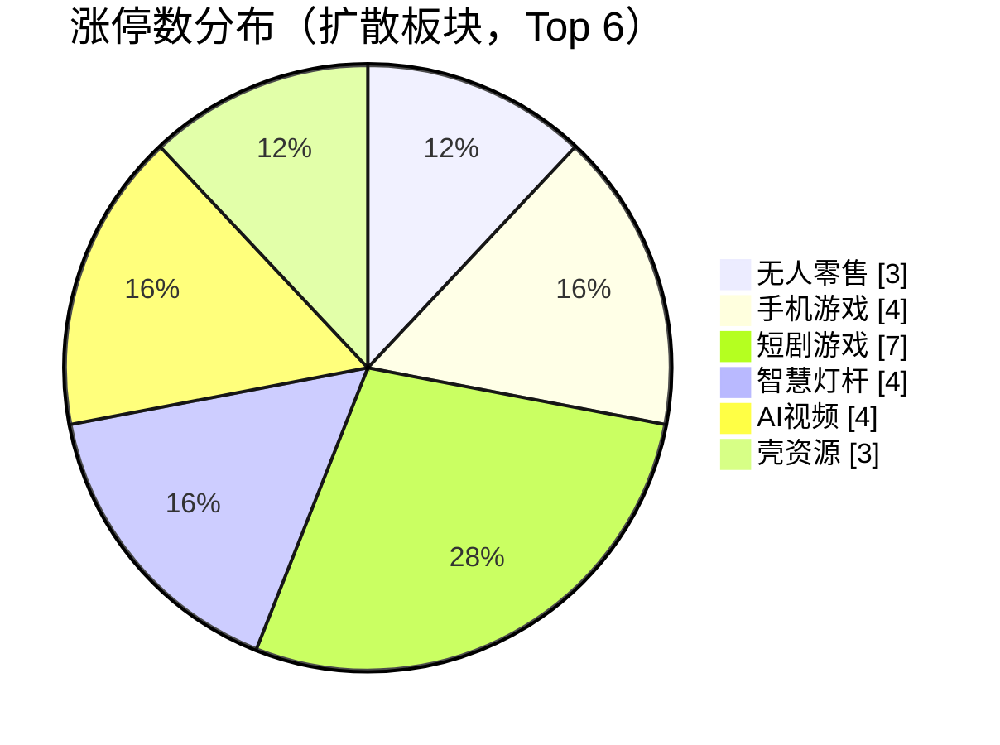
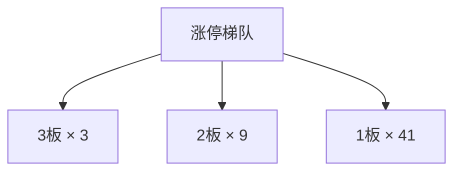
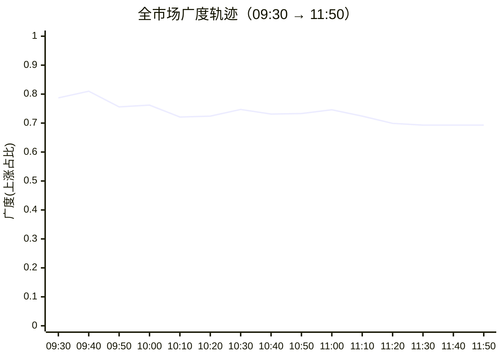

## 当日总览（截至 11:50）

> **结论**：全市场涨3864/跌1492（广度0.72）；涨停53/跌停0；中位涨幅+0.74%；局部修复。 钱在：无人零售(涨停3/成分26，中位+1.49%)、手机游戏(涨停4/成分56，中位+2.08%)、短剧游戏(涨停7/成分99，中位+3.10%)；零星涨停：汽车拆解概念(2)、血氧仪(2)、低辐射玻璃(Low-E)(1)、电子纸(2)、天津自贸区(1)。 退潮：无明显集中跌停板块。 梯队：3板×3、2板×9、1板×41，最高3板。 预案：无有效对照。 较上一轮广度基本持平。

> 🔒 **no_trade / 买入预算 0 / max_position_pct 0 —— 全部内容仅供研究，不授予交易权限。**

### 板块扩散

> 口径：XTick 概念成分 × 全市场实时报价；分母 = 板块内有有效报价的成分数。排序用涨停密度（涨停数/有效成分数），已剔除宽基属性板块（全市场 432 个板块中剔 16 个）。

**扩散中（题材，按涨停密度排序）**

| 板块 | 涨停 | 有效成分 | 涨停密度 | 上涨广度 | 中位涨幅 | 相对全市场 | 成交(亿) |
|---|---|---|---|---|---|---|---|
| 无人零售 | 3 | 26 | 0.115 | 0.77 | +1.49% | +0.75% | 63 |
| 汽车拆解概念 ⬦ | 2 | 23 | 0.087 | 0.70 | +0.60% | -0.14% | 30 |
| 血氧仪 ⬦ | 2 | 24 | 0.083 | 0.71 | +1.21% | +0.47% | 42 |
| 低辐射玻璃(Low-E) ⬦ | 1 | 12 | 0.083 | 0.42 | -0.10% | -0.84% | 13 |
| 电子纸 ⬦ | 2 | 27 | 0.074 | 0.85 | +1.00% | +0.26% | 68 |
| 手机游戏 | 4 | 56 | 0.071 | 0.93 | +2.08% | +1.34% | 246 |
| 短剧游戏 | 7 | 99 | 0.071 | 0.94 | +3.10% | +2.36% | 554 |
| 智慧灯杆 | 4 | 62 | 0.065 | 0.87 | +1.64% | +0.90% | 95 |
| AI视频 | 4 | 67 | 0.060 | 0.96 | +2.95% | +2.21% | 469 |
| 壳资源 | 3 | 51 | 0.059 | 0.78 | +1.12% | +0.38% | 34 |
| 天津自贸区 ⬦ | 1 | 17 | 0.059 | 0.71 | +0.70% | -0.04% | 23 |
| MLOps概念 ⬦ | 1 | 18 | 0.056 | 0.89 | +1.33% | +0.59% | 47 |

> ⬦ = 涨停 <3 只，零星个例，不构成扩散（不计入「钱在」判定）。



零星涨停板块（<3 只）：汽车拆解概念(2)、血氧仪(2)、低辐射玻璃(Low-E)(1)、电子纸(2)、天津自贸区(1)、MLOps概念(1)

### 涨停梯队

> 最高 3 板 ｜ 涨停 53 ｜ 跌停 0 ｜ 炸板 21 ｜ 封板率 71.6% ｜ 打板成功率 21.05% ｜ 一进二 18.75% ｜ 二进三 37.50%

| 身位 | 家数 | 成员（涨幅/封单亿/首封） |
|---|---|---|
| 3板 | 3 | 日出东方 +10.01%/0.113亿/09:25；东方新能 +10.20%/0.039亿/09:25；大东方 +10.00%/0.032亿/09:30 |
| 2板 | 9 | 光洋股份 +10.01%/0.033亿/09:30；亚玛顿 +10.01%/0.032亿/09:25；文投控股 +10.04%/0.029亿/09:31；冰山冷热 +10.03%/0.020亿/09:30；锋龙股份 +10.01%/0.019亿/09:31 |
| 1板 | 41 | 掌阅科技 +9.99%/0.048亿/09:36；襄阳轴承 +9.99%/0.045亿/09:57；阳光照明 +9.96%/0.045亿/09:30；九安医疗 +10.00%/0.041亿/10:35；新北洋 +9.96%/0.029亿/10:11 |



炸板 21 只（前几）：龙江交通(10次)、友好集团(7次)、东方环宇(6次)、友升股份(4次)、华策影视(3次)

### 预案池对照

| 票 | 池 | 板块 | 现价 | 涨幅 | 触发价 | 买区 | 风险位 | 判定 |
|---|---|---|---|---|---|---|---|---|
| 宇树科技 `688836.SH` | 执行池 | 人形机器人 | 778.5 | +8.73% | — | — | 709.68 | **无预案价** |
| 上纬新材 `688585.SH` | 观察池 | 人形机器人 | 220.88 | +2.25% | — | — | 201.72 | **无预案价** |
| 锋龙股份 `002931.SZ` | 观察池 | 人形机器人 | 48.25 | +10.01% | — | — | 43.58 | **无预案价** |
| 顺灏股份 `002565.SZ` | 观察池 | 商业航天/太空算力 | 10.92 | +3.61% | — | — | 10.16 | **无预案价** |
| 中科星图 `688568.SH` | 观察池 | 商业航天/太空算力 | 33.19 | +3.85% | — | — | 31.42 | **无预案价** |
| 雪人集团 `002639.SZ` | 观察池 | 冰雪产业 | 16.02 | +0.44% | — | — | 15.74 | **无预案价** |
| 金固股份 `002488.SZ` | 观察池 | 人形机器人 | 7.6 | +1.60% | — | — | — | **无预案价** |
| 超声电子 `000823.SZ` | 观察池 | PCB概念 | 18.43 | +3.19% | — | — | — | **无预案价** |
| 闽发铝业 `002578.SZ` | 观察池 | 情绪高度 | 5.73 | +3.99% | — | — | — | **无预案价** |
| 日出东方 `603366.SH` | 观察池 | 空气能热泵 | 10.88 | +10.01% | — | — | — | **无预案价** |
| 七匹狼 `002029.SZ` | 观察池 | 情绪/名字梗 | 9.3 | +2.76% | — | — | — | **无预案价** |
| 合富中国 `603122.SH` | 观察池 | 情绪/名字梗 | 11.66 | +4.57% | — | — | — | **无预案价** |


> ⚠ D1 明确 no_trade=true、买入预算 0、个股 max_position_pct=0。以上为研究对照，**不构成任何买入许可**。

### 盘面 vs 静态复盘 vs 消息面

| 维度 | 对象 | T-1 静态基线 | 今日盘面 | 关系 |
|---|---|---|---|---|
| 板块主线 | 冰雪产业 | R2 次线 score=74 涨停None（T-1 口径） | 今日盘中该板块 1 只涨停 / 成分61 广度0.62 中位0.6%（相对全市场-0.14%） | **无响应** |
| 板块主线 | PCB概念 | R2 次线 score=76 涨停None（T-1 口径） | 今日盘中该板块 3 只涨停 / 成分241 广度0.93 中位1.98%（相对全市场+1.24%） | **无响应** |
| 板块主线 | 共封装光学(CPO) | R2 次线 score=71 涨停None（T-1 口径） | 今日盘中该板块 0 只涨停 / 成分230 广度0.93 中位2.1%（相对全市场+1.36%） | **无响应** |
| 板块主线 | 银行 | R2 次线 score=41 涨停None（T-1 口径） | 盘面未见该板块成分票涨停 | **背离** |
| 梯队结构 | 最高3板 | T-1 最高梯队 4 板、首板 29、炸板率 39.06% | 今日 3板×3、2板×9、1板×41；封板率0.7162 炸板21只 | **背离** |
| 预案验证 | 宇树科技(688836.SH) | 预案 人形机器人／elastic_core／触发价None／买区None | 无预案价：预案未给触发价/买区（情景作废或待重导） | **无响应** |
| 预案验证 | 上纬新材(688585.SH) | 预案 人形机器人／watch／触发价None／买区None | 无预案价：预案未给触发价/买区（情景作废或待重导） | **无响应** |
| 预案验证 | 锋龙股份(002931.SZ) | 预案 人形机器人／watch／触发价None／买区None | 无预案价：预案未给触发价/买区（情景作废或待重导） | **无响应** |
| 预案验证 | 顺灏股份(002565.SZ) | 预案 商业航天/太空算力／watch／触发价None／买区None | 无预案价：预案未给触发价/买区（情景作废或待重导） | **无响应** |
| 预案验证 | 中科星图(688568.SH) | 预案 商业航天/太空算力／watch／触发价None／买区None | 无预案价：预案未给触发价/买区（情景作废或待重导） | **无响应** |
| 预案验证 | 雪人集团(002639.SZ) | 预案 冰雪产业／watch／触发价None／买区None | 无预案价：预案未给触发价/买区（情景作废或待重导） | **无响应** |
| 预案验证 | 金固股份(002488.SZ) | 预案 人形机器人／watch／触发价None／买区None | 无预案价：预案未给触发价/买区（情景作废或待重导） | **无响应** |
| 预案验证 | 超声电子(000823.SZ) | 预案 PCB概念／watch／触发价None／买区None | 无预案价：预案未给触发价/买区（情景作废或待重导） | **无响应** |
| 预案验证 | 闽发铝业(002578.SZ) | 预案 情绪高度／watch／触发价None／买区None | 无预案价：预案未给触发价/买区（情景作废或待重导） | **无响应** |
| 预案验证 | 日出东方(603366.SH) | 预案 空气能热泵／watch／触发价None／买区None | 无预案价：预案未给触发价/买区（情景作废或待重导） | **无响应** |
| 预案验证 | 七匹狼(002029.SZ) | 预案 情绪/名字梗／watch／触发价None／买区None | 无预案价：预案未给触发价/买区（情景作废或待重导） | **无响应** |
| 预案验证 | 合富中国(603122.SH) | 预案 情绪/名字梗／watch／触发价None／买区None | 无预案价：预案未给触发价/买区（情景作废或待重导） | **无响应** |
| 消息面对照 | 盘面热点板块 | R4 消息面（T-1 口径） | 实时快讯未出现热点板块关键词 | **无响应** |

**分歧点（不掩盖）：**
- 板块主线·银行 → 背离：T-1 有辨识度但今日盘中无涨停响应，题材未获资金确认
- 梯队结构·最高3板 → 背离：梯队高度是短线辨识度来源；梯队断裂时不做高位接力假设

### 全天广度轨迹

| 时点 | 涨 | 跌 | 广度 | 涨停 | 跌停 | 成交(亿) | 有效样本 |
|---|---|---|---|---|---|---|---|
| 0930 | 4386 | 957 | 0.787 | 11 | 0 | 766 | 5570 |
| 0940 | 4515 | 859 | 0.810 | 21 | 0 | 3,048 | 5573 |
| 0950 | 4213 | 1143 | 0.756 | 26 | 0 | 4,314 | 5573 |
| 1000 | 4247 | 1102 | 0.762 | 33 | 0 | 5,250 | 5573 |
| 1010 | 4019 | 1315 | 0.721 | 41 | 0 | 6,061 | 5573 |
| 1020 | 4032 | 1325 | 0.724 | 42 | 0 | 6,675 | 5573 |
| 1030 | 4161 | 1215 | 0.747 | 50 | 0 | 7,337 | 5573 |
| 1040 | 4073 | 1284 | 0.731 | 52 | 0 | 7,930 | 5573 |
| 1050 | 4087 | 1263 | 0.733 | 58 | 0 | 8,389 | 5573 |
| 1100 | 4159 | 1201 | 0.746 | 56 | 0 | 8,757 | 5573 |
| 1110 | 4035 | 1312 | 0.724 | 56 | 0 | 9,090 | 5573 |
| 1120 | 3893 | 1439 | 0.699 | 53 | 0 | 9,421 | 5573 |
| 1130 | 3862 | 1483 | 0.693 | 53 | 0 | 9,681 | 5573 |
| 1140 | 3862 | 1483 | 0.693 | 53 | 0 | 9,681 | 5573 |
| 1150 | 3862 | 1483 | 0.693 | 53 | 0 | 9,681 | 5573 |

> ⚠ **数据冻结段**：1130–1150 数值连续完全一致，说明行情源未刷新，**不是市场横盘**，该段不可解读为盘面变化。



### 观察建议（仅研究）

- **环境**：涨停 53.0 / 跌停 0.0，打板成功率 21.1%，一进二 18.8%。
- **方向**：今日形成实质扩散的是 无人零售（涨停3/成分26，密度0.115，中位+1.49%）、手机游戏（涨停4/成分56，密度0.071，中位+2.08%）、短剧游戏（涨停7/成分99，密度0.071，中位+3.10%）。**需确认**：次日能否维持涨停家数且中位涨幅不掉队，否则只是普跌中的避险轮动。
- **零星**：汽车拆解概念(2只/23成分)、血氧仪(2只/24成分)、低辐射玻璃(Low-E)(1只/12成分)、电子纸(2只/27成分)、天津自贸区(1只/17成分) 属零星个例，不视为题材，不据此选股。
- **身位**：最高 3 板。梯队有高度不等于可接力，需逐票核验封单稳定性与开板次数后再定。

<details>
<summary>原始截面与数据质量（折叠）</summary>

**跨源校验**

```json
{
  "xtick": {
    "up": 3864,
    "down": 1492,
    "n": 5585,
    "amount_yi": 9601.9
  },
  "rtk_snapshot": {
    "up": 3862,
    "down": 1483,
    "valid_n": 5573,
    "amount_yi": 9681.2,
    "up_limit": 53,
    "down_limit": 0
  },
  "note": "两源口径不同（XTick 全市场含全部票；rt_k 返回样本）"
}
```

**rt_k 截面（原始）**

```json
{
  "market": {
    "total": 5584,
    "up": 3862,
    "down": 1483,
    "flat": 228,
    "requested_n": 5584,
    "received_n": 5584,
    "valid_n": 5573,
    "missing_n": 11,
    "universe_requested_n": null,
    "population_scope": "returned_rows_not_verified_all_a_universe",
    "up_ratio": 0.6916,
    "legacy_up_ratio_placeholder": false,
    "up_ratio_is_observed": true,
    "up_ratio_all": 0.6916,
    "up_ratio_valid": 0.693,
    "up_ratio_denominator": "requested_n",
    "degraded": false,
    "limit_known_n": 5573,
    "limit_unknown_n": 0,
    "limit_counts_complete": true,
    "limit_source_errors": [],
    "up_gt3": 696,
    "up_gt5": 249,
    "up_limit": 53,
    "down_gt3": 57,
    "down_gt5": 9,
    "down_limit": 0,
    "amount_yi": 9681.2,
    "amount_sum_overflow": false,
    "amount_valid_n": 5573,
    "amount_missing_n": 0
  },
  "source_time_quality": {
    "quote_age_min_seconds": 1.945549,
    "quote_age_max_seconds": 61.945549,
    "source_age_limit_seconds": null,
    "freshness_status": "age_limit_not_configured",
    "age_reference_at": "2026-11-10T11:50:43.945549+08:00"
  },
  "trading_authorized": false
}
```

</details>

## 分时研判记录

### 09:35 研判增量
- **趋势**：开盘呈现“科技方向广泛上涨，接力集中在少数前排”，尚不能定性全天主升。本轮只取得2026-11-10的09:30分析，生成于09:30:56；配套报价时标为09:30:24—09:30:51，不是09:35现价。当日没有上一轮，故无法判断跨轮拐点、冻结或“基本持平”。后续广度基线固定为有效报价5570家中的4386家上涨，即78.74%，不与总览剔除平盘后的约81%混用。3板前排与首板助攻的比例需等后续截面验证，不能把开盘少首板直接判成接力断层；分析内昨日最高4板与原预案昨日6板存在冲突，暂不据此断言高度坍塌。
- **轮动**：原先PCB/CPO次线已有价格层面的响应，不宜因涨停少就写成全无响应：PCB上涨238/241家、相对中位强度+1.78个百分点，CPO上涨228/230家、相对+1.95个百分点；人形机器人上涨462/482家，但只有1家涨停，属于广泛走强、尚缺接力扩散。冰雪仅上涨32/61家且相对落后0.80个百分点，快讯虽报“冰雪活跃”，盘面尚未形成同等级合力。银行上涨0/42家、煤炭上涨1/33家，与科技相反，只能提出科技/防御跷跷板假设，不能用单截面证明资金搬家。另，完整板块表中智能制造4/459家、特斯拉概念3/250家涨停，不能由密度榜前列均零星外推“全场无扩散”；交叉概念不相加，也不直接认证独立主线。09:30快讯样本已有半导体领涨及冰雪报道，自动关键词“无响应”不等于没有消息；这些是盘面报道，不是独立新催化，三方共振尚未证实。
- **剧本**：发现有价方案被分析层漏读：原预案价格在entry_rules内，不能将“无预案价”当成全部情景作废。按原案、仅对照09:30截面：宇树754.97仍低于756.19—771.39买区及759.99触发价，重新突破尚待确认；顺灏、雪人也分别未进入10.49—10.70、16.25—16.57原买区，不能下移接弱。上纬、锋龙、中科星图已分别超过219.26、45.87、34.15原买区上沿，属于不追而非新增买点。金固、超声、闽发、日出东方、七匹狼、合富原案确无有效触发价/买区，只保留观察。日出东方虽已处3板梯队，仍不把温度计晋级为买入方案；闽发未在当轮涨停梯队中，也不能据昨日高度给接力许可。PCB回流部分印证B方向，但机器人尚未集体失效，不能宣布B剧本已经切换。原案要求09:30前重评，以上沿用旧价作研究，既不延长有效期，也不解除上纬、雪人等原限制。
- **下一步看**：下一有效截面先核分母与报价时标，再看PCB/CPO上涨广度能否保持本轮0.9876/0.9913、相对中位强度是否仍为正；若涨停增加而有效报价广度下滑，应改判强势集中，不称普涨延续。宇树进入756.19只是进区，仍须放量站稳759.99、回踩不失突破位，并满足原案机器人至少3家涨停效应；超过771.39不追。当前只有截面，放量、站稳及回踩路径均未核，单次越线不算兑现。冰雪须核龙江交通的封板承接、冰山冷热触板后能否重新封住，以及上涨成分是否超过当前32/61，不能由一条快讯替代验证。系统本轮买入分配0、no_trade=true、各票max_position_pct=0保持不变；真实账户预算未核，全部仅供研究，不构成任何买入许可。

### 09:45 研判增量
- **趋势**：新增变化是“首板扩散起来，但封板质量下降”，不是全场同步加强。比较2026-11-10的09:30→09:40分析；本轮采集09:40:41—09:40:53，报价时标09:40:21—09:40:51，分析09:40:54生成，不是09:45现价。有效报价样本上涨占比由4386/5570（78.74%）变为4515/5573（81.02%）；分母略变，不报严格同样本改善幅度，也不沿用总览剔除平盘后的广度。XTick梯队口径涨停11→20、首板2→11，同时炸板1→8、封板率91.67%→71.43%；最高仍3板，但该层5→4家，东方嘉盛由封板转为开板。新增机会集中在低位首板，不能用涨停增加替高位接力质量背书。两轮价格、成交额与源更新时间均有变化，不属于数据冻结。
- **轮动**：进攻扩散从开盘硬件普涨转向传媒/AI内容簇：手机游戏涨停0→4/56家、AI视频1→4/67家、AI语料0→3/53家、短剧游戏1→5/99家；其中AI视频上涨54→66/67家、短剧上涨67→93/99家。华策影视、掌阅科技、慈文传媒分别在09:37、09:36、09:38首次封板，是新增首板带动的证据，尚非经持续性验证的总龙；交叉概念不相加作独立主线。相对地，PCB上涨238→235/241家、CPO上涨228→223/230家，相对中位强度分别从+1.78→+1.14、+1.95→+1.42个百分点，是高开后优势收窄，不是整线失效。银行上涨0→4/42家、煤炭1→6/33家亦在改善，不能继续解释为防御方向加速失血；目前只能提出传媒相对硬件的轮动假设，未取得净流数据证明资金搬家。航天涨停2→3/507家与09:40上海港湾上板快讯相互印证，但同一走势的两家媒体报道不算两份独立催化，传媒独立催化仍未核。
- **剧本**：按原案entry_rules中的真实价位对照，宇树由754.97升至764.80，首次在这两次采样中同时处于756.19—771.39原区间且高于759.99触发价；机器人涨停也从1→3/482家，故“价格位置＋板块家数”已响应原假设。仍缺放量、站稳、回踩不失位的路径证据，不把一次越线写成买点完整兑现，原案09:30前须重评的有效期也未获延长。顺灏10.47→10.55，进入10.49—10.70原区间并略过10.54触发价，同样仅属价格响应，不撤销原观察限制。锋龙新增2板只证明助攻增强，不让其替代本体核心；上纬、锋龙、中科星图仍高于各自原买区上沿，不追。雪人仍15.95、未进入16.25—16.57原区间；冰雪上涨32→39/61家虽改善，龙江交通开板次数0→2、冰山冷热仍处炸板名单，尚非一致转强。反向剧本的超声电子19.27→18.55，且PCB相对优势下降，而宇树在转强，因此“机器人失败、PCB独立承接”的切换条件未满足；不能因预设有B方案就硬切。
- **下一步看**：以下均为观察条件，不是买入门槛或委托：宇树后续能否在759.99之上给出放量及回踩承接路径、机器人能否维持原案至少3家涨停；若重新跌回759.99下或板块跌破该家数，撤回本轮同步改善的判断，超过771.39仍不追。传媒簇先以本轮手机游戏4/56、AI视频4/67、AI语料3/53的涨停家数及正相对强度为延续基线，核首板是否仍封住；若涨停增加而封板率继续低于本轮71.43%，只认扩散、不升级接力质量。PCB/CPO须先停止相对强度回落，超声19.27仅作前轮价格观察锚，不临时造触发价。系统no_trade=true、本轮买入分配0、各票max_position_pct=0保持不变；以上仅供研究，不构成任何买入许可，也不推断真实账户预算为0。

### 09:55 研判增量
- **趋势**：新增拐点是“上涨面收窄，涨停却继续增加”，由普遍上涨转向强势集中，不是普涨延续，也不足以定性整体退潮。对比2026-11-10的09:40→09:50，两轮有效报价样本数均为5573，上涨4515→4213家，占比81.02%→75.60%，下降5.42个百分点；未核上市名录，不称无遗漏全A覆盖。涨停另用XTick梯队同源比较20→26家，首板11→15、二板5→7，最高仍3板且该层仍4家；封板率71.43%→74.29%，因此上一轮“封板质量下降”不能机械延续，但局部封板改善也不能掩盖广度回落。本轮采集09:50:41—09:50:52，报价时标09:50:18—09:50:51，分析09:50:53生成，不是09:55现价；价格、成交额和源更新时间均变化，非数据冻结。
- **轮动**：上一轮领涨的传媒/AI内容簇开始分歧：手机游戏涨停4→3/56家、AI视频4→3/67家、AI语料3→2/53家；华策影视从首板封住转为开板、涨幅20.00%→17.73%，掌阅与慈文虽仍在首板名单，封单金额也较前轮减少，说明前排内部亦在分化。相对地，机器人与商业航天涨停均3→4家，分母分别482、507家，相对中位强度分别+1.13→+1.26、+0.63→+0.77个百分点；但上涨成分均458→451家，只能说强势向核心集中，不能说全板扩散增强。壳资源1→3/51家涨停是新增聚集信号，交叉属性本身不认证独立主线，不能把重叠概念相加。银行上涨4→10/42家、煤炭6→11/33家，仍然中位下跌，只是弱势修补；可提出传媒降温、机器人/航天及部分防御相对承接的轮动假设，缺净流和持续路径，尚不能证明资金跷跷板。
- **剧本**：按原案entry_rules、价格事实日2026-11-09对照本轮报价：宇树764.80→771.00，仍在756.19—771.39原区间且高于759.99，但距上沿仅0.39元；“本体核心突破”的价格响应增强，缺放量、站稳与回踩路径，不能写成完整兑现，更不能因当下涨幅超过7%就误判触犯“开盘高开>7%”条件。顺灏10.55→10.87，已从原区间转为超过10.70上沿，不追，不把涨得更高当买点更好；原案财务反证与不递补限制保留。雪人15.95→16.25，只是触及16.25—16.57区间下沿，仍低于16.33触发价；冰山冷热由开板转回2板名单、累计开板2→5次，但冰雪上涨仍39/61家、涨停仍2家，是个股修复而非题材合力升级，原后排观察身份不变。上纬、锋龙、中科星图原超区状态未改，其余无有效价位者不补价。超声18.55→18.42、PCB相对强度+1.14→+0.98个百分点，而宇树当轮仍高于759.99，反向方案的“机器人失效＋PCB独立承接”仍未满足。与盘前局部修复基线部分印证，最新快讯样本未补足上述方向的独立新催化，不升级为盘面、静态研究、消息面三方一致；旧案09:30前须重评的限制也不因本轮观察自动延期。
- **下一步看**：仅用已观测基线核验，不新增入场规则：若涨停继续增而有效报价上涨占比仍低于本轮75.60%，继续按集中分化观察；回到前轮81.02%才算收复本次广度回落，分母变化则重新核口径。传媒先看手机游戏/AI视频/AI语料能否恢复前轮4/56、4/67、3/53的涨停家数，并核华策是否重新封板，不能用仍在上涨代替恢复扩散。宇树须取得759.99之上的放量及回踩承接路径，机器人至少3家涨停的原条件不能丢；高于771.39不追，跌回759.99下则撤回价格突破响应判断。雪人即便越过16.33也仍须同板承接复核，不因冰山回封取消原反证。系统no_trade=true、本轮买入分配0、各票max_position_pct=0不变；真实账户预算未核，全部仅供研究，不构成任何买入许可。

### 10:05 研判增量
- **趋势**：新增变化是“机器人核心与助攻同步增强，但全场广度只小幅回补”，尚未收复上一轮收窄。对比2026-11-10的09:50→10:00，有效报价样本数均为5573，上涨4213→4247家，占比75.60%→76.21%，仅回升0.61个百分点，仍低于09:40的81.02%；另一源上涨家数4227→4223，也不支持把这点回补升级为全面再扩散。XTick涨停26→33、首板15→20、二板7→9，炸板仍9、封板率74.29%→78.57%，说明低位封板承接改善；最高仍3板且该层仍4家，没有新增高度突破。本轮采集10:00:41—10:00:53，报价时标10:00:06—10:00:51，分析10:00:55生成，不是10:05现价；价格与成交额均更新，非数据冻结，返回样本也不冒称无遗漏全A。
- **轮动**：机器人从“强势集中”进一步出现助攻扩散：涨停4→7/482家、上涨451→456/482家、相对中位强度+1.26→+1.73个百分点；减速器涨停3→5/140家、上涨134→136/140家，交叉成分不相加，但比单看宇树上涨更能支持原本体方向。空气能热泵2→3/56家涨停、上涨40→42/56家，配合日出东方仍在3板，新增题材跟随证据；不能据此抬升其原观察资格。反面是AI视频3→2/67、AI语料2→1/53、短剧游戏4→3/99家涨停，掌阅由首板封住转开板至+8.58%；但这些板块中位涨幅仍上行，属于封板接力降温，不是传媒整线出逃。商业航天涨停4→5/507家而上涨451→441/507家，亦是核心集中而非全线扩散。银行上涨10→6/42家、煤炭11→7/33家，上一轮弱势修补中断，可保留机器人相对传媒/防御承接的假设，缺净流及连续路径，不认证资金跷跷板。最新快讯样本未补足机器人、热泵的独立催化，盘面部分印证盘前本体核心假设，不升级为三方一致。
- **剧本**：最重要的状态迁移是宇树771.00→802.69，已从原区间内转为超过771.39接受上限；方向走强与原买点错过同时成立，不因助攻增强上移买区、不追。仍按原案entry_rules对照：中科星图34.45→34.12，回到33.48—34.15原区间且高于33.65触发价，但这是从高处回落进入，不是新突破确认，原财务反证和只观察限制保留；顺灏10.87→10.72仍高于10.70上沿，未回区。雪人16.25→16.16，退回16.25区间下沿之下，两次采样都未到16.33触发价，应撤回“正进入买区”的进展判断，不误写成突破后的止损失效。超声18.42→18.46仅小幅回升，PCB相对强度仍+0.98个百分点，宇树与机器人反而增强，反向方案的“本体失败＋PCB独立承接”仍未发生。上纬、锋龙继续超原区间，其余无价对象不补造价位；旧案09:30前须重评的限制不自动延期。
- **下一步看**：只用已有锚核验：机器人下一截面能否保持7/482家涨停、456/482家上涨及正相对强度，减速器能否保持5/140家涨停；若仅宇树继续拉升而助攻家数回落，应撤回“同步扩散增强”。热泵须保持本轮3/56家涨停及42/56家上涨，跌回此前2家涨停就撤回新增扩散判断；AI视频若恢复此前3/67家涨停且掌阅重新封板，才是本轮接力降温有所修复。市场上涨占比需先维持76.21%，重回81.02%才收复09:40后的广度回落，分母变化则重核。宇树高于771.39继续不追，日后回到原区间也不自动恢复旧买点，仍须759.99之上的放量及回踩承接路径；中科若跌回33.65下，撤回其本轮“区间内且高于触发”的价格状态，不能靠下移区间接弱。系统no_trade=true、买入分配0、各票max_position_pct=0不变；真实账户预算未核，以上全为研究观察，不构成任何买入许可。

### 10:15 研判增量
- **趋势**：10:00的小幅广度回补再次被打断，盘面进一步向强势股集中，而不是全面再扩散。对比2026-11-10的10:00→10:10，两轮有效报价样本均5573家，上涨4247→4019家，占比76.21%→72.12%，下降4.09个百分点；这是返回样本，未核上市名录，不冒称无遗漏全A。XTick同源涨停33→40、首板20→27，二板仍9家、三板仍4家，新增净家数都在首板；封板率78.57%→81.63%，说明局部封板改善与整体上涨面收窄并存，没有高度突破。配套截面采集10:10:41—10:10:52、报价时标10:10:00—10:10:48，分析10:10:53生成，不是10:15现价；市场价格与成交额均有更新，非整体冻结。
- **轮动**：上一轮“传媒接力降温”本轮须修正为部分修复：AI视频涨停2→3/67家，手机游戏涨停仍3/56家但上涨49→55/56家，掌阅由开板转回首板封板名单；这是内容簇重新获得承接的证据，尚未证明持续封稳。机器人涨停7→9/482家，但上涨456→452/482家、中位涨幅2.68%→2.65%；相对强度提高不能掩盖自身上涨面收窄，应把上一轮“同步扩散增强”收紧为前排集中。冰雪上涨39→37/61家、中位0.65%→0.44%，仍在失去相对优势。汽车拆解虽跃居密度榜首，却只有2/23家涨停、上涨21→15/23家，不是新增扩散主线。可提出内容簇相对机器人内部、冰雪的轮动假设，缺净流与连续路径，不认证资金跷跷板；重叠概念不相加。
- **剧本**：按原案entry_rules复核，12只对象的价格分类本轮均未迁移，不因自动判定仍写“无预案价”而丢掉真实区间。宇树802.69→799.90虽回落，仍高于771.39原接受上限，既不是新增回踩买点，也不足以证明突破失败；继续不追。中科星图34.12→33.90，仍在33.48—34.15原区间且高于33.65触发价，但正向触发位靠近，不是新突破确认，原财务反证及只观察限制保留。超声18.46→18.61、PCB相对强度+0.98→+1.15个百分点，补强反向方案的承接一侧；机器人仍有9家涨停、宇树仍高于759.99，主情景失败这一侧没有成立，不能切换B方案或补造超声买价。盘面仍仅部分印证盘前局部修复假设，本轮最新快讯样本未补足相关独立催化，不升级为三方共振；旧案09:30前须重评的限制不自动延期。
- **下一步看**：只核已有观察锚，不新增买入门槛：有效报价分母不变时，上涨占比须先收复前轮76.21%，否则即使涨停继续增加也仍按集中分化观察。AI视频能否保持3/67家涨停、手机游戏能否保持55/56家上涨，并核掌阅回封后的承接路径；若AI视频退回2家涨停，撤回本轮接力修复判断。机器人看9/482家涨停能否伴随上涨成分回到此前456/482家，不能只盯宇树；冰雪须先收复39/61家上涨才有停止本轮收窄的证据。中科跌回33.65下则撤回“区间内且高于触发”的价格状态，不下移区间；宇树仍超771.39，不追。系统no_trade=true、买入分配0、各票max_position_pct=0不变，真实账户预算未核；全部仅供研究，不构成任何买入许可。


---
### 10:20 截面

返回样本: 涨4032/跌1325 广度0.72（有效样本分母） ｜ 返回5584/有效5573/缺失11；全A覆盖未核验 ｜ 涨跌停已确认计数: 涨停42 跌停0；边界已知样本5218/未知样本355（未知不等于0） ｜ 成交6674.8亿（金额缺失0，求和溢出False） ｜ 数据质量: 返回样本可用（非全A覆盖保证） ｜ 仅供市场参考，不授予交易权限；D1预算/no_trade/个股资格原样有效 ｜ D1预算上下文: {"market_context": {"emotion_cycle": {"break_rate": 0.449, "facts_date": "20261109", "phase": "high_chop", "phase_is_temperature_only": true, "premium": null, "premium_note": "aux的-0.5%是缺失回退，不作已测溢价；R1真实全池收盘反馈+4.17%与开盘溢价不同口径。"}, "four_quadrant": {"基本面估值": "宇树收入增长可核但PE516.63倍且库存反证；上纬万台下线不是销量且Q3累计亏损。西部/东方嘉盛/冰山分别4/5/5项财务红旗硬否决独立保留。", "情绪": "54涨停、6板、44.90%炸板与前日涨停池收盘+4.17%并存；市场奖励先手与前排，开盘至收盘均值仅+0.24%，拒绝把隔夜收益当追价优势。", "结构": "宇树716未守住此前739.03高点，必须重新站上本轮759.99才成立突破；机器人9U/9Z分歧、航天14U/11Z，轮次与持续性未知。", "综合": "资金修复×情绪分歧×估值高×结构待确认→市场上限20%、命名试探5%；不把四个维度当四张独立支持票，也不从缺项生成否决。", "资金": "日净入128.57亿对照5日-382.15亿、20日-3987.06亿，修复不是连续主升；机器人THS概念+30.47亿与R7窄行业不合并。"}, "primary_template": "树干（涅槃重升）", "structure": "前排接力修复、广度与封板仍弱；只留本体核心条件突破，不追四开回封及硬否决题材替代。"}, "no_trade": true, "risk_limits": {"account_hard_stop_loss_pct": null, "block_prefixes": ["920"], "block_st": true, "kill_switch_file": "data/runtime/KILL_SWITCH", "max_buy_orders_per_day": 4, "max_orders_per_symbol_per_day": 2, "max_positions": 5, "target_total_position_pct": 0.0}, "trade_date": "20261110"} ｜ 报价年龄上限未配置，未验证新鲜；时点质量: {"age_reference_at": "2026-11-10T10:20:53.531783+08:00", "freshness_status": "age_limit_not_configured", "quote_age_max_seconds": 68.531783, "quote_age_min_seconds": 2.531783, "source_age_limit_seconds": null} ｜ 预案池热点: 宇树科技+11.72%、锋龙股份+10.01%、日出东方+10.01%、上纬新材+7.40%、中科星图+6.60%

| 票 | 池 | 现价 | 涨幅 | 状态 |
|---|---|---|---|---|
| 宇树科技 `688836.SH` | execution_pool | 799.91 | +11.72% | up |
| 上纬新材 `688585.SH` | watch_pool | 232.0 | +7.40% | up |
| 锋龙股份 `002931.SZ` | watch_pool | 48.25 | +10.01% | limit_up |
| 顺灏股份 `002565.SZ` | watch_pool | 10.63 | +0.85% | up |
| 中科星图 `688568.SH` | watch_pool | 34.07 | +6.60% | up |
| 雪人集团 `002639.SZ` | watch_pool | 16.17 | +1.38% | up |
| 金固股份 `002488.SZ` | watch_pool | 7.74 | +3.48% | up |
| 超声电子 `000823.SZ` | watch_pool | 18.67 | +4.54% | up |
| 闽发铝业 `002578.SZ` | watch_pool | 5.65 | +2.54% | up |
| 日出东方 `603366.SH` | watch_pool | 10.88 | +10.01% | limit_up |
| 七匹狼 `002029.SZ` | watch_pool | 9.36 | +3.43% | up |
| 合富中国 `603122.SH` | watch_pool | 11.79 | +5.74% | up |

### 10:25 研判增量
- **趋势**：新增变化是“广度小幅回补、低位封板继续增加，但高位内部换人”，还不是全面再扩散。对比2026-11-10的10:10→10:20批次，有效返回样本均5573家，上涨4019→4032家，占比72.12%→72.35%，仅回补0.23个百分点，未收复此前76.21%；未核上市名录，不称无遗漏全A。XTick梯队涨停40→44、首板27→30、二板9→10，最高仍3板且该层仍4家；封板率81.63%→81.48%，基本持平，不能把涨停增加写成封板质量同步提高。三板家数虽不变，龙江交通却从封板转入开板名单、累计开板2→6次，东方嘉盛重新进入三板名单，说明高度未突破且前排仍有分歧，不因回到名单撤销原财务反证。本批广度对应10:20截面，情绪源更新至10:21:24、分析10:21:25生成，不是10:25同一瞬间报价；成交额与梯队均已变化，非整体冻结。
- **轮动**：PCB承接假设新增个股与报道层面的支持：世运电路在本批首次进入二板名单，首封10:21；10:20:43、10:21:01两条快讯均报道PCB走高、新北洋涨停，实为同一行情叙述，不能算两份独立催化。与此同时，掌阅两轮都在首板名单，但封单0.093→0.075亿元，不能据仍封板就升级传媒强度。关键限制是本轮全市场报价读取中断（IncompleteRead），板块成分的有效报价分母及热度整组缺失；空表不是涨停归零，自动对照把PCB、冰雪、CPO等标为“背离”不采信。现在只能把PCB列为需重核的承接方向，不能证明机器人失血、传媒退潮或资金跷跷板，也不能把10:10板块排名冒充本轮排名。
- **剧本**：12只预案对象本轮在分析中全部缺报价，属于数据降级，不是12只集体失效；不更新其买区分类，不把10:10旧价或另一采样时点的基础价格表拼成当前分析。真实触发价、买区仍在原案entry_rules内，不能因分析顶层为空就说原案无价。宇树“本体核心重新突破”的放量、回踩及板块至少3家涨停条件，本轮不能完整复核；锋龙仍在二板名单只支持助攻存在，不足以替代本体核心。PCB报道补强反向方案的承接一侧，但主情景失败一侧缺证，超声电子原案又无有效买区，故不切换方案、不补买价。原案价格事实日为2026-11-09，09:30前须重评的限制不自动延期；本轮也未取得独立新催化与完整板块响应，不能升级为三方一致。
- **下一步看**：先恢复板块有效成分与12只对象的报价时标，再谈状态迁移。相同有效样本分母下，72.35%仅是本轮基线，收复此前76.21%才有更明确广度回补；若涨停继续增加而广度回落，仍按强势集中观察。PCB恢复后与10:10的230/241家上涨、1/241家涨停及相对中位强度+1.15个百分点逐项比较，核快讯所述个股归属与实际封板，不能靠媒体点名数量代替扩散分母；龙江交通能否重新封住且不再增加开板次数，是高位分歧是否缓解的观察点。宇树只核原759.99触发位、756.19—771.39区间及机器人至少3家涨停，超过771.39不追；中科星图只核原33.65触发位与33.48—34.15区间，不下移接弱。这些均为旧案观察锚，不延长有效期或新增买入门槛。系统no_trade=true、买入分配0、各票max_position_pct=0不变，真实账户预算未核；全部仅供研究，不构成任何买入许可。

### 10:35 研判增量
- **趋势**：新增变化是“广度回补、首板增加，但高位分歧加重”。2026-11-10的10:20→10:30，有效返回样本均5573家，上涨4032→4161家，占比72.35%→74.66%，回升2.31个百分点，仍未收复此前76.21%。涨停另用XTick梯队同源比较44→50、首板30→36、二板10→11，三板却4→3家；东方嘉盛再入开板名单，龙江交通累计开板6→9次，不能用低位增板掩盖高位掉队。封板率81.48%→81.97%，只属小幅改善。本轮分析错误清空、板块与12只对象报价恢复，不把上轮缺失当市场归零；rt_k涨停边界覆盖也从5218家恢复至5573家，故不把其42→50直接当成净新增8板。配套采集10:30:41—10:30:54，报价时标10:29:36—10:30:51，分析10:30:56生成；XTick未附逐票时标，仅作10:30批次研究，不是10:35现价，也不冒称无遗漏全A。
- **轮动**：10:20板块缺失，以下跨至上一有效的10:10比较：PCB涨停1→6/241家、上涨230→232/241家、相对中位强度+1.15→+1.88个百分点，从零星涨停进入实质扩散；澳弘电子、肯特股份均在10:27首次封板，补强上一轮PCB报道，而非只靠媒体点名。机器人涨停9→13/482家、相对强度+1.80→+2.11个百分点，但上涨仍452/482家，是前排加速，不是上涨面再扩张；AI视频涨停3→4/67家，上涨64→63/67家，同样偏前排修复。冰雪涨停2→1/61家、上涨37→35/61家，相对强度-0.41→-0.69个百分点，弱化有成分证据。无人零售虽升至密度榜首，上涨却22→20/26家，不能据排名宣布全面扩散。当前更像PCB与机器人并强、冰雪相对掉队，不是“机器人资金搬去PCB”的已证跷跷板；交叉成分不相加。PCB部分印证盘前次线修复研究及10:20—10:21行情报道，但报道不是独立催化，本轮消息样本又有空正文，不升级为三方一致。
- **剧本**：价格比较亦跨10:10→10:30，不用10:20缺价制造状态迁移。顺灏10.73→10.64，从超区回到原10.49—10.70区间且仍高于10.54触发位；这是从上方回落，不是新突破，原财务反证与只观察限制不撤销。宇树799.90→803.01仍超771.39原接受上限，本体方向增强不等于新增买点，不追；机器人13家涨停也不能代替放量、站稳与回踩路径核验。中科星图仍在原区间且高于触发位，雪人仍未到原触发位，上纬、锋龙仍超区，其余6只原无有效价位，分类不变、不补造。PCB已补强反向方案的承接一侧，但宇树与机器人并未失败，故不切换B方案；超声电子18.61→18.81只提高观察优先级，不生成买价。全部沿原案entry_rules解释，价格事实日2026-11-09，09:30前须重评的限制不自动延期。
- **下一步看**：同分母上涨占比能否收复76.21%；PCB能否保持本轮6/241家涨停、232/241家上涨及正相对强度，并核澳弘、肯特的封板持续性。机器人若从13家退回此前9家涨停，撤回本轮前排增强判断；即使家数保持，也不等于宇树有可追买点。顺灏跌回10.54下即撤回“区间内且过触发”的价格状态，不下移买区；中科仍以原33.65观察，宇树超771.39继续不追。高位重点看东方嘉盛能否重封、龙江交通开板次数是否继续超过本轮9次。以上是观察基线，不是新增买入门槛；系统no_trade=true、买入分配0、各票max_position_pct=0不变，真实账户预算未核，全部仅供研究，不构成任何买入许可。

### 10:45 研判增量
- **趋势**：上一轮广度回补再次中断，而且这次封板质量也转弱。对比2026-11-10的10:30→10:40，有效返回样本均5573家，上涨4161→4073家，占比74.66%→73.08%，下降1.58个百分点；涨停另按XTick梯队同源比较50→52，但炸板11→15、封板率81.97%→77.61%，二板11→10、首板36→39，最高仍3板。应从“低位增板、高位分歧”收紧为“新增首板仍有、接力承接转弱”，不能只看涨停增加。本轮采集10:40:41—10:40:52，配套报价时标10:39:48—10:40:48，分析10:40:53生成；XTick缺逐票时标，不冒充10:45即时价。价格、成交额和源更新时间均变化，非整体冻结；返回样本不等于已核无遗漏全A。
- **轮动**：短剧重新进入涨停密度榜前列、减速器退出前列，有成分层面的分化支持：短剧涨停4→5/99家、上涨92→93/99家，AI视频涨停仍4/67家、上涨63→65/67家；机器人则涨停13→12/482家、上涨452→444/482家，相对中位强度+2.11→+1.66个百分点，减速器涨停6→5/140家。PCB虽仍6/241家涨停，上涨232→230/241家、中位涨幅2.89%→2.14%，不能因前排仍封住就延续“加速增强”。银行上涨8→21/42家、中位由-0.32%转+0.03%，是弱势修补，不是新进攻主线；可提出内容簇相对硬件、部分防御回补的轮动假设，尚无同口径净流证明跷跷板，交叉概念不相加。10:39:35载人航天招标报道出现，但航天涨停仍9/507家、上涨435→418/507家，消息尚未转成新增扩散，也不能映射成顺灏或中科的订单。内容股行情报道只印证价格表现，仍不是独立催化，不升级为三方一致。
- **剧本**：按原案entry_rules复核，12只对象的价格分类均未迁移，新增风险是原触发位的缓冲收窄：顺灏10.64→10.58、中科星图34.01→33.72，虽仍在各自原区间且高于10.54、33.65，但都向触发位回落，不是重新突破确认；原财务反证和只观察身份保留。宇树803.01→789.99仍高于771.39原接受上限，方向降温不等于原买点恢复，不追；锋龙仍在二板名单也不能替代本体核心。雪人15.97→16.10虽回升，仍未进入16.25—16.57原区间、未到16.33触发位，不能写成冰雪转强。超声18.81→18.57、PCB自身优势也收窄，故“机器人降温”没有自动满足反向方案的“PCB独立增强”；不切换B方案、不补造超声买价。旧案价格事实日2026-11-09、09:30前须重评的限制均不自动延期。
- **下一步看**：同分母上涨占比先看能否收复前轮74.66%，封板率能否回到81.97%；若涨停仍增而两者继续回落，维持集中分化判断，不升级进攻。内容簇以本轮短剧5/99、AI视频4/67家涨停及93/99、65/67家上涨作延续基线，失守则撤回本轮相对承接增强。机器人看能否收复前轮13/482家涨停、452/482家上涨；PCB须先恢复此前232/241家上涨和+1.88个百分点相对强度，才有重新增强的证据，不能仅维持6家涨停就宣布接棒。顺灏跌回10.54下、中科跌回33.65下，即撤回相应“区间内且过触发”的价格状态，不下移买区；宇树超771.39继续不追。以上全是研究观察锚，不是新增买入门槛；no_trade=true、本轮买入分配0、各票max_position_pct=0不变，真实账户预算未核，不构成任何买入许可。

### 10:55 研判增量
- **趋势**：上一轮接力承接转弱，本轮修复主要发生在内容股与部分回封，而非整体上涨面重新铺开。对比2026-11-10的10:40→10:50，有效返回样本均5573家，上涨4073→4087家，占比73.08%→73.34%，只微升；XTick同源涨停52→58、炸板15→13、封板率77.61%→81.69%，应撤回“封板质量继续恶化”的推断，但尚未收复10:30的81.97%。新增净家数主要来自首板39→44，三板3→4则是龙江交通从开板名单回到三板名单，累计开板仍9次，最高高度没有突破，不能当成高位一致。配套截面采集10:50:41—10:50:52、报价时标10:49:36—10:50:48，分析10:50:53生成；XTick缺逐票时标，均不是10:55即时价。成交额、价格与源更新时间有变化，非整体冻结；返回样本不冒称已核无遗漏全A。
- **轮动**：内容簇由相对承接进一步转为实质扩散：短剧涨停5→9/99家、上涨93→95/99家，密度排名第10升至第2；手游涨停3→5/56家、上涨54→56/56家。引力传媒10:43、上海电影10:47首次封板提供新增助攻，华策影视当轮在首板名单但累计开板2次，不把现价封板等同持续封稳。机器人涨停仍12/482家、上涨444→449/482家，是小幅回补而非整线失血；PCB涨停仍6/241家、上涨230→228/241家，中位虽回升，相对强度仍+1.25个百分点，未与内容同步加速。银行上涨21→18/42家，上一轮弱势修补也在回撤。故目前是内容增量更强、硬件保持但未接棒，不是已证明的资金跷跷板，交叉概念不相加。盘前机器人核心及PCB次线研究仅获部分价格印证，新增领涨簇与原重心不同；本轮快讯样本未补足内容独立催化，不把关键词未命中解释为此前消息消失，也不升级为三方一致。
- **剧本**：按原案entry_rules复核，新增迁移只有顺灏10.58→10.80，从原10.49—10.70区间内转为超上沿；这是原价格机会再次离开，不追，不因航天叙事抬高接受价。宇树790.88仍超771.39，上纬、锋龙也仍超各自原区间；中科星图33.72→33.74仍处33.48—34.15且高于33.65，价格状态未迁移，放量与回踩路径未核，原财务反证和只观察限制不撤销。冰雪涨停1→3/61家、上涨34→38/61家，上一轮弱化出现局部修补，但相对中位强度仍-0.34个百分点；雪人16.10→16.14仍低于16.25区间下沿及16.33触发位，不能由龙江回封替后排兑现剧本。其余6只原无有效价位者维持观察，不补价。超声18.57→18.48、PCB上涨面又收窄，而宇树与机器人未发生原定失败，反向方案仍不切换。原价事实日2026-11-09、09:30前须重评的限制不自动延期；自动表的“无预案价”仍不替代对嵌套原案的核验。
- **下一步看**：内容延续先核短剧能否保持9/99家涨停及95/99家上涨、手游能否保持5/56家涨停，并核引力、上海电影的封板持续性；若涨停退回前轮5/99、3/56，即撤回本轮加速扩散判断。相同有效样本分母下，上涨占比先收复此前74.66%、封板率收复81.97%，才有修复从前排向更广范围推进的证据，不能仅凭58家涨停升级进攻。冰雪须先保持3/61家涨停、38/61家上涨并停止相对落后，龙江若再次开板则重评其高位修复；原财务否决仍独立有效。中科跌回33.65下即撤回“区间内且过触发”的价格状态；宇树超771.39、顺灏超10.70均不追，不下移或上移旧买区。以上为观察基线而非新增买入门槛；no_trade=true、系统本轮买入预算/分配0、各票max_position_pct=0保持不变，真实账户预算未核，全部仅供研究，不构成任何买入许可。

### 11:05 研判增量
- **趋势**：新增拐点是“上涨面回补，封板承接反而变差”，不能延续上一轮封板修复判断。2026-11-10的10:50→11:00，有效返回样本均5573家，上涨4087→4159家，占比73.34%→74.63%，回升1.29个百分点；XTick同源涨停58→56、炸板13→17、封板率81.69%→76.71%。最高仍3板，但该层4→3家；龙江交通再次进入开板名单、累计开板9→10次，上一轮高位回封未能保持。首板44→42、二板10→11，不把二板增加解释成全梯队改善。本轮采集11:00:41—11:00:53，配套报价时标10:59:12—11:00:51，分析11:00:55生成；XTick缺逐票时标，不是11:05即时价。价格、成交额及源更新时间均变化，非整体冻结；返回样本不等于已核无遗漏全A。
- **轮动**：内容簇仍强，但由上一轮加速扩散转为前排维持、板块中位回吐：AI视频涨停5→6/67家、密度排名第7→第3，上涨仍66/67家，中位却4.17%→3.97%；短剧仍9/99家涨停、95/99家上涨，中位4.14%→3.97%。机器人也有同样分化：涨停12→13/482家，上涨449→448/482家、中位2.67%→2.49%，不能因增板宣布全面增强。PCB涨停6→4/241家，但上涨仍228/241家、中位2.23%→2.29%，是前排封板降温，不是整线失血；银行上涨18→24/42家、中位0.00%→0.29%，出现弱势回补。只能提出部分资金向落后方向回补的假设，缺同口径净流，尚不能认证跷跷板；交叉概念不相加。
- **剧本**：按原案entry_rules复核，12只对象的价格分类本轮均未迁移。宇树790.88→781.00仍超771.39原接受上限，机器人增板却本体回落，不是同步增强，也尚未跌破原759.99触发位；方向降温不等于买点恢复，不追。顺灏仍超10.70，中科星图仍在原33.48—34.15区间且高于33.65，原财务反证和只观察身份不撤销。冰雪上涨38→41/61家，但涨停3→2/61家、相对中位强度-0.34→-0.39个百分点，上一轮局部修补没有转成前排合力；雪人仍未到原16.25区间下沿及16.33触发位。PCB封板减少、宇树突破失败未成立，反向方案仍不切换。消息对照新增分歧：10:58快讯样本出现“英伟达据悉有意放缓芯片订单”，仅为未经原始信源核验的风险报道，不能直接映射成A股公司砍单；PCB/CPO当轮中位仍上升，尚无一致价格响应。自动表标为消息印证的短剧报道实际发布于10:31:24，是旧行情报道，不是本轮独立催化，不能升级三方共振。原案价格事实日2026-11-09、09:30前须重评的限制不自动延期。
- **下一步看**：同分母上涨占比保持本轮74.63%的同时，封板率能否收复前轮81.69%、涨停恢复58家；若广度回补而炸板继续超过17家，只认价格修补，不认接力质量恢复。AI视频能否保持6/67家涨停、66/67家上涨并停止中位回吐；PCB能否恢复前轮6/241家涨停，而非仅靠中位上涨维持强势观感。龙江交通须重新离开开板名单且累计开板不再超过本轮10次，才有高位修复的新证据；这不撤销原否决。宇树超771.39仍不追，中科跌回33.65下则撤回“区间内且过触发”的价格状态，不改旧买区。以上均为已有基线的研究观察条件，不是新增买入门槛；no_trade=true、系统本轮买入预算/分配0、各票max_position_pct=0保持不变，真实账户预算未核，不构成任何买入许可。

### 11:19 研判增量
- **趋势**：上一轮上涨面回补被打断，涨停总数持平掩盖了接力层收缩。比较2026-11-10的11:00→11:10批次，有效返回样本均5573家，上涨4159→4035家，占比74.63%→72.40%，下降2.23个百分点；XTick涨停仍56、炸板仍17、封板率仍76.71%，但二板11→10、首板42→43，最高仍3板。不能把几个总数相同写成盘面企稳，更不能据此说封板质量已恢复；价格、成交额及源更新时间均在变化，非整体冻结。本轮配套采集11:10:41—11:10:51，rt_k报价时标11:08:54—11:10:48，分析11:10:52生成；XTick缺逐票时标，均不是11:19即时价，返回样本也不冒称已核无遗漏全A。
- **轮动**：密度榜前列次序未变，新增信息在于内容簇优势继续回吐，而非新方向接棒：短剧、AI视频涨停仍为9/99、6/67家，上涨却分别95→94/99、66→65/67家，中位涨幅分别3.97%→3.43%、3.97%→3.54%。机器人中位2.49%→2.52%、PCB中位2.29%→2.30%，相对更抗回落；但机器人上涨448→443/482家、PCB仍228/241家上涨且涨停仍4家，只能认相对承接，不能认重新扩散。银行上涨24→20/42家、中位0.29%→0.00%，也不支持“进攻资金全面转防御”。航天涨停8→7/507家、上涨427→422/507家，冰雪上涨41→37/61家，是自身承接减弱；没有同口径净流，不认证资金跷跷板，交叉概念不相加。
- **剧本**：按原案entry_rules复核，12只对象的价格分类均未迁移；新增区别是宇树781.00→788.00出现采样间反弹，但仍超771.39原接受上限，不是原买点恢复；中科星图33.79→33.70，距33.65触发位只剩0.05元，虽仍在33.48—34.15原区间，价格缓冲正在变薄，不能下移区间接弱。雪人16.17→16.07，离原16.25区间下沿更远，不因板块仍有涨停写成条件正在满足。PCB封板家数未增、超声18.52→18.50，宇树突破失败亦未成立，反向方案仍不切换。消息新增分歧：11:10:03“AI影视持续走高”是行情报道，不能覆盖本轮中位回吐；11:10:13—16国电高科/高通合作两条快讯是同一事实，且不能外推成顺灏或中科的太空算力订单，报道与截面近乎同时，响应须待后续验证。盘前假设仍仅获部分价格印证，不升级三方一致；原案价格事实日2026-11-09、09:30前须重评的限制不自动延期。
- **下一步看**：相同有效样本分母下，先看上涨占比能否收复前轮74.63%、二板家数能否恢复11家；若涨停仍56而广度继续低于本轮72.40%，维持强势集中、接力未修复的判断。内容簇需在保住短剧9/99、AI视频6/67家涨停的同时，上涨成分恢复95/99、66/67家并停止中位回吐；仅排名不变不足以撤回降温判断。航天先看能否收复前轮8/507家涨停及427/507家上涨，不能用合作快讯替代成分响应。中科跌回33.65下即撤回“区间内且过触发”的价格状态；宇树超771.39仍不追，回到旧区间也须重新核放量、站稳与回踩路径。以上均为研究观察锚，不是新增买入门槛；no_trade=true、系统本轮买入预算/分配0、各票max_position_pct=0保持不变，真实账户预算未核，不构成任何买入许可。

### 11:28 研判增量
- **趋势**：新增变化是上涨面与封板承接同步退温，已不只是涨停总数掩盖内部收缩。比较2026-11-10的11:10→11:20批次，有效返回样本均5573家，上涨4035→3893家，占比72.40%→69.85%，下降2.55个百分点；XTick同源涨停56→52、炸板17→22、封板率76.71%→70.27%。首板43→39，二板仍10、三板仍3，弱化进一步落在低位助攻，不能因最高高度未变就说接力稳定。本轮配套采集11:20:41—11:20:51、报价时标11:19:06—11:20:48，分析11:20:52生成；XTick未附逐票时标，不是11:28即时价。成交额与价格有更新，非整体冻结；返回样本不冒称已核无遗漏全A。
- **轮动**：内容簇由中位回吐进一步转为封板家数减少：短剧涨停9→7/99家、上涨94→92/99家，AI视频涨停6→4/67家、上涨65→63/67家；密度排名分别第2→第7、第3→第8。机器人亦从13→11/482家涨停、上涨443→439/482家，不支持“内容退、机器人接棒”。PCB仍4/241家涨停，但上涨228→227/241家、中位2.30%→2.16%，只是相对抗回落，不是新增扩散。银行则上涨20→24/42家、中位0.00%→0.26%，与11:20:39银行拉升的行情报道方向相符，支持局部防御回补；煤炭上涨6→5/33家，不能扩大成防御全面吸金。无人零售排名仍首位，但涨停仍3/26家、中位1.83%→1.60%，也不是新加速方向。当前更像多个进攻簇一起降温、少数银行回补；缺同口径净流，不认证资金跷跷板，交叉概念不相加，行情报道不算独立催化。
- **剧本**：上一轮中科星图的观察条件已经发生反向变化：33.70→33.36，同时跌回原33.65触发位和33.48买区下沿之下，撤回“区间内且过触发”的价格响应判断；这不是把风险位当失效判据，也不代表可以下移原33.48—34.15区间接弱。宇树788.00→774.02，虽向771.39原上沿靠近，仍在区间外，不追；机器人助攻减少，不能把回落自动解释为强势回踩。其余11只原价格分类未迁移，原无有效价位者不补价。日出东方仍处三板，但热泵涨停3→2/56家、上涨40→36/56家，说明高度票保持不等于板块合力保持。机器人降温、PCB也未独立增强，反向方案仍不切换；11:20:23港股PCB上涨报道不能代替A股扩散，更不能给超声电子补造买价。盘前局部修复假设仍仅获部分价格印证，没有新增独立催化支持三方一致；旧案价格事实日2026-11-09、09:30前须重评的限制不自动延期。
- **下一步看**：先核同分母上涨占比能否收复前轮72.40%、封板率能否收复76.71%、首板能否恢复43家；若仅少数核心反弹而这些指标不恢复，仍按局部承接而非全面转强。内容簇能否恢复前轮短剧9/99、AI视频6/67家涨停，并停止上涨成分继续减少；机器人能否收复13/482家涨停，PCB能否收复228/241家上涨且中位不再回吐。中科仅回到33.48是回区，重新高于33.65也须另核放量与承接，不自动恢复旧突破剧本；宇树超771.39继续不追，若回区仍须759.99之上的真实放量、站稳及回踩路径，不能仅用一次报价认证。银行以24/42家上涨与中位+0.26%为本轮观察基线，回落则撤回新增防御回补判断。以上均为研究条件，不是新增买入门槛；no_trade=true、系统本轮买入预算/分配0、各票max_position_pct=0保持不变，真实账户预算未核，不构成任何买入许可。

### 11:35 研判增量
- **趋势**：新增变化是“封板小修，上涨面仍缩、二板继续减少”，尚未出现接力转强拐点。比较2026-11-10的11:20→11:30，有效返回样本均5573家，上涨3893→3862家，占比69.85%→69.30%，再降0.56个百分点；XTick同源涨停52→53、炸板22→21、封板率70.27%→71.62%，但二板10→9、首板39→41，最高仍3板。修补主要落在首板，不能用总涨停回升掩盖接力层收缩，也不混用另一源涨停53→53的计数。本轮配套采集11:30:41—11:30:45，报价时标11:30:00—11:30:42，分析11:30:46生成；XTick缺逐票时标，不是11:35即时价。价格、成交额和源更新时间均变化，非整体冻结；返回样本未核无遗漏全A覆盖。
- **轮动**：上一轮进攻簇一起降温，本轮开始分出相对承接：短剧涨停仍7/99家，上涨92→93/99家、中位3.07%→3.10%；AI视频涨停仍4/67家，上涨63→64/67家，但中位2.98%→2.95%，只能认局部止跌修补，不能认重新加速。机器人涨停仍11/482家，上涨439→433/482家、中位2.17%→1.99%；PCB涨停4→3/241家、上涨227→225/241家，硬件并未接棒。智慧灯杆涨停3→4/62家、密度排名进入前列，上涨却55→54/62家、中位1.73%→1.64%，属于前排集中，不是新增全面扩散主线。银行上涨仍24/42家、中位0.26%→0.33%，只是局部防御延续；目前更像内容小修、硬件继续退温，不足以证明资金跷跷板，交叉概念不相加。新增快讯主要为午盘期货收盘信息，不能据此认证内容股独立新催化，盘前假设与盘面仍仅部分相符。
- **剧本**：按原案entry_rules核验，12只对象的价格分类本轮均未迁移；新增分歧在于宇树774.02→778.50反弹，而机器人上涨面继续收缩，不能由核心单票反弹推断合力恢复。宇树仍超771.39原接受上限，不追；中科星图33.36→33.19继续远离33.48买区下沿及33.65触发位，上一轮撤回价格响应的判断未获修复，不下移买区。PCB自身减板、超声电子18.50→18.43，也不满足反向方案的独立增强条件，不切换B方案、不补造买价。原案价格事实日为2026-11-09；其中有价突破情景写明09:30—11:30窗口，现已走完，且原有09:30前须重评的限制并未解除，午后不能自动延长旧案有效期。原财务反证、观察身份与零买权均保留。
- **下一步看**：午后先核行情源确已更新，不把午休或13:00沿用上午末价解释成企稳。有效分母不变时，先看上涨占比能否收复11:20的69.85%、封板率能否保持本轮71.62%、二板能否恢复10家；只有首板增多不算接力修复。内容簇能否保持短剧7/99、AI视频4/67家涨停及93/99、64/67家上涨，并停止中位回吐；PCB能否恢复前轮4/241家涨停、227/241家上涨，未恢复前不谈硬件接棒。宇树仍以759.99、771.39作旧案观察锚，中科先看能否重新进入33.48—34.15且高于33.65，均须另核放量及承接路径，不因一次触价恢复过期剧本。以上仅是研究验证条件，不是新增买入门槛；no_trade=true、系统本轮买入预算/分配0、各票max_position_pct=0不变，真实账户预算未核，不构成任何买入许可。

### 11:45 研判增量
- **趋势**：本轮新增的是“午休数据实值未刷新”的确认，不是盘面企稳。2026-11-10的11:40分析与11:30相比，两源广度与成交额、全部板块统计、完整梯队及12只预案对象价格均完全相同；仅文件时间、情绪更新时间、新闻及轨迹记录等变化。11:40:45生成文件不等于出现新成交，不能把这段重复数据解读为止跌或封板稳定；价格判断仍截至上午末轮，不冒充11:45实时行情。
- **轮动**：新闻有更新，价格尚无更新后的响应可检验。11:40:38样本新增“大摩恢复覆盖哔哩哔哩”的报道，快讯与事件条目是同一事实，不是两份独立催化；它是针对该公司的机构观点，不能外推成A股传媒公司的订单或利润兑现。11:40:33的ETF午评复述上午走势，也不证明午休期间资金新流入。内容与硬件的相对强弱、是否形成跷跷板，本轮均不升级判断。
- **剧本**：12只对象没有新的价格状态迁移，不重抄旧表，也不以重复末价确认站稳。宇树原案选择的是本体核心重新突破，泛AI午评或哔哩哔哩报道不能代替其放量、回踩与机器人合力条件；PCB反向方案亦无新增接棒证据。有价突破情景的09:30—11:30窗口已经结束，午后须由预案负责人按新证据重评，不能随分析文件更新时间自动续期；原观察限制与财务反证不变。
- **下一步看**：午后先取得真实成交时点越过上午末轮、价格或累计成交额确有变化的有效截面，不能只验采集时间或源更新时间。有效样本仍为5573家时，若上涨占比低于上午末69.30%，却只有少数方向增板，仍按强势集中而非普涨解释；分母变化则先重核口径。宇树即使回到原756.19—771.39区间，也不能直接恢复过期买点，仍须重新核验759.99之上的放量与承接路径。以上均为研究条件；no_trade=true、系统本轮买入分配0、各票max_position_pct=0不变，真实账户预算未核，不构成任何买入许可。

### 11:55 研判增量
- **趋势**：本轮增量在消息，不在成交。2026-11-10的11:50分析较11:40，两源广度与成交额、概念及行业统计、完整梯队和全部预案对象报价仍完全相同；上午末轮之后没有可用于新趋势判断的价格变化。文件生成与情绪更新时间前移，不撤销上一轮“午休实值未刷新”的判断，不据此确认企稳或封板稳定。
- **轮动**：11:50:11快讯样本新增“平头哥拟赴港IPO”传闻，正文明确官方暂无回应；11:49:53样本另转述鸿富诚热界面材料小批量供应，但同时提示认证周期、项目进度及产能消化不确定。两条只能提出午后芯片、散热线索的待核假设，不能当成A股相关公司的新增订单，更不能在价格未更新时宣布资金从内容股切向硬件。上述信息均未回查原始出处，不升级为独立催化已确认或三方共振。
- **剧本**：新增泛芯片消息不能替代宇树原案“本体核心重新突破”的放量、回踩与机器人合力条件，也不补足PCB反向方案的独立承接证据；全部对象无新增价格状态迁移，不重判旧买区、不续期已经结束的上午突破情景。11:50:21快讯转述奥克股份“不涉及高速铜缆产品”，提示新线索必须先核业务纯度，不能凭AI硬件标签扩成合格候选；不改正式预案、原反证或观察身份。
- **下一步看**：午后先核真实成交时点及累计成交额更新，再以同口径集成电路上午末轮上涨214/241家、涨停0/241家为观察基线：上涨成分能否扩大、是否出现新增涨停，并与消息原始出处及上市公司实际业务关联交叉核验。若只是少数映射票冲高、成分承接未改善，不认定硬件接棒；若消息仍未经证实，也不由价格响应倒推传闻属实。以上不是新增买入门槛；no_trade=true、系统本轮买入预算/分配0、各票max_position_pct=0保持不变，真实账户预算未核，全部仅供研究，不构成任何买入许可。

