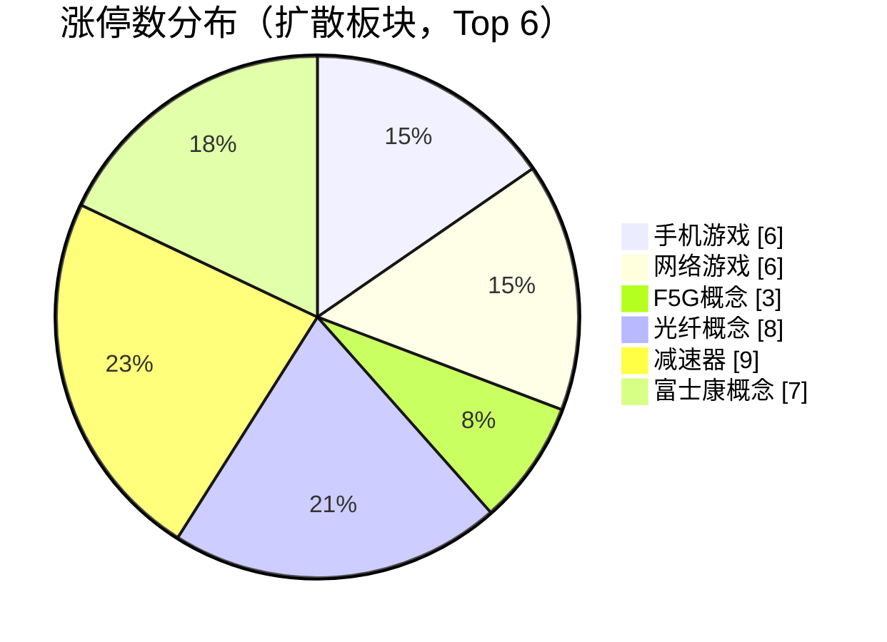
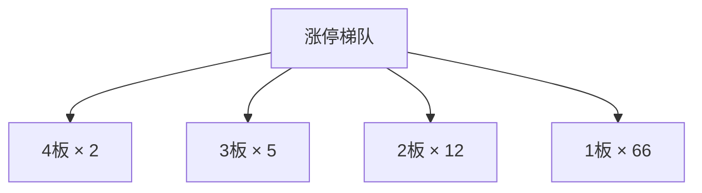
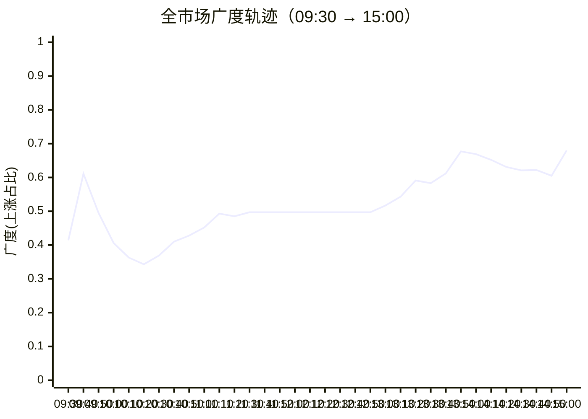

## 当日总览（截至 15:00）

> **结论**：全市场涨3540/跌1832（广度0.66）；涨停85/跌停1；中位涨幅+0.59%；局部修复。 钱在：手机游戏(涨停6/成分56，中位+2.02%)、网络游戏(涨停6/成分58，中位+1.68%)、F5G概念(涨停3/成分36，中位+2.98%)；零星涨停：低辐射玻璃(Low-E)(2)、可燃冰(1)、POE胶膜(2)、钛白粉概念(1)。 退潮：特色小镇(跌停1)、ST板块(跌停1)、旅游概念(跌停1)。 梯队：4板×2、3板×5、2板×12、1板×66，最高4板。 预案：超买区 锋龙股份、文投控股、慈文传媒、福莱新材、富瀚微；已触发 瑞芯微；未到价 掌阅科技、宇树科技、创维数字。 较上一轮广度基本持平。

> 🔒 **no_trade / 买入预算 0 / max_position_pct 0 —— 全部内容仅供研究，不授予交易权限。**

### 板块扩散

> 口径：XTick 概念成分 × 全市场实时报价；分母 = 板块内有有效报价的成分数。排序用涨停密度（涨停数/有效成分数），已剔除宽基属性板块（全市场 432 个板块中剔 16 个）。

**扩散中（题材，按涨停密度排序）**

| 板块 | 涨停 | 有效成分 | 涨停密度 | 上涨广度 | 中位涨幅 | 相对全市场 | 成交(亿) |
|---|---|---|---|---|---|---|---|
| 低辐射玻璃(Low-E) ⬦ | 2 | 12 | 0.167 | 0.75 | +0.38% | -0.21% | 19 |
| 手机游戏 | 6 | 56 | 0.107 | 0.79 | +2.02% | +1.43% | 473 |
| 网络游戏 | 6 | 58 | 0.103 | 0.71 | +1.68% | +1.09% | 483 |
| F5G概念 | 3 | 36 | 0.083 | 0.89 | +2.98% | +2.39% | 724 |
| 可燃冰 ⬦ | 1 | 14 | 0.071 | 0.57 | +1.13% | +0.54% | 30 |
| 光纤概念 | 8 | 116 | 0.069 | 0.84 | +2.80% | +2.21% | 1,404 |
| POE胶膜 ⬦ | 2 | 29 | 0.069 | 0.52 | +0.16% | -0.43% | 70 |
| 钛白粉概念 ⬦ | 1 | 15 | 0.067 | 0.67 | +1.17% | +0.58% | 24 |
| 减速器 | 9 | 140 | 0.064 | 0.76 | +1.67% | +1.08% | 568 |
| 富士康概念 | 7 | 110 | 0.064 | 0.86 | +2.90% | +2.31% | 756 |
| 英伟达概念 | 5 | 81 | 0.062 | 0.78 | +2.25% | +1.66% | 875 |
| 壳资源 | 3 | 51 | 0.059 | 0.76 | +0.98% | +0.39% | 74 |

> ⬦ = 涨停 <3 只，零星个例，不构成扩散（不计入「钱在」判定）。



零星涨停板块（<3 只）：低辐射玻璃(Low-E)(2)、可燃冰(1)、POE胶膜(2)、钛白粉概念(1)

**退潮中（跌停集中）**

| 板块 | 跌停 | 有效成分 | 上涨广度 | 中位涨幅 |
|---|---|---|---|---|
| 特色小镇 | 1 | 40 | 0.40 | +0.00% |
| ST板块 | 1 | 197 | 0.41 | +0.00% |
| 旅游概念 | 1 | 151 | 0.57 | +0.30% |
| 电子商务 | 1 | 676 | 0.57 | +0.34% |
| 跨境电商 | 1 | 346 | 0.62 | +0.46% |
| 福建自贸区 | 1 | 127 | 0.62 | +0.61% |
| 露营经济 | 1 | 55 | 0.64 | +0.72% |
| 海峡两岸 | 1 | 320 | 0.68 | +0.89% |
| 物业管理 | 1 | 183 | 0.69 | +0.74% |
| 创投 | 1 | 460 | 0.69 | +0.68% |

### 涨停梯队

> 最高 4 板 ｜ 涨停 85 ｜ 跌停 1 ｜ 炸板 19 ｜ 封板率 81.7% ｜ 打板成功率 20.00% ｜ 一进二 16.00% ｜ 二进三 33.33%

| 身位 | 家数 | 成员（涨幅/封单亿/首封） |
|---|---|---|
| 4板 | 2 | 日出东方 +10.02%/0.057亿/09:25；大东方 +9.93%/0.012亿/09:25 |
| 3板 | 5 | 亚玛顿 +10.00%/0.017亿/09:25；锋龙股份 +10.01%/0.015亿/09:30；文投控股 +10.18%/0.010亿/09:25；光洋股份 +10.01%/0.010亿/09:43；东方环宇 +10.00%/0.001亿/10:13 |
| 2板 | 12 | 达 意 隆 +10.01%/0.047亿/09:25；惠发食品 +10.03%/0.008亿/09:30；瀛通通讯 +9.98%/0.006亿/09:25；智微智能 +10.00%/0.006亿/10:34；凯撒文化 +10.06%/0.006亿/09:30 |
| 1板 | 66 | 东山精密 +10.00%/0.066亿/13:11；剑桥科技 +10.00%/0.042亿/09:34；源杰科技 +20.00%/0.027亿/14:08；沪电股份 +10.00%/0.026亿/13:13；光迅科技 +10.00%/0.022亿/13:46 |



炸板 19 只（前几）：厦工股份(4次)、尤夫股份(4次)、红旗连锁(3次)、大晟文化(3次)、峨眉山Ａ(3次)

### 预案池对照

| 票 | 池 | 板块 | 现价 | 涨幅 | 触发价 | 买区 | 风险位 | 判定 |
|---|---|---|---|---|---|---|---|---|
| 掌阅科技 `603533.SH` | 执行池 | AI内容/短剧游戏 | 31.57 | -3.75% | 32.91 | [32.75, 33.4] | 31.73 | **未到价** |
| 锋龙股份 `002931.SZ` | 执行池 | 具身智能/人形机器人 | 53.08 | +10.01% | 48.25 | [48.01, 48.97] | 46.52 | **超买区** |
| 文投控股 `600715.SH` | 观察池 | AI内容/短剧游戏 | 3.14 | +10.18% | 2.85 | [2.84, 2.89] | 2.75 | **超买区** |
| 慈文传媒 `002343.SZ` | 观察池 | AI内容/短剧游戏 | 9.7 | +3.97% | 9.33 | [9.28, 9.47] | 9.0 | **超买区** |
| 宇树科技 `688836.SH` | 观察池 | 具身智能/人形机器人 | 765.0 | +0.52% | 809.0 | [804.96, 821.13] | 755.44 | **未到价** |
| 福莱新材 `605488.SH` | 观察池 | 具身智能/人形机器人 | 63.03 | +10.00% | 57.3 | [57.01, 58.16] | 55.25 | **超买区** |
| 富瀚微 `300613.SZ` | 观察池 | 端侧AI/AI眼镜 | 85.46 | +6.80% | 80.02 | [79.62, 81.22] | 74.72 | **超买区** |
| 瑞芯微 `603893.SH` | 观察池 | 端侧AI/AI眼镜 | 235.01 | +0.78% | 233.2 | [232.03, 236.7] | 224.86 | **已触发** |
| 创维数字 `000810.SZ` | 观察池 | 端侧AI/AI眼镜 | 11.61 | -4.37% | 12.14 | [12.08, 12.32] | 11.7 | **未到价** |
| 闽发铝业 `002578.SZ` | 观察池 | 名字/东方/羊线情绪 | 6.08 | +0.33% | — | — | — | **无预案价** |
| 东方新能 `002310.SZ` | 观察池 | 名字/东方/羊线情绪 | 2.95 | +4.98% | — | — | — | **无预案价** |
| 日出东方 `603366.SH` | 观察池 | 名字/东方/羊线情绪 | 11.97 | +10.02% | — | — | — | **无预案价** |
| 大东方 `600327.SH` | 观察池 | 名字/东方/羊线情绪 | 6.53 | +9.93% | — | — | — | **无预案价** |
| 龙江交通 `601188.SH` | 观察池 | 名字/东方/羊线情绪 | 4.29 | -6.94% | — | — | — | **无预案价** |
| 光洋股份 `002708.SZ` | 观察池 | 名字/东方/羊线情绪 | 26.59 | +10.01% | — | — | — | **无预案价** |
| 顺灏股份 `002565.SZ` | 观察池 | 商业航天/太空光伏 | 10.6 | -6.11% | — | — | — | **无预案价** |
| 亚玛顿 `002623.SZ` | 观察池 | 商业航天/太空光伏 | 23.33 | +10.00% | — | — | — | **无预案价** |
| 奥比中光 `688322.SH` | 观察池 | 具身视觉事件补充 | 120.28 | +4.50% | — | — | — | **无预案价** |
| 永贵电器 `300351.SZ` | 观察池 | 轨交合同事件 | 12.65 | +2.10% | — | — | — | **无预案价** |
| 七匹狼 `002029.SZ` | 观察池 | 名字/东方/羊线情绪 | 9.13 | -4.20% | — | — | — | **无预案价** |
| 阳光乳业 `001318.SZ` | 观察池 | 名字/东方/羊线情绪 | 14.09 | -4.08% | — | — | — | **无预案价** |
| 合富中国 `603122.SH` | 观察池 | 名字/东方/羊线情绪 | 11.97 | +2.66% | — | — | — | **无预案价** |
| 炬华科技 `300360.SZ` | 观察池 | 红利资金温度计 | 11.38 | +0.00% | — | — | — | **无预案价** |
| 路维光电 `688401.SH` | 观察池 | 成长研究对照 | 50.16 | +2.64% | — | — | — | **无预案价** |

- **锋龙股份** — 现价53.08 已高于买区上沿48.97，不追高；仅价格位置对照，不代表完整入场条件确认；不能据此确认站稳，不授予下单权限
- **文投控股** — 现价3.14 已高于买区上沿2.89，不追高；仅价格位置对照，不代表完整入场条件确认；不能据此确认站稳，不授予下单权限
- **慈文传媒** — 现价9.7 已高于买区上沿9.47，不追高；仅价格位置对照，不代表完整入场条件确认；不能据此确认站稳，不授予下单权限
- **福莱新材** — 现价63.03 已高于买区上沿58.16，不追高；仅价格位置对照，不代表完整入场条件确认；不能据此确认站稳，不授予下单权限
- **富瀚微** — 现价85.46 已高于买区上沿81.22，不追高；仅价格位置对照，不代表完整入场条件确认；不能据此确认站稳，不授予下单权限
- **瑞芯微** — 现价235.01 ≥ 触发价233.2；仅价格位置对照，不代表完整入场条件确认；不能据此确认站稳，不授予下单权限

> ⚠ D1 明确 no_trade=true、买入预算 0、个股 max_position_pct=0。以上为研究对照，**不构成任何买入许可**。

### 盘面 vs 静态复盘 vs 消息面

| 维度 | 对象 | T-1 静态基线 | 今日盘面 | 关系 |
|---|---|---|---|---|
| 板块主线 | 名字/东方/羊线情绪 | R2 次线 score=None 涨停None（T-1 口径） | 盘面未见该板块成分票涨停 | **背离** |
| 板块主线 | 商业航天/太空光伏 | R2 次线 score=None 涨停None（T-1 口径） | 盘面未见该板块成分票涨停 | **背离** |
| 板块主线 | 具身视觉事件补充 | R2 次线 score=None 涨停None（T-1 口径） | 盘面未见该板块成分票涨停 | **背离** |
| 板块主线 | 轨交合同事件 | R2 次线 score=None 涨停None（T-1 口径） | 盘面未见该板块成分票涨停 | **背离** |
| 梯队结构 | 最高4板 | T-1 最高梯队 4 板、首板 29、炸板率 39.06% | 今日 4板×2、3板×5、2板×12、1板×66；封板率0.8173 炸板19只 | **印证** |
| 预案验证 | 掌阅科技(603533.SH) | 预案 AI内容/短剧游戏／core_midcap／触发价32.91／买区[32.75, 33.4] | 未到价：现价31.57，触发价32.91，还差4.24%；仅价格位置对照，不代表完整入场条件确认；不能据此确认站稳，不授予下单权限 | **无响应** |
| 预案验证 | 锋龙股份(002931.SZ) | 预案 具身智能/人形机器人／leader／触发价48.25／买区[48.01, 48.97] | 超买区：现价53.08 已高于买区上沿48.97，不追高；仅价格位置对照，不代表完整入场条件确认；不能据此确认站稳，不授予下单权限 | **背离** |
| 预案验证 | 文投控股(600715.SH) | 预案 AI内容/短剧游戏／watch／触发价2.85／买区[2.84, 2.89] | 超买区：现价3.14 已高于买区上沿2.89，不追高；仅价格位置对照，不代表完整入场条件确认；不能据此确认站稳，不授予下单权限 | **背离** |
| 预案验证 | 慈文传媒(002343.SZ) | 预案 AI内容/短剧游戏／watch／触发价9.33／买区[9.28, 9.47] | 超买区：现价9.7 已高于买区上沿9.47，不追高；仅价格位置对照，不代表完整入场条件确认；不能据此确认站稳，不授予下单权限 | **背离** |
| 预案验证 | 宇树科技(688836.SH) | 预案 具身智能/人形机器人／watch／触发价809.0／买区[804.96, 821.13] | 未到价：现价765.0，触发价809.0，还差5.75%；仅价格位置对照，不代表完整入场条件确认；不能据此确认站稳，不授予下单权限 | **无响应** |
| 预案验证 | 福莱新材(605488.SH) | 预案 具身智能/人形机器人／watch／触发价57.3／买区[57.01, 58.16] | 超买区：现价63.03 已高于买区上沿58.16，不追高；仅价格位置对照，不代表完整入场条件确认；不能据此确认站稳，不授予下单权限 | **背离** |
| 预案验证 | 富瀚微(300613.SZ) | 预案 端侧AI/AI眼镜／watch／触发价80.02／买区[79.62, 81.22] | 超买区：现价85.46 已高于买区上沿81.22，不追高；仅价格位置对照，不代表完整入场条件确认；不能据此确认站稳，不授予下单权限 | **背离** |
| 预案验证 | 瑞芯微(603893.SH) | 预案 端侧AI/AI眼镜／watch／触发价233.2／买区[232.03, 236.7] | 已触发：现价235.01 ≥ 触发价233.2；仅价格位置对照，不代表完整入场条件确认；不能据此确认站稳，不授予下单权限 | **印证** |
| 预案验证 | 创维数字(000810.SZ) | 预案 端侧AI/AI眼镜／watch／触发价12.14／买区[12.08, 12.32] | 未到价：现价11.61，触发价12.14，还差4.57%；仅价格位置对照，不代表完整入场条件确认；不能据此确认站稳，不授予下单权限 | **无响应** |
| 预案验证 | 闽发铝业(002578.SZ) | 预案 名字/东方/羊线情绪／watch／触发价None／买区None | 无预案价：预案未给有效入场触发价/完整买区（缺失、空规则或格式异常）；仅价格位置对照，不代表完整入场条件确认；不能据此确认站稳，不授予下单权限 | **无响应** |
| 预案验证 | 东方新能(002310.SZ) | 预案 名字/东方/羊线情绪／watch／触发价None／买区None | 无预案价：预案未给有效入场触发价/完整买区（缺失、空规则或格式异常）；仅价格位置对照，不代表完整入场条件确认；不能据此确认站稳，不授予下单权限 | **无响应** |
| 预案验证 | 日出东方(603366.SH) | 预案 名字/东方/羊线情绪／watch／触发价None／买区None | 无预案价：预案未给有效入场触发价/完整买区（缺失、空规则或格式异常）；仅价格位置对照，不代表完整入场条件确认；不能据此确认站稳，不授予下单权限 | **无响应** |
| 预案验证 | 大东方(600327.SH) | 预案 名字/东方/羊线情绪／watch／触发价None／买区None | 无预案价：预案未给有效入场触发价/完整买区（缺失、空规则或格式异常）；仅价格位置对照，不代表完整入场条件确认；不能据此确认站稳，不授予下单权限 | **无响应** |
| 预案验证 | 龙江交通(601188.SH) | 预案 名字/东方/羊线情绪／watch／触发价None／买区None | 无预案价：预案未给有效入场触发价/完整买区（缺失、空规则或格式异常）；仅价格位置对照，不代表完整入场条件确认；不能据此确认站稳，不授予下单权限 | **无响应** |
| 预案验证 | 光洋股份(002708.SZ) | 预案 名字/东方/羊线情绪／watch／触发价None／买区None | 无预案价：预案未给有效入场触发价/完整买区（缺失、空规则或格式异常）；仅价格位置对照，不代表完整入场条件确认；不能据此确认站稳，不授予下单权限 | **无响应** |
| 预案验证 | 顺灏股份(002565.SZ) | 预案 商业航天/太空光伏／watch／触发价None／买区None | 无预案价：预案未给有效入场触发价/完整买区（缺失、空规则或格式异常）；仅价格位置对照，不代表完整入场条件确认；不能据此确认站稳，不授予下单权限 | **无响应** |
| 预案验证 | 亚玛顿(002623.SZ) | 预案 商业航天/太空光伏／watch／触发价None／买区None | 无预案价：预案未给有效入场触发价/完整买区（缺失、空规则或格式异常）；仅价格位置对照，不代表完整入场条件确认；不能据此确认站稳，不授予下单权限 | **无响应** |
| 预案验证 | 奥比中光(688322.SH) | 预案 具身视觉事件补充／watch／触发价None／买区None | 无预案价：预案未给有效入场触发价/完整买区（缺失、空规则或格式异常）；仅价格位置对照，不代表完整入场条件确认；不能据此确认站稳，不授予下单权限 | **无响应** |
| 预案验证 | 永贵电器(300351.SZ) | 预案 轨交合同事件／watch／触发价None／买区None | 无预案价：预案未给有效入场触发价/完整买区（缺失、空规则或格式异常）；仅价格位置对照，不代表完整入场条件确认；不能据此确认站稳，不授予下单权限 | **无响应** |
| 预案验证 | 七匹狼(002029.SZ) | 预案 名字/东方/羊线情绪／watch／触发价None／买区None | 无预案价：预案未给有效入场触发价/完整买区（缺失、空规则或格式异常）；仅价格位置对照，不代表完整入场条件确认；不能据此确认站稳，不授予下单权限 | **无响应** |
| 预案验证 | 阳光乳业(001318.SZ) | 预案 名字/东方/羊线情绪／watch／触发价None／买区None | 无预案价：预案未给有效入场触发价/完整买区（缺失、空规则或格式异常）；仅价格位置对照，不代表完整入场条件确认；不能据此确认站稳，不授予下单权限 | **无响应** |
| 预案验证 | 合富中国(603122.SH) | 预案 名字/东方/羊线情绪／watch／触发价None／买区None | 无预案价：预案未给有效入场触发价/完整买区（缺失、空规则或格式异常）；仅价格位置对照，不代表完整入场条件确认；不能据此确认站稳，不授予下单权限 | **无响应** |
| 预案验证 | 炬华科技(300360.SZ) | 预案 红利资金温度计／watch／触发价None／买区None | 无预案价：预案未给有效入场触发价/完整买区（缺失、空规则或格式异常）；仅价格位置对照，不代表完整入场条件确认；不能据此确认站稳，不授予下单权限 | **无响应** |
| 预案验证 | 路维光电(688401.SH) | 预案 成长研究对照／watch／触发价None／买区None | 无预案价：预案未给有效入场触发价/完整买区（缺失、空规则或格式异常）；仅价格位置对照，不代表完整入场条件确认；不能据此确认站稳，不授予下单权限 | **无响应** |
| 消息面对照 | 盘面热点板块 | R4 消息面（T-1 口径） | 实时快讯中命中热点板块关键词 1 条 | **印证** |

**分歧点（不掩盖）：**
- 板块主线·名字/东方/羊线情绪 → 背离：T-1 有辨识度但今日盘中无涨停响应，题材未获资金确认
- 板块主线·商业航天/太空光伏 → 背离：T-1 有辨识度但今日盘中无涨停响应，题材未获资金确认
- 板块主线·具身视觉事件补充 → 背离：T-1 有辨识度但今日盘中无涨停响应，题材未获资金确认
- 板块主线·轨交合同事件 → 背离：T-1 有辨识度但今日盘中无涨停响应，题材未获资金确认
- 预案验证·锋龙股份(002931.SZ) → 背离：仅研究对照，不授予交易权限
- 预案验证·文投控股(600715.SH) → 背离：仅研究对照，不授予交易权限
- 预案验证·慈文传媒(002343.SZ) → 背离：仅研究对照，不授予交易权限
- 预案验证·福莱新材(605488.SH) → 背离：仅研究对照，不授予交易权限
- 预案验证·富瀚微(300613.SZ) → 背离：仅研究对照，不授予交易权限

### 全天广度轨迹

| 时点 | 涨 | 跌 | 广度 | 涨停 | 跌停 | 成交(亿) | 有效样本 |
|---|---|---|---|---|---|---|---|
| 0930 | 2304 | 2718 | 0.414 | 13 | 1 | 579 | 5558 |
| 0940 | 3404 | 1790 | 0.611 | 31 | 1 | 2,517 | 5574 |
| 0950 | 2757 | 2446 | 0.495 | 37 | 1 | 3,767 | 5574 |
| 1000 | 2260 | 2996 | 0.406 | 33 | 1 | 4,763 | 5574 |
| 1010 | 2023 | 3304 | 0.363 | 37 | 1 | 5,639 | 5574 |
| 1020 | 1912 | 3422 | 0.343 | 39 | 1 | 6,342 | 5574 |
| 1030 | 2056 | 3273 | 0.369 | 43 | 1 | 6,836 | 5574 |
| 1040 | 2285 | 3060 | 0.410 | 43 | 1 | 7,366 | 5574 |
| 1050 | 2386 | 2968 | 0.428 | 45 | 1 | 7,796 | 5574 |
| 1100 | 2518 | 2833 | 0.452 | 44 | 1 | 8,125 | 5574 |
| 1110 | 2748 | 2606 | 0.493 | 46 | 1 | 8,501 | 5574 |
| 1120 | 2701 | 2648 | 0.485 | 49 | 1 | 8,972 | 5574 |
| 1130 | 2771 | 2583 | 0.497 | 51 | 1 | 9,353 | 5574 |
| 1140 | 2771 | 2583 | 0.497 | 51 | 1 | 9,353 | 5574 |
| 1150 | 2771 | 2583 | 0.497 | 51 | 1 | 9,353 | 5574 |
| 1200 | 2771 | 2583 | 0.497 | 51 | 1 | 9,353 | 5574 |
| 1210 | 2771 | 2583 | 0.497 | 51 | 1 | 9,353 | 5574 |
| 1220 | 2771 | 2583 | 0.497 | 51 | 1 | 9,353 | 5574 |
| 1230 | 2771 | 2583 | 0.497 | 51 | 1 | 9,353 | 5574 |
| 1240 | 2771 | 2583 | 0.497 | 51 | 1 | 9,353 | 5574 |
| 1250 | 2771 | 2583 | 0.497 | 51 | 1 | 9,353 | 5574 |
| 1300 | 2880 | 2479 | 0.517 | 52 | 1 | 9,475 | 5574 |
| 1310 | 3025 | 2338 | 0.543 | 55 | 1 | 10,097 | 5574 |
| 1320 | 3295 | 2053 | 0.591 | 57 | 1 | 10,864 | 5574 |
| 1330 | 3247 | 2093 | 0.583 | 63 | 1 | 11,399 | 5574 |
| 1340 | 3409 | 1965 | 0.612 | 64 | 1 | 11,835 | 5574 |
| 1350 | 3775 | 1570 | 0.677 | 76 | 1 | 12,636 | 5574 |
| 1400 | 3731 | 1619 | 0.669 | 78 | 1 | 13,198 | 5574 |
| 1410 | 3632 | 1709 | 0.652 | 78 | 2 | 13,751 | 5574 |
| 1420 | 3515 | 1840 | 0.631 | 80 | 1 | 14,336 | 5574 |
| 1430 | 3459 | 1871 | 0.621 | 82 | 1 | 14,837 | 5574 |
| 1440 | 3466 | 1893 | 0.622 | 83 | 1 | 15,391 | 5574 |
| 1450 | 3373 | 1961 | 0.605 | 83 | 3 | 16,070 | 5574 |
| 1500 | 1973 | 816 | 0.680 | 51 | 3 | 9,401 | 2903 |

> ⚠ **数据冻结段**：1130–1250 数值连续完全一致，说明行情源未刷新，**不是市场横盘**，该段不可解读为盘面变化。

> ⚠ **分母变化**：1500（5574→2903） 有效样本变动超 15%，该时点广度与前后不可直接比较（数据降级）。



### 观察建议（仅研究）

- **环境**：涨停 85.0 / 跌停 1.0，打板成功率 20.0%，一进二 16.0%。
- **方向**：今日形成实质扩散的是 手机游戏（涨停6/成分56，密度0.107，中位+2.02%）、网络游戏（涨停6/成分58，密度0.103，中位+1.68%）、F5G概念（涨停3/成分36，密度0.083，中位+2.98%）。**需确认**：次日能否维持涨停家数且中位涨幅不掉队，否则只是普跌中的避险轮动。
- **零星**：低辐射玻璃(Low-E)(2只/12成分)、可燃冰(1只/14成分)、POE胶膜(2只/29成分)、钛白粉概念(1只/15成分) 属零星个例，不视为题材，不据此选股。
- **回避**：特色小镇（跌停1）、ST板块（跌停1）、旅游概念（跌停1） 板块中位跌幅深，趋势未止跌前不接。
- **身位**：最高 4 板。梯队有高度不等于可接力，需逐票核验封单稳定性与开板次数后再定。
- **预案**：锋龙股份（现价53.08 已高于买区上沿48.97，不追高；仅价格位置对照，不代表完整入场条件确认；不能据此确认站稳，不授予下单权限）、文投控股（现价3.14 已高于买区上沿2.89，不追高；仅价格位置对照，不代表完整入场条件确认；不能据此确认站稳，不授予下单权限）、慈文传媒（现价9.7 已高于买区上沿9.47，不追高；仅价格位置对照，不代表完整入场条件确认；不能据此确认站稳，不授予下单权限）、福莱新材（现价63.03 已高于买区上沿58.16，不追高；仅价格位置对照，不代表完整入场条件确认；不能据此确认站稳，不授予下单权限）、富瀚微（现价85.46 已高于买区上沿81.22，不追高；仅价格位置对照，不代表完整入场条件确认；不能据此确认站稳，不授予下单权限）。买区已错过，**不追高**；要参与需等新剧本，不能沿用原预案价位。
- **预案待检验**：掌阅科技(触发价32.91，还差+4.24%)、宇树科技(触发价809，还差+5.75%)、创维数字(触发价12.14，还差+4.57%) 尚未触及触发价，剧本未被盘面检验，继续按原失效条件看。

<details>
<summary>原始截面与数据质量（折叠）</summary>

**跨源校验**

```json
{
  "xtick": {
    "up": 3540,
    "down": 1832,
    "n": 5585,
    "amount_yi": 16760.7
  },
  "rtk_snapshot": {
    "up": 1973,
    "down": 816,
    "valid_n": 2903,
    "amount_yi": 9400.8,
    "up_limit": 51,
    "down_limit": 3
  },
  "note": "两源口径不同（XTick 全市场含全部票；rt_k 返回样本）"
}
```

**rt_k 截面（原始）**

```json
{
  "market": {
    "total": 5584,
    "up": 1973,
    "down": 816,
    "flat": 114,
    "requested_n": 5584,
    "received_n": 5584,
    "valid_n": 2903,
    "missing_n": 2681,
    "universe_requested_n": null,
    "population_scope": "returned_rows_not_verified_all_a_universe",
    "up_ratio": 0.3533,
    "legacy_up_ratio_placeholder": false,
    "up_ratio_is_observed": true,
    "up_ratio_all": 0.3533,
    "up_ratio_valid": 0.6796,
    "up_ratio_denominator": "requested_n",
    "degraded": true,
    "limit_known_n": 2903,
    "limit_unknown_n": 0,
    "limit_counts_complete": true,
    "limit_source_errors": [],
    "up_gt3": 525,
    "up_gt5": 222,
    "up_limit": 51,
    "down_gt3": 71,
    "down_gt5": 22,
    "down_limit": 3,
    "amount_yi": 9400.8,
    "amount_sum_overflow": false,
    "amount_valid_n": 2903,
    "amount_missing_n": 0
  },
  "source_time_quality": {
    "quote_age_min_seconds": 44.810408,
    "quote_age_max_seconds": 44.810408,
    "source_age_limit_seconds": null,
    "freshness_status": "age_limit_not_configured",
    "age_reference_at": "2026-11-11T15:00:44.810408+08:00"
  },
  "trading_authorized": false
}
```

</details>

## 分时研判记录

### 09:35 研判增量
- **趋势**：开盘先看到的是“部分高度延续、容量承接不足”，尚不能认定昨日修复正在全面延续。依据为2026-11-11首份09:30分析（09:30:57生成）；没有上一轮，顶部“较上一轮广度基本持平”没有比较依据。配套rt_k报价时标为09:30:15—09:30:54，有效返回样本上涨2304/5558，即41.45%；顶部约0.45用的是另一源上涨数除以上涨与下跌之和，不能混作同口径趋势。未核上市名录，不宣称无遗漏全A覆盖；XTick逐票报价时标未附，本文不是09:35实时核价。预案记载昨日七板最高标，而自动对照写“T-1最高四板”，基线存在冲突，不据此判断高度升降；今日最高已封梯队四板也不等于更高身位个股已经收盘断板。
- **轮动**：顶部“无形成扩散的题材”不能直接沿用：同份分析完整板块集里，智能制造涨停5/459、上涨广度53.16%，新型工业化3/292、61.64%，光伏概念5/602、50.66%；相较之下，短剧游戏仅1/99涨停、上涨广度26.26%、中位涨幅-0.35%，更像内容高度股孤立，而非整条内容线共振。概念成员可能重叠，不能相加成独立涨停数，更不能把制造标签直接当作人形机器人资金确认。名字线已有日出东方、大东方四板，亚玛顿已有三板，与自动对照“名字线/航天光伏无涨停响应”矛盾：应改判为部分观察核心有响应、整条线及产业催化未确认，而不是全线无响应。只有首个截面，以上是横向强弱差，尚不能证明资金从内容流向制造/光伏的跷跷板；实时快讯关键词未匹配，也不等于催化不存在，亚玛顿上涨不证明预案已警示的外部合同归属于它。
- **剧本**：掌阅科技31.98尚低于原买区下沿32.75及触发价32.91；文投三板而容量核心未跟上，原“内容容量接力”只是未获确认，不能因高度股涨停就宣布兑现，也不能仅凭掌阅水下把原剧本判死。锋龙股份53.00已超过原上沿48.97，且炸板记录3次；价格强不等于预案所需的可成交换手承接，原买点当前不可用，不抬价追、不因执行候选买不到而递补福莱等观察票。端侧替代剧本也未成立：瑞芯微232.44虽在[232.03,236.70]内，却尚低于233.20触发价，预案另保留233.88图证压力冲突，必须复核，不能把“买区内”写成已突破。原候选有效期写至今日09:30，后续只能作为待重新评估的研究锚；本轮不续期、不改池、不改买权。
- **下一步看**：以本轮为基线，后续有效样本口径可比时，检验广度是否高于41.45%、涨停是否超过13，并与炸板3只的变化合看；若涨停增加而广度下降，按强势集中而非普涨解释。制造/光伏需检验涨停家数与各自广度是否同步维持或提高；内容需从1/99的孤立涨停走向至少3只，并伴随广度较26.26%回升，才有扩散的初步证据，这只是研究观察条件。掌阅须越过32.91且不超过原上沿33.40，并取得量价路径与板块承接证据；文投若开板且内容同步走弱，按原取消条件重评。锋龙重点看炸板次数是否继续增加、容量对照是否同步走弱，不以单次价格截面声称回封或站稳。瑞芯微须验证233.20能否持续收复并处理233.88图证冲突，单次越线不算替代剧本成立。**维持本任务的禁新仓约束：no_trade=true、买入预算0、max_position_pct=0；全部仅供研究，不构成任何买入许可。**

### 09:45 研判增量
- **趋势**：新增信号是“首板、二板扩散，内容容量却逆势掉队”，不再只是开盘高度股孤立。依据2026-11-11的09:40分析（09:40:55生成），对比09:30；不是09:45实时核价。涨停13→31，首板5→19、二板4→7，已封最高身位仍四板，改善主要在梯队底部。有效返回样本上涨2304/5558→3404/5574，分别为41.45%与61.07%；分母及有效成员未完全一致，不硬算精确广度增量，另一源相同5585条返回样本的上涨数也由2269增至3383，方向支持修复。当前开板未封家数3→0不等于全天没有炸板：大东方累计开板1→2次、文投0→3次，不能把顶部100%封板率理解成接力无风险。
- **轮动**：完整板块集显示，智能制造涨停5→8/459、上涨244→332/459；光伏5→8/602、上涨305→421/602，原扩散方向继续增强。新出现的航天响应更值得补入观察：商业航天涨停0→3/507、上涨237→339/507；09:40:47快讯提到上海港湾、神开股份触板，梯队同时出现上海港湾二板、神开及飞亚达首板，说明预案航天观察线开始获盘面响应，不能沿用自动对照的“全线无响应”。这只是盘口报道与行情相互印证，不是新增产业订单验证。反面是短剧游戏上涨26→23/99，中位涨幅-0.35%→-0.75%，在大盘修复中反而失血；内容与制造/光伏/航天有相对轮动迹象，但缺板块净流量与连续路径，尚不能断言直接资金跷跷板。各概念成员可能重叠，不相加统计。
- **剧本**：掌阅科技31.98→31.55，离32.91触发价更远；结合短剧游戏整体走弱，原“内容容量接力”比上一轮更不获支持，不能用文投仍在三板代替容量确认。锋龙从开板未封名单进入三板封板梯队，但53.08仍超原买区上沿48.97，只改善高度反馈，没有恢复原买点，不追、不递补观察票。唯一价格判定迁移是瑞芯微：232.44→235.49，由“买区内但未触发”变为越过233.20，也高于预案图证争议锚233.88，且未超过236.70上沿；端侧替代剧本因此多了一项价格证据，但单个截面不能证明持续站稳，图证冲突也未因此自动解除。AI眼镜仅1/194涨停、上涨115/194，尚不足板块级共振；创维仍未到12.14。原候选09:30有效期已过，以上只重评研究锚，不续期、不改池、不恢复买权。
- **下一步看**：下一份可比截面先检验31只涨停、19只首板能否保持或增加，并与有效样本广度同向；涨停增加而广度回落，只算强势集中。航天以3/507涨停、339/507上涨，制造以8/459涨停、332/459上涨作为本轮基线，涨停与广度同步延续才支持扩散持续；跌回基线以下则重评，不凭一只旧核心走弱否定整线。内容须先扭转23/99上涨的收缩，再检验掌阅能否越过32.91且不超过33.40，并补齐量价承接路径；瑞芯微须持续守住233.88且不越236.70，跌回233.20以下则撤回“当前已越触发价”的描述，不下移条件。以上均为验证条件，不是委托建议；**no_trade=true、买入预算0、max_position_pct=0保持不变，全部仅供研究，不构成任何买入许可。**

### 09:55 研判增量
- **趋势**：09:40的修复扩散，转为“涨停增加、普通股回落”的强弱分化。依据2026-11-11最新09:50分析（09:50:54生成），不是09:55实时核价；配套报价时标09:49:57—09:50:51，采集09:50:41—09:50:52。有效返回样本分母均为5574，上涨3404→2757，广度61.07%→49.46%，回落11.61个百分点；顶部0.54采用另一分母，不混用，上市名录覆盖仍未核。涨停31→37、首板19→25，但二板7→6、最高已封身位仍四板，开板未封0→6、封板率100%→86.05%：新增首板没有带来整体承接同步改善。文投仍在三板封板组，但累计开板3→8次，同价不等于风险不变；这更支持盘前“防先手兑现”，不支持继续按全面修复外推。
- **轮动**：完整板块集里，智能制造涨停8→9/459，人形机器人2→3/482，但上涨成分分别332→307、336→316，是前排增强、后排收缩。密度排名靠前的建筑节能涨停3→4/104、装配式建筑1→4/109，上涨成分却72→63、68→55，尤其装配式中位涨幅0.37%→0.06%，不能把排名上升解释成整板资金涌入。上轮航天走高快讯的延续受到反证：商业航天涨停3→2/507、上涨339→299，上海港湾从二板封板组进入开板未封组，涨幅7.92%；这是局部承接减弱，不是一只旧龙否定全线。端侧相对改善：AI眼镜涨停1→2/194、上涨115→120；内容继续失血，短剧游戏上涨23→21/99、中位涨幅-0.75%→-1.15%。可提出“内容弱、制造前排及端侧相对承接”的轮动假设，但没有板块净流量证据，不能确认直接跷跷板；概念重叠不相加，本轮快讯样本也未补齐这些方向的直接产业催化，三方尚未一致。
- **剧本**：24只预案对象中，唯一价格判定迁移是慈文传媒9.66→9.44，由“超买区”退回[9.28,9.47]且仍高于9.33触发价；结合内容板块继续走弱，这是回落进入旧区间，不是新突破确认，更不能替代掌阅的容量地位。掌阅31.55→31.40，仍低于32.91，原内容容量接力继续不获支持；文投反复开板使高度与容量脱节更突出，但截至本截面仍封板，不能写成已收盘断板。光洋新增三板，为机器人高度增加助攻，不等于自动夺龙或获得买权；锋龙仍在53.08、超原上沿48.97，原买点没有恢复，不追高。瑞芯微235.49→235.54、仍高于233.20，只说明两个截面保有价格响应；AI眼镜尚仅两只涨停，且锋龙高度并未同步走弱，预案“原双线弱后切端侧”的前提未齐，不能宣布替代剧本启动。原候选09:30有效期及233.88图证冲突仍待重评，本轮不续期、不改池。
- **下一步看**：后续同口径先检验广度能否从49.46%回升，并与37只涨停、6只开板未封共同观察；涨停再增而广度继续降、开板未封继续增，就维持强势集中判断。人形机器人须保住3/482涨停且上涨成分从316回升，才增加扩散证据；航天须恢复上轮3/507涨停及339/507上涨，并核上海港湾重新封板的真实路径，才考虑收回本轮减弱判断。慈文若跌回9.33以下，撤回“当前已越触发价”描述，不下移买区；即使留在9.33—9.47，也须内容广度扭转21/99的收缩，不能只看价到。瑞芯微继续核233.88的承接路径及236.70上沿，跌回233.20以下则价格响应撤回；两次截面不能代替持续站稳。**no_trade=true、买入预算0、max_position_pct=0保持不变，以上全部仅供研究，不构成任何买入许可。**

### 10:05 研判增量
- **趋势**：从“涨停增加、普通股回落”进一步转为广度与封板同步收缩，修复的支撑层正在变薄。依据2026-11-11的10:00分析（10:00:59生成），对比09:50，不是10:05实时核价。rt_k有效返回样本同为5574，上涨2757→2260，广度49.46%→40.55%，按原始计数回落8.92个百分点，涨停37→33；另一源XTick涨停37→32、首板25→22、三板4→2，开板未封6→15，封板率86.05%→68.09%。两源涨停不混算；最高仍四板，不足以抵消中层和首板一起收缩。两轮analysis均errors=[]；今日预案仍是degraded的partial研究版本，不把资料降级当作市场零值。
- **轮动**：完整概念集显示，智能制造涨停9→8/459、上涨307→247；人形机器人3→2/482、上涨316→268，中位涨幅+0.47%→+0.21%。高度助攻与整体承接同时减弱，但多数成分仍上涨，不能只凭光洋开板宣布整线退潮。商业航天上涨299→199/507、中位+0.23%→-0.22%，弱化已不限于上轮上海港湾一票。新增相对强弱对照是CPO与PCB：上涨分别196→171/230、189→162/241，中位仍为+0.97%、+0.68%，但涨停仅2只与0只，都不是扩散增强。09:59:22的PCB走强快讯与相对韧性相符，却不能覆盖广度收缩，更不是新增产业订单证据；缺板块净流量，不能断言资金由旧主线流入它们，重叠概念也不相加。
- **剧本**：慈文9.44→9.29，虽仍在[9.28,9.47]，却已低于9.33，上一轮“当前越过触发价”的价格响应应撤回，不是回踩买点自动成立。掌阅31.40→31.20仍未到32.91；短剧游戏上涨21→19/99、涨停1→0，内容容量接力再添反证。文投从三板封板组进入开板未封组，累计开板8→10次；报价3.12与榜内仍记+10.18%不一致，按两源不同截面处理，不凭涨幅称已回封，也不写成收盘断板。光洋同样由三板封板转开板未封、累计开板0→2次，锋龙高度助攻减少；锋龙53.08仍超48.97，不恢复旧买点、不追高。端侧也不能机械接棒：AI眼镜涨停2→1/194、上涨120→98，瑞芯微235.54→234.85虽仍高于233.20，但目标板块同步弱化，原双线分歧加重不等于替代剧本成立。
- **下一步看**：先检验同口径广度能否从40.55%回升、向上一轮49.46%修复，同时开板未封较15只减少、三板助攻恢复；只有高度不变而广度继续下降，仍按承接收缩看。机器人若恢复3/482涨停，须与上涨成分较268回升及光洋真实回封路径一起核验，不能只看锋龙。慈文重越9.33且不超9.47，还须内容上涨成分扭转19/99的收缩；瑞芯微仍按233.20、233.88图证争议锚及236.70上沿核验，补齐连续量价路径和板块承接前不升级。当前只有相邻截面，不能倒推持续站稳。原候选09:30有效期不续、不改池；**no_trade=true、买入预算0、max_position_pct=0保持不变，全部仅供研究，不构成任何买入许可，watch/execution名称不授予交易权。**

### 10:15 研判增量
- **趋势**：新增分歧是“封板端止缩，普通股继续下探”，不能把涨停恢复当成整体拐点。依据2026-11-11的10:10分析（10:10:53生成），对比10:00；配套rt_k采集10:10:41—10:10:51、报价10:09:21—10:10:48，不是10:15实时核价，XTick逐票时标未附。rt_k有效返回样本同为5574，上涨2260→2023，广度40.55%→36.29%，回落4.25个百分点；同源涨停33→37。XTick则为涨停32→37、首板22→26、三板2→3，最高仍四板，开板未封仍15只：封板修复尚未带动广度或开板风险改善，整体仍是强势集中，不混用两源分母。
- **轮动**：上轮机器人减弱不能继续直线外推：完整板块集中，人形机器人涨停2→4/482、上涨268→273/482；减速器涨停2→4/140、上涨75→82/140，中位涨幅0.14%→0.39%，出现逆市场的局部扩散。智能制造虽涨停8→9/459，上涨却247→239/459，不能用大制造标签掩盖内部差异，也不能沿用顶部“全市场无扩散”的结论。反面是短剧游戏上涨19→17/99、仍无涨停，商业航天上涨199→174/507、涨停仍2只，内容与航天继续失血。新增10:10燃气拉升快讯与胜通能源首板相符，但天然气仅2/167涨停、上涨80/167，只列新观察，不升级主线。概念重叠不相加；本轮消息样本没有补齐机器人新增产业催化，也无板块净流量证据，局部承接不等于已证实资金直接跷跷板。
- **剧本**：24只对象唯一价格判定迁移是慈文9.29→9.18，由“买区内”退至原下沿9.28以下；这是前轮触发响应撤回后的进一步走弱，不下移买区解释成新机会。掌阅31.20→31.25虽略回升，但内容整体更弱、仍未到32.91，原容量接力没有恢复。机器人主剧本获得部分盘面印证：光洋从开板未封组回到三板封板组，为锋龙补回高度助攻；只证明本截面状态，不证明持续封稳或新的产业兑现。锋龙仍超原上沿48.97，板块转强没有恢复旧买点，不追高。端侧替代反而缺承接：瑞芯微234.85→234.40仍越233.20，但AI眼镜上涨98→84/194，涨停1→2也只是前排增加、后排转弱；机器人局部回强，更不能机械套用“原双线同弱后切端侧”。
- **下一步看**：整体先检验同口径广度能否收回10:00的40.55%，并与开板未封较15只减少共同出现；涨停再增而广度再降，仍按集中而非普涨。局部看机器人能否保持4/482涨停且上涨成分较273增加、减速器保持4/140涨停且上涨成分较82增加，并补核光洋封板持续性；若助攻重新开板、板块广度回落，本轮回强只能算局部回摆。慈文须先重返9.28、再越9.33且不超9.47，并伴内容上涨成分扭转17/99的收缩，才重新讨论原研究条件；瑞芯微若跌回233.20以下，撤回当前触发描述，未补板块承接与233.88图证争议锚的路径核验前，不升级替代剧本。原候选09:30有效期不续、不改池；**no_trade=true、买入预算0、max_position_pct=0保持不变，全部仅供研究，不构成任何买入许可。**

### 10:25 研判增量
- **趋势**：新增信号是“高度修补继续，承接面继续收缩”，还不是整体拐点。依据2026-11-11的10:20分析（10:20:55生成），对比10:10；配套rt_k采集10:20:42—10:20:54、报价10:20:09—10:20:51，不是10:25实时核价，XTick逐票时标未附。有效返回样本同为5574，上涨2023→1912，广度36.29%→34.30%，再降1.99个百分点，并非顶部所写“基本持平”；上市名录覆盖仍未核。涨停37→39，三板3→4、首板26→27，最高仍四板、开板未封仍15只：梯队补回一层助攻，却没有带动普通股转强，更符合盘前“修复后防先手兑现”，不是全面修复延续。
- **轮动**：上轮机器人局部回强未能继续扩散：人形机器人涨停仍4/482，上涨273→236/482、中位涨幅0.27%→0%；减速器涨停仍4/140，上涨82→75/140。前排还在，后排已缩，不能把上一轮改善直线外推。天然气由2→3/167涨停，首次达到本任务的涨停家数观察门槛，但上涨80→76/167、中位仍0%，是新增封板而非整板扩散增强；它与上一轮10:10燃气拉升快讯相互印证，只证明盘口响应，不是新增产业订单。商业航天上涨174→139/507、涨停仍2只，仍未见接棒。以上只能提出资金更集中于少量前排的假设；缺板块净流量，不确认机器人向燃气的直接跷跷板，重叠概念不相加。
- **剧本**：24只对象唯一价格判定迁移是瑞芯微234.40→231.85，从“已触发”退为“未到价”，同时跌破原触发价233.20及买区下沿232.03；上一轮要求撤回触发描述的条件已经出现。AI眼镜上涨84→65/194、涨停仍2只，端侧替代剧本的个股与板块承接同时减弱，不能因原双线分歧就机械切换。内容则只修高度、不修容量：文投从开板未封组回到三板封板组，价格3.09→3.14，但累计开板仍记10次，不能据此称持续封稳；掌阅31.25→30.83、短剧游戏上涨17→13/99、中位-1.44%→-1.75%，原“内容容量接力”仍缺确认。锋龙仍超原上沿48.97，板块前排维持没有恢复旧买点，不追高、不递补观察票；也不拿风险参考位直接把未触发对象判死。
- **下一步看**：整体先检验同口径广度能否收回10:10的36.29%，并与开板未封较15只减少共同发生；仅涨停超过39只而广度继续下降，仍是集中而非普涨。机器人须在维持4/482涨停的同时，把上涨成分恢复至273附近或更高；天然气须保住3/167涨停并扭转上涨成分低于上轮80只的状态，才增加扩散持续的证据，这些只是既有截面的研究比较锚。瑞芯微须重新越过233.20，并核233.88图证争议锚、原上沿236.70及板块承接路径，不能下移买区接弱；掌阅仍须收复32.91且不超33.40，并伴内容广度改善，文投单独封板不够。原候选09:30有效期不续、不改池；**no_trade=true、买入预算0、max_position_pct=0保持不变，全部仅供研究，不构成任何买入许可。**

### 10:35 研判增量
- **趋势**：连续收缩后，首次出现一轮“广度与封板同步回补”，上一轮要求的广度收回36.29%、开板未封少于15只已同时出现，但只够确认局部反抽。依据2026-11-11的10:30分析，对比10:20；rt_k采集10:30:42—10:30:54、报价10:29:30—10:30:51，不是10:35实时核价，XTick逐票时标未附。有效返回样本同为5574，上涨1912→2056，广度34.30%→36.89%，回升2.58个百分点；涨停39→43，开板未封15→12。最高仍四板，三板4→5主要新增东方环宇重回封板组，其累计开板2→3次，不是市场高度抬升，也不能据此称封稳；广度仍低于10:00的40.55%，不把这一轮反抽写成全面转强。
- **轮动**：天然气开始从“只加封板”走向承接面同步改善：涨停3→4/167、上涨76→85/167，已超过上一轮观察锚80只；机器人涨停仍4/482、上涨236→261/482，减速器仍4/140、上涨75→83/140，说明机器人与燃气本轮同修，不支持“机器人失血、燃气接棒”的直接跷跷板说法。逆向走弱的是减肥药，上涨14→7/67、中位跌幅-0.66%→-0.88%。NFT虽涨停2→3/70、密度排名进入前排，但上涨仅19/70、中位-0.77%，只是少数前排修复，不能照顶部“钱在NFT”直接认定主线。概念重叠不相加；缺板块净流量，本轮快讯样本也未补齐机器人或燃气新增产业催化，只确认盘口改善，不外推资金因果与业绩兑现。
- **剧本**：24只对象新增两项价格判定迁移。慈文9.19→9.36，重新越过9.33且处于原[9.28,9.47]；但短剧游戏上涨虽13→20/99，涨停仍仅1只，掌阅30.83→31.29仍未到32.91，所以恢复的是观察票价格响应，不是原“掌阅容量接力”兑现，更不替换原核心。瑞芯微231.85→232.50仅重返[232.03,236.70]，仍低于233.20，不能把“买区内”写成已突破；AI眼镜上涨65→75/194、涨停仍2只，端侧替代的独立承接仍未齐。锋龙高度与机器人后排同修，但其价格仍超原上沿48.97，板块改善没有恢复旧买点，不追高。
- **下一步看**：整体检验36.89%的同口径广度能否延续并收回40.55%，同时43只涨停不回落、12只开板未封不反增；若广度重新掉回34.30%附近，就撤回本轮承接改善的延续假设。天然气以4/167涨停、85/167上涨为新比较锚；机器人须保住4/482涨停，并继续向10:10的273只上涨成分恢复，而非只有锋龙、光洋维持高度。慈文若再次低于9.33，撤回当前触发描述；即使留在9.33—9.47，仍须掌阅向32.91及原上沿33.40的研究条件修复、内容广度同步回升。瑞芯微须重越233.20且不超236.70，并补齐连续量价、板块承接及原图证冲突复核，单次越线不升级替代剧本。原候选有效期不续、不改池；**no_trade=true、买入预算0、max_position_pct=0保持不变，全部仅供研究，不构成任何买入许可。**

### 10:45 研判增量
- **趋势**：广度回补延续，但封板质量反而转差，不能升级为全面修复。依据2026-11-11的10:40分析，对比10:30；配套rt_k采集10:40:41—10:40:53、报价10:39:24—10:40:51，不是10:45实时核价，XTick逐票时标未附。有效返回样本同为5574，上涨2056→2285，广度36.89%→40.99%，回升4.11个百分点，已收回上轮观察锚40.55%；但rt_k涨停仍43只，XTick涨停43→42、开板未封12→17、三板5→4，最高仍四板。东方环宇从三板封板组退到开板未封组、累计开板3→6次，说明上轮高度修补没有稳住；二板7→8的新增助攻尚不足抵消封板端恶化。两源不混算，上市名录覆盖未核，不把返回样本称为无遗漏全A。
- **轮动**：上轮机器人与燃气同修，本轮转为机器人扩散、燃气回吐。完整概念集中，人形机器人涨停4→5/482、上涨261→315/482，已超过此前273只的观察锚；减速器涨停4→5/140、上涨83→99/140，中位涨幅0.41%→1.23%。反面是天然气涨停4→2/167、上涨85→82/167，上一轮要求维持4只封板未获满足，东方环宇反复开板与此相符。可提出两者承接分化的轮动假设，但缺同口径板块净流量，不确认直接资金跷跷板。另一项新增交叉印证是CPO：上涨136→144/230、中位涨幅0.35%→0.56%，analysis内10:40:03快讯亦报道资金净流入光通信/CPO；这是新闻转述与相对强势同向，不是已独立核实的资金结论，且CPO仍仅2只涨停，不升级为本任务定义的封板扩散。概念重叠不相加，机器人新增产业催化仍未补齐。
- **剧本**：24只对象唯一价格判定迁移是瑞芯微232.50→233.96，由“买区内”转为“已触发”，也越过预案保留的233.88争议锚；新增的是单个截面价格响应，不能宣布持续站稳或图证冲突已解除。AI眼镜上涨75→90/194、涨停仍2只，而机器人本轮增强，原“内容/机器人同弱后切端侧”的前提并不齐。内容也只是修复观察票：慈文9.36→9.47已到旧买区上沿，短剧游戏上涨20→28/99但仍仅1只涨停；掌阅31.29→31.53仍未到32.91，不能用慈文替代容量核心。机器人扩散支持锋龙的高度反馈，却未恢复其原买点：53.08仍高于48.97，不追高。原执行候选入场窗口写至10:30且09:30须重评，现已越过窗口；本轮只保留研究锚，不续期、不改池或买权。
- **下一步看**：先检验同口径广度能否守住10:00的40.55%，同时XTick开板未封较17只减少、涨停不再低于本轮42只；若只有广度回升而开板继续增多，仍是承接回补与前排兑现并存。机器人以5/482涨停、315/482上涨，减速器以5/140涨停、99/140上涨检验延续；燃气须恢复上轮4/167涨停与85/167上涨，并补核东方环宇封板路径，才收回本轮回吐判断。瑞芯微若跌回233.20以下，撤回当前触发描述；留在233.20—236.70也仍须连续量价、板块承接及图证复核，不能凭一次越线启动替代方案。慈文高于9.47即超原买区，不上移条件；掌阅未收复32.91前，内容容量剧本仍待检验。**no_trade=true、买入预算0、max_position_pct=0保持不变；全部仅供研究，不构成任何买入许可。**

### 11:09 研判增量
- **趋势**：广度继续回补，但封板端没有跟上，仍是承接修复而非全面转强。依据2026-11-11最新11:00分析，对比10:50；配套rt_k采集11:00:41—11:00:53、报价10:59:24—11:00:51，不是本段写入时的实时核价，XTick逐票时标未附。有效返回样本同为5574，上涨2386→2518，广度42.81%→45.17%，按原始计数回升2.37个百分点；同源涨停反而45→44。XTick涨停44、开板未封20、最高四板及各层家数均未改善；风语筑虽仍在二板封板组，累计开板2→3次，说明相同梯队数量并不等于承接风险不变。报价、成交额与广度已有刷新，不把梯队统计相同误判成全源冻结；上市名录覆盖未核，两源不混算。
- **轮动**：机器人仍有相对承接，但本轮是后排回补，不是新一轮批量上板：人形机器人涨停仍7/482、上涨300→307/482，减速器涨停仍6/140、上涨97→99/140。内容的承接面也在修补，短剧游戏上涨33→40/99、中位涨幅-0.52%→-0.23%，却仍只有1只涨停；AI眼镜上涨80→89/194、仍仅2只涨停。机器人、内容与端侧本轮同修，不支持直接资金跷跷板。11:00分析所收10:59:33快讯报道的是出版股拉升，可作内容局部回补的旁证，不能把出版等同短剧，也不能移植为掌阅新增订单催化。原预案“修复后防兑现”与封板端分歧仍相符，消息与容量核心尚未形成三方一致；概念成分重叠不相加，净流量缺失不补造资金去向。
- **剧本**：本轮唯一价格判定迁移是慈文9.40→9.62，从“已触发”变成高于原上沿9.47的“超买区”；这是旧研究买点错过，不是允许抬价追。掌阅31.42→31.75虽回升，仍低于原下沿32.75及触发价32.91，不能用观察票走强替代原内容容量核心。相较上一份已写入的10:45研判，瑞芯微的触发响应已撤回：10:50退至231.14，本轮231.00，持续低于232.03下沿及233.20触发价；端侧替代剧本未恢复。锋龙仍在三板封板组、53.08仍超48.97，机器人回补没有恢复其旧买点；不追高、不把观察票自动递补。
- **下一步看**：整体以本轮45.17%广度为比较锚，检验同口径上涨占比能否继续提高，同时XTick开板未封降至20只以下、涨停超过44只；若广度跌回上轮42.81%以下而开板不减，撤回回补延续假设。机器人要在7/482涨停基础上，带动上涨成分恢复10:40的315只，而非仅少量前排维持；内容须在40/99上涨继续改善的同时，检验掌阅能否越过32.91且不超33.40，并取得连续量价承接证据，慈文已超9.47不再沿用旧买区追价。瑞芯微须先回到232.03以上、再重越233.20，复核233.88图证争议及236.70上沿，单次越线仍不等于站稳。原预案不续期、不改池；**no_trade=true、买入预算0、max_position_pct=0保持不变，全部仅供研究，不构成任何买入许可。**

### 11:17 研判增量
- **趋势**：上一轮“只修广度、封板没跟上”的分歧，本轮开始缓解，承接与封板转为同步回补，但还不是全面转强。依据2026-11-11的11:10分析，对比11:00；配套rt_k采集11:10:41—11:10:52、报价11:09:30—11:10:48，不是11:17实时核价，XTick逐票时标未附。有效返回样本同为5574，上涨2518→2748，广度45.17%→49.30%，回升4.13个百分点；两源各自涨停均44→46，XTick开板未封20→19，上轮观察的三项改善条件同时出现。新增助攻在二板8→9、首板30→31，襄阳轴承进入二板封板组，最高已封身位仍四板；不能把中低层回补写成高度突破或持续封稳。上市名录覆盖未核，仍按返回样本解释，不混用顶部另一分母的广度。
- **轮动**：机器人由上一轮后排回补，转为封板与承接面同时增加：人形机器人涨停7→8/482、上涨307→334/482，已收回此前315只的观察锚；减速器涨停6→8/140、上涨99→100/140，密度排序前移，但其后排只小幅增加，不夸成全面加速。内容与端侧也在同修：短剧游戏上涨40→48/99、涨停仍1只，AI眼镜上涨89→102/194、涨停仍2只，修复强度尚不及机器人。天然气上涨99→97/167、涨停仍2只，是相对掉队，不足以称整线撤退；没有同口径净流量，不能断言它向机器人直接输血。本轮快讯样本未补足这些方向的直接产业催化，现有证据只支持盘口强弱排序，不把板块标签或消息缺席当作产业兑现或否定。
- **剧本**：24只对象唯一价格判定迁移是瑞芯微231.00→232.10，从“未到价”重返原[232.03,236.70]，仍低于233.20触发价；顶部结论行将其列为“已触发”与逐票字段不一致，本轮按原价位判为仅回到区间、未重新突破，不改写自动总览。端侧板块仍只有2只涨停，原后置替代方案尚未成立。内容广度虽改善，掌阅仅31.75→31.77，仍未回到32.75下沿及32.91触发价，说明板块回暖尚未传导到预案容量核心，不能用文投高度或慈文走强替代。机器人扩散加强了锋龙的高度反馈，却没有恢复其48.97原上沿以内的旧买点，仍不追高。原预案有效期和入场窗口已过，本轮只重评研究锚，不续期、不改池。
- **下一步看**：先检验同口径广度能否在49.30%基础上继续提高、涨停不低于46只且开板未封较19只继续减少；若涨停增加而广度回落，改按强势集中解释。机器人以8/482涨停、334/482上涨，减速器以8/140涨停、100/140上涨核延续，不能只看锋龙、光洋的三板高度。瑞芯微须重越233.20，再补核233.88争议锚与236.70上沿内的连续承接；跌回232.03以下则连本轮“重返区间”也撤回，不下移条件。掌阅须越过32.91且不超33.40，并伴内容上涨成分较48/99继续改善，才增加原容量剧本证据；单次越线不等于站稳。**no_trade=true、系统买入预算0、max_position_pct=0保持不变；全部仅供研究，不构成任何买入许可。**

### 11:32 研判增量
- **趋势**：上午修复在延续，但新增动力来自首板扩散，不是高度突破。依据2026-11-11最新11:30分析，对比11:20；配套rt_k采集11:30:41—11:30:45、报价11:30:00—11:30:43，不是11:32实时核价，XTick逐票时标未附。有效返回样本同为5574，上涨2701→2771，广度48.46%→49.71%，按原始计数回升1.26个百分点；涨停49→51，新增净家数全部体现在首板33→35，二至四板家数未变、最高仍四板。开板未封17→18、封板率74.24%→73.91%，说明承接面回补并未伴随封板质量继续改善。相较已写入的11:10基线，期间还经历11:20广度回落，不能把上午后段写成无分歧单边修复；两源不混算，上市名录覆盖仍未核。
- **轮动**：真正新增的是游戏分支扩散：手机游戏涨停2→4/56、上涨34→42/56，中位涨幅0.43%→1.11%；网络游戏涨停2→4/58、上涨32→42/58，均进入密度榜前列。两组可能重叠，不能相加为八只独立涨停；新增首板记录可见北纬科技、名臣健康，只列观察，不认证其当日核心地位或交易资格。反面是CPO虽仍3/230涨停，上涨180→168/230、中位1.31%→1.08%，光通信冲高后的承接有所回吐；11:20分析内的光通信上涨快讯不能外推为持续加速。机器人上涨318→322/482、涨停仍8只，减速器上涨仍96/140、涨停仍8只，是维持相对强势而非继续批量上板。可提出“游戏增强、光通信回吐”的轮动假设，但缺板块净流量，不确认直接跷跷板；本轮消息样本未补齐游戏直接催化，三方尚未一致。
- **剧本**：24只对象本轮唯一价格判定迁移是瑞芯微233.38→231.10，由“已触发”退为“未到价”，同时低于233.20触发价和232.03原下沿。相较11:17记录，它先在11:20短暂越线、随后再撤回，恰好反证单次越线不能当站稳；AI眼镜上涨101→100/194、仍仅2只涨停，预案要求的“独立站稳且板块承接”未满足，不下移买区接弱。游戏扩散也没有自动救回原内容容量方案：短剧游戏上涨48→50/99、涨停仍1只，掌阅31.63→31.73仍未到32.91；手机/网络游戏不是掌阅所在研究篮子的同义词，不能用分支涨停替代容量核心确认。机器人前排维持，但锋龙仍超原48.97上沿，旧买点未恢复，不追高。原预案有效期及入场窗口已过，本轮不续期、不改池。
- **下一步看**：午后只比较已刷新报价的同口径截面：广度能否维持本轮49.71%或提高、51只涨停能否保持，同时开板未封低于18只；午休冻结数据不解释成企稳。游戏以各自4只涨停、42/56和42/58上涨成分检验扩散延续；若只有高度股保留、上涨成分回吐，则降为前排集中。CPO能否恢复11:20的180/230上涨、机器人能否恢复11:10的334/482上涨，是检验跨板块修复是否重新同步的已有比较锚，不是新增买入门槛。瑞芯微先重回232.03、再越233.20，并补核233.88争议锚与236.70上沿内的连续承接；掌阅仍需32.91及原上沿33.40的价位与内容板块证据，不能凭盘中回升改条件。**no_trade=true、系统买入预算0、max_position_pct=0保持不变；全部仅供研究，不构成任何买入许可。**

### 13:07 研判增量
- **趋势**：午后首轮是“普通股继续修复，高位封板却再松动”，并非全面转强。依据2026-11-11的13:00分析（13:00:53生成）；配套rt_k采集13:00:41—13:00:51、报价13:00:00—13:00:48，不是13:07实时核价，XTick逐票时标未附。上一份12:50的广度、板块、梯队和预案价格与11:30完全相同，故本轮实际对照午休前基线，不把冻结段解释成持续修复或十分钟成交增量。rt_k有效返回样本同为5574，上涨2771→2880，广度49.71%→51.67%，回升1.96个百分点；同源涨停51→52。但XTick涨停仍51只，开板未封18→20、三板5→4、首板35→36，最高仍四板。东方环宇由三板封板组转入开板未封组、累计开板6→7次，高度助攻又少一只；这延续了盘前“修复后防兑现”的分歧，不支持只凭广度过半升级判断。两源不混算，上市名录覆盖未核。
- **轮动**：游戏继续扩散，机器人也在回补，并非游戏单向抽走机器人资金。手机游戏涨停4→5/56、上涨42→46/56，网络游戏涨停4→5/58、上涨42→47/58，后者在密度榜由第四升至第三；新增可见首板电魂网络的首封记录为13:00，只证明本截面封板，不证明封单稳定或可成交。人形机器人涨停仍8/482、上涨322→336/482，已超过上午334只的观察锚；减速器涨停仍8/140、上涨96→100/140，是助攻面回补而非新增批量上板。天然气涨停3→2/167，却上涨98→105/167，准确说是高位松动、后排仍修复，不能写成整板失血。概念成员可能重叠，不相加统计；缺板块净流量，不确认直接跷跷板。本轮快讯样本未补足游戏新增产业催化，盘口与消息尚未形成三方一致，也不由关键词未匹配断言没有催化。
- **剧本**：24只预案对象唯一价格判定迁移是瑞芯微231.10→232.44，由“未到价”回到[232.03,236.70]，仍低于233.20触发价；顶部结论行的“已触发”不能沿用，端侧替代方案只是重新靠近价格条件，尚非独立站稳。内容也不能用游戏分支替代原核心：短剧游戏涨停1→2/99、上涨50→54/99，但掌阅仅31.73→31.84，仍低于32.75下沿及32.91触发价，原“内容容量接力”继续待证。机器人广度修复支持锋龙的高度反馈，却没有恢复旧买点，53.08仍超48.97上沿，不追高；不因原候选未成交就递补新上板票。原预案有效期及入场窗口已过，本轮不续期、不改池、不重设买区。
- **下一步看**：下一份已刷新且有效样本口径可比的截面，检验广度能否维持51.67%，并与XTick涨停不低于51只、开板未封降至20只以下共同出现；若广度回落而开板继续增加，就撤回午后承接改善的延续假设。游戏须保住各自5只涨停，并检验上涨成分46/56、47/58是否维持；机器人以8/482涨停、336/482上涨验证同步承接，燃气若要恢复前排强度，须重回3/167涨停并核东方环宇真实封板路径。瑞芯微须重越233.20，补核233.88图证争议及236.70上沿内的连续承接；低于232.03则撤回本轮“重返区间”描述。掌阅仍按32.91与33.40上沿检验，单次越线不算站稳。以上均为既有价位与截面的研究比较条件；**no_trade=true、系统买入预算0、max_position_pct=0保持不变，全部仅供研究，不构成任何买入许可。**

### 13:17 研判增量
- **趋势**：上轮“广度修复、高位松动”的分歧有所缓解，本轮广度与封板同步改善，但没有高度突破。依据2026-11-11的13:10分析，对比13:00；配套rt_k采集13:10:41—13:10:53、报价13:09:48—13:10:51，不是13:17实时核价，XTick逐票时标未附。有效返回样本同为5574，上涨2880→3025，广度51.67%→54.27%，回升2.60个百分点；同源涨停52→55。XTick涨停51→55、开板未封20→18、三板4→6、首板36→38，最高仍四板；上轮要求的承接与封板共同改善已出现，修补的是中低层，不把顶部另一分母的广度混入比较，也不把本轮反抽外推成全天风险解除。
- **轮动**：游戏、光通信增强，机器人后排相对回吐，已不同于上轮同修。手机游戏涨停5→6/56、网络游戏5→6/58，但上涨成分分别46→47/56、47→46/58，后者是前排强化而非全板继续扩宽；两组重叠不相加。CPO上涨179→191/230、中位涨幅1.29%→1.93%、涨停仍3只；本轮快讯样本中13:09的通信ETF上涨报道与其承接改善同向，但只是市场表现报道，不是新增产业订单催化。人形机器人涨停仍8/482、上涨336→327/482，减速器仍8/140、上涨100→95/140，是后排回吐，不是全线撤退。天然气则涨停2→4/167、上涨105→116/167，前排重新补回；东方环宇重回三板封板组却累计开板7→11次，不称持续封稳。以上支持相对轮动假设，缺同口径板块净流量，不能认证直接资金跷跷板。
- **剧本**：24只预案对象唯一价格判定迁移是瑞芯微232.44→231.20，从“买区内”退为“未到价”，又低于原下沿232.03；上轮“重返区间”的观察已撤回，原端侧替代方案要求的独立站稳233.20仍未满足，不下移买区。内容新增的是短剧游戏涨停2→3/99、上涨54→57/99，以及大晟文化13:09新增三板封板助攻；但掌阅仅31.84→31.94，仍低于32.75下沿与32.91触发价，分支扩散尚未传导到原容量核心，不能宣布原剧本兑现。机器人容量对照宇树761.99→753.95，与后排回吐同向；锋龙仍超原上沿48.97，不能因高度维持恢复旧买点，不追高、不递补观察票。原预案有效期及入场窗口已过，本轮仅重评研究锚，不续期、不改池。
- **下一步看**：下一份已刷新且分母可比的截面，检验54.27%广度、55只涨停能否维持，同时开板未封较18只继续减少；若广度回落而开板反增，撤回本轮同步改善的延续假设。游戏检验各6只涨停及短剧57/99上涨能否保住，CPO检验191/230上涨是否延续；机器人若能恢复上轮336/482上涨、减速器恢复100/140，才增加重新同修的证据。燃气以4/167涨停、116/167上涨核延续，并单独核东方环宇反复开板是否停止。瑞芯微须先重返232.03、再越233.20，并补齐原233.88图证冲突复核与236.70上沿内的连续承接；掌阅仍须越过32.91且不超33.40，不能用分支走强替代自身确认。以上只是既有价位和截面的研究比较条件；**no_trade=true、系统买入预算0、max_position_pct=0保持不变，全部仅供研究，不构成任何买入许可。**

### 13:28 研判增量
- **趋势**：新增变化是“广度继续扩张，封板质量却转差”，上一轮同步改善不能直线外推。依据2026-11-11的13:20分析，对比13:10；配套rt_k采集13:20:41—13:20:51、报价13:19:48—13:20:48，不是13:28实时核价，XTick逐票时标未附。有效返回样本同为5574，上涨3025→3295，广度54.27%→59.11%，回升4.84个百分点；同源涨停55→57。但XTick涨停仅55→56，开板未封18→22、封板率75.34%→71.79%，三板6→5、首板38→40，最高仍四板。修复更多来自承接面与首板，前排兑现风险反增，仍与盘前“修复后防先手兑现”相符；两源不混算，上市名录覆盖未核。
- **轮动**：新增扩散集中在AI硬件：CPO涨停3→6/230、上涨191→201/230；PCB涨停1→3/241、上涨192→201/241；光纤涨停1→3/116、上涨87→95/116。梯队新增可见东山精密13:11首封、奥士康13:17首封，均为首板截面响应，不等于封稳或可成交。反面是手机游戏、网络游戏各6→5只涨停，短剧游戏3→2/99；但各自上涨成分为47→47/56、46→47/58、57→63/99，准确说是前排松动、后排仍修复，不是整条内容线失血。机器人上涨327→358/482、涨停仍8只，也不支持硬件单向抽走机器人资金。13:19:34快讯报道AI硬件与通信ETF扩大涨幅，与盘口同向，但只是市场表现报道，不是新增产业催化；缺板块净流量，不确认直接跷跷板，重叠概念不相加。
- **剧本**：24只对象唯一价格判定迁移仍是瑞芯微：231.20→232.10，从“未到价”回到原[232.03,236.70]，却未越233.20；顶部“已触发”不能沿用。AI眼镜涨停2→3/194、上涨108→122/194，替代方向首次补足本任务的三只涨停观察门槛，但个股独立站稳条件未满足，机器人也在回补，不能宣布原“内容/机器人同弱后切端侧”已启动。掌阅31.94→31.80，在短剧后排回暖时反而回落，仍未到32.91，原容量接力未获新增确认；锋龙仍超48.97原上沿，不追高。上轮新增助攻大晟文化本轮已不在三板封板组，进一步说明分支扩散不等于高度接力稳定。原预案有效期及入场窗口已过，只保留研究锚，不续期、不改池。
- **下一步看**：下一份同口径截面检验59.11%广度能否维持，同时XTick涨停不低于56只、开板未封少于22只；若广度继续提高但开板不减，只确认普遍承接修复，不升级高位接力判断。硬件以CPO的6/230涨停、201/230上涨，PCB的3/241涨停、201/241上涨检验延续；游戏若要恢复前排强度，须重回各6只涨停、短剧3/99涨停，并保持后排承接。瑞芯微须越233.20、复核233.88图证争议并补齐236.70上沿以内的连续承接；跌回232.03以下就撤回本轮“重返区间”。掌阅仍按32.91及33.40上沿验证，不用板块回暖代替自身确认。这些都是已有价位与截面的研究比较锚；**no_trade=true、系统买入预算0、max_position_pct=0保持不变，全部仅供研究，不构成任何买入许可。**

### 13:38 研判增量
- **趋势**：上轮“广度扩张、封板转差”发生反向分化：本轮封板改善，普通股承接面却回吐，不能继续按普遍修复外推。依据2026-11-11的13:30分析，对比13:20；配套rt_k采集13:30:41—13:30:52、报价13:29:48—13:30:51，不是13:38实时核价，XTick逐票时标未附。有效返回样本同为5574，上涨3295→3247，广度59.11%→58.25%，回落0.86个百分点；同源涨停57→63。XTick涨停56→63、开板未封22→20，净增家数全部体现在首板40→47，二至四板家数未变、最高仍四板。新增的是首板端集中强化，不是高度突破；盘前“修复后防兑现”的提醒仍需保留，两源不混算，上市名录覆盖未核。
- **轮动**：机器人重新成为本轮相对增强方向：人形机器人涨停8→9/482、上涨358→368/482；减速器涨停7→8/140、上涨100→104/140，前排与承接面同增。对照游戏，手机/网络游戏涨停各仍5只，上涨成分却分别47→46/56、47→45/58；短剧游戏上涨63→57/99、中位涨幅0.51%→0.31%，是强势分支回吐，不是全线崩退。上轮AI硬件加速也未全面延续：CPO涨停仍6/230、上涨201→198/230；PCB涨停仍3/241、上涨201→200/241。13:30:20快讯称PCB继续扩大涨幅、沪电股份涨停，但本轮梯队将沪电列在开板未封组、涨幅9.53%，不能以报道代替当前封板状态。盘面仅支持机器人相对增强、内容及硬件承接略回吐；缺同口径净流量，不确认直接跷跷板，重叠概念不相加，也不把行情报道当新增产业催化。
- **剧本**：24只对象本轮没有价格判定迁移，但机器人容量对照宇树757.55→769.00、由水下转红，与板块扩散同向；仍低于原下沿804.96和触发价809，改善的是原机器人研究假设的承接证据，不是入场条件已齐。掌阅31.80→31.92虽回升，仍未到32.91，且短剧后排回吐，原“内容容量接力”没有因全市场首板增加而兑现。瑞芯微232.10→232.30仍仅在原买区、低于233.20，AI眼镜上涨122→118/194，尚不足支持端侧独立接棒。锋龙高度维持也不恢复旧买点，不抬高48.97原上沿追价。原有效期及入场窗口已过，只重评研究锚，不续期、不改池。
- **下一步看**：整体需检验同口径广度能否收回上轮59.11%，同时XTick涨停维持本轮63只、开板未封较20只继续减少；若涨停再增而广度继续下滑，仍按强势集中解释。机器人以9/482涨停、368/482上涨，减速器以8/140涨停、104/140上涨检验延续；若只剩前排封板、上涨成分回落，就撤回本轮同步扩散的延续假设。CPO需在维持6只涨停时收回201/230上涨，才增加硬件重新扩宽的证据。宇树仍按809、掌阅按32.91且不超33.40检验；瑞芯微须越233.20、复核233.88争议锚并补齐236.70上沿内的连续承接，低于232.03则撤回“区间内”描述。以上是已有价位与截面的研究比较条件；**no_trade=true、系统买入预算0、max_position_pct=0保持不变，全部仅供研究，不构成任何买入许可。**

### 13:47 研判增量
- **趋势**：上轮普通股回吐已扭转，但封板质量再次走弱，新增的是“承接面扩宽、中层修补”，不是高度突破。依据2026-11-11的13:40分析，对比13:30；配套rt_k采集13:40:41—13:40:53、报价13:38:54—13:40:51，不是13:47实时核价，XTick逐票时标未附。有效返回样本同为5574，上涨3247→3409，广度58.25%→61.16%，回升2.91个百分点，已收回上轮要求的59.11%；涨停63→64。但XTick开板未封20→22、封板率75.90%→74.42%，三板5→6、二板9→10，首板反而47→46、最高仍四板。盘前“修复后防兑现”的提醒并未因广度回升失效；两源不混算，上市名录覆盖未核。
- **轮动**：内容从上轮回吐重新转为前排与后排同修：手机游戏涨停5→6/56、上涨46→48/56；网络游戏5→6/58、上涨45→47/58；短剧游戏2→3/99、上涨57→66/99，且大晟文化重新进入三板封板组。机器人同时增强，人形机器人涨停9→10/482、上涨368→386/482，减速器涨停仍8/140、上涨104→108/140；不是内容抽走机器人资金。硬件则是后排修复、封板端分化：CPO上涨198→204/230，但涨停6→5；光纤上涨91→96/116、涨停4→2，不能因中位涨幅提高就称前排继续加速，也不能把它们写成整线失血。缺板块净流量，不确认直接跷跷板；概念重叠不相加。本轮新增存储涨价快讯聚焦DRAM及企业级SSD，不是瑞芯微或富瀚微新增订单证据，也未补足游戏、机器人的直接产业催化，消息与盘面尚非三方一致。
- **剧本**：24只对象唯一价格判定迁移是瑞芯微232.30→234.59，由“买区内”转为越过233.20及233.88原争议锚，且未超236.70；AI眼镜上涨118→128/194、涨停仍3只，为个股与板块同步响应增加证据。但内容、机器人本轮也增强，原“主双线弱后切端侧”的前提不齐，不能宣布替代剧本启动；一次越线也不解除图证复核。掌阅31.92→32.36，开始跟随内容修复，却仍低于32.75下沿与32.91触发价，容量接力正在靠近条件而非已经兑现。福莱新材本轮13:39首次上板、进入二板封板组，只增加机器人助攻；63.03仍高于原上沿58.16，不能称恢复旧买点或递补锋龙，锋龙也仍超48.97，不追高。原预案有效期及入场窗口已过，只重评研究锚，不续期、不改池。
- **下一步看**：下一份同口径截面检验61.16%广度、64只涨停能否维持，同时开板未封降至22只以下；若广度退回59.11%以下且开板不减，撤回本轮扩宽的延续假设。内容以短剧3/99涨停、66/99上涨，机器人以10/482涨停、386/482上涨核同步延续；CPO须在204/230上涨承接不缩的同时恢复上轮6只涨停，才算封板端也跟上，而非只修后排。瑞芯微须补核233.88以上的连续量价承接及原冲突，仍限原236.70上沿；跌回233.20以下则撤回当前触发描述。掌阅须越32.91且不超33.40，并伴内容扩散保持，单次越线不算站稳。以上仅为既有价位与截面的研究验证条件；**no_trade=true、系统买入预算0、max_position_pct=0保持不变，全部仅供研究，不构成任何买入许可。**

### 13:58 研判增量
- **趋势**：上轮“广度回升、封板质量走弱”的分歧，本轮转为同步改善，午后修复增强，但仍不是高度突破。依据2026-11-11的13:50分析，对比13:40；配套rt_k采集13:50:41—13:50:51、报价13:49:33—13:50:48，不是13:58实时核价，XTick逐票时标未附。有效返回样本同为5574，上涨3409→3775，广度61.16%→67.73%，回升6.57个百分点；两源各自涨停均64→76，XTick开板未封22→18、封板率74.42%→80.85%。首板46→56、二板10→12，三板及四板家数未变、最高仍四板：新增动力在中低层和普通股承接，不据此解除盘前防兑现提醒。两源分母不混用，上市名录覆盖仍未核。
- **轮动**：硬件补回了上轮缺失的封板强度：CPO涨停5→9/230、上涨204→215/230，光纤涨停2→6/116、上涨96→107/116，均是前排与承接面同增；F5G涨停2→3/36、密度榜第十→第四，但上涨仍32/36，只是前排强化。内容内部要分开：手机游戏涨停6→8/56、上涨仍48/56，网络游戏涨停6→7/58、上涨仍47/58，是前排集中；短剧游戏则涨停3→6/99、上涨66→70/99，扩散更完整。人形机器人也由10→13/482涨停、上涨386→412/482，多线同修，不支持内容或硬件单向抽走机器人资金。概念重叠不相加，缺板块净流量不认证直接跷跷板；本轮快讯样本未补齐这些方向的直接产业催化，只印证扩散假设，不证明订单或盈利兑现。
- **剧本**：24只预案对象本轮没有价格判定迁移，但“板块更强、原容量核心仍未确认”的差异扩大。慈文传媒13:50首次上板进入二板组，上海电影13:46新增二板助攻；掌阅32.36→32.59却仍低于32.75下沿和32.91触发价，原预案选择的是内容容量接力，不能用慈文封板替代掌阅确认。慈文10.26也已超原上沿9.47，不追高、不递补；大晟文化累计开板1→2次，板块增强不等于高度助攻全部封稳。瑞芯微234.59→234.01，两个截面仍高于233.20及233.88争议锚，但价格回吐，不能写成持续站稳；AI眼镜虽3→4/194涨停、上涨128→133/194，内容和机器人也在增强，原“双线弱后切端侧”的前提不齐。锋龙、福莱仍超原上沿48.97、58.16，机器人增强没有恢复旧买点。原有效期及入场窗口已过，只重评研究锚，不续期、不改池。
- **下一步看**：后续同口径检验67.73%广度、76只涨停能否维持，并与开板未封不高于18只共同出现；若广度退回61.16%附近且开板反增，撤回本轮同步增强的延续假设。硬件以CPO的9/230涨停、215/230上涨和光纤的6/116涨停、107/116上涨检验延续；内容看短剧6/99涨停、70/99上涨是否保持，机器人看13/482涨停、412/482上涨，不能只看榜首和单只高度股。掌阅须越32.91且不超33.40，并补齐连续量价与板块承接证据；瑞芯微继续核233.88争议锚、233.20触发价与236.70原上沿，跌回233.20以下即撤回当前触发描述，两次截面不替代分钟路径。这些只是既有价位与本轮截面的研究比较条件；**no_trade=true、系统买入预算0、max_position_pct=0保持不变，全部仅供研究，不构成任何买入许可。**

### 14:05 研判增量
- **趋势**：上轮同步修复转为“首板继续增加、普通股与二板承接回吐”，不是全面加速。依据2026-11-11的14:00分析，对比13:50；配套rt_k采集14:00:41—14:00:54、报价13:59:27—14:00:51，不是写入时的实时核价，XTick逐票时标未附。有效返回样本同为5574，上涨3775→3731，广度67.73%→66.94%，回落0.79个百分点；涨停76→78，但开板未封18→20、封板率80.85%→79.59%。首板56→59、二板12→11，三板及四板家数未变、最高仍四板：增加的是低位封板数量，接力质量没有同步增强。上轮要求广度与开板风险共同维持未获满足，盘前“修复后防先手兑现”仍有解释力；两源不混算，上市名录覆盖未核。
- **轮动**：相对承接继续向硬件倾斜，但不能概括为硬件全板扩宽。PCB涨停5→6/241、上涨211→213/241，中位涨幅2.78%→3.16%；新增首板可见深南电路13:55、英维克13:58。CPO维持9/230涨停、215/230上涨，中位3.37%→3.58%，是原强势群体抬升；数据中心涨停12→15/664，上涨却533→530/664，是前排集中。反面是手机游戏涨停8→7/56，短剧游戏6→4/99、上涨70→68/99，并跌出密度榜前十二；它仍有四只涨停，退出榜单不等于题材消失。机器人涨停仍13/482、上涨412→402/482，也只是后排回吐。盘前优先的内容、机器人本轮承接弱于硬件；analysis内13:59光通信/人工智能ETF上涨报道与盘口同向，但只是行情报道，不是新增产业催化。缺板块净流量，不确认直接资金跷跷板；重叠概念不相加，三方尚未完全一致。
- **剧本**：24只对象没有价格判定迁移，却出现了判定标签遮住的承接转弱：慈文从涨停价10.26退至10.04，掌阅32.59→32.13、重新远离32.75下沿与32.91触发价；内容前排和容量同时回吐，比上一轮更不支持原容量接力。文投仍在三板封板组，原“文投断板且板块同步走弱”的组合条件未齐，不把局部转弱写成整套剧本已失效。瑞芯微234.01→233.29，虽仍高于233.20，已回到233.88图证争议锚下方；“已触发”仅剩价格位置响应，不能沿用上轮越过两道锚的描述，更不能宣布端侧独立站稳。机器人容量对照宇树769.00→760.95，与后排回吐同向，仍未到809；锋龙维持高度不恢复48.97以内的旧买点，不追高、不递补。原有效期及入场窗口已过，只重评研究锚，不续期、不改池。
- **下一步看**：后续同口径先检验广度能否收回上轮67.73%、涨停保持本轮78只，同时开板未封回到上轮18只或以下；若只增首板而广度、二板继续收缩，维持强势集中判断。PCB以6/241涨停、213/241上涨核延续；内容若要收回本轮回吐判断，需短剧恢复上轮6/99涨停、70/99上涨，并核慈文是否重新处于涨停边界，单次回到边界仍不算封稳。掌阅仍须越32.91且不超33.40，并补齐自身量价与内容承接；瑞芯微若低于233.20，撤回当前触发描述，若重新越233.88，则仍须图证复核及236.70上沿内的连续承接证据。以上都是已有价位和截面的研究验证条件；**no_trade=true、系统买入预算0、max_position_pct=0保持不变，全部仅供研究，不构成任何买入许可。**

### 14:17 研判增量
- **趋势**：午后修复开始连续回吐，涨停总数不降掩盖了普通股与中层接力转弱。依据2026-11-11的14:10分析，对比14:00；配套rt_k采集14:10:41—14:10:54、报价14:09:57—14:10:51，不是14:17实时核价，XTick逐票时标未附。有效返回样本同为5574，上涨3731→3632，广度66.94%→65.16%，回落1.78个百分点，已连续两轮低于13:50的67.73%，并非顶部所写“基本持平”。涨停仍78只，但XTick开板未封20→21、三板6→5，首板59→60、最高仍四板：首板补位没有抵消中层松动。大晟文化由三板封板组转入开板未封组、累计开板2→3次，是内容高度助攻减少，不是已收盘断板。两源各自比较，不混分母；上市名录覆盖仍未核。
- **轮动**：光通信继续增强的是前排，不是整条硬件线再扩宽：CPO涨停9→10/230、上涨仍215/230；光纤涨停6→7/116，上涨却105→102/116，密度榜前移不能当作后排同步增强。源杰科技本轮14:08首次上板、进入首板组，只确认截面封板，不称回封或封稳。PCB仍6/241涨停、上涨213→210/241，也在回吐。内容进一步减弱：手机/网络游戏涨停各7→6，上涨分别48→47/56、45→44/58；短剧游戏涨停4→3/99、上涨68→64/99。机器人涨停仍13/482、上涨402→389/482，减速器上涨110→104/140，说明后排收缩并不限于内容。可提出“少数光通信前排吸引相对承接”的假设，缺板块净流量，不认证直接资金跷跷板；概念重叠不相加。本轮所收AI芯片电感研报转述不能移植成光通信或机器人新订单，盘前主线假设与当前强弱排序仍有分歧，三方尚未一致。
- **剧本**：24只对象唯一价格判定迁移是瑞芯微233.29→233.10，由“已触发”退为“买区内”；已低于233.20，上一轮约定的撤回触发描述条件出现，顶部仍列“已触发”不能沿用。它尚在[232.03,236.70]内，不等于独立站稳；AI眼镜上涨133→131/194、涨停仍4只，也没有新增扩散证据，端侧替代方案未成立。掌阅32.13→31.60、慈文10.04→9.89，与短剧前排及后排同弱，原“内容容量接力”进一步不获支持；但文投仍在三板封板组，不能把“文投断板且板块走弱”的组合取消条件说成已经全部出现。掌阅低于风险参考位不另作失效判据，仍按32.91触发与原买区检验；慈文仍超9.47，不因回落就当新买点。机器人容量对照宇树760.95→757.13，与后排收缩同向；锋龙高度维持不恢复48.97以内的旧买点，不追高。原预案不续期、不改池。
- **下一步看**：先检验同口径广度能否收回上一轮66.94%，同时78只涨停不降、XTick开板未封回到20只或以下；若只保住涨停总数、三板与广度继续收缩，就维持前排集中而非全面修复判断。CPO以10/230涨停、215/230上涨核延续；光纤须在保持7只涨停时恢复上轮105/116上涨，才增加后排也跟上的证据。内容若要撤回本轮继续转弱判断，先看短剧能否恢复4/99涨停、68/99上涨，再核掌阅32.91至33.40原区间内的量价承接，不以大晟单独回封代替容量确认。瑞芯微须重新越233.20、补核233.88争议锚及236.70上沿内的连续承接；低于232.03则连“区间内”描述也撤回，不下移条件。以上仅为既有价位与截面的研究比较锚；**no_trade=true、系统买入预算0、max_position_pct=0保持不变，全部仅供研究，不构成任何买入许可。**

### 14:25 研判增量
- **趋势**：新增的是“首板继续补位、普通股承接继续收缩”，不是修复再加速。依据2026-11-11的14:20分析，对比14:10；配套rt_k采集14:20:41—14:20:52、报价14:19:36—14:20:51，不是本段写入时的实时核价，XTick逐票时标未附。有效返回样本同为5574，上涨3632→3515，广度65.16%→63.06%，回落2.10个百分点，13:50以来的回吐仍未扭转。涨停78→80，净增全部体现在首板60→62，二至四板家数不变、最高仍四板；XTick开板未封仍21只，封板率小幅提高不能代替后排承接恢复。顶部“广度基本持平”不宜沿用；两源不混算，上市名录覆盖未核。
- **轮动**：光通信和机器人同时增加封板，却都没有扩宽承接面：CPO涨停10→11/230、上涨215→213/230，光纤涨停7→8/116、上涨102→101/116；人形机器人涨停13→15/482、上涨389→383/482，减速器涨停8→9/140、上涨仍104/140。新增可见XD长飞光14:13首次上板，增加的是首板助攻，不是高度突破或持续封稳。内容则进一步落后：短剧游戏仍3/99涨停，上涨64→60/99，中位涨幅0.79%→0.47%，相对全市场由+0.21转为-0.06个百分点；手机、网络游戏各保留6只涨停，上涨成分仍各减少。更像资金向多条线的少数前排集中，不支持“机器人整体失血、硬件单向接棒”。缺板块净流量，不确认直接跷跷板，重叠概念不相加。14:20快讯的通信ETF走强报道与硬件相对强势同向，但仍是行情报道；网易AI游戏研报转述也不能当作掌阅新增订单，消息、盘前主线与当前容量表现尚未三方一致。
- **剧本**：24只预案对象本轮没有价格判定迁移，但同标签掩盖了方向内部的分化。掌阅31.60→31.67仅小幅回升，仍低于32.75下沿和32.91触发价；慈文9.89→9.74继续回落，短剧板块相对强度又转负，原“内容容量接力”没有补到确认。文投仍在三板封板组，不把组合取消条件说成已全部出现。瑞芯微233.10→233.00仍低于233.20；AI眼镜虽涨停4→5/194，上涨却131→130/194，增加前排不等于瑞芯微独立站稳，端侧替代剧本仍未成立。机器人新增封板也未带动容量对照宇树转强，757.13→757.00仍未到809；锋龙53.08仍超原48.97上沿，不能把板块增强换算成旧买点恢复，不追高。原预案不续期、不改池、不重设买区。
- **下一步看**：下一份已刷新且分母可比的截面，先检验广度能否收回14:10的65.16%，同时80只涨停不降、开板未封降至21只以下；只增首板而广度继续下降，就维持前排集中判断。CPO须在保持11/230涨停时恢复215/230上涨；机器人须在保持15/482涨停时恢复389/482上涨，才增加后排重新跟上的证据。短剧先检验上涨成分能否收回64/99、相对强度重新转正，再核掌阅32.91至33.40原区间内的量价承接，不能用高度股替代容量确认。瑞芯微仍需重越233.20，补核233.88图证争议及236.70上沿内的连续承接；低于232.03则撤回“区间内”描述，不下移条件。这些仅是已有价位和截面的研究比较锚；**no_trade=true、系统买入预算0、max_position_pct=0保持不变，全部仅供研究，不构成任何买入许可。**

### 14:38 研判增量
- **趋势**：新增的是“封板端略有改善，普通股承接仍在收缩”，不是修复拐点。依据2026-11-11的14:30分析，对比14:20；配套rt_k采集14:30:41—14:30:55、报价14:29:39—14:30:54，不是14:38实时核价，XTick逐票时标未附。有效返回样本同为5574，上涨3515→3459，广度63.06%→62.06%，回落1.00个百分点，13:50以来已连续四轮回吐。涨停80→82，XTick开板未封21→20，但净增家数仍全部体现在首板62→64，二至四板家数未变、最高仍四板：前排风险小幅缓和，没有扭转承接面收缩；不能沿用顶部“广度基本持平”。两源不混分母，上市名录覆盖仍未核。
- **轮动**：密度榜前列顺序未换，新增差异在内部承接，而非新主线接棒。光纤涨停仍8/116，上涨101→96/116；CPO涨停仍11/230，上涨213→211/230；数据中心涨停仍17/664，上涨511→491/664，硬件前排保留、后排回吐扩大。人形机器人同样维持15/482涨停，上涨383→378/482，不能说它在承接硬件流出的资金。游戏分支则略有回补：手机游戏上涨45→46/56、网络游戏42→44/58，各仍6只涨停；短剧游戏上涨60→62/99、仍3只涨停，但中位涨幅0.47%→0.44%，只是红盘覆盖回补，不是强度全面抬升。概念重叠不相加；缺板块净流量，只能提出相对轮动假设，不确认直接跷跷板。本轮快讯样本未补齐这些方向的直接产业催化，盘前主线、实时盘口与消息仍未三方一致。
- **剧本**：24只预案对象没有价格判定迁移，但机器人容量对照出现新增反证修补：宇树757.00→766.00、由水下转红，不能再沿用上一轮“容量同步走弱”；不过板块上涨成分仍减少，且它尚未到原下沿804.96及触发价809，只是容量回补，不是整线共振或入场确认。内容仍是分支回暖、原核心掉队：慈文9.74→9.82，掌阅却31.67→31.56，继续远离32.75下沿与32.91触发价，原“内容容量接力”未获确认；文投仍在三板封板组，不将组合取消条件说成已经全部出现。瑞芯微233.00→232.83仍低于233.20，AI眼镜上涨130→124/194、涨停仍5只，端侧替代方案没有补到独立承接。锋龙仍超48.97原上沿，不追高、不因宇树回补恢复旧买点。原预案有效期及入场窗口已过，本轮不续期、不改池。
- **下一步看**：后续同口径先检验广度能否收回14:20的63.06%，同时82只涨停不降、开板未封不高于20只；只增首板而广度继续下降，仍按前排集中解释。硬件须在维持光纤8/116、CPO11/230涨停时，分别恢复101/116、213/230上涨，数据中心须扭转491/664上涨的收缩，才增加承接面止缩证据。机器人检验15/482涨停与上涨成分重回383/482是否同步；宇树单票转红不足以替代。内容先看短剧能否收回上轮已记录的64/99上涨及相对强度转正，再核掌阅32.91至33.40原区间内的连续承接；瑞芯微仍须重越233.20、复核233.88争议锚并补齐236.70上沿内的量价路径，低于232.03则撤回“区间内”描述。以上只是已有价位与截面的研究验证条件；**no_trade=true、系统买入预算0、max_position_pct=0保持不变，全部仅供研究，不构成任何买入许可。**

---
### 14:40 截面

返回样本: 涨3466/跌1893 广度0.62（有效样本分母） ｜ 返回5584/有效5574/缺失10；全A覆盖未核验 ｜ 涨跌停已确认计数: 涨停83 跌停1；边界已知样本5574/未知样本0（未知不等于0） ｜ 成交15390.9亿（金额缺失0，求和溢出False） ｜ 数据质量: 返回样本可用（非全A覆盖保证） ｜ 仅供市场参考，不授予交易权限；D1预算/no_trade/个股资格原样有效 ｜ D1预算上下文: {"market_context": {"four_quadrant": {"基本面估值": "掌阅仍亏、锋龙扣非负且有旧不注入承诺；瑞芯微盈利现金流较强但受利率风险。情绪交易不包装业绩兑现，高估值不独立硬否决。", "情绪": "R1/R3的88是T-1温度非胜率；93涨停/0跌停、54股昨涨停池收盘反馈+4.91%，但7板孤高、4—6板断层，防一致兑现。", "结构": "内容二板高度/首板容量并存，机器人本体上影/二板映射分化，端侧20cm/10cm共存。轮次、精确封板分母和20日收益相关未核。", "综合": "资金与身位共识中取掌阅/锋龙条件候选；文投保留高度观察、芯片后置。两线同弱不强找名字后排或红利替代。", "资金": "R7五日净入361.944亿，10/20日仍负；R5掌阅/锋龙五日+5.274/+3.315亿，有局部接力基础而非全面风险解除。"}, "structure": "修复扩散后防先手兑现；内容容量与机器人10cm高度优先，半导体等隔夜反证。"}, "no_trade": true, "risk_limits": {"block_prefixes": ["920"], "block_st": true, "max_buy_orders_per_day": 4, "max_orders_per_symbol_per_day": 2, "max_positions": 5, "target_total_position_pct": 0.0}, "trade_date": "20261111"} ｜ 报价年龄上限未配置，未验证新鲜；时点质量: {"age_reference_at": "2026-11-11T14:40:52.285792+08:00", "freshness_status": "age_limit_not_configured", "quote_age_max_seconds": 58.285792, "quote_age_min_seconds": 1.285792, "source_age_limit_seconds": null} ｜ 预案池热点: 文投控股+10.18%、日出东方+10.02%、锋龙股份+10.01%、光洋股份+10.01%、福莱新材+10.00%

| 票 | 池 | 现价 | 涨幅 | 状态 |
|---|---|---|---|---|
| 掌阅科技 `603533.SH` | execution_pool | 31.54 | -3.84% | down |
| 锋龙股份 `002931.SZ` | execution_pool | 53.08 | +10.01% | limit_up |
| 文投控股 `600715.SH` | watch_pool | 3.14 | +10.18% | limit_up |
| 慈文传媒 `002343.SZ` | watch_pool | 9.73 | +4.29% | up |
| 宇树科技 `688836.SH` | watch_pool | 761.52 | +0.07% | up |
| 福莱新材 `605488.SH` | watch_pool | 63.03 | +10.00% | limit_up |
| 富瀚微 `300613.SZ` | watch_pool | 85.14 | +6.40% | up |
| 瑞芯微 `603893.SH` | watch_pool | 233.3 | +0.04% | up |
| 创维数字 `000810.SZ` | watch_pool | 11.57 | -4.70% | down |
| 闽发铝业 `002578.SZ` | watch_pool | 6.09 | +0.50% | up |
| 东方新能 `002310.SZ` | watch_pool | 2.9 | +3.20% | up |
| 日出东方 `603366.SH` | watch_pool | 11.97 | +10.02% | limit_up |
| 大东方 `600327.SH` | watch_pool | 6.53 | +9.93% | limit_up |
| 龙江交通 `601188.SH` | watch_pool | 4.4 | -4.56% | down |
| 光洋股份 `002708.SZ` | watch_pool | 26.59 | +10.01% | limit_up |
| 顺灏股份 `002565.SZ` | watch_pool | 10.58 | -6.29% | down |
| 亚玛顿 `002623.SZ` | watch_pool | 23.33 | +10.00% | limit_up |
| 奥比中光 `688322.SH` | watch_pool | 119.79 | +4.07% | up |
| 永贵电器 `300351.SZ` | watch_pool | 12.65 | +2.10% | up |
| 七匹狼 `002029.SZ` | watch_pool | 9.13 | -4.20% | down |
| 阳光乳业 `001318.SZ` | watch_pool | 14.03 | -4.49% | down |
| 合富中国 `603122.SH` | watch_pool | 11.92 | +2.23% | up |
| 炬华科技 `300360.SZ` | watch_pool | 11.4 | +0.18% | up |
| 路维光电 `688401.SH` | watch_pool | 50.2 | +2.72% | up |

### 14:48 研判增量
- **趋势**：此前连续回吐本轮仅出现微弱止缩，尚不足确认修复拐点。依据2026-11-11的14:40分析，对比14:30；配套rt_k采集14:40:42—14:40:52、报价14:39:54—14:40:51，不是14:48实时核价，XTick逐票时标未附。有效返回样本同为5574，上涨3459→3466，广度62.06%→62.18%，仅回升0.13个百分点；涨停82→83，净增仍全部体现在首板64→65，二至四板家数不变、最高仍四板，开板未封仍20只。不能把这一点回补解释成高位接力重新增强；日出东方仍四板，但封单截面0.121→0.087亿元，也不支持仅凭价格不变称封稳。本轮概念成分源读取失败，analysis的errors非空、概念热度为空，是部分数据降级，不是题材集体退潮；顶部14:30总览不能冒充14:40结论。两源各自比较，上市名录覆盖仍未核。
- **轮动**：本轮不能更新CPO、游戏、机器人等概念排名，改用仍可用的同口径行业样本观察相对承接：通信涨停7→8/128、上涨108→110/128；电子涨停仍9/522、上涨433→440/522，硬件所属行业出现止缩回补。传媒则涨停仍7/131、上涨92→89/131、中位涨幅1.05%→0.86%；机械设备涨停仍17/617、上涨484→481/617。新增证据更偏向通信、电子承接改善，传媒与机械后排仍缩，但行业标签不能直接替代光通信、短剧或人形机器人题材，更不能据此认定资金直接跷跷板。概念缺失时，自动“无涨停响应”与消息关键词未匹配均不能作否定证据；本轮歌尔端侧AI研报转述也不能移植为瑞芯微新增订单，盘前双线、实时盘口与消息仍未三方一致。
- **剧本**：24只对象唯一价格判定迁移是瑞芯微232.83→233.29，重新越过233.20，但仍低于预案保留的233.88图证争议锚；恢复的只是单截面价格响应，概念广度又缺失，不能称端侧独立站稳或替代剧本启动。掌阅31.56→31.55仍低于32.75下沿及32.91触发价，慈文9.82→9.74与传媒承接转弱同向，原“内容容量接力”没有补到确认；文投仍在三板封板组，组合取消条件也不能说已全部出现。宇树766.00→761.97，上轮容量回补未延续，仍未到809；锋龙53.08仍超原48.97上沿，福莱63.03仍超58.16，不追高、不递补。原预案有效期及入场窗口已过，本轮只重评研究锚，不续期、不改池。
- **下一步看**：先检验下一份概念成分是否恢复有效覆盖，再比较同题材同分母；恢复前不延伸14:30概念数据为当前事实。整体须在有效样本可比时收回14:20的63.06%广度，同时83只涨停不降、开板未封低于本轮20只，才增加承接与封板同步改善的证据。行业对照检验通信能否维持8/128涨停、110/128上涨，传媒能否恢复上轮92/131上涨，而非只保留前排。瑞芯微若再低于233.20，撤回当前触发描述；重新越233.88也仍须原图证复核及236.70上沿内的连续量价证据，单次越线不算站稳。掌阅仍须越32.91且不超33.40，并补齐自身与内容板块承接，不下移买区。以上均是已有价位和截面的研究验证条件；**no_trade=true、系统买入预算0、max_position_pct=0保持不变，全部仅供研究，不构成任何买入许可。**

### 14:55 研判增量
- **趋势**：上轮微弱止缩未能延续，本轮广度与封板质量一起回落，涨停总数不变掩盖了承接转弱。依据2026-11-11的14:50分析，对比14:40；配套rt_k采集14:50:41—14:50:53、报价14:50:15—14:50:51，不是14:55实时核价，XTick逐票时标未附。有效返回样本同为5574，上涨3466→3373，广度62.18%→60.51%，回落1.67个百分点；涨停仍83只，各层家数与最高四板均未变，XTick开板未封20→21、跌停1→2，rt_k跌停则1→3，两源分别保留、不拼接。日出东方仍四板，但封单截面0.087→0.077亿元，价格未变不等于封稳。上市名录覆盖未核；本轮报价和成交额已更新，不是冻结。
- **轮动**：概念源已恢复、errors为空；14:40概念缺失，以下跨概念变化均对比14:30，而非把空值当零。密度榜前列顺序未变，新增分化是机器人与PCB补前排、后排仍缩：人形机器人涨停15→16/482，上涨378→367/482；PCB涨停7→8/241，上涨210→207/241。光纤仍8/116涨停，上涨96→93/116；手机、网络游戏各仍6只涨停，上涨分别46→42/56、44→41/58，短剧游戏上涨62→55/99、相对全市场由-0.05降至-0.19个百分点。多线承接面同缩，不是游戏向硬件输血已被证实；缺板块净流量，不确认直接跷跷板，重叠概念不相加。analysis收录14:50:49文心模型发布报道，可新增应用端催化观察，但尚无掌阅业务映射或发布后的传导路径，不能据此解释掌阅回升；盘前主线、消息与盘口仍未三方一致。
- **剧本**：24只预案对象没有价格判定迁移，但掌阅31.55→31.81的回升与短剧承接收缩背向，原“内容容量接力”仍缺板块和自身突破双确认；它尚未到32.75下沿及32.91触发价，不能把反弹写成剧本兑现。文投仍在三板封板组，原组合取消条件也未全部出现。瑞芯微233.29→233.35仅保留越过233.20的价格响应，仍低于233.88图证争议锚；AI眼镜对比14:30上涨124→120/194、涨停仍5只，端侧独立承接未增强，两个截面不能证明持续站稳。宇树761.97→760.44继续回吐、仍未到809；锋龙53.08仍超48.97原上沿，机器人新增封板不恢复旧买点，不追高、不递补。原预案有效期及入场窗口已过，只重评研究锚，不续期、不改池。
- **下一步看**：下一份已刷新且分母可比的截面，先看广度能否收回14:40的62.18%、涨停保住83只，同时开板未封回到20只或以下；若广度继续回落且开板增加，维持承接收缩判断。机器人须在16/482涨停基础上恢复14:30的378/482上涨，PCB须在8/241涨停基础上恢复210/241上涨，才支持前排增强向后排传导；短剧须先收回62/99上涨，掌阅再核32.91至33.40原区间内的连续量价承接，不能用单票反弹替代。瑞芯微若低于233.20，撤回当前触发描述；233.88仍是待复核的原图证冲突，不擅自改成新买入门槛，原上沿236.70不抬高。以上均为既有价位与截面的研究比较条件；**no_trade=true、系统买入预算0、max_position_pct=0保持不变，全部仅供研究，不构成任何买入许可。**


## 尾盘定论

### 14:55 尾盘定论

**定性**：2026年11月11日截至14:50，修复分化、首板集中；T-1主升七板转高位震荡研判，非收盘定值。XTick涨/跌停83/2、炸板20.19%、封板79.81%、最高4板，一进二14.67%、二进三33.33%、中位+0.47%；rt_k跌停3，分列不混算。
**主线**：机器人11:30→14:50涨停8→16/482成分，中位持续跑赢市场；CPO13:00→14:50涨停3→11/230，午后增强。短剧3/99、相对中位-0.19个百分点，容量背离；模型催化与机器人同向但订单未证。航天6/507非无响应，顺灏-6.02%不代表整线。
**核心**：日出东方/大东方四板，首封09:25、开板0/2次；锋龙三板、福莱二板承接机器人，文投三板开板10次。源杰14:08首板、开板0次；封单仅截面，不证稳定或成交，跟风身份未核不硬贴标签。
**预案**：掌阅31.81未越32.91，容量判断未证；宇树科技、创维数字未到价。锋龙、文投、慈文、福莱、富瀚微超买区，不追高；锋龙首个截面已超48.97上沿。瑞芯微233.35越233.20但截面反复越线，非站稳。闽发铝业、东方新能、日出东方、大东方、龙江交通、光洋股份、顺灏股份、亚玛顿、奥比中光、永贵电器、七匹狼、阳光乳业、合富中国、炬华科技、路维光电均缺预案价，触发未知；九只有价预案下交易日重导。
**下交易日**：日历确认2026年11月12日。①机器人≥3涨停且中位跑赢＝延续；②掌阅32.91—33.40内量价及板块共振＝容量剧本再验；③反向：广度<50%且炸板≥35%＝修复受损。
**质量/纪律**：11:30—12:50冻结属午休，不解读横盘；09:30/09:40有效数5558→5574，不跨分母比；14:40概念缺失、14:50恢复。自动对照误用T-1四板，本节按研究七板纠偏。禁新、系统买入预算和单票额度0；仅研究，不构成买入许可。
