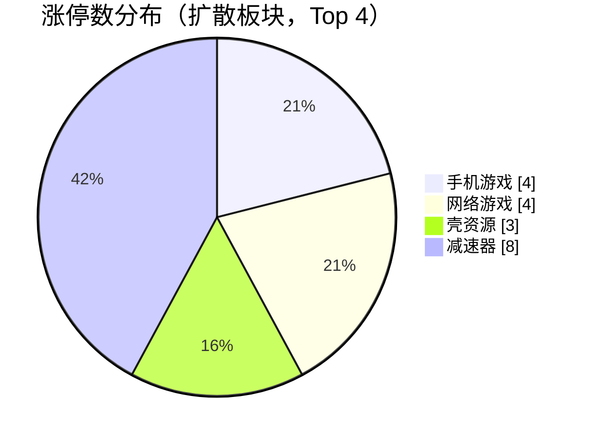
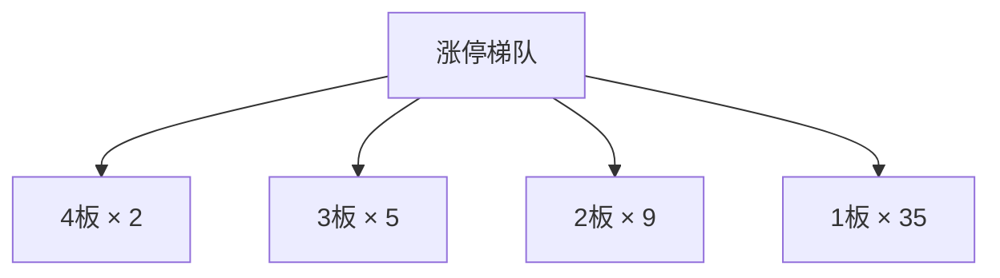
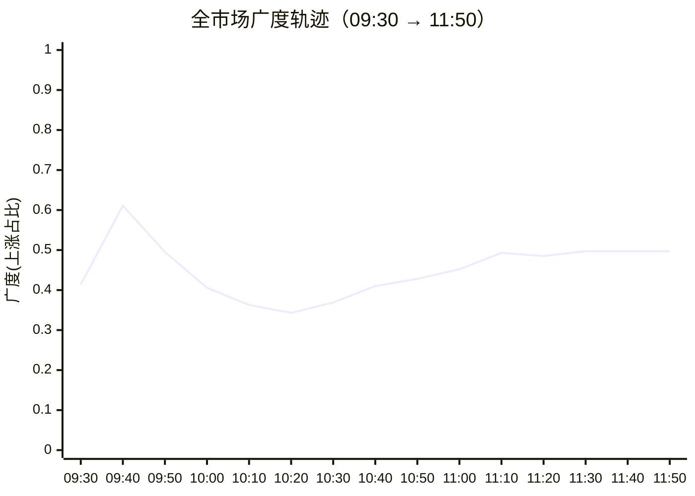

## 当日总览（截至 11:50）

> **结论**：全市场涨2772/跌2591（广度0.52）；涨停51/跌停1；中位涨幅+0.00%；局部修复。 钱在：手机游戏(涨停4/成分56，中位+1.11%)、网络游戏(涨停4/成分58，中位+0.91%)、壳资源(涨停3/成分51，中位+0.47%)；零星涨停：低辐射玻璃(Low-E)(2)、可燃冰(1)、POE胶膜(2)、钛白粉概念(1)、F5G概念(2)。 退潮：特色小镇(跌停1)、ST板块(跌停1)、旅游概念(跌停1)。 梯队：4板×2、3板×5、2板×9、1板×35，最高4板。 预案：超买区 锋龙股份、文投控股、慈文传媒、福莱新材、富瀚微；未到价 掌阅科技、宇树科技、瑞芯微、创维数字。 较上一轮广度基本持平。

> 🔒 **no_trade / 买入预算 0 / max_position_pct 0 —— 全部内容仅供研究，不授予交易权限。**

### 板块扩散

> 口径：XTick 概念成分 × 全市场实时报价；分母 = 板块内有有效报价的成分数。排序用涨停密度（涨停数/有效成分数），已剔除宽基属性板块（全市场 432 个板块中剔 16 个）。

**扩散中（题材，按涨停密度排序）**

| 板块 | 涨停 | 有效成分 | 涨停密度 | 上涨广度 | 中位涨幅 | 相对全市场 | 成交(亿) |
|---|---|---|---|---|---|---|---|
| 低辐射玻璃(Low-E) ⬦ | 2 | 12 | 0.167 | 0.58 | +0.34% | +0.34% | 14 |
| 手机游戏 | 4 | 56 | 0.071 | 0.75 | +1.11% | +1.11% | 268 |
| 可燃冰 ⬦ | 1 | 14 | 0.071 | 0.57 | +0.45% | +0.45% | 19 |
| 网络游戏 | 4 | 58 | 0.069 | 0.72 | +0.91% | +0.91% | 259 |
| POE胶膜 ⬦ | 2 | 29 | 0.069 | 0.31 | -0.34% | -0.34% | 43 |
| 钛白粉概念 ⬦ | 1 | 15 | 0.067 | 0.47 | -0.37% | -0.37% | 13 |
| 壳资源 | 3 | 51 | 0.059 | 0.67 | +0.47% | +0.47% | 54 |
| 减速器 | 8 | 140 | 0.057 | 0.69 | +0.96% | +0.96% | 365 |
| F5G概念 ⬦ | 2 | 36 | 0.056 | 0.81 | +1.48% | +1.48% | 399 |
| 举牌 ⬦ | 1 | 21 | 0.048 | 0.38 | +0.00% | +0.00% | 15 |
| 特钢概念 ⬦ | 2 | 43 | 0.046 | 0.44 | +0.00% | +0.00% | 33 |
| 信托概念 ⬦ | 1 | 23 | 0.043 | 0.35 | +0.00% | +0.00% | 27 |

> ⬦ = 涨停 <3 只，零星个例，不构成扩散（不计入「钱在」判定）。



零星涨停板块（<3 只）：低辐射玻璃(Low-E)(2)、可燃冰(1)、POE胶膜(2)、钛白粉概念(1)、F5G概念(2)、举牌(1)、特钢概念(2)、信托概念(1)

**退潮中（跌停集中）**

| 板块 | 跌停 | 有效成分 | 上涨广度 | 中位涨幅 |
|---|---|---|---|---|
| 特色小镇 | 1 | 40 | 0.33 | -0.46% |
| ST板块 | 1 | 197 | 0.36 | -0.23% |
| 旅游概念 | 1 | 151 | 0.46 | +0.00% |
| 电子商务 | 1 | 676 | 0.47 | +0.00% |
| 露营经济 | 1 | 55 | 0.47 | +0.00% |
| 跨境电商 | 1 | 346 | 0.49 | +0.00% |
| 福建自贸区 | 1 | 127 | 0.51 | +0.07% |
| 海峡两岸 | 1 | 320 | 0.55 | +0.15% |
| 创投 | 1 | 460 | 0.56 | +0.16% |
| 物业管理 | 1 | 183 | 0.61 | +0.51% |

### 涨停梯队

> 最高 4 板 ｜ 涨停 51 ｜ 跌停 1 ｜ 炸板 18 ｜ 封板率 73.9% ｜ 打板成功率 16.84% ｜ 一进二 12.00% ｜ 二进三 33.33%

| 身位 | 家数 | 成员（涨幅/封单亿/首封） |
|---|---|---|
| 4板 | 2 | 日出东方 +10.02%/0.140亿/09:25；大东方 +9.93%/0.019亿/09:25 |
| 3板 | 5 | 亚玛顿 +10.00%/0.025亿/09:25；文投控股 +10.18%/0.022亿/09:25；锋龙股份 +10.01%/0.022亿/09:30；光洋股份 +10.01%/0.020亿/09:43；东方环宇 +10.00%/0.001亿/10:13 |
| 2板 | 9 | 达 意 隆 +10.01%/0.051亿/09:25；惠发食品 +10.03%/0.015亿/09:30；襄阳轴承 +10.02%/0.015亿/10:43；日海智能 +9.96%/0.013亿/09:30；风语筑 +9.98%/0.010亿/10:35 |
| 1板 | 35 | 剑桥科技 +10.00%/0.105亿/09:34；天洋新材 +10.03%/0.060亿/11:18；北纬科技 +10.05%/0.042亿/11:29；金辰股份 +9.98%/0.032亿/09:25；蓝黛科技 +10.01%/0.024亿/10:39 |



炸板 18 只（前几）：厦工股份(4次)、尤夫股份(4次)、红旗连锁(3次)、胜利股份(3次)、峨眉山Ａ(3次)

### 预案池对照

| 票 | 池 | 板块 | 现价 | 涨幅 | 触发价 | 买区 | 风险位 | 判定 |
|---|---|---|---|---|---|---|---|---|
| 掌阅科技 `603533.SH` | 执行池 | AI内容/短剧游戏 | 31.73 | -3.26% | 32.91 | [32.75, 33.4] | 31.73 | **未到价** |
| 锋龙股份 `002931.SZ` | 执行池 | 具身智能/人形机器人 | 53.08 | +10.01% | 48.25 | [48.01, 48.97] | 46.52 | **超买区** |
| 文投控股 `600715.SH` | 观察池 | AI内容/短剧游戏 | 3.14 | +10.18% | 2.85 | [2.84, 2.89] | 2.75 | **超买区** |
| 慈文传媒 `002343.SZ` | 观察池 | AI内容/短剧游戏 | 9.59 | +2.79% | 9.33 | [9.28, 9.47] | 9.0 | **超买区** |
| 宇树科技 `688836.SH` | 观察池 | 具身智能/人形机器人 | 757.6 | -0.45% | 809.0 | [804.96, 821.13] | 755.44 | **未到价** |
| 福莱新材 `605488.SH` | 观察池 | 具身智能/人形机器人 | 61.58 | +7.47% | 57.3 | [57.01, 58.16] | 55.25 | **超买区** |
| 富瀚微 `300613.SZ` | 观察池 | 端侧AI/AI眼镜 | 83.15 | +3.91% | 80.02 | [79.62, 81.22] | 74.72 | **超买区** |
| 瑞芯微 `603893.SH` | 观察池 | 端侧AI/AI眼镜 | 231.1 | -0.90% | 233.2 | [232.03, 236.7] | 224.86 | **未到价** |
| 创维数字 `000810.SZ` | 观察池 | 端侧AI/AI眼镜 | 11.72 | -3.46% | 12.14 | [12.08, 12.32] | 11.7 | **未到价** |
| 闽发铝业 `002578.SZ` | 观察池 | 名字/东方/羊线情绪 | 6.09 | +0.50% | — | — | — | **无预案价** |
| 东方新能 `002310.SZ` | 观察池 | 名字/东方/羊线情绪 | 2.92 | +3.91% | — | — | — | **无预案价** |
| 日出东方 `603366.SH` | 观察池 | 名字/东方/羊线情绪 | 11.97 | +10.02% | — | — | — | **无预案价** |
| 大东方 `600327.SH` | 观察池 | 名字/东方/羊线情绪 | 6.53 | +9.93% | — | — | — | **无预案价** |
| 龙江交通 `601188.SH` | 观察池 | 名字/东方/羊线情绪 | 4.46 | -3.25% | — | — | — | **无预案价** |
| 光洋股份 `002708.SZ` | 观察池 | 名字/东方/羊线情绪 | 26.59 | +10.01% | — | — | — | **无预案价** |
| 顺灏股份 `002565.SZ` | 观察池 | 商业航天/太空光伏 | 10.66 | -5.58% | — | — | — | **无预案价** |
| 亚玛顿 `002623.SZ` | 观察池 | 商业航天/太空光伏 | 23.33 | +10.00% | — | — | — | **无预案价** |
| 奥比中光 `688322.SH` | 观察池 | 具身视觉事件补充 | 117.26 | +1.88% | — | — | — | **无预案价** |
| 永贵电器 `300351.SZ` | 观察池 | 轨交合同事件 | 12.62 | +1.86% | — | — | — | **无预案价** |
| 七匹狼 `002029.SZ` | 观察池 | 名字/东方/羊线情绪 | 9.19 | -3.57% | — | — | — | **无预案价** |
| 阳光乳业 `001318.SZ` | 观察池 | 名字/东方/羊线情绪 | 14.25 | -3.00% | — | — | — | **无预案价** |
| 合富中国 `603122.SH` | 观察池 | 名字/东方/羊线情绪 | 12.0 | +2.92% | — | — | — | **无预案价** |
| 炬华科技 `300360.SZ` | 观察池 | 红利资金温度计 | 11.37 | -0.09% | — | — | — | **无预案价** |
| 路维光电 `688401.SH` | 观察池 | 成长研究对照 | 49.1 | +0.47% | — | — | — | **无预案价** |

- **锋龙股份** — 现价53.08 已高于买区上沿48.97，不追高；仅价格位置对照，不代表完整入场条件确认；不能据此确认站稳，不授予下单权限
- **文投控股** — 现价3.14 已高于买区上沿2.89，不追高；仅价格位置对照，不代表完整入场条件确认；不能据此确认站稳，不授予下单权限
- **慈文传媒** — 现价9.59 已高于买区上沿9.47，不追高；仅价格位置对照，不代表完整入场条件确认；不能据此确认站稳，不授予下单权限
- **福莱新材** — 现价61.58 已高于买区上沿58.16，不追高；仅价格位置对照，不代表完整入场条件确认；不能据此确认站稳，不授予下单权限
- **富瀚微** — 现价83.15 已高于买区上沿81.22，不追高；仅价格位置对照，不代表完整入场条件确认；不能据此确认站稳，不授予下单权限

> ⚠ D1 明确 no_trade=true、买入预算 0、个股 max_position_pct=0。以上为研究对照，**不构成任何买入许可**。

### 盘面 vs 静态复盘 vs 消息面

| 维度 | 对象 | T-1 静态基线 | 今日盘面 | 关系 |
|---|---|---|---|---|
| 板块主线 | 名字/东方/羊线情绪 | R2 次线 score=None 涨停None（T-1 口径） | 盘面未见该板块成分票涨停 | **背离** |
| 板块主线 | 商业航天/太空光伏 | R2 次线 score=None 涨停None（T-1 口径） | 盘面未见该板块成分票涨停 | **背离** |
| 板块主线 | 具身视觉事件补充 | R2 次线 score=None 涨停None（T-1 口径） | 盘面未见该板块成分票涨停 | **背离** |
| 板块主线 | 轨交合同事件 | R2 次线 score=None 涨停None（T-1 口径） | 盘面未见该板块成分票涨停 | **背离** |
| 梯队结构 | 最高4板 | T-1 最高梯队 4 板、首板 29、炸板率 39.06% | 今日 4板×2、3板×5、2板×9、1板×35；封板率0.7391 炸板18只 | **印证** |
| 预案验证 | 掌阅科技(603533.SH) | 预案 AI内容/短剧游戏／core_midcap／触发价32.91／买区[32.75, 33.4] | 未到价：现价31.73，触发价32.91，还差3.72%；仅价格位置对照，不代表完整入场条件确认；不能据此确认站稳，不授予下单权限 | **无响应** |
| 预案验证 | 锋龙股份(002931.SZ) | 预案 具身智能/人形机器人／leader／触发价48.25／买区[48.01, 48.97] | 超买区：现价53.08 已高于买区上沿48.97，不追高；仅价格位置对照，不代表完整入场条件确认；不能据此确认站稳，不授予下单权限 | **背离** |
| 预案验证 | 文投控股(600715.SH) | 预案 AI内容/短剧游戏／watch／触发价2.85／买区[2.84, 2.89] | 超买区：现价3.14 已高于买区上沿2.89，不追高；仅价格位置对照，不代表完整入场条件确认；不能据此确认站稳，不授予下单权限 | **背离** |
| 预案验证 | 慈文传媒(002343.SZ) | 预案 AI内容/短剧游戏／watch／触发价9.33／买区[9.28, 9.47] | 超买区：现价9.59 已高于买区上沿9.47，不追高；仅价格位置对照，不代表完整入场条件确认；不能据此确认站稳，不授予下单权限 | **背离** |
| 预案验证 | 宇树科技(688836.SH) | 预案 具身智能/人形机器人／watch／触发价809.0／买区[804.96, 821.13] | 未到价：现价757.6，触发价809.0，还差6.78%；仅价格位置对照，不代表完整入场条件确认；不能据此确认站稳，不授予下单权限 | **无响应** |
| 预案验证 | 福莱新材(605488.SH) | 预案 具身智能/人形机器人／watch／触发价57.3／买区[57.01, 58.16] | 超买区：现价61.58 已高于买区上沿58.16，不追高；仅价格位置对照，不代表完整入场条件确认；不能据此确认站稳，不授予下单权限 | **背离** |
| 预案验证 | 富瀚微(300613.SZ) | 预案 端侧AI/AI眼镜／watch／触发价80.02／买区[79.62, 81.22] | 超买区：现价83.15 已高于买区上沿81.22，不追高；仅价格位置对照，不代表完整入场条件确认；不能据此确认站稳，不授予下单权限 | **背离** |
| 预案验证 | 瑞芯微(603893.SH) | 预案 端侧AI/AI眼镜／watch／触发价233.2／买区[232.03, 236.7] | 未到价：现价231.1，触发价233.2，还差0.91%；仅价格位置对照，不代表完整入场条件确认；不能据此确认站稳，不授予下单权限 | **无响应** |
| 预案验证 | 创维数字(000810.SZ) | 预案 端侧AI/AI眼镜／watch／触发价12.14／买区[12.08, 12.32] | 未到价：现价11.72，触发价12.14，还差3.58%；仅价格位置对照，不代表完整入场条件确认；不能据此确认站稳，不授予下单权限 | **无响应** |
| 预案验证 | 闽发铝业(002578.SZ) | 预案 名字/东方/羊线情绪／watch／触发价None／买区None | 无预案价：预案未给有效入场触发价/完整买区（缺失、空规则或格式异常）；仅价格位置对照，不代表完整入场条件确认；不能据此确认站稳，不授予下单权限 | **无响应** |
| 预案验证 | 东方新能(002310.SZ) | 预案 名字/东方/羊线情绪／watch／触发价None／买区None | 无预案价：预案未给有效入场触发价/完整买区（缺失、空规则或格式异常）；仅价格位置对照，不代表完整入场条件确认；不能据此确认站稳，不授予下单权限 | **无响应** |
| 预案验证 | 日出东方(603366.SH) | 预案 名字/东方/羊线情绪／watch／触发价None／买区None | 无预案价：预案未给有效入场触发价/完整买区（缺失、空规则或格式异常）；仅价格位置对照，不代表完整入场条件确认；不能据此确认站稳，不授予下单权限 | **无响应** |
| 预案验证 | 大东方(600327.SH) | 预案 名字/东方/羊线情绪／watch／触发价None／买区None | 无预案价：预案未给有效入场触发价/完整买区（缺失、空规则或格式异常）；仅价格位置对照，不代表完整入场条件确认；不能据此确认站稳，不授予下单权限 | **无响应** |
| 预案验证 | 龙江交通(601188.SH) | 预案 名字/东方/羊线情绪／watch／触发价None／买区None | 无预案价：预案未给有效入场触发价/完整买区（缺失、空规则或格式异常）；仅价格位置对照，不代表完整入场条件确认；不能据此确认站稳，不授予下单权限 | **无响应** |
| 预案验证 | 光洋股份(002708.SZ) | 预案 名字/东方/羊线情绪／watch／触发价None／买区None | 无预案价：预案未给有效入场触发价/完整买区（缺失、空规则或格式异常）；仅价格位置对照，不代表完整入场条件确认；不能据此确认站稳，不授予下单权限 | **无响应** |
| 预案验证 | 顺灏股份(002565.SZ) | 预案 商业航天/太空光伏／watch／触发价None／买区None | 无预案价：预案未给有效入场触发价/完整买区（缺失、空规则或格式异常）；仅价格位置对照，不代表完整入场条件确认；不能据此确认站稳，不授予下单权限 | **无响应** |
| 预案验证 | 亚玛顿(002623.SZ) | 预案 商业航天/太空光伏／watch／触发价None／买区None | 无预案价：预案未给有效入场触发价/完整买区（缺失、空规则或格式异常）；仅价格位置对照，不代表完整入场条件确认；不能据此确认站稳，不授予下单权限 | **无响应** |
| 预案验证 | 奥比中光(688322.SH) | 预案 具身视觉事件补充／watch／触发价None／买区None | 无预案价：预案未给有效入场触发价/完整买区（缺失、空规则或格式异常）；仅价格位置对照，不代表完整入场条件确认；不能据此确认站稳，不授予下单权限 | **无响应** |
| 预案验证 | 永贵电器(300351.SZ) | 预案 轨交合同事件／watch／触发价None／买区None | 无预案价：预案未给有效入场触发价/完整买区（缺失、空规则或格式异常）；仅价格位置对照，不代表完整入场条件确认；不能据此确认站稳，不授予下单权限 | **无响应** |
| 预案验证 | 七匹狼(002029.SZ) | 预案 名字/东方/羊线情绪／watch／触发价None／买区None | 无预案价：预案未给有效入场触发价/完整买区（缺失、空规则或格式异常）；仅价格位置对照，不代表完整入场条件确认；不能据此确认站稳，不授予下单权限 | **无响应** |
| 预案验证 | 阳光乳业(001318.SZ) | 预案 名字/东方/羊线情绪／watch／触发价None／买区None | 无预案价：预案未给有效入场触发价/完整买区（缺失、空规则或格式异常）；仅价格位置对照，不代表完整入场条件确认；不能据此确认站稳，不授予下单权限 | **无响应** |
| 预案验证 | 合富中国(603122.SH) | 预案 名字/东方/羊线情绪／watch／触发价None／买区None | 无预案价：预案未给有效入场触发价/完整买区（缺失、空规则或格式异常）；仅价格位置对照，不代表完整入场条件确认；不能据此确认站稳，不授予下单权限 | **无响应** |
| 预案验证 | 炬华科技(300360.SZ) | 预案 红利资金温度计／watch／触发价None／买区None | 无预案价：预案未给有效入场触发价/完整买区（缺失、空规则或格式异常）；仅价格位置对照，不代表完整入场条件确认；不能据此确认站稳，不授予下单权限 | **无响应** |
| 预案验证 | 路维光电(688401.SH) | 预案 成长研究对照／watch／触发价None／买区None | 无预案价：预案未给有效入场触发价/完整买区（缺失、空规则或格式异常）；仅价格位置对照，不代表完整入场条件确认；不能据此确认站稳，不授予下单权限 | **无响应** |
| 消息面对照 | 盘面热点板块 | R4 消息面（T-1 口径） | 实时快讯未出现热点板块关键词 | **无响应** |

**分歧点（不掩盖）：**
- 板块主线·名字/东方/羊线情绪 → 背离：T-1 有辨识度但今日盘中无涨停响应，题材未获资金确认
- 板块主线·商业航天/太空光伏 → 背离：T-1 有辨识度但今日盘中无涨停响应，题材未获资金确认
- 板块主线·具身视觉事件补充 → 背离：T-1 有辨识度但今日盘中无涨停响应，题材未获资金确认
- 板块主线·轨交合同事件 → 背离：T-1 有辨识度但今日盘中无涨停响应，题材未获资金确认
- 预案验证·锋龙股份(002931.SZ) → 背离：仅研究对照，不授予交易权限
- 预案验证·文投控股(600715.SH) → 背离：仅研究对照，不授予交易权限
- 预案验证·慈文传媒(002343.SZ) → 背离：仅研究对照，不授予交易权限
- 预案验证·福莱新材(605488.SH) → 背离：仅研究对照，不授予交易权限
- 预案验证·富瀚微(300613.SZ) → 背离：仅研究对照，不授予交易权限

### 全天广度轨迹

| 时点 | 涨 | 跌 | 广度 | 涨停 | 跌停 | 成交(亿) | 有效样本 |
|---|---|---|---|---|---|---|---|
| 0930 | 2304 | 2718 | 0.414 | 13 | 1 | 579 | 5558 |
| 0940 | 3404 | 1790 | 0.611 | 31 | 1 | 2,517 | 5574 |
| 0950 | 2757 | 2446 | 0.495 | 37 | 1 | 3,767 | 5574 |
| 1000 | 2260 | 2996 | 0.406 | 33 | 1 | 4,763 | 5574 |
| 1010 | 2023 | 3304 | 0.363 | 37 | 1 | 5,639 | 5574 |
| 1020 | 1912 | 3422 | 0.343 | 39 | 1 | 6,342 | 5574 |
| 1030 | 2056 | 3273 | 0.369 | 43 | 1 | 6,836 | 5574 |
| 1040 | 2285 | 3060 | 0.410 | 43 | 1 | 7,366 | 5574 |
| 1050 | 2386 | 2968 | 0.428 | 45 | 1 | 7,796 | 5574 |
| 1100 | 2518 | 2833 | 0.452 | 44 | 1 | 8,125 | 5574 |
| 1110 | 2748 | 2606 | 0.493 | 46 | 1 | 8,501 | 5574 |
| 1120 | 2701 | 2648 | 0.485 | 49 | 1 | 8,972 | 5574 |
| 1130 | 2771 | 2583 | 0.497 | 51 | 1 | 9,353 | 5574 |
| 1140 | 2771 | 2583 | 0.497 | 51 | 1 | 9,353 | 5574 |
| 1150 | 2771 | 2583 | 0.497 | 51 | 1 | 9,353 | 5574 |

> ⚠ **数据冻结段**：1130–1150 数值连续完全一致，说明行情源未刷新，**不是市场横盘**，该段不可解读为盘面变化。



### 观察建议（仅研究）

- **环境**：涨停 51.0 / 跌停 1.0，打板成功率 16.8%，一进二 12.0%。
- **方向**：今日形成实质扩散的是 手机游戏（涨停4/成分56，密度0.071，中位+1.11%）、网络游戏（涨停4/成分58，密度0.069，中位+0.91%）、壳资源（涨停3/成分51，密度0.059，中位+0.47%）。**需确认**：次日能否维持涨停家数且中位涨幅不掉队，否则只是普跌中的避险轮动。
- **零星**：低辐射玻璃(Low-E)(2只/12成分)、可燃冰(1只/14成分)、POE胶膜(2只/29成分)、钛白粉概念(1只/15成分)、F5G概念(2只/36成分) 属零星个例，不视为题材，不据此选股。
- **回避**：特色小镇（跌停1）、ST板块（跌停1）、旅游概念（跌停1） 板块中位跌幅深，趋势未止跌前不接。
- **身位**：最高 4 板。梯队有高度不等于可接力，需逐票核验封单稳定性与开板次数后再定。
- **预案**：锋龙股份（现价53.08 已高于买区上沿48.97，不追高；仅价格位置对照，不代表完整入场条件确认；不能据此确认站稳，不授予下单权限）、文投控股（现价3.14 已高于买区上沿2.89，不追高；仅价格位置对照，不代表完整入场条件确认；不能据此确认站稳，不授予下单权限）、慈文传媒（现价9.59 已高于买区上沿9.47，不追高；仅价格位置对照，不代表完整入场条件确认；不能据此确认站稳，不授予下单权限）、福莱新材（现价61.58 已高于买区上沿58.16，不追高；仅价格位置对照，不代表完整入场条件确认；不能据此确认站稳，不授予下单权限）、富瀚微（现价83.15 已高于买区上沿81.22，不追高；仅价格位置对照，不代表完整入场条件确认；不能据此确认站稳，不授予下单权限）。买区已错过，**不追高**；要参与需等新剧本，不能沿用原预案价位。
- **预案待检验**：掌阅科技(触发价32.91，还差+3.72%)、宇树科技(触发价809，还差+6.78%)、瑞芯微(触发价233.2，还差+0.91%)、创维数字(触发价12.14，还差+3.58%) 尚未触及触发价，剧本未被盘面检验，继续按原失效条件看。

<details>
<summary>原始截面与数据质量（折叠）</summary>

**跨源校验**

```json
{
  "xtick": {
    "up": 2772,
    "down": 2591,
    "n": 5585,
    "amount_yi": 9282.3
  },
  "rtk_snapshot": {
    "up": 2771,
    "down": 2583,
    "valid_n": 5574,
    "amount_yi": 9352.8,
    "up_limit": 51,
    "down_limit": 1
  },
  "note": "两源口径不同（XTick 全市场含全部票；rt_k 返回样本）"
}
```

**rt_k 截面（原始）**

```json
{
  "market": {
    "total": 5584,
    "up": 2771,
    "down": 2583,
    "flat": 220,
    "requested_n": 5584,
    "received_n": 5584,
    "valid_n": 5574,
    "missing_n": 10,
    "universe_requested_n": null,
    "population_scope": "returned_rows_not_verified_all_a_universe",
    "up_ratio": 0.4962,
    "legacy_up_ratio_placeholder": false,
    "up_ratio_is_observed": true,
    "up_ratio_all": 0.4962,
    "up_ratio_valid": 0.4971,
    "up_ratio_denominator": "requested_n",
    "degraded": false,
    "limit_known_n": 5574,
    "limit_unknown_n": 0,
    "limit_counts_complete": true,
    "limit_source_errors": [],
    "up_gt3": 417,
    "up_gt5": 187,
    "up_limit": 51,
    "down_gt3": 159,
    "down_gt5": 35,
    "down_limit": 1,
    "amount_yi": 9352.8,
    "amount_sum_overflow": false,
    "amount_valid_n": 5574,
    "amount_missing_n": 0
  },
  "source_time_quality": {
    "quote_age_min_seconds": 2.111648,
    "quote_age_max_seconds": 62.111648,
    "source_age_limit_seconds": null,
    "freshness_status": "age_limit_not_configured",
    "age_reference_at": "2026-11-11T11:50:44.111648+08:00"
  },
  "trading_authorized": false
}
```

</details>

## 分时研判记录

### 09:35 研判增量
- **趋势**：开盘先看到的是“部分高度延续、容量承接不足”，尚不能认定昨日修复正在全面延续。依据为2026-11-11首份09:30分析（09:30:57生成）；没有上一轮，顶部“较上一轮广度基本持平”没有比较依据。配套rt_k报价时标为09:30:15—09:30:54，有效返回样本上涨2304/5558，即41.45%；顶部约0.45用的是另一源上涨数除以上涨与下跌之和，不能混作同口径趋势。未核上市名录，不宣称无遗漏全A覆盖；XTick逐票报价时标未附，本文不是09:35实时核价。预案记载昨日七板最高标，而自动对照写“T-1最高四板”，基线存在冲突，不据此判断高度升降；今日最高已封梯队四板也不等于更高身位个股已经收盘断板。
- **轮动**：顶部“无形成扩散的题材”不能直接沿用：同份分析完整板块集里，智能制造涨停5/459、上涨广度53.16%，新型工业化3/292、61.64%，光伏概念5/602、50.66%；相较之下，短剧游戏仅1/99涨停、上涨广度26.26%、中位涨幅-0.35%，更像内容高度股孤立，而非整条内容线共振。概念成员可能重叠，不能相加成独立涨停数，更不能把制造标签直接当作人形机器人资金确认。名字线已有日出东方、大东方四板，亚玛顿已有三板，与自动对照“名字线/航天光伏无涨停响应”矛盾：应改判为部分观察核心有响应、整条线及产业催化未确认，而不是全线无响应。只有首个截面，以上是横向强弱差，尚不能证明资金从内容流向制造/光伏的跷跷板；实时快讯关键词未匹配，也不等于催化不存在，亚玛顿上涨不证明预案已警示的外部合同归属于它。
- **剧本**：掌阅科技31.98尚低于原买区下沿32.75及触发价32.91；文投三板而容量核心未跟上，原“内容容量接力”只是未获确认，不能因高度股涨停就宣布兑现，也不能仅凭掌阅水下把原剧本判死。锋龙股份53.00已超过原上沿48.97，且炸板记录3次；价格强不等于预案所需的可成交换手承接，原买点当前不可用，不抬价追、不因执行候选买不到而递补福莱等观察票。端侧替代剧本也未成立：瑞芯微232.44虽在[232.03,236.70]内，却尚低于233.20触发价，预案另保留233.88图证压力冲突，必须复核，不能把“买区内”写成已突破。原候选有效期写至今日09:30，后续只能作为待重新评估的研究锚；本轮不续期、不改池、不改买权。
- **下一步看**：以本轮为基线，后续有效样本口径可比时，检验广度是否高于41.45%、涨停是否超过13，并与炸板3只的变化合看；若涨停增加而广度下降，按强势集中而非普涨解释。制造/光伏需检验涨停家数与各自广度是否同步维持或提高；内容需从1/99的孤立涨停走向至少3只，并伴随广度较26.26%回升，才有扩散的初步证据，这只是研究观察条件。掌阅须越过32.91且不超过原上沿33.40，并取得量价路径与板块承接证据；文投若开板且内容同步走弱，按原取消条件重评。锋龙重点看炸板次数是否继续增加、容量对照是否同步走弱，不以单次价格截面声称回封或站稳。瑞芯微须验证233.20能否持续收复并处理233.88图证冲突，单次越线不算替代剧本成立。**维持本任务的禁新仓约束：no_trade=true、买入预算0、max_position_pct=0；全部仅供研究，不构成任何买入许可。**

### 09:45 研判增量
- **趋势**：新增信号是“首板、二板扩散，内容容量却逆势掉队”，不再只是开盘高度股孤立。依据2026-11-11的09:40分析（09:40:55生成），对比09:30；不是09:45实时核价。涨停13→31，首板5→19、二板4→7，已封最高身位仍四板，改善主要在梯队底部。有效返回样本上涨2304/5558→3404/5574，分别为41.45%与61.07%；分母及有效成员未完全一致，不硬算精确广度增量，另一源相同5585条返回样本的上涨数也由2269增至3383，方向支持修复。当前开板未封家数3→0不等于全天没有炸板：大东方累计开板1→2次、文投0→3次，不能把顶部100%封板率理解成接力无风险。
- **轮动**：完整板块集显示，智能制造涨停5→8/459、上涨244→332/459；光伏5→8/602、上涨305→421/602，原扩散方向继续增强。新出现的航天响应更值得补入观察：商业航天涨停0→3/507、上涨237→339/507；09:40:47快讯提到上海港湾、神开股份触板，梯队同时出现上海港湾二板、神开及飞亚达首板，说明预案航天观察线开始获盘面响应，不能沿用自动对照的“全线无响应”。这只是盘口报道与行情相互印证，不是新增产业订单验证。反面是短剧游戏上涨26→23/99，中位涨幅-0.35%→-0.75%，在大盘修复中反而失血；内容与制造/光伏/航天有相对轮动迹象，但缺板块净流量与连续路径，尚不能断言直接资金跷跷板。各概念成员可能重叠，不相加统计。
- **剧本**：掌阅科技31.98→31.55，离32.91触发价更远；结合短剧游戏整体走弱，原“内容容量接力”比上一轮更不获支持，不能用文投仍在三板代替容量确认。锋龙从开板未封名单进入三板封板梯队，但53.08仍超原买区上沿48.97，只改善高度反馈，没有恢复原买点，不追、不递补观察票。唯一价格判定迁移是瑞芯微：232.44→235.49，由“买区内但未触发”变为越过233.20，也高于预案图证争议锚233.88，且未超过236.70上沿；端侧替代剧本因此多了一项价格证据，但单个截面不能证明持续站稳，图证冲突也未因此自动解除。AI眼镜仅1/194涨停、上涨115/194，尚不足板块级共振；创维仍未到12.14。原候选09:30有效期已过，以上只重评研究锚，不续期、不改池、不恢复买权。
- **下一步看**：下一份可比截面先检验31只涨停、19只首板能否保持或增加，并与有效样本广度同向；涨停增加而广度回落，只算强势集中。航天以3/507涨停、339/507上涨，制造以8/459涨停、332/459上涨作为本轮基线，涨停与广度同步延续才支持扩散持续；跌回基线以下则重评，不凭一只旧核心走弱否定整线。内容须先扭转23/99上涨的收缩，再检验掌阅能否越过32.91且不超过33.40，并补齐量价承接路径；瑞芯微须持续守住233.88且不越236.70，跌回233.20以下则撤回“当前已越触发价”的描述，不下移条件。以上均为验证条件，不是委托建议；**no_trade=true、买入预算0、max_position_pct=0保持不变，全部仅供研究，不构成任何买入许可。**

### 09:55 研判增量
- **趋势**：09:40的修复扩散，转为“涨停增加、普通股回落”的强弱分化。依据2026-11-11最新09:50分析（09:50:54生成），不是09:55实时核价；配套报价时标09:49:57—09:50:51，采集09:50:41—09:50:52。有效返回样本分母均为5574，上涨3404→2757，广度61.07%→49.46%，回落11.61个百分点；顶部0.54采用另一分母，不混用，上市名录覆盖仍未核。涨停31→37、首板19→25，但二板7→6、最高已封身位仍四板，开板未封0→6、封板率100%→86.05%：新增首板没有带来整体承接同步改善。文投仍在三板封板组，但累计开板3→8次，同价不等于风险不变；这更支持盘前“防先手兑现”，不支持继续按全面修复外推。
- **轮动**：完整板块集里，智能制造涨停8→9/459，人形机器人2→3/482，但上涨成分分别332→307、336→316，是前排增强、后排收缩。密度排名靠前的建筑节能涨停3→4/104、装配式建筑1→4/109，上涨成分却72→63、68→55，尤其装配式中位涨幅0.37%→0.06%，不能把排名上升解释成整板资金涌入。上轮航天走高快讯的延续受到反证：商业航天涨停3→2/507、上涨339→299，上海港湾从二板封板组进入开板未封组，涨幅7.92%；这是局部承接减弱，不是一只旧龙否定全线。端侧相对改善：AI眼镜涨停1→2/194、上涨115→120；内容继续失血，短剧游戏上涨23→21/99、中位涨幅-0.75%→-1.15%。可提出“内容弱、制造前排及端侧相对承接”的轮动假设，但没有板块净流量证据，不能确认直接跷跷板；概念重叠不相加，本轮快讯样本也未补齐这些方向的直接产业催化，三方尚未一致。
- **剧本**：24只预案对象中，唯一价格判定迁移是慈文传媒9.66→9.44，由“超买区”退回[9.28,9.47]且仍高于9.33触发价；结合内容板块继续走弱，这是回落进入旧区间，不是新突破确认，更不能替代掌阅的容量地位。掌阅31.55→31.40，仍低于32.91，原内容容量接力继续不获支持；文投反复开板使高度与容量脱节更突出，但截至本截面仍封板，不能写成已收盘断板。光洋新增三板，为机器人高度增加助攻，不等于自动夺龙或获得买权；锋龙仍在53.08、超原上沿48.97，原买点没有恢复，不追高。瑞芯微235.49→235.54、仍高于233.20，只说明两个截面保有价格响应；AI眼镜尚仅两只涨停，且锋龙高度并未同步走弱，预案“原双线弱后切端侧”的前提未齐，不能宣布替代剧本启动。原候选09:30有效期及233.88图证冲突仍待重评，本轮不续期、不改池。
- **下一步看**：后续同口径先检验广度能否从49.46%回升，并与37只涨停、6只开板未封共同观察；涨停再增而广度继续降、开板未封继续增，就维持强势集中判断。人形机器人须保住3/482涨停且上涨成分从316回升，才增加扩散证据；航天须恢复上轮3/507涨停及339/507上涨，并核上海港湾重新封板的真实路径，才考虑收回本轮减弱判断。慈文若跌回9.33以下，撤回“当前已越触发价”描述，不下移买区；即使留在9.33—9.47，也须内容广度扭转21/99的收缩，不能只看价到。瑞芯微继续核233.88的承接路径及236.70上沿，跌回233.20以下则价格响应撤回；两次截面不能代替持续站稳。**no_trade=true、买入预算0、max_position_pct=0保持不变，以上全部仅供研究，不构成任何买入许可。**

### 10:05 研判增量
- **趋势**：从“涨停增加、普通股回落”进一步转为广度与封板同步收缩，修复的支撑层正在变薄。依据2026-11-11的10:00分析（10:00:59生成），对比09:50，不是10:05实时核价。rt_k有效返回样本同为5574，上涨2757→2260，广度49.46%→40.55%，按原始计数回落8.92个百分点，涨停37→33；另一源XTick涨停37→32、首板25→22、三板4→2，开板未封6→15，封板率86.05%→68.09%。两源涨停不混算；最高仍四板，不足以抵消中层和首板一起收缩。两轮analysis均errors=[]；今日预案仍是degraded的partial研究版本，不把资料降级当作市场零值。
- **轮动**：完整概念集显示，智能制造涨停9→8/459、上涨307→247；人形机器人3→2/482、上涨316→268，中位涨幅+0.47%→+0.21%。高度助攻与整体承接同时减弱，但多数成分仍上涨，不能只凭光洋开板宣布整线退潮。商业航天上涨299→199/507、中位+0.23%→-0.22%，弱化已不限于上轮上海港湾一票。新增相对强弱对照是CPO与PCB：上涨分别196→171/230、189→162/241，中位仍为+0.97%、+0.68%，但涨停仅2只与0只，都不是扩散增强。09:59:22的PCB走强快讯与相对韧性相符，却不能覆盖广度收缩，更不是新增产业订单证据；缺板块净流量，不能断言资金由旧主线流入它们，重叠概念也不相加。
- **剧本**：慈文9.44→9.29，虽仍在[9.28,9.47]，却已低于9.33，上一轮“当前越过触发价”的价格响应应撤回，不是回踩买点自动成立。掌阅31.40→31.20仍未到32.91；短剧游戏上涨21→19/99、涨停1→0，内容容量接力再添反证。文投从三板封板组进入开板未封组，累计开板8→10次；报价3.12与榜内仍记+10.18%不一致，按两源不同截面处理，不凭涨幅称已回封，也不写成收盘断板。光洋同样由三板封板转开板未封、累计开板0→2次，锋龙高度助攻减少；锋龙53.08仍超48.97，不恢复旧买点、不追高。端侧也不能机械接棒：AI眼镜涨停2→1/194、上涨120→98，瑞芯微235.54→234.85虽仍高于233.20，但目标板块同步弱化，原双线分歧加重不等于替代剧本成立。
- **下一步看**：先检验同口径广度能否从40.55%回升、向上一轮49.46%修复，同时开板未封较15只减少、三板助攻恢复；只有高度不变而广度继续下降，仍按承接收缩看。机器人若恢复3/482涨停，须与上涨成分较268回升及光洋真实回封路径一起核验，不能只看锋龙。慈文重越9.33且不超9.47，还须内容上涨成分扭转19/99的收缩；瑞芯微仍按233.20、233.88图证争议锚及236.70上沿核验，补齐连续量价路径和板块承接前不升级。当前只有相邻截面，不能倒推持续站稳。原候选09:30有效期不续、不改池；**no_trade=true、买入预算0、max_position_pct=0保持不变，全部仅供研究，不构成任何买入许可，watch/execution名称不授予交易权。**

### 10:15 研判增量
- **趋势**：新增分歧是“封板端止缩，普通股继续下探”，不能把涨停恢复当成整体拐点。依据2026-11-11的10:10分析（10:10:53生成），对比10:00；配套rt_k采集10:10:41—10:10:51、报价10:09:21—10:10:48，不是10:15实时核价，XTick逐票时标未附。rt_k有效返回样本同为5574，上涨2260→2023，广度40.55%→36.29%，回落4.25个百分点；同源涨停33→37。XTick则为涨停32→37、首板22→26、三板2→3，最高仍四板，开板未封仍15只：封板修复尚未带动广度或开板风险改善，整体仍是强势集中，不混用两源分母。
- **轮动**：上轮机器人减弱不能继续直线外推：完整板块集中，人形机器人涨停2→4/482、上涨268→273/482；减速器涨停2→4/140、上涨75→82/140，中位涨幅0.14%→0.39%，出现逆市场的局部扩散。智能制造虽涨停8→9/459，上涨却247→239/459，不能用大制造标签掩盖内部差异，也不能沿用顶部“全市场无扩散”的结论。反面是短剧游戏上涨19→17/99、仍无涨停，商业航天上涨199→174/507、涨停仍2只，内容与航天继续失血。新增10:10燃气拉升快讯与胜通能源首板相符，但天然气仅2/167涨停、上涨80/167，只列新观察，不升级主线。概念重叠不相加；本轮消息样本没有补齐机器人新增产业催化，也无板块净流量证据，局部承接不等于已证实资金直接跷跷板。
- **剧本**：24只对象唯一价格判定迁移是慈文9.29→9.18，由“买区内”退至原下沿9.28以下；这是前轮触发响应撤回后的进一步走弱，不下移买区解释成新机会。掌阅31.20→31.25虽略回升，但内容整体更弱、仍未到32.91，原容量接力没有恢复。机器人主剧本获得部分盘面印证：光洋从开板未封组回到三板封板组，为锋龙补回高度助攻；只证明本截面状态，不证明持续封稳或新的产业兑现。锋龙仍超原上沿48.97，板块转强没有恢复旧买点，不追高。端侧替代反而缺承接：瑞芯微234.85→234.40仍越233.20，但AI眼镜上涨98→84/194，涨停1→2也只是前排增加、后排转弱；机器人局部回强，更不能机械套用“原双线同弱后切端侧”。
- **下一步看**：整体先检验同口径广度能否收回10:00的40.55%，并与开板未封较15只减少共同出现；涨停再增而广度再降，仍按集中而非普涨。局部看机器人能否保持4/482涨停且上涨成分较273增加、减速器保持4/140涨停且上涨成分较82增加，并补核光洋封板持续性；若助攻重新开板、板块广度回落，本轮回强只能算局部回摆。慈文须先重返9.28、再越9.33且不超9.47，并伴内容上涨成分扭转17/99的收缩，才重新讨论原研究条件；瑞芯微若跌回233.20以下，撤回当前触发描述，未补板块承接与233.88图证争议锚的路径核验前，不升级替代剧本。原候选09:30有效期不续、不改池；**no_trade=true、买入预算0、max_position_pct=0保持不变，全部仅供研究，不构成任何买入许可。**

### 10:25 研判增量
- **趋势**：新增信号是“高度修补继续，承接面继续收缩”，还不是整体拐点。依据2026-11-11的10:20分析（10:20:55生成），对比10:10；配套rt_k采集10:20:42—10:20:54、报价10:20:09—10:20:51，不是10:25实时核价，XTick逐票时标未附。有效返回样本同为5574，上涨2023→1912，广度36.29%→34.30%，再降1.99个百分点，并非顶部所写“基本持平”；上市名录覆盖仍未核。涨停37→39，三板3→4、首板26→27，最高仍四板、开板未封仍15只：梯队补回一层助攻，却没有带动普通股转强，更符合盘前“修复后防先手兑现”，不是全面修复延续。
- **轮动**：上轮机器人局部回强未能继续扩散：人形机器人涨停仍4/482，上涨273→236/482、中位涨幅0.27%→0%；减速器涨停仍4/140，上涨82→75/140。前排还在，后排已缩，不能把上一轮改善直线外推。天然气由2→3/167涨停，首次达到本任务的涨停家数观察门槛，但上涨80→76/167、中位仍0%，是新增封板而非整板扩散增强；它与上一轮10:10燃气拉升快讯相互印证，只证明盘口响应，不是新增产业订单。商业航天上涨174→139/507、涨停仍2只，仍未见接棒。以上只能提出资金更集中于少量前排的假设；缺板块净流量，不确认机器人向燃气的直接跷跷板，重叠概念不相加。
- **剧本**：24只对象唯一价格判定迁移是瑞芯微234.40→231.85，从“已触发”退为“未到价”，同时跌破原触发价233.20及买区下沿232.03；上一轮要求撤回触发描述的条件已经出现。AI眼镜上涨84→65/194、涨停仍2只，端侧替代剧本的个股与板块承接同时减弱，不能因原双线分歧就机械切换。内容则只修高度、不修容量：文投从开板未封组回到三板封板组，价格3.09→3.14，但累计开板仍记10次，不能据此称持续封稳；掌阅31.25→30.83、短剧游戏上涨17→13/99、中位-1.44%→-1.75%，原“内容容量接力”仍缺确认。锋龙仍超原上沿48.97，板块前排维持没有恢复旧买点，不追高、不递补观察票；也不拿风险参考位直接把未触发对象判死。
- **下一步看**：整体先检验同口径广度能否收回10:10的36.29%，并与开板未封较15只减少共同发生；仅涨停超过39只而广度继续下降，仍是集中而非普涨。机器人须在维持4/482涨停的同时，把上涨成分恢复至273附近或更高；天然气须保住3/167涨停并扭转上涨成分低于上轮80只的状态，才增加扩散持续的证据，这些只是既有截面的研究比较锚。瑞芯微须重新越过233.20，并核233.88图证争议锚、原上沿236.70及板块承接路径，不能下移买区接弱；掌阅仍须收复32.91且不超33.40，并伴内容广度改善，文投单独封板不够。原候选09:30有效期不续、不改池；**no_trade=true、买入预算0、max_position_pct=0保持不变，全部仅供研究，不构成任何买入许可。**

### 10:35 研判增量
- **趋势**：连续收缩后，首次出现一轮“广度与封板同步回补”，上一轮要求的广度收回36.29%、开板未封少于15只已同时出现，但只够确认局部反抽。依据2026-11-11的10:30分析，对比10:20；rt_k采集10:30:42—10:30:54、报价10:29:30—10:30:51，不是10:35实时核价，XTick逐票时标未附。有效返回样本同为5574，上涨1912→2056，广度34.30%→36.89%，回升2.58个百分点；涨停39→43，开板未封15→12。最高仍四板，三板4→5主要新增东方环宇重回封板组，其累计开板2→3次，不是市场高度抬升，也不能据此称封稳；广度仍低于10:00的40.55%，不把这一轮反抽写成全面转强。
- **轮动**：天然气开始从“只加封板”走向承接面同步改善：涨停3→4/167、上涨76→85/167，已超过上一轮观察锚80只；机器人涨停仍4/482、上涨236→261/482，减速器仍4/140、上涨75→83/140，说明机器人与燃气本轮同修，不支持“机器人失血、燃气接棒”的直接跷跷板说法。逆向走弱的是减肥药，上涨14→7/67、中位跌幅-0.66%→-0.88%。NFT虽涨停2→3/70、密度排名进入前排，但上涨仅19/70、中位-0.77%，只是少数前排修复，不能照顶部“钱在NFT”直接认定主线。概念重叠不相加；缺板块净流量，本轮快讯样本也未补齐机器人或燃气新增产业催化，只确认盘口改善，不外推资金因果与业绩兑现。
- **剧本**：24只对象新增两项价格判定迁移。慈文9.19→9.36，重新越过9.33且处于原[9.28,9.47]；但短剧游戏上涨虽13→20/99，涨停仍仅1只，掌阅30.83→31.29仍未到32.91，所以恢复的是观察票价格响应，不是原“掌阅容量接力”兑现，更不替换原核心。瑞芯微231.85→232.50仅重返[232.03,236.70]，仍低于233.20，不能把“买区内”写成已突破；AI眼镜上涨65→75/194、涨停仍2只，端侧替代的独立承接仍未齐。锋龙高度与机器人后排同修，但其价格仍超原上沿48.97，板块改善没有恢复旧买点，不追高。
- **下一步看**：整体检验36.89%的同口径广度能否延续并收回40.55%，同时43只涨停不回落、12只开板未封不反增；若广度重新掉回34.30%附近，就撤回本轮承接改善的延续假设。天然气以4/167涨停、85/167上涨为新比较锚；机器人须保住4/482涨停，并继续向10:10的273只上涨成分恢复，而非只有锋龙、光洋维持高度。慈文若再次低于9.33，撤回当前触发描述；即使留在9.33—9.47，仍须掌阅向32.91及原上沿33.40的研究条件修复、内容广度同步回升。瑞芯微须重越233.20且不超236.70，并补齐连续量价、板块承接及原图证冲突复核，单次越线不升级替代剧本。原候选有效期不续、不改池；**no_trade=true、买入预算0、max_position_pct=0保持不变，全部仅供研究，不构成任何买入许可。**

### 10:45 研判增量
- **趋势**：广度回补延续，但封板质量反而转差，不能升级为全面修复。依据2026-11-11的10:40分析，对比10:30；配套rt_k采集10:40:41—10:40:53、报价10:39:24—10:40:51，不是10:45实时核价，XTick逐票时标未附。有效返回样本同为5574，上涨2056→2285，广度36.89%→40.99%，回升4.11个百分点，已收回上轮观察锚40.55%；但rt_k涨停仍43只，XTick涨停43→42、开板未封12→17、三板5→4，最高仍四板。东方环宇从三板封板组退到开板未封组、累计开板3→6次，说明上轮高度修补没有稳住；二板7→8的新增助攻尚不足抵消封板端恶化。两源不混算，上市名录覆盖未核，不把返回样本称为无遗漏全A。
- **轮动**：上轮机器人与燃气同修，本轮转为机器人扩散、燃气回吐。完整概念集中，人形机器人涨停4→5/482、上涨261→315/482，已超过此前273只的观察锚；减速器涨停4→5/140、上涨83→99/140，中位涨幅0.41%→1.23%。反面是天然气涨停4→2/167、上涨85→82/167，上一轮要求维持4只封板未获满足，东方环宇反复开板与此相符。可提出两者承接分化的轮动假设，但缺同口径板块净流量，不确认直接资金跷跷板。另一项新增交叉印证是CPO：上涨136→144/230、中位涨幅0.35%→0.56%，analysis内10:40:03快讯亦报道资金净流入光通信/CPO；这是新闻转述与相对强势同向，不是已独立核实的资金结论，且CPO仍仅2只涨停，不升级为本任务定义的封板扩散。概念重叠不相加，机器人新增产业催化仍未补齐。
- **剧本**：24只对象唯一价格判定迁移是瑞芯微232.50→233.96，由“买区内”转为“已触发”，也越过预案保留的233.88争议锚；新增的是单个截面价格响应，不能宣布持续站稳或图证冲突已解除。AI眼镜上涨75→90/194、涨停仍2只，而机器人本轮增强，原“内容/机器人同弱后切端侧”的前提并不齐。内容也只是修复观察票：慈文9.36→9.47已到旧买区上沿，短剧游戏上涨20→28/99但仍仅1只涨停；掌阅31.29→31.53仍未到32.91，不能用慈文替代容量核心。机器人扩散支持锋龙的高度反馈，却未恢复其原买点：53.08仍高于48.97，不追高。原执行候选入场窗口写至10:30且09:30须重评，现已越过窗口；本轮只保留研究锚，不续期、不改池或买权。
- **下一步看**：先检验同口径广度能否守住10:00的40.55%，同时XTick开板未封较17只减少、涨停不再低于本轮42只；若只有广度回升而开板继续增多，仍是承接回补与前排兑现并存。机器人以5/482涨停、315/482上涨，减速器以5/140涨停、99/140上涨检验延续；燃气须恢复上轮4/167涨停与85/167上涨，并补核东方环宇封板路径，才收回本轮回吐判断。瑞芯微若跌回233.20以下，撤回当前触发描述；留在233.20—236.70也仍须连续量价、板块承接及图证复核，不能凭一次越线启动替代方案。慈文高于9.47即超原买区，不上移条件；掌阅未收复32.91前，内容容量剧本仍待检验。**no_trade=true、买入预算0、max_position_pct=0保持不变；全部仅供研究，不构成任何买入许可。**

### 11:09 研判增量
- **趋势**：广度继续回补，但封板端没有跟上，仍是承接修复而非全面转强。依据2026-11-11最新11:00分析，对比10:50；配套rt_k采集11:00:41—11:00:53、报价10:59:24—11:00:51，不是本段写入时的实时核价，XTick逐票时标未附。有效返回样本同为5574，上涨2386→2518，广度42.81%→45.17%，按原始计数回升2.37个百分点；同源涨停反而45→44。XTick涨停44、开板未封20、最高四板及各层家数均未改善；风语筑虽仍在二板封板组，累计开板2→3次，说明相同梯队数量并不等于承接风险不变。报价、成交额与广度已有刷新，不把梯队统计相同误判成全源冻结；上市名录覆盖未核，两源不混算。
- **轮动**：机器人仍有相对承接，但本轮是后排回补，不是新一轮批量上板：人形机器人涨停仍7/482、上涨300→307/482，减速器涨停仍6/140、上涨97→99/140。内容的承接面也在修补，短剧游戏上涨33→40/99、中位涨幅-0.52%→-0.23%，却仍只有1只涨停；AI眼镜上涨80→89/194、仍仅2只涨停。机器人、内容与端侧本轮同修，不支持直接资金跷跷板。11:00分析所收10:59:33快讯报道的是出版股拉升，可作内容局部回补的旁证，不能把出版等同短剧，也不能移植为掌阅新增订单催化。原预案“修复后防兑现”与封板端分歧仍相符，消息与容量核心尚未形成三方一致；概念成分重叠不相加，净流量缺失不补造资金去向。
- **剧本**：本轮唯一价格判定迁移是慈文9.40→9.62，从“已触发”变成高于原上沿9.47的“超买区”；这是旧研究买点错过，不是允许抬价追。掌阅31.42→31.75虽回升，仍低于原下沿32.75及触发价32.91，不能用观察票走强替代原内容容量核心。相较上一份已写入的10:45研判，瑞芯微的触发响应已撤回：10:50退至231.14，本轮231.00，持续低于232.03下沿及233.20触发价；端侧替代剧本未恢复。锋龙仍在三板封板组、53.08仍超48.97，机器人回补没有恢复其旧买点；不追高、不把观察票自动递补。
- **下一步看**：整体以本轮45.17%广度为比较锚，检验同口径上涨占比能否继续提高，同时XTick开板未封降至20只以下、涨停超过44只；若广度跌回上轮42.81%以下而开板不减，撤回回补延续假设。机器人要在7/482涨停基础上，带动上涨成分恢复10:40的315只，而非仅少量前排维持；内容须在40/99上涨继续改善的同时，检验掌阅能否越过32.91且不超33.40，并取得连续量价承接证据，慈文已超9.47不再沿用旧买区追价。瑞芯微须先回到232.03以上、再重越233.20，复核233.88图证争议及236.70上沿，单次越线仍不等于站稳。原预案不续期、不改池；**no_trade=true、买入预算0、max_position_pct=0保持不变，全部仅供研究，不构成任何买入许可。**

### 11:17 研判增量
- **趋势**：上一轮“只修广度、封板没跟上”的分歧，本轮开始缓解，承接与封板转为同步回补，但还不是全面转强。依据2026-11-11的11:10分析，对比11:00；配套rt_k采集11:10:41—11:10:52、报价11:09:30—11:10:48，不是11:17实时核价，XTick逐票时标未附。有效返回样本同为5574，上涨2518→2748，广度45.17%→49.30%，回升4.13个百分点；两源各自涨停均44→46，XTick开板未封20→19，上轮观察的三项改善条件同时出现。新增助攻在二板8→9、首板30→31，襄阳轴承进入二板封板组，最高已封身位仍四板；不能把中低层回补写成高度突破或持续封稳。上市名录覆盖未核，仍按返回样本解释，不混用顶部另一分母的广度。
- **轮动**：机器人由上一轮后排回补，转为封板与承接面同时增加：人形机器人涨停7→8/482、上涨307→334/482，已收回此前315只的观察锚；减速器涨停6→8/140、上涨99→100/140，密度排序前移，但其后排只小幅增加，不夸成全面加速。内容与端侧也在同修：短剧游戏上涨40→48/99、涨停仍1只，AI眼镜上涨89→102/194、涨停仍2只，修复强度尚不及机器人。天然气上涨99→97/167、涨停仍2只，是相对掉队，不足以称整线撤退；没有同口径净流量，不能断言它向机器人直接输血。本轮快讯样本未补足这些方向的直接产业催化，现有证据只支持盘口强弱排序，不把板块标签或消息缺席当作产业兑现或否定。
- **剧本**：24只对象唯一价格判定迁移是瑞芯微231.00→232.10，从“未到价”重返原[232.03,236.70]，仍低于233.20触发价；顶部结论行将其列为“已触发”与逐票字段不一致，本轮按原价位判为仅回到区间、未重新突破，不改写自动总览。端侧板块仍只有2只涨停，原后置替代方案尚未成立。内容广度虽改善，掌阅仅31.75→31.77，仍未回到32.75下沿及32.91触发价，说明板块回暖尚未传导到预案容量核心，不能用文投高度或慈文走强替代。机器人扩散加强了锋龙的高度反馈，却没有恢复其48.97原上沿以内的旧买点，仍不追高。原预案有效期和入场窗口已过，本轮只重评研究锚，不续期、不改池。
- **下一步看**：先检验同口径广度能否在49.30%基础上继续提高、涨停不低于46只且开板未封较19只继续减少；若涨停增加而广度回落，改按强势集中解释。机器人以8/482涨停、334/482上涨，减速器以8/140涨停、100/140上涨核延续，不能只看锋龙、光洋的三板高度。瑞芯微须重越233.20，再补核233.88争议锚与236.70上沿内的连续承接；跌回232.03以下则连本轮“重返区间”也撤回，不下移条件。掌阅须越过32.91且不超33.40，并伴内容上涨成分较48/99继续改善，才增加原容量剧本证据；单次越线不等于站稳。**no_trade=true、系统买入预算0、max_position_pct=0保持不变；全部仅供研究，不构成任何买入许可。**

### 11:32 研判增量
- **趋势**：上午修复在延续，但新增动力来自首板扩散，不是高度突破。依据2026-11-11最新11:30分析，对比11:20；配套rt_k采集11:30:41—11:30:45、报价11:30:00—11:30:43，不是11:32实时核价，XTick逐票时标未附。有效返回样本同为5574，上涨2701→2771，广度48.46%→49.71%，按原始计数回升1.26个百分点；涨停49→51，新增净家数全部体现在首板33→35，二至四板家数未变、最高仍四板。开板未封17→18、封板率74.24%→73.91%，说明承接面回补并未伴随封板质量继续改善。相较已写入的11:10基线，期间还经历11:20广度回落，不能把上午后段写成无分歧单边修复；两源不混算，上市名录覆盖仍未核。
- **轮动**：真正新增的是游戏分支扩散：手机游戏涨停2→4/56、上涨34→42/56，中位涨幅0.43%→1.11%；网络游戏涨停2→4/58、上涨32→42/58，均进入密度榜前列。两组可能重叠，不能相加为八只独立涨停；新增首板记录可见北纬科技、名臣健康，只列观察，不认证其当日核心地位或交易资格。反面是CPO虽仍3/230涨停，上涨180→168/230、中位1.31%→1.08%，光通信冲高后的承接有所回吐；11:20分析内的光通信上涨快讯不能外推为持续加速。机器人上涨318→322/482、涨停仍8只，减速器上涨仍96/140、涨停仍8只，是维持相对强势而非继续批量上板。可提出“游戏增强、光通信回吐”的轮动假设，但缺板块净流量，不确认直接跷跷板；本轮消息样本未补齐游戏直接催化，三方尚未一致。
- **剧本**：24只对象本轮唯一价格判定迁移是瑞芯微233.38→231.10，由“已触发”退为“未到价”，同时低于233.20触发价和232.03原下沿。相较11:17记录，它先在11:20短暂越线、随后再撤回，恰好反证单次越线不能当站稳；AI眼镜上涨101→100/194、仍仅2只涨停，预案要求的“独立站稳且板块承接”未满足，不下移买区接弱。游戏扩散也没有自动救回原内容容量方案：短剧游戏上涨48→50/99、涨停仍1只，掌阅31.63→31.73仍未到32.91；手机/网络游戏不是掌阅所在研究篮子的同义词，不能用分支涨停替代容量核心确认。机器人前排维持，但锋龙仍超原48.97上沿，旧买点未恢复，不追高。原预案有效期及入场窗口已过，本轮不续期、不改池。
- **下一步看**：午后只比较已刷新报价的同口径截面：广度能否维持本轮49.71%或提高、51只涨停能否保持，同时开板未封低于18只；午休冻结数据不解释成企稳。游戏以各自4只涨停、42/56和42/58上涨成分检验扩散延续；若只有高度股保留、上涨成分回吐，则降为前排集中。CPO能否恢复11:20的180/230上涨、机器人能否恢复11:10的334/482上涨，是检验跨板块修复是否重新同步的已有比较锚，不是新增买入门槛。瑞芯微先重回232.03、再越233.20，并补核233.88争议锚与236.70上沿内的连续承接；掌阅仍需32.91及原上沿33.40的价位与内容板块证据，不能凭盘中回升改条件。**no_trade=true、系统买入预算0、max_position_pct=0保持不变；全部仅供研究，不构成任何买入许可。**

