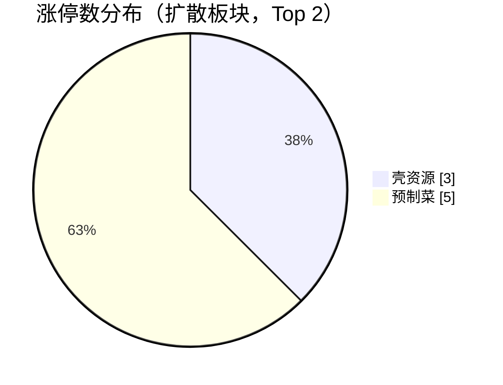
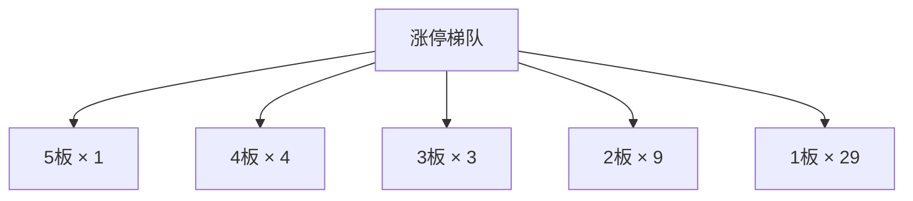
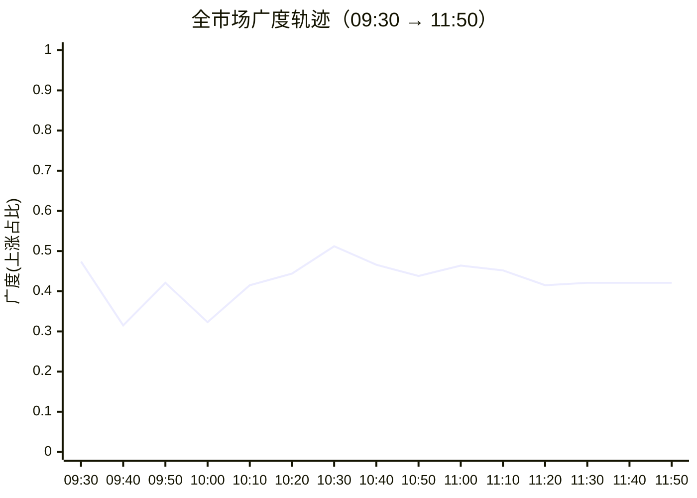

## 当日总览（截至 11:50）

> **结论**：全市场涨2349/跌3008（广度0.44）；涨停46/跌停1；中位涨幅-0.17%；局部修复。 钱在：壳资源(涨停3/成分51，中位+0.00%)、预制菜(涨停5/成分101，中位+0.41%)；零星涨停：高压氧舱(1)、低辐射玻璃(Low-E)(1)、广东自贸区(2)、POE胶膜(2)、钛白粉概念(1)。 退潮：2025年报预增(跌停1)、冷链物流(跌停1)、电子商务(跌停1)。 梯队：5板×1、4板×4、3板×3、2板×9、1板×29，最高5板。 预案：超买区 东山精密、锋龙股份、剑桥科技、沪电股份、襄阳轴承、文投控股、凯撒文化；已触发 新易盛、华盛昌、中京电子、宝鼎科技；未到价 光洋股份、合锻智能、科森科技、福莱新材、果麦文化。 较上一轮广度基本持平。

> 🔒 **no_trade / 买入预算 0 / max_position_pct 0 —— 全部内容仅供研究，不授予交易权限。**

### 板块扩散

> 口径：XTick 概念成分 × 全市场实时报价；分母 = 板块内有有效报价的成分数。排序用涨停密度（涨停数/有效成分数），已剔除宽基属性板块（全市场 432 个板块中剔 16 个）。

**扩散中（题材，按涨停密度排序）**

| 板块 | 涨停 | 有效成分 | 涨停密度 | 上涨广度 | 中位涨幅 | 相对全市场 | 成交(亿) |
|---|---|---|---|---|---|---|---|
| 高压氧舱 ⬦ | 1 | 11 | 0.091 | 0.64 | +0.55% | +0.72% | 25 |
| 低辐射玻璃(Low-E) ⬦ | 1 | 12 | 0.083 | 0.50 | -0.07% | +0.10% | 18 |
| 广东自贸区 ⬦ | 2 | 29 | 0.069 | 0.55 | +0.25% | +0.42% | 39 |
| POE胶膜 ⬦ | 2 | 29 | 0.069 | 0.48 | +0.00% | +0.17% | 43 |
| 钛白粉概念 ⬦ | 1 | 15 | 0.067 | 0.47 | -0.22% | -0.05% | 20 |
| 壳资源 | 3 | 51 | 0.059 | 0.49 | +0.00% | +0.17% | 65 |
| 中韩自贸区 ⬦ | 1 | 17 | 0.059 | 0.35 | -0.23% | -0.06% | 47 |
| 黑龙江自贸区 ⬦ | 2 | 36 | 0.056 | 0.39 | -0.20% | -0.03% | 65 |
| 农村电商 ⬦ | 2 | 37 | 0.054 | 0.38 | -0.14% | +0.03% | 67 |
| 预制菜 | 5 | 101 | 0.050 | 0.65 | +0.41% | +0.58% | 149 |
| 举牌 ⬦ | 1 | 21 | 0.048 | 0.52 | +0.08% | +0.25% | 16 |
| 免税店 ⬦ | 1 | 26 | 0.038 | 0.50 | +0.06% | +0.23% | 31 |

> ⬦ = 涨停 <3 只，零星个例，不构成扩散（不计入「钱在」判定）。



零星涨停板块（<3 只）：高压氧舱(1)、低辐射玻璃(Low-E)(1)、广东自贸区(2)、POE胶膜(2)、钛白粉概念(1)、中韩自贸区(1)、黑龙江自贸区(2)、农村电商(2)

**退潮中（跌停集中）**

| 板块 | 跌停 | 有效成分 | 上涨广度 | 中位涨幅 |
|---|---|---|---|---|
| 2025年报预增 | 1 | 504 | 0.41 | -0.22% |
| 冷链物流 | 1 | 155 | 0.45 | +0.00% |
| 电子商务 | 1 | 676 | 0.47 | +0.00% |
| 宠物经济 | 1 | 127 | 0.53 | +0.13% |
| 食品安全 | 1 | 74 | 0.55 | +0.17% |
| 预制菜 | 1 | 101 | 0.65 | +0.41% |
| 社区团购 | 1 | 51 | 0.71 | +0.44% |

### 涨停梯队

> 最高 5 板 ｜ 涨停 46 ｜ 跌停 1 ｜ 炸板 20 ｜ 封板率 69.7% ｜ 打板成功率 20.00% ｜ 一进二 13.64% ｜ 二进三 25.00%

| 身位 | 家数 | 成员（涨幅/封单亿/首封） |
|---|---|---|
| 5板 | 1 | 日出东方 +10.03%/0.018亿/09:30 |
| 4板 | 4 | 亚玛顿 +9.99%/0.025亿/09:25；锋龙股份 +10.00%/0.010亿/09:25；文投控股 +9.87%/0.009亿/09:34；东方环宇 +9.99%/0.007亿/11:00 |
| 3板 | 3 | 襄阳轴承 +10.00%/0.022亿/09:30；凯撒文化 +9.92%/0.019亿/09:25；天普股份 +10.00%/0.002亿/09:41 |
| 2板 | 9 | 金辰股份 +10.00%/0.039亿/09:25；青山纸业 +10.06%/0.031亿/09:25；日发精机 +10.06%/0.023亿/09:25；天安新材 +10.03%/0.019亿/09:25；天洋新材 +9.97%/0.019亿/09:30 |
| 1板 | 29 | 吉视传媒 +10.20%/0.025亿/10:09；东方海洋 +10.02%/0.023亿/09:25；好当家 +10.22%/0.023亿/11:23；龙江交通 +10.02%/0.021亿/10:38；鸿博股份 +10.02%/0.021亿/09:37 |



炸板 20 只（前几）：日海智能(6次)、通富微电(4次)、北纬科技(4次)、景旺电子(3次)、思美传媒(3次)

### 预案池对照

| 票 | 池 | 板块 | 现价 | 涨幅 | 触发价 | 买区 | 风险位 | 判定 |
|---|---|---|---|---|---|---|---|---|
| 东山精密 `002384.SZ` | 执行池 | PCB概念 | 96.71 | +5.05% | 92.06 | [91.6, 93.44] | 88.77 | **超买区** |
| 锋龙股份 `002931.SZ` | 执行池 | 机器人概念 | 58.39 | +10.00% | 53.08 | [52.81, 53.88] | 51.19 | **超买区** |
| 剑桥科技 `603083.SH` | 观察池 | 共封装光学(CPO) | 128.33 | +9.73% | 116.95 | [116.37, 118.7] | 115.49 | **超买区** |
| 新易盛 `300502.SZ` | 观察池 | 共封装光学(CPO) | 215.61 | +0.28% | 215.0 | [213.93, 218.22] | 200.76 | **已触发** |
| 沪电股份 `002463.SZ` | 观察池 | PCB概念 | 93.56 | +4.62% | 89.43 | [88.98, 90.77] | 86.23 | **超买区** |
| 光洋股份 `002708.SZ` | 观察池 | 机器人概念 | 25.85 | -2.78% | 26.59 | [26.46, 26.99] | 25.64 | **未到价** |
| 华盛昌 `002980.SZ` | 观察池 | 共封装光学(CPO) | 76.27 | +0.59% | 75.82 | [75.44, 76.96] | 73.11 | **已触发** |
| 中京电子 `002579.SZ` | 观察池 | 共封装光学(CPO) | 12.79 | +0.63% | 12.71 | [12.65, 12.9] | 12.25 | **已触发** |
| 合锻智能 `603011.SH` | 观察池 | 共封装光学(CPO) | 18.84 | -2.28% | 20.29 | [20.19, 20.59] | 19.56 | **未到价** |
| 宝鼎科技 `002552.SZ` | 观察池 | PCB概念 | 34.27 | -0.09% | 34.3 | [34.13, 34.81] | 33.07 | **买区内** |
| 襄阳轴承 `000678.SZ` | 观察池 | 机器人概念 | 23.31 | +10.00% | 21.19 | [21.08, 21.51] | 20.43 | **超买区** |
| 科森科技 `603626.SH` | 观察池 | 机器人概念 | 31.51 | +0.16% | 32.31 | [32.15, 32.79] | 31.15 | **未到价** |
| 福莱新材 `605488.SH` | 观察池 | 机器人概念 | 58.8 | -6.71% | 63.03 | [62.71, 63.98] | 60.78 | **未到价** |
| 文投控股 `600715.SH` | 观察池 | 短剧游戏 | 3.45 | +9.87% | 3.14 | [3.12, 3.19] | 3.03 | **超买区** |
| 凯撒文化 `002425.SZ` | 观察池 | 短剧游戏 | 4.21 | +9.92% | 3.83 | [3.81, 3.89] | 3.7 | **超买区** |
| 果麦文化 `301052.SZ` | 观察池 | 短剧游戏 | 45.28 | -7.52% | 48.96 | [48.72, 49.69] | 45.71 | **未到价** |
| 日出东方 `603366.SH` | 观察池 | 光伏概念 | 13.17 | +10.03% | — | — | — | **无预案价** |
| 亚玛顿 `002623.SZ` | 观察池 | 光伏概念 | 25.66 | +9.99% | — | — | — | **无预案价** |
| 生益科技 `600183.SH` | 观察池 | PCB上游 | 78.43 | +2.02% | — | — | — | **无预案价** |
| 金杯电工 `002533.SZ` | 观察池 | 电缆中标 | 10.34 | -0.19% | — | — | — | **无预案价** |
| 卫星化学 `002648.SZ` | 观察池 | 化工新材料 | 23.31 | -2.35% | — | — | — | **无预案价** |

- **东山精密** — 现价96.71 已高于买区上沿93.44，不追高；仅价格位置对照，不代表完整入场条件确认；不能据此确认站稳，不授予下单权限
- **锋龙股份** — 现价58.39 已高于买区上沿53.88，不追高；仅价格位置对照，不代表完整入场条件确认；不能据此确认站稳，不授予下单权限
- **剑桥科技** — 现价128.33 已高于买区上沿118.7，不追高；仅价格位置对照，不代表完整入场条件确认；不能据此确认站稳，不授予下单权限
- **新易盛** — 现价215.61 ≥ 触发价215.0；仅价格位置对照，不代表完整入场条件确认；不能据此确认站稳，不授予下单权限
- **沪电股份** — 现价93.56 已高于买区上沿90.77，不追高；仅价格位置对照，不代表完整入场条件确认；不能据此确认站稳，不授予下单权限
- **华盛昌** — 现价76.27 ≥ 触发价75.82；仅价格位置对照，不代表完整入场条件确认；不能据此确认站稳，不授予下单权限
- **中京电子** — 现价12.79 ≥ 触发价12.71；仅价格位置对照，不代表完整入场条件确认；不能据此确认站稳，不授予下单权限
- **宝鼎科技** — 现价34.27 落在买区[34.13, 34.81]；仅价格位置对照，不代表完整入场条件确认；不能据此确认站稳，不授予下单权限
- **襄阳轴承** — 现价23.31 已高于买区上沿21.51，不追高；仅价格位置对照，不代表完整入场条件确认；不能据此确认站稳，不授予下单权限
- **文投控股** — 现价3.45 已高于买区上沿3.19，不追高；仅价格位置对照，不代表完整入场条件确认；不能据此确认站稳，不授予下单权限
- **凯撒文化** — 现价4.21 已高于买区上沿3.89，不追高；仅价格位置对照，不代表完整入场条件确认；不能据此确认站稳，不授予下单权限

> ⚠ D1 明确 no_trade=true、买入预算 0、个股 max_position_pct=0。以上为研究对照，**不构成任何买入许可**。

### 盘面 vs 静态复盘 vs 消息面

| 维度 | 对象 | T-1 静态基线 | 今日盘面 | 关系 |
|---|---|---|---|---|
| 板块主线 | 短剧游戏 | R2 次线 score=63 涨停None（T-1 口径） | 今日盘中该板块 2 只涨停 / 成分99 广度0.24 中位-0.97%（相对全市场-0.80%） | **无响应** |
| 板块主线 | 光伏概念 | R2 次线 score=61 涨停None（T-1 口径） | 今日盘中该板块 6 只涨停 / 成分602 广度0.41 中位-0.26%（相对全市场-0.09%） | **无响应** |
| 板块主线 | 存储芯片 | R2 次线 score=63 涨停None（T-1 口径） | 今日盘中该板块 2 只涨停 / 成分203 广度0.77 中位1.01%（相对全市场+1.18%） | **无响应** |
| 梯队结构 | 最高5板 | T-1 最高梯队 4 板、首板 29、炸板率 39.06% | 今日 5板×1、4板×4、3板×3、2板×9、1板×29；封板率0.697 炸板20只 | **印证** |
| 预案验证 | 东山精密(002384.SZ) | 预案 PCB概念／leader／触发价92.06／买区[91.6, 93.44] | 超买区：现价96.71 已高于买区上沿93.44，不追高；仅价格位置对照，不代表完整入场条件确认；不能据此确认站稳，不授予下单权限 | **背离** |
| 预案验证 | 锋龙股份(002931.SZ) | 预案 机器人概念／leader／触发价53.08／买区[52.81, 53.88] | 超买区：现价58.39 已高于买区上沿53.88，不追高；仅价格位置对照，不代表完整入场条件确认；不能据此确认站稳，不授予下单权限 | **背离** |
| 预案验证 | 剑桥科技(603083.SH) | 预案 共封装光学(CPO)／watch／触发价116.95／买区[116.37, 118.7] | 超买区：现价128.33 已高于买区上沿118.7，不追高；仅价格位置对照，不代表完整入场条件确认；不能据此确认站稳，不授予下单权限 | **背离** |
| 预案验证 | 新易盛(300502.SZ) | 预案 共封装光学(CPO)／watch／触发价215.0／买区[213.93, 218.22] | 已触发：现价215.61 ≥ 触发价215.0；仅价格位置对照，不代表完整入场条件确认；不能据此确认站稳，不授予下单权限 | **印证** |
| 预案验证 | 沪电股份(002463.SZ) | 预案 PCB概念／watch／触发价89.43／买区[88.98, 90.77] | 超买区：现价93.56 已高于买区上沿90.77，不追高；仅价格位置对照，不代表完整入场条件确认；不能据此确认站稳，不授予下单权限 | **背离** |
| 预案验证 | 光洋股份(002708.SZ) | 预案 机器人概念／watch／触发价26.59／买区[26.46, 26.99] | 未到价：现价25.85，触发价26.59，还差2.86%；仅价格位置对照，不代表完整入场条件确认；不能据此确认站稳，不授予下单权限 | **无响应** |
| 预案验证 | 华盛昌(002980.SZ) | 预案 共封装光学(CPO)／watch／触发价75.82／买区[75.44, 76.96] | 已触发：现价76.27 ≥ 触发价75.82；仅价格位置对照，不代表完整入场条件确认；不能据此确认站稳，不授予下单权限 | **印证** |
| 预案验证 | 中京电子(002579.SZ) | 预案 共封装光学(CPO)／watch／触发价12.71／买区[12.65, 12.9] | 已触发：现价12.79 ≥ 触发价12.71；仅价格位置对照，不代表完整入场条件确认；不能据此确认站稳，不授予下单权限 | **印证** |
| 预案验证 | 合锻智能(603011.SH) | 预案 共封装光学(CPO)／watch／触发价20.29／买区[20.19, 20.59] | 未到价：现价18.84，触发价20.29，还差7.7%；仅价格位置对照，不代表完整入场条件确认；不能据此确认站稳，不授予下单权限 | **无响应** |
| 预案验证 | 宝鼎科技(002552.SZ) | 预案 PCB概念／watch／触发价34.3／买区[34.13, 34.81] | 买区内：现价34.27 落在买区[34.13, 34.81]；仅价格位置对照，不代表完整入场条件确认；不能据此确认站稳，不授予下单权限 | **印证** |
| 预案验证 | 襄阳轴承(000678.SZ) | 预案 机器人概念／watch／触发价21.19／买区[21.08, 21.51] | 超买区：现价23.31 已高于买区上沿21.51，不追高；仅价格位置对照，不代表完整入场条件确认；不能据此确认站稳，不授予下单权限 | **背离** |
| 预案验证 | 科森科技(603626.SH) | 预案 机器人概念／watch／触发价32.31／买区[32.15, 32.79] | 未到价：现价31.51，触发价32.31，还差2.54%；仅价格位置对照，不代表完整入场条件确认；不能据此确认站稳，不授予下单权限 | **无响应** |
| 预案验证 | 福莱新材(605488.SH) | 预案 机器人概念／watch／触发价63.03／买区[62.71, 63.98] | 未到价：现价58.8，触发价63.03，还差7.19%；仅价格位置对照，不代表完整入场条件确认；不能据此确认站稳，不授予下单权限 | **无响应** |
| 预案验证 | 文投控股(600715.SH) | 预案 短剧游戏／watch／触发价3.14／买区[3.12, 3.19] | 超买区：现价3.45 已高于买区上沿3.19，不追高；仅价格位置对照，不代表完整入场条件确认；不能据此确认站稳，不授予下单权限 | **背离** |
| 预案验证 | 凯撒文化(002425.SZ) | 预案 短剧游戏／watch／触发价3.83／买区[3.81, 3.89] | 超买区：现价4.21 已高于买区上沿3.89，不追高；仅价格位置对照，不代表完整入场条件确认；不能据此确认站稳，不授予下单权限 | **背离** |
| 预案验证 | 果麦文化(301052.SZ) | 预案 短剧游戏／watch／触发价48.96／买区[48.72, 49.69] | 未到价：现价45.28，触发价48.96，还差8.13%；仅价格位置对照，不代表完整入场条件确认；不能据此确认站稳，不授予下单权限 | **无响应** |
| 预案验证 | 日出东方(603366.SH) | 预案 光伏概念／watch／触发价None／买区None | 无预案价：预案未给有效入场触发价/完整买区（缺失、空规则或格式异常）；仅价格位置对照，不代表完整入场条件确认；不能据此确认站稳，不授予下单权限 | **无响应** |
| 预案验证 | 亚玛顿(002623.SZ) | 预案 光伏概念／watch／触发价None／买区None | 无预案价：预案未给有效入场触发价/完整买区（缺失、空规则或格式异常）；仅价格位置对照，不代表完整入场条件确认；不能据此确认站稳，不授予下单权限 | **无响应** |
| 预案验证 | 生益科技(600183.SH) | 预案 PCB上游／watch／触发价None／买区None | 无预案价：预案未给有效入场触发价/完整买区（缺失、空规则或格式异常）；仅价格位置对照，不代表完整入场条件确认；不能据此确认站稳，不授予下单权限 | **无响应** |
| 预案验证 | 金杯电工(002533.SZ) | 预案 电缆中标／watch／触发价None／买区None | 无预案价：预案未给有效入场触发价/完整买区（缺失、空规则或格式异常）；仅价格位置对照，不代表完整入场条件确认；不能据此确认站稳，不授予下单权限 | **无响应** |
| 预案验证 | 卫星化学(002648.SZ) | 预案 化工新材料／watch／触发价None／买区None | 无预案价：预案未给有效入场触发价/完整买区（缺失、空规则或格式异常）；仅价格位置对照，不代表完整入场条件确认；不能据此确认站稳，不授予下单权限 | **无响应** |
| 消息面对照 | 盘面热点板块 | R4 消息面（T-1 口径） | 实时快讯未出现热点板块关键词 | **无响应** |

**分歧点（不掩盖）：**
- 预案验证·东山精密(002384.SZ) → 背离：仅研究对照，不授予交易权限
- 预案验证·锋龙股份(002931.SZ) → 背离：仅研究对照，不授予交易权限
- 预案验证·剑桥科技(603083.SH) → 背离：仅研究对照，不授予交易权限
- 预案验证·沪电股份(002463.SZ) → 背离：仅研究对照，不授予交易权限
- 预案验证·襄阳轴承(000678.SZ) → 背离：仅研究对照，不授予交易权限
- 预案验证·文投控股(600715.SH) → 背离：仅研究对照，不授予交易权限
- 预案验证·凯撒文化(002425.SZ) → 背离：仅研究对照，不授予交易权限

### 全天广度轨迹

| 时点 | 涨 | 跌 | 广度 | 涨停 | 跌停 | 成交(亿) | 有效样本 |
|---|---|---|---|---|---|---|---|
| 0930 | 2630 | 2461 | 0.474 | 12 | 0 | 692 | 5553 |
| 0940 | 1758 | 3537 | 0.315 | 23 | 0 | 3,171 | 5573 |
| 0950 | 2344 | 2935 | 0.421 | 30 | 0 | 4,835 | 5573 |
| 1000 | 1802 | 3564 | 0.323 | 36 | 0 | 6,128 | 5573 |
| 1010 | 2311 | 3005 | 0.415 | 38 | 0 | 7,324 | 5573 |
| 1020 | 2475 | 2842 | 0.444 | 41 | 0 | 8,358 | 5573 |
| 1030 | 2856 | 2459 | 0.512 | 39 | 0 | 9,211 | 5573 |
| 1040 | 2596 | 2703 | 0.466 | 42 | 0 | 9,867 | 5573 |
| 1050 | 2442 | 2884 | 0.438 | 40 | 0 | 10,466 | 5573 |
| 1100 | 2588 | 2726 | 0.464 | 42 | 0 | 11,001 | 5573 |
| 1110 | 2520 | 2785 | 0.452 | 43 | 0 | 11,413 | 5573 |
| 1120 | 2312 | 3015 | 0.415 | 45 | 1 | 11,876 | 5573 |
| 1130 | 2348 | 2997 | 0.421 | 46 | 1 | 12,306 | 5573 |
| 1140 | 2348 | 2997 | 0.421 | 46 | 1 | 12,306 | 5573 |
| 1150 | 2348 | 2997 | 0.421 | 46 | 1 | 12,306 | 5573 |

> ⚠ **数据冻结段**：1130–1150 数值连续完全一致，说明行情源未刷新，**不是市场横盘**，该段不可解读为盘面变化。



### 观察建议（仅研究）

- **环境**：涨停 46.0 / 跌停 1.0，打板成功率 20.0%，一进二 13.6%。
- **方向**：今日形成实质扩散的是 壳资源（涨停3/成分51，密度0.059，中位+0.00%）、预制菜（涨停5/成分101，密度0.050，中位+0.41%）。**需确认**：次日能否维持涨停家数且中位涨幅不掉队，否则只是普跌中的避险轮动。
- **零星**：高压氧舱(1只/11成分)、低辐射玻璃(Low-E)(1只/12成分)、广东自贸区(2只/29成分)、POE胶膜(2只/29成分)、钛白粉概念(1只/15成分) 属零星个例，不视为题材，不据此选股。
- **回避**：2025年报预增（跌停1）、冷链物流（跌停1）、电子商务（跌停1） 板块中位跌幅深，趋势未止跌前不接。
- **身位**：最高 5 板。梯队有高度不等于可接力，需逐票核验封单稳定性与开板次数后再定。
- **预案**：东山精密（现价96.71 已高于买区上沿93.44，不追高；仅价格位置对照，不代表完整入场条件确认；不能据此确认站稳，不授予下单权限）、锋龙股份（现价58.39 已高于买区上沿53.88，不追高；仅价格位置对照，不代表完整入场条件确认；不能据此确认站稳，不授予下单权限）、剑桥科技（现价128.33 已高于买区上沿118.7，不追高；仅价格位置对照，不代表完整入场条件确认；不能据此确认站稳，不授予下单权限）、沪电股份（现价93.56 已高于买区上沿90.77，不追高；仅价格位置对照，不代表完整入场条件确认；不能据此确认站稳，不授予下单权限）、襄阳轴承（现价23.31 已高于买区上沿21.51，不追高；仅价格位置对照，不代表完整入场条件确认；不能据此确认站稳，不授予下单权限）、文投控股（现价3.45 已高于买区上沿3.19，不追高；仅价格位置对照，不代表完整入场条件确认；不能据此确认站稳，不授予下单权限）、凯撒文化（现价4.21 已高于买区上沿3.89，不追高；仅价格位置对照，不代表完整入场条件确认；不能据此确认站稳，不授予下单权限）。买区已错过，**不追高**；要参与需等新剧本，不能沿用原预案价位。
- **预案待检验**：光洋股份(触发价26.59，还差+2.86%)、合锻智能(触发价20.29，还差+7.70%)、科森科技(触发价32.31，还差+2.54%)、福莱新材(触发价63.03，还差+7.19%)、果麦文化(触发价48.96，还差+8.13%) 尚未触及触发价，剧本未被盘面检验，继续按原失效条件看。

<details>
<summary>原始截面与数据质量（折叠）</summary>

**跨源校验**

```json
{
  "xtick": {
    "up": 2349,
    "down": 3008,
    "n": 5585,
    "amount_yi": 12213.6
  },
  "rtk_snapshot": {
    "up": 2348,
    "down": 2997,
    "valid_n": 5573,
    "amount_yi": 12305.7,
    "up_limit": 46,
    "down_limit": 1
  },
  "note": "两源口径不同（XTick 全市场含全部票；rt_k 返回样本）"
}
```

**rt_k 截面（原始）**

```json
{
  "market": {
    "total": 5584,
    "up": 2348,
    "down": 2997,
    "flat": 228,
    "requested_n": 5584,
    "received_n": 5584,
    "valid_n": 5573,
    "missing_n": 11,
    "universe_requested_n": null,
    "population_scope": "returned_rows_not_verified_all_a_universe",
    "up_ratio": 0.4205,
    "legacy_up_ratio_placeholder": false,
    "up_ratio_is_observed": true,
    "up_ratio_all": 0.4205,
    "up_ratio_valid": 0.4213,
    "up_ratio_denominator": "requested_n",
    "degraded": false,
    "limit_known_n": 5573,
    "limit_unknown_n": 0,
    "limit_counts_complete": true,
    "limit_source_errors": [],
    "up_gt3": 347,
    "up_gt5": 166,
    "up_limit": 46,
    "down_gt3": 169,
    "down_gt5": 39,
    "down_limit": 1,
    "amount_yi": 12305.7,
    "amount_sum_overflow": false,
    "amount_valid_n": 5573,
    "amount_missing_n": 0
  },
  "source_time_quality": {
    "quote_age_min_seconds": 1.586584,
    "quote_age_max_seconds": 61.586584,
    "source_age_limit_seconds": null,
    "freshness_status": "age_limit_not_configured",
    "age_reference_at": "2026-11-12T11:50:43.586584+08:00"
  },
  "trading_authorized": false
}
```

</details>

## 分时研判记录

### 09:35 研判增量
- **趋势**：截至2026-11-12 09:30（分析文件生成于09:30:59），今天仅有首份截面，不能认定“较上一轮持平”或盘中拐点。有效报价样本上涨率为47.36%（2630/5553）；顶部约0.51是另一源剔除平盘后的涨跌家数口径，不混比。涨停梯队中12只是连板、首板仅1只，且9只首封时间在09:25：开盘奖励主要集中于既有前排，日出东方由昨日4板升至当前5板不等于新题材全面启动。昨日炸板率在分析基线与盘前预案中分别为39.06%、18.27%，口径冲突，暂不据此判断情绪改善。
- **轮动**：密度榜遗漏了容量方向的面上修复：PCB有184/241只上涨、中位涨幅+0.52%，存储芯片166/203只上涨、中位+0.72%，但两者涨停均为0，属于上涨面较广、尚待强度确认。光伏全量板块实际有4/602只涨停、333/602只上涨，因此顶部“全市场无扩散”的概括过强；不过前排连板与全板块资金回流仍是两回事。锋龙封板也不能等同机器人全线扩散，人形机器人样本仅179/482只上涨（不是全部机器人概念）；短剧游戏40/99只上涨，个别强票尚未带起全板块。当前只能确认相对强弱，不能凭单截面认定资金已从科技流向机器人。消息关键词未匹配仅表示核验不足，不等于没有催化。
- **剧本**：盘前“科技容量修复”获得上涨面的部分印证，但原买点并未因此全部兑现：东山、锋龙均超过原买区上沿，强势延续与当前可接受买点必须分开，不追高、不抬上沿。原“硬件兑现→机器人承接”的反向剧本尚无成立证据，不能因锋龙封板就宣布切换。“已触发”组也不能整体视为通过：光洋、中京仍有明确财务硬否决；宝鼎不能因价位合适替补东山；新易盛只满足价格位置，分时承接和完整资格仍待核验。原价位方案有效期截至今日09:29，本轮只作历史剧本对照，不自动续期。
- **下一步看**：下一份同口径截面中，先看有效样本上涨率能否高于09:30的47.36%，并伴随首板多于当前1只；若只增连板、不扩上涨面，仍按前排集中解释。光伏看涨停能否在当前4只基础上增加，PCB和存储看同成分覆盖下上涨面能否维持或扩大。新易盛以原触发价215.00、原买区213.93—218.22作研究锚：后续报价跌回215.00以下便不再满足“现价高于触发价”，超过218.22则转为超买区；单次报价不能证明站稳。东山93.44、锋龙53.88仍是原情景上沿，回落进区也须重新判断承接，不能机械恢复旧买点。系统继续保持no_trade=true、买入预算0、个股max_position_pct=0；以上仅供研究，不构成任何买入许可。

### 09:45 研判增量
- **趋势**：2026-11-12 09:40截面对照09:30，结构转为“多数回落、少数强股集中”，不是普涨修复。有效报价样本上涨率由47.36%（2630/5553）降至31.54%（1758/5573）；有效样本数变化，不作同一股票集合的精确差分，也不沿用顶部广度差。涨停梯队源统计13→23、炸板4→8，而当前封板最高高度5→4：日出东方转入炸板名单、累计开板7次，价格源仍显示涨停价，属于封板状态与价格位置分歧，不能宣告稳定回封或当日断板。首板统计虽增加，最新报9只但明细仅8只，名单缺项待核。本轮报价时标为09:40:18—09:40:50，不代表09:45即时行情。
- **轮动**：科技内部也在分化：存储芯片上涨166/203→157/203，中位涨幅+0.72%→+0.79%，是上涨面略收缩但价格强度仍增强；PCB上涨184/241→128/241、中位+0.52%→+0.12%，修复明显收窄。CPO涨停2→3而上涨170/230→130/230，增板不等于扩面；减速器新进密度榜前列，涨停2→4但上涨39/140→29/140、中位-0.48%→-0.86%，同样是前排集中，尚不能证明硬件资金转入机器人。光伏涨停仍4只、上涨333/602→220/602，短剧游戏上涨40/99→22/99，均未随前排走强。分析所附09:40:38“科创50涨2%”快讯与存储相对强势相容，但只是行情报道，不是新增产业催化；静态次线、消息与盘面尚未形成主线共振。
- **剧本**：预案“已触发”由4只减至2只：光洋26.67→26.06、中京12.85→12.64，均从原触发价及买区内退回下方，是价格条件曾满足后丢失，不是“始终未到价”；两票原财务否决不解除。余下新易盛216.66→215.69、宝鼎34.70→34.35，虽仍高于原触发价215.00、34.30，但余量收窄，不能把标签不变理解为承接不变。东山95.40→95.65仍超原买区上沿93.44，说明核心抗跌而非旧买点恢复；锋龙价格仍58.39，开板次数0→2，也削弱“前排稳定承接”的推论。原“硬件兑现→机器人承接”只见后者局部增板，缺整体响应，不能宣布切换，更不拿后排替补。
- **下一步看**：以本轮值为观察锚，存储看上涨家数能否高于157/203且中位涨幅不低于+0.79%；PCB看能否回到184/241，而非只靠东山独强。减速器若仍只有涨停增加、上涨家数不能超过29/140，就不升级为板块扩散。新易盛若跌回215.00下、宝鼎若跌回34.30下，撤销“现价满足原触发价”的判断；高于各自买区上沿218.22、34.81则转为超买区，不追高。日出东方须先见封板状态与价格源一致，再谈高度恢复。上述只是原预案研究对照，不续期、不修改买区；no_trade=true、买入预算0、个股max_position_pct=0保持不变，不构成任何买入许可。

### 09:55 研判增量
- **趋势**：2026-11-12 09:50对照09:40，前一轮的普遍回落出现修复，但尚非普涨反转。两轮有效报价样本均为5573只，上涨率31.54%（1758/5573）→42.06%（2344/5573），回升10.51个百分点；中位涨幅-0.33%→-0.14%，仍是下跌家数多于上涨。涨停23→30、首板统计9→15，修复不只靠老连板；封板率74.19%→78.95%、炸板家数仍8只，但成员发生切换：日出东方重新列入5板封板梯队，锋龙退出4板封板名单。日出累计开板仍7次，不据一次截面宣布封单稳定。本轮采集09:50:41—09:50:52，报价时标09:49:54—09:50:50，并非09:55即时行情。
- **轮动**：相对选择重新偏向科技容量：存储芯片上涨157/203→179/203、中位+0.79%→+1.80%；PCB上涨128/241→177/241；CPO上涨130/230→182/230且涨停仍3只，是上涨面补回，不是仅龙头加速。反面是减速器仍4只涨停，但上涨29/140→28/140、中位-0.86%→-0.88%，不能把前排板数当机器人承接增强，也不能据此断言同一批资金完成迁移。光伏上涨220/602→305/602、涨停4→5，是另一个修复方向；装配式建筑涨停2→4、进入密度榜，但仅46/109上涨、中位-0.17%，仍属局部集中。新榜首高压氧舱只有1/11涨停，不升级为新主线。09:50:25芯片ETF上涨快讯与科技修复相容，但它是行情报道，不是新增产业催化；静态次线获得价格响应，尚不足称三方共振。
- **剧本**：“已触发”仍2只却已换人，不能把总数不变当预案没变化：新易盛215.69→221.00，越过原上沿218.22，转为超买区、不追；中京12.64→12.81，重新高于原触发12.71并回到12.65—12.90内，但只恢复价格条件，原财务硬否决不解除；宝鼎34.35→34.75仍在原区间，不能因东山买点错过就递补。东山95.65→97.90、沪电91.97→93.98与PCB扩面，更支持原“核心合力修复”的研究推论；锋龙58.39→57.27、累计开板2→3则削弱“机器人原前排有换手承接”的推论。原“硬件兑现→机器人承接”本轮没有得到验证；东山、锋龙仍分别高于原上沿93.44、53.88，强弱变化均不恢复旧买点。
- **下一步看**：用本轮已观测值作研究锚，不另造入场门槛：同口径上涨率能否继续高于42.06%，同时涨停不低于30；若上涨面再缩而只增涨停，回到强势集中解释。科技修复看存储179/203、PCB177/241的上涨面能否保持或扩大；光伏看5/602涨停是否保住并增加，装配式建筑则须在4只涨停之外看到上涨家数超过46/109，才支持扩散增强。中京若再低于12.71，撤销“现价满足原触发”的判断；宝鼎若高于34.81，转为超买区、不追，低于34.30则不再满足原触发。日出东方后续是否仍列封板、累计开板是否超过7次，决定高度恢复能否延续，单次封板不证明可成交。以上仅作原预案研究对照，不续期、不改价；no_trade=true、买入预算0、个股max_position_pct=0保持不变，不构成任何买入许可。

### 10:05 研判增量
- **趋势**：2026-11-12 10:00对照09:50，上轮面上修复再次回落，不能把顶部“局部修复”理解为市场继续转强。两轮有效报价样本均5573只，上涨率42.06%（2344/5573）→32.33%（1802/5573），下降9.73个百分点；中位涨幅-0.14%→-0.40%。梯队源涨停30→33，但首板15→21、二至四板各减少1只，增板伴随连板梯队收缩；封板率78.95%→73.33%、炸板8→12只，风险正在从个别前排外溢。文投、襄阳由封板名单转入炸板名单，累计开板分别2→5、1→4次，尽管价格源仍显示涨停附近，也不能宣布稳定回封或当日断板。本轮价格采集10:00:41—10:00:54，报价时标10:00:03—10:00:51，并非10:05即时价。
- **轮动**：科技是强度集中而非继续扩面：存储上涨179/203→174/203、中位+1.80%→+2.06%；PCB上涨177/241→170/241、中位+0.89%→+0.98%；CPO涨停3→4，但上涨182/230→177/230。多数回落时这些方向价格强度仍升，说明相对选择未离开硬件，但不能据此认定资金净流入。减速器涨停4→2、上涨28/140→21/140，削弱“硬件兑现→机器人承接”的替代剧本。光伏涨停仍5只，上涨305/602→233/602，前排高度未带动全板块。预制菜在至少3只涨停的题材密度榜升至第一，涨停3→4但上涨42/101→38/101，只能认作少数强股聚集，不能据排名宣布消费接棒；没有已证实的跷跷板。昨日次线存储已有价格响应，不能机械照抄“无响应”标签；本轮快讯仍缺已核直接催化，尚不能升级为消息、静态研究与盘面三方共振。
- **剧本**：东山97.90→98.73、沪电93.98→95.35，在PCB上涨面收窄时继续走强，更支持原预案“容量核心合力修复”，但两者仍超原买区，不等于出现新买点。新增价位状态只有宝鼎34.75→34.86，越过原上沿34.81，从“已触发”转“超买区”，不追、不因东山买不到而递补；“已触发”由2只减至1只。留下的中京12.81→12.88虽仍在原买区12.65—12.90内且高于触发12.71，只满足价格位置，原财务硬否决未解除。锋龙57.27→57.00且仍在炸板名单，与减速器走弱相互印证，机器人承接条件不是正在满足；不下移原买区接弱。所有原价位仍只是历史情景对照，不续期、不修改正式预案。
- **下一步看**：用已出现过的数值核验，不另造买入门槛：同口径上涨率若不能重新回到09:50的42.06%，而仅涨停家数增加，继续按强势集中而非普涨修复解释；封板率能否回到78.95%、炸板家数是否继续超过当前12只，检验接力风险是否缓和。CPO在保住4只涨停之外，还要看上涨家数能否恢复至182/230，才支持扩面恢复；光伏则看上涨能否回到305/602，不能只盯日出东方5板。文投、襄阳后续须核封板状态与报价是否一致、开板次数是否继续增加。中京高于12.90即超原买区、不追，低于12.71则不再满足原触发；即使留在区间，财务否决也不解除。no_trade=true、买入预算0、个股max_position_pct=0保持不变，以上全部仅供研究，不构成任何买入许可。

### 10:15 研判增量
- **趋势**：2026-11-12 10:10对照10:00，是震荡中的再次修复，不是单向反转。同为5573只有效报价样本，上涨率32.33%（1802/5573）→41.47%（2311/5573），回升9.13个百分点，但仍未超过09:50的42.06%。梯队源涨停33→38、最高仍5板，锋龙、文投、襄阳重新进入封板名单，说明增板部分来自老前排修复；封板率73.33%→77.55%，但文投累计开板5→12次、襄阳4→5次，不能把回到封板名单当成抛压已消化。本轮价格采集10:10:41—10:10:52，报价时标10:09:27—10:10:50，并非10:15即时行情。
- **轮动**：密度榜首没换，预制菜的结构却变了：涨停仍4只，上涨38/101→63/101、中位-0.12%→+0.28%，由少数强股集中转为上涨面扩展。与此同时PCB上涨170/241→176/241、存储174/203→178/203，科技也在修复，暂不能说消费从硬件抽血。CPO则上涨177/230→175/230、涨停仍4只，中位+1.33%→+1.40%，仍偏强股集中而非扩面；装配式建筑虽上涨29/109→41/109，中位仍-0.16%，不能与预制菜等同。当前更像不同方向并存修复，没有已证实的跷跷板。
- **剧本**：21只预案票的价位标签本轮均未迁移，但承接并非没变化。锋龙57.00→58.39并重返4板名单，部分印证原预案“原高度前排仍有人接回”；减速器虽涨停2→3，上涨却仅21/140→23/140、中位仍-1.17%，远不足证明机器人批量承接，且东山98.73→99.44仍走强，原“硬件兑现→机器人承接”替代条件尚未成立。东山上涨而沪电95.35→94.89，提示容量核心短时不同步，不将PCB扩面写成全部核心加速。锋龙与东山仍超原买区上沿53.88、93.44，前排修复不恢复旧买点、不追高。昨日科技修复假设已有价格响应，但快讯对具体公司的直接催化映射仍未核，不能照抄“无响应”，也不能宣布三方共振。
- **下一步看**：用已观测值作研究锚：同口径上涨率能否重新超过09:50的42.06%，并保住当前38家梯队涨停；预制菜能否维持4只涨停及63/101上涨面，检验本轮扩面是否被回吐。CPO须看上涨面能否恢复此前182/230，而非只看中位涨幅继续升高；文投、襄阳后续累计开板是否继续超过12次、5次，检验回到封板名单后的稳定性。中京仍以原触发12.71、原上沿12.90作价格锚：低于前者不再满足原触发，高于后者转为超买区、不追，即使留在区间也不解除财务硬否决。原价位方案已于今日09:29到期，本轮仅作历史情景对照，不续期、不改价；no_trade=true、买入预算0、个股max_position_pct=0保持不变，不构成任何买入许可。

### 10:25 研判增量
- **趋势**：2026-11-12 10:20对照10:10，修复开始越过上一轮观察锚，但接力质量反而回落。同为5573只有效报价样本，上涨率41.47%（2311/5573）→44.41%（2475/5573），回升2.94个百分点，超过09:50的42.06%；仍是下跌家数多于上涨，不能升级为普涨反转。梯队源涨停38→40、最高仍5板，但封板率77.55%→74.07%、炸板11→14只：新增强股与原有封板松动同时发生。景旺电子新入二板封板名单，日海智能则从三板名单转入炸板名单、累计开板5→6次，不能只看总涨停增加。本轮价格采集10:20:41—10:20:52，报价时标10:19:39—10:20:50，并非10:25即时行情；价格源涨停41与梯队源40分列，不混算。
- **轮动**：上轮“消费与科技并存修复”本轮转为科技扩面、消费回吐的相对分离。AI PC涨停1→4、上涨42/69→47/69，在至少3只涨停的题材密度排序中升至第一；更重要的是完整板块数据里，CPO涨停4→7、上涨175/230→190/230，存储涨停2→4、上涨178/203→187/203，PCB涨停1→3、上涨176/241→193/241，扩散并非只有顶部展示的AI PC。反向是预制菜涨停4→3、上涨63/101→51/101、中位+0.28%→+0.03%，上一轮的扩面明显回吐。可以提出“选择重新偏向科技”的轮动假设，不能据此证明同一批资金从消费净流入科技；这些科技概念也存在成分重叠，不相加算独立合力。减速器虽上涨23/140→26/140，中位反降至-1.27%，仍不支持机器人整体接棒。
- **剧本**：原预案“PCB核心与容量同向修复”获得更广的价格印证，但原买点进一步减少：中京12.89→12.98越过原上沿12.90，从唯一“已触发”样本转为“超买区”，本轮已无该价位标签；这不是新增可买机会，其原财务硬否决也不解除。东山99.44→99.80仍远高于原上沿93.44，不抬买区追；新易盛222.94→222.30与CPO扩面方向不同，说明板块增强不等于每只容量核心同步加速。合锻19.73→19.85仍低于原触发20.29，不能因更接近就宣布突破成立或递补核心。消息样本新增10:19:15的PCB走高报道，直接点名景旺、博敏，与本轮扩散相容，不能照抄“热点关键词无响应”；但这是行情报道，不是新订单或独立产业催化，尚不足宣布静态研究、消息、盘面三方共振。原“硬件兑现→机器人承接”条件仍未成立。
- **下一步看**：下一份同口径截面，先看上涨率能否守住本轮44.41%、梯队涨停能否保持40只，同时封板率能否回到上轮77.55%、炸板家数不再高于14；若扩面继续但炸板增加，仍把容量修复与接力风险分开。科技持续性看CPO的7只涨停及190/230上涨面、PCB的3只涨停及193/241上涨面能否保持；预制菜若仍回不到上轮4只涨停、63/101上涨面，轮动分离假设才继续得到支持。日海智能看是否重新进入封板名单、开板是否继续超过6次，不凭涨停附近价格宣布回封稳定。合锻仍以原买区20.19—20.59、触发20.29作历史研究锚，单次越线不能证明站稳，高于20.59也不能追；中京即便回到原区间也不恢复资格。原价位方案已于今日09:29到期，本轮不续期、不改价；no_trade=true、买入预算0、个股max_position_pct=0保持不变，全部仅供研究，不构成任何买入许可。

---
### 10:30 截面

返回样本: 涨2856/跌2459 广度0.51（有效样本分母） ｜ 返回5584/有效5573/缺失11；全A覆盖未核验 ｜ 涨跌停已确认计数: 涨停39 跌停0；边界已知样本5573/未知样本0（未知不等于0） ｜ 成交9211.3亿（金额缺失0，求和溢出False） ｜ 数据质量: 返回样本可用（非全A覆盖保证） ｜ 仅供市场参考，不授予交易权限；D1预算/no_trade/个股资格原样有效 ｜ D1预算上下文: {"market_context": {"emotion_cycle_phase": "high_chop", "four_quadrant": {"基本面估值": "R5实际财务红旗与R4业务澄清不能被热榜覆盖。四票hard_reject不可覆盖；机器人可按情绪叙事研究，不能写机器人营收或注资兑现。缺DCF与合规覆盖不造安全证明。", "情绪": "85家涨停、炸板18.27%、非ST跌停0仍有接力；广度63.47%较前日76.67%收窄，高度7降4。R1原规则85不是胜率，high_chop是温度不是通道禁令。", "结构": "硬件容量是急跌修复非新主升认证；机器人前排有3板、日线转强且批量响应。旧短剧多次开板、光伏资金连出，名字梗不等于资金主线。", "综合": "资金回补×情绪收窄→控制总风险敞口，不追普涨；资金×基本面→保留真核心而拒财务硬否决；情绪×结构→只比较原前排与明确突破，不低位后排递补；估值×结构→目标只是公式情景，不保证跨越上方抛压。", "资金": "T-1市场主力+198.47亿元、连续三日回补；电子/通信偏强但20日市场仍净出3156.97亿元。R2/R7同底层东财不算独立两票，XTick背离保留。"}, "primary_template": "92科比三格（龙头/补涨/切换）", "structure": "高位震荡中的科技容量修复与机器人前排分歧；不做一致追高。"}, "no_trade": true, "risk_limits": {"block_prefixes": ["920"], "block_st": true, "kill_switch_file": "data/runtime/KILL_SWITCH", "max_buy_orders_per_day": 0, "max_orders_per_symbol_per_day": 0, "max_positions": 5, "target_total_position_pct": 0.0}, "trade_date": "20261112"} ｜ 报价年龄上限未配置，未验证新鲜；时点质量: {"age_reference_at": "2026-11-12T10:30:53.964677+08:00", "freshness_status": "age_limit_not_configured", "quote_age_max_seconds": 62.964677, "quote_age_min_seconds": 2.964677, "source_age_limit_seconds": null} ｜ 预案池热点: 日出东方+10.03%、锋龙股份+10.00%、剑桥科技+10.00%、襄阳轴承+10.00%、亚玛顿+9.99%

| 票 | 池 | 现价 | 涨幅 | 状态 |
|---|---|---|---|---|
| 东山精密 `002384.SZ` | execution_pool | 98.92 | +7.45% | up |
| 锋龙股份 `002931.SZ` | execution_pool | 58.39 | +10.00% | limit_up |
| 剑桥科技 `603083.SH` | watch_pool | 128.65 | +10.00% | limit_up |
| 新易盛 `300502.SZ` | watch_pool | 220.27 | +2.45% | up |
| 沪电股份 `002463.SZ` | watch_pool | 94.7 | +5.89% | up |
| 光洋股份 `002708.SZ` | watch_pool | 26.1 | -1.84% | down |
| 华盛昌 `002980.SZ` | watch_pool | 77.91 | +2.76% | up |
| 中京电子 `002579.SZ` | watch_pool | 12.92 | +1.65% | up |
| 合锻智能 `603011.SH` | watch_pool | 19.68 | +2.07% | up |
| 宝鼎科技 `002552.SZ` | watch_pool | 34.83 | +1.55% | up |
| 襄阳轴承 `000678.SZ` | watch_pool | 23.31 | +10.00% | limit_up |
| 科森科技 `603626.SH` | watch_pool | 30.95 | -1.62% | down |
| 福莱新材 `605488.SH` | watch_pool | 60.2 | -4.49% | down |
| 文投控股 `600715.SH` | watch_pool | 3.45 | +9.87% | limit_up |
| 凯撒文化 `002425.SZ` | watch_pool | 4.21 | +9.92% | limit_up |
| 果麦文化 `301052.SZ` | watch_pool | 46.28 | -5.47% | down |
| 日出东方 `603366.SH` | watch_pool | 13.17 | +10.03% | limit_up |
| 亚玛顿 `002623.SZ` | watch_pool | 25.66 | +9.99% | limit_up |
| 生益科技 `600183.SH` | watch_pool | 80.5 | +4.71% | up |
| 金杯电工 `002533.SZ` | watch_pool | 10.35 | -0.10% | down |
| 卫星化学 `002648.SZ` | watch_pool | 23.21 | -2.76% | down |

### 10:35 研判增量
- **趋势**：2026-11-12 10:30对照10:20，出现“上涨面继续修复、封板承接反而转弱”的分离，不能因上涨家数过半就宣布全面转强。同为5573只有效报价样本，上涨率44.41%（2475/5573）→51.25%（2856/5573），增加6.84个百分点；梯队源涨停却40→39、炸板14→16只、封板率74.07%→70.91%，最高仍5板。景旺电子从二板封板名单转入炸板名单、累计开板2→3次，通富微电从首板封板名单转入炸板名单、累计开板3→4次，提示科技助攻的封板质量在松动，而非所有强股同步增强。价格源涨停41→39与梯队源40→39分列，不混算。本轮分析生成于10:31:24，以下判断截至10:30截面，不是10:35即时行情。
- **轮动**：本轮全市场逐票报价读取中断，板块成分有效报价缺失，热榜为空不代表热点消失；上一轮“科技相对消费走强”的轮动假设本轮既不能追认，也不能据空榜推翻。分析内短剧、光伏、存储的“未见涨停／背离”标签失去板块数据支撑，不采纳：日出东方、文投控股、凯撒文化仍在本轮封板梯队，至少说明相关前排没有集体消失，但没有成分分母，仍不能据此宣布整条线扩散。景旺、通富开板只能确认这些助攻转弱，不能推导科技整体失血或资金已转入消费、机器人；跷跷板关系暂缺证。消息关键词匹配同受空热点列表影响，不能将其解释为没有催化，三方共振仍未确认。
- **剧本**：预案21只票在本轮分析中全部缺现价，从上一轮价位标签转为“无数据”是核验链路中断，不是全部剧本失效，也不沿用10:20价格冒充当前价。锋龙仍列4板，但累计开板3→5次、封单0.013→0.010亿元，削弱原预案“高度前排有稳定换手合力”的支持，不能只凭身位不变认定条件更好；东山的“PCB核心与容量同向修复”则因本轮个股及板块报价缺失暂停确认。原触发价、买区不改，不用行情缺失恢复上轮已错过的买点，更不以未到价后排递补。
- **下一步看**：先等板块成分和预案逐票有效报价恢复，再核方向，不把缺失当0。同口径上涨率能否保持本轮51.25%，同时梯队涨停回到10:20的40只、封板率回到74.07%、炸板不再高于14只，用来检验面上修复是否重新传导到封板质量，而非新增买入门槛；景旺、通富能否重新进入封板名单，需与后续开板记录一并看，单次回到名单不证明稳定。价格恢复后，东山仍只对照原触发92.06、买区91.60—93.44，锋龙对照原触发53.08、买区52.81—53.88：超过各自上沿不追，回落进区也须重新核承接，不能机械恢复旧买点。原价位方案已于今日09:29到期，本轮不续期、不改价；no_trade=true、买入预算0、个股max_position_pct=0保持不变，全部仅供研究，不构成任何买入许可。

### 10:45 研判增量
- **趋势**：2026-11-12 10:40对照10:30，转为“上涨面回吐、封板端修补”，不是全面转强。同为5573只有效报价样本，上涨率51.25%（2856/5573）→46.58%（2596/5573），下降4.67个百分点；梯队源涨停39→42、封板率70.91%→75.00%、炸板16→14只，最高仍5板，说明强势股集中与多数股票回落并存。宁波东力重新列入二板封板名单，但景旺、通富仍在炸板名单，上轮科技助攻承接松动尚未完全修复。本轮板块及预案报价已恢复，不能把恢复数据当新增行情；判断截至10:40截面，rt_k采集10:40:41—10:40:52、报价时标10:39:36—10:40:50，并非10:45即时价。
- **轮动**：10:30板块数据缺失，以下明确比较10:20→10:40，不伪造十分钟轮动：预制菜涨停3→4、上涨51/101→67/101；CPO涨停7→5、上涨190/230→179/230；存储涨停4→3、上涨187/203→175/203，是消费扩面、科技回吐的相对分离。不过CPO、存储中位涨幅仍分别+1.23%、+2.01%，不能说科技已失去强势，更不能把顶部只展示预制菜理解为其独占资金。减速器涨停3→4、上涨26/140→37/140，但中位仍-0.79%，只是弱势缓和，未证机器人整体接棒。分析附10:40:04资金快讯仍描述半导体流入、人形机器人流出，与“硬件资金已切入机器人”不符；这是媒体统计线索，未独立核验，不作净流因果证明。静态科技修复假设仍有价格与报道响应，不能照抄“无响应”标签；新增独立产业催化仍未核，三方共振不升级。
- **剧本**：21只预案票报价恢复后，“无数据→已触发”不算新突破。相对10:20，中京12.98→12.88、宝鼎35.16→34.74，实际是从原买区上方回落进区，并非向上突破得到确认；中京原财务硬否决不解除，宝鼎也不能因东山买点错过就递补。东山99.80→98.23、沪电94.92→94.25，伴随PCB上涨193/241→178/241，原“核心与容量同向修复”的边际支持减弱，但不因此判整条线失效。锋龙仍4板、累计开板仍5次，封单却较10:30的0.010亿元降至0.008亿元，不支持“承接更稳”；其58.39仍超原上沿53.88，东山也仍超原上沿93.44，不追高、不抬买区。“硬件兑现→机器人承接”只出现前半段相对走弱，后半段的批量承接与资金条件仍未确认。
- **下一步看**：用已观测值作研究锚：同口径上涨率能否重回10:30的51.25%，同时涨停保持本轮42只、封板率不低于75.00%；若仍只增涨停、不扩上涨面，继续按强势集中解释。预制菜看4只涨停、67/101上涨面能否保持，CPO看5只涨停、179/230上涨面能否回升；前者回吐而后者回升，就削弱消费相对接棒假设，不把两者反向变化直接等同资金净迁移。中京仍只对照原触发12.71及买区12.65—12.90，宝鼎对照34.30及34.13—34.81：低于触发不再满足价格条件，高于上沿不追，留在区间也不恢复资格或证明承接。原价位方案已于今日09:29到期，本轮不续期、不改价；no_trade=true、买入预算0、个股max_position_pct=0保持不变，全部仅供研究，不构成任何买入许可。

### 10:55 研判增量
- **趋势**：2026-11-12 10:50对照10:40，上轮“上涨面回吐、封板端修补”转为两端同步走弱。同为5573只有效报价返回样本，上涨率46.58%（2596/5573）→43.82%（2442/5573），下降2.76个百分点；梯队源涨停42→39、炸板14→19只、封板率75.00%→67.24%。最高仍5板，但二板8→7、首板27→25；宁波东力从二板封板名单转入炸板名单，累计开板6→7次，上轮接力修补被回吐，不能用高度没降掩盖承接转弱。价格源涨停42→40与梯队源42→39分列，不混算。本轮价格采集10:50:42—10:50:52、报价时标10:49:30—10:50:50，并非10:55即时行情。
- **轮动**：消费相对科技继续占优，但预制菜出现“扩面、减板”的内部背离：上涨67/101→72/101、中位涨幅+0.41%→+0.54%，涨停却4→3，说明上涨面增强、封板强度未同步。CPO上涨179/230→162/230、涨停5→3，PCB上涨178/241→164/241、涨停2→1，存储上涨175/203→168/203、中位+2.01%→+1.65%，科技修复继续收窄。减速器上涨37/140→28/140、中位-0.79%→-1.27%，不是硬件走弱后机器人接棒。可保留消费与科技相对分离的轮动假设，不能证明同一批资金净迁移。预制菜跌出顶部截取榜不等于热点消失：完整板块里仍有预制菜3/101、CPO3/230、光伏5/602涨停，顶部“全市场无扩散”不能照抄。新增10:49存储主题文章与港股机器人上市报道未伴随上述A股板块扩面，不能据标题升级为静态研究、消息与盘面三方共振。
- **剧本**：21只预案票价位标签均未迁移，但原逻辑支持在减弱：东山98.23→97.86、沪电94.25→94.09，伴随PCB上涨面收窄，原“容量核心合力修复”不再增强；东山仍高于原上沿93.44，回落不等于旧买点恢复。锋龙仍在4板封板名单，但减速器及人形机器人上涨面同步收缩，单核强势不能证明原“批量承接”条件满足。科森31.80→30.94、合锻19.30→19.08，均离原触发32.31、20.29更远，只能判价格条件仍未满足，不用风险位误判新增失效。中京、宝鼎留在原区间也只是价格位置，中京原财务硬否决不解除，宝鼎不递补容量核心；原预案明确“硬件与机器人同时走弱时不机械找反向票”，本轮应保留这一反证。
- **下一步看**：先验上涨率能否回到上轮46.58%，并伴随封板率恢复75.00%、炸板回落至不高于14只；若只守住5板而这些指标不改善，不算承接修复。预制菜看能否保持72/101上涨面并恢复4只涨停，检验强度能否跟上扩面；CPO看能否回到5只涨停、179/230上涨面，检验科技回吐是否停止。装配式建筑虽升至至少3只涨停题材的密度首位，上涨却53/109→49/109，不据名次追认新主线。科森只以原触发32.31、买区32.15—32.79作研究锚，后续重回触发之上且在区间内也仅恢复价格条件，仍须核分时承接，不自动晋级；超过上沿不追。原价位方案已于今日09:29到期，本轮不续期、不改价；no_trade=true、买入预算0、个股max_position_pct=0保持不变，全部仅供研究，不构成任何买入许可。

### 11:05 研判增量
- **趋势**：2026-11-12 11:00对照10:50，上轮两端同步走弱暂缓，但修复还未回到10:40，科技核心也未随上涨面回升。同为5573只有效报价返回样本，上涨率43.82%（2442/5573）→46.44%（2588/5573），回升2.62个百分点，仍低于10:40的46.58%。梯队源涨停39→42，增量来自四板3→4、首板统计25→27，最高仍5板；东方环宇以11:00首封新增四板，不是回封。封板率67.24%→68.85%，炸板仍19只，景旺、通富仍在炸板名单，不能把增板当接力质量已恢复。价格源涨停40→42与梯队源39→42分列。本轮价格采集11:00:41—11:00:55，报价时标10:59:09—11:00:53，并非11:05即时行情。
- **轮动**：上一轮预制菜“扩面、减板”的背离本轮得到修补：上涨72/101→75/101、涨停3→4，在至少3只涨停的题材密度排序中重回第一，取代装配式建筑；后者仍4/109只涨停，上涨49/109→53/109，尚未过半。与市场上涨面回升相反，CPO上涨162/230→158/230，PCB164/241→162/241，存储168/203→166/203且中位涨幅+1.65%→+1.47%，科技回吐并未停止。因此本轮更支持消费相对科技走强，而非科技再度领涨；不据此宣称同一批资金净迁移。减速器虽上涨28/140→32/140，中位仍-1.18%，机器人接棒仍缺批量响应。所附11:00:09快讯称DDR5现货均价持平、DDR4回落，不能当作全面涨价的新催化；快讯刚发布，也不能倒推它导致此前存储走弱。静态科技修复假设与本轮盘面出现边际背离，三方共振不升级。
- **剧本**：21只预案票价位标签均未迁移，但新易盛219.01→218.24，距原买区上沿218.22仅0.02元，仍是超买区，不提前写成“回区确认”；随后即使回区，也须区分回落与向上突破，不能自动恢复旧买点。东山97.86→97.65、沪电94.09→93.98，伴随PCB上涨面继续收窄，原“核心与容量同向修复”的支持继续减弱；两者仍高于原上沿93.44、90.77，不抬买区追。锋龙保持四板与58.39，并未带来机器人整体转强，“硬件兑现→机器人承接”仍只见前半段、未证后半段。宝鼎34.68→34.55虽仍满足原价格区间，却在走低，不因“已触发”标签不变就认作承接增强；中京原财务硬否决不解除，均不递补核心。
- **下一步看**：用既有观测值核验修复能否延续：上涨率能否重回10:40的46.58%，同时封板率恢复75.00%、炸板回落至不高于14只；若只增加首板和四板、炸板端不改善，仍按局部修补解释。预制菜看4只涨停与75/101上涨面能否保持；CPO、存储看能否先恢复10:50的162/230、168/203上涨面，未恢复前不宣布科技回吐结束。新易盛只对照原触发215.00与原买区213.93—218.22：回区仅改变价格标签，低于215.00不再满足原触发，高于218.22不追；连续承接须另核分时，单次报价不作站稳证明。原价位方案已于今日09:29到期，本轮不续期、不改价；no_trade=true、买入预算0、个股max_position_pct=0保持不变，全部仅供研究，不构成任何买入许可。

### 11:15 研判增量
- **趋势**：2026-11-12 11:10对照11:00，上轮面上修复再次回吐，增板主要是既有二板修补，不是新一轮普涨。同为5573只有效报价返回样本，上涨率46.44%（2588/5573）→45.22%（2520/5573），下降1.22个百分点；梯队源涨停42→43、炸板19→18只、封板率68.85%→70.49%，上涨面与封板端再次分离。最高仍5板、首板统计仍27只，二板7→8：宁波东力重新进入封板名单，但累计开板7→8次，不能将此次回到名单理解为抛压已消化。景旺、通富仍在炸板名单，科技助攻承接尚未全面恢复。本轮价格采集11:10:41—11:10:52、报价时标11:09:06—11:10:50，不是11:15即时行情。
- **轮动**：上轮“消费相对科技走强”出现回摆：预制菜虽仍4/101只涨停、仍居至少3只涨停题材的密度首位，上涨却75/101→63/101、中位涨幅+0.61%→+0.28%，排名不变掩盖扩面回吐；CPO上涨158/230→161/230、中位+0.90%→+0.95%，存储上涨166/203→171/203、中位+1.47%→+1.54%，科技部分方向止住上一轮收缩。但PCB上涨162/241→160/241、中位仍+0.65%，不能概括成全部硬件重新领涨。减速器涨停3→4而上涨仍32/140，人形机器人上涨141/482→152/482、中位仍-0.69%，只属弱势缓和，尚非批量承接。消费与部分科技呈反向变化，可作轮动线索，不能证明同一批资金净迁移；分析所附最新消息样本未提供能直接解释这一回摆的已核催化，静态科技修复假设只获局部价格印证，不升级为三方共振。
- **剧本**：21只预案票价位标签均未迁移，但上一轮新易盛“临近回区”的观察没有在本轮截面兑现：218.24→218.75，仍高于原上沿218.22，不能写成已回区或突破确认，也不追。东山97.65→97.54、沪电93.98→94.05，一跌一涨且PCB上涨面略缩，原“核心与容量同向修复”没有获得新增合力证据；两者仍超原买区，不抬上沿。锋龙保持四板、累计开板仍5次，与机器人板块的局部缓和只能部分印证前排有人承接，不能把宁波东力回到封板名单直接当成替代剧本成立。宝鼎34.55→34.50继续靠近原触发34.30，“已触发”标签不变并非承接增强；中京原财务硬否决不解除，均不因核心买点错过而递补。
- **下一步看**：先看同口径上涨率能否回到11:00的46.44%，同时保住当前43只梯队涨停与8只二板；若仍缩上涨面而只修补封板，继续按强势集中解释。宁波东力须继续核是否在封板名单、累计开板是否再超过8次，不能单凭现价在涨停边界确认稳定。预制菜能否恢复75/101上涨面，同时CPO、存储能否保持本轮161/230、171/203，分别检验消费回吐与科技回摆的持续性；若两边下一轮都收缩，就不能再讲健康跷跷板。宝鼎后续若低于原触发34.30，撤销“现价满足原触发”的判断；超过原上沿34.81也不追，区间内仍不自动晋级。原价位方案已于今日09:29到期，本轮只作历史研究对照，不续期、不改价；no_trade=true、买入预算0、个股max_position_pct=0保持不变，全部不构成任何买入许可。

### 11:25 研判增量
- **趋势**：2026-11-12 11:20对照11:10，上涨面与封板质量同时回落，增板更集中，不能沿用上轮“封板修补”解释转强。同为5573只有效报价返回样本，上涨率45.22%（2520/5573）→41.49%（2312/5573），下降3.73个百分点；梯队涨停43→45，但炸板18→20只、封板率70.49%→69.23%。增量对应二板统计8→10，首板仍27、最高仍5板；二板明细只截取8只，不据不完整名单指认全部新增成员。剑桥仍列二板，累计开板却1→2次、封单0.060→0.043亿元，价格不变不等于承接不变。本轮价格采集11:20:41—11:20:52、报价时标11:19:33—11:20:50，不是11:25即时行情。
- **轮动**：上轮消费与部分科技的反向摆动没有延续：CPO上涨161/230→145/230、PCB160/241→137/241、存储171/203→159/203，科技再度普遍收缩；预制菜上涨63/101→62/101，仍4只涨停，中位涨幅却+0.28%→+0.39%，只能说相对有韧性，不是新一轮扩面。壳资源涨停2→3，在至少3只涨停的题材密度排序中超过预制菜，但上涨仍26/51，排名跳升主要来自增板，不足认定新主线。全场仅新增煌上煌这一只跌停，多个概念标签同时出现跌停不能重复解释成多条线集体退潮；预制菜的局部强势与个股风险可以并存。本轮缺少健康跷跷板的扩面证据，不宣称同一批资金完成迁移。
- **剧本**：“已触发”由2只增至4只，新增两只却都来自下跌回区：新易盛218.75→216.18，回到原213.93—218.22且仍高于触发215.00；华盛昌77.01→76.46，回到原75.44—76.96且仍高于触发75.82。这是价格位置变化，不是向上突破或承接确认；新易盛保留独立容量对照，华盛昌原降级理由不解除、不替补核心。东山97.54→96.66、沪电94.05→93.51与PCB缩面同向，盘前“核心与容量同向修复”的支持继续减弱；两票仍超原买区，不追高。锋龙虽保持四板，减速器上涨32/140→29/140、人形机器人152/482→129/482，即便板块涨停增加也不是批量承接，“硬件兑现→机器人承接”仍未成立。宝鼎34.50→34.34继续贴近原触发34.30，中京12.84→12.78也在走低，标签不变不能当转强，原财务硬否决不解除。
- **下一步看**：先验同口径上涨率能否回到11:10的45.22%、封板率恢复70.49%，而不是只看45家涨停；CPO上涨面能否恢复161/230、预制菜能否恢复63/101并保住4只涨停，检验收缩能否停止。新易盛若低于215.00便不再满足原触发，高于218.22仍不追；宝鼎若低于34.30，同样撤销“现价满足原触发”的判断，单次报价不证明站稳。所附快讯在11:19:47—11:20:14新增福建智能体与算力政策报道，原文及个股映射尚未核；消息贴近采样尾端，不能倒推解释此前走势。后续先看算力租赁上涨面能否由63/188恢复到上轮73/188，再核持续响应，不把新消息直接升级为静态研究、消息与盘面三方共振。原价位方案已于今日09:29到期，本轮不续期、不改价；no_trade=true、买入预算0、个股max_position_pct=0保持不变，全部仅供研究，不构成任何买入许可。

### 11:35 研判增量
- **趋势**：2026-11-12 11:30对照11:20，上午收盘前仅微弱修补，科技前排承接仍在松动。同为5573只有效报价返回样本，上涨率41.49%（2312/5573）→42.13%（2348/5573），按未四舍五入值计算回升0.65个百分点；涨停45→46、炸板仍20只、封板率69.23%→69.70%，不足认定拐点。最高仍5板，首板27→29、二板10→9；剑桥科技从二板封板名单转入炸板名单，累计开板2→3次，新增首板未抵消科技前排松动。本轮价格采集11:30:41—11:30:45，报价时标11:30:00—11:30:43，不是11:35即时行情。
- **轮动**：上轮“消费有韧性、科技收缩”本轮进一步分离：预制菜涨停4→5、上涨62/101→66/101；CPO涨停3→2、上涨145/230→142/230，PCB上涨137/241→132/241，存储159/203→156/203。壳资源虽仍居至少3只涨停题材的密度首位，上涨却26/51→25/51、中位+0.09%→0%，不能按榜首认定扩面。人形机器人上涨129/482→125/482，未承接科技回吐。可提出消费相对科技走强的轮动假设，但没有同一批资金净迁移的证据。上一轮福建算力政策快讯之后，算力租赁上涨63/188→62/188，尚未见即时扩面响应；原文及个股映射未核，不宣布消息、静态研究与盘面三方共振。
- **剧本**：本轮唯一价位标签迁移是宝鼎34.34→34.27，跌回原触发34.30下方、仍在34.13—34.81内，由“已触发”转“买区内”；上轮观察到的触发余量消失已兑现，不能继续当作突破条件成立，也不是止损卖出指令。“已触发”由4只减至3只，新易盛216.18→215.61仍高于原触发215.00，但继续向其靠近，不将标签不变解读为承接增强。东山、沪电小幅回升而PCB继续缩面，原“核心与容量同向修复”未恢复合力；剑桥开板也不解除其原财务硬否决。锋龙保持四板不足以覆盖机器人上涨面收缩，原“硬件兑现→机器人承接”仍缺后半段验证，不下移买区、不以后排递补。
- **下一步看**：午后先等报价源时标随连续交易推进，再比较新截面；午休重复11:30数据不解读为企稳。以本轮已观测值作研究锚：上涨率能否高于42.13%并保住46家涨停；预制菜能否保持5只涨停与66/101上涨面，CPO能否恢复上轮3只涨停与145/230上涨面，区分消费独强与科技同步修复。剑桥须核是否重新列入封板名单、累计开板是否继续超过3次，单次封板不证明稳定。新易盛低于215.00即不再满足原触发，高于原上沿218.22仍不追；宝鼎只有重新高于34.30且不超过34.81才恢复原价格条件，不自动恢复资格。原价位方案已于今日09:29到期，本轮只作历史研究对照，不续期、不改价；no_trade=true、买入预算0、个股max_position_pct=0保持不变，全部不构成任何买入许可。

### 11:55 研判增量
- **趋势**：本轮没有新增行情变化，新增的是午间消息线索。2026-11-12的11:50与11:40分析中，广度、成交额、全部板块统计、梯队及21只预案票价位判定逐项一致，且均与11:30相同；这是午休未刷新段，不是横盘企稳。文件生成时间、情绪源更新时间前进，不能替代真实报价更新，不据此推演新的盘面拐点。
- **轮动**：本轮不能新增“消费继续吸金”或“机器人继续失血”的判断，上一轮相对强弱仍只截至11:30。新增11:49:31格隆汇消息样本转述中坚科技11月11日异动公告，提示具身智能商业化及估值风险；这是本轮新收录的旧公告报道，原公告未核，不能倒推它造成上午板块走弱，更不能把单家公司风险扩成整条机器人线退潮。消费与科技的跷跷板暂无新增盘面验证。
- **剧本**：这条报道要求区分“产业兑现”和“情绪接力”，而不是直接否决后者：锋龙原预案本就保留纯情绪前排、明确不编机器人收入或注资，其检验点是公司澄清后的换手合力。中坚的公司风险不能移植成锋龙的新增硬否决；反过来，也不能拿锋龙上午仍列四板证明全板块承接。21只票没有新的价格条件迁移，原“硬件兑现→机器人承接”尚不能升级为成立；不因新报道重写买区或递补后排。
- **下一步看**：午后先核报价源时标真正随交易推进，再检验机器人上涨家数能否超过上午125/482、中位涨幅能否改善于-0.95%，同时核锋龙封板状态与真实换手路径；若只有原前排维持、板块上涨面不扩，仍不支持批量承接。锋龙只保留原触发53.08、买区52.81—53.88作历史研究锚，超过53.88不追，回区也不自动恢复今日09:29已到期方案。no_trade=true、买入预算0、个股max_position_pct=0保持不变，全部仅供研究，不构成任何买入许可。

