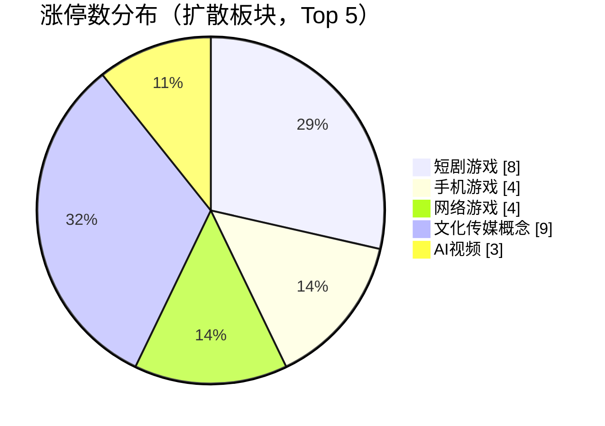
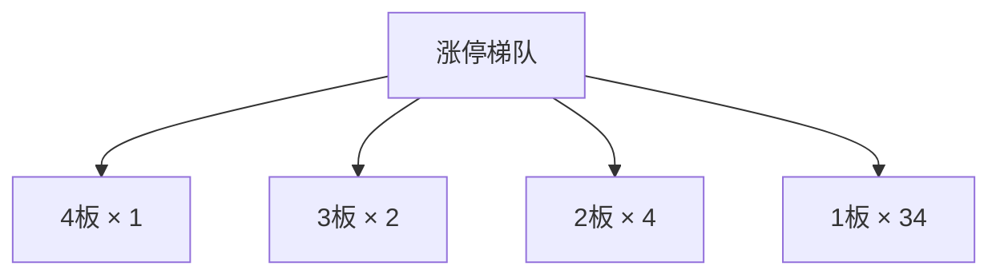
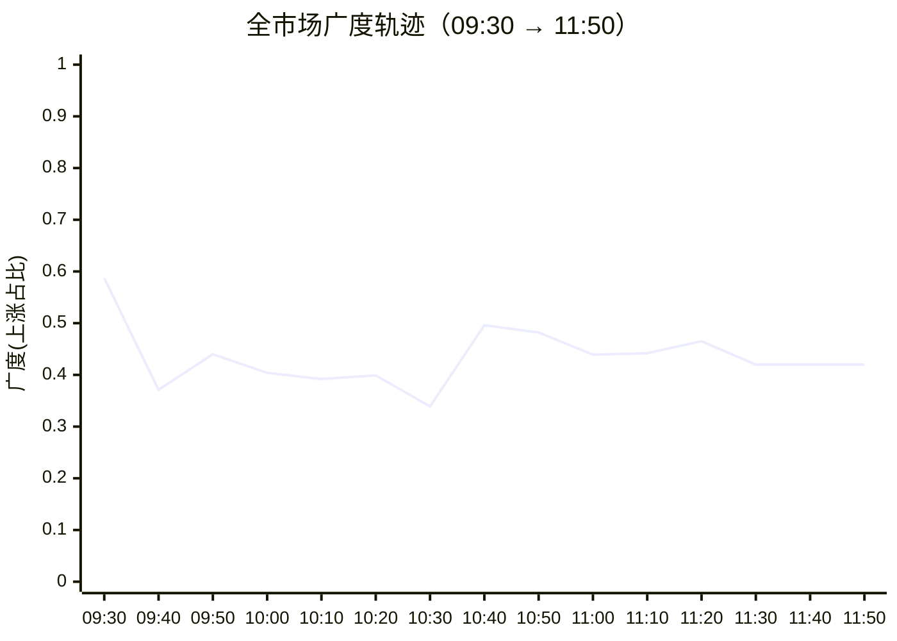

## 当日总览（截至 11:50）

> **结论**：全市场涨2342/跌3007（广度0.44）；涨停41/跌停8；中位涨幅-0.18%；局部修复。 钱在：短剧游戏(涨停8/成分99，中位+1.00%)、手机游戏(涨停4/成分56，中位+0.28%)、网络游戏(涨停4/成分58，中位+0.53%)；零星涨停：数字水印(2)、猪肉(2)、中韩自贸区(1)、C2M概念(2)、丙烯酸(1)。 退潮：一带一路(跌停4)、光伏概念(跌停2)、海峡两岸(跌停2)。 梯队：4板×1、3板×2、2板×4、1板×34，最高4板。 预案：未到价 东方海洋、百洋股份、寒武纪、通富微电、日上集团、蓝色光标。 较上一轮广度基本持平。

> 🔒 **no_trade / 买入预算 0 / max_position_pct 0 —— 全部内容仅供研究，不授予交易权限。**

### 板块扩散

> 口径：XTick 概念成分 × 全市场实时报价；分母 = 板块内有有效报价的成分数。排序用涨停密度（涨停数/有效成分数），已剔除宽基属性板块（全市场 432 个板块中剔 16 个）。

**扩散中（题材，按涨停密度排序）**

| 板块 | 涨停 | 有效成分 | 涨停密度 | 上涨广度 | 中位涨幅 | 相对全市场 | 成交(亿) |
|---|---|---|---|---|---|---|---|
| 短剧游戏 | 8 | 99 | 0.081 | 0.66 | +1.00% | +1.18% | 525 |
| 手机游戏 | 4 | 56 | 0.071 | 0.54 | +0.28% | +0.46% | 229 |
| 网络游戏 | 4 | 58 | 0.069 | 0.57 | +0.53% | +0.71% | 249 |
| 数字水印 ⬦ | 2 | 29 | 0.069 | 0.52 | +0.06% | +0.24% | 46 |
| 猪肉 ⬦ | 2 | 32 | 0.062 | 0.97 | +2.44% | +2.62% | 63 |
| 中韩自贸区 ⬦ | 1 | 17 | 0.059 | 0.41 | +0.00% | +0.18% | 40 |
| C2M概念 ⬦ | 2 | 39 | 0.051 | 0.46 | +0.00% | +0.18% | 39 |
| 丙烯酸 ⬦ | 1 | 20 | 0.050 | 0.60 | +0.26% | +0.44% | 23 |
| 恒大概念 ⬦ | 2 | 43 | 0.046 | 0.44 | +0.00% | +0.18% | 56 |
| 文化传媒概念 | 9 | 197 | 0.046 | 0.59 | +0.51% | +0.69% | 635 |
| AI视频 | 3 | 67 | 0.045 | 0.70 | +0.78% | +0.96% | 429 |
| 免税店 ⬦ | 1 | 26 | 0.038 | 0.46 | -0.10% | +0.08% | 39 |

> ⬦ = 涨停 <3 只，零星个例，不构成扩散（不计入「钱在」判定）。



零星涨停板块（<3 只）：数字水印(2)、猪肉(2)、中韩自贸区(1)、C2M概念(2)、丙烯酸(1)、恒大概念(2)、免税店(1)

**退潮中（跌停集中）**

| 板块 | 跌停 | 有效成分 | 上涨广度 | 中位涨幅 |
|---|---|---|---|---|
| 一带一路 | 4 | 797 | 0.36 | -0.24% |
| 光伏概念 | 2 | 602 | 0.33 | -0.45% |
| 海峡两岸 | 2 | 320 | 0.34 | -0.45% |
| 中俄贸易概念 | 2 | 180 | 0.40 | -0.23% |
| 无人零售 | 1 | 26 | 0.27 | -0.66% |
| 乳业 | 1 | 36 | 0.28 | -0.75% |
| 物业管理 | 1 | 183 | 0.28 | -0.70% |
| 金属回收 | 1 | 90 | 0.30 | -0.29% |
| 化债概念(AMC概念) | 1 | 40 | 0.30 | -0.29% |
| 光伏建筑一体化 | 1 | 135 | 0.31 | -0.26% |
| 宁德时代概念 | 1 | 304 | 0.34 | -0.39% |
| 土壤修复 | 1 | 91 | 0.35 | -0.25% |

### 涨停梯队

> 最高 4 板 ｜ 涨停 41 ｜ 跌停 8 ｜ 炸板 11 ｜ 封板率 78.8% ｜ 打板成功率 18.92% ｜ 一进二 15.38% ｜ 二进三 40.00%

| 身位 | 家数 | 成员（涨幅/封单亿/首封） |
|---|---|---|
| 4板 | 1 | 天普股份 +10.00%/0.002亿/09:30 |
| 3板 | 2 | 北纬科技 +9.96%/0.037亿/09:30；金辰股份 +10.00%/0.007亿/09:30 |
| 2板 | 4 | 兴欣新材 +9.99%/0.052亿/09:25；好当家 +10.08%/0.008亿/09:25；广百股份 +9.94%/0.007亿/09:25；国统股份 +10.04%/0.003亿/09:36 |
| 1板 | 34 | 华胜天成 +10.00%/0.075亿/09:50；文投控股 +10.03%/0.062亿/09:30；模塑科技 +10.01%/0.040亿/10:39；儒意电影 +9.96%/0.037亿/10:38；日发精机 +10.00%/0.031亿/11:21 |



炸板 11 只（前几）：博纳影业(6次)、泰嘉股份(4次)、旋极信息(3次)、锋龙股份(3次)、永新光学(3次)

### 预案池对照

| 票 | 池 | 板块 | 现价 | 涨幅 | 触发价 | 买区 | 风险位 | 判定 |
|---|---|---|---|---|---|---|---|---|
| 东方海洋 `002086.SZ` | 观察池 | 水产概念（消费情绪窄线） | 4.75 | -7.95% | 5.16 | [5.13, 5.24] | 4.98 | **未到价** |
| 百洋股份 `002696.SZ` | 观察池 | 水产概念（消费情绪窄线） | 10.51 | -10.02% | 11.68 | [11.62, 11.86] | 11.27 | **未到价** |
| 寒武纪 `688256.SH` | 观察池 | 芯片概念（国产算力/封测核心对照） | 984.97 | +1.23% | 1020.0 | [1014.9, 1035.3] | 952.48 | **未到价** |
| 通富微电 `002156.SZ` | 观察池 | 芯片概念（国产算力/封测核心对照） | 47.7 | -1.36% | 51.16 | [50.9, 51.93] | 49.33 | **未到价** |
| 日上集团 `002593.SZ` | 观察池 | 海峡两岸/福建情绪切换 | 5.08 | -2.87% | 5.23 | [5.2, 5.31] | 5.04 | **未到价** |
| 蓝色光标 `300058.SZ` | 观察池 | AI应用/营销容量分离 | 13.98 | -5.28% | 15.97 | [15.89, 16.21] | 14.91 | **未到价** |
| 中芯国际 `688981.SH` | 观察池 | 晶圆代工事件 | 111.01 | -0.64% | — | — | — | **无预案价** |
| 拓斯达 `300607.SZ` | 观察池 | 机器人发布窗口 | 33.08 | +5.59% | — | — | — | **无预案价** |


> ⚠ D1 明确 no_trade=true、买入预算 0、个股 max_position_pct=0。以上为研究对照，**不构成任何买入许可**。

### 盘面 vs 静态复盘 vs 消息面

| 维度 | 对象 | T-1 静态基线 | 今日盘面 | 关系 |
|---|---|---|---|---|
| 板块主线 | 芯片概念（国产算力/封测核心对照） | R2 次线 score=70.0 涨停None（T-1 口径） | 盘面未见该板块成分票涨停 | **背离** |
| 板块主线 | 海峡两岸/福建情绪切换 | R2 次线 score=69.0 涨停None（T-1 口径） | 盘面未见该板块成分票涨停 | **背离** |
| 板块主线 | 脑机接口/康复事件观察 | R2 次线 score=53.0 涨停None（T-1 口径） | 盘面未见该板块成分票涨停 | **背离** |
| 板块主线 | AI应用/营销容量分离 | R2 次线 score=65.0 涨停None（T-1 口径） | 盘面未见该板块成分票涨停 | **背离** |
| 板块主线 | 机器人旧线收缩/新发布窗口 | R2 次线 score=62.0 涨停None（T-1 口径） | 盘面未见该板块成分票涨停 | **背离** |
| 板块主线 | 零售/大消费宽标签对照 | R2 次线 score=55.0 涨停None（T-1 口径） | 盘面未见该板块成分票涨停 | **背离** |
| 板块主线 | 天然气高度股对照 | R2 次线 score=45.0 涨停None（T-1 口径） | 盘面未见该板块成分票涨停 | **背离** |
| 板块主线 | 造船合同事件对照 | R2 次线 score=49.0 涨停None（T-1 口径） | 盘面未见该板块成分票涨停 | **背离** |
| 板块主线 | 创新药审批/临床事件对照 | R2 次线 score=40.0 涨停None（T-1 口径） | 盘面未见该板块成分票涨停 | **背离** |
| 梯队结构 | 最高4板 | T-1 最高梯队 4 板、首板 29、炸板率 39.06% | 今日 4板×1、3板×2、2板×4、1板×34；封板率0.7885 炸板11只 | **印证** |
| 预案验证 | 东方海洋(002086.SZ) | 预案 水产概念（消费情绪窄线）／watch／触发价5.16／买区[5.13, 5.24] | 未到价：现价4.75，触发价5.16，还差8.63%；仅价格位置对照，不代表完整入场条件确认；不能据此确认站稳，不授予下单权限 | **无响应** |
| 预案验证 | 百洋股份(002696.SZ) | 预案 水产概念（消费情绪窄线）／watch／触发价11.68／买区[11.62, 11.86] | 未到价：现价10.51，触发价11.68，还差11.13%；仅价格位置对照，不代表完整入场条件确认；不能据此确认站稳，不授予下单权限 | **无响应** |
| 预案验证 | 寒武纪(688256.SH) | 预案 芯片概念（国产算力/封测核心对照）／watch／触发价1020.0／买区[1014.9, 1035.3] | 未到价：现价984.97，触发价1020.0，还差3.56%；仅价格位置对照，不代表完整入场条件确认；不能据此确认站稳，不授予下单权限 | **无响应** |
| 预案验证 | 通富微电(002156.SZ) | 预案 芯片概念（国产算力/封测核心对照）／watch／触发价51.16／买区[50.9, 51.93] | 未到价：现价47.7，触发价51.16，还差7.25%；仅价格位置对照，不代表完整入场条件确认；不能据此确认站稳，不授予下单权限 | **无响应** |
| 预案验证 | 日上集团(002593.SZ) | 预案 海峡两岸/福建情绪切换／watch／触发价5.23／买区[5.2, 5.31] | 未到价：现价5.08，触发价5.23，还差2.95%；仅价格位置对照，不代表完整入场条件确认；不能据此确认站稳，不授予下单权限 | **无响应** |
| 预案验证 | 蓝色光标(300058.SZ) | 预案 AI应用/营销容量分离／watch／触发价15.97／买区[15.89, 16.21] | 未到价：现价13.98，触发价15.97，还差14.23%；仅价格位置对照，不代表完整入场条件确认；不能据此确认站稳，不授予下单权限 | **无响应** |
| 预案验证 | 中芯国际(688981.SH) | 预案 晶圆代工事件／watch／触发价None／买区None | 无预案价：预案未给有效入场触发价/完整买区（缺失、空规则或格式异常）；仅价格位置对照，不代表完整入场条件确认；不能据此确认站稳，不授予下单权限 | **无响应** |
| 预案验证 | 拓斯达(300607.SZ) | 预案 机器人发布窗口／watch／触发价None／买区None | 无预案价：预案未给有效入场触发价/完整买区（缺失、空规则或格式异常）；仅价格位置对照，不代表完整入场条件确认；不能据此确认站稳，不授予下单权限 | **无响应** |
| 消息面对照 | 盘面热点板块 | R4 消息面（T-1 口径） | 实时快讯中命中热点板块关键词 11 条 | **印证** |

**分歧点（不掩盖）：**
- 板块主线·芯片概念（国产算力/封测核心对照） → 背离：T-1 有辨识度但今日盘中无涨停响应，题材未获资金确认
- 板块主线·海峡两岸/福建情绪切换 → 背离：T-1 有辨识度但今日盘中无涨停响应，题材未获资金确认
- 板块主线·脑机接口/康复事件观察 → 背离：T-1 有辨识度但今日盘中无涨停响应，题材未获资金确认
- 板块主线·AI应用/营销容量分离 → 背离：T-1 有辨识度但今日盘中无涨停响应，题材未获资金确认
- 板块主线·机器人旧线收缩/新发布窗口 → 背离：T-1 有辨识度但今日盘中无涨停响应，题材未获资金确认
- 板块主线·零售/大消费宽标签对照 → 背离：T-1 有辨识度但今日盘中无涨停响应，题材未获资金确认
- 板块主线·天然气高度股对照 → 背离：T-1 有辨识度但今日盘中无涨停响应，题材未获资金确认
- 板块主线·造船合同事件对照 → 背离：T-1 有辨识度但今日盘中无涨停响应，题材未获资金确认
- 板块主线·创新药审批/临床事件对照 → 背离：T-1 有辨识度但今日盘中无涨停响应，题材未获资金确认

### 全天广度轨迹

| 时点 | 涨 | 跌 | 广度 | 涨停 | 跌停 | 成交(亿) | 有效样本 |
|---|---|---|---|---|---|---|---|
| 0930 | 3260 | 1932 | 0.587 | 12 | 1 | 643 | 5551 |
| 0940 | 2068 | 3195 | 0.371 | 18 | 8 | 3,051 | 5571 |
| 0950 | 2449 | 2815 | 0.440 | 21 | 5 | 4,513 | 5571 |
| 1000 | 2253 | 3049 | 0.404 | 23 | 9 | 5,542 | 5571 |
| 1010 | 2185 | 3117 | 0.392 | 25 | 9 | 6,385 | 5571 |
| 1020 | 2223 | 3069 | 0.399 | 28 | 9 | 6,985 | 5571 |
| 1030 | 1886 | 3428 | 0.339 | 24 | 10 | 7,494 | 5571 |
| 1040 | 2766 | 2516 | 0.496 | 28 | 9 | 7,971 | 5571 |
| 1050 | 2687 | 2609 | 0.482 | 31 | 9 | 8,469 | 5571 |
| 1100 | 2444 | 2847 | 0.439 | 33 | 10 | 8,889 | 5571 |
| 1110 | 2463 | 2838 | 0.442 | 39 | 10 | 9,239 | 5571 |
| 1120 | 2591 | 2748 | 0.465 | 42 | 12 | 9,580 | 5571 |
| 1130 | 2342 | 2996 | 0.420 | 41 | 8 | 9,862 | 5571 |
| 1140 | 2342 | 2996 | 0.420 | 41 | 8 | 9,862 | 5571 |
| 1150 | 2342 | 2996 | 0.420 | 41 | 8 | 9,862 | 5571 |

> ⚠ **数据冻结段**：1130–1150 数值连续完全一致，说明行情源未刷新，**不是市场横盘**，该段不可解读为盘面变化。



### 观察建议（仅研究）

- **环境**：涨停 41.0 / 跌停 8.0，打板成功率 18.9%，一进二 15.4%。
- **方向**：今日形成实质扩散的是 短剧游戏（涨停8/成分99，密度0.081，中位+1.00%）、手机游戏（涨停4/成分56，密度0.071，中位+0.28%）、网络游戏（涨停4/成分58，密度0.069，中位+0.53%）。**需确认**：次日能否维持涨停家数且中位涨幅不掉队，否则只是普跌中的避险轮动。
- **零星**：数字水印(2只/29成分)、猪肉(2只/32成分)、中韩自贸区(1只/17成分)、C2M概念(2只/39成分)、丙烯酸(1只/20成分) 属零星个例，不视为题材，不据此选股。
- **回避**：一带一路（跌停4）、光伏概念（跌停2）、海峡两岸（跌停2） 板块中位跌幅深，趋势未止跌前不接。
- **身位**：最高 4 板。梯队有高度不等于可接力，需逐票核验封单稳定性与开板次数后再定。
- **预案待检验**：东方海洋(触发价5.16，还差+8.63%)、百洋股份(触发价11.68，还差+11.13%)、寒武纪(触发价1020，还差+3.56%)、通富微电(触发价51.16，还差+7.25%)、日上集团(触发价5.23，还差+2.95%)、蓝色光标(触发价15.97，还差+14.23%) 尚未触及触发价，剧本未被盘面检验，继续按原失效条件看。

<details>
<summary>原始截面与数据质量（折叠）</summary>

**跨源校验**

```json
{
  "xtick": {
    "up": 2342,
    "down": 3007,
    "n": 5584,
    "amount_yi": 9793.0
  },
  "rtk_snapshot": {
    "up": 2342,
    "down": 2996,
    "valid_n": 5571,
    "amount_yi": 9861.6,
    "up_limit": 41,
    "down_limit": 8
  },
  "note": "两源口径不同（XTick 全市场含全部票；rt_k 返回样本）"
}
```

**rt_k 截面（原始）**

```json
{
  "market": {
    "total": 5584,
    "up": 2342,
    "down": 2996,
    "flat": 233,
    "requested_n": 5584,
    "received_n": 5584,
    "valid_n": 5571,
    "missing_n": 13,
    "universe_requested_n": null,
    "population_scope": "returned_rows_not_verified_all_a_universe",
    "up_ratio": 0.4194,
    "legacy_up_ratio_placeholder": false,
    "up_ratio_is_observed": true,
    "up_ratio_all": 0.4194,
    "up_ratio_valid": 0.4204,
    "up_ratio_denominator": "requested_n",
    "degraded": false,
    "limit_known_n": 5571,
    "limit_unknown_n": 0,
    "limit_counts_complete": true,
    "limit_source_errors": [],
    "up_gt3": 258,
    "up_gt5": 121,
    "up_limit": 41,
    "down_gt3": 406,
    "down_gt5": 169,
    "down_limit": 8,
    "amount_yi": 9861.6,
    "amount_sum_overflow": false,
    "amount_valid_n": 5571,
    "amount_missing_n": 0
  },
  "source_time_quality": {
    "quote_age_min_seconds": 1.319824,
    "quote_age_max_seconds": 62.319824,
    "source_age_limit_seconds": null,
    "freshness_status": "age_limit_not_configured",
    "age_reference_at": "2026-11-13T11:50:44.319824+08:00"
  },
  "trading_authorized": false
}
```

</details>

## 分时研判记录

### 09:35 研判增量
- **趋势**：开盘更像科技方向面状修复、旧情绪核心承压，尚不能定性为接力全面回暖。本轮依据2026-11-13 09:30截面（09:31生成；rt_k采集09:30:42—09:30:56，报价09:30:25—09:30:52），不是09:35即时价。今天仅有首轮analysis，没有上一轮可比，广度、涨停数、梯队高度、板块排名和预案判定均先立基线，顶部“较上一轮基本持平”不成立；也不能用开盘封板率与昨日收盘率直接认定情绪逆转。广度沿用有效报价口径3260/5551＝58.73%，不与顶部剔除平盘后的另一源广度0.61混比；上市名录覆盖未核，只称返回样本。天普股份处于4板高度，但单截面不足以证明持续封稳或带队成功。
- **轮动**：相较11月12日预案“芯片核心集中、宽板承压”的基线，09:30集成电路已有205/241上涨、中位涨幅+1.10%，先进封装174/210上涨、中位+0.88%，说明修复不只寒武纪单票；白酒10/48上涨、免税2/26上涨，消费相关方向明显偏弱。这支持“科技承接、消费核心承压”的轮动假设，尚无跨时点资金流证据证明同一批钱迁移；水产窄成分分母缺失，也不能用两只核心下跌宣判整线死亡。另须纠正热榜截断的盲区：全量板块中光伏已4/602涨停、长安汽车概念3/231涨停，顶部“全市场无扩散”不能当全量结论；宽标签仍须核同一驱动，不直接册封主线。快讯样本提到中芯说明会毛利率改善及CPO高开，属于科技修复的解释线索，但不是已核新增订单；“关键词未匹配”不等于消息面完全无响应。
- **剧本**：09:30寒武纪仍在1020触发价与1014.9买区下沿之下，是最接近检验的容量核心，而非已确认买点；通富微电还未收复预案注明的昨日50.49高点，不能把上涨等同于修复完成。东方海洋、百洋股份、日上集团的弱势印证了原预案对反复开板接力的警惕，不能只写“未到价、继续等”而忽略原有取消条件，更不下移买区接弱。蓝色光标不仅未触发，原买区下沿15.89还高于最高接受15.79，当前研究情景没有可买交集；中芯国际、拓斯达仍无预案触发价，事件/价格响应只能观察，拓斯达上涨也不能直接归因为机器人新发布。以上静态条件有效期截至今日09:30，后续仅作对照锚，不自行续期、改池或解禁。
- **下一步看**：先核下一轮报价刷新、有效样本及成分分母是否可比；再看寒武纪能否越过1020并以分钟路径验证承接，若突破后跌回1020下方则按原剧本取消，超过1035.3不追；通富先看50.49能否收复，再看51.16触发且不得突破原最高接受51.75追价。板块端看集成电路、先进封装能否维持相对强势并出现涨停助攻，数字水印能否从2/29增加至至少3家且广度不塌；若涨停数增加但同口径广度跌破首轮58.73%，应解释为强势集中而非普涨。水产须核心先修复、同线助攻同时存在，不能因好当家处于2板就替换原核心。系统no_trade=true、买入预算0、个股max_position_pct=0不变；全部仅供研究，不构成任何买入许可。

### 09:45 研判增量
- **趋势**：开盘科技面状修复迅速收缩，新增涨停与多数个股走弱并存，不能再按普涨修复理解。比较2026-11-13的09:30→09:40分析；本轮09:40:57生成，配套rt_k采集09:40:42—09:40:53、报价09:40:06—09:40:49，不是09:45即时行情。有效报价5551→5571只、上涨广度58.73%→37.12%，样本不同不报严格同票百分点差；另一源同为5584条返回，上涨3177→2083，也支持走弱，但未核上市名录覆盖。涨停12→18、跌停1→8，新增强势主要落在首板5→11家；最高仍4板而3板梯队3→2家，天安新材离开涨停梯队并记录2次开板，天普股份开板次数0→2。高度没降不等于接力质量改善。
- **轮动**：相较上轮“科技承接”的假设，本轮更支持传媒游戏获得局部合力、科技面状修复退缩：先进封装上涨174/210→72/210，中位涨幅+0.88%→-0.29%；手机游戏上涨32/56→36/56、涨停2→3，短剧游戏上涨61/99→70/99、涨停1→4，文化传媒涨停1/197→6/197且上涨110/197→123/197。概念相互重叠，不相加成独立资金规模。数字水印虽仍居密度榜前列，涨停始终2/29，上涨却23/29→14/29，不能误读为扩散。本轮快讯新增凯撒文化、湖北广电上板及游戏、广电跟涨，价格与异动报道互相印证；但这不是独立产业催化，也没有同一批资金迁移证据，“科技→传媒”的跷跷板暂为待验证假设。盘前对旧情绪接力的警惕获印证，新增传媒强势尚不能升级为消息、静态研究、盘面三方一致的新主线。
- **剧本**：有价位的六只票判定均未变化，但距离与结构已变坏，不能把标签不变当作剧本稳定。寒武纪1010.01→999，离1020触发价更远；通富微电49.83→48.70，仍未收复预案50.49前高，配合封装板块转弱，原容量修复设想被削弱，不能认定已突破后失效。东方海洋4.83→4.80、百洋股份10.76→10.51且后者进入跌停名单，水产核心负反馈加重；日上集团4.86→4.85，同时海峡两岸上涨184/320→107/320并新增2只跌停，区域修复缺乏响应。蓝色光标14.32→14.36只属微弱回升，未跟上传媒扩散，且原买区与最高接受价无交集的限制未消除。中芯国际114.55→114.37未强化事件响应；拓斯达32.78→33.68逆势增强，但人形机器人上涨409/482→279/482，不能由单票推整线反转。后二者仍缺预案价，保留事件观察、不补造买点；所有旧条件仅作研究对照，不自动续期。
- **下一步看**：下一轮先核报价刷新与分母，再验证手机游戏能否保持至少3/56涨停、短剧游戏至少4/99涨停，且上涨覆盖不低于本轮36/56、70/99；若涨停维持而上涨覆盖收缩，只能认定前排集中，不能认定继续扩散。同步看先进封装能否从72/210上涨的本轮基线回升，以及天普股份开板次数是否继续增加；若游戏回落而科技未恢复，跷跷板假设转为整体风险收缩，而非强行找替代方向。寒武纪只有重新接近原买区1014.9—1035.3并越过1020、另有分钟承接证据，才重新检验原突破假设；单次越线不算确认，超过原上沿不追。水产先观察百洋能否脱离本轮10.51跌停状态及原核心同步修复，不把好当家仍在2板当作替代许可。系统no_trade=true、买入预算0、个股max_position_pct=0不变，本段仅供研究，不授予买入许可。

### 09:55 研判增量
- **趋势**：急跌后出现回补，但还不是接力全面转强。对比2026-11-13的09:40→09:50分析；本轮09:50:57生成，配套rt_k采集09:50:42—09:50:54、报价09:49:57—09:50:52，不是09:55即时价。两轮有效报价数均5571，上涨2068→2449，有效报价广度37.12%→43.96%，回升6.84个百分点，仍未过半；不混用顶部另一源剔除平盘后的0.46，上市名录覆盖仍未核。涨停18→21、跌停8→5，改善集中在首板11→14，高度与二至四板家数未变；炸板4→5、封板率81.82%→80.77%，广百股份开板4→5次，说明广度修复与接力质量仍有分歧。华胜天成记录09:50首次封板，是新增首板观察对象，不是已证持续封稳的买点。
- **轮动**：上一轮“科技退缩、传媒获合力”的单向跷跷板解释需要收窄，本轮是科技重新参与、传媒内部分层。集成电路上涨113/241→173/241，中位涨幅-0.02%→+0.72%；先进封装72/210→131/210，面状回补明显。密度榜前六虽未换位，全量成分中信创涨停2→3/303、云计算2→3/224、数据中心3→4/664，新增扩散不能被榜单截断漏掉。反过来，手机游戏涨停仍3/56，上涨却36/56→32/56；短剧游戏上涨70/99→71/99、涨停仍4/99，不能把整个传媒方向都判为失血。预制菜上涨29/101→23/101、中位跌幅-0.46%→-0.88%，消费弱势仍在。上述概念重叠，不累计家数推资金规模，也未证明同一批钱迁移。顶部“芯片无涨停响应”的自动标签不能替代这些成分转强证据；盘前容量分离假设获得部分价格印证，但本轮快讯样本未核出对应新增产业催化，仍未形成三方一致确认。
- **剧本**：唯一判定迁移是寒武纪999.00→1025.99，从“未到价”变为“已触发”，落在原1014.9—1035.3研究区间且越过1020；这使原国产算力容量突破假设开始被检验，但缺分钟承接路径，不能写成站稳或完整条件兑现。通富微电48.70→49.44随封装回补，仍未收复原50.49前高，更未到51.16触发价，不能与寒武纪一并升级。AI应用上涨317/551→339/551、涨停4→5，蓝色光标却14.36→14.05，新增的是个股与板块背离，原买区和最高接受价无交集的问题也未消失。东方海洋4.80→4.92只是局部回补，百洋仍10.51且在跌停名单，水产核心尚未同步修复；日上4.85→4.77继续弱于区域样本回补。中芯国际114.37→115.99加强芯片事件观察的价格响应；拓斯达33.68→32.49则削弱上一轮单票逆势强势，二者仍无预案价，不补造买点。原条件有效期已过09:30，此处仅作历史研究锚，不自行续期。
- **下一步看**：下一轮先核源时标与有效样本，再看43.96%的同口径广度能否继续回升，且不以涨停增加掩盖跌停或炸板再扩张。科技回补若能维持集成电路173/241、先进封装131/210的上涨覆盖，并保住信创3/303、云计算3/224的涨停基线，才支持扩散延续；手机游戏若仍只有3/56涨停而上涨覆盖继续低于32/56，应按前排集中而非继续扩散解释。寒武纪围绕1020核分钟承接：越线后若跌回其下，原突破假设不成立，超过1035.3不追；通富仍按50.49→51.16的原有验证顺序，不下移条件。百洋能否离开10.51跌停状态、蓝色能否停止弱于应用板块，是检验修复是否越过科技局部的反证点。系统no_trade=true、买入预算0、个股max_position_pct=0不变；全部仅供研究，不构成任何买入许可。

---
### 10:00 截面

返回样本: 涨2253/跌3049 广度0.40（有效样本分母） ｜ 返回5584/有效5571/缺失13；全A覆盖未核验 ｜ 涨跌停已确认计数: 涨停23 跌停9；边界已知样本5571/未知样本0（未知不等于0） ｜ 成交5541.6亿（金额缺失0，求和溢出False） ｜ 数据质量: 返回样本可用（非全A覆盖保证） ｜ 仅供市场参考，不授予交易权限；D1预算/no_trade/个股资格原样有效 ｜ D1预算上下文: {"market_context": {"four_quadrant": {"基本面估值": "水产不能用名字梗代替盈利；澳洋四项财务hard_reject；寒武纪现金兑现/通富非经常损益、蓝色AR均有反证，未核估值分位不称便宜。", "情绪": "R1同池85票开盘均值+2.17%至收盘-0.87%，中位-2.05%；炸板48.61%，high_chop伴主跌风险，今天初试0。", "结构": "水产3封0炸是板块收盘统计，不掩盖东方26/百洋11次开板；日上4次；寒武纪MA60下修复、蓝色站MA60，不能混成同轮全面主升。", "综合": "资金×情绪：局部流入不足抵销接力负反馈；资金×基本面：净买不豁免财务红旗；情绪×结构：首板隔日不接多次回封；结构×估值：容量观察保留条件价，不认定便宜或完整主升。", "资金": "R7修复被单日流出打断；R2水产4.7471亿仅窄概念，寒武纪/蓝色净入是真实局部集中，行业口径不叠加。"}, "structure": "广度恶化、接力利润流失；水产窄线有合力但前二回封失败，容量分离留观察，不从单日净买推主升。"}, "no_trade": true, "risk_limits": {"block_prefixes": ["920"], "block_st": true, "max_buy_orders_per_day": 4, "max_orders_per_symbol_per_day": 2, "max_positions": 5, "target_total_position_pct": 0.0}, "trade_date": "20261113"} ｜ 报价年龄上限未配置，未验证新鲜；时点质量: {"age_reference_at": "2026-11-13T10:00:57.158944+08:00", "freshness_status": "age_limit_not_configured", "quote_age_max_seconds": 42.158944, "quote_age_min_seconds": 2.158944, "source_age_limit_seconds": null} ｜ 预案池热点: 百洋股份-10.02%、日上集团-9.37%、东方海洋-6.98%、蓝色光标-5.15%、寒武纪+5.00%

| 票 | 池 | 现价 | 涨幅 | 状态 |
|---|---|---|---|---|
| 东方海洋 `002086.SZ` | watch_pool | 4.8 | -6.98% | down |
| 百洋股份 `002696.SZ` | watch_pool | 10.51 | -10.02% | limit_down |
| 寒武纪 `688256.SH` | watch_pool | 1021.67 | +5.00% | up |
| 通富微电 `002156.SZ` | watch_pool | 49.13 | +1.59% | up |
| 日上集团 `002593.SZ` | watch_pool | 4.74 | -9.37% | down |
| 蓝色光标 `300058.SZ` | watch_pool | 14.0 | -5.15% | down |
| 中芯国际 `688981.SH` | watch_pool | 115.49 | +3.37% | up |
| 拓斯达 `300607.SZ` | watch_pool | 32.6 | +4.05% | up |

### 10:05 研判增量
- **趋势**：上一轮回补再次受压，涨停增加却未带动多数个股，接力承接反而变差。对比2026-11-13的09:50→10:00分析：rt_k有效报价均5571只，上涨2449→2253，广度43.96%→40.44%，下降3.52个百分点；涨停21→23、跌停5→9，是强势集中而非普涨延续。最新分析10:01:30生成，配套报价10:00:15—10:00:55、采集10:00:42—10:00:57，不是10:05即时行情，上市名录覆盖仍未核。另一源情绪更新至10:01:27，跌停为8只，与rt_k的9只分开保留；其炸板5→8、封板率80.77%→74.19%。最高仍4板，但首板14→17、二板4→3，国统股份由二板进入炸板名单，好当家开板2→4次；新增首板不能抵销晋级层承接转弱。
- **轮动**：本轮板块报价源读取中断（IncompleteRead），热点、冷点及成分统计全部缺失，不能把空榜解释成题材退潮，更不能承接上一轮排名声称科技继续扩散或传媒失血。独立梯队仍见华胜天成处于首板、旋极信息记录09:51首次封板，只支持个股强势线索，尚无当前板块成分分母与资金流证明跷跷板。11月12日静态基线对反复开板接力的警惕得到进一步印证；科技容量分离假设则缺本轮板块与催化补证。自动生成的板块“背离”、消息“无响应”在此缺口下不能作为新的证伪证据，三方一致尚未成立。
- **剧本**：八只预案票本轮判定全部变成“无数据”，是同一报价缺口造成的观测中断，不是八个剧本同时失效。寒武纪09:50越过1020、处于1014.9—1035.3原区间的记录只能保留为历史事实，本轮不能据空值确认仍已触发或已跌回；也不把旧价冒充当前价。百洋股份仍在本轮独立跌停名单，好当家开板增多，削弱的是水产接力修复设想，不能因后排仍封板就替换原核心。东方海洋、通富微电、日上集团、蓝色光标当前价位条件均待恢复核验；蓝色原买区与最高接受价无交集的静态限制不因缺数消失。中芯国际、拓斯达仍无预案价。原条件已于今日09:30到期，本段不续期、不改池。
- **下一步看**：先等板块成分报价与逐票报价恢复，并核源时标；只有样本可比才看广度能否收复09:50的43.96%，同时rt_k跌停不再高于本轮9只、另一源炸板不再高于8只，避免再次出现“涨停增、承接退”。板块恢复后，以09:50短剧游戏4/99涨停、71/99上涨，以及集成电路173/241上涨、先进封装131/210上涨作历史对照，不沿用为当前值；若仅前排保板而上涨覆盖下降，仍按集中而非扩散解释。寒武纪先核1020上下的分钟承接，确认突破后跌回其下才检验原取消条件，超过1035.3不追；通富仍按50.49前高→51.16触发价核验，不下移条件。系统no_trade=true、买入预算0、个股max_position_pct=0不变；全部仅供研究，不构成任何买入许可。

### 10:15 研判增量
- **趋势**：报价缺口恢复了，但盘面没有同步修复，新增的是强势进一步集中、突破承接回落。本段依据2026-11-13的10:10分析（10:10:57生成），不是10:15即时行情；配套rt_k采集10:10:42—10:10:53，报价10:09:51—10:10:49，XTick个股源时标未单列。10:00→10:10两轮有效报价均5571只，上涨2253→2185，广度40.44%→39.22%，再降1.22个百分点；涨停23→25、rt_k跌停仍9，不能把顶部“局部修复”理解为本轮边际改善。独立梯队炸板8→10、封板率74.19%→71.43%，新增强势落在首板17→19，二至四板家数与最高高度未变。中国电影记录10:08首次封板，是新增传媒首板线索，不是回封；天普股份仍4板但封单0.003→0.002亿元，好当家二板封单0.008→0.004亿元，高度延续不等于承接增强。上市名录覆盖未核，广度只指返回有效样本。
- **轮动**：10:00板块缺失，以下只比较09:50→10:10，不把恢复取数当成十分钟新扩散。短剧游戏密度排名第6→第3，涨停4→6/99，但上涨71→65/99；AI视频涨停1→3/67、上涨仍44/67，是新增封板扩散，板块中位涨幅却+0.74%→+0.49%。相反，集成电路上涨173→144/241、先进封装131→116/210，科技回补减速。更强的解释是传媒前排获得集中、芯片面状修复退缩，而非传媒全面普涨；重叠概念不累加，缺资金流证据，跷跷板仍是假设。云游戏虽跃居密度第一，仍仅2/27涨停，不能按榜首升级主线。相较11月12日对接力负反馈的警惕，本轮仍是印证；芯片容量分离假设则受削弱。本轮消息关键词匹配为空、快讯样本未补出对应新增催化，只能标催化未核，不能写成消息已证伪或三方一致。
- **剧本**：逐票报价恢复后，寒武纪09:50的1025.99、已越过1020，变为10:10的1007.01，已低于触发价及原买区下沿1014.9；这不是从未触发的普通“未到价”，而是原突破情景出现“突破后跌回触发位”的取消信号。截面可证先越线后落回，不能证明曾持续站稳或精确失守时刻。通富微电49.44→48.57，仍未收复预案50.49前高，配合封装覆盖收缩，容量双核确认未成立。蓝色光标仍未跟上传媒前排强化；东方海洋、百洋股份、日上集团继续缺少原核心同步修复，百洋仍在跌停名单，不能用好当家保板替代。中芯国际、拓斯达恢复报价不等于补齐预案价，仍仅事件观察。10:00的“无数据”不计为真实状态迁移；所有原条件已于今日09:30到期，此处只对照历史研究情景，不续期、不改池。
- **下一步看**：先核报价继续刷新、有效样本与成分分母可比，再看广度能否收复10:00的40.44%，且炸板不再高于本轮10只；若涨停继续增加而广度仍低于39.22%，按抱团加剧而非修复升级解释。传媒看短剧游戏能否保住6/99涨停，并把上涨覆盖由65/99恢复至09:50的71/99；AI视频能否保住3/67涨停且不丢44/67上涨覆盖。芯片看集成电路、先进封装能否恢复09:50的173/241、131/210上涨覆盖；若传媒也退、科技不回，则否定健康跷跷板，转看整体风险收缩。寒武纪重新收复1020只能列重评线索，须另核分钟承接，不能自动复活旧买点；通富仍未到原50.9—51.93买区，不下移接弱。明确不追高、不因本轮恢复数据解禁：no_trade=true、买入预算0、个股max_position_pct=0不变，全部仅供研究，不构成任何买入许可。

### 10:25 研判增量
- **趋势**：市场整体略有回补，但上一轮传媒前排集中的结构开始松动，不能把涨停增加理解成原强线继续扩散。对比2026-11-13的10:10→10:20分析；最新分析10:20:57生成，配套rt_k采集10:20:42—10:20:54、报价10:19:57—10:20:52，不是10:25即时价，XTick逐票源时标未单列。两轮有效报价均5571只，上涨2185→2223，广度39.22%→39.90%，仅回升0.68个百分点，尚未收复10:00的40.44%；上市名录覆盖仍未核。涨停25→28、炸板10→9、封板率71.43%→75.68%，但rt_k跌停仍9，另一源跌停9→8须分列。首板19→21、二板3→4，后者来自国统股份回到封板梯队，开板次数却1→3；中国电影则由首板转入炸板名单、记录2次开板。最高仍4板，改善是局部修补，不是高位承接已稳定。
- **轮动**：上一轮“传媒集中、科技退缩”进一步变成传媒与芯片同时收缩、养殖及银行相对增强。短剧游戏密度排名第3→第8，涨停6→4/99、上涨65→49/99；AI视频涨停3→1/67、上涨44→33/67，已不能沿用上一轮扩散判断。集成电路上涨144→129/241、先进封装116→104/210，科技没有接住传媒回落。相反，猪肉上涨23→30/32、中位涨幅+1.13%→+2.37%、涨停0→2；银行上涨21→35/42，但无涨停。这更像防御性轮动假设，尚无资金流证据证明同一批钱迁移，也不是科技与传媒健康交替。猪肉虽出现面状走强，涨停仍不足3家，不升级为涨停扩散主线；本轮快讯提到金新农上板及同线跟涨，只是价格异动复述，不是新增产业催化。相较11月12日静态预案对接力负反馈的警惕，本轮仍是印证；养殖新增强势尚未形成静态研究、独立催化、盘面三方确认。
- **剧本**：八票判定标签全部未变，但弱化并非没有新增信息。寒武纪1007.01→1005，延续先越过1020后落回的原突破情景取消信号；通富微电48.57→48.15转绿，仍未收复原50.49前高，容量双核修复进一步受削弱。蓝色光标14.01→13.77，同时AI应用上涨289→230/551、涨停7→6，已不只是个股没跟上前排，板块承接也在退，原无可买交集的限制不变。东方海洋4.80→4.74、百洋仍10.51且在跌停名单，不能把猪肉走强外推为水产核心修复；好当家仍在二板，但开板4→5次，不替换原核心。日上集团4.73→4.78只是微弱回补，海峡两岸上涨仅103→106/320、跌停仍2，区域修复未获确认。中芯国际113.87→113.62削弱事件后价格响应，拓斯达仍32.56；二者没有预案价，不新增买点。原条件有效期截至今日09:30，本段仅作历史研究对照，不续期、不改池。
- **下一步看**：先核报价刷新及分母可比；市场广度能否收复10:00的40.44%，同时保住本轮28只涨停、炸板不高于9只，才支持回补延续。传媒重点看短剧游戏能否恢复上一轮6/99涨停、65/99上涨，AI视频能否恢复3/67涨停；若仅保少数封板而上涨覆盖继续下降，应撤销“仍在扩散”的解释。猪肉看涨停能否超过本轮2/32且不丢30/32上涨覆盖，若冲板增多但覆盖塌缩，同样只是前排集中。寒武纪只有重新收复1014.9买区下沿及1020触发价并补齐分钟承接，才有重评线索，不自动复活旧情景，超过1035.3不追；通富仍先核50.49，不下移原条件接弱。系统no_trade=true、买入预算0、个股max_position_pct=0保持不变；以上仅供研究，不构成任何买入许可。

### 10:35 研判增量
- **趋势**：上一轮微弱回补被打断，风险收缩加快，不是顶部“局部修复”所暗示的边际转好。依据2026-11-13的10:20→10:30分析；最新分析10:31:01生成，配套rt_k采集10:30:42—10:30:56、报价10:29:06—10:30:52，不是10:35即时价，XTick逐票源时标未单列。有效报价均5571只，上涨2223→1886，广度39.90%→33.85%，下降6.05个百分点；涨停28→24、rt_k跌停9→10。另一源跌停8→7不能抵销这个负反馈，两源不混算。首板21→17、炸板9→13、封板率75.68%→64.86%，二至四板家数与最高4板未变：本轮主要是低位封板承接流失，而不是高度突然坍塌。旋极信息仍在首板梯队，但开板0→1次，不能把保板等同封稳。上市名录覆盖未核，广度只指返回有效样本。
- **轮动**：上一轮“养殖与银行相对增强”已分化为银行更强、养殖冲高后回吐。银行上涨35→42/42、中位涨幅+0.46%→+0.80%；猪肉上涨30→29/32、涨停2→1、中位涨幅+2.37%→+1.81%，仍相对强，但不支持涨停扩散延续。短剧游戏密度排名第8→第7，上涨49→51/99、涨停仍4/99，只是小幅修补；手机游戏上涨21→19/56、涨停仍3/56，排名上升不等于覆盖改善。集成电路上涨129→104/241、先进封装104→87/210，科技继续收缩，没有接住风险偏好。本轮更支持“银行防御、风险方向收缩”的解释，不证明同一批钱已迁移；行业强弱也不自动成为题材买点。11月12日静态预案对接力负反馈的警惕继续获印证，本轮消息样本未核出足以解释切换的独立催化，仍不是三方一致的新主线确认。
- **剧本**：八票判定标签均未迁移，但原突破情景没有恢复。寒武纪1005→1000.97，继续处于1020触发价与1014.9买区下沿之下，延续此前越线后跌回的取消信号；通富微电48.15→47.87且封装覆盖下降，原容量双核修复进一步受削弱。东方海洋4.74→4.84只是个股回补，百洋仍10.51并在跌停名单，不能由养殖相对强外推水产核心同步修复。蓝色光标13.77→13.83，但AI应用上涨230→214/551，小反弹尚无板块扩散支持，原买区与最高接受价无交集的限制不变。日上集团4.78→4.73，海峡两岸上涨106→76/320，即使跌停2→1也不能叫区域修复。中芯国际、拓斯达均小幅回落且仍无预案价，不补造买点。原条件已于今日09:30到期，以上只对照历史研究情景，不续期、不改池。
- **下一步看**：先核报价刷新与分母可比，再看有效报价广度能否收复10:20的39.90%，同时涨停恢复28、炸板回落至9，才有本轮风险收缩被扭转的证据；仅银行维持42/42上涨而科技覆盖继续下降，应继续按防御集中解释。短剧游戏看能否保住4/99涨停及51/99上涨，并带动手机游戏上涨覆盖恢复至21/56，而非只看密度排名。芯片先看集成电路、先进封装能否收复上一轮129/241、104/210上涨覆盖；寒武纪收复1014.9与1020后仍须另核分钟承接，不能自动复活旧突破情景，超过1035.3不追；通富仍先核50.49前高，不下移买区接弱。系统no_trade=true、买入预算0、个股max_position_pct=0不变；全部仅供研究，不构成任何买入许可。

### 10:45 研判增量
- **趋势**：急缩后出现面状回补，但接力风险与原容量核心尚未同步修复。对比2026-11-13的10:30→10:40分析；本轮10:40:54生成，配套rt_k采集10:40:42—10:40:53、报价10:39:54—10:40:49，不是10:45即时价，XTick逐票源时标未单列。有效报价均5571只，上涨1886→2766，广度33.85%→49.65%，回升15.80个百分点，仍未过半；不混用顶部0.53的剔除平盘口径，上市名录覆盖仍未核。涨停24→28、首板17→21，最高与二至四板家数未变；炸板仍13，封板率64.86%→68.29%不是炸板减少带来的改善。rt_k跌停10→9，另一源却7→9，风险尾部没有同向收敛。
- **轮动**：上一轮“银行防御独强”的解释需要下调：银行上涨42→38/42、中位涨幅+0.80%→+0.69%；集成电路上涨104→137/241、先进封装87→99/210，风险方向重新参与回补。密度榜前列次序完全未变，榜外汽车相关概念才出现新增封板扩散：小米汽车涨停1→3/123、上涨58→87/123；长安汽车概念涨停3→5/231、上涨95→161/231。模塑科技记录10:39首次封板，是新增首板线索，不是回封或已证封稳；具体驱动、概念纯度及流通市值未核，只作研究观察。短剧游戏上涨51→58/99但涨停仍4/99，属于覆盖修补，不是前排再加速。重叠概念不累加；“防御向汽车切换”仅是相对强弱假设，缺同一批资金迁移证据，本轮快讯样本也未核出对应独立催化，尚不构成三方一致的新主线确认。
- **剧本**：八票判定标签均未迁移，新增分歧却是板块回补、原容量票不跟：寒武纪1000.97→1000.30、通富微电47.87→47.82、中芯国际113.32→113.29，原容量分离假设未获本轮印证；寒武纪此前越过1020后跌回的取消信号，不能被市场回补自动洗掉。AI应用上涨214→327/551，蓝色光标却13.83→13.80，个股与板块背离进一步突出；本轮快讯资金统计转述将其列为净流出居前，仅作旁证，不冒充独立资金核验，原最高接受15.79低于买区下沿15.89的限制也未消除。东方海洋4.84→4.87而百洋仍10.51、仍在跌停名单；日上4.73→4.74但海峡两岸跌停1→2，均不是旧情绪核心同步修复。拓斯达32.50→32.80伴人形机器人上涨197→325/482，价格响应有所增强，但与中芯均缺预案价，不补造买点。原条件已于今日09:30到期，以上仅作历史研究对照，不续期、不改池。
- **下一步看**：以下只验证回补能否延续，不是买入门槛：下轮先核报价刷新与分母可比，看广度能否保持本轮49.65%、涨停保住28且炸板从13减少；若只有涨停回升、炸板不退，仍不能升级接力质量。汽车看小米能否保住3/123涨停及87/123上涨、长安汽车概念保住5/231及161/231，若封板维持但覆盖收缩，就撤销“继续扩散”的解释。芯片虽已收复上一轮提出的129/241、104/210覆盖条件中的前者，先进封装99/210仍未达后者，不能两项一起算过关；寒武纪须重新收复1014.9与1020并另核分钟承接，通富仍先核50.49前高再看51.16，不下移买区接弱、超过原上沿不追。系统no_trade=true、买入预算0、个股max_position_pct=0不变；全部仅供研究，不构成任何买入许可。

### 10:55 研判增量
- **趋势**：上一轮面状回补未能延续，本轮转为游戏前排增强、芯片与部分汽车成分回吐，并非普涨升级。比较2026-11-13的10:40→10:50分析；最新分析10:50:57生成，配套rt_k采集10:50:42—10:50:55、报价10:49:33—10:50:52，不是10:55即时价；XTick逐票源时标未单列。有效报价均5571只，上涨2766→2687，广度49.65%→48.23%，下降1.42个百分点，不混用顶部剔除平盘后的0.50；上市名录覆盖仍未核。涨停28→31、首板21→24，炸板13→12、封板率68.29%→72.09%，确有局部封板改善，但最高及二至四板家数均未变、跌停仍9，且跌超5%的有效样本129→150只，不能据封板率提高就认定整体风险收敛。福达股份记录10:48首次封板，只列新增首板观察，不据截面认定持续封稳。
- **轮动**：游戏重新取得边际优势：手机游戏密度排名第4→第2，涨停3→4/56、上涨26→29/56；网络游戏第5→第3，涨停3→4/58、上涨30→34/58。短剧游戏涨停4→5/99，上涨却仍58/99，新增的是前排封板，不是覆盖进一步扩大。上一轮汽车扩散的观察条件未守住：小米汽车虽保住3/123涨停，上涨87→78/123；长安汽车概念涨停5→4/231、上涨161→152/231，应撤销“继续扩散”的解释，而非宣布整线死亡。银行上涨38→39/42、猪肉31→32/32，也说明防御与游戏同时增强，不是风险偏好全面回归；猪肉仍仅2/32涨停，面状上涨不等于涨停扩散主线。概念重叠不累加，跷跷板仅为相对强弱假设，未证实同一批钱迁移。自动消息对照转为“印证”，实际匹配的是10:19—10:24的猪肉异动报道，不是本轮游戏增强的独立催化，不能据此升级为静态研究、消息、盘面三方一致。
- **剧本**：八票判定标签均未迁移，但容量修复进一步被削弱：寒武纪1000.30→985.00、通富微电47.82→47.45，同时集成电路上涨137→102/241、先进封装99→74/210，已从上一轮“板块回补、核心不跟”变成核心与板块共同退缩；寒武纪此前越过1020后跌回的原情景取消信号没有消除。蓝色光标13.80→13.83只是微弱回升，未跟上游戏前排增强，原情景无可买交集的限制不变。东方海洋4.87→4.86、百洋仍10.51并在跌停名单，猪肉全线上涨不能替代水产核心修复；日上4.74→4.72伴海峡两岸上涨133→124/320，区域修复仍无新增支持。中芯国际113.29→112.58削弱事件后价格响应；拓斯达32.80→33.12却伴人形机器人上涨325→294/482，是个股相对增强、板块覆盖收缩，不能推成整线反转。后二者仍无预案价，不补买点。原条件已于今日09:30到期，仅作历史研究对照，不续期、不改池。
- **下一步看**：以下只验证结构变化，不是买入门槛：先核报价刷新及分母可比，再看广度能否收复上一轮49.65%，同时保住本轮31只涨停、炸板不高于12，且跌超5%的样本不再高于150；否则只能保留局部封板修补判断。游戏看手机游戏能否保住4/56涨停及29/56上涨、网络游戏保住4/58及34/58，短剧游戏在5/99涨停之外能否超过58/99上涨覆盖；若封板增加但覆盖缩小，仍按前排集中解释。汽车须先恢复小米87/123、长安161/231的上一轮上涨覆盖，并恢复长安5/231涨停，才重评扩散延续。芯片先看能否收复上一轮137/241、99/210上涨覆盖；寒武纪重新收复1014.9与1020且补齐分钟承接才有重评线索，不能自动复活旧情景，超过1035.3不追；通富仍先核原50.49前高，不下移买区接弱。系统no_trade=true、买入预算0、个股max_position_pct=0不变；全部仅供研究，不构成任何买入许可。

### 11:05 研判增量
- **趋势**：上一轮仅局部封板改善，本轮连封板质量也略回落，市场继续向少数方向集中。比较2026-11-13的10:50→11:00分析；最新分析11:00:57生成，配套rt_k采集11:00:42—11:00:55、报价10:59:36—11:00:52，不是11:05即时价，XTick逐票源时标未单列。有效报价分母均5571，上涨2687→2444，广度48.23%→43.87%，下降4.36个百分点；涨停31→33而炸板12→13、封板率72.09%→71.74%，新增封板落在首板24→26，最高仍4板、二至四板家数未变。rt_k跌停9→10、跌超5%的样本150→165，说明尾部风险仍在扩大；另一源跌停仍9，口径分开，不混用顶部剔除平盘后的广度。上市名录覆盖未核，只称返回有效样本。
- **轮动**：游戏相较上一轮不再只有前排增板：手机游戏上涨29→33/56、涨停仍4/56，短剧游戏密度排名第7→第6、涨停5→6/99且上涨58→61/99，局部覆盖确有扩大；但文化传媒上涨仍113/197、中位涨幅+0.37%→+0.31%，不能外推整个传媒都加速。时空大数据涨停2→3/71，本轮达到本任务的涨停扩散观察门槛，上涨却51→50/71、中位+0.74%→+0.59%，是前排新增封板而非面状加速；华是科技记录11:00首次封板，只列研究线索，不据截面认定封稳或可成交。芯片继续失去上涨覆盖：集成电路102→92/241、先进封装74→64/210；小米汽车涨停3→2/123、上涨78→69/123，模塑科技由首板转入炸板名单，汽车退缩得到新增个股证据。银行上涨39→41/42，支持“游戏选择性增强与防御并存”，不是全面风险偏好回归；重叠概念不累加、同一批资金迁移未核。消息对照新增匹配来自10:52猪肉港股异动且含重复报道，不能替游戏或时空大数据补成独立催化，三方一致仍未成立。
- **剧本**：八票判定均未迁移，但继续削弱11月12日原容量分离假设：寒武纪985.00→982.85、通富47.45→47.40，与芯片覆盖同步退缩；寒武纪此前越过1020后跌回的取消信号未消除，不能当作从未触发、只差到价。蓝色光标13.83→13.88略回补，AI应用却涨停7→8/551、上涨315→312/551，仍是前排与容量票分离，原买区下沿15.89高于最高接受15.79的限制不变。东方海洋4.86→4.84、百洋仍10.51且在跌停名单，猪肉强势仍不能替代水产核心修复；日上4.72→4.74，但海峡两岸上涨124→116/320、跌停仍2，新增单只涨停不代表区域恢复。中芯112.58→112.39继续回吐，拓斯达仍33.12而人形机器人上涨294→259/482，事件价格响应没有带动整线；后二者仍缺预案价，不补买点。原条件已于今日09:30到期，仅作历史研究对照，不续期、不改池。
- **下一步看**：先核报价刷新与分母可比，再看广度能否收复上一轮48.23%、炸板回落至12且跌超5%的样本回落至150，不能只盯涨停继续增加。游戏验证短剧能否保住6/99涨停及61/99上涨、手机游戏保住4/56及33/56；时空大数据须保住3/71涨停并恢复上一轮51/71上涨覆盖，否则仍按前排集中观察。芯片先看能否恢复102/241、74/210的上一轮上涨覆盖；寒武纪只有收复原买区下沿1014.9与1020、另补分钟承接，才有重评线索，不自动复活旧情景，超过1035.3不追；通富仍先核50.49前高，再看51.16触发，不下移买区接弱。以上均为观察条件，不是买入门槛；系统no_trade=true、买入预算0、个股max_position_pct=0不变，全部仅供研究，不构成任何买入许可。

### 11:15 研判增量
- **趋势**：新增的是低位封板修补，不是面状反转。对比2026-11-13的11:00→11:10分析；本轮11:10:55生成，配套rt_k采集11:10:42—11:10:54、报价11:09:12—11:10:52，不是11:15即时行情，XTick逐票源时标未单列。有效报价分母均5571，上涨2444→2463，广度43.87%→44.21%，仅回升0.34个百分点；涨停33→39、炸板13→10、封板率71.74%→79.59%，局部承接确有改善，但rt_k跌停仍10、跌超5%的样本165→169，尾部风险没有同步收敛。首板26→32，其中模塑科技、中国电影由炸板名单回到首板梯队，是回封修补，不能把净增6家全部当作首次上板；最高仍4板、二至四板家数未变。上市名录覆盖未核，广度只指返回有效样本，不混用顶部剔除平盘后的另一口径。
- **轮动**：传媒从上一轮局部增强进一步扩到更多成分：短剧游戏密度排名第6→第1，涨停6→8/99、上涨61→69/99；文化传媒涨停7→9/197、上涨113→129/197；AI视频涨停1→3/67、上涨43→47/67，重新达到涨停扩散观察门槛。相反，集成电路上涨92→81/241、先进封装64→60/210，芯片覆盖继续失血；银行上涨41→42/42、中位涨幅+0.90%→+1.18%，防御仍在增强，所以不是全面风险偏好回归。小米汽车涨停2→3/123、上涨69→72/123仅属局部修补，尚未恢复此前87/123覆盖。概念重叠不累加，传媒相对芯片的跷跷板只是强弱推断，未核实同一批资金迁移；消息匹配仍是同一组猪肉报道，没有为本轮传媒扩散补出独立催化，尚未形成三方一致的新主线确认。
- **剧本**：八票判定均未迁移，但原容量修复与新热点的分离进一步明确：寒武纪982.85→981.53、通富微电47.40→47.33，中芯国际112.39→111.39由涨转跌，配合芯片覆盖收缩，削弱的是11月12日原容量分离假设；寒武纪此前突破1020后跌回的取消信号没有消除。蓝色光标13.88→14.00，与AI应用上涨312→344/551同向回补，不再是本轮完全无响应，但仍远未满足原突破条件，最高接受15.79低于买区下沿15.89的冲突不变。东方海洋4.84→4.80、百洋仍在10.51跌停状态，日上4.74→4.73且海峡两岸上涨116→111/320，旧情绪核心未因传媒改善获救，印证原预案对接力负反馈的警惕。拓斯达33.12→32.83，反而弱于人形机器人上涨259→261/482、涨停2→3/482的局部修补；它与中芯仍缺预案价，只作事件观察，不补买点。上述条件事实日为11月12日、有效期已于今日09:30结束，仅作历史研究对照，不续期、不改池。
- **下一步看**：先核报价刷新与分母可比；市场端看广度能否收复10:50的48.23%，同时保住本轮39只涨停、炸板不高于10且跌超5%的样本不再超过169。若封板改善而广度仍只在44.21%附近，仍是强势集中。传媒看短剧能否保住8/99涨停及69/99上涨、文化传媒保住9/197及129/197、AI视频保住3/67及47/67；若仅封板维持而覆盖回吐，撤销“继续扩散”的解释。芯片先看能否恢复上一轮92/241、64/210的上涨覆盖，中芯能否收复本轮失去的112.39，只是事件价格接受度的观察锚；寒武纪未重返原1014.9—1035.3区间并重新检验1020承接前，不重启旧突破假设，超过原上沿不追，也不下移条件接弱。所有阈值仅供验证，不是买入门槛；系统no_trade=true、买入预算0、个股max_position_pct=0不变，全部仅供研究，不构成任何买入许可。

### 11:25 研判增量
- **趋势**：从上一轮“低位封板修补”推进到广度也回升，但跌停端反而扩大，仍是分化修复，不是全面转强。比较2026-11-13的11:10→11:20分析；本轮11:20:53生成，rt_k采集11:20:42—11:20:52、报价11:19:27—11:20:49，不是11:25即时行情，XTick逐票源时标缺失。有效报价分母均5571，上涨2463→2591，广度44.21%→46.51%，回升2.30个百分点，尚未达到上一轮提出的48.23%观察锚；上市名录覆盖未核，只称返回有效样本。涨停39→42、炸板10→9、封板率79.59%→82.35%，净增封板仍落在首板32→35，最高4板及二至四板家数未变。跌超5%的样本169→156有所收敛，rt_k跌停却10→12；另一源跌停仍10，两源分开保留，不能把尾部风险一并算作改善。
- **轮动**：传媒扩散延续，但“传媒强、芯片持续失血”的单向解释需要修正。短剧游戏涨停8→9/99、上涨69→71/99；AI视频密度排名第11→第7，涨停3→4/67、上涨47→49/67，是封板与覆盖同时增强。文化传媒涨停9→10/197、上涨129→135/197，但相对全市场中位优势+0.71→+0.68个百分点，并非所有传媒分支都在加速。集成电路上涨81→91/241、先进封装60→64/210，开始回补但仍不足半数；银行仍42/42上涨、中位涨幅+1.18%→+1.30%，更像传媒主导局部修复、芯片弱回补与防御并存，未证明同一批钱迁移。榜外绿色电力涨停2→4/436、上涨223→233/436，新增达到涨停扩散观察门槛，但中位仅+0.15%、仍有2只跌停，暂不与传媒等量齐观。重叠概念不累加；消息匹配新增的是11:04猪肉异动解读，不是本轮传媒或电力的独立催化，仍未形成三方一致确认。
- **剧本**：八票判定均未迁移，新增信息在于谁参与回补、谁仍掉队。寒武纪981.53→985.10、通富微电47.33→47.69随芯片回补，削弱的是“继续下滑”的即时判断，并未修复原突破情景；寒武纪仍低于1014.9买区下沿和1020触发价，此前越线后跌回的取消信号未消除，通富也未收复原50.49前高。蓝色光标仍14.00，而AI应用上涨344→351/551、涨停9→10，重新出现本轮板块改善、容量票未跟的分离，原情景无可买交集的限制不变。日上4.73→4.88有回补，但海峡两岸仅111→116/320上涨、跌停仍2，不能认定区域反转；东方海洋4.80→4.79、百洋仍在10.51跌停状态，旧水产核心未受益。中芯国际仍111.39，未参与本轮芯片覆盖回升；拓斯达32.83→32.93却伴人形机器人上涨261→249/482，单票回升不能外推整线转强，后二者仍无预案价。原价位事实日为11月12日、条件有效期已于今日09:30结束，仅作历史研究对照，不续期、不改池。
- **下一步看**：先核源时标继续刷新、分母可比；有效报价广度能否收复此前48.23%，保住本轮42只涨停、炸板不高于9，同时rt_k跌停从12回落至上一轮10，才支持修复继续且尾部风险收敛，不能只凭封板率提高升级判断。传媒看短剧保住9/99涨停及71/99上涨、AI视频保住4/67及49/67；若封板尚在而覆盖回吐，撤销“继续扩散”的解释。芯片已满足上轮封装恢复64/210上涨的观察条件，集成电路91/241仍未达到上轮92/241，不能两项都算通过；寒武纪重返1014.9—1035.3原区间、重新检验1020并另有分钟承接，才是重评线索，不自动复活旧情景，超过原上沿不追。绿色电力先看4/436涨停能否保住、233/436上涨能否延续且2只跌停不增加；否则只保留零散前排增强的解释。全部为研究验证，不是买入门槛；no_trade=true、买入预算0、个股max_position_pct=0不变，不下移买区接弱，不授予任何买入许可。

### 11:35 研判增量
- **趋势**：上一轮分化修复再次回吐，跌停减少不等于风险整体收敛。比较2026-11-13的11:20→11:30分析；本轮11:30:48生成，rt_k采集11:30:42—11:30:45、报价11:30:00—11:30:44，不是11:35即时价，XTick逐票源时标缺失。两轮有效报价分母均5571，上涨2591→2342，广度46.51%→42.04%，下降4.47个百分点；涨停42→41、炸板9→11、封板率82.35%→78.85%。rt_k跌停12→8，但跌超5%的样本156→169，说明极端跌停缓解与较大亏钱面扩大同时存在；另一源跌停10→8分开保留。首板35→34，最高仍4板、二至四板家数未变；博纳影业本轮列入炸板样本、累计6次开板，日发精机则记录11:21首次封板，不能把个别新首板当整体承接改善。上市名录覆盖仍未核，广度仅指返回有效样本。
- **轮动**：上一轮传媒继续扩散的解释需要撤回，改为相对强线也在收缩：短剧游戏仍居密度第一，但涨停9→8/99、上涨71→65/99；AI视频排名第7→第11，涨停4→3/67、上涨49→47/67。手机游戏排名第3→第2却仍4/56涨停，上涨39→30/56，名次上升只是其他方向回落更快。集成电路上涨91→82/241、先进封装64→63/210，没有接住传媒回吐；绿色电力虽保住4/436涨停，上涨233→210/436、中位+0.15%→0%，上轮扩散观察条件未守住。银行仍42/42上涨、中位+1.30%→+1.31%，更支持防御偏好延续，而非科技与传媒健康交替；猪肉中位+2.49%→+2.44%，相对优势扩大主要来自全市场中位转负，不据此声称新增流入。概念重叠不累加，资金迁移仍未核；消息匹配仍指向旧猪肉报道，新快讯的大小盘股指期货分化只提供风格旁证，不能补成传媒独立催化或三方一致确认。
- **剧本**：八票判定均未迁移，但日上集团4.88→5.08明显回补，海峡两岸却上涨116→109/320、跌停仍2，是单票修复而非区域回流，仍未进入原5.20—5.31研究区间或达到5.23触发价。寒武纪985.10→984.97、通富微电47.69→47.70近乎未动，芯片覆盖回落使上轮弱回补缺少延续；寒武纪此前越过1020后跌回的原情景取消信号未解除，通富未收复50.49前高。东方海洋4.79→4.75、百洋仍10.51跌停，原水产核心同步修复依旧不成立；蓝色14.00→13.98伴AI应用上涨351→316/551、涨停10→8，新增的是板块也回吐，不再只是容量票未跟，原情景无可买交集的限制不变。中芯111.39→111.01削弱事件后的价格接受度；拓斯达32.93→33.08而人形机器人涨停3→4/482、上涨249→237/482，属于个股与前排增强、面状覆盖收缩，后二者仍缺预案价，不补买点。原价位事实日为11月12日、条件有效期已于今日09:30结束，此处仅作历史研究对照，不续期、不改池。
- **下一步看**：午后先确认源报价越过11:30并实际刷新，再比较同分母样本；午休冻结段不解释为企稳。以11:20为恢复锚，看广度能否收复46.51%、涨停恢复42、炸板降回9、跌超5%的样本降回156，不能只凭跌停从12降至8升级判断。传媒看短剧恢复9/99涨停及71/99上涨、AI视频恢复4/67及49/67；手机游戏若仅保4/56涨停却不能恢复39/56上涨，仍按前排集中解释。日上先看原买区下沿5.20与触发5.23能否重新接受，并要求海峡两岸上涨覆盖恢复116/320、2只跌停不扩张；这只是重评线索，单次越线不算站稳，超过5.31不追，也不因此复活旧情景。寒武纪未重返1014.9—1035.3原区间并重新核验1020承接、通富未收复50.49前，不下移条件接弱。以上均为研究验证；no_trade=true、买入预算0、个股max_position_pct=0不变，不授予任何买入许可。

### 11:45 研判增量
- **趋势**：本轮新增在消息解释，不在盘面。2026-11-13的11:40分析与11:30相比，两个行情源的涨跌数、成交额、板块成分统计、完整梯队及八只预案票报价与判定均完全相同；情绪源只更新时间变化。属于午休未刷新段，不能把顶部“广度基本持平”解读为企稳，也不把11:40生成时间当成新增交易证据；市场判断仍截至上午收盘。
- **轮动**：11:40:02“格隆汇-快讯”新增转述中信证券观点，同时讨论国产算力替代与AI影视内容扩散，为午后观察提供竞争解释，但不是新订单或已核政策落地。本任务未核研报原件及转述涉及的海外报道，只保留研究线索；该快讯晚于上午收盘，不能倒写成早盘传媒走强的事前催化，也没有报价响应可验证“传媒转向芯片”。自动消息命中6→10主要新增午评复述且含同题重复，不代表独立催化增强；三方一致仍未成立。
- **剧本**：新增产业叙事不修复旧价格情景：国产替代观点不能消除寒武纪此前越过1020后跌回的取消信号；AI影视观点也不能直接映射为蓝色光标的营销业务兑现，原买区下沿15.89高于最高接受15.79的冲突仍在。其余六票没有新增报价或条件变化，不重述旧表、不迁移状态。原有条件已于今日09:30到期，以上只检验历史研究假设，不续期、不改池，更不因券商看好而下移买区接弱。
- **下一步看**：午后先核报价越过上午收盘且价格、成交实际刷新，再检验这条新叙事由谁承接。若是国产算力回流，集成电路82/241、先进封装63/210的上午上涨覆盖应改善，寒武纪须重新收复原买区下沿1014.9与1020并另核分钟承接，通富仍先看原50.49前高；若仍由内容方向承接，短剧游戏8/99涨停、65/99上涨及AI视频3/67涨停、47/67上涨须同时维持或扩大，不能只保前排封板就称扩散。若两边覆盖均下降，则否定健康轮动假设，不用新消息解释成资金已回流。上述均为研究验证，不是买入门槛；no_trade=true、买入预算0、个股max_position_pct=0不变，不授予任何买入许可。

### 11:55 研判增量
- **趋势**：本轮只有消息新增，没有新的盘面拐点。2026-11-13的11:50与11:40分析相比，两源涨跌数及成交额、全量板块统计与排名、完整梯队、八只预案票报价与判定均相同，情绪源仅更新时间变化；这些行情字段从11:30起未刷新。仍按午休冻结处理，不把生成时间推进解释为企稳，盘面判断继续截至上午收盘。
- **轮动**：新增11:50:15格隆汇快讯转述中重科技对人形机器人本体业务的澄清及股东减持，快讯与事件频道为同题重复，原公告本任务未核，仅列单票概念纯度与筹码供给的反证线索，不能外推机器人整线失血。11:48:38计算设备产线落地报道则只是国产算力供给线索，不等于预案核心已获订单。两者均无午后报价响应可检验，不能推断资金已从机器人流向算力或传媒，也未形成静态研究、消息、盘面三方一致。
- **剧本**：拓斯达原观察理由是CloudRobo搬运部署映射，并明确未见新订单、不押发布自动反转；中重科技是不同主体，其业务澄清不能替代对拓斯达自身业务的核验，更不能直接判拓斯达剧本失效。保留原有“发布无商业兑现或机器人亏钱效应延续即取消”的研究条件；它仍缺触发价和买区，不补造买点。新增计算设备产线叙事也不能消除寒武纪此前突破1020后跌回的取消信号。其余预案没有新的价位或状态变化，不重复旧表；原条件事实日为11月12日、有效期已于今日09:30结束，不自行续期或改池。
- **下一步看**：午后先验证报价越过上午收盘且价格、成交实际刷新，再看人形机器人能否保住上午4/482涨停、上涨覆盖超过237/482且1只跌停不增加；若仅前排保板而覆盖收缩，仍是集中而非整线修复。拓斯达另看自身发布与商业兑现证据，不用同概念公司的澄清代替判断；算力先看集成电路82/241、先进封装63/210的上午上涨覆盖是否改善，寒武纪重返原1014.9—1035.3区间并重新核验1020承接才有重评线索，单次越线不算站稳、超过原上沿不追。以上仅为研究验证；系统no_trade=true、买入预算0、个股max_position_pct=0不变，不构成任何买入许可。

