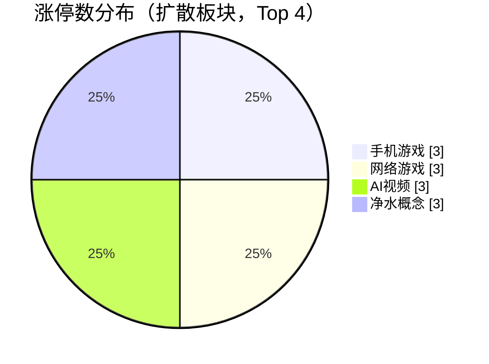
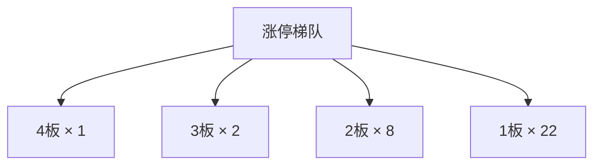
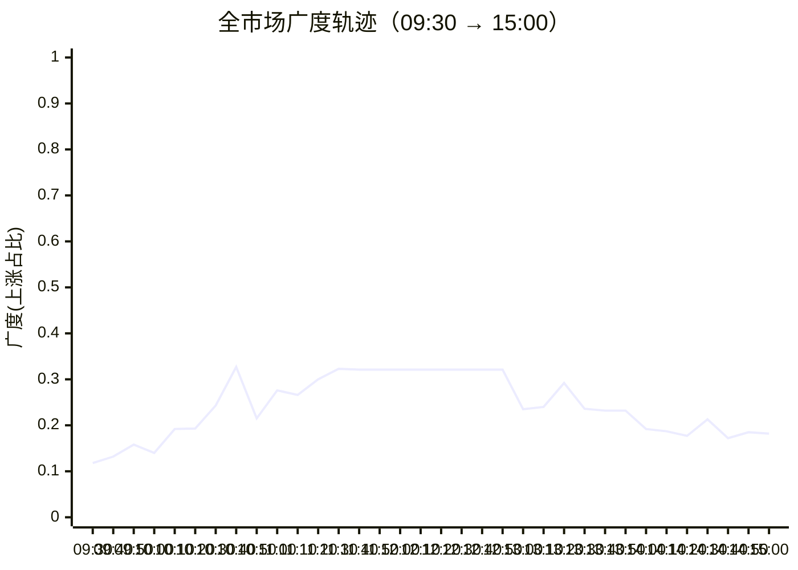

## 当日总览（截至 15:00）

> **结论**：全市场涨1136/跌4350（广度0.21）；涨停33/跌停63；中位涨幅-2.12%；普跌格局。 钱在：手机游戏(涨停3/成分56，中位-2.13%)、网络游戏(涨停3/成分58，中位-2.40%)、AI视频(涨停3/成分67，中位-2.83%)；零星涨停：共享单车(1)、北交所概念(2)、汽车拆解概念(1)、血氧仪(1)、免税店(1)。 退潮：一带一路(跌停15)、光伏概念(跌停11)、海峡两岸(跌停10)。 梯队：4板×1、3板×2、2板×8、1板×22，最高4板。 预案：超买区 文投控股、凯撒文化；未到价 中国电影、华胜天成、通化金马。 较上一轮广度基本持平。

> 🔒 **no_trade / 买入预算 0 / max_position_pct 0 —— 全部内容仅供研究，不授予交易权限。**

### 板块扩散

> 口径：XTick 概念成分 × 全市场实时报价；分母 = 板块内有有效报价的成分数。排序用涨停密度（涨停数/有效成分数），已剔除宽基属性板块（全市场 432 个板块中剔 16 个）。

**扩散中（题材，按涨停密度排序）**

| 板块 | 涨停 | 有效成分 | 涨停密度 | 上涨广度 | 中位涨幅 | 相对全市场 | 成交(亿) |
|---|---|---|---|---|---|---|---|
| 共享单车 ⬦ | 1 | 14 | 0.071 | 0.29 | -1.40% | +0.72% | 11 |
| 北交所概念 ⬦ | 2 | 29 | 0.069 | 0.28 | -0.98% | +1.14% | 56 |
| 手机游戏 | 3 | 56 | 0.054 | 0.27 | -2.13% | -0.01% | 372 |
| 网络游戏 | 3 | 58 | 0.052 | 0.22 | -2.40% | -0.28% | 390 |
| AI视频 | 3 | 67 | 0.045 | 0.16 | -2.83% | -0.71% | 523 |
| 汽车拆解概念 ⬦ | 1 | 23 | 0.043 | 0.26 | -1.83% | +0.29% | 59 |
| 血氧仪 ⬦ | 1 | 24 | 0.042 | 0.21 | -1.06% | +1.06% | 53 |
| 免税店 ⬦ | 1 | 26 | 0.038 | 0.65 | +0.49% | +2.61% | 54 |
| 石墨电极 ⬦ | 1 | 26 | 0.038 | 0.27 | -0.93% | +1.19% | 46 |
| 无人零售 ⬦ | 1 | 26 | 0.038 | 0.23 | -1.61% | +0.51% | 83 |
| 净水概念 | 3 | 81 | 0.037 | 0.27 | -1.42% | +0.70% | 218 |
| 云游戏 ⬦ | 1 | 27 | 0.037 | 0.15 | -2.77% | -0.65% | 153 |

> ⬦ = 涨停 <3 只，零星个例，不构成扩散（不计入「钱在」判定）。



零星涨停板块（<3 只）：共享单车(1)、北交所概念(2)、汽车拆解概念(1)、血氧仪(1)、免税店(1)、石墨电极(1)、无人零售(1)、云游戏(1)

**退潮中（跌停集中）**

| 板块 | 跌停 | 有效成分 | 上涨广度 | 中位涨幅 |
|---|---|---|---|---|
| 一带一路 | 15 | 797 | 0.25 | -1.62% |
| 光伏概念 | 11 | 602 | 0.13 | -2.92% |
| 海峡两岸 | 10 | 320 | 0.16 | -2.80% |
| 5G | 9 | 454 | 0.09 | -4.06% |
| 2026中报预增 | 9 | 514 | 0.15 | -2.52% |
| 人民币贬值受益 | 9 | 612 | 0.18 | -2.21% |
| 2024中报预增 | 9 | 653 | 0.19 | -2.06% |
| 2025中报预增 | 9 | 357 | 0.23 | -1.82% |
| 电子商务 | 9 | 676 | 0.34 | -1.02% |
| 商业航天 | 8 | 507 | 0.09 | -3.83% |
| 比亚迪概念 | 8 | 696 | 0.09 | -3.21% |
| 无人机 | 8 | 471 | 0.10 | -3.27% |

### 涨停梯队

> 最高 4 板 ｜ 涨停 33 ｜ 跌停 63 ｜ 炸板 16 ｜ 封板率 67.3% ｜ 打板成功率 28.95% ｜ 一进二 25.81% ｜ 二进三 50.00%

| 身位 | 家数 | 成员（涨幅/封单亿/首封） |
|---|---|---|
| 4板 | 1 | 北纬科技 +10.06%/0.003亿/09:25 |
| 3板 | 2 | 广百股份 +10.04%/0.020亿/09:30；国统股份 +9.98%/0.001亿/09:34 |
| 2板 | 8 | 华东重机 +9.93%/0.016亿/09:33；金逸影视 +10.00%/0.012亿/09:25；凯撒文化 +10.10%/0.011亿/09:30；世龙实业 +10.01%/0.004亿/10:23；文投控股 +10.00%/0.003亿/09:30 |
| 1板 | 22 | 吉视传媒 +10.04%/0.014亿/10:12；领湃科技 +20.01%/0.010亿/10:35；顺钠股份 +9.97%/0.010亿/11:14；高新发展 +10.00%/0.009亿/11:14；龙江交通 +10.00%/0.008亿/09:38 |



炸板 16 只（前几）：九阳股份(7次)、大胜达(3次)、勤上股份(3次)、神雾节能(2次)、华达科技(2次)

### 预案池对照

| 票 | 池 | 板块 | 现价 | 涨幅 | 触发价 | 买区 | 风险位 | 判定 |
|---|---|---|---|---|---|---|---|---|
| 文投控股 `600715.SH` | 观察池 | 影视传媒（短剧/AI内容情绪映射） | 3.74 | +10.00% | 3.45 | [3.43, 3.5] | 3.32 | **超买区** |
| 凯撒文化 `002425.SZ` | 观察池 | 影视传媒（短剧/AI内容情绪映射） | 4.36 | +10.10% | 4.21 | [4.19, 4.27] | 4.06 | **超买区** |
| 中国电影 `600977.SH` | 观察池 | 影视传媒（短剧/AI内容情绪映射） | 16.72 | -1.94% | 17.05 | [16.96, 17.31] | 16.44 | **未到价** |
| 华胜天成 `600410.SH` | 观察池 | 国产算力（华胜集中分离） | 13.9 | -2.80% | 14.3 | [14.23, 14.51] | 13.78 | **未到价** |
| 通化金马 `000766.SZ` | 观察池 | 创新药（医保目录新增事件） | 14.85 | -10.00% | 16.5 | [16.42, 16.75] | 15.91 | **未到价** |
| 北纬科技 `002148.SZ` | 观察池 | 高度对照 | 8.75 | +10.06% | — | — | — | **无预案价** |
| 金新农 `002548.SZ` | 观察池 | 农业/猪肉 | 4.21 | +9.92% | — | — | — | **无预案价** |
| 禾元生物 `688765.SH` | 观察池 | 医保新增事件 | 29.98 | -18.44% | — | — | — | **无预案价** |
| 博纳影业 `001330.SZ` | 观察池 | 影视传媒 | 6.32 | -6.78% | — | — | — | **无预案价** |
| 游族网络 `002174.SZ` | 观察池 | 游戏/存储分销 | 10.24 | -5.71% | — | — | — | **无预案价** |
| 利扬芯片 `688135.SH` | 观察池 | 光通信测试 | 30.32 | -12.34% | — | — | — | **无预案价** |
| 新宙邦 `300037.SZ` | 观察池 | 电解液 | 50.98 | -1.37% | — | — | — | **无预案价** |
| 德明利 `001309.SZ` | 观察池 | 国产存储 | 178.65 | -7.85% | — | — | — | **无预案价** |
| 天孚通信 `300394.SZ` | 观察池 | 光通信 | 110.2 | -11.83% | — | — | — | **无预案价** |
| 七匹狼 `002029.SZ` | 观察池 | 跨年名字梗 | 7.72 | -10.02% | — | — | — | **无预案价** |

- **文投控股** — 现价3.74 已高于买区上沿3.5，不追高；仅价格位置对照，不代表完整入场条件确认；不能据此确认站稳，不授予下单权限
- **凯撒文化** — 现价4.36 已高于买区上沿4.27，不追高；仅价格位置对照，不代表完整入场条件确认；不能据此确认站稳，不授予下单权限

> ⚠ D1 明确 no_trade=true、买入预算 0、个股 max_position_pct=0。以上为研究对照，**不构成任何买入许可**。

### 盘面 vs 静态复盘 vs 消息面

| 维度 | 对象 | T-1 静态基线 | 今日盘面 | 关系 |
|---|---|---|---|---|
| 板块主线 | 国产算力（华胜集中分离） | R2 次线 score=64 涨停None（T-1 口径） | 盘面未见该板块成分票涨停 | **背离** |
| 板块主线 | 创新药（医保目录新增事件） | R2 次线 score=None 涨停None（T-1 口径） | 盘面未见该板块成分票涨停 | **背离** |
| 板块主线 | 机器人/具身世界模型 | R2 次线 score=58 涨停None（T-1 口径） | 盘面未见该板块成分票涨停 | **背离** |
| 板块主线 | 商业航天/太空光伏 | R2 次线 score=52 涨停None（T-1 口径） | 盘面未见该板块成分票涨停 | **背离** |
| 板块主线 | 农业/猪肉 | R2 次线 score=None 涨停None（T-1 口径） | 盘面未见该板块成分票涨停 | **背离** |
| 梯队结构 | 最高4板 | T-1 最高梯队 4 板、首板 29、炸板率 39.06% | 今日 4板×1、3板×2、2板×8、1板×22；封板率0.6735 炸板16只 | **印证** |
| 预案验证 | 文投控股(600715.SH) | 预案 影视传媒（短剧/AI内容情绪映射）／watch／触发价3.45／买区[3.43, 3.5] | 超买区：现价3.74 已高于买区上沿3.5，不追高；仅价格位置对照，不代表完整入场条件确认；不能据此确认站稳，不授予下单权限 | **背离** |
| 预案验证 | 凯撒文化(002425.SZ) | 预案 影视传媒（短剧/AI内容情绪映射）／watch／触发价4.21／买区[4.19, 4.27] | 超买区：现价4.36 已高于买区上沿4.27，不追高；仅价格位置对照，不代表完整入场条件确认；不能据此确认站稳，不授予下单权限 | **背离** |
| 预案验证 | 中国电影(600977.SH) | 预案 影视传媒（短剧/AI内容情绪映射）／watch／触发价17.05／买区[16.96, 17.31] | 未到价：现价16.72，触发价17.05，还差1.97%；仅价格位置对照，不代表完整入场条件确认；不能据此确认站稳，不授予下单权限 | **无响应** |
| 预案验证 | 华胜天成(600410.SH) | 预案 国产算力（华胜集中分离）／watch／触发价14.3／买区[14.23, 14.51] | 未到价：现价13.9，触发价14.3，还差2.88%；仅价格位置对照，不代表完整入场条件确认；不能据此确认站稳，不授予下单权限 | **无响应** |
| 预案验证 | 通化金马(000766.SZ) | 预案 创新药（医保目录新增事件）／watch／触发价16.5／买区[16.42, 16.75] | 未到价：现价14.85，触发价16.5，还差11.11%；仅价格位置对照，不代表完整入场条件确认；不能据此确认站稳，不授予下单权限 | **无响应** |
| 预案验证 | 北纬科技(002148.SZ) | 预案 高度对照／watch／触发价None／买区None | 无预案价：预案未给有效入场触发价/完整买区（缺失、空规则或格式异常）；仅价格位置对照，不代表完整入场条件确认；不能据此确认站稳，不授予下单权限 | **无响应** |
| 预案验证 | 金新农(002548.SZ) | 预案 农业/猪肉／watch／触发价None／买区None | 无预案价：预案未给有效入场触发价/完整买区（缺失、空规则或格式异常）；仅价格位置对照，不代表完整入场条件确认；不能据此确认站稳，不授予下单权限 | **无响应** |
| 预案验证 | 禾元生物(688765.SH) | 预案 医保新增事件／watch／触发价None／买区None | 无预案价：预案未给有效入场触发价/完整买区（缺失、空规则或格式异常）；仅价格位置对照，不代表完整入场条件确认；不能据此确认站稳，不授予下单权限 | **无响应** |
| 预案验证 | 博纳影业(001330.SZ) | 预案 影视传媒／watch／触发价None／买区None | 无预案价：预案未给有效入场触发价/完整买区（缺失、空规则或格式异常）；仅价格位置对照，不代表完整入场条件确认；不能据此确认站稳，不授予下单权限 | **无响应** |
| 预案验证 | 游族网络(002174.SZ) | 预案 游戏/存储分销／watch／触发价None／买区None | 无预案价：预案未给有效入场触发价/完整买区（缺失、空规则或格式异常）；仅价格位置对照，不代表完整入场条件确认；不能据此确认站稳，不授予下单权限 | **无响应** |
| 预案验证 | 利扬芯片(688135.SH) | 预案 光通信测试／watch／触发价None／买区None | 无预案价：预案未给有效入场触发价/完整买区（缺失、空规则或格式异常）；仅价格位置对照，不代表完整入场条件确认；不能据此确认站稳，不授予下单权限 | **无响应** |
| 预案验证 | 新宙邦(300037.SZ) | 预案 电解液／watch／触发价None／买区None | 无预案价：预案未给有效入场触发价/完整买区（缺失、空规则或格式异常）；仅价格位置对照，不代表完整入场条件确认；不能据此确认站稳，不授予下单权限 | **无响应** |
| 预案验证 | 德明利(001309.SZ) | 预案 国产存储／watch／触发价None／买区None | 无预案价：预案未给有效入场触发价/完整买区（缺失、空规则或格式异常）；仅价格位置对照，不代表完整入场条件确认；不能据此确认站稳，不授予下单权限 | **无响应** |
| 预案验证 | 天孚通信(300394.SZ) | 预案 光通信／watch／触发价None／买区None | 无预案价：预案未给有效入场触发价/完整买区（缺失、空规则或格式异常）；仅价格位置对照，不代表完整入场条件确认；不能据此确认站稳，不授予下单权限 | **无响应** |
| 预案验证 | 七匹狼(002029.SZ) | 预案 跨年名字梗／watch／触发价None／买区None | 无预案价：预案未给有效入场触发价/完整买区（缺失、空规则或格式异常）；仅价格位置对照，不代表完整入场条件确认；不能据此确认站稳，不授予下单权限 | **无响应** |
| 消息面对照 | 盘面热点板块 | R4 消息面（T-1 口径） | 实时快讯未出现热点板块关键词 | **无响应** |

**分歧点（不掩盖）：**
- 板块主线·国产算力（华胜集中分离） → 背离：T-1 有辨识度但今日盘中无涨停响应，题材未获资金确认
- 板块主线·创新药（医保目录新增事件） → 背离：T-1 有辨识度但今日盘中无涨停响应，题材未获资金确认
- 板块主线·机器人/具身世界模型 → 背离：T-1 有辨识度但今日盘中无涨停响应，题材未获资金确认
- 板块主线·商业航天/太空光伏 → 背离：T-1 有辨识度但今日盘中无涨停响应，题材未获资金确认
- 板块主线·农业/猪肉 → 背离：T-1 有辨识度但今日盘中无涨停响应，题材未获资金确认
- 预案验证·文投控股(600715.SH) → 背离：仅研究对照，不授予交易权限
- 预案验证·凯撒文化(002425.SZ) → 背离：仅研究对照，不授予交易权限

### 全天广度轨迹

| 时点 | 涨 | 跌 | 广度 | 涨停 | 跌停 | 成交(亿) | 有效样本 |
|---|---|---|---|---|---|---|---|
| 0930 | 655 | 4722 | 0.118 | 8 | 2 | 611 | 5560 |
| 0940 | 737 | 4681 | 0.132 | 14 | 15 | 2,697 | 5572 |
| 0950 | 879 | 4546 | 0.158 | 17 | 15 | 4,042 | 5572 |
| 1000 | 778 | 4668 | 0.140 | 19 | 17 | 4,956 | 5572 |
| 1010 | 1067 | 4330 | 0.192 | 20 | 15 | 5,832 | 5572 |
| 1020 | 1074 | 4346 | 0.193 | 21 | 15 | 6,436 | 5572 |
| 1030 | 1356 | 4026 | 0.243 | 25 | 15 | 6,997 | 5572 |
| 1040 | 1821 | 3529 | 0.327 | 25 | 15 | 7,405 | 5572 |
| 1050 | 1201 | 4185 | 0.215 | 26 | 16 | 7,793 | 5572 |
| 1100 | 1536 | 3841 | 0.276 | 30 | 15 | 8,102 | 5572 |
| 1110 | 1482 | 3885 | 0.266 | 30 | 14 | 8,405 | 5572 |
| 1120 | 1674 | 3697 | 0.300 | 32 | 14 | 8,777 | 5572 |
| 1130 | 1684 | 3328 | 0.323 | 33 | 14 | 9,005 | 5217 |
| 1140 | 1787 | 3564 | 0.321 | 33 | 14 | 9,066 | 5572 |
| 1150 | 1787 | 3564 | 0.321 | 33 | 14 | 9,066 | 5572 |
| 1200 | 1787 | 3564 | 0.321 | 33 | 14 | 9,066 | 5572 |
| 1210 | 1787 | 3564 | 0.321 | 33 | 14 | 9,066 | 5572 |
| 1220 | 1787 | 3564 | 0.321 | 33 | 14 | 9,066 | 5572 |
| 1230 | 1787 | 3564 | 0.321 | 33 | 14 | 9,066 | 5572 |
| 1240 | 1787 | 3564 | 0.321 | 33 | 14 | 9,066 | 5572 |
| 1250 | 1787 | 3564 | 0.321 | 33 | 14 | 9,066 | 5572 |
| 1300 | 1308 | 4107 | 0.235 | 32 | 13 | 9,222 | 5572 |
| 1310 | 1340 | 4068 | 0.240 | 32 | 18 | 9,629 | 5572 |
| 1320 | 1627 | 3765 | 0.292 | 33 | 18 | 10,053 | 5572 |
| 1330 | 1316 | 4114 | 0.236 | 33 | 21 | 10,460 | 5572 |
| 1340 | 1290 | 4161 | 0.232 | 31 | 26 | 10,805 | 5572 |
| 1350 | 1292 | 4168 | 0.232 | 31 | 26 | 11,105 | 5572 |
| 1400 | 1072 | 4387 | 0.192 | 31 | 36 | 11,528 | 5572 |
| 1410 | 1042 | 4431 | 0.187 | 30 | 42 | 12,012 | 5572 |
| 1420 | 986 | 4493 | 0.177 | 29 | 44 | 12,436 | 5572 |
| 1430 | 1189 | 4272 | 0.213 | 31 | 42 | 13,000 | 5572 |
| 1440 | 957 | 4523 | 0.172 | 32 | 66 | 13,555 | 5572 |
| 1450 | 1030 | 4454 | 0.185 | 33 | 78 | 14,259 | 5572 |
| 1500 | 528 | 2333 | 0.182 | 23 | 30 | 7,782 | 2903 |

> ⚠ **数据冻结段**：1140–1250 数值连续完全一致，说明行情源未刷新，**不是市场横盘**，该段不可解读为盘面变化。

> ⚠ **分母变化**：1500（5572→2903） 有效样本变动超 15%，该时点广度与前后不可直接比较（数据降级）。



### 观察建议（仅研究）

- **环境**：跌停 63 > 涨停 33，炸板 16.0，打板成功率 28.9%，一进二 25.8%。情绪处于**退潮/弱势**区间，右侧信号稀缺，不宜按主升期打法出手。
- **方向**：今日形成实质扩散的是 手机游戏（涨停3/成分56，密度0.054，中位-2.13%）、网络游戏（涨停3/成分58，密度0.052，中位-2.40%）、AI视频（涨停3/成分67，密度0.045，中位-2.83%）。**需确认**：次日能否维持涨停家数且中位涨幅不掉队，否则只是普跌中的避险轮动。
- **零星**：共享单车(1只/14成分)、北交所概念(2只/29成分)、汽车拆解概念(1只/23成分)、血氧仪(1只/24成分)、免税店(1只/26成分) 属零星个例，不视为题材，不据此选股。
- **回避**：一带一路（跌停15）、光伏概念（跌停11）、海峡两岸（跌停10） 板块中位跌幅深，趋势未止跌前不接。
- **身位**：最高 4 板。梯队有高度不等于可接力，需逐票核验封单稳定性与开板次数后再定。
- **预案**：文投控股（现价3.74 已高于买区上沿3.5，不追高；仅价格位置对照，不代表完整入场条件确认；不能据此确认站稳，不授予下单权限）、凯撒文化（现价4.36 已高于买区上沿4.27，不追高；仅价格位置对照，不代表完整入场条件确认；不能据此确认站稳，不授予下单权限）。买区已错过，**不追高**；要参与需等新剧本，不能沿用原预案价位。
- **预案待检验**：中国电影(触发价17.05，还差+1.97%)、华胜天成(触发价14.3，还差+2.88%)、通化金马(触发价16.5，还差+11.11%) 尚未触及触发价，剧本未被盘面检验，继续按原失效条件看。

<details>
<summary>原始截面与数据质量（折叠）</summary>

**跨源校验**

```json
{
  "xtick": {
    "up": 1136,
    "down": 4350,
    "n": 5584,
    "amount_yi": 14843.2
  },
  "rtk_snapshot": {
    "up": 528,
    "down": 2333,
    "valid_n": 2903,
    "amount_yi": 7782.2,
    "up_limit": 23,
    "down_limit": 30
  },
  "note": "两源口径不同（XTick 全市场含全部票；rt_k 返回样本）"
}
```

**rt_k 截面（原始）**

```json
{
  "market": {
    "total": 5584,
    "up": 528,
    "down": 2333,
    "flat": 42,
    "requested_n": 5584,
    "received_n": 5584,
    "valid_n": 2903,
    "missing_n": 2681,
    "universe_requested_n": null,
    "population_scope": "returned_rows_not_verified_all_a_universe",
    "up_ratio": 0.0946,
    "legacy_up_ratio_placeholder": false,
    "up_ratio_is_observed": true,
    "up_ratio_all": 0.0946,
    "up_ratio_valid": 0.1819,
    "up_ratio_denominator": "requested_n",
    "degraded": true,
    "limit_known_n": 2903,
    "limit_unknown_n": 0,
    "limit_counts_complete": true,
    "limit_source_errors": [],
    "up_gt3": 114,
    "up_gt5": 53,
    "up_limit": 23,
    "down_gt3": 1100,
    "down_gt5": 493,
    "down_limit": 30,
    "amount_yi": 7782.2,
    "amount_sum_overflow": false,
    "amount_valid_n": 2903,
    "amount_missing_n": 0
  },
  "source_time_quality": {
    "quote_age_min_seconds": 48.41043,
    "quote_age_max_seconds": 48.41043,
    "source_age_limit_seconds": null,
    "freshness_status": "age_limit_not_configured",
    "age_reference_at": "2026-11-16T15:00:48.410430+08:00"
  },
  "trading_authorized": false
}
```

</details>

## 分时研判记录

### 09:35 研判增量
- **趋势**：使用2026-11-16的09:30分析件；对应rt_k报价为09:30:23—09:30:51，不是09:35实时价。这是当日首份，广度、板块排名、梯队及预案判定均无上一轮可比，顶部“较上一轮持平”不能采信；有效返回样本上涨655/5560、广度11.78%，只能定为弱势开盘，不能确认“局部修复”，也未核验全A名录覆盖。与11月13日预案的整体接力负反馈一致；北纬科技由预案中的3板升至4板、金新农由首板升至2板，只证明个股晋级，市场最高高度仍未超过静态基线的4板。
- **轮动**：猪肉比算力相对抗跌，但没有跨时点资金迁移证据，暂不认定跷跷板。自动对照把“农业/猪肉”写成无涨停，与猪肉1/32涨停、金新农2板冲突，应读为“有孤立响应、未成扩散”，不能照搬为全面背离。另有创投3/460涨停、上涨57/460，被前列热榜遗漏；其密度低、成分多数仍跌，既不能沿用“所有题材涨停均零星”的绝对说法，也不足册封新主线。游戏与传媒标签不能把涨停家数直接相加当作独立资金合力。
- **剧本**：华胜天成越过触发价，只印证个股价格位置；算力成分仅44/417上涨且无涨停，未化解预案所说的个股集中与板块弱势分离。文投控股已出现开板，凯撒文化虽处2板，均不能把“高于买区”解释成完整买点兑现；凯撒原规则最高接受价4.24还严于表中买区上沿4.27，更不能追至本轮4.36。中国电影尚未到17.05，仍是待验证而非失效；通化金马的财务否决不因未来重回16.50解除。禾元生物本轮-6.20%，说明医保事件暂未变成该票的价格正反馈，不作通化的自动替补。
- **下一步看**：先核下一截面报价确实刷新、有效样本口径稳定，再看广度能否高于本轮11.78%并伴随涨停增加；手机游戏是否在本轮上涨20/56、涨停2只之上继续扩展，猪肉是否在上涨12/32之外出现更多涨停助攻，而非只剩金新农。个股核验华胜能否持续处于14.30—14.51、中国电影能否回到17.05—17.31；跌回触发价下方或冲过原上限，均不能照旧称条件满足，持续性须补分钟或盘口证据。文投不因回落重新进入旧买区就自动重启剧本。盘前研究窗口已于今日09:35届满，以上价位只作旧剧本对照；no_trade=true、买入预算0、max_position_pct=0不因到期解除，须有新的有效预案，全部仅供研究，不构成买入许可。

### 09:45 研判增量
- **趋势**：2026-11-16本轮截至09:40：采集09:40:43—09:40:53，报价09:40:18—09:40:50，不是09:45实时价。相较09:30，有效返回样本上涨655/5560→737/5572，分母变化，不作严格同样本广度增幅；中位涨幅却从-0.97%降至-1.40%。梯队源涨停8→13，但跌停2→15、炸板2→7、封板率80%→65%，最高仍4板，判断是“局部强势点增加，亏钱效应扩散更快”，不是全面修复。北纬科技仍在4板，但开板次数0→1，封单0.042→0.019亿元；价格没变不等于承接没变。
- **轮动**：新增相对扩展在零售，而不是热榜第一名就代表主线：商贸零售行业样本上涨22/100→38/100、涨停1→3，免税店上涨5/26→12/26但仍仅1只涨停；相反手机游戏上涨20/56→11/56，涨停仍2只，前排未倒却后排失血。银行上涨22/42→32/42，也支持风险偏好向相对防御方向偏移的假设；尚无同口径净流数据，不能确证资金迁移或稳定跷跷板。全量概念中乡村振兴涨停1→3/440、上涨54/440→64/440，说明顶部“所有题材均零星”的绝对表述不成立，但大多数成分仍跌；行业标签、重叠概念不能直接认作统一题材主线。
- **剧本**：有价位规则的票中，华胜天成是唯一判定迁移：14.43→15.10，由“已触发”变成高于原上沿14.51，旧买点已越界，不是现在可追；算力租赁上涨19/188→14/188、仍无涨停，继续印证预案“个股集中不等于板块共振”。文投控股3.69→3.58，虽仍高于3.50上沿，却在走弱；凯撒文化仍4.36，但开板次数0→1，不能当稳定封单。中国电影16.93→16.69、通化金马15.65→15.40，均离原触发价更远，后者财务否决不变。禾元生物34.48→32.38，医保事件的个股价格反馈继续恶化，未印证盘前优先观察假设；其余缺有效价位的观察票不补造入场条件。
- **下一步看**：下一有效截面先检验零售能否在涨停3/100、上涨38/100基础上继续扩展，且不增加本轮1只跌停；游戏能否扭转上涨11/56、涨停仍2只的收缩，而不是只看凯撒封板。市场修复至少需看到跌停从15只减少、封板率高于本轮65%，不能只看涨停增加；这些是本轮对比锚，不是批准的开仓门槛。价格对照只看华胜是否重新处于14.30—14.51、中国电影是否回到17.05且不超过17.31；连续承接须另有分钟或盘口证据，回到旧区间也不自动重启已于09:35届满的预案。本轮no_trade=true、买入预算0、max_position_pct=0不变，全部仅研究，不构成买入许可。

### 09:55 研判增量
- **趋势**：2026-11-16本轮依据09:50分析件，与09:40对比；rt_k采集09:50:43—09:50:54，报价09:50:18—09:50:51，不是09:55实时价。有效返回样本数均为5572，上涨737→879，广度13.23%→15.78%（增加2.55个百分点）；同源涨停14→17，跌停仍15。XTick封板率65%→70.83%，首板6→11，但三板2→1、最高仍4板，国统股份进入开板名单，北纬科技开板次数1→3。较上轮应改判为“首板补充型弱修复，高位承接仍分歧”，不能因涨停增加就升级为接力修复；两源跌停数有差异，不混用。
- **轮动**：新增扩展在家电行业样本：涨停0→3/103，上涨31→37/103，九阳股份回到涨停队列，长虹美菱、华帝股份新增首板助攻。净水概念涨停0→3/81，但上涨仍20/81，是前排集中，不是成分普涨；与家电标签不能相加当作两路独立合力。上轮零售扩展暂未延续：上涨38→32/100、涨停仍3，中位涨幅-0.18%→-0.42%；手机游戏上涨11→10/56、中位-1.65%→-1.90%，银行上涨32→34/42。支持“防御偏好与局部首板并存”的轮动假设，尚无净流证据证明跷跷板；分析件未匹配到热点催化，家电暂不册封新主线。
- **剧本**：15只观察票的价格判定均未迁移，但内部强弱继续分开。文投控股3.58→3.55、华胜天成15.10→14.99，仍在原买区上方却回落，不能把“超买区”当作剧本利好；凯撒文化仍4.36，封单0.032→0.026亿元，游戏后排走弱，未解除盘前对旧核心拥挤的顾虑。中国电影16.69→16.70，仍低于17.05触发价，微幅回升不算突破确认。金新农仍二板，但猪肉上涨13→8/32、涨停仍1，前排没有带出更广承接；通化金马15.40→15.03、禾元生物32.38→31.82，医保事件的这两只观察对象继续负反馈，不能用行业小幅修复替代个股确认，通化财务否决不变。其余缺有效价位的观察票不补造条件。
- **下一步看**：下一同口径截面，家电先看能否保住涨停3/103，并把上涨家数推过本轮37/103；净水若仍只有20/81上涨，仍只记前排集中。零售若不能回到上轮上涨38/100、游戏仍低于上轮11/56，就不能解释为消费与传媒全面回流。市场进一步修复需广度高于本轮15.78%，并见rt_k跌停少于本轮15只；若只有首板增加而北纬反复开板、三板不能恢复，仍按分化看。文投若回落至3.50不自动重启旧买点，失守3.45则更削弱原突破假设；中国电影只有回到17.05—17.31，才可重评原价格条件，持续承接须另核分钟或盘口。这些均为对比锚，不是开仓门槛；盘前研究窗口已于09:35届满，no_trade=true、买入预算0、max_position_pct=0不变，全部仅研究，不构成买入许可。

### 10:05 研判增量
- **趋势**：2026-11-16截至10:00分析件，对比09:50；rt_k采集10:00:43—10:00:56，报价09:59:21—10:00:53，不是10:05实时价。有效返回样本数均为5572，上涨879→778，广度15.78%→13.96%（下降1.81个百分点），中位涨幅-1.35%→-1.75%；同源涨停17→19、跌停15→17。新增强势集中在首板11→13，最高仍4板，封板率虽70.83%→73.08%，不能抵消多数票再度走弱：上一轮弱修复正在回吐，不采顶部“广度基本持平”的判断。北纬科技仍4板，开板次数未增加，但封单0.019→0.017亿元，尚无高位承接增强证据。
- **轮动**：上轮家电扩展未继续铺开：行业样本上涨37→34/103、涨停仍3；净水上涨20→17/81、涨停仍3，却新增1只跌停。反向改善在传媒与零售：文化传媒概念上涨36→43/197、涨停3→4，中位涨幅-1.61%→-1.43%；商贸零售行业上涨32→39/100、涨停仍3，银行上涨34→37/42。更像局部消费/传媒承接与银行防御并存，不是全市场回暖；没有净流证据确认同一批资金形成跷跷板。传媒位于全量成分结果而非顶部热榜，不能只按热榜认定“仅净水有响应”；概念重叠不相加，快讯未匹配热点也不等于没有催化。
- **剧本**：15只观察票的价格判定均未迁移，但传媒改善尚未普遍传导至原预案对象：手机游戏上涨10→12/56，凯撒仍二板；中国电影16.70→16.68，仍未达到17.05，游族网络10.36→10.29继续转弱，不能把板块改善直接算成预案兑现。华胜天成14.99→14.85，仍高于原上沿14.51，算力租赁中位跌幅反而加深且新增跌停，继续支持“个股集中不等于板块共振”。禾元生物31.82→31.10、通化金马15.03→14.95，医保事件两只观察对象的负反馈加深，通化财务否决不变。另有数据分歧：开板名单的文投涨幅两轮均为+9.41%，而价格对照均为+4.41%；该名单不能用来推断本轮新开板或回封。
- **下一步看**：先看同口径广度能否收复09:50的15.78%、rt_k跌停能否从17只减少；若只有首板增加，仍按强势集中而非全面修复解释。局部承接看传媒能否保持涨停4/197并扩大本轮上涨43/197，零售能否保持上涨39/100；家电若不能恢复上轮上涨37/103、净水仍有跌停，就不升级上轮扩散假设。价位仍仅核中国电影能否回到17.05—17.31、华胜是否回到14.30—14.51；回区间不等于持续站稳，也不自动重启09:35已届满的旧预案。以上均为研究对比锚，不是开仓门槛；no_trade=true、买入预算0、max_position_pct=0不变，不追超出原买区的票，不授予任何买入许可。

### 10:15 研判增量
- **趋势**：2026-11-16本轮依据10:10分析件，对比10:00；rt_k采集10:10:42—10:10:53，报价10:09:57—10:10:50，不是10:15实时价。有效返回样本数均为5572，上涨778→1067，广度13.96%→19.15%（增加5.19个百分点），同源跌停17→15，中位涨幅-1.75%→-1.18%；上轮要求的广度收复与跌停减少已出现，判断由“修复回吐”改为“弱市再次修复”，仍非普涨。梯队涨停19→20主要是岳阳兴长从开板名单回到二板队列，首板仍13、最高仍4板；北纬科技开板次数3→4、封单0.017→0.014亿元，不能把整体修复等同于高标承接增强。XTick跌停为14只，与rt_k的15只分开使用。
- **轮动**：增量在家电、传媒的后排回暖，而非新题材上位：行业家电上涨34→46/103、涨停仍3，中位-0.91%→-0.08%；文化传媒概念上涨43→57/197、涨停仍4。净水上涨17→21/81且跌停1→0，改善了上一轮负反馈，但多数成分仍跌。相反零售上涨39→38/100、免税店12→7/26，消费内部并不同步；银行仍35/42上涨、中位涨幅反而提高，不能仅凭上涨家数减少认定防御资金撤离。达到3只涨停的概念密度排序未变，重叠成分不加总；缺同口径净流证据，不确证资金跷跷板。热点消息关键词仍未匹配，只能说催化归因未核，不能说不存在催化。
- **剧本**：15只观察票的价格判定均未迁移，但中国电影16.68→16.93、文投3.55→3.59，与传媒后排回暖相呼应；前者仍未到17.05，后者仍超过原上沿3.50，均非完整入场确认。华胜天成却14.85→14.56，在市场修复时继续回吐；算力租赁虽上涨20→25/188，仍无涨停且有1只跌停，原“个股集中不等于板块共振”未被推翻。替代方向也未新增合力：猪肉上涨9→11/32但仍仅金新农1只涨停；创新药上涨44→66/275，通化却14.95→14.92、禾元仅31.10→31.20，行业回暖未转成医保事件两只对象的强势确认。通化财务否决不变，其余缺有效价位者不补造买点。
- **下一步看**：同口径广度能否保持本轮19.15%以上、rt_k跌停能否继续少于15只；家电、传媒能否分别保住涨停3/103、4/197并继续扩大上涨46/103、57/197，净水是否再次出现跌停。若广度回落而只剩前排封板，撤回“修复延续”的假设。价格只核中国电影能否进入17.05—17.31；华胜即使回到14.30—14.51，也须区分高位回落与重新突破，不能因进区间自动重启，跌回14.30以下则原突破假设更弱，持续性需分钟或盘口证据。盘前研究窗口已于09:35届满，须新有效预案重评；以上仅研究对比锚，no_trade=true、买入预算0、max_position_pct=0不变，不追超买区，不授予任何买入许可。

### 10:29 研判增量
- **趋势**：2026-11-16截至10:20分析件，对比10:10；rt_k采集10:20:42—10:20:52，报价10:19:51—10:20:50，不是10:29实时价。有效返回样本数均为5572，上涨1067→1074，广度19.15%→19.27%，仅增0.13个百分点；中位涨幅反而-1.18%→-1.37%，跌超5%的样本379→501，增加122只。上轮修复的广度扩展已明显放缓，尾部亏钱重新加深；同源涨停20→21、跌停仍15，不能据此升级修复。梯队首板13→14、最高仍4板，炸板6→8、封板率76.92%→72.41%，说明强势补充与开板损耗并存，不是接力整体增强。
- **轮动**：按全量概念中至少3只涨停的密度排序，首位由净水换成文化传媒：传媒涨停4→5/197、上涨57→63/197，吉视传媒10:12首封提供新增助攻；但中位涨幅仍从-0.82%降至-0.93%，是局部强势扩展，不是全线回流。净水与家电行业涨停分别由3→2/81、3→2/103，华帝进入开板名单，前排承接弱于上轮。猪肉上涨11→21/32、中位-0.32%→+0.65%，出现显著成分回暖，但仍仅金新农1只涨停，尚未形成涨停梯队扩散；银行上涨35→39/42，存储芯片中位-3.42%→-4.14%，更像防御偏好与传媒局部活跃并存。没有同口径净流证据，不确证资金跷跷板；重叠概念不相加。
- **剧本**：本轮唯一价格判定迁移是中国电影16.93→17.20，从未到价变为已触发，进入原买区16.96—17.31且超过17.05触发价，补强院线容量反馈；但原预案将其定位为容量对照、保留11月13日多次开板的否决，不能由越线直接升级为龙头或完整入场确认。文投3.59→3.66与传媒助攻呼应，却仍超过原买区上沿3.50，不追高，凯撒也未新增价格资格。算力租赁虽从无涨停变为1/188，上涨成分反由25→19/188；本轮快讯样本出现AI模型调用榜报道，仍不足认定消息已带来板块共振，未推翻华胜原有的个股集中风险。其余观察票的判定未变，不因题材标签或缺价位而补造买点。
- **下一步看**：下一同口径截面，先看广度能否超过本轮19.27%，同时跌超5%的501只减少、封板率向上轮76.92%恢复；若只有涨停增加而亏钱尾部扩大，继续按强势集中解释。传媒能否保住涨停5/197并扩大上涨63/197，净水、家电能否分别恢复上轮3/81、3/103的涨停规模；猪肉是否在金新农之外出现助攻，而非仅后排翻红。中国电影只核17.05—17.31内的持续承接，跌回17.05以下削弱突破假设，超过17.31则不追，持续性须分钟或盘口证据。以上均为研究对比锚，不是开仓门槛；09:35已届满的旧预案不自动重启，no_trade=true、买入预算0、max_position_pct=0不变，不授予任何买入许可。

### 10:37 研判增量
- **趋势**：2026-11-16截至10:30分析件，对比10:20；rt_k采集10:30:43—10:30:53，报价10:29:39—10:30:51，不是10:37实时价。有效返回样本均为5572，上涨1074→1356，广度19.27%→24.34%（增加5.06个百分点），跌超5%的501→419只，中位涨幅-1.37%→-1.00%；上轮要求的广度扩展与尾部收敛同时出现，可由“修复放缓”改判为“弱修复重新扩展”，仍不是普涨。同源涨停21→25、跌停仍15；梯队源封板率72.41%→78.12%、二板5→8、首板14→15，增量不再仅靠首板，但最高仍4板。北纬科技开板次数仍4次、封单0.013→0.012亿元，尚无高度突破或高标承接增强证据；XTick跌停14→13与rt_k的15只分开使用。
- **轮动**：传媒由前排集中向更多成分传导：文化传媒概念涨停5→7/197、上涨63→81/197；手机游戏涨停2→3/56、上涨18→22/56，网络游戏涨停2→3/58，均达到扩散观察规模，按涨停密度在达标概念中升至前列，但标签重叠不能算独立合力。横店影视以10:30首次封板进入二板队列，文投则重返涨停队列，补强院线/传媒结构；文投已有3次开板，不能说封单稳定。家电仍2/103涨停、净水仍2/81，未达到上轮要求的恢复规模。零售上涨41→51/100且涨停仍3，银行上涨39→40/42，是消费与防御并行，非已证实的资金跷跷板；存储芯片虽中位-4.14%→-3.91%，相对市场差距反由-2.77扩大到-2.91个百分点，属于落后修复，不认定科技回流。
- **剧本**：本轮唯一价格判定迁移是华胜天成14.58→14.45，由“超买区”回到原14.23—14.51区间且高于14.30触发价；这是高位回落进区，不是新突破，算力租赁仅21/188上涨、仍1只涨停和1只跌停，未推翻盘前“个股集中不等于板块共振”。中国电影17.20→17.10虽仍高于17.05，反在传媒扩散时回吐，容量承接尚未同步增强。文投3.66→3.74、凯撒仍4.36，价格强势支持情绪端响应，但仍超出原买区，不追高，也不抹掉原降级理由。本轮快讯样本新增药明巨诺医保报道，不能移作通化或禾元的公司催化；创新药上涨60→87/275却仍无涨停，通化14.89→14.86、禾元31.21→30.85继续走弱，事件观察对象仍与行业修复背离，通化财务否决不变。其余无有效预案价的观察票不补造条件，三方共振尚未成立。
- **下一步看**：下一同口径截面，广度能否守住24.34%、跌超5%的样本能否继续少于419只、梯队封板率能否维持78.12%，并见rt_k跌停从15只减少；若广度再缩而只剩前排封板，撤回“修复扩展”判断。传媒核涨停7/197与上涨81/197能否维持，手机游戏核涨停3/56及上涨22/56，不能只看文投回到涨停价；家电/净水仍以此前3/103、3/81的恢复规模作对照。中国电影跌回17.05以下则削弱突破假设；华胜重点核14.30—14.51内的真实承接，跌回14.30下方或再越14.51均不能照旧称价格条件满足，持续性须分钟或盘口证据。以上仅研究对比锚，不是开仓门槛；09:35已届满的旧预案不自动重启，no_trade=true、买入预算0、max_position_pct=0保持不变，不授予任何买入许可。

### 10:47 研判增量
- **趋势**：2026-11-16截至10:40分析件，对比10:30；rt_k采集10:40:43—10:40:51，报价10:40:00—10:40:48，不是10:47实时价。有效返回样本均为5572，上涨1356→1821，广度24.34%→32.68%（增加8.35个百分点），跌超5%的419→310只，中位涨幅-1.00%→-0.58%，说明修复继续向更多普通成分传导；但同源涨停仍25、跌停仍15，梯队源炸板7→9、封板率78.12%→73.53%、二板8→7，最高仍4板。新增领湃科技首板不能抵消横店影视进入开板名单，判断改为“广度修复加快，接力质量反向走弱”，不是全面转强；XTick跌停13→15，与rt_k的15只持平分开使用。
- **轮动**：传媒出现“后排回暖、前排损耗”并存：文化传媒概念上涨81→106/197，中位转正，涨停却7→6；手机游戏上涨22→29/56、涨停仍3，短剧游戏上涨47→59/99、涨停却3→2，不能把成分翻红当封板合力同步增强。零售上涨51→62/100、家电51→62/103，但后者仍仅2只涨停；银行仍39/42上涨，不能认定防御资金已撤出。新增研究线是锂电：涨停4→5/614、上涨122→170/614，领湃10:35首封与本轮电池拉升快讯相呼应，但板块中位仍-0.86%，多数成分仍跌，尚非新主线。存储仅12/203上涨，科技仍属落后修复；没有同口径跨时点净流数据，不确证资金跷跷板，重叠概念不加总。
- **剧本**：两处价格资格退回待重评：中国电影17.10→16.97，仍在原买区16.96—17.31，却已跌回17.05触发价下方，上轮观察的突破削弱已发生；不能沿用顶部“已触发”或自动对照的“印证”标签。华胜天成14.45→14.52，再次超过14.51最高接受价，属于旧买点越界而非股价转弱；算力租赁上涨21→42/188，但仍仅1只涨停、1只跌停，尚未推翻原预案的个股集中风险。10:38:42快讯样本新增博纳参股影视公司报道，博纳却6.61→6.53，说明这条报道暂未对应到该票的强势反馈，不能因传媒回暖递补后排。其余观察票判定未迁移，原有降级与否决不解除，缺有效价位的不补造买点。
- **下一步看**：下一同口径截面，先看广度能否保持本轮32.68%以上、跌超5%的样本继续少于310只，同时封板率能否向上轮78.12%恢复、rt_k跌停能否少于15只；若广度继续升而炸板增加，仍只认普通成分修复，不升级接力判断。传媒需兼看上涨106/197能否保持、涨停能否恢复上轮7只，不能只数翻红；锂电看能否保住5/614涨停并扩大上涨170/614，否则仍是少数前排。中国电影须重新回到17.05—17.31才重评原突破条件，若再跌出16.96则连原买区位置也不满足；华胜高于14.51不追，回区间也不等于重新突破，持续承接须分钟或盘口证据。以上仅为研究对比锚；09:35已届满的旧预案不自动重启，no_trade=true、买入预算0、max_position_pct=0不变，不授予任何买入许可。

### 10:55 研判增量
- **趋势**：2026-11-16本轮依据10:50分析件，对比10:40；rt_k采集10:50:43—10:50:52，报价10:49:39—10:50:50，不是10:55实时价。有效返回样本数均为5572，上涨1821→1201，广度32.68%→21.55%（下降11.13个百分点），跌超5%的样本310→491只，中位涨幅-0.58%→-1.19%。上轮“广度修复加快”已被明显回吐，不能沿用顶部“局部修复”的定性。同源涨停25→26、跌停15→16；梯队首板16→17、二板仍7、最高仍4板，炸板9→10、封板率73.53%→72.22%，增量仍是少数强股，尚无接力转强证据。
- **轮动**：新增相对强势在家电前排：行业样本涨停2→4/103，但上涨62→55/103、中位+0.47%→+0.23%；净水涨停2→3/81、上涨38→27/81，按达标概念涨停密度升至第三，不等于后排扩散。反向看传媒上涨106→66/197、涨停仍6，手机游戏上涨29→19/56、涨停仍3；锂电上涨170→113/614、涨停仍5，上轮后排回暖与电池扩展均在收缩。银行上涨39→40/42、中位+0.81%→+0.86%，更支持防御偏好，而非资金全面回流题材。家电、净水成分重叠不相加；缺同口径净流证据，不确证跷跷板，行业标签也不能代替当日催化。
- **剧本**：15只观察票中两处价格判定迁移，方向不同：中国电影16.97→16.70，从买区内退至未到价，已跌出16.96下沿，原突破假设进一步削弱；其盘前容量对照身份与多次开板的降级理由仍在。华胜天成14.52→14.50，从超买区回到触发价14.30与上沿14.51之间，只是回落进区，不是新突破；算力租赁上涨42→22/188、仍1只涨停和1只跌停，继续印证原预案的个股与板块分离风险。文投价格仍在涨停边界，封单却0.021→0.009亿元，价格不变不能解释为承接稳定；与凯撒均不追超出原上限的价格。其余判定未变；本轮分析件仍未匹配热点消息，不能据此宣称不存在催化，更不能升级为三方共振。
- **下一步看**：下一有效截面先看广度能否收复10:30的24.34%，同时跌超5%的样本少于本轮491只、rt_k跌停从16只减少；否则维持“修复回吐、强势集中”。家电能否保住4/103涨停并恢复上轮上涨62/103，净水能否保住3/81且上涨超过本轮27/81，才有继续扩展的依据；传媒若仍只有6只涨停而上涨低于本轮66/197，不能把前排封板当全面回流。中国电影先核能否重回16.96原下沿，重新满足原突破价格条件仍须17.05—17.31；华胜只核14.30—14.51内的真实承接，跌回14.30下方或再越14.51均须重评，持续性另需分钟或盘口证据。这些仅为已有数值的研究对比锚，不是开仓门槛；09:35届满的旧预案不自动重启，no_trade=true、买入预算0、max_position_pct=0不变，不授予任何买入许可。

### 11:05 研判增量
- **趋势**：2026-11-16截至11:00分析件，对比10:50；rt_k采集11:00:43—11:00:52，报价10:59:24—11:00:50，不是11:05实时价。有效返回样本数均为5572，上涨1201→1536，广度21.55%→27.57%（按原始计数增加6.01个百分点），跌超5%的491→393只，同源涨停26→30、跌停16→15；上轮要求的广度收复与尾部收敛已出现，改判为“回吐后再次弱修复”，但仍未收复10:40的32.68%，大跌样本也仍多于当时310只，不能认定日内反转。梯队封板率72.22%→76.92%、炸板10→9，改善主要来自首板17→21，二板仍7、最高仍4板，高位接力未同步扩展；XTick跌停16→13与rt_k口径分开使用。
- **轮动**：传媒这轮不只是前排价格不变：文化传媒概念上涨66→99/197、涨停6→7，中位-0.79%→+0.03%；华数传媒10:53首封提供新增首板助攻，AI视频涨停2→3/67，进入扩散观察范围，手机/网络游戏仍各3只涨停但上涨成分分别19→26/56、15→24/58。相反家电行业涨停4→5/103，上涨却55→54/103，中位+0.23%→+0.20%，仍属前排增强、后排未跟；净水涨停3→4/81、上涨27→33/81也尚非多数成分走强。银行上涨40→42/42，防御并未退出；存储仅11/203上涨且无涨停，科技回流仍缺证据。更像传媒修复与防御并行，不是已证实的资金跷跷板；重叠概念不加总，本轮快讯样本仍未匹配热点的直接催化，三方一致尚未成立。
- **剧本**：15只观察票的价格判定均未迁移，板块修复不等于原预案兑现。中国电影16.70→16.86，仍低于16.96买区下沿与17.05触发价，容量对照尚未跟上传媒改善；华胜天成14.50→14.39，在算力租赁上涨22→35/188、涨停1→2时反向回吐，虽仍高于14.30，却不足推翻原预案的个股集中与多次开板风险。文投仍在涨停边界、封单0.009→0.016亿元，但开板记录3→4次；封单恢复不等于稳定性恢复，与凯撒均不追原买区之外的价格。其余无有效预案价的票不因反弹补造买点，原有降级和财务否决不解除。
- **下一步看**：下一同口径截面，先看广度能否保持27.57%并进一步收复10:40的32.68%，跌超5%的样本继续少于393只、rt_k跌停少于15只；若再次回吐，仍按反复弱修复而非反转解释。传媒需保住涨停7/197并扩大上涨99/197，AI视频需维持3/67涨停；家电若只增加涨停却不能恢复上轮上涨55/103，不升级为全面扩散。中国电影先核16.96，重新满足原突破价格条件仍须17.05—17.31；华胜若跌回14.30以下则进一步削弱原突破假设，持续承接须另核分钟或盘口，不能仅凭截面越线确认。以上只用已有数值作研究对比锚；09:35届满的旧预案不自动重启，no_trade=true、买入预算0、max_position_pct=0不变，不构成任何买入许可。

### 11:17 研判增量
- **趋势**：2026-11-16截至11:10分析件，对比11:00；rt_k采集11:10:43—11:10:52，报价11:09:12—11:10:50，不是11:17实时价。有效返回样本数均为5572，上涨1536→1482，广度27.57%→26.60%（下降0.97个百分点），跌超5%的393→445只；虽同源跌停15→14，亏钱尾部反而重新扩大。涨停仍30、二板仍7、最高仍4板，封板率仍76.92%，上轮弱修复未继续扩展，更像“前排守住、后排再分化”，不能因跌停少一只就升级反转；XTick跌停仍13只，另列口径，不与rt_k混用。
- **轮动**：同样的涨停排名下，承接已不同：文化传媒概念上涨99→89/197、中位+0.03%→-0.17%，手机游戏上涨26→21/56、AI视频26→21/67，涨停分别仍7、3、3只，是传媒后排回吐；家电行业上涨54→56/103、涨停仍5、中位+0.20%→+0.36%，比上一轮多了一点成分跟随，但家电概念186只成分的中位仍走低，不能把行业改善外推至全概念。猪肉上涨21→22/32、中位+0.55%→+0.79%，银行仍41/42上涨，防御偏好未撤；存储芯片仅10/203上涨，科技未接棒。支持“家电/猪肉相对抗跌、传媒后排收缩”的轮动假设，无净流证据确证资金跷跷板；重叠概念不加总，达标概念的涨停密度前列排序未变。
- **剧本**：15只观察票中唯一价格判定迁移是华胜天成14.39→14.12，由已触发退至未到价，同时跌破原14.30触发价及14.23买区下沿，上轮提示的突破削弱已发生；算力租赁上涨35→32/188、仍2只涨停和1只跌停，个股与板块均未给出转强确认，不下移旧买区接弱。中国电影16.86→16.91虽逆传媒小幅回升，仍未回到16.96下沿，更未到17.05；文投、凯撒仍超原买区，不追高，其他判定未迁移。新增三方线索在猪肉：本轮快讯样本11:10:07出现生猪期货连涨、金新农二板报道，与盘前猪肉替代剧本及成分回暖部分印证，自动对照的“农业无涨停/消息无响应”不能照搬；但这只是盘中异动报道，不能倒写成盘前已知的新催化，且仍只有金新农1只涨停，未成涨停助攻扩散，也无完整预案价，不自动晋级买入。
- **下一步看**：下一同口径截面先核广度能否收复11:00的27.57%，跌超5%的样本能否从445只减少；若只有跌停减少而尾部继续扩大，仍按分化解释。传媒看能否保住涨停7/197并恢复上涨99/197；家电看5/103涨停及上涨56/103能否维持，猪肉看上涨22/32能否延续、金新农之外有无新增涨停助攻，而非用新闻热度替代扩散。华胜先看能否收回14.23，重评原突破价格条件仍须14.30—14.51；中国电影仍须17.05—17.31，截面越线不等于持续承接，须另核分钟或盘口。以上均为已有数值的研究对比锚；09:35届满的旧预案不自动重启，no_trade=true、买入预算0、max_position_pct=0不变，全部仅供研究，不构成任何买入许可。

### 11:27 研判增量
- **趋势**：2026-11-16截至11:20分析件，对比11:10；rt_k采集11:20:43—11:20:50，报价11:19:09—11:20:48，不是11:27实时价。有效返回样本均为5572，上涨1482→1674，广度26.60%→30.04%（按原始计数增加3.45个百分点），跌超5%的445→328只，上轮要求的广度收复与尾部收敛已出现，改判为“弱修复再扩展，但旧强线逆势掉队”。同源涨停30→32、跌停仍14；梯队首板21→23、最高仍4板，二板总数虽仍7，却是新能股份进入、文投控股退出，炸板9→10、封板率76.92%→76.19%，不能把总数增加当成旧核心承接改善。
- **轮动**：市场回暖时传媒反而收缩：文化传媒概念上涨89→84/197、涨停7→6，中位-0.17%→-0.28%；手机游戏、网络游戏、AI视频涨停均3→2，退出本轮“至少3只涨停”的扩散观察组。净水涨停仍4/81、上涨36→39/81，在达标概念中按涨停密度由第三升至第一，主要是游戏退位，不是自身新增涨停；家电行业上涨56→58/103、涨停仍5，属于后排小幅跟随。光伏上涨82→134/602、涨停1→3，但仍3只跌停，是受损方向的局部反弹，不能直接改称新主线。银行上涨41→38/42但仍高度集中翻红，支持“防御略降温、局部修复扩展”的假设，不足证明资金转向科技的跷跷板；重叠概念不加总。
- **剧本**：15只观察票的价格判定均未迁移，标签未变不等于剧本未变。文投3.74→3.72、开板记录4→5次且退出二板队列，补强原预案对旧高位拥挤与承接分歧的警惕；仍高于3.50原上沿，不因开板就追。凯撒虽仍二板，也不能替代整个游戏方向已减弱的助攻。中国电影16.91→16.80、华胜天成14.12→14.01，在市场修复时继续回吐，均未收回原买区下沿16.96、14.23，容量与算力个股的原突破假设继续削弱，不下移买区接弱。本轮快讯样本未新增与这些方向直接对应的催化，不能补写为三方共振；其余缺有效价位者不补造买点，通化财务否决不解除。
- **下一步看**：下一同口径截面，广度能否保持30.04%以上、跌超5%的样本少于328只，并见封板率恢复上轮76.92%；若只有涨停增加、开板损耗继续扩大，仍不升级接力判断。传媒先核能否恢复上轮涨停7/197、上涨89/197及文投重新进入涨停队列，游戏/AI视频能否恢复各3只涨停；净水看4/81涨停与上涨39/81能否维持，光伏若仍3只跌停就不把前排新增封板当全线修复。中国电影、华胜先核16.96、14.23是否收复，重评原突破价格条件仍分别须17.05—17.31、14.30—14.51，持续承接另需分钟或盘口证据。以上只是已有数值的研究对比锚，不是开仓门槛；09:35届满的旧预案不自动重启，no_trade=true、买入预算0、max_position_pct=0不变，不追超买区，不构成任何买入许可。

### 11:37 研判增量
- **趋势**：2026-11-16截至11:30分析件，对比11:20；rt_k采集11:30:43—11:30:45、报价11:30:00—11:30:44，不是11:37实时价。新增风险在覆盖：有效返回样本5572→5217，少355只（-6.37%），即使errors为空也须按覆盖降级；广度30.04%→32.28%、跌超5%的328→268只均不可直接解读为改善。另看返回数均为5584的XTick，上涨1681→1787、下跌3708→3576，中位涨幅-0.71%→-0.58%，仍支持温和修复，但不证明无遗漏全A覆盖或日内反转。梯队新增共进股份11:22首封，首板23→24，二板仍7、最高仍4板、炸板仍10；增量继续来自首板，不是高度突破。
- **轮动**：净水由前排集中略向成分传导：涨停仍4/81，上涨39→42/81、中位-0.08%→+0.06%，本轮刚过半；家电行业上涨58→60/103、涨停仍5，达标概念的涨停密度前列排序未变。传媒仅上涨84→87/197、涨停仍6，尚未收复此前89/197与7只涨停，游戏/AI视频仍各2只涨停，不能说旧主线已重新扩散。算力租赁上涨36→45/188、中位-1.43%→-0.89%，属于落后修复，仍仅2只涨停并存1只跌停；银行上涨38→39/42，防御没有退出。支持“家电承接略扩、算力局部补涨、传媒未修复到位”，缺净流证据，不确证资金跷跷板；家电与净水重叠成分不加总。
- **剧本**：15只观察票仅华胜发生价格判定迁移：14.01→14.39，重新越过14.23下沿与14.30触发价，回到14.30—14.51研究区间；这是对上轮突破削弱的局部修复，不是已经确认持续站稳，更未推翻原预案的个股集中、多次开板风险。中国电影16.80→16.77、文投3.72→3.69，在市场温和修复时继续走弱，院线容量与旧情绪核心未同步增强；凯撒仍二板不足替代整个方向的助攻，二者均不追原上限之外的价格。消息匹配仍为空，只说明本轮分析件未核出直接催化，不能升级三方共振；其他判定未迁移，缺有效预案价不补造买点，通化财务否决不解除。
- **下一步看**：午后先等报价时标刷新，并核rt_k有效样本能否恢复至此前5572及代码覆盖；恢复前不沿用30.04%作可比广度门槛，也不把午休重复值当企稳。可先用稳定的XTick返回口径观察上涨能否超过本轮1787、跌停能否少于14，并核首板增加是否伴随炸板少于10。净水看能否保住4/81涨停与上涨42/81；传媒须恢复此前7/197涨停、上涨89/197，游戏/AI视频恢复此前各3只涨停，才重评扩散。华胜核14.30—14.51内的持续承接，跌回14.30下方削弱重返触发价假设，高于14.51不追；中国电影先核16.96，原突破价格条件仍须17.05—17.31，持续性另需分钟或盘口证据。以上均为研究对比锚；09:35届满的旧预案不自动重启，no_trade=true、买入预算0、max_position_pct=0不变，不构成任何买入许可。

### 11:45 研判增量
- **趋势**：本轮新增的是覆盖恢复，不是行情继续修复。2026-11-16的11:40分析件对比11:30，rt_k有效返回样本5217→5572，补回355只；分母不同，广度32.28%→32.07%不能解释为转弱。XTick上涨/下跌/成交额、涨停梯队、概念与行业板块结果均与11:30完全相同，按午休未刷新处理，不解释为横盘企稳。rt_k虽返回11:39:45—11:40:43的报价标签，也不能据此证明午休有新成交；这份数据不是11:45连续交易行情。
- **轮动**：概念及行业结果逐项未变，没有新增扩散、失血或跷跷板证据，沿用11:37的观察结论，不重抄板块表。新闻样本有更新，但热点关键词匹配仍为空，未建立与原主线的新对应，不能补写成三方共振。
- **剧本**：15只观察票的价格与判定逐项相同，本轮无新增价格条件兑现。华胜天成重复报14.39，不能把午休重复截面累计成“持续站稳”；原预案对多次开板、个股集中与板块分离的降级理由不解除。其余票不因等待或数据覆盖恢复而重启旧买点，也不补造价位。
- **下一步看**：午后首个有效成交截面先核真实交易时标、代码覆盖与成交额是否更新；有效样本数恢复不等于已核验全A名录。以本轮上涨1787/有效5572、广度32.07%作覆盖恢复后的待比较基线，只有交易报价确实更新后，才观察广度能否提高、涨停能否超过33只且炸板少于10只；华胜仍须另核14.30—14.51内的分钟或盘口承接，不能用重复报价代替。以上为研究对比锚，不是开仓门槛；09:35届满的旧预案不自动重启，no_trade=true、买入预算0、max_position_pct=0不变，不构成任何买入许可。

### 13:07 研判增量
- **趋势**：午后首个截面显示午前弱修复被回吐，不能沿用顶部“局部修复”的定性。2026-11-16本轮依据13:00分析件，rt_k采集13:00:43—13:00:51、报价13:00:00—13:00:50，不是13:07实时价；上一份12:50与11:40的行情结果逐项相同，只作午休冻结基线，不解释为午休横盘。同口径有效返回样本均为5572，上涨1787→1308，广度32.07%→23.47%（下降8.60个百分点），跌超5%的279→432只；涨停33→32、跌停14→13，跌停减少不能抵消亏钱面扩大。梯队封板率76.74%→72.73%、炸板10→12、首板24→23，最高仍4板；虽新增大胜达13:00首次封板，尚不足扭转接力质量走弱，两源跌停数量分开使用。
- **轮动**：新增变化是“排名没换，承接收缩”：净水仍居至少3只涨停概念的密度首位，涨停仍4/81，但上涨42→29/81、中位+0.06%→-0.63%，午前刚过半的扩展已撤回；家电行业涨停仍5/103，上涨60→50/103；文化传媒概念涨停仍6/197，上涨87→71/197。三者不是相互接棒，而是共同后排回吐。银行仍39/42上涨、中位+0.76%→+0.79%，猪肉上涨23→21/32、仍仅1只涨停，支持防御相对占优，不支持新题材合力增强。锂电虽涨停5→6/614，上涨165→114/614，仍是前排集中而非成分扩散；没有同口径净流证据，不确证资金跷跷板，重叠概念不加总。
- **剧本**：15只观察票价格判定均未迁移，但不能把标签未变当成承接稳定。华胜仍14.39，算力租赁上涨却45→27/188、仍2只涨停，原预案“个股集中不等于板块共振”的风险未解除，重复价也不证明持续站稳；中国电影16.77→16.81，尚未收回16.96买区下沿，更未到17.05触发价。文投3.69→3.68仍超3.50原上沿，凯撒二板未能阻止游戏后排收缩，两者不追高；禾元30.75→30.40，医保直接事件观察对象继续负反馈，通化原财务否决不解除。新增消息线索是12:49—12:50快讯样本的华为云/福龙马世界模型清扫机器人预售报道，与盘前机器人研究方向有映射；但本件未给福龙马报价，不能凭宽泛人形机器人标签确认或否定该细分响应，更不能包装成三方共振。
- **下一步看**：下一新鲜、同覆盖截面先核广度能否高于本轮23.47%、跌超5%的样本能否少于432只，且炸板少于12、封板率向午前76.74%恢复；若只减少跌停而后排继续失血，不升级修复。净水需保住4/81涨停并恢复午前上涨42/81，传媒需恢复上涨87/197并保住6只涨停，锂电不能只增涨停却继续低于上涨114/614；这些均是既有截面对比锚，不是新增开仓门槛。华胜只核14.30—14.51内的真实分钟/盘口承接，跌回14.30下方削弱突破、再越14.51不追；中国电影先核16.96，重评原突破价格条件仍须17.05—17.31。09:35已届满的旧预案不自动重启，no_trade=true、买入预算0、max_position_pct=0不变，全部仅供研究，不构成任何买入许可。


### 13:17 研判增量
- **趋势**：新增分歧是“翻红略增，接力与跌停反而恶化”，不是午后修复已经成立。2026-11-16以13:10分析件对比13:00，结论仅截至该截面，不是写入时实时价；有效返回样本均5572只，非已核无遗漏全A。上涨1308→1340，按原始计数计算广度23.47%→24.05%，增加0.57个百分点；但同一rt_k口径跌停13→18，XTick梯队口径跌停12→16，两源分开看均在恶化。涨停仍32只，炸板12→13、封板率72.73%→71.11%；二板7→6，岳阳兴长退出二板队列、开板记录5→8次，首板23→24不足抵消晋级层损耗。最高仍4板不能掩盖梯队变薄。
- **轮动**：与上一轮“各方向共同回吐”相比，本轮开始拉开防御与进攻的相对差距：银行上涨39→41/42、中位涨幅+0.79%→+1.12%，而算力租赁上涨27→25/188、中位-1.63%→-1.88%；传媒上涨71→69/197，涨停仍6只，未见重新扩散。净水在至少3只涨停概念中仍居密度首位，上涨29→30/81、中位-0.63%→-0.35%；家电行业上涨50→52/103，属于局部承接回补，不能把名次稳定解释为全面转强。锂电上涨114→117/614但涨停6→5、中位继续下移，是前排损耗而非新主线接棒；猪肉上涨21→22/32、金新农仍二板，却仍只有1只涨停，保留替代方向观察，不升级为涨停扩散。支持防御偏好增强的假设，缺同口径净流证据，不确证同一批资金完成跷跷板，重叠概念不加总。
- **剧本**：15只观察票的价格判定均未迁移，但华胜14.39→14.36，距14.30触发价更近；仍在原14.23—14.51买区，不等于已核持续承接，算力后排继续收缩，反而延续原预案“个股集中不等于板块共振”的警惕。中国电影16.81→16.82仍未收回16.96下沿；文投3.68→3.66且仍超3.50上沿，凯撒仍超4.27上沿，均不追高、不下移买区。禾元30.40→30.23，医保直接事件观察对象继续负反馈，不能因传媒走弱就自动递补，通化财务否决不解除。新增消息是分析件13:10快讯样本的腾讯混元模型发布报道；尚无发布后独立行情窗口，也未核该消息对华胜的直接映射，不能据此宣布AI回流或三方共振。其余缺有效预案价的对象不补造买点。
- **下一步看**：下一新鲜、同覆盖截面，先核广度能否高于24.05%，同时rt_k跌停能否少于18、XTick跌停少于16、炸板少于13；若只有翻红增加而跌停继续增多，仍按内部风险分化处理。岳阳兴长是否重新进入二板队列、二板能否恢复7只，比单纯增加首板更能检验接力修复。净水须保住4/81涨停并继续增加上涨30/81，传媒先看能否收复上一轮上涨71/197，算力先看能否恢复27/188；猪肉仅1只涨停时不宣称接棒。华胜跌回14.30下方则本轮突破假设削弱，高于14.51仍不追；中国电影先看16.96，原触发价17.05不改，持续站稳另需分钟或盘口证据。以上均为已有数值的研究对比锚，不是新增开仓门槛；09:35届满的旧预案不自动重启，no_trade=true、买入预算0、max_position_pct=0不变，不构成任何买入许可。

### 13:27 研判增量
- **趋势**：本轮从“翻红略增、风险加深”转为“亏钱面收敛，但接力仍弱”，尚非反转。2026-11-16依据13:20分析件对比13:10；rt_k采集13:20:43—13:20:51、报价13:19:42—13:20:50，不是13:27实时价。有效返回样本均5572只，上涨1340→1627，按原始计数计算广度24.05%→29.20%（增加5.15个百分点），跌超5%的583→455只；但同源跌停仍18。XTick梯队涨停仍32、跌停16→17、炸板13→14、封板率71.11%→69.57%，二板仍6、最高仍4板；北纬科技开板记录4→6次，说明普通成分修复没有同步改善高位承接。两源口径分开使用，不能用rt_k涨停32→33替代梯队转强，也不声称已核无遗漏全A。
- **轮动**：银行上涨41→39/42、中位+1.12%→+0.94%，防御略降温；净水上涨30→35/81、涨停仍4，家电行业上涨52→54/103、涨停仍5，新增的是成分回补，不是涨停合力继续扩张。达标概念按涨停密度排序的前列未换位，传媒上涨69→71/197、涨停仍6，但相对市场中位优势+0.39→+0.10个百分点；算力租赁上涨25→30/188、涨停仍2，相对差距反由-0.64扩大至-0.75个百分点，都是随市回暖、尚非主动领涨。光伏更需区分后排反弹与尾部风险：上涨95→128/602，涨停却4→3、跌停4→5。支持“防御降温、局部回补”的假设，缺同口径净流证据，不确证资金跷跷板；家电与净水等重叠成分不加总。
- **剧本**：15只观察票的价格判定均未迁移，但华胜14.36→14.45，暂时拉开与14.30触发价的距离，只能说原价格条件仍在，不能把算力的落后修复升级为盘前所警惕的个股、板块共振；原多次开板降级理由不解除。中国电影16.82→16.88仍未收回16.96买区下沿，传媒容量反馈只是回补；文投3.66→3.67并未重新进入涨停队列，凯撒仍二板，两者均不追原最高接受价之外的价格。禾元30.23→30.32的小反弹也未扭转医保观察对象的负反馈，通化财务否决不解除。本轮快讯样本新增中芯评级下调、东南亚手机需求承压报道，但尚无对应发布后的独立行情窗口，不能倒推成本轮科技涨跌原因；也未建立上一轮混元消息与华胜的直接映射，三方共振仍未成立。
- **下一步看**：下一新鲜、同覆盖截面先核广度能否守住本轮29.20%、跌超5%的样本继续少于455只，并见rt_k跌停少于18、XTick跌停少于17；接力需炸板从14减少、封板率收复上一轮71.11%，不能只凭翻红增加升级。净水保住4/81涨停后，观察上涨能否恢复午前42/81；传媒虽收复13:00的上涨71/197，仍须恢复午前87/197，不能把刚收复午后弱基线当强势扩散。光伏若跌停仍5只，即使上涨继续增加也保留尾部风险判断。华胜只核14.30—14.51内的分钟或盘口承接，跌回14.30下方削弱原突破、超过14.51不追；中国电影先核16.96，重评原突破仍须17.05—17.31。以上仅为既有数值的研究对比锚；09:35届满的旧预案不自动重启，no_trade=true、买入预算0、max_position_pct=0不变，不构成任何买入许可。

### 13:37 研判增量
- **趋势**：上轮普通成分修复再次回吐，且亏钱尾部同步扩大，不能沿用顶部“局部修复”。2026-11-16以13:30分析件对比13:20；rt_k采集13:30:43—13:30:52、报价13:29:18—13:30:50，不是13:37实时价。两轮有效返回样本均5572只，上涨1627→1316，按原始计数计算广度29.20%→23.62%（下降5.58个百分点），跌超5%的455→638只；同源涨停仍33、跌停18→21。XTick梯队涨停32→33仅对应首板24→25，二板仍6、最高仍4板，炸板14→15、封板率69.57%→68.75%；新增首板没有修复接力质量，岳阳兴长开板记录9→10次。两源口径不混用，返回样本不冒充已核无遗漏全A。
- **轮动**：本轮从“防御略降温、局部回补”转回防御相对占优：银行行业上涨39→41/42、中位+0.94%→+1.08%；净水上涨35→28/81、家电行业54→51/103，涨停分别仍4、5只，是前排留存、后排收缩。文化传媒概念上涨71→61/197、涨停仍6，跌停却1→2；算力租赁上涨30→23/188、涨停仍2，未接棒。达到至少3只涨停的概念，密度排序前列未换位，但名次稳定不等于扩散延续；没有同口径净流证据，不确证同一批资金完成跷跷板，重叠概念不加总。
- **剧本**：15只观察票的价格判定均未迁移，最需重评的却是仍标“已触发”的华胜：14.45→14.31，重新逼近14.30触发价，原14.23—14.51买区未破不代表持续承接已确认；算力后排同步收缩，继续支持盘前“个股集中不等于板块共振”的警惕。中国电影16.88→16.83，仍未收回16.96下沿；文投3.67→3.66且仍超3.50上沿，凯撒也没有新增价格资格，不追高、不下移买区。分析件13:30快讯样本新增云脉芯联融资报道，但未核与华胜的直接业务映射，也无独立发布后行情窗口，不能据此宣布算力消息、个股与板块三方共振；其余缺有效预案价者不补造买点，通化财务否决不解除。
- **下一步看**：下一新鲜、同覆盖截面，先看广度能否收复上轮29.20%，同时跌超5%的样本少于本轮638只、rt_k跌停少于21；接力另看炸板能否少于15、封板率能否收复上轮69.57%，不能用首板单独增加替代。净水须保住4/81涨停并恢复上涨35/81；传媒须恢复上涨71/197且跌停退回上轮1只，才重评局部回补。华胜跌回14.30以下则进一步削弱原突破，14.23是原买区下沿而非新接弱买点；中国电影先核16.96，重评原突破仍须17.05—17.31，持续承接另需分钟或盘口证据。以上均为已有数值的研究对比锚，不是开仓门槛；09:35届满的旧预案不自动重启，no_trade=true、买入预算0、max_position_pct=0不变，不构成任何买入许可。

### 13:48 研判增量
- **趋势**：广度仅小幅下降，但跌停与开板损耗继续扩大，不能解读为企稳。2026-11-16以13:40分析件对比13:30；rt_k采集13:40:43—13:40:51、报价13:39:12—13:40:50，不是13:48实时价。有效返回样本均5572只，上涨1316→1290，按原始计数计算广度23.62%→23.15%（下降0.47个百分点）；同源涨停33→31、跌停21→26，跌超5%的638→688只。XTick梯队首板25→23、炸板15→17、封板率68.75%→64.58%；最高仍4板，但北纬科技封单0.010→0.006亿元，价格仍在涨停边界不等于承接稳定。两源口径分开使用，返回样本不冒充已核无遗漏全A。
- **轮动**：新增分歧是传媒小幅回补、科技继续收缩，而非新方向接棒：文化传媒概念上涨61→63/197、涨停仍6，中位-1.42%→-1.35%；算力租赁上涨23→21/188、存储芯片9→7/203，后者仍无涨停。净水涨停仍4/81、上涨仍28/81，中位却-0.61%→-0.74%；家电行业上涨51→50/103、涨停仍5，均是前排留存而非继续扩散。银行上涨41→42/42，但中位+1.08%→+1.04%，只能说防御覆盖仍强，不能说防御加速。至少3只涨停概念的密度排序前列未换位；缺同口径净流证据，不确证资金跷跷板，重叠概念不加总。
- **剧本**：15只观察票中唯一价格判定迁移是华胜14.31→14.28，由“已触发”退为“买区内”；仍在14.23—14.51，却已跌回14.30触发价下方，上轮提示的突破削弱已发生，自动对照的“印证”不能当成突破仍满足。算力后排同步收缩，原预案对个股集中、多次开板的警惕未解除，不下移买区接弱。中国电影16.83→16.82，仍未收回16.96下沿；文投3.66→3.68的小反弹未使其重入涨停队列，凯撒也未新增价格资格，两者仍不追高。禾元30.20→30.03，医保直接事件观察对象继续负反馈，通化财务否决不解除。本轮快讯样本新增亚洲股市及半导体承压报道，只作外部风险线索，不倒推为本轮A股回落的已证原因，也未建立与预案票的直接催化映射，三方共振仍未成立；缺有效预案价者不补造买点。
- **下一步看**：下一新鲜、同覆盖截面，先看广度能否收复上轮23.62%，同时rt_k跌停少于26、跌超5%的样本少于688；接力另看炸板少于17、封板率向上轮68.75%恢复，不能只凭少量翻红升级修复。净水须在保住4/81涨停的同时扩大本轮上涨28/81，传媒须保住6/197涨停并继续扩大上涨63/197；若科技继续收缩，不能把传媒微回补外推成风险偏好全面回流。华胜须重回14.30—14.51才重评原突破价格条件，跌出14.23则连原区间位置也不满足；中国电影先核16.96，原突破仍须17.05—17.31，持续承接另需分钟或盘口证据。以上仅为已有数值的研究对比锚；09:35届满的旧预案不自动重启，no_trade=true、买入预算0、max_position_pct=0不变，全部仅供研究，不构成任何买入许可。

### 13:58 研判增量
- **趋势**：新增变化藏在梯队内部：广度近乎不动，接力层却继续变薄，不能把总量持平当企稳。2026-11-16以13:50分析件对比13:40；rt_k采集13:50:43—13:50:51、报价13:49:27—13:50:50，不是13:58实时价。有效返回样本均5572只，上涨1290→1292，按原始计数计算广度23.15%→23.19%，仅增0.04个百分点；同源涨停仍31、跌停仍26，跌超5%的688→687只，尚无实质修复。XTick梯队二板6→5，新能股份退出二板队列，首板23→24填平总数；最高仍4板，北纬科技封单0.006→0.004亿元，且XTick跌停24→26。封板率仍64.58%掩盖了接力结构损耗，两源口径分开使用，返回样本不冒充已核无遗漏全A。
- **轮动**：防御与受损方向的差距继续拉开：银行行业仍42/42上涨，中位+1.04%→+1.17%；存储芯片仍仅7/203上涨，中位-4.18%→-4.47%。光伏上涨93→94/602，却涨停3→2、跌停6→8，是尾部恶化而非回流。至少3只涨停概念的密度前列未换位；净水上涨28→29/81、涨停仍4，家电行业上涨50→49/103、涨停仍5，都不足支持扩散加速。传媒中位-1.35%→-1.22%，上涨却63→62/197、涨停仍6，是跌幅收敛而非更多成分转强。支持防御相对占优，不确证同一批资金形成跷跷板，重叠概念不加总。
- **剧本**：15只观察票价格判定均未迁移，但华胜14.28→14.26，仍低于14.30触发价并进一步靠近14.23原下沿；算力租赁虽上涨21→23/188，跌停却1→2、中位跌幅加深，未化解原预案的个股集中与板块分离风险，不能采“买区内=突破印证”。中国电影16.82→16.83仍未收回16.96；文投3.68→3.67、凯撒仍4.36，均未新增价格资格，不追高。替代剧本也未增强：猪肉上涨20→19/32、仍仅金新农1只涨停，金新农二板封单0.012→0.007亿元，尚无新增助攻。快讯样本更新但未建立与这些对象的新催化映射，不能补成三方共振；无有效预案价者不补造买点，原降级与财务否决不解除。
- **下一步看**：下一新鲜、同覆盖截面，市场先看广度能否超过本轮23.19%、rt_k跌停少于26、跌超5%的样本少于687；接力另看二板能否恢复上轮6只、炸板少于17，而不是靠首板补数。光伏须见跌停少于8才重评尾部收敛；传媒须在保住6/197涨停的同时恢复上轮上涨63/197，猪肉须在金新农之外出现助攻，不能用封板价格不变代替承接。华胜跌出14.23则原买区位置也不满足，重评突破仍须14.30—14.51；中国电影先核16.96，原突破仍须17.05—17.31，持续承接另需分钟或盘口证据。以上均为既有数值的研究对比锚，不是开仓门槛；09:35届满的旧预案不自动重启，no_trade=true、买入预算0、max_position_pct=0不变，全部仅研究，不构成任何买入许可。

### 14:08 研判增量
- **趋势**：广度由上轮近乎横走转为再次下台阶，新增风险是跌停扩散，而非梯队继续掉高度。2026-11-16以14:00分析件对比13:50；rt_k采集14:00:43—14:00:53、报价13:59:48—14:00:51，不是本节写入时实时价。两轮有效返回样本均5572只，上涨1292→1072，按原始计数计算广度23.19%→19.24%（下降3.95个百分点）；同源涨停仍31、跌停26→36，跌超5%的687→805只。XTick跌停亦26→34，梯队高度、二板家数及封板率均未改善；两源分别看，均是亏钱扩散快于强势补充，不能因最高仍4板就认定接力稳定。返回样本尚未核验无遗漏全A覆盖。
- **轮动**：达标概念的涨停密度前列未换位，但承接在共同收缩：净水上涨29→23/81、涨停仍4；文化传媒上涨62→57/197、涨停仍6；家电行业上涨49→46/103、涨停仍5。传媒相对全市场中位优势虽略增，自身中位却继续下移，不能写成主动回流。银行仍42/42上涨，中位却+1.17%→+1.03%，是相对防御占优、并非防御自身加速；算力租赁上涨23→19/188，存储芯片7→6/203，未见科技接棒。没有同口径净流证据确证跷跷板，重叠概念不加总。本轮14:00:20快讯样本新增家电售后标准报道，但缺消息发布后的独立截面，不能倒写成此前封板原因，消息与盘面尚未形成新的三方印证。
- **剧本**：15只观察票唯一价格判定迁移是华胜14.26→14.07，由“买区内”退为“未到价”，上轮提示的14.23原下沿失守已经发生；叠加算力后排收缩，原突破情景进一步削弱，不把跌回旧买区下方解释成更便宜的机会，也不下移买区。中国电影16.83→16.77，容量对照继续远离16.96下沿；文投3.67→3.68的小反弹没有带出更多传媒成分，凯撒价格未变也未新增资格，两者仍不追超原上限价格。相对盘前引用的11月13日收盘基线，整体接力负反馈继续得到印证，院线局部强仍未转为容量同步转强；其余判定未迁移，无有效预案价者不补造买点，通化财务否决不解除。
- **下一步看**：下一新鲜、同覆盖截面，先核广度能否收复13:50的23.19%，rt_k跌停能否从36向此前26收敛、跌超5%的样本能否少于805；XTick另看跌停能否少于34、炸板少于17，不能靠首板补数或最高高度不变替代修复。净水需保住4/81涨停并恢复上涨29/81，传媒需保住6/197涨停并恢复上涨62/197，否则仍是前排留存、后排失血。华胜先核14.23是否收回，重评原突破仍须14.30—14.51；中国电影先核16.96，原突破仍须17.05—17.31，持续承接另需分钟或盘口证据。以上仅为既有数值的研究对比锚；09:35届满的旧预案不自动重启，no_trade=true、买入预算0、max_position_pct=0不变，不构成任何买入许可。

### 14:19 研判增量
- **趋势**：广度降速放缓不等于风险见底，新增变化是大跌尾部继续扩张、首板开始减少。2026-11-16以14:10分析件对比14:00；rt_k采集14:10:43—14:10:52、报价14:09:39—14:10:50，不是本节写入时实时价。有效返回样本均5572只，上涨1072→1042，按原始计数计算广度19.24%→18.70%（下降0.54个百分点）；同源跌停36→42、跌超5%的805→905只。XTick跌停亦34→41，首板24→23、炸板17→18、封板率64.58%→62.50%；最高仍4板，北纬科技开板记录却6→7次。上轮亏钱扩散判断继续增强，不能因广度变动较小就写企稳；两源分开使用，返回样本不冒充已核无遗漏全A。
- **轮动**：达标概念的涨停密度前列未换位，但后排继续失血：净水上涨23→22/81、家电行业46→41/103、文化传媒概念57→51/197，涨停分别仍4、5、6只，排名稳定只是前排留存。银行上涨42→41/42，中位却+1.03%→+1.16%，与存储芯片中位-4.84%→-5.26%形成更鲜明的防御/进攻分化；光伏跌停8→10/602，受损方向未见尾部收敛。这支持防御相对增强，不证明同一批资金完成跷跷板；快讯中的单时点资金分类也不能替代可比净流序列，重叠概念不加总。
- **剧本**：15只观察票唯一价格判定迁移是华胜14.07→14.23，从未到价回到原买区下沿，但仍低于14.30触发价，不能采顶部“已触发”或自动对照“印证”为突破确认；算力租赁上涨19→18/188，原预案的个股集中与板块分离风险未解除。文投3.68→3.72反弹，中国电影却仍16.77、传媒后排继续缩，属于情绪核心与容量分化，不能外推整条线回流；凯撒价格未变，封单0.021→0.018亿元，也非承接增强，两者均不追原上限外价格。14:10:34快讯样本的腾讯Buddy One报道正文明确写10月29日发布，不能把本轮采样时间当今日新事件，也未核对华胜的直接映射；三方共振未新增，原降级与财务否决不解除，无有效预案价者不补造买点。
- **下一步看**：下一新鲜、同覆盖截面先核广度能否收复上轮19.24%，同时rt_k跌停少于42、跌超5%的样本少于905；XTick另看跌停少于41、炸板少于18、首板能否恢复24只，不能仅凭高度不变升级修复。净水须保住4/81涨停并恢复上涨23/81，传媒须保住6/197涨停并恢复上涨57/197，才重评后排承接。华胜只有重回14.30—14.51才重评原突破价格条件，跌出14.23不下移买区接弱；中国电影先看16.96，原突破仍须17.05—17.31，持续承接另需分钟或盘口证据。以上都是既有数值的研究对比锚，不是开仓门槛；09:35届满的旧预案不自动重启，no_trade=true、买入预算0、max_position_pct=0不变，全部仅供研究，不构成任何买入许可。

### 14:29 研判增量
- **趋势**：下跌继续侵蚀封板池，尚无止跌拐点。2026-11-16以14:20分析件对比14:10；rt_k采集14:20:43—14:20:51、报价14:19:54—14:20:48，不是本节写入时实时价。有效返回样本均5572只，上涨1042→986，按原始计数计算广度18.70%→17.70%（下降1.01个百分点）；同源跌停42→44、跌超5%的905→999只。XTick另看跌停41→42、炸板18→20、封板率62.50%→59.18%，首板23→22，二板仍5、最高仍4板。上轮要求的尾部收敛与首板恢复均未出现，不能采顶部“广度基本持平”作企稳判断；两源不混用，返回样本尚未核验无遗漏全A覆盖。
- **轮动**：新增损耗在零售前排：行业样本涨停3→2/100、上涨36→34/100，广百仍三板不足代表全行业承接稳定。净水仍4/81涨停、上涨仍22/81，中位却-1.20%→-1.34%；文化传媒概念上涨51→48/197、涨停仍6，中位-1.69%→-1.90%。达标概念按涨停密度排序的前列未换位，实际是前排留存、后排继续收缩，并非新方向扩散。银行上涨41→42/42、中位+1.16%→+1.17%，防御覆盖回补，而非进攻回流；缺可比净流序列，不确证资金跷跷板，重叠概念不加总。
- **剧本**：15只观察票唯一价格判定迁移是华胜14.23→14.21，由买区内退至未到价，再度失守14.23原下沿；算力租赁上涨18→13/188，未推翻盘前“个股集中不等于板块共振”。中国电影16.77→16.72继续远离16.96下沿，容量未跟随情绪核心；文投、凯撒未新增价格资格，均不追原上限外价格。反向猪肉剧本也未增强：上涨18→16/32、仍仅金新农1只涨停，不能因传媒弱就自动递补。新增消息线索是快讯样本14:20:34的华为云昇腾原生具身世界模型发布报道，与盘前机器人研究方向有映射；但尚无发布后独立行情窗口及精确受益对象核验，不能由当前宽泛人形机器人样本的弱势确认或否定消息后的细分响应，更不能宣布三方共振。其余缺有效预案价者不补造买点，通化财务否决不解除。
- **下一步看**：下一新鲜、同覆盖截面先核广度能否收复上轮18.70%，同时rt_k跌停少于44、跌超5%的样本少于999；XTick另看炸板少于20、封板率向上轮62.50%恢复，不能只凭高标价格不变升级修复。零售先看涨停能否恢复3/100、上涨恢复36/100，传媒先看上涨能否恢复51/197且保住6只涨停；机器人新消息须等发布后的有效截面，再与本轮上涨33/482、无涨停的人形机器人宽口径基线及精确映射对象分开核验。华胜先核14.23，重评原突破仍须14.30—14.51；中国电影先核16.96，原突破仍须17.05—17.31，持续承接另需分钟或盘口。以上只是已有数值的研究对比锚；09:35届满的旧预案不自动重启，no_trade=true、买入预算0、max_position_pct=0不变，不构成任何买入许可。

### 14:40 研判增量
- **趋势**：新增的是下跌途中的一轮回补，不是尾盘反转已确认。2026-11-16以14:30分析件对比14:20；rt_k采集14:30:44—14:30:55、报价14:29:57—14:30:53，不是本节写入时实时价。有效返回样本数均5572只，上涨986→1189，按原始计数计算广度17.70%→21.34%（增加3.64个百分点）；同源涨停29→31、跌停44→42，上轮要求的广度收复与跌停减少已出现。XTick另看炸板20→18、封板率59.18%→63.27%、二板5→6，新能股份重返二板队列，改善不再仅靠首板；但最高仍4板、跌停仍多于涨停，整体负反馈尚未扭转。两源分开使用，返回样本不冒充已核无遗漏全A覆盖。
- **轮动**：零售兑现上轮的前排恢复观察：行业样本涨停2→3/100、上涨34→40/100，但跌停也1→2，局部回补与尾部损耗并存。净水上涨22→25/81、文化传媒48→54/197，涨停分别仍4、6只；至少3只涨停概念的密度前列未换位，热榜第一的共享单车仅1/14涨停，不是新主线。商业航天上涨40→47/507，跌停却6→7，不能由跌幅收敛推断整条线风险解除；银行仍42/42上涨、中位仍+1.17%，防御并未退出。更像多个受损方向随市回补，缺可比净流序列，不确证资金跷跷板，重叠概念不加总。
- **剧本**：15只观察票唯一价格判定迁移是华胜14.21→14.29，从未到价回到原买区，但只收回14.23下沿，尚未越过14.30触发价；顶部“已触发”不能当突破确认。算力租赁上涨13→17/188、仍2只涨停，未推翻原预案对个股集中与板块分离的警惕。中国电影16.72→16.76，仍低于16.96下沿与17.05触发价；文投3.72→3.73仍超3.50上限，凯撒4.36仍超原最高接受价4.24，均不追高。上一轮华为具身世界模型报道后的本轮对照中，人形机器人宽口径上涨33→39/482、仍无涨停，仅见弱回补；精确受益对象未核，不能升级为消息、个股、板块三方共振，也不能据此否定细分响应。其余判定未迁移，缺有效价位者不补造买点，通化财务否决不解除。
- **下一步看**：下一新鲜、同覆盖截面，广度能否保持本轮21.34%，同时rt_k跌停少于42；XTick另看炸板能否少于18、二板能否保住6只，若广度再次回吐且跌停重增，则撤回“回补延续”假设。零售需保住3/100涨停且跌停向上轮1只收敛，净水、传媒需在保住4/81、6/197涨停的同时继续扩大本轮上涨25/81、54/197，才有后排承接延续依据。华胜重评原突破仍须14.30—14.51，中国电影先核16.96、原突破仍须17.05—17.31；持续承接另需分钟或盘口，单次越线不算确认。以上均为既有数值的研究对比锚，不是开仓门槛；09:35届满的旧预案不自动重启，no_trade=true、买入预算0、max_position_pct=0不变，不构成任何买入许可。

### 14:47 研判增量
- **趋势**：上轮尾盘回补已被回吐，新增风险是跌停加速扩散，不是高度继续下降。2026-11-16以14:40分析件对比14:30；rt_k采集14:40:43—14:40:52、报价14:39:39—14:40:50，不是本节写入时实时价。有效返回样本数均5572只，上涨1189→957，按原始计数计算广度21.34%→17.18%（下降4.16个百分点）；同源跌停42→66、跌超5%的855→1174只，撤回上轮“回补延续”假设。XTick另看跌停41→63，涨停仍31、二板仍6、最高仍4板，却是文投重返二板队列、新能股份退出，数量不变掩盖成员替换；北纬封单0.004→0.003亿元，也不支持高标承接增强。两源分开使用，返回样本不冒充已核无遗漏全A。
- **轮动**：涨停密度前列由净水转为游戏，但这是前排集中，不是后排扩散：手机游戏涨停2→3/56、上涨反而13→11/56；网络游戏涨停2→3/58、上涨12→9/58；文化传媒概念涨停6→7/197、上涨54→45/197。文投回到涨停队列与这些重叠标签同步，不能相加当多路独立资金。净水上涨25→21/81、家电行业45→38/103，后者新增1只跌停，零售上涨40→34/100，均未延续上轮回补。银行仍42/42上涨、中位仍+1.17%，相对优势来自市场走弱，并非银行加速；存储跌停1→4/203、算力租赁2→3/188，科技尾部恶化。缺可比净流序列，不确证资金跷跷板。
- **剧本**：15只观察票仅华胜发生价格判定迁移：14.29→14.17，由买区内退至未到价，再失守14.23下沿，原14.30突破条件未满足；叠加算力尾部恶化，不下移买区接弱。文投3.73→3.74重返二板，印证情绪核心仍有承接，但中国电影16.76→16.69、游族10.24→10.14，容量与后排反向走弱，继续支持盘前“局部强、旧核心拥挤”的分化判断，不外推整条线转强。文投仍超过3.50上限，凯撒4.36仍超过原最高接受价4.24，均不追高。14:40:20快讯样本补充同场华为具身发布会信息，不能另算独立新催化；本轮人形机器人宽口径上涨39→33/482、跌停1→5，未见广泛正反馈，但精确受益对象及消息后的独立窗口未核，仍不升级三方共振。其余判定未迁移，原否决不解除，无有效价位者不补造买点。
- **下一步看**：下一新鲜、同覆盖截面，先核广度能否收复上轮21.34%，同时rt_k跌停从66、跌超5%的样本从1174只收敛；XTick另看跌停少于63、二板能否保住6只，不能用涨停总数不变替代修复。传媒须保住7/197涨停并恢复上轮上涨54/197，手机游戏须在保住3/56涨停的同时恢复上涨13/56，否则仍只记前排集中。华胜先核14.23，重评原突破仍须14.30—14.51；中国电影先核16.96，原突破仍须17.05—17.31，持续承接另需分钟或盘口证据。以上均为已有数值的研究对比锚，不是开仓门槛；09:35届满的旧预案不自动重启，no_trade=true、买入预算0、max_position_pct=0不变，全部仅研究，不构成任何买入许可。

### 14:58 研判增量
- **趋势**：新增分歧是“普通成分小回补，极端亏钱继续扩散”，不是止跌拐点。2026-11-16以14:50分析件对比14:40；rt_k采集14:50:43—14:50:53、报价14:49:48—14:50:50，不是本节写入时实时价。有效返回样本均5572只，上涨957→1030，按原始计数计算广度17.18%→18.49%（增加1.31个百分点），跌超5%的1174→1127只；但同源跌停66→78，XTick另看跌停63→74，两源均显示最弱端仍在恶化。梯队涨停仍31、二板6→7，却是岳阳兴长与新能股份重返、文投退出，首板23→22；最高仍4板、北纬封单0.003→0.002亿元，不能把二板补数当整体接力增强。返回样本尚未核验无遗漏全A覆盖。
- **轮动**：净水重新成为达标概念的涨停密度第一，实际涨停4→3/81、上涨仍21/81，是游戏退位后的被动居首，不是自身加速。手机游戏涨停3→2/56、网络游戏3→2/58、AI视频3→2/67，均退出至少3只涨停的扩散观察组；文化传媒涨停7→6/197、上涨45→48/197，后排小回补与前排损耗并存。家电行业更弱：上涨38→37/103、涨停5→4、跌停1→2。银行则仍42/42上涨、中位+1.17%→+1.37%，本轮防御自身也在增强，不只是市场下跌衬出的相对优势；零售虽上涨34→36/100，跌停却2→3，不能外推消费全面回流。缺可比净流序列，不确证资金跷跷板；重叠概念不加总。
- **剧本**：15只观察票价格判定均未迁移，承接却发生实质变化：文投3.74→3.73、退出二板队列，开板记录5→7次，继续印证盘前对旧核心拥挤与多次开板的警惕；凯撒仍二板不足抵消游戏助攻减少，两者均不追原最高接受价之外的价格。中国电影16.69→16.71仍未收回16.96原下沿，华胜14.17→14.05在市场小回补时继续回吐，原14.30突破假设进一步削弱，不下移买区接弱。禾元29.79→29.62，医保事件观察对象仍负反馈，通化财务否决不解除。14:50快讯样本新增以旧换新政策效果评论，并非新增刺激政策，也没有独立的消息后行情窗口，不倒写为家电利好兑现；相对盘前引用的11月13日收盘基线，整体接力负反馈仍获印证，未新增消息、板块、个股三方共振。缺有效预案价者不补造买点。
- **下一步看**：下一新鲜、同覆盖截面，先核广度能否收复14:30的21.34%，并见rt_k跌停少于78、跌超5%的样本少于1127；XTick另看跌停少于74、二板能否保住7只，若只有翻红增加而跌停继续扩大，仍不升级修复。传媒须恢复上轮7/197涨停、手机游戏恢复3/56，净水须恢复4/81且上涨超过本轮21/81，才重评前排损耗是否停止；不能因密度排名第一就认定新主线。华胜先核14.23，重评原突破仍须14.30—14.51；中国电影先核16.96，原突破仍须17.05—17.31，持续承接另需分钟或盘口证据。以上只是既有数值的研究对比锚，不是开仓门槛；09:35届满的旧预案不自动重启，no_trade=true、买入预算0、max_position_pct=0不变，不追超买区，不构成任何买入许可。


## 尾盘定论

### 14:55 尾盘定论

**今日定性**：11月16日14:50截面（非收盘），主跌延续、前排抱团，印证11月13日主跌基线。XTick涨停31、跌停74、炸板18；炸板率36.73%、封板率63.27%，最高4板，一进二22.58%、二进三25%；市场中位-2.31%。

**主线与核心**：传媒为局部主线、前排抱团：10:30后涨停维持6—7/197，尾段中位-1.99%，并非普遍扩散。北纬科技4板、首封09:25、开板7次；广百股份3板，凯撒文化、金逸影视2板，封价不证稳定。航天次线0/507涨停，背离周末催化。

**预案复盘**：预案低估文投控股、凯撒文化强度，首截面即越3.50/4.24最高接受价，不追、须重导；中国电影、华胜天成曾越17.05/14.30后退回，突破延续失败；通化金马未到价，财务否决不变。北纬科技、金新农封板；禾元生物、博纳影业、游族网络、利扬芯片、新宙邦、德明利、天孚通信、七匹狼下跌；这十票均缺预案价，不能判触发，须补导。

**11月17日观察**（交易日历已核）：①同口径跌停收敛且中位转正＝修复；②传媒保住至少3只涨停并扩大上涨成分＝扩散；③反向：北纬断板且传媒不足3只涨停＝抱团瓦解。

**质量与权限**：11:40—12:50午休冻结不解读；分母5560→5572，11:30降至5217后恢复，不直接跨口径比较。两源涨跌停不混用。no_trade=true、买入预算0、单票上限0，仅供研究，不构成买入许可。
