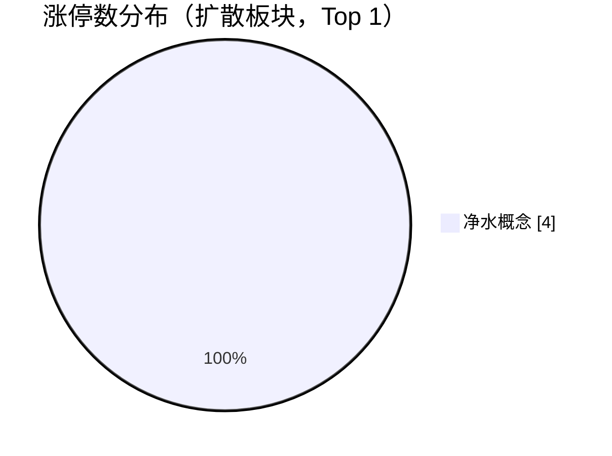
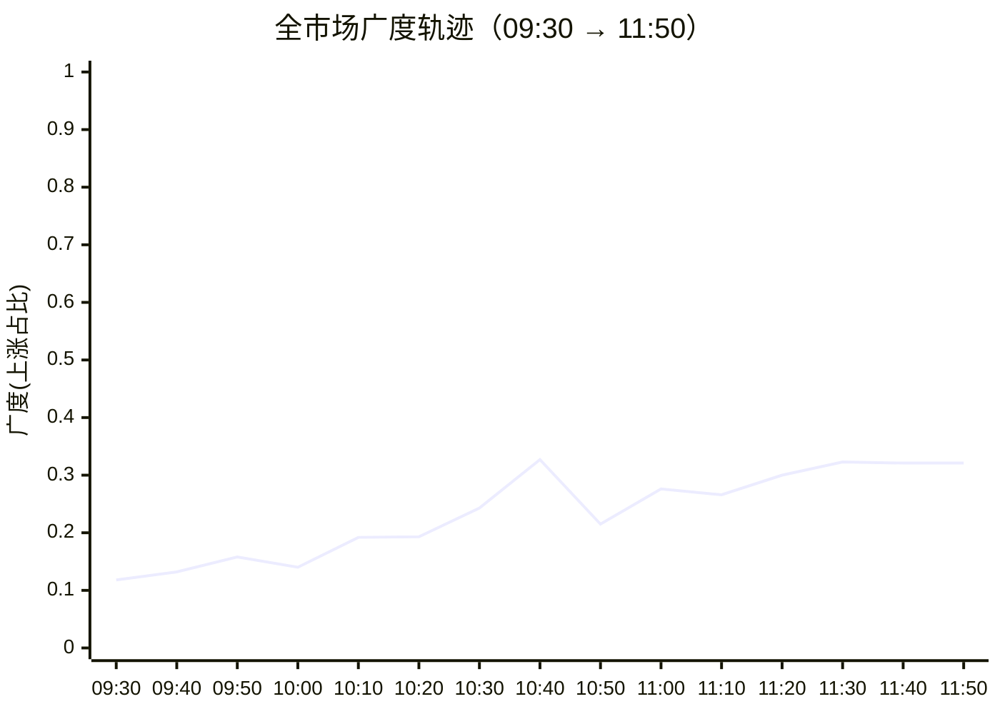

## 当日总览（截至 11:50）

> **结论**：全市场涨1787/跌3576（广度0.33）；涨停33/跌停14；中位涨幅-0.58%；局部修复。 钱在：净水概念(涨停4/成分81，中位+0.06%)；零星涨停：共享单车(1)、北交所概念(2)、汽车拆解概念(1)、血氧仪(1)、免税店(1)。 退潮：西部大开发(跌停4)、光伏概念(跌停3)、一带一路(跌停3)。 梯队：4板×1、3板×1、2板×7、1板×24，最高4板。 预案：超买区 文投控股、凯撒文化；已触发 华胜天成；未到价 中国电影、通化金马。 较上一轮广度基本持平。

> 🔒 **no_trade / 买入预算 0 / max_position_pct 0 —— 全部内容仅供研究，不授予交易权限。**

### 板块扩散

> 口径：XTick 概念成分 × 全市场实时报价；分母 = 板块内有有效报价的成分数。排序用涨停密度（涨停数/有效成分数），已剔除宽基属性板块（全市场 432 个板块中剔 16 个）。

**扩散中（题材，按涨停密度排序）**

| 板块 | 涨停 | 有效成分 | 涨停密度 | 上涨广度 | 中位涨幅 | 相对全市场 | 成交(亿) |
|---|---|---|---|---|---|---|---|
| 共享单车 ⬦ | 1 | 14 | 0.071 | 0.43 | -0.47% | +0.11% | 6 |
| 北交所概念 ⬦ | 2 | 29 | 0.069 | 0.41 | -0.29% | +0.29% | 36 |
| 净水概念 | 4 | 81 | 0.049 | 0.52 | +0.06% | +0.64% | 125 |
| 汽车拆解概念 ⬦ | 1 | 23 | 0.043 | 0.39 | -0.48% | +0.10% | 37 |
| 血氧仪 ⬦ | 1 | 24 | 0.042 | 0.50 | +0.09% | +0.67% | 32 |
| 免税店 ⬦ | 1 | 26 | 0.038 | 0.65 | +0.83% | +1.41% | 32 |
| 无人零售 ⬦ | 1 | 26 | 0.038 | 0.42 | -0.06% | +0.52% | 58 |
| 石墨电极 ⬦ | 1 | 26 | 0.038 | 0.38 | -0.22% | +0.36% | 29 |
| 胎压监测 ⬦ | 1 | 27 | 0.037 | 0.22 | -0.68% | -0.10% | 32 |
| 云游戏 ⬦ | 1 | 27 | 0.037 | 0.26 | -1.60% | -1.02% | 101 |
| 露营经济 ⬦ | 2 | 55 | 0.036 | 0.47 | +0.00% | +0.58% | 34 |
| 空气能热泵 ⬦ | 2 | 56 | 0.036 | 0.36 | -0.65% | -0.07% | 123 |

> ⬦ = 涨停 <3 只，零星个例，不构成扩散（不计入「钱在」判定）。



零星涨停板块（<3 只）：共享单车(1)、北交所概念(2)、汽车拆解概念(1)、血氧仪(1)、免税店(1)、无人零售(1)、石墨电极(1)、胎压监测(1)

**退潮中（跌停集中）**

| 板块 | 跌停 | 有效成分 | 上涨广度 | 中位涨幅 |
|---|---|---|---|---|
| 西部大开发 | 4 | 636 | 0.32 | -0.52% |
| 光伏概念 | 3 | 602 | 0.24 | -1.06% |
| 一带一路 | 3 | 797 | 0.38 | -0.41% |
| 稀土永磁 | 2 | 64 | 0.19 | -1.73% |
| 新材料概念 | 2 | 382 | 0.20 | -1.25% |
| 2026中报预增 | 2 | 514 | 0.22 | -1.10% |
| 海峡两岸 | 2 | 320 | 0.23 | -0.99% |
| 天然气 | 2 | 167 | 0.28 | -0.65% |
| 粤港澳大湾区 | 2 | 499 | 0.29 | -0.70% |
| 新疆振兴 | 2 | 156 | 0.29 | -0.54% |
| DeepSeek概念 | 2 | 769 | 0.33 | -0.48% |
| 民营医院 | 2 | 75 | 0.41 | +0.00% |

### 涨停梯队

> 最高 4 板 ｜ 涨停 33 ｜ 跌停 14 ｜ 炸板 10 ｜ 封板率 76.7% ｜ 打板成功率 23.68% ｜ 一进二 22.58% ｜ 二进三 25.00%

| 身位 | 家数 | 成员（涨幅/封单亿/首封） |
|---|---|---|
| 4板 | 1 | 北纬科技 +10.06%/0.009亿/09:25 |
| 3板 | 1 | 广百股份 +10.04%/0.030亿/09:30 |
| 2板 | 7 | 华东重机 +9.93%/0.030亿/09:33；新能股份 +9.95%/0.027亿/11:14；凯撒文化 +10.10%/0.022亿/09:30；金逸影视 +10.00%/0.015亿/09:25；金新农 +9.92%/0.012亿/09:30 |
| 1板 | 24 | 顺钠股份 +9.97%/0.060亿/11:14；吉视传媒 +10.04%/0.050亿/10:12；共进股份 +10.02%/0.048亿/11:22；九阳股份 +10.02%/0.036亿/09:25；高新发展 +10.00%/0.029亿/11:14 |


炸板 10 只（前几）：文投控股(5次)、国统股份(4次)、勤上股份(3次)、横店影视(1次)、艾艾精工(1次)

### 预案池对照

| 票 | 池 | 板块 | 现价 | 涨幅 | 触发价 | 买区 | 风险位 | 判定 |
|---|---|---|---|---|---|---|---|---|
| 文投控股 `600715.SH` | 观察池 | 影视传媒（短剧/AI内容情绪映射） | 3.69 | +8.53% | 3.45 | [3.43, 3.5] | 3.32 | **超买区** |
| 凯撒文化 `002425.SZ` | 观察池 | 影视传媒（短剧/AI内容情绪映射） | 4.36 | +10.10% | 4.21 | [4.19, 4.27] | 4.06 | **超买区** |
| 中国电影 `600977.SH` | 观察池 | 影视传媒（短剧/AI内容情绪映射） | 16.77 | -1.64% | 17.05 | [16.96, 17.31] | 16.44 | **未到价** |
| 华胜天成 `600410.SH` | 观察池 | 国产算力（华胜集中分离） | 14.39 | +0.63% | 14.3 | [14.23, 14.51] | 13.78 | **已触发** |
| 通化金马 `000766.SZ` | 观察池 | 创新药（医保目录新增事件） | 14.85 | -10.00% | 16.5 | [16.42, 16.75] | 15.91 | **未到价** |
| 北纬科技 `002148.SZ` | 观察池 | 高度对照 | 8.75 | +10.06% | — | — | — | **无预案价** |
| 金新农 `002548.SZ` | 观察池 | 农业/猪肉 | 4.21 | +9.92% | — | — | — | **无预案价** |
| 禾元生物 `688765.SH` | 观察池 | 医保新增事件 | 30.75 | -16.35% | — | — | — | **无预案价** |
| 博纳影业 `001330.SZ` | 观察池 | 影视传媒 | 6.48 | -4.42% | — | — | — | **无预案价** |
| 游族网络 `002174.SZ` | 观察池 | 游戏/存储分销 | 10.43 | -3.96% | — | — | — | **无预案价** |
| 利扬芯片 `688135.SH` | 观察池 | 光通信测试 | 31.18 | -9.86% | — | — | — | **无预案价** |
| 新宙邦 `300037.SZ` | 观察池 | 电解液 | 52.12 | +0.83% | — | — | — | **无预案价** |
| 德明利 `001309.SZ` | 观察池 | 国产存储 | 185.91 | -4.10% | — | — | — | **无预案价** |
| 天孚通信 `300394.SZ` | 观察池 | 光通信 | 116.07 | -7.14% | — | — | — | **无预案价** |
| 七匹狼 `002029.SZ` | 观察池 | 跨年名字梗 | 7.97 | -7.11% | — | — | — | **无预案价** |

- **文投控股** — 现价3.69 已高于买区上沿3.5，不追高；仅价格位置对照，不代表完整入场条件确认；不能据此确认站稳，不授予下单权限
- **凯撒文化** — 现价4.36 已高于买区上沿4.27，不追高；仅价格位置对照，不代表完整入场条件确认；不能据此确认站稳，不授予下单权限
- **华胜天成** — 现价14.39 ≥ 触发价14.3；仅价格位置对照，不代表完整入场条件确认；不能据此确认站稳，不授予下单权限

> ⚠ D1 明确 no_trade=true、买入预算 0、个股 max_position_pct=0。以上为研究对照，**不构成任何买入许可**。

### 盘面 vs 静态复盘 vs 消息面

| 维度 | 对象 | T-1 静态基线 | 今日盘面 | 关系 |
|---|---|---|---|---|
| 板块主线 | 国产算力（华胜集中分离） | R2 次线 score=64 涨停None（T-1 口径） | 盘面未见该板块成分票涨停 | **背离** |
| 板块主线 | 创新药（医保目录新增事件） | R2 次线 score=None 涨停None（T-1 口径） | 盘面未见该板块成分票涨停 | **背离** |
| 板块主线 | 机器人/具身世界模型 | R2 次线 score=58 涨停None（T-1 口径） | 盘面未见该板块成分票涨停 | **背离** |
| 板块主线 | 商业航天/太空光伏 | R2 次线 score=52 涨停None（T-1 口径） | 盘面未见该板块成分票涨停 | **背离** |
| 板块主线 | 农业/猪肉 | R2 次线 score=None 涨停None（T-1 口径） | 盘面未见该板块成分票涨停 | **背离** |
| 梯队结构 | 最高4板 | T-1 最高梯队 4 板、首板 29、炸板率 39.06% | 今日 4板×1、3板×1、2板×7、1板×24；封板率0.7674 炸板10只 | **印证** |
| 预案验证 | 文投控股(600715.SH) | 预案 影视传媒（短剧/AI内容情绪映射）／watch／触发价3.45／买区[3.43, 3.5] | 超买区：现价3.69 已高于买区上沿3.5，不追高；仅价格位置对照，不代表完整入场条件确认；不能据此确认站稳，不授予下单权限 | **背离** |
| 预案验证 | 凯撒文化(002425.SZ) | 预案 影视传媒（短剧/AI内容情绪映射）／watch／触发价4.21／买区[4.19, 4.27] | 超买区：现价4.36 已高于买区上沿4.27，不追高；仅价格位置对照，不代表完整入场条件确认；不能据此确认站稳，不授予下单权限 | **背离** |
| 预案验证 | 中国电影(600977.SH) | 预案 影视传媒（短剧/AI内容情绪映射）／watch／触发价17.05／买区[16.96, 17.31] | 未到价：现价16.77，触发价17.05，还差1.67%；仅价格位置对照，不代表完整入场条件确认；不能据此确认站稳，不授予下单权限 | **无响应** |
| 预案验证 | 华胜天成(600410.SH) | 预案 国产算力（华胜集中分离）／watch／触发价14.3／买区[14.23, 14.51] | 已触发：现价14.39 ≥ 触发价14.3；仅价格位置对照，不代表完整入场条件确认；不能据此确认站稳，不授予下单权限 | **印证** |
| 预案验证 | 通化金马(000766.SZ) | 预案 创新药（医保目录新增事件）／watch／触发价16.5／买区[16.42, 16.75] | 未到价：现价14.85，触发价16.5，还差11.11%；仅价格位置对照，不代表完整入场条件确认；不能据此确认站稳，不授予下单权限 | **无响应** |
| 预案验证 | 北纬科技(002148.SZ) | 预案 高度对照／watch／触发价None／买区None | 无预案价：预案未给有效入场触发价/完整买区（缺失、空规则或格式异常）；仅价格位置对照，不代表完整入场条件确认；不能据此确认站稳，不授予下单权限 | **无响应** |
| 预案验证 | 金新农(002548.SZ) | 预案 农业/猪肉／watch／触发价None／买区None | 无预案价：预案未给有效入场触发价/完整买区（缺失、空规则或格式异常）；仅价格位置对照，不代表完整入场条件确认；不能据此确认站稳，不授予下单权限 | **无响应** |
| 预案验证 | 禾元生物(688765.SH) | 预案 医保新增事件／watch／触发价None／买区None | 无预案价：预案未给有效入场触发价/完整买区（缺失、空规则或格式异常）；仅价格位置对照，不代表完整入场条件确认；不能据此确认站稳，不授予下单权限 | **无响应** |
| 预案验证 | 博纳影业(001330.SZ) | 预案 影视传媒／watch／触发价None／买区None | 无预案价：预案未给有效入场触发价/完整买区（缺失、空规则或格式异常）；仅价格位置对照，不代表完整入场条件确认；不能据此确认站稳，不授予下单权限 | **无响应** |
| 预案验证 | 游族网络(002174.SZ) | 预案 游戏/存储分销／watch／触发价None／买区None | 无预案价：预案未给有效入场触发价/完整买区（缺失、空规则或格式异常）；仅价格位置对照，不代表完整入场条件确认；不能据此确认站稳，不授予下单权限 | **无响应** |
| 预案验证 | 利扬芯片(688135.SH) | 预案 光通信测试／watch／触发价None／买区None | 无预案价：预案未给有效入场触发价/完整买区（缺失、空规则或格式异常）；仅价格位置对照，不代表完整入场条件确认；不能据此确认站稳，不授予下单权限 | **无响应** |
| 预案验证 | 新宙邦(300037.SZ) | 预案 电解液／watch／触发价None／买区None | 无预案价：预案未给有效入场触发价/完整买区（缺失、空规则或格式异常）；仅价格位置对照，不代表完整入场条件确认；不能据此确认站稳，不授予下单权限 | **无响应** |
| 预案验证 | 德明利(001309.SZ) | 预案 国产存储／watch／触发价None／买区None | 无预案价：预案未给有效入场触发价/完整买区（缺失、空规则或格式异常）；仅价格位置对照，不代表完整入场条件确认；不能据此确认站稳，不授予下单权限 | **无响应** |
| 预案验证 | 天孚通信(300394.SZ) | 预案 光通信／watch／触发价None／买区None | 无预案价：预案未给有效入场触发价/完整买区（缺失、空规则或格式异常）；仅价格位置对照，不代表完整入场条件确认；不能据此确认站稳，不授予下单权限 | **无响应** |
| 预案验证 | 七匹狼(002029.SZ) | 预案 跨年名字梗／watch／触发价None／买区None | 无预案价：预案未给有效入场触发价/完整买区（缺失、空规则或格式异常）；仅价格位置对照，不代表完整入场条件确认；不能据此确认站稳，不授予下单权限 | **无响应** |
| 消息面对照 | 盘面热点板块 | R4 消息面（T-1 口径） | 实时快讯未出现热点板块关键词 | **无响应** |

**分歧点（不掩盖）：**
- 板块主线·国产算力（华胜集中分离） → 背离：T-1 有辨识度但今日盘中无涨停响应，题材未获资金确认
- 板块主线·创新药（医保目录新增事件） → 背离：T-1 有辨识度但今日盘中无涨停响应，题材未获资金确认
- 板块主线·机器人/具身世界模型 → 背离：T-1 有辨识度但今日盘中无涨停响应，题材未获资金确认
- 板块主线·商业航天/太空光伏 → 背离：T-1 有辨识度但今日盘中无涨停响应，题材未获资金确认
- 板块主线·农业/猪肉 → 背离：T-1 有辨识度但今日盘中无涨停响应，题材未获资金确认
- 预案验证·文投控股(600715.SH) → 背离：仅研究对照，不授予交易权限
- 预案验证·凯撒文化(002425.SZ) → 背离：仅研究对照，不授予交易权限

### 全天广度轨迹

| 时点 | 涨 | 跌 | 广度 | 涨停 | 跌停 | 成交(亿) | 有效样本 |
|---|---|---|---|---|---|---|---|
| 0930 | 655 | 4722 | 0.118 | 8 | 2 | 611 | 5560 |
| 0940 | 737 | 4681 | 0.132 | 14 | 15 | 2,697 | 5572 |
| 0950 | 879 | 4546 | 0.158 | 17 | 15 | 4,042 | 5572 |
| 1000 | 778 | 4668 | 0.140 | 19 | 17 | 4,956 | 5572 |
| 1010 | 1067 | 4330 | 0.192 | 20 | 15 | 5,832 | 5572 |
| 1020 | 1074 | 4346 | 0.193 | 21 | 15 | 6,436 | 5572 |
| 1030 | 1356 | 4026 | 0.243 | 25 | 15 | 6,997 | 5572 |
| 1040 | 1821 | 3529 | 0.327 | 25 | 15 | 7,405 | 5572 |
| 1050 | 1201 | 4185 | 0.215 | 26 | 16 | 7,793 | 5572 |
| 1100 | 1536 | 3841 | 0.276 | 30 | 15 | 8,102 | 5572 |
| 1110 | 1482 | 3885 | 0.266 | 30 | 14 | 8,405 | 5572 |
| 1120 | 1674 | 3697 | 0.300 | 32 | 14 | 8,777 | 5572 |
| 1130 | 1684 | 3328 | 0.323 | 33 | 14 | 9,005 | 5217 |
| 1140 | 1787 | 3564 | 0.321 | 33 | 14 | 9,066 | 5572 |
| 1150 | 1787 | 3564 | 0.321 | 33 | 14 | 9,066 | 5572 |



### 观察建议（仅研究）

- **环境**：涨停 33.0 / 跌停 14.0，打板成功率 23.7%，一进二 22.6%。
- **方向**：今日形成实质扩散的是 净水概念（涨停4/成分81，密度0.049，中位+0.06%）。**需确认**：次日能否维持涨停家数且中位涨幅不掉队，否则只是普跌中的避险轮动。
- **零星**：共享单车(1只/14成分)、北交所概念(2只/29成分)、汽车拆解概念(1只/23成分)、血氧仪(1只/24成分)、免税店(1只/26成分) 属零星个例，不视为题材，不据此选股。
- **回避**：西部大开发（跌停4）、光伏概念（跌停3）、一带一路（跌停3） 板块中位跌幅深，趋势未止跌前不接。
- **身位**：最高 4 板。梯队有高度不等于可接力，需逐票核验封单稳定性与开板次数后再定。
- **预案**：文投控股（现价3.69 已高于买区上沿3.5，不追高；仅价格位置对照，不代表完整入场条件确认；不能据此确认站稳，不授予下单权限）、凯撒文化（现价4.36 已高于买区上沿4.27，不追高；仅价格位置对照，不代表完整入场条件确认；不能据此确认站稳，不授予下单权限）。买区已错过，**不追高**；要参与需等新剧本，不能沿用原预案价位。
- **预案待检验**：中国电影(触发价17.05，还差+1.67%)、通化金马(触发价16.5，还差+11.11%) 尚未触及触发价，剧本未被盘面检验，继续按原失效条件看。

<details>
<summary>原始截面与数据质量（折叠）</summary>

**跨源校验**

```json
{
  "xtick": {
    "up": 1787,
    "down": 3576,
    "n": 5584,
    "amount_yi": 9004.6
  },
  "rtk_snapshot": {
    "up": 1787,
    "down": 3564,
    "valid_n": 5572,
    "amount_yi": 9066.2,
    "up_limit": 33,
    "down_limit": 14
  },
  "note": "两源口径不同（XTick 全市场含全部票；rt_k 返回样本）"
}
```

**rt_k 截面（原始）**

```json
{
  "market": {
    "total": 5584,
    "up": 1787,
    "down": 3564,
    "flat": 221,
    "requested_n": 5584,
    "received_n": 5584,
    "valid_n": 5572,
    "missing_n": 12,
    "universe_requested_n": null,
    "population_scope": "returned_rows_not_verified_all_a_universe",
    "up_ratio": 0.32,
    "legacy_up_ratio_placeholder": false,
    "up_ratio_is_observed": true,
    "up_ratio_all": 0.32,
    "up_ratio_valid": 0.3207,
    "up_ratio_denominator": "requested_n",
    "degraded": false,
    "limit_known_n": 5572,
    "limit_unknown_n": 0,
    "limit_counts_complete": true,
    "limit_source_errors": [],
    "up_gt3": 199,
    "up_gt5": 95,
    "up_limit": 33,
    "down_gt3": 800,
    "down_gt5": 279,
    "down_limit": 14,
    "amount_yi": 9066.2,
    "amount_sum_overflow": false,
    "amount_valid_n": 5572,
    "amount_missing_n": 0
  },
  "source_time_quality": {
    "quote_age_min_seconds": 1.889971,
    "quote_age_max_seconds": 59.889971,
    "source_age_limit_seconds": null,
    "freshness_status": "age_limit_not_configured",
    "age_reference_at": "2026-11-16T11:50:44.889971+08:00"
  },
  "trading_authorized": false
}
```

</details>

## 分时研判记录

### 09:35 研判增量
- **趋势**：使用2026-11-16的09:30分析件；对应rt_k报价为09:30:23—09:30:51，不是09:35实时价。这是当日首份，广度、板块排名、梯队及预案判定均无上一轮可比，顶部“较上一轮持平”不能采信；有效返回样本上涨655/5560、广度11.78%，只能定为弱势开盘，不能确认“局部修复”，也未核验全A名录覆盖。与11月13日预案的整体接力负反馈一致；北纬科技由预案中的3板升至4板、金新农由首板升至2板，只证明个股晋级，市场最高高度仍未超过静态基线的4板。
- **轮动**：猪肉比算力相对抗跌，但没有跨时点资金迁移证据，暂不认定跷跷板。自动对照把“农业/猪肉”写成无涨停，与猪肉1/32涨停、金新农2板冲突，应读为“有孤立响应、未成扩散”，不能照搬为全面背离。另有创投3/460涨停、上涨57/460，被前列热榜遗漏；其密度低、成分多数仍跌，既不能沿用“所有题材涨停均零星”的绝对说法，也不足册封新主线。游戏与传媒标签不能把涨停家数直接相加当作独立资金合力。
- **剧本**：华胜天成越过触发价，只印证个股价格位置；算力成分仅44/417上涨且无涨停，未化解预案所说的个股集中与板块弱势分离。文投控股已出现开板，凯撒文化虽处2板，均不能把“高于买区”解释成完整买点兑现；凯撒原规则最高接受价4.24还严于表中买区上沿4.27，更不能追至本轮4.36。中国电影尚未到17.05，仍是待验证而非失效；通化金马的财务否决不因未来重回16.50解除。禾元生物本轮-6.20%，说明医保事件暂未变成该票的价格正反馈，不作通化的自动替补。
- **下一步看**：先核下一截面报价确实刷新、有效样本口径稳定，再看广度能否高于本轮11.78%并伴随涨停增加；手机游戏是否在本轮上涨20/56、涨停2只之上继续扩展，猪肉是否在上涨12/32之外出现更多涨停助攻，而非只剩金新农。个股核验华胜能否持续处于14.30—14.51、中国电影能否回到17.05—17.31；跌回触发价下方或冲过原上限，均不能照旧称条件满足，持续性须补分钟或盘口证据。文投不因回落重新进入旧买区就自动重启剧本。盘前研究窗口已于今日09:35届满，以上价位只作旧剧本对照；no_trade=true、买入预算0、max_position_pct=0不因到期解除，须有新的有效预案，全部仅供研究，不构成买入许可。

### 09:45 研判增量
- **趋势**：2026-11-16本轮截至09:40：采集09:40:43—09:40:53，报价09:40:18—09:40:50，不是09:45实时价。相较09:30，有效返回样本上涨655/5560→737/5572，分母变化，不作严格同样本广度增幅；中位涨幅却从-0.97%降至-1.40%。梯队源涨停8→13，但跌停2→15、炸板2→7、封板率80%→65%，最高仍4板，判断是“局部强势点增加，亏钱效应扩散更快”，不是全面修复。北纬科技仍在4板，但开板次数0→1，封单0.042→0.019亿元；价格没变不等于承接没变。
- **轮动**：新增相对扩展在零售，而不是热榜第一名就代表主线：商贸零售行业样本上涨22/100→38/100、涨停1→3，免税店上涨5/26→12/26但仍仅1只涨停；相反手机游戏上涨20/56→11/56，涨停仍2只，前排未倒却后排失血。银行上涨22/42→32/42，也支持风险偏好向相对防御方向偏移的假设；尚无同口径净流数据，不能确证资金迁移或稳定跷跷板。全量概念中乡村振兴涨停1→3/440、上涨54/440→64/440，说明顶部“所有题材均零星”的绝对表述不成立，但大多数成分仍跌；行业标签、重叠概念不能直接认作统一题材主线。
- **剧本**：有价位规则的票中，华胜天成是唯一判定迁移：14.43→15.10，由“已触发”变成高于原上沿14.51，旧买点已越界，不是现在可追；算力租赁上涨19/188→14/188、仍无涨停，继续印证预案“个股集中不等于板块共振”。文投控股3.69→3.58，虽仍高于3.50上沿，却在走弱；凯撒文化仍4.36，但开板次数0→1，不能当稳定封单。中国电影16.93→16.69、通化金马15.65→15.40，均离原触发价更远，后者财务否决不变。禾元生物34.48→32.38，医保事件的个股价格反馈继续恶化，未印证盘前优先观察假设；其余缺有效价位的观察票不补造入场条件。
- **下一步看**：下一有效截面先检验零售能否在涨停3/100、上涨38/100基础上继续扩展，且不增加本轮1只跌停；游戏能否扭转上涨11/56、涨停仍2只的收缩，而不是只看凯撒封板。市场修复至少需看到跌停从15只减少、封板率高于本轮65%，不能只看涨停增加；这些是本轮对比锚，不是批准的开仓门槛。价格对照只看华胜是否重新处于14.30—14.51、中国电影是否回到17.05且不超过17.31；连续承接须另有分钟或盘口证据，回到旧区间也不自动重启已于09:35届满的预案。本轮no_trade=true、买入预算0、max_position_pct=0不变，全部仅研究，不构成买入许可。

### 09:55 研判增量
- **趋势**：2026-11-16本轮依据09:50分析件，与09:40对比；rt_k采集09:50:43—09:50:54，报价09:50:18—09:50:51，不是09:55实时价。有效返回样本数均为5572，上涨737→879，广度13.23%→15.78%（增加2.55个百分点）；同源涨停14→17，跌停仍15。XTick封板率65%→70.83%，首板6→11，但三板2→1、最高仍4板，国统股份进入开板名单，北纬科技开板次数1→3。较上轮应改判为“首板补充型弱修复，高位承接仍分歧”，不能因涨停增加就升级为接力修复；两源跌停数有差异，不混用。
- **轮动**：新增扩展在家电行业样本：涨停0→3/103，上涨31→37/103，九阳股份回到涨停队列，长虹美菱、华帝股份新增首板助攻。净水概念涨停0→3/81，但上涨仍20/81，是前排集中，不是成分普涨；与家电标签不能相加当作两路独立合力。上轮零售扩展暂未延续：上涨38→32/100、涨停仍3，中位涨幅-0.18%→-0.42%；手机游戏上涨11→10/56、中位-1.65%→-1.90%，银行上涨32→34/42。支持“防御偏好与局部首板并存”的轮动假设，尚无净流证据证明跷跷板；分析件未匹配到热点催化，家电暂不册封新主线。
- **剧本**：15只观察票的价格判定均未迁移，但内部强弱继续分开。文投控股3.58→3.55、华胜天成15.10→14.99，仍在原买区上方却回落，不能把“超买区”当作剧本利好；凯撒文化仍4.36，封单0.032→0.026亿元，游戏后排走弱，未解除盘前对旧核心拥挤的顾虑。中国电影16.69→16.70，仍低于17.05触发价，微幅回升不算突破确认。金新农仍二板，但猪肉上涨13→8/32、涨停仍1，前排没有带出更广承接；通化金马15.40→15.03、禾元生物32.38→31.82，医保事件的这两只观察对象继续负反馈，不能用行业小幅修复替代个股确认，通化财务否决不变。其余缺有效价位的观察票不补造条件。
- **下一步看**：下一同口径截面，家电先看能否保住涨停3/103，并把上涨家数推过本轮37/103；净水若仍只有20/81上涨，仍只记前排集中。零售若不能回到上轮上涨38/100、游戏仍低于上轮11/56，就不能解释为消费与传媒全面回流。市场进一步修复需广度高于本轮15.78%，并见rt_k跌停少于本轮15只；若只有首板增加而北纬反复开板、三板不能恢复，仍按分化看。文投若回落至3.50不自动重启旧买点，失守3.45则更削弱原突破假设；中国电影只有回到17.05—17.31，才可重评原价格条件，持续承接须另核分钟或盘口。这些均为对比锚，不是开仓门槛；盘前研究窗口已于09:35届满，no_trade=true、买入预算0、max_position_pct=0不变，全部仅研究，不构成买入许可。

### 10:05 研判增量
- **趋势**：2026-11-16截至10:00分析件，对比09:50；rt_k采集10:00:43—10:00:56，报价09:59:21—10:00:53，不是10:05实时价。有效返回样本数均为5572，上涨879→778，广度15.78%→13.96%（下降1.81个百分点），中位涨幅-1.35%→-1.75%；同源涨停17→19、跌停15→17。新增强势集中在首板11→13，最高仍4板，封板率虽70.83%→73.08%，不能抵消多数票再度走弱：上一轮弱修复正在回吐，不采顶部“广度基本持平”的判断。北纬科技仍4板，开板次数未增加，但封单0.019→0.017亿元，尚无高位承接增强证据。
- **轮动**：上轮家电扩展未继续铺开：行业样本上涨37→34/103、涨停仍3；净水上涨20→17/81、涨停仍3，却新增1只跌停。反向改善在传媒与零售：文化传媒概念上涨36→43/197、涨停3→4，中位涨幅-1.61%→-1.43%；商贸零售行业上涨32→39/100、涨停仍3，银行上涨34→37/42。更像局部消费/传媒承接与银行防御并存，不是全市场回暖；没有净流证据确认同一批资金形成跷跷板。传媒位于全量成分结果而非顶部热榜，不能只按热榜认定“仅净水有响应”；概念重叠不相加，快讯未匹配热点也不等于没有催化。
- **剧本**：15只观察票的价格判定均未迁移，但传媒改善尚未普遍传导至原预案对象：手机游戏上涨10→12/56，凯撒仍二板；中国电影16.70→16.68，仍未达到17.05，游族网络10.36→10.29继续转弱，不能把板块改善直接算成预案兑现。华胜天成14.99→14.85，仍高于原上沿14.51，算力租赁中位跌幅反而加深且新增跌停，继续支持“个股集中不等于板块共振”。禾元生物31.82→31.10、通化金马15.03→14.95，医保事件两只观察对象的负反馈加深，通化财务否决不变。另有数据分歧：开板名单的文投涨幅两轮均为+9.41%，而价格对照均为+4.41%；该名单不能用来推断本轮新开板或回封。
- **下一步看**：先看同口径广度能否收复09:50的15.78%、rt_k跌停能否从17只减少；若只有首板增加，仍按强势集中而非全面修复解释。局部承接看传媒能否保持涨停4/197并扩大本轮上涨43/197，零售能否保持上涨39/100；家电若不能恢复上轮上涨37/103、净水仍有跌停，就不升级上轮扩散假设。价位仍仅核中国电影能否回到17.05—17.31、华胜是否回到14.30—14.51；回区间不等于持续站稳，也不自动重启09:35已届满的旧预案。以上均为研究对比锚，不是开仓门槛；no_trade=true、买入预算0、max_position_pct=0不变，不追超出原买区的票，不授予任何买入许可。

### 10:15 研判增量
- **趋势**：2026-11-16本轮依据10:10分析件，对比10:00；rt_k采集10:10:42—10:10:53，报价10:09:57—10:10:50，不是10:15实时价。有效返回样本数均为5572，上涨778→1067，广度13.96%→19.15%（增加5.19个百分点），同源跌停17→15，中位涨幅-1.75%→-1.18%；上轮要求的广度收复与跌停减少已出现，判断由“修复回吐”改为“弱市再次修复”，仍非普涨。梯队涨停19→20主要是岳阳兴长从开板名单回到二板队列，首板仍13、最高仍4板；北纬科技开板次数3→4、封单0.017→0.014亿元，不能把整体修复等同于高标承接增强。XTick跌停为14只，与rt_k的15只分开使用。
- **轮动**：增量在家电、传媒的后排回暖，而非新题材上位：行业家电上涨34→46/103、涨停仍3，中位-0.91%→-0.08%；文化传媒概念上涨43→57/197、涨停仍4。净水上涨17→21/81且跌停1→0，改善了上一轮负反馈，但多数成分仍跌。相反零售上涨39→38/100、免税店12→7/26，消费内部并不同步；银行仍35/42上涨、中位涨幅反而提高，不能仅凭上涨家数减少认定防御资金撤离。达到3只涨停的概念密度排序未变，重叠成分不加总；缺同口径净流证据，不确证资金跷跷板。热点消息关键词仍未匹配，只能说催化归因未核，不能说不存在催化。
- **剧本**：15只观察票的价格判定均未迁移，但中国电影16.68→16.93、文投3.55→3.59，与传媒后排回暖相呼应；前者仍未到17.05，后者仍超过原上沿3.50，均非完整入场确认。华胜天成却14.85→14.56，在市场修复时继续回吐；算力租赁虽上涨20→25/188，仍无涨停且有1只跌停，原“个股集中不等于板块共振”未被推翻。替代方向也未新增合力：猪肉上涨9→11/32但仍仅金新农1只涨停；创新药上涨44→66/275，通化却14.95→14.92、禾元仅31.10→31.20，行业回暖未转成医保事件两只对象的强势确认。通化财务否决不变，其余缺有效价位者不补造买点。
- **下一步看**：同口径广度能否保持本轮19.15%以上、rt_k跌停能否继续少于15只；家电、传媒能否分别保住涨停3/103、4/197并继续扩大上涨46/103、57/197，净水是否再次出现跌停。若广度回落而只剩前排封板，撤回“修复延续”的假设。价格只核中国电影能否进入17.05—17.31；华胜即使回到14.30—14.51，也须区分高位回落与重新突破，不能因进区间自动重启，跌回14.30以下则原突破假设更弱，持续性需分钟或盘口证据。盘前研究窗口已于09:35届满，须新有效预案重评；以上仅研究对比锚，no_trade=true、买入预算0、max_position_pct=0不变，不追超买区，不授予任何买入许可。

### 10:29 研判增量
- **趋势**：2026-11-16截至10:20分析件，对比10:10；rt_k采集10:20:42—10:20:52，报价10:19:51—10:20:50，不是10:29实时价。有效返回样本数均为5572，上涨1067→1074，广度19.15%→19.27%，仅增0.13个百分点；中位涨幅反而-1.18%→-1.37%，跌超5%的样本379→501，增加122只。上轮修复的广度扩展已明显放缓，尾部亏钱重新加深；同源涨停20→21、跌停仍15，不能据此升级修复。梯队首板13→14、最高仍4板，炸板6→8、封板率76.92%→72.41%，说明强势补充与开板损耗并存，不是接力整体增强。
- **轮动**：按全量概念中至少3只涨停的密度排序，首位由净水换成文化传媒：传媒涨停4→5/197、上涨57→63/197，吉视传媒10:12首封提供新增助攻；但中位涨幅仍从-0.82%降至-0.93%，是局部强势扩展，不是全线回流。净水与家电行业涨停分别由3→2/81、3→2/103，华帝进入开板名单，前排承接弱于上轮。猪肉上涨11→21/32、中位-0.32%→+0.65%，出现显著成分回暖，但仍仅金新农1只涨停，尚未形成涨停梯队扩散；银行上涨35→39/42，存储芯片中位-3.42%→-4.14%，更像防御偏好与传媒局部活跃并存。没有同口径净流证据，不确证资金跷跷板；重叠概念不相加。
- **剧本**：本轮唯一价格判定迁移是中国电影16.93→17.20，从未到价变为已触发，进入原买区16.96—17.31且超过17.05触发价，补强院线容量反馈；但原预案将其定位为容量对照、保留11月13日多次开板的否决，不能由越线直接升级为龙头或完整入场确认。文投3.59→3.66与传媒助攻呼应，却仍超过原买区上沿3.50，不追高，凯撒也未新增价格资格。算力租赁虽从无涨停变为1/188，上涨成分反由25→19/188；本轮快讯样本出现AI模型调用榜报道，仍不足认定消息已带来板块共振，未推翻华胜原有的个股集中风险。其余观察票的判定未变，不因题材标签或缺价位而补造买点。
- **下一步看**：下一同口径截面，先看广度能否超过本轮19.27%，同时跌超5%的501只减少、封板率向上轮76.92%恢复；若只有涨停增加而亏钱尾部扩大，继续按强势集中解释。传媒能否保住涨停5/197并扩大上涨63/197，净水、家电能否分别恢复上轮3/81、3/103的涨停规模；猪肉是否在金新农之外出现助攻，而非仅后排翻红。中国电影只核17.05—17.31内的持续承接，跌回17.05以下削弱突破假设，超过17.31则不追，持续性须分钟或盘口证据。以上均为研究对比锚，不是开仓门槛；09:35已届满的旧预案不自动重启，no_trade=true、买入预算0、max_position_pct=0不变，不授予任何买入许可。

### 10:37 研判增量
- **趋势**：2026-11-16截至10:30分析件，对比10:20；rt_k采集10:30:43—10:30:53，报价10:29:39—10:30:51，不是10:37实时价。有效返回样本均为5572，上涨1074→1356，广度19.27%→24.34%（增加5.06个百分点），跌超5%的501→419只，中位涨幅-1.37%→-1.00%；上轮要求的广度扩展与尾部收敛同时出现，可由“修复放缓”改判为“弱修复重新扩展”，仍不是普涨。同源涨停21→25、跌停仍15；梯队源封板率72.41%→78.12%、二板5→8、首板14→15，增量不再仅靠首板，但最高仍4板。北纬科技开板次数仍4次、封单0.013→0.012亿元，尚无高度突破或高标承接增强证据；XTick跌停14→13与rt_k的15只分开使用。
- **轮动**：传媒由前排集中向更多成分传导：文化传媒概念涨停5→7/197、上涨63→81/197；手机游戏涨停2→3/56、上涨18→22/56，网络游戏涨停2→3/58，均达到扩散观察规模，按涨停密度在达标概念中升至前列，但标签重叠不能算独立合力。横店影视以10:30首次封板进入二板队列，文投则重返涨停队列，补强院线/传媒结构；文投已有3次开板，不能说封单稳定。家电仍2/103涨停、净水仍2/81，未达到上轮要求的恢复规模。零售上涨41→51/100且涨停仍3，银行上涨39→40/42，是消费与防御并行，非已证实的资金跷跷板；存储芯片虽中位-4.14%→-3.91%，相对市场差距反由-2.77扩大到-2.91个百分点，属于落后修复，不认定科技回流。
- **剧本**：本轮唯一价格判定迁移是华胜天成14.58→14.45，由“超买区”回到原14.23—14.51区间且高于14.30触发价；这是高位回落进区，不是新突破，算力租赁仅21/188上涨、仍1只涨停和1只跌停，未推翻盘前“个股集中不等于板块共振”。中国电影17.20→17.10虽仍高于17.05，反在传媒扩散时回吐，容量承接尚未同步增强。文投3.66→3.74、凯撒仍4.36，价格强势支持情绪端响应，但仍超出原买区，不追高，也不抹掉原降级理由。本轮快讯样本新增药明巨诺医保报道，不能移作通化或禾元的公司催化；创新药上涨60→87/275却仍无涨停，通化14.89→14.86、禾元31.21→30.85继续走弱，事件观察对象仍与行业修复背离，通化财务否决不变。其余无有效预案价的观察票不补造条件，三方共振尚未成立。
- **下一步看**：下一同口径截面，广度能否守住24.34%、跌超5%的样本能否继续少于419只、梯队封板率能否维持78.12%，并见rt_k跌停从15只减少；若广度再缩而只剩前排封板，撤回“修复扩展”判断。传媒核涨停7/197与上涨81/197能否维持，手机游戏核涨停3/56及上涨22/56，不能只看文投回到涨停价；家电/净水仍以此前3/103、3/81的恢复规模作对照。中国电影跌回17.05以下则削弱突破假设；华胜重点核14.30—14.51内的真实承接，跌回14.30下方或再越14.51均不能照旧称价格条件满足，持续性须分钟或盘口证据。以上仅研究对比锚，不是开仓门槛；09:35已届满的旧预案不自动重启，no_trade=true、买入预算0、max_position_pct=0保持不变，不授予任何买入许可。

### 10:47 研判增量
- **趋势**：2026-11-16截至10:40分析件，对比10:30；rt_k采集10:40:43—10:40:51，报价10:40:00—10:40:48，不是10:47实时价。有效返回样本均为5572，上涨1356→1821，广度24.34%→32.68%（增加8.35个百分点），跌超5%的419→310只，中位涨幅-1.00%→-0.58%，说明修复继续向更多普通成分传导；但同源涨停仍25、跌停仍15，梯队源炸板7→9、封板率78.12%→73.53%、二板8→7，最高仍4板。新增领湃科技首板不能抵消横店影视进入开板名单，判断改为“广度修复加快，接力质量反向走弱”，不是全面转强；XTick跌停13→15，与rt_k的15只持平分开使用。
- **轮动**：传媒出现“后排回暖、前排损耗”并存：文化传媒概念上涨81→106/197，中位转正，涨停却7→6；手机游戏上涨22→29/56、涨停仍3，短剧游戏上涨47→59/99、涨停却3→2，不能把成分翻红当封板合力同步增强。零售上涨51→62/100、家电51→62/103，但后者仍仅2只涨停；银行仍39/42上涨，不能认定防御资金已撤出。新增研究线是锂电：涨停4→5/614、上涨122→170/614，领湃10:35首封与本轮电池拉升快讯相呼应，但板块中位仍-0.86%，多数成分仍跌，尚非新主线。存储仅12/203上涨，科技仍属落后修复；没有同口径跨时点净流数据，不确证资金跷跷板，重叠概念不加总。
- **剧本**：两处价格资格退回待重评：中国电影17.10→16.97，仍在原买区16.96—17.31，却已跌回17.05触发价下方，上轮观察的突破削弱已发生；不能沿用顶部“已触发”或自动对照的“印证”标签。华胜天成14.45→14.52，再次超过14.51最高接受价，属于旧买点越界而非股价转弱；算力租赁上涨21→42/188，但仍仅1只涨停、1只跌停，尚未推翻原预案的个股集中风险。10:38:42快讯样本新增博纳参股影视公司报道，博纳却6.61→6.53，说明这条报道暂未对应到该票的强势反馈，不能因传媒回暖递补后排。其余观察票判定未迁移，原有降级与否决不解除，缺有效价位的不补造买点。
- **下一步看**：下一同口径截面，先看广度能否保持本轮32.68%以上、跌超5%的样本继续少于310只，同时封板率能否向上轮78.12%恢复、rt_k跌停能否少于15只；若广度继续升而炸板增加，仍只认普通成分修复，不升级接力判断。传媒需兼看上涨106/197能否保持、涨停能否恢复上轮7只，不能只数翻红；锂电看能否保住5/614涨停并扩大上涨170/614，否则仍是少数前排。中国电影须重新回到17.05—17.31才重评原突破条件，若再跌出16.96则连原买区位置也不满足；华胜高于14.51不追，回区间也不等于重新突破，持续承接须分钟或盘口证据。以上仅为研究对比锚；09:35已届满的旧预案不自动重启，no_trade=true、买入预算0、max_position_pct=0不变，不授予任何买入许可。

### 10:55 研判增量
- **趋势**：2026-11-16本轮依据10:50分析件，对比10:40；rt_k采集10:50:43—10:50:52，报价10:49:39—10:50:50，不是10:55实时价。有效返回样本数均为5572，上涨1821→1201，广度32.68%→21.55%（下降11.13个百分点），跌超5%的样本310→491只，中位涨幅-0.58%→-1.19%。上轮“广度修复加快”已被明显回吐，不能沿用顶部“局部修复”的定性。同源涨停25→26、跌停15→16；梯队首板16→17、二板仍7、最高仍4板，炸板9→10、封板率73.53%→72.22%，增量仍是少数强股，尚无接力转强证据。
- **轮动**：新增相对强势在家电前排：行业样本涨停2→4/103，但上涨62→55/103、中位+0.47%→+0.23%；净水涨停2→3/81、上涨38→27/81，按达标概念涨停密度升至第三，不等于后排扩散。反向看传媒上涨106→66/197、涨停仍6，手机游戏上涨29→19/56、涨停仍3；锂电上涨170→113/614、涨停仍5，上轮后排回暖与电池扩展均在收缩。银行上涨39→40/42、中位+0.81%→+0.86%，更支持防御偏好，而非资金全面回流题材。家电、净水成分重叠不相加；缺同口径净流证据，不确证跷跷板，行业标签也不能代替当日催化。
- **剧本**：15只观察票中两处价格判定迁移，方向不同：中国电影16.97→16.70，从买区内退至未到价，已跌出16.96下沿，原突破假设进一步削弱；其盘前容量对照身份与多次开板的降级理由仍在。华胜天成14.52→14.50，从超买区回到触发价14.30与上沿14.51之间，只是回落进区，不是新突破；算力租赁上涨42→22/188、仍1只涨停和1只跌停，继续印证原预案的个股与板块分离风险。文投价格仍在涨停边界，封单却0.021→0.009亿元，价格不变不能解释为承接稳定；与凯撒均不追超出原上限的价格。其余判定未变；本轮分析件仍未匹配热点消息，不能据此宣称不存在催化，更不能升级为三方共振。
- **下一步看**：下一有效截面先看广度能否收复10:30的24.34%，同时跌超5%的样本少于本轮491只、rt_k跌停从16只减少；否则维持“修复回吐、强势集中”。家电能否保住4/103涨停并恢复上轮上涨62/103，净水能否保住3/81且上涨超过本轮27/81，才有继续扩展的依据；传媒若仍只有6只涨停而上涨低于本轮66/197，不能把前排封板当全面回流。中国电影先核能否重回16.96原下沿，重新满足原突破价格条件仍须17.05—17.31；华胜只核14.30—14.51内的真实承接，跌回14.30下方或再越14.51均须重评，持续性另需分钟或盘口证据。这些仅为已有数值的研究对比锚，不是开仓门槛；09:35届满的旧预案不自动重启，no_trade=true、买入预算0、max_position_pct=0不变，不授予任何买入许可。

### 11:05 研判增量
- **趋势**：2026-11-16截至11:00分析件，对比10:50；rt_k采集11:00:43—11:00:52，报价10:59:24—11:00:50，不是11:05实时价。有效返回样本数均为5572，上涨1201→1536，广度21.55%→27.57%（按原始计数增加6.01个百分点），跌超5%的491→393只，同源涨停26→30、跌停16→15；上轮要求的广度收复与尾部收敛已出现，改判为“回吐后再次弱修复”，但仍未收复10:40的32.68%，大跌样本也仍多于当时310只，不能认定日内反转。梯队封板率72.22%→76.92%、炸板10→9，改善主要来自首板17→21，二板仍7、最高仍4板，高位接力未同步扩展；XTick跌停16→13与rt_k口径分开使用。
- **轮动**：传媒这轮不只是前排价格不变：文化传媒概念上涨66→99/197、涨停6→7，中位-0.79%→+0.03%；华数传媒10:53首封提供新增首板助攻，AI视频涨停2→3/67，进入扩散观察范围，手机/网络游戏仍各3只涨停但上涨成分分别19→26/56、15→24/58。相反家电行业涨停4→5/103，上涨却55→54/103，中位+0.23%→+0.20%，仍属前排增强、后排未跟；净水涨停3→4/81、上涨27→33/81也尚非多数成分走强。银行上涨40→42/42，防御并未退出；存储仅11/203上涨且无涨停，科技回流仍缺证据。更像传媒修复与防御并行，不是已证实的资金跷跷板；重叠概念不加总，本轮快讯样本仍未匹配热点的直接催化，三方一致尚未成立。
- **剧本**：15只观察票的价格判定均未迁移，板块修复不等于原预案兑现。中国电影16.70→16.86，仍低于16.96买区下沿与17.05触发价，容量对照尚未跟上传媒改善；华胜天成14.50→14.39，在算力租赁上涨22→35/188、涨停1→2时反向回吐，虽仍高于14.30，却不足推翻原预案的个股集中与多次开板风险。文投仍在涨停边界、封单0.009→0.016亿元，但开板记录3→4次；封单恢复不等于稳定性恢复，与凯撒均不追原买区之外的价格。其余无有效预案价的票不因反弹补造买点，原有降级和财务否决不解除。
- **下一步看**：下一同口径截面，先看广度能否保持27.57%并进一步收复10:40的32.68%，跌超5%的样本继续少于393只、rt_k跌停少于15只；若再次回吐，仍按反复弱修复而非反转解释。传媒需保住涨停7/197并扩大上涨99/197，AI视频需维持3/67涨停；家电若只增加涨停却不能恢复上轮上涨55/103，不升级为全面扩散。中国电影先核16.96，重新满足原突破价格条件仍须17.05—17.31；华胜若跌回14.30以下则进一步削弱原突破假设，持续承接须另核分钟或盘口，不能仅凭截面越线确认。以上只用已有数值作研究对比锚；09:35届满的旧预案不自动重启，no_trade=true、买入预算0、max_position_pct=0不变，不构成任何买入许可。

### 11:17 研判增量
- **趋势**：2026-11-16截至11:10分析件，对比11:00；rt_k采集11:10:43—11:10:52，报价11:09:12—11:10:50，不是11:17实时价。有效返回样本数均为5572，上涨1536→1482，广度27.57%→26.60%（下降0.97个百分点），跌超5%的393→445只；虽同源跌停15→14，亏钱尾部反而重新扩大。涨停仍30、二板仍7、最高仍4板，封板率仍76.92%，上轮弱修复未继续扩展，更像“前排守住、后排再分化”，不能因跌停少一只就升级反转；XTick跌停仍13只，另列口径，不与rt_k混用。
- **轮动**：同样的涨停排名下，承接已不同：文化传媒概念上涨99→89/197、中位+0.03%→-0.17%，手机游戏上涨26→21/56、AI视频26→21/67，涨停分别仍7、3、3只，是传媒后排回吐；家电行业上涨54→56/103、涨停仍5、中位+0.20%→+0.36%，比上一轮多了一点成分跟随，但家电概念186只成分的中位仍走低，不能把行业改善外推至全概念。猪肉上涨21→22/32、中位+0.55%→+0.79%，银行仍41/42上涨，防御偏好未撤；存储芯片仅10/203上涨，科技未接棒。支持“家电/猪肉相对抗跌、传媒后排收缩”的轮动假设，无净流证据确证资金跷跷板；重叠概念不加总，达标概念的涨停密度前列排序未变。
- **剧本**：15只观察票中唯一价格判定迁移是华胜天成14.39→14.12，由已触发退至未到价，同时跌破原14.30触发价及14.23买区下沿，上轮提示的突破削弱已发生；算力租赁上涨35→32/188、仍2只涨停和1只跌停，个股与板块均未给出转强确认，不下移旧买区接弱。中国电影16.86→16.91虽逆传媒小幅回升，仍未回到16.96下沿，更未到17.05；文投、凯撒仍超原买区，不追高，其他判定未迁移。新增三方线索在猪肉：本轮快讯样本11:10:07出现生猪期货连涨、金新农二板报道，与盘前猪肉替代剧本及成分回暖部分印证，自动对照的“农业无涨停/消息无响应”不能照搬；但这只是盘中异动报道，不能倒写成盘前已知的新催化，且仍只有金新农1只涨停，未成涨停助攻扩散，也无完整预案价，不自动晋级买入。
- **下一步看**：下一同口径截面先核广度能否收复11:00的27.57%，跌超5%的样本能否从445只减少；若只有跌停减少而尾部继续扩大，仍按分化解释。传媒看能否保住涨停7/197并恢复上涨99/197；家电看5/103涨停及上涨56/103能否维持，猪肉看上涨22/32能否延续、金新农之外有无新增涨停助攻，而非用新闻热度替代扩散。华胜先看能否收回14.23，重评原突破价格条件仍须14.30—14.51；中国电影仍须17.05—17.31，截面越线不等于持续承接，须另核分钟或盘口。以上均为已有数值的研究对比锚；09:35届满的旧预案不自动重启，no_trade=true、买入预算0、max_position_pct=0不变，全部仅供研究，不构成任何买入许可。

### 11:27 研判增量
- **趋势**：2026-11-16截至11:20分析件，对比11:10；rt_k采集11:20:43—11:20:50，报价11:19:09—11:20:48，不是11:27实时价。有效返回样本均为5572，上涨1482→1674，广度26.60%→30.04%（按原始计数增加3.45个百分点），跌超5%的445→328只，上轮要求的广度收复与尾部收敛已出现，改判为“弱修复再扩展，但旧强线逆势掉队”。同源涨停30→32、跌停仍14；梯队首板21→23、最高仍4板，二板总数虽仍7，却是新能股份进入、文投控股退出，炸板9→10、封板率76.92%→76.19%，不能把总数增加当成旧核心承接改善。
- **轮动**：市场回暖时传媒反而收缩：文化传媒概念上涨89→84/197、涨停7→6，中位-0.17%→-0.28%；手机游戏、网络游戏、AI视频涨停均3→2，退出本轮“至少3只涨停”的扩散观察组。净水涨停仍4/81、上涨36→39/81，在达标概念中按涨停密度由第三升至第一，主要是游戏退位，不是自身新增涨停；家电行业上涨56→58/103、涨停仍5，属于后排小幅跟随。光伏上涨82→134/602、涨停1→3，但仍3只跌停，是受损方向的局部反弹，不能直接改称新主线。银行上涨41→38/42但仍高度集中翻红，支持“防御略降温、局部修复扩展”的假设，不足证明资金转向科技的跷跷板；重叠概念不加总。
- **剧本**：15只观察票的价格判定均未迁移，标签未变不等于剧本未变。文投3.74→3.72、开板记录4→5次且退出二板队列，补强原预案对旧高位拥挤与承接分歧的警惕；仍高于3.50原上沿，不因开板就追。凯撒虽仍二板，也不能替代整个游戏方向已减弱的助攻。中国电影16.91→16.80、华胜天成14.12→14.01，在市场修复时继续回吐，均未收回原买区下沿16.96、14.23，容量与算力个股的原突破假设继续削弱，不下移买区接弱。本轮快讯样本未新增与这些方向直接对应的催化，不能补写为三方共振；其余缺有效价位者不补造买点，通化财务否决不解除。
- **下一步看**：下一同口径截面，广度能否保持30.04%以上、跌超5%的样本少于328只，并见封板率恢复上轮76.92%；若只有涨停增加、开板损耗继续扩大，仍不升级接力判断。传媒先核能否恢复上轮涨停7/197、上涨89/197及文投重新进入涨停队列，游戏/AI视频能否恢复各3只涨停；净水看4/81涨停与上涨39/81能否维持，光伏若仍3只跌停就不把前排新增封板当全线修复。中国电影、华胜先核16.96、14.23是否收复，重评原突破价格条件仍分别须17.05—17.31、14.30—14.51，持续承接另需分钟或盘口证据。以上只是已有数值的研究对比锚，不是开仓门槛；09:35届满的旧预案不自动重启，no_trade=true、买入预算0、max_position_pct=0不变，不追超买区，不构成任何买入许可。

### 11:37 研判增量
- **趋势**：2026-11-16截至11:30分析件，对比11:20；rt_k采集11:30:43—11:30:45、报价11:30:00—11:30:44，不是11:37实时价。新增风险在覆盖：有效返回样本5572→5217，少355只（-6.37%），即使errors为空也须按覆盖降级；广度30.04%→32.28%、跌超5%的328→268只均不可直接解读为改善。另看返回数均为5584的XTick，上涨1681→1787、下跌3708→3576，中位涨幅-0.71%→-0.58%，仍支持温和修复，但不证明无遗漏全A覆盖或日内反转。梯队新增共进股份11:22首封，首板23→24，二板仍7、最高仍4板、炸板仍10；增量继续来自首板，不是高度突破。
- **轮动**：净水由前排集中略向成分传导：涨停仍4/81，上涨39→42/81、中位-0.08%→+0.06%，本轮刚过半；家电行业上涨58→60/103、涨停仍5，达标概念的涨停密度前列排序未变。传媒仅上涨84→87/197、涨停仍6，尚未收复此前89/197与7只涨停，游戏/AI视频仍各2只涨停，不能说旧主线已重新扩散。算力租赁上涨36→45/188、中位-1.43%→-0.89%，属于落后修复，仍仅2只涨停并存1只跌停；银行上涨38→39/42，防御没有退出。支持“家电承接略扩、算力局部补涨、传媒未修复到位”，缺净流证据，不确证资金跷跷板；家电与净水重叠成分不加总。
- **剧本**：15只观察票仅华胜发生价格判定迁移：14.01→14.39，重新越过14.23下沿与14.30触发价，回到14.30—14.51研究区间；这是对上轮突破削弱的局部修复，不是已经确认持续站稳，更未推翻原预案的个股集中、多次开板风险。中国电影16.80→16.77、文投3.72→3.69，在市场温和修复时继续走弱，院线容量与旧情绪核心未同步增强；凯撒仍二板不足替代整个方向的助攻，二者均不追原上限之外的价格。消息匹配仍为空，只说明本轮分析件未核出直接催化，不能升级三方共振；其他判定未迁移，缺有效预案价不补造买点，通化财务否决不解除。
- **下一步看**：午后先等报价时标刷新，并核rt_k有效样本能否恢复至此前5572及代码覆盖；恢复前不沿用30.04%作可比广度门槛，也不把午休重复值当企稳。可先用稳定的XTick返回口径观察上涨能否超过本轮1787、跌停能否少于14，并核首板增加是否伴随炸板少于10。净水看能否保住4/81涨停与上涨42/81；传媒须恢复此前7/197涨停、上涨89/197，游戏/AI视频恢复此前各3只涨停，才重评扩散。华胜核14.30—14.51内的持续承接，跌回14.30下方削弱重返触发价假设，高于14.51不追；中国电影先核16.96，原突破价格条件仍须17.05—17.31，持续性另需分钟或盘口证据。以上均为研究对比锚；09:35届满的旧预案不自动重启，no_trade=true、买入预算0、max_position_pct=0不变，不构成任何买入许可。

### 11:45 研判增量
- **趋势**：本轮新增的是覆盖恢复，不是行情继续修复。2026-11-16的11:40分析件对比11:30，rt_k有效返回样本5217→5572，补回355只；分母不同，广度32.28%→32.07%不能解释为转弱。XTick上涨/下跌/成交额、涨停梯队、概念与行业板块结果均与11:30完全相同，按午休未刷新处理，不解释为横盘企稳。rt_k虽返回11:39:45—11:40:43的报价标签，也不能据此证明午休有新成交；这份数据不是11:45连续交易行情。
- **轮动**：概念及行业结果逐项未变，没有新增扩散、失血或跷跷板证据，沿用11:37的观察结论，不重抄板块表。新闻样本有更新，但热点关键词匹配仍为空，未建立与原主线的新对应，不能补写成三方共振。
- **剧本**：15只观察票的价格与判定逐项相同，本轮无新增价格条件兑现。华胜天成重复报14.39，不能把午休重复截面累计成“持续站稳”；原预案对多次开板、个股集中与板块分离的降级理由不解除。其余票不因等待或数据覆盖恢复而重启旧买点，也不补造价位。
- **下一步看**：午后首个有效成交截面先核真实交易时标、代码覆盖与成交额是否更新；有效样本数恢复不等于已核验全A名录。以本轮上涨1787/有效5572、广度32.07%作覆盖恢复后的待比较基线，只有交易报价确实更新后，才观察广度能否提高、涨停能否超过33只且炸板少于10只；华胜仍须另核14.30—14.51内的分钟或盘口承接，不能用重复报价代替。以上为研究对比锚，不是开仓门槛；09:35届满的旧预案不自动重启，no_trade=true、买入预算0、max_position_pct=0不变，不构成任何买入许可。

