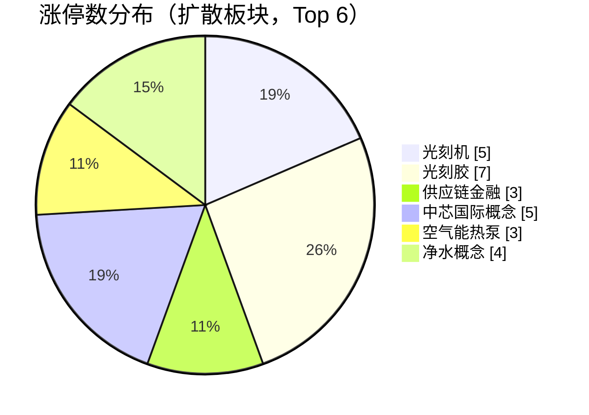
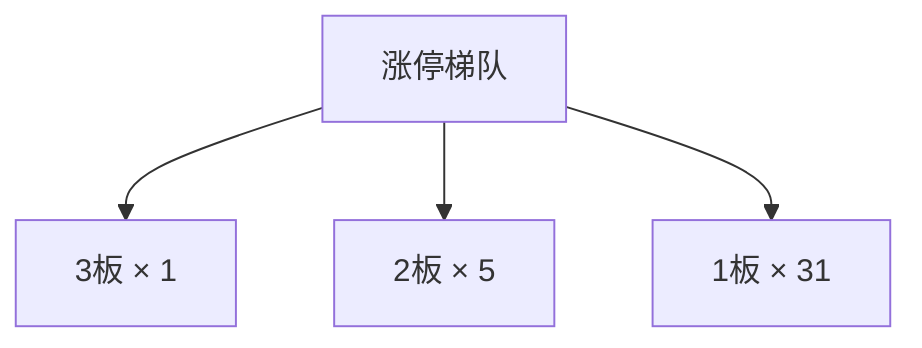
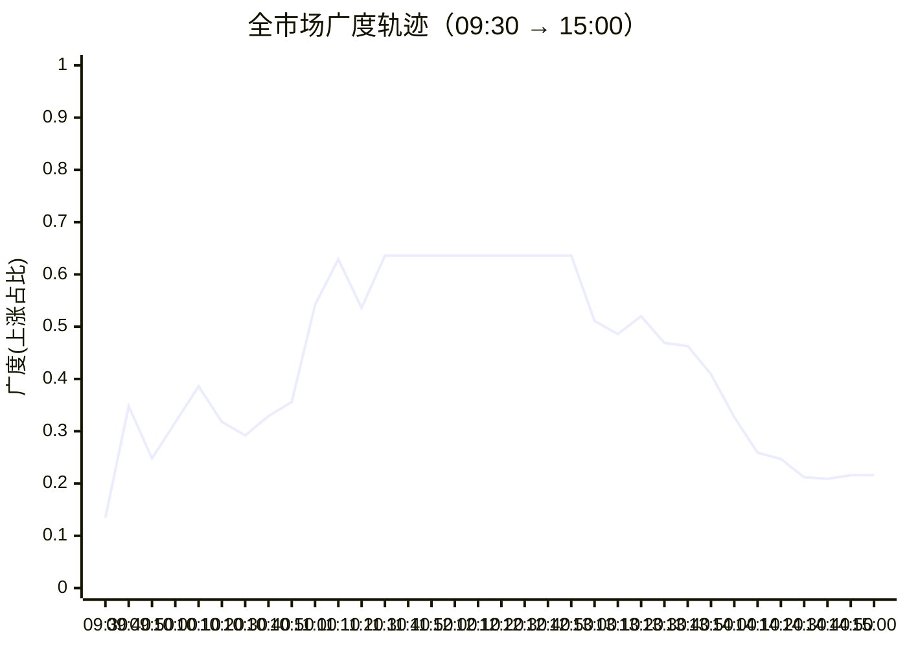

## 当日总览（截至 15:00）

> **结论**：全市场涨1328/跌4122（广度0.24）；涨停37/跌停76；中位涨幅-1.30%；普跌格局。 钱在：光刻机(涨停5/成分52，中位+1.67%)、光刻胶(涨停7/成分80，中位+1.67%)、供应链金融(涨停3/成分50，中位-1.26%)；零星涨停：中韩自贸区(1)、禽流感(1)、血氧仪(1)、民爆概念(1)。 退潮：文化传媒概念(跌停17)、一带一路(跌停15)、短剧游戏(跌停14)。 梯队：3板×1、2板×5、1板×31，最高3板。 预案：超买区 长虹美菱、华帝股份、小熊电器、北鼎股份、广百股份、凯撒文化、顺钠股份；已触发 龙江交通、光启技术；未到价 吉视传媒、华数传媒、天虹股份、鹏飞绿能、北纬科技、金逸影视、紫竹高科、领湃科技、世龙实业、福龙马、朗特智能、海思科、金新农。 较上一轮广度基本持平。

### 板块扩散

> 口径：XTick 概念成分 × 全市场实时报价；分母 = 板块内有有效报价的成分数。排序用涨停密度（涨停数/有效成分数），已剔除宽基属性板块（全市场 432 个板块中剔 16 个）。

**扩散中（题材，按涨停密度排序）**

| 板块 | 涨停 | 有效成分 | 涨停密度 | 上涨广度 | 中位涨幅 | 相对全市场 | 成交(亿) |
|---|---|---|---|---|---|---|---|
| 光刻机 | 5 | 52 | 0.096 | 0.65 | +1.67% | +2.97% | 333 |
| 光刻胶 | 7 | 80 | 0.087 | 0.69 | +1.67% | +2.97% | 308 |
| 供应链金融 | 3 | 50 | 0.060 | 0.30 | -1.26% | +0.04% | 103 |
| 中韩自贸区 ⬦ | 1 | 17 | 0.059 | 0.41 | -0.37% | +0.93% | 62 |
| 中芯国际概念 | 5 | 91 | 0.055 | 0.65 | +1.72% | +3.02% | 996 |
| 空气能热泵 | 3 | 56 | 0.054 | 0.30 | -1.81% | -0.51% | 219 |
| 净水概念 | 4 | 81 | 0.049 | 0.30 | -0.73% | +0.57% | 224 |
| 禽流感 ⬦ | 1 | 23 | 0.043 | 0.22 | -0.51% | +0.79% | 25 |
| 时空大数据 | 3 | 71 | 0.042 | 0.21 | -1.72% | -0.42% | 143 |
| 血氧仪 ⬦ | 1 | 24 | 0.042 | 0.29 | -1.45% | -0.15% | 58 |
| 民爆概念 ⬦ | 1 | 25 | 0.040 | 0.32 | -0.64% | +0.66% | 46 |
| 节能照明 | 3 | 78 | 0.038 | 0.32 | -0.77% | +0.53% | 327 |

> ⬦ = 涨停 <3 只，零星个例，不构成扩散（不计入「钱在」判定）。



零星涨停板块（<3 只）：中韩自贸区(1)、禽流感(1)、血氧仪(1)、民爆概念(1)

**退潮中（跌停集中）**

| 板块 | 跌停 | 有效成分 | 上涨广度 | 中位涨幅 |
|---|---|---|---|---|
| 文化传媒概念 | 17 | 197 | 0.06 | -4.28% |
| 一带一路 | 15 | 797 | 0.23 | -1.15% |
| 短剧游戏 | 14 | 99 | 0.04 | -6.49% |
| 网络直播 | 14 | 278 | 0.18 | -2.05% |
| IP经济(谷子经济) | 13 | 198 | 0.12 | -3.08% |
| 创投 | 13 | 460 | 0.20 | -1.39% |
| 电子商务 | 13 | 676 | 0.23 | -1.50% |
| AI应用 | 12 | 551 | 0.17 | -2.13% |
| 乡村振兴 | 12 | 440 | 0.19 | -1.30% |
| 旅游概念 | 11 | 151 | 0.11 | -2.45% |
| PPP概念 | 11 | 199 | 0.18 | -1.28% |
| 新零售 | 11 | 323 | 0.20 | -1.89% |

### 涨停梯队

> 最高 3 板 ｜ 涨停 37 ｜ 跌停 76 ｜ 炸板 19 ｜ 封板率 66.1% ｜ 打板成功率 18.18% ｜ 一进二 22.73% ｜ 二进三 12.50%

| 身位 | 家数 | 成员（涨幅/封单亿/首封） |
|---|---|---|
| 3板 | 1 | 华东重机 +10.02%/0.027亿/09:25 |
| 2板 | 5 | 长虹美菱 +9.98%/0.010亿/09:32；瀛通通讯 +10.00%/0.004亿/09:38；小熊电器 +10.01%/0.004亿/10:49；顺钠股份 +9.98%/0.002亿/09:30；北投科技 +9.95%/0.001亿/09:33 |
| 1板 | 31 | 摩恩电气 +10.03%/0.045亿/09:25；华胜天成 +10.00%/0.031亿/09:30；有研新材 +10.01%/0.026亿/09:52；九阳股份 +10.02%/0.022亿/09:53；东方嘉盛 +9.98%/0.011亿/11:00 |



炸板 19 只（前几）：广百股份(16次)、国光股份(7次)、高新发展(4次)、凯撒文化(4次)、国风新材(3次)

### 预案池对照

| 票 | 池 | 板块 | 现价 | 涨幅 | 触发价 | 买区 | 风险位 | 判定 |
|---|---|---|---|---|---|---|---|---|
| 吉视传媒 `601929.SH` | 执行池 | 电视广播/AI微短剧局部承接 | 2.76 | -6.76% | 3.03 | [3.01, 3.08] | 2.93 | **未到价** |
| 长虹美菱 `000521.SZ` | 执行池 | 家用电器低位首板簇 | 4.74 | +9.98% | 4.37 | [4.35, 4.44] | 4.22 | **超买区** |
| 华数传媒 `000156.SZ` | 观察池 | 电视广播/AI微短剧局部承接 | 7.69 | -9.95% | 8.54 | [8.5, 8.67] | 8.24 | **未到价** |
| 华帝股份 `002035.SZ` | 观察池 | 家用电器低位首板簇 | 4.81 | +2.78% | 4.68 | [4.66, 4.75] | 4.51 | **超买区** |
| 小熊电器 `002959.SZ` | 观察池 | 家用电器低位首板簇 | 39.9 | +10.01% | 38.96 | [38.77, 39.54] | 37.56 | **超买区** |
| 北鼎股份 `300824.SZ` | 观察池 | 家用电器低位首板簇 | 9.98 | +16.05% | 8.6 | [8.56, 8.73] | 8.03 | **超买区** |
| 广百股份 `002187.SZ` | 观察池 | 一般零售接力/消费扩散 | 8.1 | +5.61% | 7.67 | [7.63, 7.79] | 7.4 | **超买区** |
| 天虹股份 `002419.SZ` | 观察池 | 一般零售接力/消费扩散 | 5.34 | -1.11% | 5.4 | [5.37, 5.48] | 5.21 | **未到价** |
| 鹏飞绿能 `002356.SZ` | 观察池 | 一般零售接力/消费扩散 | 2.47 | -1.98% | 2.52 | [2.51, 2.56] | 2.43 | **未到价** |
| 北纬科技 `002148.SZ` | 观察池 | 短剧游戏/存量情绪核心 | 8.11 | -7.31% | 8.75 | [8.71, 8.88] | 8.44 | **未到价** |
| 凯撒文化 `002425.SZ` | 观察池 | 短剧游戏/存量情绪核心 | 4.65 | +6.65% | 4.36 | [4.34, 4.43] | 4.21 | **超买区** |
| 金逸影视 `002905.SZ` | 观察池 | 短剧游戏/存量情绪核心 | 10.25 | -5.88% | 10.89 | [10.84, 11.05] | 10.5 | **未到价** |
| 紫竹高科 `002058.SZ` | 观察池 | 固态/储能电池分支 | 23.35 | +4.24% | 24.6 | [24.48, 24.97] | 23.72 | **未到价** |
| 领湃科技 `300530.SZ` | 观察池 | 固态/储能电池分支 | 26.94 | -3.20% | 28.45 | [28.31, 28.88] | 26.57 | **未到价** |
| 世龙实业 `002748.SZ` | 观察池 | 固态/储能电池分支 | 13.06 | -4.18% | 13.63 | [13.56, 13.83] | 13.14 | **未到价** |
| 龙江交通 `601188.SH` | 观察池 | 冰雪季节叙事 | 4.74 | +0.21% | 4.73 | [4.71, 4.8] | 4.56 | **已触发** |
| 顺钠股份 `000533.SZ` | 观察池 | 电网/变压器 | 10.8 | +9.98% | 10.16 | [10.11, 10.31] | 9.79 | **超买区** |
| 光启技术 `002625.SZ` | 观察池 | 航空超材料订单 | 18.2 | +0.39% | 18.13 | [18.04, 18.4] | 17.48 | **已触发** |
| 福龙马 `603686.SH` | 观察池 | 环卫机器人/具身应用 | 12.92 | -8.04% | 14.5 | [14.43, 14.72] | 13.98 | **未到价** |
| 朗特智能 `300916.SZ` | 观察池 | 光互联并购事件 | 30.25 | -4.21% | 34.27 | [34.1, 34.78] | 32.0 | **未到价** |
| 海思科 `002653.SZ` | 观察池 | 创新药医保事件 | 54.0 | -2.81% | 55.56 | [55.28, 56.39] | 53.57 | **未到价** |
| 金新农 `002548.SZ` | 观察池 | 猪肉低位接力 | 3.92 | -6.89% | 4.21 | [4.19, 4.27] | 4.06 | **未到价** |

- **长虹美菱** — 现价4.74 已高于买区上沿4.44，不追高；仅价格位置对照，不代表完整入场条件确认；不能据此确认站稳，不授予下单权限
- **华帝股份** — 现价4.81 已高于买区上沿4.75，不追高；仅价格位置对照，不代表完整入场条件确认；不能据此确认站稳，不授予下单权限
- **小熊电器** — 现价39.9 已高于买区上沿39.54，不追高；仅价格位置对照，不代表完整入场条件确认；不能据此确认站稳，不授予下单权限
- **北鼎股份** — 现价9.98 已高于买区上沿8.73，不追高；仅价格位置对照，不代表完整入场条件确认；不能据此确认站稳，不授予下单权限
- **广百股份** — 现价8.1 已高于买区上沿7.79，不追高；仅价格位置对照，不代表完整入场条件确认；不能据此确认站稳，不授予下单权限
- **凯撒文化** — 现价4.65 已高于买区上沿4.43，不追高；仅价格位置对照，不代表完整入场条件确认；不能据此确认站稳，不授予下单权限
- **龙江交通** — 现价4.74 ≥ 触发价4.73；仅价格位置对照，不代表完整入场条件确认；不能据此确认站稳，不授予下单权限
- **顺钠股份** — 现价10.8 已高于买区上沿10.31，不追高；仅价格位置对照，不代表完整入场条件确认；不能据此确认站稳，不授予下单权限
- **光启技术** — 现价18.2 ≥ 触发价18.13；仅价格位置对照，不代表完整入场条件确认；不能据此确认站稳，不授予下单权限

### 盘面 vs 静态复盘 vs 消息面

| 维度 | 对象 | T-1 静态基线 | 今日盘面 | 关系 |
|---|---|---|---|---|
| 板块主线 | 短剧游戏/存量情绪核心 | R2 次线 score=70 涨停None（T-1 口径） | 盘面未见该板块成分票涨停 | **背离** |
| 板块主线 | 固态/储能电池分支 | R2 次线 score=65 涨停None（T-1 口径） | 盘面未见该板块成分票涨停 | **背离** |
| 板块主线 | 冰雪季节叙事 | R2 次线 score=63 涨停None（T-1 口径） | 盘面未见该板块成分票涨停 | **背离** |
| 板块主线 | 电网/变压器 | R2 次线 score=None 涨停None（T-1 口径） | 盘面未见该板块成分票涨停 | **背离** |
| 板块主线 | 航空超材料订单 | R2 次线 score=None 涨停None（T-1 口径） | 盘面未见该板块成分票涨停 | **背离** |
| 板块主线 | 环卫机器人/具身应用 | R2 次线 score=None 涨停None（T-1 口径） | 盘面未见该板块成分票涨停 | **背离** |
| 板块主线 | 光互联并购事件 | R2 次线 score=None 涨停None（T-1 口径） | 盘面未见该板块成分票涨停 | **背离** |
| 板块主线 | 创新药医保事件 | R2 次线 score=None 涨停None（T-1 口径） | 盘面未见该板块成分票涨停 | **背离** |
| 板块主线 | 猪肉低位接力 | R2 次线 score=None 涨停None（T-1 口径） | 盘面未见该板块成分票涨停 | **背离** |
| 梯队结构 | 最高3板 | T-1 最高梯队 4 板、首板 29、炸板率 39.06% | 今日 3板×1、2板×5、1板×31；封板率0.6607 炸板19只 | **背离** |
| 预案验证 | 吉视传媒(601929.SH) | 预案 电视广播/AI微短剧局部承接／leader／触发价3.03／买区[3.01, 3.08] | 未到价：现价2.76，触发价3.03，还差9.78%；仅价格位置对照，不代表完整入场条件确认；不能据此确认站稳，不授予下单权限 | **无响应** |
| 预案验证 | 长虹美菱(000521.SZ) | 预案 家用电器低位首板簇／leader／触发价4.37／买区[4.35, 4.44] | 超买区：现价4.74 已高于买区上沿4.44，不追高；仅价格位置对照，不代表完整入场条件确认；不能据此确认站稳，不授予下单权限 | **背离** |
| 预案验证 | 华数传媒(000156.SZ) | 预案 电视广播/AI微短剧局部承接／watch／触发价8.54／买区[8.5, 8.67] | 未到价：现价7.69，触发价8.54，还差11.05%；仅价格位置对照，不代表完整入场条件确认；不能据此确认站稳，不授予下单权限 | **无响应** |
| 预案验证 | 华帝股份(002035.SZ) | 预案 家用电器低位首板簇／watch／触发价4.68／买区[4.66, 4.75] | 超买区：现价4.81 已高于买区上沿4.75，不追高；仅价格位置对照，不代表完整入场条件确认；不能据此确认站稳，不授予下单权限 | **背离** |
| 预案验证 | 小熊电器(002959.SZ) | 预案 家用电器低位首板簇／watch／触发价38.96／买区[38.77, 39.54] | 超买区：现价39.9 已高于买区上沿39.54，不追高；仅价格位置对照，不代表完整入场条件确认；不能据此确认站稳，不授予下单权限 | **背离** |
| 预案验证 | 北鼎股份(300824.SZ) | 预案 家用电器低位首板簇／watch／触发价8.6／买区[8.56, 8.73] | 超买区：现价9.98 已高于买区上沿8.73，不追高；仅价格位置对照，不代表完整入场条件确认；不能据此确认站稳，不授予下单权限 | **背离** |
| 预案验证 | 广百股份(002187.SZ) | 预案 一般零售接力/消费扩散／watch／触发价7.67／买区[7.63, 7.79] | 超买区：现价8.1 已高于买区上沿7.79，不追高；仅价格位置对照，不代表完整入场条件确认；不能据此确认站稳，不授予下单权限 | **背离** |
| 预案验证 | 天虹股份(002419.SZ) | 预案 一般零售接力/消费扩散／watch／触发价5.4／买区[5.37, 5.48] | 未到价：现价5.34，触发价5.4，还差1.12%；仅价格位置对照，不代表完整入场条件确认；不能据此确认站稳，不授予下单权限 | **无响应** |
| 预案验证 | 鹏飞绿能(002356.SZ) | 预案 一般零售接力/消费扩散／watch／触发价2.52／买区[2.51, 2.56] | 未到价：现价2.47，触发价2.52，还差2.02%；仅价格位置对照，不代表完整入场条件确认；不能据此确认站稳，不授予下单权限 | **无响应** |
| 预案验证 | 北纬科技(002148.SZ) | 预案 短剧游戏/存量情绪核心／watch／触发价8.75／买区[8.71, 8.88] | 未到价：现价8.11，触发价8.75，还差7.89%；仅价格位置对照，不代表完整入场条件确认；不能据此确认站稳，不授予下单权限 | **无响应** |
| 预案验证 | 凯撒文化(002425.SZ) | 预案 短剧游戏/存量情绪核心／watch／触发价4.36／买区[4.34, 4.43] | 超买区：现价4.65 已高于买区上沿4.43，不追高；仅价格位置对照，不代表完整入场条件确认；不能据此确认站稳，不授予下单权限 | **背离** |
| 预案验证 | 金逸影视(002905.SZ) | 预案 短剧游戏/存量情绪核心／watch／触发价10.89／买区[10.84, 11.05] | 未到价：现价10.25，触发价10.89，还差6.24%；仅价格位置对照，不代表完整入场条件确认；不能据此确认站稳，不授予下单权限 | **无响应** |
| 预案验证 | 紫竹高科(002058.SZ) | 预案 固态/储能电池分支／watch／触发价24.6／买区[24.48, 24.97] | 未到价：现价23.35，触发价24.6，还差5.35%；仅价格位置对照，不代表完整入场条件确认；不能据此确认站稳，不授予下单权限 | **无响应** |
| 预案验证 | 领湃科技(300530.SZ) | 预案 固态/储能电池分支／watch／触发价28.45／买区[28.31, 28.88] | 未到价：现价26.94，触发价28.45，还差5.61%；仅价格位置对照，不代表完整入场条件确认；不能据此确认站稳，不授予下单权限 | **无响应** |
| 预案验证 | 世龙实业(002748.SZ) | 预案 固态/储能电池分支／watch／触发价13.63／买区[13.56, 13.83] | 未到价：现价13.06，触发价13.63，还差4.36%；仅价格位置对照，不代表完整入场条件确认；不能据此确认站稳，不授予下单权限 | **无响应** |
| 预案验证 | 龙江交通(601188.SH) | 预案 冰雪季节叙事／watch／触发价4.73／买区[4.71, 4.8] | 已触发：现价4.74 ≥ 触发价4.73；仅价格位置对照，不代表完整入场条件确认；不能据此确认站稳，不授予下单权限 | **印证** |
| 预案验证 | 顺钠股份(000533.SZ) | 预案 电网/变压器／watch／触发价10.16／买区[10.11, 10.31] | 超买区：现价10.8 已高于买区上沿10.31，不追高；仅价格位置对照，不代表完整入场条件确认；不能据此确认站稳，不授予下单权限 | **背离** |
| 预案验证 | 光启技术(002625.SZ) | 预案 航空超材料订单／watch／触发价18.13／买区[18.04, 18.4] | 已触发：现价18.2 ≥ 触发价18.13；仅价格位置对照，不代表完整入场条件确认；不能据此确认站稳，不授予下单权限 | **印证** |
| 预案验证 | 福龙马(603686.SH) | 预案 环卫机器人/具身应用／watch／触发价14.5／买区[14.43, 14.72] | 未到价：现价12.92，触发价14.5，还差12.23%；仅价格位置对照，不代表完整入场条件确认；不能据此确认站稳，不授予下单权限 | **无响应** |
| 预案验证 | 朗特智能(300916.SZ) | 预案 光互联并购事件／watch／触发价34.27／买区[34.1, 34.78] | 未到价：现价30.25，触发价34.27，还差13.29%；仅价格位置对照，不代表完整入场条件确认；不能据此确认站稳，不授予下单权限 | **无响应** |
| 预案验证 | 海思科(002653.SZ) | 预案 创新药医保事件／watch／触发价55.56／买区[55.28, 56.39] | 未到价：现价54.0，触发价55.56，还差2.89%；仅价格位置对照，不代表完整入场条件确认；不能据此确认站稳，不授予下单权限 | **无响应** |
| 预案验证 | 金新农(002548.SZ) | 预案 猪肉低位接力／watch／触发价4.21／买区[4.19, 4.27] | 未到价：现价3.92，触发价4.21，还差7.4%；仅价格位置对照，不代表完整入场条件确认；不能据此确认站稳，不授予下单权限 | **无响应** |
| 消息面对照 | 盘面热点板块 | R4 消息面（T-1 口径） | 实时快讯中命中热点板块关键词 2 条 | **印证** |

**分歧点（不掩盖）：**
- 板块主线·短剧游戏/存量情绪核心 → 背离：T-1 有辨识度但今日盘中无涨停响应，题材未获资金确认
- 板块主线·固态/储能电池分支 → 背离：T-1 有辨识度但今日盘中无涨停响应，题材未获资金确认
- 板块主线·冰雪季节叙事 → 背离：T-1 有辨识度但今日盘中无涨停响应，题材未获资金确认
- 板块主线·电网/变压器 → 背离：T-1 有辨识度但今日盘中无涨停响应，题材未获资金确认
- 板块主线·航空超材料订单 → 背离：T-1 有辨识度但今日盘中无涨停响应，题材未获资金确认
- 板块主线·环卫机器人/具身应用 → 背离：T-1 有辨识度但今日盘中无涨停响应，题材未获资金确认
- 板块主线·光互联并购事件 → 背离：T-1 有辨识度但今日盘中无涨停响应，题材未获资金确认
- 板块主线·创新药医保事件 → 背离：T-1 有辨识度但今日盘中无涨停响应，题材未获资金确认
- 板块主线·猪肉低位接力 → 背离：T-1 有辨识度但今日盘中无涨停响应，题材未获资金确认
- 梯队结构·最高3板 → 背离：梯队高度是短线辨识度来源；梯队断裂时不做高位接力假设
- 预案验证·长虹美菱(000521.SZ) → 背离：仅研究对照，不授予交易权限
- 预案验证·华帝股份(002035.SZ) → 背离：仅研究对照，不授予交易权限
- 预案验证·小熊电器(002959.SZ) → 背离：仅研究对照，不授予交易权限
- 预案验证·北鼎股份(300824.SZ) → 背离：仅研究对照，不授予交易权限
- 预案验证·广百股份(002187.SZ) → 背离：仅研究对照，不授予交易权限
- 预案验证·凯撒文化(002425.SZ) → 背离：仅研究对照，不授予交易权限
- 预案验证·顺钠股份(000533.SZ) → 背离：仅研究对照，不授予交易权限

### 全天广度轨迹

| 时点 | 涨 | 跌 | 广度 | 涨停 | 跌停 | 成交(亿) | 有效样本 |
|---|---|---|---|---|---|---|---|
| 0930 | 747 | 4632 | 0.135 | 6 | 21 | 549 | 5542 |
| 0940 | 1938 | 3389 | 0.348 | 18 | 24 | 2,454 | 5573 |
| 0950 | 1383 | 4003 | 0.248 | 21 | 32 | 3,626 | 5573 |
| 1000 | 1769 | 3604 | 0.317 | 20 | 35 | 4,474 | 5573 |
| 1010 | 2150 | 3162 | 0.386 | 22 | 34 | 5,147 | 5573 |
| 1020 | 1772 | 3573 | 0.318 | 22 | 31 | 5,800 | 5573 |
| 1030 | 1629 | 3739 | 0.292 | 24 | 39 | 6,250 | 5573 |
| 1040 | 1831 | 3531 | 0.329 | 24 | 36 | 6,660 | 5573 |
| 1050 | 1985 | 3373 | 0.356 | 27 | 33 | 6,982 | 5573 |
| 1100 | 3022 | 2325 | 0.542 | 32 | 27 | 7,452 | 5573 |
| 1110 | 3508 | 1852 | 0.629 | 39 | 25 | 8,162 | 5573 |
| 1120 | 2988 | 2350 | 0.536 | 37 | 28 | 8,619 | 5573 |
| 1130 | 3546 | 1789 | 0.636 | 42 | 25 | 9,010 | 5573 |
| 1140 | 3546 | 1789 | 0.636 | 42 | 25 | 9,010 | 5573 |
| 1150 | 3546 | 1789 | 0.636 | 42 | 25 | 9,010 | 5573 |
| 1200 | 3546 | 1789 | 0.636 | 42 | 25 | 9,010 | 5573 |
| 1210 | 3546 | 1789 | 0.636 | 42 | 25 | 9,010 | 5573 |
| 1220 | 3546 | 1789 | 0.636 | 42 | 25 | 9,010 | 5573 |
| 1230 | 3546 | 1789 | 0.636 | 42 | 25 | 9,010 | 5573 |
| 1240 | 3546 | 1789 | 0.636 | 42 | 25 | 9,010 | 5573 |
| 1250 | 3546 | 1789 | 0.636 | 42 | 25 | 9,010 | 5573 |
| 1300 | 2850 | 2506 | 0.511 | 41 | 23 | 9,209 | 5573 |
| 1310 | 2706 | 2658 | 0.486 | 43 | 30 | 9,646 | 5573 |
| 1320 | 2901 | 2452 | 0.520 | 43 | 35 | 10,071 | 5573 |
| 1330 | 2616 | 2717 | 0.469 | 44 | 37 | 10,396 | 5573 |
| 1340 | 2578 | 2755 | 0.463 | 46 | 36 | 10,758 | 5573 |
| 1350 | 2277 | 3080 | 0.409 | 45 | 41 | 11,047 | 5573 |
| 1400 | 1821 | 3586 | 0.327 | 44 | 45 | 11,418 | 5573 |
| 1410 | 1445 | 3994 | 0.259 | 40 | 53 | 11,918 | 5573 |
| 1420 | 1375 | 4056 | 0.247 | 38 | 55 | 12,281 | 5573 |
| 1430 | 1180 | 4287 | 0.212 | 36 | 65 | 12,711 | 5573 |
| 1440 | 1163 | 4304 | 0.209 | 37 | 75 | 13,401 | 5573 |
| 1450 | 1204 | 4262 | 0.216 | 38 | 79 | 14,014 | 5573 |
| 1500 | 627 | 2218 | 0.216 | 22 | 42 | 7,671 | 2903 |

> ⚠ **数据冻结段**：1130–1250 数值连续完全一致，说明行情源未刷新，**不是市场横盘**，该段不可解读为盘面变化。

> ⚠ **分母变化**：1500（5573→2903） 有效样本变动超 15%，该时点广度与前后不可直接比较（数据降级）。



### 观察建议（仅研究）

- **环境**：跌停 76 > 涨停 37，炸板 19.0，打板成功率 18.2%，一进二 22.7%。情绪处于**退潮/弱势**区间，右侧信号稀缺，不宜按主升期打法出手。
- **方向**：今日形成实质扩散的是 光刻机（涨停5/成分52，密度0.096，中位+1.67%）、光刻胶（涨停7/成分80，密度0.087，中位+1.67%）、供应链金融（涨停3/成分50，密度0.060，中位-1.26%）。**需确认**：次日能否维持涨停家数且中位涨幅不掉队，否则只是普跌中的避险轮动。
- **零星**：中韩自贸区(1只/17成分)、禽流感(1只/23成分)、血氧仪(1只/24成分)、民爆概念(1只/25成分) 属零星个例，不视为题材，不据此选股。
- **回避**：文化传媒概念（跌停17）、一带一路（跌停15）、短剧游戏（跌停14） 板块中位跌幅深，趋势未止跌前不接。
- **身位**：最高 3 板。梯队有高度不等于可接力，需逐票核验封单稳定性与开板次数后再定。
- **预案**：长虹美菱（现价4.74 已高于买区上沿4.44，不追高；仅价格位置对照，不代表完整入场条件确认；不能据此确认站稳，不授予下单权限）、华帝股份（现价4.81 已高于买区上沿4.75，不追高；仅价格位置对照，不代表完整入场条件确认；不能据此确认站稳，不授予下单权限）、小熊电器（现价39.9 已高于买区上沿39.54，不追高；仅价格位置对照，不代表完整入场条件确认；不能据此确认站稳，不授予下单权限）、北鼎股份（现价9.98 已高于买区上沿8.73，不追高；仅价格位置对照，不代表完整入场条件确认；不能据此确认站稳，不授予下单权限）、广百股份（现价8.1 已高于买区上沿7.79，不追高；仅价格位置对照，不代表完整入场条件确认；不能据此确认站稳，不授予下单权限）、凯撒文化（现价4.65 已高于买区上沿4.43，不追高；仅价格位置对照，不代表完整入场条件确认；不能据此确认站稳，不授予下单权限）、顺钠股份（现价10.8 已高于买区上沿10.31，不追高；仅价格位置对照，不代表完整入场条件确认；不能据此确认站稳，不授予下单权限）。买区已错过，**不追高**；要参与需等新剧本，不能沿用原预案价位。
- **预案待检验**：吉视传媒(触发价3.03，还差+9.78%)、华数传媒(触发价8.54，还差+11.05%)、天虹股份(触发价5.4，还差+1.12%)、鹏飞绿能(触发价2.52，还差+2.02%)、北纬科技(触发价8.75，还差+7.89%)、金逸影视(触发价10.89，还差+6.24%)、紫竹高科(触发价24.6，还差+5.35%)、领湃科技(触发价28.45，还差+5.61%)、世龙实业(触发价13.63，还差+4.36%)、福龙马(触发价14.5，还差+12.23%)、朗特智能(触发价34.27，还差+13.29%)、海思科(触发价55.56，还差+2.89%)、金新农(触发价4.21，还差+7.40%) 尚未触及触发价，剧本未被盘面检验，继续按原失效条件看。

<details>
<summary>原始截面与数据质量（折叠）</summary>

**跨源校验**

```json
{
  "xtick": {
    "up": 1328,
    "down": 4122,
    "n": 5617,
    "amount_yi": 14575.2
  },
  "rtk_snapshot": {
    "up": 627,
    "down": 2218,
    "valid_n": 2903,
    "amount_yi": 7671.4,
    "up_limit": 22,
    "down_limit": 42
  },
  "note": "两源口径不同（XTick 全市场含全部票；rt_k 返回样本）"
}
```

**rt_k 截面（原始）**

```json
{
  "market": {
    "total": 5585,
    "up": 627,
    "down": 2218,
    "flat": 58,
    "requested_n": 5585,
    "received_n": 5585,
    "valid_n": 2903,
    "missing_n": 2682,
    "universe_requested_n": null,
    "population_scope": "returned_rows_not_verified_all_a_universe",
    "up_ratio": 0.1123,
    "legacy_up_ratio_placeholder": false,
    "up_ratio_is_observed": true,
    "up_ratio_all": 0.1123,
    "up_ratio_valid": 0.216,
    "up_ratio_denominator": "requested_n",
    "degraded": true,
    "limit_known_n": 2903,
    "limit_unknown_n": 0,
    "limit_counts_complete": true,
    "limit_source_errors": [],
    "up_gt3": 127,
    "up_gt5": 59,
    "up_limit": 22,
    "down_gt3": 740,
    "down_gt5": 301,
    "down_limit": 42,
    "amount_yi": 7671.4,
    "amount_sum_overflow": false,
    "amount_valid_n": 2903,
    "amount_missing_n": 0
  },
  "source_time_quality": {
    "quote_age_min_seconds": 46.615714,
    "quote_age_max_seconds": 46.615714,
    "source_age_limit_seconds": null,
    "freshness_status": "age_limit_not_configured",
    "age_reference_at": "2026-11-17T15:00:46.615714+08:00"
  },
  "trading_authorized": false
}
```

</details>

## 分时研判记录

### 09:35 研判增量
- **趋势**：这是当日首份09:30分析（生成于09:30:56），不是09:35实时价；没有上一轮，广度、排名和预案状态均不能判“改善/持平”，首页“较上一轮基本持平”缺少比较依据。真正值得区分的是高度与承接：广百由11月16日三板晋至本轮四板，而昨日四板的北纬科技本轮为-5.03%，说明高度保留但领头票换位，并非旧高位集体修复；开盘晋级率也不是全天最终成功率。
- **轮动**：目前更像少数活口，不足以确认新主线。物业管理虽有3只涨停，但仅15/183只上涨、中位-1.31%且弱于市场中位-1.21%，不能由涨停门槛直接推出“钱在物业、板块扩散”。智能电网有2/279只涨停、67/279只上涨、中位-0.73%，仅是相对抗跌的观察方向；顺钠二板已经证明个股响应，自动对照中的“电网无涨停响应”不能照单全收。短剧游戏仅3/99只上涨，弱势更广泛；但只有首轮截面、没有跨轮资金流，不能断言资金已从传媒搬到电网，跷跷板尚待验证。
- **剧本**：对照以11月16日收盘为事实基线的盘前预案，广电与家电已经分化：吉视、华数在同一截面均明显走弱，原“广电局部承接”假设未获支持，不能只当作便宜了、等触发价即可；还要满足原方案的核心同步承接。长虹的相对强势印证方向选择，却已跳过原买区，不等于买点兑现；华帝仅价格过线，预案原有的降级观察理由没有因此消失，不能自动替补长虹。光启上涨是合同线的个股正反馈，不能把未涨停写成消息完全无响应，但它同样超出原买区；快讯关键词未匹配也不等于没有催化。其余逐票价格判定沿用上表，不新增价位或放宽条件。
- **下一步看**：下一份先核同口径有效报价分母，再比较09:30的上涨广度13.48%、涨停6只和跌停21只（均为rt_k轨迹口径，不与XTick的17只跌停混比）；涨停增而广度降，只能判强势集中。家电看华帝能否继续满足4.68触发且不越4.75上沿、小熊能否收复38.96；长虹即使回到4.35—4.44，也须重新验证放量承接，不自动恢复旧买点。广电若要重估，看吉视3.03与华数8.54能否同步收复，并补路径确认；电网则看涨停能否达到3只、上涨广度能否高于当前0.2401，未达不升级为扩散主线。以上全是研究验证条件，不是买入许可：本任务仍禁新仓、预算0、单票上限0；磁盘预案及分析实际为`no_trade=false`，与任务禁新仓口径不一致，按本任务更严约束执行，不改动源文件。

### 09:45 研判增量
- **趋势**：09:30→09:40出现的是“上涨面有所恢复，但高位接力仍在掉队”，不是全面转强。本轮分析生成于09:40:55，报价覆盖09:39:48—09:40:50，并非09:45实时价。返回样本有效上涨广度分别为13.48%（747/5542）、34.77%（1938/5573）；有效分母改变，未作同池对齐，不计算广度百分点差。相同rt_k统计口径下，涨停6→18的同时跌停21→24，亏钱尾部没有同步收敛。梯队首板3→14、最高封板高度4→3：广百从四板封住转为开板，累计4次开板；顺钠也从二板封住转为开板，新增承接集中在首板与长虹美菱等二板，不能用封板率改善掩盖旧前排失守。开板名单的涨幅与预案报价存在异步（金逸名单仍为+9.92%，预案报价已为-5.51%），这里只采开板事件，不把两处数值拼成同步现价或完整分时路径。
- **轮动**：新增扩散证据最强的是光刻胶：上涨成分28/80→67/80、涨停0→3、中位涨幅-0.74%→+1.33%；09:36:32—09:36:52的三条匹配快讯都是同一拉升事件的转述，印证价格响应，不算三份独立催化。时空大数据虽新进热度前列、涨停0→3，但仅26/71只上涨且中位仍-0.25%，更像前排集中，不能因密度排名更高就压过光刻胶的广泛承接。另一端，商贸零售中位-1.07%→-1.08%，免税店上涨仍4/26只而中位-0.53%→-1.11%，在大盘回暖时相对失血；家电上涨22/103→36/103但仍仅1只涨停、2只跌停，也不能泛化为消费整体接棒。可提出“硬科技扩散、旧零售接力走弱”的相对切换假设，尚无跨板块净流量证据确认同一批钱迁移。电网上涨67/279→154/279而涨停2→1，则是普通成分回暖、前排接力反而减弱，未满足上轮提出的扩散检查。
- **剧本**：最需要纠正的是把“回到价格区间”当成新机会。顺钠从超买区跌回10.25、被程序标成“已触发”，实际已经历开板，不能倒写成首次向上突破；金逸11.54→10.29、领湃29.39→27.76，都从原买区上方落到下沿以下，虽标签变为“未到价”，原突破情景已受损，不能当作尚未启动而重置历史。北纬8.31→8.71只是进入买区下沿，仍低于8.75触发价；短剧上涨虽3/99→7/99，跌停却4→6，因此不是旧线集体回流。龙江4.40→4.77只补上价格条件，原预案的板型与利润映射疑点并未消失；华帝4.71→4.84则从已触发变成超原买区，不追。吉视2.82→2.78、华数8.04→7.99在市场修复时继续走弱，使原“核心同步承接”假设进一步受损；长虹晋二板支持家电先锋选择，却未兑现原买区内承接的买点，不能用它去补广电失败后的订单。
- **下一步看**：用下一份同口径截面检验而不预判成交：光刻胶能否保有本轮3只涨停和67/80只上涨；若板数保住但上涨成分收缩，提示扩散减弱，不能只用封板数宣布继续转强。时空大数据要看是否从当前26/71只上涨继续外溢、中位涨幅能否转正。旧线重点看广百是否重新进入封板名单、短剧跌停是否不再超过本轮6只，不能只看北纬单票反弹；北纬须先收复8.75，顺钠须补10.16附近真实承接路径，龙江须在4.73—4.80原条件内验证，任何单次越线均不算站稳。金逸、领湃不因反抽原买区就恢复旧买点，须先重新核验失守后的结构；家电不由长虹买不到而递补后排。执行禁新仓、买入预算0、单票上限0继续有效；本段仅研究，不修改预案、预算或交易权限。

### 09:55 研判增量
- **趋势**：09:40那轮上涨面恢复没有延续，本轮是“首板家数增加、普通股票再度转弱”，不是修复升级。比较2026年11月17日09:40→09:50，同为5573只有效报价的rt_k返回样本，上涨广度34.77%→24.82%，下降9.96个百分点；涨停18→21，但跌停24→32，亏钱尾部扩大。本轮采集09:50:43—09:50:53，报价09:50:21—09:50:50，分析生成09:50:54，不是09:55实时价。最高仍为3板、首板14→17；二板家数不变却由瀛通通讯开板、顺钠重新封板形成换位，不能把家数持平读成接力稳定。上述广度未核对完整上市名录，不宣称无遗漏全A覆盖；跌停变化不混用XTick的23→31口径。
- **轮动**：硬科技内部也在由扩散转向前排集中：中芯国际概念涨停1→3、进入热度前列，但上涨成分75/91→67/91；光刻胶仍3只涨停，上涨成分却67/80→53/80、中位+1.33%→+0.81%，说明相对强势保留、跟随面收缩，并非继续全面扩散。时空大数据的3只涨停未变，上涨成分26/71→11/71、中位-0.25%→-0.97%，本轮更不支持首页“实质扩散”的表述。旧线短剧游戏上涨7/99→2/99、跌停6→7，09:49:37下挫快讯与盘面互证，但只是行情报道，不是新增产业利空。两端都在收缩，只能说半导体相对抗跌、传媒进一步失血；没有跨板块净流量证据，不把相对强弱差硬写成已确认跷跷板。
- **剧本**：预案的价格窗口进一步两极分化：北纬8.71→8.16，从“买区内”退回下沿以下，上轮收复8.75的观察并未兑现；顺钠10.25→10.80、龙江4.77→4.90则从“已触发”变为超原买区，前者回封只证明个股承接改善，不恢复原买点，更不能追。家电出现值得保留的局部反差：小熊37.78→38.58，向38.96旧高靠近，但仍低于38.77买区下沿；行业上涨成分反由36/103降至29/103，不能因长虹封板、小熊走强就宣布家电整体接棒，也不改变小熊在预案中仅作扩散观察的地位。吉视2.78→2.73、华数7.99→7.77继续同步下行，盘前“广电局部承接”假设再受削弱；原条件未满足，不下移买区接弱。其余价格状态沿用顶部逐票对照，本轮没有完整入场条件获确认。
- **下一步看**：先检验上涨面能否回到09:40的1938/5573、同时rt_k跌停从32向24回落；只增涨停而这两项不改善，仍按强势集中理解。半导体看中芯能否保住3只涨停且67/91只上涨不再收缩，光刻胶能否恢复67/80的跟随面；时空大数据即使仍有3只涨停，也须先改善11/71的上涨面，不能由榜单名次升级主线。家电只验证小熊能否收复38.96、仍在原38.77—39.54区间，并取得连续承接与同向助攻；单次越线、回到旧买区或顺钠单次回封均不等于站稳。以上均为研究验证条件，本任务继续禁新仓、买入预算0、单票上限0，不调整正式预案或交易权限。

### 10:05 研判增量
- **趋势**：本轮新分歧是“上涨面回补，接力质量却继续恶化”。比较2026年11月17日09:50→10:00，同为5573只有效报价的返回样本，上涨广度24.82%→31.74%，回升6.93个百分点，但仍未回到09:40的34.77%；同口径rt_k涨停21→20、跌停32→35，不能认定修复升级。XTick封板率80.77%→71.43%、二板3→2，北投科技退出封板名单；顺钠虽两轮都报10.80，累计开板却1→3次，同价并不等于封单稳定。本轮采集10:00:43—10:00:55、报价10:00:18—10:00:53，分析生成10:00:57，不是10:05实时价；未核完整上市名录，不宣称无遗漏全A覆盖。
- **轮动**：半导体内部不能只看排名升降。中芯国际概念涨停3→4、热度前移，但上涨成分67/91→60/91、中位+1.17%→+0.80%、跌停1→2，新增封板与内部收缩并存；光刻胶仍3只涨停，上涨成分53/80→59/80、中位+0.81%→+1.23%，本轮跟随面的修复反而更完整，但尚未回到09:40的67/80。另一端，短剧游戏跌停7→9、中位-3.82%→-4.11%，文化传媒跌停7→10，在整体上涨面回补时进一步失血。可保留“光刻胶修复、传媒继续撤退”的相对切换假设，缺少跨板块净流量，尚不能确认同一批资金形成跷跷板；匹配光刻胶的仍是09:36那组拉升报道，本轮没有新增独立催化证据。
- **剧本**：逐票价格标签唯一变化是世龙实业13.29→13.72，由“未到价”变为超过13.63触发价且仍在13.56—13.83原区间；这只补足价格位置，预案原本把它列为降级观察的氯化亚砜对照，不能升级成固态龙头或完整买点。家电行业上涨29/103→37/103，小熊却38.58→38.45、退离38.96旧高，说明板块回暖尚未落实到这个原观察点；长虹保留先锋反馈，不由其买不到递补后排。吉视2.73→2.66、华数7.77→7.69，核心同步走弱已不只是“触发价还没到”，而是原广电承接剧本的反证，按原条件取消当前新买情景，不下移买区。朗特33.57→33.98是事件观察线的边际改善，仍低于34.10买区下沿和34.27触发价，并购理由不替代资金确认。
- **下一步看**：①同分母上涨数能否恢复09:40的1938/5573，同时rt_k跌停从35回落至09:50的32或更少；若广度回升而跌停继续增，仍是分层反弹。②光刻胶保有3只涨停的同时，跟随面能否从59/80恢复67/80；中芯若仍4只涨停但上涨成分继续少于60/91、跌停多于2，只确认集中而不升级全面扩散。③世龙下一截面是否仍不低于13.63且不越13.83，再补真实承接路径；退回触发价下不算保持突破，低于13.56不能下移原买区。朗特须先进入34.10—34.78并收复34.27，单次越线不算站稳。④短剧跌停能否从9收缩、文化传媒从10收缩，再谈旧线止跌，而非凭北纬单票翻红。以上只作研究验证；沿用本任务禁新仓、买入预算0、单票上限0的约束，不改变源文件中已披露的no_trade口径差异，也不授予交易权限。

---
### 10:10 截面

返回样本: 涨2150/跌3162 广度0.39（有效样本分母） ｜ 返回5585/有效5573/缺失12；全A覆盖未核验 ｜ 涨跌停已确认计数: 涨停22 跌停34；边界已知样本5572/未知样本1（未知不等于0） ｜ 成交5147.4亿（金额缺失0，求和溢出False） ｜ 数据质量: 返回样本可用（非全A覆盖保证） ｜ 仅供市场参考，不授予交易权限；D1预算/no_trade/个股资格原样有效 ｜ D1预算上下文: {"market_context": {"fact_at": "2026-11-16T15:00:00+08:00", "four_quadrant": {"基本面估值": "吉视亏损/负债、长虹应收及非经常收益均保留；不以财务风险描述自动否决，也不把短剧热度写成OTT利润。文投、冰山真实硬否决另列。", "情绪": "涨停32、跌停60、炸板率33.33%、最高4板；前涨停反馈均值+0.99%但中位-1.45%，局部活口不代表多数赚钱。", "结构": "家电4首板扩散；广电2股回流，吉视先封，华数3次开板；广百3板、北纬4板是旧高位温度计，不做穿越。", "综合取舍": "先比较新首板右侧，吉视局部资金强、长虹扩散宽，条件初试合8%，建议总风险敞口上限20%；旧情绪线不接，事件线进watch/B，自动执行不开。", "资金": "市场大单分档代理-643.79亿元、5日-1396.97亿元；电视广播+6.79亿元与传媒整体-25.32亿元分列，不混加。"}, "structure": "弱广度、厚亏损尾部下的广电/家电局部切换，不是全面修复。", "valid_until": "2026-11-17T11:30:00+08:00"}, "no_trade": false, "risk_limits": {"block_prefixes": ["920"], "block_st": true, "kill_switch_file": "data/runtime/KILL_SWITCH", "max_buy_orders_per_day": 0, "max_orders_per_symbol_per_day": 0, "max_positions": 2, "max_single_sector_pct": 0.0, "max_single_stock_pct": 0.0, "target_total_position_pct": 0.0}, "trade_date": "20261117"} ｜ 报价年龄上限未配置，未验证新鲜；时点质量: {"age_reference_at": "2026-11-17T10:10:54.407556+08:00", "freshness_status": "age_limit_not_configured", "quote_age_max_seconds": 81.407556, "quote_age_min_seconds": 3.407556, "source_age_limit_seconds": null} ｜ 预案池热点: 吉视传媒-10.14%、凯撒文化-10.09%、北鼎股份+10.00%、长虹美菱+9.98%、顺钠股份+9.98%

| 票 | 池 | 现价 | 涨幅 | 状态 |
|---|---|---|---|---|
| 吉视传媒 `601929.SH` | execution_pool | 2.66 | -10.14% | limit_down |
| 长虹美菱 `000521.SZ` | execution_pool | 4.74 | +9.98% | limit_up |
| 华数传媒 `000156.SZ` | watch_pool | 7.69 | -9.95% | limit_down |
| 华帝股份 `002035.SZ` | watch_pool | 4.83 | +3.21% | up |
| 小熊电器 `002959.SZ` | watch_pool | 38.63 | +6.51% | up |
| 北鼎股份 `300824.SZ` | watch_pool | 9.46 | +10.00% | up |
| 广百股份 `002187.SZ` | watch_pool | 8.1 | +5.61% | up |
| 天虹股份 `002419.SZ` | watch_pool | 5.63 | +4.26% | up |
| 鹏飞绿能 `002356.SZ` | watch_pool | 2.37 | -5.95% | down |
| 北纬科技 `002148.SZ` | watch_pool | 8.32 | -4.91% | down |
| 凯撒文化 `002425.SZ` | watch_pool | 3.92 | -10.09% | limit_down |
| 金逸影视 `002905.SZ` | watch_pool | 9.87 | -9.37% | down |
| 紫竹高科 `002058.SZ` | watch_pool | 22.7 | +1.34% | up |
| 领湃科技 `300530.SZ` | watch_pool | 27.11 | -2.59% | down |
| 世龙实业 `002748.SZ` | watch_pool | 13.35 | -2.05% | down |
| 龙江交通 `601188.SH` | watch_pool | 4.89 | +3.38% | up |
| 顺钠股份 `000533.SZ` | watch_pool | 10.8 | +9.98% | limit_up |
| 光启技术 `002625.SZ` | watch_pool | 18.55 | +2.32% | up |
| 福龙马 `603686.SH` | watch_pool | 13.5 | -3.91% | down |
| 朗特智能 `300916.SZ` | watch_pool | 33.6 | +6.40% | up |
| 海思科 `002653.SZ` | watch_pool | 54.61 | -1.71% | down |
| 金新农 `002548.SZ` | watch_pool | 4.0 | -4.99% | down |

### 10:15 研判增量
- **趋势**：本轮从“上涨面回补、尾部恶化”转为“上涨面继续恢复、跌停略收缩”，但接力尚未同步稳住。比较2026年11月17日10:00→10:10，同为5573只有效报价的返回样本，上涨广度31.74%→38.58%，回升6.84个百分点，已超过09:40的34.77%；同口径rt_k涨停20→22、跌停35→34，亏钱尾部只小幅收敛。首板17→19，最高仍3板；顺钠价格仍为10.80，累计开板却3→5次，不能把封板家数增加等同于接力稳定。本轮截面采集10:10:43—10:10:54、报价10:09:33—10:10:51，分析生成10:11:25，并非10:15实时价；上市名录覆盖未核验。
- **轮动**：本轮概念成分读取失败，概念热度为空是数据缺失，不能解读成光刻胶退潮、热点消失，也不能比较概念排名。只能沿用可比的行业样本：电子上涨288/522→352/522、涨停仍3只、中位+0.26%→+0.67%，跟随面比上一轮更完整；环保上涨53/134→74/134、涨停2→3，中位由-0.18%转+0.15%，新增了行业层扩散证据，但尚未核出共同题材。传媒中位虽-4.06%→-3.71%，上涨仍仅3/131、跌停仍10只，是跌幅收窄而非广泛回流。电子、环保相对占优，传媒仍弱；缺少跨板块净流量，跷跷板只能保留为假设。消息样本新增10:10:19港股半导体走强报道，仅作背景，未核公告及A股映射，不把它升级为三方一致的催化确认；自动关键词匹配为空也不能当作消息消失。
- **剧本**：唯一价格标签变化是世龙实业13.72→13.35，由“已触发”退回“未到价”，并跌到原13.56—13.83区间下方；上轮要求保持13.63突破的观察未兑现，这是突破承接受损，不是又回到“尚未启动”。预案只把它当氯化亚砜对照，不能因基础化工回暖就恢复旧买点或改称固态龙头。家电上涨37/103→50/103，但仍只有1只涨停、2只跌停；小熊38.45→38.64虽更接近旧高，仍未进入38.77买区下沿，长虹先锋之外的跟随尚不足以确认整条线接棒。朗特33.98→33.68在市场回暖时反而退离34.27触发价，并购逻辑没有替代当下承接。其余原价位与观察地位不变，超买区对象不追高。
- **下一步看**：①同口径上涨面能否保持本轮2150/5573以上，同时rt_k跌停由34向09:50的32收缩；若广度回落、跌停重新增多，只认反弹受阻。②概念数据恢复前，不延续旧概念排名；行业层看电子能否保持352/522上涨与3只涨停、环保能否保持74/134上涨与3只涨停，若板数保住而跟随面萎缩，按集中而非扩散理解。③世龙须重新核验失守后的结构，即使收复13.63且未越13.83，也须补真实承接路径，不由单次越线恢复原剧本；小熊先看38.77、再看38.96，不能越39.54追价或自动替补长虹。以上仅供研究，本任务禁新仓、买入预算0、单票上限0继续有效；源文件no_trade口径差异已披露，不据此放宽权限，不修改正式预案。

### 10:25 研判增量
- **趋势**：本轮是“上涨面再缩、跌停尾部暂缓”，上轮修复没有顺势延续，也不是所有风险同步恶化。比较2026年11月17日10:10→10:20，同为5573只有效报价的返回样本，上涨广度38.58%→31.80%，回落6.78个百分点，接近10:00的31.74%；同口径rt_k涨停仍22只，跌停34→31。最高仍3板、首板仍19只，但顺钠累计开板5→6次、有研新材3→4次，梯队家数不变掩盖了前排反复。本轮rt_k采集10:20:43—10:20:53、报价10:19:45—10:20:50，分析生成10:20:55；个股采用该轮分析所载价，不冒充10:25实时价，上市名录覆盖仍未核验。
- **轮动**：上轮提出的“电子、环保扩散”本轮均未保持：电子上涨352/522→279/522、环保74/134→49/134，涨停却各仍3只，说明封板集中、普通成分退回，不是新增板块接力。概念数据本轮恢复，但10:10缺失，不能把热度恢复当作新热点，也不能编造相邻排名变化；改与10:00对照，光刻胶上涨59/80→64/80、涨停3→4、中位+1.23%→+1.67%，中芯上涨60/91→64/91、涨停仍4只，支持半导体细分相对占优，而非电子全线扩散。时空大数据虽仍3只涨停，仅16/71只上涨、中位-0.89%，仍是前排集中。传媒行业跌停10→8，但上涨仍3/131、中位-3.71%→-4.06%，少数票离开跌停不等于旧线回流。只有相对切换证据，缺净流量，不确认跷跷板；光刻胶关键词恢复匹配的是已记录的09:36同一事件转述，不是新增独立催化。
- **剧本**：逐票价格标签唯一变化是光启18.55→18.38，从“超买区”退回18.04—18.40原区间、被标为“已触发”。这是由上向下回到区间，不是新完成18.13向上突破；合同逻辑可保留，但预案“不做左侧”及原有技术压力冲突仍需复核，缺分时承接路径，不能直接认定买点成立。家电上涨50/103→37/103，小熊38.64→38.48，离38.77下沿和38.96旧高更远；长虹仍封二板、北鼎继续走高，只印证个股分化，不能替代小熊的原条件。吉视2.66→2.69、凯撒3.92→4.04的小反抽与传媒整体继续走弱并存，不足以重启广电或短剧承接情景；其余逐票地位不变，不下移原买区、不追超买区对象。
- **下一步看**：①同口径上涨面能否重回10:10的2150/5573，同时rt_k跌停不高于本轮31只；若只有跌停减少而上涨面仍缩，只判极端尾部缓和。②光刻胶能否同时保有4只涨停与64/80只上涨；电子、环保则分别看能否恢复352/522、74/134的跟随面，不能由各3只封板宣布扩散恢复。③光启若仍不低于18.13且未越18.40，下一步须补当日完整分时路径验证承接；再低于18.13仅说明价格条件不再保持，不冒充持仓卖出指令，超过18.40也不追。小熊未进38.77—39.54且未收复38.96前，仍无新增价格确认。以上均为研究条件，沿用本任务更严的禁新仓、买入预算0、单票上限0约束；已披露的源文件no_trade口径差异不改变权限，不改正式预案。

### 10:35 研判增量
- **趋势**：上轮“跌停尾部暂缓”本轮被打断，转为上涨面继续收缩、极端亏损重新扩张。比较2026年11月17日10:20→10:30，同为5573只有效报价的rt_k返回样本，上涨广度31.80%→29.23%，下降2.57个百分点；已核涨停22→24、跌停31→39，另有1只涨跌停边界未知。首板19→21、最高仍3板，新增封板没有带动接力高度和多数股票同步改善。本轮采集10:30:43—10:30:54、报价10:29:33—10:30:51，不是10:35实时价；XTick整体返回数5585→5617，不拿其整体广度跨轮混比，上市名录覆盖仍未核验。
- **轮动**：新增承接向光刻细分延伸，而非电子全线回流：光刻机由涨停密度榜第7升至第3，涨停2→3、上涨成分36/52→37/52；梯队新增列示海立股份（10:23首封）与江化微（10:28首封），均为首板，不叫回封。光刻胶升至密度榜首、涨停4→5，中位+1.67%→+2.15%，但上涨成分64/80→63/80；中芯涨停4→5、上涨成分64/91→62/91，说明前排增强不等于跟随面全面拓宽。空气能热泵虽涨停2→3，上涨成分却18/56→16/56、中位-0.45%→-0.69%，不能仅因达到3只门槛就确认扩散。另一端短剧跌停8→9、中位-4.37%→-4.71%，旧线失血加重。10:24:50海立涨停快讯印证本轮价格响应，但仍是行情报道，不是新增产业催化；本轮新匹配的09:44旧稿也不是新消息。保留半导体与传媒相对切换假设，无净流量证据，不确认资金跷跷板。
- **剧本**：唯一价格标签变化是光启18.38→18.55，由“已触发”再变“超买区”；上轮要求留在18.13—18.40内的价格条件未保持，不能把离开区间向上追价解释成原买点兑现，合同理由也不消除原技术冲突。本轮预案池已无“已触发”标签，但这只是价格位置，不是研究停摆或新增禁令。家电涨停1→2，上涨成分仍37/103，小熊38.48→38.46仍未进入38.77下沿，新增封板尚未落实到原跟随验证对象；不因长虹买不到而自动递补。朗特33.10→32.26进一步退离34.27触发价，并购逻辑与当下承接继续分歧，不能以故事维持突破预期。
- **下一步看**：①同口径上涨面先看能否恢复上轮1772/5573、同时已核跌停由39回落至31；只增涨停而这两项不改善，仍按强势集中理解。②光刻机能否保有3只涨停与37/52只上涨，光刻胶保有5只涨停的同时能否恢复64/80的跟随面；若继续增板却缩面，不升级为全面扩散。③家电若仍只有37/103上涨，不由新增封板宣布接棒；小熊须进入原38.77—39.54并收复38.96，再补真实承接路径。光启超过18.40不追，返回区间也不自动恢复旧买点。以上均为研究检验，不是开仓门槛；本任务继续禁新仓、买入预算0、单票上限0，沿用已披露的源文件no_trade口径差异，不改预案或交易权限。

### 10:45 研判增量
- **趋势**：本轮是“上涨面回补，但上一轮最强的半导体跟随面反而收缩”，不能把市场反弹直接等同于原热点继续增强。比较2026年11月17日10:30→10:40，同为5573只有效报价的rt_k返回样本，上涨广度29.23%→32.85%，回升3.62个百分点；已核涨停仍24只，跌停39→36，恢复了上轮观察要求的上涨数，却尚未回到31只跌停的尾部状态。最高仍3板、首板仍21只，炸板8→9、封板率75.00%→72.73%；阳光照明10:38首次上板，有研新材则从封板转入炸板名单、累计5次开板，家数持平不等于成员稳定。本轮采集10:40:43—10:40:53，报价10:39:42—10:40:50，分析生成10:40:54；不冒充10:45实时价，完整上市名录覆盖仍未核验。
- **轮动**：半导体仍相对强，却没有延续上轮扩散：光刻胶密度榜首不变，上涨成分63/80→61/80、中位+2.15%→+1.68%；光刻机涨停仍3只，上涨成分37/52→32/52；中芯涨停5→4、密度排名第4→第5。相反，家电行业上涨37/103→49/103、涨停2→4、跌停1→0、中位-0.30%→0.00%，净水概念涨停2→3、上涨33/81→39/81，是本轮新增跟随证据，但两者上涨面仍未过半，且概念可能重叠，不能相加成独立资金。空气能热泵排名前移只是中芯密度下降，不能当成新增涨停带动。短剧上涨3/99→6/99、跌停9→8，仅尾部略缓，不是旧线回流。可提出“硬科技前排分化、家电边际接棒”的轮动假设，尚无同口径跨板块净流量确认跷跷板；10:39:33九阳涨停快讯只印证行情响应，“地天板”完整路径未核，不当作新增产业催化。10:40:04资金快讯虽称有研净买居前，其开板事实恰好提醒：累计净买不能替代当前承接。
- **剧本**：预案池唯一价格标签变化是小熊38.46→38.90，由“未到价”进入38.77—39.54原买区；这次家电跟随面也改善，比此前单票靠近旧高更有支持，但仍未收复38.96触发价，首页结论将其归为“已触发”与逐票数据不符，不能照抄。原预案仅把小熊作为家电扩散观察、保留首封晚和地位次于先锋的判断，不因长虹买不到而自动递补；长虹二板支持方向选择，不代表原买区成交情景兑现。世龙13.31→13.52虽接近13.56下沿，仍未重回原区间，更不能抹掉10:00突破、10:10失守的历史；朗特32.26→31.76在市场回补时继续走弱，并购理由与当前承接的分歧扩大。其余原条件不变，超买区不追、旧买区不下移。
- **下一步看**：①同分母上涨数能否进一步恢复09:40的1938/5573，同时rt_k已核跌停由36向10:20的31收缩；若上涨面再回落或炸板继续增，仍不能认修复升级。②家电先看能否同时保有4只涨停、49/103只上涨且不重现跌停；光刻胶则看保有5只涨停时能否恢复63/80的跟随面，光刻机看32/52能否恢复37/52。若家电继续拓宽而半导体继续缩面，才增强相对接棒假设，而非由一次排名互换定主线。③小熊须收复38.96、仍不越39.54，并补当日真实放量承接路径；跌回38.77以下不下移买区，单次越线不算站稳。以上均为研究检验；本任务禁新仓、买入预算0、单票上限0继续有效，已披露的源文件no_trade口径差异不改变权限，不修改正式预案。

### 10:55 研判增量
- **趋势**：本轮修复多了二、三板补位，不再只是上涨面回补，但尚未恢复到上午最宽的跟随面。比较2026年11月17日10:40→10:50，同为5573只有效报价的rt_k返回样本，上涨广度32.85%→35.62%，回升2.76个百分点；已核涨停24→27、跌停36→33，达到上轮1938只上涨的观察要求，跌停却仍未收缩至31只。最高仍3板，三板1→2只、二板2→4只，首板仍21只，新增封板集中在已有梯队补位，并非高度突破。本轮采集10:50:43—10:50:54、报价10:49:57—10:50:51，分析生成10:50:55，不是10:55实时价；完整上市名录覆盖仍未核验。凯撒本轮虽进入三板名单，但源记录的首封09:52、0次开板与上轮4.04报价不自洽，不能据此确认完整回封路径或封单稳定。
- **轮动**：上轮“家电接棒、半导体缩面”的假设，本轮应改成两端并行修复：家电上涨49/103→54/103、涨停4→5、中位由0.00%转+0.18%；净水涨停3→4、上涨39/81→41/81，涨停密度排名第9→第5，但与家电可能重叠，不累加为独立资金。光刻胶上涨61/80→62/80、光刻机32/52→34/52，分别仍有5、3只涨停，也在恢复跟随面，并非资金单向从半导体撤出。旧线出现个股急修复，短剧跌停8→6、中位-4.44%→-3.65%，但上涨仅6/99→9/99，离广泛回流仍远；凯撒被预案归入短剧，不能替代XTick实际成分口径下该板块仍无涨停的统计。匹配快讯与上轮完全相同，没有新增独立催化证据；本轮更不支持确认零和跷跷板。
- **剧本**：最需要重估的是吉视：分析报价2.69→3.04，由未到价变为价格过线，不能继续说“完全无响应”；但同轮rt_k为3.02，两源分歧恰好跨过3.03触发价，华数仍为7.69，原方案要求的核心同步承接没有恢复，不能由单票急拉重启旧突破情景。小熊38.90→39.90、进入二板名单，印证了家电跟随与38.96旧高获得价格响应，却已越39.54买区上沿；缺少分钟路径，不能补写此前区间内已有合格买点，更不能现在追价替补长虹。凯撒4.04→4.80、金逸9.80→11.67，均由未到价直接变成超原买区；这是存量核心的截面急修复，不抹去此前失守历史，也不自动推翻预案“不接旧线延续”的取舍。
- **下一步看**：①同口径上涨数先保持1985/5573，再看能否恢复10:10的2150/5573，同时rt_k已核跌停从33向10:20的31收缩；若只有二、三板补位而上涨面再退，仍是局部集中。②家电能否同时保有5只涨停、54/103只上涨；光刻胶保有5只涨停的同时，跟随面能否恢复10:30的63/80，光刻机能否恢复37/52，以区分并行修复与再次轮动。③吉视先核同口径报价能否连续保持3.03—3.08并补真实承接路径，华数未恢复8.54前不认同步条件完成；凯撒先核对首封及开板记录，再讨论封板延续。小熊只跟踪二板和板内助攻，不上移39.54上沿，其他超买区对象不追。以上均为研究验证条件，本任务继续禁新仓、买入预算0、单票上限0；已披露的源文件no_trade口径差异不改变权限，不修改正式预案。

### 11:05 研判增量
- **趋势**：本轮首次从局部活口修复扩展到返回样本过半上涨，但不是新周期高度突破。比较2026年11月17日10:50→11:00，同为5573只有效报价，上涨广度35.62%→54.23%，回升18.61个百分点；同口径rt_k已核涨停27→32、跌停33→27，上轮要求恢复2150只上涨、跌停降至31只的观察均已兑现。首板封住数21→25，其中有研新材由开板名单回到首板封板名单，不能全部算作新启动；最高3→4是广百恢复四板封住状态，而非首次打开四板高度，其累计6次开板仍须保留。二、三板家数未增，暂不能外推为普遍接力转强。本轮采集11:00:44—11:00:59、报价11:00:09—11:00:56，分析11:01生成，不冒充11:05现价；完整上市名录覆盖仍未核验。
- **轮动**：半导体从前排相对强转为跟随面同步扩展：光刻机涨停密度排名第3→第1，涨停3→4、上涨34/52→46/52；光刻胶虽退居第2，涨停5→6、上涨62/80→77/80，名次回落不等于转弱。先进封装上涨119/210→178/210、涨停3→5，说明扩散不只局限于光刻；家电行业上涨54/103→72/103、涨停仍5只，也在并行拓宽，不能再按资金单向离开半导体解释。反差在传媒：行业上涨仍12/131，中位仅-3.01%→-2.94%，相对市场由落后2.67扩大至3.12个百分点；短剧跌停6→2主要是极端尾部缓解，上涨9/99→10/99还不支持旧线回流。价格响应强化了半导体相对旧传媒的切换假设，但无跨板块净流量、热点匹配快讯也未新增，不升级为已确认跷跷板或新增产业催化。
- **剧本**：新增的三个价格标签变化，方向并不相同。吉视3.04→2.93，由“已触发”退回“未到价”、落到3.01原下沿以下；上轮两源跨3.03的分歧本就没有确认突破，本轮再退回，不能重启广电承接剧本，华数小反弹也仍未收复8.54。金逸11.67→11.01从超买区退入10.84—11.05，被标“已触发”，这是由上方退回区间，不是新增向上突破；它在原案只是院线对照，不能替代OTT逻辑。世龙13.45→13.65重新越13.63，仍在13.56—13.83内，但此前突破失守的历史不清零，原案“氯化亚砜对照、降级观察”地位不变。市场修复没有自动修好这些个股剧本，也不把长虹、小熊维持封板变成追价许可。
- **下一步看**：①下一有效截面能否同时保持3022/5573的上涨面、32只已核涨停及不高于27只已核跌停；若分母变化先标不可比，若只保涨停而上涨面收缩，则退回强势集中解释。②光刻胶看6只涨停与77/80上涨、光刻机看4只与46/52、家电看5只与72/103能否同时保持；传媒若仍仅12/131上涨，即使跌停再减也不判集体回流。③金逸若跌回10.89以下、世龙跌回13.63以下，连价格条件也不再保持；即使分别留在原11.05、13.83上沿以内，也须补失守后的真实承接路径，不由标签恢复旧买点，超上沿不追。以上仅为研究检验，本任务禁新仓、买入预算0、单票上限0继续有效，不修改正式预案或交易权限。

### 11:15 研判增量
- **趋势**：本轮是“修复继续拓宽，但新增封板偏首板，旧情绪接力仍在掉队”。比较2026年11月17日11:00→11:10，同为5573只有效报价的rt_k返回样本，上涨广度54.23%→62.95%，回升8.72个百分点；已核涨停32→39、跌停27→25，上轮保持上涨面、增加封板与收缩尾部的观察继续兑现。XTick首板封住数25→32、最高仍4板，三板却2→1，凯撒从封板转入开板名单；因此不能由整体修复推出高位接力也在改善。广百虽仍列四板，封单字段已显示0.000亿元，不能据此确认稳定封住或可成交。本轮rt_k采集11:10:43—11:10:53、报价11:09:42—11:10:50，分析生成11:10:54，不是11:15实时价；完整上市名录覆盖仍未核验。
- **轮动**：半导体本轮不只是保强，而是封板与跟随面同步加速：光刻胶涨停6→9、上涨77/80→78/80，涨停密度排名第2→第1；光刻机涨停4→5、上涨46/52→50/52，退至第2不等于转弱；先进封装涨停5→6、上涨178/210→197/210，扩散已超出单一光刻分支。家电上涨72/103→78/103、涨停仍5只，也在并行修复，不支持被半导体全面抽血的解释。真正逆市场走弱的是旧传媒：行业上涨12/131→11/131、跌停2→4，短剧游戏虽上涨10/99→13/99，跌停也2→4，少数反弹没有化解尾部风险。半导体与传媒的相对切换证据增强，但缺跨板块净流量，仍不确认同一批资金跷跷板；本轮新增科创50、寒武纪走强快讯只是行情印证，不能补成新产业催化，关键词匹配条数下降也不代表消息降温。
- **剧本**：上轮仅有的两个“已触发”价格标签本轮均未保住，且路径意义不同：金逸11.01→10.54，跌破10.89触发价及10.84买区下沿，上轮要求保持价格条件未兑现，不能把突破后失守重置成尚未启动；世龙13.65→13.56，退到原买区下沿且低于13.63触发价，仅是“买区内”，首页结论仍写“已触发”与逐票记录冲突，以实际价位为准。原案对金逸仅作院线对照、世龙降级作氯化亚砜观察的理由，不因市场转强而自动消失。吉视2.93→2.86、华数7.77→7.72，在上涨面继续拓宽时同步走弱，进一步反证广电承接剧本；长虹、小熊维持二板则继续印证家电方向，但两者仍超原买区，不转化为追价许可。
- **下一步看**：①下一同分母截面检验能否保持3508/5573上涨、39只已核涨停及不高于25只已核跌停；若涨停增加而上涨面退回11:00的3022/5573，只判强势集中，不延续普遍修复判断。②光刻胶看9只涨停与78/80上涨、光刻机看5只与50/52、家电看5只与78/103能否同时保持；传媒跌停先从本轮4只收缩，再结合11/131的上涨面是否扩展判断回流，不能只看凯撒重新封板。③世龙须先收复13.63且不越13.83，跌破13.56不下移买区；金逸即使回到10.84—11.05并收复10.89，也须重新核验失守后的真实承接路径，不由单次越线恢复旧买点。盘前研究建议有效期至今日11:30，届时应按新事实重评，不自动延长旧情景。本任务禁新仓、买入预算0、单票上限0继续有效；以上只是研究检验，不改正式预案或交易权限。

### 11:25 研判增量
- **趋势**：本轮打断了此前连续拓宽的修复，转为“上涨面回撤、首板减少、亏钱尾部重新扩大”，但还不能据此宣判全天修复结束。比较2026年11月17日11:10→11:20，同为5573只有效报价的rt_k返回样本，上涨广度62.95%→53.62%，下降9.33个百分点；已核涨停39→37、跌停25→28。XTick首板32→30、封板率82.61%→78.26%，最高仍4板；广百价格仍在涨停边界，累计开板却6→8次，高度不变没有消除承接反复。上轮保持上涨面与尾部收敛的观察均未延续。本轮采集11:20:43—11:20:53、报价11:19:12—11:20:50，分析生成11:20:57，不是11:25实时价；完整上市名录覆盖仍未核验。
- **轮动**：热度前三排名未变，但排名掩盖了共同退坡：光刻胶涨停9→8、上涨78/80→76/80；先进封装虽仍6只涨停，上涨197/210→178/210、中位+3.29%→+1.97%。家电也由78/103→67/103只上涨、涨停仍5只，不支持“半导体退、家电接走资金”的单向轮动判断。净水相对市场强度虽由+0.35升至+0.49个百分点，自身上涨却66/81→54/81、中位+0.83%→+0.65%，是比较基准回落更快，不能写成资金新增扩散。传媒上涨11/131→8/131、跌停4→5，旧线失血仍更重。当前更像两条强方向同时收缩、旧传媒继续落后，不支持确认跷跷板；本轮快讯中的APEC合作报道回述11月16日吹风会，也不能按报道刷新时间补成光刻或家电的新催化。
- **剧本**：唯一价格标签变化是世龙13.56→13.39，由“买区内”退到13.56—13.83下方，上轮“不跌破下沿”的观察未兑现；这是此前突破失守后的再退，不是尚未启动，原案“氯化亚砜对照、降级观察”的地位不变。金逸10.54→10.14进一步远离10.89触发价，也没有修好原院线对照情景。长虹、小熊保留二板、家电跟随面却退坡，下一步要核验先锋能否重新带动，而非因前排买不到递补后排；两者仍超原买区，方向判断得到部分支持不等于买点成立。吉视、华数的小反抽尚未收复各自原触发价，不能据此重启广电核心同步承接情景。
- **下一步看**：①下一同分母截面先看上涨数是否不再低于2988/5573、已核跌停是否不再超过28，再用11:10的3508只上涨、39只涨停和25只跌停检验修复能否恢复；仅守住过半上涨不等于重新拓宽。②光刻胶能否同时保有8只涨停与76/80只上涨、家电能否同时保有5只涨停与67/103只上涨；若板数保住而跟随面继续收缩，按前排集中理解，不因排名未变延续扩散结论。③世龙即使重回13.56—13.83并收复13.63，也只恢复价格条件，仍须补失守后的真实承接路径，不下移买区；长虹、小熊不追原上沿以外价格。盘前研究窗口于今日11:30到期，不自动延长旧情景。以上仅供研究，本任务禁新仓、买入预算0、仓位上限0继续有效；已披露的源文件no_trade=false不构成授权，不修改正式预案或交易权限。

### 11:35 研判增量
- **趋势**：午前这次回撤被修复，但新增强度主要在首板，不是高位全面回暖。比较2026年11月17日11:20→11:30，同为5573只有效报价的rt_k返回样本，上涨广度53.62%→63.63%，回升10.01个百分点；已核涨停37→42、跌停28→25，已超过11:10的上涨面、回到当时的跌停家数。XTick首板30→35、二板4→5，最高仍4板；北投科技由开板名单回到二板封板名单，不能算首次启动，广百累计开板8→14次则说明高度保留、承接仍反复。本轮rt_k采集11:30:43—11:30:47、报价11:30:00—11:30:45，分析生成11:30:48；板块及梯队采用同轮XTick记录，独立报价时间未提供，不冒充11:35同瞬行情，完整上市名录覆盖仍未核验。
- **轮动**：半导体与家电共同恢复，不支持此消彼长的解释：光刻机涨停5→6、上涨47/52→50/52，升至涨停密度榜首；光刻胶涨停8→9、上涨76/80→78/80，退居第二并非转弱。家电上涨67/103→80/103、涨停仍5只，跟随面超过11:10。反而供应链金融从密度榜第12升至第5、涨停2→3，却仅22/50只上涨、中位0.00%，只是前排集中，不能由排名跳升宣布新方向扩散。传媒行业上涨仅8/131→9/131、跌停仍5只，未随大盘修复；相对切换仍偏向半导体而非旧传媒，但缺跨板块净流量，不确认资金跷跷板。热点匹配仍是旧拉升报道，没有新增独立催化证据，不把行情互证升级为产业因果。
- **剧本**：22只预案票的价格判定全部未变，市场恢复没有带来新的原买点确认。吉视2.87→2.82、华数7.74→7.71在上涨面恢复时同步回落，使原“广电核心同步承接”的反证进一步强化；长虹、小熊保留二板且家电跟随面恢复，支持原方向选择，却仍超出原买区，不是买点补发。世龙13.39→13.44、金逸10.14→10.24的小反抽仍未修好先前失守结构，降级观察理由也未改变。更关键的是，原预案逐票有效窗口及盘前仓位研究建议均已于今日11:30到期：午后不能自动续用旧突破情景，原触发价、买区只保留为历史对照，须由新的有效研判重评，不自行改价或续期。
- **下一步看**：①午后先核报价时间与累计成交额确已更新；午休期间复制11:30数据不解读为企稳。首个有效截面以3546/5573只上涨、42只已核涨停及不高于25只已核跌停为保持修复的对照，分母改变先标不可比；若涨停增而上涨面回落，退回强势集中解释。②光刻机看6只涨停与50/52上涨、光刻胶看9只与78/80、家电看5只与80/103能否同时保持；板数不变而跟随面收缩，不延续扩散结论。③广百看累计开板是否继续增加，北投看能否保持二板状态，不能只看最高高度。吉视3.03、华数8.54即使午后收复，也仅构成旧剧本复核线索，不恢复已经到期的原入场情景，更不授予买权。以上仅研究，本任务禁新仓、买入预算0、仓位上限0继续有效；已披露的源文件no_trade口径差异不构成许可，不修改正式预案或交易权限。

### 13:05 研判增量
- **趋势**：午后首个有效截面没有守住午前修复的宽度，转为“上涨面回撤、前排暂留、极端尾部略缓”。上一份12:50的广度、板块和预案数据与11:30完全相同，属于午休未刷新；本轮比较的是11:30→13:00，不是午休期间发生十分钟急跌。同为5573只有效报价的rt_k返回样本，上涨广度63.63%→51.14%，下降12.49个百分点；已核涨停42→41、跌停25→23，不能写成所有风险同步恶化。最高仍4板、二板仍5只，首板35→34；福晶科技从首板封板名单转入开板名单，前排开始出现松动。本轮采集13:00:43—13:00:53、报价13:00:00—13:00:51，分析生成13:00:54；只覆盖午后开盘首分钟，不冒充13:05实时价或已确立的午后趋势，完整上市名录覆盖仍未核验。
- **轮动**：热度前三名未变，但“排名稳”不等于“扩散继续”：光刻机上涨50/52→47/52、光刻胶78/80→76/80、中芯82/91→78/91，各自涨停家数未增；家电也从80/103→70/103只上涨、涨停仍5只。两条强方向同时缩面，不支持资金已从半导体迁往家电的跷跷板解释。供应链金融仍有3只涨停，上涨却22/50→19/50、中位0.00%→-0.44%，更像前排集中而非新方向接棒；传媒行业上涨9/131→8/131、中位-3.39%→-4.11%，旧线仍在相对失血。缺少跨板块净流量，不确认同一批资金迁移。消息匹配改为午间行情回顾，报道的是上午半导体走强，不能当成午后新增产业催化，更不能用午评里的上涨家数替代本轮截面。
- **剧本**：22只预案票价格判定均未变化，仍为10只超原买区、12只未到原触发价，没有新增价格状态确认。真正新增的风险在“高度保留、可见封单减少”：广百仍列四板、累计开板仍14次，封单字段却由0.004降至0.001亿元；北投仍列二板、累计开板仍10次，封单由0.006降至0.001亿元，不能由梯队家数不变推断承接稳定。长虹、小熊维持二板而家电跟随面收缩，只支持先锋相对强，不能据此补发原买点或递补后排。吉视2.82→2.78、华数7.71→7.70，原“广电核心同步承接”仍未恢复；盘前逐票窗口已于今日11:30到期，原触发价和买区仅作历史对照，不自行续期、改价或追高。
- **下一步看**：①下一有效截面先检验上涨数是否守住2850/5573、已核跌停是否不超过23，再以午前3546只上涨与42只涨停检验修复能否恢复；若仅涨停回补而上涨面继续收缩，按强势集中理解。②光刻机在保有6只涨停时能否恢复50/52上涨，光刻胶在9只涨停时恢复78/80，家电在5只涨停时恢复80/103；若都缩面，继续按共同回撤而非轮动接棒解释。③广百、北投看封单是否继续减少或新增开板，单次封单回升也不证明稳定；吉视3.03、华数8.54仅作旧剧本复核线索，须另有有效研判及真实承接路径，不能自动恢复入场情景。以上是研究检验，不是买入门槛；本任务继续禁新仓、买入预算0、仓位上限0，已披露的源文件no_trade=false不构成许可，不修改正式预案或交易权限。

---
### 13:10 截面

返回样本: 涨2706/跌2658 广度0.49（有效样本分母） ｜ 返回5585/有效5573/缺失12；全A覆盖未核验 ｜ 涨跌停已确认计数: 涨停43 跌停30；边界已知样本5572/未知样本1（未知不等于0） ｜ 成交9646.5亿（金额缺失0，求和溢出False） ｜ 数据质量: 返回样本可用（非全A覆盖保证） ｜ 仅供市场参考，不授予交易权限；D1预算/no_trade/个股资格原样有效 ｜ D1预算上下文: {"market_context": {"fact_at": "2026-11-16T15:00:00+08:00", "four_quadrant": {"基本面估值": "吉视亏损/负债、长虹应收及非经常收益均保留；不以财务风险描述自动否决，也不把短剧热度写成OTT利润。文投、冰山真实硬否决另列。", "情绪": "涨停32、跌停60、炸板率33.33%、最高4板；前涨停反馈均值+0.99%但中位-1.45%，局部活口不代表多数赚钱。", "结构": "家电4首板扩散；广电2股回流，吉视先封，华数3次开板；广百3板、北纬4板是旧高位温度计，不做穿越。", "综合取舍": "先比较新首板右侧，吉视局部资金强、长虹扩散宽，条件初试合8%，建议总风险敞口上限20%；旧情绪线不接，事件线进watch/B，自动执行不开。", "资金": "市场大单分档代理-643.79亿元、5日-1396.97亿元；电视广播+6.79亿元与传媒整体-25.32亿元分列，不混加。"}, "structure": "弱广度、厚亏损尾部下的广电/家电局部切换，不是全面修复。", "valid_until": "2026-11-17T11:30:00+08:00"}, "no_trade": false, "risk_limits": {"block_prefixes": ["920"], "block_st": true, "kill_switch_file": "data/runtime/KILL_SWITCH", "max_buy_orders_per_day": 0, "max_orders_per_symbol_per_day": 0, "max_positions": 2, "max_single_sector_pct": 0.0, "max_single_stock_pct": 0.0, "target_total_position_pct": 0.0}, "trade_date": "20261117"} ｜ 报价年龄上限未配置，未验证新鲜；时点质量: {"age_reference_at": "2026-11-17T13:10:51.585511+08:00", "freshness_status": "age_limit_not_configured", "quote_age_max_seconds": 87.585511, "quote_age_min_seconds": 1.585511, "source_age_limit_seconds": null} ｜ 预案池热点: 北鼎股份+10.81%、广百股份+10.04%、小熊电器+10.01%、长虹美菱+9.98%、顺钠股份+9.98%

| 票 | 池 | 现价 | 涨幅 | 状态 |
|---|---|---|---|---|
| 吉视传媒 `601929.SH` | execution_pool | 2.85 | -3.72% | down |
| 长虹美菱 `000521.SZ` | execution_pool | 4.74 | +9.98% | limit_up |
| 华数传媒 `000156.SZ` | watch_pool | 7.69 | -9.95% | limit_down |
| 华帝股份 `002035.SZ` | watch_pool | 4.8 | +2.56% | up |
| 小熊电器 `002959.SZ` | watch_pool | 39.9 | +10.01% | limit_up |
| 北鼎股份 `300824.SZ` | watch_pool | 9.53 | +10.81% | up |
| 广百股份 `002187.SZ` | watch_pool | 8.44 | +10.04% | limit_up |
| 天虹股份 `002419.SZ` | watch_pool | 5.65 | +4.63% | up |
| 鹏飞绿能 `002356.SZ` | watch_pool | 2.37 | -5.95% | down |
| 北纬科技 `002148.SZ` | watch_pool | 8.21 | -6.17% | down |
| 凯撒文化 `002425.SZ` | watch_pool | 4.64 | +6.42% | up |
| 金逸影视 `002905.SZ` | watch_pool | 10.03 | -7.90% | down |
| 紫竹高科 `002058.SZ` | watch_pool | 23.03 | +2.81% | up |
| 领湃科技 `300530.SZ` | watch_pool | 27.4 | -1.55% | down |
| 世龙实业 `002748.SZ` | watch_pool | 13.25 | -2.79% | down |
| 龙江交通 `601188.SH` | watch_pool | 4.85 | +2.54% | up |
| 顺钠股份 `000533.SZ` | watch_pool | 10.8 | +9.98% | limit_up |
| 光启技术 `002625.SZ` | watch_pool | 18.5 | +2.04% | up |
| 福龙马 `603686.SH` | watch_pool | 13.21 | -5.98% | down |
| 朗特智能 `300916.SZ` | watch_pool | 32.5 | +2.91% | up |
| 海思科 `002653.SZ` | watch_pool | 54.18 | -2.48% | down |
| 金新农 `002548.SZ` | watch_pool | 3.91 | -7.13% | down |

### 13:15 研判增量
- **趋势**：本轮是“涨停增加、上涨面继续收缩、跌停尾部重新扩张”，不是修复升级。比较2026年11月17日13:00→13:10，同为5573只有效报价的rt_k返回样本，上涨广度51.14%→48.56%，下降2.58个百分点；已核涨停41→43、跌停23→30，上轮守住2850只上涨且跌停不超过23只的观察均未兑现。二板5→6、首板34→35，最高仍4板；高新发展新进入二板封板名单，属于梯队补位，不是高度突破。本轮rt_k采集13:10:43—13:10:51、报价13:09:24—13:10:50，分析生成13:11:23，不是13:15实时价；完整上市名录覆盖仍未核验。
- **轮动**：本轮XTick全市场报价支路读取中断，概念及行业成分截面均缺失，不能比较板块排名，也不能把空热度表解读成半导体退潮、家电接棒或资金撤离。13:00的光刻与家电数据只作旧基线，不续当13:10事实；本轮新增涨停究竟是否带动这些方向扩散，暂不可核。自动三方对照中的“无涨停响应/背离”亦不能照抄：例如顺钠仍在二板名单，与“电网无响应”的文字已冲突；热点关键词匹配为空也不能证明消息降温。不新增跷跷板结论。
- **剧本**：22只预案票从原价格标签全部变成“无数据”，是报价缺失，不是22只剧本集体失效，也不能用上一轮价格填成当前价。长虹、小熊仍列二板，只支持家电先锋存续，无法据本轮分析确认其相对原触发价、买区的新变化；原案只研究长虹放量收复后的承接，小熊仍为扩散观察，不因前排封板就递补或追价。上轮提出的接力稳定性风险则有新增证据：广百累计开板14→15次、北投10→13次，梯队家数增加没有消除前排反复。逐票窗口已于今日11:30到期，旧价位仅作历史对照，不自行续期或调整。
- **下一步看**：①下一同分母截面能否恢复13:00的2850/5573只上涨、同时已核跌停从30回落至23或更少；若只保43只涨停、上涨面仍缩，不认全面修复。②板块数据恢复后，再检验光刻胶能否同时保有9只涨停与76/80只上涨，家电能否同时保有5只涨停与70/103只上涨；缺成分分母时不作扩散升级。③高新发展看能否继续列二板，广百、北投看累计开板是否继续增加；预案报价恢复后，吉视3.03与华数8.54仅作同步承接复核线索，长虹4.44、小熊39.54仍是旧买区上沿，不上调追价。上述均为研究验证，不是买入门槛；本任务继续禁新仓、买入预算0、仓位上限0，源文件no_trade=false的已披露差异不构成许可，不改预案或交易权限。

### 13:25 研判增量
- **趋势**：本轮是“上涨面回到过半、跌停尾部却继续扩大”，不能写成全面修复。比较2026年11月17日13:10→13:20，同为5573只有效报价的rt_k返回样本，上涨广度48.56%→52.05%，回升3.50个百分点；已核涨停仍43只，跌停30→35，上轮要求恢复2850只上涨已经兑现，跌停向23只收缩却未兑现。二板6→5、首板35→36，最高仍4板；高新发展从二板封板名单转入开板名单，累计开板2→3次，说明上涨面回补没有同步修好接力。本轮采集13:20:43—13:20:51、报价13:19:48—13:20:50，分析生成13:20:52，不是13:25实时价；完整上市名录覆盖仍未核验。
- **轮动**：板块数据本轮恢复，不能把上轮空表到本轮有值当成热点突然涌现；以下比较13:00→13:20，而非缺数的13:10。热度前三未换位，但光刻机上涨47/52→46/52、中位+4.56%→+4.15%，光刻胶仍76/80上涨、9只涨停，中位却+4.07%→+3.83%，是相对守强而非重新加速扩散。家电行业涨停仍5只，上涨70/103→62/103、中位+0.77%→+0.50%，没有接走半导体回撤资金的证据；短剧游戏上涨仍仅8/99、跌停5→8、中位-4.39%→-4.91%，旧线失血继续加重。缺跨板块净流量，不确认资金跷跷板；本轮快讯样本未提供这些方向的新增独立催化，不能由价格强弱升级为盘面、静态研究与消息三方一致。
- **剧本**：22只预案票从“无数据”恢复为10只超原买区、12只未到价，与13:00的价格标签完全相同，首先是取数恢复，不是新增买点确认。对照13:00，华帝4.84→4.77，虽更靠近4.75旧上沿，却是从上方回落，且原案“开板多、降级观察、不替代长虹”的理由未被消除；即使退入旧区间，也不能倒写成新完成向上突破。吉视2.78→2.79、华数7.70→7.69，原“核心同步承接”仍未恢复；长虹、小熊保留二板但家电跟随面缩小，只支持先锋相对强，不补发原买点。北投累计开板13→15次，则把上轮提出的承接反复风险进一步坐实。原逐票窗口已于今日11:30结束，旧触发价与买区只作历史复核，不自行续期、改价或追高。
- **下一步看**：①下一同分母截面能否保持2901/5573只上涨，并让已核跌停从35回落至13:10的30或更少；只保43只涨停而跌停继续增加，仍按分层修复、尾部恶化理解。②光刻胶能否同时保持9只涨停与76/80只上涨，家电能否在保有5只涨停时恢复13:00的70/103只上涨；只有前排封住、跟随面继续缩小，不升级扩散判断。③高新发展能否重新进入二板封板名单，北投累计开板是否继续增加；一次封住或封单回升不等于稳定承接。华帝4.68触发价、4.66—4.75旧区间仅作路径复核，返回区间也须另有有效研判，不能自动恢复到期情景。本任务继续禁新仓、买入预算0、仓位上限0；源文件no_trade=false的已披露差异不构成许可，不修改正式预案或交易权限。

### 13:35 研判增量
- **趋势**：上轮上涨面回补再度失败，本轮转为“涨停略增、跟随面收缩、跌停尾部继续扩大”。比较2026年11月17日13:20→13:30，同为5573只有效报价的rt_k返回样本，上涨广度52.05%→46.94%，下降5.11个百分点；已核涨停43→44、跌停35→37，上轮保持2901只上涨、收缩跌停的观察均未兑现。最高仍4板，首板36→37，二板家数未增；高新发展仍在开板名单、累计开板3→4次，新增首板没有修好接力。本轮采集13:30:43—13:30:53、报价13:29:09—13:30:50，分析生成13:30:54，不是13:35实时价；完整上市名录覆盖仍未核验。
- **轮动**：热度前三未换位，但本轮强方向也在降温：光刻机上涨仍46/52，中位+4.15%→+3.46%；光刻胶虽保有9只涨停，上涨76/80→74/80、中位+3.83%→+3.24%。家电行业也由62/103→59/103只上涨，涨停仍5只，却从无跌停变为1只跌停，不支持“半导体退、家电接走资金”。智能家居涨停6→7、上涨成分却179/296→171/296，同样是前排增强而非跟随面拓宽，且与家电成分可能重叠，不能重复累加。短剧游戏中位-4.91%→-5.09%，旧线仍未止住失血。本轮快讯样本没有补出这些方向的独立新催化；缺跨板块净流量，只认共同缩面与相对强弱，不确认跷跷板。
- **剧本**：本轮唯一价格标签变化是光启18.46→18.35，从超原买区退入18.04—18.40、被标成“已触发”；这是从上方向下返回区间，不是新增完成18.13向上突破。原案保留航空合同事件研究，同时明确日线下行、本轮不做左侧，不能因价格标签恢复就认定右侧承接成立。金逸9.93→10.56虽明显反抽，仍低于10.84旧买区下沿及10.89触发价；原院线对照地位、此前突破失守历史均未改变，更不能以单票反弹替代短剧整线回流。长虹、小熊仍列二板而家电重现跌停，方向判断与可买情景继续分开；不递补后排、不追原上沿。原逐票窗口已于今日11:30到期，旧价位仅作历史复核，不自动续期。
- **下一步看**：①下一同分母截面先看上涨数能否恢复13:20的2901/5573，同时已核跌停由37回落至35或更少；只保44只涨停而上涨面继续缩，不认修复升级。②光刻胶在保有9只涨停时能否恢复76/80上涨；家电行业在保有5只涨停时能否恢复62/103上涨，并使新增的1只跌停退出跌停状态。若两端继续缩面，维持共同回撤解释，不由名次稳定或智能家居增板宣布接棒。③光启若退回18.13以下，连历史价格条件也不再保持；即使留在18.13—18.40，仍须补完整承接路径及新的有效研判，超过18.40也不追，不由截面恢复到期买点。本任务继续禁新仓、买入预算0、仓位上限0；源文件no_trade=false的已披露差异不构成许可，不修改正式预案或交易权限。

### 13:45 研判增量
- **趋势**：本轮是“封板继续增加、上涨面继续收缩，跌停仅略有缓解”，尚无修复拐点。比较2026年11月17日13:30→13:40，同为5573只有效报价的rt_k返回样本，上涨广度46.94%→46.26%，下降0.68个百分点；已核涨停44→46、跌停37→36，但下跌家数2717→2755，少一只跌停并没有带来亏损面的同步收敛。XTick首板37→38、最高仍4板，二板家数未增；顺钠仍报10.80，累计开板却6→7次，前排同价不等于承接稳定。本轮采集13:40:48—13:40:57、报价13:39:48—13:40:56，分析生成13:40:58，不是13:45实时价；完整上市名录覆盖未核验，另有1只涨跌停边界未知。
- **轮动**：上轮强方向降温仍在延续，尚未出现明确接棒者。光刻机、光刻胶、中芯的密度前三排名未变，但上涨成分分别46/52→44/52、74/80→70/80、75/91→72/91；先进封装保有6只涨停，上涨却169/210→152/210，半导体的收缩不只发生在光刻。家电行业维持59/103只上涨、5只涨停，中位涨幅仍由+0.36%降至+0.29%，只是跟随面暂未再缩，不是新增扩散；智能家居涨停7→8、上涨171/296→164/296，也不能用增板宣布接棒。短剧跌停8→7、中位-5.09%→-4.88%，但上涨仍仅8/99；传媒行业上涨10/131→8/131、中位-4.27%→-4.73%，局部尾部缓解不等于旧线回流。缺跨板块净流量及热点新增独立催化证据，仍只确认相对强弱，不确认资金跷跷板或三方一致。
- **剧本**：22只预案票的价格标签全部未变，但旧情绪线反抽更分化：北纬8.39→8.50，金逸却10.56→10.20，上轮金逸的反抽没有延续，仍未收复10.84旧买区下沿，不能把北纬单票回升当作板块共振。光启18.35→18.29虽仍高于18.13历史触发价，却继续沿回落方向运行，没有新增右侧承接证据；合同理由保留，原案“不做左侧”和技术冲突也保留。长虹、小熊维持二板，仍只印证家电先锋存续，不递补后排、不追原买区上沿。逐票有效窗口已于今日11:30结束，旧价位只作复核，不自动续期。
- **下一步看**：①下一同分母截面先检验能否恢复上轮2616/5573只上涨、且已核跌停不再高于36；进一步恢复13:20的2901只上涨并把跌停压回35或更少，才增强修复判断。若涨停继续增、下跌家数仍增加，不按普遍转强理解。②光刻胶保有9只涨停时能否恢复74/80上涨，先进封装保有6只涨停时能否恢复169/210；家电看能否恢复此前62/103上涨并消除当前1只跌停，不能只看智能家居增板。③顺钠看累计开板是否继续增加；北纬8.75、金逸10.89只作旧触发价复核，光启若低于18.13则连历史价格条件也不再保持。单次越线、回到旧买区均须另有有效研判与真实路径，不自动恢复到期情景。本任务继续禁新仓、买入预算0、仓位上限0；源文件no_trade=false的已披露差异不构成许可，不修改正式预案或交易权限。

### 13:55 研判增量
- **趋势**：本轮从“增板缩面”进一步转成“上涨面与亏钱尾部同步恶化”，上轮那一点跌停缓解未能延续。比较2026年11月17日13:40→13:50，同为5573只有效报价的rt_k返回样本，上涨广度46.26%→40.86%，下降5.40个百分点；已核涨停46→45、跌停36→41，上轮保持上涨面、控制跌停的观察均未兑现。XTick最高仍4板、各层家数不变，但炸板9→10、封板率83.33%→81.82%，高度保留不等于承接改善。本轮采集13:50:43—13:50:51、报价13:49:42—13:50:48，分析生成13:50:52，不是13:55实时价；完整上市名录覆盖未核验，另有1只涨跌停边界未知。
- **轮动**：半导体前三排名没换，但只是相对守强：光刻机上涨44/52→43/52、光刻胶70/80→69/80，涨停家数均未增；中芯相对市场强度虽+2.83→+2.89个百分点，自身中位涨幅却+2.83%→+2.65%，不能把基准跌得更快写成新增扩散。消费跟随面本轮也失守：家电行业上涨59/103→52/103、跌停1→2；智能家居涨停8→7、上涨164/296→150/296，上轮仅靠前排增板的支撑开始松动。短剧游戏上涨仍仅8/99，跌停7→8、中位-4.88%→-5.72%，旧线失血加深。没有明确接棒者，也无净流量证据确认跷跷板。新增命中的13:40:14光刻机报道是行情印证，不是新产业催化，不能据此宣布三方一致。
- **剧本**：本轮唯一价格标签变化是鹏飞绿能2.37→2.59，从“未到价”直接变成超出2.56旧买区上沿；截面跳过原区间，不证明期间曾有合格承接，更不能因为低价或广百买不到而递补。原案对它“非优先核心、不以低价替补”的降级理由未消除；商贸零售上涨37/100→31/100，广百仍列四板也未带动整线回流。吉视2.82→2.73而华数仍7.69，广电同步承接假设继续受反证；长虹、小熊二板存续与家电跟随面收缩应分开看，不补发旧买点。所有原逐票窗口已于今日11:30到期，旧触发价与买区仅作历史复核，不自行续期或改价。
- **下一步看**：①下一同分母截面先看能否恢复13:40的2578/5573只上涨，并让已核跌停从41回到36或以下；只维持45只涨停、尾部继续扩大，不认修复拐点。②光刻胶在保有9只涨停时能否恢复70/80上涨，家电在保有5只涨停时能否恢复59/103上涨、跌停回到1只或更少；若先锋仍封而跟随面继续缩，不升级扩散判断。③鹏飞若退回2.52以下，连历史触发价也不再保持；即使回到2.51—2.56旧区间，也须另有有效研判与真实承接路径，不能自动恢复到期情景，超上沿不追。以上均为研究检验，本任务继续禁新仓、买入预算0、仓位上限0；已披露的源文件no_trade=false不构成许可，不修改正式预案或交易权限。

### 14:05 研判增量
- **趋势**：午后缩面进一步加深，这一轮已核跌停反超涨停，不能再用前排还在封板维持修复判断。比较2026年11月17日13:50→14:00，同为5573只有效报价的rt_k返回样本，上涨广度40.86%→32.68%，下降8.18个百分点；已核涨停45→44、跌停41→45，上轮恢复上涨面、收缩尾部的观察均未兑现。XTick首板38→37、最高仍4板；顺钠同报10.80，累计开板却7→10次，前排价格未变不等于承接稳定。本轮采集14:00:43—14:00:54、报价13:59:24—14:00:51，分析生成14:00:55，不是14:05实时价；完整上市名录覆盖未核验，另有1只涨跌停边界未知。
- **轮动**：半导体仍居密度前三，但连最强细分也明显缩面：光刻机上涨43/52→37/52、光刻胶69/80→62/80，各自涨停家数未增；先进封装仍6只涨停，上涨150/210→129/210，说明收缩超出单一分支。家电上涨52/103→49/103、中位+0.09%→-0.33%，午后跟随面由过半退到不足半数，不支持已接走半导体回撤资金的判断；商贸零售上涨31/100→23/100、跌停2→3，旧消费线也在失血。短剧上涨8/99→6/99、跌停8→9，更不支持旧线回流。当前是强方向共同退坡、传媒更弱，而非已有新方向接棒；缺净流量证据，不确认跷跷板。光刻关键词匹配1→2条，新增标题仍为行情点评，未提供新产业催化证据，不能把报道增多等同于扩散增强。
- **剧本**：22只预案票的价格判定全部未变，没有新增价格状态确认。唯一“已触发”的光启18.31→18.20，仍高于18.13历史触发价且在18.04—18.40旧区间内，但本轮价格回落、标签仍保持过线，不是新增向上突破；原案保留航空合同研究、同时明确日线下行且本轮不做左侧，不能由标签不变推定右侧承接成立。长虹、小熊二板保留与家电跟随面跌至不足半数形成新分歧：先锋辨识度尚在，不等于原扩散情景仍完整，更不能递补后排或追原上沿。原逐票窗口已于今日11:30到期，旧价位仅作历史复核，不自行续期或改价。
- **下一步看**：①下一同分母截面先检验上涨数能否恢复13:50的2277/5573，并让已核跌停从45回到41或以下；只保住44只涨停、亏钱尾部继续扩大，不认修复拐点。②光刻机在保有6只涨停时能否恢复43/52上涨，光刻胶在9只涨停时恢复69/80，家电在5只涨停时恢复52/103且跌停不再超过2只；若都只保前排、不恢复跟随面，维持集中而非再扩散判断。③顺钠累计开板是否继续超过本轮10次；光启若低于18.13，连历史价格条件也不再保持，即使留在18.13—18.40，也须补真实承接路径和新的有效研判，不自动恢复到期买点，超上沿不追。本任务继续禁新仓、买入预算0、仓位上限0；源文件no_trade=false的已披露差异不构成许可，不修改正式预案或交易权限。

### 14:15 研判增量
- **趋势**：本轮不只是跟随面收缩，强势股封板也开始流失。比较2026年11月17日14:00→14:10，同为5573只有效报价的rt_k返回样本，上涨广度32.68%→25.93%，下降6.75个百分点；已核涨停44→40、跌停45→53，上轮恢复上涨面、收缩尾部的观察继续落空。XTick首板37→34、二板5→4，最高仍4板；顺钠从二板封板名单转入开板名单，累计开板10→13次，高度未变掩盖了梯队下部流失。本轮采集14:10:43—14:10:51、报价14:09:48—14:10:50，分析生成14:10:54，不是14:15实时价；完整上市名录覆盖未核验，另有1只涨跌停边界未知，不混用XTick跌停48只与rt_k的53只。
- **轮动**：光刻胶由密度榜第2升至第1并非增强：涨停9→8、上涨62/80→58/80；光刻机涨停6→5、上涨37/52→36/52；中芯国际概念涨停7→5、排名第3→第6，最强细分也在丢失前排。家电上涨49/103→40/103，虽保留5只涨停，跟随面继续退坡；短剧上涨6/99→4/99、跌停9→10，旧线也未接棒。供应链金融名次前移但上涨仍16/50、中位-0.56%→-0.92%，不能当成新增扩散。14:10:04资金快讯称半导体累计净流入居前，与当前缩面、减板并不矛盾，累计流量不能证明这十分钟资金回流；缺同口径跨板块流量，不确认跷跷板。新增晶圆厂调价报道尚未核原始公告及光刻利润传导，不把它补成新利好确认。
- **剧本**：两项价格标签变化方向都不是新增右侧买点：光启18.20→18.09，跌回18.13历史触发价以下，仅剩“买区内”，上轮要求保持过线的观察未兑现；航空合同研究保留，但原案日线下行、不做左侧的理由未消除。天虹5.56→5.48，从超买区退到5.37—5.48旧区间上沿，程序虽标“已触发”，这是由上向下返回，不是新完成5.40向上突破；商贸零售上涨23/100→20/100，原案“两次开板、降级观察、不替补广百”的取舍没有改变。长虹、小熊仍列二板，只证明先锋存续，不能抵消家电跟随面继续收缩，更不能递补后排。原逐票窗口已于今日11:30到期，旧价位只作历史复核，不自行续期、下移买区或追高。
- **下一步看**：①下一同分母截面先看能否恢复14:00的1821/5573只上涨、44只已核涨停，并把rt_k已核跌停压回45只或以下；只保最高4板、普通股票和尾部不改善，不认修复拐点。②光刻胶能否恢复9只涨停与62/80上涨，光刻机恢复6只与37/52，家电在保有5只涨停时恢复49/103；这些只是回到上轮状态的检验，不是批准的开仓阈值。③顺钠看能否重新进入二板封板名单、累计开板是否继续超过13次；天虹5.40—5.48、光启18.13—18.40只作历史价格条件复核，即使收复也须新的有效研判和真实承接路径，不由单次越线恢复到期情景。本任务继续禁新仓、买入预算0、仓位上限0；源文件no_trade=false的已披露差异不构成许可，不修改正式预案或交易权限。

### 14:25 研判增量
- **趋势**：缩面速度放慢，但封板继续流失，尚无止跌拐点。比较2026年11月17日14:10→14:20，同为5573只有效报价的rt_k返回样本，上涨广度25.93%→24.67%，再降1.26个百分点；已核涨停40→38、跌停53→55，不能把首页“广度基本持平”读成盘面企稳。XTick首板34→32、封板率72.73%→67.86%，最高仍4板；有研新材从首板封板名单转入开板名单，累计开板5→8次，风险正在向此前强势前排传导。本轮采集14:20:43—14:20:52、报价14:19:57—14:20:48，分析生成14:20:53，不是14:25实时价；上市名录覆盖未核验，另有1只涨跌停边界未知，不混用XTick的51只跌停与rt_k的55只。
- **轮动**：光刻机重回密度榜首是相对排名变化，不是再扩散：仍5只涨停、36/52只上涨，中位+1.75%→+1.67%；光刻胶涨停8→7、上涨58/80→57/80，中芯国际概念涨停5→3、上涨仍60/91，前排减板并未带来跟随面改善。家电上涨40/103→41/103、涨停仍5只，但中位-0.57%→-0.59%，只多一只上涨不足以证明接走半导体资金；商贸零售虽上涨20/100→22/100、跌停3→2，中位却-1.36%→-1.47%，也只是局部尾部缓解。传媒行业上涨7/131→6/131、跌停12→13，旧线继续失血。尚无明确接棒方向，无跨板块净流量，不确认跷跷板；热点匹配快讯与上轮相同，没有新增独立催化证据。
- **剧本**：两项价格标签变化都不能当成新增右侧买点。鹏飞绿能2.59→2.54，由超买区退回2.51—2.56旧区间、被标“已触发”，实际是由上方向下返回，并非新完成2.52突破；原案“非优先核心、不用低价递补”的理由未消除。光启18.09→18.00，由买区内退到18.04下沿以下，进一步削弱此前承接情景，不是又回到“尚未启动”；合同逻辑不抵消原案日线下行、不做左侧的取舍。吉视2.75→2.81的小反抽与华数仍7.69并存，也未恢复核心同步承接。原逐票窗口已于今日11:30到期，旧价位只作历史复核，不自动续期、下移买区或追高。
- **下一步看**：①下一同分母截面先检验能否恢复14:10的1445/5573只上涨、40只已核涨停，并把rt_k已核跌停压回53只或以下；即使达标，也只是回补这一轮损失，不等于午后转强。②光刻胶看能否恢复8只涨停与58/80上涨，中芯看能否恢复5只涨停且60/91上涨不再收缩；有研看是否重新进入封板名单、累计开板是否继续超过8次，一次封住不证明稳定。③鹏飞若低于2.52，连历史价格条件也不再保持；光启即使收复18.04、18.13且未越18.40，也须新的有效研判及真实承接路径，不由单次越线恢复到期买点。以上仅研究，本任务禁新仓、买入预算0、仓位上限0不变；源文件no_trade=false的已披露差异不构成许可，不修改正式预案或交易权限。

### 14:35 研判增量
- **趋势**：上轮“缩面放慢”没有延续，本轮再度加速走弱。14:20→14:30，同为5573只有效报价的rt_k返回样本，上涨1375→1180只、广度24.67%→21.17%，下降3.50个百分点，大于上一轮的1.26个百分点；已核涨停38→36、跌停55→65。14:00以来上涨面连续收缩，不能因最高仍4板就判接力稳住：XTick首板32→30、封板率67.86%→64.29%。本轮分析14:30:56生成，rt_k报价14:29:45—14:30:53，不是14:35实时价；上市名录覆盖未核验，仍有1只涨跌停边界未知，不把XTick跌停56只与rt_k的65只混比。
- **轮动**：光刻胶在14:00→14:30连续减板9→8→7→6，本轮上涨成分57/80→55/80；光刻机仍5只涨停，上涨却36/52→33/52、中位+1.67%→+1.20%，榜首保留不代表止跌。家电行业保有5只涨停，上涨41/103→39/103、跌停2→3，跟随面与尾部共同转弱；短剧仍仅4/99只上涨、11只跌停，中位-6.30%→-6.57%，也未接棒。强方向与旧线共同失血，缺跨板块净流量，不确认跷跷板；热点匹配快讯未变，没有新增独立催化证据。
- **剧本**：22只预案票的价格标签全部未变，但天虹5.47→5.41已贴近5.40旧触发价，虽仍在5.37—5.48旧区间，只是尚保价格条件，不是承接增强；商贸零售上涨22/100→15/100，原案“两次开板、降级观察、不替补广百”的理由没有消失。北鼎9.46→9.98逆势走强，却仍远超8.73旧买区上沿，原案“8次开板、家电后排”的取舍未改，不把反抽写成低吸机会或递补先锋。上述现价采用analysis；同期rt_k天虹为5.42、北鼎为10.01，跨源价差且缺逐票源时标，不拼接成同步分时路径。原逐票窗口已于11:30到期，旧价位仅作历史复核，不自行续期或用止损参考替代触发条件。
- **下一步看**：①下一同分母截面先看能否恢复14:20的1375/5573只上涨、38只已核涨停，并把rt_k已核跌停从65压回55只或以下；即使达标，也只是回补本轮损失，不等于午后转强，分母若变先停比。②光刻胶先检验能否恢复7只涨停与57/80上涨；家电在保有5只涨停时，跟随面能否恢复41/103、跌停回到2只或更少。③天虹若低于5.40，连历史触发条件也不再保持；即使留在5.40—5.48，也须新的有效研判及真实承接路径，不能由单次越线续用到期情景，超上沿不追。本任务继续按no_trade=true、买入预算0、max_position_pct=0执行；源文件no_trade=false的差异不构成许可，以上仅研究，不修改预案或交易权限。

### 14:45 研判增量
- **趋势**：封板略有回补，亏钱尾部却继续扩大，不能把缩面放慢当成止跌。比较2026年11月17日14:30→14:40，同为5573只有效报价的rt_k返回样本，上涨1180→1163只、广度21.17%→20.87%，下降约0.3个百分点；已核涨停36→37、跌停65→75。XTick首板30→31、最高仍4板，仅支持局部封板回补，不支持普遍修复。本轮采集14:40:43—14:40:52、报价14:39:51—14:40:50，分析14:40:54生成，不是14:45实时价；上市名录覆盖未核验，仍有1只涨跌停边界未知，不混用XTick的66只跌停与rt_k的75只。
- **轮动**：光刻胶本轮止住连续减板、涨停6→7，但上涨成分55/80→51/80、中位涨幅+1.32%→+1.23%，属于前排回补而非扩散恢复；相对市场强度+2.70→+2.77个百分点，也不能掩盖自身走弱。光刻机仍5只涨停、33/52上涨，中位+1.20%→+0.98%；家电行业虽保有5只涨停，上涨39/103→35/103、跌停仍3只，没有接走半导体回撤资金的证据。短剧游戏上涨仍仅4/99，跌停11→14，旧线尾部继续恶化。密度榜前列未换位，未见明确接棒；缺跨板块净流量，不确认跷跷板。热点匹配仍是原有两条行情报道，没有新增独立催化证据。
- **剧本**：22只预案票唯一价格标签变化是光启18.01→18.05，由“未到价”变成“买区内”；它只重返18.04—18.40旧区间下缘，仍低于18.13触发价，不能把“进区”误读成突破兑现。原案航空合同研究保留，日线下行、不做左侧的理由没有消除。天虹5.41→5.44虽暂离5.40旧触发价更远，商贸零售上涨15/100→17/100的同时跌停2→4，个股小回补未带来板块尾部缓解，原“降级观察、不替补广百”的取舍不变。上述价格采用分析文件，缺逐票源时标与完整路径，不倒推站稳；原逐票窗口已于11:30到期，不由价格标签恢复自动续期。
- **下一步看**：①下一同分母截面能否恢复至少1180/5573只上涨，同时把已核跌停从75压回65或以下；只增加涨停、不收缩跌停尾部，仍不认修复拐点。②光刻胶在保有7只涨停时能否恢复55/80上涨，家电在保有5只涨停时能否恢复39/103上涨、跌停不再超过3只；前排回补而跟随面继续缩，就仍是集中而非再扩散。③光启先看是否保持18.04以上并重新越过18.13，低于前者则连旧区间也未保持；即使越线且不超过18.40，仍须新的有效研判和真实承接路径，不恢复到期买点、不追高。以上均为研究检验，本任务继续禁新仓、买入预算0、仓位上限0；源文件no_trade=false不构成许可，不修改预案或交易权限。

### 14:55 研判增量
- **趋势**：末段出现上涨面小回补，但跌停尾部与接力高度仍在恶化，尚不是修复拐点。比较2026年11月17日14:40→14:50，同为5573只有效报价的rt_k返回样本，上涨1163→1204只、广度20.87%→21.60%，回升0.74个百分点；已核涨停37→38、跌停75→79，上轮恢复上涨面的观察兑现，收缩跌停的观察却未兑现。顺钠、有研从开板名单返回封板名单，属于回封补位；广百则四板开板、累计开板15→16次，最高已封高度4→3，不能用封板总数回升掩盖高度松动。本轮采集14:50:43—14:50:53、报价14:50:12—14:50:51，分析14:50:54生成，不是14:55实时价；上市名录覆盖未核验，另有1只涨跌停边界未知，不混用XTick的75只跌停与rt_k的79只。
- **轮动**：半导体细分开始局部回补，但新增强度仍偏前排：中芯国际概念涨停3→5、上涨55/91→56/91，重新进入密度前列；光刻机上涨33/52→34/52、光刻胶51/80→52/80，跟随面只小幅恢复，未达到上轮光刻胶55/80的观察要求。家电上涨35/103→36/103，中位却-0.81%→-0.87%；商贸零售上涨17/100→16/100、跌停4→5，短剧游戏仍仅4/99上涨、跌停14→15，旧线没有接棒。可保留半导体相对旧消费、传媒走强的判断，缺跨板块净流量，不确认资金跷跷板。本轮新增半导体产业采访属于观点，原有热点匹配报道未变，不能补成新订单或新公告催化；新增宽基ETF放量报道也不能单独证明全市场托底生效。
- **剧本**：三项价格标签变化并非三个新机会。天虹5.44→5.38，跌回5.40历史触发价以下，只剩“买区内”；鹏飞2.55→2.50，连2.51旧区间下沿也未守住，两者原突破价格条件都在丢失，不是便宜了即可重启。龙江4.87→4.79从超买区退回4.71—4.80、被标“已触发”，这是由上方向下返回，不是新完成4.73向上突破；原案“两次开板、降级观察”的理由仍在。广百失去四板封住状态、零售尾部扩大，也进一步削弱了用天虹或鹏飞递补的逻辑。原逐票窗口已于今日11:30到期，以上只作历史剧本复核，不自行续期、下移买区或追高。
- **下一步看**：①收盘截面先核同分母上涨数能否守住1204/5573，并让rt_k已核跌停从79回到上轮75或以下；若只多封板、跌停继续增加，仍不认普遍修复。②中芯能否同时保有5只涨停与56/91上涨，光刻胶能否保有7只涨停并恢复55/80上涨；同时看广百能否重回四板封板名单、顺钠和有研的回封是否保持，不能以单次封住证明稳定。③天虹重新收复5.40且不越5.48、鹏飞先回2.51再看2.52，仅是历史条件重评线索，仍须新的有效研判与真实承接路径；不由单次越线恢复到期买点。本任务继续按no_trade=true、买入预算0、max_position_pct=0执行；源文件no_trade=false的已披露差异不构成许可，不修改正式预案或交易权限。


## 尾盘定论

### 15:04 尾盘定论

**截至11月17日15:00批次，午前修复失败、主跌延续；光刻为日内相对主线，家电仅前排守强。**

①定性：XTick涨/跌停37/76，炸板33.93%、封板66.07%，最高3板，一进二22.73%、二进三12.5%，中位-1.30%。14:50的rt_k上涨1204/5573、跌停79，不混时点/口径。11月16日R1高位震荡与周期主跌有分歧，后者含溢价填值。

②主线：光刻胶7/80、光刻机5/52涨停，午前9/80、6/52，收缩但中位持续跑赢市场；家电5/103涨停、44上涨，仅局部延续。短剧0/99涨停、14跌停，背离昨日次线；文投风险获价格印证，光刻逆海外利空，非消息共振。

③核心：华东重机3板，09:25首封、开板1次、封单0.027亿，带动题材未核；长虹美菱、小熊电器2板为家电先锋，北鼎仅作跟随对照；广百股份冲四板、开16次后未封。封单截面不证稳定或可成交。

④22票价格终态：超区—长虹美菱、华帝股份、小熊电器、北鼎股份、广百股份、凯撒文化、顺钠股份；未到—吉视传媒、华数传媒、天虹股份、鹏飞绿能、北纬科技、金逸影视、紫竹高科、领湃科技、世龙实业、福龙马、朗特智能、海思科、金新农；过线—龙江交通、光启技术。吉视曾触3.03后回落，突破剧本未守住；长虹首截面4.60已越4.44，方向对但不补认买点。全案11:30到期，次日重导，不追高。

⑤交易历核定2026-11-18：光刻保有上述封板且中位跑赢＝强线延续；家电二板晋级且上涨过半＝扩散恢复；广度回升且跌停收缩＝修复增强。反向同时恶化＝主跌延续。

质量：11:30—12:50冻结非企稳；rt_k分母5542→5573→15:00仅2903，末轮降级，不解读为跌停减半；10:10/13:10缺源，非完整收盘复核。仅研究，禁新仓、预算/单票上限0；文件no_trade=false不授买权。
