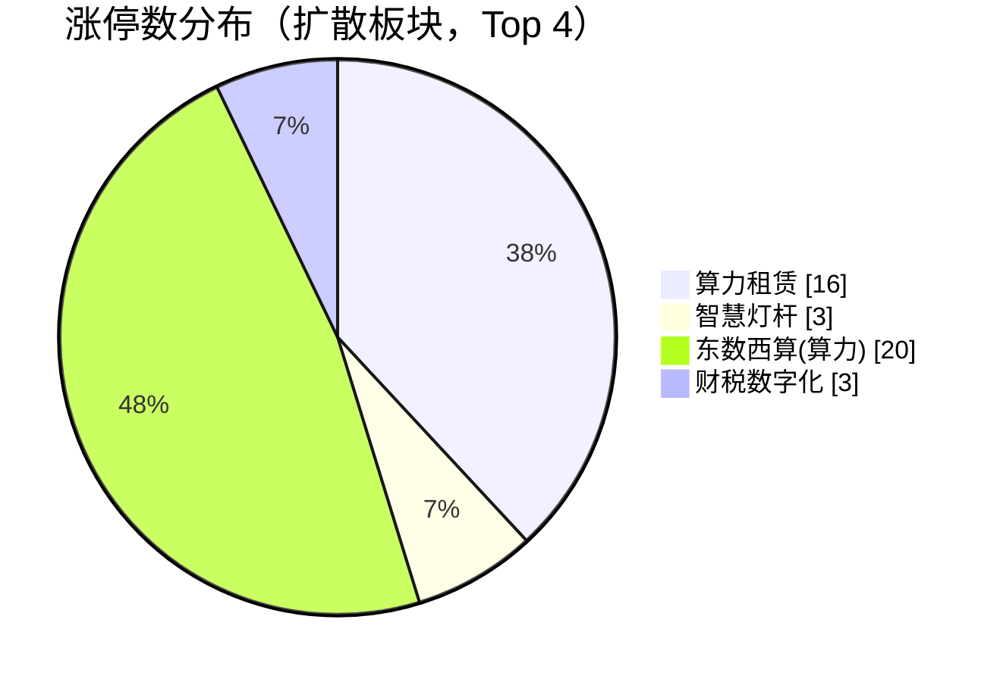
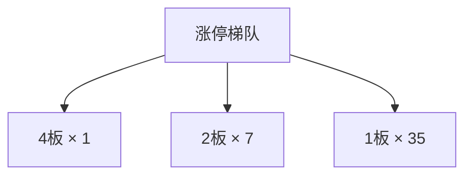
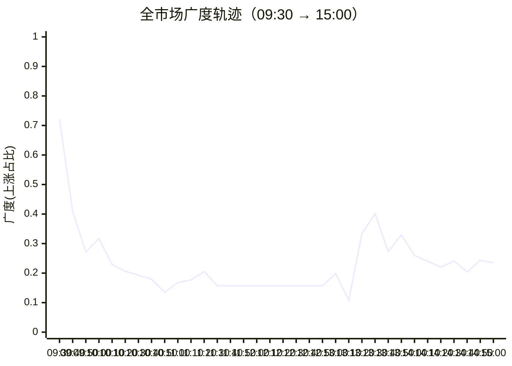

## 当日总览（截至 15:00）

> **结论**：全市场涨1318/跌4138（广度0.24）；涨停43/跌停44；中位涨幅-1.19%；弱势分化。 钱在：算力租赁(涨停16/成分188，中位+1.60%)、智慧灯杆(涨停3/成分62，中位-0.92%)、东数西算(算力)(涨停20/成分417，中位+0.45%)；零星涨停：算力主题精选(2)、云游戏(2)、共享单车(1)、托育服务(1)、C2M概念(2)。 退潮：文化传媒概念(跌停11)、AI应用(跌停10)、短剧游戏(跌停9)。 梯队：4板×1、2板×7、1板×35，最高4板。 预案：超买区 华胜天成、盛剑科技、华东重机；未到价 西陇科学。 较上一轮广度基本持平。

> 🔒 **no_trade / 买入预算 0 / max_position_pct 0 —— 全部内容仅供研究，不授予交易权限。**

### 板块扩散

> 口径：XTick 概念成分 × 全市场实时报价；分母 = 板块内有有效报价的成分数。排序用涨停密度（涨停数/有效成分数），已剔除宽基属性板块（全市场 432 个板块中剔 16 个）。

**扩散中（题材，按涨停密度排序）**

| 板块 | 涨停 | 有效成分 | 涨停密度 | 上涨广度 | 中位涨幅 | 相对全市场 | 成交(亿) |
|---|---|---|---|---|---|---|---|
| 算力主题精选 ⬦ | 2 | 15 | 0.133 | 0.87 | +1.85% | +3.04% | 240 |
| 算力租赁 | 16 | 188 | 0.085 | 0.68 | +1.60% | +2.79% | 866 |
| 云游戏 ⬦ | 2 | 27 | 0.074 | 0.33 | -1.70% | -0.51% | 167 |
| 共享单车 ⬦ | 1 | 14 | 0.071 | 0.21 | -1.62% | -0.43% | 17 |
| 托育服务 ⬦ | 1 | 15 | 0.067 | 0.40 | -0.30% | +0.89% | 52 |
| C2M概念 ⬦ | 2 | 39 | 0.051 | 0.31 | -1.09% | +0.10% | 57 |
| 智慧灯杆 | 3 | 62 | 0.048 | 0.34 | -0.92% | +0.27% | 115 |
| 东数西算(算力) | 20 | 417 | 0.048 | 0.58 | +0.45% | +1.64% | 2,153 |
| 举牌 ⬦ | 1 | 21 | 0.048 | 0.48 | -0.11% | +1.08% | 30 |
| 财税数字化 | 3 | 66 | 0.045 | 0.41 | -0.40% | +0.79% | 154 |
| 互联网保险 ⬦ | 1 | 22 | 0.045 | 0.32 | -0.47% | +0.72% | 95 |
| 华为数字能源 ⬦ | 2 | 46 | 0.043 | 0.48 | +0.00% | +1.19% | 154 |

> ⬦ = 涨停 <3 只，零星个例，不构成扩散（不计入「钱在」判定）。



零星涨停板块（<3 只）：算力主题精选(2)、云游戏(2)、共享单车(1)、托育服务(1)、C2M概念(2)、举牌(1)、互联网保险(1)、华为数字能源(2)

**退潮中（跌停集中）**

| 板块 | 跌停 | 有效成分 | 上涨广度 | 中位涨幅 |
|---|---|---|---|---|
| 文化传媒概念 | 11 | 197 | 0.16 | -2.15% |
| AI应用 | 10 | 551 | 0.27 | -1.11% |
| 短剧游戏 | 9 | 99 | 0.13 | -2.48% |
| 虚拟现实 | 9 | 287 | 0.26 | -1.49% |
| IP经济(谷子经济) | 8 | 198 | 0.11 | -2.07% |
| 乡村振兴 | 8 | 440 | 0.21 | -1.26% |
| 创投 | 8 | 460 | 0.30 | -0.84% |
| AIGC概念 | 7 | 298 | 0.27 | -1.35% |
| 一带一路 | 7 | 797 | 0.27 | -0.90% |
| 新零售 | 6 | 323 | 0.12 | -1.73% |
| 电子商务 | 6 | 676 | 0.17 | -1.50% |
| 新型城镇化 | 6 | 221 | 0.27 | -0.93% |

### 涨停梯队

> 最高 4 板 ｜ 涨停 43 ｜ 跌停 44 ｜ 炸板 24 ｜ 封板率 64.2% ｜ 打板成功率 21.62% ｜ 一进二 22.58% ｜ 二进三 0.00%

| 身位 | 家数 | 成员（涨幅/封单亿/首封） |
|---|---|---|
| 4板 | 1 | 华东重机 +10.00%/0.053亿/09:25 |
| 2板 | 7 | 华胜天成 +10.01%/0.028亿/09:55；真视通 +10.02%/0.011亿/09:30；全筑股份 +9.79%/0.009亿/09:25；盛剑科技 +9.99%/0.005亿/09:25；泰嘉股份 +10.03%/0.005亿/13:27 |
| 1板 | 35 | 利通电子 +10.00%/0.024亿/11:26；四川长虹 +10.08%/0.021亿/09:35；深南电路 +10.00%/0.019亿/13:19；上证环保 +10.00%/0.016亿/10:02；润建股份 +10.01%/0.013亿/11:14 |



炸板 24 只（前几）：安泰集团(5次)、龙江交通(4次)、联合化学(4次)、德豪润达(3次)、小熊电器(2次)

### 预案池对照

| 票 | 池 | 板块 | 现价 | 涨幅 | 触发价 | 买区 | 风险位 | 判定 |
|---|---|---|---|---|---|---|---|---|
| 华胜天成 `600410.SH` | 观察池 | — | 16.82 | +10.01% | 15.32 | [15.24, 15.55] | 14.77 | **超买区** |
| 盛剑科技 `603324.SH` | 观察池 | — | 22.9 | +9.99% | 21.83 | [21.72, 22.16] | 21.05 | **超买区** |
| 华东重机 `002685.SZ` | 观察池 | — | 7.37 | +10.00% | — | [6.67, 6.8] | 6.46 | **超买区** |
| 科华数据 `002335.SZ` | 观察池 | — | 24.12 | +3.70% | — | — | — | **无预案价** |
| 金盾股份 `300411.SZ` | 观察池 | — | 8.41 | -2.89% | — | — | — | **无预案价** |
| 中再资环 `600217.SH` | 观察池 | — | 2.8 | +0.00% | — | — | — | **无预案价** |
| 西陇科学 `002584.SZ` | 观察池 | — | 7.83 | -1.01% | 8.02 | [7.98, 8.14] | 7.73 | **未到价** |

- **华胜天成** — 现价16.82 已高于买区上沿15.55，不追高；仅价格位置对照，不代表完整入场条件确认；不能据此确认站稳，不授予下单权限
- **盛剑科技** — 现价22.9 已高于买区上沿22.16，不追高；仅价格位置对照，不代表完整入场条件确认；不能据此确认站稳，不授予下单权限
- **华东重机** — 现价7.37 已高于买区上沿6.8，不追高；仅价格位置对照，不代表完整入场条件确认；不能据此确认站稳，不授予下单权限

> ⚠ D1 明确 no_trade=true、买入预算 0、个股 max_position_pct=0。以上为研究对照，**不构成任何买入许可**。

### 盘面 vs 静态复盘 vs 消息面

| 维度 | 对象 | T-1 静态基线 | 今日盘面 | 关系 |
|---|---|---|---|---|
| 板块主线 | 国产算力（GPU/系统） | R2 次线 score=73 涨停None（T-1 口径） | 盘面未见该板块成分票涨停 | **背离** |
| 板块主线 | 半导体材料/制造 | R2 次线 score=76 涨停None（T-1 口径） | 盘面未见该板块成分票涨停 | **背离** |
| 板块主线 | 家电/消费 | R2 次线 score=60 涨停None（T-1 口径） | 盘面未见该板块成分票涨停 | **背离** |
| 板块主线 | 机器人/名字梗 | R2 次线 score=None 涨停None（T-1 口径） | 盘面未见该板块成分票涨停 | **背离** |
| 板块主线 | 回收/固废政策 | R2 次线 score=None 涨停None（T-1 口径） | 盘面未见该板块成分票涨停 | **背离** |
| 板块主线 | CPO/海外算力硬件 | R2 次线 score=56 涨停None（T-1 口径） | 盘面未见该板块成分票涨停 | **背离** |
| 梯队结构 | 最高4板 | T-1 最高梯队 4 板、首板 29、炸板率 39.06% | 今日 4板×1、2板×7、1板×35；封板率0.6418 炸板24只 | **印证** |
| 预案验证 | 华胜天成(600410.SH) | 预案 -／watch／触发价15.32／买区[15.24, 15.55] | 超买区：现价16.82 已高于买区上沿15.55，不追高；仅价格位置对照，不代表完整入场条件确认；不能据此确认站稳，不授予下单权限 | **背离** |
| 预案验证 | 盛剑科技(603324.SH) | 预案 -／watch／触发价21.83／买区[21.72, 22.16] | 超买区：现价22.9 已高于买区上沿22.16，不追高；仅价格位置对照，不代表完整入场条件确认；不能据此确认站稳，不授予下单权限 | **背离** |
| 预案验证 | 华东重机(002685.SZ) | 预案 -／watch／触发价None／买区[6.67, 6.8] | 超买区：现价7.37 已高于买区上沿6.8，不追高；仅价格位置对照，不代表完整入场条件确认；不能据此确认站稳，不授予下单权限 | **背离** |
| 预案验证 | 科华数据(002335.SZ) | 预案 -／watch／触发价None／买区None | 无预案价：预案未给有效入场触发价/完整买区（缺失、空规则或格式异常）；仅价格位置对照，不代表完整入场条件确认；不能据此确认站稳，不授予下单权限 | **无响应** |
| 预案验证 | 金盾股份(300411.SZ) | 预案 -／watch／触发价None／买区None | 无预案价：预案未给有效入场触发价/完整买区（缺失、空规则或格式异常）；仅价格位置对照，不代表完整入场条件确认；不能据此确认站稳，不授予下单权限 | **无响应** |
| 预案验证 | 中再资环(600217.SH) | 预案 -／watch／触发价None／买区None | 无预案价：预案未给有效入场触发价/完整买区（缺失、空规则或格式异常）；仅价格位置对照，不代表完整入场条件确认；不能据此确认站稳，不授予下单权限 | **无响应** |
| 预案验证 | 西陇科学(002584.SZ) | 预案 -／watch／触发价8.02／买区[7.98, 8.14] | 未到价：现价7.83，触发价8.02，还差2.43%；仅价格位置对照，不代表完整入场条件确认；不能据此确认站稳，不授予下单权限 | **无响应** |
| 消息面对照 | 盘面热点板块 | R4 消息面（T-1 口径） | 实时快讯中命中热点板块关键词 4 条 | **印证** |

**分歧点（不掩盖）：**
- 板块主线·国产算力（GPU/系统） → 背离：T-1 有辨识度但今日盘中无涨停响应，题材未获资金确认
- 板块主线·半导体材料/制造 → 背离：T-1 有辨识度但今日盘中无涨停响应，题材未获资金确认
- 板块主线·家电/消费 → 背离：T-1 有辨识度但今日盘中无涨停响应，题材未获资金确认
- 板块主线·机器人/名字梗 → 背离：T-1 有辨识度但今日盘中无涨停响应，题材未获资金确认
- 板块主线·回收/固废政策 → 背离：T-1 有辨识度但今日盘中无涨停响应，题材未获资金确认
- 板块主线·CPO/海外算力硬件 → 背离：T-1 有辨识度但今日盘中无涨停响应，题材未获资金确认
- 预案验证·华胜天成(600410.SH) → 背离：仅研究对照，不授予交易权限
- 预案验证·盛剑科技(603324.SH) → 背离：仅研究对照，不授予交易权限
- 预案验证·华东重机(002685.SZ) → 背离：仅研究对照，不授予交易权限

### 全天广度轨迹

| 时点 | 涨 | 跌 | 广度 | 涨停 | 跌停 | 成交(亿) | 有效样本 |
|---|---|---|---|---|---|---|---|
| 0930 | 4003 | 1185 | 0.721 | 11 | 10 | 364 | 5553 |
| 0940 | 2281 | 2941 | 0.409 | 19 | 17 | 2,107 | 5573 |
| 0950 | 1515 | 3825 | 0.272 | 25 | 18 | 3,131 | 5573 |
| 1000 | 1766 | 3514 | 0.317 | 29 | 23 | 4,116 | 5573 |
| 1010 | 1278 | 4116 | 0.229 | 30 | 24 | 4,832 | 5573 |
| 1020 | 1146 | 4272 | 0.206 | 33 | 25 | 5,390 | 5573 |
| 1030 | 1076 | 4362 | 0.193 | 33 | 25 | 5,848 | 5573 |
| 1040 | 996 | 4447 | 0.179 | 33 | 25 | 6,255 | 5573 |
| 1050 | 750 | 4724 | 0.135 | 26 | 27 | 6,654 | 5573 |
| 1100 | 935 | 4522 | 0.168 | 30 | 25 | 7,038 | 5573 |
| 1110 | 986 | 4461 | 0.177 | 29 | 27 | 7,345 | 5573 |
| 1120 | 1144 | 4283 | 0.205 | 31 | 25 | 7,698 | 5573 |
| 1130 | 877 | 4578 | 0.157 | 34 | 28 | 7,990 | 5573 |
| 1140 | 877 | 4578 | 0.157 | 34 | 28 | 7,990 | 5573 |
| 1150 | 877 | 4578 | 0.157 | 34 | 28 | 7,990 | 5573 |
| 1200 | 877 | 4578 | 0.157 | 34 | 28 | 7,990 | 5573 |
| 1210 | 877 | 4578 | 0.157 | 34 | 28 | 7,990 | 5573 |
| 1220 | 877 | 4578 | 0.157 | 34 | 28 | 7,990 | 5573 |
| 1230 | 877 | 4578 | 0.157 | 34 | 28 | 7,990 | 5573 |
| 1240 | 877 | 4578 | 0.157 | 34 | 28 | 7,990 | 5573 |
| 1250 | 877 | 4578 | 0.157 | 34 | 28 | 7,990 | 5573 |
| 1300 | 954 | 3760 | 0.198 | 29 | 25 | 6,853 | 4819 |
| 1310 | 604 | 4886 | 0.108 | 29 | 41 | 8,582 | 5573 |
| 1320 | 1859 | 3516 | 0.334 | 38 | 30 | 9,306 | 5573 |
| 1330 | 2232 | 3135 | 0.401 | 44 | 27 | 9,930 | 5573 |
| 1340 | 1522 | 3889 | 0.273 | 42 | 33 | 10,566 | 5573 |
| 1350 | 1834 | 3571 | 0.329 | 46 | 29 | 10,934 | 5573 |
| 1400 | 1446 | 3975 | 0.260 | 45 | 33 | 11,341 | 5573 |
| 1410 | 1338 | 4086 | 0.240 | 44 | 35 | 11,707 | 5573 |
| 1420 | 1223 | 4186 | 0.220 | 42 | 40 | 11,999 | 5573 |
| 1430 | 1344 | 4105 | 0.241 | 42 | 40 | 12,268 | 5573 |
| 1440 | 1138 | 4337 | 0.204 | 42 | 51 | 12,613 | 5573 |
| 1450 | 1356 | 4075 | 0.243 | 44 | 49 | 13,125 | 5573 |
| 1500 | 795 | 2524 | 0.235 | 33 | 30 | 8,516 | 3388 |

> ⚠ **数据冻结段**：1130–1250 数值连续完全一致，说明行情源未刷新，**不是市场横盘**，该段不可解读为盘面变化。

> ⚠ **分母变化**：1310（4819→5573）、1500（5573→3388） 有效样本变动超 15%，该时点广度与前后不可直接比较（数据降级）。



### 观察建议（仅研究）

- **环境**：跌停 44 > 涨停 43，炸板 24.0，打板成功率 21.6%，一进二 22.6%。情绪处于**退潮/弱势**区间，右侧信号稀缺，不宜按主升期打法出手。
- **方向**：今日形成实质扩散的是 算力租赁（涨停16/成分188，密度0.085，中位+1.60%）、智慧灯杆（涨停3/成分62，密度0.048，中位-0.92%）、东数西算(算力)（涨停20/成分417，密度0.048，中位+0.45%）。**需确认**：次日能否维持涨停家数且中位涨幅不掉队，否则只是普跌中的避险轮动。
- **零星**：算力主题精选(2只/15成分)、云游戏(2只/27成分)、共享单车(1只/14成分)、托育服务(1只/15成分)、C2M概念(2只/39成分) 属零星个例，不视为题材，不据此选股。
- **回避**：文化传媒概念（跌停11）、AI应用（跌停10）、短剧游戏（跌停9） 板块中位跌幅深，趋势未止跌前不接。
- **身位**：最高 4 板。梯队有高度不等于可接力，需逐票核验封单稳定性与开板次数后再定。
- **预案**：华胜天成（现价16.82 已高于买区上沿15.55，不追高；仅价格位置对照，不代表完整入场条件确认；不能据此确认站稳，不授予下单权限）、盛剑科技（现价22.9 已高于买区上沿22.16，不追高；仅价格位置对照，不代表完整入场条件确认；不能据此确认站稳，不授予下单权限）、华东重机（现价7.37 已高于买区上沿6.8，不追高；仅价格位置对照，不代表完整入场条件确认；不能据此确认站稳，不授予下单权限）。买区已错过，**不追高**；要参与需等新剧本，不能沿用原预案价位。
- **预案待检验**：西陇科学(触发价8.02，还差+2.43%) 尚未触及触发价，剧本未被盘面检验，继续按原失效条件看。

<details>
<summary>原始截面与数据质量（折叠）</summary>

**跨源校验**

```json
{
  "xtick": {
    "up": 1318,
    "down": 4138,
    "n": 5617,
    "amount_yi": 13695.6
  },
  "rtk_snapshot": {
    "up": 795,
    "down": 2524,
    "valid_n": 3388,
    "amount_yi": 8516.1,
    "up_limit": 33,
    "down_limit": 30
  },
  "note": "两源口径不同（XTick 全市场含全部票；rt_k 返回样本）"
}
```

**rt_k 截面（原始）**

```json
{
  "market": {
    "total": 5585,
    "up": 795,
    "down": 2524,
    "flat": 69,
    "requested_n": 5585,
    "received_n": 5585,
    "valid_n": 3388,
    "missing_n": 2197,
    "universe_requested_n": null,
    "population_scope": "returned_rows_not_verified_all_a_universe",
    "up_ratio": 0.1423,
    "legacy_up_ratio_placeholder": false,
    "up_ratio_is_observed": true,
    "up_ratio_all": 0.1423,
    "up_ratio_valid": 0.2347,
    "up_ratio_denominator": "requested_n",
    "degraded": true,
    "limit_known_n": 3388,
    "limit_unknown_n": 0,
    "limit_counts_complete": true,
    "limit_source_errors": [],
    "up_gt3": 194,
    "up_gt5": 106,
    "up_limit": 33,
    "down_gt3": 525,
    "down_gt5": 170,
    "down_limit": 30,
    "amount_yi": 8516.1,
    "amount_sum_overflow": false,
    "amount_valid_n": 3388,
    "amount_missing_n": 0
  },
  "source_time_quality": {
    "quote_age_min_seconds": 18.008908,
    "quote_age_max_seconds": 18.008908,
    "source_age_limit_seconds": null,
    "freshness_status": "age_limit_not_configured",
    "age_reference_at": "2026-11-18T15:00:18.008908+08:00"
  },
  "trading_authorized": false
}
```

</details>

## 分时研判记录

### 09:35 研判增量
- **趋势**：09:30 是今日首份截面（rt_k 报价 09:30:03–09:30:22），广度、涨停数、梯队、板块排名和预案判定均无日内前值。总览的“广度走弱 -0.08”是同轮跨源比较，不是盘中回落。rt_k 有效返回样本上涨 4003/5553（72.09%），说明开盘多数股票上涨；但华东重机领到 4 板只延续了昨收梯队高度，且昨涨停股整体红盘率缺失，尚不能确认接力修复。
- **轮动**：光刻胶的涨停集中在前排：3/80 涨停、43/80 上涨，中位涨幅落后市场 0.18 个百分点；光刻机仅 1/52 涨停，不能从胶扩展到整个半导体材料方向。盘中快讯主要重复报道西陇科学、盛剑科技晋级，只印证价格表现，不是新增催化。热榜表外的创投有 5/460 涨停，但中位仅与市场持平；传媒仅 33/131 上涨，短剧游戏仅 32/99 上涨。开盘已见强弱分化，未见资金从传媒流向光刻或切往算力的证据。
- **剧本**：华胜天成虽越过 15.32，却已在原买区上沿 15.55 之外，单点越线既不确认回踩承接，也不反证预案列明的行业风险；华东重机的 4 板不符合“只做首板隔日”模板。盛剑科技虽越过 21.83，也已超过 22.16；晋级没有消除原有低换手和应收顾虑，不替补西陇科学，后者的硬否决不随价格解除。科华数据、金盾股份和中再资环均无预案价：科华的增持计划不是已买入，金盾认缴不是 GPU 收入，中再资环须等回收板块出现独立助攻，三者均不因光刻转弱自动接棒。
- **下一步看**：先核报价刷新，再用同源共同有效样本复算广度，并补昨涨停股红盘率。光刻胶须保持至少 3 只涨停、上涨占比超过本轮 43/80，且中位涨幅不再落后市场，才支持前排向成分扩散；跌破 3 只则降为零星强势。华胜天成只核分钟路径能否在 15.32–15.55 内承接，盛剑科技同样只核 21.83–22.16，不以回到旧价区自动重启预案。`no_trade=true`、买入预算 0、`max_position_pct=0` 不变；仅供研究，不构成买入许可。

### 09:45 研判增量
- **趋势**：09:30→09:40 从普涨转为少数首板走强、整体转弱。XTick 两轮返回均为 5,585 只，上涨占比 64.48%→41.32%；rt_k 有效样本也同向回落（72.09%→40.93%，有效分母 5,553→5,573）。XTick 涨停净增 7 只，但首板增 9 只、二板少 2 只，跌停也增 7 只，炸板从 0 到 5。华东重机仍是唯一 4 板，未见开板记录，但截面封单额从 0.118 亿降至 0.097 亿；高度没掉，不代表接力修复。
- **轮动**：在概念全表按涨停密度排序，家用电器从第 31 升到第 13；同名申万行业也从 2/103 增至 5/103 涨停，上涨成分从 69/103 增至 79/103，四川长虹 09:35 上首板，与长虹美菱 3 板呼应。减速器也从无涨停到 3/140，上涨成分由 85/140 增至 102/140。反过来，光刻胶从第 5 降到第 16，涨停 3→2、上涨 43→25（同为 80 只）；文化传媒概念跌停 4→6（197 只）。家电是对昨复盘方向的局部印证，光刻未能延续开盘快讯报道的前排强势至更多成分；本轮快讯未命中热点关键词，尚不能确认新催化，也不能认定两边是同一批资金在做跷跷板。
- **剧本**：7 只预案票判定无迁移，仍是 4 只超原买区、3 只无预案价。光刻扩散跌破上轮观察门槛，盛剑科技虽维持 2 板、22.90 不变，却仍高于 21.83 触发价对应买区的 22.16 上沿；没有新增助攻支持它替补，西陇科学硬否决不变。华胜天成仅从 16.03 回到 16.02，仍高于 15.55，未见原买区承接证据；华东重机仍非首板隔日剧本。数据中心概念涨停从 1/664 到 4/664，但上涨成分减少，科华数据又从 23.60 回落至 23.40，算力备选缺独立承接；金盾股份、中再资环也不自动递补。
- **下一步看**：下一轮若同源上涨占比回升、且跌停从 17 只减少，再讨论市场修复；若仅首板继续增加，仍按分化看。家电看申万成分能否同时维持 5 只涨停和至少 79/103 上涨；光刻胶须先恢复 3 只涨停，再看上涨能否重回 43/80、板块中位不再落后市场。盛剑科技只有回到 21.83–22.16 并经分钟路径核实承接，才重评原观察剧本，回到价区不等于恢复资格。`no_trade=true`、买入预算 0、`max_position_pct=0` 不变；仅供研究，不构成买入许可。

### 09:55 研判增量
- **趋势**：09:40→09:50，涨停净增 6 只，却不是普遍修复。rt_k 同为 5,573 只有效报价，上涨占比从 40.93% 降到 27.18%，XTick 同向。新增净量来自首板 13→17、二板 4→6；跌停 17→18、炸板 5→7。华东重机仍是唯一 4 板，未见新增开板，但截面封单额由 0.097 亿降到 0.087 亿。低位接力增加，高度未抬升；昨涨停股整体红盘率仍缺，不能判定接力全面修复。
- **轮动**：家电有九阳股份 09:49 晋级二板，申万家电涨停 5→6，但上涨从 79/103 降到 75/103：延续昨复盘家电次线的是前排，不是成分继续扩散。净水按概念涨停密度从第 17 升到第 8、涨停 2→3，上涨却从 40/81 降到 30/81，同样只见前排集中。光刻胶从第 16 滑到第 54，涨停 2→1、上涨 25/80→15/80，昨复盘材料方向的延续预期进一步走弱。真正逆势扩大上涨面的反而是高股息（177/285→186/285），但仍只有 1 只涨停，偏防守而非新题材接力。快讯未命中新增催化，缺同窗净流量，不确认跷跷板。
- **剧本**：分析层分类仍为 4 只超原买区、3 只无预案价，但光刻前排已分化：西陇科学从二板转炸板，两源截面分别报 8.14 和 8.15，正贴原区间 7.98–8.14 上沿；高于 8.02 不代表站稳，硬否决不变。盛剑科技仍封二板、报 22.90，但封单额 0.015→0.008 亿，且超 22.16；它未证明能补位。华胜天成 16.02→16.29，离 15.32 的原突破位及 15.55 买区上沿更远，不追高。反向剧本也未确认：科华数据 23.40→23.29，数据中心仍有 4/664 涨停但上涨成分 351→282；金盾股份走强不能替代科华的独立承接。固废处理仍无涨停、上涨 87/156→59/156，中再资环不升级。
- **下一步看**：同口径上涨占比先回到 09:40 的 40.93%，且跌停低于本轮 18 只，再讨论修复；家电若保住 6 只涨停并恢复至少 79/103 上涨，才算从前排重新传到成分。光刻胶须恢复至少 3/80 涨停再重评；华胜天成只在分钟路径显示 15.32–15.55 有承接时复核原剧本，不下移或抬高买区。`no_trade=true`、买入预算 0、`max_position_pct=0` 不变；仅供研究，不构成买入许可。

### 10:05 研判增量
- **趋势**：09:50→10:00，上涨面开盘回落后首次回升，但跌停继续增加，属于局部修复。rt_k 同为 5,573 只有效报价，上涨占比 27.18%→31.69%（约 +4.5 个百分点），XTick 同向；涨停净增 4 只，跌停却净增 5 只、炸板增 1 只。最高仍是华东重机 4 板，截面封单额 0.087→0.082 亿；小熊电器本轮重回三板名单，二板 6→8，连板层变厚但高度未抬升。仍缺昨涨停股整体红盘率，不能确认接力普遍回暖。
- **轮动**：家用电器按涨停密度从第 14 升第 5，但涨停 6→9 的同时，上涨成分从 107/186 降到 98/186，依旧是前排集中；净水从第 8 升第 4，上涨仍是 30/81。新增红盘面更明显的是铜缆（23→33/49）和华为海思（20→35/52），但各仅 2 只涨停；光刻胶也只修到 2/80 涨停。文化传媒概念相反，跌停 5→7、上涨 39→34/197。家电部分印证昨复盘次线，家电和半导体快讯都在描述盘面，不是新增催化；没有同窗净流数据，不能确认传媒资金转进硬件。
- **剧本**：仍是 4 只超原买区、3 只无预案价，但华胜天成从 16.29 到 16.82，09:55 首封二板，增强了反包接力的证据；现价远离触发价 15.32 和买区上沿 15.55，站稳和行业风险反证仍未确认，不追高。盛剑科技维持 22.90，高于触发价 21.83 对应买区上沿 22.16，光刻胶未恢复扩散，不递补；西陇科学 8.15→8.23，仍在炸板名单，不能把回升当回封，硬否决不变。华东重机仍是高度观察，不是首板隔日剧本。科华数据反弹、金盾股份回落，算力备选未同步；中再资环虽微升，固废处理仅 1/156 涨停、上涨 59→53/156，反向剧本不升级。
- **下一步看**：广度回到 09:40 的 40.93%、跌停降至 18 只以下，再上调市场修复判断；家电若保住 9/186 涨停且上涨成分重新超过 107/186，才算从前排向成分扩散；铜缆若至少 3/49 涨停并守住 33/49 上涨，再上调为扩散观察。华胜只核分钟路径能否证明 15.32–15.55 内有承接，回到旧区间也不自动恢复资格。`no_trade=true`、买入预算 0、`max_position_pct=0` 不变；仅供研究，不构成买入许可。

### 10:15 研判增量
- **趋势**：10:00→10:10 的回暖没有延续。rt_k 同为 5,573 只有效报价，上涨占比 31.69%→22.93%（−8.76 个百分点），低于 09:50 的 27.18%；XTick 同向。XTick 涨停虽 29→30，炸板却 8→10，跌停仍 23 只（rt_k 23→24）。首板 18→20，二板仍 8，三板 2→1：小熊电器重回炸板名单，长虹美菱独留三板；华东重机仍是唯一四板。新增强势集中在低位，没带起接力，也没托住广度。
- **轮动**：家电概念的涨停密度第 5→第 10，涨停 9→7、上涨 98→74/186，昨复盘家电次线的早盘强势在退。数据中心密度第 133→第 85，涨停 5→8，但上涨反从 376→279/664；CPO 也从 3→2 只涨停、161→120/230 上涨。算力是少数前排走强，不是成分扩散。文化传媒概念上涨 34→21/197、跌停仍 7 只，继续弱于大盘。科创芯片 ETF 上涨的快讯只是行情回声，未核到新增催化；板块名称未匹配也不等于零涨停。缺同窗净流数据，不确认家电资金切到算力。
- **剧本**：7 只票的判定没变（4 只超原买区、3 只无预案价），但前排承接分化了。华胜天成维持二板、截面封单额 0.069→0.080 亿元，支持反包强于普通跟涨；16.82 仍高于触发价 15.32 对应买区 15.24–15.55，既不能追高，也不能靠两帧报价确认站稳或解除行业事件限制。光刻胶涨停 2→1/80：盛剑科技仍在 22.90，超过 21.83 触发价对应买区 21.72–22.16，未获成分助攻，不递补。西陇科学 8.23→8.15，贴近原区间上沿 8.14，仍在炸板名单，硬否决不变。科华数据 23.69→23.60，虽有数据中心前排加板，却未验证独立承接；金盾回到平盘，中再资环持平且固废仅 1/156 涨停，两个备选方向均未触发。华东重机只作高度观察。
- **下一步看**：同口径上涨占比至少收回 10:00 的 31.69%，且 rt_k 跌停低于本轮 24 只，才重评修复；数据中心若能守住 8/664 涨停并把上涨成分拉回 376/664，才从前排强升为板块扩散观察。光刻胶先看能否恢复 3/80 涨停；华胜仅在分钟路径证实 15.32–15.55 有承接时复核原剧本，回到价区不自动恢复资格。`no_trade=true`、买入预算 0、`max_position_pct=0`；仅供研究，不构成买入许可。

### 10:25 研判增量
- **趋势**：10:10→10:20，涨停净增 3 只，但上涨面再创早盘截面新低。rt_k 两轮均为 5,573 只有效报价，上涨占比 22.93%→20.56%，跌停 24→25；XTick 同向。增量是首板 +2、二板 +1（卡莱特 10:15 首封二板）；炸板仍 10 只，华东重机仍是唯一 4 板。低位接力增加，但没带动市场修复；昨涨停股整体红盘率仍缺。
- **轮动**：时空大数据维持密度榜第 6、3 只涨停，上涨 22→27/71、跌停 1→0，是这一轮少数上涨面在扩大的方向。节能照明第 79→第 7、涨停 1→3，上涨反从 23→15/78，不能把排名跃升当普涨。昨复盘家电次线的概念涨停仍是 7 只，上涨却从 74→62/186；算力内部也分化，算力租赁涨停 5→6、上涨 93→95/188，数据中心涨停 8→10、上涨反降至 247/664。快讯未匹配新增催化，缺同窗净流向，不确认家电向算力切换。
- **剧本**：7 只票判定未迁移，仍是 4 只超原买区、3 只无预案价。光刻胶上涨 30→14/80、仍仅 1 只涨停，盛剑科技虽封二板，22.90 已超出 21.83 触发价对应买区的 22.16 上沿，第二前排补位剧本更弱，不追高；西陇科学的硬否决不变。科华数据小升至 23.62，金盾股份由平盘转跌，算力备选仍不同步；固废处理上涨 51→45/156、仍仅 1 只涨停，中再资环的反向剧本也不升级。
- **下一步看**：同口径广度先收回 22.93%，且 rt_k 跌停降回 24 只或更少，再讨论止跌；时空大数据须守住 3/71 涨停且上涨超过本轮 27/71，才算继续扩散。光刻胶先恢复 3/80 涨停；即便盛剑回到 21.83–22.16，也要用分钟路径核承接，不能自动恢复原剧本。`no_trade=true`、买入预算 0、`max_position_pct=0`，仅供研究，不构成买入许可。

### 10:35 研判增量
- **趋势**：10:20→10:30，涨停没少，但上涨面继续缩。rt_k 同为 5,573 只有效报价，上涨占比从 20.56% 降至 19.31%，跌停仍为 25 只；XTick 同向，涨停仍为 33 只。首板 22→23、二板 9→8，炸板 10→11，华东重机仍是唯一四板。相比 10:00 的短暂反弹，这是上涨面连续第三轮收缩；总览的「局部修复」不能外推为接力回暖。本轮 rt_k 报价时标为 10:28:54–10:30:22。
- **轮动**：上一轮走宽的时空大数据，本轮 3/71 涨停不变，上涨却由 27 降到 24 只，并新增 1 只跌停；热榜第 6→第 7 是横琴新区插入所致，不是自身涨停密度下降。横琴涨停 1→2、上涨 12→14/38，但中位涨幅反降；算力租赁维持 6/188 涨停、上涨仅 95→96/188，数据中心则停在 10/664 涨停、247/664 上涨。昨复盘的家电次线仍有局部承接：申万家电上涨 53→55/103，概念池却从 62 降到 61/186。未见同一板块同时新增涨停、扩大上涨面并达到至少 3 只涨停；快讯未核实板块催化，也缺同窗净流向，不确认跷跷板。
- **剧本**：7 只观察票里唯一判定迁移的是西陇科学：8.15→8.13，由「超买区」变为价格触发，原因是回落进入原区间 7.98–8.14，且仍高于 8.02；不是向上突破。它仍列炸板，分钟承接未确认，预案硬否决不变。光刻胶仍只有 1/80 涨停，盛剑科技没有新增补位证据；固废处理上涨 45→37/156，中再资环即使价格持平，也未获得反向剧本所需的板块助攻。
- **下一步看**：用同口径截面核对 rt_k 上涨占比能否收回 10:10 的 22.93%，且跌停回到 24 只或更少；若只增加首板、不恢复二板与广度，不上调修复判断。时空大数据须守住 3/71 涨停、上涨至少回到 27/71，再讨论重启扩散；横琴须先到 3/38，且上涨超过 14/38。西陇仅记录分钟路径是否守住 8.02、是否仍在 8.14 以内，不解除硬否决。`no_trade=true`、买入预算 0、`max_position_pct=0`；仅供研究，不构成买入许可。

### 10:45 研判增量
- **趋势**：10:30→10:40，上涨面连续第四轮收缩，这次首板也开始净减少，不是修复。rt_k 同为 5,573 只有效报价，上涨占比 19.31%→17.87%，跌超 3% 的股票 551→699 只；涨跌停仍是 33/25。XTick 同向走弱，涨停 33→32、少的净量在首板，炸板 11→12，跌停仍 24；二板仍 8 只，华东重机仍是唯一四板，未见新增开板记录。rt_k 本轮报价时标 10:39:00–10:40:22；昨涨停股整体红盘率仍缺。
- **轮动**：净水升至概念热榜第 10，仍是 3/81 涨停、上涨 20→23/81，但板块中位跌幅反从 −0.62% 扩至 −0.98%；时空大数据第 7→第 6，仍是 3/71 涨停、上涨反少 1 只，排名上移有横琴退出的因素（横琴 2→0/38 涨停）。节能照明也从 3→2/78，掉出扩散门槛。本轮留存的 10:40 新浪快讯称算力概念盘中累计净流入 28.38 亿元，给昨复盘算力次线提供资金线索；但东数西算、数据中心各仍是 10 只涨停，上涨分别从 194→174/417、247→223/664。资金快讯与成分广度未共振，不算新增产业催化，也不能认定资金从传媒或家电切到算力。
- **剧本**：西陇科学是唯一判定变化：8.13→8.17，从「价格已触发」变回「超买区」，再次越过原区间上沿 8.14。仍列炸板，不能把回升当回封；硬否决不变。盛剑科技不因西陇走高而递补：光刻胶仍仅 1/80 涨停，光刻机上涨 19→15/52，它本身也仍在原买区外。算力快讯没验证科华数据的独立承接：23.56→23.47，且无预案价；固废上涨 37→42/156 但仍仅 1 只涨停，中再资环的反向剧本暂不升级。
- **下一步看**：rt_k 上涨占比先收回 10:30 的 19.31%，同时跌超 3% 的股票回到 551 只或更少，才讨论止跌；算力若守住现有涨停数、且东数西算与数据中心分别恢复至少 194/417、247/664 上涨，才重评板块扩散。西陇只记录分钟路径是否回到 7.98–8.14、能否守住 8.02；即便满足，仍不解除硬否决、不追高。`no_trade=true`、买入预算 0、`max_position_pct=0` 不变；仅供研究，不构成买入许可。

### 10:55 研判增量
- **趋势**：10:40→10:50，退潮加速：不只是上涨面继续收缩，首板和二板也一起减少。rt_k 两轮均为 5,573 只有效报价，上涨占比 17.87%→13.46%，跌超 3% 的个股 699→1,093 只，涨停/跌停从 33/25 变为 26/27。XTick 同向：涨停 32→27、炸板 12→17，首板 22→18、二板 8→7；北纬科技从首板名单转入炸板名单。华东重机仍是唯一四板，长虹美菱仍是唯一三板，顶部高度延续，但接力变薄。rt_k 本轮报价时标 10:49:24–10:50:19。
- **轮动**：未见可比概念板块同时增加涨停、扩大上涨面并达到 3 只涨停。时空大数据和净水各保住 3 只涨停、热榜各升 1 位，上涨反从 23→17/71、23→16/81；黑龙江自贸区从第 1 降至第 3，涨停 3→2/36。昨复盘的算力、家电次线都未接住：东数西算涨停 10→9、上涨 174→129/417；家电仍 6/186 涨停，但上涨 63→48/186。上一轮算力净流入快讯未得到本轮成分扩散印证，本轮快讯也未提供新增催化；没有同窗资金流证据，不确认跷跷板。
- **剧本**：唯一判定迁移是西陇科学，8.17→8.14，回到原买区 7.98–8.14 上沿且仍高于触发价 8.02。属于回落后价格满足条件，不是向上突破；仍列炸板，未确认回封或站稳，盘前硬否决不变。光刻胶上涨 16→12/80、仍仅 1 只涨停，盛剑科技仍在原买区上沿 22.16 之上，不递补、不追高。科华数据 23.47→23.40，中再资环 2.83→2.82、固废上涨 42→24/156；两只均无预案价，独立承接或板块助攻未获验证，反向剧本不升级。
- **下一步看**：同口径上涨占比先收回 10:40 的 17.87%，跌停回到 25 只或更少，并看 XTick 炸板能否回落至 12 只或更少；只增涨停、不修广度，不判修复。时空大数据须保住 3/71 涨停、上涨恢复到至少 23/71，才重评扩散。西陇仅记录分钟路径能否守住 8.02、是否仍在 8.14 以内，不解除硬否决。`no_trade=true`、买入预算 0、`max_position_pct=0`；仅供研究，不构成买入许可。

### 11:05 研判增量
- **趋势**：10:50→11:00，连续收缩后的第一轮反弹，靠的是首板，不是连板接力转强。rt_k 同为 5,573 只有效报价，上涨占比 13.46%→16.78%（+3.32 个百分点），跌超 3% 的个股 1,093→771 只，涨停／跌停 26／27→30／25。XTick 同向：涨停 27→30 的净增量全在首板，炸板 17→15，二板仍 7 只，华东重机仍是唯一四板。广度尚低于 10:40 的 17.87%，先看反弹能否延续。rt_k 报价时标 10:59:21–11:00:22。
- **轮动**：通信和算力链的修复更扎实：申万通信涨停 2→3、上涨 52→73/128；东数西算和数据中心各从 9→10 只涨停，上涨分别从 129→171/417、170→213/664。时空大数据热榜第 5→第 6，仍有 3/71 涨停、上涨 17→22/71，排名下降不等于成分转弱。昨复盘的算力次线获部分盘面印证；本轮利通电子的合规说明并非新增订单或需求证据。传媒上涨仅 8→10/197，仍有 7 只跌停；缺同窗净流向，不能认定资金从传媒切到算力。
- **剧本**：预案判定没有迁移，但西陇科学在大盘回暖时从 8.14 退到 8.08，虽仍在原买区 7.98–8.14、略高于 8.02 触发价，仍列炸板，无分钟证据支持站稳或回封，硬否决不变。光刻胶上涨 12→17/80，但仍只有 1 只涨停，盛剑科技仍高于原买区上沿 22.16，不递补、不追高。科华数据 23.40→23.54 与算力板块同向，不能验证预案要求的独立承接；它无预案价，增持计划也不等于已经增持。
- **下一步看**：同口径上涨占比至少收回 17.87%、rt_k 跌停不高于 25 只、XTick 炸板能否回到 12 只或以下；若又只增首板、二板仍停在 7 只，不上调接力判断。算力两组先守各 10 只涨停，再看上涨成分能否分别回到 10:40 的 174/417、223/664。西陇若下一截面低于 8.02，则连价格触发也不再满足。`no_trade=true`、买入预算 0、`max_position_pct=0`；仅供研究，不构成买入许可。

### 11:15 研判增量
- **趋势**：11:00→11:10，反弹延续，但接力转弱。rt_k 同为 5,573 只有效报价，上涨占比 16.78%→17.69%，仍未收回 10:40 的 17.87%；涨停／跌停反从 30／25 变为 29／27。XTick 涨停 30→28、炸板 15→18，首板 21→20、二板 7→6；九阳股份由二板转入炸板名单，最高仍是华东重机独占四板。T−1 的四板高度得到印证，但没有传导到低位接力。rt_k 本轮报价时标 11:09:03–11:10:22。
- **轮动**：科技内部出现分化。百度概念新进涨停密度热榜第 10，涨停 7→8、上涨 61→65/232，但中位仍跌 1.10%；算力租赁稳在 6/188 涨停、上涨 89→96/188，中位由 −0.11% 翻到 +0.21%，部分印证昨复盘的算力次线。相比之下，通信上涨 73→81/128，涨停却 3→2；时空大数据第 6→第 4，但仍是 3/71 涨停、22/71 上涨，名次上升不等于扩散。黑龙江自贸区涨停 2→1/36、跌出前 12；传媒仍有 7/197 跌停。本轮快讯未核到对应新催化，也缺同窗净流向，不能认定资金从退潮板块切入科技。
- **剧本**：西陇科学是唯一判定迁移：8.08→8.00，仍在原买区 7.98–8.14，却退回 8.02 触发价下方，「价格已触发」不再成立；无分钟承接证据，盘前硬否决不变。盛剑科技不递补：22.90 仍高于原买区上沿 22.16，光刻胶上涨 17→16/80、仍只 1 只涨停。科华数据 23.54→23.63，与算力租赁回暖同向，仍无预案价，也未验证独立承接。
- **下一步看**：rt_k 上涨占比收回 17.87%、跌停回到 25 只或以下，同时看 XTick 二板能否回到至少 7 只、炸板降回 15 只或以下；若只修广度，仍不判接力回暖。算力租赁看能否守住 6/188 涨停且上涨成分不低于 96/188；西陇只复核分钟路径能否收回 8.02 且留在原价区，即使满足也不解除硬否决。`no_trade=true`、买入预算 0、`max_position_pct=0`；仅供研究，不构成买入许可。

### 11:25 研判增量
- **趋势**：11:10→11:20，广度修复加快，新增涨停仍靠首板，接力没跟上。rt_k 两轮均为 5,573 只有效报价，上涨占比 17.69%→20.53%，涨停／跌停 29／27→31／25；XTick 涨停 28→31，净增全在首板（20→23），炸板反增 18→19，二板仍 6 只。华东重机仍独占四板，印证昨复盘的高度，但未带动连板梯队拓宽。rt_k 本轮报价时标 11:18:15–11:20:22。
- **轮动**：算力租赁从涨停密度热榜前 12 外升至第 4，涨停 6→10、上涨 96→109/188；华为昇腾也由 2→4 只涨停、上涨 49→54/105，两个概念有重叠，不加总。中贝通信、润建股份 11:14 首封，11:16–11:17 快讯是对已发生拉升的报道，不是新增产业催化；盘面部分印证昨复盘的算力次线，不能外推到整个国产 GPU 链。百度概念跌出前 12，但仍有 8/232 涨停、上涨 65→80/232，并未退潮；传媒概念仍有 7/197 跌停、上涨反由 13→17/197。强弱有别，但缺同窗净流向，不认定资金跷跷板。
- **剧本**：西陇科学是唯一判定迁移：8.00→8.04，重新越过 8.02，仍在原买区 7.98–8.14；仍列炸板，未确认站稳或回封，盘前硬否决不变。算力扩散给华胜天成的容量反包假设补上板块助攻，但其 16.82 未变，仍高于原买区上沿 15.55，不能把助攻当成新买点。科华数据仅 23.63→23.64，无预案价；题材走强未验证它的独立承接，也不把增持计划视作已增持。
- **下一步看**：下一有效截面若算力租赁守住 10/188 涨停、至少 109/188 上涨，且两只 11:14 首封股仍在涨停名单，才算本轮扩散延续；若上涨退回 96/188 或以下，不上调持续性。市场要在上涨占比守住 20.53%、rt_k 跌停不超过 25 只的同时，看到 XTick 二板回到至少 7 只、炸板降至 15 只或以下，才上调接力判断。西陇仅核已完成分钟能否守住 8.02 且不超 8.14；`no_trade=true`、买入预算 0、`max_position_pct=0`，仅供研究，不构成买入许可。

### 11:35 研判增量
- **趋势**：11:20→11:30，上午修复在午收前反转：涨停增加，但上涨面反而缩小。rt_k 两轮均为 5,573 只有效报价，上涨占比从 20.53% 降至 15.74%，低于 11:00 的 16.78%；涨停／跌停从 31／25 变为 34／28。XTick 涨停 31→33，净增全在首板（23→25），利通电子 11:26 首封；炸板仍 19 只、二板仍 6 只，华东重机仍独占四板。昨复盘的四板高度有印证，接力未变宽。rt_k 本轮报价时标为 11:29:46–11:30:13。
- **轮动**：算力租赁从涨停密度榜第 4 降到第 5，仍有 10/188 涨停，中贝通信、润建股份都留在涨停名单，但上涨从 109 降到 97/188，上一轮的扩散未能延续。华为昇腾仍有 4/105 涨停，上涨从 54 降到 46/105；数据中心从 14 降到 13/664 涨停，上涨从 261 降到 222/664。百度概念回到第 11，涨停 8→9/232，上涨却从 80 降到 60/232，不算接棒。盘面只部分印证昨复盘的算力次线，已收录的热点快讯仍主要是上一轮拉升报道，未验证新催化；缺同窗净流向，不判资金跷跷板。
- **剧本**：7 只观察票无判定迁移，但算力板块助攻减弱。华胜天成仍报 16.82，虽高于 15.32 触发价，却在原买区 15.24–15.55 之外；反包观察保留，不追高。科华数据 23.64→23.60，未验证独立承接，且无预案价，不启动算力备选剧本。西陇科学 8.04→8.05，两个截面都在 8.02 触发价之上、原买区 7.98–8.14 之内，但未证实分钟站稳或回封，硬否决不变；光刻胶仍仅 1/80 涨停，上涨从 17 降到 13/80，盛剑科技不递补。
- **下一步看**：午后首个已刷新的同口径截面，先看上涨占比能否收回 11:20 的 20.53%、rt_k 跌停能否回到 25 只或以下；若二板仍只有 6 只，即使首板再增，也不判接力修复。算力租赁须同时保住 10/188 涨停、收回 109/188 上涨；若回落至 96/188 或更少，则仍按局部强势观察。西陇仅核已完成分钟能否守住 8.02 且不超 8.14。`no_trade=true`、买入预算 0、`max_position_pct=0`；仅供研究，不构成买入许可。

### 13:05 研判增量
- **趋势**：13:00 午后首轮报价已更新，开盘有修复，接力没变强。12:50 沿用 11:30 午收数据，不算新一轮交易。与午收相比，XTick 同为 5,585 只返回样本，上涨 877→1,068 只（15.70%→19.12%），仍未收回 11:20 同源的 19.96%。涨停 33→34，净增全在首板；炸板 19→18、跌停仍 25，二板仍 6 只，华东重机仍独占四板。rt_k 有效报价由 5,573 缩到 4,819 只，其广度、涨跌停及成交额不作跨轮比较。
- **轮动**：修复最明显的是算力租赁和通信。算力租赁涨停仍为 10/188，上涨 97→110/188，收回上午回吐；密度榜第 5→第 6 是北交所概念以 2/29 涨停插到前排，不是算力转弱，也不算新主线接棒。通信涨停 4→5/128，上涨 74→87/128，涨停与广度同步改善。传媒仍弱，但跌停 7→6/131，是略有缓和，不是继续失血；没有同窗净流向，不能判资金跷跷板。盘面部分印证昨复盘的算力次线，已收录快讯未验证对应的新催化，也不能据此确认整个国产 GPU 链走强。
- **剧本**：唯一判定变化是西陇科学：XTick 8.05→7.99，仍在原买区 7.98–8.14，却跌回 8.02 触发价下方；本截面不再满足价格触发，无分钟承接确认，盘前硬否决不变。通信与算力回暖只给华胜天成容量反包假设补了板块助攻，16.82 仍超过原买区上沿 15.55，不追高。科华数据 23.60→23.80 与板块同向，无预案价，不能据此确认独立承接或增持已兑现。
- **下一步看**：下一有效截面用 XTick 同口径复核：上涨占比能否收回 11:20 的 19.96%，二板能否回到至少 7 只；若仍只是首板增多，不上调接力判断。算力租赁同时守住 10/188 涨停和至少 109/188 上涨，才算午后修复延续。西陇仅观察已完成分钟能否收复并守住 8.02、且不超 8.14；低于 7.98 则连原买区也离开。`no_trade=true`、买入预算 0、`max_position_pct=0`；仅供研究，不构成买入许可。

### 13:15 研判增量
- **趋势**：13:00→13:10，午后开盘的修复已被打回去，先退的是首板，不是连板高度。XTick 同为 5,585 只返回样本，上涨占比 19.12%→10.76%，涨停 34→29、跌停 25→39、炸板 18→23；涨停净减少全在首板（26→21），二板仍 6 只，华东重机仍独占四板，但截面封单额从 0.076 降到 0.074 亿元，没带动后排。rt_k 13:00 样本偏少，不直接比较；改对照同为 5,573 只有效报价的 11:30，广度 15.74%→10.84%、跌停 28→41，同向走弱。本轮 rt_k 报价时标 13:09:18–13:10:22。
- **轮动**：算力从午后领修复转为收缩，未见新题材接棒。算力租赁涨停密度第 6→第 9，涨停 10→7、上涨 110→83/188，中位涨幅 +0.52%→−0.43%；仍跑赢样本中位，但不再扩散。通信也由 5→3 只涨停、87→47/128 上涨；文化传媒概念跌停 7→11/197，上涨 16→4/197。时空大数据虽升至第 6，仍是 3/71 涨停，上涨却由 26 降至 15/71，并非接棒。昨复盘的算力次线只剩相对强度，本轮快讯未提供对应新催化；两边同弱，缺同窗净流向，不判跷跷板。
- **剧本**：7 只观察票判定均未变，但算力、回收两个备选离确认更远。科华数据 23.80→23.43，随算力回落，未证独立承接；中再资环 2.82→2.80，固废处理上涨 30→18/156、跌停 1→2，两票均无预案价，不递补。西陇科学 7.99→7.98，贴在原买区 7.98–8.14 下沿，仍低于触发价 8.02，尚未出区也未触发；无分钟确认，硬否决不变。华胜天成、盛剑科技、华东重机仍在各自原买区上沿之外，不追高。
- **下一步看**：用下一有效截面验证止跌：XTick 上涨占比先收回午收的 15.70%，跌停低于本轮 39 只、炸板低于 23 只；若只是四板继续封住或首板反弹，不算接力修复。算力租赁要同时收回 13:00 的 10/188 涨停和 110/188 上涨，才重评扩散。西陇低于 7.98 即离开原买区；即便收复 8.02，也仅核已完成分钟能否守住，不解除硬否决。`no_trade=true`、买入预算 0、`max_position_pct=0`；仅供研究，不构成买入许可。

### 13:25 研判增量
- **趋势**：13:10→13:20，午后急跌后出现广度反弹，但连板接力没有同步修复。rt_k 两轮均为 5,573 只有效报价，上涨占比 10.84%→33.36%，跌超 3% 的个股 1,657→412 只。XTick 涨停 29→39、跌停 39→30、炸板 23→20；涨停净增全是首板（21→31），二板仍 6 只，华东重机仍是唯一四板。快讯报道三大指数翻红，但仍只有约三分之一有效样本上涨，不能把指数翻红当成普涨。rt_k 本轮报价时标：13:19:21–13:20:22。
- **轮动**：算力租赁率先重新扩散：涨停密度榜第 9→第 4，涨停 7→13、上涨 83→137/188；通信行业也从 3→6 只涨停、47→107/128 上涨。润建股份、中贝通信重回首板名单且均有开板记录；深南电路、生益电子于 13:19 首封，说明回暖不只靠上午旧板。盘面部分印证昨复盘的算力次线，但指数翻红的快讯不是新增产业催化，也不能把通信行业的上涨等同于整个国产 GPU 链走强。传媒上涨 4→45/197、跌停 11→7，仍弱但并未继续恶化；缺同窗净流向，不判资金跷跷板。
- **剧本**：7 只观察票的判定均未变。西陇科学 7.98→8.01，离开原买区下沿但仍未到 8.02 触发价，硬否决不变。光刻胶涨停 1→2/80，尚未达到扩散门槛；盛剑科技仍高于原买区上沿 22.16，不递补。算力回暖给华胜天成的容量反包假设增加了板块助攻，但 16.82 仍高于原买区上沿 15.55，不追高。科华数据 23.43→24.08，暂只能确认随板块反弹；无预案价，也没有独立承接或增持已落实的证据，不启动备选剧本。
- **下一步看**：下一有效截面若 rt_k 上涨占比守住 33.36%、跌停不高于 30 只，同时 XTick 二板恢复到上午的至少 7 只，再上调接力判断；只增首板不算。算力租赁看能否同时维持 13/188 涨停、至少 137/188 上涨，并核对润建股份、中贝通信是否仍在涨停名单。西陇只核已完成分钟能否守住 8.02 且不超 8.14，即使满足也不解除硬否决。`no_trade=true`、买入预算 0、`max_position_pct=0`，仅供研究，不构成买入许可。

### 13:35 研判增量
- **趋势**：13:20→13:30，午后修复从首板扩散到少量接力，尚未抬高连板高度。rt_k 两轮均为 5,573 只有效报价，上涨占比 33.36%→40.05%，涨停 38→44、跌停 30→27；XTick 梯队净增 4 只首板和 1 只二板，泰嘉股份 13:27 首封晋级，二板恢复到 7 只，最高仍是华东重机独占四板，炸板仍 20 只。XTick 报价样本数有变，广度不跨轮比较；本轮 rt_k 报价时标 13:29:24–13:30:22。
- **轮动**：算力租赁涨停密度第 4→第 2，涨停 13→16、上涨 137→148/188；PCB 概念由 2→3 只涨停、159→176/241 上涨，沪电股份 13:30 首封，修复扩到硬件。文化传媒概念虽多了红盘（45→54/197），跌停仍 7 只；银行上涨 2→1/42，说明修复不均衡，但没有同窗净流向，不能认定资金跷跷板。盘面部分印证昨复盘的算力及硬件次线；13:29 源杰科技产能快讯晚于 13:20 已见的扩散，不能倒推为启动原因，也不能据此确认整个国产 GPU 链。
- **剧本**：7 只观察票判定未变。西陇科学 8.01→7.98，退回原买区下沿，低于 8.02 触发价；13:30 原始分析是「买区内」，不是总览所写的「已触发」，硬否决不变。光刻胶上涨 27→40/80，涨停仍只有 2 只，不能用板块回暖替代个股触发。算力进一步扩散支持华胜天成的板块助攻假设，但 16.82 仍高于原买区上沿 15.55，不追高；固废处理上涨 59→69/156，中再资环却 2.82→2.81，无预案价，反向剧本不升级。
- **下一步看**：下一有效截面看 rt_k 上涨占比能否守住 40.05%、跌停不高于 27 只，同时二板能否维持至少 7 只；若二板回落而首板继续增多，仍按局部修复看。算力租赁若跌回上一轮的 13/188 涨停以下，且上涨少于 137/188，视为本轮扩散回吐；PCB 概念看能否守住 3/241 涨停。西陇低于 7.98 即离开原买区，即使已完成分钟重新守住 8.02、且不超 8.14，也不解除硬否决。`no_trade=true`、买入预算 0、`max_position_pct=0`；仅供研究，不构成买入许可。

### 13:45 研判增量
- **趋势**：13:30→13:40，午后修复回吐，二板接力也没守住。rt_k 同为 5,573 只有效报价，上涨占比 40.05%→27.31%，低于 13:20 的 33.36%；涨停／跌停 44／27→42／33。XTick 同向转弱，炸板 20→24，二板 7→6、首板 35→34。华东重机仍独占四板，与昨复盘高度一致；长虹美菱虽仍在三板，开板记录从 0 增至 1，说明高度未变不等于接力稳定。rt_k 本轮采集 13:40:06–13:40:23，报价时标 13:38:21–13:40:22。
- **轮动**：算力留住了涨停数，但没留住上涨面。算力租赁密度榜仍第 2，涨停维持 16/188，上涨却从 148 降到 131/188，已低于 13:20；东数西算第 9→第 10，维持 20/417 涨停，上涨从 316 降到 265/417。PCB 由 3 降到 2/241 涨停，上涨从 176 降到 141/241，上一轮向硬件的扩散未延续；传媒概念跌停 7→9/197。算力仍有相对强度，部分印证昨复盘的算力次线，但午报只印证此前走强，本轮快讯未核到新催化；两边上涨面都在收缩，缺同窗净流向，不认定为资金跷跷板。
- **剧本**：西陇科学是 7 只观察票中唯一判定迁移：XTick 7.98→8.04，从买区下沿重新越过 8.02，仍在原买区 7.98–8.14；但光刻胶上涨从 40 降到 24/80、仍仅 2 只涨停，且无分钟站稳证据，只算价格触发，盘前合规硬否决不变。算力助攻减弱，华胜天成的容量反包继续观察，16.82 仍高于原买区上沿 15.55，不追高；其余观察票不递补。
- **下一步看**：下一有效截面先看 rt_k 上涨占比能否收回 33.36%、跌停回到 30 只或以下，同时核 XTick 二板能否回到 7 只、炸板降回 20 只或以下；只修广度不算接力修复。算力租赁须同时守住 16/188 涨停、收回至少 137/188 上涨，才重评扩散；PCB 要恢复至少 3/241 涨停才重回扩散观察。西陇仅核已完成分钟是否守住 8.02 且不超 8.14，低于 7.98 即离开原买区。`no_trade=true`、买入预算 0、`max_position_pct=0`；仅供研究，不构成任何买入许可。

### 13:55 研判增量
- **趋势**：13:40→13:50，首板带动二次修复，但高位接力反而断档。rt_k 两轮同为 5,573 只有效报价，上涨占比 27.31%→32.91%，仍低于 13:30 的 40.05%；涨停／跌停 42／33→46／29。XTick 首板 34→38、二板 6→7（泰嘉股份重新进入二板），炸板 24→22；华东重机仍独占四板，但长虹美菱再开板，从唯一三板落入炸板名单。四板高度与昨复盘一致，不等于梯队完整。rt_k 采集 13:50:06–13:50:23，报价时标 13:49:15–13:50:19。
- **轮动**：算力修复重新扩到硬件。算力租赁涨停密度仍第 2，涨停 16→17、上涨 131→143/188；东数西算第 10→第 8，涨停 20→21、上涨 265→287/417。PCB 回到扩散门槛以上（涨停 2→4、上涨 141→164/241），景旺电子 13:47 首封、沪电股份重回首板。传媒概念仍无涨停，但上涨 34→40/197、跌停 9→8，不是同步失血；缺同窗净流向，不判跷跷板。板块表现部分印证昨复盘的算力与硬件次线；新增算力快讯与行情同向，尚不能认定为启动催化，也不能外推到整个国产 GPU 链。
- **剧本**：7 只观察票无判定迁移。西陇科学 8.04→8.09，连续两轮高于触发价 8.02、仍在原买区 7.98–8.14；光刻胶上涨 24→32/80、涨停仍只有 2 只，个股越线并未得到板块扩散或分钟承接确认，盘前硬否决不变。算力回暖补强华胜天成反包剧本的板块助攻，但 16.82 仍高于原买区上沿 15.55，不追高；科华数据 24.04→24.25 暂只确认随板块反弹，无预案价，不递补，增持计划也不等于已实施。
- **下一步看**：同口径上涨占比先收复 33.36%、跌停维持不超过 29 只；若二板仍有至少 7 只、三板重新出现且炸板回到 20 只或以下，再上调接力判断。算力租赁看能否守住 17/188 涨停、143/188 上涨；PCB 若跌回不足 3/241 涨停，则本轮硬件扩散未延续。西陇仅核已完成分钟是否守住 8.02 且未越过 8.14，不解除硬否决。`no_trade=true`、买入预算 0、`max_position_pct=0`；仅供研究，不构成买入许可。

### 14:05 研判增量
- **趋势**：13:50→14:00，午后二次修复失守，算力仍相对抗跌，但没带动大盘。rt_k 同为 5,573 只有效报价，上涨占比 32.91%→25.95%，跌破 13:40 的 27.31%，涨停／跌停 46／29→45／33。XTick 确认首板净减 1 只、炸板 22→23，二板仍 7 只，长虹美菱未回三板，华东重机独占四板且两轮开板记录均为 0。高度延续，接力断档没有修复。本轮 rt_k 采集 14:00:06–14:00:25，报价时标 13:58:18–14:00:22。
- **轮动**：算力租赁密度仍第 2，但涨停 17→16、上涨 143→131/188；东数西算从第 8 退到第 10，上涨 287→265/417。PCB 虽守住 4/241 涨停，上涨已从 164 降到 143/241；英伟达概念密度升一位，上涨反而从 56 降到 48/81，都不是接棒。传媒跌停 8→9/197；银行虽从 1 增至 6/42 上涨，仍无涨停，缺同窗净流向，不能判跷跷板。昨复盘的算力次线仍获部分印证，但快讯新增的是算力 ETF 盘面报道，不是新增产业催化；光刻胶上涨 32→22/80、仍只有 2 只涨停，材料线本轮未获扩散印证。
- **剧本**：7 只观察票均无判定迁移。西陇科学 8.09→8.04，仍在原买区 7.98–8.14，却只比 8.02 触发价高 0.02 元；板块助攻减弱，价格触发不能当作站稳，原硬否决不变。华胜天成仍在 16.82，高于触发价 15.32 及原买区上沿 15.55；算力助攻回落，不升级反包剧本、不追高。科华数据 24.25→24.10，随板块转弱，未证实独立承接；无预案价，增持计划不视为已实施，不启动备选剧本。
- **下一步看**：下一有效截面先看 rt_k 上涨占比能否收回 13:50 的 32.91%、跌停是否回到 29 只或以下；三板仍空，不因首板回升就判接力修复。算力租赁须同时收回 17/188 涨停和 143/188 上涨；PCB 仅守住 4 只涨停而上涨未回到 164/241，仍只算前排支撑。西陇只看已完成分钟能否守住 8.02 且仍在原买区，跌回 8.02 下方即撤销价格触发。`no_trade=true`、买入预算 0、`max_position_pct=0`；仅供研究，不构成买入许可。

### 14:15 研判增量
- **趋势**：14:00→14:10，午后二次修复继续回吐，本轮弱化主要在首板和下跌面，不是高度塌陷。rt_k 同为 5,573 只有效报价，上涨占比 25.95%→24.01%，涨停／跌停 45／33→44／35。XTick 首板净减 1 只，二板仍 7 只、炸板仍 23 只，三板仍空；华东重机独占四板、未见新增开板记录。四板高度印证昨复盘，但不代表接力修复。rt_k 采集 14:10:06–14:10:24，报价时标 14:09:15–14:10:22。
- **轮动**：算力前排相对抗跌，硬件和后排继续收缩，未见新方向接棒。算力租赁密度仍第 2、涨停维持 16/188，但上涨 131→129/188、跌停 1→2；东数西算密度第 10→第 8，涨停仍 20/417、上涨反从 265 降到 251/417，排位升不等于扩散。PCB 涨停 4→3/241，沪电股份仍在首板名单，但累计开板 1→2 次；CPO 涨停 6→5/230，传媒概念跌停 9→10/197。盘面只部分印证昨复盘的算力及硬件次线；本轮快讯的 TMT 强、消费弱是日内累计口径，不足以证明这 10 分钟的资金跷跷板，也未见新产业催化确认扩散。
- **剧本**：西陇科学是唯一判定迁移，8.04→7.99，跌回 8.02 触发价下方，撤销上轮的价格触发；仍在原买区 7.98–8.14，不等于出区，也不解除盘前硬否决。光刻胶上涨 22→20/80、仍仅 2 只涨停，没有新增助攻，盛剑科技不递补。华胜天成虽仍在二板，16.82 高于触发价 15.32 和原买区上沿 15.55；算力后排转弱，反包剧本不升级、不追高。
- **下一步看**：下一有效截面若 rt_k 上涨占比收回 25.95%、跌停降回 33 只或以下，才算止住这一轮回吐；三板仍空则不判接力修复。算力租赁同时守住 16/188 涨停、收回至少 131/188 上涨，才算板块广度止缩；PCB 少于 3/241 涨停则跌出本轮扩散观察门槛。西陇仅用已完成分钟核验能否重收并守住 8.02、且不超 8.14；低于 7.98 即离开原买区。`no_trade=true`、买入预算 0、`max_position_pct=0`；仅供研究，不构成买入许可。
---
### 14:20 截面

返回样本: 涨1223/跌4186 广度0.22（有效样本分母） ｜ 返回5585/有效5573/缺失12；全A覆盖未核验 ｜ 涨跌停已确认计数: 涨停42 跌停40；边界已知样本5573/未知样本0（未知不等于0） ｜ 成交11999.2亿（金额缺失0，求和溢出False） ｜ 数据质量: 返回样本可用（非全A覆盖保证） ｜ 仅供市场参考，不授予交易权限；D1预算/no_trade/个股资格原样有效 ｜ D1预算上下文: {"market_context": {"four_quadrant": {"基本面估值": "BIS限制与国产替代传导分开；华胜库存、盛剑应收、西陇历史造假不能被主题覆盖。", "情绪": "37涨停/67跌停、35.09%炸板，中位反馈负；52是公式描述非胜率。", "结构": "一日首板潮而非已证新周期；华东三板一字，华胜反包，均非低位新首板。", "综合": "资金与情绪压制普遍进攻，结构支持继续研究材料/设备；基本面和事件决定不追这一批首板次日，不找杂毛递补。", "资金": "大盘5日净流出1835.7168亿，设备回流不代表全科技；不同源不合并。"}, "structure": "局部国产替代首板强、整体亏钱效应未消退"}, "no_trade": true, "risk_limits": {"block_prefixes": ["920"], "block_st": true, "max_buy_orders_per_day": 0, "max_orders_per_symbol_per_day": 0, "max_positions": 0, "max_single_sector_pct": 0.0, "max_single_stock_pct": 0.0, "target_total_position_pct": 0.0}, "trade_date": "20261118"} ｜ 报价年龄上限未配置，未验证新鲜；时点质量: {"age_reference_at": "2026-11-18T14:20:24.134855+08:00", "freshness_status": "age_limit_not_configured", "quote_age_max_seconds": 102.134855, "quote_age_min_seconds": 2.134855, "source_age_limit_seconds": null} ｜ 预案池热点: 华胜天成+10.01%、华东重机+10.00%、盛剑科技+9.99%、科华数据+3.65%、金盾股份-2.77%

| 票 | 池 | 现价 | 涨幅 | 状态 |
|---|---|---|---|---|
| 华胜天成 `600410.SH` | watch_pool | 16.82 | +10.01% | limit_up |
| 盛剑科技 `603324.SH` | watch_pool | 22.9 | +9.99% | limit_up |
| 华东重机 `002685.SZ` | watch_pool | 7.37 | +10.00% | limit_up |
| 科华数据 `002335.SZ` | watch_pool | 24.11 | +3.65% | up |
| 金盾股份 `300411.SZ` | watch_pool | 8.42 | -2.77% | down |
| 中再资环 `600217.SH` | watch_pool | 2.8 | +0.00% | flat |
| 西陇科学 `002584.SZ` | watch_pool | 7.99 | +1.01% | up |

### 14:25 研判增量
- **趋势**：14:10→14:20，午后回吐未止，弱化从首板净减发展到炸板、跌停同步增加。rt_k 同为 5,573 只有效报价，上涨占比 24.01%→21.95%，涨停／跌停 44／35→42／40；XTick 首板 36→34、炸板 23→25，二板仍 7 只、三板仍空。华东重机仍是唯一四板，开板记录为 0，印证昨复盘的高度，并不代表接力修复；沪电股份则从首板转为炸板，累计开板 2→3 次。rt_k 采集 14:20:06–14:20:24，报价时标 14:18:42–14:20:22。
- **轮动**：电子收缩比通信更明显。行业口径下，电子涨停 6→4/522、上涨 238→214/522；通信仍有 6/128 涨停，密度排名未变，但上涨 89→81/128，属于前排相对抗跌，不是新扩散。传媒上涨 13→11/131、跌停仍 9 只，未见接棒；缺同窗净流向，不能确认资金跷跷板。本轮概念成分缺失，算力租赁、CPO、光刻胶不能跨轮比较，空表不能读成零涨停或对昨复盘的背离；现有快讯样本也不足以确认新增催化。
- **剧本**：7 只观察票的判定均未迁移。西陇科学（XTick）7.99→8.00，仍在原买区 7.98–8.14，但低于 8.02 触发价，上一轮撤销的价格触发不恢复，原硬否决不变。华胜天成仍在二板，16.82 高于原买区上沿 15.55；概念助攻本轮无法核验，不升级反包剧本或追高。反向剧本里的中再资环仍为 2.80、持平且无预案价，不因电子转弱就递补。
- **下一步看**：下一有效截面先看 rt_k 上涨占比能否收回 24.01%、跌停能否降回 35 只或以下；仅高标守板不算修复。通信若守住 6/128 涨停且上涨回到 89/128，才有广度回补；电子若未收回 6/522 涨停，不判硬件接棒。西陇只用已完成分钟核验能否重收并守住 8.02、且仍在原买区；低于 7.98 即出区。`no_trade=true`、买入预算 0、`max_position_pct=0`；仅供研究，不构成买入许可。

### 14:35 研判增量
- **趋势**：14:20→14:30，跌势暂缓，接力未修复。rt_k 有效样本同为 5,573 只，上涨占比由 21.95% 回到 24.12%，略高于 14:10；但涨停／跌停仍是 42／40，XTick 炸板仍是 25 只，首板 34、二板 7 均未增加，华东重机仍是唯一四板，三板仍空。沪电股份仍在炸板名单，没有回到首板梯队。rt_k 采集 14:30:08–14:30:29，报价时标 14:29:06–14:30:25。
- **轮动**：通信涨停密度仍排第 2，守住 6/128 涨停，上涨由 81 增至 86/128；电子上涨由 214 增至 244/522，但涨停仍只有 4 只，回暖尚未传到前排。14:20 概念成分缺失，改与 14:10 比：算力租赁、东数西算密度仍居第 2、第 8，分别维持 16/188、20/417 涨停，上涨成分未增；PCB 则从 3/241 缩到 1/241，CPO 从 5/230 减到 4/230。昨复盘的算力次线获部分印证，硬件未同步扩散；快讯中的算力 ETF 上涨是盘面印证，不是新增产业催化。没有同窗净流向，不能认定资金从硬件转向算力。
- **剧本**：西陇科学是唯一判定迁移：8.00→7.91，从原买区 7.98–8.14 内退至下方，离 8.02 触发价更远；光刻胶对比 14:10 仍只有 2/80 涨停、20/80 上涨，未见新增助攻，原硬否决不变。科华数据 24.10→24.14 小幅回升、金盾股份 8.42→8.39 续弱，但科华没有预案价，单次截面也不能证明独立承接，增持计划不等于已实施；光刻转弱不自动切去算力。华胜天成仍高于原买区上沿 15.55，不追高。
- **下一步看**：同口径上涨占比先守住 24.12%，并看跌停能否降回 14:10 的 35 只或以下、三板能否补位；否则只算广度反弹。通信若维持 6/128 涨停、上涨回到 89/128，才算收复上一段回吐；PCB 未回到 3/241 涨停，不算重新扩散。西陇只作反证观察：已完成分钟若不能重回 7.98–8.14 并守住 8.02，原价格剧本仍未恢复。`no_trade=true`、买入预算 0、`max_position_pct=0`；仅供研究，不构成买入许可。

### 14:45 研判增量
- **趋势**：14:30 的广度反弹在 14:40 被打回，弱化集中在跌停端，并非高标先松动。rt_k 同为 5,573 只有效报价，上涨占比 24.12%→20.42%，低于 14:20 的 21.95%；涨停仍为 42 只，跌停 40→51 只。XTick 跌停也从 40 增至 47 只，方向一致、口径不混用。华东重机仍独占四板、无新增开板记录，三板仍空，二板和首板数量未变，不能把守板当成接力修复。rt_k 采集 14:40:06–14:40:24，报价时标 14:39:12–14:40:22。
- **轮动**：算力前排守住，后排在退。算力租赁、东数西算密度排名仍是第 2、第 8，分别守住 16/188、20/417 涨停，但上涨成分由 129→123/188、250→220/417；通信也守住 6/128 涨停，上涨却从 86 降到 77/128。AI应用从跌停集中榜第 5 升到第 2，跌停 8→11/551、上涨 156→126/551；文化传媒概念跌停 10→12/197。不是算力吸走资金的证据，而是强弱两端的上涨面一起收缩。昨复盘的算力次线只获前排表现部分印证；热点快讯命中未增，惠誉对 AI 基建的评论不能确认本轮新增催化。
- **剧本**：7 只观察票的判定不变，价格离触发反而更远。西陇科学 7.91→7.79，继续远离原买区 7.98–8.14 与触发价 8.02，原硬否决不变；盛剑科技仍越过原买区上沿 22.16，不因西陇转弱递补。华胜天成仍高于 15.55，但算力助攻收缩，不升级容量反包假设、不追高；备选科华数据 24.14→24.04，未见独立承接，且无预案价，不启用切换。回收备选中再资环从 2.81 回到 2.80 平盘，也未确认助攻。
- **下一步看**：下一有效截面先看 rt_k 上涨占比能否收复 24.12%、跌停回到 40 只或以下；若三板仍空，只记广度回补，不判接力修复。算力租赁、东数西算在守住 16/188、20/417 涨停的同时，分别收回 129/188、250/417 上涨，才算修补本轮掉队。西陇只看已完成分钟能否重回原买区并守住 8.02；即使满足也不解除硬否决。`no_trade=true`、买入预算 0、`max_position_pct=0`；仅供研究，不构成买入许可。

### 14:55 研判增量
- **趋势**：14:40→14:50，上涨面收复了 14:30 的水平，跌停端却没有跟上。rt_k 同为 5,573 只有效报价，上涨占比 20.42%→24.33%，涨停／跌停 42／51→44／49，跌停仍高于 14:30 的 40 只。XTick 首板 34→35、炸板 25→24，沪电股份由炸板名单回到首板，累计开板 3 次；华东重机仍独占四板，三板仍空、二板仍 7 只。新增修复在首板，不在连板接力。
- **轮动**：算力租赁、东数西算按涨停密度仍排第 2、第 8，分别维持 16/188、20/417 涨停；上涨成分回到 127/188、237/417，均未收复 14:30。硬件回补更明显：CPO 上涨 128→144/230、涨停仍 4 只，PCB 涨停 1→2/241，尚不足以单列为扩散。文化传媒概念从 12 降至 11/197 跌停，但仍无涨停。强弱两边同向回补，未见明确跷跷板，也无同窗净流向可确认。算力次线获部分印证，但租赁成分不能等同昨复盘的 GPU／系统组合；快讯命中未增，不把硬件回补归因于新催化。
- **剧本**：7 只观察票判定均未迁移。西陇科学 7.79→7.83，仍在原买区 7.98–8.14 下方、未到 8.02，光刻胶仍只有 2/80 涨停；价格回升不恢复触发，原硬否决不变。科华数据 24.04→24.11、金盾股份 8.36→8.42，随算力回补但均无预案价，未确认独立承接；回收备选中再资环 2.80→2.79，反向剧本未获支持。华胜天成仍高于 15.55，板块回暖不补回原买点，不追高。
- **下一步看**：收盘核验 rt_k 上涨占比能否守住 14:30 的 24.12%，跌停能否回到 40 只或以下；三板若仍空，不判接力修复。算力租赁守住 16/188 涨停且上涨回到 129/188，才算补回上一段掉队；硬件若只有沪电回封、PCB 未回到 3/241 涨停，不判接棒。西陇即使重回原买区并在已完成分钟守住 8.02，也只更新价格观察，不解除硬否决。`no_trade=true`、买入预算 0、`max_position_pct=0`；仅供研究，不构成买入许可。

## 尾盘定论

### 14:55 尾盘定论

**截至14:50（非收盘），主跌延续，算力租赁是日内主线，不是普涨修复。** rt_k上涨1,356/5,573（24.33%）；XTick市场中位−1.11%，涨停43、跌停46，炸板35.82%、封板64.18%，印证11月17日主跌基线。

**板块与梯队**：算力租赁10:10已有5/188涨停，午后多数截面达16–17/188，尾盘中位+1.55%、跑赢2.66个百分点。华东重机独4板，09:25首封、0开板、封单670万元；华胜天成2板，09:55首封、0开板，是容量前排。1进2为22.58%、2进3为0；长虹美菱、小熊电器各开板2次，家电次线冲高回落（9→4/186）。昨主线光刻机/胶背离（0/52、2/80）；算力部分印证昨次线及国产替代叙事，未证实催化因果。

**预案**：华胜天成16.82、盛剑科技22.90、华东重机7.37，首轮报价均已超各自旧买区上沿15.55、22.16、6.80，方向判断获印证，入场未验证；缺分钟路径，不断言全天跳区，三票重导、不追高。西陇科学曾进区越8.02，尾盘7.83落回7.98–8.14区间下方，撤旧剧本，硬否决不变。科华数据24.11红盘，增持仍是计划；金盾股份8.42、中再资环2.79绿盘，催化未获价格确认；三票无预案价。

**11月19日（交易日历已核）**：①算力守住16/188且中位跑赢＝续强；②三板恢复且跌停少于涨停＝接力修复；③算力涨停不足3只且中位落后＝撤主线判断；④固废达3/156且中再翻红＝政策备选获响应。

午休11:30–12:50数据冻结；rt_k有效数09:30为5,553、13:00降至4,819，XTick 13:30返回数5,585→5,617，不跨档比广度；14:20概念数据缺失。D1禁新、买入预算及逐票上限均为0，仅供研究，不构成买入许可。
