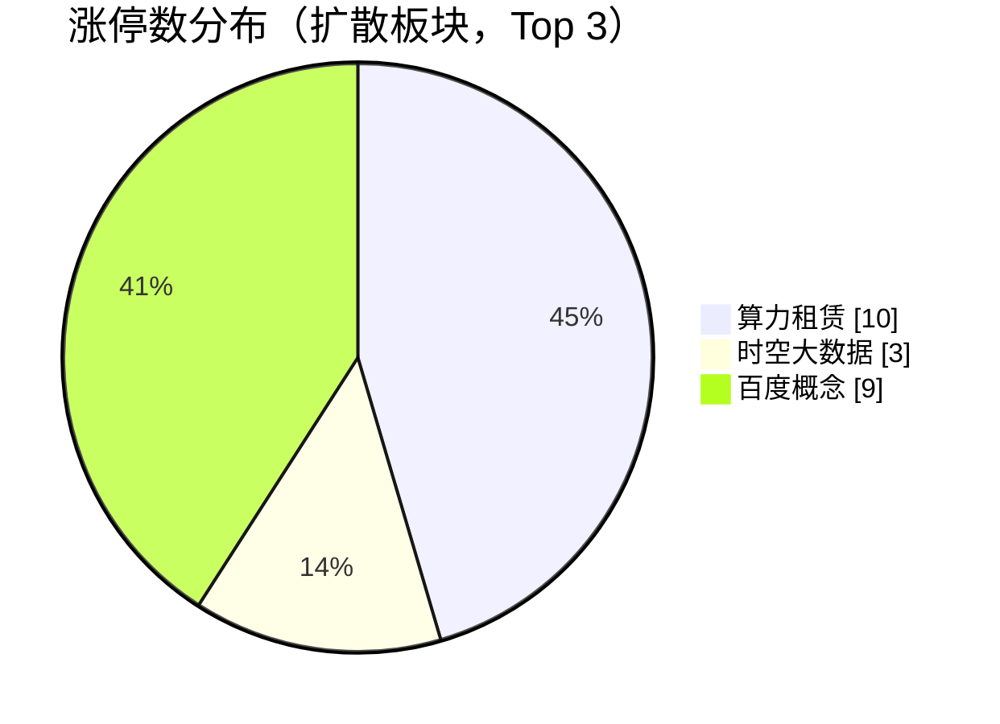
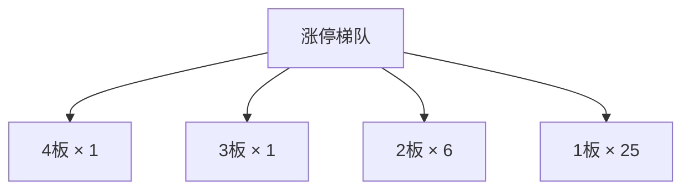
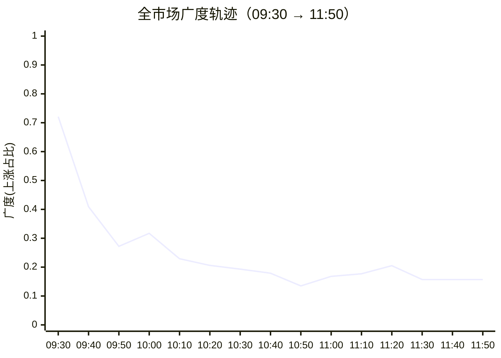

## 当日总览（截至 11:50）

> **结论**：全市场涨877/跌4590（广度0.16）；涨停33/跌停25；中位涨幅-1.51%；局部修复。 钱在：算力租赁(涨停10/成分188，中位+0.22%)、时空大数据(涨停3/成分71，中位-1.14%)、百度概念(涨停9/成分232，中位-1.24%)；零星涨停：血氧仪(2)、云游戏(2)、共享单车(1)、托育服务(1)、互联网保险(1)。 退潮：文化传媒概念(跌停8)、IP经济(谷子经济)(跌停6)、短剧游戏(跌停6)。 梯队：4板×1、3板×1、2板×6、1板×25，最高4板。 预案：超买区 华胜天成、盛剑科技、华东重机；已触发 西陇科学。 较上一轮广度基本持平。

> 🔒 **no_trade / 买入预算 0 / max_position_pct 0 —— 全部内容仅供研究，不授予交易权限。**

### 板块扩散

> 口径：XTick 概念成分 × 全市场实时报价；分母 = 板块内有有效报价的成分数。排序用涨停密度（涨停数/有效成分数），已剔除宽基属性板块（全市场 432 个板块中剔 16 个）。

**扩散中（题材，按涨停密度排序）**

| 板块 | 涨停 | 有效成分 | 涨停密度 | 上涨广度 | 中位涨幅 | 相对全市场 | 成交(亿) |
|---|---|---|---|---|---|---|---|
| 血氧仪 ⬦ | 2 | 24 | 0.083 | 0.29 | -1.20% | +0.31% | 33 |
| 云游戏 ⬦ | 2 | 27 | 0.074 | 0.26 | -2.16% | -0.65% | 89 |
| 共享单车 ⬦ | 1 | 14 | 0.071 | 0.14 | -1.48% | +0.03% | 11 |
| 托育服务 ⬦ | 1 | 15 | 0.067 | 0.13 | -0.88% | +0.63% | 34 |
| 算力租赁 | 10 | 188 | 0.053 | 0.52 | +0.22% | +1.73% | 475 |
| 互联网保险 ⬦ | 1 | 22 | 0.045 | 0.14 | -0.99% | +0.52% | 47 |
| 华为数字能源 ⬦ | 2 | 46 | 0.043 | 0.43 | -0.28% | +1.23% | 92 |
| 时空大数据 | 3 | 71 | 0.042 | 0.31 | -1.14% | +0.37% | 119 |
| 云办公 ⬦ | 2 | 49 | 0.041 | 0.35 | -0.70% | +0.81% | 70 |
| 室外经济 ⬦ | 1 | 25 | 0.040 | 0.16 | -1.27% | +0.24% | 26 |
| 百度概念 | 9 | 232 | 0.039 | 0.26 | -1.24% | +0.27% | 533 |
| 华为海思概念股 ⬦ | 2 | 52 | 0.038 | 0.31 | -0.38% | +1.13% | 193 |

> ⬦ = 涨停 <3 只，零星个例，不构成扩散（不计入「钱在」判定）。



零星涨停板块（<3 只）：血氧仪(2)、云游戏(2)、共享单车(1)、托育服务(1)、互联网保险(1)、华为数字能源(2)、云办公(2)、室外经济(1)

**退潮中（跌停集中）**

| 板块 | 跌停 | 有效成分 | 上涨广度 | 中位涨幅 |
|---|---|---|---|---|
| 文化传媒概念 | 8 | 197 | 0.06 | -2.29% |
| IP经济(谷子经济) | 6 | 198 | 0.06 | -2.12% |
| 短剧游戏 | 6 | 99 | 0.06 | -2.89% |
| 虚拟现实 | 6 | 287 | 0.18 | -1.80% |
| AI应用 | 6 | 551 | 0.19 | -1.31% |
| 创投 | 6 | 460 | 0.20 | -1.21% |
| 手机游戏 | 5 | 56 | 0.11 | -2.76% |
| 一带一路 | 5 | 797 | 0.20 | -1.23% |
| 新型城镇化 | 5 | 221 | 0.22 | -1.16% |
| 粤港澳大湾区 | 5 | 499 | 0.23 | -1.34% |
| PPP概念 | 5 | 199 | 0.25 | -0.88% |
| 网络游戏 | 4 | 58 | 0.07 | -2.63% |

### 涨停梯队

> 最高 4 板 ｜ 涨停 33 ｜ 跌停 25 ｜ 炸板 19 ｜ 封板率 63.5% ｜ 打板成功率 21.62% ｜ 一进二 19.35% ｜ 二进三 20.00%

| 身位 | 家数 | 成员（涨幅/封单亿/首封） |
|---|---|---|
| 4板 | 1 | 华东重机 +10.00%/0.076亿/09:25 |
| 3板 | 1 | 长虹美菱 +9.92%/0.022亿/09:25 |
| 2板 | 6 | 华胜天成 +10.01%/0.065亿/09:55；真视通 +10.02%/0.015亿/09:30；全筑股份 +9.79%/0.013亿/09:25；卡莱特 +20.01%/0.008亿/10:15；盛剑科技 +9.99%/0.006亿/09:25 |
| 1板 | 25 | 四川长虹 +10.08%/0.076亿/09:35；利通电子 +10.00%/0.068亿/11:26；上证环保 +10.00%/0.060亿/10:02；润建股份 +10.01%/0.057亿/11:14；美利云 +9.99%/0.050亿/10:05 |



炸板 19 只（前几）：联合化学(4次)、北纬科技(4次)、德豪润达(3次)、龙江交通(3次)、九阳股份(2次)

### 预案池对照

| 票 | 池 | 板块 | 现价 | 涨幅 | 触发价 | 买区 | 风险位 | 判定 |
|---|---|---|---|---|---|---|---|---|
| 华胜天成 `600410.SH` | 观察池 | — | 16.82 | +10.01% | 15.32 | [15.24, 15.55] | 14.77 | **超买区** |
| 盛剑科技 `603324.SH` | 观察池 | — | 22.9 | +9.99% | 21.83 | [21.72, 22.16] | 21.05 | **超买区** |
| 华东重机 `002685.SZ` | 观察池 | — | 7.37 | +10.00% | — | [6.67, 6.8] | 6.46 | **超买区** |
| 科华数据 `002335.SZ` | 观察池 | — | 23.6 | +1.46% | — | — | — | **无预案价** |
| 金盾股份 `300411.SZ` | 观察池 | — | 8.63 | -0.35% | — | — | — | **无预案价** |
| 中再资环 `600217.SH` | 观察池 | — | 2.82 | +0.71% | — | — | — | **无预案价** |
| 西陇科学 `002584.SZ` | 观察池 | — | 8.05 | +1.77% | 8.02 | [7.98, 8.14] | 7.73 | **已触发** |

- **华胜天成** — 现价16.82 已高于买区上沿15.55，不追高；仅价格位置对照，不代表完整入场条件确认；不能据此确认站稳，不授予下单权限
- **盛剑科技** — 现价22.9 已高于买区上沿22.16，不追高；仅价格位置对照，不代表完整入场条件确认；不能据此确认站稳，不授予下单权限
- **华东重机** — 现价7.37 已高于买区上沿6.8，不追高；仅价格位置对照，不代表完整入场条件确认；不能据此确认站稳，不授予下单权限
- **西陇科学** — 现价8.05 ≥ 触发价8.02；仅价格位置对照，不代表完整入场条件确认；不能据此确认站稳，不授予下单权限

> ⚠ D1 明确 no_trade=true、买入预算 0、个股 max_position_pct=0。以上为研究对照，**不构成任何买入许可**。

### 盘面 vs 静态复盘 vs 消息面

| 维度 | 对象 | T-1 静态基线 | 今日盘面 | 关系 |
|---|---|---|---|---|
| 板块主线 | 国产算力（GPU/系统） | R2 次线 score=73 涨停None（T-1 口径） | 盘面未见该板块成分票涨停 | **背离** |
| 板块主线 | 半导体材料/制造 | R2 次线 score=76 涨停None（T-1 口径） | 盘面未见该板块成分票涨停 | **背离** |
| 板块主线 | 家电/消费 | R2 次线 score=60 涨停None（T-1 口径） | 盘面未见该板块成分票涨停 | **背离** |
| 板块主线 | 机器人/名字梗 | R2 次线 score=None 涨停None（T-1 口径） | 盘面未见该板块成分票涨停 | **背离** |
| 板块主线 | 回收/固废政策 | R2 次线 score=None 涨停None（T-1 口径） | 盘面未见该板块成分票涨停 | **背离** |
| 板块主线 | CPO/海外算力硬件 | R2 次线 score=56 涨停None（T-1 口径） | 盘面未见该板块成分票涨停 | **背离** |
| 梯队结构 | 最高4板 | T-1 最高梯队 4 板、首板 29、炸板率 39.06% | 今日 4板×1、3板×1、2板×6、1板×25；封板率0.6346 炸板19只 | **印证** |
| 预案验证 | 华胜天成(600410.SH) | 预案 -／watch／触发价15.32／买区[15.24, 15.55] | 超买区：现价16.82 已高于买区上沿15.55，不追高；仅价格位置对照，不代表完整入场条件确认；不能据此确认站稳，不授予下单权限 | **背离** |
| 预案验证 | 盛剑科技(603324.SH) | 预案 -／watch／触发价21.83／买区[21.72, 22.16] | 超买区：现价22.9 已高于买区上沿22.16，不追高；仅价格位置对照，不代表完整入场条件确认；不能据此确认站稳，不授予下单权限 | **背离** |
| 预案验证 | 华东重机(002685.SZ) | 预案 -／watch／触发价None／买区[6.67, 6.8] | 超买区：现价7.37 已高于买区上沿6.8，不追高；仅价格位置对照，不代表完整入场条件确认；不能据此确认站稳，不授予下单权限 | **背离** |
| 预案验证 | 科华数据(002335.SZ) | 预案 -／watch／触发价None／买区None | 无预案价：预案未给有效入场触发价/完整买区（缺失、空规则或格式异常）；仅价格位置对照，不代表完整入场条件确认；不能据此确认站稳，不授予下单权限 | **无响应** |
| 预案验证 | 金盾股份(300411.SZ) | 预案 -／watch／触发价None／买区None | 无预案价：预案未给有效入场触发价/完整买区（缺失、空规则或格式异常）；仅价格位置对照，不代表完整入场条件确认；不能据此确认站稳，不授予下单权限 | **无响应** |
| 预案验证 | 中再资环(600217.SH) | 预案 -／watch／触发价None／买区None | 无预案价：预案未给有效入场触发价/完整买区（缺失、空规则或格式异常）；仅价格位置对照，不代表完整入场条件确认；不能据此确认站稳，不授予下单权限 | **无响应** |
| 预案验证 | 西陇科学(002584.SZ) | 预案 -／watch／触发价8.02／买区[7.98, 8.14] | 已触发：现价8.05 ≥ 触发价8.02；仅价格位置对照，不代表完整入场条件确认；不能据此确认站稳，不授予下单权限 | **印证** |
| 消息面对照 | 盘面热点板块 | R4 消息面（T-1 口径） | 实时快讯中命中热点板块关键词 10 条 | **印证** |

**分歧点（不掩盖）：**
- 板块主线·国产算力（GPU/系统） → 背离：T-1 有辨识度但今日盘中无涨停响应，题材未获资金确认
- 板块主线·半导体材料/制造 → 背离：T-1 有辨识度但今日盘中无涨停响应，题材未获资金确认
- 板块主线·家电/消费 → 背离：T-1 有辨识度但今日盘中无涨停响应，题材未获资金确认
- 板块主线·机器人/名字梗 → 背离：T-1 有辨识度但今日盘中无涨停响应，题材未获资金确认
- 板块主线·回收/固废政策 → 背离：T-1 有辨识度但今日盘中无涨停响应，题材未获资金确认
- 板块主线·CPO/海外算力硬件 → 背离：T-1 有辨识度但今日盘中无涨停响应，题材未获资金确认
- 预案验证·华胜天成(600410.SH) → 背离：仅研究对照，不授予交易权限
- 预案验证·盛剑科技(603324.SH) → 背离：仅研究对照，不授予交易权限
- 预案验证·华东重机(002685.SZ) → 背离：仅研究对照，不授予交易权限

### 全天广度轨迹

| 时点 | 涨 | 跌 | 广度 | 涨停 | 跌停 | 成交(亿) | 有效样本 |
|---|---|---|---|---|---|---|---|
| 0930 | 4003 | 1185 | 0.721 | 11 | 10 | 364 | 5553 |
| 0940 | 2281 | 2941 | 0.409 | 19 | 17 | 2,107 | 5573 |
| 0950 | 1515 | 3825 | 0.272 | 25 | 18 | 3,131 | 5573 |
| 1000 | 1766 | 3514 | 0.317 | 29 | 23 | 4,116 | 5573 |
| 1010 | 1278 | 4116 | 0.229 | 30 | 24 | 4,832 | 5573 |
| 1020 | 1146 | 4272 | 0.206 | 33 | 25 | 5,390 | 5573 |
| 1030 | 1076 | 4362 | 0.193 | 33 | 25 | 5,848 | 5573 |
| 1040 | 996 | 4447 | 0.179 | 33 | 25 | 6,255 | 5573 |
| 1050 | 750 | 4724 | 0.135 | 26 | 27 | 6,654 | 5573 |
| 1100 | 935 | 4522 | 0.168 | 30 | 25 | 7,038 | 5573 |
| 1110 | 986 | 4461 | 0.177 | 29 | 27 | 7,345 | 5573 |
| 1120 | 1144 | 4283 | 0.205 | 31 | 25 | 7,698 | 5573 |
| 1130 | 877 | 4578 | 0.157 | 34 | 28 | 7,990 | 5573 |
| 1140 | 877 | 4578 | 0.157 | 34 | 28 | 7,990 | 5573 |
| 1150 | 877 | 4578 | 0.157 | 34 | 28 | 7,990 | 5573 |

> ⚠ **数据冻结段**：1130–1150 数值连续完全一致，说明行情源未刷新，**不是市场横盘**，该段不可解读为盘面变化。



### 观察建议（仅研究）

- **环境**：涨停 33.0 / 跌停 25.0，打板成功率 21.6%，一进二 19.4%。
- **方向**：今日形成实质扩散的是 算力租赁（涨停10/成分188，密度0.053，中位+0.22%）、时空大数据（涨停3/成分71，密度0.042，中位-1.14%）、百度概念（涨停9/成分232，密度0.039，中位-1.24%）。**需确认**：次日能否维持涨停家数且中位涨幅不掉队，否则只是普跌中的避险轮动。
- **零星**：血氧仪(2只/24成分)、云游戏(2只/27成分)、共享单车(1只/14成分)、托育服务(1只/15成分)、互联网保险(1只/22成分) 属零星个例，不视为题材，不据此选股。
- **回避**：文化传媒概念（跌停8）、IP经济(谷子经济)（跌停6）、短剧游戏（跌停6） 板块中位跌幅深，趋势未止跌前不接。
- **身位**：最高 4 板。梯队有高度不等于可接力，需逐票核验封单稳定性与开板次数后再定。
- **预案**：华胜天成（现价16.82 已高于买区上沿15.55，不追高；仅价格位置对照，不代表完整入场条件确认；不能据此确认站稳，不授予下单权限）、盛剑科技（现价22.9 已高于买区上沿22.16，不追高；仅价格位置对照，不代表完整入场条件确认；不能据此确认站稳，不授予下单权限）、华东重机（现价7.37 已高于买区上沿6.8，不追高；仅价格位置对照，不代表完整入场条件确认；不能据此确认站稳，不授予下单权限）。买区已错过，**不追高**；要参与需等新剧本，不能沿用原预案价位。

<details>
<summary>原始截面与数据质量（折叠）</summary>

**跨源校验**

```json
{
  "xtick": {
    "up": 877,
    "down": 4590,
    "n": 5585,
    "amount_yi": 7926.9
  },
  "rtk_snapshot": {
    "up": 877,
    "down": 4578,
    "valid_n": 5573,
    "amount_yi": 7989.8,
    "up_limit": 34,
    "down_limit": 28
  },
  "note": "两源口径不同（XTick 全市场含全部票；rt_k 返回样本）"
}
```

**rt_k 截面（原始）**

```json
{
  "market": {
    "total": 5585,
    "up": 877,
    "down": 4578,
    "flat": 118,
    "requested_n": 5585,
    "received_n": 5585,
    "valid_n": 5573,
    "missing_n": 12,
    "universe_requested_n": null,
    "population_scope": "returned_rows_not_verified_all_a_universe",
    "up_ratio": 0.157,
    "legacy_up_ratio_placeholder": false,
    "up_ratio_is_observed": true,
    "up_ratio_all": 0.157,
    "up_ratio_valid": 0.1574,
    "up_ratio_denominator": "requested_n",
    "degraded": false,
    "limit_known_n": 5573,
    "limit_unknown_n": 0,
    "limit_counts_complete": true,
    "limit_source_errors": [],
    "up_gt3": 173,
    "up_gt5": 96,
    "up_limit": 34,
    "down_gt3": 936,
    "down_gt5": 266,
    "down_limit": 28,
    "amount_yi": 7989.8,
    "amount_sum_overflow": false,
    "amount_valid_n": 5573,
    "amount_missing_n": 0
  },
  "source_time_quality": {
    "quote_age_min_seconds": 2.536547,
    "quote_age_max_seconds": 63.536547,
    "source_age_limit_seconds": null,
    "freshness_status": "age_limit_not_configured",
    "age_reference_at": "2026-11-18T11:50:09.536547+08:00"
  },
  "trading_authorized": false
}
```

</details>

## 分时研判记录

### 09:35 研判增量
- **趋势**：09:30 是今日首份截面（rt_k 报价 09:30:03–09:30:22），广度、涨停数、梯队、板块排名和预案判定均无日内前值。总览的“广度走弱 -0.08”是同轮跨源比较，不是盘中回落。rt_k 有效返回样本上涨 4003/5553（72.09%），说明开盘多数股票上涨；但华东重机领到 4 板只延续了昨收梯队高度，且昨涨停股整体红盘率缺失，尚不能确认接力修复。
- **轮动**：光刻胶的涨停集中在前排：3/80 涨停、43/80 上涨，中位涨幅落后市场 0.18 个百分点；光刻机仅 1/52 涨停，不能从胶扩展到整个半导体材料方向。盘中快讯主要重复报道西陇科学、盛剑科技晋级，只印证价格表现，不是新增催化。热榜表外的创投有 5/460 涨停，但中位仅与市场持平；传媒仅 33/131 上涨，短剧游戏仅 32/99 上涨。开盘已见强弱分化，未见资金从传媒流向光刻或切往算力的证据。
- **剧本**：华胜天成虽越过 15.32，却已在原买区上沿 15.55 之外，单点越线既不确认回踩承接，也不反证预案列明的行业风险；华东重机的 4 板不符合“只做首板隔日”模板。盛剑科技虽越过 21.83，也已超过 22.16；晋级没有消除原有低换手和应收顾虑，不替补西陇科学，后者的硬否决不随价格解除。科华数据、金盾股份和中再资环均无预案价：科华的增持计划不是已买入，金盾认缴不是 GPU 收入，中再资环须等回收板块出现独立助攻，三者均不因光刻转弱自动接棒。
- **下一步看**：先核报价刷新，再用同源共同有效样本复算广度，并补昨涨停股红盘率。光刻胶须保持至少 3 只涨停、上涨占比超过本轮 43/80，且中位涨幅不再落后市场，才支持前排向成分扩散；跌破 3 只则降为零星强势。华胜天成只核分钟路径能否在 15.32–15.55 内承接，盛剑科技同样只核 21.83–22.16，不以回到旧价区自动重启预案。`no_trade=true`、买入预算 0、`max_position_pct=0` 不变；仅供研究，不构成买入许可。

### 09:45 研判增量
- **趋势**：09:30→09:40 从普涨转为少数首板走强、整体转弱。XTick 两轮返回均为 5,585 只，上涨占比 64.48%→41.32%；rt_k 有效样本也同向回落（72.09%→40.93%，有效分母 5,553→5,573）。XTick 涨停净增 7 只，但首板增 9 只、二板少 2 只，跌停也增 7 只，炸板从 0 到 5。华东重机仍是唯一 4 板，未见开板记录，但截面封单额从 0.118 亿降至 0.097 亿；高度没掉，不代表接力修复。
- **轮动**：在概念全表按涨停密度排序，家用电器从第 31 升到第 13；同名申万行业也从 2/103 增至 5/103 涨停，上涨成分从 69/103 增至 79/103，四川长虹 09:35 上首板，与长虹美菱 3 板呼应。减速器也从无涨停到 3/140，上涨成分由 85/140 增至 102/140。反过来，光刻胶从第 5 降到第 16，涨停 3→2、上涨 43→25（同为 80 只）；文化传媒概念跌停 4→6（197 只）。家电是对昨复盘方向的局部印证，光刻未能延续开盘快讯报道的前排强势至更多成分；本轮快讯未命中热点关键词，尚不能确认新催化，也不能认定两边是同一批资金在做跷跷板。
- **剧本**：7 只预案票判定无迁移，仍是 4 只超原买区、3 只无预案价。光刻扩散跌破上轮观察门槛，盛剑科技虽维持 2 板、22.90 不变，却仍高于 21.83 触发价对应买区的 22.16 上沿；没有新增助攻支持它替补，西陇科学硬否决不变。华胜天成仅从 16.03 回到 16.02，仍高于 15.55，未见原买区承接证据；华东重机仍非首板隔日剧本。数据中心概念涨停从 1/664 到 4/664，但上涨成分减少，科华数据又从 23.60 回落至 23.40，算力备选缺独立承接；金盾股份、中再资环也不自动递补。
- **下一步看**：下一轮若同源上涨占比回升、且跌停从 17 只减少，再讨论市场修复；若仅首板继续增加，仍按分化看。家电看申万成分能否同时维持 5 只涨停和至少 79/103 上涨；光刻胶须先恢复 3 只涨停，再看上涨能否重回 43/80、板块中位不再落后市场。盛剑科技只有回到 21.83–22.16 并经分钟路径核实承接，才重评原观察剧本，回到价区不等于恢复资格。`no_trade=true`、买入预算 0、`max_position_pct=0` 不变；仅供研究，不构成买入许可。

### 09:55 研判增量
- **趋势**：09:40→09:50，涨停净增 6 只，却不是普遍修复。rt_k 同为 5,573 只有效报价，上涨占比从 40.93% 降到 27.18%，XTick 同向。新增净量来自首板 13→17、二板 4→6；跌停 17→18、炸板 5→7。华东重机仍是唯一 4 板，未见新增开板，但截面封单额由 0.097 亿降到 0.087 亿。低位接力增加，高度未抬升；昨涨停股整体红盘率仍缺，不能判定接力全面修复。
- **轮动**：家电有九阳股份 09:49 晋级二板，申万家电涨停 5→6，但上涨从 79/103 降到 75/103：延续昨复盘家电次线的是前排，不是成分继续扩散。净水按概念涨停密度从第 17 升到第 8、涨停 2→3，上涨却从 40/81 降到 30/81，同样只见前排集中。光刻胶从第 16 滑到第 54，涨停 2→1、上涨 25/80→15/80，昨复盘材料方向的延续预期进一步走弱。真正逆势扩大上涨面的反而是高股息（177/285→186/285），但仍只有 1 只涨停，偏防守而非新题材接力。快讯未命中新增催化，缺同窗净流量，不确认跷跷板。
- **剧本**：分析层分类仍为 4 只超原买区、3 只无预案价，但光刻前排已分化：西陇科学从二板转炸板，两源截面分别报 8.14 和 8.15，正贴原区间 7.98–8.14 上沿；高于 8.02 不代表站稳，硬否决不变。盛剑科技仍封二板、报 22.90，但封单额 0.015→0.008 亿，且超 22.16；它未证明能补位。华胜天成 16.02→16.29，离 15.32 的原突破位及 15.55 买区上沿更远，不追高。反向剧本也未确认：科华数据 23.40→23.29，数据中心仍有 4/664 涨停但上涨成分 351→282；金盾股份走强不能替代科华的独立承接。固废处理仍无涨停、上涨 87/156→59/156，中再资环不升级。
- **下一步看**：同口径上涨占比先回到 09:40 的 40.93%，且跌停低于本轮 18 只，再讨论修复；家电若保住 6 只涨停并恢复至少 79/103 上涨，才算从前排重新传到成分。光刻胶须恢复至少 3/80 涨停再重评；华胜天成只在分钟路径显示 15.32–15.55 有承接时复核原剧本，不下移或抬高买区。`no_trade=true`、买入预算 0、`max_position_pct=0` 不变；仅供研究，不构成买入许可。

### 10:05 研判增量
- **趋势**：09:50→10:00，上涨面开盘回落后首次回升，但跌停继续增加，属于局部修复。rt_k 同为 5,573 只有效报价，上涨占比 27.18%→31.69%（约 +4.5 个百分点），XTick 同向；涨停净增 4 只，跌停却净增 5 只、炸板增 1 只。最高仍是华东重机 4 板，截面封单额 0.087→0.082 亿；小熊电器本轮重回三板名单，二板 6→8，连板层变厚但高度未抬升。仍缺昨涨停股整体红盘率，不能确认接力普遍回暖。
- **轮动**：家用电器按涨停密度从第 14 升第 5，但涨停 6→9 的同时，上涨成分从 107/186 降到 98/186，依旧是前排集中；净水从第 8 升第 4，上涨仍是 30/81。新增红盘面更明显的是铜缆（23→33/49）和华为海思（20→35/52），但各仅 2 只涨停；光刻胶也只修到 2/80 涨停。文化传媒概念相反，跌停 5→7、上涨 39→34/197。家电部分印证昨复盘次线，家电和半导体快讯都在描述盘面，不是新增催化；没有同窗净流数据，不能确认传媒资金转进硬件。
- **剧本**：仍是 4 只超原买区、3 只无预案价，但华胜天成从 16.29 到 16.82，09:55 首封二板，增强了反包接力的证据；现价远离触发价 15.32 和买区上沿 15.55，站稳和行业风险反证仍未确认，不追高。盛剑科技维持 22.90，高于触发价 21.83 对应买区上沿 22.16，光刻胶未恢复扩散，不递补；西陇科学 8.15→8.23，仍在炸板名单，不能把回升当回封，硬否决不变。华东重机仍是高度观察，不是首板隔日剧本。科华数据反弹、金盾股份回落，算力备选未同步；中再资环虽微升，固废处理仅 1/156 涨停、上涨 59→53/156，反向剧本不升级。
- **下一步看**：广度回到 09:40 的 40.93%、跌停降至 18 只以下，再上调市场修复判断；家电若保住 9/186 涨停且上涨成分重新超过 107/186，才算从前排向成分扩散；铜缆若至少 3/49 涨停并守住 33/49 上涨，再上调为扩散观察。华胜只核分钟路径能否证明 15.32–15.55 内有承接，回到旧区间也不自动恢复资格。`no_trade=true`、买入预算 0、`max_position_pct=0` 不变；仅供研究，不构成买入许可。

### 10:15 研判增量
- **趋势**：10:00→10:10 的回暖没有延续。rt_k 同为 5,573 只有效报价，上涨占比 31.69%→22.93%（−8.76 个百分点），低于 09:50 的 27.18%；XTick 同向。XTick 涨停虽 29→30，炸板却 8→10，跌停仍 23 只（rt_k 23→24）。首板 18→20，二板仍 8，三板 2→1：小熊电器重回炸板名单，长虹美菱独留三板；华东重机仍是唯一四板。新增强势集中在低位，没带起接力，也没托住广度。
- **轮动**：家电概念的涨停密度第 5→第 10，涨停 9→7、上涨 98→74/186，昨复盘家电次线的早盘强势在退。数据中心密度第 133→第 85，涨停 5→8，但上涨反从 376→279/664；CPO 也从 3→2 只涨停、161→120/230 上涨。算力是少数前排走强，不是成分扩散。文化传媒概念上涨 34→21/197、跌停仍 7 只，继续弱于大盘。科创芯片 ETF 上涨的快讯只是行情回声，未核到新增催化；板块名称未匹配也不等于零涨停。缺同窗净流数据，不确认家电资金切到算力。
- **剧本**：7 只票的判定没变（4 只超原买区、3 只无预案价），但前排承接分化了。华胜天成维持二板、截面封单额 0.069→0.080 亿元，支持反包强于普通跟涨；16.82 仍高于触发价 15.32 对应买区 15.24–15.55，既不能追高，也不能靠两帧报价确认站稳或解除行业事件限制。光刻胶涨停 2→1/80：盛剑科技仍在 22.90，超过 21.83 触发价对应买区 21.72–22.16，未获成分助攻，不递补。西陇科学 8.23→8.15，贴近原区间上沿 8.14，仍在炸板名单，硬否决不变。科华数据 23.69→23.60，虽有数据中心前排加板，却未验证独立承接；金盾回到平盘，中再资环持平且固废仅 1/156 涨停，两个备选方向均未触发。华东重机只作高度观察。
- **下一步看**：同口径上涨占比至少收回 10:00 的 31.69%，且 rt_k 跌停低于本轮 24 只，才重评修复；数据中心若能守住 8/664 涨停并把上涨成分拉回 376/664，才从前排强升为板块扩散观察。光刻胶先看能否恢复 3/80 涨停；华胜仅在分钟路径证实 15.32–15.55 有承接时复核原剧本，回到价区不自动恢复资格。`no_trade=true`、买入预算 0、`max_position_pct=0`；仅供研究，不构成买入许可。

### 10:25 研判增量
- **趋势**：10:10→10:20，涨停净增 3 只，但上涨面再创早盘截面新低。rt_k 两轮均为 5,573 只有效报价，上涨占比 22.93%→20.56%，跌停 24→25；XTick 同向。增量是首板 +2、二板 +1（卡莱特 10:15 首封二板）；炸板仍 10 只，华东重机仍是唯一 4 板。低位接力增加，但没带动市场修复；昨涨停股整体红盘率仍缺。
- **轮动**：时空大数据维持密度榜第 6、3 只涨停，上涨 22→27/71、跌停 1→0，是这一轮少数上涨面在扩大的方向。节能照明第 79→第 7、涨停 1→3，上涨反从 23→15/78，不能把排名跃升当普涨。昨复盘家电次线的概念涨停仍是 7 只，上涨却从 74→62/186；算力内部也分化，算力租赁涨停 5→6、上涨 93→95/188，数据中心涨停 8→10、上涨反降至 247/664。快讯未匹配新增催化，缺同窗净流向，不确认家电向算力切换。
- **剧本**：7 只票判定未迁移，仍是 4 只超原买区、3 只无预案价。光刻胶上涨 30→14/80、仍仅 1 只涨停，盛剑科技虽封二板，22.90 已超出 21.83 触发价对应买区的 22.16 上沿，第二前排补位剧本更弱，不追高；西陇科学的硬否决不变。科华数据小升至 23.62，金盾股份由平盘转跌，算力备选仍不同步；固废处理上涨 51→45/156、仍仅 1 只涨停，中再资环的反向剧本也不升级。
- **下一步看**：同口径广度先收回 22.93%，且 rt_k 跌停降回 24 只或更少，再讨论止跌；时空大数据须守住 3/71 涨停且上涨超过本轮 27/71，才算继续扩散。光刻胶先恢复 3/80 涨停；即便盛剑回到 21.83–22.16，也要用分钟路径核承接，不能自动恢复原剧本。`no_trade=true`、买入预算 0、`max_position_pct=0`，仅供研究，不构成买入许可。

### 10:35 研判增量
- **趋势**：10:20→10:30，涨停没少，但上涨面继续缩。rt_k 同为 5,573 只有效报价，上涨占比从 20.56% 降至 19.31%，跌停仍为 25 只；XTick 同向，涨停仍为 33 只。首板 22→23、二板 9→8，炸板 10→11，华东重机仍是唯一四板。相比 10:00 的短暂反弹，这是上涨面连续第三轮收缩；总览的「局部修复」不能外推为接力回暖。本轮 rt_k 报价时标为 10:28:54–10:30:22。
- **轮动**：上一轮走宽的时空大数据，本轮 3/71 涨停不变，上涨却由 27 降到 24 只，并新增 1 只跌停；热榜第 6→第 7 是横琴新区插入所致，不是自身涨停密度下降。横琴涨停 1→2、上涨 12→14/38，但中位涨幅反降；算力租赁维持 6/188 涨停、上涨仅 95→96/188，数据中心则停在 10/664 涨停、247/664 上涨。昨复盘的家电次线仍有局部承接：申万家电上涨 53→55/103，概念池却从 62 降到 61/186。未见同一板块同时新增涨停、扩大上涨面并达到至少 3 只涨停；快讯未核实板块催化，也缺同窗净流向，不确认跷跷板。
- **剧本**：7 只观察票里唯一判定迁移的是西陇科学：8.15→8.13，由「超买区」变为价格触发，原因是回落进入原区间 7.98–8.14，且仍高于 8.02；不是向上突破。它仍列炸板，分钟承接未确认，预案硬否决不变。光刻胶仍只有 1/80 涨停，盛剑科技没有新增补位证据；固废处理上涨 45→37/156，中再资环即使价格持平，也未获得反向剧本所需的板块助攻。
- **下一步看**：用同口径截面核对 rt_k 上涨占比能否收回 10:10 的 22.93%，且跌停回到 24 只或更少；若只增加首板、不恢复二板与广度，不上调修复判断。时空大数据须守住 3/71 涨停、上涨至少回到 27/71，再讨论重启扩散；横琴须先到 3/38，且上涨超过 14/38。西陇仅记录分钟路径是否守住 8.02、是否仍在 8.14 以内，不解除硬否决。`no_trade=true`、买入预算 0、`max_position_pct=0`；仅供研究，不构成买入许可。

### 10:45 研判增量
- **趋势**：10:30→10:40，上涨面连续第四轮收缩，这次首板也开始净减少，不是修复。rt_k 同为 5,573 只有效报价，上涨占比 19.31%→17.87%，跌超 3% 的股票 551→699 只；涨跌停仍是 33/25。XTick 同向走弱，涨停 33→32、少的净量在首板，炸板 11→12，跌停仍 24；二板仍 8 只，华东重机仍是唯一四板，未见新增开板记录。rt_k 本轮报价时标 10:39:00–10:40:22；昨涨停股整体红盘率仍缺。
- **轮动**：净水升至概念热榜第 10，仍是 3/81 涨停、上涨 20→23/81，但板块中位跌幅反从 −0.62% 扩至 −0.98%；时空大数据第 7→第 6，仍是 3/71 涨停、上涨反少 1 只，排名上移有横琴退出的因素（横琴 2→0/38 涨停）。节能照明也从 3→2/78，掉出扩散门槛。本轮留存的 10:40 新浪快讯称算力概念盘中累计净流入 28.38 亿元，给昨复盘算力次线提供资金线索；但东数西算、数据中心各仍是 10 只涨停，上涨分别从 194→174/417、247→223/664。资金快讯与成分广度未共振，不算新增产业催化，也不能认定资金从传媒或家电切到算力。
- **剧本**：西陇科学是唯一判定变化：8.13→8.17，从「价格已触发」变回「超买区」，再次越过原区间上沿 8.14。仍列炸板，不能把回升当回封；硬否决不变。盛剑科技不因西陇走高而递补：光刻胶仍仅 1/80 涨停，光刻机上涨 19→15/52，它本身也仍在原买区外。算力快讯没验证科华数据的独立承接：23.56→23.47，且无预案价；固废上涨 37→42/156 但仍仅 1 只涨停，中再资环的反向剧本暂不升级。
- **下一步看**：rt_k 上涨占比先收回 10:30 的 19.31%，同时跌超 3% 的股票回到 551 只或更少，才讨论止跌；算力若守住现有涨停数、且东数西算与数据中心分别恢复至少 194/417、247/664 上涨，才重评板块扩散。西陇只记录分钟路径是否回到 7.98–8.14、能否守住 8.02；即便满足，仍不解除硬否决、不追高。`no_trade=true`、买入预算 0、`max_position_pct=0` 不变；仅供研究，不构成买入许可。

### 10:55 研判增量
- **趋势**：10:40→10:50，退潮加速：不只是上涨面继续收缩，首板和二板也一起减少。rt_k 两轮均为 5,573 只有效报价，上涨占比 17.87%→13.46%，跌超 3% 的个股 699→1,093 只，涨停/跌停从 33/25 变为 26/27。XTick 同向：涨停 32→27、炸板 12→17，首板 22→18、二板 8→7；北纬科技从首板名单转入炸板名单。华东重机仍是唯一四板，长虹美菱仍是唯一三板，顶部高度延续，但接力变薄。rt_k 本轮报价时标 10:49:24–10:50:19。
- **轮动**：未见可比概念板块同时增加涨停、扩大上涨面并达到 3 只涨停。时空大数据和净水各保住 3 只涨停、热榜各升 1 位，上涨反从 23→17/71、23→16/81；黑龙江自贸区从第 1 降至第 3，涨停 3→2/36。昨复盘的算力、家电次线都未接住：东数西算涨停 10→9、上涨 174→129/417；家电仍 6/186 涨停，但上涨 63→48/186。上一轮算力净流入快讯未得到本轮成分扩散印证，本轮快讯也未提供新增催化；没有同窗资金流证据，不确认跷跷板。
- **剧本**：唯一判定迁移是西陇科学，8.17→8.14，回到原买区 7.98–8.14 上沿且仍高于触发价 8.02。属于回落后价格满足条件，不是向上突破；仍列炸板，未确认回封或站稳，盘前硬否决不变。光刻胶上涨 16→12/80、仍仅 1 只涨停，盛剑科技仍在原买区上沿 22.16 之上，不递补、不追高。科华数据 23.47→23.40，中再资环 2.83→2.82、固废上涨 42→24/156；两只均无预案价，独立承接或板块助攻未获验证，反向剧本不升级。
- **下一步看**：同口径上涨占比先收回 10:40 的 17.87%，跌停回到 25 只或更少，并看 XTick 炸板能否回落至 12 只或更少；只增涨停、不修广度，不判修复。时空大数据须保住 3/71 涨停、上涨恢复到至少 23/71，才重评扩散。西陇仅记录分钟路径能否守住 8.02、是否仍在 8.14 以内，不解除硬否决。`no_trade=true`、买入预算 0、`max_position_pct=0`；仅供研究，不构成买入许可。

### 11:05 研判增量
- **趋势**：10:50→11:00，连续收缩后的第一轮反弹，靠的是首板，不是连板接力转强。rt_k 同为 5,573 只有效报价，上涨占比 13.46%→16.78%（+3.32 个百分点），跌超 3% 的个股 1,093→771 只，涨停／跌停 26／27→30／25。XTick 同向：涨停 27→30 的净增量全在首板，炸板 17→15，二板仍 7 只，华东重机仍是唯一四板。广度尚低于 10:40 的 17.87%，先看反弹能否延续。rt_k 报价时标 10:59:21–11:00:22。
- **轮动**：通信和算力链的修复更扎实：申万通信涨停 2→3、上涨 52→73/128；东数西算和数据中心各从 9→10 只涨停，上涨分别从 129→171/417、170→213/664。时空大数据热榜第 5→第 6，仍有 3/71 涨停、上涨 17→22/71，排名下降不等于成分转弱。昨复盘的算力次线获部分盘面印证；本轮利通电子的合规说明并非新增订单或需求证据。传媒上涨仅 8→10/197，仍有 7 只跌停；缺同窗净流向，不能认定资金从传媒切到算力。
- **剧本**：预案判定没有迁移，但西陇科学在大盘回暖时从 8.14 退到 8.08，虽仍在原买区 7.98–8.14、略高于 8.02 触发价，仍列炸板，无分钟证据支持站稳或回封，硬否决不变。光刻胶上涨 12→17/80，但仍只有 1 只涨停，盛剑科技仍高于原买区上沿 22.16，不递补、不追高。科华数据 23.40→23.54 与算力板块同向，不能验证预案要求的独立承接；它无预案价，增持计划也不等于已经增持。
- **下一步看**：同口径上涨占比至少收回 17.87%、rt_k 跌停不高于 25 只、XTick 炸板能否回到 12 只或以下；若又只增首板、二板仍停在 7 只，不上调接力判断。算力两组先守各 10 只涨停，再看上涨成分能否分别回到 10:40 的 174/417、223/664。西陇若下一截面低于 8.02，则连价格触发也不再满足。`no_trade=true`、买入预算 0、`max_position_pct=0`；仅供研究，不构成买入许可。

### 11:15 研判增量
- **趋势**：11:00→11:10，反弹延续，但接力转弱。rt_k 同为 5,573 只有效报价，上涨占比 16.78%→17.69%，仍未收回 10:40 的 17.87%；涨停／跌停反从 30／25 变为 29／27。XTick 涨停 30→28、炸板 15→18，首板 21→20、二板 7→6；九阳股份由二板转入炸板名单，最高仍是华东重机独占四板。T−1 的四板高度得到印证，但没有传导到低位接力。rt_k 本轮报价时标 11:09:03–11:10:22。
- **轮动**：科技内部出现分化。百度概念新进涨停密度热榜第 10，涨停 7→8、上涨 61→65/232，但中位仍跌 1.10%；算力租赁稳在 6/188 涨停、上涨 89→96/188，中位由 −0.11% 翻到 +0.21%，部分印证昨复盘的算力次线。相比之下，通信上涨 73→81/128，涨停却 3→2；时空大数据第 6→第 4，但仍是 3/71 涨停、22/71 上涨，名次上升不等于扩散。黑龙江自贸区涨停 2→1/36、跌出前 12；传媒仍有 7/197 跌停。本轮快讯未核到对应新催化，也缺同窗净流向，不能认定资金从退潮板块切入科技。
- **剧本**：西陇科学是唯一判定迁移：8.08→8.00，仍在原买区 7.98–8.14，却退回 8.02 触发价下方，「价格已触发」不再成立；无分钟承接证据，盘前硬否决不变。盛剑科技不递补：22.90 仍高于原买区上沿 22.16，光刻胶上涨 17→16/80、仍只 1 只涨停。科华数据 23.54→23.63，与算力租赁回暖同向，仍无预案价，也未验证独立承接。
- **下一步看**：rt_k 上涨占比收回 17.87%、跌停回到 25 只或以下，同时看 XTick 二板能否回到至少 7 只、炸板降回 15 只或以下；若只修广度，仍不判接力回暖。算力租赁看能否守住 6/188 涨停且上涨成分不低于 96/188；西陇只复核分钟路径能否收回 8.02 且留在原价区，即使满足也不解除硬否决。`no_trade=true`、买入预算 0、`max_position_pct=0`；仅供研究，不构成买入许可。

### 11:25 研判增量
- **趋势**：11:10→11:20，广度修复加快，新增涨停仍靠首板，接力没跟上。rt_k 两轮均为 5,573 只有效报价，上涨占比 17.69%→20.53%，涨停／跌停 29／27→31／25；XTick 涨停 28→31，净增全在首板（20→23），炸板反增 18→19，二板仍 6 只。华东重机仍独占四板，印证昨复盘的高度，但未带动连板梯队拓宽。rt_k 本轮报价时标 11:18:15–11:20:22。
- **轮动**：算力租赁从涨停密度热榜前 12 外升至第 4，涨停 6→10、上涨 96→109/188；华为昇腾也由 2→4 只涨停、上涨 49→54/105，两个概念有重叠，不加总。中贝通信、润建股份 11:14 首封，11:16–11:17 快讯是对已发生拉升的报道，不是新增产业催化；盘面部分印证昨复盘的算力次线，不能外推到整个国产 GPU 链。百度概念跌出前 12，但仍有 8/232 涨停、上涨 65→80/232，并未退潮；传媒概念仍有 7/197 跌停、上涨反由 13→17/197。强弱有别，但缺同窗净流向，不认定资金跷跷板。
- **剧本**：西陇科学是唯一判定迁移：8.00→8.04，重新越过 8.02，仍在原买区 7.98–8.14；仍列炸板，未确认站稳或回封，盘前硬否决不变。算力扩散给华胜天成的容量反包假设补上板块助攻，但其 16.82 未变，仍高于原买区上沿 15.55，不能把助攻当成新买点。科华数据仅 23.63→23.64，无预案价；题材走强未验证它的独立承接，也不把增持计划视作已增持。
- **下一步看**：下一有效截面若算力租赁守住 10/188 涨停、至少 109/188 上涨，且两只 11:14 首封股仍在涨停名单，才算本轮扩散延续；若上涨退回 96/188 或以下，不上调持续性。市场要在上涨占比守住 20.53%、rt_k 跌停不超过 25 只的同时，看到 XTick 二板回到至少 7 只、炸板降至 15 只或以下，才上调接力判断。西陇仅核已完成分钟能否守住 8.02 且不超 8.14；`no_trade=true`、买入预算 0、`max_position_pct=0`，仅供研究，不构成买入许可。

### 11:35 研判增量
- **趋势**：11:20→11:30，上午修复在午收前反转：涨停增加，但上涨面反而缩小。rt_k 两轮均为 5,573 只有效报价，上涨占比从 20.53% 降至 15.74%，低于 11:00 的 16.78%；涨停／跌停从 31／25 变为 34／28。XTick 涨停 31→33，净增全在首板（23→25），利通电子 11:26 首封；炸板仍 19 只、二板仍 6 只，华东重机仍独占四板。昨复盘的四板高度有印证，接力未变宽。rt_k 本轮报价时标为 11:29:46–11:30:13。
- **轮动**：算力租赁从涨停密度榜第 4 降到第 5，仍有 10/188 涨停，中贝通信、润建股份都留在涨停名单，但上涨从 109 降到 97/188，上一轮的扩散未能延续。华为昇腾仍有 4/105 涨停，上涨从 54 降到 46/105；数据中心从 14 降到 13/664 涨停，上涨从 261 降到 222/664。百度概念回到第 11，涨停 8→9/232，上涨却从 80 降到 60/232，不算接棒。盘面只部分印证昨复盘的算力次线，已收录的热点快讯仍主要是上一轮拉升报道，未验证新催化；缺同窗净流向，不判资金跷跷板。
- **剧本**：7 只观察票无判定迁移，但算力板块助攻减弱。华胜天成仍报 16.82，虽高于 15.32 触发价，却在原买区 15.24–15.55 之外；反包观察保留，不追高。科华数据 23.64→23.60，未验证独立承接，且无预案价，不启动算力备选剧本。西陇科学 8.04→8.05，两个截面都在 8.02 触发价之上、原买区 7.98–8.14 之内，但未证实分钟站稳或回封，硬否决不变；光刻胶仍仅 1/80 涨停，上涨从 17 降到 13/80，盛剑科技不递补。
- **下一步看**：午后首个已刷新的同口径截面，先看上涨占比能否收回 11:20 的 20.53%、rt_k 跌停能否回到 25 只或以下；若二板仍只有 6 只，即使首板再增，也不判接力修复。算力租赁须同时保住 10/188 涨停、收回 109/188 上涨；若回落至 96/188 或更少，则仍按局部强势观察。西陇仅核已完成分钟能否守住 8.02 且不超 8.14。`no_trade=true`、买入预算 0、`max_position_pct=0`；仅供研究，不构成买入许可。

