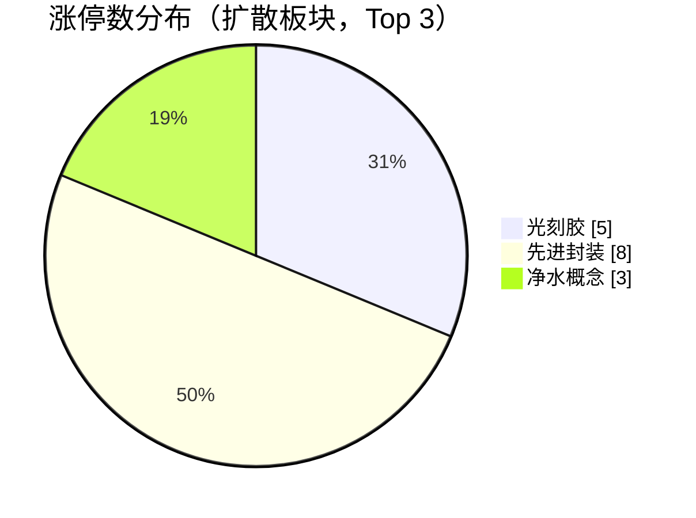
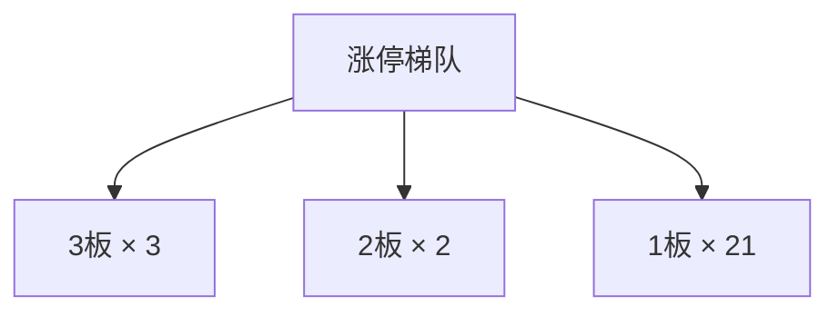
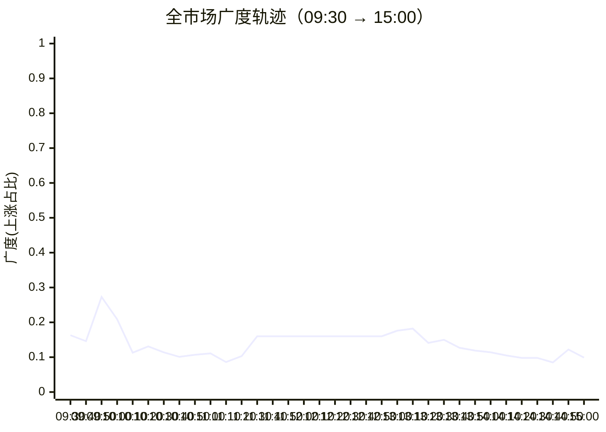

## 当日总览（截至 15:00）

> **结论**：全市场涨649/跌4881（广度0.12）；涨停26/跌停72；中位涨幅-2.55%；普跌格局。 钱在：光刻胶(涨停5/成分80，中位-0.90%)、先进封装(涨停8/成分210，中位-1.10%)、净水概念(涨停3/成分81，中位-2.72%)；零星涨停：广东自贸区(2)、托育服务(1)、丙烯酸(1)、壳资源(2)、环氧丙烷(1)。 退潮：智能制造(跌停14)、电子商务(跌停14)、数据中心(AIDC)(跌停13)。 梯队：3板×3、2板×2、1板×21，最高3板。 预案：超买区 真视通、深南电路；未到价 华胜天成。 较上一轮广度基本持平。

> 🔒 **no_trade / 买入预算 0 / max_position_pct 0 —— 全部内容仅供研究，不授予交易权限。**

### 板块扩散

> 口径：XTick 概念成分 × 全市场实时报价；分母 = 板块内有有效报价的成分数。排序用涨停密度（涨停数/有效成分数），已剔除宽基属性板块（全市场 432 个板块中剔 16 个）。

**扩散中（题材，按涨停密度排序）**

| 板块 | 涨停 | 有效成分 | 涨停密度 | 上涨广度 | 中位涨幅 | 相对全市场 | 成交(亿) |
|---|---|---|---|---|---|---|---|
| 广东自贸区 ⬦ | 2 | 29 | 0.069 | 0.17 | -2.17% | +0.38% | 43 |
| 托育服务 ⬦ | 1 | 15 | 0.067 | 0.13 | -2.64% | -0.09% | 46 |
| 光刻胶 | 5 | 80 | 0.062 | 0.33 | -0.90% | +1.65% | 332 |
| 丙烯酸 ⬦ | 1 | 20 | 0.050 | 0.25 | -1.90% | +0.65% | 38 |
| 壳资源 ⬦ | 2 | 51 | 0.039 | 0.08 | -3.33% | -0.78% | 54 |
| 环氧丙烷 ⬦ | 1 | 26 | 0.038 | 0.35 | -1.28% | +1.27% | 43 |
| 先进封装 | 8 | 210 | 0.038 | 0.32 | -1.10% | +1.45% | 1,677 |
| 净水概念 | 3 | 81 | 0.037 | 0.17 | -2.72% | -0.17% | 249 |
| 空气能热泵 ⬦ | 2 | 56 | 0.036 | 0.25 | -3.00% | -0.45% | 208 |
| 网约车 ⬦ | 1 | 28 | 0.036 | 0.07 | -2.92% | -0.37% | 30 |
| 租售同权 ⬦ | 1 | 29 | 0.035 | 0.10 | -2.70% | -0.15% | 39 |
| 黑龙江自贸区 ⬦ | 1 | 36 | 0.028 | 0.08 | -2.77% | -0.22% | 59 |

> ⬦ = 涨停 <3 只，零星个例，不构成扩散（不计入「钱在」判定）。



零星涨停板块（<3 只）：广东自贸区(2)、托育服务(1)、丙烯酸(1)、壳资源(2)、环氧丙烷(1)、空气能热泵(2)、网约车(1)、租售同权(1)

**退潮中（跌停集中）**

| 板块 | 跌停 | 有效成分 | 上涨广度 | 中位涨幅 |
|---|---|---|---|---|
| 智能制造 | 14 | 459 | 0.08 | -3.00% |
| 电子商务 | 14 | 676 | 0.13 | -2.61% |
| 数据中心(AIDC) | 13 | 664 | 0.11 | -2.92% |
| 创投 | 13 | 460 | 0.12 | -2.52% |
| AI应用 | 12 | 551 | 0.07 | -3.56% |
| 数字经济 | 12 | 513 | 0.07 | -3.39% |
| 人民币贬值受益 | 12 | 612 | 0.13 | -2.48% |
| 粤港澳大湾区 | 11 | 499 | 0.11 | -2.80% |
| 2024中报预增 | 11 | 653 | 0.14 | -2.39% |
| AIGC概念 | 10 | 298 | 0.04 | -4.06% |
| 虚拟现实 | 10 | 287 | 0.07 | -3.53% |
| DeepSeek概念 | 10 | 769 | 0.11 | -2.95% |

### 涨停梯队

> 最高 3 板 ｜ 涨停 26 ｜ 跌停 72 ｜ 炸板 27 ｜ 封板率 49.1% ｜ 打板成功率 11.63% ｜ 一进二 5.71% ｜ 二进三 42.86%

| 身位 | 家数 | 成员（涨幅/封单亿/首封） |
|---|---|---|
| 3板 | 3 | 真视通 +10.02%/0.021亿/09:25；全筑股份 +9.86%/0.010亿/09:25；盛剑科技 +10.00%/0.003亿/09:37 |
| 2板 | 2 | 京蓝科技 +10.06%/0.006亿/13:25；华升股份 +10.01%/0.005亿/09:30 |
| 1板 | 21 | 毅昌科技 +9.93%/0.050亿/09:25；中京电子 +10.04%/0.010亿/10:27；格林达 +10.00%/0.008亿/09:31；江化微 +9.99%/0.008亿/13:06；原尚股份 +9.99%/0.007亿/10:17 |



炸板 27 只（前几）：中嘉博创(15次)、ST天圣(14次)、摩登大道(5次)、华东重机(4次)、青山纸业(4次)

### 预案池对照

| 票 | 池 | 板块 | 现价 | 涨幅 | 触发价 | 买区 | 风险位 | 判定 |
|---|---|---|---|---|---|---|---|---|
| 真视通 `002771.SZ` | 观察池 | — | 14.38 | +10.02% | 13.07 | [13.0, 13.27] | 12.61 | **超买区** |
| 华胜天成 `600410.SH` | 观察池 | — | 16.7 | -0.71% | 16.82 | [16.74, 17.07] | 16.22 | **未到价** |
| 天娱数科 `002354.SZ` | 观察池 | — | 6.57 | -8.11% | — | — | — | **无预案价** |
| 中京电子 `002579.SZ` | 观察池 | — | 12.17 | +10.04% | — | — | — | **无预案价** |
| 深南电路 `002916.SZ` | 观察池 | — | 211.24 | +5.00% | 201.19 | [200.18, 204.21] | 194.0 | **超买区** |
| 沪电股份 `002463.SZ` | 观察池 | — | 81.1 | +1.13% | — | — | — | **无预案价** |
| 武汉凡谷 `002194.SZ` | 观察池 | — | 8.78 | -5.69% | — | — | — | **无预案价** |
| 中贝通信 `603220.SH` | 观察池 | — | 15.46 | -1.02% | — | — | — | **无预案价** |
| 行云科技 `300209.SZ` | 观察池 | — | 21.38 | -3.48% | — | — | — | **无预案价** |
| 协创数据 `300857.SZ` | 观察池 | — | 128.55 | -7.84% | — | — | — | **无预案价** |
| 华东重机 `002685.SZ` | 观察池 | — | 7.67 | +4.07% | — | — | — | **无预案价** |
| 九阳股份 `002242.SZ` | 观察池 | — | 31.21 | +10.01% | — | — | — | **无预案价** |
| 常山北明 `000158.SZ` | 观察池 | — | 13.03 | +4.83% | — | — | — | **无预案价** |

- **真视通** — 现价14.38 已高于买区上沿13.27，不追高；仅价格位置对照，不代表完整入场条件确认；不能据此确认站稳，不授予下单权限
- **深南电路** — 现价211.24 已高于买区上沿204.21，不追高；仅价格位置对照，不代表完整入场条件确认；不能据此确认站稳，不授予下单权限

> ⚠ D1 明确 no_trade=true、买入预算 0、个股 max_position_pct=0。以上为研究对照，**不构成任何买入许可**。

### 盘面 vs 静态复盘 vs 消息面

| 维度 | 对象 | T-1 静态基线 | 今日盘面 | 关系 |
|---|---|---|---|---|
| 板块主线 | PCB/算力互连（主线配套支线） | R2 次线 score=62 涨停None（T-1 口径） | 盘面未见该板块成分票涨停 | **背离** |
| 板块主线 | 6G试点/通信 | R2 次线 score=59 涨停None（T-1 口径） | 盘面未见该板块成分票涨停 | **背离** |
| 板块主线 | 光刻胶（光刻机作对照） | R2 次线 score=50 涨停None（T-1 口径） | 盘面未见该板块成分票涨停 | **背离** |
| 梯队结构 | 最高3板 | T-1 最高梯队 4 板、首板 29、炸板率 39.06% | 今日 3板×3、2板×2、1板×21；封板率0.4906 炸板27只 | **背离** |
| 预案验证 | 真视通(002771.SZ) | 预案 -／watch／触发价13.07／买区[13.0, 13.27] | 超买区：现价14.38 已高于买区上沿13.27，不追高；仅价格位置对照，不代表完整入场条件确认；不能据此确认站稳，不授予下单权限 | **背离** |
| 预案验证 | 华胜天成(600410.SH) | 预案 -／watch／触发价16.82／买区[16.74, 17.07] | 未到价：现价16.7，触发价16.82，还差0.72%；仅价格位置对照，不代表完整入场条件确认；不能据此确认站稳，不授予下单权限 | **无响应** |
| 预案验证 | 天娱数科(002354.SZ) | 预案 -／watch／触发价None／买区None | 无预案价：预案未给有效入场触发价/完整买区（缺失、空规则或格式异常）；仅价格位置对照，不代表完整入场条件确认；不能据此确认站稳，不授予下单权限 | **无响应** |
| 预案验证 | 中京电子(002579.SZ) | 预案 -／watch／触发价None／买区None | 无预案价：预案未给有效入场触发价/完整买区（缺失、空规则或格式异常）；仅价格位置对照，不代表完整入场条件确认；不能据此确认站稳，不授予下单权限 | **无响应** |
| 预案验证 | 深南电路(002916.SZ) | 预案 -／watch／触发价201.19／买区[200.18, 204.21] | 超买区：现价211.24 已高于买区上沿204.21，不追高；仅价格位置对照，不代表完整入场条件确认；不能据此确认站稳，不授予下单权限 | **背离** |
| 预案验证 | 沪电股份(002463.SZ) | 预案 -／watch／触发价None／买区None | 无预案价：预案未给有效入场触发价/完整买区（缺失、空规则或格式异常）；仅价格位置对照，不代表完整入场条件确认；不能据此确认站稳，不授予下单权限 | **无响应** |
| 预案验证 | 武汉凡谷(002194.SZ) | 预案 -／watch／触发价None／买区None | 无预案价：预案未给有效入场触发价/完整买区（缺失、空规则或格式异常）；仅价格位置对照，不代表完整入场条件确认；不能据此确认站稳，不授予下单权限 | **无响应** |
| 预案验证 | 中贝通信(603220.SH) | 预案 -／watch／触发价None／买区None | 无预案价：预案未给有效入场触发价/完整买区（缺失、空规则或格式异常）；仅价格位置对照，不代表完整入场条件确认；不能据此确认站稳，不授予下单权限 | **无响应** |
| 预案验证 | 行云科技(300209.SZ) | 预案 -／watch／触发价None／买区None | 无预案价：预案未给有效入场触发价/完整买区（缺失、空规则或格式异常）；仅价格位置对照，不代表完整入场条件确认；不能据此确认站稳，不授予下单权限 | **无响应** |
| 预案验证 | 协创数据(300857.SZ) | 预案 -／watch／触发价None／买区None | 无预案价：预案未给有效入场触发价/完整买区（缺失、空规则或格式异常）；仅价格位置对照，不代表完整入场条件确认；不能据此确认站稳，不授予下单权限 | **无响应** |
| 预案验证 | 华东重机(002685.SZ) | 预案 -／watch／触发价None／买区None | 无预案价：预案未给有效入场触发价/完整买区（缺失、空规则或格式异常）；仅价格位置对照，不代表完整入场条件确认；不能据此确认站稳，不授予下单权限 | **无响应** |
| 预案验证 | 九阳股份(002242.SZ) | 预案 -／watch／触发价None／买区None | 无预案价：预案未给有效入场触发价/完整买区（缺失、空规则或格式异常）；仅价格位置对照，不代表完整入场条件确认；不能据此确认站稳，不授予下单权限 | **无响应** |
| 预案验证 | 常山北明(000158.SZ) | 预案 -／watch／触发价None／买区None | 无预案价：预案未给有效入场触发价/完整买区（缺失、空规则或格式异常）；仅价格位置对照，不代表完整入场条件确认；不能据此确认站稳，不授予下单权限 | **无响应** |
| 消息面对照 | 盘面热点板块 | R4 消息面（T-1 口径） | 实时快讯未出现热点板块关键词 | **无响应** |

**分歧点（不掩盖）：**
- 板块主线·PCB/算力互连（主线配套支线） → 背离：T-1 有辨识度但今日盘中无涨停响应，题材未获资金确认
- 板块主线·6G试点/通信 → 背离：T-1 有辨识度但今日盘中无涨停响应，题材未获资金确认
- 板块主线·光刻胶（光刻机作对照） → 背离：T-1 有辨识度但今日盘中无涨停响应，题材未获资金确认
- 梯队结构·最高3板 → 背离：梯队高度是短线辨识度来源；梯队断裂时不做高位接力假设
- 预案验证·真视通(002771.SZ) → 背离：仅研究对照，不授予交易权限
- 预案验证·深南电路(002916.SZ) → 背离：仅研究对照，不授予交易权限

### 全天广度轨迹

| 时点 | 涨 | 跌 | 广度 | 涨停 | 跌停 | 成交(亿) | 有效样本 |
|---|---|---|---|---|---|---|---|
| 0930 | 904 | 4301 | 0.163 | 11 | 15 | 359 | 5561 |
| 0940 | 814 | 4632 | 0.146 | 14 | 19 | 2,194 | 5573 |
| 0950 | 1522 | 3783 | 0.273 | 17 | 18 | 3,254 | 5573 |
| 1000 | 1167 | 4180 | 0.209 | 21 | 15 | 4,007 | 5573 |
| 1010 | 627 | 4846 | 0.113 | 18 | 24 | 4,662 | 5573 |
| 1020 | 731 | 4747 | 0.131 | 20 | 18 | 5,216 | 5573 |
| 1030 | 636 | 4855 | 0.114 | 22 | 16 | 5,659 | 5573 |
| 1040 | 562 | 4951 | 0.101 | 19 | 22 | 6,036 | 5573 |
| 1050 | 599 | 4925 | 0.107 | 19 | 22 | 6,442 | 5573 |
| 1100 | 619 | 4901 | 0.111 | 21 | 27 | 6,774 | 5573 |
| 1110 | 480 | 5064 | 0.086 | 20 | 31 | 7,140 | 5573 |
| 1120 | 573 | 4955 | 0.103 | 20 | 29 | 7,468 | 5573 |
| 1130 | 890 | 4592 | 0.160 | 23 | 22 | 7,916 | 5573 |
| 1140 | 890 | 4592 | 0.160 | 23 | 22 | 7,916 | 5573 |
| 1150 | 890 | 4592 | 0.160 | 23 | 22 | 7,916 | 5573 |
| 1200 | 890 | 4592 | 0.160 | 23 | 22 | 7,916 | 5573 |
| 1210 | 890 | 4592 | 0.160 | 23 | 22 | 7,916 | 5573 |
| 1220 | 890 | 4592 | 0.160 | 23 | 22 | 7,916 | 5573 |
| 1230 | 890 | 4592 | 0.160 | 23 | 22 | 7,916 | 5573 |
| 1240 | 890 | 4592 | 0.160 | 23 | 22 | 7,916 | 5573 |
| 1250 | 890 | 4592 | 0.160 | 23 | 22 | 7,916 | 5573 |
| 1300 | 979 | 4495 | 0.176 | 25 | 25 | 8,035 | 5573 |
| 1310 | 1015 | 4473 | 0.182 | 28 | 31 | 8,654 | 5573 |
| 1320 | 788 | 4710 | 0.141 | 26 | 35 | 9,112 | 5573 |
| 1330 | 836 | 4647 | 0.150 | 32 | 40 | 9,468 | 5573 |
| 1340 | 710 | 4788 | 0.127 | 30 | 45 | 9,761 | 5573 |
| 1350 | 666 | 4835 | 0.119 | 30 | 46 | 10,015 | 5573 |
| 1400 | 636 | 4875 | 0.114 | 29 | 51 | 10,262 | 5573 |
| 1410 | 586 | 4942 | 0.105 | 29 | 58 | 10,564 | 5573 |
| 1420 | 547 | 4970 | 0.098 | 27 | 67 | 10,901 | 5573 |
| 1430 | 545 | 4987 | 0.098 | 25 | 71 | 11,189 | 5573 |
| 1440 | 471 | 5046 | 0.085 | 25 | 78 | 11,671 | 5573 |
| 1450 | 681 | 4824 | 0.122 | 28 | 77 | 12,342 | 5573 |
| 1500 | 368 | 3334 | 0.099 | 21 | 50 | 7,965 | 3727 |

> ⚠ **数据冻结段**：1130–1250 数值连续完全一致，说明行情源未刷新，**不是市场横盘**，该段不可解读为盘面变化。

> ⚠ **分母变化**：1500（5573→3727） 有效样本变动超 15%，该时点广度与前后不可直接比较（数据降级）。



### 观察建议（仅研究）

- **环境**：跌停 72 > 涨停 26，炸板 27.0，打板成功率 11.6%，一进二 5.7%。情绪处于**退潮/弱势**区间，右侧信号稀缺，不宜按主升期打法出手。
- **方向**：今日形成实质扩散的是 光刻胶（涨停5/成分80，密度0.062，中位-0.90%）、先进封装（涨停8/成分210，密度0.038，中位-1.10%）、净水概念（涨停3/成分81，密度0.037，中位-2.72%）。**需确认**：次日能否维持涨停家数且中位涨幅不掉队，否则只是普跌中的避险轮动。
- **零星**：广东自贸区(2只/29成分)、托育服务(1只/15成分)、丙烯酸(1只/20成分)、壳资源(2只/51成分)、环氧丙烷(1只/26成分) 属零星个例，不视为题材，不据此选股。
- **回避**：智能制造（跌停14）、电子商务（跌停14）、数据中心(AIDC)（跌停13） 板块中位跌幅深，趋势未止跌前不接。
- **身位**：最高 3 板。梯队有高度不等于可接力，需逐票核验封单稳定性与开板次数后再定。
- **预案**：真视通（现价14.38 已高于买区上沿13.27，不追高；仅价格位置对照，不代表完整入场条件确认；不能据此确认站稳，不授予下单权限）、深南电路（现价211.24 已高于买区上沿204.21，不追高；仅价格位置对照，不代表完整入场条件确认；不能据此确认站稳，不授予下单权限）。买区已错过，**不追高**；要参与需等新剧本，不能沿用原预案价位。
- **预案待检验**：华胜天成(触发价16.82，还差+0.72%) 尚未触及触发价，剧本未被盘面检验，继续按原失效条件看。

<details>
<summary>原始截面与数据质量（折叠）</summary>

**跨源校验**

```json
{
  "xtick": {
    "up": 649,
    "down": 4881,
    "n": 5585,
    "amount_yi": 13049.4
  },
  "rtk_snapshot": {
    "up": 368,
    "down": 3334,
    "valid_n": 3727,
    "amount_yi": 7965.4,
    "up_limit": 21,
    "down_limit": 50
  },
  "note": "两源口径不同（XTick 全市场含全部票；rt_k 返回样本）"
}
```

**rt_k 截面（原始）**

```json
{
  "market": {
    "total": 5585,
    "up": 368,
    "down": 3334,
    "flat": 25,
    "requested_n": 5585,
    "received_n": 5585,
    "valid_n": 3727,
    "missing_n": 1858,
    "universe_requested_n": null,
    "population_scope": "returned_rows_not_verified_all_a_universe",
    "up_ratio": 0.0659,
    "legacy_up_ratio_placeholder": false,
    "up_ratio_is_observed": true,
    "up_ratio_all": 0.0659,
    "up_ratio_valid": 0.0987,
    "up_ratio_denominator": "requested_n",
    "degraded": true,
    "limit_known_n": 3727,
    "limit_unknown_n": 0,
    "limit_counts_complete": true,
    "limit_source_errors": [],
    "up_gt3": 99,
    "up_gt5": 47,
    "up_limit": 21,
    "down_gt3": 1698,
    "down_gt5": 545,
    "down_limit": 50,
    "amount_yi": 7965.4,
    "amount_sum_overflow": false,
    "amount_valid_n": 3727,
    "amount_missing_n": 0
  },
  "source_time_quality": {
    "quote_age_min_seconds": 19.293913,
    "quote_age_max_seconds": 19.293913,
    "source_age_limit_seconds": null,
    "freshness_status": "age_limit_not_configured",
    "age_reference_at": "2026-11-19T15:00:19.293913+08:00"
  },
  "trading_authorized": false
}
```

</details>

## 分时研判记录

### 09:30 研判增量

- **趋势**：开盘是少数高标晋级，不是接力面修复。09:30 为当日首份截面，广度、涨停数、板块排名和预案状态没有可比上一轮，总览的「较上一轮基本持平」不作判断依据。对照昨收，华东重机把高度从 4 板抬到 5 板，但预案注明它不属算力成分，不能拿它给算力背书。rt_k 有效样本上涨 904/5561（16.26%），两源均报 15 只跌停，涨停分别为 XTick 9 只、rt_k 11 只，口径不混用。
- **轮动**：算力租赁的强在前排，不在多数成分：4 只涨停，但只有 36/188 上涨，中位还落后全市场 0.24 个百分点。PCB 仅 17/241 上涨、无涨停，短剧游戏仅 3/99 上涨、3 只跌停；这更像弱市里的强势集中，而不是算力资金切向 PCB。盘前算力主线获前排部分印证，PCB、6G、光刻胶尚无涨停响应，快讯样本也未匹配热点催化，不能确认轮动或归因。
- **剧本**：真视通的身位和华胜天成的容量只得到价格强势印证，尚未验证「分歧换手后放量站回昨板、同群同步承接」。两票都已越过原买区上沿 13.27／17.07 元，不追高；触发锚 13.07／16.82 元只用于核验后续路径。PCB 备选尚未启动：深南电路 198.20 元低于买区 200.18–204.21 元、未到 201.19 元，沪电股份同步下跌；即使深南单票越线，也不算 PCB 独立。三只票的盘前条件有效期截至 09:30，原价位仅作研究对照。
- **下一步看**：同口径、覆盖无明显变化时，先看 rt_k 上涨比例能否高于 16.26%，且跌停少于 15 只；再看算力租赁能否保住 4 只涨停、上涨成分超过 36/188，且相对中位差较 −0.24 个百分点收窄。若只增涨停而广度不升，仍按前排集中处理。若算力失承接，仅在深南放量收回 201.19 元、沪电与多只 PCB 同步转强且独立净买扩大时，才重评备选。D1 `no_trade=true`、买入预算 0、`max_position_pct=0`；仅供研究，不构成买入许可。

### 09:40 研判增量

- **趋势**：首板增多，高位接力反而转弱。09:30→09:40，XTick 同为 5,585 个返回样本，上涨广度从 16.49% 降至 15.34%；涨停 9→15，但跌停 15→19、炸板 2→5。新增封板主要体现在首板净增（4→10）；开盘唯一 5 板华东重机转入炸板名单，盘中记录开板 4 次，最高封板降至 3 板，盛剑科技 09:37 首封加入该梯队。相比昨收最高 4 板，接力高度未延续。
- **轮动**：算力租赁虽仍有 4 只涨停，上涨成分却从 36/188 缩至 24/188，涨停密度排名第 4→第 11；另一边，先进封装上涨 41/210→98/210、涨停 0→3，光刻胶上涨 23/80→57/80、涨停 0→2。文化传媒概念则新增 1 只跌停至 5/197。光刻胶开始印证昨晚的支线观察，但仍差一只涨停才到扩散门槛；09:39 半导体快讯只是同步报道拉升，未核到独立催化或资金净流向，不能确认是算力租赁的钱切了过去。
- **剧本**：唯一判定变化是深南电路由「未到价」变为价格「已触发」：198.20→201.95 元，越过 201.19 元并进入原区间 200.18–204.21 元。PCB 上涨成分 17/241→74/241，但仍无涨停，沪电股份虽从 −3.73% 收窄到 −2.37%，仍未转强；缺少多票放量承接和独立净买，不能由算力转弱自动切到 PCB。真视通仍在涨停价，华胜天成却由 17.80 回落至 17.51 元；两只仍超原买区，身位和容量未同步加强，不追高。其余 10 只仍无预案价，只观察；原预案时限已过，价位仅作研究锚。
- **下一步看**：若下轮同口径广度回升且跌停少于 19 只，再谈市场修复；若光刻胶仍有至少 57/80 上涨且涨停增至至少 3 只、先进封装保住 3 只涨停，再提高对半导体扩散的判断。PCB 则看完成分钟能否验证深南 201.19 元上方承接，同时沪电翻红、板块上涨成分超过本轮 74/241，且有独立净买；只过价不切换。`no_trade=true`、买入预算 0、`max_position_pct=0`，仅供研究，不构成买入许可。

### 09:50 研判增量

- **趋势**：09:40→09:50，跌停减少的修复条件达成，接力却没跟上。rt_k 同为 5,573 个有效样本，上涨占比 14.61%→27.31%，涨停 14→17、跌停 19→18；XTick 同口径也见涨停 15→18、跌停 19→16，但炸板 5→7、封板率 75%→72%。首板 10→14，二板 2→1（中嘉博创转入炸板名单），高度仍是 3 板、低于昨收 4 板。市场在修复，尚未奖励连板接力。
- **轮动**：上涨家数回补，原先强的方向却没领涨。算力租赁上涨 24/188→31/188，但涨停 4→3、密度第 11→19，相对中位差从 −0.76 扩至 −0.94 个百分点；光刻胶第 8→9、上涨 57/80→48/80，仍只有 2 只成分股涨停，未达到上轮扩散条件；先进封装保住 3 只涨停，但上涨 98/210→82/210。公用事业反而从 31/139→80/139 上涨、0→2 只涨停，偏防御的回补更明显，还不是新主线。概念明细的光刻胶 2 只涨停与自动对照「无涨停」冲突，以明确成分口径作部分印证；本轮快讯样本未核到这些方向的独立催化，也无净买证据确认跷跷板。
- **剧本**：唯一价格判定变化是深南电路 201.95→207.30 元，从越过 201.19 元且处原区间，变成高于 204.21 元上沿。PCB 上涨 74/241→89/241、仍无涨停，沪电跌幅收窄至 −0.24% 但未翻红：多票有回补，独立净买与放量承接未证实，不切换、不追高。算力这边真视通仍在涨停价，华胜天成 17.51→17.40 元并伴租赁少一只涨停，未验证双核心同向承接；其余 10 只仍无预案价。原条件时限截至 09:30，价位仅供研究对照。
- **下一步看**：同口径先看 rt_k 上涨占比能否守住 27.31%、跌停少于 18 只，同时 XTick 炸板少于 7 只、二板从 1 只回升。若算力租赁不能恢复至 4 只涨停、上涨成分不能超过 31/188，就不把真视通单票封板当主线回流。PCB 只在沪电收复昨收 80.19 元、上涨成分超过 89/241，且完成分钟验证深南在 201.19 元上方承接并有独立净买时重评；超原买区仍不追。`no_trade=true`、买入预算 0、`max_position_pct=0`，仅供研究，不构成买入许可。

### 10:00 研判增量

- **趋势**：09:50→10:00，广度修复掉头，封板端却变强。rt_k 同为 5,573 个有效样本，上涨占比 27.31%→20.94%，跌停 18→15，但跌超 3% 的从 272 增至 375 只：跌停减少不等于亏钱面收窄。XTick 涨停 18→21、炸板仍为 7 只；首板净增 2 只，中嘉博创从炸板名单回到二板（累计开板 4 次），最高仍是 3 板，低于昨收 4 板。这是少数前排修复，不是普涨或高位接力恢复。
- **轮动**：算力租赁涨停 3→4、密度第 19→11，但上涨成分 31/188→24/188，板块中位落后市场从 0.94 扩至 1.07 个百分点；先进封装也从第 23→18、涨停 3→4，却只有 62/210 上涨（前值 82/210）。固废处理新到 3 只涨停（前值 2），相对中位差 +0.19→+0.38 个百分点，但上涨成分 50/156→45/156；绿色电力也增至 3 只涨停，上涨成分却从 157/436 降至 134/436。快讯记录广电电气首板异动，智能电网成分仅 2 只涨停、40/279 上涨。盘前算力主线仍只获前排印证；电力环保是局部冒头，未见广度或独立净买证据确认跷跷板。
- **剧本**：预案判定未迁移，3 只仍超原买区、10 只仍无预案价。真视通仍在涨停价，但封单金额从 0.050 降至 0.042 亿元，华胜天成未走强；租赁多一只涨停不能替代预案要求的双核心换手后放量承接。PCB 备选只满足一项新观察：沪电从 80.00 回到 80.30 元，越过昨收 80.19 元；深南却从 207.30 回落至 205.32 元，仍高于 204.21 元上沿，PCB 上涨成分 89/241→73/241，仍无涨停。两票不同步，独立净买和多票承接未确认，不切换、不追价；原条件时限已过，价位仅作研究锚。
- **下一步看**：同口径先看 rt_k 广度能否收复 09:50 的 27.31%，且跌超 3% 家数低于本轮 375 只。算力租赁须至少守住 4 只涨停、上涨成分回到 31/188，并见华胜与同群同步承接；固废处理若守住 3 只涨停且上涨成分恢复到 50/156，再谈扩散。PCB 要同时看到沪电维持在 80.19 元上方、板块上涨成分重回 89/241，以及完成分钟验证深南在 201.19 元上方放量承接并有独立净买，才重评分离剧本。`no_trade=true`、买入预算 0、`max_position_pct=0`，仅供研究，不构成买入许可。

### 10:10 研判增量

- **趋势**：10:00→10:10，从广度走弱、前排尚强，变成广度和封板一起走弱。rt_k 同为 5,573 个有效样本，上涨占比 20.94%→11.25%，涨停 21→18、跌停 15→24，跌超 3% 的从 375 增至 775 只。XTick 炸板 7→11、首板 16→12；襄阳轴承、立新能源由首板转入炸板名单。高度仍为 3 板、低于昨收 4 板，恶化先出现在首板，不是最高标先断。
- **轮动**：排名抬升不等于资金扩散。算力租赁第 11→10、先进封装第 18→15，均维持 4 只涨停，但上涨成分分别由 24→19/188、62→42/210；固废处理守住 3 只涨停，上涨却由 45 降至 19/156。绿色电力涨停 3→1、上涨 134→69/436，上一轮的电力扩散未延续。光刻胶仍有 2/80 涨停，与自动对照的「无涨停」冲突，但上涨 49→29/80，只算对昨晚支线的局部印证。海光信息下跌快讯是价格异动，未给这些方向的独立催化；盘面更像共同收缩，暂不认定跷跷板。
- **剧本**：价格判定未迁移，仍是 3 只超原买区、10 只无预案价，但两个剧本的证据都变弱。真视通仍在涨停价、封单金额从 0.042 降至 0.038 亿元；华胜天成从 17.39 回落至 17.35 元，租赁助攻也收缩，未验证身位与容量同步承接。深南电路 204.97 元仍高于原区间上沿 204.21 元，沪电却从 80.30 回落至 79.90 元，再失昨收 80.19 元，PCB 上涨 73→32/241、仍无涨停；分离剧本失去上一轮的同步观察条件，不切换、不追价。预案时限已过，价位仅作研究对照。
- **下一步看**：同口径先看 rt_k 广度能否回到 10:00 的 20.94%，且跌停降至 24 只以下；若只见零星回封，不算修复。算力租赁需守住 4 只涨停、上涨成分至少回到 24/188，再用已完成分钟核验华胜在 16.82 元上方是否有放量承接。PCB 须同时见沪电收回 80.19 元、上涨成分恢复到 73/241，并验证深南在 201.19 元上方的放量承接和板块独立净买，才重评。`no_trade=true`、买入预算 0、`max_position_pct=0`；仅供研究，不构成买入许可。

### 10:20 研判增量

- **趋势**：10:10→10:20，抛压回落，封板修复集中在首板。rt_k 同为 5,573 个有效样本，上涨占比 11.25%→13.12%，涨停 18→20、跌停 24→18，跌超 3% 的从 775 降至 666 只；广度仍未收回 10:00 的 20.94%。XTick 涨停 17→20，净增全在首板（12→15）：蓝箭电子 10:16 首封，上一轮在炸板名单的襄阳轴承回封，但累计开板 10 次。炸板总数仍为 11，接力高度仍是 3 板，低于昨收 4 板；这是低位修复，不是高位接力转强。
- **轮动**：先进封装的修复比算力租赁扎实：涨停密度第 15→8，涨停 4→5，上涨成分 42→60/210；算力租赁第 10→11，仍有 4 只涨停，上涨成分却从 19 降至 17/188、相对中位差从 −1.04 扩至 −1.25 个百分点。固废处理第 12→14，虽守住 3 只涨停，上涨也从 19 降至 15/156。光刻胶上涨回到 33/80、仍有 2 只涨停，对昨晚支线仍是局部印证；自动对照的「无涨停」与成分明细冲突。快讯与独立净买均未给出确认，只能说相对强弱分化，不能认定资金从租赁切到封装。
- **剧本**：13 只观察票判定均未迁移。算力的身位和容量没有同步改善：真视通仍在 14.38 元涨停价，封单 0.038→0.037 亿元；华胜天成从 17.35 小幅回到 17.38 元，但租赁助攻反而变少，未验证预案要求的换手后放量、同群承接。PCB 也仍是单票先动：深南电路从 204.97 升至 205.38 元，仍超 204.21 元原买区上沿；沪电回到 80.10 元，仍低于昨收 80.19 元，PCB 仅 34/241 上涨且无涨停。两套剧本都未确认，三只有价位的票仍不追高；原条件截至 09:30，价位只作研究对照。
- **下一步看**：同口径先看 rt_k 广度能否收复 20.94% 且跌停低于本轮 18 只；先进封装若守住 5 只涨停、上涨成分至少回到 10:00 的 62/210，才算扩散延续，若只守住涨停而广度回落，仍按前排集中处理。租赁须守 4 只涨停、上涨成分回到 24/188，并核华胜在 16.82 元上方有放量承接；PCB 须见沪电收回 80.19 元、上涨成分回到 73/241，且完成分钟能验证深南在 201.19 元上方承接、板块有独立净买，才重评分离，不自动切换。`no_trade=true`、买入预算 0、`max_position_pct=0`；仅供研究，不构成买入许可。

### 10:30 研判增量

- **趋势**：10:20→10:30，首板增多，但上一轮的广度修复没能延续。rt_k 同为 5,573 个有效样本，上涨占比从 13.12% 回落到 11.41%，虽然跌停从 18 降到 16 只。XTick 涨停从 20 增到 22 只，净增全在首板，炸板却从 11 增到 13 只；中京电子 10:27 首封，最高仍是 3 板，未恢复昨收的 4 板高度。少数首板变强，不是接力回暖。
- **轮动**：先进封装达成上一轮的扩散观察条件：涨停密度第 8→7，上涨成分 60→64/210，涨停 5→6；算力租赁第 11→14，虽守住 4 只涨停，上涨却从 17 减至 16/188。盘前算力主线仍只在前排得到印证。PCB 首现 1/241 涨停，与自动对照的「无涨停」不一致；CPO 快讯报道局部拉升，成分数据也由 25→32/230 上涨、0→1 只涨停，但快讯是价格异动，不是独立催化。当前只能确认相对强弱分化，不能确认资金从租赁切向封装或 PCB。
- **剧本**：13 只观察票的价格判定均未变。真视通仍在 14.38 元涨停价，容量观察票华胜天成却从 17.38 回落至 17.20 元，仍高于原买区上沿 17.07 元；租赁助攻未回暖，双核心承接未确认。PCB 比上一轮多了一项证据：沪电从 80.10 升至 80.45 元、收复昨收 80.19 元；但全板块仅 36/241 上涨，深南 206.43 元仍超原买区上沿 204.21 元，未证实多票放量或独立净买，不切换、不追高。原价位仅作研究对照。
- **下一步看**：同口径广度先收复 13.12%，且 XTick 炸板低于 13 只，再谈修复。若先进封装守住 6 只涨停却跌回 62/210 上涨成分以下，仍按前排集中看；算力租赁要守住 4 只涨停、上涨恢复到 24/188，并用已完成分钟验证华胜在 16.82 元上方的放量承接。PCB 只有在沪电守住 80.19 元、上涨恢复到 73/241，且深南在 201.19 元上方承接与板块独立净买同时得到验证时，才重评。`no_trade=true`、买入预算 0、`max_position_pct=0`；仅供研究，不构成买入许可。

### 10:40 研判增量

- **趋势**：10:30→10:40，广度和首板同时转弱。rt_k 同为 5,573 个有效样本，上涨占比 11.41%→10.08%，跌停 16→22，跌超 3% 的从 824 增至 1,271 只。XTick 涨停 22→19，净减全在首板（17→14），炸板 13→16；最高仍是 3 板，低于昨收 4 板。中京电子仍在首板，但封单金额 0.122→0.096 亿元，不能把少数票仍封板当成接力回暖。
- **轮动**：上一轮先进封装的扩散没有延续：涨停密度第 7→9，涨停 6→5，上涨成分 64→56/210。算力租赁第 14→12，却仍是 4 只涨停、上涨成分 16→15/188，排名上移不是资金回流。文化传媒跌停 4→6/197，AI 应用跌停 3→6/551，亏钱效应从后排扩大。光刻胶仍有 2/80 涨停，与自动对照的「无涨停」不一致；但上涨成分从 36 降到 33/80，对昨晚支线仅是局部印证。本轮快讯提到集成电路制造净流入，不能替代先进封装或 PCB 的同口径净买证据；未确认跷跷板。
- **剧本**：13 只观察票的价格判定均未迁移。华胜天成从 17.20 反弹到 17.38 元，仍超原买区上沿 17.07 元；真视通仍在 14.38 元涨停价，但租赁上涨成分再减，快讯样本还把华胜列为净流出居前。价格反弹不足以验证双核心换手后放量、同群承接。PCB 备选也退了一步：上涨成分 36→28/241，仍仅 1 只涨停；沪电回落至 80.25 元，仅略高于昨收 80.19 元，深南从 206.43 回落至 205.62 元，仍超原买区上沿 204.21 元。没有多票同步放量与独立净买证据，不切换、不追高。原条件截至 09:30，价位仅作研究对照。
- **下一步看**：同口径广度收复 13.12%、XTick 炸板低于 13 只，再谈市场修复；先进封装须回到 6 只涨停且至少 64/210 上涨，才算恢复上一轮扩散。算力租赁先看能否守 4 只涨停、上涨成分回到 24/188，再用已完成分钟核验华胜在 16.82 元上方是否有放量承接。若沪电再失 80.19 元，不重评 PCB；即使守住，也要同时看到深南在 201.19 元上方放量承接、上涨成分回到 73/241、板块有独立净买。`no_trade=true`、买入预算 0、`max_position_pct=0`；仅供研究，不构成买入许可。

### 10:50 研判增量

- **趋势**：10:40→10:50，红盘略回补，封板反而更松。rt_k 同为 5,573 个有效样本，上涨占比 10.08%→10.75%，涨停/跌停仍为 19/22 只，跌超 5% 的从 316 增至 332 只。XTick 涨停也仍是 19 只，但炸板 16→17、封板率 54.29%→52.78%；最高仍是 3 板，低于昨收 4 板。首板数量没变，蓝箭电子回封，襄阳轴承第 11 次开板后退出封板名单。不是普遍修复。该轮 rt_k 报价时标为 10:49:18–10:50:24。
- **轮动**：先进封装恢复扩散，达到上一轮的观察条件：密度第 9→6、涨停 5→6、上涨 56→72/210。光刻胶虽因涨停数未增而从第 7 降到第 8，但上涨 33→41/80、中位涨幅 −0.50%→+0.14%；成分明细仍有 2 只涨停，与自动对照的「无涨停」矛盾，对昨晚支线只算部分印证。算力租赁守住 4 只涨停，上涨却再减至 14/188；传媒跌停从 6 增至 7/197。快讯记录了封装、光刻机的价格异动，不是独立催化或净买证据：能确认的是半导体局部领强，不是资金已从算力切过去。
- **剧本**：13 只观察票判定未变（3 只超原买区、10 只无预案价）。真视通仍在 14.38 元涨停价，华胜天成 17.38→17.37 元，仍高于原上沿 17.07 元；同群继续收缩，没验证预案要求的双核心换手后同步承接。PCB 上涨回补至 36/241，但仍只有 1 只涨停；深南电路升至 205.78 元，离原上沿 204.21 元更远，沪电却回落至 80.21 元、仅略高于昨收 80.19 元。PCB 有回补，尚无多票放量与独立净买，不切换、不追价。原预案条件截至 09:30，价位仅作研究对照。
- **下一步看**：广度至少收复 10:20 的 13.12%，同时 rt_k 跌停低于 22 只、XTick 炸板低于 17 只，再重评市场修复。先进封装下一轮若守住 6 只涨停且至少 72/210 上涨，才算本轮扩散延续；光刻胶若守住 41/80 上涨并增至 3 只涨停，再从相对强势上调为涨停扩散。算力租赁须守住 4 只涨停、上涨回到 24/188，并见华胜在 16.82 元上方有完成分钟的放量承接；PCB 须见沪电守住 80.19 元、深南在 201.19 元上方有放量承接、上涨回到 73/241 且有同口径独立净买，才重评。`no_trade=true`、买入预算 0、`max_position_pct=0`；仅供研究，不构成买入许可。
---
### 11:00 截面

返回样本: 涨619/跌4901 广度0.11（有效样本分母） ｜ 返回5585/有效5573/缺失12；全A覆盖未核验 ｜ 涨跌停已确认计数: 涨停21 跌停27；边界已知样本5573/未知样本0（未知不等于0） ｜ 成交6774.3亿（金额缺失0，求和溢出False） ｜ 数据质量: 返回样本可用（非全A覆盖保证） ｜ 仅供市场参考，不授予交易权限；D1预算/no_trade/个股资格原样有效 ｜ D1预算上下文: {"market_context": {"confirmed_tradable_main_lines_count": 0, "emotion_cycle": {"basis": "实测溢价替代辅助缺值代理，保留低温警示", "bound_phase": "main_down", "phase": "high_chop"}, "four_quadrant": {"基本面估值": "腾讯投入与盈利承压同原件；NV需求强、指引毛利低并排除中国数据中心计算收入；不泛映个股。双核心亏损不以PE认证，PCB低分位仍有盈利及库存风险。", "情绪": "1318涨/4133跌、41涨停/39跌停/24炸，炸板36.92%；前日涨停37只开盘均值+3.19%、收盘中位+0.73%、开盘买至收盘-1.46%均值；首板收盘中位+1.71%对连板-1.01%。", "结构": "算力同成分19板对6、租赁17对2，资金仅一日转正；真视通身位/华胜容量，华东四板非算力成分；三板断层，PCB两封四炸、通信两封三炸。", "综合": "只奖励少量先手，前排条件研究，不选追价。广度、昨板反馈及核心助攻同改善才重评；PCB不独立或同退则不切换。", "资金": "11/18东财全市场-85.04亿元，五日连续净卖合计-2119.23亿元；局部回补不当趋势，重叠概念/行业不加总。"}, "main_lines_count": 1, "main_template": "分歧接力", "structure": "风险仍在高开兑现和亏钱扩散：市场建议总风险敞口上限18%，盘前初试0%；先看算力双核心换手，PCB只作分离备选，不追价。", "style": "震荡分化型"}, "no_trade": true, "risk_limits": {"block_prefixes": ["920"], "block_st": true, "kill_switch_file": "data/runtime/KILL_SWITCH", "max_buy_orders_per_day": 0, "max_orders_per_symbol_per_day": 0, "max_positions": 0, "max_single_sector_pct": 0.0, "max_single_stock_pct": 0.0, "target_total_position_pct": 0.0}, "trade_date": "20261119"} ｜ 报价年龄上限未配置，未验证新鲜；时点质量: {"age_reference_at": "2026-11-19T11:00:29.004161+08:00", "freshness_status": "age_limit_not_configured", "quote_age_max_seconds": 89.004161, "quote_age_min_seconds": 2.004161, "source_age_limit_seconds": null} ｜ 预案池热点: 中京电子+10.04%、真视通+10.02%、协创数据-7.96%、九阳股份+7.79%、天娱数科-6.01%

| 票 | 池 | 现价 | 涨幅 | 状态 |
|---|---|---|---|---|
| 真视通 `002771.SZ` | watch_pool | 14.38 | +10.02% | limit_up |
| 华胜天成 `600410.SH` | watch_pool | 17.54 | +4.28% | up |
| 天娱数科 `002354.SZ` | watch_pool | 6.72 | -6.01% | down |
| 中京电子 `002579.SZ` | watch_pool | 12.17 | +10.04% | limit_up |
| 深南电路 `002916.SZ` | watch_pool | 206.11 | +2.45% | up |
| 沪电股份 `002463.SZ` | watch_pool | 80.25 | +0.07% | up |
| 武汉凡谷 `002194.SZ` | watch_pool | 8.97 | -3.65% | down |
| 中贝通信 `603220.SH` | watch_pool | 15.65 | +0.19% | up |
| 行云科技 `300209.SZ` | watch_pool | 21.07 | -4.88% | down |
| 协创数据 `300857.SZ` | watch_pool | 128.39 | -7.96% | down |
| 华东重机 `002685.SZ` | watch_pool | 7.65 | +3.80% | up |
| 九阳股份 `002242.SZ` | watch_pool | 30.58 | +7.79% | up |
| 常山北明 `000158.SZ` | watch_pool | 13.03 | +4.83% | up |

### 11:00 研判增量

- **趋势**：首板修复，跌停却在增加，不是普遍回暖。10:50→11:00，rt_k 同为 5,573 个有效样本，上涨占比从 10.75% 微升到 11.11%，涨停 19→21，跌停 22→27。XTick 炸板 17→16，涨停净增全在首板（14→16），最高仍为 3 板，未恢复昨收 4 板的高度。
- **轮动**：海立股份出现在本轮首板明细，录得一次开板；10:50 留存快讯已报道其触板，只给昨晚关注的光刻方向多了一条个股证据，不是板块扩散或新催化。11:00 的 XTick 全市场报价返回不完整，先进封装、算力租赁和传媒的排名与上涨成分无法同口径续比；不能把空榜当退潮，也不能确认资金跷跷板。
- **剧本**：分析层 13 只均标「无数据」，是报价缺失，不是预案集体失效。用两轮同源 rt_k 备份截面对照，真视通仍在涨停价，华胜天成回升，但仍高于原买区上沿 17.07 元；未证实换手后放量和租赁同群承接。深南电路也继续高于原上沿 204.21 元，沪电仅略高于昨收 80.19 元，缺少多票同步放量和独立净买，PCB 不切换，两边都不追价。
- **下一步看**：同口径上涨占比先收复 10:20 的 13.12%，跌停回到 10:50 的 22 只或更少，再重评修复。板块数据恢复后，先进封装以 10:50 的 6 只涨停、72/210 上涨作续强基线；若只多一只首板、成分广度不跟，不上调。算力看华胜在 16.82 元上方的完成分钟能否验证放量承接、租赁助攻是否同步；PCB 只在深南于 201.19 元上方获得放量承接、沪电守住 80.19 元且板块独立净买同步出现时重评。原价位仅供研究，D1 `no_trade=true`、买入预算 0、`max_position_pct=0`，不构成买入许可。

### 11:10 研判增量

- **趋势**：11:00 的小幅修复被打回，深跌股明显增加。11:00→11:10，rt_k 同为 5,573 个有效样本，上涨占比 11.11%→8.61%，跌超 3% 的个股从 1,469 增至 2,236 只，跌停 27→31。XTick 涨停 21→20，净减在首板；炸板 16→17，最高仍为 3 板。海立股份由封板转为炸板，累计开板 1→2 次。本轮 rt_k 报价时标 11:09:21–11:10:24。
- **轮动**：11:00 板块报价缺失，以 10:50 为可比基线。先进封装涨停仍是 6/210，密度榜第 6→7，但上涨成分 72→56/210；存储芯片涨停 3→4，上涨却从 65 降至 53/203。算力租赁仍有 4/188 涨停，上涨从 14 降至 10/188，跌出密度前十二；光刻胶上涨 41→32/80，仍有 2 只涨停，与自动对照的「无涨停」不符，但对昨晚支线只算局部印证。半导体仍相对抗跌，未见新催化或独立净买证据，不能判作资金从租赁切过去。
- **剧本**：13 只观察票恢复报价，较 10:50 有效截面判定无迁移：3 只超原买区、10 只无预案价。真视通 14.38 元仍在涨停价，华胜天成 17.51 元仍高于原上沿 17.07 元；双核价格强于后排，但租赁助攻又缩，换手后的同步承接仍未确认。PCB 备选进一步走弱：沪电同源报价 80.25→80.14 元，跌回昨收 80.19 元下方；板块上涨成分较 10:50 从 36 降至 24/241。深南 205.30 元仍高于原上沿 204.21 元，单票抗跌不足以接替租赁，本轮不切换、不追价。
- **下一步看**：先看同口径上涨占比能否收复 11:00 的 11.11%，同时跌停回到 27 只或更少；这只算收回本轮失地。先进封装须守住 6 只涨停并恢复至 72/210 上涨，才重评扩散。PCB 只有在沪电收复 80.19 元、深南在原触发价 201.19 元上方经已完成分钟验证放量承接、且多票同步和独立净买出现时，才重评分离剧本。原价位截至 09:30，仅作研究参照；`no_trade=true`、买入预算 0、`max_position_pct=0`，不构成买入许可。

### 11:20 研判增量

- **趋势**：11:10→11:20，红盘回补，但接力没转强。rt_k 同为 5,573 个有效样本，上涨占比 8.61%→10.28%，跌超 3% 的个股 2,236→1,873，仍未收回 11:00 的广度。XTick 涨停仍为 20 只、炸板 17 只，最高仍为 3 板，低于昨收 4 板；二板中嘉博创仍在封板名单，但累计开板 5→8 次。极端亏钱效应也未同向缓解：rt_k 跌停 31→29，XTick 跌停 25→26，两源各自比较，不混算。本轮 rt_k 报价时标 11:18:57–11:20:24。
- **轮动**：半导体局部回补，尚未扩展到更多涨停。先进封装的涨停密度仍排第 7，6 只涨停不变，上涨 56→63/210；存储芯片同样守住 4 只涨停，上涨 53→58/203。算力租赁守住 4 只涨停，却仍仅 10/188 上涨并新增 1 只跌停，背离昨晚的租赁扩散基线；AI 应用虽多 8 只上涨（36/551），跌停也由 6 增至 8，升至冷榜首。盘中快讯未为半导体回补提供新的匹配催化，本轮也无独立净买证据，不能把相对强弱写成资金跷跷板。
- **剧本**：13 只观察票判定无迁移（3 只超原买区、10 只无预案价），但双核心进一步分化：真视通仍在 14.38 元涨停价，华胜天成 17.51→17.27 元，往原买区 16.74–17.07 元靠近，仍在区外；租赁上涨成分没增加，回落不是预案所需的换手后同步承接。PCB 也未接棒：沪电 80.14→80.19 元只回到昨收，深南 205.90 元仍高于原上沿 204.21 元，PCB 仅 26/241 上涨、1 只涨停，未见多票放量和独立净买。不切换、不追价。
- **下一步看**：下一份可比截面，rt_k 上涨占比至少回到 11:00 的 11.11%、跌停回到 27 只或更少，且 XTick 炸板低于本轮 17 只，再重评市场修复。先进封装守住 6 只涨停并回到 10:50 的 72/210 上涨，才算收复早前扩散。租赁看华胜能否在原触发价 16.82 元上方以已完成分钟验证放量承接，且租赁仍有 4 只涨停、上涨成分回到 10:50 的 14/188；即使价格回到原买区，也不能单凭一次触价恢复剧本。PCB 要等沪电站上 80.19 元、深南在原触发价 201.19 元上方有放量承接，并见独立净买和多票同步。原价位截至 09:30，仅作研究参照；`no_trade=true`、买入预算 0、`max_position_pct=0`，不构成买入许可。

### 11:30 研判增量

- **趋势**：午收前修复加快，但增量全在首板，高位接力没有同步转强。11:20→11:30，rt_k 同为 5,573 个有效样本，上涨占比 10.28%→15.97%，跌超 3% 从 1,873→1,059 只；XTick 涨停 20→23、跌停 26→22、炸板 17→16。灿芯股份 11:22 首封，海立股份由炸板名单回到首板名单；最高仍为 3 板、低于昨收 4 板，二板中嘉博创累计开板 8→12 次。rt_k 报价时标 11:29:48–11:30:15。
- **轮动**：半导体从红盘回补走到涨停扩散。先进封装密度榜第 7→9，但涨停 6→7、上涨 63→98/210，名次下滑并非退潮；存储芯片和中芯国际概念进入前十二，分别是涨停 4→6、上涨 58→90/203，以及涨停 1→3、上涨 33→55/91。反观昨晚的租赁扩散基线，租赁上涨只从 10→13/188，仍是 4 涨停、1 跌停，且相对全样本的中位涨幅差继续走弱；AI 应用虽回到 54/551 上涨，8 只跌停未减。本轮快讯未匹配到新增催化，亦无独立净买佐证，只确认强弱分化，不认定资金跷跷板。
- **剧本**：13 只观察票判定无迁移。真视通仍在 14.38 元涨停价；华胜天成从 17.27 回到 17.48 元，离原买区 16.74–17.07 元更远，租赁后排未同步跟上，不能确认双核换手承接。PCB 备选比上一轮多了一项支持：沪电从昨收 80.19 升至 80.91 元，深南从 205.90 升至 209.96 元，仍超原买区 200.18–204.21 元；PCB 上涨 26→68/241，但涨停仍仅 1 只。双票同步改善，尚未证明多票放量和独立净买，不切换、不追价。
- **下一步看**：午后首个确已刷新的可比截面，先看 rt_k 上涨占比能否守住 15.97%、跌停不高于午收 22 只；半导体看先进封装能否同时守住 7 只涨停和 98/210 上涨。若 PCB 回吐、沪电掉回 80.19 元以下，或深南经已完成分钟验证失守原触发价 201.19 元，不上调分离剧本；守住也仍需多票放量和独立净买。原价位有效期至 09:30，盘中只作研究参照；`no_trade=true`、买入预算 0、`max_position_pct=0`，不构成买入许可。

### 13:00 研判增量

- **趋势**：午后首轮只见局部接力，未确认普遍修复。11:40–12:50 的广度、板块、梯队及预案报价均与 11:30 相同，不作趋势；13:00 的 rt_k 报价时标为 13:00:00–13:00:21。较午收，同为 5,573 个有效报价的 rt_k 样本上涨占比 15.97%→17.57%，涨停和跌停却同时增加（23→25、22→25）；XTick 同口径上涨占比反由 15.94% 降至 15.83%。XTick 净增的 1 只涨停是卡莱特 13:00 首封晋 3 板，三板 3→4 只，首板和二板没增，炸板仍 16 只；高度仍低于昨收的 4 板，首封不等于封稳。
- **轮动**：东数西算涨停 5→6、密度第 50→41，但上涨 49→45/417，是前排集中；算力租赁仍是 4 只涨停、13/188 上涨，密度第 19→21，少 1 只跌停也没带动后排，昨晚的租赁扩散只在前排得到印证。先进封装和存储芯片仍排第 9、11，守住 7、6 只涨停，上涨却分别由 98→92/210、90→82/203，午前扩散在收窄。快讯样本有 AI 办公数据报道，但 AI 应用虽由 1→2 只涨停，上涨仍从 54 减至 52/551、且有 7 只跌停；未见与盘面同向的广泛响应，也无独立净买证据确认资金跷跷板。
- **剧本**：13 只观察票判定无迁移。真视通仍在 14.38 元涨停价；华胜天成从 17.48 微升至 17.51 元，仍超原买区 16.74–17.07 元。卡莱特晋级改善了算力前排身位，却不能替代预案要求的双核心换手后同步放量和租赁助攻。PCB 备选反而退了一步：沪电 80.91→80.29 元，靠近昨收 80.19 元；PCB 上涨 68→57/241、仍仅 1 只涨停。深南回落至 209.53 元，仍超原买区 200.18–204.21 元；多票承接和独立净买未证实，不切换、不追价。
- **下一步看**：下一轮两源上涨占比须同向改善，且 rt_k 跌停回到午收的 22 只或更少，再上调修复判断。先进封装能否同时守 7 只涨停、收复 98/210 上涨，是辨别扩散续上还是只剩前排的标尺。租赁看 4 只涨停能否守住且上涨超过 13/188，再核已完成分钟内华胜 16.82 元上方的放量承接；PCB 至少要收回 68/241 上涨、沪电守住 80.19 元、深南在 201.19 元上方有放量承接，并有多票同步与独立净买，才重评分离。原预案价位有效期至 09:30，盘中仅作研究参照；`no_trade=true`、买入预算 0、`max_position_pct=0`，不构成买入许可。


### 13:10 研判增量

- **趋势**：午后从两源分歧转为同步回暖，但只是首板扩散，高位接力和跌停端反而走弱。13:00→13:10，rt_k 同为 5,573 个有效报价，上涨占比 17.57%→18.21%；XTick 同为 5,585 个返回样本，15.83%→17.58%。XTick 首板 18→21、二板 2→1，中嘉博创开板退出二板名单，卡莱特开过一次板但截面仍在三板，最高仍未收复昨收 4 板。两源跌停各增 6 只（rt_k 25→31、XTick 22→28），XTick 炸板 16→18，不能判为普遍修复。rt_k 本轮报价时标 13:08:57–13:10:24。
- **轮动**：半导体扭转 13:00 的收窄：先进封装涨停密度第 9→4，涨停 7→9、上涨 92→117/210；光刻胶从榜外升至第 2，涨停 2→4、上涨 42→51/80，对昨晚列为支线的判断是局部印证，自动对照的「无涨停」与成分表不符。江化微 13:06、燕东微 13:07 首封。快讯样本中，无锡青锋封装项目是同一事件的多家转载，与方向一致但不能证明是拉升原因。算力租赁上涨从 13→16/188，涨停却 4→3，前排降温而非全线撤退；没有独立净买证据，不能确认资金跷跷板。
- **剧本**：13 只均无判定迁移（3 只超原买区、10 只无预案价）。真视通仍在 14.38 元涨停价，华胜天成 17.51→17.46 元，仍高于上沿 17.07 元；租赁少一只涨停，没给出盘前要求的双核换手后同步承接。PCB 备选比上轮更接近分离：上涨 57→84/241，沪电 80.29→81.30 元同步抬升；但板块仍仅 1 只涨停，深南 209.53→213.19 元，离原上沿 204.21 元更远，独立净买和多票放量未核，不切换、不追价。
- **下一步看**：先进封装若守住 9 只涨停及 117/210 上涨，再看半导体扩散能否持续；若封板仍多但上涨成分回落，则只算前排强。市场须同时维持两源广度改善、rt_k 跌停回到 13:00 的 25 只或更少，再上调修复判断。华胜在 16.82 元、深南在 201.19 元上方都须用已完成分钟核验放量承接，分别看租赁能否恢复 4 只涨停、PCB 能否守住 84/241 上涨且出现独立净买；单次越价不算确认。原价位 09:30 后仅作研究参照；`no_trade=true`、买入预算 0、`max_position_pct=0`，不构成买入许可。

### 13:20 研判增量

- **趋势**：13:10 的修复被打回，上涨占比跌破午收。13:10→13:20，rt_k 同为 5,573 个有效报价，上涨占比 18.21%→14.14%、涨停 28→26、跌停 31→35；XTick 同为 5,585 个返回样本，上涨占比 17.58%→13.93%，虽仍有 26 只涨停，炸板却从 18 增至 20。最高仍是 3 板，低于昨收 4 板；真视通和卡莱特仍在三板名单，卡莱特累计开板 1 次，不能用前排仍在板上推断接力转强。rt_k 报价时标 13:18:57–13:20:21。
- **轮动**：半导体仍相对抗跌，但扩散收窄。先进封装涨停密度第 4→7，涨停 9→8、上涨 117→84/210；存储芯片第 5→10，上涨 110→79/203。光刻胶保住 4/80 涨停，对昨晚支线有局部印证，但上涨 51→39/80，快讯命中的午报只是回顾，未见新增催化佐证。算力租赁上涨也从 16 降至 14/188、跌停 0→1；AI 应用上涨 61→48/551、跌停 6→8。几个方向同步收窄，不能认作资金从租赁切向半导体。
- **剧本**：13 只观察票判定未变，变差的是同步承接。真视通仍在 14.38 元涨停价，华胜天成 17.46→17.30 元，靠近但仍高于原买区 16.74–17.07 元；租赁助攻反而减少，不能把回落当成换手确认。PCB 分离备选也回吐：上涨 84→46/241、仍仅 1 只涨停，沪电 81.30→80.52 元，深南 213.19→210.73 元、仍超原上沿 204.21 元。两边同退，未见 PCB 独立净买或多票放量，不切换、不追价。
- **下一步看**：两源上涨占比先同步回升、rt_k 跌停至少回到 13:10 的 31 只以内，才重评止跌；先进封装守住 8 只涨停并收复午收的 98/210 上涨，才重评扩散。若沪电跌回昨收 80.19 元下方，或深南经已完成分钟确认守不住原触发价 201.19 元，继续搁置 PCB 备选；两价守住也仍需多票放量和独立净买。原价位 09:30 后仅作研究参照；`no_trade=true`、买入预算 0、`max_position_pct=0`，不构成买入许可。

### 13:30 研判增量

- **趋势**：13:20 的下探有回补，但涨停和跌停一起增加，不是全面修复。rt_k 同为 5,573 个有效报价，上涨占比 14.14%→15.00%，仍低于午收的 15.97%；涨停 26→32、跌停 35→40。XTick 同为 5,585 个返回样本，上涨占比 13.93%→15.11%，炸板 20→17；涨停净增主要在首板（21→26），京蓝科技 13:25 首封晋二板，最高仍是 3 板，未收复昨收的 4 板。rt_k 报价时标 13:28:57–13:30:24。
- **轮动**：先进封装密度榜第 7→6，涨停 8→9，但上涨仅 84→87/210；光刻胶仍排第 3，涨停 4→5，上涨反由 39 降至 38/80。板块成分实报与自动对照的「光刻胶无涨停」相冲突，对昨晚支线只算前排印证；封装项目快讯是同一事件的重复报道。新动静在 CPO：上涨 42→62/230、涨停 1→2，与快讯报道的短拉一致，但仍未达到 3 只涨停的扩散门槛。AI 应用仍有 8 只跌停，算力租赁上涨则由 14→17/188、仍有 3 只涨停；没看到租赁同步撤退或独立净买，不能认定资金跷跷板。
- **剧本**：13 只观察票判定无迁移（3 只超原买区、10 只无预案价）。真视通仍在 14.38 元涨停价，华胜天成 17.30→17.14 元，距原买区上沿 17.07 元只剩 0.07 元；租赁红盘增加，但华胜仍回落，尚不符合预案要求的双核换手后同步承接。PCB 备选从同退转为局部回补：沪电 80.52→81.33 元，深南 210.73→212.13 元，PCB 上涨 46→62/241，却仍只有 1 只涨停，深南仍高于原上沿 204.21 元。两票同涨还不能证明多票放量和独立净买，不切换、不追价。
- **下一步看**：rt_k 上涨占比先收复午收 15.97%，跌停回到上一轮 35 只以内，再重评这轮回补。先进封装同时守住 9 只涨停、收复午收的 98/210 上涨，才重评扩散。华胜若回到原买区 16.74–17.07 元，仍需用已完成分钟核验 16.82 元上方的放量承接，并看租赁涨停能否恢复至 4 只；PCB 则看能否收复 13:10 的 84/241 上涨，并核深南 201.19 元上方的放量承接及板块独立净买。原价位仅作研究参照；D1 `no_trade=true`、买入预算 0、`max_position_pct=0`，不构成买入许可。

### 13:40 研判增量

- **趋势**：13:30 的回补被打回，13:40 上涨占比跌破 13:20 的低点。rt_k 同为 5,573 个有效报价，上涨占比 15.00%→12.74%，涨停 32→30、跌停 40→45；XTick 同为 5,585 个返回样本，上涨占比 15.11%→12.73%，炸板 17→19。三板仍 4 只、二板仍 2 只，净减少的 2 只全在首板；高度仍低于昨收 4 板，恶化先体现在低位接力。rt_k 报价时标 13:39:03–13:40:21。
- **轮动**：半导体前排还在，跟涨明显减少。先进封装涨停密度仍第 6、保住 9 只涨停，但上涨从 87 降至 72/210；光刻胶仍第 3、5 只涨停不变，上涨从 38 降至 35/80。上一轮快讯提到的 CPO 短拉没延续：仍 2 只涨停，上涨从 62 降至 36/230；封装快讯也无新增事件。AI 应用从 49 降至 42/551、仍有 8 只跌停。几条线一起收窄，未见接棒扩散的方向，也没有净买证据支持跷跷板。
- **剧本**：13 只判定未迁移（3 只超原买区、10 只无预案价），但两套剧本的承接都更弱。真视通仍在三板，容量观察票华胜天成从 17.14 回落到 17.12 元，仍高于原上沿 17.07 元；算力租赁仍仅 17/188 上涨，中位跌幅从 2.88% 扩至 3.27%，不支持双核换手后同向承接。PCB 分离预案要求深南与沪电及多票同步，本轮深南 212.13→210.92 元（仍高于原上沿 204.21 元）、沪电 81.33→80.54 元，板块上涨 62→45/241、仍仅 1 只涨停；按预案“两边同退”条件，本轮不切换、不追价。
- **下一步看**：两源上涨占比先各自收复 13:30 的 15.00%／15.11%，且 rt_k 跌停回到 40 只以内，才重评止跌。先进封装若守住 9 只涨停并恢复至少 87/210 上涨，才重评跟涨回流；CPO 至少收复 62/230 上涨并达到 3 只涨停，才重评短拉是否扩散。华胜若回到原区间 16.74–17.07 元，用已完成分钟核 16.82 元上方能否放量承接、真视通和租赁能否同步；PCB 须重新看到独立净买和沪电等多票放量，不凭深南单票过 201.19 元重启。原价位仅作研究参照；D1 `no_trade=true`、买入预算 0、`max_position_pct=0`，不构成买入许可。

### 13:50 研判增量

- **趋势**：13:40 后下跌继续扩散，不是涨停企稳带来的修复。rt_k 同为 5,573 个有效报价，上涨占比 12.74%→11.95%，跌逾 3% 的个股 1,533→1,734 只，涨停仍 30 只、跌停 45→46 只；XTick 上涨占比也从 12.73% 降至 11.85%。梯队仍是最高 3 板、首板 24 只、炸板 19 只，未收复昨收 4 板。rt_k 报价时标 13:49:24–13:50:21。
- **轮动**：半导体是前排抗跌，不是新扩散。光刻胶、先进封装涨停密度仍排第 3、第 6，涨停维持 5、9 只，上涨成分却分别从 35 降至 31/80、72 降至 67/210。封装快讯仍是同一项目的多家转载，未见新增催化。租赁上涨 17→19/188、仍 3 只涨停，但板块中位跌幅扩大；PCB 上涨 45→39/241、仍仅 1 只涨停并新增 1 只跌停。两边都没形成扩散，独立净买未核，不确认跷跷板。
- **剧本**：13 只观察票判定未迁移（3 只超原买区、10 只无预案价）。华胜天成 17.12→17.15 元，离原买区 16.74–17.07 元反而更远；真视通仍列三板，不足以证明双核换手后放量承接。沪电小幅回升而深南电路 210.92→210.90 元，仍高于原上沿 204.21 元，PCB 跟涨反而减少，不满足多票同步与独立净买要求，不切换、不追价。
- **下一步看**：rt_k 上涨占比先收复 13:40 的 12.74%，跌停回到 45 只以内；先进封装守住 9 只涨停且上涨恢复至 72/210，再判断是否有止跌和跟涨回流。华胜若回原区间，仍须用已完成分钟核验 16.82 元上方的放量承接及租赁助攻；深南单票在 201.19 元上方不算 PCB 分离确认。原价位仅作研究参照；`no_trade=true`、买入预算 0、`max_position_pct=0`，不构成买入许可。

### 14:00 研判增量

- **趋势**：市场广度再创午后低点，半导体局部回补没带动全盘。较 13:50，rt_k 同为 5,573 个有效报价，上涨占比 11.95%→11.41%，涨停 30→29、跌停 46→51；XTick 同为 5,585 个返回样本，上涨占比 11.85%→11.28%，炸板 19→20。最高仍是 3 板，低于昨收 4 板；净少的 1 只在首板，青山纸业由涨停转入炸板名单。rt_k 报价时标 13:58:54–14:00:24。
- **轮动**：涨停密度榜前 12 位没换位，先变的是跟涨面：先进封装上涨 67→75/210、中芯国际概念 36→41/91，涨停分别仍是 9、4 只；CPO 却从 2 个涨停减到 1 个（230 个有效成分），租赁仍只有 19/188 上涨、并新增 1 只跌停。更像半导体局部修复，不是算力链同步转强；缺同窗净买，不能确认资金跷跷板。昨复盘的光刻胶支线有 5/80 涨停印证，但中位跌幅扩大，且未核到新催化；吉林智能网联快讯出现在采样末段，无人驾驶仍是 43/410 上涨、2 只涨停，暂未见扩散。
- **剧本**：13 只观察票判定无迁移，仍是 3 只超原买区、10 只无预案价。真视通仍在三板，容量观察票华胜天成 17.15→17.14 元，仍高于原上沿 17.07 元；租赁助攻没增，双核承接未确认。PCB 备选有一点进展：深南 210.90→211.36 元、沪电 80.76→80.83 元，板块上涨 39→46/241，却仍只有 1 只涨停；深南仍超原上沿 204.21 元，多票放量及独立净买未核，不切换、不追价。
- **下一步看**：rt_k 先收复 13:50 的 11.95% 上涨占比、跌停回到 46 只以内，再评估是否止跌；先进封装若保住 9 只涨停并恢复至 13:30 的 87/210 上涨，才上调扩散判断。若华胜回到原区间 16.74–17.07 元，只用已完成分钟核 16.82 元上方的放量承接和租赁助攻；PCB 则看涨停能否达到 3 只、深南在原触发价 201.19 元上方能否出现与沪电及多票同步的放量承接，并核独立净买。旧价位仅作研究参照；D1 `no_trade=true`、买入预算 0、`max_position_pct=0`，不构成买入许可。

### 14:10 研判增量

- **趋势**：14:00 的半导体局部回补没延续，跌停扩张加快。rt_k 同为 5,573 个有效报价，上涨占比 11.41%→10.51%，涨停仍 29 只，跌停 51→58 只，跌逾 3% 的个股 1,859→2,043 只；XTick 同口径跌停 47→57 只、炸板 20→21 只。最高仍 3 板、首板仍 23 只，未收复昨复盘的 4 板高度，不能把涨停数持平当成情绪企稳。rt_k 报价时标 14:09:09–14:10:24。
- **轮动**：涨停密度榜前 12 位没换位，但跟涨面收窄：先进封装仍有 9 只涨停，上涨 75→69/210，跌停 0→1；中芯国际概念上涨 41→36/91，存储芯片上涨 68→64/203。光刻胶 5/80 涨停仍部分印证昨复盘支线，但上涨也从 33 降至 32/80。最新快讯报存储、封装获净流入，那是截至当时的累计口径，不是这十分钟继续扩散的证据。算力租赁跌停 1→3（188 个有效成分），PCB 上涨 46→37/241、仍只有 1 只涨停：两条预案线未见一退一进，不确认跷跷板。
- **剧本**：13 只里仅华胜天成改判：17.14→16.92 元，从超区回到原区间 16.74–17.07 元，现价仍高于参考触发价 16.82 元。系统标「已触发」只是价格满足；这次是向下回到区间，快讯又报华胜累计净卖出 4.36 亿元，不能把真视通仍在三板当作双核换手后的同步承接。深南电路和沪电股份同步回落，深南 210.16 元仍超原上沿 204.21 元，PCB 独立净买和多票放量均未确认，不切换、不追价。
- **下一步看**：同口径上涨占比先回到 14:00 的 11.41%、跌停回到 51 只以内，才重评止跌；先进封装守住 9 只涨停且上涨恢复到 75/210，才重评跟涨回流。华胜只用已完成分钟核验 16.82 元上方能否放量承接，并看租赁跌停能否退回 1/188；若分钟确认守不住 16.82 元，不再认定当前价格满足原触发条件。旧价位仅作研究参照；D1 `no_trade=true`、买入预算 0、`max_position_pct=0`，不构成买入许可。

### 14:20 研判增量

- **趋势**：14:10→14:20，从「跌停增加、涨停尚稳」转为涨停和广度一起走弱。rt_k 同为 5,573 个有效报价，上涨占比 10.51%→9.82%，跌停 58→67、涨停 29→27；XTick 炸板 21→24，首板 23→21。最高仍为 3 板，但卡莱特退出三板名单，三板 4→3 只；真视通仍在板上。二板原表新列 `000010 上证180`，代码和证券身份待复核，不把它算作已确认的接力改善。rt_k 报价时标 14:19:00–14:20:24。
- **轮动**：半导体从「保住前排、跟涨减少」转为前排也减：光刻胶和先进封装虽仍排涨停密度第 3、第 6，各少 1 只涨停，上涨分别由 32→29/80、69→65/210；中芯国际概念第 5→11，涨停 4→3、跌停 0→2。光刻胶仍有 4/80 涨停，部分印证昨复盘的支线判断，与自动对照的「无涨停」不符；旧快讯里的累计流入不能证明本轮仍有净买。算力租赁上涨 20→17/188、PCB 上涨 37→35/241，也未接棒。新型城镇化虽由 3→4 只涨停，上涨却由 25→23/221、跌停也增 1 只，未形成替代扩散；不确认资金跷跷板。
- **剧本**：13 只观察票仅华胜天成改判：16.92→16.67 元、由红转绿，跌到原触发价 16.82 元和买区下沿 16.74 元之下。撤回上一轮「价格满足」的判断；真视通仍在 14.38 元涨停价且超原买区，租赁助攻减少，未见预案要求的双核心换手后同步承接。PCB 也没有独立走强：深南 210.16→209.45 元，仍高于原买区上沿 204.21 元；沪电 80.56→80.38 元同步回落，PCB 仍仅 1 只涨停。没有多票放量和独立净买的证据，按原预案「两边同退」不切换、不追价。
- **下一步看**：下一份同口径截面先看上涨占比能否收回 14:10 的 10.51%、跌停能否回到 58 只以内；先进封装至少恢复 9 只涨停和 69/210 上涨，才算收回本轮失地。华胜只有重新回到原区间 16.74–17.07 元、在已完成分钟中验证 16.82 元上方放量承接，且租赁同群同步改善，才重评研究剧本；单次反抽不恢复。PCB 不凭深南单票高于 201.19 元切换，仍须沪电守住昨收 80.19 元并有多票放量、独立净买。原价位 09:30 后仅供研究；D1 `no_trade=true`、买入预算 0、`max_position_pct=0`，不构成买入许可。

### 14:30 研判增量

- **趋势**：14:20→14:30，上涨占比降幅收窄，但接力继续变差，不是止跌。rt_k 同为 5,573 个有效样本，上涨占比 9.82%→9.78%、涨停 27→25、跌停 67→71；XTick 跌停也从 63→67，炸板 24→26，封板率 52.94%→49.02%，跌破一半。净少的两只封板都在首板，三板名单未变，高度仍低于昨收 4 板；真视通仍列三板，封单快照从 0.027→0.026 亿元，不据此判断封单稳定。rt_k 报价时标 14:28:45–14:30:27。
- **轮动**：先进封装涨停密度第 6→5，是相对上移，不是新增扩散：涨停仍 8 只，上涨 65→61/210；光刻胶第 3→6、涨停 4→3，上涨仍 29/80。中芯国际概念中位跌幅收窄，但上涨仍 34/91、涨停仍 3 只；另一边，智能制造跌停 11→14/459，算力租赁上涨 17→15/188。光刻胶仍部分印证昨复盘的支线判断，与自动对照的「无涨停」不符；封装相关快讯没有新增同窗资金证据，尚不能把相对抗跌写成资金跷跷板。
- **剧本**：13 只观察票判定无迁移，但 PCB 备选新增反证。沪电 80.38→80.17 元，由红转绿、跌回昨收 80.19 元下方；PCB 上涨 35→30/241、跌停 2→3，深南 209.45→208.83 元仍超原上沿 204.21 元。预案选深南看的是它能否带动沪电及多票独立承接，不是单票涨幅；本轮不切换、不追价。算力容量观察票华胜天成 16.67→16.61 元，进一步远离原触发价 16.82 元，真视通虽仍在板上，双核心同步承接仍未成立。
- **下一步看**：先看下一份 rt_k 同口径截面能否恢复至 9.82% 上涨、跌停降至 67 只以内，并看 XTick 封板率能否收回 14:20 的 52.94%；只回升一项不改判。先进封装须同时守住 8 只涨停、恢复到至少 65/210 上涨才重评扩散；光刻胶若再少于 3 只涨停，降为零星。华胜看已完成分钟能否放量收回 16.82 元并有租赁助攻；PCB 须沪电收回 80.19 元、深南在原参考价 201.19 元上方有分时承接，且同群多票放量和板块独立净买同步出现。原价位 09:30 后只作研究对照；D1 `no_trade=true`、买入预算 0、`max_position_pct=0`，不构成买入许可。

### 14:40 研判增量

- **趋势**：14:30 的下跌放缓没能延续。14:30→14:40，rt_k 同为 5,573 个有效报价，上涨占比 9.78%→8.45%，涨停虽维持 25 只，跌停却从 71 增至 78 只。XTick 涨停 25→24、炸板 26→28、封板率 49.02%→46.15%；最高仍是 3 板，低于昨收 4 板，净少的 1 只在首板。中京电子仍列首板，封单快照 0.029→0.020 亿元，不能据此判断连续撤单。rt_k 报价时标 14:39:36–14:40:24。
- **轮动**：未见接棒扩散。先进封装涨停密度第 5→9，涨停 8→7，上涨 61→54/210；光刻胶第 6→5，却是涨停仍 3 只、上涨 29→23/80，属于相对上移，不是转强。光刻胶仍有 3/80 涨停，部分印证昨复盘的支线判断，与自动对照的「无涨停」不符。算力租赁上涨 15→9/188、跌停 3→5，PCB 上涨也从 30 降至 28/241，仍仅 1 只涨停。两条预案线同退，本轮快讯未新增对应催化，也无同窗净买证据，不确认资金跷跷板。
- **剧本**：13 只观察票判定均未迁移。华胜天成 16.61→16.65 元，仍低于触发价 16.82 元和原区间 16.74–17.07 元；真视通仍在涨停价 14.38 元、超原上沿 13.27 元，租赁助攻反而减少，未见预案要求的双核心同步承接。深南电路 208.83→208.13 元，仍超原区间 200.18–204.21 元；沪电 80.17→80.16 元，仍低于昨收 80.19 元。预案看的是深南带动沪电及多票承接，而非单票高于 201.19 元；本轮不切换、不追价。
- **下一步看**：先用同口径截面核上涨占比能否收回 14:30 的 9.78%、跌停能否降回 71 只以内；先进封装若同时收回 8 只涨停和 61/210 上涨，再评估跟涨是否回流。华胜即使回到原区间，也须用已完成分钟核验 16.82 元上方的放量承接，并看租赁上涨能否至少恢复至 15/188；PCB 则须沪电收回 80.19 元，且多票放量与同窗独立净买同时出现。旧价位仅作研究对照；D1 `no_trade=true`、买入预算 0、`max_position_pct=0`，不构成买入许可。

### 14:50 研判增量

- **趋势**：14:40→14:50 出现尾盘修复，先回的是上涨家数和首板，不是连板高度。rt_k 两轮均为 5,573 个有效报价，上涨占比 8.45%→12.22%（多 210 只），涨停 25→28，跌停却只从 78 降到 77。XTick 炸板 28→26，封板率 46.15%→50.94%，首板净增 3 只，最高仍是 3 板，低于昨收 4 板。广度仍未收回 13:30 的 15.00%，不能把这一轮反弹当成退潮结束。rt_k 报价时标 14:49:42–14:50:24。
- **轮动**：半导体两支线的涨停和上涨家数一起回补，不只是排名被动上移。光刻胶在涨停密度榜第 5→3，涨停 3→4、上涨 23→30/80；先进封装第 9→7，涨停 7→8、上涨 54→78/210。光刻胶部分印证昨日支线判断；自动对照的“无涨停”与成分计数不符，本轮快讯也未匹配到直接催化。算力租赁虽从 9→14/188 上涨，仍只有 3 只涨停，中位跌幅 −3.66%，弱于同期市场中位 −2.39%；工业互联网跌停反从 8→9/442。PCB 与租赁同向修复，无同窗独立净买证据，不确认资金跷跷板。
- **剧本**：13 只观察票中，只有华胜天成判定迁移：16.65→16.96 元，越过 16.82 元、进入原区间 16.74–17.07 元。预案选它看容量承接，要求放量站稳并有同群助攻；真视通虽仍在 14.38 元涨停价，但已超原上沿 13.27 元，租赁也未新增涨停，所以双核心只得到价格侧的部分印证。PCB 备选新增正证是沪电股份由 80.16 回到 80.92 元、收复昨收 80.19 元，板块上涨 28→42/241；但仍只有 1 只涨停、3 只跌停，深南电路 210.29 元仍高于原上沿 204.21 元。未确认独立承接，不切换、不追价。
- **下一步看**：用收盘同口径核上涨占比能否守住 12.22%、跌停能否降回 14:30 的 71 只以内；若只守住广度，仍算局部修复。光刻胶和先进封装分别核能否守住 4 只涨停及 30/80 上涨、8 只涨停及 78/210 上涨；华胜天成须由已完成分钟确认放量站住 16.82 元，并看租赁能否恢复到 14:30 的 15/188 上涨且守住 3 只涨停。沪电若再失 80.19 元，或仍无多票放量及同步独立净买，不重评 PCB 备选。旧价位仅供研究对照；D1 `no_trade=true`、买入预算 0、`max_position_pct=0`，不构成买入许可。

## 尾盘定论

### 14:55 尾盘定论

**主跌延续，今日无主线。** 截至14:50（非收盘），XTick涨停27、跌停72，炸板49.06%、封板50.94%，全样本中位−2.39%；一进二8.57%、二进三42.86%。较11月18日风格基线「震荡」恶化，印证周期基线「主跌」。14:40一度触及补跌判据，尾盘反抽未改普跌。

**板块与消息：** 先进封装早盘3–7只涨停（09:40起），午后7–9只，尾盘8/210、中位领先市场1.54个百分点但仍为负；是最持续的逆势支线，消息面无对应利好印证。光刻胶4/80，部分印证昨次线；PCB仅1/241，6G仅1/99且多数截面跑输。昨主线算力背离：租赁3/188、中位全天跑输；行云新单、协创旧约进展均未获正反馈。

**梯队：** 华东重机盘初摸5板、开板4次后掉队；真视通、全筑股份、盛剑科技并列3板，首封09:25／09:25／09:37，源报均未开板，不代表封单稳定。盛剑是半导体链高度观察，中京电子是首板强样本，未证领涨。

**预案：** 真视通14.38自竞价超区，身位看对、换手剧本未兑现；华胜天成16.96重越16.82，盘中曾跌出原区，未确认站稳；深南电路曾入区越201.19，尾盘210.29超上沿204.21，价位可达但PCB独立扩散未验证。三票原案须重导，不沿旧价、不追高；其余10票未设入场价，反馈见下。

**11月20日观察（上交所日历已核）：** ①同口径涨多跌少、炸板率回落＝普遍修复；②封装守住8/210涨停、中位翻红且半导体高标晋级＝扩散升级；③租赁中位跑赢、真视通与华胜同步承接＝算力回流；④跌停不减且三板掉队＝反向续跌。

<details>
<summary>逐票反馈与数据质量</summary>

- 14:50 XTick，无入场价：中京电子12.17、九阳股份31.21列涨停，常山北明12.95、沪电股份80.92红盘，均不自动升级；天娱数科6.62、武汉凡谷8.80、中贝通信15.47、行云科技21.46、协创数据129.37走弱；华东重机7.47为高度对照，不设入场。
- 原价位仅作研究锚：真视通触发13.07、区间13.00–13.27，抽样未见入区；华胜区间16.74–17.07，可信度取决于放量承接与租赁助攻；深南区间200.18–204.21，09:40截面201.95在区、09:50已超区，不能据此确认持续站稳。PCB相对抗跌但未形成涨停簇；6G对昨次线构成背离。封装09:40后可比截面持续跑赢；光刻胶是午后才扩散，不当作全天主线。
- XTick梯队源报三板3、二板3、首板21；二板000010简称错配，该席待核；另两席京蓝科技、华升股份分别开板1、3次。三板封单截面依上文顺序为0.024、0.010、0.003亿元。晋级率为源报盘中口径。
- rt_k报价14:49:42–14:50:24，681/5573上涨（12.22%）；09:30有效数5561、09:40起5573，不跨分母硬比；11:30–12:50午休数值重复，不作横盘证据；11:00 XTick全报价缺失，不纳入板块持续性比较。两源不拼口径，未核上市名录。

</details>

**仅供研究，不构成买入许可。** D1 `no_trade=true`，买入预算0、逐票 `max_position_pct=0`。
