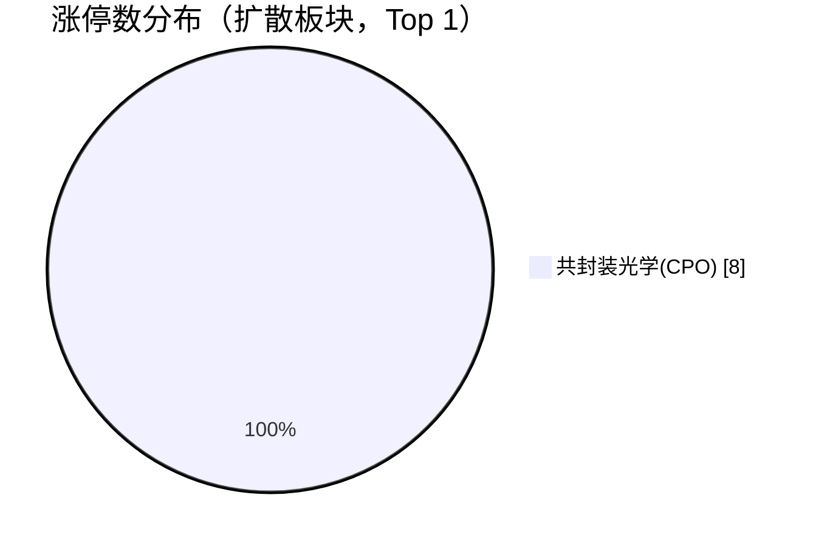
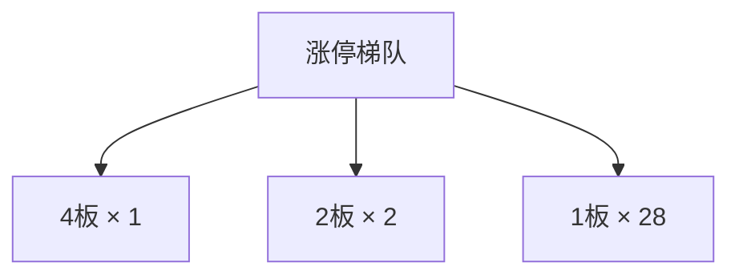
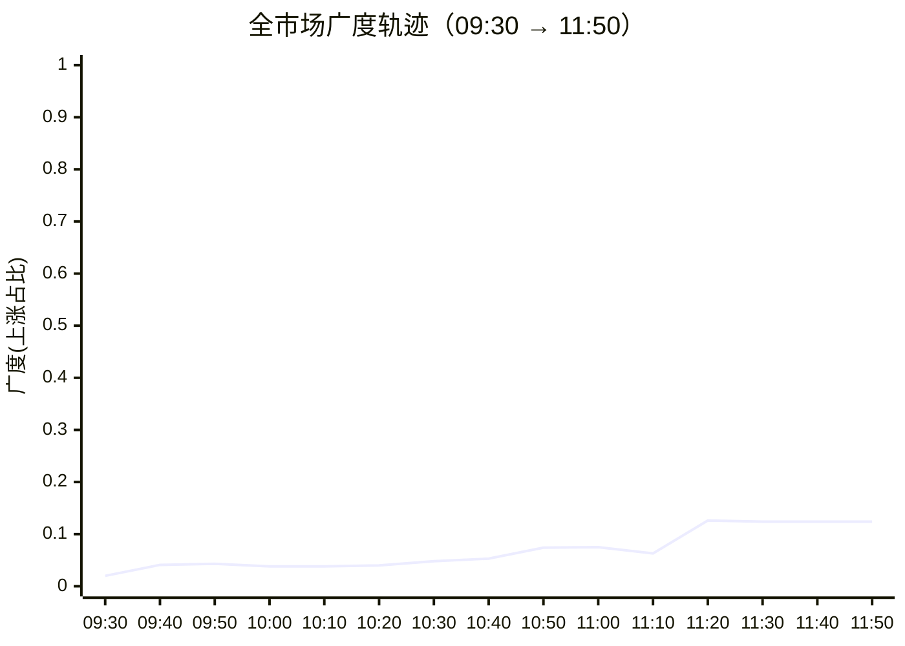

## 当日总览（截至 11:50）

> **结论**：全市场涨690/跌4818（广度0.13）；涨停31/跌停6；中位涨幅-1.86%；局部修复。 钱在：共封装光学(CPO)(涨停8/成分230，中位-2.28%)；零星涨停：托育服务(1)、中韩自贸区(1)、黑龙江自贸区(2)、草甘膦(1)、抗病毒面料(1)。 退潮：数据中心(AIDC)(跌停2)、燃料电池(跌停2)、DeepSeek概念(跌停2)。 梯队：4板×1、2板×2、1板×28，最高4板。 预案：无有效对照。 较上一轮广度基本持平。

> 🔒 **no_trade / 买入预算 0 / max_position_pct 0 —— 全部内容仅供研究，不授予交易权限。**

### 板块扩散

> 口径：XTick 概念成分 × 全市场实时报价；分母 = 板块内有有效报价的成分数。排序用涨停密度（涨停数/有效成分数），已剔除宽基属性板块（全市场 432 个板块中剔 16 个）。

**扩散中（题材，按涨停密度排序）**

| 板块 | 涨停 | 有效成分 | 涨停密度 | 上涨广度 | 中位涨幅 | 相对全市场 | 成交(亿) |
|---|---|---|---|---|---|---|---|
| 托育服务 ⬦ | 1 | 15 | 0.067 | 0.40 | -1.11% | +0.75% | 29 |
| 中韩自贸区 ⬦ | 1 | 17 | 0.059 | 0.24 | -0.93% | +0.93% | 37 |
| 黑龙江自贸区 ⬦ | 2 | 36 | 0.056 | 0.11 | -1.46% | +0.40% | 57 |
| 草甘膦 ⬦ | 1 | 19 | 0.053 | 0.16 | -1.81% | +0.05% | 13 |
| 抗病毒面料 ⬦ | 1 | 20 | 0.050 | 0.10 | -1.75% | +0.11% | 11 |
| 转基因 ⬦ | 1 | 21 | 0.048 | 0.52 | +0.20% | +2.06% | 19 |
| 信托概念 ⬦ | 1 | 23 | 0.043 | 0.17 | -1.20% | +0.66% | 30 |
| 社区团购 ⬦ | 2 | 51 | 0.039 | 0.16 | -1.36% | +0.50% | 43 |
| 共封装光学(CPO) | 8 | 230 | 0.035 | 0.18 | -2.28% | -0.42% | 1,345 |
| 广东自贸区 ⬦ | 1 | 29 | 0.035 | 0.24 | -1.44% | +0.42% | 43 |
| 租售同权 ⬦ | 1 | 29 | 0.035 | 0.14 | -1.75% | +0.11% | 29 |
| 北交所概念 ⬦ | 1 | 29 | 0.035 | 0.10 | -1.90% | -0.04% | 42 |

> ⬦ = 涨停 <3 只，零星个例，不构成扩散（不计入「钱在」判定）。



零星涨停板块（<3 只）：托育服务(1)、中韩自贸区(1)、黑龙江自贸区(2)、草甘膦(1)、抗病毒面料(1)、转基因(1)、信托概念(1)、社区团购(2)

**退潮中（跌停集中）**

| 板块 | 跌停 | 有效成分 | 上涨广度 | 中位涨幅 |
|---|---|---|---|---|
| 数据中心(AIDC) | 2 | 664 | 0.10 | -2.15% |
| 燃料电池 | 2 | 212 | 0.12 | -2.09% |
| DeepSeek概念 | 2 | 769 | 0.14 | -1.78% |
| 2024中报预增 | 2 | 653 | 0.14 | -1.90% |
| 区块链 | 2 | 261 | 0.15 | -1.72% |
| 东数西算(算力) | 2 | 417 | 0.15 | -2.09% |
| 算力租赁 | 2 | 188 | 0.18 | -1.97% |
| PVDF概念 | 1 | 17 | 0.00 | -3.02% |
| 2024三季报预增 | 1 | 98 | 0.05 | -1.93% |
| 液冷服务器 | 1 | 240 | 0.05 | -2.38% |
| 氟化工概念 | 1 | 70 | 0.06 | -2.79% |
| 供应链金融 | 1 | 50 | 0.06 | -1.64% |

### 涨停梯队

> 最高 4 板 ｜ 涨停 31 ｜ 跌停 6 ｜ 炸板 7 ｜ 封板率 81.6% ｜ 打板成功率 11.54% ｜ 一进二 9.52% ｜ 二进三 0.00%

| 身位 | 家数 | 成员（涨幅/封单亿/首封） |
|---|---|---|
| 4板 | 1 | 真视通 +10.01%/0.026亿/09:30 |
| 2板 | 2 | 中京电子 +10.02%/0.038亿/09:36；*ST发展 +10.00%/0.003亿/09:25 |
| 1板 | 28 | 超声电子 +9.98%/0.094亿/10:00；满坤科技 +20.00%/0.078亿/11:20；东方海洋 +9.97%/0.059亿/09:42；华微电子 +10.01%/0.038亿/09:32；风语筑 +10.00%/0.026亿/10:44 |



炸板 7 只（前几）：*ST启环(5次)、盛剑科技(4次)、冰山冷热(2次)、华软科技(1次)、直真科技(1次)

### 预案池对照

无预案数据。

### 盘面 vs 静态复盘 vs 消息面

| 维度 | 对象 | T-1 静态基线 | 今日盘面 | 关系 |
|---|---|---|---|---|
| 板块主线 | 存储芯片/长鑫链（回购-减资事件 + DRAM 供需） | R2 次线 score=61 涨停None（T-1 口径） | 盘面未见该板块成分票涨停 | **背离** |
| 板块主线 | 机器人（人形机器人标准/关节） | R2 次线 score=52 涨停None（T-1 口径） | 盘面未见该板块成分票涨停 | **背离** |
| 板块主线 | 算力/CPO（退潮反抽） | R2 次线 score=47 涨停None（T-1 口径） | 盘面未见该板块成分票涨停 | **背离** |
| 板块主线 | 家电（高标博弈/霸榜警报） | R2 次线 score=45 涨停None（T-1 口径） | 盘面未见该板块成分票涨停 | **背离** |
| 梯队结构 | 最高4板 | T-1 最高梯队 4 板、首板 29、炸板率 39.06% | 今日 4板×1、2板×2、1板×28；封板率0.8158 炸板7只 | **印证** |
| 消息面对照 | 盘面热点板块 | R4 消息面（T-1 口径） | 实时快讯未出现热点板块关键词 | **无响应** |

**分歧点（不掩盖）：**
- 板块主线·存储芯片/长鑫链（回购-减资事件 + DRAM 供需） → 背离：T-1 有辨识度但今日盘中无涨停响应，题材未获资金确认
- 板块主线·机器人（人形机器人标准/关节） → 背离：T-1 有辨识度但今日盘中无涨停响应，题材未获资金确认
- 板块主线·算力/CPO（退潮反抽） → 背离：T-1 有辨识度但今日盘中无涨停响应，题材未获资金确认
- 板块主线·家电（高标博弈/霸榜警报） → 背离：T-1 有辨识度但今日盘中无涨停响应，题材未获资金确认

### 全天广度轨迹

| 时点 | 涨 | 跌 | 广度 | 涨停 | 跌停 | 成交(亿) | 有效样本 |
|---|---|---|---|---|---|---|---|
| 0930 | 109 | 5427 | 0.020 | 3 | 11 | 409 | 5566 |
| 0940 | 226 | 5326 | 0.041 | 8 | 17 | 2,388 | 5572 |
| 0950 | 241 | 5303 | 0.043 | 13 | 12 | 3,494 | 5572 |
| 1000 | 210 | 5353 | 0.038 | 13 | 19 | 4,426 | 5572 |
| 1010 | 212 | 5344 | 0.038 | 15 | 19 | 5,190 | 5572 |
| 1020 | 222 | 5343 | 0.040 | 17 | 18 | 5,766 | 5572 |
| 1030 | 267 | 5290 | 0.048 | 18 | 16 | 6,260 | 5572 |
| 1040 | 295 | 5255 | 0.053 | 19 | 18 | 6,699 | 5572 |
| 1050 | 411 | 5114 | 0.074 | 23 | 12 | 7,153 | 5572 |
| 1100 | 419 | 5108 | 0.075 | 22 | 15 | 7,463 | 5572 |
| 1110 | 353 | 5196 | 0.063 | 21 | 15 | 7,777 | 5572 |
| 1120 | 703 | 4794 | 0.126 | 24 | 9 | 8,197 | 5572 |
| 1130 | 690 | 4808 | 0.124 | 31 | 6 | 8,617 | 5572 |
| 1140 | 690 | 4808 | 0.124 | 31 | 6 | 8,617 | 5572 |
| 1150 | 690 | 4808 | 0.124 | 31 | 6 | 8,617 | 5572 |

> ⚠ **数据冻结段**：1130–1150 数值连续完全一致，说明行情源未刷新，**不是市场横盘**，该段不可解读为盘面变化。



### 观察建议（仅研究）

- **环境**：涨停 31.0 / 跌停 6.0，打板成功率 11.5%，一进二 9.5%。
- **方向**：今日形成实质扩散的是 共封装光学(CPO)（涨停8/成分230，密度0.035，中位-2.28%）。**需确认**：次日能否维持涨停家数且中位涨幅不掉队，否则只是普跌中的避险轮动。
- **零星**：托育服务(1只/15成分)、中韩自贸区(1只/17成分)、黑龙江自贸区(2只/36成分)、草甘膦(1只/19成分)、抗病毒面料(1只/20成分) 属零星个例，不视为题材，不据此选股。
- **回避**：数据中心(AIDC)（跌停2）、燃料电池（跌停2）、DeepSeek概念（跌停2） 板块中位跌幅深，趋势未止跌前不接。
- **身位**：最高 4 板。梯队有高度不等于可接力，需逐票核验封单稳定性与开板次数后再定。

<details>
<summary>原始截面与数据质量（折叠）</summary>

**跨源校验**

```json
{
  "xtick": {
    "up": 690,
    "down": 4818,
    "n": 5585,
    "amount_yi": 8556.5
  },
  "rtk_snapshot": {
    "up": 690,
    "down": 4808,
    "valid_n": 5572,
    "amount_yi": 8616.6,
    "up_limit": 31,
    "down_limit": 6
  },
  "note": "两源口径不同（XTick 全市场含全部票；rt_k 返回样本）"
}
```

**rt_k 截面（原始）**

```json
{
  "market": {
    "total": 5585,
    "up": 690,
    "down": 4808,
    "flat": 74,
    "requested_n": 5585,
    "received_n": 5585,
    "valid_n": 5572,
    "missing_n": 13,
    "universe_requested_n": null,
    "population_scope": "returned_rows_not_verified_all_a_universe",
    "up_ratio": 0.1235,
    "legacy_up_ratio_placeholder": false,
    "up_ratio_is_observed": true,
    "up_ratio_all": 0.1235,
    "up_ratio_valid": 0.1238,
    "up_ratio_denominator": "requested_n",
    "degraded": false,
    "limit_known_n": 5572,
    "limit_unknown_n": 0,
    "limit_counts_complete": true,
    "limit_source_errors": [],
    "up_gt3": 160,
    "up_gt5": 87,
    "up_limit": 31,
    "down_gt3": 1050,
    "down_gt5": 175,
    "down_limit": 6,
    "amount_yi": 8616.6,
    "amount_sum_overflow": false,
    "amount_valid_n": 5572,
    "amount_missing_n": 0
  },
  "source_time_quality": {
    "quote_age_min_seconds": 1.816221,
    "quote_age_max_seconds": 60.816221,
    "source_age_limit_seconds": null,
    "freshness_status": "age_limit_not_configured",
    "age_reference_at": "2026-11-20T11:50:09.816221+08:00"
  },
  "trading_authorized": false
}
```

</details>

## 分时研判记录

### 09:30 研判增量

> 数据时点：采集 09:30:07→09:30:29，行情源时标 09:30:05–09:30:26，报价年龄 3.5–24.5 秒。**这是当日首轮截面（开盘 30 秒），没有相邻轮次可比**，下面所有"变化"都是相对 T-1 收盘基线说的，不是轮间变化。

- **趋势**：开盘是"全员缩水、无人赚钱"，但还不是踩踏。涨 136 / 跌 5412（XTick 口径，分母 5585，上涨占比 2.4%）；另一源 rt_k 是 109 / 5427（有效样本 5566，上涨占比 2.0%）——两源分母不同，只作方向对照，不相减。跌超 5% 的只有 138 只（占 2.5%），而昨日收盘是 732 只；中位 −2.22%，昨日 −2.55%。读法：低开是普遍的，但极端票比昨天少，恐慌没出现，赚钱效应却归零。真正被点名的是昨日最强的一端——科创50 −3.21%（海光 −9.41%、盛科 −6.42%、沐曦 −6.10%、源杰 −5.21%），昨日"科创三连阳收复 20 日线"这条基线当场作废：补跌轮到前期强势端，不是新逻辑。
  - 数据质量：单轮无法验证连续刷新，不能据此说"企稳"或"数据冻结"；开盘 30 秒的涨停 3 / 跌停 12 / 炸板 0 / 封板率 100% 是时点失真值（首封多在盘中形成、炸板还没发生），不可以当全天定局。

- **轮动**：**今天没有真扩散的方向。** 全市场 432 个概念板块里，涨停密度最高的是租售同权（1 只涨停 / 29 个成分，密度 0.035），前 12 名全部只有 1 只涨停——离"判定钱在哪个方向"的 3 只门槛差得远。相对强度（板块中位涨幅减去全市场中位）最靠前的是光刻胶 +0.44 个百分点、中芯国际概念 +0.42、钠离子电池 +0.35、固废处理 +0.24，全部在半个百分点以内，属开盘噪声，不构成"逆势走强"。
  - 跷跷板出在**半导体内部**：设备/材料端还在被抱（盛剑科技 4 板一字、光刻胶相对抗跌、中芯国际概念 8 涨/91 成分且成交 31.4 亿为这批里最大），算力芯片端单边失血（海光、沐曦、盛科、源杰全线 5–9% 跌幅）。这和昨日复盘"国产算力被分成两半，强的涨停、弱的跌停"是同一个结构，今天是弱的那半继续崩、强的那半续封，不是先跌后跌的顺序轮动。
  - 失血端：DeepSeek 概念跌停 4 只、粤港澳大湾区 3 只、新疆振兴 2 只。跌停名单里最值得记的是**华东重机 −10.04%**——昨日炸板 3 次的最高标（收 +4.07%、换手 51.3%），今天直接核按钮。这延续的是"没有身位的票被罚"，不是"打板被抓"。

- **剧本**：**今天没有权威预案可对**。data/plans/20261120/ 下只有竞价修订文件、没有预案本体，预案池为空、逐票判定为空，竞价修订状态是 timeout_no_amendment（原因是预案与竞价快照双双缺失），竞价页因此不出任何授权。所以本轮不谈"触发价到了没有"——没有 trigger_price / buy_zone 可比，也不拿 20261119 的旧预案顶替。
  - 能对照的只有研究端今早的两块静态结论：①今早唯一主线定的是半导体制造端（晶圆制造/设备/封测/材料配套），打分 83，龙一盛剑科技，但整体状态是降级、置信 0.55，可交易主线确认数 0；②反证环节早上就点过盛剑"3 板但封单只占流通 0.78%、换手 20%、龙虎榜有上涨净卖疑点"——高度成立、承接未证。
  - 盘面这一轮给的答案：盛剑科技 4 板、竞价即封（首封 09:25）——"高度成立"兑现了；但封单只有 0.017 亿（约 170 万），成交 0.45 亿，比昨日被指出的薄封更薄，"承接未证"既没被证伪也没被证实。真视通同期 4 板，封单 0.027 亿（约 270 万）、成交 2.68 亿。也就是说：这条唯一主线的高度，目前挂在两个百万级封单上。
  - 梯队延续性：3 进 4 是 66.67%（昨日 3 板 3 只中 2 只晋级，掉队的是全筑股份，本轮未封板）、2 进 3 是 0.00%（昨日京蓝科技、华升股份两只 2 板今日均无涨停）、一进二 4.76%，今日无一只首板涨停。层级越高越硬、越低越空，与昨日复盘的分层反馈同构——这条结构今天没变。

- **下一步看**：四组可验条件，任一条达标/破位都能改写今天的判定。
  1. **首板家数**：本轮首板 0 只（开盘 30 秒，需先排除"尚未首封"）。09:50 仍为 0 → 全天无赚钱效应扩散，按退潮处理，不做接力假设；10:00 前出现 ≥3 只首板才谈得上情绪回暖。
  2. **涨停/跌停门槛**：09:50 前涨停家数 ≥12、且至少 1 个板块涨停 ≥3 只 → 才算"出现真扩散"，可进入主线讨论；跌停越过 30 只（昨日收盘 68 只作参照）→ 补跌加速，反向剧本成立。
  3. **主线锚的封单**：盛剑科技价格是否守住在涨停价、封单从 170 万往上增还是往下掉；一旦开板，唯一主线的锚就断了（真视通 270 万封单同理）。看价格和封单变化，不看"封板率 100%"这个开盘失真值。
  4. **科创50 与算力芯片**：指数是否从 −3.21% 收窄、海光/沐曦是否回抽。若不回抽，今天没有第二条线能顶上来，指数反弹只是抽，不能当风格切换。
  - 另：下一轮（09:40）请核有效样本数是否仍接近 5566；若大幅下降，说明该轮返回质量降级，与本轮不可跨轮比较。

### 09:40 研判增量

> 数据时点：本轮截面采集 09:39:54→09:40:26，行情源时标 09:39:54–09:40:26，报价年龄 3.2–35.2 秒，有效样本 5572（上轮 5566，**未降级，两轮可同口径相减**，已回答 09:30 留的核验项）。指数与个股补价时标 09:46:29–09:48:20，**比截面晚 6–8 分钟，下文凡带 09:46/09:48 的数字均单列标注，不与 09:40 截面拼成同一瞬间**。09:30 那一轮是开盘 30 秒的时点失真值，本轮才是第一个可用于比较的连续交易截面。

- **趋势**：**上涨家数翻倍，但这不是修复——是"点火"和"下沉"同时加速。**
  - 涨 109→226（分母 5566→5572），上涨占比 1.96%→4.06%；但同一时段：跌超 5% 由 138→383（2.8 倍）、跌超 3% 由 1274→2618（翻倍）、全市场中位涨幅 −2.22%→−2.80%（恶化 0.58 个百分点）。拉动集中在少数票，多数票在继续沉，所以广度上行、中位下行同时成立。
  - 涨停 3→8（其中首板 0→5）、跌停 11→16（rt_k 同日口径 17，两源天然差 1，不作趋势结论）、炸板 0→1、封板率 100%→88.9%。打板成功率 11.54%（两轮同值，昨日基数未变）、一进二 4.76%→9.52%、二进三 0.00% 不变、三进四 66.67%→33.33%（盛剑开板把它拉了下来）。
  - 对 09:30 两条观察条件的直接回答：①"10:00 前出现 ≥3 只首板"——**已提前满足**，09:40 已有 5 只（华微电子、光华科技、荣联科技、直真科技、建业股份）；②"09:50 前涨停 ≥12 且至少 1 个板块涨停 ≥3 只"——**未满足**（涨停 8、板块最高 2 只）。两条一半一半，读数是：赚钱效应在"点"上复活、在"面"上没起来。按退潮中的反抽处理，不按修复处理。

- **轮动**：**真扩散仍未出现，但行业口径冒出了本周第一条像样的线索——而且跷跷板的形状变了。**
  - 概念口径依旧够不着门槛：12 个上榜板块里最高的只有 2 只涨停（电力物联网 85 成分、6G 概念 99 成分、华为昇腾 105 成分），全部低于"≥3 只"的判定门槛，只能算零星个例。
  - 行业口径（申万、带分母）**电子** 522 成分、3 只涨停、广度 0.132（全市场 0.041）、中位 −2.08%（相对全市场 **+0.72 个百分点**）、成交 640.6 亿＝全市场 2388.3 亿的 **26.8%**。广度、相对强度、成交额三项同时正向，是当日唯一一条。
  - 同样是"3 只涨停"，**计算机**中位 −3.25%（相对 −0.45pp）：涨停集中在个别票、板块整体不跟，是"点"不是"面"。差别不在涨停数，在分母和中位——这正是不能用涨停绝对数下结论的原因。
  - 失血端：**传媒** 4 跌停、中位 −3.69%（相对 −0.89pp，全场最差之一）；概念口径 电子商务、文化传媒、创投、虚拟现实各 4 跌停，AI 应用 3 跌停。
  - 跷跷板：**硬件（半导体制造／PCB／功率）吸金 ⇄ 应用与内容（AI 应用、传媒、游戏、IP 经济）失血**。昨日复盘的口径是"国产算力分成设计／GPU 与制造设备两半"，今天这条裂缝扩成了"硬件 vs 应用／内容"。
  - 概念榜噪声提醒：前 12 名 10 分钟内换掉 2/3（华为海思、语音技术、时空大数据、光刻胶、中芯国际概念、人脸识别、高压快充、在线教育掉出；广东自贸区、AI 手机、PET 铜箔、云办公、国资云、WiFi6、新型烟草进来）。这全是 1–2 只涨停的排列组合，**不能当今日方向读**，方向看行业口径的分母。
  - 外部背景（快讯时标 09:40 前后）：中际旭创盘中跌超 5%（09:48:18 报 386.39，−5.39%，成交 40.9 亿）、台湾加权指数跌 5%。算力容量票被杀，却与"算力情绪票（真视通）封 4 板"并存——这条线上钱只给情绪板、不给容量票。

- **剧本**：**依然没有权威预案，不做"到价/未到价"判定；能对的是研究端静态，加今天盘面给出的四个答案。**
  - 预案本体缺失：`data/plans/20261120/` 下只有 `auction_amendment.json`，status＝`timeout_no_amendment`（预案目录未产出、09:27 竞价快照未落盘、research_summary 为 partial），`plan_check` 0 条。**没有 trigger_price／buy_zone 可比，不做触发判定，也不拿 20261119 旧 plan 顶替**——这是缺数据，不等于"预案通过"。
  - **盛剑科技**（R2 龙一，昨 3 板：封单 0.285 亿＝流通 0.78%、换手 20%、龙虎榜上涨净卖背离；R6 判"高度成立、承接未证"）：09:40 截面记到开板 1 次（+9.96%），到那一刻"承接未证"正往"证伪"滑；但 09:46:46 补价显示它一字开 27.71 → 最低 24.28（−3.63%，落差 12.4%）→ 又回到 27.71 涨停，成交 3.35 亿、买一挂单约 438 万股（≈1.2 亿元）。即**开板砸 12% 后回封**：R6 的质疑没有变成"已证伪"，变成了"分歧后回封"，但一次回封仍不足以称"承接已证"。
  - **真视通**（R2 明写"一字不可买"，昨 3 板、封单 2.08 亿）：今天**没有一字**——开 14.53（+1.04%），最低等于开盘价，09:46:45 在 15.82 涨停（4 板），成交 3.74 亿、买一约 2466 万股。昨天"排不到"的票今天给了开盘后的窗口，且是梯队里最硬的承接 → **高度身位实际已从盛剑移到了真视通**（真视通 4 板独苗；盛剑同为 4 板但盘中已破过板）。
  - **中京电子**（R6 判"首板是被罚通道、不进执行优先序"）：今天 2 板晋级（09:36 首封，成交 8.53 亿为全梯队最大）。R6 那条在单票层面被打了一次脸；但全市场一进二只有 9.52%，不据此改结论，只记为待复核。
  - **全筑股份**（昨 3 板一字、封单 0.96 亿）：09:48:19 报 2.14（−8.55%），最低 2.11（−9.83%）。"高位一字、无承接的被罚"今天照旧生效，这是 R6 `extreme_tail_risk` 的正向验证，也说明三进四 33.33% 是真实掉队、不是统计噪声。
  - 封单口径说明：同一字段不同源差异极大（09:40 XTick 梯队记真视通封单 0.048 亿，09:46 tushare 买一约 3.9 亿）。**不跨源相减**，只用它判断"有没有封单"，不用它判断"增了多少"。
  - 以上全部是研究观察：`no_trade=true`、买入预算 0、`max_position_pct=0`，**不构成任何买入许可**；引用的价位是盘口事实，不是买点。

- **下一步看**：六组可验条件，每一条达标或破位都能改写今天的判定。
  1. **盛剑 27.71**：守住 → "分歧后回封"成立；再开一次且回封失败 → 半导体制造端这条唯一主线的锚断掉。看**开板次数 + 买一挂单量**，不看"差一分钱"。
  2. **真视通 15.82**：封单是否维持（09:46 买一约 2466 万股）。一旦开板，全场最高身位从 4 板降级，今天唯一硬承接消失。
  3. **电子线是否成线**：现在 3 只涨停／522 成分（密度 0.0057）、广度 0.132。10:30 前涨停 ≥5 且广度 >0.15 → 硬件线成线，可进主线讨论；涨停回落到 ≤2 且广度 <0.08 → 今天只是单票点火。
  4. **跌停与深跌是否继续扩**：跌停 16（昨收 68 作参照），阈值 30；跌超 5% 现在 383（开盘 138）。再扩＝只是抽、不是修复；收窄到 250 以下才算止血。
  5. **指数必须分开读**（09:46 时标，晚于截面 6 分钟）：科创50 −2.01%（开盘 −3.21%，从开盘 +1.23%，距日高仍 −0.75%）、上证 −1.44%（较开盘 −0.03%）、沪深300 −1.67%；创业板 −2.60% 且**现价即日内最低**、深成指 −2.23% 贴日低。反抽只在半导体权重（中芯国际 123.66＝+1.15%，由开盘 −2.09% 翻红），**不在题材成长端**；海光 −7.75%（开盘 −9.41%）只微回抽，仍在深水。指数收窄不等于风格切换。
  6. **板块映射口径提醒**：顶部"算力／CPO → 盘面未见成分票涨停"与真视通 4 板并存，说明同一只票在不同板块体系里归属不同（XTick 概念成分 vs R2 的 886050.TI 算力支线）。这条**不能读成"算力背离"**，只能读成"成分映射不一致、需换口径复核"。

### 09:50 研判增量

> 数据时点：本轮截面采集 09:50:07→09:50:28 完成，行情源时标 09:49:48–09:50:26，报价年龄 2.2–40.2 秒；有效样本 5572（与 09:40 的 5572 相同，**未降级，两轮可同口径相减**，上轮留的核验项已回答）。下文另有一段 09:57:03–09:57:06 的 13 只涨停单票回查，**单独标注，不与 09:50 截面拼成同一瞬间**。

- **趋势**：**强势端在扩张，多数票也在继续下沉——两头变肥、中间被抽干，这不是修复，是资金收缩到少数票的 K 型结构。**
  - 涨停 8→13、首板 5→9、封板率 88.9%→92.9%、跌停（rt_k 口径）17→12、炸板仍是 1 只（直真科技，+7.39%）。上涨占比 4.06%→4.33%（分母同为 5572）。
  - 同一时段恶化的指标：全市场中位涨幅 −2.80%→**−3.22%**（再降 0.42 个百分点）、跌 3–5% 段 2618→**3234 只（+616）**、跌超 3% 2618→3234。而跌超 5% 只从 383→390（基本不动）。
  - 读法：广度微升、涨停翻倍，但中位在跌、跌 3–5 的中段在快速填充，尾部（跌停/跌超 5%）反而没扩。这三组数字同时成立只有一种解释——**抛压没有加剧，是资金在从中段票里抽走、挤到涨停与跌停两端**。涨超 5% 也同步 28→37 只，佐证「两头肥」。中位还在往下时不能叫企稳。
  - 对上轮两条观察条件的回答：①「10:00 前首板 ≥3」已满足（5→9 只）；②「板块涨停 ≥3」出现了（先进封装 5、集成电路 5），但**这个达标要打折**，见轮动第一条。
  - 跌停 12、跌超 5% 390 均未触发上轮定的 30 只反向剧本，**补跌加速暂不成立**；这只是"止血未至"，不是"恐慌已止"。

- **轮动**：**先纠一处口径：顶部"先进封装 5 只 / 集成电路 5 只"是同一组票被两个标签重复计数，不是两条方向。**
  - 成分交集已核（09:57 拉 458 个概念成分 × 涨停 13 只逐一匹配）：先进封装与集成电路概念的两组 5 只涨停**完全相同**——中京电子、盛剑科技、易天股份、光华科技、华微电子；放宽到"芯片概念"口径是 6 只（加建业股份）。所以今天实质只有**一条封测/设备线、6 只票**，写成"两个板块各自 5 只涨停"会把一条线读成两条。
  - 同口径看这条线在**变弱不是变强**：先进封装 涨停 3→5，但广度 0.191→**0.124**、中位 −1.77%→**−3.10%**、相对全市场 +1.03pp→**+0.12pp**；集成电路概念 广度 0.129→0.066、中位 −1.92%→−3.20%、相对 +0.88pp→+0.02pp；申万电子 522 成分 广度 0.132→**0.090**、中位 −2.08%→−3.17%、相对 +0.72pp→**+0.05pp**。涨停数在涨、广度腰斩、相对强度归零——是**分母集体下沉、只留几只票封板**。
  - 按上轮自己定的判据（"10:30 前涨停 ≥5 且广度 >0.15 → 成线"）：**涨停达标、广度失败（电子 0.090 / 先进封装 0.124）**。判定：**未成线，属"5–6 只票抱团点火"，板块其余成分全线走弱，今日仍无主线。** 电子成交 640.6→941.1 亿（占全市场 3494 亿的 27%），钱确实在电子里，但只给这几只。
  - 失血面扩大且集中在昨日主线的容量端：存储芯片 广度 0.163→0.094、中芯国际概念 0.198→0.121、PCB 概念 0.166→0.129、光刻胶 0.212→0.125，四处齐腰。传媒中位 −4.04%（相对 −0.82pp）为全场最差；AIGC −0.77pp、AI 手机 −0.70pp。
  - 新的跷跷板形状：上轮是"硬件吸金 ⇄ 应用/内容失血"，本轮**硬件这条腿也塌了**，唯一逆势方向换成**资源防御**——煤炭 33 成分 广度 0.4242（全市场 0.043 的近 10 倍）、中位 −0.44%、相对 **+2.78pp**，采掘 相对 +1.8pp，涨停各 1 只（安泰集团）。性质是避险，不是新题材，不构成可参与方向。
  - 降噪提醒：概念榜 12 个"扩散中"里，涨停 ≥3 的只有上面那两块（且是同一组票），其余 8 个全是 1–2 只零星个例；前 12 名 10 分钟内仍换掉一半。不做方向读。

- **剧本**：**预案本体今天仍然不存在，逐票"到价/未到价"本轮无法交付——这是缺数据，不是"预案通过"。**
  - `data/plans/20261120/` 下依旧只有 `auction_amendment.json`（status=`timeout_no_amendment`，因预案与 09:27 竞价快照双双缺失），`plan_check` 0 条，**没有 trigger_price / buy_zone / stop_loss 可比**；不拿 20261119 旧计划或 runtime 副本顶替。引用下列价位全部是盘口事实，不是买点。
  - **盛剑科技（4 板）**：09:40 开板记 1 次（+9.96%），09:50 已回封（第一封 09:25，broken_times 1）。但**同一数据源封单一路上薄**：09:30 170 万 → 09:50 110 万 → 09:57 101 万，是 13 只涨停里最薄的一只。→ "分歧后回封"成立，"承接已证"仍不成立；4 板只挂百万级封单，是随时能被砸开的结构，研究端"高度成立、承接未证"的结论没有改写。
  - **真视通（4 板）**：封单 09:30 270 万 → 09:40 480 万 → 09:50 380 万 → 09:57 375 万，**09:40 见顶后转薄**；成交 3.82 亿。承接比盛剑实、但同样在变薄，不能说"越封越硬"。
  - **中京电子（2 板）**：封单 730 万 → 640 万 → 588 万，成交 9.05 亿为全梯队最大，且在先进封装/集成电路/PCB/存储四个标签里都计入涨停。今日给这条封测线定调的资金实际在它身上，不在盛剑——昨日 R6 判"首板是被罚通道、不进执行优先序"，这条在单票层面继续被打脸，但全市场一进二仍只有 9.52%（上轮 9.52%），不改结论，只记待复核。
  - **梯队断层**：4 板 × 2、2 板 × 2、1 板 × 9，**3 板空缺**（二进三 0.00%，昨日 2 板两只仍未晋级）。高位抱团 + 低位点火 + 中间层真空。按既有纪律"梯队断裂时不做高位接力假设"，今日不是可接力结构。
  - **首板成色**：9 只首板里已有 3 只破过板——直真科技（09:40 首板涨停、09:50 炸板 +7.39%，今日唯一炸板）、易天股份 20%（broken 1）、龙版传媒（broken 1）。"首板点火"这半条，10 分钟就被打掉一例。
  - 综上：`no_trade=true`、买入预算 0、`max_position_pct=0`，全部内容仅供研究，不构成任何买入许可。

- **下一步看**：七条可验条件，每条达标/破位都能改写今日判定。
  1. **中位涨幅 −3.22% 是分水岭**：回到 −2.5% 以内、且跌 3–5% 段从 3234 回落至 <2800 → 才算止血；中位继续往 −3.5% 走 → 阴跌仍在扩散，不看涨停数。
  2. **电子广度 0.090**（先进封装 0.124）：10:30 前 >0.15 且涨停 ≥5 维持 → 改判成线、进主线讨论；广度 <0.08 且涨停仍靠同一 5–6 只 → 锁定"抱团非扩散"，今日无主线。
  3. **两个 4 板封单**：盛剑 101 万、真视通 375 万。任一开板且 10 分钟内不回封 → 今日最高身位失效、梯队降级；只增厚才算承接转实。
  4. **3 板是否填上**：出现 ≥1 只 3 板 → 中间层接力、梯队结构修复；到 10:30 仍为 0 → 断层定局，不做接力。
  5. **跌停 12（rt_k）/10（xtick）**：阈值 30，跌超 5% 阈值 400（现 390，已贴线）。越过 → 反向剧本（补跌加速）成立；跌破 250/8 → 才算真正止血。
  6. **煤炭相对强度 +2.78pp**：若 10:30 后煤炭转负、电子又不成线 → 无处避险，指数反抽结束后继续沉，这比涨停家数更能说明资金去向。
  7. **样本核验**：下一轮（10:00）请核有效样本是否仍 ≈5572；若大幅下降，该轮返回质量降级，**不与本轮相减**。

### 10:00 研判增量

> 数据时点：截面 10:00:31 落盘、10:00:36 生成分析，有效样本 5572（与 09:50 的 5572 相同，**未降级，两轮可同口径相减**，已答 09:50 留的第 7 条核验）。下文"变化"全部是 09:50 → 10:00 同分母的相邻轮差；引用价位是盘口事实，不是买点。

- **趋势**：**涨停端停摆、尾部破裂——今天的分歧不在"强不强"，在"多数票正在被重新定价"。**
  - 上涨 241→210（广度 0.0433→0.0377，分母同为 5572）；全市场中位 −3.22%→**−4.15%**（再降 0.93 个百分点）。
  - 真正的变化在分布尾部：跌超 5% 的票 **390→1650（4.23 倍）**，跌超 3% 3234→4227。而 3–5% 这一段反而缩小 2844→2577（−267）——**这不是新票被砸下去，是中段整段下沉、直接跌进深水区**。
  - 跌停（rt_k）12→19（xtick 10→17，两源天然差 2，只作方向）；涨停仍是 13；炸板 1→2（新增华软科技 +6.48%）；封板率 92.9%→86.7%。
  - 量在缩、价在塌：本 10 分钟成交增量 932 亿，比上一段 1105 亿少 **15.7%**，同期跌超 5% 却翻了 4 倍。**放量下跌变成"缩量下跌 + 深水扩容"＝买盘撤离快于卖盘增加**，属承接消失型阴跌，不是抛售高潮；这种形态没有换手释放，不能等"跌透了再买"。
  - 本轮最硬的一条：**13 只涨停的名单 10 分钟内一只没换**（无新增、无掉出），而同期全市场多出 1260 只跌超 5%。**抱团票与全市场已经脱钩**，涨停家数不再是情绪指标，只是 13 个孤立截面。

- **轮动**：**全市场唯一"广度在扩张"的地方是半导体制造/封测链，但它扩张的是成分、不是价格；另一头应用/内容开始出跌停。**
  - 封测/半导体链：先进封装 涨停 5（不变）、广度 0.124→**0.138**；PCB 概念 0.129→0.145、光刻胶 0.125→**0.150**、存储芯片 0.094→0.099、中芯国际概念 0.121（持平）。中位同步跟跌 0.8–1.0 个百分点——因为全市场中位下了 0.93 个百分点，所以只是**相对强度小幅改善**（PCB +0.35→+0.61、中芯 +0.45→+0.54、先进封装 +0.12→+0.21）。
  - 按 09:50 自己定的成线判据（广度 >0.15 且涨停 ≥5）：**涨停达标、广度仍未达标**（先进封装 0.138、集成电路概念 0.070）。判定不变：**5–6 只票抱团，不是板块扩散**；这条线是"抗跌"，不是"走强"。
  - 失血端开始出跌停：AI 应用 跌停 1→4、AIGC 概念 2→4、文化传媒 2→5、DeepSeek 2→4；传媒中位 −4.89%（相对 −0.74pp）为全场最差之一。跷跷板形状确认并扩大：**半导体制造端吸相对买盘 ⇄ 应用/内容出跌停**，与昨日复盘"国产算力分成两半"同构，裂口比 09:40 更宽。
  - 避险方向塌了一半：煤炭广度 0.4242（14 涨/33）→**0.1515（5 涨/33）**，中位 −1.00%，相对强度反而升到 **+3.15pp**（全市场 −4.15%）。读法：**避险资金还在，但参与面塌到只剩一只票**——安泰集团 1 板（09:45 首封），封单 0.036→0.025 亿在变薄。相对强度靠的是别人跌得更多，不是自己有人抢，所以这不是可参与方向，是"无处避险"的前兆。
  - 极端分化要单列：文化传媒 5 只跌停的同时，同板块的龙版传媒首板涨停（已破板 1 次）——**同一板块一头跌停一头涨停，只能读作个例博弈，不能读作板块机会**。

- **剧本**：**预案本体今天仍然不存在，逐票"到价/未到价"无法交付——这是缺数据，不等于预案通过。**
  - `data/plans/20261120/` 下依旧只有 `auction_amendment.json`（status=`timeout_no_amendment`，预案与 09:27 竞价快照双双缺失），`plan_check` 0 条，**无 trigger_price / buy_zone / stop_loss 可比**；不拿 20261119 旧计划或 runtime 副本顶替。
  - 能对照的是盘口事实 × 研究端静态（今早唯一主线＝半导体制造端，score 83、降级、可交易主线确认数 0；R6 判盛剑"高度成立、承接未证"）：
    - **封板质量集体漏气**：13 只涨停里 12 只有封单明细，**11 只环比变薄、1 只持平（*ST发展 0.003 亿）、0 只增厚**。真视通 0.038→0.037 亿（370 万）、盛剑 0.011→0.010 亿（100 万，全梯队最薄）、中京电子 0.064→0.059 亿、东方海洋 0.084→0.076、华微电子 0.082→0.072、安泰集团 0.036→0.025、荣联科技 0.039→0.032。
    - **盛剑科技**：4 板、broken_times 1、封单 100 万、成交 3.46 亿——"高度成立"仍在，"承接已证"仍不成立（只是没再开板）。**百万级封单托 4 板**，结构上随时能被砸开。
    - **真视通**：4 板、0 炸板、封单 370 万、成交 3.83 亿——梯队里最硬，但封单自 09:40 见顶（480 万）后一路降，两轮里从未增厚。
    - **中京电子**：2 板、封单 590 万、成交 **9.1 亿为全梯队最大**——今天这条封测线的真钱在它身上，不在两个 4 板。
    - **断层未修复**：3 板连续三轮空缺（二进三 0.00%），首板 9 只两轮不变、无新增。**高位抱团 + 低位停滞 + 中间真空**，按既有纪律不是可接力结构。
  - 全部仅供研究：`no_trade=true`、买入预算 0、`max_position_pct=0`，不构成任何买入许可；上述价位是盘口事实，不是买点。

- **下一步看**：先答 09:50 的七条，再补三条新的。
  - ①中位 −4.15%：**破位**（阈值 −2.5%，且跌 3–5% 段没回落、而是整段下沉进深水），阴跌在扩散，不看涨停数。
  - ②电子广度 0.090→0.0958、涨停 5 维持：**仍未成线**（阈值 0.15）。
  - ③两个 4 板：均未开板，但封单都没增厚（真视通 −10 万、盛剑 −10 万），**质量未改善**。
  - ④3 板仍为 0；10:30 前不填上，断层定局，不做接力。
  - ⑤跌停 19（阈值 30，未越）；但**跌超 5% 1650 已远超 400 阈值 → 反向剧本（补跌加速）当场成立**，只是还没到"踩踏"级别。
  - ⑥煤炭广度 0.1515、相对 +3.15pp：避险还在，参与面塌，见轮动。
  - ⑦样本 5572＝5572：未降级，本轮与上轮可比。
  - **A. 13 只涨停是否出现第一只开板**：盛剑 100 万封单最脆。一旦开板，"抱团票脱钩"结束、涨停数从 13 掉；若同时仍无新首板补位 → 今日没有接力土壤。
  - **B. 跌超 5% 的 1650 是否继续扩**：10:30 前 >2500 → 升级为踩踏；回落到 <800 且中位回到 −3.0% 以内 → 才算真止血。
  - **C. 成交节奏**：若 10:10 这一段增量降到 <700 亿而跌幅继续扩，锁定"承接消失型阴跌"，不期待 V 型反转。

### 10:10 研判增量

> 数据时点：截面采集 10:10:07→10:10:27，行情源时标 10:09:24–10:10:23，报价年龄 4.5–63.5 秒；有效样本 5572（与 10:00 的 5572 相同，**未降级，两轮可同分母相减**，已答上轮第 7 条核验）。下文轮差全部是 10:00→10:10 同口径值；引用价位是盘口事实，不是买点。梯队明细 JSON 展开 12 只、`limit_up_n` 记 15，少 3 只未展开。

- **趋势**：**深水区第一次收缩，但这是"卖压衰减"不是"买盘回归"——广度一动不动，只有尾部在收。**
  - 上涨 210→212（广度 0.0377→0.0380，分母同为 5572，实质无变化）；全市场中位 −4.15%→**−3.97%**（+0.18pp）。
  - 真正变化在尾部：跌超 5% **1650→1252（−398 只，−24%）**、跌超 3% 4227→4089；涨超 3% 63→68、涨超 5% 33→35。这是今日开盘以来第一次"深水变浅"。
  - 但同段成交增量 **932→764 亿（再缩 18.1%，连续三段缩量 1105→932→764）**；封板率 92.9%→86.7%→**75.0%**、炸板 2→5（新增建业股份 2 次、冰山冷热 2 次、安泰集团）。**价在抬、量在退、封板在漏**——深水票不是被买起来的，是没人再往下砸。不能写成修复。
  - 涨停 13→15，但名单 10 分钟内换掉 3 只（出：安泰集团、龙版传媒、东晶电子；进：超声电子 10:00、澳弘电子 10:04、国光股份 10:09）。上轮"13 只名单一只没换"的抱团脱钩状态**本轮结束**——涨停数在增、成分在换，说明抱团名单本身不稳。

- **轮动**：**增量资金只往一个地方去：PCB。避险端反而在退，内容端的跌停潮在收。**
  - PCB 概念：涨停 2→4、广度 0.1452→**0.1535**、成交 412→503 亿——今日唯一"涨停增加 + 广度同步上升"的方向。（10:00 后新封的超声电子、澳弘电子，成分归属我未逐票核验，只记 PCB 口径的聚合变化，不写成"这两只就是 PCB 票"。）
  - 申万电子 522 成分：涨停 5→7、广度 0.0958→**0.1015**、成交 1177.3→**1395.9 亿（+218.6 亿，占全市场增量 763.7 亿的 28.6%）**。但中位 −4.05%→−4.00%，相对全市场 **+0.10pp→−0.03pp 转负**。钱在电子是真的，价格没跑赢大盘：**钱到"点"不到"面"**。
  - 按 09:50 自定成线判据（广度 >0.15 且涨停 ≥5）：电子 0.1015 差线、PCB 广度 0.1535 达标但涨停 4 <5 → **两条腿都没有同时满足，今日仍无成线主线**。
  - 避险端在退，这是本轮最关键的变化：煤炭 涨停 1→**0**——唯一避险票安泰集团炸板 +8.5%；广度 0.1515 持平、中位 −1.00%→−1.27%、相对 +3.15→**+2.70pp**；银行 相对 +3.69→**+3.17pp**、广度 0.2381→0.2143、中位 −0.46%→−0.80%。**防御方向的相对强度两项齐降**，"无处避险"从预兆变成进行中。
  - 失血端反向在收：文化传媒 跌停 5→**3**、电子商务 4→3；传媒 广度 0.0458→0.0534、中位 −4.89%→−4.68%。内容/应用端的跌停潮与深水收缩同源。
  - 跷跷板形状第三次变形：09:40"硬件吸金 ⇄ 内容失血" → 10:00"避险独苗（煤炭）" → 10:10 **PCB 单点吸金 ⇄ 避险与内容同时止跌**。这不是板块间搬钱，是存量资金在挑阻力最小的单点。

- **剧本**：**预案本体仍不存在，逐票"到价/未到价"继续无法交付——这是缺数据，不等于预案通过。**
  - `data/plans/20261120/` 下只有 `auction_amendment.json`（status=`timeout_no_amendment`），`plan_check` 0 条、snapshot `pool` 0 只，**无 trigger_price / buy_zone / stop_loss 可比**；不拿 20261119 旧计划或 runtime 副本顶替。
  - 封板质量（同源跨轮，只比两轮都在榜的票）：9 只重合票里 **8 只封单再薄、1 只持平（*ST发展 0.003 亿）、0 只增厚**。盛剑 0.010→**0.009 亿（90 万，全梯队最薄）**、真视通 0.037→0.035 亿（350 万，自 09:40 峰值 480 万起五轮未增厚）、中京电子 0.059→0.056 亿、东方海洋 0.076→0.072、华微电子 0.072→0.067。
  - **盛剑科技**（4 板、broken 1 次、成交 3.48 亿）：高度成立仍在，"承接已证"仍不成立，封单已薄到 90 万——结构上随时能被砸开。
  - **真视通**（4 板、0 炸板、成交 4.01 亿）：梯队最硬，但封单趋势仍是单向变薄。
  - **中京电子**（2 板、成交 9.2 亿＝梯队最大）：这条线的真钱仍在它身上，不在两个 4 板。
  - **超声电子**（1 板、10:00 首封、封单 0.174 亿＝全梯队最大、成交 18.26 亿）：今日第一只"厚封单 + 大成交"的首板，但样本只有 10 分钟、无回封历史，谈承接仍早。
  - **掉出三只的读法**：安泰集团＝唯一避险票，炸了；龙版传媒＝传媒唯一涨停（昨已破板 1 次），掉出；东晶电子＝成交 0.27 亿的迷你票。10:00 那条"同板块一头跌停一头涨停只能读个例"的观察，本轮由龙版掉出给了答案——**个例博弈也没守住**。
  - **梯队**：4 板×2 / 2 板×2 / 1 板×11，3 板连续四轮空缺（二进三 0.00%，一进二 9.52% 四轮未动）。高位抱团 + 低位补位 + 中间真空，形态没变，按既有纪律不是可接力结构。
  - **全部仅供研究**：`no_trade=true`、买入预算 0、`max_position_pct=0`，不构成任何买入许可。

- **下一步看**：先答上轮 A/B/C，再补 PCB、电子、避险三条。
  - **A. 13 只涨停是否出现第一只开板**：**已出现**——不是开板，是 3 只直接掉出（封板率掉到 75%）；同时 3 只新首板补位，所以涨停数反升。结论：接力土壤仍无，只是名单轮转。
  - **B. 跌超 5% 的 1650 是否继续扩**：**首次回落 1252（−24%）**，距 2500 踩踏线更远、距 800 止血线仍差 452 只；中位 −3.97% 未回到 −3.0% 以内。判定：深水收缩，未止血。
  - **C. 成交节奏**：本段 764 亿，**未破 700 亿阈值但已贴近**，跌幅同时收窄——目前只能读作"缩量阴跌的减速段"，不是换手承接。10:20 段若 <700 亿 → 锁定缩量阴跌；若回到 >1000 亿且中位不再恶化 → 才谈得上承接。
  - **D. PCB 4 涨停 / 广度 0.1535**：10:30 前维持涨停 ≥4 且广度不跌破 0.13 → 保留为今日唯一候选方向；回落到 ≤2 或超声电子开板 → 最后一个吸金点也降级为单票。
  - **E. 电子广度 0.1015**：需 >0.15 且涨停 ≥5 才改判成线，现距阈值 0.048。
  - **F. 避险两条腿**：煤炭 相对 +2.70pp、银行 +3.17pp 双双回落。10:30 前煤炭中位跌破 −1.5% 且电子不成线 → 全市场无处避险，指数反抽结束后继续沉。
  - **G. 跌停 19（阈值 30）未越**；越过则反向剧本（补跌加速）升级。

### 10:20 研判增量

> 数据时点：截面 10:20:26 落盘、分析同刻生成，行情源时标与采集同步，报价年龄 3.8–68.8 秒；有效样本 **5572＝5572**（与 10:10 相同，未降级，两轮可同分母相减，已答上轮核验项）。梯队明细只展开 8 只、`limit_up_n` 记 17，凡涉及未展开票一律标"未核"。引用价位是盘口事实，不是买点。

- **趋势**：**深水二连收缩、广度不动、量能首次跌破 700 亿——"缩量阴跌减速"被上一轮自己定的阈值锁定，不再是"可能"。**
  - 上涨 212→222（广度 0.0380→0.0398，分母同为 5572）；全市场中位 −3.97%→**−3.73%**（+0.24pp）。
  - 跌超 5% **1252→890（−362 只，−28.9%）**，连续第二段收缩，距 10:00 定的 800 只"止血线"仅差 90 只；跌超 3% 4089→3890；涨超 5% 35→38、涨超 3% 68→67。
  - 本段成交增量 **763.7→576.1 亿（−24.6%）**，四段连续缩量 1105→932→764→576。**10:10 自定的 C 条（<700 亿即锁定缩量阴跌）本轮破线成立**：价在抬、量在退，深水变浅靠的是没人再往下砸，不是有人来买。
  - 涨停 15→17、跌停 19→18、炸板 5→5、封板率 0.75→0.7727。但一进二 9.52%、二进三 0.00%、三进四 66.67% **第五轮一个没动**——涨停数从 13 加到 17 靠的是低位首板轮转，不是情绪抬升；晋级率不动，就说明结构没变。

- **轮动**：**本轮最重要的一次反转：10:00–10:10"半导体制造链广度在扩张"的结论，本轮被它自己的数据作废。**
  - 制造链广度集体腰斩：中芯国际概念 0.1099→**0.0549（−50%）**、存储芯片 0.0936→**0.0542（−42%）**、先进封装 0.1381→**0.1048（−24%）**、光刻胶 0.1125→0.1000。涨停数没掉（先进封装仍 5、存储/中芯仍 1 只），但**成分里翻红的票少了一半**——上轮"涨停达标、广度未达标"的判读，本轮连"未达标"都在往后退。
  - 唯一没退的方向仍是 PCB：涨停 4（不变）、广度 0.1535→**0.1618**、成交 503→560 亿；超声电子封单 0.164 亿、成交 18.59 亿仍是全梯队最厚。但相对强度 0.48→0.29 回落——**它是"唯一没退的"，不是"在走强的"**。
  - 避险端继续失血：银行广度 0.2143→**0.1429（参与面腰斩）**、相对 +3.17→+2.84pp；煤炭广度 0.1515→0.1818 小幅回升但涨停 0、相对 +2.70→+2.39pp、中位 −1.34%。**两条避险腿的相对强度两轮齐降**，"无处避险"继续推进。
  - 新增一条此前没有的线索——**农业（转基因/玉米/农业种植/化肥）**：转基因广度 0.1905 为当日概念口径最高、相对 +1.73pp；玉米广度 0.1471、相对 +1.61pp；农业种植 涨停 0→1、中位 −3.22→−2.75%；申万农林牧渔 涨停 1→2、广度 0.0708→0.0796、相对 +1.06pp。**这是本轮唯一"涨停数与相对强度同步改善"的板块组**，但最高只有 2 只涨停，够不着 ≥3 的真扩散门槛 → 记为零星候选，不构成方向（子板块成分归属未逐票核验，只记聚合变化）。
  - 跷跷板第四次变形：10:10 是"PCB 单点吸金 ⇄ 避险与内容同时止跌" → 本轮 **PCB 单点 ⇄ 电子整体转弱（封测出现首只跌停）**，防御与农业接相对强度。钱仍只在单个点上，始终没变成面。

- **剧本**：**预案本体今天仍然不存在，逐票"到价/未到价"继续无法交付——缺数据不等于预案通过。**
  - `data/plans/20261120/` 下仍只有 `auction_amendment.json`（status=`timeout_no_amendment`），analysis `plan_check` 0 条、snapshot `pool` 0 只，**无 trigger_price / buy_zone / stop_loss 可比**；不拿 20261119 旧计划或 runtime 副本顶替。
  - **本轮新增的硬事实：消息面第一次对上盘面，而且是负向。** 10:19:19–10:19:30 新浪财经、同花顺双源快讯"集成电路封测板块重挫，通富微电跌停，长电科技、甬矽电子、汇成股份、伟测科技、颀中科技等跟跌"。今早研究端唯一主线（半导体制造端，score 83、龙一盛剑科技）的**封测这条腿正在被证伪，不是"抗跌"**。行业口径同步佐证：电子涨停 7 不变、但**跌停 0→1（今日第一个电子跌停）**、广度 0.1015→0.0862、相对强度 −0.03→**−0.35pp 转负**。（跌停明细只展开 16 只中的 8 只，通富微电未在展开名单内核到，此处按双源快讯口径引用，标"未逐票核实"。）
  - 封板质量：两轮重合的 11 只展开票 **10 只封单再薄、1 只持平（*ST发展 0.003 亿）、0 只增厚**，连续第三轮"零增厚"。盛剑科技 0.009→**0.005 亿（50 万，五轮连薄、全梯队最薄）**、成交 3.52 亿；真视通 0.035→0.032（320 万，自 09:40 峰值 480 万起六轮未增厚）；中京电子 0.056→0.054、成交 9.26 亿仍为梯队最大。**百万以内封单托 4 板，结构上随时可被砸开。**
  - 梯队 4 板×2 / 2 板×2 / 1 板 11→**13**，3 板连续五轮空缺。新首板本轮只核到一只：万向德农（10:17 首封、封单 0.02 亿、成交 2.64 亿，农业口径），另 4 只未展开；10:10 展开名单里的国光股份本轮不在展开的 8 只中，其余 5 只未展开，**掉出与否未核，不作结论**。
  - 全部仅供研究：`no_trade=true`、买入预算 0、`max_position_pct=0`，不构成任何买入许可。

- **下一步看**：先答上轮 B–G，再补两条新的。
  - **B（深水）**：跌超 5% 890、两连收缩、距 800 只止血线差 90；中位 −3.73% 仍未回到 −3.0% 以内 → **收缩未止血**。10:30 前 <800 且中位 ≤−3.0% 才算真止血。
  - **C（量能）**：576 亿已破 700 亿阈值，**锁定"缩量阴跌减速"**。要推翻需 10:30 段回到 >1000 亿且中位不再恶化。
  - **D（PCB）**：4 涨停 / 广度 0.1618 / 超声电子未开板，条件**维持**，仍是今日唯一候选方向；跌破广度 0.13 或涨停 ≤2 或超声电子开板 → 最后一个吸金点降为单票。
  - **E（电子成线）**：广度 0.0862，距 >0.15 阈值反而拉大（上轮差 0.048、本轮差 0.064），且出现首只跌停 → **改判路径变长，不再作为候选**。
  - **F（避险）**：银行 +2.84pp、煤炭 +2.39pp 继续降；**煤炭中位 −1.34%，距 −1.5% 触发线仅 0.16pp**——10:30 前跌破则"无处避险"正式成立，指数反抽结束后继续沉。
  - **G（跌停）**：18 只，距 30 只阈值未越。
  - **H（新·封测）**：先进封装广度 0.1048 能否在 10:30 前守住 0.10、涨停 5 是否掉到 ≤3。两者同时成立 → 今早"唯一主线"从"降级"改判为**证伪**，设备端（盛剑 50 万封单）失去板块依托。
  - **I（新·农业）**：转基因/玉米/农业种植合并口径能否出现 ≥3 只涨停，且申万农林牧渔广度站上 0.10。达标才进"候选方向"，否则按普跌中的相对抗跌噪声处理。
  - 样本 5572＝5572 未降级；10:30 轮继续核该值。

### 10:30 研判增量

> 数据时点：截面 10:30:32 落盘、10:30:34 生成，行情源报价年龄 3.2–68.2 秒；有效样本 **5572＝5572**（与 10:20 相同，未降级，两轮可同分母相减，已答上轮核验）。另有一次 **10:37 定向补核**（先进封装/PCB/存储/盛剑/通富微电/农业/黄金，补核行情时标 10:36:59），**比 10:30 截面晚 6 分钟，凡标「10:37 补核」的数字不与 10:30 拼成同一瞬间**，只用于回答 10:20 留下的 D/E/H/I 四条。涨停明细本轮只展开 14 只（4板1＋2板2＋1板11），另 4 只首板未展开、未核。

- **趋势**：**面在止血、点在断——这是本轮必须并列写下的两件事。广度第一次实质抬升，但抬价靠的是抛压枯竭，不是买盘回归；同时全场最强的 4 板锚在本轮被砸开。**
  - 广度 0.0398→**0.0479**（+0.81pp，当日最大单轮增幅），涨 222→267；全市场中位 −3.73%→**−3.24%**（+0.49pp；自 10:00 的 −4.15% 已三连回升共 +0.91pp）。
  - 尾部三连收缩并首次破线：跌超 5% **890→500（−44%）**，已低于 10:20 自定的 800 只止血线；跌超 3% 3890→3290；涨超 5% 38→49、涨超 3% 67→80；跌停 18→16。
  - 但**量能五连缩，且比上轮更差**：本段成交增量 576.1→**494.9 亿**（1105→932→764→576→495）。10:20 的 C 条（回到 >1000 亿才算承接）不止没满足，反而更远。**价抬量退＝卖压衰竭型无量反抽**，不能写成修复。
  - 反过来，结构方向在恶化：涨停 17→18（1 板 13→15，靠低位新封补位），但 **3 进 4 由 66.67%→33.33%、打板成功率 15.38%→11.54%（六轮首次下跌）**，4 板由 ×2 变 ×1——**盛剑科技掉出封板名单（炸板 4 次）**。增的是低位首板，崩的是高位接力。
  - 封板质量第四轮"零增厚"：两轮重合 11 只里 **9 只再薄、2 只数值持平（中京电子 0.054 亿、*ST发展 0.003 亿）、0 只增厚**；华微电子 0.064→0.048（−25%）、超声电子 0.164→0.155、真视通 0.032→0.031。

- **轮动**：**钱没换方向，只是把"最抗跌"换成了"跌得少的那半"在回抽——PCB 依旧唯一不退，制造链内部只剩一条腿，农业广度够了但没涨停。**
  - **电子整体是本轮回升最快的板块**：广度 0.0862→**0.1092**、跌停 1→0、相对全市场 −0.35→**−0.01pp**（几乎追平），成交 1562.5→1690.0 亿。价格仍没跑赢大盘，是"止跌"不是"走强"。
  - **PCB 仍是唯一不退的方向**（10:37 补核，241 只成分）：广度 0.1618→**0.1826**、严格涨停口径 **4 只（不变）**、中位 −2.83%、相对 **+0.29→+0.12pp 继续回落**。按 10:20 判据（广度 >0.15 且涨停 ≥5）：**广度达标、涨停仍差 1 只，第二次"单腿达标"**。读法不变——"唯一没退的"，不是"在走强的"。
  - **制造链只剩先进封装一条腿，而这条腿的龙头在跌停**（10:37 补核）：先进封装 广度 **0.1190**（守住 10:20 的 0.1048 与 0.10 防线）、涨停 5→**4**；但 存储芯片 0.0690、中芯国际概念 0.0769、集成电路概念 0.0788、光刻胶 0.1000，**其余四条腿全部 <0.10**。同时 **通富微电 002156 −10.0% 封死跌停、成交 28.09 亿**（日高 41.0、前收 44.08）。→ 上轮 H 条的答案是 **未证伪、也没证成**：广度回抬是"成分翻红的票变多"，价格上龙头还压在跌停板，相对强度 −0.27pp。注：10:30 分析件把电子跌停记 0，与 10:37 补核的通富封死不一致，按"10:30 时点曾打开、10:37 重新封死"处理，只作时点差记录，不作反转证据。
  - **农业：广度够、涨停不够**（上轮 I 条）。农林牧渔 广度 0.0796→**0.1062（三连升，站上 0.10）**、涨停仍 2、相对 +1.06→+0.76pp 回落。10:37 补核子板块：玉米 广度 0.2059（相对 +1.34）、转基因 0.1905（+1.55）、农业种植 0.0928（+0.71）、化肥 0.0800（+0.42）。**每个子板块只有 1–2 只涨停，合并也够不着 ≥3** → 维持"相对抗跌噪声"，不进候选。
  - **陷阱单列**：基础化工 涨停 1→3（越过 ≥3 门槛），但广度 **0.0310**、中位 −3.21%（相对 +0.03）。涨停绝对数达标而面完全没动——反例就在这里。
  - **避险不是崩，是被摊薄**：银行 相对强度 3.69→3.17→2.84→**2.42pp 四连降**、广度 0.1429→0.1190；煤炭 相对 2.39→2.17、广度 0.1818→0.1515，但中位 −1.34%→**−1.07%（回升）**。→ 上轮 F 条（煤炭中位跌破 −1.5%）**未触发、且反向远离**。判定修正：防御方向没有失血到崩盘，只是相对优势被大盘回升摊薄。
  - **新增跷跷板·商品端**：10:30:03–10:30:19 双源快讯——现货黄金失守 3530 美元（−2.79%）、现货白银 −3% 报 41.51、白银连续主力 −8% 报 9865、铂（广期所/连续）−6%。A 股同步（10:37 补核）：**黄金概念 82 只仅 1 只上涨、广度 0.0122、中位 −3.63%**；有色金属广度 0.0068。**连商品避险端也没有承接**——这是"无处避险"从预判变成事实的第二条证据（第一条是银行/煤炭相对强度摊薄）。

- **剧本**：**预案本体今天不存在，逐票"到价/未到价"仍无法交付——缺数据不等于预案通过。本轮新增的实质变化：今早唯一主线的"高度"这条腿被盘面自己打断了。**
  - `data/plans/20261120/` 下仍只有 `auction_amendment.json`（status=`timeout_no_amendment`），analysis `plan_check` 0 条、snapshot `pool` 0 只，无 trigger_price / buy_zone / stop_loss 可比；不拿 20261119 旧计划或 runtime 副本顶替。
  - **盛剑科技 603324（今早唯一主线"半导体制造端"的龙一、4 板）**：10:37 补核 现价 **26.69（+5.95%）**，日高 **27.71**＝今日涨停价（前收 25.19×1.1＝27.71），成交 5.07 亿。即**炸板后自涨停价回落约 3.9%**，全天炸板 4 次，已不在封板名单（封单口径不可核）。10:20 它还有 50 万封单，本轮这条封单没了。研究端 R6 早上判的"高度成立、承接未证"——现在**承接被证否，高度也没守住**。
  - **真视通 002771（唯一剩下的 4 板）**：封单 0.032→0.031 亿（310 万），自 09:40 峰值 480 万起七轮未增厚；但全天 0 炸板、成交 4.40 亿，是梯队里最硬的一只。
  - **中京电子 002579（2 板）**：封单 0.054 亿持平、成交 **9.33 亿**仍为全梯队最大。这条封测线的真钱依旧在它身上，不在 4 板。
  - **超声电子 000823（1 板、10:00 首封）**：封单 0.164→0.155 亿（连续变薄，仍是全梯队最厚）、成交 18.92 亿。今日唯一"厚封单＋大成交"的首板，但 30 分钟无回封历史，仍不谈承接。
  - 梯队：4 板×1 / 2 板×2 / 1 板×15，**3 板连续六轮空缺、二进三 0.00%、一进二 9.52% 六轮未动**。高位抱团塌一只＋中间真空＋低位轮转，按既有纪律不是可接力结构。
  - 全部仅供研究：`no_trade=true`、买入预算 0、`max_position_pct=0`，不构成任何买入许可；上述价位是盘口事实，不是买点。

- **下一步看**：先答上轮 B–I，再补 J/K 两条。
  - **B（深水）**：跌超 5% **500，已破 800 只止血线 ✓**；中位 −3.24% 距 −3.0% 仍差 **0.24pp ✗** → **止血要件 1/2 达成，不叫止血**。10:40 中位回到 −3.0% 以内才算。
  - **C（量能）**：494.9 亿，第五段收缩、离 >1000 亿更远 → **无量反抽锁定**。要推翻需 10:40 段 >900 亿且中位不再恶化。
  - **D（PCB）**：广度 0.1826 ✓、涨停 4 <5 ✗、相对强度回落 → **维持"唯一候选"、仍未成线**。10:50 涨停 ≥5 且广度 >0.18 → 今日首个双达标；超声电子开板或广度跌破 0.13 → 单点降级为单票。
  - **E（电子成线）**：广度 0.1092，距 0.15 差 0.041（上轮差 0.064，在收窄）、涨停 7 已达标 → **重新进入候补**，需广度再抬 0.04。
  - **F（避险）**：未触发且反向（煤炭中位 −1.07% 远离 −1.5%）。改判：不再等绝对崩塌，改看**银行广度能否守住 0.10**（现 0.1190）——掉下去说明连防御盘也在撤。
  - **G（跌停）**：16 只，距 30 只阈值未越，反向剧本未升级。
  - **H（先进封装）**：广度 0.1190 守住 0.10 ✓、涨停 4 未掉到 ≤3 ✓ → **未证伪**；但通富微电跌停封死、相对 −0.27pp → 停在"降级＋龙头证否"之间。10:50 看通富是否开板、先进封装广度能否站上 0.13。
  - **I（农业）**：广度已站上 0.10（0.1062）✓、涨停 2 ✗ → **半达标**。合并口径（转基因+玉米+农业种植+化肥）出现 ≥3 只涨停才升级为候选。
  - **J（新·盛剑锚）**：603324 回封 27.71（涨停价）→ 设备端锚恢复，主线按"降级但未证伪"处理；若 10:50 前仍在 27 以下运行、不回封 → **今早唯一主线改判证伪**，不是降级。
  - **K（新·贵金属）**：黄金概念广度 0.0122 若回升到 >0.05、或金银跌幅收窄 → 风险偏好有回流迹象，可作今日反抽的第二个支点；继续贴地 → 全市场无避风港，指数反抽结束后仍要沉。
  - 样本 5572＝5572 未降级；10:40 轮继续核该值。

### 10:40 研判增量

> 数据时点：截面 10:40:28 采集、本机报价时标 10:39:24–10:40:26、报价年龄 2.0–64.0 秒；有效样本 **5572＝5572**（与 10:30 同分母，未降级，两轮可直减）。梯队明细本轮只展开 **11 只**（`limit_up_n` 19，另 8 只未展开），因此"新增/掉出"只对已展开票成立。另加一次 **10:47:36 全市场补核**（XTick 同源、单一瞬时 5585 行、报价最晚时标 10:47:36），**该组数字不与 10:40 截面拼成同一瞬间**，只用于结上轮 B–K 与短名单核价。

- **趋势**：**"止血"要件本轮首次 2/2 达成，可量能第六次收缩——价抬量退，是抛压枯竭而不是买盘回归；而 10:47 补核出现今日第一次"涨停增＋跌停减＋广度抬"三向同步，这是本轮唯一够格叫"拐点候选"的证据，但仍未过结构关。**
  - 广度 0.0479→**0.0529**（涨 267→295）；全市场中位 −3.24%→**−2.98%**，自 10:00 的 −4.15% 起四连回升共 +1.17pp → **B 条第 2 要件（≤−3.0%）首次达成**。
  - 深水三连收缩：跌超 5% **500→384（−23.2%）**（B 条第 1 要件 <800 已连过两轮）；跌超 3% 3290→2755（−535）；涨超 5% 49→55、涨超 3% 80→94 → **B 条 2/2 达成，当日第一次**。
  - 量能反向更差：本段成交增量 494.9→**438.9 亿**（1105→932→764→576→495→439，六连缩）→ **C 条（需 >900 亿）未满足、且离得更远，无量反抽定性不改**。
  - 结构仍在恶化：涨停 18→19，但**跌停 16→18（+2）**；封板率 0.7917、炸板 5 只；**一进二 9.52%、二进三 0.00%、三进四 33.33% 三轮全未动**——加的全是低位首板。
  - 封板质量第五轮"零增厚"：两轮重合 10 只里 **9 只再薄、1 只持平（*ST发展 0.003 亿）、0 只增厚**；超声电子 0.155→0.143 亿、中京电子 0.054→0.048、真视通 0.031→0.029（290 万）、东方海洋 0.070→0.067。本轮唯一"厚一点"的是新封的克来机电（0.017 亿），但成交只有 0.60 亿。
  - **10:47:36 补核（7 分钟后）**：涨 435／跌 5096（广度 **0.0779**，同源 XTick 5585 口径下 10:40 为 0.0523）、中位 **−2.30%**、跌超 5% **233**（自 384 再降 39%）、跌超 3% **1533**（自 2755 减 1222）；**涨停 19→22、跌停 18→13、炸板 6**。涨停增 3 而跌停减 5，是今日第一次双向改善。
  - 但补核同时说明改善的"质地"没变：晋级率照旧（一进二 9.52%、二进三 0.00%）；成交 7085.6 亿（7.2 分钟增量 386.2 亿，折 10 分钟约 **536 亿**，仍远低于 900 亿）→ **改善是真的，但仍是"低位首板轮转＋无量"，不是结构修复。**

- **轮动**：**钱第一次换到"低位农业＋内需/传媒"，同时 AI 硬件链相对强度集体转负——今日第一次广度层面的双向跷跷板，不再是单点吸金。**
  - **农业链是当日最强扩散**：申万农林牧渔 广度 0.1062→**0.1593（+5.3pp，单轮最大）**、中位 −2.48%→**−1.86%**、相对 +0.76→**+1.12pp**、成交 81.9→88.0 亿。但申万口径涨停仍只有 **2 只**。
  - 10:47 补核的 22 只涨停里，农业相关已见 **4 只首封**：万向德农（10.69，成交 2.80 亿）、国光股份（8.69）、金新农（3.76）、东方海洋（3.75，成交 13.04 亿）。**跨概念合并口径 4 ≥3 已越过 I 条门槛，申万口径仍 2 只——两个分母不能混，只记"合并达标、行业口径未达标"**（成分归属未逐票核，按票名/行业口径归组）。
  - **AI 硬件链全面转负（相对全市场中位）**：CPO 广度 0.1435→**0.1391**、相对 +0.16→**−0.34pp**（涨停 5→6，**唯一还在加票的方向，面却在退**）；电子 0.1092→0.1054、相对 −0.01→**−0.29pp**；存储芯片 0.064→**0.0542**、相对 −0.07→**−0.60pp**；中芯国际概念 0.0769→0.0659 且新增 **1 只跌停**；集成电路 0.083→0.0788、相对 −0.46；算力 0.0691→0.0585、相对 −0.65。→ **E 条（电子广度 0.15）不但没靠近，反而退回 0.1054。**
  - **PCB 还在、但相对强度腰斩**：广度 0.195→**0.1909**、涨停仍 **4**、相对 +0.52→**+0.14pp**、中位 −2.72→−2.84%。→ **D 条第三次"单腿达标"**（广度 ✓ / 涨停差 1）。10:47 补核超声电子 18.51 仍封住未开板、成交 19.02 亿（全梯队最厚）。
  - **防御端不再失血到崩、只是被摊薄**：银行（概念口径 194 只）广度 0.067→**0.0567**；煤炭广度 0.0787→0.0899、中位 −2.13→**−1.82%**、相对 +1.11→+1.16pp。→ **F 条（煤炭中位跌破 −1.5%）反向远离、未触发**；银行广度在 0.06 一线震荡，已不在 0.10 上方。
  - **商品避险仍贴地**：黄金概念 广度 **0.0122 三轮一字未动**（82 只仅 1 只红）、中位 −3.76→−3.56%、相对 **−0.58pp**；有色金属 0.0068→**0.0（147 只全绿）**。→ **K 条未满足，风险偏好没从贵金属端回流。**
  - 其他扩散：机器人 0.0415→**0.0705**（+2.9pp，相对 +0.07→+0.13）、跌停 2→1；房地产 0.0526→0.0632；虚拟现实 0.0488→0.0592，但**涨停 3／跌停 3 同时存在，板块内部撕裂**。10:47 补核涨停名单里见风语筑（8.88 亿）、凡拓数创（20%，11.04 亿）、龙版传媒（5.03 亿）三只传媒/数字内容票，仅记名单观察，不作板块结论。
  - 陷阱没变：基础化工 涨停 3 但广度仅 **0.0420**、相对 +0.01pp——涨停数达标而面没动，不进候选。

- **剧本**：**预案本体今天仍然不存在，逐票"到价/未到价"继续无法交付——缺数据不等于预案通过。本轮唯一实质变化：今早唯一主线的"高度腿"被反复砸开、封测腿确诊证伪。**
  - `data/plans/20261120/` 仍只有 `auction_amendment.json`（status=`timeout_no_amendment`、confidence 0.0、items 0 条），analysis `plan_check` 0 条、snapshot `pool` 0 只，**无 trigger_price / buy_zone / stop_loss 可比**；不拿 20261119 旧 plan 或 runtime 副本顶替。
  - **盛剑科技 603324（4 板、设备端锚）**：10:30 与 10:40 两轮分析件都记 pct=10.0（当时价在涨停价 27.71），但两次定向补核都比它低——10:37 见 **26.69（+5.95%）**、10:47 见 **26.27（+4.29%，日高仍 27.71，成交 5.30 亿）**；全天炸板 **4 次**，仍在炸板名单、不在涨停梯队展开名单内。→ **J 条：它是在涨停价与涨停价下方反复摆动，"触及涨停"≠"封住"；按 10:30 自定判据（10:50 前不回封→证伪），10:47 时点仍属未回封、正在走向证伪，最终以 10:50 轮定性，本轮不提前判死。**
  - **通富微电 002156**：10:47 补核 **39.68（−9.98%，日高 41.0、前收 44.08、成交 29.16 亿）＝跌停封死**。先进封装 广度 0.1143 守住 0.10、涨停 4（>3），但相对强度 +0.16→**−0.32pp 转负**、板块跌停回 0（10:20 曾 1 只）→ **H 条：广度未证伪、龙头仍证否，停在"降级＋龙头证否"，不算主线恢复。**
  - 梯队：**4 板×1（真视通，封单 290 万、成交 4.43 亿、0 炸板）、2 板×2（中京电子 0.048 亿／成交 9.35 亿；*ST发展 0.003 亿）、1 板×16**，3 板连续 **七轮**空缺。10:47 补核 22 只涨停里仍只有 4 板 1 只、2 板 2 只、首板 19 只 → **涨停增量全部来自首板，高度没恢复。**
  - 注：10:40 明细仅展开 11/19，与 10:30 做集合差会误判——万向德农 10:40 未在展开名单，但 10:47 仍在涨停价 10.69。**"掉出"不作结论。**
  - 全部仅供研究：`no_trade=true`、买入预算 0、`max_position_pct=0`；上述价位是盘口事实，不是买点。

- **下一步看**：先结上轮 B–K，再补 L／M。
  - **B（深水止血）**：**2/2 达成**（跌超 5% 384<800 ✓、中位 −2.98%≤−3.0% ✓），10:40 首次。10:50 要求守住：中位 ≤−3.0%、跌超 5% ≤250 只。
  - **C（量能）**：438.9 亿、六连缩，离 >900 亿更远 → **无量反抽锁定**；10:50 段 >900 亿才推翻（补核折算仅约 536 亿）。
  - **D（PCB）**：广度 0.1909 ✓、涨停 4 ✗ → 第三次单腿。10:50 涨停 ≥5 且广度 >0.18 = 今日首个双达标；超声电子 000823（18.51、成交 19.02 亿）开板或广度跌破 0.15 → 单点降为单票。
  - **E（电子成线）**：广度 0.1054（上轮 0.1092 又回落），距 0.15 差 0.045 → 维持"不作候选方向"。
  - **F（避险）**：煤炭中位 −1.82%，触发线反向远离、未触发；改看 **银行概念广度 0.05 线**（现 0.0567），破 0.05 说明防御盘也在撤。
  - **G（跌停）**：18→**13**（补核），30 只反向剧本未升级，20 只以下继续收敛。
  - **H（先进封装）**：广度 0.1143 ✓、涨停 4 ✓、相对 −0.32pp ✗、通富跌停 ✗ → 维持"降级＋龙头证否"；10:50 看通富 002156（现 39.68）能否开板。
  - **I（农业）**：合并 4 只首封 ≥3 ✓、申万 2 ✗、广度 0.1593 ✓ → **升为"候选方向"，不是可交易信号**。10:50 需申万农林牧渔涨停 ≥3 且 4 只首封无一开板才成立；万向德农／金新农开板即降级。
  - **J（盛剑锚）**：10:47 26.27、未回封。10:50 前仍在 27.71 以下 → **今早唯一主线证伪**（不是"降级"）；回封 27.71 且封住 → 恢复"降级但未证伪"。
  - **K（贵金属）**：黄金概念广度 0.0122 三轮未动、有色 0.0 → **K 条失败**。10:50 需黄金概念广度 >0.05 或中位回到 −2.5% 以内，才有第二支点；否则指数反抽结束后仍要沉。
  - **L（新·涨停增量性质）**：涨停 19→22 全为首板（4 板 1 只、2 板 2 只未增）。10:50 出现第一只 3 板（二进三破 0）才算结构改善，仍 0 → 定性维持"低位轮转"。
  - **M（新·广度真伪）**：10:47 广度 0.0779 为今日最高。10:50 若退回 0.06 以下 → 这 7 分钟改善是补涨尾流；站上 0.09 且中位 ≤−2.5% → 才升级为"修复"。
  - 样本：10:40 轮 5572＝5572 未降级 ✓；10:50 轮继续核该值，并留 5585 与 5572 两个分母的差异。
---
### 10:50 截面

返回样本: 涨411/跌5114 广度0.07（有效样本分母） ｜ 返回5585/有效5572/缺失13；全A覆盖未核验 ｜ 涨跌停已确认计数: 涨停23 跌停12；边界已知样本5572/未知样本0（未知不等于0） ｜ 成交7152.7亿（金额缺失0，求和溢出False） ｜ 数据质量: 返回样本可用（非全A覆盖保证） ｜ 仅供市场参考，不授予交易权限；D1预算/no_trade/个股资格原样有效 ｜ D1预算上下文: {} ｜ 报价年龄上限未配置，未验证新鲜；时点质量: {"age_reference_at": "2026-11-20T10:50:29.913467+08:00", "freshness_status": "age_limit_not_configured", "quote_age_max_seconds": 62.913467, "quote_age_min_seconds": 3.913467, "source_age_limit_seconds": null}


### 10:50 研判增量

> 数据时点：截面采集 10:50:07→10:50:29、行情源时标 10:49:27–10:50:26、报价年龄 3.9–62.9 秒；有效样本 **5572＝5572**（与 10:40 同分母，未降级，两轮可直减）。**本轮概念板块源失败**（`bk_agn: IncompleteRead`，同源前几轮亦有偶发）→ analysis `sector_heat.hot` 为 0 条、`sector_n_total=0`，只有申万行业口径（sw1）可用；md 顶部总览因此未替换、仍是"截至 10:40"。为结上轮 D／H／I／J／K／L／M，另做一次 **10:56–10:58 全市场补核**（XTick 同源 5585 行，主体报价时标 10:56–10:58，**个别票时标停在 09:10**，该组数字不与 10:50 截面拼成同一瞬间）。

- **趋势**：**广度出现当日最大单轮跳升（+2.09pp）＋涨跌停双向改善，但量能第七段仍无量、高度一眼未动——这是"面在普涨、结构没修"的第五轮，不是修复确认。**
  - 广度 0.0529→**0.0738**（涨 295→411，+116 只；前最大单轮增幅是 10:30 的 +0.81pp，本轮是其 2.6 倍）；全市场中位 −2.98%→**−2.30%**（五连回升，自 10:00 的 −4.15% 累计 +1.85pp）。
  - 尾部四连收缩且加速：跌超 5% **384→230（−40.1%）**、跌超 3% 2755→**1578（−42.7%）**；涨超 5% 55→68、涨超 3% 94→**113**。上轮 B 条（中位 ≤−3.0%、跌超5% ≤250）**2/2 连守**。
  - 涨跌停首次双向改善写进截面：涨停 19→**23**（rtk 口径；ladder 记 22、情绪接口记 22，三口径差 1，只作方向）、跌停 18→**12（−6）**；炸板 5→6、封板率 0.7917→0.7857。
  - 但量能第七段仍无量：本段增量 **453.3 亿**（1105→932→764→576→495→439→453），离 900 亿推翻阈值差一半 → **C 条未推翻，"抛压枯竭型无量反抽"定性不变。**
  - 结构没跟上：**3 板连续八轮空缺**、一进二 9.52%（七轮一格未动）、二进三 0.00%、三进四 33.33%；4 板仍 1 只、1 板 16→**19**。→ **L 条：涨停增量的 4 只全是首板，定性维持"低位轮转"，不是结构改善。**
  - 10:56 补核复核改善是否延续：中位 **−2.44%**（较 10:50 的 −2.30 回吐 0.14pp）、涨 428（XTick 口径 0.0766，对 10:50 的 0.0761 基本持平）→ **改善在 10:47 见顶，10:50–10:58 横住未续强**；另注意个别票行情时标停在 09:10，广度含少量陈旧价，不作为精确值使用。

- **轮动**：**本轮概念口径整体缺失，不拿申万行业冒充题材结论；补核恢复后看：PCB／CPO 单点＋农业广度 ⇄ AI 硬件"面"继续退，传媒/数字内容冒出第二个吸金点但不成面。**
  - 申万行业侧（本轮唯一完整口径）：**农林牧渔 涨停 2→3、广度 0.1593→0.3009（+14.2pp，全行业最大）、中位 −1.86%→−0.96%、相对 +1.12→+1.34pp**；传媒 涨停 1→3、广度 0.0534→0.084、相对 −0.73→−0.36pp；电子 涨停 7 不变、广度 0.1054→0.1226（相对 −0.30pp 持平，价格没跑赢）；基础化工 涨停 3 不变、广度 0.042→0.0682（相对 −0.01pp）。
  - 10:56 补核恢复题材口径（分母＝板块内有有效报价的成分数，涨停按**实际涨停价逐票核**，不用 ≥9.8% 近似）：**PCB 广度 0.1909→0.2033、实际涨停 4 只（超声电子/中京电子/光华科技/澳弘电子）、相对 +0.06pp** → **D 条第四次"单腿达标"（广度 ✓ / 涨停差 1），仍未成线**。（注：用 ≥9.8% 阈值会误算成 5 只，按涨停价核是 4 只。）
  - **CPO 广度 0.1652、涨停 6 只（当日最多）、中位 −2.95%、相对 −0.51pp** → 涨停最多的方向价格仍跑输大盘，**"钱到点不到面"第三次确认**。
  - **农业：广度最强、涨停最弱**（10:56–10:58 补核）：转基因 广度 **0.4762**（相对 +2.31）、玉米 0.3824（+1.58）、农业种植 0.1753（+0.77）、化肥 0.1067（+0.43）；申万农林牧渔 广度 0.3363、涨停 3 只已核到票名：**万向德农 10.69、金新农 3.76、东方海洋 3.75**，加上化肥口径的国光股份 8.69，**4 只首封全部仍封住、无一开板** → **I 条达成（申万涨停 ≥3 ✓、广度站上 0.10 ✓、四只首封无开板 ✓），由"相对抗跌噪声"升为"候选方向"；但涨停绝对数少、无高度，仍不是可交易信号。**
  - 失血端仍是 AI 硬件"面"：存储芯片 广度 **0.0493**、相对 **−0.94pp（全场最差）**；中芯国际概念 0.0659、**0 涨停**；先进封装 0.1333、涨停 4、相对 −0.54pp；集成电路概念 0.0788、相对 −0.80pp；光刻胶 0.125、相对 −0.32pp → **只有 CPO 的涨停数在撑硬件侧，广度全线后退。**
  - 防御被摊薄、不是崩：煤炭 广度 0.1011、中位 −1.72%、相对 +0.72pp；参股银行 广度 0.0876、相对 +0.29pp → **F 条改看 0.05 线（银行）已守住**；**黄金概念 广度 0.0122 第四轮一字未动**、相对 −0.30pp → **K 条仍失败，贵金属端没有第二支点。**
  - 跷跷板第五次变形：10:40 是"低位农业＋内需吸金 ⇄ AI 硬件失血"，本轮是 **PCB/CPO 单点＋农业广度 ⇄ 硬件面（存储/中芯/先进封装）继续退**；同时冒出第二个吸金点但不成面——**风语筑 10:44 首封（封单 0.047 亿、成交 8.95 亿）、凡拓数创 10:44 首封 20%（0.063 亿、成交 11.11 亿）**，传媒 广度 0.1221、3 只涨停（凡拓/风语筑/龙版传媒），中位 −2.26% 仍低于全市场；虚拟现实 广度 0.0976、5 涨停。**读作数字内容单点，不作板块机会。**

- **剧本**：**预案本体今天仍然不存在，逐票"到价/未到价/买区/失效"继续无法交付——缺数据不等于预案通过。本轮实质变化：今早唯一主线"半导体制造端"按自己定的判据证伪，高度腿也一起断。**
  - `data/plans/20261120/` 下仍只有 `auction_amendment.json`（status=`timeout_no_amendment`），analysis `plan_check` **0 条**、snapshot `pool` **0 只**，无 trigger_price / buy_zone / stop_loss 可比；不拿 20261119 旧 plan 或 runtime 副本顶替。
  - **J 条结案 · 证伪成立**：盛剑科技 603324（今早唯一主线的设备端龙一、昨 4 板）10:56 补核 **26.16（+3.85%）**，日高仍 **27.71**＝今日涨停价（前收 25.19），成交 5.43 亿，全天炸板 **4 次**，10:40–10:56 一直在涨停价下方，**未回封** → 按 10:30 自定判据（10:50 前不回封即证伪）**改判证伪，不是"降级但未证伪"**；R6"高度成立、承接未证"的两条腿，本轮高度这条也断了。
  - **H 条**：通富微电 002156 10:56 **39.67（−10.00%）跌停封死**、成交 29.85 亿、日高 41.0/前收 44.08 → **未开板**；先进封装"广度未证伪（0.1333 >0.10）、龙头证否（相对 −0.54pp）"维持，**不算主线恢复**。
  - 封板质量第六轮：两轮（10:40/10:50）重合 9 只里 **4 只再薄**（超声电子 0.143→0.132 亿、东方海洋 0.067→0.065、华微电子 0.044→0.038、光华科技 0.040→0.038）、**5 只持平**（真视通 0.029、中京电子 0.048、*ST发展 0.003、澳弘电子 0.029、易天股份 0.026）、**0 只增厚** —— 连续第六轮"零增厚"。
  - **真视通 002771**：15.82 涨停、封单 290 万、**0 炸板**、成交 4.45 亿 —— 梯队里最硬的一只，但封单自 09:40 峰值 480 万起九轮未增厚。
  - **中京电子 002579**：13.39 涨停、封单 480 万、成交 **9.37 亿** —— 这条线的真钱仍在它身上，不在 4 板。
  - **新增两只首板成色高于均值**：凡拓数创（20%、封单 0.063 亿、成交 11.11 亿）、风语筑（封单 0.047 亿、成交 8.95 亿），但历史只有十几分钟、无回封记录，**只记观察，不谈承接**。
  - 校正一处上轮遗留：**荣联科技（7.26）、克来机电（13.97）在 10:40 展开名单、10:50 未展开，但 10:56 仍在涨停价** → **"未展开"不等于"掉出"**，本轮不写"掉出"结论。
  - 全部仅供研究：`no_trade=true`、买入预算 0、`max_position_pct=0`，不构成任何买入许可；上述价位是盘口事实，不是买点。

- **下一步看**：先结上轮 B–M，再补 N 一条。
  - **B（止血）**：10:40 起 2/2，本轮中位 −2.30% ✓、跌超 5% 230 ≤250 ✓ → **三连守住**；但 10:56 中位回吐到 −2.44%。**11:10 若中位跌回 −3.0% 以下且跌超 5% >400 → 判定 10:40–10:50 是反抽顶而非修复。**
  - **C（量能）**：453.3 亿、七段 ≤900 亿 → **无量锁定**；推翻需 11:10 段 >900 亿且中位不再恶化。
  - **D（PCB）**：广度 0.2033 ✓、涨停 4 ✗（第四次单腿）。**11:10 前出现第 5 只 PCB 涨停且广度守住 0.18 = 今日首个双达标（可升候选主线）；超声电子（18.51 涨停、封单 1.32 亿、成交 19.11 亿）开板、或广度跌破 0.15 → 降为单票。**
  - **I（农业）**：已升"候选方向"。**11:10 前需申万农林牧渔涨停 ≥4，或出现第一只农业 2 板**，否则仍是"广度 0.33 但只 3 只涨停"的虚火；万向德农/金新农/东方海洋/国光股份任一开板 → 降级。
  - **H（先进封装）**：看通富 002156（39.67 跌停封死）能否开板，以及先进封装广度能否站上 0.15（现 0.1333，差 0.017）。
  - **K（贵金属）**：黄金概念广度 0.0122 四轮未动 → 仍失败；需 >0.05 或中位回到 −2.5% 以内才有第二支点。
  - **M（广度真伪）**：0.0779（10:47）→0.0738（10:50 rtk）／0.0766（10:56）横住，未到 0.09 的"修复"线。**下一轮广度上 0.09 而中位同步恶化 → 判为权重拉抬的假修复，不跟。**
  - **L（结构）**：第一只 3 板出现前，涨停增量一律按低位轮转处理；**4 板真视通若开板，高度归零，当日接力土壤彻底关闭。**
  - **N（新·数据缺口）**：本轮概念板块源失败（`bk_agn: IncompleteRead`），top 总览停在 10:40。**11:00 轮若仍失败，只以申万行业口径判扩散，不拿行业口径冒充题材结论；届时若 sector_heat.hot 仍为空，md 顶部总览继续是旧图，以本篇为准。**

### 11:00 研判增量

> 数据时点：11:00 截面由 analysis 件 `intraday_analysis_1100.json`（生成 11:00:31，`errors` 空、概念源已恢复）；rt_k 有效样本 **5572**（与 10:40/10:50 同分母，可直减），XTick 全市场 5585 行口径另记。另做一次 **11:06:37 全市场补核 + 11:06:57 涨停板补核 + 11:07 分钟线抽查**（XTick 同源，报价时标最早 **09:10:02**、最晚 **11:06:37**，个别票停在 09:10，含少量陈旧价）——**该组数字不与 11:00 截面拼成同一瞬间**，只用于判定拐点与逐票状态。

- **趋势**：**10:47–10:56 的那次反抽在 11:00 已经停住、11:06 掉头；量能第八段再创新低——面退、结构退、量退同时出现，"抛压枯竭式无量反抽"该改口径为"买盘今日始终没回来"。**
  - 广度 0.0738→**0.0752**（涨 411→419），单轮只 +0.14pp，是上一轮 +2.09pp 的 **1/15**；全市场中位 −2.30→**−2.41%**（五连回升中断）；涨停 23→**22**、跌停 12→**15（+3）**。
  - 量能第八段 **310.7 亿**（1105→932→764→576→495→439→453→**311**），八连缩且为当日最低段 → **C 条（需 >900 亿）不但未推翻、差距扩大到三倍**。
  - 结构一眼未动：**3 板连续第九轮空缺**；晋级率九轮一格未改（一进二 9.52%、二进三 0.00%、三进四 33.33%）；4 板仍只有真视通 1 只。
  - **11:06 补核（XTick 5585 行）**：涨 355／跌 5199 → 广度 **0.0636**；中位 **−2.88%**；跌超 5% **373**（10:56 为 233，+60%）、跌超 3% **2569**；涨停 **20**、跌停 **15**、炸板 **9**、最高 **4 板** → **拐点形态确认：10:47 是今日高点，11:00 停、11:06 退。**（未收盘，只算路径，不写"已定"。）

- **轮动**：**农业链是全市场唯一"广度真在涨"的方向，但它只涨面不涨高度；AI 硬件面继续跑输；11:00–11:06 期间第二个吸金点（数字内容）当场阵亡。**
  - **农业（唯一持续扩散）**：概念口径 转基因 0.1905→**0.4286**、玉米 0.1765→**0.3529**、农业种植 0.0722→**0.1649**、化肥 0.0667→**0.1067**；全市场广度最高两个概念是**猪肉 0.625（中位 +0.36%、相对 +2.77pp）、养鸡 0.5455（相对 +2.56pp）**。申万农林牧渔 广度 0.3009→**0.3274**（增幅从 +14.2pp 收窄到 +2.7pp）、中位 −0.84%、相对 **+1.57pp 全行业第一**，但涨停仍只有 **3**。
  - **4 只农业首封 11:06 仍全部封住**：万向德农 10.69（封单 120 万）、金新农 3.76（82 万）、东方海洋 3.75（618 万／成交 13.16 亿）、国光股份 8.69（91 万）→ **I 条三要件维持，但申万口径涨停 3 未到 ≥4，"广度 0.33＋只 3 只涨停"的虚火属性没解除。**
  - **AI 硬件"面"继续退**：存储芯片 广度 **0.0542 两轮一字未动**、相对 **−0.78pp 全场最差**；中芯国际概念 0.0769／相对 −0.52、**0 涨停**；集成电路 0.083／−0.70；先进封装 0.119／−0.42；CPO 涨停 **6**（与数据中心 AIDC、商业航天并列全场最多）但相对 **−0.39pp**、广度 0.1565 → **"钱到点不到面"第四次确认**。
  - **PCB 仍是单腿**：4 只涨停（超声电子／中京电子／光华科技／澳弘电子）、广度 **0.1992 ✓**、相对 +0.12pp → **D 条第四次"广度达标、涨停差 1"**；且 **骏亚科技 603386 炸板（9.35%）** 是这条线第一只明确掉队票（同板块仍有 4 只封住，不据此否定整条线）。
  - **跷跷板换过一次又缩回去**：11:00–11:06 数字内容单点**当场开板**——凡拓数创 20%→**19.27%（开板，成交 13.17 亿）**、风语筑封单 0.039→**0.027 亿**；虚拟现实 **5 涨停／3 跌停**同存、传媒 **3 涨停／3 跌停** → **板块内部撕裂,只记单点,不作板块机会。**
  - **防御的相对强度上升不是风险偏好回流**：煤炭 广度 0.1515、中位 −0.86%、相对 **+1.55pp**；银行 广度 0.0714、相对 **+1.58pp** → **F 条 0.05 线守住**；黄金概念 广度 **0.0122 第五轮一字未动**、相对 −0.39 → **K 条仍失败,贵金属端没有第二支点。**

- **剧本**：**预案本体今天仍不存在，逐票"到价/买区/失效"继续无法交付——缺数据不等于预案通过。本轮实质变化只有一条：今早唯一主线的高度腿"回到涨停价"却拿不到封板确认。**
  - `data/plans/20261120/` 仍只有 `auction_amendment.json`（`status=timeout_no_amendment`、confidence 0.0、items 0），analysis `plan_check` **0 条**、snapshot `pool` **0 只**，无 trigger_price／buy_zone／stop_loss 可比；**不拿 20261119 旧 plan 或 runtime 副本顶替。**
  - **J 条（盛剑科技 603324）· 证伪维持，但出现一次"假回封"**：11:00 板面数据把它报在 **27.71（＝涨停价）**，却仍列在**炸板名单（全天 4 次）**；11:06:57 板面仍记 27.71，而 **11:06 全市场报价 26.26（+4.25%）**、**11:07 分钟价 26.25**、日高 27.71、成交 5.51 亿 → **在涨停价与下方反复摆动、没有封板确认**；按 10:30 自定判据（10:50 前不回封即证伪）**判"证伪成立且未修复"**，不因一次触及涨停价改判。
  - **H 条（先进封装）**：通富微电 002156 11:06 **39.67（−10.00%）跌停封死**、成交 30.39 亿、日高 41.0／前收 44.08，**未开板** → "广度未证伪（0.119>0.10）、龙头证否（相对 −0.42pp）"维持，**不算主线恢复。**
  - **梯队真钱仍在 PCB 首板，不在 4 板**：真视通 002771 15.82 封住（封单 266 万、**0 炸板**、成交 4.47 亿，封单自 09:40 峰值 480 万起十轮未增厚）；中京电子 002579 13.39（405 万、成交 9.39 亿）。
  - **封板质量第七轮仍是零增厚**（11:00→11:06）：超声电子 0.117→**0.110 亿**、中京电子 0.046→0.0405、东方海洋 0.063→0.0618、风语筑 0.039→0.0273、光华科技 0.035→0.0274、澳弘电子 0.026→0.0227、易天股份 0.022→0.0195、真视通 0.027→0.0266 —— **8 只全薄、0 只增厚。**
  - **新出现的走坏信号**：炸板率 **0.2414（11:00）→ 0.310（11:06，9 炸板/(20 涨停+9)）**，触及涨停的 29 只里 9 只没封住 → 冲板承接在变差。
  - 全部仅供研究：`no_trade=true`、买入预算 0、`max_position_pct=0`；上述价位是盘口事实，不是买点。

- **下一步看**：先结上轮 B–N，再补 O 一条。午休前只剩 11:10／11:20 两轮，判据要给"收盘前能不能改口"。
  - **B（止血）**：11:00 中位 −2.41 ✓、11:06 **−2.88（仍 ≤−3.0 ✓）**，但跌超 5% **373 > 250 ✗** → **2/2 退为 1/2**；11:10 要跌超 5% 回到 **≤300** 且中位不破 −3.0% 才算守住；若中位破 −3.0 且跌超 5% >400 → **把反抽顶定在 10:47。**
  - **C（量能）**：310.7 亿、八连缩 → **无量锁定**；只有 11:20 段 >900 亿才推翻（当前差距三倍）。
  - **D（PCB）**：需**第 5 只 PCB 涨停且广度守 0.18**（现 4 只／0.1992）才是今日首个双达标；**超声电子 18.51（封单 1.10 亿、成交 19.21 亿）开板、或广度跌破 0.15 → 降为单票。**
  - **I（农业）**：需**申万农林牧渔涨停 ≥4，或出现第一只农业 2 板**；万向德农／金新农／东方海洋／国光股份任一开板 → 降级。**注意：广度已在 0.33 高位，再涨也是"面"，没有高度就不构成主线。**
  - **J（盛剑锚）**：现 26.26、未封；**只有回到 27.71 且连续 ≥10 分钟不再进炸板名单，才谈"修复"**，否则当日该线按关门处理。
  - **H（先进封装）**：看通富 002156（39.67 跌停封死）能否开板、先进封装广度能否站上 0.15（现 0.119，差 0.031）。
  - **L（结构）**：3 板出现前涨停增量一律算低位轮转；**4 板真视通开板＝高度归零，当日接力土壤彻底关闭。**
  - **M（广度真伪）**：11:00 0.0752／11:06 **0.0636**，0.09 的"修复"线今天没到过 → 11:20 若 <0.06 且中位 <−3.0% → **本日按"反抽结束"记录**，不再等修复。
  - **N（数据缺口·结案）**：11:00 概念源**已恢复**（432 板块、hot 12 条、`errors` 空），md 顶部总览回到"截至 11:00"；但 10:50 轮概念源失败留档（`bk_agn: IncompleteRead`）→ **跨轮比较一律用 10:40 或 11:00 作基线，不能用 10:50。**
  - **O（新·承接）**：炸板 9／触及涨停 29＝**31%**（11:00 为 24.1%）→ 11:10 若**炸板 ≥10 而涨停 ≤18**，说明冲板承接进一步走坏，当日连"低位首板轮转"也守不住。

### 11:10 研判增量

> 数据时点：analysis 件 `intraday_analysis_1110.json`（生成 11:10:44、`errors` 空、概念源 432 板块正常）；snapshot `intraday_snapshot_1110.json` 采集 11:10:07→11:10:27，行情源时标 **11:08:51–11:10:23**（报价年龄 4.2–96.2 秒，源龄上限未配置）。rt_k 有效样本 **5572＝5572**（与 10:40/10:50/11:00 同分母，可直减）。涨停口径本轮 **rt_k 21／ladder 21／情绪接口 21** 三源一致（上轮 23/22/22 差 1 已消除）。预案源仍缺（见剧本）。

- **趋势**：**10:47 以来的反抽在 11:10 由"停"转"退"，且退法比上轮更硬——不是广度单腿滑，是尾部同步再扩张。当日定性从"无量反抽"落到"买盘全天未回"。**
  - 广度 0.0752→**0.0634**（涨 419→**353**，−66 只；跌 5108→5196），单轮 −1.18pp，是上轮 −0.14pp 的 8.4 倍；全市场中位 −2.41%→**−2.93%**（两连退，较 10:47 高点累计 −0.7pp 以上）。
  - 尾部**反向扩张**：跌超 5% **269→407（+51.3%）**、跌超 3% 1,804→**2,682（+48.6%）**；而涨超 3% 114→107、涨超 5% **66→66 一字未动** → **涨的一侧不再增厚，跌的一侧在加厚**，这是上轮 B 条设的两个判据里"跌超5% ≤300"这一腿**直接破了**。
  - 涨停 22→**21**（华微电子掉出梯队进炸板名单、风语筑炸板 1 次、凡拓数创炸板至 2 次）；跌停 15→15（rt_k 与情绪一致）；炸板 7→**8**、封板率 0.7586→**0.7241（当日最低）**、炸板率 **27.6%（当日最高）**。
  - 量能第九段 **313.3 亿**（1105→932→764→576→495→439→453→311→**313**）：九连低，差 900 亿推翻阈值近三倍 → **C 条（量能）九轮无一次接近，无量定性锁死。**
  - 结构第十轮未动：**3 板连续十轮空缺**，一进二 9.52%、二进三 0.00%、三进四 33.33% 十轮一格未改；4 板仍真视通 1 只、**0 炸板**。→ **L 条：涨停增量第十轮仍是首板（荣联科技重新回到涨停价、封单 0.02 亿、成交 1.37 亿），低位轮转定性不变。**

- **轮动**：**本轮没有"钱换方向"，只有"面在缩"——上午唯一真正扩散的农业链开始退潮，AI 硬件继续全线失血，唯一逆势改善的传媒是撕裂式改善（3 涨停／3 跌停同存）。跷跷板从"两个方向交替"退化为"整条街都在熄灯"。**
  - **农业（唯一有面的方向开始退）**：概念口径 转基因 **0.4286→0.2857（−14.3pp）**、玉米 **0.3529→0.2353**、养鸡 0.5455→0.4545、粮食概念 0.2708→0.2083、生态农业 0.1818→0.1212、土地流转 0.2045→0.1364；猪肉 广度 **0.6250 持平**、中位 +0.30%、相对 **+3.23pp（全场最强）**。申万农林牧渔 广度 0.3274→**0.2743**、涨停仍 **3**、中位 −1.18%、相对 **+1.75pp（全行业第一，且比上轮还高 0.18pp）** → **"面在缩、相对强度还在"**：广度退但价格相对不弱，是先缩圈不是先崩。
  - **AI 硬件"面"第五轮全退，无一只反弹**：存储芯片 **0.0542→0.0443**、相对 **−0.87pp（全场最差）**；中芯国际概念 0.0769→0.0659（0 涨停）；集成电路概念 0.0830→0.0664、涨停 4→3、相对 −0.71pp；先进封装 **0.1190→0.1048**、涨停 4→3、相对 −0.55pp；光刻胶 0.1250→0.1000（0 涨停）；**CPO 涨停 6 不变但广度 0.1565→0.1478、中位 −3.54%、相对 −0.61pp**（涨停最多的方向价格第五轮跑输）；数据中心(AIDC) 涨停 6、广度 0.0633→0.0542 → **"钱到点不到面"第五次确认，且点也在变少。**
  - **PCB 相对强度归零**：广度 0.1992→**0.1909（守 0.18 ✓）**、涨停 **4 不变**、中位 −2.29%→−2.93%、相对 **+0.12→0.00pp** → **D 条第五次"广度达标、涨停差 1"，且从"唯一跑赢"变成"跟大盘一样涨不动"。** 超声电子涨停封单 1.09 亿、成交 19.26 亿仍是这条线的真钱。
  - **传媒是唯一逆势扩张，但内部撕裂**：申万传媒 广度 0.1221→**0.1527（+3.06pp，全行业改善最大）**、相对 +0.11→**+0.74pp**、涨停 3 不变；文化传媒概念 广度 0.1168 持平、相对 +0.27→+0.59pp。**但传媒 3 涨停／3 跌停同存、虚拟现实 5 涨停／3 跌停** → 数字内容仍只算**单点加厚**，不构成板块机会。
  - **防御端同步失血，说明上轮的"防御相对强度上升"是抗跌不是回流**：申万煤炭 广度 0.1515→**0.0909（−6.1pp）**、银行 0.0714→**0.0476（跌破 0.05 线）**；参股银行 0.0876 持平、相对 +0.35pp。**F 条（银行 0.05 线）本轮由守住改判跌破。** 黄金概念 广度 **0.0122 第六轮一字未动**、相对 −0.28pp → **K 条仍失败，贵金属端无第二支点。**

- **剧本**：**预案本体今天依然不存在，逐票"到价／买区内／未到价／失效"继续无法交付——缺数据不等于预案通过，也不等于禁止研究判断。**
  - `data/plans/20261120/` 仍只有 `auction_amendment.json`（`status=timeout_no_amendment`、confidence 0.0、items 0）；其 notes 明示两条缺口：今日 D1 `watchlist_plan.json` 未产出（最近一次为 20261119）、`data/raw/20261120/auction_snapshot.json` 缺失。analysis `plan_check` **0 条**、snapshot `pool` **0 只**，无 trigger_price／buy_zone／stop_loss 可比；**不拿 20261119 旧 plan 或 runtime 副本顶替。**
  - **J 条（盛剑科技 603324）· 假回封维持**：仍在炸板名单（全天 **4 次**）、板面 pct 报 **+10.0（27.71＝涨停价）**，但由"收盘前不进炸板名单满 10 分钟才算修复"的判据看，**十轮过去了它一直在名单里** → **当日该线按关门处理，不因价格贴板改判。**
  - **H 条（先进封装）· 向证伪又走一步**：广度 0.1190→**0.1048（跌破 0.11）**、涨停 4→3、中位 −3.48%、相对 −0.55pp；距上轮设的"站上 0.15"反而更远（差 0.045）→ **主线恢复的假设本轮基本无剩余空间，只剩"广度守不守 0.10"这一个观察点。**
  - **封板质量第八轮仍是零增厚**（11:00→11:10 重合 10 只）：超声电子 0.117→**0.109 亿**、中京电子 0.046→**0.041**、光华科技 0.035→**0.026**、风语筑 0.039→**0.025**、澳弘电子 0.026→0.022、凡拓数创 0.046→**0.015**、易天股份 0.022→0.015、东方海洋 0.063→0.062；真视通 0.027、*ST发展 0.003 **持平** → **8 只下滑、0 只增厚，连续第八轮。**
  - 梯队内部新走坏：**风语筑炸板 0→1、凡拓数创炸板 0→2**（均在涨停价上但已计入炸板计数），**华微电子跌出涨停进炸板名单（8.91%）** —— 上午最强的三只"成色高于均值"首板，本轮全部出现开板记录。
  - 全部仅供研究：`no_trade=true`、买入预算 0、`max_position_pct=0`，不构成任何买入许可；上述价位是盘口事实，不是买点。

- **下一步看**：午前只剩 11:20 一轮，判据必须能"到点改口"。
  - **B（止血）· 形式上未破、实质上已碎**：中位 −2.93% 距 −3.0% 只剩 **0.07pp**，跌超 5% **407 > 400 已破**。→ **11:20 若中位跌破 −3.0% → 把反抽顶正式定在 10:47，本日按"反抽结束"记录，不再等修复。**中位若守住 −3.0% 且跌超5% 回到 ≤350，才降级为"高位震荡"。
  - **C（量能）**：313.3 亿、九连低 → 无量锁死；11:20 段唯一推翻条件是 **>900 亿且中位不再恶化**（现差近三倍）。
  - **D（PCB）**：广度 0.1909 ✓、涨停 4 ✗、相对 +0.00 → **11:20 前无第 5 只 PCB 涨停且相对强度不回 +0.2pp，则当日 PCB 只按"单腿+单票（超声电子）"记，不升级候选主线。**超声电子（涨停、封单 1.09 亿）开板 → 该线当日作废。
  - **I（农业）**：广度 0.2743 仍在退、涨停 3 未到 ≥4、无农业 2 板 → **I 条未达标，回退为"抗跌方向"**。11:20 看：申万农林牧渔广度能否守住 0.25（破了就是缩圈加速），四只首封（万向德农／金新农／东方海洋／国光股份）任一开板即降级；若**猪肉 广度 0.625 与相对 +3.23 也掉到 0.5 以下 → 农业面彻底散。**
  - **H（先进封装）**：广度 0.1048，11:20 若**跌破 0.10 → 主线证伪完成**（不再是"未证伪但龙头证否"）。
  - **K（黄金）**：0.0122 六轮一字 → 直接记为失败，不再追这条支点。
  - **L（结构）**：3 板十轮空缺；**真视通（4 板、0 炸板、封单 0.027 亿）午前若开板 → 高度归零，当日接力土壤关闭**；不开板则最高标仍成立但封单十轮未增厚，不给"稳"的定性。
  - **M（广度真伪）**：0.0634，尚高于 0.06 的"结束线"，但单边下滑。→ **11:20 若广度 <0.06 且中位 <−3.0% → 反抽结束三条件齐备，写入收盘前定性。**
  - **O（承接）**：炸板 8／涨停 21，未到"炸板 ≥10 且涨停 ≤18"，但封板率 0.7241 与炸板率 27.6% 均为当日最差值 → **11:20 若炸板 ≥10 而涨停 ≤20 → 冲板承接走坏确认，连"低位首板轮转"也不成立。**
  - **P（新·午休后第一个问题）**：农业缩圈后**谁接手**。当前候选只有传媒（广度 0.1527、相对 +0.74pp、3 涨停／3 跌停）。→ **13:00 首轮看传媒涨停能否 ≥5 且涨跌停比 ≥2:1；做不到就判定今日无接力方向，全天只有 4 板真视通＋PCB 四只首板这一条零星线。**

### 11:20 研判增量

> 数据时点：`intraday_analysis_1120.json` 生成 11:20:29.9（`errors` 空、概念源 432 板块正常）；`intraday_snapshot_1120.json` 采集 11:20:07→11:20:28、行情源时标 **11:19:06–11:20:26**（报价年龄 2.2–82.2 秒，源龄上限未配置）。rt_k 有效样本 **5572＝5572**（与 10:40/10:50/11:00/11:10 同分母，可直减）。涨停 **rt_k 24／ladder 24／情绪接口 24** 三源一致；跌停 rt_k **9**／ladder **8**，差 1 只只作方向。概念板块 hot 榜只列前 12，本轮未入榜的板块按"未入榜"处理，不当数据缺失。

- **趋势**：**11:10 判的"反抽结束"被这一轮数据推翻——广度、涨跌停、尾部三向同步改善，单轮 +6.28pp 是当日最大跳升（10:50 那次的 3 倍）；但结构与量能两条腿仍没动，这是"面在修、结构没修"的第一次真反弹，不是修复确认。**
  - 广度 0.0634→**0.1262**（涨 353→703，+350 只）；全市场中位 −2.93%→**−1.61%**（+1.32pp，回到 10:50 之上）。
  - 尾部与跌停端同时收缩：跌超 5% **407→140（−65.6%）**、跌超 3% **2,682→806（−69.9%）**、跌停 **15→9**；涨超 5% **66→92**、涨超 3% 107→**161** → 涨的一侧重新增厚。
  - 涨停 21→**24（+3）**、炸板 8→8、封板率 0.7241→**0.75**、炸板率 27.6%→**25.0%**。
  - 结构第十一轮仍未动：**3 板连续十一轮空缺**；一进二 9.52%／二进三 0.00%／三进四 33.33% 十一轮一格未改；4 板仍真视通 1 只 → **涨停增量全是首板，本轮的"多"仍是低位轮转的多。**
  - 量能第十段 **420.2 亿**（313.3→420.2，十轮来第一次回升），但离 900 亿推翻阈值仍差一倍多 → **C 条未推翻，口径改为"抛压枯竭之后出现零星承接"，不是买盘全面回来。**
  - 两源同向：XTick 同时点涨 **738**／跌 **4,759**／成交 8,156.3 亿，rt_k 涨 703／跌 4,794／8,196.9 亿 → 方向可信；**但单轮幅度过大且发生在午休前最后 10 分钟，属路径未走完的脉冲，不写"修复确认"**，以 11:30 收盘截面与 13:00 首轮作确认条件。

- **轮动**：**这 10 分钟的钱去了两个方向——数字内容（传媒／AI视频／空间计算）与农业（猪肉／转基因），两者都是"面回、高度缺"；AI 硬件继续"钱到点不到面"，但杀跌停了。跷跷板本轮不是 A↔B 交替，是全市场普涨下的相对强度排序。**
  - **数字内容（本轮改善最直接）**：申万传媒 涨停 **4**、跌停 **0**、广度 **0.4580**、中位 −0.34%、相对 **+1.27pp**（11:10 为 3 涨停／3 跌停／广度 0.1527）；概念口径 AI视频 广度 **0.1194→0.4030**、空间计算 **0.1111→0.3016**、AI视频成交 195.7→225.1 亿 → 从"单点加厚"回到"有面"。**但最高身位仍是首板：风语筑炸板 1、凡拓数创炸板 2（仍挂 20% 板），无 2 板、无连板梯队。**
  - **农业（面回、涨停数未增）**：申万农林牧渔 广度 **0.2743→0.4425（+16.8pp，全行业最大改善）**、中位 −0.16%、相对 **+1.45pp**、涨停 **3**、跌停 **0**；猪肉 广度 **0.6875**、相对 **+2.80pp**；转基因 **0.2857→0.4762** → **I 条（需 ≥4 涨停或首只 2 板）仍未达标，只算"抗跌＋广度"方向。**
  - **AI 硬件（钱到点不到面，第六次）**：申万电子 广度 0.1839、涨停 **6**、相对 **−0.10pp**、中位 −1.71%；数据中心(AIDC) 涨停 **6**、广度 0.1160、相对 **−0.16pp**、成交 **1,938.5 亿** → 涨停数不输任何方向，价格仍跑输大盘；**跌停端收缩只说明杀跌停手，不等于回转。**
  - **退潮端（没二次加速、也没修复）**：跌停总量 15→9，装配式建筑／风电／数据中心(AIDC) 各 2 只跌停仍在榜、相对强度仍负。

- **剧本**：**预案本体今天仍不存在，逐票"到价／买区内／未到价／失效"继续无法交付——缺数据不等于预案通过。本轮只结两件事：盛剑锚维持关门；封板质量连续第九轮无实质增厚。**
  - `data/plans/20261120/` 下仍只有 `auction_amendment.json`（`status=timeout_no_amendment`、`confidence=0.0`、`items=[]`），其 notes 明示今日 D1 `watchlist_plan.json` 未产出（最近一次为 20261119）、`data/raw/20261120/auction_snapshot.json` 缺失；analysis `plan_check` **0 条**、snapshot `pool` **0 只**，无 trigger_price／buy_zone／stop_loss 可比；**不拿 20261119 旧 plan 或 runtime 副本顶替。**
  - **盛剑科技 603324（今早唯一主线的设备端龙一）**：本轮仍在炸板名单、全天 **4 次**，板面 pct 报 +10.00 → **价格贴板、封板未确认，按 10:30 自定判据维持"证伪成立"**，不因一次贴板改判。
  - **封板质量第九轮**（11:10→11:20 重合 9 只）：风语筑 0.025→**0.026 亿**（唯一微增）、凡拓数创 0.015 持平、荣联科技 0.020 持平；超声电子 0.109→**0.105**、东方海洋 0.062→0.059、中京电子 0.041→**0.039**、光华科技 0.026→0.024、澳弘电子 0.022→**0.019**、真视通 0.027→**0.026** → **仍是无实质增厚。**
  - **真视通 002771**：15.82 涨停、**0 炸板**、封单 **0.026 亿**（自 09:40 峰值 480 万起十一轮未增厚）、成交 4.49 亿 → 最高标仍成立，但**封单薄，不给"稳"的定性。**
  - **新增唯一可核首板**：**北纬科技 002148，11:18 首封、封单 0.028 亿、成交 15.99 亿**；其余涨停增量名单机读截断、未逐票核，不臆测。通富微电 002156 本机跌停名单只列 8 只、未覆盖，**状态未核**，不写结论。
  - 全部仅供研究：`no_trade=true`、买入预算 0、`max_position_pct=0`；上述价位是盘口事实，不是买点。

- **下一步看**：午前只剩 11:30 收盘一轮，判据要能"到点改口"。
  - **P（11:20 结案，先认错）**：B 由"实质已碎"改判 **守住**（中位 −1.61 ≥−3.0 ✓、跌超 5% 140 ≤350 ✓）；M 广度 0.1262 首次越过 0.09 且中位同步改善 → **11:10 设的"假修复"判据不成立**；O 炸板 8／涨停 24 未触及"炸板 ≥10 且涨停 ≤20" → **承接未走坏**。→ **11:10"反抽顶定在 10:47、本日按反抽结束"的结论被本轮数据推翻，不硬撑。**
  - **Q（新·脉冲真伪）**：**11:30 收盘截面广度能否守住 0.10、中位 ≤−2.2%**；掉回 **<0.08 且中位 <−2.5%** → 11:20 只是午休前脉冲，当日定性回"宽幅震荡"；守住则改"广度修复、结构未修复"。
  - **传媒（原 P 条判据）**：13:00 首轮前涨停 **≥5** 且跌停 **0**（现 4／0）→ 升"候选方向"；**风语筑（炸板 1）或凡拓数创（炸板 2）掉出涨停 → 降级为单点。**申万行业口径不等于题材驱动，板块结论需概念口径复核后再下。
  - **农业**：需**第 4 只涨停或首只农业 2 板**才达标；农林牧渔广度守 **0.35** 维持，跌破 **0.30** → 缩圈加速；**猪肉广度掉下 0.5 → 农业面散。**
  - **结构（L）**：第一只 **3 板**出现前，涨停增量一律记低位轮转；**真视通封单跌破 0.015 亿或开板 → 高度归零，当日接力土壤关闭。**
  - **量能（C）**：13:00–13:30 任一段单段成交 **>900 亿且中位不再恶化** 才推翻无量定性（现 420.2 亿）。
  - **硬件（H／D）**：申万电子相对强度需回到 **+0.2pp 以上**，或 PCB 出现第 5 只涨停且广度守 0.18，才谈"硬件回流"；否则维持"钱到点不到面"，PCB 仍只记单腿＋单票（超声电子，封单 0.105 亿、成交 19.32 亿）。

### 11:30 研判增量

> 数据时点：`intraday_analysis_1130.json` 生成 11:30:25.5（`errors` 空、概念源 458 板块正常）；`intraday_snapshot_1130.json` 采集 11:30:07→11:30:20、行情源时标 **11:29:50–11:30:17**（报价年龄 3.4–30.4 秒）。rt_k 有效样本 **5572＝5572**（与 10:40 起各轮同分母，可直减）。两源同向：XTick 涨 690／跌 4,818／8,556.5 亿，rt_k 涨 690／跌 4,808／8,616.6 亿。另做 11:30 板面（XTick 涨停板 31 行）、概念成分与全市场报价补核（报价时标 11:30:00），只用于逐票分类，不与截面拼成同一瞬间。

- **趋势**：**本轮是「面微退、强势集中」——涨停 24→31（当日最高）、跌停 9→6、封板率 0.75→0.8158（当日最高），但广度 0.1262→0.1238（涨 703→690）、中位 −1.61→−1.86%（−0.25pp）、跌超5% 140→175（+25%）、跌超3% 806→1,050（+30%），涨超5% 92→87（−5）。涨停增加而广度下降，只能定性为「钱向少数方向集中」，不是普涨。**
  - 结构第十二轮未动：**3 板仍空缺**，1 板 21→28、2 板 2、4 板 1 → 7 只增量全是首板，低位轮转定性不变。
  - 量能第十一段 **419.7 亿**（8,616.6−8,196.9），与上段 420.2 亿基本持平，离 900 亿推翻线仍差一倍多 → 无量定性维持。
  - **Q 条（11:20 设的脉冲真伪）本轮结案**：判据为广度守 0.10 且中位 ≤−2.2% → 0.1238 ✓／−1.86 ✓ ⇒ **11:20 不是午休前脉冲**，当日定性按 Q 条落「广度修复、结构未修复」。

- **轮动**：**钱没换赛道，只是把面收窄成一条 PCB/CPO 链；农业、传媒是「面在扩、点不增」；其余硬件继续缩面。**
  - **PCB/CPO 链（今日唯一面＋点双扩）**：`PCB概念` 广度 0.1909→**0.232**、涨停 **4→6**（新增满坤科技 301132 20cm 11:20 首封、骏亚科技 603386 回封〔今日炸板 1 次〕）、中位 −1.72%、相对 **+0.13pp**；`共封装光学(CPO)` 涨停 6→**8**、广度 0.148→**0.178**、相对 −0.61→**−0.42pp**（仍为负）、成交 1,344.8 亿。→ **D 条（第 5 只 PCB 涨停＋广度守 0.18）首次双达标**，但成色打折：两只新增封单仅 0.078／0.023 亿，超声电子封单 0.105→**0.094 亿**（减薄）——「点数达标、封板质量未达标」。
  - **农业（面逆势扩、高度仍零）**：申万农林牧渔 广度 0.443→**0.451**、相对 +1.45→**+1.86pp（全行业第一）**、涨停 **3→4**（好当家 600467 11:26 首封为最新一只）；概念口径共 5 只（万向德农／金新农／东方海洋／国光股份／好当家）；猪肉 广度 **0.719**、中位 **+1.45%**、相对 **+3.30pp（全场最强）**，转基因 0.524／+2.06pp。→ **I 条的「≥4 涨停」数量条件达标，但 0 连板**，仍只算「抗跌＋广度」，不是主线。
  - **传媒（面扩、点不增）**：申万传媒 广度 0.458→**0.488**、相对 +1.27→**+1.75pp**、涨停 **4 不变**（风语筑炸 1／凡拓数创炸 2／龙版传媒炸 1）→ **P 条（≥5 且跌停 0）未达标**，维持「面最强、高度最弱」。
  - **其余硬件继续缩面**：申万电子 涨停 6→**9** 但广度 0.184→**0.153（−3.1pp）**、相对 −0.10→**−0.35pp**；存储芯片 广度 **0.079**、中位 −2.83%、相对 **−0.98pp**；集成电路 0.112／−2.64%；数据中心(AIDC) 广度 0.116→**0.102**、相对 −0.16→−0.29、涨停 6 不变 → 「钱到点不到面」第七次确认，且点几乎全压在 PCB 链上。
  - **防御/贵金属**：黄金概念 广度 **0.012、0 涨停**第七轮一字 → K 条失败维持，贵金属端没有第二支点。
  - 跷跷板本轮不是 A↔B 交替：农业、传媒是「面」，PCB 是「点」，两者各缺一半 —— 资金在题材间没有形成合力。

- **剧本**：**预案本体今日仍不存在，逐票「到价／买区内／未到价／失效」继续无法交付；缺数据不等于预案通过。**
  - `data/plans/20261120/` 只有 `auction_amendment.json`（`status=timeout_no_amendment`、confidence 0.0、items 0）；analysis `plan_check` **0 条**、snapshot `pool` **0 只**，无 trigger_price／buy_zone／stop_loss 可比；**不拿 20261119 旧 plan 或 runtime 副本顶替。**
  - **4 板真视通 002771**：15.82 涨停、0 炸板、封单 **0.026 亿（十二轮未增厚）**、成交 4.50 亿 → 最高标成立，但不给「稳」的定性。盛剑科技 603324 已不在 11:30 涨停板名单，按 10:30 自定判据 **关门维持**。
  - **封板质量第十轮仍无实质增厚**：超声电子 0.105→0.094、中京电子 0.039→0.038、北纬科技 0.028→0.024、光华科技 0.024→0.025；真视通／东方海洋／风语筑持平；新增 4 只（满坤 0.078、华微 0.038、好当家 0.024、骏亚 0.023）全部 <0.1 亿。
  - **数据缺陷（新增，须记）**：`cross_check` 四条「板块主线」全判「背离」、理由「盘面未见该板块成分票涨停」；但同轮 `sector_heat` 记录 **CPO 8 只涨停**，按 XTick 概念成分口径 `人形机器人` 也有 5 只。成因是 `build_intraday_analysis.py:428` 拿 R2 的整串标题（如「算力/CPO（退潮反抽）」）与板块名做精确匹配，匹配失败即输出「未见涨停」→ **这四条背离是名匹配造成的假阴性，今日不可作为结论使用**（家电未逐票核，其余三条均可证伪）。
  - 全部仅供研究：`no_trade=true`、买入预算 0、`max_position_pct=0`；上述价位是盘口事实，不是买点。

- **下一步看**：午休后 13:00 首轮是主战场，判据全部可核。
  - **定性（Q 后续）**：广度守 **0.10**、中位不破 **−2.2%** → 维持「广度修复、结构未修复」；13:00–13:30 若广度掉回 **<0.09** 且跌超5% 回到 **>250** → 改回「宽幅震荡」，反抽顶记为 11:30。
  - **结构（L）**：第一只 **3 板**出现前，涨停增量一律算低位轮转；**真视通封单跌破 0.015 亿或开板 → 高度归零，当日接力土壤关闭。**
  - **PCB/CPO（D）**：广度守 **0.18**、涨停守 **≥5**、超声电子封单回 **≥0.10 亿** → 才升「候选主线」；广度跌破 0.18 或涨停掉到 4 只 → 回退「单腿＋单票」。
  - **农业（I）**：午后看能否出现**首只 2 板**（今日 5 只全是首板，2 板最早明日才有）；农林牧渔广度守 **0.40**、跌破 0.35 → 缩圈加速；**猪肉广度掉下 0.55 → 农业面散**。
  - **传媒（P）**：涨停 **≥5 且跌停 0** 才升候选方向；风语筑或凡拓数创掉出涨停 → 降为单点。
  - **量能（C）**：13:00–13:30 任一单段 **>900 亿且中位不恶化** 才推翻无量定性（现 419.7 亿）。
  - **尾部（B）**：跌超5% 现 175、跌停 6；13:00–13:30 若跌超5% **>250** 且跌停回升 **≥10** → 面修复失败，全天按「集中反弹、非普涨」记录。

### 11:45 研判增量

> 数据时点：`intraday_analysis_1140.json`（生成 11:40:10、`errors` 空、耗时 1.18s）；`intraday_snapshot_1140.json` 采集 11:40:07→11:40:08、源时标 11:39:09–11:40:08（报价年龄 0.9–59.9 秒，`freshness_status=age_limit_not_configured`）。**本轮落在午间休市（11:30–13:00）内，与 11:30 逐字段一致**：market 块（涨 690／跌 4,808／平 74／有效 5,572／缺 13／涨停 31／跌停 6／涨超3% 160／涨超5% 87／跌超3% 1,050／跌超5% 175／成交 8,616.6 亿）完全相等，`sector_heat`、`sector_heat_sw1`、`ladder`、`plan_check` 四块亦逐字段相等；唯一在走的是 `emotion.updateTime`（11:40:09）与 `news_sample`。→ **按数据定格处理，不当作盘面变化。**

- **趋势**：**本轮没有趋势，只有定格——11:40 不是"第九轮盘面"，是 11:30 收盘的重复读数。** 因此顶部"截至 11:40"与"较上一轮广度基本持平"两句必须按"午休数据未刷新"来读，不能读成企稳/横盘；当日收盘定性的唯一有效依据仍是 11:30 那一轮（涨停 31 当日最高、封板率 0.8158 当日最高、广度 0.1238、中位 -1.86%），本机在本轮未产生任何新增盘面证据，对 11:30 定性的任何改动都要等 13:00 真刷新后再做。三方对照本轮新增一条落点：静态层 R1 判「崩溃退潮型／主跌／情绪 40 分」（confidence 0.392，T-1 中位 -2.5514%、跌停 68、炸板率 51.06%）与上午 690:4,808、中位 -1.86%、跌超3% 1,050 家属**印证**；而同份 R2「半导体制造端」主线（score 83）上午无一成分涨停属**背离**——印证与背离同时存在，不能只报印证。

- **轮动**：**本轮无新增轮动；补报两条 11:30 截面里已存在、此前未点名的结构事实（属补报，不是 11:40 的变化）：** ①申万房地产 广度 0.105、**涨停 2**、中位 -1.55%、相对 **+0.31pp**、成交 71 亿——低位地产是以"点"出现，与农业/传媒的"面"性质不同，至少要到明日才有资格谈接力；②医药生物 广度 **0.055**、中位 -2.11%、相对 -0.25pp，与综合 0.050 并列最弱——上午的钱明确不在医药。强势端维持 11:30 口径：农林牧渔 广度 0.4513／涨停 4／相对 +1.86pp、传媒 0.488／涨停 4／+1.75pp、电子 0.153／涨停 **9**／相对 **-0.35pp**（点最多、面最跑输）、CPO 涨停 8／广度 0.178／中位 -2.28%／相对 -0.42pp／成交 1,344.8 亿。今日跷跷板不是 A↔B 双支点，而是"农业＋传媒有面缺高度、PCB/CPO 有点缺面"的两段式结构。

- **剧本**：**P2 午盘修订件已落盘（11:46 生成）但仍是空案，逐票对照第三轮缺失。** `data/plans/20261120/midday_amendment.json`：`status=timeout_no_amendment`、`confidence=0.0`、`items=[]`、`data_health_severity=3`、`observe_only=true`。其三条缺口本机已独立核验为真——`data/plans/20261120/watchlist_plan.json` **不存在**、`data/raw/20261120/midday_snapshot.json` **不存在**（11:35 午盘快照未落盘，P2 只能回读 11:30 留档）、`data/research/20261120/R7_capital_flow.json` **不存在**（无午后资金面增量）。→ 无 trigger_price／buy_zone／stop_loss 可比，**不拿 20261119 旧 plan 或 runtime 副本顶替**；缺数据既不等于预案通过，也不等于禁止研究判断。该件自报的两条盘面事实与本机截面自洽、可引用（昨涨停红盘率约 39%、25 只高标/昨涨停/龙头篮子中 18 只较日内高点回落 ≥3%）；其引用的股指期货早盘收盘（中证1000 -2.70%、中证500 -2.97%、沪深300 -1.57%、上证50 -1.63%）与白银 -8.60%／黄金 -5.92% 属该件自报、本机本轮未独立复核，只作外部风险偏好参照，不写进当日定性。

- **下一步看**：13:00 首轮是今日唯一还没走完的判据窗口。
  - **先验数据真伪（第一件事）**：13:00 截面若 amount 仍是 8,616.6 亿、涨跌家数不动 → 判"源未刷新"，当日跨轮比较全部作废，不得把午休定格写成午后横盘；确认真刷新后才启用下面的价位／家数判据。
  - **广度（Q 后续）**：守 **0.10** 且中位不破 **-2.2%** → 维持"广度修复、结构未修复"（现 0.1238／-1.86%）；13:00–13:30 若掉回 **<0.09** 且跌超5% 回到 **>250**（现 175）→ 改回"宽幅震荡"，反抽顶记为 11:30。
  - **PCB/CPO（D）**：广度守 **0.18**、涨停守 **≥5**、超声电子封单回 **≥0.10 亿**（现 0.094）→ 才升候选主线；**CPO 广度现 0.178 已贴线**，跌破 0.18 即回退"单腿＋单票"。
  - **农业（I）**：农林牧渔广度守 **0.40**（现 0.4513）、涨停 4；出现第 5 只涨停才升级，跌破 0.35 → 缩圈加速。
  - **结构（L）**：3 板仍空缺；**真视通封单 0.026 亿跌破 0.015 亿或开板 → 高度归零，当日接力土壤关闭。**
  - **量能（C）**：13:00–13:30 任一单段 **>900 亿且中位不再恶化** 才推翻无量定性（上午末段 419.7 亿）。
  - **外部参照（本轮新增）**：11:40:03 新浪快讯「富时中国A50指数期货下跌2%」，叠加 P2 自报的 IC -2.70%；若 13:00 广度继续下行且跌停回升 **≥10**（现 6），直接把上午的"集中反弹"降级，不再等结构信号。
  - 全部仅供研究：`no_trade=true`、买入预算 0、`max_position_pct=0`；以上价位、家数均为盘口／接口事实，不是买点，也不授予任何交易权限。

### 11:55 研判增量

> 数据时点：`intraday_analysis_1150.json`（`generated_at` 11:50:11、耗时 1.14s、`errors` 空）；`intraday_snapshot_1150.json` 采集 11:50:07.7→落盘 11:50:09.8，行情源时标 **11:49:09–11:50:08**（报价年龄 1.8–60.8 秒，`freshness_status=age_limit_not_configured`），有效样本 5,572（与 10:40 起各轮同分母）。**本轮落在午间休市（11:30–13:00）内的第三轮**，与 11:30/11:40 逐块核验一致：`market`、`sector_heat`、`sector_heat_sw1`、`ladder`、`plan_check`、`cross_source` 六块完全相等（成交 8,616.6 亿、涨 690／跌 4,808／涨停 31／跌停 6／广度 0.1238／中位 −1.86% 一格未动），唯一在走的是 `emotion.updateTime`（11:50:10）与 `news_sample`，`cross_check` 只多一条机械追加的 trajectory。→ **按数据定格处理，本轮不产生任何新的盘面证据。**

- **趋势**：**本轮没有趋势。** 11:30／11:40／11:50 三轮逐字段相同，说明源未刷新，不得读成"企稳/横盘"。当日定性的唯一有效依据仍是 11:30 那一轮（涨停 31 当日最高、封板率 0.8158 当日最高、广度 0.1238、中位 −1.86%，当日定性＝"广度修复、结构未修复"），本机在本轮**无新增证据可改定性**。结构第十三轮未动：**3 板空缺**、1 板 28／2 板 2／4 板 1（真视通，封单 0.026 亿、0 炸板），涨停增量仍全是首板，低位轮转定性不变。
  - 唯一新增数据源是消息面（11:46–11:49 五条快讯），下文按"消息面 → 盘面响应/无响应"处理，不与 11:30 截面拼成同一瞬间。

- **轮动**：**本轮没有钱换方向，也没有面在扩或缩——盘面这一侧无输入。新信息全在消息面，逐条给响应状态：**
  - **贵金属／铜（印证已有点，不是新增点）**：11:46:59 快讯"跌破 3600、黄金势创 3 月来最惨一周"，11:49:35 格隆汇"美联储加息预期叠加 AI 抛售，黄金和铜本周双双承压"——金价本周累计约 **−8.9%**（自 3 月 20 日当周以来最大单周跌幅）、**LME 三个月铜跌超 3%、本周可能创过去十年最差单周之一**；叠加 11:30 商品期货收盘快讯的**白银连续 −8.60%／黄金连续 −5.92%**。→ 与上午"黄金概念广度 0.012、七轮一字"**同向印证**：防御端没有第二支点，不是资金没轮到，是标的资产本身在跌。这条解释的是"为什么缺支点"，**不构成 A 股任何方向的买入依据**。
  - **MLCC／被动元件（催化到了，盘面未响应）**：11:49:35 浙商证券研报——AI 需求通过产能配置产生挤压效应带动涨价，三星电机已于 8/1 将 MLCC 全项产品上调 **30%**，TrendForce 预计台系与大陆供应商受益于中高容订单外溢。→ 属"AI 挤压上游"这条逻辑的**另一分支**，今日 PCB/CPO 是"点"，MLCC 属于不同环节。**盘面状态：本次能逐票核的 11 只涨停（4 板 1／2 板 2／1 板 8）里无一只被动元件票；31 只全榜本机未逐票核 → 记"尚无响应（未核全榜）"，不作方向，不点名个股。**
  - **美妆／商贸零售（无响应）**：11:49:23 国泰海通"双十一美妆平稳增长、高端好于大众、估值与持仓处低位"；对应申万商贸零售 广度 **0.08**、相对 **+0.09pp**、涨停 1 → **无响应**，属研报级信息，不入方向判定。
  - **利率（外部背景）**：11:47:26 美银——10Y 美债收益率跌 3bp 至 **5.01%**、2 年期年底目标 **5%**、避险资金推动美债上涨。→ 增长端与贵金属端同时承压，是今天"没有第二条线"的外部解释，**不写进 A 股盘面定性**。
  - 补报（此前未点名的申万排序，属 11:30 截面既有事实，不是本轮变化）：纺织服装 广度 0.1341、相对 +0.54pp、涨停 1；商贸零售 0.08／+0.09pp／涨停 1 —— 两者涨停均 <2，**不入"钱在"判定**。

- **剧本**：**预案本体第四次缺失，逐票"到价／买区内／未到价／失效"继续无法交付——缺数据不等于预案通过。** `data/plans/20261120/` 仍无 `watchlist_plan.json`（P1 竞价件、P2 午盘件均为 `timeout_no_amendment`／`confidence=0.0`／`items=[]`）；analysis `plan_check` **0 条**、snapshot `pool` **0 只**，无 trigger_price／buy_zone／stop_loss 可比；**不拿 20261119 旧 plan 或 runtime 副本顶替。**
  - 本轮能推进的只有一条：**外部风险偏好这条腿由两个独立源同向确认**——P2 午盘件自报的白银 −8.60%／黄金 −5.92%，与本轮 11:46–11:49 快讯（金价周跌 8.9%、铜十年最差）独立同向。用途仅限于"外部收缩为真"，**仍不写进当日 A 股盘面定性**（那是商品端事实，不是截面证据）。
  - 盛剑科技 603324 已不在 11:50 涨停板名单，按 10:30 自定判据 **关门维持**；真视通 002771 仍是唯一 4 板、封单 0.026 亿（十三轮未增厚），不给"稳"的定性。
  - 全部仅供研究：`no_trade=true`、买入预算 0、`max_position_pct=0`；以上价位／家数均为接口与盘口事实，不是买点，也不授予任何交易权限。

- **下一步看**：13:00 首轮是今日唯一还没走完的判据窗口；11:45 已把广度／PCB／农业／传媒／量能／结构六条阈值定死，本轮**不重复**，只加三条与今日新消息面直接相关、可到点改口的：
  1. **先验数据真伪（优先级最高）**：13:00 截面若 amount 仍 8,616.6 亿且涨跌家数不动 → 判"源未刷新"，当日全部跨轮比较作废，禁止把午休定格写进午后定性。
  2. **贵金属／有色是否补跌**：13:00–13:30 若跌停或跌超 5% 名单里出现有色／黄金成分 → "防御端只是抗跌"的读法作废，防御再无支点；若整段不出现，则按"无支点、也未加速"记录，**两种情况都不产生方向**。
  3. **MLCC／被动元件是否接上**：13:30 前出现首只被动元件涨停，或该概念口径广度抬到 0.20 以上 → 记为"AI 上游外溢获得盘面确认"，与 PCB/CPO 链并列观察；做不到 → 维持"研报有、盘面没有"，今日仍只有 PCB/CPO 一条点线。
