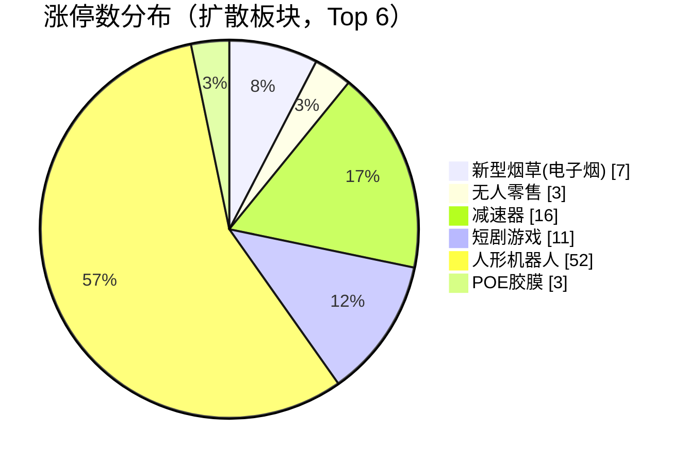
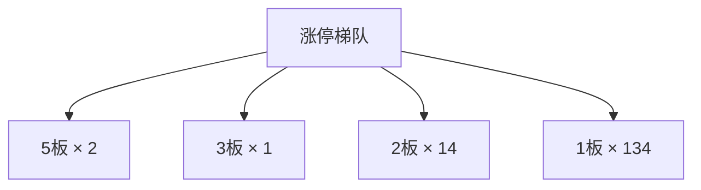
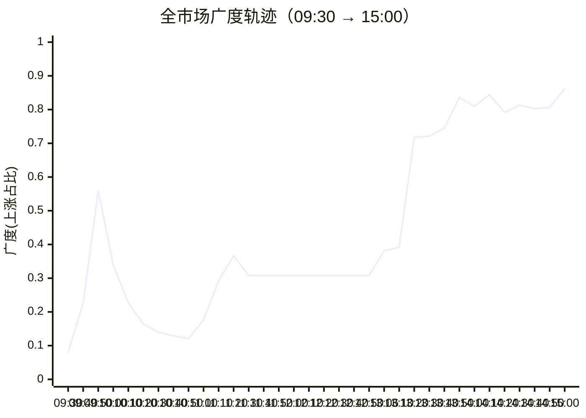

## 当日总览（截至 15:00）

> **结论**：全市场涨4660/跌790（广度0.86）；涨停151/跌停7；中位涨幅+2.41%；局部修复。 钱在：新型烟草(电子烟)(涨停7/成分53，中位+3.96%)、无人零售(涨停3/成分26，中位+3.24%)、减速器(涨停16/成分140，中位+6.12%)；零星涨停：高压氧舱(2)、举牌(2)。 退潮：ST板块(跌停4)、一带一路(跌停3)、数据要素(跌停2)。 梯队：5板×2、3板×1、2板×14、1板×134，最高5板。 预案：超买区 中京电子、盛剑科技、真视通、荣联科技、长华集团、东方海洋、万向德农、金新农、龙版传媒；已触发 中信证券、国泰海通、华媒控股；未到价 超声电子、深南电路、沪电股份、宝鼎科技、易天股份、建业股份。 较上一轮广度基本持平。

> 🔒 **no_trade / 买入预算 0 / max_position_pct 0 —— 全部内容仅供研究，不授予交易权限。**

### 板块扩散

> 口径：XTick 概念成分 × 全市场实时报价；分母 = 板块内有有效报价的成分数。排序用涨停密度（涨停数/有效成分数），已剔除宽基属性板块（全市场 432 个板块中剔 16 个）。

**扩散中（题材，按涨停密度排序）**

| 板块 | 涨停 | 有效成分 | 涨停密度 | 上涨广度 | 中位涨幅 | 相对全市场 | 成交(亿) |
|---|---|---|---|---|---|---|---|
| 高压氧舱 ⬦ | 2 | 11 | 0.182 | 0.91 | +3.65% | +1.24% | 19 |
| 新型烟草(电子烟) | 7 | 53 | 0.132 | 0.96 | +3.96% | +1.55% | 199 |
| 无人零售 | 3 | 26 | 0.115 | 0.96 | +3.24% | +0.83% | 92 |
| 减速器 | 16 | 140 | 0.114 | 0.97 | +6.12% | +3.71% | 419 |
| 短剧游戏 | 11 | 99 | 0.111 | 0.93 | +4.89% | +2.48% | 497 |
| 人形机器人 | 52 | 482 | 0.108 | 0.95 | +5.13% | +2.72% | 2,171 |
| POE胶膜 | 3 | 29 | 0.103 | 0.86 | +2.68% | +0.27% | 64 |
| 新质50 | 5 | 50 | 0.100 | 0.84 | +3.15% | +0.74% | 954 |
| 壳资源 | 5 | 51 | 0.098 | 0.94 | +2.75% | +0.34% | 64 |
| 举牌 ⬦ | 2 | 21 | 0.095 | 0.71 | +2.16% | -0.25% | 29 |
| 脑机接口 | 7 | 74 | 0.095 | 0.97 | +3.83% | +1.42% | 205 |
| 金属钴 | 3 | 32 | 0.094 | 0.91 | +2.79% | +0.38% | 220 |

> ⬦ = 涨停 <3 只，零星个例，不构成扩散（不计入「钱在」判定）。



零星涨停板块（<3 只）：高压氧舱(2)、举牌(2)

**退潮中（跌停集中）**

| 板块 | 跌停 | 有效成分 | 上涨广度 | 中位涨幅 |
|---|---|---|---|---|
| ST板块 | 4 | 197 | 0.49 | +0.00% |
| 一带一路 | 3 | 797 | 0.78 | +1.80% |
| 数据要素 | 2 | 402 | 0.87 | +2.72% |
| 人民币贬值受益 | 2 | 612 | 0.89 | +2.90% |
| 低空经济 | 2 | 507 | 0.91 | +3.14% |
| 煤炭概念 | 1 | 89 | 0.44 | +0.00% |
| 煤化工概念 | 1 | 110 | 0.59 | +0.34% |
| 航运概念 | 1 | 87 | 0.63 | +0.52% |
| 土地流转 | 1 | 44 | 0.64 | +1.25% |
| 装配式建筑 | 1 | 109 | 0.65 | +1.20% |
| 天然气 | 1 | 167 | 0.66 | +0.82% |
| 统一大市场 | 1 | 120 | 0.68 | +0.80% |

### 涨停梯队

> 最高 5 板 ｜ 涨停 151 ｜ 跌停 7 ｜ 炸板 25 ｜ 封板率 85.8% ｜ 打板成功率 56.67% ｜ 一进二 53.85% ｜ 二进三 50.00%

| 身位 | 家数 | 成员（涨幅/封单亿/首封） |
|---|---|---|
| 5板 | 2 | 真视通 +9.99%/0.005亿/09:25；盛剑科技 +10.00%/0.003亿/13:03 |
| 3板 | 1 | 中京电子 +10.01%/0.010亿/09:30 |
| 2板 | 14 | 克来机电 +10.02%/0.017亿/09:25；荣联科技 +10.06%/0.014亿/09:30；东方海洋 +10.13%/0.013亿/09:31；凡拓数创 +20.00%/0.009亿/11:03；德龙汇能 +9.99%/0.007亿/09:25 |
| 1板 | 134 | 华东重机 +10.00%/0.025亿/09:30；九阳股份 +10.01%/0.024亿/09:44；宇树科技-W +20.00%/0.024亿/13:44；瑞芯微 +10.00%/0.021亿/11:07；光洋股份 +10.01%/0.021亿/09:33 |



炸板 25 只（前几）：雷赛智能(11次)、龙溪股份(6次)、天普股份(6次)、岳阳林纸(3次)、瑞松科技(3次)

### 预案池对照

| 票 | 池 | 板块 | 现价 | 涨幅 | 触发价 | 买区 | 风险位 | 判定 |
|---|---|---|---|---|---|---|---|---|
| 中京电子 `002579.SZ` | 观察池 | — | 14.73 | +10.01% | 13.5 | [13.43, 13.7] | 13.01 | **超买区** |
| 超声电子 `000823.SZ` | 观察池 | — | 19.89 | +7.46% | 20.12 | [20.02, 20.42] | 19.4 | **未到价** |
| 深南电路 `002916.SZ` | 观察池 | — | 208.1 | -0.90% | 299.03 | [299.03, 308.14] | 292.73 | **未到价** |
| 沪电股份 `002463.SZ` | 观察池 | — | 82.7 | +2.96% | 103.88 | [103.88, 107.04] | 101.69 | **未到价** |
| 宝鼎科技 `002552.SZ` | 观察池 | — | 29.23 | +3.40% | 40.4 | [40.4, 41.63] | 39.55 | **未到价** |
| 盛剑科技 `603324.SH` | 观察池 | — | 30.48 | +10.00% | 27.71 | [27.57, 28.13] | 26.72 | **超买区** |
| 易天股份 `300812.SZ` | 观察池 | — | 17.79 | -1.17% | 18.0 | [17.91, 18.27] | 16.81 | **未到价** |
| 建业股份 `603948.SH` | 观察池 | — | 19.18 | -1.94% | 19.97 | [19.87, 20.27] | 19.26 | **未到价** |
| 真视通 `002771.SZ` | 观察池 | — | 17.4 | +9.99% | 15.82 | [15.74, 16.06] | 15.26 | **超买区** |
| 荣联科技 `002642.SZ` | 观察池 | — | 7.99 | +10.06% | 7.37 | [7.33, 7.48] | 7.11 | **超买区** |
| 长华集团 `605018.SH` | 观察池 | — | 11.29 | +10.04% | 10.26 | [10.21, 10.41] | 10.08 | **超买区** |
| 东方海洋 `002086.SZ` | 观察池 | — | 4.13 | +10.13% | 3.75 | [3.73, 3.81] | 3.62 | **超买区** |
| 万向德农 `600371.SH` | 观察池 | — | 11.5 | +7.58% | 10.69 | [10.64, 10.85] | 10.31 | **超买区** |
| 金新农 `002548.SZ` | 观察池 | — | 4.14 | +10.11% | 3.76 | [3.74, 3.82] | 3.66 | **超买区** |
| 中信证券 `600030.SH` | 观察池 | — | 25.26 | -0.51% | 25.03 | [25.03, 26.19] | 24.88 | **已触发** |
| 国泰海通 `601211.SH` | 观察池 | — | 16.36 | -1.45% | 16.12 | [16.12, 16.93] | 16.08 | **已触发** |
| 龙版传媒 `605577.SH` | 观察池 | — | 17.81 | +10.01% | 16.19 | [16.11, 16.43] | 15.86 | **超买区** |
| 华媒控股 `000607.SZ` | 观察池 | — | 3.76 | +0.80% | 3.73 | [3.71, 3.79] | 3.6 | **已触发** |

- **中京电子** — 现价14.73 已高于买区上沿13.7，不追高；仅价格位置对照，不代表完整入场条件确认；不能据此确认站稳，不授予下单权限
- **盛剑科技** — 现价30.48 已高于买区上沿28.13，不追高；仅价格位置对照，不代表完整入场条件确认；不能据此确认站稳，不授予下单权限
- **真视通** — 现价17.4 已高于买区上沿16.06，不追高；仅价格位置对照，不代表完整入场条件确认；不能据此确认站稳，不授予下单权限
- **荣联科技** — 现价7.99 已高于买区上沿7.48，不追高；仅价格位置对照，不代表完整入场条件确认；不能据此确认站稳，不授予下单权限
- **长华集团** — 现价11.29 已高于买区上沿10.41，不追高；仅价格位置对照，不代表完整入场条件确认；不能据此确认站稳，不授予下单权限
- **东方海洋** — 现价4.13 已高于买区上沿3.81，不追高；仅价格位置对照，不代表完整入场条件确认；不能据此确认站稳，不授予下单权限
- **万向德农** — 现价11.5 已高于买区上沿10.85，不追高；仅价格位置对照，不代表完整入场条件确认；不能据此确认站稳，不授予下单权限
- **金新农** — 现价4.14 已高于买区上沿3.82，不追高；仅价格位置对照，不代表完整入场条件确认；不能据此确认站稳，不授予下单权限
- **中信证券** — 现价25.26 ≥ 触发价25.03；仅价格位置对照，不代表完整入场条件确认；不能据此确认站稳，不授予下单权限
- **国泰海通** — 现价16.36 ≥ 触发价16.12；仅价格位置对照，不代表完整入场条件确认；不能据此确认站稳，不授予下单权限
- **龙版传媒** — 现价17.81 已高于买区上沿16.43，不追高；仅价格位置对照，不代表完整入场条件确认；不能据此确认站稳，不授予下单权限
- **华媒控股** — 现价3.76 ≥ 触发价3.73；仅价格位置对照，不代表完整入场条件确认；不能据此确认站稳，不授予下单权限

> ⚠ D1 明确 no_trade=true、买入预算 0、个股 max_position_pct=0。以上为研究对照，**不构成任何买入许可**。

### 盘面 vs 静态复盘 vs 消息面

| 维度 | 对象 | T-1 静态基线 | 今日盘面 | 关系 |
|---|---|---|---|---|
| 板块主线 | 先进封装（区别半导体设备及光刻胶） | R2 次线 score=63 涨停None（T-1 口径） | 盘面未见该板块成分票涨停 | **背离** |
| 板块主线 | 算力租赁／AIDC弱支线 | R2 次线 score=56 涨停None（T-1 口径） | 盘面未见该板块成分票涨停 | **背离** |
| 板块主线 | 人形机器人 | R2 次线 score=55 涨停None（T-1 口径） | 今日盘中该板块 52 只涨停 / 成分482 广度0.95 中位5.13%（相对全市场+2.72%） | **无响应** |
| 板块主线 | 猪肉及农业防守轮动 | R2 次线 score=54 涨停None（T-1 口径） | 盘面未见该板块成分票涨停 | **背离** |
| 板块主线 | 证券／稳市反向情景 | R2 次线 score=52 涨停None（T-1 口径） | 盘面未见该板块成分票涨停 | **背离** |
| 板块主线 | AI应用／视频 | R2 次线 score=52 涨停None（T-1 口径） | 盘面未见该板块成分票涨停 | **背离** |
| 梯队结构 | 最高5板 | T-1 最高梯队 4 板、首板 29、炸板率 39.06% | 今日 5板×2、3板×1、2板×14、1板×134；封板率0.858 炸板25只 | **印证** |
| 预案验证 | 中京电子(002579.SZ) | 预案 -／leader／触发价13.5／买区[13.43, 13.7] | 超买区：现价14.73 已高于买区上沿13.7，不追高；仅价格位置对照，不代表完整入场条件确认；不能据此确认站稳，不授予下单权限 | **背离** |
| 预案验证 | 超声电子(000823.SZ) | 预案 -／core_midcap／触发价20.12／买区[20.02, 20.42] | 未到价：现价19.89，触发价20.12，还差1.16%；仅价格位置对照，不代表完整入场条件确认；不能据此确认站稳，不授予下单权限 | **无响应** |
| 预案验证 | 深南电路(002916.SZ) | 预案 -／watch／触发价299.03／买区[299.03, 308.14] | 未到价：现价208.1，触发价299.03，还差43.7%；仅价格位置对照，不代表完整入场条件确认；不能据此确认站稳，不授予下单权限 | **无响应** |
| 预案验证 | 沪电股份(002463.SZ) | 预案 -／watch／触发价103.88／买区[103.88, 107.04] | 未到价：现价82.7，触发价103.88，还差25.61%；仅价格位置对照，不代表完整入场条件确认；不能据此确认站稳，不授予下单权限 | **无响应** |
| 预案验证 | 宝鼎科技(002552.SZ) | 预案 -／watch／触发价40.4／买区[40.4, 41.63] | 未到价：现价29.23，触发价40.4，还差38.21%；仅价格位置对照，不代表完整入场条件确认；不能据此确认站稳，不授予下单权限 | **无响应** |
| 预案验证 | 盛剑科技(603324.SH) | 预案 -／watch／触发价27.71／买区[27.57, 28.13] | 超买区：现价30.48 已高于买区上沿28.13，不追高；仅价格位置对照，不代表完整入场条件确认；不能据此确认站稳，不授予下单权限 | **背离** |
| 预案验证 | 易天股份(300812.SZ) | 预案 -／watch_elastic／触发价18.0／买区[17.91, 18.27] | 未到价：现价17.79，触发价18.0，还差1.18%；仅价格位置对照，不代表完整入场条件确认；不能据此确认站稳，不授予下单权限 | **无响应** |
| 预案验证 | 建业股份(603948.SH) | 预案 -／watch_elastic／触发价19.97／买区[19.87, 20.27] | 未到价：现价19.18，触发价19.97，还差4.12%；仅价格位置对照，不代表完整入场条件确认；不能据此确认站稳，不授予下单权限 | **无响应** |
| 预案验证 | 真视通(002771.SZ) | 预案 -／watch_elastic／触发价15.82／买区[15.74, 16.06] | 超买区：现价17.4 已高于买区上沿16.06，不追高；仅价格位置对照，不代表完整入场条件确认；不能据此确认站稳，不授予下单权限 | **背离** |
| 预案验证 | 荣联科技(002642.SZ) | 预案 -／watch／触发价7.37／买区[7.33, 7.48] | 超买区：现价7.99 已高于买区上沿7.48，不追高；仅价格位置对照，不代表完整入场条件确认；不能据此确认站稳，不授予下单权限 | **背离** |
| 预案验证 | 长华集团(605018.SH) | 预案 -／watch_elastic／触发价10.26／买区[10.21, 10.41] | 超买区：现价11.29 已高于买区上沿10.41，不追高；仅价格位置对照，不代表完整入场条件确认；不能据此确认站稳，不授予下单权限 | **背离** |
| 预案验证 | 东方海洋(002086.SZ) | 预案 -／watch_elastic／触发价3.75／买区[3.73, 3.81] | 超买区：现价4.13 已高于买区上沿3.81，不追高；仅价格位置对照，不代表完整入场条件确认；不能据此确认站稳，不授予下单权限 | **背离** |
| 预案验证 | 万向德农(600371.SH) | 预案 -／watch／触发价10.69／买区[10.64, 10.85] | 超买区：现价11.5 已高于买区上沿10.85，不追高；仅价格位置对照，不代表完整入场条件确认；不能据此确认站稳，不授予下单权限 | **背离** |
| 预案验证 | 金新农(002548.SZ) | 预案 -／watch_elastic／触发价3.76／买区[3.74, 3.82] | 超买区：现价4.14 已高于买区上沿3.82，不追高；仅价格位置对照，不代表完整入场条件确认；不能据此确认站稳，不授予下单权限 | **背离** |
| 预案验证 | 中信证券(600030.SH) | 预案 -／watch／触发价25.03／买区[25.03, 26.19] | 已触发：现价25.26 ≥ 触发价25.03；仅价格位置对照，不代表完整入场条件确认；不能据此确认站稳，不授予下单权限 | **印证** |
| 预案验证 | 国泰海通(601211.SH) | 预案 -／watch／触发价16.12／买区[16.12, 16.93] | 已触发：现价16.36 ≥ 触发价16.12；仅价格位置对照，不代表完整入场条件确认；不能据此确认站稳，不授予下单权限 | **印证** |
| 预案验证 | 龙版传媒(605577.SH) | 预案 -／watch／触发价16.19／买区[16.11, 16.43] | 超买区：现价17.81 已高于买区上沿16.43，不追高；仅价格位置对照，不代表完整入场条件确认；不能据此确认站稳，不授予下单权限 | **背离** |
| 预案验证 | 华媒控股(000607.SZ) | 预案 -／watch_elastic／触发价3.73／买区[3.71, 3.79] | 已触发：现价3.76 ≥ 触发价3.73；仅价格位置对照，不代表完整入场条件确认；不能据此确认站稳，不授予下单权限 | **印证** |
| 消息面对照 | 盘面热点板块 | R4 消息面（T-1 口径） | 实时快讯中命中热点板块关键词 12 条 | **印证** |

**分歧点（不掩盖）：**
- 板块主线·先进封装（区别半导体设备及光刻胶） → 背离：T-1 有辨识度但今日盘中无涨停响应，题材未获资金确认
- 板块主线·算力租赁／AIDC弱支线 → 背离：T-1 有辨识度但今日盘中无涨停响应，题材未获资金确认
- 板块主线·猪肉及农业防守轮动 → 背离：T-1 有辨识度但今日盘中无涨停响应，题材未获资金确认
- 板块主线·证券／稳市反向情景 → 背离：T-1 有辨识度但今日盘中无涨停响应，题材未获资金确认
- 板块主线·AI应用／视频 → 背离：T-1 有辨识度但今日盘中无涨停响应，题材未获资金确认
- 预案验证·中京电子(002579.SZ) → 背离：仅研究对照，不授予交易权限
- 预案验证·盛剑科技(603324.SH) → 背离：仅研究对照，不授予交易权限
- 预案验证·真视通(002771.SZ) → 背离：仅研究对照，不授予交易权限
- 预案验证·荣联科技(002642.SZ) → 背离：仅研究对照，不授予交易权限
- 预案验证·长华集团(605018.SH) → 背离：仅研究对照，不授予交易权限
- 预案验证·东方海洋(002086.SZ) → 背离：仅研究对照，不授予交易权限
- 预案验证·万向德农(600371.SH) → 背离：仅研究对照，不授予交易权限
- 预案验证·金新农(002548.SZ) → 背离：仅研究对照，不授予交易权限
- 预案验证·龙版传媒(605577.SH) → 背离：仅研究对照，不授予交易权限

### 全天广度轨迹

| 时点 | 涨 | 跌 | 广度 | 涨停 | 跌停 | 成交(亿) | 有效样本 |
|---|---|---|---|---|---|---|---|
| 0930 | 439 | 5024 | 0.079 | 9 | 9 | 442 | 5569 |
| 0940 | 1257 | 4141 | 0.226 | 20 | 8 | 2,477 | 5570 |
| 0950 | 3120 | 2200 | 0.560 | 33 | 6 | 3,737 | 5570 |
| 1000 | 1886 | 3549 | 0.339 | 35 | 6 | 4,581 | 5570 |
| 1010 | 1264 | 4227 | 0.227 | 35 | 9 | 5,274 | 5570 |
| 1020 | 915 | 4611 | 0.164 | 37 | 10 | 5,853 | 5570 |
| 1030 | 777 | 4743 | 0.140 | 29 | 11 | 6,401 | 5570 |
| 1040 | 720 | 4819 | 0.129 | 27 | 17 | 6,942 | 5570 |
| 1050 | 674 | 4858 | 0.121 | 27 | 18 | 7,409 | 5570 |
| 1100 | 982 | 4527 | 0.176 | 35 | 13 | 7,782 | 5570 |
| 1110 | 1627 | 3848 | 0.292 | 49 | 9 | 8,260 | 5570 |
| 1120 | 2041 | 3413 | 0.366 | 59 | 8 | 8,771 | 5570 |
| 1130 | 1717 | 3763 | 0.308 | 63 | 7 | 9,225 | 5570 |
| 1140 | 1717 | 3763 | 0.308 | 63 | 7 | 9,225 | 5570 |
| 1150 | 1717 | 3763 | 0.308 | 63 | 7 | 9,225 | 5570 |
| 1200 | 1717 | 3763 | 0.308 | 63 | 7 | 9,225 | 5570 |
| 1210 | 1717 | 3763 | 0.308 | 63 | 7 | 9,225 | 5570 |
| 1220 | 1717 | 3763 | 0.308 | 63 | 7 | 9,225 | 5570 |
| 1230 | 1717 | 3763 | 0.308 | 63 | 7 | 9,225 | 5570 |
| 1240 | 1717 | 3763 | 0.308 | 63 | 7 | 9,225 | 5570 |
| 1250 | 1717 | 3763 | 0.308 | 63 | 7 | 9,225 | 5570 |
| 1306 | 2123 | 3324 | 0.381 | 67 | 7 | 9,739 | 5570 |
| 1310 | 2185 | 3237 | 0.392 | 68 | 7 | 9,894 | 5570 |
| 1320 | 4000 | 1383 | 0.718 | 86 | 6 | 10,416 | 5570 |
| 1330 | 4014 | 1389 | 0.721 | 98 | 4 | 11,133 | 5570 |
| 1340 | 4152 | 1259 | 0.745 | 105 | 6 | 11,619 | 5570 |
| 1350 | 4658 | 772 | 0.836 | 130 | 6 | 12,362 | 5570 |
| 1400 | 4513 | 929 | 0.810 | 137 | 6 | 12,868 | 5570 |
| 1410 | 4699 | 746 | 0.844 | 144 | 7 | 13,354 | 5570 |
| 1420 | 4413 | 1026 | 0.792 | 142 | 6 | 13,751 | 5570 |
| 1430 | 4527 | 908 | 0.813 | 142 | 6 | 14,091 | 5570 |
| 1440 | 4472 | 955 | 0.803 | 145 | 7 | 14,481 | 5570 |
| 1450 | 4488 | 926 | 0.806 | 148 | 8 | 14,947 | 5570 |
| 1500 | 2846 | 382 | 0.862 | 98 | 2 | 9,300 | 3303 |

> ⚠ **数据冻结段**：1130–1250 数值连续完全一致，说明行情源未刷新，**不是市场横盘**，该段不可解读为盘面变化。

> ⚠ **分母变化**：1500（5570→3303） 有效样本变动超 15%，该时点广度与前后不可直接比较（数据降级）。



### 观察建议（仅研究）

- **环境**：涨停 151.0 / 跌停 7.0，打板成功率 56.7%，一进二 53.9%。
- **方向**：今日形成实质扩散的是 新型烟草(电子烟)（涨停7/成分53，密度0.132，中位+3.96%）、无人零售（涨停3/成分26，密度0.115，中位+3.24%）、减速器（涨停16/成分140，密度0.114，中位+6.12%）。**需确认**：次日能否维持涨停家数且中位涨幅不掉队，否则只是普跌中的避险轮动。
- **零星**：高压氧舱(2只/11成分)、举牌(2只/21成分) 属零星个例，不视为题材，不据此选股。
- **回避**：ST板块（跌停4）、一带一路（跌停3）、数据要素（跌停2） 板块中位跌幅深，趋势未止跌前不接。
- **身位**：最高 5 板。梯队有高度不等于可接力，需逐票核验封单稳定性与开板次数后再定。
- **预案**：中京电子（现价14.73 已高于买区上沿13.7，不追高；仅价格位置对照，不代表完整入场条件确认；不能据此确认站稳，不授予下单权限）、盛剑科技（现价30.48 已高于买区上沿28.13，不追高；仅价格位置对照，不代表完整入场条件确认；不能据此确认站稳，不授予下单权限）、真视通（现价17.4 已高于买区上沿16.06，不追高；仅价格位置对照，不代表完整入场条件确认；不能据此确认站稳，不授予下单权限）、荣联科技（现价7.99 已高于买区上沿7.48，不追高；仅价格位置对照，不代表完整入场条件确认；不能据此确认站稳，不授予下单权限）、长华集团（现价11.29 已高于买区上沿10.41，不追高；仅价格位置对照，不代表完整入场条件确认；不能据此确认站稳，不授予下单权限）、东方海洋（现价4.13 已高于买区上沿3.81，不追高；仅价格位置对照，不代表完整入场条件确认；不能据此确认站稳，不授予下单权限）、万向德农（现价11.5 已高于买区上沿10.85，不追高；仅价格位置对照，不代表完整入场条件确认；不能据此确认站稳，不授予下单权限）、金新农（现价4.14 已高于买区上沿3.82，不追高；仅价格位置对照，不代表完整入场条件确认；不能据此确认站稳，不授予下单权限）、龙版传媒（现价17.81 已高于买区上沿16.43，不追高；仅价格位置对照，不代表完整入场条件确认；不能据此确认站稳，不授予下单权限）。买区已错过，**不追高**；要参与需等新剧本，不能沿用原预案价位。
- **预案待检验**：超声电子(触发价20.12，还差+1.16%)、深南电路(触发价299.03，还差+43.70%)、沪电股份(触发价103.88，还差+25.61%)、宝鼎科技(触发价40.4，还差+38.21%)、易天股份(触发价18，还差+1.18%)、建业股份(触发价19.97，还差+4.12%) 尚未触及触发价，剧本未被盘面检验，继续按原失效条件看。

<details>
<summary>原始截面与数据质量（折叠）</summary>

**跨源校验**

```json
{
  "xtick": {
    "up": 4660,
    "down": 790,
    "n": 5586,
    "amount_yi": 15526.6
  },
  "rtk_snapshot": {
    "up": 2846,
    "down": 382,
    "valid_n": 3303,
    "amount_yi": 9300.2,
    "up_limit": 98,
    "down_limit": 2
  },
  "note": "两源口径不同（XTick 全市场含全部票；rt_k 返回样本）"
}
```

**rt_k 截面（原始）**

```json
{
  "market": {
    "total": 5586,
    "up": 2846,
    "down": 382,
    "flat": 75,
    "requested_n": 5586,
    "received_n": 5586,
    "valid_n": 3303,
    "missing_n": 2283,
    "universe_requested_n": null,
    "population_scope": "returned_rows_not_verified_all_a_universe",
    "up_ratio": 0.5095,
    "legacy_up_ratio_placeholder": false,
    "up_ratio_is_observed": true,
    "up_ratio_all": 0.5095,
    "up_ratio_valid": 0.8616,
    "up_ratio_denominator": "requested_n",
    "degraded": true,
    "limit_known_n": 3303,
    "limit_unknown_n": 0,
    "limit_counts_complete": true,
    "limit_source_errors": [],
    "up_gt3": 1444,
    "up_gt5": 691,
    "up_limit": 98,
    "down_gt3": 56,
    "down_gt5": 27,
    "down_limit": 2,
    "amount_yi": 9300.2,
    "amount_sum_overflow": false,
    "amount_valid_n": 3303,
    "amount_missing_n": 0
  },
  "source_time_quality": {
    "quote_age_min_seconds": 21.911784,
    "quote_age_max_seconds": 21.911784,
    "source_age_limit_seconds": null,
    "freshness_status": "age_limit_not_configured",
    "age_reference_at": "2026-11-23T15:00:21.911784+08:00"
  },
  "trading_authorized": false
}
```

</details>

## 分时研判记录

### 09:30 研判增量

> 数据时点：快照采集 09:30:08→09:30:27，行情源时标 09:30:02–09:30:26（报价年龄 1.5–25.5 秒），分析层 09:30:33 生成、errors 空、18 只预案票全部判定。**这是当日首轮（开盘 30 秒），没有相邻轮次可比**——下面所有"变化"都是相对 T-1 收盘（11/20）和 09:27 竞价两个基线的比较，不是轮间变化。竞价基线取自 `data/raw/20261123/auction_snapshot.json`（09:27:22，池覆盖 51/67）。

- **趋势**：低开但没有踩踏，是"跌幅收敛 + 赚钱效应仍归零"。涨 439 / 跌 5024（rt_k，有效样本 5569，上涨占比 7.9%）；中位涨幅 −1.72%，而周五收盘中位 −5.08%；跌停 9 只，周五 58 只；跌超 5% 只有 118 只（2.1%）。跌幅分布比周五明显收敛，但上涨家数没跟着回来（周五 313 只，今天 439 只都在 8% 以内徘徊），**恐慌没加剧，承接也没出现**。
  - 指数分化比个股更说明问题：上证 −1.00%（3498）、深成 −0.96%、创业板 −0.71%，而股指期货中证1000 −2.00%、中证500 −1.41%、上证50 +0.16%。**小盘杀、大盘稳**——与"5586 只里只有 439 只红盘、跌超 3% 有 866 只（15.5%）"是同一件事。
  - 数据质量：涨停 9 / 跌停 9 / 炸板 0 / 封板率 100% 是开盘 30 秒瞬时值。"炸板 0"只说明**这个瞬间**没有票处在炸板状态——中京电子竞价封在涨停 14.73、09:30 已回到 14.28（+6.65%），就是竞价封板后开盘炸开，不计入该指标。封板率 100% 不能当承接证据。

- **轮动**：**没有真扩散的题材**，但"资源 + 防守"这一端的中位涨幅第一次系统性高于全市场。
  - 板块榜前 12 名全是 1–2 只涨停的零星个例（青蒿素 1/11、草甘膦 1/19、举牌 1/21…），离"钱在哪个方向"的 ≥3 只门槛差得远。另有 41 个板块显示 ≥2 只涨停（DeepSeek 概念 4/769、信创 4/303、AI应用 4/551、数字经济 3/513），但全市场只有 9 只涨停——**是同一批 9 只票反复穿过重叠概念，不是 41 个方向在扩散**，仍按"无扩散"处理。
  - 真相对强度在低位资源与防守：黄金概念中位 0.00%（相对 +1.72，广度 0.427/82 成分）、期货概念 +1.72（0.441/68）、金属铅 +1.69、金属锌 +1.67、猪肉（广度 0.344/32 成分，相对 +1.48）、信托概念 +1.39、养鸡 +1.11。这一组中位涨幅贴着零轴，在 −1.72% 的市场里是逆势端，但涨停 0–1 只，属**抗跌不是启动**。
  - 失血端在题材前沿：算力租赁中位 −2.15%（相对 −0.43）、光刻胶 −2.20%（−0.48）、数字水印 −2.37%、露营经济 −3.27%（−1.55）。AI/算力是"高度在、承接无"：DeepSeek 概念 4 只涨停但广度 0.061、中位 −1.78%。
  - 跷跷板落在**同一条窄线的内部**：算力租赁有真视通 5 板、荣联 2 板续封，而先进封装三票 盛剑 −3.00%、易天 −8.17%、建业 −5.67% 全线走弱。⚠ 口径问题：板块表里"算力租赁"只记 1 只涨停/188 成分，与梯队里两票同 theme 封板对不上，三方对照表因此写"算力租赁 未见成分票涨停"——**与本轮板块表自相矛盾**，这是概念成分与预案 theme 标签两套分类的错位，暂以带分母的板块表为准，下一轮复核后再引用。
  - 预案唯一主线的正面证据在 PCB：PCB概念 241 成分、广度 0.195、中位 −1.34%（相对 +0.38），是全市场广度 0.079 的 2.5 倍，在有分母的大板块里排前四。

- **剧本**：预案（D1 09:05 生成，dry_run，no_trade，预算 0，execution_pool 空）的失效条件**一条都没解除**。
  - `R1_MARKET_NO_NEW_RISK` 的解除要四条全中：09:25 同口径广度过半、昨板溢价转正、跌停炸板收敛、核心 ≥2 只同支跟随。09:27 竞价口径只有第二条成立（昨涨停池 28 只均溢 +1.95%、红盘率 0.536，4 只高标全红均 +2.06%）；广度 0.079 离"过半"差一个数量级；跌停 9 是开盘瞬时值不能算收敛；核心跟随只在 PCB（0.195）与猪肉（0.344）两处出现。**四取一 → no_trade 保持**，10% 市场建议在 09:30 到期后"按新证据重评"的结论仍是**不设初试**。
  - **中京电子**（预案 leader／触发 13.50／买区 13.43–13.70／取消条件"孤板或破 12.48"）：竞价直接封涨停 14.73，开盘 30 秒回到 14.28。预案买点不是被触发、而是**被开盘跳空跳过**——现价高于买区上沿 4.2%（仍在 max_acceptable_ask 14.45 之内，但按纪律属超买区、不追高）。预案要求的"超声/深南/沪电 ≥1 只同步转强"**价格方向已满足**（超声 +4.16%、深南 +0.51%、沪电 +0.10%，且这 3 只较竞价再走高 1.53/0.51/0.50 个点），但这是高开炸板后的回落价，不是"放量突破 13.50"的形态，孤板风险未解除。
  - **高位线今天一进一退**：昨日两只 4 板——真视通晋级 5 板一字（封单 0.031 亿＝310 万，而预案记录的 T-1 封单 1.59 亿，**只剩 2%**）；盛剑科技断板 −3.00%。预案对先进封装的判据"断板 + 易天/建业同步走弱＝退潮确认"开盘即被满足，反向条件"盛剑回封 5 板且同伴转强"没有出现 → **先进封装退潮 09:30 已可确认，不必等收盘**。荣联 2 板一字封单 0.051 亿（周五记录 0.94 亿的 5%），同样薄。
  - **农业三支条件接近满足、但买点已过**：东方海洋竞价 4.12（涨停）→ 09:30 4.08（+8.80%），万向德农 +3.65%、金新农 +5.05%（较竞价再走高 3.55/2.07 个点）。预案触发"同支 ≥1 只同步再封或 +5% 以上且换手放大"字面已接近达标（2 只 ≥+5%），但三只全部已在买区之上——**条件满足了、价位早过了**，不是新剧本。
  - **券商反向剧本不成立**：中信证券 25.39 平盘、国泰海通 −0.84%、板块 0 封板；指数层面恰是"只稳上证50"（上证50 期货 +0.16% vs 中证1000 −2.00%），这正是预案写明的放弃条件"券商孤立或只稳上证50 → 只是托底"，不是触发。
  - **三只票现价落在买区内部**（中信 25.39 ∈ [25.03, 26.19]、国泰海通 16.46 ∈ [16.12, 16.93]、龙版传媒 16.33 ∈ [16.11, 16.43]），但这只是位置对照，**不是入场资格**：预算 0、max_position_pct 0、execution_pool 空，均不因价格位置改变。
  - 另：上周五开盘即跌停的华东重机（−10.04%）今天 1 板 +10.00%、成交 5.9 亿为梯队最大、封单 0.092 亿——被罚端两日反转，但封单仅 920 万，属"放量反包"待验证，不是主线。

- **下一步看**（09:40–09:50 可验）：
  1. **中京电子回落到 13.70 以内**才算回到预案价位（现价 14.28，需 −4.1%）；跌破 12.48 则预案取消条件成立。若 09:50 前重新封回 14.73 且封单到亿级，才是"孤板转真龙"，否则按高开炸板处理。
  2. **涨停家数门槛**：现在 9 只、首板仅 3 只。09:50 前 ≥12 且出现任一板块 ≥3 只真涨停（当前最高 4，全部是同一批票穿过重叠概念）→ 才谈扩散；10:30 仍 ≤10 → 全天按退潮/主跌处理，不做首板接力假设。
  3. **窄 PCB 是否真扩散**：PCB概念广度 0.195 → 要 10:30 前 ≥0.30，且超声站上触发价 20.12（现 19.28，差 4.36%）才算"同业 ≥2 只同步响应"；超声跌回 19.00 以下同时深南/沪电转绿 → 预案取消条件"容量同步走弱"成立。
  4. **猪肉组真假**：东方海洋能否回封 4.12、万向德农能否守住 10.69。回封且同伴不掉 → 防守轮动升级为可跟踪方向；东方海洋冲高回落、金新农跌回 3.82 以下 → 轮动不成立（预案原判据）。
  5. **跌停与高度**：09:45 跌停是否越过 20 只、是否出现第一只高位票炸板——真视通 310 万封单是最脆弱的一环，它一开板，5 板高度当场消失；跌停回到 15 只以内且涨停 ≥12 才是"恐慌收敛"。
  6. **数据质量**：下一轮核有效样本是否仍接近 5569（大幅下降则两轮不可比）；上文"算力租赁 涨停 1 vs 三方对照 未见涨停"的矛盾需 09:40 复核后再引用。

> 🔒 no_trade=true、买入预算 0、max_position_pct=0：以上全部为研究对照，**不构成任何买入许可**。


### 09:40 研判增量

> 数据时点：快照采集至 09:40:25，报价年龄 2.4–33.4 秒，分析层 09:40:29 生成、errors 空；有效样本 5570（上轮 5569，**同分母可比**）。对比基线为上轮 09:30 analysis（开盘 30 秒瞬时值）与今日首轮研判。

- **趋势**：开盘杀跌后的**第一段有效修复，但不是普涨**。同分母下上涨广度 7.9%→22.6%，中位涨幅 −1.72%→−0.72%，跌超5% 118→66 只、跌超3% 866→242 只，涨超3% 49→167 只，成交 442亿→2477亿（10 分钟放量）。修复是真的，但上涨家数 1257 只仍不到三成、跌停 8 只没有归零，这是"跌幅收敛"，不是"承接出现"。
  - 涨停 9→20（首板 3→12、2板 5→6、3板 0→1），同时冒出 2 只炸板（东方海洋破5次、麦迪科技破2次），封板率 100%→90.9%。**增量全在首板，梯队是变宽不是变高**；把 20 只涨停当成情绪升温会读错，真正的高位票一只没增加。
  - 高度端反而在漏：真视通 5板封单 0.031亿→0.024亿（310万→240万，−23%）、成交额 2.03亿→2.56亿，**封单减、成交增＝一字锁单在渗漏**；荣联科技 2板封单 0.051亿→0.045亿同样在减。中京电子 09:30 首封回 14.73（升 3板）但封单只有 0.037亿（370万）。

- **轮动**：**机器人链是今天第一条跨过"≥3 涨停"门槛的真扩散，AI 硬件（PCB/元件/CPO）排第二；跷跷板从"资源防守"翻到"科技成长"。**
  - 机器人链一条链同时起：人形机器人 涨停 1→6（482 成分），上涨广度 9.96%→41.9%，中位 −1.56%→−0.29%（相对全市场 +0.43%）；减速器 0→2（140 成分），广度 55.7%、中位 +0.17%（相对 +0.89%，全市场相对强度第一）；配套 智能制造 3→7、汽车电子 2→6、消费电子 1→6。**是链扩散，不是单票穿重叠概念**（这正是 09:30 那批"41 个板块≥2 涨停实为同一批 9 只票"的反例）。6 只涨停的成分名单未落在 analysis JSON，个股归因留待下轮，不猜。
  - AI 硬件：PCB 涨停 0→3（241 成分），广度 19.5%→47.3%，中位 0.00%（相对 +0.72%，大板块里第一）；CPO 2→4（230 成分），广度 42.2%、额 456.8亿；快讯 09:40:05"元件板块再度拉升，东晶电子、崇达技术涨停"，崇达技术成交 6.38亿、封单 0.092亿为全梯队最大，东晶电子 09:38 补 2板。
  - 开盘的抗跌端在修复里相对失血：期货概念 相对 +1.72→+0.31、信托 +1.39→+0.26、猪肉 +1.48→+0.42、超级品牌 +0.90→−0.33。**说明今天不是防守轮动延续，是风险偏好从"抗跌"切回成长**，09:30 把资源防守读成"逆势端"要降级。
  - 半导体内部继续分裂（同为科技但不给钱）：光刻胶 相对 −0.48→−0.57（0 涨停）、先进封装 −0.08→−0.46（2 只涨停但中位 −1.18% 仍落后）、算力租赁 −0.43→−0.33、国家大基金持股 −1.11。

- **剧本**：**预案的失效条件一条没解除，但两条次线的盘面证据在往相反方向走。**
  - 中京电子（leader）：09:30 研判给的"孤板转真龙"条件（09:50 前回封 14.73 且封单到亿级）——回封已发生（14.28→14.73），但封单只有 370万，**条件半满足**；且 14.73 已越过预案 `max_acceptable_ask 14.45`，买区 13.43–13.70 现价高 7.0%，属彻底不追。
  - 人形机器人（长华集团 watch_elastic）：预案里 R6 的反证是"人形宽度 4.18%，单首板非整体启动"；盘中宽度 41.9%、涨停 6 只，**这条证伪前提今天已被推翻**。长华现价 10.19，触发价 10.26，只差 0.69%——本轮最接近触发的预案票，**尚未到价，不写成已触发**。
  - 龙版传媒：09:30 16.33 落在买区 [16.11,16.43] 内（已触发）→ 09:40 16.63 越过上沿转**超买区**（仍在 max_acceptable_ask 17.32 之内）。这是价位向上跑掉，不是票转弱，判定降级为不追。
  - 农业组合力在散：金新农 +5.05%→+2.93%，只剩东方海洋 +9.33%（炸板 5 次、没封稳）与万向德农 +4.21%，预案"同支 ≥1 只再封或 +5% 且换手放大"字面已不满足。
  - 券商反向剧本继续否证：中信 25.39→25.20（−0.75%）、国泰海通 16.46→16.38（−1.33%），两票都回落、板块 0 封板 → "只稳指数不封板＝托底"的放弃条件成立。
  - 先进封装三票从深水反抽但没翻身：易天 −8.17%→−5.44%、建业 −5.67%→−2.81%、盛剑 −3.28%（距 27.71 差 3.40%）。三只仍全负、全未到价 → 09:30 的"退潮确认"没被推翻，只是止跌，**反抽不等于反转**。
  - 研究层压制没有因盘面上涨而解除：中京 reason 明写"R4 E004/E005 行业级利空覆盖 PCB + R6 模式7 四项红旗，最多研究高度锚"。今天 PCB 广度 0.473 是盘面最强之一，**价格扩散与研究层看空正面冲突**——报告分歧本身，不替任何一方背书。
  - 口径冲突未解（09:30 承诺的复核）：带分母口径下算力租赁仍只有 1 只涨停/188 成分，与梯队里真视通 5板、荣联 2板 的 theme 标签对不上；本轮无成分名单可定位归属，继续两套口径分开标注，**不据此说算力方向走强**。

- **下一步看**（09:50–10:30 可验）：
  1. **中京电子封单**：10:30 前从 370万 增到 ≥1亿且不丢 14.45 → 3板才算站住；再炸一次记为当日第 2 次断板，按炸板票处理（预案取消条件 12.48 仍远）。
  2. **人形机器人真假**：10:30 前涨停 ≥5 且广度 ≥0.40 → 今日主线成立；掉到 ≤3 或广度破 0.30 → 判开盘脉冲，不作方向。
  3. **PCB/元件延续**：涨停 ≥5 或广度 ≥0.50 才算延续；超声电子要站上 20.12（现 19.27，差 4.41%）才算预案"同业 ≥2 只同步响应"；深南 208.30 已转绿（+0.51%→−0.81%），沪电若随之下绿 → 容量端同步走弱成立。
  4. **修复的硬门槛**：`R1_MARKET_NO_NEW_RISK` 要广度 ≥0.50（现 0.226）；跌停收敛到 ≤5（现 8）；炸板率不升破 15%（现 9.1%）。三条不齐，no_trade 不动。
  5. **高度脆弱点**：真视通 240万 封单是全市场最脆弱一环，它一开板 5板 高度当场消失，机器人/PCB 的梯队叙事要重估——不能拿"高度还在"当安全垫。
  6. **防守端是否二次轮动**：若 10:30 前机器人/PCB 涨停数掉头而期货/猪肉/信托 相对强度回升到 +1 以上 → 今天只是杀跌后普修，不是风格切换。

> 🔒 no_trade=true、买入预算 0、max_position_pct=0：以上全部为研究对照，**不构成任何买入许可**。

### 09:50 研判增量

> 数据时点：快照与分析层 09:50:31 生成（elapsed 3.98s）、errors 空；有效样本 5570（与 09:40 的 5570 **同分母可比**），无冻结段（各项数值逐轮变化）。对比基线为 09:40 analysis 与本 md 的 09:30/09:40 两段研判。涨停、跌停、封单均取 XTick 梯队与 order/day 口径；情绪源字段（jjl / jj1t2）另标"情绪源口径"。

- **趋势**：**修复从"跌幅收敛"升级为"过半翻红"，但封板质量同时恶化——涨得多、锁得松。** 同分母下上涨广度 22.6%→56.0%（3120 涨 / 2200 跌），全市场中位 −0.72%→**+0.22%**（当日首次转正）；涨停 20→**33**、跌停 8→**5**（行情源 rt_k 口径 6，两源差 1 只）、成交 2477亿→**3737亿**（10 分钟增量 1260亿，明显放量）。
  - 反向指标在同 10 分钟一起走坏：炸板 2→**7**、封板率 90.9%→**82.5%**；4 只首板跌出梯队（锋龙股份、联创电子、芯瑞达、ST汇洲）——**新增涨停与新增炸板是同一段时间发生的**，这不是"承接稳"，是"上板快、封得住少"。
  - 梯队结构：33 只里 **首板 23 只（69.7%）**，2板 8、3板 1、5板 1；晋级率（情绪源口径 jj1t2）19.23%→23.08%→**30.77%**，一进二确有改善，但**高度端一只没增加**。
  - **封单厚度是今天最大的结构问题**：全梯队最厚封单只有崇达技术 **0.077亿（770万）**；5板真视通 **0.025亿（250万，T-1 预案记 1.59亿 → 只剩 1.6%）**、3板中京电子 0.034亿（340万，且已炸 2 次）、2板东方海洋 0.022亿（炸 6 次）。成交额最大的反而是九阳股份 21.54亿、华东重机 15.4亿、中京电子 13.23亿——**放量反包型，不是一字锁单型**。把 33 只涨停读成"情绪升温"会漏掉这一层。

- **轮动**：**跷跷板在上一个 10 分钟内完成翻转，而且是用相对强度三连降/三连升证明的，不是靠感觉。** 开盘的抗跌端全线失血（相对全市场中位：期货概念 +1.72→+0.31→**−0.49**、猪肉 +1.48→+0.42→**−0.55**、信托概念 +1.39→+0.26→**−0.48**、黄金概念 +1.72→+0.72→+0.19），成长端同步抬升（人形机器人 +0.16→+0.43→**+1.69**、减速器 −0.03→+0.89→**+1.86**、PCB概念 +0.38→+0.72→**+1.72**、汽车电子 0.00→+0.20→**+1.13**、智能制造 −0.34→+0.18→+0.54）。09:40 判的"风险偏好从抗跌切回成长"本轮得到第三个时点印证。
  - 真扩散（涨停 ≥3 且带分母）：**人形机器人 9 只涨停 / 482 成分，广度 0.820，中位 +1.91%**；**PCB概念 4 / 241，广度 0.855，中位 +1.94%**；智能制造 9 / 459、汽车电子 9 / 399、超清视频 4 / 96（0.698，+0.71%）。09:40 给的"人形 >=5 涨停且广度 >=0.40 即主线成立"门槛**提前达成**（9 只、0.82）。
  - 但**机器人的 9 只全是首板或 2 板**（最高 长华集团 2板、09:49 首封），无 3 板以上——**宽度成立、高度不成立**，与"梯队高度靠 真视通(算力) 5板 + 中京(PCB) 3板"是两套东西，后者还都薄封单。
  - 半导体内部只是随 β 回升，不是自身资金回流：光刻胶 0 涨停（相对 −0.57→**+0.04**）、先进封装 2 涨停（中位 −1.18%→**+0.88%**）、算力租赁 1 涨停/188（中位 −1.05%→+0.43%）。同期个股没修复：易天 −4.67%、建业 −2.81%。**板块广度跟着全市场广度走（0.226→0.56 本来就该抬），不能拿它当"这三条线转强"。**
  - 口径错位（09:30 承诺的复核）**仍未解**：带分母的算力租赁只有 1 只涨停 / 188 成分，与梯队里真视通 5板、荣联 2板 的预案 theme 标签对不上；本轮仍无成分名单可定位归属，两套口径继续分开写，不合并。
  - 消息面滞后于盘面：本轮 news_sample 里最新两条恰在采集瞬间（新浪财经 **09:50:08**"A股人形机器人板块震荡走高，杭州柯林涨超15%、上纬新材涨超11%、豪恩汽电涨超9%"、格隆汇 **09:50:15** 微亿智造港股 IPO·物理AI/具身智能），但 analysis 的 `消息面对照` 仍写"实时快讯未出现热点板块关键词"——**是快讯刚落地、样本未回填，不是消息面没响应**。快讯只作旁证，不作催化确认。

- **剧本**：**预案一条没解除，但它的第一道闸门今天已经过了有效期——这是 owner 的事，不是盘面能替它办的事。**
  - `R1_MARKET_NO_NEW_RISK` 的 `valid_until` 是今日 **09:30**，已过时；解除要四条全中。盘面现在三条方向成立：① 同口径广度 **0.5601 过半** ✓ ② 跌停 9→**5** 收敛 ✓ ③ 核心 ≥2 只同支跟随 ✓（人形 9 只、PCB 4 只）。④ **昨板溢价转正——本轮 analysis JSON 无昨涨停池口径字段，标缺失，不猜**。更硬的缺口在"炸板收敛"这半条：炸板 2→7、炸板率 9.1%→17.5% 在升。预案自己写了 `revocation: 截至09:30，需由owner按新证据重评，不能自动翻转`；`execution_pool` 仍空、预算仍 0、`max_position_pct` 仍 0。**本轮不因广度翻红改写任何权限字段。**
  - **中京电子（leader）**：09:40 设的"回封 14.73 且封单到亿级"——回封已发生（14.73 涨停、3板），封单 **340万，距亿级差 30 倍**，条件**未满足**；且今天已炸 **2 次**。现价 14.73 高出买区上沿 13.70 的 **7.0%**（也已越过 `max_acceptable_ask 14.45`），超买区、不追。龙二超声电子 19.17（09:30 19.28→回落），距触发价 20.12 差 **4.96%**；深南 209.94（−0.03%，微负）、沪电 81.01（+0.86%）——预案"同业 ≥2 只同步转强"只是价格方向勉强凑上，形态仍不成立。
  - **长华集团（watch_elastic·人形）**：09:40 还差触发价 10.26 的 0.69%，09:49 首封涨停 **11.29（2板，封单 100万、成交 1.32亿）**——**预案买区 10.21–10.41 被跳空跳过，现价高出上沿 8.5%**，超买区不追。这是"剧本兑现了但你买不到"的标准形态，不写成"预案命中"。
  - **盛剑科技（watch·先进封装）**：26.80→**27.75（+3.5% 反抽）**，首次落进买区 [27.57, 28.13]（verdict 已触发）。但这是反抽到价、不是回封：它今天**不在涨停队列**，同伴 易天 −4.67%、建业 −2.81% 仍全负，09:30 的"断板+同伴同步走弱=退潮确认"**没有被推翻**。已触发 ≠ 剧本转好，角色 score=40 也只是观察位。
  - **农业组继续散**：东方海洋虽 2板，但**炸 6 次、封单 220万（T-1 预案记 2.02亿 → 只剩 1.1%）**；万向德农 11.14→**10.96**（+4.21%→+2.53% 回落）、金新农 平 3.87。"同支 ≥1 只再封或 +5% 且换手放大"在 09:40 已不满足，现在只剩一只在板且锁单极薄 → 防守轮动**不成立**，与轮动段的相对强度转负同一结论。
  - **券商反向剧本继续否证**：中信 25.20→**25.12（−1.06%）**、国泰海通 16.38→**16.34（−1.57%）**，两票都跌进买区下沿附近但**方向向下、板块 0 封板**。`已触发` 在这里只是价格位置（trigger 本身设在昨收下方），**不能读成稳市启动**；预案放弃条件"券商孤立或只稳上证50"仍成立。
  - **AI应用内部在分叉**：龙版传媒 16.63→**16.85（+4.08%）** 继续脱离买区上沿 16.43；华媒控股 3.64（−2.41%，差触发 2.47%）掉队。超清视频在扩散（4/96、0.698）但传媒应用端没跟上。

- **下一步看**（10:00–10:30 可验，全部为研究观察）：
  1. **真视通 250万 封单**：10:30 前若不增到 ≥1000万且开板 → 5板 高度当场消失；开板后 5 分钟内不能回封即按断板处理，人形/PCB 的梯队叙事一并重估。**别拿"高度还在"当安全垫。**
  2. **中京电子**：封单 340万 要增到 **≥0.5亿 且不丢 14.45** 才谈"3板站住"；跌破 **13.70**（买区上沿）才算价格回到预案可用区间（预算仍 0，不因此入场）；再炸一次记当日第 3 次断板。
  3. **机器人从宽转高**：现 9 只涨停 / 广度 0.820 → 10:30 前涨停 ≥10 且出现**第 3 只 2板**（晋级）才算宽度转高度；若首板扩到 15+ 而 2板 家数不增 = 宽而不高，只当脉冲。
  4. **PCB 延续真伪**：涨停要 ≥5（现 4）；**超声电子 20.12**（现 19.17）；若超声不动 + 中京掉板 → 预案"龙一孤板"风险兑现，窄 PCB 从研究主线降级为观察。
  5. **修复的持续性三条**：广度守住 ≥0.50（现 0.5601）、跌停 ≤5（现 5/6）、炸板率 ≤25%（现 17.5%，各家封单普遍 <0.1亿，本就很脆）。广度先破 **0.45** 且涨停增速停滞 → 判"杀跌后一日修复"，不是风格切换。
  6. **反向剧本（防守端二次轮动）**：若期货/猪肉/信托 相对强度从 −0.49/−0.55/−0.48 回到 **≥ +0.5**，同时人形涨停数掉头 **≤5** → 今天的成长扩散只是修复中的 β。

> 🔒 no_trade=true、买入预算 0、max_position_pct=0：以上全部为研究对照，**不构成任何买入许可**。预案 09:30 到期后的重评权属 owner，盘面证据不自动改写权限字段。

### 10:00 研判增量

> 数据时点：analysis 10:00:36 生成（elapsed 6.56s），errors 空；有效样本 5570，与 09:40/09:50 **同分母可比**；成交额 3737亿→4581亿、广度逐项变化，**无冻结段**。对比基线为 09:50 analysis 与本 md 09:50 段研判。梯队明细仅列各档前列（1板 26 只只列 8 只），逐票归因受此限制。

- **趋势**：**09:50 的"过半翻红"就是当日高点，10:00 已被打回"强势集中"——广度腰斩、中位转负，而涨停数还在增加。**
  - 同分母下上涨广度 0.5601→**0.3386**（−22.1 个百分点），上涨 3120→1886 只、下跌 2200→**3549** 只；全市场中位 +0.22%→**−0.49%**。
  - 涨幅结构双向恶化：涨超5% 218→**182**、跌超5% 39→**61**；涨超3% 605→382、跌超3% 131→266。
  - 涨停 33→**35**、跌停 5→**6**；但 2板 8→**7**（一只 2 板断掉）、3板 1、5板 1——**高度端连续三个时点零增长**，增量全在首板（23→26，占 74%）。
  - 封板质量继续走坏：炸板 7→**9**、封板率 82.5%→**79.55%**。最硬的一条证据是**崇达技术**（09:50 时它是全梯队最厚封单 0.077亿／770万、成交 6.84亿）10:00 已不在涨停队列——**当日最强承接的票先炸了**。东方海洋 2板 炸板 6→7 次、封单 0.022→0.012亿；长华集团 炸 1→2 次、封单 0.010→0.009亿；真视通 5板 封单 0.025→**0.021亿**（预案记 T-1 为 1.59亿，只剩 **1.3%**）。
  - 新进明细只有 **安培龙**（301413，20% 涨停、09:59 首封、封单 0.046亿、成交 4.63亿）——涨停在"加新首板、丢旧封单"，不是承接变厚。
  - 这直接否掉了 09:50 自己设的"修复持续性三条"里的**广度 ≥0.50** 这一条：只隔 10 分钟就从 0.56 掉到 0.34。

- **轮动**：**不是"成长切回防守"，是成长内部从算力/PCB 硬件切到机器人＋端侧——资金没撤，是收窄。**
  - 反常但关键的对照：全市场广度腰斩的同 10 分钟，**涨停 ≥3 的板块数 45（09:40）→68（09:50）→74（10:00）仍在增加**。面在缩、线上的点在增，这就是"极端结构性"的量化定义。
  - **唯一还在边际强化的主线是机器人**：人形机器人 涨停 9→**11**（482 成分），相对全市场中位 +1.69%→**+1.89%**（全市场相对强度第一）；但广度 0.82→**0.72**、中位 +1.91%→+1.40%——**涨停增、内部回吐**，是集中不是扩散。减速器相对强度 +1.86%→**+2.18%**（140 成分、2 涨停不变）；机器视觉 涨停 4→**5**（252 成分）。
  - **失血端是上一轮的双主线之一 PCB／算力硬件**：PCB概念 涨停 4→**3**、广度 0.85→**0.69**、中位 1.94%→+0.90%；CPO 涨停 4 不变但广度 0.84→**0.73**、中位 1.97%→+1.13%；数据中心(AIDC) 广度 0.66→**0.46**、中位 +0.63%→**−0.14%（转负）**；算力租赁 0.61→**0.37**、中位 +0.43%→**−0.39%**；智能制造 涨停 9 不动但广度 0.68→**0.51**、中位 0.76%→**0.14%**。
  - **接棒的是端侧**：智能音箱 相对 1.16%→**1.92%**（62 成分、广度 0.85，全市场相对强度最高）；AI眼镜 1.19%→**1.51%**、智能穿戴 1.08%→1.27%、AI PC 广度 0.77→0.67 但相对 0.87% 未降。
  - 行业层（申万口径，与概念口径**两套分母、不合并**）：相对强度为正的只有 **电子 +0.89→+1.01、机械设备 +0.86→+0.88、传媒 +0.91→+1.01、汽车 +0.72→+0.61**（涨停 6/7/0/6）；最差是**房地产 广度 0.23→0.08、相对 −1.05→−1.20**——10:00 快讯"房地产板块走低，金科股份触及跌停"（时间戳 10:00:04）与本轮跌停增至 6 只同分钟落地。权重与地产失血，是广度腰斩的来源，不是成长链自身退潮。
  - 防守端没有回来：期货 −0.49→−0.11、信托 −0.48→−0.34、黄金 +0.19→+0.28，仍全线负相对。**说明这不是二次防守轮动，是同一条成长链内部的第二次换手。**

- **剧本**：**预案条件在"价格方向"上继续松动，但没有一条转成可用——权限字段一个未变。**
  - 权限底座：`no_trade=true`、`effective_trading_budget 0.0`、`execution_pool` 空、`R1_MARKET_NO_NEW_RISK` 的 `valid_until` 是今日 **09:30**（已过时）。它解除要求"同口径广度过半"——09:50 勉强做到（0.56），**10:00 又掉回 0.34**，这条路径本轮作废。
  - **PCB 容量端正式走弱**：深南电路 209.94→**206.74（−1.55%）**、沪电股份 81.01（+0.86%）→**79.75（−0.71%）**，两只转绿；超声电子 19.17→**19.11（+3.24%）**，距触发价 20.12 仍差 **5.29%**。09:50 段写明的"超声不破 19.00 同时深南/沪电转绿＝容量同步走弱"**本轮已成立（2/3 转绿）**。剩下的只有龙一：中京电子 14.73 仍 3板，但封单 340万→**300万**（连续三轮递减 370→340→300万）、已炸 2 次、现价高出买区上沿 13.70 的 **7.5%**。**预案唯一的窄 PCB 主线，从"观察中的唯一主线"降为"容量端走弱＋龙一孤板"。**
  - **中京的取消条件离得很远**：预案取消价 12.48，现价高 18%；所以这不是"预案失效"，是**预案买点早被跳空跳过、且同业不再跟随**——两回事，不混写。
  - **机器人这条最强线，预案里对应的票却是最薄的一只**：长华集团 11.29 仍在超买区（买区上沿 10.41，高 **8.5%**），封单 100万→**90万**、炸板 1→2 次。板块判断对了，可执行标的（预案给的触发价 10.26）已被跳空永久跳过——**不写成"预案命中"**。
  - **先进封装退潮本轮加固**：盛剑科技 27.75→**27.86（verdict 已触发）**，但同伴 易天股份 −4.67%→**−5.39%**、建业股份 −2.81%→**−4.65%** 双双恶化。已触发是"反抽到价"，不是剧本转好；09:30 判的"断板＋同伴同步走弱＝退潮确认"继续成立。
  - **券商反向剧本第三次否证**：中信 25.12→**25.07（−1.26%）**、国泰海通 16.34 平（**−1.57%**）。`已触发` 只因为预案 trigger 设在昨收下方，方向朝下、板块 0 封板 → 仍是"托底"而非"稳市启动"。
  - 其余：东方海洋 2板 但炸 7 次、封单 220→120万；万向德农 +4.21%→+2.15%；金新农 平 3.87 → 农业组"同支合力"仍不成立。华媒控股 3.64→**3.56（−4.56%）**（差触发 4.78%）、龙版传媒 16.85→**16.76（+3.52%）** 继续脱买区。

- **下一步看**（10:10–10:30 可验，全部为研究观察）：
  1. **广度定性线**：回到 **≥0.45 且中位回正**才算"修复继续"；**破 0.30 且跌停 ≥10** → 今日定性为"冲高回落、一日修复失败"，主跌延续。这是区分"结构性收窄"与"全面转弱"的唯一分野。
  2. **机器人从集中转接力**：现 11 涨停／广度 0.72 → 10:30 前 **≥12 涨停且广度守住 0.60** 算主线承接；涨停掉回 **≤8** 或广度破 **0.55** → 判脉冲，不作方向。
  3. **崇达技术是否回封**：它是 09:50 全梯队最厚封单（770万），炸掉后若 10:30 前不回封，则"元件/PCB 承接链"断，PCB 从研究主线降为观察——比超声单票更有说服力。
  4. **高度脆弱点**：真视通 5板 封单 **210万（T-1 的 1.3%）**，开板即 5板 高度消失，全梯队叙事须重估；中京封单要 **≥0.5亿** 才谈 3板站住，而现价 14.73 已高于预案 `max_acceptable_ask 14.45`，即使封住也不在预案价位。
  5. **预案失效链三条可验**：超声 **19.00**（现 19.11，差 0.6%）；中京 **13.70／12.48**（现 14.73）；盛剑 **27.57**（买区下沿，现 27.86，差 1.0%）。破 19.00 且中京开板 = 窄 PCB 预案正式失效；盛剑跌回 27.57 以下 = 已触发转未到价、退潮确认完整。
  6. **端侧是否真接棒**：智能音箱广度守住 **≥0.75** 且 AI眼镜/智能穿戴 **≥0.60** → 钱是换到端侧，不是撤离；三条同掉到 0.55 以下 → 全天只剩机器人一条线，比 09:50 更窄，不宜当方向。
  7. **数据口径**：1板 明细被截断（26 只只列 8），本轮只能确认安培龙一只新进、无法逐票定位另 2 只，**不猜**；ladder 与情绪源 ztnum 均为 35、跌停 6 一致，无跨源分歧。

> 🔒 no_trade=true、买入预算 0、max_position_pct=0、execution_pool 空：以上全部为研究对照，**不构成任何买入许可**。预案 09:30 到期后的重评权属 owner，盘面证据不自动改写任何权限字段。

### 10:10 研判增量

> 数据时点：快照采集 10:10:08→10:10:24，报价年龄 3.4–57.4 秒；分析层 10:10:30 生成（elapsed 5.61s）、errors 空。有效样本 5570，与 09:40／09:50／10:00 同分母可比；成交 4581→5275 亿逐轮增长，**无冻结段**。对比基线＝10:00 analysis 与本 md 10:00 段研判。口径限制：梯队 1 板明细只列前 8（26→27 只），新增首板无法逐票定位，不猜；概念口径与申万口径分别标注、不合并。

- **趋势**：**10:00 的「强势集中」在本轮变成「集中也开始散」——面继续缩、点开始掉、炸板翻倍。**
  - 同分母广度 0.3386→**0.2269**（涨 1886→1264、跌 3549→4227），全市场中位 −0.49→**−1.32**。跌超 3% 266→**615**（翻倍多）、跌超 5% 61→**109**；涨超 3% 382→304、涨超 5% 182→146。**本轮第一次是「下跌端加速」，而不是「上涨端减速」。**
  - 涨停 35→**35**（两个时点完全相同），但结构变了：**3 板清零**（中京电子炸板、掉出涨停队列，现价 14.65–14.72／+9.41~9.93%，两处采样），1 板 26→27、2 板 7 只不变、5 板仍 1（真视通）。炸板 9→**14**、封板率 0.7955→**0.7143**；跌停 6→**9**。**同样的涨停数，锁单质量掉了一档。**
  - 板块层第一次反向：涨停 ≥3 的板块 74→**62**（≥2 的 120→110）。10:00 段「面缩点增」的量化证据本轮断掉一半——**点也开始少**。
  - 真扩散只剩 3 条，且三条都是「计数凑数、中位为负」：超清视频 5/96（密度 0.052 全榜第一，但广度 0.344、中位 −0.82）、长安汽车概念 7/231（广度 0.381、中位 −0.46）、在线教育 4/127（中位 −1.31、相对 +0.01）。**没有一条中位为正的方向级扩散**，与 09:50（人形 +1.91%、PCB +1.94%）不是同一个盘面。

- **轮动**：**机器人链的相对强度还是第一，但那是「跌得少」换来的，不是「在涨」；PCB 已实质失血；钱剩两处——超清视频的涨停端、银行的防守端。**
  - 人形机器人 涨停 11→**9**、广度 0.724→**0.546**、中位 1.40→**0.41**（相对 +1.89→+1.73）。减速器 相对 **+2.21（全市场第一）**，但广度 0.793→0.621、中位 1.69→0.89。智能音箱 广度 0.855→0.565；AI眼镜 0.722→0.464、中位转负 −0.11；AI PC 涨停 3→**1**、广度 0.667→0.406。**⚠ 相对强度上升有分母效应：全市场中位从 −0.49 掉到 −1.32，板块只要跌得少，相对值就自动变高——不能拿「机器人相对强度仍第一」当它在走强。**
  - PCB 三兄弟全线走弱且量化到位：PCB概念 涨停 3→**1**、广度 0.689→**0.431**、中位 **+0.90→−0.28（转负）**（相对 +1.04）；深南电路 206.0（−1.90%）、沪电 79.5（−1.02%）、宝鼎 28.17（−0.35%）三只全绿；超声电子 19.11→**18.92（+2.22%）**，距触发价 20.12 差 6.34%。**上一轮设的「超声破 19.00 且中京开板＝窄 PCB 预案正式失效」两条，本轮同时成立。**
  - 算力／AIDC 继续失血：数据中心(AIDC) 广度 0.461→**0.265**、中位 −0.14→**−1.10**；算力租赁 0.372→**0.175**、中位 −0.39→**−1.52**、相对 **−0.20（转负）**；先进封装 涨停 2→**0**、广度 0.524→0.267、中位 +0.12→−1.18；光刻胶 中位 −1.76、相对 −0.44。**半导体三条支线本轮没有一条有涨停响应。**
  - 防守端第一次真的回来，但落在**银行**、不是「资源三轮」：申万银行 广度 0.238→**0.333**、中位 −0.61→**−0.17**、相对 **−0.12→+1.15（全 sw1 第一，也是唯一广度上升的一级行业）**；非银 相对 −0.08→+0.57。**同时要防一个假信号**：期货概念相对 −0.11→+0.51，但广度只有 0.059（68 成分仅 4 只红盘）——那是分母下沉，不是资金回流，不算二次防守轮动。
  - 行业层对照（申万口径，与概念口径两套分母不合并）：电子 广度 0.617→0.354、中位 0.52→−0.66；计算机 广度 0.384→0.227、相对 +0.13→**−0.23 转负**（涨停 6→7 但面塌）；房地产 广度 0.084→**0.053**、中位 −2.48、相对 −1.16 全场最差。**权重缩量、地产失血、成长链点面双降，是本轮这 11 个点广度的直接来源。**

- **剧本**：**本轮最硬的新事实不是哪只票，而是全池买点窗口 10:00 到期——预案 18 只的 `entry_rules.time_window` 全部是 09:25–10:00；10:10 起，任何「条件正在被满足」都只能算事后对照。**
  - 逐票核对（预案原文）：中京／超声／盛剑／长华／真视通／荣联／东方海洋／万向德农／金新农／龙版／华媒……**全部 09:25–10:00，无一例外**。已触发≠可执行：盛剑科技 27.71 正好等于 trigger 27.71，但窗口已过，且先进封装涨停 **2→0**、同伴易天 −7.39%（现价 16.67，已在参考止损 16.81 下方）、建业 −5.47% 双双恶化——**「已触发」是反抽到价，剧本没有任何转好**。
  - **中京电子（leader）**：10:00 还在板（3 板、封单 300 万），10:10 炸板、**3 板高度当场消失**；现价高出买区上沿 13.70 的 **7.0%**、也已越过 `max_acceptable_ask 14.45`。预案取消条件里的「孤板」本轮兑现，破 12.48 仍远（差约 15%）。**这是「买点早被跳空跳过＋同业不再跟随」，不是「止损被击穿」，两回事不混写。**
  - **机器人这条最强线，预案里唯一对应票仍是最买不到的那只**：长华集团 11.29（2 板、封单 100 万），买区上沿 10.41，高 8.5%。板块判断对、可执行标的错位——不写成「预案命中」。
  - 农业组仍在买区之上：东方海洋 4.13（涨停但**炸板 14 次、封单显示 0**）、万向德农 11.06（+3.46%，ask 11.44 之内）、金新农 3.83（+1.86%，刚越过买区上沿 3.82）。**「同支合力」依旧不成立**：一只炸 14 次、一只 +3.5%、一只 +1.9%。
  - 券商反向剧本第四次否证：中信 25.05（−1.34%）、国泰海通 16.30（−1.81%），两票价格都在 trigger 之上但方向向下、板块 0 封板。**与轮动段的银行 +1.15 不矛盾**——银行是权重承接资金，券商是「稳市剧本」的标的，本轮只有前者成立。
  - 三方对照：T-1 静态（主跌、`main_lines_count=1`、`confirmed_tradable_main_lines_count=0`）被盘面**印证**（广度 0.227、炸板 14、3 板清零）；研究层「窄 PCB 被行业级利空覆盖（R4 E004/E005）」与盘中 PCB 广度 0.855→0.431 的走弱**本轮收敛**，09:40–09:50 那个正面冲突已消失，不再替任何一方背书；消息面无新增催化（最新快讯 10:09:50 为北京城市更新管网规划，与池内无映射）。**昨涨停池溢价本轮 analysis 仍无对应字段，标缺失，不猜。**

- **下一步看**（10:20–10:40 可验，全部为研究观察）：
  1. **广度定性线已破一半**：上一轮设「破 0.30 且跌停 ≥10 ＝一日修复失败」。本轮广度 **0.2269 已破 0.30**，跌停 9 差 1 只未达标。若 10:40 前跌停 **≥10 或广度 ≤0.20** → 定性「冲高回落、修复失败」，全天不做首板接力假设。
  2. **梯队断档**：3 板已清零，只剩 5 板真视通（封单 200 万）＋7×2 板＋27×1 板。若 10:40 前**无新 3 板且真视通开板** → 高度只剩孤峰，所有「高度＝辨识度」的推论作废。
  3. **中京回封**：封单要从 0（已炸）回到 **≥0.5 亿**才算 3 板修复；否则按断板处理（买点窗口已过，仅研究意义）。
  4. **机器人降级判定**：本轮广度 **0.546 已破上一轮设的 0.55 阈值**（涨停 9 只仍高于 8，只触发一条）。若 10:40 涨停 **≤8 或广度 ≤0.50** → 按上一轮自设判据正式判「脉冲」，今日不作方向。
  5. **PCB 终局**：涨停已剩 1 只（中京炸、超声 18.92 破 19.00、深南沪电转绿）。若 10:40 PCB 涨停 **=0** → 窄 PCB 盘面证据归零，只剩研究层看空＋预案历史。
  6. **防守端真伪**：银行相对 **+1.15** 若守住 ≥+1、同时机器人／PCB 涨停端继续缩 → 今日应定性「杀跌期资金撤到权重」，而不是成长内部换手；期货相对 +0.51 因广度仅 0.059，不计入。
  7. **数据口径**：valid_n 5570 连续四轮一致（无降级）；涨停 35（rt_k 涨跌停价命中）＝梯队 35＝情绪源 ztnum 35，跌停 9 三源一致；XTick 1268/4233 与 rt_k 1264/4227 差 4 只属样本口径差；1 板明细截断（27 只列 8），新首板不逐票归因。

> 🔒 no_trade=true、买入预算 0、max_position_pct=0、execution_pool 空：以上全部为研究对照，**不构成任何买入许可**。全池 entry 时间窗已于 10:00 到期，预案重评权属 owner，盘面证据不自动改写权限字段。


### 10:20 研判增量

> 数据时点：快照采集 10:20:08→10:20:26，报价年龄 3.5–65.5 秒（最新报价 10:20:23）；分析层 10:20:28 生成（elapsed 2.21s）、errors 空。有效样本 **5570**，与 09:40／09:50／10:00／10:10 同分母可比；成交 5274.5→5853.4 亿，各项数值逐轮变化，**无冻结段**。对比基线＝10:10 analysis 与本 md 10:10 段研判。概念口径（行情源概念板块）与申万口径各自标注分母，不合并。

- **趋势**：**10:10 自设的「修复失败」判据本轮两条同时到齐——广度 ≤0.20 且跌停 ≥10，定性成立：冲高回落、一日修复失败。**
  - 同分母广度 0.2263→**0.1638**（涨 1264→915、跌 4227→4611），全市场中位 −1.32→**−1.78**；跌超3% 615→**1139**（近翻倍）、跌超5% 109→**160**；涨超3% 304→235、涨超5% 146→111。**这是连续第二轮「下跌端加速」，且斜率比 10:10 更陡。**
  - 成交反向放大：5274.5→**5853.4 亿**（10 分钟 +579 亿）。**放量下跌，不是缩量阴跌。**
  - 涨停 35→**37**、跌停 9→**10**（rt_k 口径），炸板 14→**15**、封板率 0.7143→**0.7115** 基本不动。即：本轮净增 2 只涨停、同时净增 1 只炸板，**封板质量没有任何改善**。
  - 梯队唯一的结构变化是 **中京电子回封，3 板恢复**（5板1／3板1／2板6／1板29）。但它是 broken_times=**3**、封单 **0.032亿（320万）**、成交 **19.5亿**（09:50 为 13.23亿，+47% 放量）——**封单/成交比 ≈0.16%，是全梯队最薄的回封**。2 板 7→6 不是晋级抽走，是**东晶电子炸板**（broken_times=4、现价 +8.99%）掉队。
  - 封单天花板继续下移：全梯队最厚封单本轮是 **华东重机 0.058亿（580万）**，而 09:50 最厚的**崇达技术（770万）已炸**（broken_times=1、现价 +8.60%）。**今天没有一只是亿级封单。**
  - 情绪源口径：一进二晋级率 26.92%→**23.08%**（回落）；二进三 0→50% 但样本极小，**不作结论**。

- **轮动**：**板块层第一次出现「涨停在加、板块内部同时在塌」的全体现象——钱不是在扩散，是在往「已经封住的票」上挤。**
  - 逐条核对（同一批概念口径、各自分母）：人形机器人 涨停 9→**11** 但广度 0.546→**0.440**、中位 0.41→**−0.36**、相对 1.73→1.42；PCB概念 1→**2** 但广度 0.431→**0.249**、中位 −0.28→**−1.24**；智能音箱 1→**2** 但广度 0.565→0.468、中位 0.55→−0.28；AI PC 1→2 广度 0.406→**0.275**、中位 −0.51→−1.42；AI眼镜 3→4 广度 0.464→0.325；智能穿戴 3→4 广度 0.430→0.297；汽车电子 7→8 广度 0.413→0.278。**七个方向涨停都在增，七个方向广度全降、中位全转负。** 这与 10:00 的「面缩点增」不是一回事——现在是**点在同一板块内部也被抽干**。
  - 三个「计数凑数」的真扩散板块（≥3 涨停）涨停数一个没增、内部全部继续塌：超清视频 5/96 广度 0.344→0.292、中位 −0.82→−1.31；长安汽车概念 7/231 广度 0.381→0.320、中位 −0.46→−1.11；在线教育 4/127 广度 0.307→0.236、中位 −1.31→−1.60。**本轮新增的 2 只涨停不在任何一个真扩散板块里，是散点（肇民科技 10:14 首封、20%）。**
  - **唯一有真承接的是权重银行**：申万银行 42 成分，广度 0.3333→**0.5000**（21 只红盘）、中位 −0.17→**+0.07 转正**、相对 +1.15→**+1.85（一级行业第一）**。**这是今天唯一一个「过半翻红＋中位为正」的板块。** 10:10 设的「银行守住 ≥+1」这半条成立；另半条「机器人／PCB 涨停端继续缩」**不成立**（涨停反而增）。故本轮只判「资金撤向权重」成立，**不判「成长内部换手」**。
  - 资源／防守端的相对强度回升是**分母陷阱，明确不计入**：期货概念相对 0.51→0.89 但广度 **0.044**（68 成分仅 3 只红盘）；黄金 0.42→0.43（广度 0.232）；猪肉 0.18→0.35（0.156）；信托 0.56（0.087）。全市场广度塌到 0.164，跌得少就自动变「相对强」。
  - 半导体三条支线继续下坠：先进封装 涨停 0→**1** 但广度 0.267→**0.129**、中位 −1.18→**−2.27**（相对 +0.14→**−0.49**）；算力租赁 广度 0.175→0.138、中位 −1.52→**−2.22**；光刻胶 0 涨停、广度 0.163→**0.050**、中位 −2.81（相对 −1.03）。**先进封装这唯一一只涨停不是盛剑（盛剑 27.30、未到价），同伴易天 −8.56%、建业 −6.39% 更深。**
  - 行业层（申万口径，与概念口径两套分母不合并）：汽车 涨停 **8**（广度 0.2875、相对 +0.49）、机械设备 7（0.2771、+0.50）仍是相对端；**电子 广度 0.3544→0.1992、相对 0.66→+0.09 几乎归零**；计算机 广度 0.2269→0.1737、中位 −2.07、相对 −0.29；房地产 中位 −2.81、相对 −1.03，继续全场最差。

- **剧本**：**买入窗口全部过期后，本轮只剩「结构是否修复」的观察意义；权限字段一个未变。**
  - 18 只票 `entry_rules.time_window` 全部为 **09:25–10:00**（已核预案原文），10:20 起任何「已触发」仅是事后对照。
  - **中京电子**：回封 3 板（14.73、+10.01%），但 10:10 设的「封单 ≥0.5亿 才算 3 板修复」**未满足**（320万，差 16 倍），且已炸 3 次；买区上沿 13.70，现价高 **7.0%**，也已越过 `max_acceptable_ask 14.45`。**回封改的是梯队结构，不改可执行性。** 预案取消条件里的「孤板」本轮暂不成立（PCB概念涨停 1→2），破 12.48 仍远。
  - **真视通 5 板**：封单 0.021→**0.019亿（190万）**，成交 09:40 的 2.56亿→**5.55亿**，broken_times=1。10:10 设的「10:30 前 ≥1000万」还差 **5 倍以上**。**封单在减、成交在增，一字锁单继续渗漏。**
  - **盛剑科技**：27.71→**27.30**，跌破买区下沿 27.57，verdict「已触发」→**「未到价」**。10:10 设的「盛剑跌回 27.57 以下＝退潮确认完整」**本轮兑现**；叠加先进封装广度 0.129、同伴 −8.56%／−6.39%，09:30 的退潮判定已被三个时点加固。
  - **机器人这条最强线对应的票仍是最买不到的那只**：长华集团 11.29 在板（2 板、封单 0.009亿＝90万、broken_times=2），买区上沿 10.41，高 **8.5%**。板块判断对、可执行标的错位——不写成「预案命中」。
  - **农业组**：金新农 3.83→**3.81**，从超买区跌回买区 [3.74, 3.82] 内（已触发）；万向德农 10.99 仍超买区（上沿 10.85）；东方海洋 4.13 涨停但 broken_times=**18**、封单 160万、成交 17.02亿。**「同支合力」依旧不成立**：一只炸 18 次、一只距上沿 1.3%、一只 +2.81%。
  - **券商第五次否证**：中信 25.14（−0.98%）、国泰海通 16.39（−1.27%），价格在 trigger 之上但方向向下；非银金融广度 **0.0649**（77 成分仅 5 只红盘）。与银行 +1.85 不矛盾——银行是权重承接，券商是稳市剧本标的，**只有前者成立**。
  - **三方对照**：T-1 静态「主跌／main_lines_count=1／confirmed_tradable_main_lines_count=0」被本轮盘面**进一步印证**（广度 0.164、跌停 10、封板率 71%、一级行业唯一翻红的是银行）；研究层「窄 PCB 被行业级利空覆盖（R4 E004/E005）＋R6 四项红旗」与盘中 PCB 广度 0.431→0.249 继续**收敛**，09:40–09:50 的正面冲突已完全消失。消息面只有两处**旁证、无因果映射**：① 10:19:38「美科技巨头隐性债务／算力投资回报担忧」（旁证 A 股算力链失血：算力租赁中位 −2.22、广度 0.138，**只作旁证，不作因果确认**）；② 10:19:06「中国大模型周调用量连续 30 周全球第一」（对应 DeepSeek 概念 7 涨停/769 成分、广度 0.157、中位 −1.85，**宽基噪声，不进扩散结论**）。昨涨停池溢价本轮 analysis 仍无对应字段 → **标缺失，不猜**。

- **下一步看**（10:30–10:40 可验，全部为研究观察）：
  1. **深度而非方向**：广度 0.164 → 若 **≤0.12 且跌停 ≥15** → 主跌延续确认，全天不做首板接力假设；若回到 **≥0.25 且中位回到 −1 以上** → 只记为超跌反抽，不改定性。
  2. **真视通 190万封单**：开板即 5 板消失，梯队只剩 3 板中京＋6×2 板；若 10:40 仍封且封单 **≥1000万**，才谈「孤峰守住」。
  3. **中京电子**：现 320万封单、19.5亿成交，再炸一次记当日第 **4** 次；若封到 10:40 且封单 **≥0.5亿** → 3 板修复成立；跌破 **13.70** 才算价格回到预案可用区间（窗口已过，仍不构成入场）。
  4. **人形机器人**：广度 0.440 已触发 10:10 自设的「≤0.50」判据 → **本轮正式判「脉冲」，今日不作方向**。若 10:40 涨停 **≥12** 且广度回到 **≥0.50** → 推翻此判。
  5. **PCB 终局**：涨停 2/241、广度 0.249、中位 −1.24。若涨停回 **1** 或广度 **≤0.20** → 窄 PCB 盘面证据归零，只剩研究层看空＋预案历史。
  6. **银行承接真伪**：广度 **0.5000**、中位 +0.07 若守住 → 今日定性「杀跌期资金撤向权重」；若广度掉回 **0.35** 以下且中位转负 → 连权重托底也只是瞬时，全天**没有任何承接方向**。
  7. **数据口径**：涨停 37 三源一致（rt_k 涨跌停价命中＝梯队＝情绪源 ztnum）；**跌停三源首次不一致**——梯队/情绪源 8 只、rt_k 涨跌停价命中 **10** 只，差 2 只（跌停名单仅返回 8 只）。破板 15 只但明细只回 8 只（截断），1 板 29 只只列 8 只，新增首板除肇民科技（10:14 首封、20%）外无法逐票定位，**不猜**。

> 🔒 no_trade=true、effective_trading_budget 0.0、execution_pool 空、max_position_pct=0：以上全部为研究对照，**不构成任何买入许可**。全池 entry 时间窗已于 10:00 到期，预案重评权属 owner，盘面证据不自动改写权限字段。

### 10:30 研判增量

> 数据时点：analysis **10:30:33** 生成（elapsed 4.88s、`errors` 空）；有效样本 **5570**（09:40 起各轮同分母，无降级）；成交 5853.4→**6401.2 亿**（+548 亿，放量下跌延续）；概念口径全市场中位 **−2.20**、申万口径亦 **−2.20**（两套分类各自成立，不合并）。对比基线＝10:20 analysis 与本 md 10:20 段研判。

- **趋势**：**本轮不是"面继续塌"，是"封住的板开始批量打开"。触板 52 只两轮一字不差，封住的从 37 掉到 29——零新增上板，纯粹存量开板。**
  - 算术先摆出来：10:20 涨停 37＋炸板 15＝**52**；10:30 涨停 29＋炸板 23＝**52**。封板率 0.7115→**0.5577（−15.4pp）**。梯队结构拆开：1 板 29→**22**（−7）、3 板 1→**0**（中京电子炸板）、2 板 6 与 5 板 1 不动，合计 −8——**这 8 只全部来自已有板的打开，没有一只是新票上板**。
  - 广度 0.1638→**0.1391**（涨 915→777、跌 4611→4743），跌幅 −0.0247，比上一轮 −0.0625 **收窄**；但全市场中位 −1.78→**−2.20** 仍在往下、跌停 10→**11**。**"面"的收缩在钝化，"价"的深度还在加深——这不是修复，是可跌的票已经不多了。**
  - 10:20 自设判据复核，两条都没到：主跌延续确认要「广度 ≤0.12 且跌停 ≥15」，实际 **0.1391 / 11**；反抽判据要「广度 ≥0.25 且中位 ≥−1」，差得更远。**故定性维持 10:20 已立的"冲高回落、一日修复失败"，不加码"主跌延续确认"——条件没到就不替自己放宽。**本轮真正升级的是涨停端，不是广度端。

- **轮动**：**真扩散第一次出现净流出——74 条掉到 50 条（概念口径 ≥3 涨停），本轮零新增、24 条掉队。钱在撤，不是在换。**
  - 掉队清单（同一套概念分母）：传感器 5→2、粤港澳大湾区 5→2、消费电子概念 8→4、新材料概念 4→2、创投 4→2、腾讯概念 4→2、无人机 3→1、无线耳机 3→1、医疗器械概念 3→1、集成电路 3→2、共封装光学(CPO) 3→2、文化传媒 3→2。**没有任何一条线反向补位**，这是今天第一次的"单向收缩"。
  - 人形机器人：涨停 11→**7**、广度 0.440→**0.361**、中位 −0.36→**−1.02**、相对 +1.42→+1.18。10:20 已判"脉冲"，本轮二次确认；其推翻条件（涨停 ≥12 且广度 ≥0.50）反向更远。**减速器这个链上最抗跌的细分本轮也翻负**（广度 0.543→0.429、中位 +0.20→**−0.43**）——机器人链已无一个中位为正的子方向。
  - PCB：涨停 2→**1**、广度 0.249→**0.187**、中位 −1.24→**−1.67**。10:20 设的归零判据（「涨停回 1」或「广度 ≤0.20」）**本轮两条同时成立**，窄 PCB 盘面证据归零，只剩研究层看空（R4 E004/E005）＋预案历史。需点明：剩下那 1 只涨停**不是中京**（14.61／+9.11%，已跌破涨停价），**也不是超声**（18.99／+2.59%，距触发 20.12 差 5.95%）。
  - 半导体三条支线合计只剩 **1 只涨停**（真视通，属算力租赁）：先进封装 涨停 1→**0**、广度 0.129→0.095、中位 −2.58；算力租赁 广度 0.122、中位 −2.71；光刻胶 广度 0.0625、中位 **−3.10**；存储芯片 涨停 1→0、广度 0.059；数据中心(AIDC) 涨停 5→4、广度 0.128、相对 0.00→**−0.05**。
  - **跷跷板方向已经唯一化：成长→银行，且是存量搬家不是增量入场。**申万 37 个一级行业里，广度上升的只有 **6 个**，中位为正的只有 **1 个——银行**：广度 0.5000→**0.5952**（42 份中 25 只红盘）、中位 +0.07→**+0.26**、相对 +1.85→**+2.46（一级第一，且还在走高）**。对面：机械设备 Δ广度 **−0.065**（涨停 7→5）、家用电器 −0.058、汽车 −0.037（涨停 8 不变但面塌）、电子 −0.031（涨停 4→2、相对 +0.09→**−0.01 归零**）、传媒 −0.031（涨停 1→0，但相对 +1.24 仍第二）。**银行广度升而全市场广度降、成交同时放大，只能是存量避险搬家；这恰恰是"杀跌期"的典型形态，不是资金回流。**
  - 分母陷阱重申、不计入承接：非银 相对 +1.13 但广度 **0.0649**（77 份仅 5 红，与 10:20 完全相同）；期货 相对 +1.08 但广度 **0.0294**（68 份仅 2 红）；综合 广度 0.000。跌得少被算成"相对强"，不是资金。

- **剧本**：**买入窗口全部过期后，本轮只剩"结构是否修复"，权限字段一个未变（no_trade=true、budget 0.0、execution_pool 空、18/18 只 time_window 全是 09:25–10:00，已核预案原文）。**
  - **中京电子（leader，60 分）正式触发预案自己的取消条件。** 14.73→**14.61**、+10.01→**+9.11%**，第 **4** 次炸板，3 板高度再次消失、掉出梯队。预案 `execution_logic` 原文两条门槛本轮逐条核对：① "超声/深南/沪电 ≥1 只同步转强才确认"——超声 +2.59% 未破 20.12、深南 −2.20%、沪电 −1.87%，**不成立**；② "孤板即取消"——PCB 概念涨停仅剩 1 只且非中京，**成立**。价格侧：仍在买区上沿 13.70 **之上 6.6%**、已越过 `max_acceptable_ask` 14.45，破 12.48 还差约 15%。**这是"取消条件被触发＋买点早被跳过"，不是"止损被击穿"，两回事不混写。**10:20 设的"封到 10:40 且封单 ≥0.5 亿"未满足且反向。
  - **真视通（5 板，梯队唯一高度）**：17.40／+9.99%，两轮价格**完全相同**——这是封板价不动，**不等于封单稳**（skill 明规：现价等于涨停价不证明封单稳定）。本轮 analysis JSON **不含封单字段 → 封单标缺失**，10:20 设的"≥1000 万"本轮无法验证，不猜、不补数。
  - **超声电子**：18.93→**18.99（+2.59%）**，距 trigger 20.12 差 5.95%。同伴（深南、沪电）转绿、PCB 归零 → 预案"量能上破 20.12"在今日剩余时段基本无兑现路径。
  - **盛剑科技**：27.30→**27.10（−2.20%）**，verdict 仍"未到价"，距 27.71 差 2.25%，**且已跌破买区下沿 27.57**；先进封装涨停已 0。组内两只弹性票易天 **−9.00%**（再恶化）、建业 **−6.24%**（略收敛）均在参考止损 16.81／19.26 之下。**09:30 的退潮判定被第 5 个时点加固。**
  - **农业组**：东方海洋 4.13（在板、2 板）、万向德农 10.98（超买区，上沿 10.85）、金新农 3.82（回到买区上沿、仍"已触发"）。**"同支合力"依旧不成立**——一只封、一只超买、一只贴边。
  - **长华集团 11.29（2 板）**，买区上沿 10.41，高 **8.5%**。机器人这条今天最强的线，预案里唯一对应的票仍是最买不到的那只——**板块判断对、可执行标的错位，不写成"预案命中"。**
  - **券商第六次否证**：中信 25.14→**25.19（−0.79%）**、国泰海通 16.39→**16.48（−0.72%）**，两票价格都回到 trigger（25.03／16.12）之上，但非银广度 **0.0649 与 10:20 一字不变（5/77）**——**价格在动、面没动**，属噪声不是转强。与银行 +2.46 不矛盾：银行是权重承接，券商是"稳市剧本"标的，**只有前者成立**。
  - **三方对照**：T-1 静态「主跌／main_lines_count=1／confirmed_tradable_main_lines_count=0」被盘面**进一步印证**（广度 0.139、炸板 23、封板率 55.8%）；研究层「窄 PCB 被行业级利空覆盖（R4 E004/E005）」与盘中 PCB 广度 →0.187、涨停 →1 **完全收敛**，今日不再存在盘面与研究层的正面冲突；消息面**只有两条旁证、无个股映射**：10:30 前后"COMEX 铜期货跌超 1%（5.42 美元/磅）"、"中证 500 股指期货主力日内跌 1%（5840.20）"——**与现货广度 0.139 同向，只作外围风险偏好旁证，不作因果确认**。**昨涨停池溢价本轮 analysis 仍无对应字段 → 标缺失，不猜。**

- **下一步看**（10:40–10:50 可验，全部为研究观察）：
  1. **涨停端（本轮最该盯的，已取代广度）**：涨停 29、炸板 23、封板率 0.5577。若 10:40 涨停 **≤25** 或封板率 **≤0.50** → 定性升级为"涨停端崩解"，全天不做任何接力/首板假设；若涨停回 **≥33** 且炸板不再增 → 只记"炸板回封潮"，属结构修复，不改可执行性。
  2. **触板家数 52 恒定**：若 10:40 仍为 **52** → 证实本轮完全无新增上攻动能；若 **>58** → 才谈有新增资金试板。
  3. **中京电子（已炸 4 次）**：只有重新回封才谈"3 板修复"；跌破 **13.70** 才是价格回到预案区间（窗口已过，仍不构成入场）。再炸一次即当日第 5 次。
  4. **真视通**：**开板即 5 板消失**，梯队最高只剩 2 板 → 今日"高度＝辨识度"整条推论作废。封单需外部数据补齐，本轮标缺失。
  5. **银行承接真伪**：广度 **0.5952**、中位 **+0.26**、相对 +2.46。若 10:40 广度 **≥0.55** 且中位仍为正 → "杀跌期资金撤向权重"定性加固；若广度掉回 **≤0.45** → 连权重托底也只是瞬时，全天**没有任何承接方向**。
  6. **真扩散 50 条（≥3 涨停）**：若 10:40 跌破 **40** 条 → "扩散面系统性消失"，个股选择失去板块依托，只剩个例。
  7. **数据口径**：valid_n **5570** 同分母、无降级；涨停三源一致（rt_k 涨跌停价命中 29 ＝ 梯队 29 ＝ 情绪源 ztnum 29）；**跌停 rt_k 11 vs 情绪源 dtnum 10，差 1 只 → 标口径**；梯队 1 板 22 只明细只列 8 只，新增/炸板票无法逐票定位的一律不猜。

> 🔒 no_trade=true、effective_trading_budget 0.0、execution_pool 空、max_position_pct=0：以上全部为研究对照，**不构成任何买入许可**。全池 entry 时间窗已于 10:00 到期，预案重评权属 owner，盘面证据不自动改写权限字段。

### 10:40 研判增量

> 数据时点：analysis **10:40:31** 生成（elapsed 2.89s、`errors` 空）；有效样本 **5570**、缺失 16（09:40 起同分母，无降级）；成交 6401.2→**6941.9 亿**（+540.7 亿）；概念口径与申万口径全市场中位均为 **−2.44**（两套分类各自成立，不合并）。**另对短名单做了一次轮内二次核价**（XTick `/doc/order/day` + `/doc/hot/board`，报价时标 10:47:21–10:48:06），下文凡带「10:48」的数字均为该时点，不与 10:40 截面混用。

- **趋势**：**面在钝化、深度在加速、封板率创全天新低——三者本轮第一次同时出现。**
  - 广度 0.1391→**0.1289**（涨 777→720、跌 4743→4819），跌幅 **−0.0102**，连续第二轮收窄（10:20 那轮是 −0.0625）；但中位 −2.20→**−2.44**、跌停 rt_k 11→**17**（全天最高）。
  - 深度是本轮真正的新变化：**跌超 3% 1749→2088（+339）、跌超 5% 267→411（+54%）**；涨超 3% 211→186、涨超 5% 108→103。**广度跌得慢了，但跌得深的票在成倍增加——这不是企稳，是"能跌的池子在加深"。**
  - 涨停端：涨停 29→**27**、炸板 23→**25**、封板率 0.5577→**0.5192（全天最低）**；梯队 1 板 22→**20**，5 板 1、2 板 6 不动。**触板家数 29+23=52 → 27+25=52，第三轮一字不差**——10:30 设的"触板 52 恒定＝无新增上攻动能"本轮验证成立。
  - 10:30 自设判据复核：涨停端崩解要「涨停 ≤25 或封板率 ≤0.50」，实际 **27 / 0.5192**，**没到，不加码**；但两项都朝判据方向再走一步。定性维持"冲高回落、一日修复失败"。
  - 封单继续全线变薄：华东重机 570→**540 万**、光洋 430→**290 万**、真视通 170→**130 万**、荣联 230→220 万、长华 80→**70 万**、东方海洋 170 万不动。**全梯队最大封单仍不到 600 万，今天自始至终没有一只亿级封单。** 唯一逆势加厚的是联创电子 190→250 万，可成交只有 0.54 亿——薄板加薄量，不算承接。
  - **轮内新增（10:48 核价，与 10:40 截面分列）**：**真视通已开板**——现 16.14／+2.02%（日内 high 17.40、low 15.82）、成交 8.86 亿（10:40 为 5.88 亿）、炸板明细记第 2 次；同时 **涨停 26 / 炸板 27——今天第一次出现"炸板数多于涨停数"**，触板 53。**这意味着 10:40 的 5 板高度只是"开板—回封拉锯"，不是稳封；梯队最高实际只剩 2 板×6，六只封单全 ≤260 万。**

- **轮动**：**10:30 判的"单向收缩、没有任何一条线补位"被本轮部分推翻——第一次出现两个方向反向补位，方向在传媒／内容端。**
  - 真扩散（≥3 涨停）50→**48** 条、≥5 涨停 15→**13** 条：净减 2，**掉队 4 条（氢能源、智能座舱、碳中和、人民币贬值受益 3→2）、新增 2 条（短剧游戏 2→3、文化传媒概念 2→3）**。与 10:30 的"24 条掉队、零补位"性质不同，这次是**有接有丢的结构换手**。
  - 传媒端逐条（概念口径，各自分母）：**短剧游戏 3/99，广度 0.3535→0.3838——是本轮唯一广度逆势上升的 ≥3 涨停板块**，中位 −1.00→−1.11（绝对仍跌）、相对 **+1.33**、成交 220 亿；**文化传媒概念 3/197，广度持平 0.2487、中位 −1.44→−1.53、相对 +0.91**；**AI 应用 7→8 涨停（全市场最多）**，但广度 0.1724→0.1688 基本平、中位 −2.31。申万口径侧证：**传媒 广度 0.3359→0.3435、中位 −0.96→−0.71（收敛）、相对 +1.73（一级行业第二）、涨停 0→1（浙文影业 1 板、封单 190 万、成交 8.13 亿）**。**定性只到"接棒苗头"：3 只涨停只是门槛数，中位仍为负，不能写成新主线。**
  - 半导体全线继续塌，且**全部相对强度为负**：先进封装 涨停 0、广度 0.0952→**0.0571**、中位 **−3.22**（相对 −0.78）；光刻胶 0.0500／−3.50（−1.06）；存储芯片 0.0443／−3.48（−1.04）；算力租赁 0.1011／−3.17（−0.73）；**PCB 0.1867→0.1328、中位 −2.54（−0.10）**；数据中心(AIDC) 0.1280→0.1009、成交 1652 亿。**涨的那只是零散的，跌的是整条链。**
  - 机器人链：涨停 7 不动，但广度 0.3610→**0.3029**、中位 −1.46、相对 +0.98；**减速器——上一轮唯一还算抗跌的细分——广度 0.4286→0.3571、中位 −0.43→−0.93**。10:30 的"脉冲"判定不被推翻（推翻条件涨停 ≥12 且广度 ≥0.50 反向更远）。
  - 汽车系同步失血：汽车电子 7→6、广度 0.2281→0.1805、中位 −2.37；长安汽车概念 7→6、0.2684→0.2165；消费电子 4→3、0.2062→0.1615；比亚迪概念 6→5。
  - **必须自我纠正的一条：银行相对强度 +2.46→+2.71 上升，但银行自身广度 0.5952 两轮一字不变（42 成分 25 红、12 绿、5 平），中位只从 +0.26 挪到 +0.27。相对强度上升主要来自全市场中位从 −2.20 掉到 −2.44——是分母在掉，不是银行在买。** 定性只保留"权重端没有继续失血"，不写成"资金流入银行"。全市场 68 条申万里中位为正的仍只有银行（含加权副本）。
  - 小样本边际改善：猪肉 32 成分、广度 0.2188→**0.2500**、中位 −1.40→−0.99、相对 **+1.45**、成交仅 34 亿——改善但体量太小，只能作观察。

- **剧本**：**买入窗口全部过期（18/18 只 time_window 均为 09:25–10:00，已核预案原文），本轮只做"预案条件是否还成立"的对照，权限字段一个未变。**
  - **中京电子（leader，60 分）**：14.61→**14.31／+6.87%**，已掉出梯队（2 板名单无它）。预案两条门槛：①"超声／深南／沪电 ≥1 只同步转强"——超声 +2.16%、深南 −3.52%、沪电 −2.89%，**不成立**；②"孤板即取消"——PCB 概念涨停仅 1 只且非中京，**仍成立**。价格侧：退回 `max_acceptable_ask` 14.45 之下（14.31），但仍在买区上沿 13.70 **上方 4.5%**。**"取消条件成立＋买点早被跳过"，不是"止损被击穿"。**
  - **真视通（5 板，唯一高度）**：10:40 封单 170→**130 万**、成交 5.88 亿；**10:48 已开板，现 16.14／+2.02%、成交 8.86 亿**。价格上它已回到预案买区上沿 16.06 **上方 0.5%**——从 10:30 的"超买 8%"变成贴身价。**但窗口已过、且"开板"本身即原件条件不成立，不改可执行性。** 10:20 设的"封单 ≥1000 万"未满足，且一路递减。
  - **盛剑科技（先进封装）**：26.79→10:48 **29.39／+6.06%**（日内 low 26.00、high 29.91、成交 5.83 亿）。价格从买区下沿下方一路拉到买区上沿 28.13 **上方 4.5%**，verdict 由"未到价"变"超买"。**但板块没有跟：10:47 自算先进封装广度 0.0619、中位 −3.46（成分口径与 analysis 略异，仅作旁证），同伴易天 −9.56%、建业 −5.73%。这是单票拉回，不是退潮反转**——09:30 的退潮判定保持。
  - **长华集团（人形机器人，2 板）**：11.29 在板，但 **low 9.63（日内从 +10% 砸到 −6% 再回封）**、封单 70 万、broken 2、成交 1.94 亿。**今天最强的板块对应的票，是最不稳的板**——板块判断对、可执行标的不成立，不写成"预案命中"。
  - **东方海洋（农业，2 板）**：4.13 在板，封单 170 万、成交 **17.08 亿**、broken **18 次** → **封单/成交 ≈0.10%，是六只 2 板里最不牢的**。农业组"同支合力"仍不成立：万向德农 10.97 超买（上沿 10.85）、金新农 3.79 贴买区下沿（+0.80%）。
  - **超声电子**：18.91／+2.16%，距 trigger 20.12 差 6.0%；10:48 18.79 回落。PCB 广度 0.133、中位 −2.54 → 今日基本无兑现路径。
  - **券商第七次噪声**：中信 25.20／−0.75%、国泰海通 16.45／−0.90%，价格都在 trigger 上方，但**非银广度 0.0649 与上轮一字不变（77 份仅 5 红）**。价格在动、面没动——与银行承接不矛盾，但券商这条路径依然只有价格、没有广度。
  - **非预案池的新资金点（仅记录，不作命中）**：九阳股份 1 板、封单 320 万、成交 **23.94 亿**，10:40 快讯"主力净买入 7.77 亿居首"。**大成交＋小封单＝换手板，不是锁仓板**；不在预案池内，不引为预案兑现。
  - **三方对照**：T-1 静态「主跌／main_lines_count=1／confirmed_tradable_main_lines_count=0」被盘面进一步印证（广度 0.1289、跌停 17、封板率 51.9%）。消息面本轮**第一次给出了同向量化证据、且与板块相对强度对得上**：① 10:40 主力资金**净流出 108.98 亿**、融资融券板块**净流出 88.17 亿**（杠杆资金撤离），与广度 0.129／跌停 17 同向；② 同一快讯称"净流入陆股通活跃、银行、银行概念"——与银行相对 +2.71（一级第一）**相互印证**，但**资金流口径只作旁证，不作因果确认**；③ 10:32"伦铜跌破 12000 美元／AI 需求前景疑虑"继续旁证算力+半导体失血（存储芯片广度 0.044、PCB 0.133）；④ 10:38"创业板指跌 1%、上证 −1.58%、深成指 −1.31%"与截面一致。**昨涨停池溢价 analysis 仍无对应字段 → 标缺失，不猜。**

- **下一步看**（11:00–11:10 可验，全部为研究观察）：
  1. **涨停／炸板交叉（本轮已到临界）**：10:48 涨停 26、炸板 27。若 11:10 **炸板 ≥ 涨停 且涨停 ≤24** → 正式记"涨停端崩解"，全天不做首板／接力假设；若涨停回 **≥30** 且炸板回落 → 只记"回封潮"，不改可执行性。
  2. **高度只剩 2 板**（克来 260 万／荣联 220 万／东方海洋 170 万／德龙 80 万／长华 70 万／*ST华幸 50 万）：若其中任一 **封单 ≥1000 万且零开板** → 才谈"2 板接棒"；若 2 板数量掉到 **≤4** → 梯队只剩首板，"高度＝辨识度"整条推论作废。
  3. **真视通（16.14，日内 15.82–17.40）**：跌破 **15.82** → 昨日最高标转弱，高位接力推论全废；若回封 17.40 且封单 **≥500 万** → 只记录"5 板守住"，不改权限。
  4. **传媒接棒真伪**：短剧游戏 3/99、广度 0.384、相对 +1.33。若 11:10 涨停 **≥4** 且广度 **≥0.40** → 升级为"新方向"；若涨停回 **2** → 一日游。
  5. **银行承接**：广度 0.5952 已连续两轮不动、中位 +0.27。若跌破 **0.55** 或中位转负 → 唯一没失血的方向也失效；若广度 **≥0.62 且中位继续上行** → 才谈增量避险资金进场。
  6. **深度**：跌超 5% **411（+54%）**、跌停 rt_k 17（梯队/情绪 13）。若梯队口径跌停 **≥16** 或跌超 5% **≥550** → "深度加速"确认。
  7. **盛剑（29.39，买区上沿上方 4.5%）**：站上 29.91 且先进封装广度回到 **≥0.15** → 记录为板块修复第一信号；回落至 **28.13 以下** → 单票脉冲结束。
  8. **数据口径**：涨停三源一致（rt_k 27 ＝ 梯队 27 ＝ 情绪源 27）；**跌停 rt_k 17 vs 梯队/情绪 13，差 4 只（上一轮差 1，缺口扩大）**；XTick 全市场 5586 行 up 709／rt_k 5570 行 up 720、成交 6903.3 vs 6941.9 亿——两源口径不同，不合并；1 板明细仅列 8/20，10:30 明细同样被截断，**故新进／退出票一律不逐票判定**。

> 🔒 no_trade=true、effective_trading_budget 0.0、execution_pool 空、max_position_pct=0：以上全部为研究对照，**不构成任何买入许可**。全池 entry 时间窗已于 10:00 到期，预案重评权属 owner，盘面证据不自动改写权限字段。

### 10:50 研判增量

> 数据时点：analysis **10:50:29** 生成（elapsed 3.82s、`errors` 空）；rt_k 有效样本 **5570**、XTick 全市场 **5586** 行——两源分母不同，下文广度/中位均按各自源标注，不合并。轮内另做两次同源复核：**10:57:18 / 10:57:44**（全市场报价 + 涨停梯队）与 **10:59:02**（全市场报价 + 申万一级），指数取 **10:57:53** 实时值。带「10:57 / 10:59」的数字属该时点，不与 10:50 截面混用。

- **趋势**：面在钝化，但本轮真正的变化不是广度，是**高度归零**＋**7 分钟内一次反抽**。
  - 广度 **0.1395（10:30）→0.1293→0.1210**，两轮跌幅 −0.0102 / −0.0079，跌速在收窄；但中位 **−2.44→−2.62** 继续下移、成交 **6941.9→7409.2 亿**（+467.3）。"跌速放缓、但仍在往下"的判断本轮不变。
  - **高度结构确认断裂**：情绪源 `mhigh` **5→2**、梯队最高 **2 板**——10:40 只是"真视通开板"的一次盘口事件，10:50 它已进入情绪源序列，昨日唯一高度正式归零。"高度＝辨识度"这条当日推论不是被削弱，是作废。
  - 涨停端仍在恶化：涨停 **27**（三源一致：rt_k 涨跌停价命中＝梯队＝情绪源）、炸板 **25→26**、封板率 **0.5192→0.5094（全天最低）**；跌停 rt_k **17→18**、梯队/情绪 **13→16**（两口径差 4→2）。触板 27+26=**53**（10:40 为 52、10:48 轮内 53）——"无新增上攻动能"第三轮仍成立。
  - **但轮内出现当日第一次像样反抽**：10:57:44 梯队涨停 **33**、炸板 **22**（封板率自算 **0.60**）、跌停 14；XTick 全市场涨家 **668（10:50）→838（10:57:18）→992（10:59:02）**、广度 **0.121→0.1776**、中位 **−2.62→−1.78**、成交 7409.2→**7803.0 亿**。指数只温和：上证 **−1.43%**、深成 **−0.83%**、创业板 **−0.50%**，而 **科创50 −3.72%**（10:57:53）→ 反抽在题材／小票端，不在大市值科技端。
  - 双向校验 10:40 自设判据：**崩解条件（涨停≤24 且炸板≥涨停）未成立**，**回封条件（涨停≥30 且炸板回落）成立** → 按原判据只能记"炸板回封／超跌反抽"，不改可执行性。需说明：9 分钟内广度从 0.121 跳到 0.178 幅度异常，我用同源连续两次独立拉取（10:57、10:59）复核方向一致；但封单端毫无改善（六只 2 板最大封单 **255 万**，全天无一只亿级封单），故定性为"抽气"而非"修复"。

- **轮动**：小票反抽 ↔ 权重金融失血，跷跷板第一次方向明确；有分母背书的方向只有汽车与传媒两条。
  - **传媒**：申万口径广度 **0.3435（10:40）→0.3282（10:50）→0.4122（10:58）→0.4962（10:59）**、中位 **0.00**、相对 **+1.78**，是 10:59 全市场中位唯一不为负的一级行业。但概念口径在 10:40–10:50 是**回落**：短剧游戏 3/99 广度 **0.384→0.364**、文化传媒 3/197 **0.249→0.239**、超清视频 4/96 **0.260→0.229**。两套分类不合并——可写"传媒在反抽中被资金优先选择（申万口径）"，不能写"短剧游戏已扩散"（3 只只是门槛数，广度还在回落）。
  - **汽车是唯一连续改善的大板块**：申万汽车广度 **0.1896→0.2049→0.3028→0.3303**、中位 **−2.01→−1.11**、相对 **+0.43→+0.61→+0.67**；概念口径长安汽车概念 6 涨停（不变）、广度 **0.2165→0.2424**、相对 **+0.63→+0.80**。有分母、有连续性、跨 20 分钟三个时点同向——本轮唯一够格的"扩散"。
  - **跷跷板**：银行广度 **0.5952（10:40）→0.5238（10:50）→0.3571（10:58、10:59 两次同值）**（红盘 25→15/42）、中位 **+0.27→+0.10→−0.11**；非银 **0.1299（10:50）→0.0779（10:59）**（10→6/77）。注意 10:50 银行相对强度 **+2.72** 仍排第一，但那是全市场中位从 −2.44 掉到 −2.62 撑起来的——分母在跌，不是银行在买（延续 10:40 的自我纠正）。
  - 失血端加速：申万电子广度 0.1034（10:50）→0.1705（10:59）虽在反抽里回升，中位 **−2.05**、相对 **−0.27** 仍属最差组；概念侧 **存储芯片 中位 −4.00、光刻胶 −3.97、先进封装 −3.59（广度 0.067）**，通信广度 0.0938／相对 −0.97；**科创50 −3.72%** 是最硬的一条——钱不在这条链。
  - **房地产**：申万广度 **0.0737→0.0632**、中位 **−3.89**、相对 **−1.27**，与 10:49:35 格隆汇快讯（港股内房普跌；1–10 月新房销售面积 −13.7%、销售额 −14.3%、开发投资 −21.6%）**完全同向**，本轮消息面与盘面第一次收敛成负面映射。
  - **黄金是背离，不是机会**：10:50:07 海通期货快讯称金价"8 个交易日连失 4000–3600 五道关口、较年内高点回撤超 36%、流动性主导、不宜逆势抄底"，而 A 股黄金概念广度 **0.195→0.220**、中位 **−1.83→−1.64**、相对 **+0.61→+0.98**（82 只成分）。商品端崩、股端相对抗跌 → 只记"商品利空尚未传导、或已被前期下跌定价"，不推测原因、不写成黄金股走强。

- **剧本**：按 `watchlist_plan` 原文条件对照，不只看价格位置；18/18 只 entry window 均为 **09:25–10:00**，已全部过期，权限字段一个未变。
  - **真视通（算力租赁／AIDC 弱支线，watch_elastic，45 分）**：预案原文"4 板高位：回封且租赁组同步才观察；**跌破 15.26 即退潮确认**"。10:50 现价 **15.99／+1.07%** 落进买区 [15.74,16.06]，判定由"超买区"变"已触发"——但这是价格位置，不是条件兑现：① 10:57:44 它仍在炸板名单（pct 7.9、broken 2 次），10:59 **17.13／+8.28%**，距涨停 17.40 差 1.6%，**未回封**；② 算力租赁概念 10:50 **涨停 0/188、广度 0.090、中位 −3.41**，"租赁组同步"不成立；③ 10:59 日低 **15.79** 已破预案触发价 15.82，但**未破退潮线 15.26**。结论：高位断板后抽回，剧本既未兑现、也未退潮确认。
  - **中京电子（PCB 龙一，leader，60 分）**：预案"放量站上 13.50 且超声／深南／沪电 ≥1 只同步转强才确认；孤板或破 12.48 即取消"。10:59 中京 **14.65／+9.41%**（炸板 4 次，仍在炸板名单），超声 **18.86／+1.89%**（距自身 trigger 20.12 差 6.7%）、深南 −3.45%、沪电 −3.22% → "同支转强"差一只以上，孤板条件续存；价格高出买区上沿 13.70 达 **6.9%**、也超出 `max_acceptable_ask` 14.45。定性：取消条件成立＋买点作废，不是剧本命中。
  - **盛剑科技（先进封装，watch，40 分）**：预案"断板且易天／建业同步走弱＝退潮确认；回封放量仍不参与"。10:50 **28.80／+3.93%** → 10:59 **27.93／+0.79%**（日高 29.91），易天 **−8.78%**、建业 **−5.57%** → 退潮确认为真；价格从买区上沿 28.13 上方回落到其下 0.7%。**价格回到买区不等于预案复活**，且窗口已过。
  - **券商（中信／国泰海通，watch，50 分）**：预案"券商≥2 只同步放量＋中信站上 25.93 才谈容量；孤立或破 24.88 取消"。10:59 中信 **25.21／−0.71%**（日高 25.45、日低 25.03）、国泰 **16.42／−1.08%**；非银广度 0.1299→0.0779 **反而回落**；中信距 25.93 差 2.8%。三条件全部不成立——对比 10:40 的"价格在动、面没动"，本轮连面也退了。
  - **长华集团（人形机器人，watch_elastic，44 分）**：预案"站上 10.41 且≥2 只同链转强才观察；跌破 10.08 取消"。10:59 **11.29 在板 2 板**、封单 **67 万**（10:50 为 70 万，继续变薄）、broken 2 次；人形机器人概念涨停 7→6、广度 0.309／相对 +1.14。维持"板块判断对、可执行标的错位"。
  - **九阳股份（不在预案池）**：10:57 梯队 1 板、封单 **333 万**、10:59 成交 **24.08 亿**——大成交小封单的换手板，只记录，不引为预案兑现。
  - **三方对照本轮更新**：T-1「主跌／main_lines_count=1／confirmed_tradable=0」继续被印证（广度 0.121、封板率 0.5094、最高 2 板），10:57–10:59 的反抽给静态基线加了一条"未确认的修复尝试"，不能当背离；研究层「窄 PCB 被行业级利空覆盖（R4 E004/E005）」与盘面收敛（PCB 孤板、中京炸 4 次、超声距 trigger 6.7%）；消息面本轮 5 条全为 10:49:35–10:50:07 新增，三条有映射：(a) 地产数据 ↔ A 股房地产广度 0.063／中位 −3.89（印证）；(b) 黄金流动性 ↔ 黄金概念广度 0.220／相对 +0.98（背离）；(c) 韩国股市稳定基金（外部政策，无 A 股映射）。**昨涨停池溢价：analysis JSON 仍无该字段 → 标缺失，不猜。**

- **下一步看**（11:10–11:20 可验，全部为研究观察）：
  1. **反抽能否由宽度变高度**：现 33 涨停／22 炸板、最高仍 2 板。若 11:20 出现任一 **≥3 板且封单 ≥1000 万** → 谈结构修复；若涨停回 **≤27** 且炸板 **≥25** → 回到崩解边缘，10:57–10:59 只是一次抽气。
  2. **真视通 17.13 vs 涨停 17.40**：回封 17.40 且封单 **≥500 万**、同时算力租赁涨停 **≥1** → 记"5 板守住"（仍不构成买点）；跌回 **15.79** 以下 → 10:59 低点失守；破 **15.26** → 预案退潮确认兑现。
  3. **传媒真伪**：概念口径短剧游戏**涨停 ≥4 且广度 ≥0.40**、同时申万传媒广度 **≥0.50** → 升级为新方向；申万传媒广度掉回 **≤0.40** → 10:59 只是脉冲。
  4. **汽车扩散真实性**：若 11:20 申万汽车广度 **≥0.35** 且涨停 **≥6**、同时 PCB 线仍孤立 → "今日钱在汽车＋传媒、不在电子链"成立；广度回落 **≤0.25** → 只是普涨受益者。
  5. **银行战线**：0.3571 已两次同值。若 **≤0.30** → 权重避险仓也在撤，反抽不可延续；回升 **≥0.45 且中位转正** → 反抽获权重配合，性质升级。
  6. **深度**：10:57→10:59 跌超 5% **299→236**、跌超 3% **1634→1271**（同源 XTick 5586 行，不与 10:40 的 411 相减）。若 11:20 跌超 5% **≤150** → 反抽有效；回到 **≥300** → 反抽失败。
  7. **口径**：涨停 10:50 三源 **27** 一致；10:57 梯队口径 33／22／14 与 rt_k 10:50 的 27／18 **时点差 7 分钟且源不同，不可相减**；XTick 5586 行与 rt_k 5570 行分母不同，全文已分别标注。

> 🔒 no_trade=true、effective_trading_budget 0.0、execution_pool 空、max_position_pct=0：以上全部为研究对照，**不构成任何买入许可**；10:57–10:59 的反抽不改变任何权限字段，预案重评权属 owner。

### 11:10 研判增量

> 数据时点：analysis **11:10:28** 生成（`errors` 空、elapsed 以文件为准）；rt_k 有效样本 **5570**（`received_n` 5586、缺失 16）、XTick 全市场 **5586** 行——两源分母不同，下文广度/中位按各自源标注，不相减。轮内另做 **11:16:21 / 11:16:33** 两次同源复核（全市场报价 + 涨停梯队 + 情绪），两次上涨家数 1767 / 1769、广度 0.3163 / 0.3167 方向一致。带「11:16」的数字属该时点，不与 11:10 截面混用。上一轮（11:00）研判增量未落盘，本轮基线直接取 `intraday_analysis_1100.json`。

- **趋势**：本轮是当日第一次**宽度与高度同时改善**，不是 10:57 那种抽气——但高度的"数字"和"资金"是两回事。
  - 广度最大单轮跳升：**0.1763（11:00）→0.2921（11:10）**，+11.58 个百分点；上涨 **982→1627**、下跌 **4527→3848**；全市场中位 **−1.71→−0.95**。轮内 11:16:33 同源复核 **0.3167**（1769/5586）、中位 **−0.86**——方向继续，未回吐。
  - 深度同步收敛（rt_k 5570 分母，可与 11:00 直接相减）：跌超 5% **230→121**（−109，−47%）、跌超 3% **1292→464**（−828，−64%）；涨超 3% **271→422**、涨超 5% **142→210**。成交 **7782.4→8260.5 亿**（+478.1）——量随宽度一起来，不是无量的技术性反弹。
  - 涨停结构实质改善：涨停 **35→49**、跌停 **13→9**、炸板 **21→17**、封板率 **0.625→0.7424**（全天最高），最高 **2 板→3 板**（中京电子）。11:16:33 复核涨停 **54**（同分钟另一次拉取 55）、炸板 **15**、跌停 9、情绪源 `ztnum` 55 / `jj1t2` 26.92。
  - **但封单深度只改善在首板端**：11:16:33 首板最大封单 **瑞芯微(603893) 1297 万**（0 开板）、世运电路 578 万、高德红外 557 万——对比 10:50 全天最大仅 **255 万**，这是真变化。而高度端：**中京电子 3 板封单仅 167 万、开板 6 次**，2 板最高 **克来机电 239 万**，长华 **70 万/开板 2 次**。结论：**宽度修复是真的，高度只是数字上的 3 板，不是资金认可的高度**。
  - 与上轮判据对照：10:50 设的"回封条件（涨停≥30 且炸板回落）"已连续两轮成立，"崩解条件（涨停≤24 且炸板≥涨停）"远去。按当时标准这是"炸板回封"升级为广度修复，仍不改任何可执行性。

- **轮动**：钱从避险权重撤出、回到小票＋中游制造，跷跷板方向本轮反转且更清晰。
  - **新扩散（有分母、有涨停）**：申万**汽车** 广度 **0.3364→0.4648**、涨停 **6→9**、中位 **−1.06→−0.08**、相对 **+0.65→+0.87**（327 只成分）；申万**机械设备** **0.2885→0.4652**、涨停 **5→8**、中位 **−1.3→−0.15**（617 只成分）。这两条是当日唯一"跨度 20 分钟、涨停与广度同向、中位跟涨"的方向。
  - **人形机器人（概念口径，482 只成分）**：涨停 **10→17**、广度 **0.47→0.65**、中位 **−0.15→+1.1%**、相对 **+1.56→+2.05**——是本轮最强单板块扩散，且与机械设备/汽车的涨停增量互相对得上（同一批中游制造资金）。注意：R2 今日 `main_lines_count=1`、`confirmed_tradable_main_lines_count=0`，这条线在静态复盘里**不是已确认主线**，盘面先走出来了，属"盘面领先研究"而非"研究被印证"。
  - **电子链由最差组翻正**：申万电子广度 **0.1743→0.3851**、涨停 **3→6**、中位 **−2.01→−0.59**、相对 **−0.30→+0.36**（522 只成分）；通信 **0.1484→0.2656**、中位 −2.17→−0.90；计算机 0.1989→0.2773。结合 11:10 快讯"半导体板块回升，炬芯科技涨超14%、恒玄科技涨超13%、瑞芯微等跟涨"与瑞芯微 1297 万封单——本轮修复的**落点确实是半导体/消费电子**，不是 PCB。
  - **传媒延续但性质变了**：申万传媒广度 **0.5344→0.6031**、涨停 2→3、中位 0.31→0.39，相对强度从 **+2.02 降到 +1.34**——即"还在最强组，但别人追得更快"。概念口径 11:10 前排是 智能音箱 4/62（广度0.661、中层0.88、相对1.83）、无线耳机 4/99（0.556）、新型烟草 4/53（0.585）、超清视频 4/96（0.396）；11:00 的 短剧游戏 3/99（0.505）**11:10 未进涨停密度前列**，排序口径为密度、缺席不等于家数下降，不作推断。
  - **跷跷板反转**：银行广度 **0.4762→0.4048**、中位 **0.00→−0.18**、相对 **+1.71→+0.77**；非银 **0.1299→0.0909**、中位 −0.69→−0.83。11:00 银行还是相对强度第一，11:10 权重避险仓开始让位给小票修复——与 10:50"银行强是分母在跌撑出来的"判断一致，本轮是分母回升、银行自身相对走弱，性质不同。
  - **仍在失血**：房地产广度 0.0632→0.0947 但中位 **−2.12**、相对 **−1.17**（仍是最差组，与 11:20 前的 1–10 月地产数据快讯同向）；ST 板块中位 −2.33、相对 −1.38。有色金属广度 0.1429→0.3878、中位 −1.3→−0.29 属普涨受益，无涨停，不单独成立方向。

- **剧本**：对照 `watchlist_plan.json` 原文条件（`execution_pool` 0 只、`watch_pool` 18 只、18 只 `time_window` 均为 **09:25–10:00** 已全部过期、`no_trade=true`、`effective_trading_budget 0.0`）。逐票只判条件是否被盘面满足，不授予任何权限。
  - **中京电子（002579，PCB 龙一，leader，60 分）**：预案"放量站上 13.50 且超声/深南/沪电 ≥1 只同步转强才确认；孤板或破 12.48 即取消"。11:10 **14.73 / +10.01%** 三连板，但① 同支仍无一转强——超声 18.87（+1.94，距自身 trigger 20.12 差 6.62%）、深南 206.82（−1.51）、沪电 79.62（−0.87）；② 11:16:33 封单 **167 万**、累计开板 **6 次**；③ 现价高于买区上沿 13.70 达 **7.5%**，也高于 `max_acceptable_ask` 14.45。定性：3 板是情绪源给的"数字高度"，预案的确认条件一条未兑现，买点与窗口双失效，**不是剧本命中**。
  - **超声电子（000823，core_midcap，55 分）**：预案"量能上破 20.12（今涨停 20.36）为打板/半路确认；冲高不破或破 17.86（MA10）取消"。11:10 **18.87 / +1.94%**（11:00 为 18.80/+1.57），距触发价仍差 6.62%，未破 17.86——剧本**未被检验**，既未接近也未失效。注意电子板块广度已修到 0.385 而它只涨 1.94%，属"板块动、个股没动"。
  - **盛剑科技（603324，先进封装，watch，40 分）**：预案"断板且易天/建业同步走弱=退潮确认；回封放量仍不参与"。11:10 **28.70 / +3.57%**（11:00 28.34/+2.27，微升），易天 **−7.56%**、建业 **−4.96%** → 退潮确认继续成立，且 cross_check 里先进封装"盘面未见成分票涨停"仍是**背离**。价格在买区上沿 28.13 上方 2.0%，窗口已过，不构成复活。
  - **真视通（002771，算力租赁，watch_elastic，45 分）**：预案"4 板高位：回封且租赁组同步才观察；跌破 15.26 即退潮确认"。11:10 **16.57 / +4.74%**（11:00 16.71/+5.63，回落），从"超买区"退回买区上沿 16.06 上方 3.2%；11:16:33 它**不在涨停名单**（未回封）；日低 15.79 未破 15.26。定性：高位断板后横盘，剧本两头都不成立。
  - **长华集团（605018，人形机器人，watch_elastic，44 分）**：预案"站上 10.41 且 ≥2 只同链转强才观察；跌破 10.08 取消"。**本轮板块条件第一次真成立**——人形机器人涨停 10→17、广度 0.47→0.65，"≥2 只同链转强"满足；但个股侧 2 板封单仅 **70 万**、开板 2 次，现价 11.29 高于买区上沿 10.41 达 **8.5%**。剧本准确写法：**方向判断对了，可执行标的错了**——追在 10.41 上方 8.5% 且封单变薄，属不可执行。
  - **中信证券／国泰海通（watch，50 分）**：预案"券商 ≥2 只同步放量 + 中信站上 25.93 才谈容量；孤立或破 24.88 取消"。11:10 中信 **25.18（−0.83）**、国泰 **16.38（−1.33）**，均较 11:00 回落；非银广度 0.1299→**0.0909** 继续退。三条件全部不成立，且是"价没动、面更差"。
  - **三方对照本轮更新**：静态 T-1「主跌 / main_lines_count=1 / confirmed_tradable=0」在 11:10 被**部分背离**——广度 0.29、封板率 0.74、涨停 49 已不在主跌典型区间；但高度端封单仍 70–239 万，故只记"修复进行中、未确认"，不升级为剧本改写。研究层「窄 PCB 被 E004/E005 行业级利空覆盖」与盘面**继续印证**（中京孤板、超声不跟）。消息面：11:10 快讯 5 条，唯一有映射的是半导体回升（↔ 电子广度 0.1743→0.3851、瑞芯微 1297 万封单，**印证**）；固态锂电池标准项目组、特朗普/英伟达、印尼 M2、瓦努阿图地震均无 A 股即时映射。**昨涨停池溢价：analysis JSON 仍无该字段 → 标缺失，不猜。**

- **下一步看**（11:20–11:30 可验，全部为研究观察）：
  1. **宽度能否守住**：11:20 rt_k 广度（5570 分母）**≥0.30** 且跌超 5% **≤121** → 修复延续；回落 **≤0.22** → 11:00–11:16 是当日第二次抽气（第一次是 10:57–10:59），午后不可信。
  2. **涨停/炸板**：涨停 **≥49** 且炸板 **≤17** 维持 → 结构稳住；涨停回到 **≤40** 且炸板 **≥20** → 回吐。
  3. **高度质量（本轮最关键一条）**：中京电子若封单仍 **<300 万**或再开板 → 坐实"数字高度"；出现任一 **≥2 板且封单 ≥1000 万** → 才谈高度端接力。2 板群封单集体 <250 万 = 高度不可交易。
  4. **本轮新方向坐实与否**：11:20 申万机械设备广度 **≥0.45**、人形机器人涨停 **≥15** → 扩散成立；机械掉 **≤0.35** 或人形涨停 **≤10** → 11:03–11:07 批量封板是午前抢跑。
  5. **汽车第二条线**：广度 **≥0.45 且涨停 ≥9** → 当日第二条真扩散（有连续三个时点背书）；掉 **≤0.35** → 只是普涨受益者。
  6. **电子链反转真假**：电子广度 **≥0.40 且中位 ≥−0.40** → 最差组反转成立；回落 **≤0.30** → 只有反抽没有趋势。PCB 三只（超声/深南/沪电）若仍不动，继续证明"修复不是 PCB 的"。
  7. **避险仓走向**：银行 0.4048，**≤0.35** → 权重继续撤（对修复不利）；回升 **≥0.48 且中位转正** → 权重配合，性质升级。
  8. **真视通两条线**：回封 **17.40** 且封单 ≥500 万、算力租赁涨停 ≥1 → 才记"高位守住"（仍不构成买点）；跌回 **15.79** 以下 → 11:16 前低失守；破 **15.26** → 预案退潮确认兑现。
  9. **口径**：11:00→11:10 为同源 rt_k 5570 分母，可直接相减；11:16 的 5586 行与 55/54 只涨停为 XTick 口径＋同分钟波动，只作方向确认，不与 rt_k 相减。

> 🔒 no_trade=true、effective_trading_budget 0.0、execution_pool 空、max_position_pct=0：以上全部为研究对照，**不构成任何买入许可**；11:10–11:16 的宽度修复不改变任何权限字段，预案重评权属 owner。

### 11:20 研判增量

> 数据时点：analysis **11:20:29** 生成（elapsed 3.57s、`errors` 空）；rt_k 有效样本 **5570**（received 5586、缺失 16，09:40 起同分母无降级）、XTick 全市场 **5586** 行（up 2026／down 3429、成交 8724.5 亿）——两源口径不同，广度按各自源标注、不相减。轮内另做一次短名单复核：**11:27:36**（XTick 全市场报价 ＋ 涨停/炸板/跌停榜 ＋ 情绪），带「11:27」的数字属该时点，不与 11:20 截面混用。基线＝`intraday_analysis_1110.json` 与本 md 11:10 段。

- **趋势**：修复连续第四轮扩大，且**本轮的性质变了——从"炸板回封"变成"新增首板"**。
  - 涨停 **49→59**、炸板 **17→14**、封板率 **0.7424→0.8082（全天最高）**；广度 **0.2921→0.3664**（+7.43pp，涨 1627→2041、跌 3848→3413），全市场涨幅中位 **−0.95→−0.61**；成交 **8260.5→8770.8 亿**（+510.3）。同轮 XTick 口径 2026/5586＝0.3629，方向一致。
  - 深度同步收敛（rt_k 5570 同分母可直接相减）：跌超 5% **121→87**、跌超 3% **464→363**；涨超 5% **210→274**、涨超 3% **422→605**。跌停 **9→8**。
  - 结构拆开是本轮最关键的一条：**1 板 41→51（+10），2 板 7 与 3 板 1 一只未动**。新增的 10 只全部是首板，**没有一只晋级**。11:10 那轮是"回封+恢复 3 板"，这轮是"资金愿意开新首板、但不愿接已有连板"——宽度修复的成色是"首板簇"，不是"梯队修复"。
  - 11:27:36 复核：涨停 **60**、炸板 **14**、跌停 **6**、情绪 `jjl` **26.67→30**、`jj1t2` **26.92→30.77**；2 板层增至 **8**（东晶电子回封，11:20 截面里没有它）。时点差 7 分钟，只作方向确认，不与 11:20 相减。

- **轮动**：**今日第一次出现"电子链成为主战场"，上一轮"钱不在这条链"的判断被本轮推翻。**
  - 申万口径（68 个一级行业、各自分母）：**电子 涨停 6→11、广度 0.3851→0.5613、中位 −0.59→+0.43、相对 +0.36→+1.04（当日首次破 1）**，522 只成分；**通信 广度 0.2656→0.4844（+21.9pp，全申万最大单轮升幅）、中位 −0.90→0.00**，128 只；有色金属 0.3878→0.5714、中位 +0.22；机械设备 0.4652→0.5284、中位 +0.27；汽车 0.4648→0.4832、涨停 9→10；传媒 0.6031→0.7099、中位 0.87（仍是相对第一，+1.48）。中位为正的一级行业本轮有电子、机械、有色、传媒四个，11:10 只有传媒一个。
  - 概念口径印证同一件事：**PCB 涨停 2→6、广度 0.473→0.722、中位 −0.03→+1.50、相对 +2.11**（241 成分）；**先进封装 2→3、广度 0.3048→0.50、中位 −1.02→+0.01**（210 成分）；数据中心(AIDC) **6→11、广度 0.3027→0.4367**；存储芯片广度 0.2118→0.4335；光刻胶 0 涨停但广度 0.2375→0.3875。10:30–10:50 立的"PCB 盘面证据归零"本轮**被盘面直接推翻**，这一条要在午后复盘重新核，不能沿用旧结论。
  - **但扩散真、锁仓假，必须并列写**：PCB 6 只里有 4 只是首板（11:27 复核 世运电路 437 万、崇达技术 356 万、奥士康 257 万、光洋股份 244 万），龙头中京电子 3 板封单仅 **164 万**、开板 **6 次**、成交 25.6 亿；09:50 最厚的崇达 770 万早炸过。**板块层面是首板簇在扩散，连板层面没有任何一只被资金锁住。**
  - **标签重叠必须点名（否则会把一个板块当三条主线）**：对机器人／PCB／汽车电子／消费电子／毫米波雷达／先进封装／智能制造／无人机／低空经济九条概念取交集，11:27 涨停榜里只有 **35 只不同标的**，其中 **20 只带 ≥2 个标签**；**中京电子、崇达技术各带 8 个**，世运电路／联创电子／光洋股份各 6 个。所以"人形机器人 19 涨停"与"PCB 6 涨停"**不是两条独立主线，是同一批中游制造+电子票被多标签重复计数**。辨识度结论只能落在个股（中京电子、崇达技术），不能落在"板块家数"上。
  - 跷跷板换向到位：**银行 广度 0.4048→0.381、中位 −0.18→−0.23、相对 +0.77→+0.38**（避险仓连续第二轮撤）；**非银 0.0909→0.1039 但中位 −0.83 一字不动**（仍是空面）；房地产 0.0947→0.1158 但中位 −1.91、相对 **−1.30 全场最差**。钱是从权重挪到电子链，**不是增量入场**；AIDC／算力租赁的修复（算力租赁相对仍 **−0.17** 为负）也只在 AIDC 一条上有，租赁仍是弱支线。

- **剧本**：对照 `watchlist_plan.json` 原文（`execution_pool` 0 只、18 只 `time_window` 全为 09:25–10:00 已过期、`no_trade=true`、`effective_trading_budget 0.0`）。本轮**第一次出现"预案取消条件被盘面推翻"**，但推翻的是取消条件、不是买点。
  - **中京电子（leader，60 分）**：预案两条门槛逐一复核——①「孤板即取消」**本轮不成立**（PCB 涨停 2→6，不再孤板）；②「超声/深南/沪电 ≥1 只同步转强」**仍不成立**：11:27 超声 **19.05／+2.92%**（距自身 trigger 20.12 差 5.6%）、深南 **209.97／−0.01%**（11:20 曾 +0.95，复核时翻绿）、沪电 **81.28／+1.20%**。价格侧 14.73 仍在买区上沿 13.70 **上方 7.5%**、已超 `max_acceptable_ask` 14.45。定性：**取消条件由"成立"退回"部分不成立"，但买点与窗口双失效不变**，不写成剧本命中、不写成可执行。
  - **盛剑科技（先进封装，watch，40 分）**：预案"断板且易天/建业同步走弱＝退潮确认"。**本轮出现板块面与组内的第一次背离**：板块侧先进封装涨停 0→3、广度 0.50、中位由 −2.42 修到 +0.01；组内侧易天 **−6.33%→−8.28%**（继续恶化）、建业 **−4.60%→−5.42%**（同样恶化）。个股自身 11:27 **29.22／+5.45%**，买区上沿 28.13 上方 3.9%。写法只能是"**板块被首板簇带起来、原组内弹性票没跟上**"，退潮判定不撤销，标背离不标反转。
  - **真视通（算力租赁，watch_elastic，45 分）**：11:20 截面 17.31／+9.42%（超买区）；11:27 **16.89／+6.76%**，日内高 **17.40 曾回封但当前不在涨停榜、炸板明细记 5 次**；仍在买区上沿 16.06 上方 5.2%，未破退潮线 15.26。剧本两头仍不成立（未稳封、也未退潮）。
  - **超声电子（core_midcap，55 分）**：19.05／+2.92%，距 20.12 差 5.6%；11:00 起 18.80→18.87→19.23→19.05 一路磨。**电子板块广度已修到 0.5613，它只涨 2.92%——板块修好了、它没跟**，剧本未被检验。
  - **长华集团（人形机器人，watch_elastic，44 分）**：11:27 11.29 在板 2 板，封单 **67 万**（11:10 为 70 万，续薄）、开板 2 次；人形机器人 19 涨停／广度 0.7158／中位 +1.60。仍是那句：**方向判断对了、可执行标的错了**（买区上沿 10.41 上方 8.5%）。
  - **券商（watch，50 分）**：中信 25.13／−0.95%、国泰 16.38／−1.33%，非银中位 −0.83 不动——价格在 trigger 上方但面是空的，第八次同型否证。**农业组**：东方海洋 4.13 在板但开板 18 次、成交 17.15 亿；金新农 3.83／+1.86% 贴买区上沿 3.82；万向德农 10.91 超买（上沿 10.85）。同支合力仍不成立。
  - **三方对照**：T-1 静态「主跌／main_lines_count=1／confirmed_tradable=0」在 11:20 已**实质背离**（广度 0.366、封板率 0.808、涨停 59），但不升级为"主升"——3 板封单 164 万、2 板群最大 234 万，全天仍无一只亿级封单（全场最厚是瑞芯微首板 1025 万，11:29 时点）。研究层「窄 PCB 被 R4 E004/E005 行业级利空覆盖」本轮与盘面**转为背离**（PCB 6 涨停、广度 0.722），午后复盘必须回答"利空出尽"还是"一日反抽"。消息面唯一同向：11:20 快讯"创业板指涨超 1%、超 1800 股上涨，人形机器人／元件／CRO 涨幅居前"——**印证但只作旁证**；中际旭创盘中涨超 5% 与 AIDC 涨停 6→11 同向，同样只作旁证。**昨涨停池溢价：analysis JSON 仍无该字段 → 标缺失，不猜。**

- **下一步看**（11:30 定格 + 午后 13:00–13:40 可验，全部为研究观察）：
  1. **上午收盘定格宽度**：11:30 同分母广度 **≥0.35** 且涨停 **≥55** → 修复收在上午高位；掉回 **≤0.28** → 11:00 以来是"诱多最后一冲"，午后不可信。
  2. **接力层是否启动（本轮最该盯）**：2 板 7（11:27 复核 8）／3 板 1。若午后出现 **2 板 ≥10** 或任一 **≥3 板且封单 ≥500 万** → 高度接棒成立；若 1 板继续增而 2 板不动 → 全天"只打首板不接力"，任何接力假设作废。
  3. **PCB 首板簇锁仓质量**：世运 437 万／崇达 356 万／奥士康 257 万／光洋 244 万。任一午后 **≥1000 万且零开板** → 板块修复有资金背书；崇达（已开板 1 次）、光洋（3 次）继续开板 → 只是抢跑，不是锁仓。
  4. **盛剑与组内背离收不收敛**：易天从 −8.28% 收窄到 **−3% 以内**且先进封装广度守 **≥0.45** → 组内修复；易天仍 **≤−8%** → 板块面是首板簇撑的假象，退潮判定维持。
  5. **真视通两条线**：回封 **17.40** 且封单 **≥500 万** → 5 板仍活（仍不构成买点）；跌破 **15.79** → 前低失守；破 **15.26** → 预案退潮确认兑现。
  6. **避险仓走向**：银行 0.381，**≤0.35** → 权重撤完，午后全靠电子链；回升 **≥0.45 且中位转正** → 双线并行，不必然利空修复。
  7. **口径**：11:10→11:20 为同源 rt_k 5570 分母，可直接相减；11:27:36 的涨停 60／炸板 14／跌停 6 为 XTick 5586 行＋时点差 7 分钟，不与 11:20 的 59／14／8 相减。

> 🔒 no_trade=true、effective_trading_budget 0.0、execution_pool 空、max_position_pct=0：以上全部为研究对照，**不构成任何买入许可**；11:10–11:27 的宽度修复与"取消条件被推翻"都不改变任何权限字段，预案重评权属 owner。

### 11:30 研判增量

> 数据时点：analysis **11:30:26** 生成（`errors` 空、elapsed 6.57s）；rt_k 有效样本 **5570**（received 5586、缺失 16，与 11:20 同分母，可直接相减）、XTick 全市场 **5586** 行（up 1719／down 3771、成交 9162.5 亿）；报告价窗口 **11:29:50–11:30:17**。本会话 11:37 复核一次：XTick 全市场最新报价时间仍停在 **11:30:14**——午休冻结，**以下全部是上午收盘的定格截面，不是盘后新变化**；数字连续相同属数据冻结，不写成"企稳"。基线＝`intraday_analysis_1120.json` 与本 md 11:20 段（11:00 段未落盘，不影响本轮）。

- **趋势**：上午收盘这一轮出现当日第一次**「涨停增加、广度下降」——强势集中，不是普涨延续**；11:20 的"修复连续第四轮扩大"被削掉一层。
  - 广度 **0.3664→0.3083（−5.81pp）**，涨 2041→**1717**、跌 3413→**3763**，全市场涨幅中位 **−0.61→−0.90**；涨超 3% **605→479**、涨超 5% **274→222**，跌超 3% **363→534**、跌超 5% **87→111**——两端同时变差，即下跌票在下沉，不是横向横盘。成交 **8770.8→9225.0 亿**（+454.2），量增而宽度不增。
  - 结构端反而继续改善：涨停 **59→63**（rt_k 价格命中）、跌停 **8→7**、炸板 **14→14（持平）**、封板率 **0.8082→0.8158（全天最高）**；情绪源 `ztnum` 59→62、`jjl` **26.67→33.33**、`jj1t2` **26.92→34.62**、炸板率 `zbl` 10→6.67。按 skill 判定：涨停增而广度降 = 强势集中，**不概括为普涨、也不判退潮**。
  - 梯队增量质量极差：1 板 **51→52**、2 板 **7→9**（新增东晶电子回封，封单仅 **30 万**、开板 4 次；东方海洋 2 板封单 **140 万**／开板 **18 次**）、3 板仍 1 只（中京 **封单 160 万**／开板 6 次，与 11:20 的 164 万无实质变化）。全场最厚仍是首板瑞芯微 **993 万**，且**在递减**（11:16 1297 万 → 11:29 1025 万 → 11:30 993 万）；较厚的还有青山纸业 **801 万**（11:19 首封、零开板）、怡达股份 **513 万**（11:29 首封、零开板）、世运电路 429 万、高德红外 424 万。2 板群最大仅克来 234 万、荣联 172 万。**结论：厚度全在首板，高度仍只有数字。**
  - 旁证同向：11:30 早盘收盘快讯，股指期货 **沪深300 +0.77%、上证50 +0.71%、中证500 −0.19%、中证1000 −0.03%**——权重稳、小票弱，与我们广度回落同一件事。

- **轮动**：钱没离开电子链的"封板层"，但**从"面"退回"点"**，同时新开一条材料端首板，权重相对回摆。
  - 电子 涨停 **11 不变**，广度 **0.5613→0.4789（−8.2pp）**、中位 **+0.43→−0.01**、相对 **1.04→0.89**；通信 **0.4844→0.3828（−10.2pp）**、中位 0→**−0.62**；机械设备 **0.5284→0.4603**；汽车 涨停 **10→9**、广度 **0.4832→0.4098**（同行业里 **华达科技 −10.00% 跌停**，行业内部分化）；传媒 广度 **0.7099→0.5802（−13.0pp）**、中位 0.87→0.43，相对 **1.48→1.33** 仍是第一。唯一涨停增加的大板块是**消费电子 11→12**。
  - PCB **6→5 涨停**、广度 **0.7220→0.6224（−10.0pp）**、中位 1.50→0.74、相对 2.11→1.64；人形机器人 涨停 **19 不变**、广度 **0.7158→0.6411**、中位 1.60→1.01（相对 +1.91 仍第二）。两条最热的概念自身都退了一档——**不是崩，是最强组的边际在衰减**。
  - **本轮新落点是材料/化工端，但"涨停增、面无增"**：申万基础化工 涨停 **3→6**，广度却 **0.3016→0.2683**、中位 **−0.82→−1.05**；概念端 **光刻胶 涨停 0→2、广度 0.3875→0.45（今日唯一实质广度上升的题材）、中位 −0.51→−0.09、相对 0.10→0.81**；染料 涨停 0→2 但广度 0.35→0.30。11:29 新封的 **怡达股份（20cm、封单 513 万、零开板）**落在这一侧。判断：化工涨停增是**个股事件**，只有光刻胶出现板块级扩散，且是午前最后 1 分钟的事，成色待午后验。
  - **权重回摆（本轮第二处反转）**：银行广度 **0.381 不变**、但中位 **−0.23→−0.05**、相对 **0.38→0.85**（回到相对强度第二梯队）；非银 0.1039 不变、中位 −0.83→−0.74。11:20 的"钱从权重挪到小票"在最后一轮被抵回一半，与期指权重偏强同向。有色相对 0.83→0.90 但商品端早盘 白银 **−3.51%**、工业硅 **−3.95%**、丁二烯橡胶 −5.87%——**相对强度是分母在跌撑出来的，不是资金选出来的**。
  - 仍在失血：计算机 广度 **0.3473→0.2633**、中位 −0.58→**−1.28**（涨停 6→7 但面塌）；**算力租赁 0.3457→0.2394、中位 −0.78→−1.27、相对 −0.17→−0.37**（弱支线更弱）；房地产仍是全场最差一档（中位 −2.00、相对 −1.10）。

- **剧本**：对照 `watchlist_plan.json` 原文（`execution_pool` 0 只、18 只 `time_window` 均为 09:25–10:00 已全部过期、`no_trade=true`、`effective_trading_budget 0.0`）。逐票只判条件是否被盘面满足，不授予任何权限。
  - **中京电子（leader，60 分）**：14.73 涨停定格不动、封单 160 万、开板 6 次、成交 25.6 亿；PCB 涨停 6→5。"孤板即取消"仍不成立（有 4–5 只同支涨停），但**板块动量在退（广度 −10pp）**；「超声/深南/沪电 ≥1 只同步转强」——超声本轮第一次接近（见下），深南 210.04（+0.02%）、沪电 81.5（+1.47%）仍不动。买点（买区上沿 13.70）与窗口双失效不变，**不是命中**。
  - **超声电子（core_midcap，55 分）**：收 19.11（+3.24%），**日高 19.49**——距预案触发价 20.12 收盘差 5.29%、日内最好时只差约 3.1%。这是当日第一次出现"龙二向 trigger 靠拢"，但**未破 trigger**，预案确认条件不成立；若午后回落跌破 MA10 17.86 则原取消条款生效。
  - **盛剑科技（先进封装，watch，40 分）**：29.23（+5.49%），与 11:20 几乎不动。组内收敛但仍未达：易天 **−8.28%→−6.72%**、建业 **−5.42%→−4.14%**（11:20 设的"收窄到 −3% 以内"未满足）；板块侧先进封装 涨停 3 不变、广度 **0.50→0.4333**、中位 **0.01→−0.32** → **面开始转弱**。退潮判定维持，背离只收窄一半，不撤销。
  - **真视通（算力租赁，watch_elastic，45 分）**：16.93（+7.02%），**日高 17.40 触板后回落、炸板累计 5 次、已不在涨停榜**（昨 4 板）；日低 15.79（恰好等于 11:16 前低、未破），距退潮线 15.26 尚有 3.4%。组内合力反向：算力租赁相对强度 −0.17→**−0.37**。剧本"回封且租赁组同步"两头不成立，且**即使回封也缺组内背书**。
  - **农业组**：**金新农 3.84（+2.13%）从"已触发"变"超买区"**（买区上沿 3.82）；万向德农 10.90 超买（上沿 10.85）；东方海洋 4.13 在板但封单仅 140 万、开板 18 次。价格条件算过、质量不过——"≥2 只同步"属名义成立，实质性仍是无合力。
  - **传媒组（A 计划正在滑向取消）**：华媒控股 **3.65（−2.14%）**，距预案取消线 3.60 只剩 **1.4%**，且低于触发价 3.73；龙版传媒 16.88 超买（上沿 16.43）。两票不同步，"站上 3.79 且龙版同步才观察"双向落空。
  - **券商**：中信 25.19（−0.79%）、国泰海通 16.40（−1.20%），verdict 仍是"已触发"，但非银中位 −0.74 为负——价格在 trigger 上方而面是空的，**第九次同型否证**。
  - **三方对照本轮更新**：静态 T-1「主跌／main_lines_count=1／confirmed_tradable=0」继续**背离**（跌停已从昨日的 58 家降到今日 7 家、封板率 0.8158），但仍**不升级为"主升"**——3 板封单 160 万、2 板群 ≤234 万、全天无亿级封单；研究层「窄 PCB 被 R4 行业级利空覆盖」与盘面继续**背离**，但强度衰减（涨停 6→5、广度 −10pp），"利空出尽"与"一日反抽"两种解释都还开放，午后必须二次确认；消息面本轮早盘收盘只有期指/商品/国债三条，**只作旁证**，无板块级映射。**昨涨停池溢价：analysis JSON 仍无该字段 → 标缺失，不猜。**

- **下一步看**（13:00–13:40 可验，全部为研究观察；午休期间无新数据）：
  1. **13:00 同分母广度**（5570 分母）：**≥0.30** → 上午定格属"强势集中"而非诱多；**≤0.25** → 11:20 的 0.366 是午前最后一冲。
  2. **结构阈值**：涨停 **≥63** 且炸板 **≤14** → 维持；涨停 **≤55** 或炸板 **≥20** → 回吐。
  3. **接力层（最该盯）**：2 板 9 只里出现任一 **≥3 板且封单 ≥500 万** → 高度接棒启动；若 2 板只增不厚（长华 70 万、东晶 30 万、东方海洋 140 万）→ 全天"只打首板不接力"，接力假设作废。
  4. **光刻胶新方向真伪**：广度 **≥0.45 且涨停 ≥3**、怡达 20cm 封单守 **≥500 万且零开板** → 材料端扩散成立；怡达开板或广度 **≤0.38** → 只是 11:29 的抢跑。
  5. **化工"涨停增、面无增"能否破**：基础化工 广度 **≥0.30 且中位 ≥−0.60** → 由个股事件升为扩散；否则维持"个别事件"定性。
  6. **电子链**：广度回 **≥0.50 且中位转正** → 11:30 属获利回吐；**≤0.40** → 当日修复只是反抽；中京若开板 → PCB 涨停 5→4，"孤板"取消条件重新逼近。
  7. **超声 20.12**：上破则预案价格条件首次达成（仍不授予任何交易）；回落 **≤18.5** 且破 17.86 → 取消条款生效。
  8. **权重走向**：银行 **≥0.45 且中位转正** → 权重接棒、小票修复终结；维持 0.381/中位 ≈0 → 只是稳住，不构成方向。
  9. **真视通两条线**：回封 **17.40 且封单 ≥500 万** ＋ 算力租赁广度 **≥0.30** → 5 板仍活（仍不是买点）；破 **15.79** → 前低失守；破 **15.26** → 预案退潮确认兑现。
  10. **口径**：11:20→11:30 同为 rt_k 5570 分母，可直接相减；涨停 63（rt_k 价格命中）/ 62（board 榜＋emotion `ztnum`）为两源口径差，不相减；XTick 全市场 1719/5586=0.3077 与 rt_k 0.3083 属两源同向，只作方向确认。

> 🔒 no_trade=true、effective_trading_budget 0.0、execution_pool 空、max_position_pct=0：以上全部为研究对照，**不构成任何买入许可**；11:30 的"封板率新高＋强势集中"不改变任何权限字段，预案重评权属 owner。

### 11:45 研判增量

> 数据时点：analysis **11:40:11** 生成（`errors` 空、elapsed 1.05s）；rt_k 报价时标 **11:39:09–11:40:09**（valid_n 5570、缺失 16，与 11:30 同分母），但 `market` 与 `pool` 两块与 `intraday_snapshot_1130.json` **逐字段相同**——广度 **0.3083**、涨 1717／跌 3763／平 90、涨停 **63**、跌停 **7**、成交 **9225.0 亿**；XTick 全市场同为 1719／3771、5586 行、9162.5 亿；情绪 `ztnum` 62／`zbnum` 14／`jjl` 33.33／封板率 0.8158 一字未动。11:30 后为午休休市，**价格与成交额零变动＝"无新成交"，不是"盘面企稳"**，本轮不得据此判强势延续。另补一条数据健康：11:35 `midday_snapshot.json` 覆盖 **0/18**（18 只全部 `missing_or_unverifiable_morning_source_time`）→ **午后不得引用午盘快照的板块资金/池价，标缺失**。基线＝`intraday_analysis_1130.json` 与本 md 11:30 段。

- **趋势**：**本轮无新增盘面信息**（11:30→11:40 的 Δ 为零，不是"变化为零"）。只补一条上午形状的读数，不改 11:30 的定性：同 5570 分母轨迹 **10:50 0.121（全天最低）→ 11:00 0.1763 → 11:10 0.2921 → 11:20 0.3664（上午最高）→ 11:30／11:40 0.3083**。自最低点修复 **+18.73pp**，自 11:20 高点回吐 **−5.81pp**；而全市场涨幅中位定格在 **−0.90**、跌超 3% 仍有 **534** 只——**这是"跌幅收敛"的 V 形，不是"翻红"的修复**。唯一没变的是梯队：3 板 1／2 板 9／1 板 52，与 11:30 完全一致，"厚度全在首板、高度只有数字"继续成立。

- **轮动**：**跨板块 δ 不存在**（数据未刷新，不重算、不外推）；本轮真正的新增只有午间两条消息，且**盘面尚未响应**（`cross_check` 消息面对照一条仍标"无响应"）：
  - **11:39:56 美股期指大涨**（新浪财经/同花顺快讯）：标普500期货站上 7100、日内 **+2.38%**，纳指100期货 **+3.15%**，道指期货 **+1.71%**。这是午后外部风险偏好变量，来源为媒体快讯、非我方行情源核算——只作待验证旁证，不写成"A 股利好兑现"。
  - **11:38:20 智元精灵 G2 进长电科技（上海临港汽车电子工厂）芯片测试车间试运行**（界面新闻/新浪快讯，已接入 MES/EAP）。落点是今日最强的人形机器人（**19 涨停／482 成分**、广度 0.6411、中位 +1.01、相对 +1.91）与封测/汽车电子的交叉，属**午后可验的新催化**，不是已发生的行情。
  - 位置上没有变化的另一侧仍要并列：电子 **11 涨停／522 只**、广度 0.4789、中位 −0.01、相对 0.89（面退、点守）；算力租赁 **2／188**、广度 0.2394、中位 −1.27、相对 **−0.37**（弱支线仍弱）；先进封装 **3／210**、广度 0.4333、中位 −0.32。

- **剧本**：18 只 `plan_check` 与 11:30 逐字段一致（超买区 **9**、未到价 **7**、已触发 **2**），不重复列表，只讲判读上最容易骗人的两处，并纳入 P2 午盘修订（`data/plans/20261123/midday_amendment.json` **11:49:30** 落盘，`observe_only=true`、confidence 0.4、severity 2、6 条 `flag_for_user`，方向与本轮独立读数一致）：
  - **"已触发"≠条件成立**：中信证券平开 25.39、日内最低 **25.03 恰等于**预案 trigger 25.03，午盘 25.19（−0.79%），证券板块**今日 0 涨停**、非银中位 −0.74——价格踩到触发价之后没有站稳、没有板块合力，"已触发"只是价格位置标签（第九次同型否证）。
  - **个股强、板块弱必须拆开写**：盛剑科技日低 26.00（−6.17%）→ 午盘 29.23（+5.49%）、日高 29.91，属深水反包；同线易天 **−6.72%**、建业 **−4.14%** 仍恶化。**口径冲突点名**：analysis 层概念口径「先进封装」涨停 **3/210**，P2 原文写「先进封装今日无成分涨停」——两源成分定义不同，本轮未核，标**口径冲突待核**；两边都不支持"板块转强"，盛剑的板块背书仍不成立。
  - **真视通更像退潮而非单纯分歧**（P2 补的路径细节）：09:30 以涨停价 17.40 开（+9.99%）→ 10:50 炸至 +0.70% → 日低 **15.79 已跌破昨收 15.82** → 11:30 16.93（+7.02%）、累计破板 **5** 次；算力租赁**无第二只涨停**。高开无承接＋板块无助攻，剧本两端（回封／退潮）在午盘都还不算成立，两条线仍以 **17.40** 与 **15.79／15.26** 为准。
  - **窗口优先于价格**：18 只 `time_window` 全为 09:25–10:00 已过期、`no_trade=true`、`effective_trading_budget 0.0`、`execution_pool` 0 只——**午后任何价格达标都不构成执行**，这是结构约束，不是今天的判断。

- **下一步看**（13:00–13:40 可验，全部为研究观察；午休无新数据，11:30 设的阈值继续有效，本轮只加与午间消息相关的两条）：
  1. **外部利好是否传导（新增）**：13:00–13:10 同分母广度 **≥0.35 且涨停 ≥65** → 期指大涨传导、修复升级；广度 **≤0.25** 且涨停 **≤55** → 外部利好只落在权重（早盘期指已显示沪深300 +0.77%／中证1000 −0.03%），小票不受用。
  2. **智元催化是否被用（新增）**：人形机器人涨停 **19→≥21** 且广度守 **≥0.60** → 消息面转行情；涨停减少或广度 **≤0.55** → 只作消息，不作方向。
  3. **格局阈值（沿用 11:30）**：广度 **≥0.30** 维持"强势集中"；**≤0.25** → 11:20 的 0.366 是午前最后一冲。涨停 **≥63** 且炸板 **≤14** 维持；涨停 **≤55** 或炸板 **≥20** 回吐。
  4. **接力层（最该盯）**：2 板 9 只里任一 **≥3 板且封单 ≥500 万** → 高度接棒启动；仍 ≤250 万（东晶 30 万、长华 70 万、东方海洋 140 万、中京 160 万）→ 全天"只打首板不接力"，接力假设作废。
  5. **真视通**：回封 17.40 且封单 ≥500 万 ＋ 租赁广度 ≥0.30 → 5 板仍活（仍非买点）；破 **15.79** → 前低失守；破 **15.26** → 预案退潮确认兑现。
  6. **电子链**：广度回 **≥0.50 且中位转正** → 11:30 只是获利回吐；**≤0.40** → 当日修复只是反抽；中京若开板 → PCB 涨停 5→4，"孤板"取消条件重新逼近。
  7. **超声 20.12**：上破 → 预案价格条件首次达成（不授予任何交易）；回落 **≤18.5** 且破 17.86 → 取消条款生效。
  8. **口径与缺失**：11:30→11:40 同源 rt_k 5570 分母但 **Δ=0**，禁止作"相减得变化"解读；涨停 63（rt_k 价格命中）／62（board 榜＋`ztnum`）为两源差，不相减；**昨涨停池溢价字段仍缺失**、**11:35 午盘快照覆盖 0/18 缺失** → 两条都标缺失，不猜。

> 🔒 no_trade=true、effective_trading_budget 0.0、execution_pool 空、max_position_pct=0：以上全部为研究对照，**不构成任何买入许可**；午间两条消息（美股期指大涨／智元进长电）与 P2 的 6 条 flag_for_user 均不改变任何权限字段，预案重评权属 owner。

### 11:55 研判增量

> 数据时点：`intraday_analysis_1150.json` **11:50:11** 生成（`errors` 空、elapsed 1.1s）；snapshot `captured_at 11:50:10`、rt_k 报价时标 **11:49:09–11:50:09**、valid_n **5570**（与 11:30 同分母）。但 `market`／`sector_heat`（432 板块）／`ladder`／`plan_check` 与 11:30、11:40 **逐字段零差异**——11:30 后午休休市，**Δ=0 是"无新成交"，不是"盘面静止"**，本轮不重算板块、不外推。本轮真正的增量只有两处：①我方第一次补上**指数现货收盘口径**（`rt_idx_k`，数值为午休前定格，源时标 11:56 系重新打戳，不可当新成交）；②11:47–11:48 两条午间消息。基线＝`intraday_analysis_1140/1150.json` 与本 md 11:45 段。

- **趋势**：盘面数据零变化，但换用指数现货口径后，修复的形状比 11:30 写得更硬——**是创业板单极的深 V，不是权重护盘**。
  - 现货收盘（前收为分母）：**创业板指 +1.22%**（今低 2188.45＝−1.07%、日内修复 **2.29pp**，日高 +1.46%）；**中证1000 +0.14%**（今低 −1.89% → 修复 **2.03pp**）；**上证 −0.96%**、**沪深300 −0.62%**。上证今日**从未翻红**（开 3503.52＝−0.86%，最高也是 −0.86%）。
  - 与广度并读：全市场广度 **0.3083**（1717 涨／3763 跌）、中位 **−0.90%**。指数把"跌最深的一批"拉回 2 个点，但六成股票仍在水下——印证 11:30 的"跌幅收敛的 V 形 ≠ 翻红式修复"，并首次量化出**指数—广度背离**：创业板指 +1.22% 与全市场中位 −0.90% 差 **2.12pp**。
  - **⚠ 纠正 11:30 段一处旁证口径**：11:30 引用的"沪深300 **+0.77%**"是**股指期货**口径，今日沪深300**现货 −0.62%**，两者差 1.4pp（期货合约与报价本轮未核）。该条旁证**撤销**：现货口径下"权重稳、小票弱"不成立，事实是**主板大权重走弱、创业板权重与少数主题走强**。这条比"小票弱"更要紧——上证/沪深300 至今未收复。

- **轮动**：跨板块 δ 不存在（数据冻结，不重算）。媒体 11:48「创业板指探底回升涨超1%，AI影视、人形机器人概念集体走强」与我方同口径数据交叉后，**"集体走强"要打折**：
  - **人形机器人**：19 涨停／482 成分、广度 **0.6411**、中位 **+1.01%**、相对 **+1.91%**——涨停数、广度、中位三项都为正，是今日唯一"大题材里还真有量价"的方向，媒体这条成立。
  - **传媒（AI影视）**：广度 **0.5802**、相对 **+1.33%**（申万一级第一），但**中位仅 +0.43%、涨停只有 3 只**——相对第一是拿 −0.90% 的市场中位比出来的，绝对只是微涨；3 只涨停不构成涨停级扩散。媒体叫"集体走强"，数据只支持"相对抗跌+微涨"。
  - **PCB 不在媒体点名之列**，与我方观测同向：涨停 6→5、广度 **0.6224（−10pp）**、中位 0.74——高度票中京 3 连板（媒体已明写），但板块面仍在退。
  - 两条医疗健康消息（11:47 蚂蚁 CEO 谈 AI 健康、11:48 阿尔茨海默血检）**盘面无涨停响应**：医疗类小题材今日仅高压氧舱／青蒿素各 1 只，不属 AI 医疗映射——只作记录，不作方向。

- **剧本**：18 只 `plan_check` 与 11:40 逐字段一致（超买 **9**／未到价 **7**／已触发 **2**），`time_window` 09:25–10:00 全过期、`no_trade=true`、预算 0——价格条件没有任何新的达成或失效，不重复列表。只补两处新增判读：
  - **中京电子**被媒体外部确认"3 连板"，与梯队 3板×1 一致；但收 14.73、封单仍 **160 万**、开板 6 次、买区上沿 13.7——**"3 连板"这个字眼不升级为龙头成立，"高度只有数字"由第三方口径同证**。
  - **超声电子**收 19.11（+3.24%）、日高 19.49，距 trigger **20.12** 仍差 **5.29%**，与 11:30 无变化；在 PCB 面退（广度 −10pp）条件下，即使价格达标也缺板块背书，取消条款（跌破 MA10 17.86）优先于追价。

- **下一步看**（13:00 复牌首轮可验，全部为研究观察；11:30／11:45 阈值继续有效，本轮只加指数口径三条）：
  1. **指数—广度背离是否收窄**：创业板指守 **≥+1%（2234.25）** 且同分母广度 **≥0.30** → 修复由创业板扩散为全市场；创业板指仍红而广度 **≤0.25** → 单极权重独撑、小票不参与，当日定性维持"跌幅收敛"。
  2. **主板止跌信号**：上证回到 **≥3516.12（−0.5% 以内）** → 主板止跌；跌破今低 **3476.65** → 破位，创业板独强不可持续。
  3. **中证1000 是否真翻红**：站上昨收 **5648.63** 且广度 **≥0.30** → 小票修复成立；回落 **≤5600** → 上午 2pp 深 V 只是超跌反抽。
  4. 沿用 11:30／11:45 未变：涨停 **≥63** 且炸板 **≤14** 维持、**≤55** 或炸板 **≥20** 回吐；2 板层任一 **≥3 板且封单 ≥500 万** → 接力启动；光刻胶广度 **≥0.45** 且涨停 **≥3**、怡达封单守 **≥500 万**；电子链广度回 **≥0.50** 且中位转正；真视通 **17.40／15.79／15.26**；人形机器人涨停 **≥21** 且广度守 **≥0.60**（智元催化）。
  5. 口径：本轮 Δ=0，禁止作"跨越式相减"；涨停 63（rt_k 价格命中）／62（board 榜＋`ztnum`）为两源差；指数为**现货**，与 11:30 的**期指**口径不得混比；指数源时标 11:56 属重新打戳，不代表午休有成交。

> 🔒 no_trade=true、effective_trading_budget 0.0、execution_pool 空、max_position_pct=0：以上全部为研究对照，**不构成任何买入许可**；指数现货读数与午间消息均不改变任何权限字段，预案重评权属 owner。

### 13:06 研判增量

> 数据时点：13:00 那轮 cron **取数失败**（`run_intraday_snapshot.py` 调 `rt_k` 抛「参数不正确，无法拼凑出合格的查询条件」，wrapper rc=1），本段用的 13:06 是我手动补跑全套三段管道得到的（snapshot `13:06:13`、analysis `errors` 空、elapsed 1.08s）；**12:50→13:06 有 16 分钟空档**。可比性：12:50 与 13:06 的 `valid_n` 均为 **5570**（同分母），12:50 及之前 11:40–12:50 的零变化是午休冻结，不作盘面解读。指数读数为**现货** `rt_idx_k`，源时标 **13:07:33–13:07:35**。

- **趋势**：午后复牌第一波是**真抬升，但强在宽度、不强在指数**。广度 **0.3083 → 0.3811（+7.28pp）**，上涨家数 1717 → 2123、全市场中位 **−0.90% → −0.50%**；成交 9225 → **9739 亿（+514 亿／6 分钟，约 86 亿/分钟，快于上午的 77 亿/分钟）**；涨停 63 → **67**，但**炸板同时 14 → 16**、封板率 0.8158 → **0.8072**——接力在增、封板却在稀释，情绪并未同步转强。
  - 指数把这条说得更清楚：**创业板指 +1.03%（2234.88，日高 +1.95%）、中证1000 +0.11%（5654.67，刚站上昨收 5648.63）、深成 +0.13%**，而**上证 −1.04%（3496.93，日内最高也是 −0.84%，全天从未翻红）、沪深300 −0.75%**。
  - 对 11:55 的三条阈值逐条判定：①创业板守 ≥+1%（2234.25）+ 广度 ≥0.30 → **踩线达成**（2234.88，只高 0.03%）；②上证 ≥3516.12 → **未达成**（差约 0.5pp）；③中证1000 站上 5648.63 → **踩线达成**。合成结论：**深 V 后的第二段抬升，是创业板＋小票口径的宽度修复，主板到今天午后仍未收复，不构成"全市场转好"**。

- **轮动**：本轮是**全面抬升的 β，不是轮动**——432 个板块中成分 ≥20 的，**没有一个广度下降**（最大降幅只有宽基类"证金持股" −9.1pp）。真正有相对强度的只有三组，按广度 δ 排：
  - **半导体链**：光刻胶 **0.450 → 0.588（+13.8pp）**、涨停 **2 → 4**、中位 **−0.09% → +0.37%**（大题材里唯一中位翻正的加速）；先进封装 **0.433 → 0.500**、涨停 3 → 4；固态电池 0.377 → 0.513。三者同向，是一条链而非三个独立题材。
  - **PCB**：**0.622 → 0.718（+9.5pp）**、涨停 **5 → 6**、中位 +0.74% → +1.00%，11:55 记录的"板块在退"到此被证伪——PCB 午后是回流，不是续跌。
  - **人形机器人**：涨停 **19 → 21**、广度 0.641 → **0.699**、中位 1.01% → **1.54%**、相对全市场 **+2.04%**（最大题材中相对强度第一），媒体"集体走强"在午后得到量价支持。
  - **失血方向**：**算力租赁 0.239 → 0.293、中位 −1.27% → −0.70%、涨停仍只有 2 只**，连续多轮是 188 只大样本题材里最弱的一条，与 R2 给它的"次线 score=56"持续背离——这不是轮动的输家，是没参与。

- **剧本**：18 只 `plan_check` 的**判定类别一个没变**（超买 9／未到价 7／已触发 2），变的是价格与身份，三处新增判断比价格更要紧：
  - **最高标换人**：T-1 4 板 **真视通 +7.02% → +4.61%（16.55）断板**；**盛剑科技 +5.49% → +10.00%，13:03 首封、零开板，今日第 5 板**。但它的**封单只有 0.009 亿，薄于 3 板的中京电子（0.019 亿）**——"5 板"是高度数字，不是龙头确认；且预案买区 27.57–28.13 早已错过（现价 30.48，超买区），追不了也不该追。
  - **超声电子的接力剧本正在失效**：PCB 广度 +9.5pp、涨停 5 → 6，而**超声不在 6 只涨停名单里，只 +3.30%（19.12）**，距触发 20.12 仍差 5.23%。板块在扩散、龙二不跟，这是"板块强=票强"的反例，它的首板次日逻辑按本轮数据不成立。
  - **预案价位口径异常（不是价格未达标）**：深南电路触发价 299.03 vs 现价 207.09（差 44.4%）、沪电 103.88 vs 81.06（28.15%）、宝鼎 40.4 vs 28.51（41.7%）。三只都是一日不可达的价差，属预案价位本身有问题（疑似复权/旧价基准），**不按"未到价"作剧本解读，请 owner 复核后再谈**。另：中信 25.13、国泰海通 16.40 虽判"已触发"，但券商板块今日**无一只成分涨停**、两者均在触发价上方不足 2%且今日下跌（−1.02%／−1.20%）——**已触发 ≠ 剧本兑现**。

- **下一步看**（13:30 一轮即可全验，全部为研究观察）：
  1. **宽度能否守住**：13:30 同分母广度 **≥0.38** 且涨停 **≥67** → 承接成立；回 **<0.33** 或炸板 **>20** → 午后只是脉冲反抽。
  2. **最高标是否站得住**：盛剑封单从 **0.009 亿** 增厚到 **≥0.019 亿（中京水平）**且 14:00 前不开板 → 5 板成立；一旦开板 → 今日最高标断裂，梯队回到"3 板封顶"。
  3. **PCB 是否真主线**：收盘涨停 **≥8** 且广度守 **≥0.70**；同时看超声电子能否回到 **≥+5%** 或封板，不能则"龙二"身份当日不成立。
  4. **光刻胶的加速是不是最后一冲**：涨停 **≥5** 且广度守 **≥0.55**；**怡达股份封单 0.051 → 0.036 亿（缩 30%）**，跌破 **0.02 亿** → 20cm 开板风险先于板块退潮出现。
  5. **主板止跌仍未达成**：上证需收复 **3516.12（−0.5% 以内）**；创业板收回 **<1%** 或中证1000 掉回 **<5648.63** → 踩线的修复不成立。
  6. 口径：涨停 **67**（rt_k 价格命中／ladder／`ztnum` 三处一致）；跌停 **7**（rt_k）／**6**（`dtnum`）为两源差；三方对照里"人形机器人"被标 `无响应` 但 live 明写 **21 只涨停**，是标签映射问题，不作分歧依据。

> 🔒 no_trade=true、买入预算 0、max_position_pct=0：以上为研究对照，**不构成任何买入许可**；13:06 为手动补跑轮次，不改变任何权限字段，预案重评权属 owner。

### 13:15 研判增量

> 数据时点：截面取 `intraday_analysis_1310.json`（生成 13:10:28、errors 空、elapsed 3.27s；snapshot 采集 13:10:08→13:10:25，行情源时标 13:09:18–13:10:23，报价年龄 ≤22 秒；emotion updateTime 13:10:26.854）。两源分母分开列：rt_k 有效 **5570**（广度 0.3923、涨停 68／跌停 7）vs XTick 全市场 **5586**（涨 2273／跌 3171、广度 0.407），不相减。与 13:06 可比（同为 valid_n 5570）。**另有两笔单点补抓，时点单列：指数 `rt_idx_k` 13:16:35、涨停盘口 `xtick board` 13:17:39**——不与 13:10 截面拼成"同一瞬间"。

- **趋势**：午后第二波在**减速**，且指数强于宽度。广度 0.3811→0.3923（+1.12pp／4 分钟；13:00–13:06 那一段是 +7.28pp／6 分钟），上涨家数 2123→2185、全市场中位 −0.50%→−0.34%、成交 9739→9894 亿（+155 亿／4 分钟 = 38.7 亿/分钟，午后首段 85.7 亿/分钟）。涨停 67→68，但炸板 16→17、封板率 0.8072→**0.800**——接力还在加、封板在被稀释，与 13:06 的形态同向，只是速度掉了一半多。
  - 指数（13:16:35 补抓）：创业板 2243.53（**+1.42%**，13:07 为 +1.03%）、中证1000 5700.90（**+0.93%**，13:07 为 +0.11%）、深成 +0.52%、中证500 +0.27%、沪深300 −0.67%、**上证 3505.04（−0.81%，日内新高恰在此刻）**。对 13:06 三条阈值逐条判：①创业板 ≥+1%（2234.25）→ **守住**；②中证1000 站上 5648.63 → 从"踩线"变 **明确**；③上证 ≥3516.12 → **仍未达成，差 11.08 点／0.32pp**（13:07 时差约 0.5pp）。仍是"小盘在修、主板补不上"，只是缺口收窄。
  - 别把 0.39 读成转强：今日广度从 09:50 的 0.5601 一路杀到 10:50 的 0.1210，午后至今只是回到半山腰，仍比上午峰值低 17pp。

- **轮动**：四分钟里没有新方向，是强边微调 + 一条被排序键藏起来的强线。同口径（13:06→13:10，均 ≥20 成分）：
  - **强边守住**：减速器 5 涨停／广度 0.800／中位 +2.17%（相对 +2.51，题材第一）、工业母机 3 涨停／+1.28%（+1.62）——机器人链仍是唯一"大样本＋高相对强度"组合。但人形机器人 482 成分 **涨停 21→20**（今日首次回落）、广度 0.705、中位 +1.57%（相对 +1.91）、成交 1404.6 亿：**掉 1 只是首次减速信号，不是崩塌**。
  - **消费电子链：广度微退、中位微升，强势向头部集中**——PCB 6 涨停不变、广度 0.718→0.697、中位 +1.00→+0.83（相对 +1.17）；CPO 6 涨停／0.674／+1.16（+1.50）；苹果概念 0.693→0.723／+1.23（+1.57）；智能音箱 0.694→0.758／+1.54（+1.88）；光刻胶 4 涨停不变、0.588→0.588、中位 +0.37→+0.52。
  - **被"涨停密度"叠在下面的第二条强线：传媒／游戏**——文化传媒 197 成分 5 涨停／广度 0.629／中位 +1.02%（相对 +1.36）；短剧游戏 99 成分 4 涨停／0.737／+1.76%（**相对 +2.10，全市场仅次于减速器**）；手机游戏 0.768／+1.27%。它们没进渲染的"密度前 12"只因成分多（5/197=0.025）——**密度排序对大成分题材系统性偏低，前 12 张表不是全部真相**。
  - **失血＝没参与，不是轮出**：算力租赁 188 成分 涨停仍 2、广度 0.293→0.340、中位 −0.70→−0.63（相对 −0.29）；AIDC 11 涨停未变但广度 0.44、中位 −0.25%。另有数字内容一侧掉涨停（ChatGPT 5→4、在线教育 4→3、摘帽 4→3、阿里巴巴 4→3）。
  - **无 leader 的宽度漂移（只观察，不纳入结论）**：电子竞技 37 成分 0.568→0.757（+18.9pp）、猪肉 32 成分 0.312→0.469（+15.7pp）、体育产业 136 成分 0.368→0.485（+11.7pp）、世界杯 41 成分 +12.2pp——赛事主题簇同窗口同向抬升，但**四者涨停全为 0**，宽度无强度承接。
  - **跷跷板是小盘/主板，不是防守/进攻**：煤炭概念 广度 0.124／中位 −1.20%、煤化工 0.15／−0.94、天然气 0.20／−0.90——防守端全天没起来过，所以不叫切换；资金只在小盘里做修复（中证1000 +0.93% vs 上证 −0.81%）。

- **剧本**：18 只预案票判定类别仍是 超买 9／未到价 7／已触发 2（与 13:06 一致），价格只微动。今天要紧的是**三条剧本被证伪、一条前提被盘面改写、外加一处 13:06 的误判要更正**：
  - **盛剑科技（5 板）质量支撑不成立**：13:17 盘口仍封、零开板，封单 **1.8 万手**；对比中京电子 **12.6 万手**——薄一个数量级。预案原文是"断板**且**易天/建业同步走弱=退潮确认；回封放量仍不参与"，易天 −6.94%（16.75，距触发 18.00 差 7.46%）、建业 −3.94%（18.79，距 19.97 差 6.28%）已同步走弱，只差"断板"一步。**"5 板"是高度数字，不是龙头确认。**
  - **超声电子：龙二身份当日不成立**——PCB 6 只涨停里没有它，仅 +3.40%（19.14），距触发 20.12 差 5.12%；预案 execution_logic"量能上破 20.12 为打板/半路确认"未满足。板块在扩散、龙二不跟。
  - **真视通剧本失败确认**：T-1 4 板今日断板 +4.68%（16.56），13:17 盘口已不在涨停名单；预案"回封且租赁组同步才观察；跌破 15.26 退潮确认"——没回封，租赁组仍是最弱大样本题材。
  - **券商"已触发"≠剧本成立**：中信 25.12 ≥ 触发 25.03，但预案附加门槛是"券商≥2 只同步放量＋中信站上 **25.93**"——差 3.2%；两只均下跌（中信 −1.06%、国泰 −1.27%），参股券商 113 成分 涨停 0／广度 0.203／中位 −0.90%。**价格位置触发、条件门槛全没到。**
  - **传媒链把龙版传媒的前提改写了**：预案写"AI视频仅个别首板：站上 16.43 且 ≥2 只同向才观察"——今日文化传媒 5 涨停＋短剧游戏 4 涨停，"个别首板"这个前提已被盘面推翻；但龙版现价 17.05 已在买区上沿 16.43 之上（超买区）。**前提改善和买点错过是两件事。**
  - **更正 13:06 的判断（我错了）**：上一轮我把深南 299.03／沪电 103.88／宝鼎 40.40 判成"疑似复权或旧价基准的价位异常"。查预案原文，三只 `execution_logic` 自己写明"仅容量参照：MA50 在现价上方 42.4%（深南）／29.3%（沪电），今日无有效回踩买点""反例对照：需上破 40.40（+42.9%）才谈买区，今日不作买点"。**这是设计成不可执行的容量对照，不是 bug**，按"未到价"处理，不必请 owner 复核价位。
  - **农业篮子：宽度有、强度没**——猪肉广度 +15.7pp 是今日最大宽度改善之一，但金新农仍只 +3.46%（3.89，超买区，上沿 3.82）；东方海洋 2 板封着，13:17 盘口**开板 18 次**（封单 37.4 万手）。

- **下一步看**（研究观察，非交易许可）：
  1. 13:30 同分母守卫：广度 **≥0.39**（本轮 0.3923）且涨停 **≥68** → 午后抬升有效；广度回落 **<0.33** 或炸板 **>20** → 只是脉冲反抽。
  2. 主板能否补上：上证需 **3516.12**（现 −0.81%，日高即现价）；若尾盘收复 → 二八切换要重评；若 15:00 仍在 3505 下方，今日"修复"只属小盘口径。
  3. 最高标：盛剑 14:00 前开板／封单继续缩 → 今日最高标断裂、梯队回到 3 板封顶（中京 broken 6 次、封单 12.6 万手）；封单回补到中京量级且不开板 → 5 板成立。
  4. PCB 与机器人：PCB 收盘涨停 **≥8**（现 6）且广度守 **≥0.70**（现 0.697，已贴下沿）；人形机器人涨停 **≥21**（现 20），掉到 **≤18** → 最强链开始衰减。
  5. 传媒链：文化传媒涨停 **≥5** 且广度守 **≥0.60**、龙版站稳 17.05；龙版若跌回 16.43（买区上沿）以下 → 前提改善变一日游。
  6. 小盘回吐：中证1000 5700.90，跌回 **<5648.63** → 小盘修复结束，今日强度全部降级为日内波动。

> 🔒 no_trade=true、买入预算 0、max_position_pct=0：以上为研究对照，**不构成任何买入许可**；预案重评权属 owner。

### 13:25 研判增量

> 数据时点：截面取 `intraday_analysis_1320.json`（生成 13:20:29、`errors` 空、elapsed 4.78s；snapshot 采集 13:20:08→13:20:25，行情源时标 **13:19:18–13:20:23**，报价年龄 ≤67 秒）。分母与 13:06／13:10 相同（rt_k `valid_n` **5570**，可直减）；**跨源同向**：XTick 全市场 5586 行涨 4010／跌 1389（0.718）、成交 10358.4 亿 vs rt_k 4000／1383（0.7181）、10416.1 亿。另有两笔**不与 13:20 截面拼成同一瞬间**的单点补抓：指数现货 `rt_idx_k` **13:26:26 与 13:28:11** 各一次。基线＝`intraday_analysis_1310.json` 与本 md 13:15 段。

- **趋势**：本轮是**今日单轮最陡的一次跳变，且宽度首次越过早盘峰值**——不是节奏延续，是台阶。
  - 广度 **0.3923 → 0.7181（+32.58pp／10 分钟）**，上涨 2185 → **4000**、下跌 3237 → **1383**，全市场涨幅中位 **−0.34% → +1.11%**；涨超 5% **265 → 531**、涨超 3% **588 → 1219**，跌超 5% **87 → 53**。今日广度轨迹因此改写为 09:30 0.0788 → 09:50 **0.5601（早盘峰）** → 10:50 0.1210（低点）→ 11:30 0.3083 → 13:10 0.3923 → **13:20 0.7181（新高，超早盘峰 15.80pp）**。
  - **质量同步而非纯宽度**：涨停 68 → **86**（rt_k 价格命中／ladder／emotion `ztnum` 三处一致），炸板 17 → **13**、封板率 0.800 → **0.8687**，跌停 7 → 6（`dtnum` 5，两源差）。这是今日第一次出现"广度与封板率同时上行"，与上午"涨停增、广度降"的强势集中形态正好反过来。
  - 指数现货（13:28:11 补抓）：**上证 3526.92（−0.19%，日高恰在 13:28）、沪深300 −0.06%、深成 +1.55%、创业板 2273.64（+2.78%）、中证500 +1.46%、中证1000 +2.17%**。对 13:15 设的四条逐条判定：**上证 🟢 收复 3516.12（−0.5% 内）→ "主板止跌"达成**（13:10 时 −0.81%）；创业板 🟢 守 ≥+1%；中证1000 🟢 稳在 5648.63 上方；**唯一未达成：上证仍未翻红（昨收 3533.79）**。
  - ⚠ **必须写进去的一条反面**：广度创新高，量能节奏没有创新高——**午后 13:00–13:20 平均 59.6 亿/分钟（1191 亿／20 分钟），低于上午的 76.9 亿/分钟（9225 亿／120 分钟）**，最近 10 分钟 52.2 亿/分钟。所以这是**低位票成片翻红的结构性抬升 + 存量资金**，不是增量入场推动的全市场扩张；持续性取决于 14:00 后量能是否补上，本轮不判"趋势反转成立"。

- **轮动**：**本轮没有轮动，只有 β——跷跷板不成立，但不参与的方向很明确。**
  - 412 个成分 ≥20 的概念里 **411 个广度上升，只有 1 个下降**（证金持股 −3.0pp，权重属性）。所以"从哪个板块流向哪个板块"这个问题本轮不成立，钱是同时进所有非权重的地方。
  - 涨停增量落点（13:10→13:20，概念口径）：**人形机器人 20 → 27（+18.9pp 广度、中位 +3.31%、482 成分，增量最大的一笔）**、物联网 9→13、智能制造 12→16、无人驾驶 10→13、特斯拉概念 8→11、电子商务 5→11、创投 7→11、IP经济 3→7、网络直播 0→3、文化传媒概念 5→8；申万一级侧 **机械设备 9→14、汽车 10→12、通信 0→2、商贸零售 0→2**。
  - **唯一同时拿到"绝对强度＋相对强度"的大板块是传媒**：5 涨停（3→5）、广度 **0.79 → 0.92**、中位 **+3.57%**、相对全市场 **+2.46%（全场第一）**，成交 401.5 亿。机器人链是涨停最多的一条，传媒是强度最高的一条，两者不同质，不要合并成一个"进攻方向"。
  - **电子链的形态值得单独记**：申万电子涨停 **12 → 12 不变**，但广度 **0.54 → 0.83**、中位 **+0.26% → +1.95%**——面回来了、高度没再出新票，说明这波是**承接型抬升**而非新题材爆发；对"PCB 是否真主线"这个 13:15 待验题，本轮只算"面支持、高度未支持"。
  - **防守端彻底没参与**：银行广度只 +2.4pp 到 **0.36**、中位转负 −0.36%，煤炭 0.21／中位 −0.62、钢铁 0.23／−0.69，上证50 样本 0.28、上证180 0.27。上证 −0.19% 与创业板 +2.78% 的差 **2.95pp** 仍宽——**这是风险偏好回归小盘，不是防御资金轮出来，也不是二八切换**。
  - **消息面本轮第一次被盘面用掉**：13:19:01 快讯「A 股机器人执行器概念板块异动拉升：柯力传感触及涨停，恒帅股份、拓普集团、五洲新春、鸣志电器、中大力德、步科股份跟涨」——时点（13:19）与人形机器人 20→27、广度 +18.9pp 完全对得上。analysis 的 `cross_check` 消息面一条仍标"实时快讯未出现热点板块关键词／无响应"，**属关键词映射没抓到，不作为分歧依据**；点名六只票本轮未逐票核实是否封住（ladder 明细仅列 18 只），标**未核**。

- **剧本**：18 只判定 超买 9（不变）／未到价 **7→6**／已触发 **2→3**。价格条件只动了三处，但一处结构性事实比价格更要紧：
  - **预案池今天有 6 只涨停，6 只全部判"超买区"**（中京 14.73、盛剑 30.48、荣联 7.99、长华 11.29、东方海洋 4.13、龙版 17.81）。买区是以 T-1 收盘为基准设计的（买区上沿普遍只比昨收高 1.5%），**遇上线日内普涨，方向全对、买点系统性全部作废**——这不是选票问题，是买区设计假设"今日不普涨"被盘面打穿，owner 若重评预案需先改这条假设。
  - **华媒控股（watch_elastic）唯一真实变化：未到价 → 已触发**。3.69 → **3.78（+1.34%）**，≥ trigger 3.73、落进买区 [3.71, 3.79]。预案门槛是"**站上 3.79 且龙版同步**才观察；破 3.60 取消"：龙版同步这条**已被满足**（龙版 17.81 涨停、2 板、零开板），价格只差 **0.01 元未站上 3.79**。所以 A 计划从 11:30 的"正在滑向取消"变成"**差最后一步**"——但 `time_window` 09:25–10:00 早已过期，**不构成执行**。
  - **龙版传媒把传媒链从"前提改善"推进到"实质兑现"**：+5.31% → **+10.01% 涨停、进 2 板群、封单 0.010、零开板**；传媒 5 涨停／广度 0.92／相对 +2.46 同步背书。13:15 写的"前提改善和买点错过是两件事"依然成立——买区上沿 16.43，现价 17.81 **超买 8.4%**。
  - **超声电子：全市场 +32.6pp 的 β 里只多涨 0.36pp**。19.23（+3.89%），仍在 PCB 涨停名单之外，距 20.12 差 **4.63%**（13:10 差 5.12%）。"板块在扩散、龙二不跟"这个反例**被普涨进一步证明**，不因大盘翻身改判；跌破 17.86（MA10）仍优先于追价。
  - **券商"已触发"第十次同型否证**：在 4000 只上涨的市场里，中信 **−1.06%（25.12）**、国泰海通 **−1.20%（16.40）** 逆势下跌；预案门槛"券商 ≥2 只同步放量＋中信站上 **25.93**"仍差 3.2%。价格踩在触发价上方、板块一只涨停都没有——**位置标签不是条件成立**。
  - **盛剑科技（5 板）质量仍不成立**：零开板（`broken_times` 0）、封单 **0.005**，继续薄于中京电子 **0.018**；配套的"易天/建业同步走弱"仍然成立（易天 **−5.28%**、建业 **−2.56%**），退潮条件"断板**且**同步走弱"只差"断板"一步。**真视通** 16.81（+6.26%）仍不在涨停名单、炸板累计 5 次——断板定性不变。

- **下一步看**（13:30–14:00 可逐条验，全部为研究观察）：
  1. **13:20 那一下是不是脉冲**：13:30／13:40 同分母（5570）广度 **≥0.60** 且涨停 **≥80** → 抬升有效；回落到 **<0.45** 或炸板 **≥20** → 13:10–13:20 这 10 分钟只是脉冲反抽，不升级为当日趋势。
  2. **封板质量必须跟上**：封板率守 **≥0.85**（现 0.8687）、炸板 **≤15**（现 13）；炸板回到 **≥18** → 86 个涨停在稀释，"广度新高"是账面。
  3. **量能是否补上（本轮最要紧的一条）**：14:00 前后成交额累计需达到 **≥约 1.30 万亿**节奏（午后 59.6 亿/分钟需抬到 ≥75 亿/分钟）→ 增量资金进场、普涨可持续；仍停在 60 亿/分钟附近 → 存量资金做的低位翻红，反弹随时可收。
  4. **主板翻红**：上证站上昨收 **3533.79**（现 3526.92，差 0.19%）且创业板守 **≥+2%** → 二八缺口闭合；上证再回 **<3516.12** → 权重重新拖累。
  5. **机器人链一日游检验**：人形机器人涨停守 **≥27** 且板块广度守 **≥0.85**（现 0.89）→ 13:19 催化被用成主线；掉到 **≤22** → 只是执行器小作文脉冲。
  6. **传媒接力**：文化传媒概念涨停守 **≥8**、传媒广度守 **≥0.90**、龙版 2 板不开板 → 接力主线成立；龙版开板或传媒涨停回 **≤5** → 与 A 计划一并作废。
  7. **华媒 3.79**：真站上 3.79（现 3.78）且龙版继续封着 → 预案价格门槛达成（**窗口已过期，仍不授予任何交易**）；破 3.60 → 取消条款生效。
  8. **超声 20.12／17.86**：上破 20.12 → 价格条件首次达成（不授予）；回落 ≤18.5 且破 17.86 → 取消。
  9. **口径与缺失**：昨涨停池溢价字段在 analysis JSON 中**仍缺失**（不猜）；封单数值一律引 analysis 原值（0.089／0.018／0.005），**不换算成"手"**以免与前几段的口径混用；`cross_check` 消息面"无响应"与 13:19 机器人执行器点名不一致，属映射缺口。

> 🔒 no_trade=true、effective_trading_budget 0.0、execution_pool 0 只、max_position_pct=0：以上全部为研究对照，**不构成任何买入许可**；13:20 这轮的广度新高与 6 只预案票涨停不改变任何权限字段，预案重评权属 owner。

### 13:30 研判增量

> 数据时点：截面取 `intraday_analysis_1330.json`（生成 13:30:39、`errors` 空、elapsed 10.04s；snapshot 采集 13:30:08→13:30:29，行情源时标 **13:29:42–13:30:26**，报价年龄 3.7–47.7 秒）。分母与前两轮相同（rt_k `valid_n` **5570**，可直减）；跨源同向但有源差：XTick 5586 行 **涨4083／跌1352**、成交 11078.7 亿 vs rt_k **涨4014／跌1389**、11133.4 亿——同向、相差 69 只上涨，属源差，不相减也不作分歧依据。另有**一笔单点补抓**：指数现货 `rt_idx_k` **13:37:41–13:37:42**，**不与 13:30 截面拼成同一瞬间**（7 分钟时差，见趋势段末尾）。基线＝`intraday_analysis_1320.json` 与本 md 13:25 段。

- **趋势**：**宽度停住、强势继续加码——这一波的性质从"全面抬升"变成了"高位集中"。**
  - 广度 **0.7161 → 0.7186（+0.25pp／10 分钟，实质是平）**，上涨 4000 → 4014、下跌 1383 → 1389、平盘 187 → 167。上一轮是 +32.58pp 的台阶，本轮是踩住不动。
  - 但强势股数量在继续增：**涨超5% 531 → 651（+120）**、涨超3% **1219 → 1387（+168）**、跌超5% **53 → 45**、跌停 **6 → 4**；涨停 **86 → 98（rt_k 价格命中）／101（ladder、emotion `ztnum`）**，炸板 13 → 14、封板率 **0.8687 → 0.8783**。**广度不变而涨停与涨幅梯队同时增厚 = 资金从"抬所有票"切到"往已强的票里加"**，与上午"涨停增、广度降"的形态方向相同、但这次的底是 0.72 不是 0.12。
  - 量能是本轮唯一真加速的指标：成交 **10416.1 → 11133.4 亿 = +717.3 亿／10 分钟 = 71.7 亿/分钟**（上一轮 52.2 亿/分钟，+37%）；但仍低于上午 76.9 亿/分钟，午后 13:00–13:30 平均 63.6 亿/分钟。对 13:25 设的"14:00 累计 ≥1.30 万亿需 ≥62 亿/分钟"这条：**本轮节奏已达标，能否续到 14:00 未验**。
  - 指数（13:37 单点，与上面 13:30 截面有 7 分钟时差）：**上证 3519.78（−0.40%，仍未收复昨收 3533.79，日高 3527.95）、沪深300 3943.32（−0.28%）、深成 10382.91（+1.23%）、创业板 2262.30（+2.27%，**已从 13:28 的日高 2273.66 回落 0.50%**）、中证500 +1.13%、中证1000 5754.11（+1.87%，从盘中高点 5778.65 回落 0.42%）**。与 13:28 那组读数比，**六条指数全部小幅回落**（上证 −0.19%→−0.40%、创业板 +2.78%→+2.27%、中证1000 +2.17%→+1.87%）——宽度在 13:30 还撑着，指数在 13:37 已先软，**指数先见顶／宽度跟随，正是"存量资金做的低位翻红"该有的样子**；但不能据此断言广度已转，须等 13:40 实测。

- **轮动**：**从"411 个板块几乎全涨"退成"287 涨／61 跌／64 平"，分化第一次出现；同时钱高度集中到两条链上。**
  - 同口径（概念，成分 ≥20，共 412 个，13:20→13:30）：广度上升 **287**、下降 **61**、持平 **64**（上一轮是 411 涨／1 跌）。**这一格变化比广度 0.72 更要紧——普涨结束了，开始挑票。**
  - **机器人链＝本轮最大的增量，且是"强度＋宽度"双升**：人形机器人 482 成分 **涨停 27 → 34（+7）**、广度 **0.894 → 0.917**、中位 **+3.31% → +3.81%**、相对全市场 **+2.48%**、成交 **+116.0 亿**；配套 减速器 140 成分 **5 → 8 涨停**、广度 0.936、中位 **+4.50%**（相对 +3.17，全场第一）、+27.3 亿；智能制造 16 → 22、新型工业化 7 → 12。**汽车链与机器人是同一波**：汽车电子 **14 → 18**（+108.9 亿）、比亚迪概念 15 → 18、小米概念 9 → 12。
  - **传媒链＝强度最高，但形态是"头部集中"不是"全面扩散"**：短剧游戏 99 成分 **涨停 6 → 9**、中位 **+3.70% → +4.75%**（相对 **+3.42**，全场第二）、广度 0.889 **持平**；文化传媒概念 197 成分 **8 → 11**、广度 0.822 → 0.843、中位 +2.76% → +3.29%；AI视频 67 成分 涨停 3 → 5，但**广度 0.910 → 0.895（唯一反向）**、中位 +4.81%。**涨停在加、广度不动或微退 = 钱只往头部票走**——这与 13:20 那轮"传媒相对强度第一"是同一条线，本轮升级为两条线并列（机器人量大、传媒强度高）。
  - **PCB 13:15 的待验题，本轮高度补上了**：PCB概念 241 成分 **涨停 6 → 8**、广度 0.905 → 0.921、中位 +2.44% → +2.80%（相对 +1.47）、+69.6 亿；先进封装 4 → 4 但广度 0.786 → 0.824、中位 +1.44% → +1.90%。13:15 记的"面支持、高度未支持"，本轮**高度补了 2 只**（世运电路 11:14 首封、封单 0.033 仍在）。
  - **失血不是轮出，是全天没参与**：参股券商 113 成分 广度 **0.416 → 0.407**、中位 **0.00%**、相对 **−1.33**（全市场 0.72 广度的日子里 40% 上涨）；煤炭概念 0.292 → 0.326 但中位 **−0.63%**、相对 −1.96；猪肉 32 成分 广度 0.750 持平、中位 +0.73%、相对 −0.60。**防守端没有一个方向起来过 → 跷跷板依然不成立**；结构仍是"小盘成长涨、权重与资源跌"，只是本轮这条分层更清楚。
  - **消息面这次被盘面用上了**：13:19:01 快讯点名的机器人执行器名单里，**拓普集团 13:21 首封（封单 0.108 亿，本轮 1 板最大）、五洲新春 13:21 首封（0.039 亿）**，两只都在快讯名单内——13:25 段标"未核"的六只，本轮核到两只已封板。名单里其余（柯力传感、恒帅、鸣志、中大力德、步科）不在 ladder 明细，**仍标未核**。

- **剧本**：判定类别 超买 **9 → 10**／未到价 6（不变）／已触发 **3 → 2**，唯一类别变化来自华媒控股；其余价格只微动，但有四条状态变化值得记：
  - **华媒控股：价格门槛达成，买点作废**。3.78 → **3.82（+2.41%）**，站上预案门槛 **3.79**，"龙版同步"这条也已满足（龙版 2 板封着）；但 3.82 已高于买区上沿 3.79 → 判定从"已触发"改为"**超买区**"，且 `time_window` 09:25–10:00 早已过期。**这是"方向被盘面证明、买点被设计作废"的第 7 个样本**，与 6 只预案涨停全部判超买同源（预案买区是以 T-1 收盘为基准、按"今日不普涨"假设设计的）。
  - **龙版传媒：13:25 设的"不开板"条件被打破一次**。13:20 前累计开板 0 次，本轮 `broken_times` = **1**、当前已回封 2 板，封单 **0.010 → 0.007 亿（缩 30%）**。传媒链给出的背书仍是硬的（文化传媒 8 → 11 涨停），但**接力票自己掉了一次板、封单在缩**——13:25 那条"龙版 2 板不开板 → 接力成立"要改成"带瑕疵成立"。
  - **超声电子：龙二身份第二次被同一板块否证**——PCB概念 6 → 8 涨停，名单里**仍没有它**；19.20（+3.73%），距触发 20.12 差 **4.79%**（13:20 差 4.63%，反而远了 0.16pp）。板块扩散、龙二不跟，这个反例不吃大盘 β。
  - **盛剑科技（5板）：质量不成立不变，且辅助条件在恶化**——封单仍 **0.005 亿**（中京 0.018 亿，差一个数量级）、零开板；预案判退潮要"断板**且**易天/建业同步走弱"，本轮易天 **−5.44%（17.02，13:20 −5.28%）**、建业 **−3.48%（18.88，13:20 −2.56%）**两只更弱了，**仍只差"断板"一步**。真视通 16.84（+6.45%）继续在涨停名单外，断板定性不变。
  - **券商的"已触发"第 N 次否证**：在 4014 只上涨的市场里，中信 **−0.95%（25.15）**、国泰海通 **−1.39%（16.37）** 继续逆势跌；预案门槛"券商 ≥2 只同步放量＋中信站上 **25.93**"差 **3.10%**，参股券商 广度 0.407／相对 −1.33。位置标签不是条件成立。
  - **容量对照三只随 β 修复，但按设计不可执行**：深南电路 **209.97（−0.01%，13:20 −1.95%）**、沪电 **82.47（+2.68%）**、宝鼎 **28.85（+2.05%）**，距各自触发仍 **42.4%／26.0%／40.1%**。维持 13:15 的定性：设计成不可执行的容量参照，不按"未到价"作剧本解读、不必请 owner 复核价位。
  - **农业篮子"封得住、追不上"**：东方海洋 2 板累计开板 **18 次**、封单 0.015 亿；金新农 3.89（+3.46%）、万向德农 11.00（+2.90%）均在买区上沿之上（超买）。猪肉 32 成分广度 0.750 是宽度，不是强度。

- **下一步看**（13:40–14:05 可逐条验，全部为研究观察，非交易许可）：
  1. **集中是否变成缩量**：13:40 同分母（5570）广度守 **≥0.70**（现 0.7186）且涨停守 **≥101**（ladder 口径）→ 高位集中仍在延续；广度回 **<0.65** 或炸板 **≥18**（现 14）→ 13:20 那次抬升开始散架，101 个涨停就是最后的集中。
  2. **量能续不续**：14:00 累计需 **≥约 1.30 万亿**（即维持 **≥62 亿/分钟**，本轮 71.7）；掉到 **<55 亿/分钟** → 增量只够撑 20 分钟，"普涨可持续"不成立。
  3. **指数先软、宽度是否跟随（本轮最该盯的组合）**：13:37 上证 3519.78（−0.40%，未收复 3533.79）、创业板已从日高 2273.66 回落至 2262.30。若 13:40／13:50 广度与涨停**同步回落** → "指数先见顶"被证实；若宽度反升而指数续跌 → 仍是小盘内部的结构行情，二者都不改变 no_trade。
  4. **机器人链一日游检验**：人形机器人涨停守 **≥34**（现 34）、减速器守 **≥8**（现 8）；人形回落到 **≤28** → 13:19 催化被一次用完；**拓普集团封单 0.108 亿缩破 0.05 亿或开板** → 本轮最强 1 板质量衰减（它 `broken_times` 已 1）。
  5. **传媒接力**：短剧游戏守 **≥9**（现 9）、文化传媒守 **≥11**（现 11）；**龙版传媒不再开板、封单守 ≥0.005 亿**（现 0.007、已开 1 次）→ 2 板接力仍算成立；龙版再开板一次或封单跌破 0.005 亿 → 接力断。
  6. **PCB 高度是否站得住**：PCB概念守 **≥8**（现 8）且广度守 **≥0.90**（现 0.921）；世运电路（封单 0.033）开板 → 本轮补上的 2 只高度有一只不成立。
  7. **华媒 3.79**：收在 3.79 上方即记为"价格门槛达成、窗口作废"的标准案例；跌回 **<3.79** → 该次突破为假突破（两者都不改变任何权限）。
  8. **口径与缺失**：涨停三处本轮**不一致**——rt_k 价格命中 **98** / ladder **101** / `ztnum` **101**（rt_k 滞后 3 只，上一轮三处一致）；跌停 rt_k 4 / `dtnum` 4 本轮一致；两源涨幅家数差 69 只（源差，不混算）；**昨涨停池溢价字段在 analysis JSON 中仍缺失，不猜不补**。

> 🔒 no_trade=true、买入预算 0、execution_pool 0 只、max_position_pct=0：以上全部为研究对照，**不构成任何买入许可**；13:30 的广度持平、涨停 101 与指数回落都不改变任何权限字段，预案重评权属 owner。

### 13:45 研判增量

> 数据时点：截面取 `intraday_analysis_1340.json`（生成 13:40:31、`errors` 空、elapsed 4.85s；snapshot 采集 13:40:08→13:40:26，行情源时标 **13:39:36–13:40:23**，报价年龄 3.5–50.5 秒）。分母与前两轮相同（rt_k `valid_n` **5570**），可直减。另有**一笔单点补抓**：指数现货 `rt_idx_k` **13:46:56–13:46:57**，与 13:40 截面有 6 分钟时差，**不拼接成同一瞬间**（仅用于验证 13:30 段留下的"指数先软→宽度跟随"推演）。基线＝`intraday_analysis_1330.json`（广度 0.7206／涨停 ladder 101）与本 md 13:30 段。

- **趋势**：**广度重新抬升（0.7206 → 0.7454，+2.48pp），但抬法是"底部补涨"，不是"高度升级"——上一轮设的"指数先见顶"推演同时被证伪。**
  - 同分母（5570）口径：上涨 **4014 → 4152（+138）**、下跌 **1389 → 1259（−130）**、平盘 167 → 159。上一轮是"踩住不动"，本轮是二次抬升。跨源同向但幅度不同：XTick 4083 → 4139（广度 0.7310 → 0.7410，+1.0pp）、成交 11078.7 → 11547.7 亿；rt_k +2.48pp／+486.0 亿。**两源均上行，幅度差异属源差，不作分歧依据、也不相减。**
  - 关键在**涨停结构**：ladder 涨停 **101 → 104（+3）**、炸板 **14 → 16**、封板率 **0.8783 → 0.8667（两轮上行后首次回落，13:30 前为 0.80→0.87 连续两升）**；而分层里 **1板 89 → 92（+3）**、**2板 10、3板 1、5板 1 一字未动，最高板仍是 5 板（盛剑科技）**。**净增的 3 只全在首板，高位无一进层，同时炸板反增 2 只 = 补涨型扩散；广度在扩、高度不动。** 这与 13:30 那轮"广度平、涨停增"的集中形态正好反向，两轮合起来说明：资金先往已强的票加（13:30），再往下沉找没涨的票（13:40），**唯独没有往上接力**。
  - 跌停 **4 → 6**（新增 *ST瑞和 −10.02%、*ST瑞茂 −9.09%，两只均 ST；原有 ST洲际／正川／华达／天阳科技未变）。涨停与跌停同时增 = 分层两头都在扩，不算单向风险抬升。
  - **量能是唯一转弱的指标，也是本轮最硬的背离**：成交 11133.4 → **11619.4 亿＝+486.0 亿/10 分钟＝48.6 亿/分钟**，上一轮 71.7 亿/分钟（**−32%**），13:06–13:40 平均 55.3 亿/分钟。13:25 段设的门槛"14:00 累计 ≥1.30 万亿需 ≥62 亿/分钟"本轮**已不成立**：剩余 20 分钟需 **69.0 亿/分钟**才够。**价在抬、量在减。**
  - **指数单点（13:46:56–57，与上面截面有 6 分钟时差）：13:30 段那条"指数先见顶、宽度跟随"被直接推翻。** 上证 3519.78（13:37）→ **3542.85（+0.66%，已收复昨收 3533.79，日高 3542.88 即当前）**；创业板 2262.30 → **2293.17（+1.36%，越过 13:28 的日高 2273.66 并创新高）**；深成 10492.59（日高=当前）、沪深300 3967.24、中证500 6148.30、中证1000 5754.11 → **5831.51（+1.35%）**。13:30→13:37 那 9 分钟的回落是回踩，不是见顶；**上证／深成／创业板／沪深300 现价即日高，中证500 与中证1000 距各自日高仅 0.03%／0.005%——指数与广度 +2.48pp 同向向上**。

- **轮动**：**两条链继续加厚，但"面"在收缩、宽度与强度开始分家。**
  - 板块广度分布（同口径概念，成分 ≥20、共 432 个、13:30→13:40）：**上升 276／下降 58／持平 98**（上一轮 287／61／64）。**上升板块数少了 11 个、持平多了 34 个**——普涨的面在收，钱往少数链上压。全市场中位 +1.33% → **+1.52%**，重心整体上移。
  - **传动/机器人＝本轮唯一"强度＋高度"双增**：减速器 140 成分 **涨停 8 → 10（+2，本轮最大增量）**、广度 0.936 → **0.950**、中位 **+4.50% → +5.24%**、相对全市场 **+3.72%（全场第一）**；人形机器人 482 成分 **34 → 35**、广度 0.917 → **0.927**、中位 3.81% → **4.21%**（相对 +2.69）；新型工业化 12 → 13（3.00% → 3.38%）、机器视觉 11 → 12、智能座舱 8 → 9。
  - **传媒内部换头，强度已超过 13:30 记的短剧**：**AI视频 67 成分 涨停 5 未变、广度 0.896 → 0.910、中位 +4.81% → +5.63%（相对 +4.11%，在四条链里最高）**；短剧游戏 99 成分 涨停 9 未变、广度 0.889 → 0.909、中位 4.75% → **5.11%**（相对 +3.59）；文化传媒概念 197 成分 **11 → 12**、广度 0.843 → 0.858、中位 3.29% → 3.98%。**三格涨停数几乎没变而中位普涨 0.4–0.8pp = 头部之外也在走，传媒是"强度型扩散"。**
  - **PCB＝只有宽度、没有高度**：PCB概念 241 成分 **涨停 8 → 8（未增）**、广度 0.921 → **0.934**、中位 2.80% → 3.25%（相对 +1.73）；先进封装 4→4、广度 0.824 → 0.852。13:15 到 13:40 三连：高度补过 2 只后停住，**宽度继续、高度停摆**。
  - **机器人链出现"板块加厚、领头缩手"的错位**：板块涨停 34→35，但本轮最强两只首板封单在退——**拓普集团 0.108 → 0.097 亿（−10%，`broken_times` 已 1）**、**五洲新春 0.039 → 0.031 亿（−21%，零开板）**。**量在往板块里加、领头票的封单在往外漏，接力票在换人。**
  - **失血端不但没拿到钱，还更弱**：参股券商 113 成分 广度 0.407 → **0.425** 但中位 **+0.00% → −0.07%**、相对 **−1.33 → −1.59**；煤炭概念 89 成分 广度 **0.326 一动不动**、中位 −0.63% → −0.69%、相对 −2.21（全场最弱档）；权重红利三连降——**证金持股 0.182 → 0.121、上证50样本股 0.320 → 0.280、红利破净股 0.500 → 0.400**。猪肉 32 成分 广度 0.750 持平、中位 0.73% → 0.95%、相对 −0.57。**跷跷板仍不成立——防守端全天没拿过一次资金；结构是"成长内部轮流加厚 + 权重红利持续失血"，不是"成长↔防守"的切换。**
  - **消息面本轮空转**：13:40 窗口 5 条（苹果期货主力 +6% 报 6017 元——**农产品期货，不是消费电子**；以色列北部防空警报；甲醇电混家轿上市；华鑫证券首予川润股份"增持"、液冷）。**没有一条落在今日涨停方向上**：液冷所在的 AIDC 反而 **涨停 15 → 14（−1）**、广度 0.783 → 0.813。**本轮涨停是存量接力，不是新催化推动**——这条留给尾盘定性时用：涨的理由在盘内，不在盘外。

- **剧本**：**18 只判定类别零变化（超买 10／未到价 6／已触发 2）；但上一轮 13:30 段留的 8 条验收题，逐条核下来是 6 条成立、1 条失败、1 条被推翻。**
  - **① 广度守 ≥0.70 且涨停 ≥101：成立（0.7454／ladder 104）**——但成立的方式与本轮定性相反（是补涨扩散，不是高位集中）。
  - **② 量能 ≥62 亿/分钟：失败（48.6）**。14:00 累计 1.30 万亿的门槛按现速已不可能达标（需 69.0 亿/分钟）。
  - **③ 指数先软、宽度跟随：被推翻（13:46:57 六条指数创新高、上证收复昨收）**。
  - **④ 机器人链不一日游：成立（人形 34→35 ≥34、减速器 8→10 ≥8）**；但**拓普封单 0.097 亿虽守住 ≥0.05，已连续两轮缩（0.108→0.097）**，质量线未破、趋势在坏。
  - **⑤ 传媒接力：成立但瑕疵放大。** 短剧 9 = 9 ✅、文化传媒 12 ≥11 ✅；龙版传媒 `broken_times` 仍为 **1（本轮未再开板）**，但**封单 0.007 → 0.006 亿（−14%，连续两轮缩）**。13:30 定的"带瑕疵成立"不变，瑕疵更重。
  - **⑥ PCB：成立。** 涨停 8 ≥8、广度 0.934 ≥0.90、世运电路（封单 0.033）`broken_times` 仍 0。
  - **⑦ 华媒控股 3.82 站上 3.79：成立（现价 3.82 未变）**，"价格门槛达成、买点作废"的样本地基没变。
  - **三处小幅新变化，都不足以改判**：
    - **超声电子 19.20 → 19.31（+4.32%），距触发价 20.12 从 4.79% 缩到 4.19%**。但 **PCB 涨停 8→8 未再增**，板块扩散而龙二不跟的否证**第二次重复**（13:20、13:30、13:40 三轮同构）。**0.6pp 的靠近不构成"条件正在被满足"，只能说"距离在缩、身份仍不成立"。**
    - **农业篮子越涨越远**：金新农 3.93（+4.52%）高出买区上沿 3.82 达 **2.88%**、万向德农 11.03（+3.18%）高出上沿 10.85 达 **1.66%**，东方海洋 2 板 `broken_times` **18 次不变**、封单 0.014 → **0.013 亿**。预案在猪肉这条线的结论**从"封得住追不上"退化为"封得越来越勉强"**——封单 0.013 亿的 2 板不构成"封得住"的正面证据。
    - **盛剑科技的退潮条件在变软**：5 板封单 **0.005 亿**、`broken_times` **0** 不变，"断板"仍未到；辅助端本轮 **易天 −5.44% → −4.67%（17.16，修复）**、**建业 −3.48% → −3.68%（18.84，更弱）**。预案的触发是"断板**且**易天/建业同步走弱"——**两只从"同步下行"变成"方向同、幅度分家"，这条组合条件的可执行性在下降**。判定仍"不成立"，但不成立的理由正从"差断板"变成"差断板＋差同步"。
    - **券商不是"未到价"，是不在场**：**中信 25.13（−1.02%），距 MA50 决策线 25.93 从 3.10% 拉到 3.18%（更远）**；国泰海通 16.38（−1.33%）。**在 4152 只上涨的市场里两只逆势续跌**——位置标签（买区覆盖现价、判定"已触发"）不等于条件成立，这条仍是最干净的反例。

- **下一步看**（14:00–14:20 可逐条验，全部为研究观察，非交易许可）：
  1. **量价背离是本轮头号观察项**：14:00 累计成交 ≥**1.30 万亿**（需剩 20 分钟 ≥**69 亿/分钟**）→ 抬升有燃料；落 **1.24–1.25 万亿**（即维持 ~50 亿/分钟）而广度继续上 → **价升量减成立 = 存量抢筹而非增量入场**，尾盘冲高回落概率上升。**广度与成交额出现"反向"，就是这波扩散的终点信号。**
  2. **高度能不能动（定性的关键）**：2 板现 10、3 板现 1、5 板现 1（盛剑）。**14:20 前 2 板 ≥12 或出现 4 板 → 接力升级，补涨扩散转正**；三个数字继续一字不动 → 维持"低位补涨型扩散"，这波不给高度、只给宽度。
  3. **炸板与涨停的边际**：现炸板 16、封板率 0.8667、涨停 104。炸板 ≥20 且涨停回落 **<100** → 尾部已到；炸板停在 16–18 且涨停守 **≥104** → 补涨还能续半小时（但受第 1 条约束）。
  4. **成长内部会不会出现今天第一个真跷跷板**：机器人端 减速器 ≥10、人形 ≥35；传媒端 AI视频 中位 ≥+5.6%、短剧 ≥9。**若机器人涨停回落 ≤32 而传媒中位与涨停不跌 → 钱从传动切向传媒，这是成长内部的第一次切换**（今天防守端从未参与，所以"全市场跷跷板"仍不成立，只有这一格值得记）。
  5. **两条链领头票的封单托不托得住**：拓普 **≥0.05 亿**（现 0.097，两轮连缩）、龙版 **≥0.005 亿**（现 0.006，两轮连缩）、盛剑 0.005 亿（5 板最低档）。这三只破线 → **宽度先散、高度更无望**，第 2 条的"高度进层"直接作废。
  6. **指数新高的可持续性**：上证 13:46:57 报 3542.85（日高=当前，昨收 3533.79）。**14:20 前若跌回 <3533.79** → 这次收复是假突破，与第 1 条量能背离叠加时，权重先弃守、广度随后回落；守在昨收上方 → 指数与广度同向的结构成立。
  7. **口径与缺失**：涨停三处本轮 **105（rt_k 价格命中）／104（ladder）／104（emotion ztnum）**，与上一轮"rt_k 落后 3 只"的方向**反转**（rt_k 反超 1 只），三处仍不齐平，不混称；跌停 rt_k 6／`dtnum` 6 一致；两源涨幅家数差 **13 只**（rt_k 4152 vs XTick 4139，源差）；**昨涨停池溢价字段在 analysis JSON 中仍缺失，不猜不补**；`ladder` 的 `stocks` 明细按板级截断（1板仅列 8 只，勿据明细表数数量，数量以 `count` 为准）。

> 🔒 no_trade=true、effective_trading_budget 0、execution_pool 0 只、max_position_pct=0：以上全部为研究对照，**不构成任何买入许可**；本轮的广度新高、涨停 104 与指数收复昨收均不改变任何权限字段，预案重评权属 owner。

### 13:55 研判增量

> 数据时点：截面取 `intraday_analysis_1350.json`（生成 13:50:31.6、`errors` 空、elapsed 4.43s；snapshot 采集 13:50:08→13:50:27，行情源时标 **13:49:03–13:50:23**，报价年龄 4.0–84.0 秒）。分母与前几轮相同（rt_k `valid_n` **5570**，可直减）。另有**一笔单点补抓**：指数现货 `rt_idx_k` **13:57:27–13:57:29**，与 13:50 截面有 7 分钟时差，**不拼接成同一瞬间**。基线＝`intraday_analysis_1340.json` 与本 md 13:45 段。

- **趋势**：**广度单格 +9.09pp（0.7454 → 0.8363），是今日第二次台阶、也是当日最大一格；但接力高度一格没动——这波是"首板批发"，不是"梯队升级"。**
  - 同分母：上涨 **4152 → 4658（+506）**、下跌 1259 → 772（−487）、平盘 159 → 140；涨超5% **789 → 1163（+374）**、涨超3% **1615 → 2271（+656）**，跌超5% 39 → 29、跌停 6 → 6 不变。
  - **结构比广度更要紧**：ladder 涨停 **104 → 131（+27）**、炸板 16 → 18、封板率 0.8667 → **0.8792（回升）**；而分层 **1板 92 → 119（+27）、2板 10 不动、3板 1 不动、5板 1 不动、无 4 板**——**净增的 27 只全部落在首板，中间层与高位零进层**，最高板仍是盛剑科技 5 板。13:40 那轮是"1板 +3、高度不动"，本轮把这个特征放大了一个数量级。
  - 量能重新转强，是唯一与价同向的指标：成交 **11619.4 → 12361.6 亿＝+742.2 亿／10 分钟＝74.2 亿/分钟**（上一轮 48.6，**+53%**）。13:25 段设的"≥62 亿/分钟"门槛**本轮重新达标**；14:00 累计 1.30 万亿现只需 **+638.4 亿（63.8 亿/分钟）**——13:40 段写的"该门槛已不成立"被本轮数据改写。
  - 跨源：XTick 涨 **4643／跌 804**、rt_k 涨 4658／跌 772，涨家数差 15 只，属源差，不相减。
  - **指数（13:57:27–29 单点，与上面截面差 7 分钟）：六条全部自日高回落，权重先软、小盘仍红。** 上证 3531.01（**−0.08%，已从 13:46 的 3542.85 跌回昨收 3533.79 下方**，日高 3544.60）、沪深300 3954.70（0.00%，距日高 −0.35%）、中证500 6118.69（+1.88%）、中证1000 5799.12（**+2.66%**）；深成 +1.86%（距日高 −0.52%）、创业板 **+3.06%**（距日高 −0.66%）。六条回撤幅度 0.35–0.72%。**13:50 的广度在抬、13:57 的指数自高点回，谁先谁后要等 14:00 同刻截面才能定，不拿 7 分钟时差当因果。**

- **轮动**：**这一格不是轮动，是全市场同步抬升——419／432 个概念板块广度上升、0 个下降、13 个持平。** 同步面上板块广度没有区分力，能区分的只有涨停增量与相对强度。
  - 同口径（概念，成分 ≥20，432 个，13:40→13:50）：涨停 ≥3 只的板块 **166 → 183**、≥5 只 **105 → 125**、≥10 只 **36 → 51**——扩散的"面"本身也在扩，不只是既有链加厚。
  - **涨停增量前列：人形机器人 35 → 51（+16，全场最大）、比亚迪概念 18 → 31（+13）、高端装备 9 → 15、锂电池 9 → 15、商业航天 12 → 18、军工 6 → 12、光伏 10 → 16、风电 9 → 14、长安汽车 11 → 16、智能制造 22 → 27、工业互联网 8 → 13、传感器 12 → 17。** → 领涨已从"机器人单链"扩成**"机器人＋汽车＋军工＋航天＋新能源"的装备制造类普涨**，增量基本由首板贡献。
  - **强度端（相对全市场中位 +2.31%）：减速器 140 成分 11 涨停、广度 0.9643、中位 +6.43%、相对 +4.12（全场第一）；AI视频 67 成分 5 涨停（未增）、中位 +6.11%、相对 +3.80；短剧游戏 9 涨停（未增）、中位 +5.46%、相对 +3.15；人形机器人 51 涨停、广度 0.9606、中位 +5.42%、相对 +3.11。** **强度仍在传媒（涨停不增、中位最高），体量在机器人（51 只涨停）——两条链同时加强，没有切换。** 文化传媒概念 12 → 11 是传媒内部唯一涨停倒退的一格。
  - **PCB 的"高度未支持"本轮补上了**：PCB概念 241 成分 **8 → 10 涨停、广度 0.9336 → 0.9876、中位 +3.25% → +4.51%（相对 +2.20）**；先进封装 4 涨停未增，但广度 0.8524 → 0.9190、中位 +2.17% → +3.72%。13:15→13:40 三轮的"面支持、高度停摆"到此结束。
  - **大金融第一次拿到钱，但只到相对值改善**：13:50:13 新浪快讯"券商板块午后拉升，首创证券涨近9%"；同刻 **参股券商 113 成分 涨停 1 → 2、广度 0.4248 → 0.6372（+21.2pp）、中位 −0.07% → +0.58%**（相对仍 −1.73）；信托概念广度 0.348 → 0.739、期货概念 0.353 → 0.735（两只均 0 涨停）；SW1 非银金融中位 +0.71%、相对 **−1.60** 仍在末段。**钱进来了、强度没到，"刚起"不等于"成立"。**
  - **失血端是绝对值跟涨、相对值继续退**：SW1 煤炭 0／33 中位 −0.41%、相对 **−2.72（全场最弱）**、采掘 −2.42、银行 0／42 相对 −2.38、钢铁 0／44 相对 −2.31、房地产 1／95 相对 −2.17；概念端 证金持股 **−3.68**、上证50样本股 **−2.92**、煤炭概念 −2.47、猪肉 0／32 相对 **−0.81（13:40 为 −0.57，更弱）**。**跷跷板仍不成立——今天没有"成长↔防守"切换，只有"成长内部加厚＋权重资源持续失血"；券商是唯一例外，且仅相对改善。**
  - **一带一路 23 只涨停不算扩散**：成分 797、相对 **−0.64**，宽基噪声，按口径剔除，不列主线。

- **剧本**：18 只判定类别**零变化**（超买 10／未到价 6／已触发 2），价格只微动；真变化落在四条验证线上：
  - **超声电子：三轮"板块扩散、龙二不跟"的否证第一次松动。** 19.31 → **19.61（+5.94%）**，距触发价 20.12 从 4.19% 缩到 **2.60%**，背后是 PCB 涨停 8 → 10、广度 0.9876。**属"距离在缩＋板块在补"，仍未到价，不构成条件成立。**
  - **盛剑科技退潮组合条件只剩一半**：5 板、封单 **0.005 亿**、零开板不变；辅助端 **易天 −4.67% → −3.94%（17.29）、建业 −3.68% → −2.51%（19.07）双双修复**。预案要的是"断板**且**易天／建业同步走弱"——现在两只往回走，**条件从"差断板"退成"差断板＋差走弱"**。同时 **中京电子 3 板 `broken_times` 已达 6 次、封单 0.017 亿／成交 25.78 亿＝0.07%**，是全场质量最差的中间层。
  - **农业篮子：涨幅跟上了，相对没用。** 东方海洋 2 板 `broken_times` 18 次不变、封单 0.012 亿；金新农 +5.05% 早已炸板（猪肉板块涨停计数 0）；万向德农 11.10 高出买区上沿 10.85 达 **2.30%**（13:40 为 1.66%）。**这条线从"封得住追不上"退化为"既追不上也不封"。**
  - **券商"已触发"对照 D1 的 B 计划（`seesaw_plan`·稳市政策容量）**：预案要求"券商 ≥2 只同步放量、板块 ≥1 只封板、宽基由上证50扩至中证1000／创业板"，入场注记另写明"中信需站上 **25.93（MA50）**"。盘面已满足前两条（参股券商 2 只封板、中证1000 +2.66%／创业板 +3.06%），**但中信 25.29（−0.39%）仍低于 25.93 约 2.47%，国泰海通 16.43（−1.02%）**——按预案"孤立不升级"，**剧本仍不成立**；两只在全市场 +2.31% 中位里仍是负收益。
  - **预案自身的失效条件，今天被盘面大面积触发**：`no_trade_conditions` 中 `R1_MARKET_NO_NEW_RISK` 的 `invalidation` 是"09:25 同口径广度过半、昨板溢价转正、跌停炸板收敛且核心出现 ≥2 只同支跟随"。盘面对照：广度 **0.8363 过半**、跌停 **6**（T-1 为 58）、炸板 18、机器人链 **51 只同支涨停**——**四项里三项客观达成**；"昨涨停池溢价转正"在 analysis JSON 中**无该字段，无法核，标缺失**。**重评权属 owner，此处不改任何权限字段。**

- **下一步看**（14:00–14:20 逐条可验，全部为研究观察，非交易许可）：
  1. **量的二次确认**：14:00 累计 ≥**1.30 万亿**（需 +638.4 亿／63.8 亿/分钟，现 74.2 在其上）；若落 1.29 万亿以下而广度仍升 → 量价背离重演，尾盘冲高回落概率上升。
  2. **高度进不进层（本波定性关键）**：2 板现 **10**、3 板 1、5 板 1、无 4 板。**14:20 前 2 板 ≥12 或出现 4 板 → 首板批发升级为接力**；继续 10 不动而 1 板再增 → 维持"只给宽度、不给高度"。
  3. **涨停与炸板边际**：守 **≥131** 且炸板 ≤20（现 18）；跌到 <115 且炸板 >22 → 尾盘退潮开始。
  4. **成长内部第一次切换是否出现**：人形 ≥51、减速器 ≥11、AI视频中位 ≥6.0%。**若机器人涨停回落 ≤40 而传媒中位不跌 → 钱从装备制造切向传媒。**
  5. **领头票封单三条线**：拓普 **≥0.05 亿**（现 0.083，0.108→0.097→0.083 **三连缩、累计 −23%**，已开板 1 次）、龙版 **≥0.005 亿**（现 0.006，两轮未再缩）、盛剑 0.005 亿（5 板最低档）。破线 → 宽度先散。
  6. **宇树科技-W（688836.SH）封不封得住**：20.00%、首封 13:44、**封单 0.092 亿／成交 43.86 亿＝0.21%**，快讯（13:48:17）用词是"**触及**涨停"。该股 2026-08-19 上市，不在无涨跌幅限制期，20% 是真涨停价，但封单极薄——**14:30 前若回落至 20% 以下，机器人这波的情绪锚会松动。** 同批新增首板还有兆威机电（13:25 首封、0.03 亿）、上纬新材（20cm、13:23、0.034 亿）。
  7. **指数与广度谁先转**：上证能否重站 **3533.79**（13:57 报 3531.01、日高 3544.60）；创业板守住 2279 上方。**指数先软而 14:00 广度仍在 0.83 → 仍是小盘高β推动；两者同时下 → 这波扩散见顶。**
  8. **口径与缺失**：涨停三源 **130（rt_k 价格命中）／131（ladder）／131（emotion `ztnum`）** 不齐平，不混称；跌停三源 6 一致；ladder 明细按板级截断（1 板、2 板各只列 8 只，**数量以 `count` 为准**）；概念与申万一级是两套成分（本轮两套全市场中位都为 +2.31%，但"419／432 板块广度上升"只属概念口径，不与 SW1 互证）。

> 🔒 no_trade=true、effective_trading_budget 0、execution_pool 0 只、max_position_pct=0：以上全部为研究对照，**不构成任何买入许可**；广度 0.8363、涨停 131 与预案失效条件被触发，均不改变任何权限字段，重评权属 owner。

### 14:00 研判增量

> 数据时点：截面取 `intraday_analysis_1400.json`（生成 14:00:36.5、`errors` 空、elapsed 6.63s；snapshot 采集 14:00:08→14:00:29，行情源时标 **13:58:57–14:00:26**，报价年龄 3.65–92.65 秒）。分母与前几轮相同（rt_k `valid_n` **5570**，可直减）。另有**一笔单点补抓**：指数现货 `rt_idx_k` **14:06:54–14:06:56**，与 14:00 截面差 6.5 分钟，**不拼接成同一瞬间**。基线＝`intraday_analysis_1350.json` 与本 md 13:55 段。

- **趋势**：**午后连续三格上升的第一次折断——广度 −2.61pp（0.8363 → 0.8102），但涨停逆势再增，且量能同步减速。这三件事同格出现，是本轮唯一新的结构性信息。**
  - 同分母：上涨 **4658 → 4513（−145）**、下跌 772 → 929（+157）、平盘 140 → 128。跌停 rt_k 6 → 6 不变。
  - **回吐先发生在中间强度层，不是顶格**：涨超 5% **1163 → 1098（−65）**、涨超 3% **2271 → 2179（−92）**，而 ladder 涨停 **131 → 136（+5）**、rt_k 价格命中 130 → 137、炸板 18 → 20、封板率 0.8792 → **0.8718（微降）**。即：**5% 档在退、涨停档仍在扩**——宽度收缩而顶格续封。
  - 量能减速是本轮与上一轮最大反差：成交 12361.6 → 12868.4 亿＝**+506.8 亿／10 分钟＝50.7 亿/分钟**（上一格 74.2，**−31.7%**）。13:55 段写的"量价背离、冲高回落概率上升"在本轮成为**第一格现实**：钱还在进，但价（广度）已不再跟。
  - **高度连续第四格不进层**：分层 1板 **119 → 124（+5）**、2板 **10 不动**、3板 1、5板 1、**仍无 4 板**。全市场净增的 5 只仍全落首板，最高板仍是盛剑科技 5 板（封单 0.005 亿、零开板、13:03 首封）。
  - **指数（14:06:5x 单点，与上面截面差 6.5 分钟）：七条里六条较 13:57 抬升，只有科创50 落后。** 上证 **3535.88（+0.06%，重新站上昨收 3533.79，13:57 为 3531.01）**、沪深300 3960.36（+0.15%）、中证500 6140.66（+2.24%）、中证1000 5817.34（**+2.99%**）、深成 +2.16%、创业板 **2287.23（+3.39%）**、科创50 1230.17（**−0.07%**）。七条距日高 0.20–0.45%（科创50 −1.04% 除外）。**指数在上、广度在下的这一格指向：钱向指数权重与大市值 β 集中，中小票普遍回吐——不是全线转弱，是内部收窄。**
  - 跨源：XTick 涨 4530／跌 929、rt_k 涨 4513／跌 929，涨家数差 17 只属源差，不相减。

- **轮动**：**这一格与 13:50 正好翻转——上一格 419／432 个概念板块广度上升、0 下降；本轮 22 升、283 降、127 持平，是全市场同步回吐，因此"哪个板块在扩散"在本轮没有区分力，能区分的只剩相对强度与涨停方向。**
  - 同口径（概念，成分 ≥20，432 个，13:50→14:00）：涨停 ≥3 只 **183 → 186**、≥5 只 **125 → 125 持平**、≥10 只 **51 → 55**。"面"没有缩，但中间档（5 只档）停住。
  - **唯一逆势加厚的是机器人与上游减速器**：减速器 **11 → 13 涨停／140 成分、中位 +6.54%、相对 +4.30（13:50 为 +4.12，本轮升到全场第一）**；人形机器人 **51 → 52／482、中位 +5.39%、相对 +3.15（前值 +3.11）**。广度同步微退（0.9606→0.9585、0.9643→0.9571）但相对强度上行——**在普跌格里逆势，这是今日第一次出现"成长内部换手"而非齐涨。**
  - **传媒链相对值全面退，是 13:55 "强度在传媒"的第一次反转**：AI视频 相对 **+3.80 → +3.51**（中位 6.11→5.75，涨停 5 未增）、智能音箱 +3.45 → +3.27、短剧游戏 +3.15 → +3.03（涨停 9 → 10 但中位 5.46→5.27）、脑机接口 +1.69 → +1.54。**涨停在增、中位在跌＝靠尾票凑数，不是加强。**
  - **PCB 的接力继承停摆**：PCB概念 涨停 **10 → 10 不变**、广度 0.988 → 0.975、中位 4.51→4.43、相对 +2.20 → +2.19；先进封装涨停 4 不变、相对 +1.41 → +1.50 微升。**13:50 那格"高度补上"只维持一格，没有第二格跟进。**
  - **券商/大金融回吐，13:55 的"刚起"更退一步**：参股券商 广度 **0.6372 → 0.5664（−7.1pp）**、相对 −1.73 → −1.76，涨停仍 2；信托概念广度 0.739 → 0.609、期货概念 0.735 → 0.676。**"钱进来"这一半也在退，只剩 2 只封板的事实。**
  - **失血端继续加深，跷跷板仍不成立**：煤炭概念相对 −2.47 → **−2.67**、猪肉 0 涨停／32 相对 −0.81 → **−1.08**（更弱）、中特估100 −2.92 → −2.98、证金持股 −3.68 → −3.61（仍是全场最底）、上证50样本股 −2.92 → −2.93。**防守端没有一分钱回流，成长端向上游集中——今天没有"成长↔防守"切换，只有成长内部的再一次收口。**

- **剧本**：18 只判定 **17 只零变化（超买 10／未到价 6／已触发 2）**，价格普遍 −0.2%~−0.4%，唯一类别变化是 **华媒控股**（3.81 +2.14% 超买区 → **3.76 +0.80% 已触发**）。四条验证线的实际变化：
  - **华媒控股是本轮唯一位移，且方向是"跌回区内"而非"突破进区"**：3.76 落进买区 [3.71, 3.79]（距下沿仅 1.35%），但它从 +2.14% 掉到 +0.80%、日榜本身净卖 0.0204 亿（预案原注）。**这类进区在回吐格里属走弱型，不按"条件成立"读。**
  - **盛剑科技退潮组合条件回到"只差断板"，13:55 说的"同伴修复"本轮被抹掉**：易天 **−3.94% → −4.11%（17.26）**、建业 **−2.51% → −2.76%（19.02）** 双双重新走弱。预案 trigger 原文"**断板+易天/建业同步走弱=退潮确认**"、invalidation"**若盛剑回封5板且同伴转强则退潮假设失效**"——盘面：5 板未断（封单 0.005 亿、零开板）、同伴没转强（两只均在 −2.7% 以下）。**结论：退潮假设既未确认、也未失效，维持"退潮待确认"；但辅助端那一格修复已不成立。**
  - **超声电子否证重新收紧**：19.61 → **19.54（+5.56%）**，距触发价 20.12 从 2.60% 回到 **2.97%**，同时 PCB 涨停停在 10。13:45 段写的"三轮否证第一次松动"本轮收回，仍是"距离在晃、板块不加厚"。
  - **中京电子（预案 2板 → 实际 3板）封单再缩**：封单 **0.017 → 0.015 亿**、`broken_times` 6 次不变、成交约 25.8 亿 → 封单/成交 ≈0.06%，仍是全场质量最差的中间层；现价 14.73 高出买区上沿 13.7 达 7.5%，超买区不变。
  - **券商 B 计划缺口扩大、但 abandon 线未破**：中信 25.29 → **25.22（−0.67%）**，距预案 `entry_note` 要求的 **25.93（MA50）差 2.74%**（13:50 为 2.47%）；国泰海通 16.43 → **16.37（−1.39%）**。预案 abandon 线"中信跌破 24.88"**未破**、trigger"≥2只同步主动价量＋≥1只封板＋宽基扩至中证1000/创业板"中封板端仍只有 2 只且广度在退——**不成立，且不再是"刚起"。**
  - **买区上方那一批继续扩大浮距**：真视通 16.95（+7.14%，涨停价 17.40，`broken_times` 6、全天未封，高出买区上沿 16.06 达 5.5%）、万向德农 11.04（高出上沿 10.85 达 1.75%）、金新农 3.94（炸板，猪肉板块涨停计数仍 0）、东方海洋 4.13（`broken_times` **18** 次不变、封单 0.013 亿）。**农业与算力这两条"封不住"的组合没有一分改善。**

- **下一步看**（全部为可验证条件，非建议）：
  1. **广度是否二次下探（本轮定性关键）**：14:10–14:20 若跌破 **0.78**（即再来一格 −3pp 以上）且 ladder 涨停跌破 **131** → 定性从"扩散后回吐"转"尾盘退潮"；若回升到 **0.82 以上**且涨停 ≥136 → 只是单格回吐，13:55 的"见顶"推演不成立。
  2. **量能门槛（同口径复算）**：14:00 累计 **12868.4 亿**。14:10 单格增量 **<450 亿（<45 亿/分钟）**＝连续两格减速、量能不继；**≥600 亿（≥60 亿/分钟）**＝回吐被承接。两者之间为中性。
  3. **高度进不进层**：2板现 **10**。14:30 前 **≥12** 或出现 **4 板** → 首板批发升级为接力；继续 10 不动而 1板再增 → 维持"只给宽度不给高度"（已连续四格）。**盛剑 5板封单 0.005 亿是薄档，一旦开板即退潮组合第一半成立**，届时同格看易天/建业是否仍在 −2.7% 以下（若两者同时转正，则触发 invalidation 那一侧）。
  4. **机器人链是否继续逆势**：减速器涨停 **≥13** 且广度 **≥0.95**、人形 **≥52** 为延续；若减速器涨停回落 **≤11** 而传媒中位回升 → 相对强度切回传媒，13:55 的"两链同时加强"改写。
  5. **领头票封单**：宇树科技-W 封单 0.092 → **0.084 亿（第二轮缩、两格 −8.7%）**、成交 44.39 亿 → 封单/成交 **0.19%**；拓普 0.083 → **0.079（四连缩）**；龙版 0.006 持平；盛剑 0.005。宇树 14:30 前仍在 20% 之上则机器人情绪锚稳，**回落至 19% 以下则锚松动**。
  6. **券商唯一反转条件**：中信站上 **25.93**（现差 2.74%）且参股券商 2 只封板保持、板块广度回到 **0.62 以上**；任一条破 → B 计划作废（最后线 24.88）。
  7. **口径与缺失**：涨停三源 **137（rt_k 价格命中）／136（ladder）／136（emotion `ztnum`）** 不齐平，不混称；跌停三源 rt_k 6／ladder 4／emotion 4，源差 2 只不相减；ladder 明细 1板、2板各截断为 8 只（数量以 `count` 为准）；11:30–12:50 十一格数值全同属午休未刷新，不作盘面解读。

> 🔒 no_trade=true、effective_trading_budget 0、execution_pool 0 只、max_position_pct=0：以上全部为研究对照，**不构成任何买入许可**；广度回吐、涨停 136、指数上抬均不改变任何权限字段，重评权属 owner。

### 14:10 研判增量

> 数据时点：截面取 `intraday_analysis_1410.json`（生成 14:10:27.5、`errors` 空、elapsed 2.37s；snapshot 采集 14:10:08→14:10:24，行情源时标 **14:09:15–14:10:23**，报价年龄 1.94–69.94 秒）。分母与前五轮相同（rt_k `valid_n` **5570**，可直接相减）。另有**一笔单点补抓**：指数现货 `rt_idx_k` **14:16:30–14:16:32**，与 14:10 截面差 **6.1 分钟**，**不拼接成同一瞬间**。基线＝`intraday_analysis_1400.json` 与本 md 14:00 段。

- **趋势**：**14:00 那格回吐被一格抹掉——广度 0.8102 → 0.8436（+3.34pp），不仅收复回吐还创当日新高；更关键的是这次抬升里"5% 档"的增量首次大于"涨家数"增量，说明不是普撒式翻红，而是强度层在回补。**
  - 同分母（5570）：上涨 **4513 → 4699（+186）**、下跌 929 → 746（−183）、平盘 128 → 125。涨超 5% **1098 → 1293（+195）**、涨超 3% **2179 → 2529（+350）**——**5% 档 +195 > 涨家数 +186**，这在今天前几格是反过来的（14:00 那格恰恰是"5% 档在退、涨停在扩"）。跌超 5% 33 → 34（持平）、跌超 3% 103 → 98，尾部没有同步放大。
  - 涨停 **136 → 142（+6，rt_k 价格命中 137 → 144）**、炸板 **20 → 23（+3）**、封板率 **0.8718 → 0.8606（今日首次两连降，13:50 0.8792 → 0.8718 → 0.8606）**。**涨停与开板同增、封板率反降 = 数量在扩、质量在松**，这是本轮唯一一处与广度相悖的指标。
  - **高度第五格不进层**：分层 **1板 124 → 130（+6）、2板 10 不动、3板 1、5板 1、无 4 板**——净增 6 只全部落首板，最高板仍是盛剑科技 5 板（封单 0.005 亿、零开板、13:03 首封）。今日"只给宽度、不给高度"已连续五格。
  - 量能：成交 **12868.4 → 13354.0 亿 = +485.6 亿／10 分钟 = 48.6 亿/分钟**（上一格 50.7，**−2.1**）。13:55 段设的"14:00 累计 ≥1.30 万亿"门槛**本轮达成（1.3354 万亿）**，但迟到一格；节奏上是连续两格 ~50 亿/分钟的匀速档，不是加速档。
  - **指数（14:16:30–32 单点，与上面截面差 6.1 分钟）：七条全部低于 14:06 那笔单点，上证重新落到昨收下方。** 上证 **3532.80（−0.03%，昨收 3533.79；日高 3544.60，距日高 −0.33%）**、沪深300 3956.93（+0.06%）、中证500 6132.56（+2.11%）、中证1000 5810.60（**+2.87%**）、深成 10465.23（+2.04%）、创业板 **2282.27（+3.17%）**、科创50 1227.84（**−0.26%，距日高 −1.23%、七条中最弱**）。对照 14:06：上证 3535.88 → 3532.80、创业板 2287.23 → 2282.27、中证1000 5817.34 → 5810.60。**广度在 14:10 创新高、指数在 14:16 全线下移——这波抬升是小盘题材驱动，权重不参与；且指数自日高已回撤 0.33–1.23%，广度与指数的领先方向又翻回"小盘在前"。**
  - 跌停三源不齐：rt_k **7**／ladder **5**／emotion `dtnum` **5**（ladder 新增 *ST瑞茂 −9.09%，其余 ST洲际／正川／华达／*ST瑞和未变），源差 2 只不相减。

- **轮动**：**14:00 那格「22 升 / 283 降」的同步回吐，本轮整格翻成「354 升 / 5 降 / 53 平」（412 个成分 ≥20 的概念板块）——同步普涨回来了，所以板块广度又失去区分力；真正能读出东西的是相对强度：各链中位涨幅涨得没大盘多，领跑优势被全场补涨摊薄。**
  - 同口径（概念、成分 ≥20、412 个）：涨停 ≥3 只 **186 → 189**、≥5 只 **125 → 129**、≥10 只 **55 → 58**——扩散的"面"继续扩，不是存量接力。
  - 全市场中位 **+2.24% → +2.65%（+0.41pp）**，而链条中位上行的幅度普遍只有 +0.09~+0.33pp，于是相对强度**全线回落**：减速器 **涨停 13 → 15**、中位 6.54 → 6.83、相对 **+4.30 → +4.18（仍全场第一但由高位退）**；人形机器人 **52 → 55**、中位 5.39 → 5.72、相对 **+3.15 → +3.07**；AI视频 涨停 5 未增、中位 5.75 → 6.03、相对 **+3.51 → +3.38**；短剧游戏 涨停 10 未增、中位 5.27 → 5.36、相对 **+3.03 → +2.71**；文化传媒 涨停 12 未增、相对 **+1.88 → +1.58**。
  - **唯一相对强度上行的链是 PCB**：PCB概念 涨停 **10 未变**、广度 0.9751 → **0.9834**、中位 4.43 → **4.99**、相对 **+2.19 → +2.34**；先进封装 涨停 4 未变、相对 +1.50 → +1.35。**PCB 两格不改高度但宽度与中位同步上，是本轮唯一"体量不加、质量在抬"的链。**
  - 机器人链的体量还在扩，但扩在**外围**：比亚迪概念 33 → 37、商业航天 18 → 20、汽车热管理 12 → 13、军工 11 → 12、固态电池 7 → 8；新型烟草(电子烟) 6 → 7（密度 0.132 全场第二，但成交仅 177.7 亿）。**体量扩、强度摊薄 = 这波已从"机器人单链领涨"演成"装备制造＋新能源普涨"。**
  - **券商是唯一"钱回来、强度没回来"的一格**：参股券商 广度 **0.5664 → 0.6372（+7.1pp，重回 0.62 以上）**、涨停仍 2、中位 0.48 → 0.66、**相对 −1.76 → −1.99（更弱）**。钱进来了，强度反而在往下排。
  - 失血端**停止加深但没有回血**：煤炭概念 相对 −2.67 → **−2.65**（广度 0.4045 → 0.4494、中位 −0.43 → 0.00）、猪肉 相对 −1.08 → **−1.01**（涨停仍 0）。**跷跷板仍不成立——今天防守端一次资金回流都没有，结构始终是"成长内部加厚＋权重资源垫底"。**

- **剧本**：**18 只判定类别零变化（超买 10／未到价 6／已触发 2）。14:00 段设的三条主门槛逐条核：第①条达标，第②条落中性带，第③条失败。**
  - **① 广度 ≥0.82 且涨停 ≥136 → 双达标（0.8436／142）**：14:00 那格的 −2.61pp 属**单格回吐**，13:55 段"见顶"的推演**不成立**。
  - **② 量能 450–600 亿区间 → 485.6 亿，落在中性带**：既非"连续两格减速"（未破 450），也非"回吐被承接"（未过 600）。
  - **③ 2板 ≥12 或出现 4 板 → 失败（2板仍是 10，无 4 板）**：接力升级没有发生，本波维持"首板批发"定性。
  - **券商 B 计划（`seesaw_plan`·稳市政策容量）缺口收窄到只剩一只票的价位**：trigger 三条客观端本轮**两条达标、一条硬缺口**——参股券商 2 只封板 ✓、板块广度 0.6372 > 0.62 ✓、宽基已扩至中证1000 +2.87%／创业板 +3.17% ✓；**唯一未达的是 `entry_note` 要求的"中信站上 25.93(MA50)"：中信 25.21（−0.71%），差 2.86%（14:00 为 2.74%，更远）**。abandon 线 24.88 未破。**结论：B 计划仍不成立，但失效理由已从"板块广度在退"收敛为"中信一只票的价位"。**
  - **盛剑科技退潮组合条件仍是"只差断板"**：5 板、封单 0.005 亿、`broken_times` 0 不变；辅助端 **易天 17.26 → 17.40（−3.33%，修复 0.14 元）**、**建业 19.02 → 18.92（−3.27%，更弱）**——两只从 14:00 的"双弱"变成"一修复一更弱"，`alpha_logic` 原文"断板且易天/建业同步走弱=退潮确认"仍缺两半（断板 + 同步）。判定维持"退潮待确认"。
  - **华媒控股：价格进买区 ≠ alpha 条件达成**（14:00 段记的"已触发"要按预案原文修正口径）：预案 `alpha_logic` 要求"**站上 3.79 且龙版同步**"——龙版传媒 2 板封住（封单 0.006 亿、`broken_times` 1）✓，华媒 3.76 → **3.77（+1.07%）距 3.79 还差 0.53%** ✗。**两条件一成一未成，剧本不成立。**
  - **东方海洋"孤板"判据持续成立**：4.13 二板、`broken_times` **18** 次、封单 0.013 亿；猪肉板块涨停计数 **0**。预案"不破 3.62 且农业同支 ≥1 只同步才谈轮动"——**同支同步这一半全天没出现过**，农业轮动假设不成立。
  - **超声电子在前高下方来回第九格**：19.53（+5.51%），距触发价 20.12 **从 2.97% 回到 3.02%**；PCB 涨停停在 10。预案自身注明买区上沿 20.42 高于今涨停价 20.36，**实际可成交上限 20.36**——这条以后凡是写"买区上沿"都要带上这个上限，否则会写出买不到的价格。**仍是"距离在晃、板块不加厚"，条件未成立。**
  - **领头票封单在往板块外漏，且本轮速率最大**：**拓普集团 0.079 → 0.059 亿（−25.3%/格，五连缩累计 0.108 → 0.059＝−45%，已开板 1 次）**、宇树科技-W 0.084 → 0.078 亿（三连缩，封单/成交 0.078/44.91＝**0.17%**）、龙版 0.006 亿平、盛剑 0.005 亿、中京电子 3 板 0.016 亿（`broken_times` 6、封单/成交 0.062%，仍是全场最差的中间层）。**板块涨停 55 只、领头票封单五连缩——"板块加厚＋领头缩手"的错位在这一格达到今天最大幅度。**

- **下一步看**（14:20–14:35 逐条可验，全部为研究观察，非交易许可）：
  1. **广度平台的第二条腿**：14:20 若守 **≥0.82** 且涨停 **≥142** → 0.81–0.84 平台成立、14:00 那格确认为噪声；若**跌破 0.79**（再来一格 −5pp 以上）→ 今日第二次冲高回落，尾盘定论按"扩散末段"写。
  2. **封板率是唯一在坏的质量指标**：已两连降（0.8792→0.8718→0.8606）。**14:20 若 ≤0.85 且炸板 ≥28 → 尾盘开板潮，涨停 142 这个数字会先虚后塌**；回到 ≥0.87 → 本波只是高频换手。
  3. **高度（定性关键，已第五格不动）**：2 板现 **10**。**14:30 前 ≥12 或出现 4 板 → 首板批发升级为接力**；继续 10 不动 → "只给宽度、不给高度"锁定为今日定性。
  4. **量能新门槛（1.30 万亿已达成，旧的作废）**：14:20 单格 **≥500 亿（≥50 亿/分钟）＝维持**；**<420 亿（<42 亿/分钟）＝尾盘缩量**。若缩量而广度仍在上 → 量价背离第二格，与第 1 条叠加才是真见顶信号。
  5. **机器人链相对强度会不会让位给传媒**：减速器 **≥15**、人形 **≥55** 为延续。**若减速器涨停回落 ≤13 而传媒中位回升 → 强度切回传媒**（今日尚未出现过一次真切换）。
  6. **封单三条线（均已逼近阈值）**：拓普 **0.05 亿**（现 0.059，五连缩）破线 → 机器人领头条松动；宇树涨幅**回落至 19% 以下**（现 20.00%、封单/成交 0.17%）→ 情绪锚松动；盛剑 0.005 亿**一旦开板** → 退潮组合第一半成立，同格看易天/建业是否仍双弱（现 −3.33%／−3.27%）。
  7. **券商只剩一个数**：中信能否靠 **25.93**（现 25.21，差 2.86%），同时参股券商广度守 0.62、2 只封板不破 → 条件侧补齐（预算仍 0、不授予任何权限）；abandon 线 24.88。
  8. **口径与缺失**：涨停 **144（rt_k 价格命中）／142（ladder）／142（emotion `ztnum`）**——rt_k 领先 2 只，不混称；跌停 **7／5／5** 三源不平，源差不相减；emotion 的 `jjl` 40.0、`jj1t2` 38.46、`jj2t3` 50.0 **两格一字未变（字段级静止，不作边际解读）**；ladder 明细 1板、2板各截断 8 只，**数量以 `count` 为准**；11:40–12:50 十格全同属午休未刷新，已剔除不解读。

> 🔒 no_trade=true、effective_trading_budget 0、execution_pool 0 只、max_position_pct=0：以上全部为研究对照，**不构成任何买入许可**；广度 0.8436、涨停 142 与 B 计划缺口收窄均不改变任何权限字段，预案重评权属 owner。

### 14:25 研判增量

> 数据时点：截面取 `intraday_analysis_1420.json`（生成 14:20:31.4、`errors` 空、elapsed 3.76s；snapshot 采集 14:20:08→14:20:27，行情源时标 **14:18:51–14:20:23**，报价年龄 4.45–96.45 秒）。分母与前六轮相同（rt_k `valid_n` **5570**，可直接相减）。另有单点补抓：指数现货 `rt_idx_k` **14:26:57–14:26:59**，与 14:20 截面差 **6.5 分钟**，不拼接成同一瞬间。基线＝`intraday_analysis_1410.json` 与本 md 14:10 段。

- **趋势**：14:10 的当日新高只维持一格——广度 0.8436 → **0.7923（−5.13pp）**，跌回 0.81–0.84 平台之下。但真正的新信息不在广度，而在**强度层的衰减速度第一次显著快于家数**：涨超 5% **1293 → 893（−400，−30.9%）**、涨超 3% **2529 → 1909（−620，−24.5%）**，而上涨家数只从 4699 掉到 4413（−286，−6.1%）。14:00 那格是"5% 档退、涨停扩"，本轮是"涨停不动、次顶层塌"，性质不同。
  - 同分母：上涨 4699→4413、下跌 746→1026（+280）、平盘 125→131。尾部同步放大：跌超 5% 34→43（+9）、跌超 3% 98→124（+26）。
  - 涨停 **142 → 142（持平）**，且三源今日首次齐平：rt_k 价格命中 **142**／ladder **142**／emotion `ztnum` **142**（14:10 还是 144/142/142）。但炸板 23→**25**、封板率 0.8606→**0.8503**——第三连降（0.8792→0.8718→0.8606→0.8503）。**数量守住、质量继续松。**
  - 高度连续第六格不进层：142 的结构是 **5板 1＋3板 1＋2板 11＋1板 129**（上轮 1/1/10/130）。2 板 +1 不是新增涨停，而是 **冰山冷热**（13:59 首封、`broken_times` 3、封单 0.011 亿、成交 27.87 亿）由 1 板升级，1 板同步 −1。仍无 4 板，最高仍是盛剑 5 板（封单 0.005→**0.004 亿**、零开板、13:03 首封）。
  - 量能：13354.0→13750.9 亿＝**+396.9 亿／10 分钟＝39.7 亿/分钟**（上一格 48.6，**−18.3%**）。14:10 段设的"<420 亿＝尾盘缩量"门槛**本轮被触发**；今日第一次出现"广度、封板质量、量能"三者同向回落（14:00 那格是广度降、涨停升、量能仍 50 亿）。
  - 跌停三源齐平 **6／6／6**（rt_k／ladder／emotion），新增 **百隆东方（−9.96%，601339.SH）**，其余 5 只为 ST 与正川/华达旧面孔。
  - 指数（14:26:57–59 单点，与截面差 6.5 分钟）：七条较 14:16 那笔单点**全部下移**——上证 3532.80→**3527.26（−0.18%，昨收 3533.79，距日高 3544.60 −0.49%）**、沪深300 3956.93→3950.64、中证500 6132.56→6124.34（+1.97%）、中证1000 5810.60→5803.75（+2.75%）、深成 10465.23→10449.73、创业板 2282.27→**2279.49（+3.04%）**、科创50 1227.84→1226.80（−0.35%）。**14:10 那格"广度新高、指数下移"的错位，本轮变成两者同向向下。**

- **轮动**：**这一格是今日第二次全市场同步回吐，板块广度又完全没有区分力——同口径（概念、成分 ≥20、剔宽基，397 个）0 升／376 降／21 平；14:00 是 22 升／283 降，14:10 是 354 升／5 降。** 能读出东西的只剩相对强度。
  - 全市场中位 **+2.65% → +1.91%（−0.74pp）**，这是相对强度集体重排的主因。
  - **机器人链仍是第一，但优势明显收窄，且是"量在、质降"**：减速器 涨停 **15 持平**、中位 6.83→5.58、相对 **+4.18→+3.67**；人形机器人 涨停 **55→54**、广度 0.9647→0.9440（−2.07pp）、相对 **+3.07→+2.76**。外围汽车热管理 13→14 涨停但相对 +1.61→+1.40，固态电池 8 涨停、商业航天 20 涨停均未再扩。
  - **PCB 的"质量在抬"只活了一格，本轮反转**：PCB概念 涨停 **10 持平**，广度 0.9834→**0.9419（−4.15pp）**、中位 4.99→3.63、相对 **+2.34→+1.72**。14:10 写的"唯一体量不加、质量在抬"的链，本轮退回——这条直接关系超声电子（见剧本）。
  - **相对强度失血最集中的是半导体/AI 硬件，先进封装"背离"进一步坐实**：同口径相对强度降幅前列为 光刻机 −0.92、果指数 −0.85、OLED −0.78、MiniLED −0.72、CPO −0.72、存储芯片 −0.72；先进封装 涨停 4 不变，但广度 0.9571→**0.8667（−9.0pp）**、相对 +1.35→+0.69。**不是"没涨停"，是整组相对收益在退。**
  - 传媒同步退：AI视频 相对 +3.38→+2.81、短剧游戏 +2.71→+2.59、智能音箱 +2.93→+2.54，三链涨停均未增（5／10／5）。
  - **券商三条腿本轮全部回退，14:10 刚达标的"广度腿"失守**：参股券商 广度 0.6372→**0.5310（−10.6pp，重新跌破 0.62）**、涨停仍 2；参股银行 涨停 6→5、广度 0.7423→0.6392；信托 0.6522→0.5652、期货 0.75→0.6324。
  - **防守端是"相对止血"，不是"资金回流"，两者必须分开读**：高股息 相对 −3.09→−2.49、中特估100 −3.38→−2.78、上证50样本股 −3.40→−2.85，改善全部来自全市场中位跌得更快；绝对中位仍是负（中特估 −0.73→−0.87、上证50 −0.75→−0.94）。证金持股 广度 0.182 仍是全场最低。**今天始终没有成长↔防守的钱流切换。**
  - 新进 hot 的只有零碎块：无人零售 涨停 2→3／26 成分、高压氧舱 2／11（密度 0.182 全场第一但只有 2 只涨停）。按 ≥3 只涨停门槛，前者算零星扩散，后者不进扩散口径。
  - 口径提醒：申万一级口径下 传媒 相对 +2.33 居首、机械设备 +1.25、电子 +1.15，与概念口径"机器人在前、传媒在退"排序不一致——**两套成分体系不互证**，本轮结论以概念口径（397 个同分母）为准。

- **剧本**：18 只判定 **9 超买／6 未到价／3 已触发，类别与 14:10 零变化**；但 18 只里 12 只下跌，方向是集体向买区回撤而不是上攻。
  - **PCB 主线（中京/超声/深南/沪电）：三个条件同格转弱**——中京 3板封住（封单 0.016 亿、`broken_times` 6、成交 25.8 亿、封单/成交 0.06%）；超声 **19.53→19.22（−1.59%）**，距触发价 20.12 从 3.02% **扩到 4.68%**；深南 213.8→209.22（−0.37%）、沪电 83.86→82.40。预案 trigger 是"中京真实承接＋超声同向＋容量（深南/沪电）响应"，invalidation 是"容量同步走弱→窄线降为观察"。**本轮容量端转弱＋超声失承接＋PCB 广度 −4.15pp，invalidation 已实质逼近；这不构成买点，也不构成任何买入许可。**
  - **盛剑/先进封装（退潮假设）**：5 板未断、封单 0.004 亿（全场最薄）、零开板；辅助端 **易天 −3.33→−4.83（17.13）、建业 −3.27→−4.40（18.70）双双加深**。trigger 原文"断板＋易天/建业同步走弱"，本轮仍**只缺断板这一个事实**；invalidation 侧"同伴转强"已远离。判定维持"退潮待确认"。
  - **华媒控股**：3.77→**3.73（0.00%）**，价格正好落在触发价 3.73（引擎记"已触发"），但预案 `alpha_logic` 要"**站上 3.79 且龙版同步**"：龙版 2 板封住（封单 0.006 亿）✓，华媒距 3.79 还差 **1.61%** ✗。**价格位置触发 ≠ 剧本成立，已连续两格如此。**
  - **券商 B 计划**：中信 25.21→**25.19（−0.79%）**，距 `entry_note` 的 25.93（MA50）**2.94%**（14:10 为 2.86%）；国泰海通 16.37→16.33（−1.63%）。14:10 说的"只差中信一个价位"本轮多了一个失守项（参股券商广度 0.531 < 0.62）。**abandon 线 24.88 未破（差 1.23%），B 计划仍不成立，且失效理由重新变成两条。**
  - **农业轮动今日已可判不成立**：东方海洋 4.13、`broken_times` **18 次不变**、封单 0.013 亿，猪肉 32 成分涨停仍 **0**；万向德农 11.12→11.04、金新农 3.94→3.93。预案"同支 ≥1 只同步"全天未出现。
  - **算力支线随板块一起熄**：真视通 16.96→**16.65（+7.21%→+5.25%，回落 1.83%）**、`broken_times` 6，未再逼近涨停 17.40；算力租赁 相对 +0.40→**+0.02**（188 成分）。预案要"回封且租赁组同步"，两条都反向。
  - **领头票封单：板块 54 只涨停，领头在缩手，速率本轮最大**——宇树科技-W 封单 0.078→**0.067 亿（−14.1%，封单/成交 0.147%）**；拓普集团 0.059→**0.058（累计 0.108→0.058＝−46%，距 0.05 线只差 16%）**；风华高科（14:08 首封的 1 板）封单 0.107→**0.069 亿（一格 −35%）**；瑞芯微 0.066→0.062。这是"数量在、质量不在"的第二个证据，第一个是封板率 0.8503。
  - 中京电子仍是质量最差的中间层：3 板、封单 0.016 亿、`broken_times` 6、封单/成交 0.06%；现价 14.73 高出买区上沿 13.7 达 **7.5%**，超买区不变。

- **下一步看**（14:30–14:45 可验证条件，全部为研究观察，非交易许可）：
  1. **广度是否确认第二次冲高回落**：现 0.7923 距 14:10 设的 0.79 线只有 **0.23pp**。14:30 若 **≤0.78** 且涨停 **≤140** → 尾盘按"扩散末段/退潮"定性；回到 **≥0.82** 且涨停 **≥142** → 本轮只算单格回吐。
  2. **封板率与炸板（唯一在坏的质量指标）**：0.8503 已三连降、炸板 25（条件线 28）。14:30 若 **≤0.84 且炸板 ≥28** → 开板潮成立，142 这个数字会先虚后塌；回到 **≥0.87** → 高频换手而非退潮。
  3. **高度**：2 板现 **11**。14:45 前 **≥12** 或出现 **4 板** → 首板批发升级为接力；继续 11 不动 → "只给宽度不给高度"锁定为今日定性（已六格）。
  4. **量能**：本轮 396.9 亿已跌破 420 亿缩量线。下一格 **≥500 亿** 才算承接回来；**<360 亿（<36 亿/分钟）** 确认尾盘失血，与第 1 条叠加才是真见顶。
  5. **机器人链让位条件**：减速器涨停守 **≥15**、人形守 **≥54** 为延续；**减速器 ≤13 而传媒中位回升** → 强度切回传媒（今日尚未发生过一次）。
  6. **封单三条线**：拓普 **0.050 亿**（现 0.058）、宇树涨幅回落至 **≤19%**（现 20.00%）、盛剑封单 0.004 亿**一旦开板** → 退潮组合第一半成立，同日看易天/建业是否仍双弱（现 −4.83／−4.40）。
  7. **券商只剩价位与一条广度**：中信站上 **25.93**（现 25.19，差 2.94%）且参股券商广度回 **≥0.62**（现 0.531）；abandon 线 24.88（差 1.23%）。
  8. **口径与缺失**：涨停 142/142/142、跌停 6/6/6 今日首次三源齐平，可直接用；emotion 的 `jjl` 40.0→**43.33**、`jj1t2` 38.46→**42.31**、`zbl` 10.0→**6.67** 本轮解冻（前几格字段静止，现可作边际读，但 `jj3t4`/`jj5tn` 仍 NaN 缺失）；XTick 涨 4398／跌 1048 与 rt_k 4413／1026 属源差不相减；ladder 1板/2板明细仍截断 8 只（数量以 `count` 为准）；11:40–12:50 十格全同属午休未刷新，已剔除不解读。

> 🔒 no_trade=true、effective_trading_budget 0、execution_pool 0 只、max_position_pct=0：以上全部为研究对照，**不构成任何买入许可**；广度 0.7923、封板率 0.8503、B 计划缺口扩大均不改变任何权限字段，预案重评权属 owner。

### 14:40 研判增量

> 数据时点：截面取 `intraday_analysis_1440.json`（生成 14:40:32、`errors` 空、elapsed 4.74s；snapshot 采集 14:40:08→14:40:27，行情源时标 **14:39:00–14:40:23**，报价年龄 4.2–87.2 秒）。分母与前十轮相同（rt_k `valid_n` **5570**，可直接相减）。另有一次**单点补抓**：XTick 涨停板/炸板明细 **14:41–14:43**（封单与连板事实），与上述截面差 1–3 分钟，只作封单层级核对，**不与 14:40 截面拼成同一瞬间**。板块口径两套：`sector_heat`（概念，市场中有位 2.13）与其自算单点（14:41 报价，剔除涨停后样本内中位 2.02）**分母不同，不做跨口径比较**。

- **趋势**：**今日第一次出现"宽度微退、高度进层"的分叉——广度 0.8127 → 0.8029（−0.98pp），但 2 板从 11 升到 13，七个格没进层的高度门槛本轮被越过。** 这是结构性质变化，不是数字抖动。
  - 同分母（5570）：上涨 **4527 → 4472（−55）**、下跌 908 → 955（+47）、平盘 135 → 143。强度层同步小退：涨超 5% **1009 → 972（−37）**、涨超 3% **2128 → 2068（−60）**；尾部 跌超 5% 40 → 43、跌超 3% 120 → 124。**家数缩得比强度层多（−55 vs −37），说明退的主要是中位层，不是顶尖层塌。**
  - **高度首次进层，这是今日最重要的一条**：分层 1板 128 → **127**、2板 **11 → 13（+2）**、3板 1、5板 1、仍无 4 板（合计 141 → 142）。单点核到的两只新 2 板是 **金新农（4.14，首封 14:35:36，封单 0.0057 亿、零开板）** 与 **好当家（3.15，首封 14:34:07，封单 0.0083 亿、零开板）**——**两只都是 14:34–14:36 才封的尾盘板，不是全天扛住的二板**；老 2 板东方海洋 (`broken_times` **18**) 与龙版传媒（brk 1）仍在列。**14:25 段设的"2 板 ≥12 → 首板批发升级为接力"门槛达标（13），"只给宽度、不给高度"的今日定性在本轮被打破。**
  - 晋级率的机械侧同步验证：emotion `jj1t2` **42.31 → 50.0**、`jjl` 43.33 → **50.0**、`zb1t2` 3.85 → **7.69**、`ztlbnum` 13 → **15**。**一进二成功率从 42.3% 抬到 50%，这是高度进层的因，不是果。**
  - 但质量仍在流沙：涨停 rt_k 142 → **145**／ladder 141 → **142**／emotion 141 → **142**；炸板 27 → **30**、封板率 0.8393 → **0.8256——连续第五格下降（0.8792→0.8718→0.8606→0.8503→0.8393→0.8256）**，且 14:25 段"≤0.84 且炸板 ≥28"的开板潮门槛**本轮双达标**（0.8256／30）。跌停 6 → **7**（rt_k 7／ladder 7／emotion `dtnum` 7，三源齐平）。
  - 量能：14090.6 → **14481.3 亿＝+390.7 亿／10 分钟＝39.07 亿/分钟**（上一格 33.97，**+15%**）。14:25 段"<360 亿确认尾盘失血"的判定**本轮被撤销（390.7 在 360–500 之间，中性带下部）**，但也没到 500 亿的"承接回来"线。
  - 两源对照：XTick 涨 4481／跌 955／n 5586、rt_k 涨 4472／跌 955／valid 5570 —— 涨家数差 9、跌家数相同，属口径差（全市场含无报价票），不相减。

- **轮动**：**本轮资金流向的重心没有换，但"封板质量"在所有链条上同时变差；真正的新信息是农业/水产这条一直没人看的支线出了 3 只 2 板。**
  - 机器人链仍是第一，且涨停数本轮继续加厚：减速器 涨停 **15 → 16**、广度 0.9643 不变、中位 5.9 → 5.8、相对 **3.69 → 3.67**；人形机器人 涨停 51 → **50**、广度 0.9523 → 0.9481、相对 2.74 持平。**涨停在加、相对强度在原地——扩散还在，领跑优势没有扩大。**
  - 传媒掉头：短剧游戏 涨停 **11 → 10**、广度 0.9293 → 0.9192、中位 4.89 → 4.69、相对 **2.68 → 2.56**。14:20 那格"传媒先动"的苗头本轮回吐，**机器人↔传媒的切换今日仍未发生**（减速器涨停 16 ≥15 守住了）。
  - PCB 承接改善（在 `sector_heat` 前十之外，用单点自算，口径为概念 241 只成分）：涨停 11、广度 0.9502、中位 3.89。这条与超声电子的价格走势（见剧本）方向一致，是今日唯一"个股与板块同步修复"的组合。
  - 失血端仍无回流：煤炭概念 涨停 **0**、广度 0.3708、相对 **−2.45**（上一格 −2.54）；高股息精选 广度 0.3509、相对 **−2.63**。**绝对中位仍是负（煤炭 −0.32、高股息 −0.50），改善全部来自全市场中位跌得更快（2.21 → 2.13）——这是相对止血，不是钱流回来。**
  - 券商三条腿本轮再退一条：参股券商 涨停 **2 → 1**、广度 **0.5841 < 0.62**（单点自算 113 只）、相对 −1.65。B 计划的"板块 ≥1 只封板"勉强守、"≥2 只同步放量"失守。
  - 新扩散口径（涨停 ≥3）本格无新增：高压氧舱仍 2 只（密度第一 0.182）、无人零售 3 只/26 成分（密度 0.115）算零星；**新型烟草(电子烟) 7 只涨停、广度 0.9811、相对 1.59，是除机器人/传媒外唯一稳定在 ≥5 只的第三方**。

- **剧本**：**18 只判定类别第十格零变化（9 超买／6 未到价／3 已触发）；但本轮有两条条件从"不成立"变成"成立"，一条从"更弱"变成"逼近"。**
  - **东方海洋的农业轮动，条件侧首次成立但板块侧不成立——这是本轮唯一性质变化，也是最容易被误读的一条**：预案 `alpha_logic` 原文"不破 3.62 且农业同支 ≥1 只同步才谈轮动"。价格端 4.13 > 3.62 ✓；**同支同步 ✓（金新农 4.14 二板 + 好当家 3.15 二板 + 万向德农 11.05→11.17 涨 4.49%）**。但板块端：猪肉概念涨停仅 **1**（就是金新农自身）、广度 0.8125、相对 **−0.27**；乡村振兴 10 只涨停但广度 0.7614、相对 −0.64。**结论：个股层出现了 3 只 2 板的同步梯队，板块层没有资金迁移——这是"支线扎堆"，不是"农业轮动"。** 且新封的两只里金新农是尾盘封板、好当家换手位置未核，**质量未验**。
  - **超声电子：三格连续修复，距触发价从 4.68% → 2.58%**：19.22 → 19.38 → **19.60（+5.89%）**，触发价 20.12，买区 20.02–20.42（实际可成交上限以今涨停价 20.36 为准）。PCB 广度/中位/个股同步向上，**14:25 段说"invalidation 已实质逼近"的那一条本轮缓了一口气**。但容量端仍未响应：深南 209.26 → **207.98（−0.96%）**、沪电 82.24 → 82.37（+2.55%）。**PCB 主线仍停在"窄线观察"，触发未到、条件未满。**
  - **盛剑 5 板没断，辅助票却在修复——退潮组合反向松了一格**：盛剑 30.48 封住、封单 **0.0039 亿**（全场最薄）、零开板；易天 −4.83 → **−3.72**、建业 −4.09 → **−3.99（双弱收窄但仍为负）**。预案 trigger 要"断板 ＋ 两只同步走弱"，**本轮只缺的仍是"断板"这一件事，且"同步走弱"这半条正在变弱**。判定维持"退潮待确认"。
  - **华媒控股已逼近但仍没站上**：3.73 → 3.74 → **3.75（+0.54%）**，距 `alpha_logic` 的 3.79 差 **1.07%**（14:25 为 1.61%）；龙版传媒 2 板封住（封单 0.0051 亿、brk 1）✓。**两条件一成一未成，第三格重复。**
  - **真视通 4 板没回封，算力租赁组也没扩散**：16.68 → 16.76（+5.94%），仍在炸板池（`days` 4、`broken_times` 6、成交 16.1 亿、最后一次炸板 13:28），距涨停价 17.40 还差 3.8%；算力租赁 涨停 2、相对 **+0.06**。预案"回封且租赁组同步"两条都不成立；跌破 15.26 的退潮线未破。
  - **券商 B 计划缺口重开成两条**：中信 25.22 → **25.19（−0.79%）**，距 `entry_note` 的 25.93（MA50）**2.94%**；国泰海通 16.36 → 16.32（−1.69%）。板块只 1 只封板、广度 0.5841。abandon 线 24.88 未破（差 1.24%）。**仍不成立。**
  - **领头票封单：拓普已破 0.05 线，四只全缩**（单点 14:41–14:43 核）：**拓普集团 0.058 → 0.0465 亿（破 0.050 线，六连缩累计 0.108 → 0.0465＝−57%，`broken_times` 1）**、宇树科技-W 0.067 → **0.0539 亿（−19.6%，封单/成交 0.116%）**、风华高科 0.069 → **0.0539 亿**、瑞芯微 0.062 → **0.0405 亿（−34.5%）**。**板块 50+ 只涨停、领头四只封单无一例外全缩——"数量在、质量不在"的第二个证据本格达到今日最大广度。** 14:25 段写的"拓普破线→机器人领头条松动"条件**已命中**。
  - 中京电子仍是质量最差的中间层（不变）：3 板、封单 0.015 亿、brk 6、封单/成交 **0.058%**、现价 14.73 高出买区上沿 13.7 达 **7.5%**（超买区）。

- **下一步看**（14:50–15:00 可验证条件，全部为研究观察，非交易许可）：
  1. **高度进层能否坐实（今日最关键）**：2 板现 **13**。收盘若 **≥13 且无一只开板 → 接力升级成立，今日定性从"首板批发"改为"二板接力"**；若 2 板回落 ≤11（新封的破板）→ 只算尾盘抢板、不算升级。4 板仍空缺，只要出现 1 只即再加一层确认。
  2. **封板率与炸板（唯一在坏的质量指标）**：0.8256 五连降、炸板 30。收盘若 **≤0.80 且炸板 ≥33 → 开板潮坐实，142 这个数字尾盘会先虚后塌**；回到 **≥0.85** 才谈高频换手。这决定"2 板升级"是真接力还是虚假繁荣。
  3. **广度箱体**：0.8029 处于 0.79–0.84 箱体中部。收盘 **≤0.78 → 扩散末段**；**≥0.84 → 箱体上破**；中间区按"宽度退、高度进"的收缩聚焦写法收尾，不写全面退潮。
  4. **量能**：390.7 亿回到中性带。尾盘 14:50–15:00 若 **<30 亿/分 → 缩量收**；**≥50 亿/分 → 尾盘承接**。量价背离的判定权交给 14:55 尾盘定论，本轮不预设。
  5. **农业三只 2 板是否守到收盘**：金新农 4.14（封单 0.0057 亿）、好当家 3.15（0.0083 亿）、东方海洋 4.13（0.0135 亿、brk **18** 次）。**若收盘三只全守 → 明日成"支线扎堆"待验对象；若东方海洋先破 → 又是孤板，预案轮动假设回到不成立。** 猪肉概念广度若收盘仍 <0.85 且涨停 ≤2，则明确判"个股梯队、非板块轮动"。
  6. **封单三条线**：拓普已破 0.05（0.0465），**再破 0.04 → 机器人领头条实质松动**；宇树 0.0539 亿、涨幅若掉到 ≤19% → 情绪锚松动；盛剑 0.0039 亿**一旦开板** → 退潮组合第一半成立（同格看易天 −3.72／建业 −3.99 是否重新双弱）。
  7. **券商只剩价位**：中信站上 **25.93**（现 25.19，差 2.94%）且参股券商封板回 ≥2（现 1）、广度回 ≥0.62（现 0.5841）；abandon 24.88（差 1.24%）。预算仍 0，不授予权限。
  8. **口径与缺失**：涨停 **145（rt_k 价格命中）／142（ladder）／142（emotion）**——rt_k 领先 3 只，三者不混称；炸板 **30**（本轮截面）与 14:36–14:40 单点 30 一致、可作同一趋势；跌停 **7/7/7** 齐平；`jj3t4`／`jj5tn` 仍 NaN 缺失，标缺失不补 0；板块两套口径（概念 `sector_heat` 中位 2.13 vs 单点自算 2.02）分母不同**不互证**；ladder 1板/2板明细截断 8 只，**数量以 `count` 为准**；11:40–12:50 十格全同属午休未刷新，已剔除不解读。

> 🔒 no_trade=true、effective_trading_budget 0、execution_pool 0 只、max_position_pct=0：以上全部为研究对照，**不构成任何买入许可**；2 板进层、晋级率 50%、PCB 修复与农业 3 只 2 板均不改变任何权限字段，预案重评权属 owner。

### 14:45 研判增量

> 数据时点：**本节不重算广度、不使用新截面**（14:50 那一格尚未生成），主数据仍是 `intraday_analysis_1440.json`（14:40:32 生成、`errors` 空），其解读已在 14:40 段写完。本轮只补**收盘前 6 分钟的单点新数据**：XTick 板单 14:45:12–14:46:17（涨停 144 条／炸板／跌停名单）、emotion `updateTime` 14:46:09、rt_k 17 只预案票 **14:47:27–14:47:32**（同一瞬间）、指数 14:46:57–14:46:59。单点比 14:40 截面晚 6–7 分钟，两者**不拼成同一瞬间**，广度/中位涨幅本轮均未重算。

- **趋势**：**封板率六格连续下滑后首次回升，是今天第一次"质量止血"，但增量全在低位。**
  - 涨停 142→**144**、炸板 30→**29**、封板率 0.8256→**0.8324**（144/(144+29)，与上一格同算法，可比）。这是今日封板率第一次转头向上，且只回升 0.7 个百分点，**离 0.86 之上仍远**。
  - 分层：1 板 **127→129（+2）**、2 板 **13 持平**、3 板 1、5 板 1。**14:40 段"高度首次进层"的势头在这 6 分钟刹车——今天的高度是 14:34–14:36 两笔尾盘板一次抬上去的，不是连续接力过程。**
  - 指数同向微退（14:46:57–59）：上证 3526.74（**−0.20%**，距日高 3544.60 **−0.50%**）、创业板 **+2.91%**（14:26 单点曾 +3.04%）、中证1000 **+2.74%**、沪深300 −0.19%、科创50 −0.45%。**小盘仍领跑、权重仍绿、收盘前未见加速。**
  - 跌停 7→**8**：新增 **\*ST航图（688066.SH，−19.9%）**，但其封死时间 `ftime` 是 **14:22:22**，属**上一轮名单漏计、本轮补入**，不是 14:40 之后新砸的板，不作趋势解读。

- **轮动**：**板块口径本轮未刷新（扩散只在 14:40 算过），结构层只能回答一件事：新封的 2 只全在首板，接力层零增量——钱还在低位首板铺，没往 2 板以上抬。** 这与 14:40 段的三条判断（机器人链第一、传媒回吐、农业支线扎堆）方向一致，没有新的反证。
  - 高位线比 14:40 段更差一格：**真视通 5 板没成**。板单把它列在炸板（`days=4`＝四连板冲第五板、`count` 6 次、14:46:12 报 17.17），rt_k 14:47:30 已回落 **17.00（+7.46%，日高 17.40）**。**当日 5 板只剩盛剑一只（30.48 封住，封单 0.0039 亿＝全场最薄，13:03 首封、零开板）。**

- **剧本**：**18 只判定里出现今天第一个"价格腿被满足"的票——超声电子进买区；容量腿没跟上。**
  - **超声电子（000823）**：19.60（14:40）→ **20.31（14:47:30，+9.72%）**，已越过触发价 20.12（超 0.94%），落在买区 20.02–20.42 内，距今涨停 20.36 仅 0.25%。同支容量：**沪电 82.67（+2.93%，14:40 为 82.37）、深南 207.84（−1.03%）**——**2/3 转强、1 只仍绿，容量确认未满**。另有一处口径要改：买区上沿 20.42 高于今日可成交上限 20.36，**实际可成交区间是 20.02–20.36**。研究结论：价格腿成立，容量腿不成立。
  - **券商那三只"已触发"是价格触发，不是资金确认**：中信 25.18（**−0.83%**）、国泰海通 16.31（**−1.75%**）、华媒 3.74（+0.27%）——全部在昨收下方或贴零轴；配合 14:40 段已核的参股券商涨停 2→1、广度 0.5841（<0.62），**机械判定过的"已触发"在板块退坡时只说明价格到了**。
  - 其余高位票无一在买区内：中京 14.73（3 板、炸 6 次）、荣联 7.99、长华 11.29、东方海洋 4.13（炸 18 次）、金新农 4.14（14:35 尾盘封）、好当家 3.15（14:34 尾盘封）、龙版 17.81（2 板）——全部超买，不追。

- **下一步看**（收盘前 12 分钟 + 14:50／15:00 两格，逐条可验；14:40 段第 6 条盛剑开板仍是主线索，此处只补收盘价口径）：
  1. **盛剑收位**：30.48 守住＝5 板成立；任一次开板＝今日高度退到 3 板（中京 14.73），先进封装的"高度"清零。
  2. **超声收位**：收盘 ≥20.12（触发价）且 ≥20.02（买区下沿）＝价格腿收住；砸回 20.02 下方＝触发被证伪。
  3. **容量腿**：深南能否翻正、沪电 82.67 能否守住——容量票不跟，超声就是孤板。
  4. **2 板收盘数**：≥13＝进层成立；≤11＝14:40 那格是尾盘偶然。
  5. **总量线**：收盘涨停 ≥144、封板率 ≥0.83、炸板 <30、跌停 ≤8。
  6. **真视通收位**：收在 17.00 一带＝5 板断板确认、明日高位接力预期下调；尾盘回封 17.40 上方则撤回该结论。

> 🔒 本轮无新截面，广度、板块中位、`valid_n` 全部沿用 14:40 口径（rt_k 5570）；D1 `no_trade=true`、买入预算 0、`max_position_pct=0`、`trading_authorized=false`——以上全部是研究对照，**不构成任何买入许可**，不修改执行池与权限字段。

### 14:55 研判增量

> 数据时点：本轮消费 `intraday_analysis_1450.json`（生成 14:50:34、elapsed 4.97s、`errors` 为空），基线是 1440 那一格（同 `valid_n` **5570**，可直接相减）。snapshot 采集完成 14:50:29（文件 mtime）。⚠ **报价源时标缺失**：snapshot 的 `generated_at` 为 null、逐票 `trade_time` 本轮未落库，所以只能给本机采集时点，不能声称"报价恰好 14:50:29"；`population_scope=returned_rows_not_verified_all_a_universe`（返回 5586 只、valid 5570、missing 16），**只称返回样本，不称无遗漏全A覆盖**。本轮无单点补抓，**不与 14:45 段的 14:47 报价拼成同一瞬间**。

- **趋势**：本轮是今日第一次「广度、强度层、封板质量」三项同时转好，也是 14:40–14:45 两段需要改口的一轮。
  - 广度 0.8029→**0.8057**（+0.28pp）：上涨 4472→**4488**（+16）、下跌 955→**926**（−29）、平 159→156。**强度层扩得比家数快**：涨>5% 972→**1012**（+40）、涨>3% 2068→**2131**（+63）；跌>3% 124→129、跌>5% 43→45 基本没动。14:40 段"退的主要是中位层"本轮失效——**中位层回来了**。
  - **涨停三源今日首次完全对齐**：rt_k `up_limit` **148**／ladder `limit_up_n` **148**／emotion `ztnum` **148**（1440 为 145/142/142，差 3 只）。跌停 rt_k 8／ladder 7／emotion 7（rt_k 多 1，`limit_counts_complete=false`、`limit_unknown_n=1`），**不混称齐平**。
  - 质量腿第一次真抬头：炸板 30→**26**（−4）、封板率 0.8256→**0.8506**（+2.50pp，今日单格最大回升，此前六格连降）；emotion `zbl` 10.0→**6.67**。14:25 段"≤0.84 且炸板 ≥28 → 开板潮"的双达标条件**本轮解除**。
  - 高度：1板 127→**132**（+5）、2板 13→**14**（+1）、3板 1、5板 1，**4 板仍空白**。晋级率 `jj1t2` 50→**53.85**、`jjl` 50→**53.33**。
  - 量能 14481.3→**14946.9 亿＝+465.6 亿/10 分钟＝46.6 亿/分**（上格 39.07，+19%）：站上 360 亿中性带，仍低于 500 亿"承接回来"线。
  - **全市场绝对中位涨幅 2.13→2.18**：今日第一次"相对强度改善不靠分母恶化"。14:40 段"改善全部来自全市场中位跌得更快"**本轮不再成立**。

- **轮动**：**今日第一条清晰的跷跷板在本轮出现——机器人链涨停最多但相对优势回落，硬件链（PCB/CPO/AIDC/先进封装）中位与相对强度齐升。**
  - 机器人链：人形机器人 涨停 50→**52**（今日最高），广度 0.9481→**0.9440**、中位 4.87→4.86、相对 **2.74→2.68**；减速器 涨停 16 平、中位 5.8→5.77、相对 **3.67→3.59**。**涨停在加、相对优势在退**——比 14:40 段"领跑优势没扩大"更弱一格。
  - 硬件链同向抬：PCB概念（241 成分）涨停 11 平、中位 **3.77→4.05**、相对 **1.64→1.87**；共封装光学 CPO（230）涨停 8 平、中位 3.75→**3.95**、相对 1.62→**1.77**；数据中心 AIDC（664）涨停 20→**23**、广度 0.8554→0.8614、相对 0.50→0.51；先进封装（210）涨停 4 平、中位 2.63→**2.80**、相对 0.50→**0.62**。
  - 传媒回升一格：短剧游戏 涨停 10→**11**、中位 4.69→4.79、相对 2.56→**2.61**（广度 0.9192→0.9091 小退）。
  - 退的是"上轮最热的小题材"：新型烟草 涨停 7 平但广度 **0.9811→0.9245（−5.66pp，今日单板块最大退幅）**——封板数没少、抬轿的散了；脑机接口 涨停 7 平、广度 0.9595→0.9324；壳资源 0.9412→0.902；工业母机 相对 2.25→2.19。
  - 结构口径：**涨停 145→148 升、板块内部广度普遍降、全市场广度升**——强势向封板票集中，同时非题材票在补。这既不是普涨也不是退潮，是**收敛后的聚焦**。
  - 失血端：煤炭 涨停 0、中位 −0.31、相对 −2.49（上格 −2.45）；高股息精选 广度 0.3474、中位 **−0.56**（上格 −0.50）、相对 **−2.74**（上格 −2.63）——**高股息本轮比上轮更差，没有止血**。
  - 券商 B 计划板块腿：参股券商 涨停 **2→1**、广度 **0.5664→0.5929**（回 2.65pp 但仍 <0.62 门槛）、相对 −1.72→−1.68。**"≥2 只封板"仍失守，"广度 ≥0.62"仍差 2.71pp。**

- **剧本**：**18 只判定第十一格仍是 9 超买／6 未到价／3 已触发、零变化；但 14:45 段刚立的"超声价格腿成立"必须撤回。**
  - **超声电子（000823）**：14:47 单点 20.31（曾越触发价 20.12）→ **1450 截面 19.90（+7.51%）**，回到触发价下方 **1.11%**、买区 20.02–20.36 之外。按"仅一次越线不算确认"，14:45 段结论降级为**曾越线、未站住**。容量腿：深南 207.98→**207.44（−1.22%）**、沪电 82.37→**82.32（−0.06%，几乎零轴）**。**PCB 板块中位 +0.28 个百分点、超声自己掉 0.41 元——今日第一处"个股与板块背离"。**
  - **盛剑科技（603324）**：30.48 封住、5 板唯一、封单 0.0039 亿（14:41 单点，全场最薄）、零开板 → 高度未清。辅助票**双弱小幅收窄**：易天 17.33→**17.43（−3.17%）**、建业 18.78→**18.91（−3.32%）**，仍是负值。"断板 + 两只同步走弱"里缺的仍是**断板**。
  - **真视通（002771）**：16.76→**16.90（snapshot）／16.86（analysis，+6.57%）**，距涨停 17.40 差 3.1%，**5 板未回封、越走越远**；算力租赁 涨停 2→**3**、广度 0.7979 平、相对 **−0.01**——多一只但仍是零相对强度，"租赁组同步"不成立。
  - **农业支线三只仍在**：东方海洋 4.13（炸板 18 次）、金新农 4.14、万向德农 **11.17→11.37（+6.36%）**。板块端：农业种植 涨停 1、广度 0.7216→0.732、相对 −0.78→−0.71；乡村振兴 涨停 10→11、广度 0.7614 平、相对 −0.76。**"个股梯队成立、板块轮动不成立"未变，且比上轮更清楚。**
  - **券商三只"已触发"是价格触发**：中信 25.18（−0.83%）、国泰海通 16.32→16.30（−1.81%）、华媒 3.75→3.74（+0.27%，距 `alpha_logic` 3.79 差 1.34%）。板块腿（参股券商广度 0.5929 <0.62）**仍未补齐**，机械判定不改结论。
  - **中京电子（002579）**：14.73 封 3 板，高出买区上沿 13.7 达 **7.5%**（超买），质量最差那条不变（封单 0.015 亿、炸 6 次、封单/成交 0.058%）。

- **下一步看**（收盘最后 5 分钟 + 明日开盘；全部为研究观察，非交易许可）：
  1. **超声收盘价**：≥20.12 ＝价格腿收住（容量腿仍缺）；砸回 20.02 下方 ＝触发被证伪。同时要求 沪电 ≥82.32、深南翻正，缺一条不算。
  2. **封板质量能否守住**：0.8506 是今日首次真抬头。收盘 ≥0.85 且炸板 ≤26 ＝止血坐实；尾盘再破 → 148 这个数字虚高。
  3. **2 板收盘 ≥14**（现 14）＝进层坐实；≤12 ＝ 14:34–14:50 的进层是尾盘抢板。4 板若出现 1 只 → 高度再加一层。
  4. **涨停三源是否收盘仍齐平 148**：继续对齐 → 明日复盘可直接用 148；再分叉 → 以 ladder 为准并记差异（`limit_counts_complete=false`）。
  5. **跷跷板是否延续**：收盘看机器人链相对强度（人形 2.68／减速器 3.59）能否收回、硬件链（PCB 1.87／CPO 1.77）能否续升。两条同时反向 → 切换成立、明日主线候选从机器人转向硬件；只动一条 → 判为板块内个股行为，不改主线。
  6. **农业三只守不守**：东方海洋（炸 18 次）若收盘前破板 → 又是孤板，轮动假设回落；三只全守 → 明日"支线扎堆"待验。
  7. **盛剑 30.48／封单 0.0039 亿**：任一开板 → 今日 5 板清零、高度退到 3 板（中京 14.73）。
  8. **量能**：46.6 亿/分。最后 5 分钟 <30 亿/分 → 缩量收；≥50 → 承接回来。
  9. **口径与缺失**：`jj3t4`／`jj5tn` 仍 NaN（标缺失不补 0）；hot/cold 只列前 12/前 6，`sector_heat.all` 另有 432 条全量，**未列板块不推定为 0**；ladder 分桶明细只显示 8 只，**数量以 `count` 为准**；snapshot `generated_at` 与逐票 `trade_time` 缺失如上。

> 🔒 `no_trade=true`、`trading_authorized=false`、买入预算 0、`max_position_pct=0`：以上全部为研究对照，**不构成任何买入许可**；广度回升、封板率转好、超声曾越线、PCB/CPO 相对强度抬升，均不修改任何权限字段与执行池。

## 尾盘定论

### 14:55 尾盘定论

**① 今日定性：主跌后第一根 V 型修复，形态是首板潮，不是接力升级。** 数据时点 14:50 截面（rt_k，valid_n 5570、missing 16）：涨停 **148**（rt_k 价格命中／梯队／情绪三口径同为 148）、跌停 **7**（梯队；快照 8 为补入 \*ST航图）、炸板 **26**、封板率 **0.8506**、最高 **5 板**、一进二 **53.85%**、二进三 50%、四进五 50%（真视通断板）、全A中位 **+2.18%**（T-1 为 −5.08%）。广度轨迹：09:30 **0.079**（439涨/5024跌）→ 10:50 低点 **0.121**（674/4858）→ 13:20 单格跳 0.392→**0.718** → 14:10 峰 **0.8436** → 收 **0.8057**。指数 14:57 单点：创业板 **+3.08%**、中证1000 +2.89%、中证500 +2.06%，沪深300 **−0.02%**、科创50 −0.27%、上证 +0.04%（日低 −1.62%）。→ 小盘成长单极修复、权重未参与，是修复而非全面反转。

**② 主线判定：机器人制造链是真主线，窄PCB 只是修复。** 人形机器人 **52/482**（广度 0.94、中位 +4.86%、相对全市场 +2.68%、成交 2095 亿），涨停家数 09:40 **6**→11:20 **19**→13:06 **21**→13:50 **51**→收 **52**，全天单调爬升未断；减速器 **16/140**、中位 +5.77%、相对 **+3.59**（全场相对强度第一），工业母机 9/119、机器视觉 17/252 同链共振。R2 唯一主线（窄PCB，score 74）盘面**部分印证但不成立**：PCB概念 11/241（相对 +1.87）确有修复，可容量票深南 −1.20%、沪电 +2.49% 未共振，只有中京电子一只 3 板。T-1 次线**背离**：算力租赁 3/188（相对 −0.01）、猪肉 1/32（相对 −0.31，三只 2 板是个股队形非板块轮动）、先进封装 4/210（相对 +0.62，高度全靠盛剑一只）。

**③ 核心辨识度个股**：最高身位 **盛剑科技 5 板**（先进封装，13:03 首封、零开板，封单仅 **0.004 亿元**），是全场唯一 5 板；4 板空缺。次高 **中京电子 3 板**（竞价一字 14.73，全天炸 **6** 次、封单 **0.014 亿元**）。2 板 14 家、1 板 132 家。机器人链带头：**宇树科技-W +20.0%**（13:44 封、成交 **46.51 亿**全场第一，情绪锚）、瑞芯微 11:07 封 36.28 亿、拓普集团 13:21 封 27.37 亿、风华高科 14:08、上纬新材 +20% 13:23。**真视通**四板冲五板失败，收 16.86（+6.57%）。两只高位票封单全薄 → 今日高度是尾盘抢板，不是接力过程。

**④ 预案复盘：方向对、价位全错——触发价贴着昨收设，竞价就把买点跳过。** 中京电子竞价即 **14.73（涨停价）**，买区 [13.43, 13.7] 全天未出现（溢价 7.5%），属买点被跳过而非"未到价"；盛剑竞价 27.44，距买区下沿 27.57 仅 0.5%，未触及即拉至 30.48；超声电子 14:47 单点曾 **20.31** 进买区 [20.02, 20.42] 并越过触发 20.12，收 **19.9** 回落至触发价下方——价格腿盘中成立、收盘被证伪。唯二竞价即在买区内的 **万向德农 10.70**（区间 10.64–10.85）、**龙版传媒 16.27**（16.11–16.43），收盘 +6.45%、+10.01%。中信 −0.79%／国泰海通 −1.81% 的"已触发"只有价格没有资金。中京、盛剑、超声三只买区已完全脱离现价，明日必须重导。

**⑤ 明日待观察（2026-11-24 周二；SSE 交易日历 is_open=1、pretrade_date=20261123）**：
1. **机器人链延续**：人形机器人涨停 ≥15 且减速器 ≥5、昨涨停池平均溢价 ≥+1.5% → 升级为主线；<8 或溢价转负 → 今日只是单日脉冲。
2. **高度生死**：盛剑 0.004 亿／中京 0.014 亿封单，任一竞价溢价 <0 或开盘破板 → 高度清零、接力退回 2 板；两者 ≥+3% 且不开板 → 高度升级。
3. **风格切换**：沪深300 转正而创业板 <+1% → 修复切向权重、题材退潮；价差再扩 → 小盘单极延续。
4. **广度持续性**：开盘 30 分钟广度 <0.35 → V 反只是单日反弹；≥0.55 → 修复延续（今日 0.121→0.8436 的振幅本身即风险）。
5. **封板质量**：涨停 ≥120 而封板率 <0.80 → 首板潮后接力不可做。

**数据质量与纪律**：11:30–12:50 连续十格数值完全一致（1717涨/3763跌/63涨停/9225.0亿），属午休未刷新，已剔除不解读；`valid_n` 5570 全程稳定、`missing_n` 16 不变，无分母跳变；`jj3t4`／`jj5tn` 为 NaN，标缺失不补 0；ladder 每档只存 8 只明细，家数以 `count` 为准；板块两套口径（概念 `sector_heat` 与申万 `sector_heat_sw1`）成分不同，不互证。🔒 `no_trade=true`、`effective_trading_budget` 0、执行池 0 只、`max_position_pct=0`：以上全部为研究对照，**不构成任何买入许可**，不修改执行池与权限字段。
