## 当日总览（截至 11:50）

> **结论**：全市场涨3125/跌2281（广度0.58）；涨停67/跌停5；中位涨幅+0.32%。 钱在：智能音箱(涨停5/成分62，中位+3.54%)、无线耳机(涨停6/成分99，中位+2.67%)、壳资源(涨停3/成分51，中位+0.47%)；零星涨停：广东自贸区(2)、托育服务(1)、MLOps概念(1)、C2M概念(2)。 退潮：绿色电力(跌停2)、西部大开发(跌停2)、ST板块(跌停2)。 梯队：4板×1、3板×5、2板×28、1板×33，最高4板。 预案：超买区 沪电股份、生益科技、浙文影业、新易盛、中际旭创、锋龙股份、科森科技。 较上一轮广度基本持平。

### 盘前路径对照

未定：公开字段混有敏感或非纯文本内容，不转述。不使用其他日期或其他文档补位。

### 板块扩散

> 口径：XTick 概念成分 × 全市场实时报价；分母 = 板块内有有效报价的成分数。排序用涨停密度（涨停数/有效成分数），已剔除宽基属性板块（全市场 432 个板块中剔 16 个）。

**扩散中（题材，按涨停密度排序）**

| 板块 | 涨停 | 有效成分 | 涨停密度 | 上涨广度 | 中位涨幅 | 相对全市场 | 成交(亿) |
|---|---|---|---|---|---|---|---|
| 智能音箱 | 5 | 62 | 0.081 | 0.95 | +3.54% | +3.22% | 317 |
| 广东自贸区 ⬦ | 2 | 29 | 0.069 | 0.52 | +0.38% | +0.06% | 36 |
| 托育服务 ⬦ | 1 | 15 | 0.067 | 0.47 | +0.00% | -0.32% | 26 |
| 无线耳机 | 6 | 99 | 0.061 | 0.91 | +2.67% | +2.35% | 434 |
| 壳资源 | 3 | 51 | 0.059 | 0.63 | +0.47% | +0.15% | 40 |
| 快手概念 | 3 | 52 | 0.058 | 0.88 | +2.41% | +2.09% | 182 |
| 新型烟草(电子烟) | 3 | 53 | 0.057 | 0.74 | +2.10% | +1.78% | 128 |
| 长安汽车概念 | 13 | 231 | 0.056 | 0.78 | +1.59% | +1.27% | 502 |
| MLOps概念 ⬦ | 1 | 18 | 0.056 | 0.67 | +0.47% | +0.15% | 51 |
| 小红书概念 | 3 | 55 | 0.054 | 0.93 | +2.72% | +2.40% | 160 |
| C2M概念 ⬦ | 2 | 39 | 0.051 | 0.64 | +1.40% | +1.08% | 43 |
| 农机 | 5 | 99 | 0.051 | 0.61 | +1.01% | +0.69% | 189 |

> ⬦ = 涨停 <3 只，零星个例，不构成扩散（不计入「钱在」判定）。

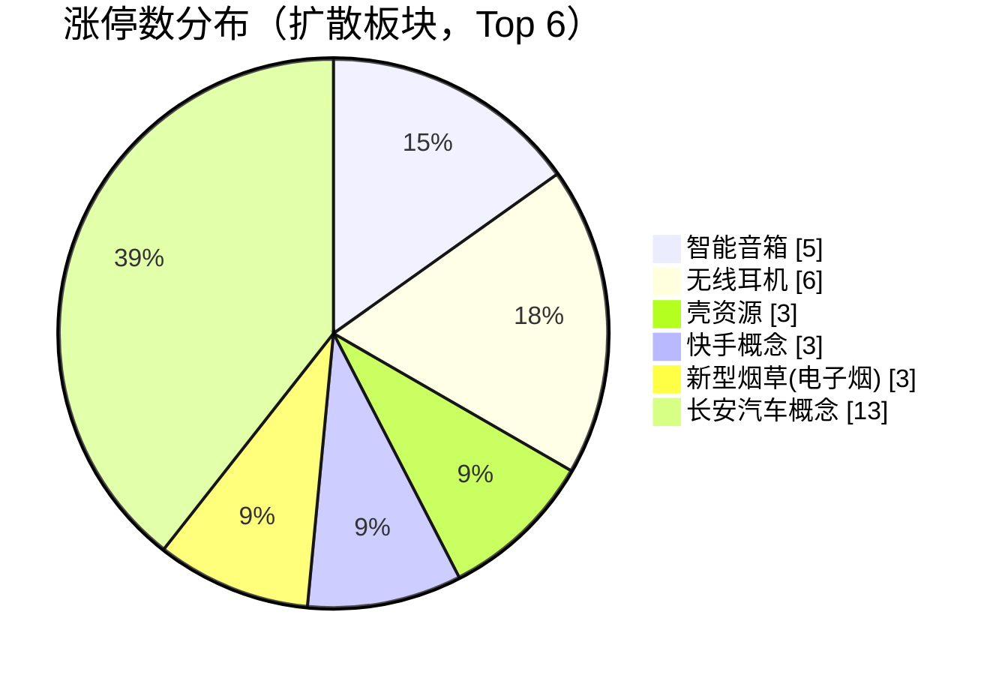

零星涨停板块（<3 只）：广东自贸区(2)、托育服务(1)、MLOps概念(1)、C2M概念(2)

**退潮中（跌停集中）**

| 板块 | 跌停 | 有效成分 | 上涨广度 | 中位涨幅 |
|---|---|---|---|---|
| 绿色电力 | 2 | 436 | 0.41 | -0.21% |
| 西部大开发 | 2 | 636 | 0.47 | +0.00% |
| ST板块 | 2 | 197 | 0.51 | +0.21% |
| 电子商务 | 2 | 676 | 0.51 | +0.14% |
| 2024中报预增 | 2 | 653 | 0.55 | +0.32% |
| 大豆 | 1 | 15 | 0.13 | -0.77% |
| 粮食概念 | 1 | 48 | 0.15 | -0.72% |
| 煤炭概念 | 1 | 89 | 0.16 | -1.03% |
| 煤化工概念 | 1 | 110 | 0.20 | -1.00% |
| 统一大市场 | 1 | 120 | 0.23 | -0.69% |
| 航运概念 | 1 | 87 | 0.24 | -0.69% |
| PPP概念 | 1 | 199 | 0.31 | -0.50% |

### 涨停梯队

> 最高 4 板 ｜ 涨停 67 ｜ 跌停 5 ｜ 炸板 42 ｜ 封板率 61.5% ｜ 打板成功率 22.52% ｜ 一进二 20.90% ｜ 二进三 35.71%

| 身位 | 家数 | 成员（涨幅/封单亿/首封） |
|---|---|---|
| 4板 | 1 | 中京电子 +9.98%/0.075亿/09:25 |
| 3板 | 5 | 克来机电 +10.02%/0.061亿/09:25；东方海洋 +9.93%/0.014亿/09:45；长华集团 +10.01%/0.013亿/09:25；金新农 +9.90%/0.007亿/09:31；东晶电子 +10.00%/0.005亿/09:30 |
| 2板 | 28 | 一彬科技 +9.98%/0.045亿/09:25；九阳股份 +10.01%/0.040亿/09:31；宁波东力 +9.98%/0.040亿/09:25；艾芬达 +20.01%/0.036亿/09:30；汇洲智能 +10.14%/0.030亿/09:25 |
| 1板 | 33 | 华胜天成 +10.03%/0.088亿/09:54；四川长虹 +9.98%/0.080亿/10:27；利欧股份 +9.92%/0.077亿/09:47；遥望科技 +10.04%/0.020亿/10:42；方正电机 +9.96%/0.016亿/10:22 |

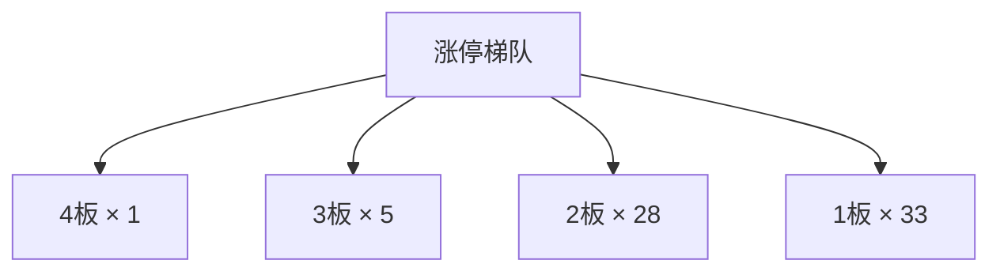

炸板 42 只（前几）：工业富联(31次)、中马传动(9次)、振邦智能(6次)、景旺电子(4次)、宏英智能(3次)

### 预案池对照

| 票 | 池 | 板块 | 现价 | 涨幅 | 触发价 | 买区 | 风险位 | 判定 |
|---|---|---|---|---|---|---|---|---|
| 沪电股份 `002463.SZ` | 执行池 | PCB／元件 | 85.01 | +2.79% | 82.7 | [82.29, 83.94] | 80.73 | **超买区** |
| 生益科技 `600183.SH` | 执行池 | PCB／元件 | 63.1 | +3.87% | 60.75 | [60.45, 61.66] | 58.58 | **超买区** |
| 浙文影业 `601599.SH` | 执行池 | AI应用／视频短剧 | 4.02 | +10.14% | 3.64 | [3.64, 3.71] | 3.52 | **超买区** |
| 中京电子 `002579.SZ` | 观察池 | PCB／元件 | 16.2 | +9.98% | — | — | 0.0 | **无预案价** |
| 宇树科技 `688836.SH` | 观察池 | 机器人概念／人形执行器 | 745.99 | +5.37% | — | — | 0.0 | **无预案价** |
| 新易盛 `300502.SZ` | 观察池 | CPO／光互连 | 187.75 | +3.52% | 175.92 | [166.85, 175.92] | 161.85 | **超买区** |
| 中际旭创 `300308.SZ` | 观察池 | CPO／光互连 | 434.8 | +4.22% | 404.68 | [383.82, 404.68] | 372.31 | **超买区** |
| 锋龙股份 `002931.SZ` | 观察池 | 机器人概念／人形执行器 | 46.71 | +10.01% | 42.46 | [42.25, 43.1] | 40.95 | **超买区** |
| 科森科技 `603626.SH` | 观察池 | 机器人概念／人形执行器 | 26.22 | +9.98% | 23.84 | [23.72, 24.2] | 22.99 | **超买区** |
| 盛剑科技 `603324.SH` | 观察池 | 光刻胶 | 31.28 | +2.62% | — | — | 0.0 | **无预案价** |
| 真视通 `002771.SZ` | 观察池 | 算力租赁 | 17.72 | +1.84% | — | — | 0.0 | **无预案价** |
| 华盛昌 `002980.SZ` | 观察池 | CPO／光互连 | 61.75 | +1.80% | — | — | 0.0 | **无预案价** |
| 宝鼎科技 `002552.SZ` | 观察池 | PCB／元件 | 28.58 | -2.22% | — | — | 0.0 | **无预案价** |
| 襄阳轴承 `000678.SZ` | 观察池 | 机器人概念／人形执行器 | 19.36 | +3.64% | — | — | 0.0 | **无预案价** |

- **沪电股份** — 现价85.01 已高于买区上沿83.94，不追高；仅价格位置对照，不代表完整入场条件确认；不能据此确认站稳，不授予下单权限
- **生益科技** — 现价63.1 已高于买区上沿61.66，不追高；仅价格位置对照，不代表完整入场条件确认；不能据此确认站稳，不授予下单权限
- **浙文影业** — 现价4.02 已高于买区上沿3.71，不追高；仅价格位置对照，不代表完整入场条件确认；不能据此确认站稳，不授予下单权限
- **新易盛** — 现价187.75 已高于买区上沿175.92，不追高；仅价格位置对照，不代表完整入场条件确认；不能据此确认站稳，不授予下单权限
- **中际旭创** — 现价434.8 已高于买区上沿404.68，不追高；仅价格位置对照，不代表完整入场条件确认；不能据此确认站稳，不授予下单权限
- **锋龙股份** — 现价46.71 已高于买区上沿43.1，不追高；仅价格位置对照，不代表完整入场条件确认；不能据此确认站稳，不授予下单权限
- **科森科技** — 现价26.22 已高于买区上沿24.2，不追高；仅价格位置对照，不代表完整入场条件确认；不能据此确认站稳，不授予下单权限

### 盘面 vs 静态复盘 vs 消息面

| 维度 | 对象 | 静态基线（按事实日） | 今日盘面 | 关系 |
|---|---|---|---|---|
| 板块主线 | AI应用／视频短剧 | R2 次线 score=63 涨停None（T-1 口径） | 盘面未见该板块成分票涨停 | **背离** |
| 板块主线 | 光刻胶 | R2 次线 score=60 涨停None（T-1 口径） | 今日盘中该板块 0 只涨停 / 成分80 广度0.74 中位1.59%（相对全市场+1.27%） | **无响应** |
| 板块主线 | 算力租赁 | R2 次线 score=59 涨停None（T-1 口径） | 今日盘中该板块 6 只涨停 / 成分188 广度0.68 中位0.88%（相对全市场+0.56%） | **无响应** |
| 情绪阶段 | 高潮 | R3 原生六态基线（事实日 2026-11-23） | 涨停67 跌停5 炸板率9.27% 打板成功率22.52% | **待研判** |
| 梯队结构 | 最高4板 | 未提供同口径前序梯队 | 今日 4板×1、3板×5、2板×28、1板×33；封板率0.6147 炸板42只 | **待研判** |
| 预案验证 | 沪电股份(002463.SZ) | 预案 PCB／元件／core_midcap／触发价82.7／买区[82.29, 83.94] | 超买区：现价85.01 已高于买区上沿83.94，不追高；仅价格位置对照，不代表完整入场条件确认；不能据此确认站稳，不授予下单权限 | **背离** |
| 预案验证 | 生益科技(600183.SH) | 预案 PCB／元件／core_midcap／触发价60.75／买区[60.45, 61.66] | 超买区：现价63.1 已高于买区上沿61.66，不追高；仅价格位置对照，不代表完整入场条件确认；不能据此确认站稳，不授予下单权限 | **背离** |
| 预案验证 | 浙文影业(601599.SH) | 预案 AI应用／视频短剧／elastic_core／触发价3.64／买区[3.64, 3.71] | 超买区：现价4.02 已高于买区上沿3.71，不追高；仅价格位置对照，不代表完整入场条件确认；不能据此确认站稳，不授予下单权限 | **背离** |
| 预案验证 | 中京电子(002579.SZ) | 预案 PCB／元件／leader／触发价None／买区None | 无预案价：预案未给有效入场触发价/完整买区（缺失、空规则或格式异常）；仅价格位置对照，不代表完整入场条件确认；不能据此确认站稳，不授予下单权限 | **无响应** |
| 预案验证 | 宇树科技(688836.SH) | 预案 机器人概念／人形执行器／elastic_core／触发价None／买区None | 无预案价：预案未给有效入场触发价/完整买区（缺失、空规则或格式异常）；仅价格位置对照，不代表完整入场条件确认；不能据此确认站稳，不授予下单权限 | **无响应** |
| 预案验证 | 新易盛(300502.SZ) | 预案 CPO／光互连／core_largecap／触发价175.92／买区[166.85, 175.92] | 超买区：现价187.75 已高于买区上沿175.92，不追高；仅价格位置对照，不代表完整入场条件确认；不能据此确认站稳，不授予下单权限 | **背离** |
| 预案验证 | 中际旭创(300308.SZ) | 预案 CPO／光互连／core_largecap／触发价404.68／买区[383.82, 404.68] | 超买区：现价434.8 已高于买区上沿404.68，不追高；仅价格位置对照，不代表完整入场条件确认；不能据此确认站稳，不授予下单权限 | **背离** |
| 预案验证 | 锋龙股份(002931.SZ) | 预案 机器人概念／人形执行器／watch_elastic／触发价42.46／买区[42.25, 43.1] | 超买区：现价46.71 已高于买区上沿43.1，不追高；仅价格位置对照，不代表完整入场条件确认；不能据此确认站稳，不授予下单权限 | **背离** |
| 预案验证 | 科森科技(603626.SH) | 预案 机器人概念／人形执行器／watch_elastic／触发价23.84／买区[23.72, 24.2] | 超买区：现价26.22 已高于买区上沿24.2，不追高；仅价格位置对照，不代表完整入场条件确认；不能据此确认站稳，不授予下单权限 | **背离** |
| 预案验证 | 盛剑科技(603324.SH) | 预案 光刻胶／watch／触发价None／买区None | 无预案价：预案未给有效入场触发价/完整买区（缺失、空规则或格式异常）；仅价格位置对照，不代表完整入场条件确认；不能据此确认站稳，不授予下单权限 | **无响应** |
| 预案验证 | 真视通(002771.SZ) | 预案 算力租赁／watch／触发价None／买区None | 无预案价：预案未给有效入场触发价/完整买区（缺失、空规则或格式异常）；仅价格位置对照，不代表完整入场条件确认；不能据此确认站稳，不授予下单权限 | **无响应** |
| 预案验证 | 华盛昌(002980.SZ) | 预案 CPO／光互连／watch／触发价None／买区None | 无预案价：预案未给有效入场触发价/完整买区（缺失、空规则或格式异常）；仅价格位置对照，不代表完整入场条件确认；不能据此确认站稳，不授予下单权限 | **无响应** |
| 预案验证 | 宝鼎科技(002552.SZ) | 预案 PCB／元件／watch_elastic／触发价None／买区None | 无预案价：预案未给有效入场触发价/完整买区（缺失、空规则或格式异常）；仅价格位置对照，不代表完整入场条件确认；不能据此确认站稳，不授予下单权限 | **无响应** |
| 预案验证 | 襄阳轴承(000678.SZ) | 预案 机器人概念／人形执行器／watch／触发价None／买区None | 无预案价：预案未给有效入场触发价/完整买区（缺失、空规则或格式异常）；仅价格位置对照，不代表完整入场条件确认；不能据此确认站稳，不授予下单权限 | **无响应** |
| 消息面对照 | 盘面热点板块 | R4 消息面（T-1 口径） | 实时快讯中命中热点板块关键词 2 条 | **印证** |

**分歧点（不掩盖）：**
- 板块主线·AI应用／视频短剧 → 背离：T-1 有辨识度但今日盘中无涨停响应，题材未获资金确认
- 预案验证·沪电股份(002463.SZ) → 背离：仅研究对照，不授予交易权限
- 预案验证·生益科技(600183.SH) → 背离：仅研究对照，不授予交易权限
- 预案验证·浙文影业(601599.SH) → 背离：仅研究对照，不授予交易权限
- 预案验证·新易盛(300502.SZ) → 背离：仅研究对照，不授予交易权限
- 预案验证·中际旭创(300308.SZ) → 背离：仅研究对照，不授予交易权限
- 预案验证·锋龙股份(002931.SZ) → 背离：仅研究对照，不授予交易权限
- 预案验证·科森科技(603626.SH) → 背离：仅研究对照，不授予交易权限

### 全天广度轨迹

| 时点 | 涨 | 跌 | 广度 | 涨停 | 跌停 | 成交(亿) | 有效样本 |
|---|---|---|---|---|---|---|---|
| 0930 | 5163 | 360 | 0.926 | 22 | 3 | 806 | 5576 |
| 0940 | 5219 | 313 | 0.936 | 46 | 3 | 3,750 | 5576 |
| 0950 | 4941 | 537 | 0.886 | 54 | 3 | 5,441 | 5576 |
| 1000 | 4751 | 706 | 0.852 | 57 | 4 | 6,533 | 5576 |
| 1010 | 4393 | 1011 | 0.788 | 55 | 4 | 7,469 | 5576 |
| 1020 | 4287 | 1101 | 0.769 | 62 | 4 | 8,142 | 5576 |
| 1030 | 4215 | 1171 | 0.756 | 67 | 4 | 8,713 | 5576 |
| 1040 | 4469 | 995 | 0.801 | 74 | 4 | 9,314 | 5576 |
| 1050 | 4487 | 954 | 0.805 | 80 | 4 | 9,772 | 5576 |
| 1100 | 4068 | 1306 | 0.730 | 79 | 4 | 10,139 | 5576 |
| 1110 | 3681 | 1729 | 0.660 | 71 | 4 | 10,537 | 5576 |
| 1120 | 3284 | 2084 | 0.589 | 69 | 5 | 10,906 | 5576 |
| 1130 | 3123 | 2273 | 0.560 | 67 | 5 | 11,302 | 5576 |
| 1140 | 3123 | 2273 | 0.560 | 67 | 5 | 11,302 | 5576 |
| 1150 | 3123 | 2273 | 0.560 | 67 | 5 | 11,302 | 5576 |

> ⚠ **数据冻结段**：1130–1150 数值连续完全一致，说明行情源未刷新，**不是市场横盘**，该段不可解读为盘面变化。

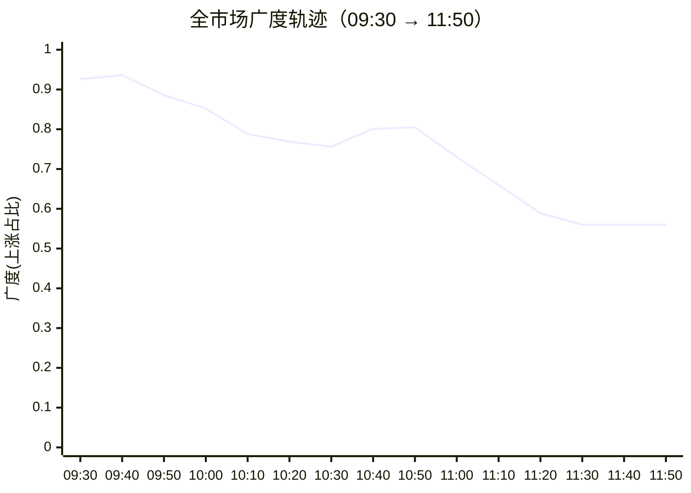

### 观察建议（仅研究）

- **环境**：涨停 67.0 / 跌停 5.0，打板成功率 22.5%，一进二 20.9%。
- **方向**：今日形成实质扩散的是 智能音箱（涨停5/成分62，密度0.081，中位+3.54%）、无线耳机（涨停6/成分99，密度0.061，中位+2.67%）、壳资源（涨停3/成分51，密度0.059，中位+0.47%）。**需确认**：次日能否维持涨停家数且中位涨幅不掉队，否则只是普跌中的避险轮动。
- **零星**：广东自贸区(2只/29成分)、托育服务(1只/15成分)、MLOps概念(1只/18成分)、C2M概念(2只/39成分) 属零星个例，不视为题材，不据此选股。
- **回避**：绿色电力（跌停2）、西部大开发（跌停2）、ST板块（跌停2） 板块中位跌幅深，趋势未止跌前不接。
- **身位**：最高 4 板。梯队有高度不等于可接力，需逐票核验封单稳定性与开板次数后再定。
- **预案**：沪电股份（现价85.01 已高于买区上沿83.94，不追高；仅价格位置对照，不代表完整入场条件确认；不能据此确认站稳，不授予下单权限）、生益科技（现价63.1 已高于买区上沿61.66，不追高；仅价格位置对照，不代表完整入场条件确认；不能据此确认站稳，不授予下单权限）、浙文影业（现价4.02 已高于买区上沿3.71，不追高；仅价格位置对照，不代表完整入场条件确认；不能据此确认站稳，不授予下单权限）、新易盛（现价187.75 已高于买区上沿175.92，不追高；仅价格位置对照，不代表完整入场条件确认；不能据此确认站稳，不授予下单权限）、中际旭创（现价434.8 已高于买区上沿404.68，不追高；仅价格位置对照，不代表完整入场条件确认；不能据此确认站稳，不授予下单权限）、锋龙股份（现价46.71 已高于买区上沿43.1，不追高；仅价格位置对照，不代表完整入场条件确认；不能据此确认站稳，不授予下单权限）、科森科技（现价26.22 已高于买区上沿24.2，不追高；仅价格位置对照，不代表完整入场条件确认；不能据此确认站稳，不授予下单权限）。买区已错过，**不追高**；要参与需等新剧本，不能沿用原预案价位。

<details>
<summary>原始截面与数据质量（折叠）</summary>

**跨源校验**

```json
{
  "xtick": {
    "up": 3125,
    "down": 2281,
    "n": 5587,
    "amount_yi": 11208.4
  },
  "rtk_snapshot": {
    "up": 3123,
    "down": 2273,
    "valid_n": 5576,
    "amount_yi": 11302.0,
    "up_limit": 67,
    "down_limit": 5
  },
  "note": "两源口径不同（XTick 全市场含全部票；rt_k 返回样本）"
}
```

**rt_k 截面（原始）**

```json
{
  "market": {
    "total": 5586,
    "up": 3123,
    "down": 2273,
    "flat": 180,
    "requested_n": 5586,
    "received_n": 5586,
    "valid_n": 5576,
    "missing_n": 10,
    "universe_requested_n": null,
    "population_scope": "returned_rows_not_verified_all_a_universe",
    "up_ratio": 0.5591,
    "legacy_up_ratio_placeholder": false,
    "up_ratio_is_observed": true,
    "up_ratio_all": 0.5591,
    "up_ratio_valid": 0.5601,
    "up_ratio_denominator": "requested_n",
    "degraded": false,
    "limit_known_n": 5576,
    "limit_unknown_n": 0,
    "limit_counts_complete": true,
    "limit_source_errors": [],
    "up_gt3": 762,
    "up_gt5": 311,
    "up_limit": 67,
    "down_gt3": 79,
    "down_gt5": 18,
    "down_limit": 5,
    "amount_yi": 11302.0,
    "amount_sum_overflow": false,
    "amount_valid_n": 5576,
    "amount_missing_n": 0
  },
  "source_time_quality": {
    "quote_age_min_seconds": 1.748137,
    "quote_age_max_seconds": 61.748137,
    "source_age_limit_seconds": null,
    "freshness_status": "age_limit_not_configured",
    "age_reference_at": "2026-11-24T11:50:10.748137+08:00"
  },
  "trading_authorized": false
}
```

</details>

## 分时研判记录

### 09:30 研判增量

> 数据时点：analysis 0930 由 build 09:30:34 生成、errors 空、报价年龄 1.5–23.5 秒。**当日首轮，没有相邻盘内轮次可比**——下文所有"变化"是相对 T-1 收盘（11/23）与 09:30 开盘定价的比较。另用 XTick 全市场 09:37:16 截面（5586 只，时间戳 09:10–09:37）复算昨涨停池反馈，这两个时点不拼成同一瞬间。

- **趋势**：高开是 β，不是打板情绪；开盘溢价被接住了，但封板端在摊薄。
  - 09:30 截面（rt_k，有效 5576）涨 5163 / 跌 360，广度 0.926，中位 +2.21%，成交 806 亿——开盘 30 秒的截面基本等于集合竞价缺口定价，**不能当承接证据**。
  - 真正接住溢价的是昨涨停池：我用 11/23 全A 日线按实际涨停价重建出 153 只（官方口径 151 只，阈值近似差 2 只），配 09:37 报价 → **红盘 143 只（93.5%）、中位 +4.52%、开盘溢价中位 +3.70%、其中封板 26 只（17.0%）**。开盘高开之后没有集体砸盘，这是今日最强的正向事实。
  - 但同一时刻打板端在摊薄：09:30 情绪端点 涨停 23 / 跌停 3 / 炸板 2，打板成功率 11.92%、一进二 9.70%；昨日同时点是 20.00% / 19.23%（昨日收盘 56.67% / 53.85%）。广度从 0.079 跳到 0.926，打板成功率反而腰斩——**钱在"普涨"这一层，没在"封板"这一层**。
  - 梯队高度继续掉：昨日两只 5 板全部失守——真视通（5板）09:37 +0.23%（日低 −1.84%，09:30 曾 +2.82% 后走弱）、盛剑科技（5板）−3.54%（日低 −8.01%）。最高身位由 5 板降为 4 板（中京电子，昨日 3 板晋级）。晋级梯度是"低不晋、高接力"：一进二 9.70% < 二进三 28.57% < 三进四 100%（1/1）——封板资金集中在极少数高位票，昨首板大面积高开后不封板（我复算 136 只昨首板里封板 21 只＝15.4%）。

- **轮动**：开盘就在高低切换，钱压在硬件端，防守红利端被轮出。
  - 电子 305.9 亿成交 + 通信 113.8 亿 ≈ 420 亿，占 09:30 全市场 806 亿的 52%；两者中位涨幅 +3.87%（相对全市场 +1.66）与 +3.58%（+1.37）——**成交最大的板块同时是相对最强的板块**，这是"钱在哪个方向"的量化证据。
  - 失血端：银行 1 涨 / 40 跌、广度 0.024、中位 −1.15%（相对 −3.36，且仍有 22.1 亿成交——是轮出不是没量）；煤炭 −1.56、非银 −1.40、交运 −1.35、公用事业 −1.01、食品饮料 −1.06、农林牧渔 −0.95。
  - 过 ≥3 只涨停门槛的有 7 个板块：无线耳机 4/99、新型烟草 3/53、无线充电 3/60、智能音箱 3/62、AI PC 3/69、MR 3/72、英伟达概念 3/81（相对 +2.13、成交 77 亿最猛）。**但这 7 个成分高度重叠，是"端侧 AI／消费电子／苹果链"一族的多个切面，不是 7 条独立主线**，按方向配仓会重复押同一个 β。
  - 预案三条线内部战绩分化：PCB 容量票涨而不封（沪电 +7.62、生益 +8.66），边缘 景旺电子 1 板炸板 1 次（封单 0、成交 5.18 亿）、奥士康炸板；CPO 双容量（新易盛 +10.33、中际旭创 +11.70）领涨；短剧 0 涨停、无同伴；光刻胶 0 涨停且 5 板龙头盛剑塌。→ **同一天里，容量修复成立、题材接力不成立**。

- **剧本**：预案开盘即被跳空作废，不是"等回踩能救"。
  - 三只执行池票的现价不只越过买区上沿，而是越过了预案自己写的 `max_acceptable_ask`（允许的最高溢价报价）：沪电 89.0 vs 88.49（+0.6%）、生益 66.01 vs 65.0（+1.6%）、浙文 3.94 vs 3.78（+4.2%）。三条入场规则 time_window 09:30–10:30 还开着，但当前**没有可接受的价格** → 原预案今日无合法买点，只能等新剧本；要参与不能沿用原价位。
  - 预案自己的降级条款已触发：市场建议写明"PCB／CPO 容量票高开 ≤+2% 才在 50% 内谈承接"，实际 沪电 +7.62%、生益 +8.66%、新易盛 +10.33%、中际旭创 +11.70% → 前提不成立，按预案原文这份建议今日降级使用（文件 status 已是 degraded）。
  - 浙文叠加第二个反证：预案前提是"短剧分支 ≥2 只同向"，三方对照显示该板块盘中 0 只涨停；价格越界 + 题材无扩散，双杀。
  - 开关状态按预案文件为准：`autonomous_trading_enabled=false`、`requires_user_confirmation=true`、`research_completion_passed=false`，即便 `no_trade=false`、执行额度 0.3，也**不构成买入许可**。（任务模板里"no_trade=true／预算 0"与今日预案文件不符，以文件为准。）

- **下一步看**（全部是可验证阈值，不是泛论）：
  1. 10:00 涨停家数：09:30 情绪端点 23 只（昨日同日 9 只、昨日收盘 151 只）。≥60 只 → 打板情绪跟上、一进二从 9.7% 抬起；仍 <40 只 → 只有 β 修复，不做首板接力。
  2. 广度守不守：09:30 上涨 5163（有效 5576）。10:00 若上涨跌破 4000 或中位涨幅跌破 +1% → "高开先兑现"版本成立，09:30 即为当日高点区。
  3. 昨涨停池衰减：09:37 红盘率 93.5%、中位 +4.52%。10:30 若红盘率跌破 80% → 开盘溢价在被兑现，短线转防守。
  4. 中京电子（PCB 高度锚）：4 板 16.2、封单 0.099 亿（昨日 1.02 亿，缩水约九成）。补厚到 ≥0.5 亿且不开板 = 线还有余温；断板或跌破 16.2 = 预案原文"全组降级"触发，沪电／生益的多头逻辑同时失效。
  5. 沪电 88.49／生益 65.0／浙文 3.78：只有回落到这三条线以下，才谈原预案买点；现价 89.0／66.01／3.94 一律不追。
  6. 跷跷板反转：银行由 −1.15% 转正、同时电子中位跌破 +2% → 高低切换回流防守，成长端当日结束。

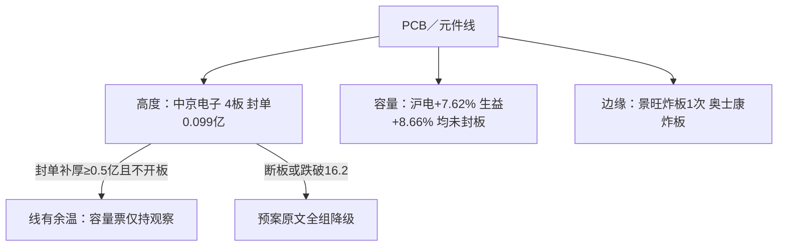

- **口径与缺失**：①09:30 截面是开盘 30 秒，广度 0.926 不等于承接；②昨涨停池 153 只是按涨停价重建（官方 151），属近似；③09:37 复算与 09:30 analysis 属不同时点、不同端点，不相减；④09:37 XTick `order/day` 的金额字段与 rt_k 成交额口径不同，未做成交额比较；⑤银行/电子等相对强度均以 09:30 全市场中位 +2.21% 为基准。

### 09:50 研判增量

> 数据时点：analysis 0950 由 build 09:50:33 生成、errors 空；上一轮 0940（09:40:31）。本轮主比较 0940→0950，20 分钟趋势以 0930 为基线。三轮 rt_k 有效样本均为 5576，分母一致，可跨轮比较。md 中上一份研判增量为 09:30（09:40 那份缺失）。

- **趋势**：涨停在加、广度在减、封板质量在降——强势收窄，既不是普涨，也不是走弱。
  - 广度 0.936→0.8861（上涨 5219→4941、下跌 313→537），但全市场中位涨幅 2.20→2.44% 反升，涨停 46→54、成交 3750→5441 亿（10 分钟 1691 亿）。→ 中位上升 + 广度下降 = 资金往少数方向集中，多数票在回落。
  - 但封板端在摊薄：炸板 4→17（炸板率 1.99→5.30%），封板率 0.92→0.7606。打板成功率 17.22→22.52%、一进二 15.67→21.64% 同时在升——**修复发生在"上板数量"，没发生在"封住的质量"**。
  - 梯队中位加厚、高度不动：2板 21→29（+8）、3板 4 不变、4板仍是中京电子 1 只，5板空缺。中京封单 0.099→0.093→0.088 亿（三轮持续缩水），板上成交 0.88→1.12→1.56 亿——封单在薄、板上换手在放大，高度锚处弱平衡，距预案要求的 0.5 亿厚封差 5 倍以上。

- **轮动**：钱从消费电子／PCB 端流向汽零＋机器人（同一条产业链的两端），CPO 只留容量不添新兵。
  - 加速：长安汽车概念 涨停 4(0930)→9(0940)→13(0950)／231 成分；汽车热管理 1→3→7；减速器 2→2→6；汽车电子 7→10→10。申万汽车 4→8→13 只涨停（327 成分，中位 +2.34→+2.70→+3.24%，相对 +0.13→+0.50→+0.80）——**是唯一涨停数还在涨的一级行业**（电子 8→12→8 已回落）。
  - 同源加速：人形机器人 7→9→16／482（相对 +1.99%）、液冷服务器 2→7→8。
  - 失血：PCB概念 涨停 4→6→3；景旺电子 09:50 累计炸板 4 次（09:40 时它还在板上、未计入炸板名单）。CPO 涨停 7→8→6 只，但中位 +5.42→+5.16、相对 3.22→2.72、成交 1316.8 亿（占全市场 5441 亿的 24%）——**仍是第一强板块，只是参与票在减少**。
  - 防守端没被买回：银行中位 -1.15→-0.06→-0.22%、广度 0.024→0.214→0.191，跌幅收窄但从未转正；煤炭中位 0.65→0.37→-0.22 转负。→ 跷跷板没有切回防守，只是止血。
  - 必须点出的偏差：汽车链 13 只涨停但相对强度只有 +0.97%——**涨停在扩散、强度没跟上**，板块内多数票是跟着普涨，真正封住的仍少数；本轮快讯样本仅 5 条、无汽车链关键词，**驱动未核**。

- **剧本**：三只执行池票仍无合法买点，变化从"价格越界"升级为"线内走弱"。
  - 沪电 89.95(0940)→87.97：已回到 `max_acceptable_ask` 88.49 之下，但仍在买区上沿 83.94 之上 4.8% → 仍判超买区，不追；生益 65.26 仍高于上限 65.0（+0.4%）；浙文封在 4.02（涨停），距买区上沿 3.71 +8.4%，今日不会回到买区。
  - 预案失效条款里的同伴条件是弱点：PCB 线涨停 6→3、景旺炸板 4 次、中京封单再缩 11%。沪电／生益写的是"跌破 80.73 或 PCB 同伴同步转弱"，价格侧没触发、**同伴侧正在恶化**——这条线的多头证据在减少，不是"等回踩就能救"。
  - 浙文仍是双杀：价格涨停 + 短剧板块盘中 0 涨停（三方对照"背离"未修复）。
  - 权限照预案文件：`no_trade=false`、执行额度 0.25（cap 0.3），但 `autonomous_trading_enabled=false`、`requires_user_confirmation=true`、`research_completion_passed=false`、status=degraded → **研究对照，无买入许可**。入场窗口 09:30–10:30 只剩约 35 分钟，窗口外原预案当日作废。

- **下一步看**（可验证阈值）：
  1. 10:00 涨停家数：现 54，09:30 设的门槛 ≥60。到 60 且炸板不扩大（现 17／封板率 0.76）才算打板情绪真跟上；停在 55–60 而炸板继续升 → 高潮日高位分散。
  2. 广度：上涨现 4941、中位 +2.44%。跌破 4000（09:30 设）→ 高开兑现版本成立；广度回升但涨停不增 → 结构由集中转普涨。
  3. 汽车链质量：长安汽车概念 13 只涨停／相对仅 +0.97%。10:30 相对强度 ≥+1.5% 且无新增炸板 = 从普涨转成真扩散；否则只当情绪普涨的切片，不据此选股。
  4. 机器人高度：16 只涨停但最高仍 3 板（克来机电／长华集团／东晶电子）。14:00 前无 4 板晋级 → 只做首板／二板接力，不预期高位突破。
  5. PCB 生死线：中京跌破 16.2 或开板 = 预案原文"全组降级"触发；封单回到 ≥0.5 亿才算修复。景旺炸板 ≥5 次即不再作容量线参照。
  6. 跷跷板反转线：银行中位转正 + 电子中位回落至 +3% 以下（现 +4.34%）= 高低切换回流防守，成长端当日结束。
  7. 沪电 88.49／生益 65.0 即使回落也只回到"溢价上限内"，价格门槛仍是买区上沿 83.94／61.66；10:30 窗口关闭后不再谈原预案买点。

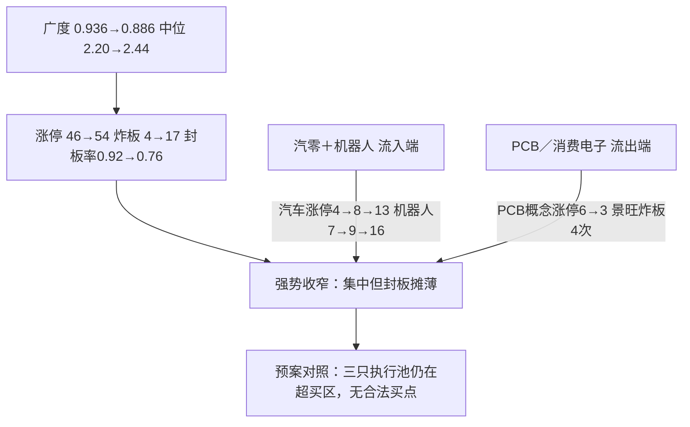

- **口径与缺失**：①三轮有效样本均 5576，分母一致；②梯队各桶只落 8 只样本，桶内个股去留不据此判断；③昨涨停池红盘率本轮未复算（analysis 层无该分组，需独立报价批），09:30 的 93.5% 不当作 09:50 数值；④快讯样本仅 5 条，汽车／机器人链"驱动未核"；⑤申万一级与概念板块是两套成分，未混算、未互证。

### 10:00 研判增量

> 数据时点：analysis 1000 由 build 10:00:34 生成（耗时 3.38 秒）、errors 空；raw 段记的报价年龄基准是 10:00:30（最新 2.9 秒、最旧 54.9 秒）。主比较 0950→1000，20 分钟以上趋势以 0940／0930 为基线；四轮 rt_k 有效样本均 5576，分母一致可跨轮相减。本轮任务执行于 10:05。

- **趋势**：广度与中位同时转跌，上板数还在涨——从"强势收窄"变成"上板多、封住少、多数票在退"。
  - 广度连续第三轮收窄：0.936（0940）→0.886（0950）→0.852（1000）；上涨 5219→4941→4751，下跌 313→537→706。全市场中位涨幅 2.44→2.13，为本日首次转跌（2.21→2.20→2.44→2.13）。09:50 判的"中位升＋广度降＝资金集中"已不成立——现在中位也跌，集中变成少数票涨、多数票退。
  - 成交 5441→6533 亿（+1092 亿），上一个同长时段是 +1691 亿 → 放量速度降 35.4%。增量资金在减速，涨停却在增。
  - 涨停 54→58（+4），全部落在 1 板（20→24）；2 板仍 29、3 板 4、4 板 1，10:00 前无一进二晋级。炸板 17→20，封板率 0.7606→0.7436。→ 这 +4 家不是接力资金打出来的，是新票轮流摸板。
  - 但板块层扩散在变宽：≥3 只涨停的题材板块 92→101，≥5 只的 40→51。宽度扩、深度降，是高潮日第二段的形态，不是普涨回补。
  - 晋级率字段要打问号：jjl 22.52、jj1t2 21.64、jj2t3 28.57、jj3t4 100.0 两轮一字不差，而涨停 54→58、炸板 17→20 均已变 → 该组字段未随本截面刷新（或按昨池固定），**不解读，不当"接力率稳"的证据**。
  - 09:30 设的三条门槛：涨停 ≥60 未达（现 58）、上涨破 4000 未破（现 4751，buffer 751 只）、昨涨停池红盘率跌破 80% **本轮未复算**（缺独立报价批）。→ 本轮既不能判"情绪跟上"，也不能判"高开兑现"，只能判封板质量在降。

- **轮动**：主轴没换，钱还在硬件且相对强度在升；昨日的加速线（汽零＋机器人）转平转弱；软件／数据这层是涨停扩散、强度不跟。
  - 硬件端（电子 1986 亿＝30.4%、通信 651 亿，合计 2637 亿＝40.4%）：申万电子 涨停 8 持平、中位 4.34→4.47、相对 +1.90→+2.34；CPO 6 只涨停／230 成分、中位 +5.03%、相对 +2.90（0950 是 +2.72）、成交 1533 亿＝全市场 23.5%。先进封装 相对 +2.34／855 亿、存储芯片 +2.58／972 亿、光刻机 +2.90／128 亿（0 涨停、纯强度）。→ 钱没走，还在光／封装／存储。
  - 汽零＋机器人到顶：长安汽车概念 13→13（中位 3.41→3.07、相对 0.97→0.94）、汽车热管理 7→6（中位 4.26→3.39、相对 1.82→1.26）、汽车电子 10→9；申万汽车 中位 3.24→2.79、相对 0.80→**0.66**；人形机器人 16→16（中位 4.43→3.84、相对 1.99→1.71）。→ 涨停数到顶、强度先退，09:50 那条"涨停扩散、强度跟不上"已变成"涨停也停、强度再退"。
  - 新增的一层（AI 软件／数据要素／国产算力）全是"涨停 +2、强度 −"：AI应用 7→9（中位 2.95→2.51、相对 0.51→0.38）、数据要素 4→6、大数据 4→6、DeepSeek 5→7、云计算 2→4、信创 2→4、国产软件 1→3、阿里 2→4、百度 2→4、抖音 3→5、小米 4→6。同一批板块中位与相对强度同时下移 → 是单票拉动＋概念重叠，不是板块扩散。本轮新上板的 4 只全是首板：工业富联（09:35 首封、**开板 29 次**、封单 0.187 亿、成交 58.41 亿）、华胜天成（09:54 首封、0 开板、封单 0.16 亿、成交 34.05 亿）、横河精密（09:58、20cm）、高乐股份。一只 58 亿成交的票能同时挂在十几个 AI 及 AI 硬件概念下，**不能按板块个数读成多点开花**（与 09:30 那回"7 个板块其实是同一族"同型的偏差）。
  - 失血端仍未回流：高股息 −2.43、超级品牌 −2.63、上证50 −2.24、中特估 −2.13、漂亮100 −2.12；白酒 中位 +0.59／相对 −1.54；申万银行 中位 −0.41、相对 −2.54、广度 0.0714（约 14 只成分里 1 只红）。→ 防御继续失血，跷跷板没切回，是单边不是切换。

- **剧本**：预案自己设的 10:00 核验点到期，四条核下来是"阶段不改、温度在降"；三只执行池票的原买点在 25 分钟内基本不可能到。
  - 预案 `emotion_cycle.switch_if` 写的就是"9:30–10:00 同窗核验"，逐条对：①昨涨停池溢价→持续红盘收益：**本轮未复算（缺失）**，09:30 的 93.5% 不搬用；②广度回落：**成立**（0.936→0.852）；③双高标走弱：**不成立且反向**——真视通 17.42→18.34（+0.11%→+5.4%，+5.28%）、盛剑 30.67→30.99（+0.62%→+1.67%），两只 5 板既没新低也没再破位；④接力／低位扩散缩窄：**不成立**——1 板 20→24、≥3 涨停板块 92→101 都在扩。原文四条是"且"连接 → 不满足改判降温，阶段维持"高潮"首选；但广度与封板率同向恶化 → 高潮日内的钝化，不是降温确认。
  - 仓位建议已到期：`market_position_advice.valid_until = 2026-11-24T10:00:00+08:00`，总仓上限 50%／初始 25% 这两个数字**到此为止**。10:00 后继续沿用等于拿过期授权定仓，需新事实重新评估，不是自动续期。
  - 三只执行池票（入场窗口 09:30–10:30，仍剩约 25 分钟）：沪电 87.48，高于买区上沿 83.94 **+4.22%**（本轮 87.97→87.48 十分钟只走了 −0.56%）；生益 65.21，高于 61.66 **+5.76%**，且仍在 `max_acceptable_ask` 65.0 之上 0.3%；浙文封在 4.02 涨停，高于 3.71 **+8.36%**，今日不回买区。→ 原预案今日没有可执行买点，10:30 窗口关闭即作废，不是"等回踩就能救"。
  - 预案失效条款的同伴侧在继续恶化：PCB概念 涨停 3→3（连续两轮 3）；中京 4 板封单 0.099→0.088→**0.085 亿**（三轮累计 −14.1%），板上成交 1.61 亿，距预案要求的"≥0.5 亿厚封"差 **5.9 倍**；景旺电子 4 次炸板、+9.35% 未封（本轮无新增开板，也没封回）。沪电／生益的失效条件写的是"跌破 80.73 或 PCB 同伴（生益／中京）同步转弱、通信设备资金转负"——价格侧未触发（87.48 距 80.73 −7.7%），同伴侧在恶化但还没"同步"（中京仍封、生益 +7.34%、通信相对 +1.96）。
  - 跷跷板 B 计划（CPO 双容量）前提是"执行池 2 只 PCB 票竞价不及预期"，今日是大高开 → 前提不成立；且新易盛 192.95／中际旭创 447.49 已远高于 B 计划回踩买区 166.85–175.92／383.82–404.68。→ B 计划同样不可用，不能当替代方案。
  - 权限照预案文件：`no_trade=false`、执行额度 0.3、目标总仓 30%，但 `autonomous_trading_enabled=false`、`requires_user_confirmation=true`、`research_completion_passed=false`、status=degraded → 全部内容仅研究对照，不构成买入许可。（任务模板写的"no_trade=true／预算 0"与今日预案文件不符，以文件为准。）

- **下一步看**（都是可验证阈值）：
  1. 10:30 窗口关闭前的三档价格：沪电 ≤83.94、生益 ≤61.66、浙文 ≤3.71。从 87.48／65.21／4.02（涨停）走到位，需在 25 分钟内 −4.0%／−5.4%／−7.7%（浙文还得先开板）。做不到＝原预案今日作废，此后不再谈这三条买点。
  2. 工业富联封板质量：现开板 29 次、封单 0.187 亿（占其 58.41 亿成交的 0.3%，极薄）。10:30 前封回且开板次数不再新增 ≥5 次 → 算力硬件大票有真承接；若仍在板上反复、尾盘跌破当日军价 → 大票对攻失败，硬件端只剩 CPO 容量，AI 软件那层降格为纯情绪。
  3. 封板率线：现 0.7436（炸板 20）。涨停不变前提下炸板 ≥25 只（封板率跌破 0.70）→ 高潮转降温确认，短线降档。
  4. 广度线：上涨 4751。10:30 跌破 4000 → "09:40 的 0.936 就是当日高点"版本成立，今日只剩尾盘博弈。
  5. 汽零出局确认：申万汽车 相对 0.66、涨停 13。10:30 相对跌破 0.5 且涨停 <10 只 → 这条线当日出局，不再作为轮动候选。
  6. 硬件失血线：电子 相对 2.34、CPO 相对 2.90。若电子跌破 1.5 且 CPO 跌破 2.0 → 硬件开始失血，当日空仓等新剧本，不在旧线上找买点。
  7. 高低切换线：银行 中位 −0.41%／广度 0.0714、高股息 −2.43。银行中位转正 **且** 高股息相对回到 0 以上 → 防御回流，成长端当日结束。

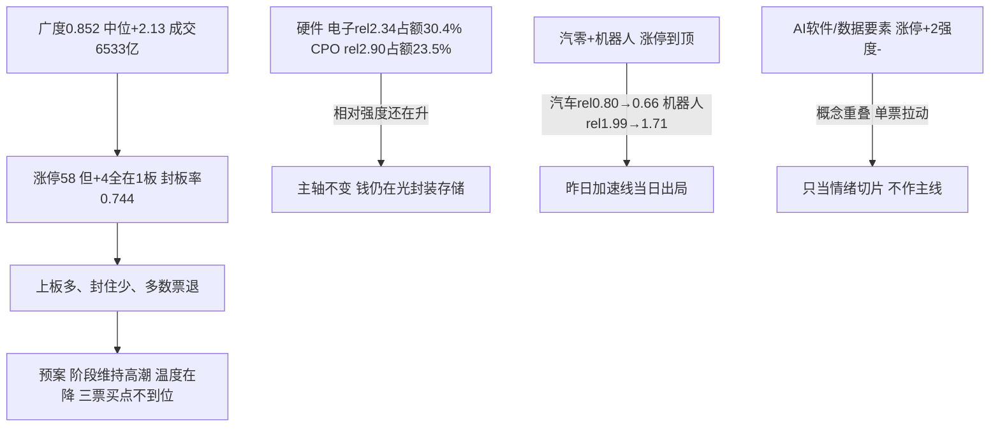

- **口径与缺失**：①四轮 rt_k 有效样本均 5576，分母一致；②梯队各桶只落 8 只样本（1／2 板尤其），桶内个股去留不据此判断；③晋级率组字段两轮同值而涨停／炸板已变，按未刷新处理，本轮不引用；④快讯样本 5 条（浦东离岸金融、数字人民币、山东能源规划、个股股东数），无 AI 算力／汽零关键词 → 工业富联、华胜天成等首板"驱动未核"；⑤概念板块与申万一级是两套成分与分母，仅作各自结论、未互证，snapshot up_limit 57 与梯队 58 属不同端点不相减；⑥昨涨停池红盘率本轮未复算，标缺失，不用 0 或旧值顶替。

### 10:10 研判增量

> 数据时点：analysis 1010 由 build 10:10:32 生成（耗时 2.38 秒）、errors 空。跨源核对：XTick 全市场 4414 涨／992 跌／7420.2 亿 vs rt_k 4393 涨／1011 跌／7468.9 亿——两源口径不同、方向一致（都显示广度骤降），不相减。五轮 rt_k 有效样本均 5576，可跨轮相减。主比较 1000→1010，任务执行于 10:15（本轮取的当日最新截面即 10:10 那轮）。

- **趋势**：当日第一次"广度／中位／封板"三个口径同时恶化，10:00 设的两条降档线本轮**双双打穿**。
  - 广度 0.852→0.7878（上涨 4751→4393、下跌 706→**1011**，下跌家数首次破千）；全市场中位涨幅 2.13→**1.52**（−0.61，当日单轮最大跌幅：2.21→2.20→2.44→2.13→1.52）。→ 由"少数票涨、多数票退"变成"多数票在加速退"。
  - 封板端降档确认：炸板 20→**28**（+8）、封板率 0.7436→**0.6627**、炸板率 0.2564→0.3373；涨停 58→55。10:00 写下的两条线"炸板 ≥25"与"封板率 <0.70"同时触发，不是单点噪声。
  - 梯队首次从腰部减薄：2板 29→26（−3，当日第一次回落）、1板 24 持平、3板 4、4板 1（中京 16.2 仍封，封单 0.085→0.084 亿，板上成交 1.67 亿）。→ 高度没断，靠一只票撑着；中间层开始掉。
  - 晋级率字段本轮**刷新了**（与 10:00 同值情况不同）：打板成功率 22.52→20.53、一进二 21.64→19.40、炸板率 5.96→7.95，与"涨停减少＋炸板增加"同向，本轮可以引用。
  - 扩散宽度首次回落：≥3 只涨停的板块 102→99、≥5 只的 51→47（此前 54→86→93→102 单调扩）。→ 宽度和深度本轮一起退，这是高潮日尾段形态，不是普涨回补。
  - 唯一没恶化的是钱：成交 6532.7→**7468.9 亿**（+936 亿），但放量速度较上轮 +1092 亿降 14.3%。**资金没撤，只是不再往板上和多数票上加注**——与"钱离场"是两件事。
  - 新增炸板集中在中小弹性票：柯力传感 8 次开板（+9.11%）、浙江荣泰 3 次（+9.29%）、艾艾精工 2 次（+9.9%）、高乐股份 2 次（10:00 时它还在 1 板名单内）。景旺电子仍 4 次、振邦智能 4 次、荣联科技 3 次（+8.89%，它 09:30 还在 3 板名单里）。

- **轮动**：主轴没换人，但"强度全面退、成交占比升"——是换手内耗，不是撤资；汽零＋机器人是唯一涨停数与强度双降的方向。
  - 硬件端：共封装光学(CPO) 6 只涨停持平，中位 5.03→4.08、相对 2.90→2.56，成交 1532.8→1695.4 亿（占全市场 **22.7%**）；申万电子 涨停 8 持平，中位 4.47→3.50、相对 2.34→**1.98**，成交 1986→2252.5 亿（**30.2%**，当日最高）。存储芯片 涨停 1→2／相对 2.58→2.29；先进封装 2.34→2.15；光刻机 涨停 0→1／相对 2.90→2.52；英伟达概念 4 涨停持平／相对 2.57→2.17。→ 钱仍在这条线，相对强度却全线下移 0.3–0.4 个点：同一条线内部开始互相消耗。
  - 预案主线 PCB概念：涨停 3 连续三轮不变，中位 4.05→3.07、相对 1.92→**1.55**、广度 0.9668→0.9461。→ 今天第一次由"维持"转"衰减"，预案主线的板块侧证据在减少（不是失效，是弱化）。
  - 汽零＋机器人（09:50 的加速端）：人形机器人 涨停 16→14／中位 3.84→3.09／相对 1.71→1.57；减速器 7→6／3.88→3.10；汽车热管理 6→4／3.39→2.85；汽车电子 9→8／3.73→2.90；长安汽车概念 13→12／3.07→2.54；申万汽车 涨停 13→**11**、中位 2.79→2.21、广度 0.9358→0.9021。→ 双降成立，但 10:00 设的出局线（涨停 <10 且相对 <0.5）本轮 11 只／0.69 **仍未触发**，只是相对强度从 0.97 一路滑到 0.69。
  - AI 软件／数据要素（10:00 新冒出的那层）继续降格：AI应用 9 涨停持平，中位 2.51→1.74、相对 0.38→0.22、广度 0.9165→**0.8621**（跌 5.4 个点，重点板块里最狠）；数据要素 6 持平／2.62→1.74／0.49→0.22／广度 0.9328→0.8881；算力租赁 4→3／3.30→2.48；液冷服务器 8→7／4.09→3.21。→ 印证 10:00 的判定：单票拉动＋概念重叠，不是扩散。
  - 防守端只止血不回流：超级品牌中位 −0.50→−0.62、相对 −2.63→−2.14（跌得少了）、广度 0.3265→0.3061（还在降）；煤炭概念中位 0.00→−0.17。**新事实**：10:09:41 格隆汇快讯"焦煤主力 +2%（1423 元/吨）"与煤炭概念中位 −0.17 反向——商品端涨、股票端跌，说明今天资金对低位周期没兴趣；跷跷板仍是单边，不是切换。

- **剧本**：三只执行池票已到"窗口关闭前 20 分钟"的判定点——原买点不可达，主线板块侧从"同伴恶化"升级为"确认走弱"。
  - 价格：沪电 87.48→86.38（+5.78%→+4.45%），仍高于买区上沿 83.94 **+2.91%**（窗口内需再跌 2.8%）；生益 65.21→64.27（+7.34%→+5.79%），**首次回到溢价上限 65.0 之内**，但仍高于买区上沿 61.66 **+4.23%**（需再跌 4.1%）；浙文 4.02 涨停不动，高于 3.71 **+8.4%**，且需先开板。→ **"回到溢价上限内"不等于进入买区**，价格门槛仍是买区上沿 61.66／83.94／3.71，这是今天最容易犯的错。
  - 板块侧：预案给沪电／生益的失效条款是"跌破 80.73／58.58，或 PCB 同伴（生益／中京）同步转弱、通信设备资金转负"。现状：价格侧距 80.73 还有 −6.5%、距 58.58 还有 −8.8%，**未触发**；同伴侧中京仍在板但封单 0.084 亿（较预案要求的 0.5 亿差 **5.95 倍**、较昨日 1.02 亿缩水 91.8%）、生益未封，且 PCB概念相对强度 1.92→1.55 连续两轮下滑。→ 同伴侧已"同步转弱"，只差价格。用词要准：本轮是**原预案今日无合法买点（价格不可达）**，不等于"失效条款已触发"。
  - 浙文双杀更明确：价格涨停 + AI应用板块广度 0.9165→0.8621 + 三方对照仍写"短剧盘中 0 涨停、背离未修复"。
  - 工业富联（10:00 设的观察条件）：开板 29 次本轮**未再新增**、仍在板上 → "封回且不再新增 ≥5 次"暂时满足；但成交 59.17 亿对应封单 0.179 亿（占成交 0.3%），10 分钟板上换手 +1.67 亿，封单厚度无改善，仍属极薄。
  - 中京（4 板高度锚）：封单 0.099→0.093→0.088→0.085→**0.084 亿**（五轮累计 −15.2%），板上成交 1.67 亿。高度在，厚度没有。
  - 权限以预案文件为准：`no_trade=false`、执行额度 0.3、目标总仓 30%，但 `autonomous_trading_enabled=false`、`requires_user_confirmation=true`、`research_completion_passed=false`、`status=degraded`；三条 entry 的 time_window 均为 09:30–10:30（剩约 20 分钟，窗口外原预案当日作废）。仓位建议 `valid_until=2026-11-24T10:00` **已过期**，50%／25% 两个数字此后不再有效。全部内容仅供研究对照，不构成买入许可。

- **下一步看**（10:20／10:30 可验证阈值）：
  1. 降档是否确认：涨停 55、封板率 0.6627。10:30 涨停 <50 或封板率 <0.60（炸板 ≥33）→ 高潮转降温确认；涨停回 ≥58 且封板率回 0.70 上方 → 本轮只是 10 分钟级震荡。
  2. 腰部：2板 26（首次回落）。10:20 若 ≤24 → 梯队中段断裂，当日不接二板／三板。
  3. 广度：上涨 4393（1000 设的 4000 线差 393 只）。10:30 跌破 4000 → "09:40 的 0.936 即当日高点"版本成立；回升过 4700 且涨停回补 → 视为洗盘不是退潮。
  4. 硬件失血线：电子相对 1.98、CPO 2.56。维持 10:00 判据——电子跌破 1.5 **且** CPO 跌破 2.0 → 硬件失血确认；两条今轮都在门槛上方但同向下行，各再跌约 0.3 即到位。
  5. PCB 主线生死：涨停 3／相对 1.55／中京 16.2。中京开板或跌破 16.2 → 预案原文"全组降级"；PCB 相对跌破 1.2 → 即便价格回到 83.94 也不构成预案买点（板块条件先破）。
  6. 汽零出局：申万汽车 涨停 11、相对 0.69。10:30 涨停 <10 且相对 <0.5 → 当日出局，不再作轮动候选。
  7. 三票价格线（只剩 20 分钟）：沪电 ≤83.94（现 86.38）、生益 ≤61.66（现 64.27）、浙文 ≤3.71（现 4.02 涨停）。做不到 → 原预案今日作废，此后不再谈这三条买点，不追回落。
  8. 工业富联：开板 29 次、封单 0.179 亿、成交 59.17 亿。10:30 前开板再增 ≥5 次或封单跌破 0.1 亿 → 算力大票对攻失败；封单补到 ≥0.5 亿且开板次数不动 → 大票承接成立（本轮唯一可能改变当日结构的单点）。
  9. 防守回流：超级品牌相对 −2.14、煤炭概念中位 −0.17。要看到银行中位转正 **且** 高股息相对回 0 上方才算高低切换回流；"焦煤期货涨、煤炭股跌"的背离延续 → 商品未传导，不作轮动候选。
  10. 中京封单 0.084 亿，距预案要求的 0.5 亿差 5.95 倍。补到 ≥0.5 亿才算高度锚修复，否则 4 板只是"挂着"。

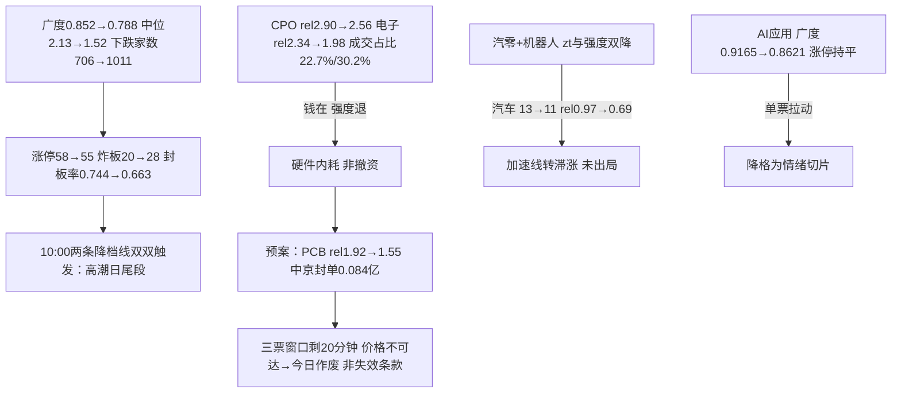

- **口径与缺失**：①同一轮两个广度分母：trajectory 记 0.7878（有效 5576），snapshot up_ratio 记 0.7864（total 5586），本轮引用前者、不与后者混用；②XTick 4414/992/7420.2 亿与 rt_k 4393/1011/7468.9 亿是不同源不同口径，只作方向核对，不相减；③晋级率组（20.53／19.40／7.95）本轮已随截面刷新、可引用，但仍是 XTick 情绪端点口径，与梯队桶数是不同端点，不互相校验；④跌停名单 4 只中含"上证180（000010）"一行，代码与指数撞号、名称与个股不符，疑为数据瑕疵——个股跌停按 3 只（欢瑞世纪、英力特、*ST瑞茂）记，标疑不重算；⑤昨日涨停池红盘率本轮**未复算**（analysis 层无该分组，需独立报价批），缺失不用旧值 93.5% 顶替；⑥梯队各桶只落 8 只样本，桶内个股去留不据此判断；⑦快讯样本仅 5 条（时间 10:09:41–10:10:16），唯一沾边的是 10:09:52"天数智芯、比依股份等成立智算私募投资基金"——属一级市场基金设立，非上市公司订单，不足以解释工业富联／华胜天成封板，二者"驱动未核"；⑧概念板块（XTick hot/bk）与申万一级是两套成分与分母，各自结论、未互证。

### 10:20 研判增量

> 数据时点：analysis 1020 由 build 10:20:30 生成（耗时 1.38 秒），`errors` 空；六轮 rt_k 有效样本均 5576、未降级，可跨轮相减。本段执行于 10:25，主比较 1010→1020。

- **趋势**：封板端修复、广度继续恶化——本轮是「强势集中」，不是降档反转；10:10 写的两条降档线本轮被打脸一半。
  - 涨停 55→62（+7）、炸板 28→26（−2）、封板率 0.6627→**0.7011**（+3.84pt），恰跨过 10:10 预设的「涨停回 ≥58 且封板率回 0.70 上方」；但同一句的另一半（涨停 <50／封板率 <0.60）没有兑现。准确说法是：**降档未确认，不是反转确认**——0.7011 只高出 0.70 线 0.0011，属刀尖上，不足以宣布结构翻转。
  - 广度 0.7878→**0.7688**（上涨 4393→4287、下跌 1011→1101），下跌家数连续两轮破千；全市场中位 1.52→1.49。恶化速度在减缓（上涨家数 1000→1010 减 358 只，本轮只减 106 只；下跌家数 +305→+90），但**方向没变**。
  - 「涨停增、广度降」两个口径同时成立，只能解释为钱往少数票上收（抱团），不能写成普涨修复。成交 7468.9→**8142.2 亿**（+673 亿、+9.0%），但放量速度较上轮 +936 亿**降 28.1%**——量还在进，进得慢了。
  - 腰部回补：2板 26→**27**、3板 4→5（东方海洋 09:45 首封、开板 2 次、成交 17.64 亿对封单 0.016 亿）、1板 24→28、4板 1（中京仍封）。10:10 设的「2板 ≤24 即中段断裂」**未触发**。
  - 封板修复的来源要看清楚：炸板转封是柯力传感（8 次开板后回封）、高乐股份（2 次开板回封）；新增炸板是兆威机电、阿尔特。→ 修复来自**中小弹性票错峰回封**，不是新资金进场。晋级率组本轮已随截面刷新、可引用：打板成功率 20.53→21.85、一进二 19.40→20.15、二进三 28.57→35.71、炸板率 7.95→6.62。

- **轮动**：算力硬件的相对强度全线下移，钱换到消费电子端侧＋机器人＋军工；**换位，不是撤资**（成交还在增）。
  - 下行侧（相对全市场，普跌 0.2–0.3 个点）：共封装光学 CPO 2.56→**2.26**（成交 1695.4→1817.0 亿、占全市场 22.3%，量增而相对强度降＝换手内耗）、存储芯片 2.29→2.15、先进封装 2.15→2.13、光刻机 2.52→2.38、液冷服务器 1.69→1.50、光纤 1.51→1.30、光刻胶 1.17→0.97。预案主线 PCB概念 1.55→**1.25**（连续三轮降）、广度 0.946→0.921、涨停 3 不动——主线侧证据第三轮流失，已贴 1.2 失血线。
  - 上行侧：智能音箱 2.08→**2.71**（中位 3.60→4.20、成交 221 亿）、无线耳机 1.87→**2.34**（涨停 6）、消费电子概念 1.52→**1.61**（成交 1305→1419 亿、涨停 9）、苹果概念 2.38 持平、AI PC 1.81→2.06、AI 眼镜 1.77→1.93。同一簇四条线同向——**端侧硬件是本轮唯一成形的低位轮动**。
  - 弹性线：人形机器人 涨停 14→15、相对 1.57→**1.64**（成交 1177→1272 亿）；减速器 1.58→1.84；算力租赁 涨停 3→5；数据中心 AIDC 8→9（成交 2370 亿、占 29.1%）。→ 算力主题仍在扩，但**扩散载体是小票**，不是容量龙头（见剧本工业富联）。
  - 跷跷板另一端只止跌不回流：银行 中位 −0.46→−0.33、相对 −1.98→−1.82、广度 0.048→0.167（改善但仍八成票在水下）；煤炭 中位 −0.45→**−0.77**、相对 −1.97→−2.26（更差）。10:10 写的回流判据（银行中位转正 **且** 高股息相对 >0）本轮仍未满足。
  - 新冒头两只：国防军工 相对 1.03→**1.56**（涨停 0→1）、传媒 0.48→1.03（AI应用 中位 1.74→1.87 但广度 0.862→**0.855** 仍在降）。→ 传媒改善在价格侧、不在扩散侧，AI 应用仍按 10:10 的「降格为情绪切片」处理。

- **剧本**：三票买点窗口 09:30–10:30，本段执行时剩约 5 分钟，价格侧无一条可达——**今日原预案在价格上无合法买点，也不追回落补票**。
  - 沪电 86.38（+4.45%），高于买区上沿 83.94 **+2.91%**；生益 64.13（+5.56%），高于 61.66 **+4.01%**；浙文 4.02 涨停，高于 3.71 **+8.36%** 且需先开板。10:10 至今 10 分钟里沪电 86.40→86.38（横住不动）、生益 64.26→64.10（继续下移）——是**高位缓降，不是快速回落**；5 分钟内再跌 2.8%／4.0% 在结构上不成立。
  - 「无买点」和「失效」要分开说：价格侧距失效线 80.73／58.58 还有 −6.5%／−8.6%，**未触发**；同伴侧（中京仍封 16.2 但封单 0.084→0.081 亿、六轮累计缩 17%，PCB 相对强度连续三轮降）已构成预案原文的「同伴同步转弱」。所以本轮用词是**原预案今日无合法买点**，不是失效条款已触发。
  - 中京：4 板高度在、厚度继续掉，封单 0.081 亿距预案要求的 0.5 亿差 **6.17 倍**。它仍是唯一高度锚，断板即全组降级。
  - 工业富联（10:10 的观察点）双条件只成一半：开板 29 次本轮未新增（满足），封单 0.179→0.170 亿继续缩、成交 59.17→59.70 亿（封单/成交 0.28%，极薄）——「补到 ≥0.5 亿」未达。**大票承接未成立**，AIDC 的扩散由小票承担。
  - 权限照预案文件：`autonomous_trading_enabled=false`、`requires_user_confirmation=true`、`status=degraded`、`research_completion_passed=false`、`effective_trading_budget=0.3`、`risk_limits.target_total_position_pct=0.3`；`market_position_advice.valid_until=2026-11-24T10:00` **已过期**，50%／25% 两数本轮及此后不再引用。全部内容仅供研究对照，不构成买入许可。

- **下一步看**（10:30／10:40 可验证）：
  1. **窗口到期**：10:30 后沪电 ≤83.94、生益 ≤61.66、浙文 ≤3.71 若均未达 → 原预案今日作废，此后不再谈这三条买点；即便意外触及也不追，因 PCB 相对 1.25 已贴 1.2 失血线，板块条件先破。
  2. **抱团还是错峰回封**：涨停 62／封板率 0.7011。10:30 涨停 ≥65 且封板率 ≥0.72 → 强势集中成立；涨停回落 <58 或封板率跌回 <0.68 → 本轮修复只是回封错峰，10:10 的降档判断恢复有效。
  3. **广度分水岭**：上涨 4287（广度 0.7688）。10:30 跌破 4100 且涨停仍增 → 抱团加剧、指数级风险；回升过 4500 → 广度止跌确认。10:00 设的 4000 线仍未破。
  4. **PCB 生死**：中京开板或 PCB概念相对 <1.2 → 预案原文「全组降级」生效；中京封单补到 ≥0.5 亿才算锚修复（现 0.081）。
  5. **端侧轮动真伪**：智能音箱 相对 2.71（涨停 5）、无线耳机 2.34（6）、消费电子概念 1.61（9）。10:30 智能音箱相对守住 >2.5 且涨停 ≥5 → 端侧是今日真轮动；回落 <2.0 → 按低位补涨脉冲处理，不作轮动候选。
  6. **机器人加速**：人形 涨停 15／相对 1.64、减速器 1.84。新炸板兆威机电（减速器侧）若 10:30 前回封且人形涨停 ≥16 → 加速延续。
  7. **防守回流**：需银行中位转正 **且** 高股息相对 >0；现状 −0.33／−1.82 只是止跌。煤炭中位 −0.77 与「焦煤主力 +2%」继续背离 → 商品未传导，不作轮动候选。
  8. **消息落地检验**：华为 10:19:59／10:20:07 宣布鸿蒙终端设备破 1 亿，鸿蒙概念本轮广度 0.916→**0.931**（逆势升 1.5 个点、中位 1.82→2.04）但涨停仍 1。截面与快讯时点相差不足 1 分钟，**不能判因果**；10:30 看鸿蒙涨停 1→≥2 或相对破 1.0 才算资金接受，否则记「未定价」。

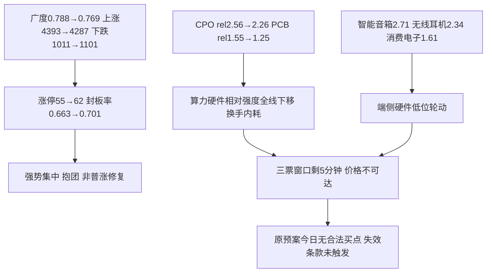

- **口径与缺失**：①广度两个分母：trajectory 记 0.7688（有效 5576）、snapshot up_ratio 记 0.7675（requested 5586），本轮引用前者，不与后者混用；②涨停三口径 snapshot up_limit 62／ladder limit_up_n 61／emotion ztnum 61，差 1 只为梯队未收录，**不是炸板**，炸板独立记 26；③XTick 4311／1100／8083 亿与 rt_k 4287／1101／8142.2 亿异源异口径，只作方向核对、不相减；④申万电子 相对 1.98→2.05 微升，与其成分含正在走强的消费电子有关，而纯算力概念（CPO／存储／封装）在降——两套分类体系各自成立、不互证；⑤昨日涨停红盘率本轮仍未复算（analysis 层无该分组），标缺失，不用旧值顶替；⑥跌停名单 4 只中「上证180(000010)」仍为代码撞名瑕疵，个股按 3 只记、标疑不重算；⑦梯队各桶只落 8 只样本，桶内个股去留不据此判断；⑧快讯样本 5 条（10:19:38–10:20:11）、`news_matched` 0/592，板块排序的驱动全部「未核」，转载只计一次。

### 10:30 研判增量

> 数据时点：analysis 1030 生成于 10:30:36（耗时 6.41 秒），`errors` 空；七轮 rt_k 有效样本均为 5576 只、未降级，可跨轮相减。本段执笔 10:38–10:39，主比较 1020→1030。情绪端点本轮 ztnum 停在 61（梯队与 snapshot 均为 67），打板成功率 21.85／一进二 20.15／连板数 33／跌停 4 与上轮逐项完全一致，判「端点疑似未刷新」，下文的晋级率组不作变化引用。

- **趋势**：10:20 的两条门槛本轮双双兑现——**强势集中成立**，但同轮证据同时指向「结构收窄」，不是修复。10:20 预设判据结算：
  - 兑现：涨停 62→**67**（+5）、炸板 26→25、封板率 0.7011→**0.7283**（+2.72pt，超出 0.72 线 0.83pt），「≥65 且 ≥0.72」成立，已不在刀尖上；PCB 相对 **1.04** 跌破 10:20 设的 1.2 线；鸿蒙涨停 1→2，兑现「封板端资金接受」。
  - 未兑现：广度 0.7688→**0.7559**（上涨 4287→4215，未破 4100 线）；防守回流判据（高股息相对 >0）仍不满足，现为 −1.49。
  - 半兑现：智能音箱相对 2.71→**2.35**（既没守住 2.5、也没跌破 2.0），涨停 5→6；人形涨停 15→17 达成 ≥16，但兆威机电是否回封在梯队每桶 8 只样本里无从核，标**未核**。
  - 本轮信息量最大的是涨幅分布：涨幅 >5% 家数 527→**416**（−111、−21.1%）、>3% 1396→**1157**（−239、−17.1%），同期涨停 +5。**强势票池缩两成而涨停仍在增 → 钱只认板，涨幅层的中段被抽空。**
  - 广度第八轮降但斜率收敛：上涨家数逐轮 −358／−106／−72，下跌 +305／+90／+70；全市场中位涨幅 1.49→1.27。
  - 量能连续五轮减速（每 10 分钟成交增量）：1690.6→1091.9→936.2→673.3→**570.7 亿**；本轮 8142.2→8712.9 亿（+7.0%），较上轮降速 15.2%。

- **轮动**：今日**首次出现「高位科技涨幅收敛 ↔ 低位防守/价值相对修复」**，但只是相对改善，不是资金回流。
  - 按同轮 Δ相对强度（1030−1020）排序，改善前列全是低位或防守：PVDF −0.61→**0.10**（+0.71）、举牌 −0.72→−0.10（+0.62）、托育服务 +0.53、白酒概念 −1.22→**−0.76**（+0.46，涨停 1→2、广度 0.6042→0.6875）、医疗废物处理 +0.45、高股息精选 −1.91→**−1.49**（+0.42，中位 −0.42→−0.22）、光热发电 +0.39、煤炭概念 −1.88→−1.53（+0.35）、超级品牌 +0.33。
  - 恶化榜全是高位硬件：光刻机 2.38→**1.54**（−0.84）、AI手机 2.13→1.35（−0.78）、F5G 2.26→1.69（−0.57）、国家大基金持股 2.39→1.85（−0.54）、中芯国际概念 −0.51、成飞概念 −0.51、MR −0.49、AI视频 −0.47、玻璃基板 −0.46、柔性屏 −0.46、先进封装 2.13→1.68（−0.45）、存储芯片 2.15→1.72（−0.43）、**共封装光学(CPO) 2.26→1.87（−0.39，成交 1916.7 亿、占全市场约 22%）**、**PCB概念 1.25→1.04（−0.21，连续四轮降 1.55→1.25→1.04）**。
  - 但这不足以叫跷跷板切换：防守端绝对中位仍在水下（高股息 −0.22、煤炭 −0.26），广度更差（高股息 0.3263、煤炭 **0.3708 反降**），且无一只防守板块有 ≥3 只涨停 → 判**跌幅收敛**，不是资金回流。
  - 更硬的判据是「封板增、中位降」同轮并存：消费电子涨停 9→11 而中位 3.10→2.60（相对 1.61→1.33）、人形机器人 15→17 而 3.13→2.67（1.64→1.40）、数据中心(AIDC) 9→12（相对 0.89→0.81）、算力租赁 5→7（0.91→0.86）、军工 3→4（0.90→0.82）。**板块内部已变成「封板票独强、非封板成分失血」**——这是 10:20「端侧/机器人在扩散」必须下调的地方：扩散面在缩、封板面在集中。

- **剧本**：三条买点窗口 09:30–10:30 **到期，无一可达**；PCB 板块前提破线，个股价格前提未破——两个「失效」必须分开说。
  - 沪电 86.50（+4.59%），高于买区上沿 83.94 **+3.05%**，且 10:10 以来 86.40→86.38→86.50 是横住后往上走，不是回落；生益 63.90（+5.19%），高于 61.66 **+3.63%**；浙文 4.02 涨停，高于 3.71 **+8.36%**（且需先开板）。→ 按 10:20 预设，**原预案这三条买点今日到期作废，此后不再谈**，不追。
  - 作废 ≠ 止损条款触发：沪电距 80.73 还有 −6.67%，生益距 58.58 还有 −8.33%，且个股都在涨或封（沪电/生益/中京无一转弱）。预案原文「PCB 线资金转负／沪电-生益-中京集体转弱」的**板块侧证据本轮成立**（相对 1.04、四轮连降），**个股侧不成立** → 记「板块前提破线、价格前提未破」，今日不执行，不宣称退出已触发。
  - 今日容量买区为什么永远等不到，结构性原因是这一条：预案四只**弹性票全部涨停**——浙文 4.02（+10.14）、锋龙 46.71（+10.01）、科森 26.22（+9.98）、中京 16.20（+9.98）；四只**容量票全部无板且高于买区**——沪电 +4.59、生益 +5.19、新易盛 190.07（+4.80）、中际旭创 437.64（+4.90）。**今天的钱在弹性端，不在容量端。**
  - 中京仍是唯一高度锚：4 板、零开板、16.20 封住；但封单 0.099（09:30）→**0.080 亿**（七轮 −19.2%，距预案要求的 0.5 亿差 **6.25 倍**）——高度在、厚度在耗。
  - 板上换手变薄是整组共性：工业富联封单 0.226（09:40）→**0.129 亿**（−42.9%，本轮 −24.1%）、成交 37.83→**60.25 亿**；华胜天成 0.160（10:00）→0.136；利欧股份 0.170（09:50）→0.108。**四票同向「量增封单减」** → 10:20「大票承接未成立」本轮进一步恶化；AIDC 的 9→12 只涨停由小票承担，不由容量票。
  - 新首封三只（10:22–10:27）全在首板端：四川长虹 10:27（成交 9.36 亿、封单 0.156 亿＝1.67%）、志特新材 10:25（20cm、5.26 亿）、方正电机 10:22（4.37 亿）。1板 28→34、2板 27 持平、3板 5 → **没有新的 2 板接力出现**，增量只存在于首板。
  - 权限照预案文件本体：`mode=dry_run`、`autonomous_trading_enabled=false`、`requires_user_confirmation=true`、`status=degraded`、`research_completion_passed=false`、`effective_trading_budget=0.3`、`target_total_position_pct=0.3`，三条 `entry_rules.time_window` 为 09:30-10:30 **已过** → 今日无任何有效入场窗口。全部内容仅供研究，不构成买入许可。

- **下一步看**（10:40 可验证）：
  1. **抱团成色**：涨停 67／封板率 0.7283。10:40 涨停 ≥72 且封板率 ≥0.73 → 抱团确立；涨停回落 <62 或封板率 <0.70 → 本轮 +5 只是封板错峰，10:10 的降档判断恢复有效。
  2. **涨幅池**：>5% 仅 416 只。10:40 <350 而涨停仍 ≥67 → 只剩涨停在涨，指数级风险上升；回 >480 → 修复开始扩散。
  3. **广度**：上涨 4215（0.7559）。破 4100 且涨停仍增 → 抱团加剧；回 >4350 → 止跌确认。
  4. **PCB/CPO**：PCB 1.04（已破 1.2）、CPO 1.87。10:40 PCB 回不到 1.2 → 预案板块前提全天无效；CPO 破 1.5 → 再失血一档。中京封单补到 ≥0.5 亿才算锚修复（现 0.080，仅作标尺，不作买入依据）。
  5. **低位再平衡真伪**：高股息相对 −1.49／中位 −0.22、白酒相对 −0.76／涨停 2。10:40 白酒涨停 ≥3 或高股息相对 >−1.0 → 首次真切换；否则仍按跌幅收敛处理。
  6. **端侧降级线**：智能音箱相对 2.35（已破 2.5）、涨停 6。10:40 回 ≥2.5 且涨停 ≥6 → 端侧仍有效；再破 2.0 → 按 10:20 规则降为补涨脉冲，不作轮动候选。
  7. **消息落地**：豆包「小豆」AI 个人助理公测，原文公开 10:30:01（新浪财经快讯）→ 看 AI应用涨停（现 11 只、广度 0.8548→0.8258 仍在降）是否继续增；「主动ETF 减持茅台、增持中际旭创」10:29:21 新浪与 10:29:55 格隆汇为**同一条转载**，只计一次，且属持仓变动报道不是新催化，CPO 相对 1.87 不因其改变 → 记「驱动未核」。鸿蒙广度 0.931→0.9042 反向，10:40 看涨停 ≥3 或广度回 >0.93 才算扩散。
  8. **高位硬件止血**：光刻机 −0.84、AI手机 −0.78 是本轮最惨两条。10:40 若两者相对不再下移且涨停不丢 → 硬件退潮只是单轮回抽；继续下破 → 明日主线候选从算力硬件撤出。

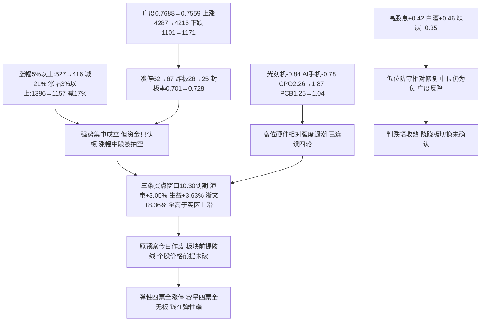

- **口径与缺失**：①广度三口径：trajectory 0.7559（有效 5576）、rt_k 4215涨/1171跌、XTick 4205涨/1193跌（n 5587，成交 8655.3 亿）——三源各自成立，不互减，也不与 snapshot `up_ratio` 的 requested 5586 分母混用；②涨停口径：snapshot `up_limit` 67＝ladder 67，差在 emotion `ztnum` 61 处，属端点滞后不是炸板，炸板独立记 25（67×(1−0.7283)/0.7283≈24.9，校验一致）；③梯队每桶只落 8 只样本，1020→1030 样本中「消失」的高乐股份／利君股份／雷迪克／慧博云通是抽样轮换，**不能当开板证据**；④昨日涨停红盘率、昨日首板/二板分层反馈本轮仍未复算（analysis 层无该分组字段），标**缺失**，不用旧值顶替；⑤概念口径（`sector_heat`）与申万口径（`sector_heat_sw1`）为两套成分与分母，本文档只引概念口径，不拿两者互证；⑥快讯样本 5 条（10:29:21–10:30:30），板块命中 2 条均为 09:27:16 与 09:54:04 的「英伟达概念大涨／工业富联涨停」价格报道（转载只计一次），本轮 5 条快讯无板块命中 → 板块排序驱动全部「未核」；⑦火箭军/红海袭击等海外消息与本轮国内板块排序无对应成分，不强行映射。

### 10:40 研判增量

> 数据时点：analysis 1040 生成于 10:40:29（耗时 1.96 秒），`errors` 空；有效样本 5576 只、连续八轮同分母未降级，可跨轮相减。情绪端点本轮**已刷新**（`ztnum` 74＝snapshot 74＝梯队 74；1030 时 `ztnum` 61 属端点滞后）→ 晋级率组本轮可作变化引用，1030 段那句「不作变化引用」只对 1030 成立。本段执笔 10:45–10:49，主比较 1030→1040。

- **趋势**：10:30 设的八条 10:40 判据 **4 条兑现、2 条被否、2 条半兑现**；10:30 那句「强势集中、涨幅中段被抽空」被本轮直接推翻，改为**二次修复 + 扩散面回扩**。

| 10:30 判据 | 10:40 实测 | 结算 |
|---|---|---|
| 广度回 >4350 → 止跌确认 | 上涨 4215→**4469**（0.7559→0.8015），下跌 1171→995 | 兑现 |
| 涨停 ≥72 且封板率 ≥0.73 → 抱团确立 | 涨停 67→**74**、封板率 0.7283→**0.7629** | 兑现 |
| >5% 池回 >480 → 修复扩散 | 416→**573**（+37.7%），>3% 池 1157→1524 | 兑现 |
| 智能音箱回 ≥2.5 → 端侧仍有效 | 相对 2.35→**2.59**、广度 62/62＝**1.00**、涨停 6 未丢 | 兑现 |
| 白酒涨停 ≥3 或高股息 >−1.0 → 真切换 | 白酒涨停 **2** 未到 3、相对 −0.76→**−1.08**；高股息 −1.49→**−1.99** | **被否** |
| PCB 回不到 1.2 → 预案板块前提全天无效 | PCB 相对 1.04→**0.87**（第五轮连降） | 兑现（前提全天无效） |
| CPO 破 1.5 → 再失血一档 | 1.87→**1.79**，未破 1.5，但涨停 6→7 而广度 0.952→0.939 | 半兑现（封板增、中位降） |
| 光刻机/AI 手机不再下移 → 硬件只是回抽 | 光刻机 1.54→**1.32**、AI 手机 1.35→**1.46** | 半兑现（一跌一止血） |

  - 量能：8712.9→9313.7 亿（+600.8，+6.9%），每 10 分钟增量 570.7→**600.8 亿** —— 连续五轮减速后**首次回升**（+5.3%）。量与广度同向，本轮修复不是缩量脉冲。
  - 结构：涨停 ≥3 只的板块 123→**127**、≥5 只的 74→**76** —— 扩散面在扩，不是更集中；全市场中位 +1.27%→**+1.69%**。
  - 两条内核没变，不能因为广度好转就当承接成立：①容量大票封单继续缩（工业富联 0.129→**0.098 亿**，−24.0%，29 次开板、成交 60.96 亿；四川长虹 0.156→**0.127**，−18.6%；华胜天成 0.136→0.132；利欧 0.108→0.103）；②高度仍只有 4 板 1 只，3 板 5 只**零新增**、5 板空缺。→ 定性：**低位扩散在修复、高位接力仍缺厚度**。

- **轮动**：本轮换的不是「防守↔科技」，是「权重红利 → 低位制造」。同轮 Δ相对强度按四组算：

| 组（成分口径：XTick 概念） | 1030 | 1040 | Δ |
|---|---|---|---|
| 机器人组（减速器/人形/一体化压铸/汽车热管理/长安汽车/机器人概念，6 个） | 1.10 | **1.44** | **+0.34（本轮最强）** |
| 端侧组（智能音箱/无线耳机/无线充电/果指数/智能穿戴/小红书/消费电子，7 个） | 1.52 | **1.65** | +0.13 |
| 高位硬件组（光刻机/光刻胶/先进封装/存储/玻璃基板/F5G/CPO/PCB/AIDC/算力租赁等 18 个） | 1.50 | **1.41** | −0.09 |
| 红利防守组（高股息/煤炭/中特估100/证金/沪深300/上证180/参股保险/超级品牌/红利破净/白酒，10 个） | −1.32 | **−1.79** | **−0.47（失血加速）** |

  - 涨停去哪了（Δ涨停）：光伏 5→8、充电桩 6→8、工业互联网 8→10、无人驾驶 8→10、汽车电子 10→12、减速器 6→8、农机 5→7、AIDC 12→13 —— 全落在中盘制造/汽车/新能源链。注意无人驾驶 +2 涨停但相对 0.77→**0.75** 反而走平：**补涨接力，不是领涨**。
  - 硬件组 1.41 仍是正相对、只是边际失势（光刻机 1.32、F5G 1.69→**1.18** 最惨、光刻胶 0.72→**0.38**、玻璃基板 1.31→1.07）—— 写「硬件崩塌」是错的，写「硬件退潮结束」也是错的，正确说法是**连续第二/三轮失势、绝对相对仍在水上**。
  - 跷跷板另一侧是权重红利，不是防守成长：高股息 285 只成分广度 **0.323**、煤炭 0.405，二者涨停合计 0。同一时点快讯可交叉印证方向（非新催化）：10:40:04 新浪快讯记主力资金净流入 TMT 138.76 亿、净流出国企改革 39.52 亿 —— 这是资金统计口径，不是驱动。
  - 消息→个股：铝板块短线拉升，闽发铝业首封 **10:35**、快讯 **10:38:58** → **先涨后见报 3 分 23 秒**，只记价格关联，不推断主导资金；其封单 0.025 亿／成交 5.82 亿＝0.43%，属薄封，不构成「铝已扩散」（铝链涨停仅此一只）。

- **剧本**：三条买点窗口 09:30–10:30 **已过期**；比窗口更硬的一条是**当日仓位基准也过期** —— `market_position_advice.valid_until=2026-11-24T10:00`、`position_cap_derivation.r1_reference_kind="market_research_not_budget(11/24 10:00失效)"`。即使价格回到买区，今天也没有有效的仓位上限依据，只能作研究对照。
  - 1040 逐票（全部超买区，无一进入买区）：沪电 **85.85**（+3.81%，高于买区上沿 83.94 **+2.27%**，较 1030 回落 0.75 元）、生益 **63.70**（+4.86%，高于 61.66 **+3.30%**）、浙文 **4.02**（涨停，高于 3.71 **+8.36%**）、新易盛 **189.11**、中际旭创 **438.34**。→ 不追高，不把「价格没崩」当剧本兑现。
  - 失效条款必须拆开说：沪电失效三选一（跌破 80.73／PCB 同伴同步转弱／通信设备资金转负）。**板块侧已成立**（PCB 相对 0.87、第五轮降），**个股侧不成立**（生益 +4.86%、中京 4 板封住、沪电距 80.73 还有 −5.97%）。→ 记「**板块前提破线、价格前提未破**」，今日不执行，也不据此宣称退出触发。
  - 今日最值钱的一条事实是**错配**：预案覆盖范围内唯一在扩张的是机器人执行器链（组相对 1.10→1.44，减速器 8 涨停/140 成分、密度 0.057），而这条线的预案票**要么涨停买不到**（锋龙 46.71、科森 26.22，均远高于买区上沿 43.10／24.20），**要么没有可执行价**（宇树 742.03、襄阳轴承 19.79——key_gaps 明确记 688836 缺技术序列）。反过来，预案给了精确买区的 PCB 容量票，恰在失血。**最强方向买不到、买区票在掉队**，这是结构问题，不是执行问题。
  - 高度锚：中京 4 板、首封 09:25、`broken_times=0`，封单 0.080→**0.077 亿**，距预案要求的 0.5 亿差 **6.5 倍**。高度在、厚度不在；只作标尺，不作入场依据。
  - 权限照 raw 文件：`mode=dry_run`、`autonomous_trading_enabled=false`、`requires_user_confirmation=true`、`status=degraded`、`research_completion_passed=false`、`no_trade=false`、`effective_trading_budget=0.3`、`target_total_position_pct=0.3`，执行额度已按 002463 12%／600183 8%／601599 5% 分完（`utilization=0.833`）。**这份预案不是 0 预算，禁止的是「窗口外新开仓 + 已过期仓位基准」**。全部内容仅供研究，不构成买入许可。

- **下一步看**（11:00 截面 / 11:35 P2 午盘修订前可验证）：
  1. **修复成色**：广度 4469（0.8015）、>5% 池 573。11:00 若广度回破 **4350** 且 >5% 池 <**480** → 本轮只是脉冲，10:10 的降档判断恢复有效；两条同时守住 → 二次修复确认。
  2. **抱团厚度**：涨停 74、封板率 0.7629。11:00 涨停 ≥**78** 且封板率 ≥**0.75** → 抱团延续；封板率破 **0.72** → 新增涨停多为错峰，不是承接。
  3. **容量承接（最弱一环）**：工业富联封单 0.098 亿（29 次开板）。11:00 若工业富联／四川长虹／华胜天成／利欧**任意两只封单 <0.08 亿或开板** → 容量端承接失败确认，指数级风险不减。
  4. **PCB/CPO 分列**：PCB 相对 0.87。11:00 回 >**1.0** 且涨停 ≥5 → 板块止血（即使止血，预案窗口也已过期，只作明日参考）；CPO 破 **1.5** → 再失血一档。中京封单 ≥0.5 亿仍是锚修复的唯一硬指标（现 0.077，仅标尺）。
  5. **机器人链升级判据**：减速器 8 涨停／相对 2.00／密度 0.057，人形 18 涨停／相对 1.71。11:00 减速器涨停 ≥**10** 且相对维持 ≥**2.0**、人形相对 ≥1.7 → 该方向可提为主线候选；**今日仍不授买权**（无预案价，涨停不可追）。
  6. **晋级端**：2 板桶 27→**29**（当日首次扩张）、1 板 34→39。11:00 2 板 ≥**33** → 晋级端扩张确认；仍 29–30 → 增量只在首板，明日承接无梯队支撑。
  7. **权重是否止血**：高股息 −1.99／广度 0.323、煤炭 −1.98／0.405。11:00 高股息相对 >**−1.5** 或广度 >**0.35** → 权重止跌；否则「个股普涨 + 权重失血」的背离会继续扩大（指数点位本轮未取，见缺失 ⑤）。
  8. **消息落地**：AI 应用 11 涨停、相对 0.25→0.30、广度 0.826→0.857；短剧游戏 2 涨停（浙文失效条款「短剧只剩它一只」**未触发**，现为 2 只）。11:00 看 AI 应用能否 ≥**13** 只。前一轮已记「主动 ETF 减持茅台、增持中际旭创」为同一条转载，本轮不重复计数，且属持仓变动报道不是新催化。

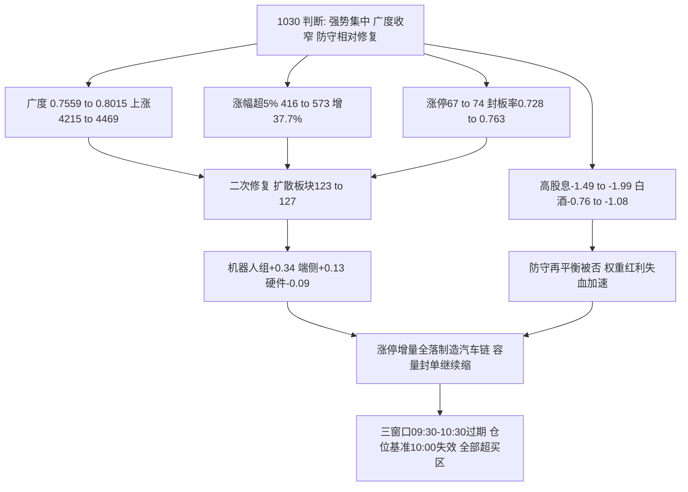

- **口径与缺失**：①广度三口径各自成立、不互减：trajectory 0.8015（有效 5576）、rt_k 4469 涨/995 跌、XTick 4470 涨/990 跌（n 5587）；成交额 rt_k 9313.7 亿 vs XTick 9243.5 亿差 70.2 亿，属口径差，不混用。②炸板两口径不可混称：ladder 炸板 23 只／`break_rate` 0.2371；emotion `zbl` 5.96 是平台自有口径；打板成功率 21.85→23.18、一进二 20.15→21.64 为本轮端点刷新后的同口径变化。③梯队每桶只落 8 只样本，2 板桶 +2 只的**新增名称未核**，样本轮换不能当晋级/开板证据。④昨日涨停红盘率与昨日首板/二板分层反馈：analysis 层无该分组字段 → **缺失**，不用旧值顶替。⑤指数点位/权重指数本轮未取 → **缺失**；红利失血只能从板块相对强度与广度读，不能反推指数涨跌。⑥分钟路径本轮未取（未补分钟序列）→ 不判「回封/站稳」；中京「零开板」只按首封 09:25＋`broken_times=0` 记。⑦概念口径（`sector_heat.all`，416 个题材板块、宽基已剔 16 个）与申万口径（`sector_heat_sw1`，10 个）是两套成分与分母，本文只用概念口径。⑧连续两轮各字段均有实际变动（广度/成交额/涨停/封单无一字不差）→ 无数据冻结段。

### 10:50 研判增量

> 数据时点：analysis 1050，`errors` 空；有效样本 5576、连续九轮同分母未降级，可跨轮相减。情绪端点 `ztnum` 80＝snapshot `up_limit` 80＝梯队 80 三口径一致；但 `jjl` 23.18／`jj1t2` 21.64 与 1040 一字不变，本轮不据此引用「打板成功率变化」。主比较 1040→1050。

- **趋势**：10:40 的定性「二次修复 + 扩散面回扩」本轮要**降一档**为「广度平台化、增量质量下滑」。10:40 设的 8 条 11:00 判据，本轮到点前已经可以看结算：

| 判据（10:40 设定） | 1050 实测 | 结算 |
|---|---|---|
| 广度守 4350 且 >5% 池守 480 | 4487（0.8047）、>5% 576 | 守住 |
| 涨停 ≥78 且封板率 ≥0.75 | 涨停 **80**、封板率 **0.7547**（余量仅 0.0047） | 刚过线，脆弱 |
| AI应用 ≥13 只 | **14**（+3）、短剧 2→**4** | 兑现 |
| 2 板 ≥33 → 晋级端扩张 | 2 板桶 **29→29，零扩张** | 未兑现 |
| 减速器 ≥10 且相对 ≥2.0；人形 ≥1.7 | 减速器 **8 不变**、相对 2.03 ✓；人形 1.60 ✗ | 未升级 |
| PCB 回 >1.0 且涨停 ≥5 | **0.85**（第六轮连降）、涨停 4 | 未兑现，继续失血 |
| CPO 破 1.5 | **1.63**，涨停 7→6 | 未破但连续退 |
| 高股息 >−1.5 或广度 >0.35 | 相对 **−2.00** ✗；广度 **0.354** 刚过 0.35 | 半兑现，只能算不再恶化 |

  - 量价出现本轮少见的反向组合：成交额 9313.7→**9771.6** 亿（+457.9，+4.9%），但**每 10 分钟增量 600.8→457.9 亿（−23.8%）**——10:40 那次「量能首次回升」只持续一轮；同时全市场中位 1.69→**1.66**、>3% 池 1524→**1514**（−10）。→ **量还在增，价格中段不再变强**：广度 +0.32pp 靠的是 1–3% 的跟风面，不是强势段。
  - 结构比涨停总数更要紧：涨停 74→80（+6）、炸板 23→**26**（+3），而 **+6 只全部落 1 板桶（34→45），2/3/4 板一个没动**；封板率 0.7629→**0.7547**、炸板率 0.2371→**0.2453**。→ 抱团在**横向铺开**，不在纵向抬高；80 只涨停不能读成情绪抬升。

- **轮动**：增量从「制造／汽车」切到「互联网平台／AI应用／电商零售」，但**切换发生在尾部，不在核心**。

| 簇（成员等权，同口径概念成分） | 涨停 1040→1050 | 相对强度均值 Δ |
|---|---|---|
| 互联网平台／AI应用／传媒短剧（10 个） | 38→**63（+25）** | 0.66→**0.62（−0.04）** |
| 机器人链（减速器／人形／一体化压铸／汽车热管理／长安汽车，5 个） | 46→**43（−3）** | 1.47→**1.41（−0.06）** |
| 端侧（智能音箱／无线耳机／无线充电／果指数／智能穿戴／小红书／消费电子，7 个） | 38→**39** | 1.87→**1.99（+0.12，本轮唯一走强）** |
| 高位硬件（光刻机／光刻胶／先进封装／存储／玻璃基板／F5G／CPO／PCB／AIDC／算力租赁等 18 个） | 50→**49** | 1.22→**1.17（−0.05）** |
| 红利防守（高股息／煤炭／中特估100／证金／沪深300／上证180／参股保险／超级品牌／红利破净／白酒，10 个） | 5→**5** | −1.79→**−1.80（平）** |

  - **涨停多了 25 只、相对强度反而降 0.04**，这是本轮最值得警惕的背离：增量落在电子商务 +5、新零售 +4、抖音／腾讯／阿里／百度概念各 +3、跨境电商 +3、网络直播 +3、AIGC +3、快手 +3，全是相对强度 0.0–1.7 的中低位板块；而该簇的三个核心——AI应用 0.33、文化传媒 0.51、短剧 0.79——**相对强度均较上轮下移**。→ 定性：**低位补涨扩散，不是主线接棒**。
  - 机器人链是本轮**唯一净失血组**，失血方式是「漏板」不是「崩价」：炸板样本里 **兆威机电 +9.67、浙江荣泰 +9.29** 都在该链上；减速器 8 只原地踏步、人形 18→17、汽车热管理 6→4。→ 10:40 的「机器人组 +0.34 最强」本轮终止，改判为**减速器独撑（2.03 微升）、其余回吐**。
  - PCB 第六个证据：相对 0.85（0.87→0.85）、炸板样本出现 **景旺电子 +9.35**。但预案明写的同伴**仍未转弱**（生益 +4.89 走平、中京 4 板封住），所以沪电失效条款的「同伴同步转弱」一项**依旧未触发**——板块相对强度在退，个股价格没退。
  - 端侧是今天唯一「相对强度、广度、涨停」三样都在的组：智能音箱 2.59→**2.94**、广度 62/62＝**1.00**、涨停 6 不变；无线耳机 2.04→2.17、无线充电／果指数同步上行。
  - 权重红利纹丝不动（−1.79→−1.80，涨停合计 5）。高股息广度 0.323→0.354 只是**不再恶化**，不是止跌。跷跷板的另一头本轮已从「权重」换成「互联网平台」——权重既不是主要出钱方，也不是主要失血方了。

- **剧本**：预案池 **14 只无一只进入买区**（超买区 8 只、无预案价 6 只）。逐票（analysis 口径，10:50）：
  - 沪电 **85.7**（+3.63%，高于买区上沿 83.94 **+2.10%**，1040 为 85.85）、生益 **63.7**（+4.86%，高于 61.66 **+3.30%**）、浙文 **4.02**（涨停，高于 3.71 **+8.36%**）→ 不追高。
  - CPO 两只回落：新易盛 **187.33**（4.32→**3.29%，−0.98pp**，仍高于买区上沿 175.92 **+6.5%**）、中际旭创 **435.72**（5.18→**4.44%**）。→ 硬件失血第一次落到预案票价格上，但全池超买区 8 只的价格仍在买区上沿 +2.1%（沪电）至 +8.4%（锋龙 46.71）区间，**没有一只靠近买区**。
  - 失效条款逐条核：沪电三选一（跌破 80.73 ✗／PCB 同伴转弱 ✗／通信设备资金转负——该字段本轮**缺失**）；生益（跌破 58.58 ✗／沪电·中京同向转弱 ✗）；浙文（跌破 3.52 ✗／短剧只剩它一只 ✗，现 4 只）。→ **没有一条失效成立**。这与「价格全在买区之上」是同一件事：预案不是被跌破，是被跳过。
  - 三窗口 09:30–10:30 已过期，且 `market_position_advice.valid_until=2026-11-24T10:00` 的仓位基准也已过期 → 今日**无执行资格**，价格即使回到买区也只能作研究对照。
  - 权限照 raw 原文：`mode=dry_run`、`autonomous_trading_enabled=false`、`requires_user_confirmation=true`、`status=degraded`、`no_trade=false`、`effective_trading_budget=0.3`、执行额度已按 002463 12%／600183 8%／601599 5% 分完（utilization 0.833）。**据实说明：raw 不是 0 预算、`no_trade=false`，与「预算 0／禁止买入」的表述不符；本段按 raw 记录，结论仍是「窗口 + 仓位基准双重过期 → 不给执行资格」。** 全部内容仅供研究，不构成买入许可。

- **消息链路（本轮唯一新增）**：10:47:22 新浪快讯「AI应用端持续走高 值得买 20cm 涨停」；梯队口径 **值得买首封 10:43、遥望科技首封 10:42**（开板 0 次）。→ **先封板 4 分 22 秒／5 分 22 秒，后才见报**；报道只复述已发生的价格，不构成新催化，也不推断主导资金。它解释了 AI应用 11→14 的一部分增量，但如上，该簇相对强度并未同步抬升。

- **下一步看**（11:00 截面，11:35 P2 修订前）：
  1. **中段强度（最关键）**：中位 1.66、>3% 池 1514。11:00 中位 <**1.50** 且 >3% 池 <**1450** → 平台化确认，转回落；中位 >**1.80** 且 >3% 池 >**1600** → 修复进第二波，10:40 定性恢复。
  2. **晋级端**：2 板桶 **29**（1040→1050 零扩张）。11:00 ≥**32** → 晋级端启动；仍 ≤**30** → 今日只有横向铺开，明日承接无梯队支撑。这条比涨停总数重要。
  3. **漏板速度**：封板率 **0.7547**、炸板 26。11:00 封板率 <**0.74** 或 炸板 >**32** → 80 只涨停要读作「错峰堆积」，不是抱团。
  4. **漏板方向**：景旺电子（PCB）已炸板。11:00 若 **中京开板** 或 PCB 涨停 ≤**3** → PCB 线今日淘汰；若 减速器涨停 ≤**6** → 机器人链降级为个别票行为，不再作主线候选。
  5. **新簇持续性**：AI应用 **14**、短剧 **4**、平台簇合计 63。11:00 AI应用 ≥**16** 且 短剧 ≥**6** → 该簇列为今日第二主线候选（仅研究观察，无预案价、不授买权）；回落 ≤**12**／≤**3** → 10:42–10:43 那批封板是脉冲。
  6. **容量封单（10:40 判据未触发，但方向不利）**：工业富联 0.098→**0.103**、四川长虹 0.127→**0.113**、华胜天成 0.132→**0.115**、利欧 0.103→**0.095**。三票缩封，工业富联 29 次开板、成交 61.32 亿。11:00 任意两只 <**0.08 亿** 或再开板 → 容量承接失败确认。中京封单 0.080→**0.076** 亿（连续三轮缩），距预案要求的 0.5 亿差 6.6 倍，只作高度标尺。
  7. **CPO 与硬件**：相对 1.63。11:00 破 **1.5** 或 新易盛跌破 **185.0**（现 187.33）→ 硬件失血加深一档；中际 **430** 只作短线支撑参考位，不是预案价、不是提醒买点。
  8. **权重**：高股息 相对 −2.00／广度 0.354。11:00 相对 >**−1.80** 且 广度 >**0.37** → 权重止跌开始；否则「个股普涨 + 权重失血」的背离继续扩大（指数点位本轮未取，见缺失 ⑦）。

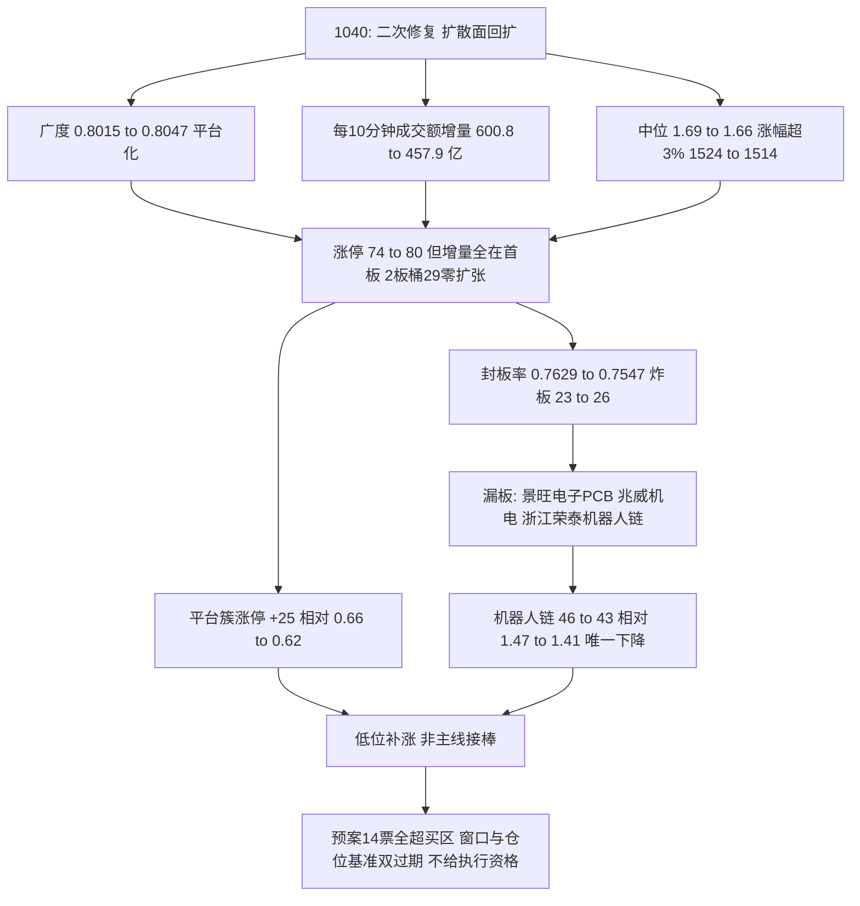

- **口径与缺失**：①广度同分母（有效 5576，九轮未降级）；rt_k 4487 涨／954 跌，XTick 4477 涨／974 跌（n 5587），差 10／20 只属口径差，不互减。②成交额 rt_k 9771.6 亿 vs XTick 9697.1 亿，差 74.5 亿，不混用。③逐票用 analysis（XTick）口径；同一票 rt_k 为 生益 63.72、宝鼎 28.89、中际 437.0，与 analysis 的 63.7／28.88／435.72 差 0.01–0.29%，属源差，不拼成同一瞬间。④梯队每桶只落 8 只样本（1 板 45 只只出 8、炸板 26 只只出 8）→ **新增涨停完整名单、炸板完整名单均缺失**；本段只引用样本内可见名字，样本外消失不等于开板（闽发铝业 1050 未进样本，不作炸板判断）。⑤情绪端点 `jjl`／`jj1t2` 两轮一字不变，不引用为「本轮成功率变化」；`zbl` 5.96→7.95 是平台口径，与 ladder 炸板率 0.2453 不可混称。⑥昨日涨停红盘率、昨日首板／二板分层反馈：analysis 无该字段 → **缺失**。⑦指数点位、通信设备资金流：本轮未取 → **缺失**，沪电失效条款第三条无法判定。⑧概念口径（432 个板块，宽基已剔）与申万口径是两套成分与分母，本文只用概念口径；组均值为成员等权，成员名单已列，与 10:40 段组口径在成员选取上可能不完全一致，Δ 只在本段内可读。⑨本轮广度／成交额／涨停／封单／板块相对均有实际变动，无一字不差 → 无数据冻结段。


### 11:00 研判增量

> 数据时点：analysis 1100（`errors` 空）。有效样本 5576／received 5586（缺 10 只），与前十轮同分母、`degraded=false` → 可跨轮相减。三口径一致：情绪 `ztnum` 79 ＝ snapshot `up_limit` 79 ＝ 梯队 `limit_up_n` 79。本轮 `jjl` 23.18→**22.52**、`zbl` 7.95→**8.61**、`jj1t2` 21.64→**20.90** 均真变化，可引用。主比较 1050→1100。

- **趋势**：10:50 的定性「广度平台化、增量质量下滑」本轮**改判为修复失败**——广度破当日低点、中段强度塌陷，而且量还在放。

| 判据（10:50 设定） | 11:00 实测 | 结算 |
|---|---|---|
| 中位 <1.50 且 >3% 池 <1450 → 平台化确认、转回落 | 中位 **1.20**、>3% 池 **1184** | **双触发**，回落分支成立（超预期幅度） |
| 2 板 ≥32 启动晋级端；≤30 即只有横向铺开 | 2 板 **28**（29→28） | ≤30，横向铺开判决成立，明日承接无梯队 |
| 封板率 <0.74 或 炸板 >32 | 封板率 **0.7315**（<0.74）、炸板 29（未 >32） | 前半触发 → 80 只涨停要读作错峰堆积 |
| 中京开板 或 PCB ≤3；减速器 ≤6 | 中京 **0 次开板仍封**、PCB 4、减速器 8 | 未触发：PCB 与机器人链既未淘汰也未修复 |
| AI应用 ≥16 且 短剧 ≥6 | AI应用 **15**、短剧 **5** | 差 1–2 只未达门槛，**不列第二主线**（质量另见轮动） |
| 任意两只容量封单 <0.08 亿 或再开板 | 工业富联 **0.100**、长虹 0.096、华胜天成 0.114、利欧 0.092；开板 29/0/0/0 | 未触发，但**四票封单全线下滑**（长虹 −15%、工业富联 −2.9%） |
| CPO 相对破 1.5 或 新易盛跌破 185 | 相对 **1.59**、新易盛 **188.03** | 未触发，余量收窄至 **0.09** |
| 高股息 相对 >−1.80 且 广度 >0.37 | 相对 **−1.67** ✓、广度 **0.29** ✗ | **伪兑现**：相对改善是分母效应，广度反而从 0.35 掉到 0.29 |

  - 广度 **0.8047→0.7296**（涨 4487→4068、跌 954→1306），**低于 10:30 的 0.7559＝当日新低**；>3% 池 1514→**1184（−330）**、>5% 池 576→**439（−137）**、中位 1.66→**1.20**。10:40–10:50 那波「二次修复」只维持两轮即被打回并创新低。
  - **但这不是杀跌**：跌 >5% 池 **10→10 一字不变**、跌停 **4→4**、跌 >3% 池 29→41（+12，量级很小）。→ 定性为**冲高回吐／涨幅收敛**，钱的出口是「涨的票掉队」，不是「新增大跌」。任何「二次杀跌」的表述本轮不成立。
  - **量价背离第五轮加深**：成交额 9771.6→**10139.2** 亿（+367.6），但每 10 分钟增量 457.9→**367.6 亿（−19.7%）**，自 0940 起连续第五轮下降（2944→1691→1092→936→673→571→601→458→368）。放量的钱没落在强势段：>3% 池反降 330 只。
  - 涨停结构：80→**79**、炸板 26→**29**（+3）、封板率 0.7547→**0.7315**。梯队高度零进展（4 板 1 只、3 板 5、2 板 29→28、1 板 45→45）。样本内 8 只 1 板名单一字未变，**但样本只落 8 只，不能据此说「无新增首板」**，完整名单仍缺。

- **轮动**：本轮最硬的一条是——**没有任何一组绝对走强，五组绝对中位全部下行；「相对强度改善」几乎全是分母效应**。

| 组（成员等权，概念口径） | 涨停 1050→1100 | 相对强度均值 | 绝对中位 | 广度 |
|---|---|---|---|---|
| AI应用簇核心（AI应用／短剧／AIGC／文化传媒／中国AI50） | 33→**36** | +0.63→**+0.86**（+0.23） | +2.29→**+2.06** | 0.87→0.86 |
| 端侧消费（智能音箱／无线耳机／果指数／苹果／消费电子／小红书／快手） | 38→**40** | +2.10→**+2.26**（+0.16） | +3.76→**+3.46** | 0.95→0.95 |
| 机器人链（减速器／人形／一体化压铸／汽车热管理） | 30→**30** | +1.46→**+1.42**（−0.04） | +3.11→**+2.62**（−0.49，跌幅最大） | 0.93→0.90 |
| 高位硬件（PCB／CPO／先进封装／存储／光刻机／光刻胶／算力租赁／AIDC／东数西算） | 43→**45** | +1.07→**+0.97**（−0.10） | +2.73→**+2.17** | 0.94→0.90 |
| 红利防守（高股息／红利破净／中特估100／煤炭／航运） | 1→**1** | −1.87→**−1.57**（+0.30） | −0.21→**−0.37**（更差） | 0.39→**0.30** |

  - **读法**：全市场中位掉了 0.46 个点（1.66→1.20）。AI应用簇绝对中位只掉 0.23、故相对 +0.23 —— 是**掉得最慢**，不是走强；红利组绝对中位 −0.21→−0.37、广度 0.39→0.30，相对 +0.30 纯属分母变低，**10:50 判据 8 只能记伪兑现，权重的失血在加深而不是止住**。同理 10:50 的「端侧唯一三样都在」本轮只剩中位 3.46 与满格广度，强度也在退。
  - **跷跷板本轮不存在**：没有哪一组在绝对意义上吃进资金。原「红利→互联网平台」的换手，本质是两边都在失血、平台只是失血率更低；机器人链（绝对 −0.49）与高位硬件（绝对 −0.56，内部光刻机相对 1.35→**0.92** 降幅最大）是出钱方，但接棒方并未转强。→ 今日资金行为是**整体减仓 + 局部滞跌**，不是板块轮动。
  - **农机的广度崩塌值得单列**：涨停 7 只不变但广度 **0.90→0.78**、中位 1.92→1.56 —— 这是唯一「涨停不减、广度大掉」的强势板块，属典型护盘式剩余强度（少数票封住、跟随票散掉），不宜当主线。

- **剧本**：预案池 14 只**仍无一只进入买区**（超买 8 只、无预案价 6 只）。但本轮出现一个更值得记的分离——**命题在被验证，买点早已错过**：
  - **浙文影业（601599）涨停 4.02、+10.14%**，而它的失效条款之一正是「短剧只剩它一只／次线不能扩散」。今日短剧 2→4→**5**、AI应用 11→14→**15**、文化传媒 5→7→**7**、AIGC 5→8→**9** → **扩散条件成立，预案命题被验证**。但价格高于买区上沿（3.71）**+8.36%**，只能记「逻辑对、买点丢」，不追高。
  - **CPO 两只内部裂开**：新易盛 187.33→**188.03**（pct 3.29→**3.68** 回升）、中际旭创 435.72→**434.99**（4.44→**4.26** 续跌）→ 同板块两只容量票不共振。两者仍高于买区上沿 **+6.88%／+7.49%**，且预案已因 R4 出口管制行业级负面按关 2.5 剔出执行、**明写不给执行资格**——价格再好不改变这条结论。
  - **PCB 同构分化**：沪电 85.70→**86.13**（+0.43，V 型回补一半）、生益 63.70→**63.60**（续跌）。PCB 相对 0.85→**0.75** 第七轮连降，但失效三条款**仍无一条成立**：跌破 80.73 ✗；同伴转弱——中京 4 板封住且 0 次开板、生益仍 +4.69% ✗；通信设备资金流**字段仍缺** → 无法判定。板块在退、个股没退，差距比 10:50 更大。
  - **高度标尺**：中京电子 4 板、封单 **0.076 亿**（连续三轮不动），距预案要求的 0.5 亿差 **6.6 倍**，仍只作高度与分歧温度计，非买点。
  - **权限照 raw 原文**：`mode=dry_run`、`autonomous_trading_enabled=false`、`requires_user_confirmation=true`、`status=degraded`、`no_trade=false`、`effective_trading_budget=0.3`（**不是 0**，与「预算 0／禁止买入」的说法不符，按 raw 记录）。三窗口 09:30–10:30 已过期、`market_position_advice.valid_until=2026-11-24T10:00` 已过期 → **今日无执行资格**。全部内容仅供研究，不构成任何买入许可。

- **下一步看**（11:35 P2 修订前必须能判死的条件）：
  1. **广度止跌线**：0.7296 已破 10:30 低点 0.7559。11:35 若 广度 <**0.70** 且 >3% 池 <**1100** → 回落确立为全天二次探底；若 广度 >**0.76** 且 >3% 池 >**1400** → 本轮只是午前获利回吐。
  2. **晋级端（决定明日，比涨停总数重要）**：2 板 **28**。11:35 ≥**31** → 晋级端启动；仍 ≤**29** → 今日确认为横向铺开，明日承接无梯队支撑。
  3. **涨停质量**：封板率 **0.7315**、炸板 **29**。11:35 封板率 <**0.72** 或 炸板 >**34** → 涨停数要打折读；涨停 <**70** → 退潮确认。
  4. **AI应用簇是否够格**：AI应用 **15**（门槛 16）、短剧 **5**（门槛 6）、AIGC 9。11:35 AI应用 ≥**17** 且 短剧 ≥**6** 且该簇**相对强度均值 >0.90、同时绝对中位回到 ≥2.29** → 才可升格为第二主线候选（仍仅研究观察，无预案价、不授买权）；回落至 ≤**13**／≤**4** → 今日脉冲定性成立。
  5. **端侧见顶线**：智能音箱 相对 3.14、广度 62/62 满格已无空间，只认中位。11:35 中位 <**3.0** → 端侧见顶；若端侧与 AI应用簇同时退，则今日**无主线**（只剩个别票）。
  6. **机器人链与 PCB 淘汰线**：机器人链相对 **1.4225**。11:35 破 **1.30** 或 减速器涨停 ≤**6** → 降级为个别票；PCB 看中京是否开板 与 涨停 ≤**3** → 淘汰；相对回 >**1.0** → 容量修复重启。
  7. **容量封单**：值得买 0.039→**0.032**、遥望科技 0.035→**0.031**（新封首板封单仅三四百万级仍在缩）。11:35 任意两只原有容量票 <**0.08 亿** 或 值得买／遥望 任一开板 → 容量承接失败与 AI应用簇脉冲定性**同时成立**。
  8. **权重只认绝对中位与广度**：高股息 广度 **0.29**（绝对中位 −0.47）。11:35 广度回 >**0.35** 才算止跌；相对强度不作为权重止跌证据。

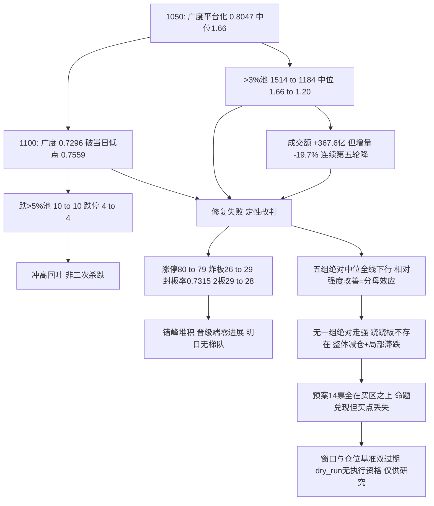

- **口径与缺失**：①广度同分母（有效 5576，十轮未降级）；rt_k 与 XTick 的涨跌家数本轮未逐一比对，只用 rt_k 口径，不混用。②成交额 10139.2 亿为 rt_k 口径。③逐票用 analysis（XTick）口径，不拼成同一瞬间。④梯队每桶只落 8 只样本 → **新增涨停完整名单、炸板完整名单均缺失**，2 板 29→28 的掉出票无法点名。⑤`zbl` 8.61 是平台口径，与 ladder 炸板率（29/(79+29)=0.268）不可混称。⑥昨日涨停红盘率、昨日首板／二板分层反馈：analysis 无该字段 → **缺失**。⑦指数点位、通信设备资金流：仍缺 → 沪电失效条款第三条无法判定。⑧概念口径（432 板块，宽基已剔）与申万口径是两套成分，本段只用概念口径；组均值为成员等权，Δ 只在同段内可读；绝对中位与相对强度必须成对引用，单看相对强度会被分母误导。⑨本轮广度／成交额／涨停／封单／各板块中位均有实际变动，**无数据冻结段**。

### 11:10 研判增量

> 数据时点：analysis 1110（`errors` 空）。有效样本 5576／received 5586（缺 10 只），与前十轮同分母、`degraded=false` → 可跨轮相减。三口径一致：情绪 `ztnum` **71** ＝ snapshot `up_limit` **71** ＝ 梯队 `limit_up_n` **71**；炸板 `zbnum` **38** ＝ ladder `broken_n` **38**。主比较 1100→1110。

- **趋势**：11:00 定的「冲高回吐、不是杀跌」本轮**局部改判**——下跌的**性质**还是回吐（跌停仍 4、跌 >5% 仅 12 只），但**方式变了**：从「缩量、涨的票掉队」变成「**放量、下跌端开始扩张**」。广度 0.6602 是当日新低，且**连续两轮贡献了全天最大的两次单轮跌幅**（−0.075、−0.069）。

| 判据（11:00 设定，原定 11:30／11:35 结算） | 11:10 实测 | 结算 |
|---|---|---|
| 广度 <0.70 且 >3% 池 <1100 → 二次探底成立 | 广度 **0.6602**、>3% 池 **940** | **双触发，提前成立**（非等 11:35） |
| 2 板 ≥31 启动晋级端；≤29 即只有横向铺开 | 2 板 **28**（28→28，零变化） | ≤29，**横向铺开第二轮确认**，今日梯队无晋级增量 |
| 封板率 <0.72 或 炸板 >34 → 涨停数要打折读 | 封板率 **0.6514**、炸板 **38** | **双触发**（封板率当日最低） |
| AI应用 ≥17 且 短剧 ≥6 且 相对 >0.90 且 绝对 ≥2.29 → 升格第二主线 | AI应用 **14**、短剧 **5**、相对 **0.896**、绝对 **1.686** | **四项全不达 → 不升格**；亦未跌到 ≤13／≤4，**不判脉冲证伪**，落「命题成立、扩散停滞」中间态 |
| 端侧 智能音箱中位 <3.0 → 见顶 | 中位 **4.38**（涨停 5／成分 62，广度 1.00 满格） | 未触发；但端侧整组涨停 40→**34** |
| 机器人相对破 1.30 或 减速器 ≤6 → 降级 | 相对 **1.505**、减速器 **7** | 未触发；**PCB 涨停 4→3 ≤3 → 板块级淘汰线触发**，但中京未开板（个股与板块分离） |
| 任意两只容量票 <0.08 亿 或 值得买／遥望开板 | 华胜天成 **0.094**、四川长虹 **0.087**、利欧 **0.085**（均未破 0.08）；值得买 **0.022**、遥望 **0.026** 未开板 | **未正式触发**；但新增变量：**工业富联掉出涨停名单** |
| 高股息 广度 >0.35 才算权重止跌 | 广度 **0.284**（0.354→0.291→0.284） | 未触发，权重段第三段连降，仍未止跌 |

  - 广度 **0.7296→0.6602（−0.0694）**：涨 4068→**3681（−387）**、跌 1306→**1729（+423）**。当日轨迹自 09:40 峰值 0.936 起累计 **−0.276**，且 10:40–10:50 那次反抽（0.7559→0.8047）已完全抹掉并创新低。
  - **下跌端首次扩张**：跌 >3% 池 29→41→**55**（两轮连扩，+90%）、跌 >5% 池 10→**12**（本轮首次非零变动）、跌停仍 **4**。→ 定性可升级为「**抛压被激活**」，但距离「杀跌式退潮」还差一步（跌停未增、>5% 池仅 12 只）。
  - **量价结构反过来了**：成交额 10139.2→**10537.4** 亿，10 分钟增量 367.6→**398.2 亿（+8.3%）**——连续五轮递减后**首次回升**。前几轮是「放量但钱不落强势段」，本轮是「**放量且广度破位**」＝卖出量主导，不再是单纯获利回吐。
  - 涨停结构 **79→71（−8）**、炸板 **29→38（+9）**、封板率 **0.7315→0.6514**。梯队 4 板 1（中京）、3 板 **5→4**（东方海洋掉出，收 8.23%、炸板 3 次）、2 板 28（不动）、1 板 45→38。晋级率 `jj2t3` 35.71→**28.57**、`jj1t2` 20.90 持平、打板成功率 22.52→**21.85**、平台炸板率 `zbl` 8.61→**9.93**。
  - 涨停 **71 仍在 70 之上**，按 11:00 的「涨停 <70 → 退潮确认」**尚未确认退潮**；但 71 只里封板率只有 0.65、且 3 板掉 1 只，这 71 如果是「错峰堆积」而非「新资金进场」，下午开盘会快速掉。

- **轮动**：**五组绝对中位第三轮全线下行，一组不留**；五组相对强度却同时改善——第六轮同样的分母效应（市场中位 **1.20→0.79，−0.41**，跌得比组快，相对就被动抬起来）。唯一真变化是**出钱方换人了**。

| 组（成员等权，概念口径） | 涨停 1100→1110 | 绝对中位 | 相对强度 | 广度 |
|---|---|---|---|---|
| 端侧消费（7 成员） | 40→**34（−6）** | 3.459→**3.280** | 2.259→2.490 | 0.947→**0.931** |
| 机器人链（4 成员） | 30→**30（0）** | 2.623→**2.295** | 1.423→**1.505** | 0.904→**0.881** |
| 高位硬件（9 成员） | 45→**37（−8，最大）** | 2.169→**1.768** | 0.969→0.978 | 0.897→**0.845** |
| AI应用簇（5 成员） | 36→**34（−2）** | 2.058→**1.686** | 0.858→0.896 | 0.859→**0.810** |
| 红利防守（5 成员） | 1→**1** | −0.374→**−0.466（更差）** | −1.574→−1.256 | 0.304→**0.265** |

  - **出钱方从「多点同步失血」收敛到「高位硬件单点加速流出」**：AIDC 14→**11**、东数西算 9→**7**、算力租赁 8→**7**、CPO 6→**5**、PCB 4→**3**，硬件组广度 0.897→0.845。这是今日最清晰的失血方向。
  - **接棒方仍然不存在**：机器人链涨停零增量但相对 **1.505** 是全组第二高、端侧 **2.490** 最高——两者都是「跌得慢」而非「在吃钱」（绝对中位分别 −0.328、−0.179）。**跷跷板依旧不成立**；今日是**整体减仓 + 硬件加速流出**，不是轮动。
  - **新增可验证结构：涨停数增加 ≠ 走强。** 长安汽车概念 涨停 13→**14**、人形机器人 17→**18**、短剧 5→5、文化传媒 7→7 —— 这四组是**唯一涨停不减或增加的**，但同时**中位与广度全部连降**：长安 中位 2.87→2.49→**2.10**／广度 0.935→0.896→**0.849**；人形 中位 3.26→2.79→**2.48**／广度 0.938→0.913→**0.896**。→ 本轮**新增涨停来自低位补涨**（少数票封住、跟随票散掉），不是高位加速。长安（14 只，全场最大单一大池）与比亚迪概念（13 只，成分高度重叠、**不可求和**）同属此形态。
  - 农机继续走「涨停减、广度崩」：涨停 7→**6**、广度 0.778→**0.727**、中位 1.56→**1.15**，11:00 的「护盘式剩余强度」判断加深，仍不宜当主线。
  - 端侧内部只剩核心：智能音箱 涨停 6→5 但中位 4.34→**4.38**（唯一中位不降的强势盘子板块，广度 1.00 满格已无空间）；掉的是边缘——消费电子 11→**9**、苹果 7→6、小红书 5→4、果指数涨停 1→0。

- **剧本**：预案池 14 只**仍无一只进入买区**（超买 8、无预案价 6）。本轮新出现两件事：**一个板块被判淘汰、一个容量票被判失守**，而个股买点依旧一个都没有。

  - **PCB 板块级淘汰线触发（涨停 4→3 ≤3）**，但**龙头没退**：中京电子 4 板、0 次开板、封单 **0.075 亿**（0.076→0.076→0.075，四轮不变），距预案要求的 0.5 亿差 **6.7 倍** → 仍只作高度／分歧温度计，不是买点。两只预案票同步回落：沪电 86.13→**85.61**、生益 63.60→**63.29**，仍在买区上沿之上 **+2.0%／+2.6%**（超买区，不追）。PCB 相对 0.75→0.76（分母抬升），失效三条款里「跌破 80.73／同伴转弱」仍不成立、「通信设备资金流」字段仍缺 → **板块淘汰与个股未退同时成立，两者不可互相抵消**。
  - **CPO「两票裂开」这个分歧点本轮消失**：新易盛 188.03→**187.00**（涨幅 3.68→3.11）、中际旭创 434.99→**432.58**（4.26→3.69），**同向回落**，改为「CPO 双容量票共振下行」。两者距买区上沿仍 **+6.30%／+6.89%**，且预案已因行业级出口管制负面被剔出执行、明写不给执行资格——价格回落不构成买点，只把「不共振」的担忧换成「一起退」的事实。
  - **工业富联掉出涨停名单**（11:00 时还是 1 板、封单 0.100 亿、成交 61.83 亿），本轮炸板 **31 次**、收 +9.98% → 硬件链最大的容量票失守。这是本轮最重要的个股级新事实：11:00 判「四票封单全线下滑」时它只 −2.9%，一轮就把封板丢了。
  - **浙文影业 4.02 涨停 +10.14%**，高于买区上沿 3.71 **+8.36%**。命题侧边际**转弱但未破**：短剧 5（持平）、文化传媒 7（持平）、AI应用 15→**14**、AIGC 9→**8** → 从「扩散成立」退到「扩散停滞」，逻辑对、买点仍是丢的，不追高。它不在梯队 8 只样本内 → **首封时间与封单缺失，封板质量无法判定**。
  - 机器人两只弹性票仍封：锋龙 2 板 46.71（开板 1 次、封单 0.019 亿）、科森 26.22，均超买 **+8.38%／+8.35%**；宇树 744.48 +5.15% 无预案价。人形涨停 18 但中位连降三轮 → 有票无强度。
  - **权限照 raw 原文**：`mode=dry_run`、`autonomous_trading_enabled=false`、`requires_user_confirmation=true`、`status=degraded`、`no_trade=false`、`effective_trading_budget=0.3`。三窗口 09:30–10:30 已过期、`market_position_advice.valid_until=2026-11-24T10:00` 已过期 → **今日无执行资格**。全部内容仅供研究，不构成任何买入许可。

- **下一步看**（11:30 上午最后一轮截面，直接喂 11:35 P2 修订）：
  1. **破位是真还是瞬时**：广度 0.6602。11:30 ≥**0.72** 且 >3% 池 ≥**1100** → 11:10 记单点抛压；<**0.64** 且 >3% 池 <**900** → 上午定性**单边退潮**，下午开盘按不追处理。
  2. **下跌端是否升级**：跌 >5% 池 **12**、跌 >3% 池 **55**、跌停 **4**。11:30 跌 >5% 池 >**20** 或 跌停 >**8** → 从「抛压激活」升级为「杀跌」；跌停仍 ≤4 → 维持「回吐式放量」。
  3. **退潮确认线**：涨停 **71**、封板率 **0.6514**、炸板 **38**。11:30 涨停 <**68** 或 封板率 <**0.62** → 退潮确认；涨停 ≥**78** 且 封板率 ≥**0.70** → 记为洗盘。
  4. **晋级端**：2 板 **28**（两轮不动）。11:30 ≥**30** → 晋级端启动；仍 ≤**28** → 今日确认为横向铺开，明日承接无梯队。
  5. **工业富联能否回封**（31 次开板、11:00 成交 61.83 亿）：回封 → 硬件容量仍有承接；收在 +**8%** 以下 → AIDC 链失血坐实。配额票封单线：华胜天成 **0.094**／长虹 **0.087**／利欧 **0.085**，11:30 任一 <**0.07 亿** → 容量承接失败。
  6. **汽车链能否接棒**：长安汽车 涨停 **14**、广度 **0.849**（连降三轮）。11:30 涨停 ≥**15** 且 广度 >**0.87** → 接棒成立；涨停 <**12** → 补涨末端结束。
  7. **人形机器人是补涨还是加速**：涨停 **18**、中位 **2.48**（3.26→2.79→2.48）。11:30 中位 <**2.0** 或 涨停 <**16** → 补涨末端定性成立；涨停 ≥**20** 且 中位回 ≥**2.6** → 才谈真扩散。
  8. **端侧核心是否也退**：智能音箱 中位 **4.38**、广度已满格。11:30 中位 <**3.5** → 端侧只剩形式；若端侧与 AI应用簇同时退，今日**无主线**（只剩个别票）。
  9. **权重止跌**：高股息精选 广度 **0.284**、绝对中位 **−0.49**。11:30 广度 >**0.35** 才算止跌；相对强度（−1.28）不作为证据。

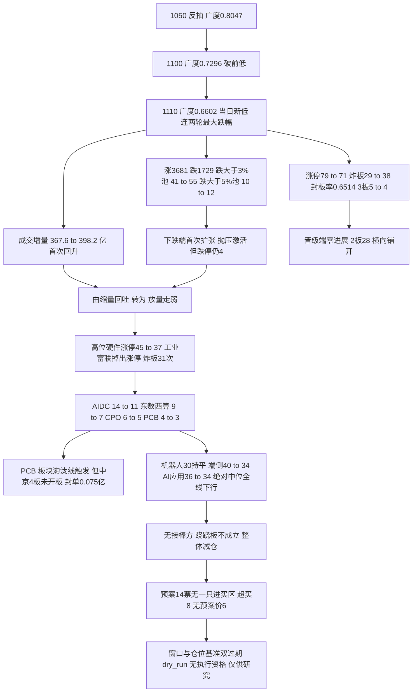

- **口径与缺失**：①广度同分母（有效 5576，`degraded=false`，无冻结段——广度／成交额／涨停／封单／各板块中位本轮全部变动）。②成交额 10537.4 亿为 rt_k 口径；XTick 口径 10455.7 亿，两源未逐一比对，不混用。③逐票用 analysis（XTick）口径，不与 rt_k 拼成同一瞬间。④梯队每桶只落 8 只样本 → **新增涨停完整名单、炸板完整名单仍缺**，3 板掉出的东方海洋是从炸板名单反查得出；浙文影业不在样本内，封板质量不可判。⑤`zbl` 9.93 为平台口径，与 ladder 炸板率 38/(71+38)=0.349 **不可混称**。⑥昨日涨停红盘率、昨日首板／二板分层反馈：analysis 无该字段 → **缺失**。⑦指数点位、通信设备资金流仍缺 → 沪电失效条款第三条无法判定。⑧概念口径（432 板块，宽基已剔）与申万口径是两套成分，本段只用概念口径；组均值为成员等权，Δ 只在同段内可读；**相对强度与绝对中位必须成对引用**，单看相对强度会被分母误导。⑨长安汽车／比亚迪两池成分高度重叠，仅并列不求和。

### 11:20 研判增量

> 数据时点：analysis 1120（`errors` 空）。有效样本 5576／received 5586（缺 10 只），`degraded=false`、与前十轮同分母 → 可跨轮相减；广度、成交额、涨停、封单、板块中位本轮全部变动，**无冻结段**。三口径一致：情绪 `ztnum` **69** ＝ snapshot `up_limit` **69** ＝ 梯队 `limit_up_n` **69**；炸板 `zbnum` **40** ＝ ladder `broken_n` **40**。报价源时标 11:18:42–11:20:25（采集 11:20:09–11:20:27，报价年龄 1.7–104.7 秒）。主比较 1110→1120。

- **趋势**：11:10 把「冲高回吐」改判为「放量走弱」，本轮升级为「**同速单边退坡**」——广度连续第三轮创当日新低，且**三轮跌幅量级几乎一致**（0.8047→0.7296 −0.0751、→0.6602 −0.0694、→**0.5890 −0.0712**），不是一次性冲击，是恒定速率的持续抛压。11:10 为 11:30 设的「单边退潮」判据（广度 <0.64 且 >3%池 <900）**在 11:20 双满足、提前 10 分钟**。

  | 本轮读数（1110→1120，同分母 5576） | 值 | 含义 |
  |---|---|---|
  | 广度 | 0.6602→**0.5890（−0.0712）** | 第三轮新低，跌幅与上两轮同量级 |
  | 上涨／下跌家数 | 3681→**3284（−397）**／1729→**2084（+355）** | 平盘 166→208 |
  | 涨 >3% 池 | 940→**785（−155）** | **强势股池在萎缩**，不只是涨家数减少 |
  | 涨 >5% 池 | 372→**314（−58）** | 同上，右侧供给同步变薄 |
  | 跌 >3% 池 | 55→**73（+18）** | 两轮连扩（41→55→73，+78%） |
  | 跌 >5% 池／跌停 | 12→**15**／4→**5** | 尾部仅微增，未恐慌 |
  | 成交额（rt_k 口径） | 10537.4→**10906.2 亿** | 10 分钟增量 398.2→**368.8 亿（边际减速 7.4%）** |

  - **定性：广度端退潮成立、高度端未确认，两者必须并列读。** 涨停 69（仅 −2，仍在「<68 才确认退潮」线上方）、封板率 **0.633**（>0.62）、3 板 4→**5**。→ 今日形态不是全面退潮，是「**普遍失血 + 少数票死封**」的极端结构：5000 余只票在退，69 只票在封，中间层（涨 3%–5%）被抽干（940→785）。
  - 跌停新增 **鑫铂股份 −10.00%**（工业金属／铝）。快讯 11:18–11:20 同步载「工业金属板块高开低走、鑫铂股份跌停」——报道与跌停同时段，**先跌后见报，不构成催化**，只作工业金属走弱的旁证。
  - 量在「放量但边际不再加速」：本轮 368.8 亿／10 分钟仍高于 09:50–10:50 的 90 分均量，但比上轮 398.2 少 29.4 亿 → 与「同速阴跌而非加速崩塌」一致，暂不支持「恐慌盘涌出」。

- **轮动**：**今日唯一还在正收益的组开始松动，且新的失血点从硬件扩散到 AI 应用簇**。跷跷板第三轮不成立——防御端也在退，说明是减仓，不是高低切。

| 板块（概念口径，分母为有效成分） | 涨停 1110→1120 | 广度 | 绝对中位 | 相对强度 | 判读 |
|---|---|---|---|---|---|
| 智能音箱 | 5→5 | 1.000→**0.968** | 4.38→**3.72（−0.66 单轮最大）** | +3.59→+3.23 | 满格首次破，核心在退 |
| 无线耳机 | 6→6 | 0.939→**0.889** | 3.22→**2.93** | +2.43→+2.44 | 同步走弱 |
| 苹果概念 | 6→**4** | 0.890→**0.854** | 3.07→**2.78** | +2.28→+2.29 | 端侧边缘掉队 |
| 小红书／快手 | 4→**3**／4→**3** | 0.946→0.927／0.942→**0.865** | 3.36→**2.51**／2.88→**2.21** | +2.57→+2.02／+2.09→+1.72 | 情绪类题材退温 |
| AI应用 | 14→**12** | 0.769→**0.681（−0.088）** | 1.27→**0.86** | +0.48→+0.37 | **跌破 0.70，新的失血点** |
| AIGC概念 | 8→**6** | 0.849→**0.782** | 1.79→**1.15** | +1.00→+0.66 | 同组同向 |
| 算力租赁 | 7→**6** | 0.808→**0.713（−0.095 全场最大）** | 1.50→**1.02** | +0.71→+0.53 | 硬件承接继续漏 |
| PCB概念 | 3→3 | 0.834→**0.797** | 1.55→**1.37** | +0.76→+0.88 | 未再破 3，但广度降 |
| 人形机器人 | 18→18 | 0.896→**0.849** | 2.48→**2.20** | +1.69→+1.71 | 第四轮中位连降 |
| 长安汽车概念 | 14→**13** | 0.849→**0.809** | 2.10→**1.82** | +1.31→+1.33 | 接棒仍未成立 |
| 比亚迪概念 | 13→**14** | 0.845→**0.803** | 1.73→**1.38** | +0.94→+0.89 | 涨停增、中位降 → 再次证伪「涨停增=走强」 |
| 农机 | 6→**5** | 0.727→**0.667** | 1.15→**1.02** | +0.36→+0.53 | 护盘式强度继续衰减 |
| 高股息精选 | 1→1 | 0.284→**0.235** | −0.49→**−0.64** | −1.28→−1.13 | 防御端更差，跷跷板仍不成立 |

  - **硬件失血未止，只是换了漏点**：上轮是 AIDC 单点（涨停 11），本轮算力租赁广度 −0.095 领跌、AI应用簇广度 −0.088 跟进，硬件与 AI 应用两条腿同时退。工业富联仍炸板 31 次（+9.98%），新增中马传动（9 次）、宏英智能（3 次）入炸板样本 → 容量承接未修复。
  - **相对强度全组被动抬升**（市场中位 0.79→**0.49**）——绝对中位全线下行，相对上升只说明跌得比大盘慢，**不构成买入理由**，必与绝对中位成对引用。
  - 长安（13 只）与比亚迪（14 只）成分高度重叠，涨停数不可求和；两者都呈「少数票封住、跟随票散掉」，与上轮判断一致。

- **剧本**：预案池 14 只**第三轮无一只进入买区**（超买 8、无预案价 6）。唯一实质变化是**两只 PCB 预案票正在向买区收敛，而收敛幅度不足以构成买点**。

  - **沪电 85.61→85.32**（距买区上沿 83.94 **+1.64%**）、**生益 63.29→63.24**（距 61.66 **+2.56%**）——超买幅度收窄但仍不追；触发价 82.7／60.75 未到。
  - **CPO 双票仍共振在买区外**：新易盛 187.00→**187.20**（+6.41%）、中际旭创 432.58→**431.05**（+6.52%），预案已因行业级出口管制负面明写不给执行资格。
  - **中京电子 4 板**：09:25 首封、**0 次开板**、封单 **0.075 亿**（0.075→0.075→0.075→0.075 四轮一字不变）、成交 1.82→1.84 亿 → 全天零分歧，但距预案要求的 0.5 亿仍差 **6.7 倍**，只作高度／分歧温度计。
  - **3 板 4→5 是「烂板回封」，不是晋级增量**：东方海洋 09:45 首封、**开板 5 次**、封单仅 **0.016 亿**；晋级端仍是 2 板 **28**（第三轮零变化），今日梯队只有横向铺开。
  - **值得买掉出全部涨停名单**（1110 时封单 0.022 亿、未开板）。11:10 设的「值得买／遥望开板」条款实际已发生（遥望仍在，封单 0.026→0.023），但**梯队 1 板每桶只落 8 只样本、完整开板名单缺**，只能从「1 板 45→38→35」与名单消失反查，严格证据仍缺 → 记「疑似开板」不记「已开板」。
  - 容量票封单仍在线上但同步变薄：华胜天成 0.094→**0.091**、四川长虹 0.087→**0.083**、利欧 0.085→**0.084**（预案阈值 0.07 亿，均未破）。新入 1 板 横河精密 封单 0.019 亿、开板 3 次。
  - 浙文影业 4.02 平（涨停，高于买区上沿 3.71 **+8.36%**）、锋龙 46.71 平、科森 26.22 平（超买 +8.38／+8.35%）——命题侧退温但票仍封住，买点依旧丢失，不追。
  - **权限照 raw 原文**：`mode=dry_run`、`autonomous_trading_enabled=false`、`requires_user_confirmation=true`、`effective_trading_budget=0.3`、三窗口已过期、`market_position_advice.valid_until=10:00` 已过期 → **今日无执行资格**。即便沪电午后跌回 83.94 以内，也只进明日观察池，不构成买入许可。

- **下一步看**（11:30 上午最后一轮截面，直接喂 11:35 P2 修订）：
  1. **0.589 是上午底还是半山腰**：11:30 ≥**0.64** 且 >3% 池 ≥**900** → 11:20 记单点下影、退潮条款作废；<**0.55** → 退潮加深，直接带入午后。
  2. **高度端是否补跌**：涨停 **69** 距确认线 **68** 仅 1 只、封板率 **0.633**（线 0.62）。11:30 涨停 <**68** 或 封板率 <**0.62** → 退潮两端一致；东方海洋（封单 0.016 亿、5 次开板）是否守住 3 板 → 不守则高度回落、梯队裂。
  3. **尾部是否恐慌**：跌 >5% 池 **15**、跌停 **5**。11:30 跌 >5% 池 >**20** 或 跌停 >**8** → 升级为杀跌；跌停 ≤**6** → 维持「广泛失血但不恐慌」。
  4. **端侧核心会不会一起退**：智能音箱 中位 **3.72**、广度 **0.968**。11:30 中位 <**3.5** 或 广度 <**0.90** → 今日**无任何绝对正强度方向**，只剩个别封板票。
  5. **AI 应用簇是降温还是掉队**：广度 **0.681**。11:30 <**0.65** → 从「扩散停滞」降为「命题降温」；回 ≥**0.72** → 维持停滞、不作证伪。
  6. **容量承接**：华胜天成 **0.091**／长虹 **0.083**／利欧 **0.084**，11:30 任一 <**0.07 亿** → 承接失败；工业富联能否回封（31 次开板）。
  7. **预案超买收敛**：沪电 **85.32** vs 买区上沿 **83.94**（+1.64%）。11:30 若收在 **83.94** 以下 → 首次回到买区，但今日无执行资格，只作明日观察，不为凑成交放宽条件。
  8. **权重止跌**：高股息精选 广度 **0.235**。11:30 >**0.30** 才算边际企稳；相对强度（−1.13）不作证据。

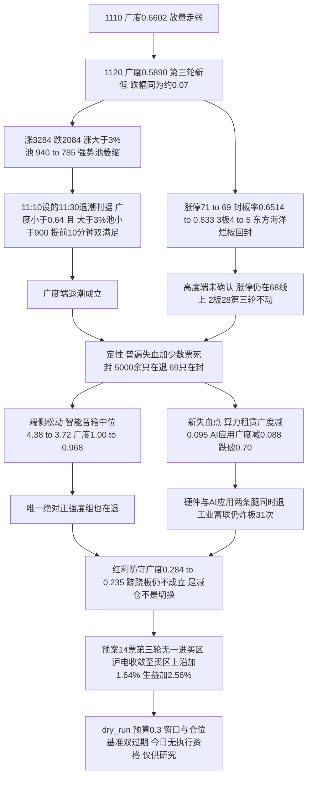

- **口径与缺失**：①同分母 5576、`degraded=false`、无冻结段。②成交额 10906.2 亿为 rt_k 口径；XTick 口径未逐一比对，不混用。③逐票用 analysis（XTick）口径，报价时标 11:18:42–11:20:25，不与 11:10 截面拼成同一瞬间。④梯队每桶仅 8 只样本 → **涨停／炸板完整名单仍缺**，值得买只能记「疑似开板」、东方海洋回封由「跳出炸板名单 + 3 板入桶」反查。⑤`jj2t3` 28.57→**35.71** 为 XTick 情绪口径，与 ladder 2 板 28 不动 **不可混称**；`zbl` 9.27 为平台口径，与 ladder 炸板率 40/(69+40)=**0.367** 不可混称。⑥昨日涨停红盘率、昨日首板／二板分层反馈：analysis 无该字段 → **缺失**。⑦`news_matched` **0**／`news_total` **397** → 本轮快讯无一匹配到预案或板块，**盘中驱动未核**；鑫铂跌停虽有同步报道，属事后同段，不作催化。⑧指数点位、通信设备资金流仍缺 → 沪电失效条款第三条无法判定。⑨板块只用概念口径（宽基已剔），与申万口径是两套成分；相对强度与绝对中位必须成对引用。

### 11:35 研判增量

> 数据时点：analysis 1130（`errors` 空）。**11:30 是上午收盘定格截面**（snapshot 采集 11:30:09–11:30:20，报价时标 11:29:49–11:30:16，报价年龄 4.8–31.8 秒）；11:30 至 11:35 无交易，本段不含 11:30 之后任何行情，下一轮为 13:00。有效样本 5576／received 5586（缺 10 只），`degraded=false`，与全上午同分母 → 可跨轮相减。三口径一致：情绪 `ztnum` **67** ＝ snapshot `up_limit` **67** ＝ 梯队 `limit_up_n` **67**；炸板 `zbnum` **42** ＝ ladder `broken_n` **42**。主比较 1120→1130。

- **趋势**：11:20 的「同速单边退坡」**局部改判**——广度仍创当日新低，但**掉速被砍掉近六成；高度端同时跌破 68 线**。上午最后 10 分钟出现了第一次分叉：**广度端刹车、梯队端破位**。

| 判据（11:20 设定，原定 11:30 结算） | 11:30 实测 | 结算 |
|---|---|---|
| 广度 ≥0.64 且 >3%池 ≥900 → 单点下影；<0.55 → 退潮加深 | 广度 **0.5601**、>3%池 **762** | **两不触发**（0.55<0.5601<0.64）→ 记「跌幅刹车、未修复」中间态，不硬套二分 |
| 涨停 <68 → 退潮两端一致 | 涨停 **67（−2）** | **触发 → 高度端退潮确认成立** |
| 跌>5%池 >20 或 跌停 >8 → 升级杀跌 | 跌>5% **18**、跌停 **5** | 未触发 → 维持「广泛失血但不恐慌」 |
| 智能音箱 中位<3.5 或 广度<0.90 → 端侧见顶 | 中位 **3.54**、广度 **0.9516** | 未触发，**距线仅 0.04** |
| AI应用 广度 <0.65 → 命题降温 | 广度 **0.6479** | **触发 → 降温定性成立** |
| 容量票任一封单 <0.07 亿 | 华胜天成 0.088／长虹 0.080／利欧 **0.077**／遥望 0.020（阈值针对原有容量票） | 未触发，利欧最近 |
| 沪电收在 83.94 以下 → 首回买区 | 收 **85.01** | 未达成（+1.27%） |
| 2 板 ≥30 启动晋级端；≤28 即横向铺开 | 2 板 **28**（第四轮零变化） | ≤28 → 今明两天梯队无晋级支撑 |

  - 广度 **0.5890→0.5601（−0.0289）**，前一轮为 −0.0712 → **单轮跌幅收窄 59.4%**；全天自 09:40 峰值 0.9360 起累计 **−0.3759**。涨 3284→**3123（−161，前轮 −397）**、跌 2084→**2273（+189，前轮 +355）**。
  - **强势池停止萎缩**：>3% 池 785→**762（−23，前轮 −155）**、>5% 池 314→**311（−3，前轮 −58）**、中位 0.49→**0.32（−0.17，前轮 −0.30）**。同时**下跌端扩张同步减速**：跌>3% 73→**79（+6，前轮 +18）**、跌>5% 15→**18（+3）**、跌停 **5→5 零变化**。
  - **量能却在回升**：成交额 10906.2→**11302.0 亿**，10 分钟增量 368.8→**395.8 亿（+7.3%，连续两轮回升）**。→ 本轮最重要的一条读数并列：**放量 + 广度跌幅砍半 + 涨停减少 2 只 + 1 板 35→33** ＝ 进场的量在**承接卖盘**，没有转成封板资金。这是「抛压衰竭」与「打板意愿不足」同时出现，既不是崩盘，也不构成修复。
  - 涨停结构 69→**67**、炸板 40→**42**、封板率 0.633→**0.6147**（仍在 0.62 线之上）、梯队 4 板 1／3 板 5／2 板 28／1 板 33。

- **轮动**：失血方**换位**——硬件组跌幅收窄（AIDC 广度 −0.042，前轮 −0.065；数据中心涨停 10 持平），失血重心下移到**周期资源与农产品**：煤炭中位 **−1.03 两轮一字不动**、广度 0.191→**0.157**；煤化工 −1.00／0.200；粮食 −0.55→**−0.72**／广度 0.188→**0.146**；航运 −0.69／0.241；统一大市场 −0.69／0.233。这批不是今天新崩，是**低位持续失血、始终没止血**，性质与硬件组（高位获利回吐）不同。

| 方向（概念口径，分母为有效成分） | 涨停 1120→1130 | 广度 | 绝对中位 | 相对 | 读法 |
|---|---|---|---|---|---|
| 端侧·智能音箱 | 5→5 | 0.968→**0.952** | 3.72→**3.54（−0.18，前轮 −0.66）** | +3.23→+3.22 | 核心止跌，停在 3.5 线上方 0.04 |
| 端侧·小红书／快手 | 3→3／3→3 | 0.927→0.927／0.865→**0.885** | 2.51→**2.72**／2.21→**2.41** | +2.02→+2.40／+1.72→+2.09 | 端侧内部唯一两个回升 |
| 端侧·苹果 | 4→4 | 0.854→**0.832** | 2.78→**2.26（−0.52）** | +2.29→+1.94 | 组内最差，资金在端侧内部换手 |
| AI应用 | 12→12 | 0.681→**0.648（破 0.65）** | 0.86→**0.67** | +0.37→+0.35 | 命题降温定性成立 |
| 文化传媒概念 | 7→7 | 0.701→**0.695** | 1.13→**1.00** | +0.64→+0.68 | 涨停不减、中位续降 |
| 人形机器人 | 18→18 | 0.849→**0.828** | 2.20→**2.04** | +1.71→+1.72 | 距「<2.0 转补涨末端」仅 0.04 |
| 长安汽车 | 13→13 | 0.810→**0.784** | 1.82→**1.59** | +1.33→+1.27 | 接棒持续未成立 |
| 数据中心(AIDC) | 10→10 | 0.764→**0.721** | 1.23→**0.96** | +0.74→+0.64 | 硬件失血减速但未止 |
| 算力租赁 | 6→6 | 0.713→**0.681** | 1.02→**0.88** | +0.53→+0.56 | 同上 |
| 光刻胶 | 0→0 | 0.763→**0.738** | 1.42→**1.59（唯一回升）** | +0.93→**+1.27** | 今日唯一逆势改善方向 |
| 高股息精选 | 1→1 | 0.235→**0.270** | −0.64→**−0.58** | −1.13→−0.90 | 防御端首次边际企稳，但仍未过 0.30 |
| 煤炭概念 | 0→0 | 0.191→**0.157** | −1.03→−1.03 | −1.52→−1.35 | 中位不动、广度继续掉 → 未止血 |

  - **跷跷板第五轮仍不成立**，但出现两处量级很小的**切换苗头**：端侧内部（苹果 → 小红书／快手，−0.52 对 +0.21／+0.20）、硬件内部（AIDC／算力租赁 → 光刻胶）。两者都只在一个板块 0.2 个点以内，**不构成轮动结论**，只作午后若继续放大时的跟踪对象。
  - 汽车链（长安 13／比亚迪 14／汽车电子 11 涨停、中位 1.59／1.17／1.58）仍是今日涨停不降、中位相对最高的一簇，但绝对中位第四轮连降 → 依然是「跌得慢」，不是「在吃钱」。长安与比亚迪成分高度重叠，涨停数不可求和。

- **剧本**：预案 14 只**第四轮无一只进入买区**（超买 8、无预案价 6）。本轮最重要的变化不在价格，在**命题侧的失效条款开始被满足**：

  - **浙文影业 4.02 平（+10.14%）**，仍高于买区上沿 3.71 **+8.36%**。它的失效条款之一「短剧只剩它一只／次线不能扩散」：AI应用广度 **0.6806→0.6479**（破 0.65）、AIGC 0.7819→0.7416、文化传媒概念中位 1.13→**1.00** → **扩散侧继续降温**。价格贴在涨停、逻辑在退，两者矛盾比 11:00 更大，不追；它也不在梯队 8 只样本内，**封板质量无法判定**。
  - **PCB 两只继续向买区收敛、仍未进**：沪电 85.32→**85.01**（距上沿 83.94 **+1.27%**，11:20 设的「收在 83.94 以下」未达成）、生益 63.24→**63.10**（距 61.66 **+2.33%**）。触发价 82.7／60.75 均未到。
  - **高度锚存续、烂板更薄**：中京电子 4 板 **0 次开板**、封单 **0.075 亿**（五轮一字）、成交 1.84→**1.85 亿** → 距预案要求的 0.5 亿仍差 6.7 倍，只作高度与分歧温度计；东方海洋 3 板守住但封单 **0.016→0.014 亿**、开板 5 次、成交 20.62 亿（梯队最高）。
  - **CPO 双票同向回升**：新易盛 187.20→**187.75**、中际 431.05→**434.80（+0.87%）**，距买区上沿 **+6.72%／+7.45%**；预案已因行业级出口管制负面明写不给执行资格 → 价格回升不改变结论。
  - **容量票封单全线再薄**：华胜天成 0.091→**0.088**、四川长虹 0.083→**0.080**、利欧 0.084→**0.077**（最接近 0.07 线）、遥望 0.023→**0.020**。新增 1 板全是薄板：阿尔特 19.98%（开板 2 次、封单 0.015）、高乐股份 10.03%（开板 2 次、0.015）、横河精密 0.019→**0.015**。
  - **两只逆势票，只作观察**：盛剑科技 30.80→**31.28**（+1.05→**+2.62%**），对上光刻胶相对 +0.93→+1.27 的改善，但预案明写「退潮标尺而非买入卡」且 R4 有监管工作函；宇树科技 737.78→**745.99**（+4.21→**+5.37%**），对上机器人链相对抗跌，但无预案价（本库缺 688836 技术序列）。
  - **权限照 raw 原文**：`mode=dry_run`、`autonomous_trading_enabled=false`、`requires_user_confirmation=true`、`no_trade=false`、`effective_trading_budget=0.3`；三窗口 09:30–10:30 与 `market_position_advice.valid_until=2026-11-24T10:00` 全部过期 → **今日无执行资格**。全部内容仅供研究，不构成任何买入许可。

- **下一步看**（13:00 午后首轮，直接喂 13:05 增量与 14:55 尾盘定论）：

  1. **0.5601 是不是上午底**：13:00 广度 ≥**0.60** 且 >3%池 ≥**820** → 跌幅减速确认、上午底成立；<**0.52** 且 >3%池 <**680** → 午前只是中继、午后补跌；两者之间记低位横盘。
  2. **高度端（已破 68 线）**：13:00 涨停 <**62** 或 封板率 <**0.55** → 退潮加深；涨停 ≥**75** 且 封板率 ≥**0.68** → 记洗盘回封，可改判。
  3. **晋级端（决定明日承接）**：2 板 **28**（四轮不动）。13:00 ≥**30** → 晋级端启动；≤**27** → 明日确认无梯队。
  4. **高度锚两条线**：中京 4 板封单 **0.075 亿** 是否维持零开板（开板＝高度段断、PCB 全组降级）；东方海洋封单 **0.014 亿**、开板 5 次（开板＝3 板 5→4、梯队裂）。
  5. **容量承接**：利欧 **0.077** 距 0.07 线最近。13:00 原有容量票任一 <**0.07 亿**，或 遥望（0.020）／横河（0.015）开板 → 承接失败。
  6. **端侧见顶线只剩 0.04**：智能音箱 中位 **3.54**。13:00 <**3.5** → 端侧只剩形式；若与 AI应用（**0.6479**）同时退 → 今日**无主线**，只剩个别封板票。
  7. **AI应用降温是否加深**：广度 **0.6479**。13:00 <**0.62** → 浙文失效条款正式成立；回 ≥**0.70** → 降温只是午前回吐。
  8. **光刻胶是唯一改善方向**：相对 **+1.27**。13:00 相对 ≥**1.40** 且 盛剑 ≥**31.28**（守住上午收价）→ 才谈独立走强；否则只记「滞跌」，不追。
  9. **周期资源是否止血**：煤炭 广度 **0.157**、粮食 **0.146**。13:00 煤炭 >**0.20** 或 粮食 >**0.19** → 失血收敛；继续降 → 与硬件失血叠加，午后二次探底概率上升。
  10. **沪电 85.01 距买区上沿 +1.27%**：若午后进买区，只记明日观察；今日无执行资格，**不为凑成交下移买区**。

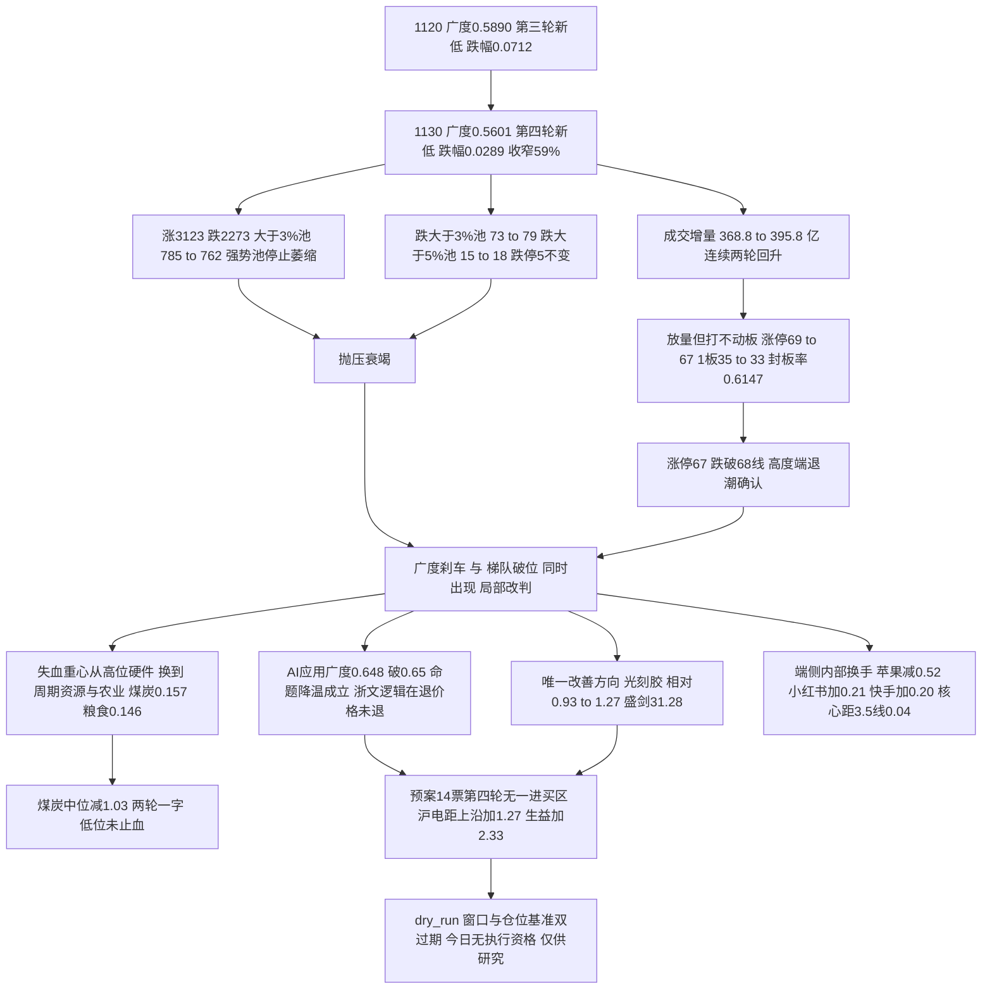

- **口径与缺失**：①**11:30 是上午收盘定格截面**，11:30–11:35 无交易，本段不含 11:35 之后任何行情；下一轮 13:00，不是 11:40。②广度同分母 5576、`degraded=false`、**无冻结段**（广度／成交额／涨停／封单／各板块中位本轮全部变动）。③成交额 11302.0 亿为 rt_k 口径；XTick 11208.4 亿，两源差 93.6 亿，不混用。④涨跌家数 XTick 3125／2281（n 5587）vs rt_k 3123／2273（valid 5576），差 2／8 只属口径差，不互减。⑤逐票用 analysis（XTick）口径，报价时标 11:29:49–11:30:16，不与 11:20 截面拼成同一瞬间。⑥梯队每桶只落 8 只样本 → 1 板 33 只只出 8、炸板 42 只只出 8，**新增涨停／开板完整名单仍缺**；2 板 28→28 的进出票无法点名；阿尔特／高乐／横河由样本内可见，不代表全量。⑦情绪平台字段 `jjl` 22.52、`jj1t2` 20.90、`jj2t3` 35.71、`zbl` 9.27 **两轮一字不变** → 不引用为「成功率变化」；`zbl` 9.27 为平台口径，与 ladder 炸板率 42/(67+42)=**0.385** 不可混称。⑧昨日涨停红盘率、昨日首板／二板分层反馈：analysis 无该字段 → **缺失**。⑨`news_matched` 空／`news_total` **380** → 本轮快讯无一匹配预案或板块，**盘中驱动未核**；不据传播时刻推断操盘主体。⑩指数点位、通信设备资金流仍缺 → 沪电失效条款第三条无法判定。⑪概念口径（432 板块，宽基已剔）与申万口径是两套成分与分母，本文只用概念口径；组均值为成员等权，相对强度与绝对中位必须成对引用。⑫长安汽车／比亚迪两池成分高度重叠，仅并列不求和。


### 11:45 研判增量

> 数据时点：analysis **1140**（`errors` 空）。**1140 与 1130 逐字段比对完全一致**——market 二十个字段同值（up 3123／down 2273／flat 180／valid_n 5576／up_limit 67／down_limit 5／amount 11302.0 亿），14 只预案池现价零变化，`sector_heat` 中位与广度零变化。→ 11:30 后无交易，这是**上午收盘定态的第二份复读（11:40、11:45）**，不是二次刷新，本轮不得读出「横盘／企稳」。下面全部增量来自三处非截面信息：①午评快讯（11:30:13–11:32:25，东财／同花顺／新浪／格隆汇）；②11:40–11:46 午间新快讯；③P2 午盘修订（`data/plans/20261124/midday_amendment.json`，生成 11:45:36，**另一 job 产出**，此处仅作对照引用）。

- **趋势**：本轮最有价值的一条不是行情，是**媒体口径把我方截面验了一遍**：东财 11:30:13 午评原文「上涨3123家、下跌2273家、67只涨停」＝ snapshot 原值；格隆汇／同花顺 11:31–11:32「全市场成交 11302 亿」＝ rt_k `amount` 原值。→ 上午收盘截面可信，不是数据瑕疵。

  - **此前 12 轮增量只有广度、没有指数，本轮补上**：上证 **+0.47%**（3555.49）、深成 **+0.92%**、创业板指 **+1.9%**（2323.48）、科创50 **+2.72%**（1261.26）、北证50 **+1.83%**。**指数全红、广度 0.5601、2273 只在跌** → 今日定性由 11:35 的「广泛失血＋少数死封」精确改判为**「指数由科技权重拉抬的二八分化」**：上涨集中在大市值硬件容量票（CPO 中位 +1.92、液冷 +1.79、PCB +1.14），下跌是多数中小票。既不是全面退潮，也不是健康普涨，是**指数掩护下的结构性失血**。
  - 量能两侧同向：我方 10 分钟增量 395.8 亿（连续两轮回升），午评「较上日放量 2077 亿」。
  - 11:35 设的十条午后判据（广度 0.60／0.52、涨停 62／75、2 板 30／27 等）**本轮原样保留**——没有新截面可供结算，不提前改判。

- **轮动**：媒体归类的今日领涨方向与我方概念口径**互相印证，同时纠正了一处归类偏差**。

| 方向 | 我方口径（1140，分母＝有效成分） | 媒体口径 | 判读 |
|---|---|---|---|
| 减速器／机器人 | 减速器 涨停 **7**／140、广度 0.8429、中位 **+2.46**、相对 **+2.14** | 东财 11:37「减速器概念走强，光洋股份、宁波东力 2 连板，横河精密涨停」；格隆汇 11:34「机器人概念股再度大面积涨停」 | **真扩散**，与梯队自洽（光洋、宁波东力均在我方 2 板名单） |
| 消费电子／端侧 | 消费电子 9／514、广度 0.8327、中位 +1.69、相对 +1.37；智能音箱 5／62、相对 **+3.22** | 东财 11:37「无线耳机概念活跃，科森科技、联创电子 2 连板，华胜天成、奥尼电子涨停」 | 一致。**华胜天成被媒体归「无线耳机」、在我方 1 板名单里是封单 0.088 亿的容量票——同一只票不重复计分** |
| 光伏逆变器 | 光伏概念 4／602、广度 0.6412、中位 **+0.66**、相对 +0.34 | 格隆汇 11:46「逆变器股集体上涨：首航新能涨近 11%，正泰电器 10CM 涨停，阳光电源涨超 8%」 | **个股脉冲，不是板块扩散**：4 只涨停撑 602 只成分，中位只有减速器的四分之一 → 可观察，不进主线 |
| AI应用 | 广度 **0.6479（已破 0.65）**、中位 +0.67、相对 +0.35 | 午间再添两条催化：OceanBase 开源「湖库一体 AI 数据平台」（11:28:59）、豆包 APP 灰测「豆包购物」（11:22:14） | **消息不认**：今日第三条 AI 应用催化落地、广度仍下行 → 浙文影业的失效条款继续被满足 |
| 资源／防御 | 煤炭 0／89、广度 **0.1573**、中位 −1.03；参股银行 2／194、相对 −0.79 | 午评：贵金属、煤炭开采、证券、工业金属、银行跌幅居前 | 失血从煤炭／粮食**扩到贵金属＋银行＋证券**，比 11:35 记的更宽 |

  - **港股高标跳水的旁证（我方盘面拿不到）**：商米科技-W（06810.HK，自我定位「商业物理AI领导者」）昨日 +48.65% 创新高，今早一度 +15% 至 170.7 港元后跳水、盘中跌超 10%，11:40 报 137 港元／−7.74%。→ A 股「物理AI」（东财 11:37 点名福莱新材、柯力传感 2 连板、龙软科技涨停）是**跟港股的补涨，不是独立驱动**；港股龙头盘中跳水是这条线最直接的风险信号。
  - **AI 硬件高开的性质被外部信息定性**：隔夜源头是黄仁勋复职英伟达（11:28:44 格隆汇引 Serenity「回归后 AI 资本支出预期将重新上调」）＋新浪 11:21:49 复盘「杠杆 ETF 410 亿美元收盘再平衡买盘、CTA 翻多、空头止损」。→ 昨夜是**机械性被动买盘，不是产业订单落地**；这解释了今日 CPO／PCB 高开 8~10% 之后的回吐（沪电开 90.66→收 85.01、生益开 66.83（涨停）→收 63.10、中际开 463.20→收 434.80、新易盛开 197.00→收 187.75，均为 P2 引用的 rt_k 11:30 核价）。**溢价来自外溢，承接不在本地**——与「不追高」同向，不构成新理由。

- **剧本**：预案 14 只**第五轮无一只进入买区**（超买 8、无预案价 6），本轮脚本层面的唯一变化来自 P2，不是我的判断：

  - **P2 把两只 PCB 的保护位上移到今日日内低**：沪电 `stop_loss` 80.73→**84.80**、生益 58.58→**63.03**，原文注明「若按开盘价追入（模式外）…**未追入者本条无对象**」。→ 未追入者无对象（三只执行池 `time_window` 09:30–10:30 已过、`valid_until=10:00` 已过期）；对开盘追入者，现价 85.01／63.10 距保护位只剩 **+0.25%／+0.11%**，等于**贴线、几乎无缓冲**——这是「追高被套在保护位」的量化，不是买点提示。
  - **中京电子 4 板**：唯一高度锚，封单 **0.075 亿**（六轮一字）、0 次开板；距预案要求的 0.5 亿差 **6.7 倍**，只作温度计。
  - **浙文影业 4.02 涨停**：媒体侧「文娱用品、数字媒体涨幅居前」与它封板同时成立，但那是**传统传媒口径**；它所在的 AI 应用（含短剧）广度 0.6479 在退、今日第三条催化也没接住 → 逻辑在退、价格在封，矛盾未解，不追；且它不在梯队 8 只样本内，封板质量仍无法判定。
  - **宇树科技 745.99（+5.37%）**：午评「人形机器人延续涨势…宇树科技涨超 5%」与我方读数一致；无预案价（本库缺 688836 技术序列），只作情绪参照。
  - **英力特跌停的驱动本轮才核出**（此前只记「驱动未核」）：11:46 快讯原文——复牌一字跌停、封单超 21 万手、报 9.9 元、市值 39 亿；因停牌前 10/30–11/12 累涨超 50%，重组预案落地后「利好出尽是利空」。→ 与预案池无关，是**「重组兑现即出货」的今日样本**，收进复盘素材，不作任何买卖依据。
  - **权限照 raw 原文**：`mode=dry_run`、`autonomous_trading_enabled=false`、`requires_user_confirmation=true`、`no_trade=false`、`effective_trading_budget=0.3`，但三个入场窗口与 `valid_until=2026-11-24T10:00` **全部过期** → **今日无执行资格**。以下全部仅供研究，不构成任何买入许可。

- **下一步看**（11:35 那十条全部保留，这里只加本轮新事实引出的 6 条）：
  1. **13:00 开盘价 vs 11:30 收盘（跳空即重新定价）**：沪电 85.01、生益 63.10、中际 434.80、新易盛 187.75、浙文 4.02、中京 16.20。开盘低于 11:30 收盘 → 午间媒体热度未转成承接；其中**沪电 <84.80、生益 <63.03 ＝ P2 修订后的保护位被击穿**（对未追入者仍无对象）。
  2. **减速器是不是真主线**（今日唯一「媒体归类＋我方扩散」双证的方向）：13:00–13:30 涨停 ≥**9** 或 广度 ≥**0.88** → 主线成立；涨停 <**6** 或 广度 <**0.80** → 降为机器人链内部脉冲。
  3. **物理AI 的港股联动**：商米科技-W 午后是否延续跌势（11:40 已 −7.74%）。若继续走弱，A 股福莱新材／柯力传感 2 连板属高位跟随，**明日风险大于今日机会**，不追。
  4. **「消息不认」是否延续**：AI应用 广度 0.6479。13:00 <**0.62** → 浙文失效条款正式成立（OceanBase／豆包购物 两条催化均未接住）；回 ≥**0.70** → 降温只是午前回吐。
  5. **光伏逆变器是脉冲还是扩散**：13:00–13:30 光伏概念 涨停 ≥**7** 且 广度 ≥**0.70** → 补进观察；否则维持「个股行情」定性，不进主线。
  6. **量能节奏**：上午 11302 亿（放量 2077 亿），上午 10 分钟均量约 395 亿。13:00 首轮增量 <**330 亿** → 午后缩量，此时只有广度同步回升才谈修复；缩量＋广度再降 ＝ 二次探底。

  - **口径纪律（本轮新增两条）**：①东财午评「两市半日成交 **11210** 亿」是沪深两市口径，格隆汇／同花顺「全市场 **11302** 亿」含北交所，与我方 rt_k 11302 同口径 → 两者不相减、不互证；②媒体「无线耳机／减速器／物理AI」与我方「智能音箱／减速器／AI应用」是不同分类体系、不同分母，只作方向核对，不混算涨停数。


### 11:55 研判增量

> 数据时点：analysis **1150**（`generated_at` 11:50:11，`errors` 空，耗时 1.08s）。**价格层是午休定态的第三份复读**：`sector_heat`／`ladder`／`plan_check`／`cross_source`／`sector_heat_sw1` 五块与 1140、1130 **逐字段全等**，14 只预案池现价零变化。冻结在**源端**不在管线：XTick `updateTime` 11:40:11→11:50:11 在走、`cross_source` 11208.4 亿两轮一字不变，rt_k 11302.0 亿同值 → 最后一次成交 11:30，11:30–11:55 无交易。本轮唯一变动字段是快讯（`news_total` 380→360→**337**，滚动窗口变化，不是消息变少）。以下增量来自三处：①上午全时段板块轨迹（0930–1130 逐轮 `sector_heat.all` 432 板）；②11:46:55–11:49:06 新快讯；③P2 午盘修订（11:45:36 生成，仅作对照，不转述其结论）。

- **趋势**：把六条主线板的中位串成时间序列，今日形态不是「高位震荡」，是**集合竞价—开盘 30 分钟一次性透支溢价、之后 90 分钟单向回吐**。广度 rt_k 0.9259（09:30）→ **0.5601**（11:30，累计 −0.3658）；涨停 22→**80（10:50 峰值）**→**67**；板块层中位从开盘到收盘坍缩 **68–72%**。

| 板（概念口径，分母＝有效成分） | 09:30 涨停/广度/中位 | 10:30 | 11:00 | 11:30 收 | 中位峰→收 |
|---|---|---|---|---|---|
| PCB概念 | 4／0.97／**+4.11** | 3／0.90／+2.31 | 4／0.87／+1.95 | 3／0.75／**+1.14** | **−72.3%** |
| 数据中心(AIDC) | 5／0.96／**+2.97** | 12／0.91／+2.08 | 14／0.88／+1.96 | 10／0.72／**+0.96** | **−67.7%** |
| AI应用 | 3／0.95／**+2.36** | 11／0.83／+1.52 | 15／0.82／+1.69 | 12／0.65／**+0.67** | **−71.6%** |
| 消费电子概念 | 8／0.96／**+3.38** | 11／0.94／+2.60 | 11／0.93／+2.63 | 9／0.83／**+1.69** | −50.0% |
| 减速器 | 2／0.95／+2.30 | 6／0.96／+2.91 | 8／0.93／+3.13（峰 **+3.88@10:00**） | 7／0.84／**+2.46** | −36.6% |
| 人形机器人 | 7／0.95／+2.54 | 17／0.93／+2.67 | 17／0.91／+2.79（峰 **+3.84@10:00**） | 18／0.83／**+2.04** | −46.9% |

  - 全市场中位同步：2.13（10:00）→1.20（11:00）→0.49（11:20）→**0.32（11:30）**。**硬件三块中位跌幅 68–72%，机器人两块 37–47%** —— 硬件是被一次性兑现的溢价，机器人是全天在退但退得慢，两者性质不同，不能合并成「普跌」。
  - 这条把 11:35 的「跌幅刹车」放回全天框架：刹车发生在 **11:20–11:30、当日最低区**，属于跌势末端减速，**不是修复**。11:35 定的午后判据（广度 0.60／0.52、涨停 62／75）原样有效，本轮无新截面可结算，不提前改判。

- **轮动**：本轮新增两条**分层事实**，两条都修正此前的粗口径结论。

  - **① 上午最后 30 分钟的相对强度改善，几乎全是权重，不是资金切换。** 1100→1130 相对强度改善前 10 名里 9 个是宽基／风格（证金持股 −1.65→**−0.48**、上证50 −1.24→**−0.18**、沪深300 −1.30→**−0.32**、上证180 −1.30→−0.35、出海50 −0.92→+0.02、中特估100 −1.49→−0.55、漂亮100 −1.45→−0.56、超级品牌 −1.52→−0.75、高股息 −1.67→−0.90），**绝对中位仍是 0.00／+0.14／−0.58**。→ 权重只是跌得少，资金没有切进来；这给 11:45 的「指数由权重拉抬的二八分化」补上了机制：不是高低切，是**小票失血速度快过权重**。
  - **唯一挤进前 10 的题材板是光刻胶**：相对 +0.34→**+1.27**、中位 **+1.59**、广度 0.738、**0 涨停**、80 成分。→ 与 11:35 的「今日唯一逆势改善方向」一致，但本轮把它与权重改善区分开：它是**题材侧唯一的相对改善**，其余改善都属指数成分漂移。0 涨停仍是硬缺陷，只作观察不作主线。
  - **② 短剧细分并未随 AI 应用大桶一起退，此前「命题在退」需要收窄到「大桶在退」。** 短剧游戏：**4 涨停／99 成分、广度 0.768、中位 +1.38、相对 +1.06**（对全市场中位 +0.32）；AI应用：12／551、0.648、+0.67、+0.35。→ 相对强度短剧是 AI 应用的 **3 倍**。浙文影业的失效条款原文含「短剧只剩它一只／次线不能扩散」——按短剧游戏 **4 只涨停、广度 0.768** 这个口径，**该子条未成立**；退温的是 551 只成分的 AI应用宽口径。
  - 减速器全天读法单独成条：涨停 2→7→6→8→7→7→**7（收）**，是今日**唯一涨停数全天未降**的方向；但中位自 10:00 峰 +3.88 回落至 **+2.46（−36.6%）**、广度 0.97→**0.84（−13pp）**。→ **高度保持、宽度在退**，与硬件「高度与宽度双退」是两种结构；明日接力应按高度看，不能按广度外推。

- **剧本**：预案 14 只**第六轮无一只进入买区**（超买 8、无预案价 6），价格层本轮零变化，所以剧本侧唯一的实质增量来自**消息侧对既有排除逻辑的加固**，不是新价格。

  - **11:47:57 格隆汇引郭明錤**：黄仁勋复职只消除「部分」不确定性，**出口管制、更高合规成本、次世代先进封装良率三项瓶颈仍在**，且「仍在接受调查」。→ 这与 R4 `E20261124_NVREG` 把关 2.5 剔出 CPO 的行业级负面**同源**，等于午后再度重申。沪电（85.01，距买区上沿 83.94 **+1.27%**）、生益（63.10，**+2.33%**）、新易盛（187.75，**+6.73%**）、中际旭创（434.80，**+7.44%**）的回吐由此有了归因：**A 股本地承接不足 + 行业级负面未消**。价格回升不改变「无执行资格、不追高」。
  - **P2 修订后的 PCB 保护位仍贴线**：沪电 `stop_loss` 84.80、生益 63.03，现价距保护位仅 **+0.25%／+0.11%**；对**未追入者无对象**（三窗口已过、`valid_until=10:00` 过期）。这是「追高被套在保护位」的量化，不是买点提示。
  - **浙文影业 4.02（+10.14%）**：按上面短剧分层的修正，**不能再写「逻辑在退」当失效依据**——细分口径仍强。但它高于买区上沿 3.71 **+8.36%**，且**不在梯队 8 只样本内、封板质量无法判定**，是否属短剧游戏成分 analysis 无名单（缺）。→ 结论：**不追、不做失效判断、等封板质量证据**。
  - **高度锚无变化**：中京电子 4 板、封单 **0.075 亿**（六轮一字）、0 开板，距预案要求 0.5 亿差 6.7 倍，只作高度／分歧温度计；东方海洋 3 板封单 0.014 亿、开板 5 次。
  - **两条 11:46–11:49 快讯，均不构成选票依据**：①主动ETF 半日成交 **20 亿**（18 只中 14 只涨、3 只涨超 1%）——占全市场半日 11302 亿的 **0.18%**，量级不足，只能说明增量里有小体量被动产品买盘；②国轩高科入股芜湖造船厂（企查查工商变更）——静态股权变动，且 432 个概念板里**没有「造船／船舶」板**（最接近的中船系仅 10 成分、0 涨停、中位 +0.96）→ **驱动未核，不据此选票**。
  - **权限照 raw 原文**：`mode=dry_run`、`autonomous_trading_enabled=false`、`requires_user_confirmation=true`、`no_trade=false`、`effective_trading_budget=0.3`；三个入场窗口与 `valid_until=2026-11-24T10:00` 全部过期 → **今日无执行资格**。以下全部仅供研究，不构成任何买入许可。

- **下一步看**（13:00 首轮；11:35 那十条、11:45 那六条全部保留，这里只加本轮新事实引出的 5 条）：
  1. **13:00 首笔 × P2 保护位**：沪电 **84.80**、生益 **63.03** 为保护位（对未追入者无对象）；低于即记「保护位被击穿」，不为凑成交下移买区。
  2. **短剧 vs AI 应用大桶是否继续分层**：13:00 短剧游戏 涨停 ≥**4** 且 广度 ≥**0.75** → 维持「大桶退、细分活」；涨停 ≤**2** → 失效条款「只剩它一只」才成立，届时浙文定性才可转「逻辑在退」。
  3. **减速器高度-宽度分叉走向**：13:00 涨停 ≥**7** 且 广度 ≥**0.85** → 高度与宽度同步、可谈真主线；涨停 ≥7 但 广度 <**0.80** → 确认「高度保持、宽度在退」，明日按高度接力而非广度。
  4. **二八分化是否转向全面走弱**：13:00 沪深300 中位（现 0.00）与上证50（现 +0.14）转负、且中证500 中位 <**−0.30** → 权重护盘失效、转全面走弱；沪深300 中位 >**+0.30** → 权重继续护，广度不必修。
  5. **CPO 是否开始为出口管制反证定价**：新易盛 <**187.75**、中际 <**434.80** 且 数据中心(AIDC) 广度再破 **0.72** → 反证转为定价；即便站上 11:30 收价也只作标尺。

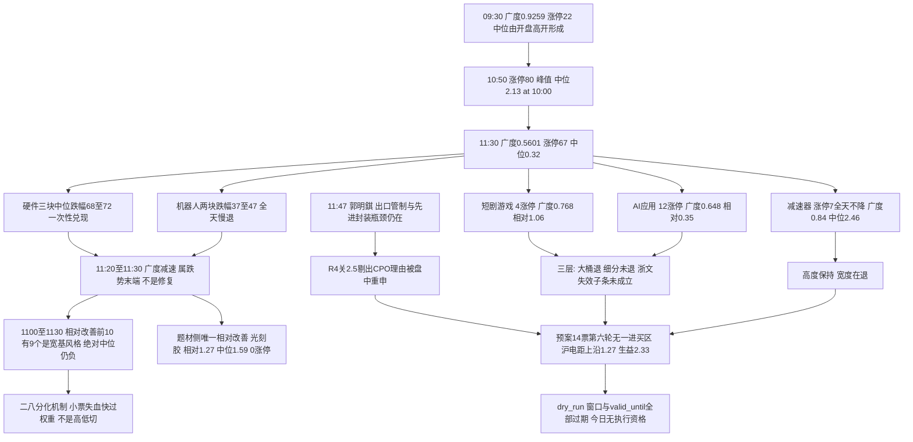
