<!-- intraday-watch-cards:start -->

## 十分钟盯盘卡（最新在前）

<!-- intraday-watch-card:1500 -->

### 15:00 盯盘卡

> **当前落点：未确认买点**

上涨 **9.9%** · 涨停 33 · 跌停 17 · 成交 7,303 亿

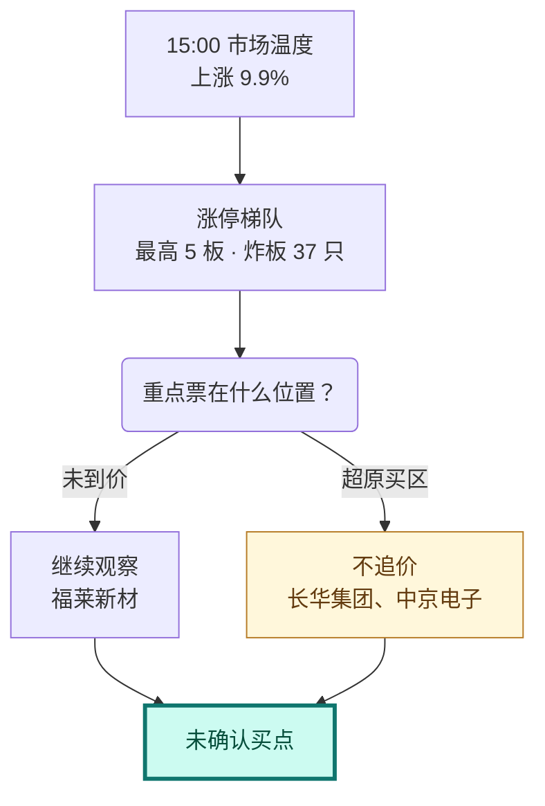

**梯队**：最高 5 板

| 重点票 | 现价（元） | 原买区（元） | 现在看什么 |
|---|---:|---:|---|
| 福莱新材 `605488.SH` | 49.61 | 51.19–52.22 | **未到价** · 继续观察 |
| 长华集团 `605018.SH` | 13.03 | 12.36–12.61 | **超原买区** · 不追价 |
| 中京电子 `002579.SZ` | 17.82 | 16.12–16.44 | **超原买区** · 不追价 |

**池外线索**：缺同轮筛选结果

**盘中快讯**：本轮未见带时点快讯

*报价截至 15:00:00 · 有效 2902 只 · 全A覆盖未核 · 路径未定 · 缺同轮对照*

<!-- intraday-watch-card:1450 -->

### 14:50 盯盘卡

> **当前落点：未确认买点**

上涨 **10.1%**（较对照轮 +0.3 个百分点） · 涨停 52 · 跌停 49 · 成交 13,048 亿

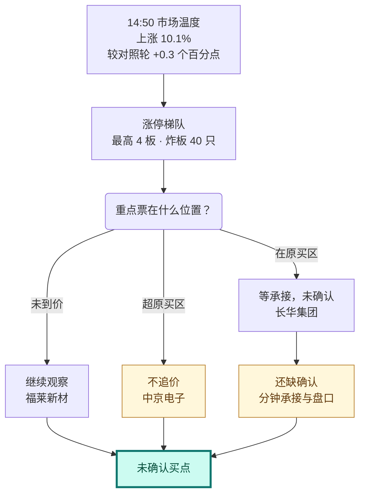

**梯队**：最高 4 板

| 重点票 | 现价（元） | 原买区（元） | 现在看什么 |
|---|---:|---:|---|
| 福莱新材 `605488.SH` | 49.14 | 51.19–52.22 | **未到价** · 继续观察 |
| 长华集团 `605018.SH` | 12.45 | 12.36–12.61 | **在原买区** · 等承接，未确认 |
| 中京电子 `002579.SZ` | 17.14 | 16.12–16.44 | **超原买区** · 不追价 |

**池外线索**：缺同轮筛选结果

**盘中快讯**：本轮未见带时点快讯

*报价截至 14:51:05 · 对照 14:40 · 有效 5573 只 · 全A覆盖未核 · 路径未定 · 缺同轮对照*

<!-- intraday-watch-card:1440 -->

### 14:40 盯盘卡

> **当前落点：未确认买点**

上涨 **9.8%**（较对照轮 -2.8 个百分点） · 涨停 49 · 跌停 35 · 成交 12,304 亿

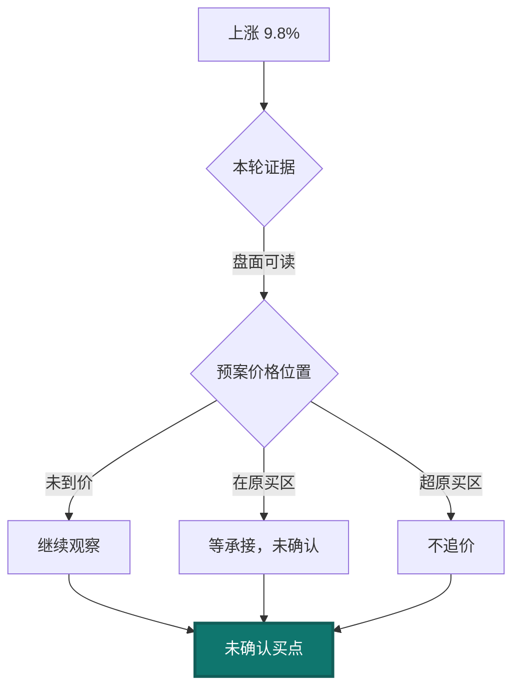

**梯队**：最高 4 板

| 重点票 | 现价（元） | 原买区（元） | 现在看什么 |
|---|---:|---:|---|
| 福莱新材 `605488.SH` | 49.34 | 51.19–52.22 | **未到价** · 继续观察 |
| 长华集团 `605018.SH` | 12.49 | 12.36–12.61 | **在原买区** · 等承接，未确认 |
| 中京电子 `002579.SZ` | 16.78 | 16.12–16.44 | **超原买区** · 不追价 |

**池外线索**：缺同轮筛选结果

**盘中快讯**：本轮未见带时点快讯

*报价截至 14:41:05 · 对照 14:30 · 有效 5573 只 · 全A覆盖未核 · 路径未定 · 缺同轮对照*

<!-- intraday-watch-card:1430 -->

### 14:30 盯盘卡

> **当前落点：未确认买点**

上涨 **12.6%**（较对照轮 +1.2 个百分点） · 涨停 51 · 跌停 22 · 成交 11,758 亿


**板块扩散**（涨停/有效成分）：仿制药一致性评价 **11**/145 · 流感 **12**/164

**梯队**：最高 4 板

| 重点票 | 现价（元） | 原买区（元） | 现在看什么 |
|---|---:|---:|---|
| 福莱新材 `605488.SH` | 49.76 | 51.19–52.22 | **未到价** · 继续观察 |
| 长华集团 `605018.SH` | 12.69 | 12.36–12.61 | **超原买区** · 不追价 |
| 中京电子 `002579.SZ` | 17.13 | 16.12–16.44 | **超原买区** · 不追价 |

**池外线索**：缺同轮筛选结果

**盘中快讯**：本轮未见带时点快讯

*报价截至 14:31:05 · 对照 14:20 · 有效 5573 只 · 全A覆盖未核 · 路径未定 · 缺同轮对照*

<!-- intraday-watch-card:1420 -->

### 14:20 盯盘卡

> **当前落点：未确认买点**

上涨 **11.4%**（较对照轮 +0.3 个百分点） · 涨停 48 · 跌停 18 · 成交 11,216 亿

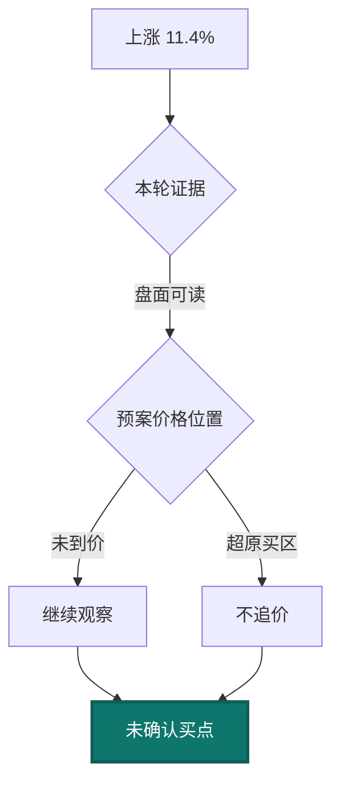

**板块扩散**（涨停/有效成分）：流感 **11**/164

**梯队**：最高 4 板

| 重点票 | 现价（元） | 原买区（元） | 现在看什么 |
|---|---:|---:|---|
| 福莱新材 `605488.SH` | 49.60 | 51.19–52.22 | **未到价** · 继续观察 |
| 长华集团 `605018.SH` | 12.62 | 12.36–12.61 | **超原买区** · 不追价 |
| 中京电子 `002579.SZ` | 16.63 | 16.12–16.44 | **超原买区** · 不追价 |

**池外线索**：缺同轮筛选结果

**盘中快讯**：本轮未见带时点快讯

*报价截至 14:21:02 · 对照 14:10 · 有效 5573 只 · 全A覆盖未核 · 路径未定 · 缺同轮对照*

<!-- intraday-watch-card:1410 -->

### 14:10 盯盘卡

> **当前落点：未确认买点**

上涨 **11.0%**（较对照轮 -1.7 个百分点） · 涨停 53 · 跌停 15 · 成交 10,685 亿

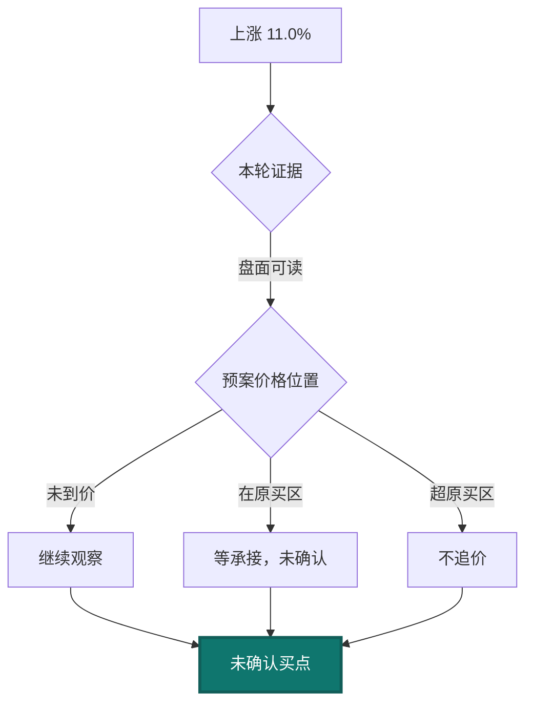

**板块扩散**（涨停/有效成分）：仿制药一致性评价 **11**/145 · 流感 **12**/164

**梯队**：最高 4 板

| 重点票 | 现价（元） | 原买区（元） | 现在看什么 |
|---|---:|---:|---|
| 福莱新材 `605488.SH` | 49.77 | 51.19–52.22 | **未到价** · 继续观察 |
| 长华集团 `605018.SH` | 12.59 | 12.36–12.61 | **在原买区** · 等承接，未确认 |
| 中京电子 `002579.SZ` | 16.54 | 16.12–16.44 | **超原买区** · 不追价 |

**池外线索**：缺同轮筛选结果

**盘中快讯**：本轮未见带时点快讯

*报价截至 14:11:02 · 对照 14:00 · 有效 5573 只 · 全A覆盖未核 · 路径未定 · 缺同轮对照*

<!-- intraday-watch-card:1400 -->

### 14:00 盯盘卡

> **当前落点：未确认买点**

上涨 **12.7%**（较对照轮 -3.4 个百分点） · 涨停 55 · 跌停 10 · 成交 10,176 亿

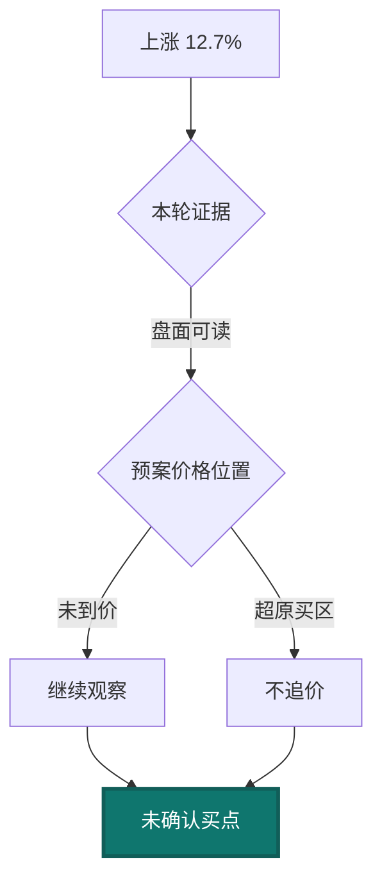

**板块扩散**（涨停/有效成分）：仿制药一致性评价 **11**/145 · 流感 **12**/164

**梯队**：最高 4 板

| 重点票 | 现价（元） | 原买区（元） | 现在看什么 |
|---|---:|---:|---|
| 福莱新材 `605488.SH` | 50.09 | 51.19–52.22 | **未到价** · 继续观察 |
| 长华集团 `605018.SH` | 12.71 | 12.36–12.61 | **超原买区** · 不追价 |
| 中京电子 `002579.SZ` | 16.51 | 16.12–16.44 | **超原买区** · 不追价 |

**池外线索**：缺同轮筛选结果

**盘中快讯**：本轮未见带时点快讯

*报价截至 14:01:02 · 对照 13:50 · 有效 5573 只 · 全A覆盖未核 · 路径未定 · 缺同轮对照*

<!-- intraday-watch-card:1350 -->

### 13:50 盯盘卡

<!-- intraday-watch-card:fallback -->

截面保底

> **当前落点：分析材料缺口 · 不判买点**

上涨 **16.1%**（较对照轮 -2.9 个百分点） · 涨停 61 · 跌停 8 · 成交 9,789 亿

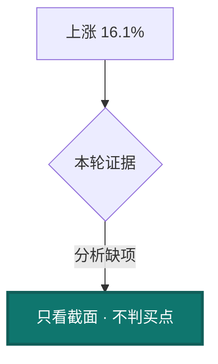

| 重点票 | 现价（元） | 原买区（元） | 现在看什么 |
|---|---:|---:|---|
| — | — | — | 无同轮个股对照 |

**池外线索**：缺同轮筛选结果

**盘中快讯**：本轮未见带时点快讯

*报价截至 13:51:02 · 对照 13:40 · 有效 5573 只 · 全A覆盖未核 · 路径未定 · 缺同轮对照*

<!-- intraday-watch-card:1340 -->

### 13:40 盯盘卡

<!-- intraday-watch-card:replay -->

留存补版，非当时提醒

> **当前落点：未确认买点**

上涨 **19.1%**（较对照轮 -2.7 个百分点） · 涨停 64 · 跌停 8 · 成交 9,404 亿


**板块扩散**（涨停/有效成分）：海南自贸区 **3**/30 · 新冠特效药 **3**/33 · 流感 **14**/164

**梯队**：最高 4 板

| 重点票 | 现价（元） | 原买区（元） | 现在看什么 |
|---|---:|---:|---|
| 福莱新材 `605488.SH` | 50.19 | 51.19–52.22 | **未到价** · 继续观察 |
| 长华集团 `605018.SH` | 12.70 | 12.36–12.61 | **超原买区** · 不追价 |
| 中京电子 `002579.SZ` | 16.83 | 16.12–16.44 | **超原买区** · 不追价 |

**池外线索**：缺同轮筛选结果

**盘中快讯** · 来源时间，原文、首次可见与因果未核

| 北京时间 | 快讯与来源 |
|---|---|
| 13:40 | 韩股跌幅扩大！SK海力士跌11%，三星电子跌10% · 格隆汇-快讯 |
| 13:40 | 【中微公司在合肥成立新半导体设备公司，注册资本5000万】天眼查App显示，近日，中微半导体设备（合肥）有限公司成立，法定代表人为丛海，注册资本5000万元人民币，经营 · 新浪财经-快讯 |

*报价截至 13:41:02 · 对照 13:30 · 有效 5573 只 · 全A覆盖未核 · 路径未定 · 缺同轮对照*

<!-- intraday-watch-card:1330 -->

### 13:30 盯盘卡

<!-- intraday-watch-card:replay -->

留存补版，非当时提醒

> **当前落点：未确认买点**

上涨 **21.7%**（较对照轮 -16.4 个百分点） · 涨停 65 · 跌停 5 · 成交 9,009 亿


**板块扩散**（涨停/有效成分）：海南自贸区 **3**/30 · 流感 **15**/164 · 新冠特效药 **3**/33

**梯队**：最高 4 板

| 重点票 | 现价（元） | 原买区（元） | 现在看什么 |
|---|---:|---:|---|
| 福莱新材 `605488.SH` | 50.50 | 51.19–52.22 | **未到价** · 继续观察 |
| 长华集团 `605018.SH` | 12.74 | 12.36–12.61 | **超原买区** · 不追价 |
| 中京电子 `002579.SZ` | 16.61 | 16.12–16.44 | **超原买区** · 不追价 |

**池外线索**：缺同轮筛选结果

**盘中快讯** · 来源时间，原文、首次可见与因果未核

| 北京时间 | 快讯与来源 |
|---|---|
| 13:31 | 铝连续主力合约日内跌4%，现报20695.00元。 · 新浪财经-快讯 |
| 13:30 | 白银连续主力合约日内跌8%，现报9473.00元。 · 新浪财经-快讯 |

*报价截至 13:31:02 · 对照 13:20 · 有效 5573 只 · 全A覆盖未核 · 路径未定 · 缺同轮对照*

<!-- intraday-watch-card:1320 -->

### 13:20 盯盘卡

<!-- intraday-watch-card:replay -->

留存补版，非当时提醒

> **当前落点：未确认买点**

上涨 **38.2%**（较对照轮 -0.5 个百分点） · 涨停 67 · 跌停 4 · 成交 8,574 亿

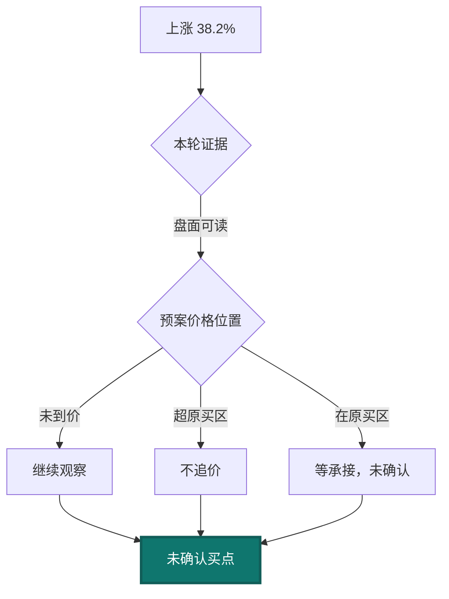

**板块扩散**（涨停/有效成分）：信托概念 **3**/23 · 海南自贸区 **3**/30 · 新冠特效药 **3**/33

**梯队**：最高 4 板

| 重点票 | 现价（元） | 原买区（元） | 现在看什么 |
|---|---:|---:|---|
| 福莱新材 `605488.SH` | 50.55 | 51.19–52.22 | **未到价** · 继续观察 |
| 长华集团 `605018.SH` | 12.87 | 12.36–12.61 | **超原买区** · 不追价 |
| 中京电子 `002579.SZ` | 16.43 | 16.12–16.44 | **在原买区** · 等承接，未确认 |

**池外线索**：缺同轮筛选结果

**盘中快讯** · 来源时间，原文、首次可见与因果未核

| 北京时间 | 快讯与来源 |
|---|---|
| 13:19 | 【上证指数失守3500点整数关口】上证指数失守3500点整数关口，跌1.36%。 · 新浪财经-快讯 |
| 13:19 | 杰富瑞：将百思买目标价上调至101美元 · 格隆汇-快讯 |

*报价截至 13:21:02 · 对照 13:10 · 有效 5573 只 · 全A覆盖未核 · 路径未定 · 缺同轮对照*

<!-- intraday-watch-card:1310 -->

### 13:10 盯盘卡

<!-- intraday-watch-card:replay -->

留存补版，非当时提醒

> **当前落点：未确认买点**

上涨 **38.6%**（较对照轮 -3.7 个百分点） · 涨停 67 · 跌停 3 · 成交 8,152 亿

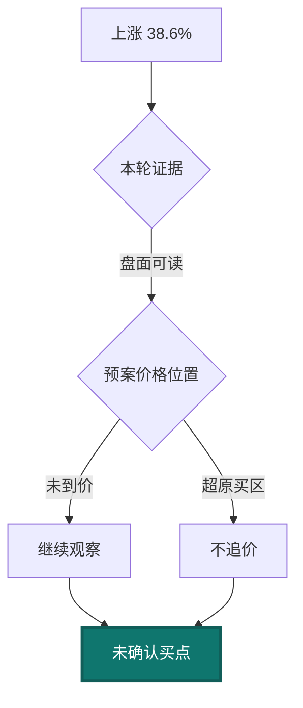

**板块扩散**（涨停/有效成分）：信托概念 **3**/23 · 海南自贸区 **3**/30 · 流感 **15**/164

**梯队**：最高 4 板

| 重点票 | 现价（元） | 原买区（元） | 现在看什么 |
|---|---:|---:|---|
| 福莱新材 `605488.SH` | 51.17 | 51.19–52.22 | **未到价** · 继续观察 |
| 长华集团 `605018.SH` | 13.17 | 12.36–12.61 | **超原买区** · 不追价 |
| 中京电子 `002579.SZ` | 16.45 | 16.12–16.44 | **超原买区** · 不追价 |

**池外线索**：缺同轮筛选结果

**盘中快讯** · 来源时间，原文、首次可见与因果未核

| 北京时间 | 快讯与来源 |
|---|---|
| 13:10 | 工业和信息化部脑机标委会工作组成立 · 格隆汇-快讯 |
| 13:10 | 军工板块局部异动，国瑞科技涨超15%，此前利君股份走出2连板，成飞集成涨停，邵阳液压、晨曦航空、中国海防、江龙船艇、中船应急涨幅靠前。 · 新浪财经-快讯 |

*报价截至 13:11:02 · 对照 13:00 · 有效 5573 只 · 全A覆盖未核 · 路径未定 · 缺同轮对照*

<!-- intraday-watch-card:1300 -->

### 13:00 盯盘卡

<!-- intraday-watch-card:replay -->

留存补版，非当时提醒

> **当前落点：未确认买点**

上涨 **42.3%**（较对照轮 -8.4 个百分点） · 涨停 69 · 跌停 4 · 成交 7,804 亿


**板块扩散**（涨停/有效成分）：信托概念 **3**/23 · 海南自贸区 **3**/30 · 流感 **15**/164

**梯队**：最高 4 板

| 重点票 | 现价（元） | 原买区（元） | 现在看什么 |
|---|---:|---:|---|
| 福莱新材 `605488.SH` | 51.17 | 51.19–52.22 | **未到价** · 继续观察 |
| 长华集团 `605018.SH` | 12.75 | 12.36–12.61 | **超原买区** · 不追价 |
| 中京电子 `002579.SZ` | 16.54 | 16.12–16.44 | **超原买区** · 不追价 |

**池外线索**：缺同轮筛选结果

**盘中快讯** · 来源时间，原文、首次可见与因果未核

| 北京时间 | 快讯与来源 |
|---|---|
| 13:00 | 【宁德时代盘中跌超5%】A股宁德时代盘中跌超5%，现报215.80元。 · 新浪财经-快讯 |
| 13:00 | 宁德时代盘中跌超5% · 同花顺-快讯 |

*报价截至 13:01:02 · 对照 11:30 · 有效 5573 只 · 全A覆盖未核 · 路径未定 · 缺同轮对照*

<!-- intraday-watch-card:1130 -->

### 11:30 盯盘卡

<!-- intraday-watch-card:replay -->

留存补版，非当时提醒

> **当前落点：未确认买点**

上涨 **50.7%**（较对照轮 -1.5 个百分点） · 涨停 70 · 跌停 3 · 成交 7,689 亿

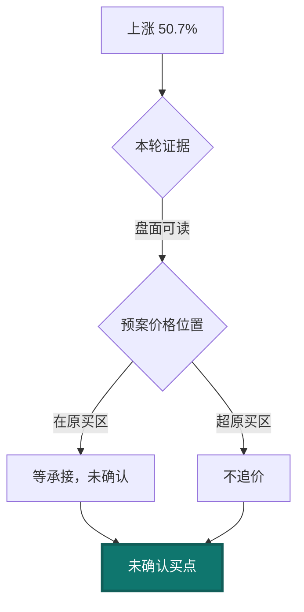

**板块扩散**（涨停/有效成分）：信托概念 **3**/23 · 海南自贸区 **3**/30 · 流感 **15**/164

**梯队**：最高 4 板

| 重点票 | 现价（元） | 原买区（元） | 现在看什么 |
|---|---:|---:|---|
| 福莱新材 `605488.SH` | 51.21 | 51.19–52.22 | **在原买区** · 等承接，未确认 |
| 长华集团 `605018.SH` | 12.87 | 12.36–12.61 | **超原买区** · 不追价 |
| 中京电子 `002579.SZ` | 16.61 | 16.12–16.44 | **超原买区** · 不追价 |

**池外线索**：缺同轮筛选结果

**盘中快讯** · 来源时间，原文、首次可见与因果未核

| 北京时间 | 快讯与来源 |
|---|---|
| 11:30 | 11月25日午间收评：三大指数均跌超1%，医药、消费股逆势走强 · 华尔街-快讯 |
| 11:30 | 期货午评：美联储加息预期引爆抛售！沪银暴跌6.6% 碳酸锂重挫7.5% · 同花顺-快讯 |

*报价截至 11:30:57 · 对照 11:20 · 有效 5573 只 · 全A覆盖未核 · 路径未定 · 缺同轮对照*

<!-- intraday-watch-card:1120 -->

### 11:20 盯盘卡

<!-- intraday-watch-card:replay -->

留存补版，非当时提醒

> **当前落点：未确认买点**

上涨 **52.1%**（较对照轮 +1.2 个百分点） · 涨停 67 · 跌停 3 · 成交 7,466 亿

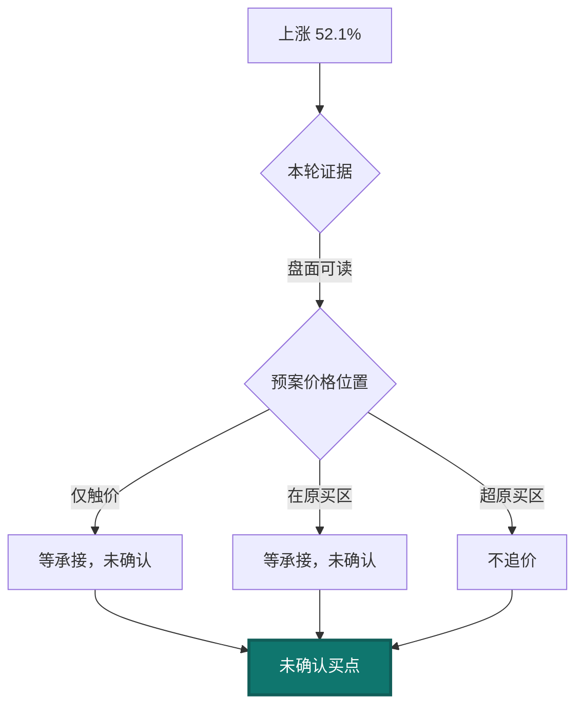

**板块扩散**（涨停/有效成分）：信托概念 **3**/23 · 海南自贸区 **3**/30 · 流感 **15**/164

**梯队**：最高 4 板

| 重点票 | 现价（元） | 原买区（元） | 现在看什么 |
|---|---:|---:|---|
| 福莱新材 `605488.SH` | 51.56 | 51.19–52.22 | **仅触价** · 等承接，未确认 |
| 长华集团 `605018.SH` | 12.59 | 12.36–12.61 | **在原买区** · 等承接，未确认 |
| 中京电子 `002579.SZ` | 16.62 | 16.12–16.44 | **超原买区** · 不追价 |

**池外线索**：缺同轮筛选结果

**盘中快讯** · 来源时间，原文、首次可见与因果未核

| 北京时间 | 快讯与来源 |
|---|---|
| 11:20 | 【证监会：对某公司采取责令改正行政监管措施】证监会经查发现，某公司在网络和信息安全管理中存在网络安全防护与系统运维管理不到位、用户访问控制与数据安全保护机制不健全、系统 · 新浪财经-快讯 |
| 11:20 | 【黑龙江证监局对大通期货采取责令改正行政监管措施】黑龙江证监局发布关于对大通期货经纪有限公司采取责令改正行政监管措施的决定，经查，公司在网络和信息安全管理中存在以下行为 · 新浪财经-快讯 |

*报价截至 11:21:05 · 对照 11:10 · 有效 5573 只 · 全A覆盖未核 · 路径未定 · 缺同轮对照*

<!-- intraday-watch-card:1110 -->

### 11:10 盯盘卡

<!-- intraday-watch-card:replay -->

留存补版，非当时提醒

> **当前落点：未确认买点**

上涨 **50.9%**（较对照轮 +1.6 个百分点） · 涨停 68 · 跌停 3 · 成交 7,224 亿


**板块扩散**（涨停/有效成分）：信托概念 **3**/23 · 海南自贸区 **3**/30 · 流感 **15**/164

**梯队**：最高 4 板

| 重点票 | 现价（元） | 原买区（元） | 现在看什么 |
|---|---:|---:|---|
| 福莱新材 `605488.SH` | 51.58 | 51.19–52.22 | **仅触价** · 等承接，未确认 |
| 长华集团 `605018.SH` | 12.51 | 12.36–12.61 | **在原买区** · 等承接，未确认 |
| 中京电子 `002579.SZ` | 16.71 | 16.12–16.44 | **超原买区** · 不追价 |

**池外线索**：缺同轮筛选结果

**盘中快讯** · 来源时间，原文、首次可见与因果未核

| 北京时间 | 快讯与来源 |
|---|---|
| 11:10 | 星巴克与花旗和摩根士丹利等银行合作处理日本业务出售事宜。 · 新浪财经-快讯 |
| 11:10 | 南方两倍做多三星电子跌超20% · 格隆汇-快讯 |

*报价截至 11:11:05 · 对照 11:00 · 有效 5573 只 · 全A覆盖未核 · 路径未定 · 缺同轮对照*

<!-- intraday-watch-card:1100 -->

### 11:00 盯盘卡

<!-- intraday-watch-card:replay -->

留存补版，非当时提醒

> **当前落点：未确认买点**

上涨 **49.3%**（较对照轮 -2.0 个百分点） · 涨停 69 · 跌停 3 · 成交 6,941 亿


**板块扩散**（涨停/有效成分）：新冠特效药 **5**/33 · 信托概念 **3**/23 · 海南自贸区 **3**/30

**梯队**：最高 4 板

| 重点票 | 现价（元） | 原买区（元） | 现在看什么 |
|---|---:|---:|---|
| 福莱新材 `605488.SH` | 51.26 | 51.19–52.22 | **在原买区** · 等承接，未确认 |
| 长华集团 `605018.SH` | 12.90 | 12.36–12.61 | **超原买区** · 不追价 |
| 中京电子 `002579.SZ` | 16.76 | 16.12–16.44 | **超原买区** · 不追价 |

**池外线索**：缺同轮筛选结果

**盘中快讯** · 来源时间，原文、首次可见与因果未核

| 北京时间 | 快讯与来源 |
|---|---|
| 11:00 | 【涉案金额超150亿元 一名经济犯罪嫌疑人从俄罗斯被引渡回国】近日，经中国公安机关不懈努力，在我驻俄罗斯使馆的大力协助下，涉嫌非法吸收公众存款犯罪的嫌疑人舒某某从俄罗斯 · 新浪财经-快讯 |
| 11:00 | 原子芯光完成超亿元天使轮融资 · 同花顺-快讯 |

*报价截至 11:01:08 · 对照 10:50 · 有效 5573 只 · 全A覆盖未核 · 路径未定 · 缺同轮对照*

<!-- intraday-watch-card:1050 -->

### 10:50 盯盘卡

<!-- intraday-watch-card:replay -->

留存补版，非当时提醒

> **当前落点：未确认买点**

上涨 **51.3%**（较对照轮 -4.6 个百分点） · 涨停 67 · 跌停 3 · 成交 6,620 亿


**板块扩散**（涨停/有效成分）：信托概念 **3**/23 · 海南自贸区 **3**/30 · 流感 **15**/164

**梯队**：最高 4 板

| 重点票 | 现价（元） | 原买区（元） | 现在看什么 |
|---|---:|---:|---|
| 福莱新材 `605488.SH` | 51.25 | 51.19–52.22 | **在原买区** · 等承接，未确认 |
| 长华集团 `605018.SH` | 12.72 | 12.36–12.61 | **超原买区** · 不追价 |
| 中京电子 `002579.SZ` | 16.77 | 16.12–16.44 | **超原买区** · 不追价 |

**池外线索**：缺同轮筛选结果

**盘中快讯** · 来源时间，原文、首次可见与因果未核

| 北京时间 | 快讯与来源 |
|---|---|
| 10:50 | 英国宣布制裁也门胡塞武装 · 格隆汇-快讯 |
| 10:50 | 科研团队用脑机接口治疗难治性抑郁症 · 格隆汇-快讯 |

*报价截至 10:51:05 · 对照 10:40 · 有效 5573 只 · 全A覆盖未核 · 路径未定 · 缺同轮对照*

<!-- intraday-watch-card:1040 -->

### 10:40 盯盘卡

<!-- intraday-watch-card:replay -->

留存补版，非当时提醒

> **当前落点：未确认买点**

上涨 **55.9%**（较对照轮 -4.5 个百分点） · 涨停 64 · 跌停 3 · 成交 6,246 亿


**板块扩散**（涨停/有效成分）：海南自贸区 **3**/30 · 流感 **15**/164 · 新冠特效药 **3**/33

**梯队**：最高 4 板

| 重点票 | 现价（元） | 原买区（元） | 现在看什么 |
|---|---:|---:|---|
| 福莱新材 `605488.SH` | 51.50 | 51.19–52.22 | **仅触价** · 等承接，未确认 |
| 长华集团 `605018.SH` | 13.66 | 12.36–12.61 | **超原买区** · 不追价 |
| 中京电子 `002579.SZ` | 16.85 | 16.12–16.44 | **超原买区** · 不追价 |

**池外线索**：缺同轮筛选结果

**盘中快讯** · 来源时间，原文、首次可见与因果未核

| 北京时间 | 快讯与来源 |
|---|---|
| 10:40 | 【拜登儿子回应父亲身体状况：衰老带来的自然变化 但他百分百具备当总统的认知能力】近日，美国前总统拜登之子亨特·拜登在接受采访时表示，他确实注意到父亲的身体状态有所变化， · 新浪财经-快讯 |
| 10:40 | 国台办：APEC会议成为台湾同胞读懂大陆的生动舞台 · 格隆汇-快讯 |

*报价截至 10:41:05 · 对照 10:30 · 有效 5573 只 · 全A覆盖未核 · 路径未定 · 缺同轮对照*

<!-- intraday-watch-card:1030 -->

### 10:30 盯盘卡

<!-- intraday-watch-card:replay -->

留存补版，非当时提醒

> **当前落点：未确认买点**

上涨 **60.3%**（较对照轮 +2.2 个百分点） · 涨停 58 · 跌停 3 · 成交 5,837 亿


**板块扩散**（涨停/有效成分）：海南自贸区 **3**/30 · 新冠特效药 **3**/33 · 仿制药一致性评价 **12**/145

**梯队**：最高 4 板

| 重点票 | 现价（元） | 原买区（元） | 现在看什么 |
|---|---:|---:|---|
| 福莱新材 `605488.SH` | 51.50 | 51.19–52.22 | **仅触价** · 等承接，未确认 |
| 长华集团 `605018.SH` | 13.66 | 12.36–12.61 | **超原买区** · 不追价 |
| 中京电子 `002579.SZ` | 17.05 | 16.12–16.44 | **超原买区** · 不追价 |

**池外线索**：缺同轮筛选结果

**盘中快讯** · 来源时间，原文、首次可见与因果未核

| 北京时间 | 快讯与来源 |
|---|---|
| 10:30 | 南非总统：南非正采取多方面举措应对美贸易限制 · 格隆汇-快讯 |
| 10:30 | 纽约期金突破3600美元/盎司，日内涨0.25%。 · 新浪财经-快讯 |

*报价截至 10:31:03 · 对照 10:20 · 有效 5573 只 · 全A覆盖未核 · 路径未定 · 缺同轮对照*

<!-- intraday-watch-card:1020 -->

### 10:20 盯盘卡

<!-- intraday-watch-card:replay -->

留存补版，非当时提醒

> **当前落点：分析材料缺口 · 不判买点**

上涨 **58.2%**（较对照轮 -8.9 个百分点） · 涨停 57 · 跌停 3 · 成交 5,433 亿

```mermaid
flowchart TD
    M["上涨 58.2%"] --> E{"本轮证据"}
    E -->|"分析缺项"| NOW["只看截面 · 不判买点"]
    class NOW current
    classDef current fill:#0f766e,color:#fff,stroke:#115e59,stroke-width:3px
```

| 重点票 | 现价（元） | 原买区（元） | 现在看什么 |
|---|---:|---:|---|
| — | — | — | 无同轮个股对照 |

**池外线索**：缺同轮筛选结果

**盘中快讯** · 来源时间，原文、首次可见与因果未核

| 北京时间 | 快讯与来源 |
|---|---|
| 10:21 | 现货白银涨超1% · 同花顺-快讯 |
| 10:21 | 港股异动丨濠赌股集体反弹，新濠国际发展涨4.8%止步十连跌 · 格隆汇-快讯 |

*报价截至 10:21:02 · 对照 10:10 · 有效 5573 只 · 全A覆盖未核 · 路径未定 · 缺同轮对照*

<!-- intraday-watch-card:1010 -->

### 10:10 盯盘卡

<!-- intraday-watch-card:replay -->

留存补版，非当时提醒

> **当前落点：未确认买点**

上涨 **67.1%**（较对照轮 +11.0 个百分点） · 涨停 53 · 跌停 3 · 成交 4,962 亿

```mermaid
flowchart TD
    M["上涨 67.1%"] --> E{"本轮证据"}
    E -->|"盘面可读"| P{"预案价格位置"}
    P -->|"超原买区"| B0["不追价"]
    B0 --> NOW["未确认买点"]
    class NOW current
    classDef current fill:#0f766e,color:#fff,stroke:#115e59,stroke-width:3px
```

**板块扩散**（涨停/有效成分）：海南自贸区 **3**/30 · 仿制药一致性评价 **11**/145 · 流感 **11**/164

**梯队**：最高 4 板

| 重点票 | 现价（元） | 原买区（元） | 现在看什么 |
|---|---:|---:|---|
| 福莱新材 `605488.SH` | 52.25 | 51.19–52.22 | **超原买区** · 不追价 |
| 长华集团 `605018.SH` | 13.66 | 12.36–12.61 | **超原买区** · 不追价 |
| 中京电子 `002579.SZ` | 16.98 | 16.12–16.44 | **超原买区** · 不追价 |

**池外线索**：缺同轮筛选结果

**盘中快讯** · 来源时间，原文、首次可见与因果未核

| 北京时间 | 快讯与来源 |
|---|---|
| 10:10 | 木原稔：目前尚无法确定第二次补充预算的规模及时间安排。 · 新浪财经-快讯 |
| 10:09 | 【小米港股一度涨超8% 花旗称业绩符预期且手机业务毛利率料稳定】小米集团在香港一度上涨近8.2%，创下近三周最大盘中升幅。花旗在报告中指出，公司三季度经调整净收入大致符 · 新浪财经-快讯 |

*报价截至 10:11:02 · 对照 10:00 · 有效 5573 只 · 全A覆盖未核 · 路径未定 · 缺同轮对照*

<!-- intraday-watch-card:1000 -->

### 10:00 盯盘卡

<!-- intraday-watch-card:replay -->

留存补版，非当时提醒

> **当前落点：未确认买点**

上涨 **56.0%**（较对照轮 +4.4 个百分点） · 涨停 43 · 跌停 4 · 成交 4,295 亿

```mermaid
flowchart TD
    M["上涨 56.0%"] --> E{"本轮证据"}
    E -->|"盘面可读"| P{"预案价格位置"}
    P -->|"未到价"| B0["继续观察"]
    B0 --> NOW["未确认买点"]
    P -->|"超原买区"| B1["不追价"]
    B1 --> NOW["未确认买点"]
    class NOW current
    classDef current fill:#0f766e,color:#fff,stroke:#115e59,stroke-width:3px
```

**板块扩散**（涨停/有效成分）：海南自贸区 **3**/30 · 仿制药一致性评价 **10**/145 · 消毒剂 **4**/61

**梯队**：最高 4 板

| 重点票 | 现价（元） | 原买区（元） | 现在看什么 |
|---|---:|---:|---|
| 福莱新材 `605488.SH` | 50.79 | 51.19–52.22 | **未到价** · 继续观察 |
| 长华集团 `605018.SH` | 13.66 | 12.36–12.61 | **超原买区** · 不追价 |
| 中京电子 `002579.SZ` | 16.70 | 16.12–16.44 | **超原买区** · 不追价 |

**池外线索**：缺同轮筛选结果

**盘中快讯** · 来源时间，原文、首次可见与因果未核

| 北京时间 | 快讯与来源 |
|---|---|
| 10:00 | 台股跌7% · 格隆汇-快讯 |
| 10:00 | 【教育板块持续活跃，中公教育涨停】教育板块持续活跃，中公教育涨停，昂立教育、全通教育、凯文教育、华图山鼎、学大教育跟涨。 · 新浪财经-快讯 |

*报价截至 10:01:05 · 对照 09:50 · 有效 5573 只 · 全A覆盖未核 · 路径未定 · 缺同轮对照*

<!-- intraday-watch-card:0950 -->

### 09:50 盯盘卡

<!-- intraday-watch-card:replay -->

留存补版，非当时提醒

> **当前落点：分析材料缺口 · 不判买点**

上涨 **51.6%**（较对照轮 -6.3 个百分点） · 涨停 33 · 跌停 3 · 成交 3,495 亿

```mermaid
flowchart TD
    M["上涨 51.6%"] --> E{"本轮证据"}
    E -->|"分析缺项"| NOW["只看截面 · 不判买点"]
    class NOW current
    classDef current fill:#0f766e,color:#fff,stroke:#115e59,stroke-width:3px
```

| 重点票 | 现价（元） | 原买区（元） | 现在看什么 |
|---|---:|---:|---|
| — | — | — | 无同轮个股对照 |

**池外线索**：缺同轮筛选结果

**盘中快讯**：本轮快讯数据缺失

*报价截至 09:51:03 · 对照 09:40 · 有效 5573 只 · 全A覆盖未核 · 路径未定 · 缺同轮对照*

<!-- intraday-watch-card:0940 -->

### 09:40 盯盘卡

<!-- intraday-watch-card:replay -->

留存补版，非当时提醒

> **当前落点：分析材料缺口 · 不判买点**

上涨 **57.9%** · 涨停 34 · 跌停 5 · 成交 2,400 亿

```mermaid
flowchart TD
    M["上涨 57.9%"] --> E{"本轮证据"}
    E -->|"分析缺项"| NOW["只看截面 · 不判买点"]
    class NOW current
    classDef current fill:#0f766e,color:#fff,stroke:#115e59,stroke-width:3px
```

| 重点票 | 现价（元） | 原买区（元） | 现在看什么 |
|---|---:|---:|---|
| — | — | — | 无同轮个股对照 |

**池外线索**：缺同轮筛选结果

**盘中快讯**：本轮快讯数据缺失

*报价截至 09:41:05 · 有效 5573 只 · 全A覆盖未核 · 路径未定 · 缺同轮对照*

<!-- intraday-watch-card:0930 -->

### 09:30 盯盘卡

<!-- intraday-watch-card:replay -->

留存补版，非当时提醒

> **当前落点：分析材料缺口 · 不判买点**

上涨 **16.1%** · 涨停 15 · 跌停 4 · 成交 660 亿

```mermaid
flowchart TD
    M["上涨 16.1%"] --> E{"本轮证据"}
    E -->|"分析缺项"| NOW["只看截面 · 不判买点"]
    class NOW current
    classDef current fill:#0f766e,color:#fff,stroke:#115e59,stroke-width:3px
```

| 重点票 | 现价（元） | 原买区（元） | 现在看什么 |
|---|---:|---:|---|
| — | — | — | 无同轮个股对照 |

**池外线索**：缺同轮筛选结果

**盘中快讯**：本轮快讯数据缺失

*报价截至 09:31:05 · 有效 5560 只 · 全A覆盖未核 · 路径未定 · 缺同轮对照*

<!-- intraday-watch-cards:end -->

## 当日总览（截至 15:00）

| 看哪里 | 本轮速览 |
|---|---|
| 市场（XTick） | 涨 586 / 跌 4933 · 涨停 57 / 跌停 44 |
| 扩散（涨停/有效成分） | 新冠特效药 3/33 · 黑龙江自贸区 3/36 · 仿制药一致性评价 12/145 |
| 走弱 | 2024中报预增 跌停 10 · 比亚迪概念 跌停 8 |
| 预案价格位置 | 仅触价 1 · 超原买区 8 · 未到价 21 |

### 盘前路径对照

未定：当前盘前文件版本不早于开盘或本轮截止。不使用其他日期或其他文档补位。

### 板块扩散

> 口径：XTick 概念成分 × 全市场实时报价；分母 = 板块内有有效报价的成分数。排序用涨停密度（涨停数/有效成分数），已剔除宽基属性板块（全市场 432 个板块中剔 16 个）。

**扩散中（题材，按涨停密度排序）**

| 板块 | 涨停 | 有效成分 | 涨停密度 | 上涨广度 | 中位涨幅 | 相对全市场 | 成交(亿) |
|---|---|---|---|---|---|---|---|
| 新冠特效药 | 3 | 33 | 0.091 | 0.42 | -1.25% | +2.52% | 65 |
| 巴黎奥运会概念 ⬦ | 2 | 22 | 0.091 | 0.23 | -2.17% | +1.60% | 47 |
| 青蒿素 ⬦ | 1 | 11 | 0.091 | 0.64 | +0.62% | +4.39% | 32 |
| 黑龙江自贸区 | 3 | 36 | 0.083 | 0.28 | -2.30% | +1.47% | 97 |
| 仿制药一致性评价 | 12 | 145 | 0.083 | 0.46 | -0.09% | +3.68% | 279 |
| 消毒剂 | 5 | 61 | 0.082 | 0.25 | -2.02% | +1.75% | 126 |
| NMN概念 ⬦ | 2 | 25 | 0.080 | 0.32 | -1.05% | +2.72% | 32 |
| 流感 | 13 | 164 | 0.079 | 0.46 | -0.18% | +3.59% | 260 |
| 海南自贸区 ⬦ | 2 | 30 | 0.067 | 0.30 | -1.31% | +2.46% | 68 |
| 钛白粉概念 ⬦ | 1 | 15 | 0.067 | 0.20 | -2.06% | +1.71% | 22 |
| 大豆 ⬦ | 1 | 15 | 0.067 | 0.13 | -2.07% | +1.70% | 14 |
| 托育服务 ⬦ | 1 | 15 | 0.067 | 0.20 | -2.19% | +1.58% | 35 |

> ⬦ = 涨停 <3 只，零星个例，不构成扩散（不计入「钱在」判定）。

```mermaid
pie showData
    title 涨停数分布（扩散板块，Top 5）
    "新冠特效药" : 3
    "黑龙江自贸区" : 3
    "仿制药一致性评价" : 12
    "消毒剂" : 5
    "流感" : 13
```

零星涨停板块（<3 只）：巴黎奥运会概念(2)、青蒿素(1)、NMN概念(2)、海南自贸区(2)、钛白粉概念(1)、大豆(1)、托育服务(1)

**退潮中（跌停集中）**

| 板块 | 跌停 | 有效成分 | 上涨广度 | 中位涨幅 |
|---|---|---|---|---|
| 2024中报预增 | 10 | 653 | 0.11 | -3.72% |
| 比亚迪概念 | 8 | 696 | 0.04 | -5.47% |
| 光伏概念 | 7 | 602 | 0.04 | -4.95% |
| AI应用 | 7 | 551 | 0.10 | -3.70% |
| 锂电池概念 | 6 | 614 | 0.03 | -5.18% |
| 一带一路 | 6 | 797 | 0.08 | -3.63% |
| 虚拟现实 | 6 | 287 | 0.10 | -4.38% |
| 创投 | 6 | 460 | 0.11 | -3.08% |
| 集成电路概念 | 5 | 241 | 0.03 | -6.95% |
| 存储芯片 | 5 | 203 | 0.03 | -7.52% |
| 新材料概念 | 5 | 382 | 0.04 | -4.95% |
| OLED | 5 | 156 | 0.06 | -6.27% |

### 涨停梯队

> 最高 5 板 ｜ 涨停 57 ｜ 跌停 44 ｜ 炸板 37 ｜ 封板率 60.6% ｜ 打板成功率 23.44% ｜ 一进二 17.65% ｜ 二进三 24.00%

| 身位 | 家数 | 成员（涨幅/封单亿/首封） |
|---|---|---|
| 5板 | 1 | 中京电子 +10.00%/0.011亿/14:54 |
| 4板 | 2 | 克来机电 +9.99%/0.031亿/09:25；金新农 +10.11%/0.010亿/09:25 |
| 3板 | 6 | 九阳股份 +10.01%/0.027亿/09:45；杭州解百 +10.01%/0.025亿/09:30；宁波东力 +9.98%/0.013亿/09:30；汇洲智能 +10.12%/0.007亿/09:25；创源股份 +20.03%/0.007亿/10:15 |
| 2板 | 6 | 天圣制药 +10.08%/0.009亿/09:25；全筑股份 +10.13%/0.007亿/09:25；金牛化工 +10.04%/0.006亿/13:36；利君股份 +10.03%/0.003亿/09:30；*ST瑞茂 +10.91%/0.001亿/09:30 |
| 1板 | 42 | 德龙汇能 +10.02%/0.015亿/09:30；好当家 +10.09%/0.010亿/09:31；国芳集团 +10.03%/0.008亿/10:06；特一药业 +10.01%/0.007亿/09:31；青山纸业 +9.88%/0.007亿/09:55 |

```mermaid
flowchart TD
    B_0["5板 × 1"]
    B_1["4板 × 2"]
    B_2["3板 × 6"]
    B_3["2板 × 6"]
    B_4["1板 × 42"]
    ROOT["涨停梯队"]
    ROOT --> B_0
    ROOT --> B_1
    ROOT --> B_2
    ROOT --> B_3
    ROOT --> B_4
```

炸板 37 只（前几）：成飞集成(11次)、ST龙元(7次)、*ST东珠(6次)、葵花药业(5次)、永顺泰(5次)

### 预案池对照

| 票 | 池 | 板块 | 现价 | 涨幅 | 触发价 | 买区 | 风险位 | 判定 |
|---|---|---|---|---|---|---|---|---|
| 福莱新材 `605488.SH` | 执行池 | 机器人／执行器 | 49.61 | -3.58% | 51.45 | [51.19, 52.22] | 49.61 | **未到价** |
| 长华集团 `605018.SH` | 观察池 | 机器人／执行器 | 13.03 | +4.91% | — | [12.36, 12.61] | 11.98 | **超买区** |
| 中京电子 `002579.SZ` | 观察池 | PCB／覆铜板 | 17.82 | +10.00% | — | [16.12, 16.44] | 15.62 | **超买区** |
| 沪电股份 `002463.SZ` | 观察池 | PCB／覆铜板 | 79.49 | -5.52% | 84.13 | [83.71, 85.39] | 81.67 | **未到价** |
| 同星科技 `301252.SZ` | 观察池 | 国产算力／液冷 | 42.12 | -0.85% | 45.96 | [45.73, 46.65] | 42.92 | **未到价** |
| 寒武纪 `688256.SH` | 观察池 | 国产算力／液冷 | 907.9 | -6.40% | 1033.18 | [1028.01, 1048.68] | 964.79 | **未到价** |
| 中际旭创 `300308.SZ` | 观察池 | 光通信／CPO | 409.0 | -1.92% | 417.0 | [414.92, 423.25] | 389.39 | **未到价** |
| 克来机电 `603960.SH` | 观察池 | 光通信／CPO | 18.6 | +9.99% | — | [16.83, 17.16] | 16.3 | **超买区** |
| 联创电子 `002036.SZ` | 观察池 | 消费电子／端侧 | 5.1 | -4.85% | — | [5.33, 5.44] | 5.3 | **未到价** |
| 奥尼电子 `301189.SZ` | 观察池 | 消费电子／端侧 | 38.13 | -12.79% | 43.72 | [43.5, 44.38] | 41.47 | **未到价** |
| 浙文影业 `601599.SH` | 观察池 | AI应用／短剧 | 3.76 | -6.47% | 4.02 | [4.0, 4.08] | 3.88 | **未到价** |
| 行云科技 `300209.SZ` | 观察池 | 国产算力／液冷 | 21.87 | +0.74% | 25.76 | [25.63, 26.15] | 24.06 | **未到价** |
| 锋龙股份 `002931.SZ` | 观察池 | 机器人／执行器 | 43.9 | -6.02% | 46.71 | [46.48, 47.41] | 45.89 | **未到价** |
| 科森科技 `603626.SH` | 观察池 | 机器人／执行器 | 24.73 | -5.68% | 26.22 | [26.09, 26.61] | 25.28 | **未到价** |
| 襄阳轴承 `000678.SZ` | 观察池 | 机器人／执行器 | 19.96 | +1.94% | 19.58 | [19.48, 19.87] | 18.88 | **超买区** |
| 宝鼎科技 `002552.SZ` | 观察池 | PCB／覆铜板 | 26.54 | -5.21% | 28.0 | [27.86, 28.42] | 27.0 | **未到价** |
| 合锻智能 `603011.SH` | 观察池 | PCB／覆铜板 | 13.52 | -6.57% | 14.47 | [14.4, 14.69] | 13.96 | **未到价** |
| 宁波东力 `002164.SZ` | 观察池 | 机器人／执行器 | 21.7 | +9.98% | 19.73 | [19.63, 20.03] | 19.03 | **超买区** |
| 光洋股份 `002708.SZ` | 观察池 | 机器人／执行器 | 22.8 | -1.26% | 23.09 | [22.97, 23.44] | 22.57 | **未到价** |
| 九阳股份 `002242.SZ` | 观察池 | 情绪辨识／名字梗 | 38.56 | +10.01% | 35.05 | [34.87, 35.58] | 33.8 | **超买区** |
| 华东重机 `002685.SZ` | 观察池 | 情绪辨识／名字梗 | 8.99 | +0.45% | 8.95 | [8.91, 9.08] | 8.63 | **已触发** |
| 汇洲智能 `002122.SZ` | 观察池 | 摘帽／题材 | 3.59 | +10.12% | 3.26 | [3.24, 3.31] | 3.14 | **超买区** |
| 胜宏科技 `300476.SZ` | 观察池 | PCB／覆铜板 | 121.49 | -0.68% | 122.32 | [121.71, 124.15] | 118.33 | **未到价** |
| 南亚新材 `688519.SH` | 观察池 | PCB／覆铜板 | 137.19 | -5.35% | 144.95 | [144.23, 147.12] | 135.35 | **未到价** |
| 信科移动 `688387.SH` | 观察池 | 6G／通信 | 9.0 | -4.76% | 9.45 | [9.4, 9.59] | 8.82 | **未到价** |
| 魅视科技 `001229.SZ` | 观察池 | 国产算力／液冷 | 27.43 | -10.01% | — | [30.33, 30.94] | 30.13 | **未到价** |
| 艾艾精工 `603580.SH` | 观察池 | 消费电子／端侧 | 57.45 | -10.00% | 66.85 | [66.52, 67.85] | 64.46 | **未到价** |
| 金新农 `002548.SZ` | 观察池 | 农业／猪肉与水产 | 5.01 | +10.11% | 4.55 | [4.53, 4.62] | 4.39 | **超买区** |
| 东方海洋 `002086.SZ` | 观察池 | 农业／猪肉与水产 | 4.34 | -4.41% | 4.54 | [4.52, 4.61] | 4.38 | **未到价** |
| 七匹狼 `002029.SZ` | 观察池 | 情绪辨识／名字梗 | 6.32 | -5.25% | 6.67 | [6.64, 6.77] | 6.43 | **未到价** |

- **长华集团** — 现价13.03 已高于买区上沿12.61，不追高；仅价格位置对照，不代表完整入场条件确认；不能据此确认站稳，不授予下单权限
- **中京电子** — 现价17.82 已高于买区上沿16.44，不追高；仅价格位置对照，不代表完整入场条件确认；不能据此确认站稳，不授予下单权限
- **克来机电** — 现价18.6 已高于买区上沿17.16，不追高；仅价格位置对照，不代表完整入场条件确认；不能据此确认站稳，不授予下单权限
- **襄阳轴承** — 现价19.96 已高于买区上沿19.87，不追高；仅价格位置对照，不代表完整入场条件确认；不能据此确认站稳，不授予下单权限
- **宁波东力** — 现价21.7 已高于买区上沿20.03，不追高；仅价格位置对照，不代表完整入场条件确认；不能据此确认站稳，不授予下单权限
- **九阳股份** — 现价38.56 已高于买区上沿35.58，不追高；仅价格位置对照，不代表完整入场条件确认；不能据此确认站稳，不授予下单权限
- **华东重机** — 现价8.99 ≥ 触发价8.95；仅价格位置对照，不代表完整入场条件确认；不能据此确认站稳，不授予下单权限
- **汇洲智能** — 现价3.59 已高于买区上沿3.31，不追高；仅价格位置对照，不代表完整入场条件确认；不能据此确认站稳，不授予下单权限
- **金新农** — 现价5.01 已高于买区上沿4.62，不追高；仅价格位置对照，不代表完整入场条件确认；不能据此确认站稳，不授予下单权限

### 盘面 vs 静态复盘 vs 消息面

| 维度 | 对象 | 静态基线（按事实日） | 今日盘面 | 关系 |
|---|---|---|---|---|
| 板块主线 | 国产算力／液冷 | R2 次线 score=68 涨停None（T-1 口径） | 盘面未见该板块成分票涨停 | **背离** |
| 板块主线 | 光通信／CPO | R2 次线 score=66 涨停None（T-1 口径） | 盘面未见该板块成分票涨停 | **背离** |
| 板块主线 | 消费电子／端侧 | R2 次线 score=63 涨停None（T-1 口径） | 盘面未见该板块成分票涨停 | **背离** |
| 板块主线 | 半导体设备／芯片 | R2 次线 score=60 涨停None（T-1 口径） | 盘面未见该板块成分票涨停 | **背离** |
| 板块主线 | AI应用／短剧 | R2 次线 score=55 涨停None（T-1 口径） | 盘面未见该板块成分票涨停 | **背离** |
| 板块主线 | 农业／猪肉与水产 | R2 次线 score=51 涨停None（T-1 口径） | 盘面未见该板块成分票涨停 | **背离** |
| 情绪阶段 | 降温 | R3 原生六态基线（事实日 2026-11-24） | 涨停57 跌停44 炸板率6.25% 打板成功率23.44% | **待研判** |
| 梯队结构 | 最高5板 | 未提供同口径前序梯队 | 今日 5板×1、4板×2、3板×6、2板×6、1板×42；封板率0.6064 炸板37只 | **待研判** |
| 预案验证 | 福莱新材(605488.SH) | 预案 机器人／执行器／leader／触发价51.45／买区[51.19, 52.22] | 未到价：现价49.61，触发价51.45，还差3.71%；仅价格位置对照，不代表完整入场条件确认；不能据此确认站稳，不授予下单权限 | **无响应** |
| 预案验证 | 长华集团(605018.SH) | 预案 机器人／执行器／leader／触发价None／买区[12.36, 12.61] | 超买区：现价13.03 已高于买区上沿12.61，不追高；仅价格位置对照，不代表完整入场条件确认；不能据此确认站稳，不授予下单权限 | **背离** |
| 预案验证 | 中京电子(002579.SZ) | 预案 PCB／覆铜板／leader／触发价None／买区[16.12, 16.44] | 超买区：现价17.82 已高于买区上沿16.44，不追高；仅价格位置对照，不代表完整入场条件确认；不能据此确认站稳，不授予下单权限 | **背离** |
| 预案验证 | 沪电股份(002463.SZ) | 预案 PCB／覆铜板／core_midcap／触发价84.13／买区[83.71, 85.39] | 未到价：现价79.49，触发价84.13，还差5.84%；仅价格位置对照，不代表完整入场条件确认；不能据此确认站稳，不授予下单权限 | **无响应** |
| 预案验证 | 同星科技(301252.SZ) | 预案 国产算力／液冷／watch_elastic／触发价45.96／买区[45.73, 46.65] | 未到价：现价42.12，触发价45.96，还差9.12%；仅价格位置对照，不代表完整入场条件确认；不能据此确认站稳，不授予下单权限 | **无响应** |
| 预案验证 | 寒武纪(688256.SH) | 预案 国产算力／液冷／core_largecap／触发价1033.18／买区[1028.01, 1048.68] | 未到价：现价907.9，触发价1033.18，还差13.8%；仅价格位置对照，不代表完整入场条件确认；不能据此确认站稳，不授予下单权限 | **无响应** |
| 预案验证 | 中际旭创(300308.SZ) | 预案 光通信／CPO／core_largecap／触发价417.0／买区[414.92, 423.25] | 未到价：现价409.0，触发价417.0，还差1.96%；仅价格位置对照，不代表完整入场条件确认；不能据此确认站稳，不授予下单权限 | **无响应** |
| 预案验证 | 克来机电(603960.SH) | 预案 光通信／CPO／watch_elastic／触发价None／买区[16.83, 17.16] | 超买区：现价18.6 已高于买区上沿17.16，不追高；仅价格位置对照，不代表完整入场条件确认；不能据此确认站稳，不授予下单权限 | **背离** |
| 预案验证 | 联创电子(002036.SZ) | 预案 消费电子／端侧／watch_elastic／触发价None／买区[5.33, 5.44] | 未到价：现价5.1 低于买区下沿5.33；仅价格位置对照，不代表完整入场条件确认；不能据此确认站稳，不授予下单权限 | **无响应** |
| 预案验证 | 奥尼电子(301189.SZ) | 预案 消费电子／端侧／watch_elastic／触发价43.72／买区[43.5, 44.38] | 未到价：现价38.13，触发价43.72，还差14.66%；仅价格位置对照，不代表完整入场条件确认；不能据此确认站稳，不授予下单权限 | **无响应** |
| 预案验证 | 浙文影业(601599.SH) | 预案 AI应用／短剧／watch_elastic／触发价4.02／买区[4.0, 4.08] | 未到价：现价3.76，触发价4.02，还差6.91%；仅价格位置对照，不代表完整入场条件确认；不能据此确认站稳，不授予下单权限 | **无响应** |
| 预案验证 | 行云科技(300209.SZ) | 预案 国产算力／液冷／watch／触发价25.76／买区[25.63, 26.15] | 未到价：现价21.87，触发价25.76，还差17.79%；仅价格位置对照，不代表完整入场条件确认；不能据此确认站稳，不授予下单权限 | **无响应** |
| 预案验证 | 锋龙股份(002931.SZ) | 预案 机器人／执行器／watch_elastic／触发价46.71／买区[46.48, 47.41] | 未到价：现价43.9，触发价46.71，还差6.4%；仅价格位置对照，不代表完整入场条件确认；不能据此确认站稳，不授予下单权限 | **无响应** |
| 预案验证 | 科森科技(603626.SH) | 预案 机器人／执行器／watch／触发价26.22／买区[26.09, 26.61] | 未到价：现价24.73，触发价26.22，还差6.03%；仅价格位置对照，不代表完整入场条件确认；不能据此确认站稳，不授予下单权限 | **无响应** |
| 预案验证 | 襄阳轴承(000678.SZ) | 预案 机器人／执行器／watch／触发价19.58／买区[19.48, 19.87] | 超买区：现价19.96 已高于买区上沿19.87，不追高；仅价格位置对照，不代表完整入场条件确认；不能据此确认站稳，不授予下单权限 | **背离** |
| 预案验证 | 宝鼎科技(002552.SZ) | 预案 PCB／覆铜板／watch／触发价28.0／买区[27.86, 28.42] | 未到价：现价26.54，触发价28.0，还差5.5%；仅价格位置对照，不代表完整入场条件确认；不能据此确认站稳，不授予下单权限 | **无响应** |
| 预案验证 | 合锻智能(603011.SH) | 预案 PCB／覆铜板／watch／触发价14.47／买区[14.4, 14.69] | 未到价：现价13.52，触发价14.47，还差7.03%；仅价格位置对照，不代表完整入场条件确认；不能据此确认站稳，不授予下单权限 | **无响应** |
| 预案验证 | 宁波东力(002164.SZ) | 预案 机器人／执行器／watch_elastic／触发价19.73／买区[19.63, 20.03] | 超买区：现价21.7 已高于买区上沿20.03，不追高；仅价格位置对照，不代表完整入场条件确认；不能据此确认站稳，不授予下单权限 | **背离** |
| 预案验证 | 光洋股份(002708.SZ) | 预案 机器人／执行器／watch_elastic／触发价23.09／买区[22.97, 23.44] | 未到价：现价22.8，触发价23.09，还差1.27%；仅价格位置对照，不代表完整入场条件确认；不能据此确认站稳，不授予下单权限 | **无响应** |
| 预案验证 | 九阳股份(002242.SZ) | 预案 情绪辨识／名字梗／watch_elastic／触发价35.05／买区[34.87, 35.58] | 超买区：现价38.56 已高于买区上沿35.58，不追高；仅价格位置对照，不代表完整入场条件确认；不能据此确认站稳，不授予下单权限 | **背离** |
| 预案验证 | 华东重机(002685.SZ) | 预案 情绪辨识／名字梗／watch_elastic／触发价8.95／买区[8.91, 9.08] | 已触发：现价8.99 ≥ 触发价8.95；仅价格位置对照，不代表完整入场条件确认；不能据此确认站稳，不授予下单权限 | **印证** |
| 预案验证 | 汇洲智能(002122.SZ) | 预案 摘帽／题材／watch／触发价3.26／买区[3.24, 3.31] | 超买区：现价3.59 已高于买区上沿3.31，不追高；仅价格位置对照，不代表完整入场条件确认；不能据此确认站稳，不授予下单权限 | **背离** |
| 预案验证 | 胜宏科技(300476.SZ) | 预案 PCB／覆铜板／core_largecap／触发价122.32／买区[121.71, 124.15] | 未到价：现价121.49，触发价122.32，还差0.68%；仅价格位置对照，不代表完整入场条件确认；不能据此确认站稳，不授予下单权限 | **无响应** |
| 预案验证 | 南亚新材(688519.SH) | 预案 PCB／覆铜板／watch／触发价144.95／买区[144.23, 147.12] | 未到价：现价137.19，触发价144.95，还差5.66%；仅价格位置对照，不代表完整入场条件确认；不能据此确认站稳，不授予下单权限 | **无响应** |
| 预案验证 | 信科移动(688387.SH) | 预案 6G／通信／watch／触发价9.45／买区[9.4, 9.59] | 未到价：现价9.0，触发价9.45，还差5.0%；仅价格位置对照，不代表完整入场条件确认；不能据此确认站稳，不授予下单权限 | **无响应** |
| 预案验证 | 魅视科技(001229.SZ) | 预案 国产算力／液冷／watch／触发价None／买区[30.33, 30.94] | 未到价：现价27.43 低于买区下沿30.33；仅价格位置对照，不代表完整入场条件确认；不能据此确认站稳，不授予下单权限 | **无响应** |
| 预案验证 | 艾艾精工(603580.SH) | 预案 消费电子／端侧／watch／触发价66.85／买区[66.52, 67.85] | 未到价：现价57.45，触发价66.85，还差16.36%；仅价格位置对照，不代表完整入场条件确认；不能据此确认站稳，不授予下单权限 | **无响应** |
| 预案验证 | 金新农(002548.SZ) | 预案 农业／猪肉与水产／watch／触发价4.55／买区[4.53, 4.62] | 超买区：现价5.01 已高于买区上沿4.62，不追高；仅价格位置对照，不代表完整入场条件确认；不能据此确认站稳，不授予下单权限 | **背离** |
| 预案验证 | 东方海洋(002086.SZ) | 预案 农业／猪肉与水产／watch／触发价4.54／买区[4.52, 4.61] | 未到价：现价4.34，触发价4.54，还差4.61%；仅价格位置对照，不代表完整入场条件确认；不能据此确认站稳，不授予下单权限 | **无响应** |
| 预案验证 | 七匹狼(002029.SZ) | 预案 情绪辨识／名字梗／watch／触发价6.67／买区[6.64, 6.77] | 未到价：现价6.32，触发价6.67，还差5.54%；仅价格位置对照，不代表完整入场条件确认；不能据此确认站稳，不授予下单权限 | **无响应** |
| 消息面对照 | 盘面热点板块 | R4 消息面（T-1 口径） | 实时快讯中命中热点板块关键词 1 条 | **印证** |

**分歧点（不掩盖）：**
- 板块主线·国产算力／液冷 → 背离：T-1 有辨识度但今日盘中无涨停响应，题材未获资金确认
- 板块主线·光通信／CPO → 背离：T-1 有辨识度但今日盘中无涨停响应，题材未获资金确认
- 板块主线·消费电子／端侧 → 背离：T-1 有辨识度但今日盘中无涨停响应，题材未获资金确认
- 板块主线·半导体设备／芯片 → 背离：T-1 有辨识度但今日盘中无涨停响应，题材未获资金确认
- 板块主线·AI应用／短剧 → 背离：T-1 有辨识度但今日盘中无涨停响应，题材未获资金确认
- 板块主线·农业／猪肉与水产 → 背离：T-1 有辨识度但今日盘中无涨停响应，题材未获资金确认
- 预案验证·长华集团(605018.SH) → 背离：仅研究对照，不授予交易权限
- 预案验证·中京电子(002579.SZ) → 背离：仅研究对照，不授予交易权限
- 预案验证·克来机电(603960.SH) → 背离：仅研究对照，不授予交易权限
- 预案验证·襄阳轴承(000678.SZ) → 背离：仅研究对照，不授予交易权限
- 预案验证·宁波东力(002164.SZ) → 背离：仅研究对照，不授予交易权限
- 预案验证·九阳股份(002242.SZ) → 背离：仅研究对照，不授予交易权限
- 预案验证·汇洲智能(002122.SZ) → 背离：仅研究对照，不授予交易权限
- 预案验证·金新农(002548.SZ) → 背离：仅研究对照，不授予交易权限

### 全天广度轨迹

| 时点 | 涨 | 跌 | 广度 | 涨停 | 跌停 | 成交(亿) | 有效样本 |
|---|---|---|---|---|---|---|---|
| 1130 | 2824 | 2626 | 0.507 | 70 | 3 | 7,689 | 5573 |
| 1140 | 2824 | 2626 | 0.507 | 70 | 3 | 7,689 | 5573 |
| 1150 | 2824 | 2626 | 0.507 | 70 | 3 | 7,689 | 5573 |
| 1200 | 2824 | 2626 | 0.507 | 70 | 3 | 7,689 | 5573 |
| 1210 | 2824 | 2626 | 0.507 | 70 | 3 | 7,689 | 5573 |
| 1220 | 2824 | 2626 | 0.507 | 70 | 3 | 7,689 | 5573 |
| 1230 | 2824 | 2626 | 0.507 | 70 | 3 | 7,689 | 5573 |
| 1240 | 2824 | 2626 | 0.507 | 70 | 3 | 7,689 | 5573 |
| 1250 | 2824 | 2626 | 0.507 | 70 | 3 | 7,689 | 5573 |
| 1500 | 287 | 2587 | 0.099 | 33 | 17 | 7,303 | 2902 |

> ⚠ **数据冻结段**：1130–1250 数值连续完全一致，说明行情源未刷新，**不是市场横盘**，该段不可解读为盘面变化。

> ⚠ **分母变化**：1500（5573→2902） 有效样本变动超 15%，该时点广度与前后不可直接比较（数据降级）。

```mermaid
xychart-beta
    title "全市场广度轨迹（11:30 → 15:00）"
    x-axis ["11:30", "11:40", "11:50", "12:00", "12:10", "12:20", "12:30", "12:40", "12:50", "15:00"]
    y-axis "广度(上涨占比)" 0 --> 1
    line [0.507, 0.507, 0.507, 0.507, 0.507, 0.507, 0.507, 0.507, 0.507, 0.099]
```

### 观察建议（仅研究）

- **环境**：涨停 57.0 / 跌停 44.0，打板成功率 23.4%，一进二 17.6%。
- **方向**：今日形成实质扩散的是 新冠特效药（涨停3/成分33，密度0.091，中位-1.25%）、黑龙江自贸区（涨停3/成分36，密度0.083，中位-2.30%）、仿制药一致性评价（涨停12/成分145，密度0.083，中位-0.09%）。**需确认**：次日能否维持涨停家数且中位涨幅不掉队，否则只是普跌中的避险轮动。
- **零星**：巴黎奥运会概念(2只/22成分)、青蒿素(1只/11成分)、NMN概念(2只/25成分)、海南自贸区(2只/30成分)、钛白粉概念(1只/15成分) 属零星个例，不视为题材，不据此选股。
- **回避**：2024中报预增（跌停10）、比亚迪概念（跌停8）、光伏概念（跌停7） 板块中位跌幅深，趋势未止跌前不接。
- **身位**：最高 5 板。梯队有高度不等于可接力，需逐票核验封单稳定性与开板次数后再定。
- **预案**：长华集团（现价13.03 已高于买区上沿12.61，不追高；仅价格位置对照，不代表完整入场条件确认；不能据此确认站稳，不授予下单权限）、中京电子（现价17.82 已高于买区上沿16.44，不追高；仅价格位置对照，不代表完整入场条件确认；不能据此确认站稳，不授予下单权限）、克来机电（现价18.6 已高于买区上沿17.16，不追高；仅价格位置对照，不代表完整入场条件确认；不能据此确认站稳，不授予下单权限）、襄阳轴承（现价19.96 已高于买区上沿19.87，不追高；仅价格位置对照，不代表完整入场条件确认；不能据此确认站稳，不授予下单权限）、宁波东力（现价21.7 已高于买区上沿20.03，不追高；仅价格位置对照，不代表完整入场条件确认；不能据此确认站稳，不授予下单权限）、九阳股份（现价38.56 已高于买区上沿35.58，不追高；仅价格位置对照，不代表完整入场条件确认；不能据此确认站稳，不授予下单权限）、汇洲智能（现价3.59 已高于买区上沿3.31，不追高；仅价格位置对照，不代表完整入场条件确认；不能据此确认站稳，不授予下单权限）、金新农（现价5.01 已高于买区上沿4.62，不追高；仅价格位置对照，不代表完整入场条件确认；不能据此确认站稳，不授予下单权限）。买区已错过，**不追高**；要参与需等新剧本，不能沿用原预案价位。
- **预案待检验**：福莱新材(触发价51.45，还差+3.71%)、沪电股份(触发价84.13，还差+5.84%)、同星科技(触发价45.96，还差+9.12%)、寒武纪(触发价1033.18，还差+13.80%)、中际旭创(触发价417，还差+1.96%)、联创电子(触发价—)、奥尼电子(触发价43.72，还差+14.66%)、浙文影业(触发价4.02，还差+6.91%)、行云科技(触发价25.76，还差+17.79%)、锋龙股份(触发价46.71，还差+6.40%)、科森科技(触发价26.22，还差+6.03%)、宝鼎科技(触发价28，还差+5.50%)、合锻智能(触发价14.47，还差+7.03%)、光洋股份(触发价23.09，还差+1.27%)、胜宏科技(触发价122.32，还差+0.68%)、南亚新材(触发价144.95，还差+5.66%)、信科移动(触发价9.45，还差+5.00%)、魅视科技(触发价—)、艾艾精工(触发价66.85，还差+16.36%)、东方海洋(触发价4.54，还差+4.61%)、七匹狼(触发价6.67，还差+5.54%) 尚未触及触发价，剧本未被盘面检验，继续按原失效条件看。

<details>
<summary>原始截面与数据质量（折叠）</summary>

**跨源校验**

```json
{
  "xtick": {
    "up": 586,
    "down": 4933,
    "n": 5586,
    "amount_yi": 13829.3
  },
  "rtk_snapshot": {
    "up": 287,
    "down": 2587,
    "valid_n": 2902,
    "amount_yi": 7303.3,
    "up_limit": 33,
    "down_limit": 17
  },
  "note": "两源口径不同（XTick 全市场含全部票；rt_k 返回样本）"
}
```

**rt_k 截面（原始）**

```json
{
  "market": {
    "total": 5586,
    "up": 287,
    "down": 2587,
    "flat": 28,
    "requested_n": 5586,
    "received_n": 5586,
    "valid_n": 2902,
    "missing_n": 2684,
    "universe_requested_n": null,
    "population_scope": "returned_rows_not_verified_all_a_universe",
    "up_ratio": 0.0514,
    "legacy_up_ratio_placeholder": false,
    "up_ratio_is_observed": true,
    "up_ratio_all": 0.0514,
    "up_ratio_valid": 0.0989,
    "up_ratio_denominator": "requested_n",
    "degraded": true,
    "limit_known_n": 2902,
    "limit_unknown_n": 0,
    "limit_counts_complete": true,
    "limit_source_errors": [],
    "up_gt3": 93,
    "up_gt5": 67,
    "up_limit": 33,
    "down_gt3": 1807,
    "down_gt5": 979,
    "down_limit": 17,
    "amount_yi": 7303.3,
    "amount_sum_overflow": false,
    "amount_valid_n": 2902,
    "amount_missing_n": 0
  },
  "source_time_quality": {
    "quote_age_min_seconds": 58.812902,
    "quote_age_max_seconds": 58.812902,
    "source_age_limit_seconds": null,
    "freshness_status": "age_limit_not_configured",
    "age_reference_at": "2026-11-25T15:00:58.812902+08:00"
  },
  "trading_authorized": false
}
```

</details>

## 分时研判记录

### 10:05 研判增量

- **趋势**：数据轮 10:00（今日首份完整分析——0930/0940/0950 三轮分析层降级缺失，跨轮对比统一用快照 `up_ratio_valid` 同口径）。开盘是恐慌价：09:30 仅 893 只红、广度 0.161（rt_k 有效样本 5560），40 分钟内修复到 09:40 的 0.579，09:50 回吐 0.516，10:00 再抬到 0.560（ups 3123/down 2302，成交 4295.2 亿，样本 5573 无降级）。**修复发生过、当前未延续**：峰值 0.579 仍在 10:00 之上未被吃掉。涨停口径 15→34→33→**43**（情绪层 ztnum 42、跌停 4、炸板 10、封板率 0.808），涨停在增而广度横着走，是强势集中在补涨方向，不是普涨。接力温度偏低：打板成功率 20.31%、1进2 仅 14.71%、2进3 20%、3进4 75%、**4进5 为 0**——高度天花板就压在 4 板（4板×3/3板×5/2板×5/1板×29）。

- **轮动**：跷跷板方向已经换人，不是预案里那两张牌。**进钱**：医药生物（申万一级 10 涨停/509 家、广度 0.78、中位 +1.24%、相对全市场 +0.95%），细分里仿制药一致性评价 10/145、广度 0.91、中位 +2.11%、相对 +1.82%，流感 9/164、广度 0.884、相对 +1.83%，医疗器械概念 8/417，新冠特效药广度 0.94；商贸零售同强（5/100、广度 0.85、相对 +1.93%，杭州解百 3 板）。**失血**：电子（申万一级 1 涨停/522 家、广度 0.224、中位 −1.23%、相对 −1.52%）、人形机器人（3/482、广度 0.274、相对 −0.99%）、液冷服务器（0 涨停/240、相对 −0.95%）、CPO（1/230、广度 0.335）、存储芯片（0/203、广度 0.153、相对 −2.08%）。全市场中位 +0.29%，科技三线全部跑输大盘——这是**科技→医药/商业内需**的高低切，不是同一个池子里的分歧。消息面同向：10:00:10 芯片股集体下跌（华虹 −8%、北方华创 −5%）、10:00:45 台股跌 7%；两条快讯时点**晚于本截面报价**，其杀伤需 10:10 轮验证，不作为本轮的定价依据。

- **剧本**：预案主线（机器人／执行器 + PCB／覆铜板）与盘面主线错位，**今天不是预案票跌了，是钱换了方向**。① 执行池唯一票福莱新材：竞价 52.15（+1.36%、量 117.9 万股、量比 3.31）**曾落在 T1 区间 50.68~52.47 内且在买区 51.19~52.22 上方**，开盘冲 53.42（+3.83%）后单边下滑 52.91→51.15→50.88（rt_k 10:00，XTick 同步口径 50.79/−1.28%），**现价已跌破买区下沿 51.19**——买区内无承接，原剧本「回踩买区放量接」事实上不成立；距 seesaw 触发1 线 **50.68** 只剩 0.1~0.3 元，止损 49.61 未破但缓冲已薄（预案预算 6%、max_positions 1，no_trade=false、autonomous_trading_enabled=false、requires_user_confirmation=true，研究口径不变）。② 机器人温度计长华 4 板封着但**封单仅 0.015 亿（150 万）、成交 1.48 亿**——低换手一字锁价，不是资金强度；宁波东力 3 板开板 1 次、封单 0.021 亿；光洋 +3.33%（从 09:40 的 +7.62% 回落）、锋龙 −1.03%（转负）。seesaw 触发2 的三个前置（长华开板、宁波/光洋/锋龙同向转弱）已现三分之二。③ PCB：中京现 +3.40% **未封板，4 板高度中断**；沪电 82.38 距触发价 84.13 差 2.12%，09:50 反抽到 −0.21% 后又落回 −2.03%，仍是「资金在、价格不认」；胜宏 +1.14%、南亚 +0.62%、中际旭创 +0.88%、信科 +0.74% 都已进触发区，但板块广度只有 0.335/0.28——**有价格修复，无扩散确认**。

- **下一步看**：① 福莱 **50.68** 为当日失效分界，破位即 seesaw 触发1 成立，机器人执行方向归零、不拿后排补位；即便回到 51.19 上方，也须机器人红盘 ≥3 家 + 长华封住同时成立才谈剧本重建。② 长华 0.015 亿封单能否撑住——**开板是唯一确认点**，开板不回封 = 整组降档。③ 医药是真题材还是避险轮动：仿制药一致性评价维持 **≥10 家涨停且广度 ≥0.85**（当前 10/0.91）；10:10—10:20 若涨停掉到 ≤7 家或广度跌破 0.80 → 判为普跌中的避险，不追。④ 科技侧开关：电子申万一级广度 0.224、涨停 1 家，10:10 若广度仍 <0.30 且涨停 0 → 机器人/PCB/CPO 当日一律不参与。⑤ 全市场跌停 4 家、广度 0.560：跌停 ≥8 或广度 <0.45 = 修复失败，全面退回观察。⑥ 中京回封 + 沪电站上 84.13 同时成立，才算 PCB 高度与容量同步修复，缺一不算。

### 10:15 研判增量

- **趋势**：本轮口径＝10:10 分析（报价 10:11:04、有效样本 5573、`errors` 空）＋ 10:17 单票核价，两个时点分列不拼接。广度 0.5604→**0.6706**，已超过 09:40 的首峰 0.579（今日轨迹 0.1606→0.5790→0.5162→0.5604→0.6706），涨停 42→52（rt_k 涨停口径 43→53）、跌停 4→3、炸板 10→9、封板率 0.808→0.853，1 板 29→39。上行面确实在扩散，但**高度没有跟上**：4 板仍 ×3、4进5 依旧 0、1进2 14.71% 未动，增量全在 1 板。更关键的是量能逐段递减——每 10 分钟增量 1740.6亿→1094.6亿→800.3亿→**667.2亿**（累计 4962.4 亿），广度新高是缩量抬起来的，属于承接回补而非新钱进场；广度可以继续走，但修复质量要按量验。

- **轮动**：上一轮"科技→医药/商业内需"的高低切，本轮应改写为**普涨＋相对强弱拉开**，不是整块切换。领涨组守住且更厚：医药生物 涨停 10→12、广度 0.780→0.815，前一轮自己设的尺子（仿制药一致性评价/流感 涨停≥10、广度≥0.85）达标（11/0.903、11/0.896），但相对全市场由 +1.82%/+1.83% 收窄到 **+1.64%/+1.74%**——仍领涨，领先幅度被普涨摊薄。商贸零售/商业贸易 涨停 5→7、广度 0.85→0.89、商业贸易广度 0.9425，是当前扩散最完整的一组。失血组回血但仍是相对最弱：电子 广度 0.224→0.439、相对 −1.52%→**−0.96%**，涨停仍只有 1 家；计算机 涨停 1→4、广度 0.577→0.686、相对 0.01%→0.00%；通信 广度 0.568→0.773、相对 −0.05%→+0.45%。结论：科技三线（机器人/PCB/CPO）是被大盘 β 拉起来的，相对强度还没回正，不构成资金回补确认。

- **剧本**：原预案 09:02 生成，其市场仓位建议 `valid_until` 为 **10:00，已过期**；`no_trade=false` 但 `autonomous_trading_enabled=false`、`requires_user_confirmation=true`、预算 0.06、max_positions 1、账户未核——以下全部只是研究对照，不授予任何买入许可。① **福莱新材（唯一执行池票）本轮判据被改写两次**：10:10 截面 52.25 在买区上沿 52.22 之上（"超买区"）；同源分钟线显示它 09:55 最低 **50.15**、10:01 收 50.82，10:02 起才反弹 51.30→10:09 51.76→10:12 最高 **52.60**，随后 6 分钟回落 51.55→**10:17 51.25**，只比买区下沿 51.19 高 0.06 元。"回到买区"是事实，"站稳"不成立，10:10 的"超买区"判定已被 10:12 之后的回吐推翻。原入场条件里"机器人同向≥1只同步走强"可观察到（长华 13.66 封 4 板、宁波东力 21.70 封 3 板、光洋 24.16 +4.63%、锋龙 47.06 +0.75%）；"板块红盘≥3家"本轮 analysis 只输出 hot/cold 前 12 板块、**机器人概念广度未核**，不能替它算成立；入场窗口 09:30-10:30 只剩 15 分钟。② 长华 4 板封单 0.014 亿、低换手锁价，仍不是资金强度；seesaw 触发2（长华开板不回封＋宁波/光洋/锋龙同向转弱）本轮**不成立**——长华没开板、宁波封着、光洋与锋龙由跌转涨，上一轮"已现三分之二"已被反转。③ PCB：中京 16.98（+4.81%）未封（涨停价 17.82），4 板高度中断未修复；沪电 10:10 83.88 在买区，10:17 单票核价 **84.21**，仅越过触发价 84.13 约 0.08 元——一次越线不算确认，seesaw 触发3 要求的"中京回封＋至少 1 家封板"未出现，PCB 剧本仍未兑现。④ seesaw 触发1（福莱跌破 50.68 或 49.61）**不成立**：全段最低 50.15 未到 49.61，且已收回 51 上方。

- **下一步看**：① 福莱 **51.19** 是当下真分界：10:30 窗口内收不回 51.45（触发价）上方，原买点剧本按失效处理，不下移买区接弱；破 **50.68** 则 seesaw 触发1 成立，机器人执行方向当日归零；52.22 之上仍不追（10:12 的 52.60 已证明站不住）。② 机器人组"红盘≥3家"要等下一轮 analysis 真的给出概念广度才算核到，在此之前记"未核"，不据此补条件。③ 沪电要谈 PCB 修复，必须同时出现 **中京回到 17.82 涨停＋PCB 至少 1 家封板**，缺一不算。④ 修复质量看量：10:20 截面 10 分钟增量若 <600 亿，广度即使 ≥0.65 也只是缩量修复；涨停回落到 <50 或炸板回升 >12 只＝强势衰减。⑤ 医药的延续尺子就用它自己定的：仿制药一致性评价/流感 涨停 ≥10 家且广度 ≥0.85（现 11/0.903、11/0.896），跌破即按"普涨里的跟涨"处理。⑥ 科技转正门槛：电子涨停 ≥3 且相对全市场转正（现 1 家 / −0.96%），否则机器人/PCB/CPO 一律只算观察。⑦ 全场失效线不变：跌停 ≥8 或广度 <0.45；当前 3 家 / 0.6706，修复未失败。⑧ 数据边界：10:10 分析报价年龄 2.9-58.9 秒、10:17 三个单票价为独立核价时点；viking 与本轮无关的旧上下文未参与判定。
---
### 10:20 截面

### 盘前路径对照

未定：缺少绑定本轮的路径对照，不借用其他时点。

返回样本: 涨3242/跌2202 广度0.58（有效样本分母） ｜ 返回5586/有效5573/缺失13；全A覆盖未核验 ｜ 涨跌停已确认计数: 涨停57 跌停3；边界已知样本5573/未知样本0（未知不等于0） ｜ 成交5433.2亿（金额缺失0，求和溢出False） ｜ 数据质量: 返回样本可用（非全A覆盖保证） ｜ 仅供市场参考，不授予交易权限；D1预算/no_trade/个股资格原样有效 ｜ D1预算上下文: {"market_context": {"emotion_cycle": {"alternative": "降温", "as_of": "2026-11-25T06:06:17.841721+08:00", "display_prior": {"from_phase": "降温", "kind": "rounded_display_percent", "missing_cells": [], "outside_six": [], "percent": {"修复": 11.0, "冰点": 7.0, "升温": 16.0, "退潮": 31.0, "降温": 17.0, "高潮": 17.0}, "raw_cells": {"修复": "11%", "冰点": "7%", "升温": "16%", "退潮": "31%", "降温": "17%", "高潮": "17%"}, "shown_six_percent_sum": 99.0, "uncovered_mass": null}, "fact_date": "20261124", "first_choice": "退潮", "forecast_target_date": "20261125", "historical_first": "退潮", "intraday_status": "missing", "phase": "降温", "phase_name": "降温", "phase_schema": "lianban_six_v1", "rationale": "保持基础首位：事实日放量未换普涨，广度从83.63%降至35.01%，昨日涨停池开盘中位+3.72%，盘中中位0%，旧双5板失守且未回封多；隔夜纳指/标普回落，缺已核的广谱利好及发布后可持续价量联动。", "same_scene": {"consecutive_bucket": "第1天", "display_destinations": "退潮34% / 高潮17%", "from_phase": "降温", "sample_count": 82, "uncovered_mass": null}, "strongest_counterevidence": "跌停仅2，昨封板池仍109/146收红且30只续板，二板数量增加、道指上涨，对全面恶化构成最强反证。若局部奖励保持而广度仍不能扩开，降温比修复或高潮更贴合。", "trade_permission": "仅作市场背景，不授予交易权限"}, "four_quadrant": {"基本面估值": "逐票差异大，不作全局否决：福莱PE224.44/PS4.55（极贵、Q3净利-13.17%）、长华PE161.43/净利-96.95%、中京亏损F3/F4/F9/F10四项红旗、沪电PE24.19且净利+106.87%；机器人两支都是估值极贵的高度/换手票，只能短线博弈不能当价值买入；PCB容量的估值相对合理但价格未承接。", "情绪": "原生六态=降温、事实日2026-11-24、盘中观察缺失（intraday_status=missing）；展示先验退潮31%/降温17%/高潮17%/升温16%/修复11%/冰点7%（页面取整、合计99%，不归一）；同景『降温第1天、年线下』82例，历史首位退潮34%、次位高潮17%。事实面：涨停55/跌停2、炸板率55.28%、最高4板、旧双5板断板收跌、昨板池109/146红且开盘溢价中位+3.72%、盘中中位0%。温度在往下，但还没到冰点。", "结构": "机器人19家涨停仍是第一主线（score77），但结构是『长华3板一字锁价（成交极低）+福莱2板换手（10.08亿）』，真实筹码在福莱；PCB（74）资金最实（5日+151.87亿）却价格回吐、高度只有2家涨停且中京一字4板，属『钱在、价不认』；算力6→7家是少数逆向扩散、液冷5日-97.27亿；CPO容量正资金但开收-9.97%。T+1结构上，昨天收益主要在开盘前形成（盘中中位0%），今天买=押次日接力，只有换手核心有次日被接的筹码基础。", "综合": "结论：只做机器人换手核心的一只条件候选（福莱6%），不追3板一字（长华）、不接R6四项红旗的4板（中京）、不接破位容量（沪电）；市场建议上限15%、初试6%，其余保留等承接与扩散确认。", "资金": "局部、分方向：11/24东财电子+64.73亿、印制电路板+33.92亿（5日+151.87亿）、元件+30.47亿/5日+152.72亿；但计算机-22.95亿/5日-102.62亿。机器人宽概念当日+20.80亿而5日-117.18亿、人形+8.90/-38.18、执行器-1.49亿、同花顺宽机器人-58.24亿——当日有回流、五日仍净出。个股层：沪电5日+29.18亿、中京+9.96亿、福莱+3.87亿（双口径一致），长华仅+0.60亿。钱在容量与换手核心，不在高度锁价票。"}, "market_facts": {"breadth": {"down": 3498, "flat": 126, "median_pct": -0.6688, "n": 5576, "trade_date": "20261124", "turnover_yi": 16678.004453, "up": 1952}, "fact_date": "20261124", "failed_seal_rate_pct": 55.28, "indexes": {"000001.SH": 0.2662, "000016.SH": 0.4487, "000300.SH": 0.1397, "000688.SH": 1.8085, "000852.SH": -0.2289, "000905.SH": -0.2702, "399001.SZ": -0.2943, "399006.SZ": -0.0531}, "ladder": {"2": 25, "3": 4, "4": 1}, "limit_down": 2, "limit_up": 55, "pool_open_median_pct": 3.721, "pool_open_to_close_median_pct": 0.0, "prior_limit_cohort": {"cohort_date": "20261123", "definition": "前一交易日非ST涨停样本的次日收盘涨跌；不等同开盘溢价", "median_pct": 3.2626, "n": 146, "source": "tushare.limit_list_d/daily/stock_basic", "trade_date": "20261124", "up": 109}}, "overseas": {"note": "隔夜SOX回吐、纳指/标普回落；R4 E20261125_SOX（行业级：海外AI硬件/光通信CPO/存储/半导体设备/PCB覆铜板）与E20261125_NVREG（议员质疑英伟达复职，行业级）构成对PCB/CPO/半导体的直接压制。", "source": "R4 top_events + R7 overseas_core_stocks"}, "structure": "今日更可能怎么走：先看昨天涨停池那109/146只红盘和机器人前排能不能守住，再靠承接分出方向——首选退潮（降温第1天同景历史首位），备选才是降温内的局部接力。", "style": "震荡分化型", "style_note": "收盘55涨停且有低位接力并不自动等于主线扩散。广度缩至35.01%、旧高标负反馈、未回封陡升、指数与个股分化，故五类中最接近震荡分化型；不是按20–40阈值机械归类。跌停仅2且指数不齐跌，排除崩溃退潮型；高度4和炸板55.28%排除连板情绪型；市场放量且封板仍多，不属防御观望型。"}, "no_trade": false, "risk_limits": {"block_prefixes": ["920"], "block_st": true, "kill_switch_file": "data/runtime/KILL_SWITCH", "max_buy_orders_per_day": 1, "max_orders_per_symbol_per_day": 2, "max_positions": 1, "max_single_sector_pct": 0.06, "max_single_stock_pct": 0.06, "target_total_position_pct": 0.06}, "trade_date": "20261125"} ｜ 报价年龄上限未配置，未验证新鲜；时点质量: {"age_reference_at": "2026-11-25T10:21:04.783016+08:00", "freshness_status": "age_limit_not_configured", "quote_age_max_seconds": 88.783016, "quote_age_min_seconds": 2.783016, "source_age_limit_seconds": null} ｜ 预案池热点: 汇洲智能+10.12%、金新农+10.11%、九阳股份+10.01%、克来机电+9.99%、长华集团+9.98%

| 票 | 池 | 现价 | 涨幅 | 状态 |
|---|---|---|---|---|
| 福莱新材 `605488.SH` | execution_pool | 51.03 | -0.82% | down |
| 长华集团 `605018.SH` | watch_pool | 13.66 | +9.98% | limit_up |
| 中京电子 `002579.SZ` | watch_pool | 16.94 | +4.57% | up |
| 沪电股份 `002463.SZ` | watch_pool | 83.8 | -0.39% | down |
| 同星科技 `301252.SZ` | watch_pool | 45.53 | +7.18% | up |
| 寒武纪 `688256.SH` | watch_pool | 945.52 | -2.52% | down |
| 中际旭创 `300308.SZ` | watch_pool | 422.67 | +1.36% | up |
| 克来机电 `603960.SH` | watch_pool | 18.6 | +9.99% | limit_up |
| 联创电子 `002036.SZ` | watch_pool | 5.39 | +0.56% | up |
| 奥尼电子 `301189.SZ` | watch_pool | 40.41 | -7.57% | down |
| 浙文影业 `601599.SH` | watch_pool | 3.94 | -1.99% | down |
| 行云科技 `300209.SZ` | watch_pool | 21.99 | +1.29% | up |
| 锋龙股份 `002931.SZ` | watch_pool | 45.93 | -1.67% | down |
| 科森科技 `603626.SH` | watch_pool | 25.55 | -2.56% | down |
| 襄阳轴承 `000678.SZ` | watch_pool | 18.51 | -5.46% | down |
| 宝鼎科技 `002552.SZ` | watch_pool | 28.32 | +1.14% | up |
| 合锻智能 `603011.SH` | watch_pool | 14.4 | -0.48% | down |
| 宁波东力 `002164.SZ` | watch_pool | 21.7 | +9.98% | limit_up |
| 光洋股份 `002708.SZ` | watch_pool | 23.49 | +1.73% | up |
| 九阳股份 `002242.SZ` | watch_pool | 38.56 | +10.01% | limit_up |
| 华东重机 `002685.SZ` | watch_pool | 8.91 | -0.45% | down |
| 汇洲智能 `002122.SZ` | watch_pool | 3.59 | +10.12% | limit_up |
| 胜宏科技 `300476.SZ` | watch_pool | 127.08 | +3.89% | up |
| 南亚新材 `688519.SH` | watch_pool | 147.1 | +1.48% | up |
| 信科移动 `688387.SH` | watch_pool | 9.43 | -0.21% | down |
| 魅视科技 `001229.SZ` | watch_pool | 28.72 | -5.77% | down |
| 艾艾精工 `603580.SH` | watch_pool | 59.6 | -6.63% | down |
| 金新农 `002548.SZ` | watch_pool | 5.01 | +10.11% | limit_up |
| 东方海洋 `002086.SZ` | watch_pool | 4.58 | +0.88% | up |
| 七匹狼 `002029.SZ` | watch_pool | 6.73 | +0.90% | up |


### 10:25 研判增量

- **趋势**：本轮口径＝10:20 分析（报价 10:19:36–10:21:04，有效样本 5573，涨停梯队与情绪取 XTick）＋ 10:27 三只重点票分钟线核价，两个时点分列不拼接。**修复峰值没守住**：广度 0.6706（10:10）→ **0.5817**（同分母 5573），涨 3737→3242、跌 1715→2202、涨超3% 496→388、跌超3% 167→271；而涨停 53→**57**（情绪层 ztnum 57）、跌停 3→3、炸板 9→10、封板率 0.8525→0.8507、最高仍 4 板（克来机电/金新农/长华集团）。**广度掉、涨停增＝强势集中，不是普跌**。更关键的是量：10 分钟增量 667.2 亿→**470.8 亿**（累计 5433.2 亿），是今日最小的一段增量，而广度恰在这段缩量里从峰值回落——上一轮判的"缩量抬起来的修复"，这轮给出了后半句：抬上去守不住。晋级温度同步偏冷：1进2 17.65%、2进3 24%、3进4 75%、**4进5 仍为 0**，增量仍全在 1 板（42 只）。
- **轮动**：跷跷板不是"科技↔其他"两块，而是**内需消费↑ / 科技制造↓**，且是缩量内部腾挪，不是新钱进场。进钱且**相对强度还在扩大**的一组：商业贸易 涨停 6→7、相对 +1.84%→**+2.13%**（广度 0.943→0.908 仍最高）；商贸零售 7→8、相对 +1.78%→+1.83%（董事长 100 家、广度 0.85，杭州解百 3 板、国芳集团 1 板）；农林牧渔 4→5、相对 +0.68%→+1.09%；社服 2→3、食品/纺服相对分别 +0.48%/+0.80%、房地产 1 涨停/相对 +1.31%。医药生物 涨停 12→**13**（全场第一）、相对 +0.75%→**+0.87%**，但广度 0.815→0.772、成员 509——**头部在涨、扩散在收**。失血加剧：电子 广度 0.439→**0.293**、相对 −0.96%→**−1.37%**、涨停仍 1 家，而它成交 **1405 亿（约占全市场 26%）**，钱最多、价最不认；机械设备 0.629→0.485、通信 0.773→0.625、计算机 0.686→0.588、汽车 0.602→0.456、电力设备 0.510→0.409。预案埋伏的 PCB/CPO 一条都没接棒（下面剧本）。
- **剧本**：预案 09:02 生成，`market_position_advice.valid_until`＝**10:00，已过期**；`no_trade=false` 但 `autonomous_trading_enabled=false`、`requires_user_confirmation=true`、预算 0.06、max_positions 1、账户未核——以下只是研究对照，不授予任何买入许可。① **福莱新材（唯一执行池票）判"窗口过期、未兑现"**：10:20 报价 51.02（−0.84%），跌破买区下沿 51.19、距触发价 51.45 差 0.84%；分钟线 10:12 冲 52.60 后逐级回吐至 10:20-10:23 的 50.97，10:27 核价 51.40 只回到买区内、仍站不上 51.45。原条件要求"09:30-10:00 在 51.19~52.22 成交＋机器人同向≥1 只走强＋板块红盘≥3"，时间窗已过、机器人概念广度本轮仍未核（bk 概念层抓取失败，见下）→ 按失效处理，**不下移买区接弱**。② **PCB 没接棒**：中京电子 10:20 +4.38%（16.89）、10:27 16.93，涨停价 17.82 **开板未回封**；沪电 10:20 83.85 低于触发价 84.13（＝昨收），10:17 曾越线到 84.21，10:27 回落 83.36——**一次越线不算确认，现在已掉回线下**。seesaw 触发3（中京回封＋PCB 至少 1 家封板）不成立，触发1（福莱破 50.68/49.61）也未成立（日内最低仍是 50.15 一带）。③ **预案池内部是"冲高回落"不是"集体转强"**：30 票中 5 只涨停（汇洲智能 +10.12%、金新农 +10.11%、九阳股份 +10.01%、克来机电 +9.99%、长华 +9.98%）；10:10→10:20 判定迁移有 4 只从"已触发"退回（同星科技 9.65%→7.16% 未到价、锋龙 0.75%→−1.71%、华东重机 0.00%→−0.56%）、2 只从"已触发"退回买区内（合锻、信科），同时 4 只新进触发区（中际旭创 422.0≥417、宝鼎 28.32≥28.0、南亚 147.01≥144.95、东方海洋 4.59≥4.54）——越线多数是瞬时，**"已触发"只证明价格位置，不证明站稳，更不是买点**。
- **下一步看**：① 福莱 **51.45** 是当日真分界（10:30-11:00 收不回即按剧本失效），**50.68** 破位则 seesaw 触发1 成立、机器人执行方向当日归零，52.22 之上仍不追。② 大盘修复是否还在：10:30 截面 `up_ratio_valid` 需 ≥0.60 且涨停 ≥57；跌破 **0.50** 或跌停 ≥8 即判修复失败、全面退回观察（现 0.5817 / 涨停 57 / 跌停 3）。③ 量能闸门：下一个 10 分钟增量若仍 ≤470 亿，广度任何回升都只算缩量修复，不改"强势集中"定性。④ 医药延续尺子用它自己的数：涨停 ≥10 且广度 ≥0.75（现 13 / 0.772），跌破即按普涨跟涨处理，不追高。⑤ 内需消费是当前唯一"扩散完整＋相对扩大"的组合：商贸零售涨停 ≥8 且广度守住 0.80（现 8 / 0.85）才继续算领涨；科技转正门槛＝电子广度 ≥0.40 且涨停 ≥3（现 0.293 / 1），未达标前机器人、PCB、CPO 一律只算观察。⑥ **数据边界（本轮新增缺口）**：10:20 分析 `errors` 非空（`bk_agn: IncompleteRead`），概念板块层不可用，渲染脚本因此降级——md 顶部"当日总览"仍停在 10:10，本轮板块结论**只用申万一级 sw1 口径**（68 板块、有分母、剔除宽基）；机器人概念广度、概念纯度本轮**未核**，不拿缺失当 0，也不据此补条件。

### 10:35 研判增量

- **趋势**：本轮口径＝10:30 分析（快照报价 10:31、返回 5586/有效 5573、`errors` 空；概念板块层 bk_agn 已恢复，10:20 的 IncompleteRead 缺口本轮补齐）＋10:36 单票分钟线核价，两个时点分列不拼接。广度 0.5817→**0.6034**（涨 3242→3363、跌 2202→2095），涨停 57→**58**（1板 43、2板 6、3板 6、4板 3），跌停 3、炸板 10、封板率 0.8529、最高仍 4 板、**4进5 仍为 0**。这是"广度回来了、量更缩了"：10 分钟增量 470.8→**403.9 亿**（累计 5837.1 亿），今日六段增量 1740.6→1094.6→800.3→667.2→470.8→403.9 逐段递减，**本轮回升站在全天最薄的一段量上**——定性仍是缩量修复，不是新钱进场。涨停只 +1 而广度 +2.2 个百分点：增量落在 1 板与中位股，强势梯队没有扩容。（渲染总览另取了一次报价，涨3405/跌2053、广度0.62，与快照差 1 个百分点内，属同一时段不同取数时刻，不算数据冻结。）

- **轮动**：内需＋医药扩大相对优势、科技制造逆着大盘修复继续失血，跷跷板更陡不是更缓。**① 医药**：申万医药生物 涨停 13→**14**、广度 0.772→0.794、相对 +0.87%→**+1.14%**；概念层仿制药一致性评价 **12/145**（涨停 +1，相对 +1.64→+2.06）、流感 **13/164**（+2，相对 +1.74→**+2.18**）、医美概念 6/96 广度 0.875、消毒剂 4/61 广度仅 0.72（组内最弱）。催化归因是**研报不是快讯**：10:30:23 长城证券《中药行业业绩蓄势待发、27 年看好内需中高壁垒标的》**时点晚于价格**，属先涨后见报，且口径是 27 年不是当日，只解释持续性预期、不构成本轮定价依据。**② 内需**：商业贸易 7/87、广度 **0.954**、相对 **+2.24%**（三连扩）；商贸零售 8/100、广度 0.88、相对 +1.96%；农林牧渔 5/113 相对 +1.09→+1.30%；食品饮料 广度 0.717→**0.827**、相对 +0.53→+0.84（新增扩散）。**③ 科技制造**：电子 广度 0.293→**0.266**、相对 −1.37%→**−1.46%**、涨停仍 1 家——全市场广度在涨它在跌，这是真分歧不是 β；通信 0/128、相对 +0.14%→**−0.09%** 翻负；机械设备 0.489/相对 −0.55%、电力设备 0.457/−0.67%、汽车 0.489/−0.55%。**新进 top 两条**：海南自贸区 3/30（密度 0.10、广度 0.90、相对 +2.10，与医药链部分重叠——海南海药 1 板，题材纯度未核）、新冠特效药 3/33（广度 0.94、相对 +1.27）。

- **剧本**：预案 09:02 生成，`market_position_advice.valid_until`＝10:00 早过期，执行池 `time_window`＝09:30-10:30 **本轮已关闭**；`autonomous_trading_enabled=false`、`requires_user_confirmation=true`、预算 0.06、max_positions 1、账户未核——以下纯研究对照，不授予任何买入许可。**① 福莱新材（唯一执行池票）**：10:30 截面 51.50（+0.10%）判"已触发"（触发价＝昨收 51.45），但分钟线是**缩量震荡**：10:21 触 51.02、10:24 探 50.97、10:29 51.50、**10:33 冲到 52.28（买区上沿 52.22 之上）又回落 51.86→51.71，10:36 报 51.82**，反弹段单分钟成交 660–1200 万元级（早盘单分钟曾有 2.1 亿），是缩量抬升不是资金回补。结论：窗口内价格多次进过买区（原买点确实出现过），但"机器人板块红盘≥3 家＋同向≥1 只走强"的**板块条件本轮仍未核**（概念层只输出 top/bottom 12，机器人概念广度不在样本内），且窗口已过 → 按**未兑现、不下移买区接弱**处理；52.22 之上不追，破 50.68 则 seesaw 触发1 成立。**② 机器人组温度在降**：长华 4 板仍封，但封单 **0.015→0.014→0.012 亿三连缩**（成交仅 1.53 亿，低换手锁价）；宁波东力 3 板封（封单 0.015 亿）、光洋 +2.04%（23.56，超买区）、锋龙 −1.97%（45.79，未到价）——"长华开板＋宁波/光洋/锋龙同向转弱"三条没齐，触发2 不成立；但**封单是这组最先恶化的量**。**③ PCB 没接棒**：中京开盘 17.82 一字、09:34 即开板、09:47 最低 16.23，现回 17.05（+5.25%，涨停价 17.82）**仍未回封**；沪电 83.69（−0.52%）掉回买区下沿 83.71 之下（10:20 判"买区内"→本轮"未到价"），触发价 84.13 未过；触发3（中京回封＋PCB 至少 1 家封板）不成立。**④ 预案池 30 票本轮 4 次判定迁移**：福莱 未到价→已触发、沪电 买区内→未到价、南亚新材 已触发→超买区（147.2 越上沿 147.12）、东方海洋 已触发→超买区（4.66）——"已触发"只证价格位置，不证站稳，更不是买点。

- **下一步看**：① 福莱 **51.19 / 50.68 / 52.22** 三线不动：跌破 51.19 且不收回＝原买点彻底失效；破 50.68＝seesaw 触发1、机器人执行方向当日归零；52.22 之上不追。② 长华封单：下一轮 **<0.01 亿或开板不回封**＝4 板高度当轮降档（现 0.012 亿）。③ 医药尺子用它自己的数：仿制药一致性评价/流感 涨停 ≥10 且广度 ≥0.85（现 12/0.903、13/0.884），跌破即按"普涨里的跟涨"处理；研报口径是 27 年，只作背景不作买点。④ 内需扩散尺：商业贸易 广度 ≥0.85 且相对 ≥+1.5%（现 0.954/+2.24）继续算领涨；食品饮料是新增扩散组，广度掉回 0.75 以下即剔除。⑤ 科技转正门槛不变：电子 广度 ≥0.40 且涨停 ≥3（现 0.266/1，反而更差），未达标前机器人/PCB/CPO 一律只算观察。⑥ 大盘：修复维持需广度 ≥0.60 且涨停 ≥58（现 0.6034/58，刚好临界）；跌破 **0.50** 或跌停 ≥8 判失败、全面退回观察。⑦ 量能闸门：10:40 段增量若仍 ≤400 亿，任何广度回升只算缩量修复，不改"强势集中＋缩量"定性（本轮 403.9 亿已是今日最低）。⑧ 数据边界：10:30 快照报价 10:31、10:36 单票分钟价为独立核价时点，不拼成同一瞬间；10:20 概念层缺口已由本轮恢复，顶部总览重置到 10:30。

### 10:45 研判增量

- **趋势**：本轮口径＝10:40 分析（快照报价 10:41、返回 5586/有效 5573、`errors` 空）＋10:40 快照 pool，两个取数时刻分列不拼接。**上一轮"广度回来了"被本轮直接推翻**：广度 0.6034→**0.5586**（涨 3363→3113、跌 2095→2341），而涨停 58→**64**（今日新高，轨迹 15→34→33→43→53→57→58→64）、封板率 0.8529→**0.8649**、炸板仍 10、1 板 43→49、最高仍 4 板、**4进5 仍为 0**。真正恶化的是分布不在指数：涨超3% 493→**442**、跌超3% 301→**426**、跌超5% 78→**100**——涨停在增、下跌加速的票也在增，这是**分化加剧＋钱向头部集中**，不是普跌。量：10 分钟增量 403.9→**408.7 亿**（累计 6245.8 亿），七段增量 1740.6→1094.6→800.3→667.2→470.8→403.9→408.7，仍在全天最薄区间；涨停新高是缩量里抱出来的，修复质量不过这关。

- **轮动**：**医药是唯一既加涨停又扩相对的组，内需相对还在扩但绝对广度开始收，科技继续逆着大盘失血。**① 医药：申万医药生物 涨停 14→**18**（509 家）、广度 0.794→0.776、相对 +1.14%→**+1.25%**——涨停 +4、广度反降，头部集中而非扩散；概念层流感 **15/164**（广度 0.890、相对 **+2.27%**）、仿制药一致性评价 **13/145**（0.9034、+2.08%）、新增维生素 6/77（相对 +2.11）、新冠特效药 3/33（+1.26）。**催化归因本轮修正**：真正的驱动是**昨日已公开**的事件——11/24 15:06 国家疾控局发布会"流感已进入流行季"、11/24 17:24 丽珠三价流感疫苗获临床批准、11/24 15:38 ST人福奥司他韦获注册证；盘中"流感概念股集体大涨"快讯是**结果报道**，按同一事件只算一次，不计第二条催化（10:35 那轮把它记成研报 27 年口径，本轮按快讯原文核到源头）。② 内需：商业贸易 7/87、广度 0.954→**0.931**、相对 +2.24%→**+2.37%**（三连扩相对、广度首现回落）；商贸零售 8/100、广度 0.88→0.86、相对 +1.96→+2.14；美容护理广度 0.875→0.906、相对 +1.21；**农林牧渔掉队**：5/113、广度 0.805→0.770、相对 +1.30%→**+1.04%**，从领涨组退到跟涨。③ 科技制造更差不是更好：电子 广度 0.266→**0.216**、相对 −1.46%→**−1.86%**、涨停仍 1；计算机 4/357 广度 0.588→0.487、相对 −0.30%；通信 0/128 广度 0.632→0.562；机械设备 0.431/−0.59%（涨停 2）、电力设备 0.385/−0.79%、传媒 广度 0.618→**0.473**、相对 −0.30% 为全场最弱。跷跷板定性：**医药＋内需 ⇄ 科技制造**，且是"相对强度扩大、绝对广度收缩"的抱团形态——钱没变多，只是更集中。

- **剧本**：预案 09:02 生成，`market_position_advice.valid_until`＝10:00 已过期，执行池 `time_window`＝09:30-10:30 **已关闭**；`autonomous_trading_enabled=false`、`requires_user_confirmation=true`、预算 0.06、max_positions 1、账户未核——以下纯研究对照，不授予任何买入许可。① **福莱新材（唯一执行池票）＝窗口关、价格在、条件未核到**：快照 51.52（+0.14%）、分析截面 51.50（+0.10%），仍在买区 51.19~52.22 内、已触发（触发价＝昨收 51.45），距下沿 51.19 约 0.6%、距 seesaw 触发1 **50.68** 约 1.6%；`time_window` 已过，"机器人板块红盘≥3 家"概念广度本轮仍未核（只输出 top/bottom 12，机器人概念不在样本内），按**未兑现、不下移买区**处理。② **机器人组前端靠锁价、后排继续失血**：长华 4 板仍封，但封单 **0.015→0.014→0.012→0.011 亿**四连缩、成交仅 1.56 亿（低换手锁价，不是资金强度）；宁波东力 3 板封（封单 0.015 亿、成交 4.93 亿）；光洋 23.26 由"超买区"回落到买区内（+0.95%）；后排锋龙 −2.61%、科森 −3.93%、襄阳 −4.75%、魅视 −6.33%、艾艾精工 −7.18%。seesaw 触发2（长华开板＋宁波/光洋/锋龙同向转弱）**仍不成立**（长华未开板、光洋回正），但组内分化已到"3 只封板撑高度、5 只后排深跌"。③ **PCB 仍未接棒，只是价格都挪到了买区附近**：中京电子 16.86（+4.07%，快照，较上轮 17.12 回落）、涨停价 17.82 **连续第四轮未回封**；沪电 83.62（−0.61%）距触发价 84.13 差 0.6%；南亚新材 147.03 从超买区回落进买区（已触发）；宝鼎 28.19 已触发；合锻 14.33 **跌破买区下沿 14.40**（买区内→未到价）、信科 9.35 跌破 9.40（买区内→未到价）。触发3（中京回封＋PCB 至少 1 家封板）不成立。④ **预案池 30 票本轮 4 次判定迁移，方向全是回落不是突破**：南亚 超买区→已触发、光洋 超买区→已触发（回落进买区）；合锻、信科 买区内→未到价（跌破下沿）。"已触发"只证价格位置，不证站稳、不是买点。⑤ **R2 六条次线全部"背离"（本轮新增硬证据）**：国产算力/液冷、光通信/CPO、消费电子/端侧、半导体设备/芯片、AI应用/短剧、农业/猪肉与水产——盘中均"未见该板块成分票涨停"，仅农业靠金新农 4 板挂一线；预案主线内部也是单腿：机器人组靠长华/宁波东力 2 只封板撑高度、PCB 组 0 只涨停（中京未回封、胜宏/南亚/宝鼎只到买区），而今日涨停 64 的主力来自医药链与内需/商贸，主线与盘面仍在错位。

- **下一步看**：① 抱团还是扩散，看 11:00 截面：广度跌破 **0.55** 而涨停仍 ≥64＝抱团加剧（后排一律不碰）；跌破 **0.50** 或跌停 ≥8＝修复失败、全面退回观察（现 0.5586 / 涨停 64 / 跌停 3）。② 医药尺子用它自己的数：流感 **涨停 ≥15 且广度 ≥0.85**（现 15/0.890）、仿制药一致性评价 ≥13/0.90（现 13/0.9034），跌破即按"普涨里的跟涨"处理；催化已是昨日事件，今日无新催化前不追高。③ 内需：商业贸易 相对 ≥+1.5% 且广度 ≥0.85（现 +2.37%/0.931）继续算领涨；农林牧渔 相对掉到 +1.04%、广度 0.770，**移出领涨组只留观察**。④ 科技转正门槛不变：电子 广度 ≥0.40 且涨停 ≥3（现 0.216/1，反而更差），未达标前机器人/PCB/CPO 一律只算观察。⑤ 福莱 **51.19 / 50.68 / 52.22** 三线不动：跌破 51.19 不收回＝原买点彻底失效；破 50.68＝seesaw 触发1、机器人执行方向当日归零；52.22 之上不追。⑥ 长华封单已到 **0.011 亿**：下一轮 <0.01 亿或开板不回封＝4 板高度当轮降档。⑦ PCB 唯一确认点不变：中京 **17.82 回封＋至少 1 家封板**，缺一不算。⑧ 量能闸门：本轮增量 408.7 亿仍薄，10:50 段若 ≤400 亿，涨停新高只算缩量集中，不改定性。⑨ 数据边界：快照报价 10:41、有效样本 5573、缺失 13、`errors` 空；预案池快照价与 plan_check 有分位差（福莱 51.52 vs 51.50、中京 16.86 vs 16.85）系同轮两次取数时刻不同，不拼成同一瞬间；机器人概念广度本轮未核，不拿缺失当 0。

### 10:55 研判增量

- **趋势**：本轮口径＝10:50 分析（快照报价 10:51、返回 5586/有效 5573/缺失 13、`errors` 空、成交 6620.0 亿）＋ 10:44–10:57 分钟线单票核价，两个取数时点分列不拼接。**广度连续第二轮掉 4.5 个点**：0.5586→**0.5128**（涨 3113→2858、跌 2341→2578），今日轨迹 0.1606→0.5790→0.5162→0.5604→0.6706→0.5817→0.6034→0.5586→0.5128；而涨停 58→64→**67**（今日新高）、1 板 49→53、跌停仍 3。**本轮第一次出现封板质量掉头**：炸板 10→**12**、封板率 0.8649→**0.8481**、打板成功率 23.44%→21.88%、炸板率 1.56%→3.13%、3进4 由 75%降到 **50%**。底层比指数更差：涨超3% 442→**420**、跌超3% 426→**560**（+134 只）、跌超5% 100→**137**。量：10 分钟增量 408.7→**374.2 亿**（八段 1740.6→1094.6→800.3→667.2→470.8→403.9→408.7→374.2，本轮为次薄）。定性：**涨停新高是"头部抱团＋1 板补涨"，不是扩散；涨停在增、封板率首降、跌超 3% 加速增加三件事同时发生，说明钱在往少数票里挤、票外资金在撤。**

- **轮动**：**医药从"最强之一"变成"唯一还在扩相对"的组，内需开始分层，科技制造继续单向失血。**① 医药：申万医药生物 涨停 18→**18**（509 家）、广度 0.776→0.768、相对 +1.25%→**+1.40%**；概念层分化出真正的扩散子链——仿制药一致性评价 **13/145**、广度 0.9034→**0.924**（今日唯一广度还在扩的医药细分）、相对 +2.08→+2.29；流感 **15/164**、广度 0.890→0.878、相对 +2.27→**+2.41**（涨停不降、头部相对更强、成员广度转弱＝核心吸筹）；维生素 6/77 广度 0.909 相对 +2.43；新冠特效药 3/33 广度 0.909。医药链 1 板新增新华制药（10:20 首封）、特一药业（09:31）、天圣制药 2 板——**涨停结构是"医药在加新首板"，这正是全市场 1 板从 49 增到 53 的来源。**② 内需出现第一道裂缝：商贸零售 涨停 8→9 但广度 0.86→**0.84**、相对 +2.14%→**+2.06%（今日首次收窄）**；商业贸易 涨停 7→8、广度 0.931→**0.897**、相对 +2.37→**+2.55%**（仍是全场相对最强，但只剩广度在退）；农林牧渔 涨停 5→6、相对 +1.04→**+1.26%**，回到相对第二。③ 科技制造：通信 广度 0.562→**0.453**、相对 -0.04%→**-0.27%**（本轮加速下滑），传媒 0.473→0.443、相对 -0.27%（本样本内最弱）。**电子本轮不在 top/bottom 12 样本内，记"未核"，不拿上轮 0.216 当本轮值。**④ 信托概念以 3/23、密度 13% 空降榜首，但成分仅 23 只、题材纯度未核，**不列入主线**（密度高但样本小，不能与 164 只成分的流感并排看）。

- **剧本**：预案 09:02 生成，市场敞口 `valid_until`＝**10:00 已过期**、执行池 `time_window`＝09:30–10:30 **已关闭**；`autonomous_trading_enabled=false`、`requires_user_confirmation=true`、初试 6%／总上限 15%、账户未核——以下纯研究对照，不授予任何买入许可。① **本轮唯一的新增硬事实：机器人温度计长华断板。**分钟线显示它 13.66 一字封到 10:43，**10:44 单分钟开板**（开 13.66、收 13.02、最低 13.00、成交 79,642 手≈**1.08 亿**，是当日最大单分钟成交，早盘 09:31 仅 0.744 亿），此后在 12.54–13.05 区间反复，10:57 报 12.84（+3.38%），**未回封**，当日累计成交从 1.5 亿级放到 4.74 亿。这与预案自己定的判据完全对齐——"它开板回封＝线还活着，它断板＝整组降档"——**温度计已断**。seesaw 触发2 三条里"长华开板不回封"已成立，但后排没全线转弱：宁波东力 21.70 仍封（分时单分钟成交仅 0.003–0.01 亿，僵在板上）、光洋 +1.13%、锋龙 −3.21%。所以结论要写成：**高度只剩单票锁价在撑，换手路线（福莱）无人接，组内已无第二条腿。**② 福莱：分钟线 10:52 探 51.20、10:53 探 **51.16**（一度跌破买区下沿 51.19 后收回），10:57 报 51.34；窗口已关、"机器人红盘≥3 家＋同向≥1 只走强"始终未核到 → 按**未兑现、不下移买区**处理；日内最低仍是 50.15 一带，**50.68 未破，seesaw 触发1 不成立**。③ PCB：中京连续**第五轮**未回封 17.82，10:56 探 **16.60**（10:20 后新低）、10:57 16.64（+2.72%），当日累计成交 29.39 亿；沪电 82.95（−1.40%）距触发价 84.13 差 1.42%；南亚 145.21 距触发价 144.95 只剩 0.26 元；宝鼎 27.95 落回买区内。**高度锚（中京不回封）与容量（沪电上不了台阶）同时走弱，"PCB 接力"这条腿当日已不具备条件。**④ 预案池 30 票：仍在买区内的只剩福莱 51.25、宝鼎 27.95 两只；今日 4 板由克来机电（行业为汽零、预案明写"只作分离反证"）与金新农（农业）占着，**高度与预案主线（机器人／PCB）已完全错位**。

- **下一步看**：① 11:00 截面：广度跌破 **0.50**＝修复失败、全面退回观察（现 0.5128）；若广度 <0.50 而涨停仍 ≥67＝抱团加剧，后排一律不碰。② 长华 **13.66 回封**＝整组降档暂缓（现 12.84，距涨停价 6.4%），回不去就按断板定性；宁波东力 **21.70 开板**＝机器人组当日高度清零。③ 中京 **17.82 回封**是 PCB 唯一确认点（已连续五轮失败）；跌回 **16.20**（昨收）以下＝整条线当日翻绿，PCB 不再讨论接力。④ 医药尺子用它自己的数：仿制药一致性评价 涨停 ≥13 且广度 ≥0.90（现 13/0.924）、流感 ≥15 且广度 ≥0.85（现 15/0.878），跌破其一即按"普涨里的跟涨"处理。⑤ 内需尺：商贸零售 相对转负或涨停 <9（现 +2.06%/9）＝内需见顶；商业贸易 广度跌破 **0.85**（现 0.897）。⑥ 量能闸门：11:00 段增量若 ≤**370 亿**，涨停新高只算缩量抱团，不改定性。⑦ 数据边界：10:50 分析报价 10:51、长华/中京/福莱分钟线截至 10:57，两个时点不拼成同一瞬间；电子申万广度与"机器人概念广度"本轮均未在样本内，记**未核**，不拿缺失当 0。

### 11:05 研判增量

- **趋势**：本轮口径＝11:00 分析（快照采集 11:00:55–11:01:10、行情源时报 11:00:00–11:01:08、最长报价年龄 70 秒、返回 5586/有效 5573/缺失 13、`errors` 空、分析生成 11:01:11）。**上一轮自己预置的分界线本轮被破：广度 0.5128→0.4931**（涨 2858→2748、跌 2578→2696、平 129），今日轨迹 0.1606→0.5790→0.5162→0.5604→0.6706→0.5817→0.6034→0.5586→0.5128→**0.4931**。按上一轮写死的判据（广度 <0.50 且涨停仍 ≥67＝"修复失败＋抱团加剧"），涨停 rt_k **69**（Xtick 情绪层 ztnum 68、梯队口径 68，两源差 1 不合并）、跌停 3、最高仍 4 板，两条同时成立 → **修复失败成立，但还不是崩盘，是钱往少数票里再挤一层**。质量面第三轮继续漏气：炸板 10→12→**14**、封板率 0.8649→0.8481→**0.8293**、打板成功率 21.88%、**4进5 仍为 0**；梯队 4板 ×2（连续两轮，长华已掉出）、3板 ×6、2板 ×6、1板 54。量能闸门同时触发：10 分钟增量 374.2→**320.7 亿**（九段 1740.6→1094.6→800.3→667.2→470.8→403.9→408.7→374.2→320.7，全程递减、本轮最薄），累计 6940.7 亿——"涨停新高只算缩量抱团"由预置条件变成本轮事实。

- **轮动**：三块都换成了新指纹，不是上一轮的重复。① **医药仍是唯一在加涨停的组，但扩散在收、内部换支线**：申万医药生物 涨停 18→**20**（509 家）、广度 0.7682→**0.7426**、相对 +1.40%→+1.36%；概念层 流感 15→15/164、广度 0.878→**0.860**、相对 **+2.42%**（涨幅仍第一梯队、广度连续两轮回落）；仿制药一致性评价 13→13/145、广度 0.924→**0.917**、相对 +2.24；**新增扩散点为新冠特效药 3→5/33、广度 0.909、相对 +1.46**——催化未核、与流感呼吸道链重叠，只记扩散不记题材。② **内需由"第一道裂缝"扩成三线齐退**：商业贸易 涨停 8→**7**、广度 0.8966→**0.8851**、相对 +2.55→+2.50；商贸零售 9→**8**、0.84→**0.83**、相对 +2.06→+2.02；社服广度 0.7558→0.7093。**但农林牧渔相对 1.26%→1.52% 在扩、广度 0.7788→0.7876**——内需内部换腿：商贸退、农业进，不是整块熄火。③ **科技制造加速失血，电子本轮已核到、比上轮更差**：电子 广度 0.216（10:40）→**0.1513**（522 家）、相对 **−2.13%** 为本样本最弱、涨停仍 1；通信 0.453→**0.398**/相对 −0.35%、计算机 0.4034/−0.42%、机械 0.3387/−0.78%、电力设备 0.2799/−0.91%、汽车 0.37/−0.58%。跷跷板定型为 **医药＋内需（农业接棒）⇄ 科技制造**，本轮形态是"相对强度守住、绝对广度全面退"的抱团，不是新钱进场。

- **剧本**：本轮只做一件事——把上一轮预置的观察条件逐条兑现，不开新剧本。① **福莱（唯一执行池票）＝价格在场、窗口已关**：快照 51.27/−0.35%、plan_check 51.26/−0.37%（同轮两次取数时刻不同，不拼成同一瞬间），仍在买区 51.19~52.22 内、距下沿只 0.07 元、**触发价 51.45 未站上**；`time_window` 09:30–10:30 已关、机器人概念广度本轮仍未核 → 按**未兑现、不下移买区**处理，52.22 之上不追；日内最低仍 50.15 一带、**50.68 未破，seesaw 触发1 不成立**。② **机器人组高度只剩单腿**：长华 12.90（+3.86%）断板后小幅回抬、距涨停价 13.66 差 5.9%，**未回封**；宁波东力 21.70 仍封未开板（封单 0.014 亿、成交 5.01 亿）；光洋 23.36（+1.17%）、锋龙 45.07（−3.51%）——seesaw 触发2 三条里"长华开板不回封"成立、"宁波/光洋/锋龙同向转弱"不成立，条件仍不齐。③ **PCB 第六轮未回封**：中京 16.76（+3.46%）距涨停价 17.82 差 6.1%，未回封、也未跌回 16.20；沪电 83.02（−1.32%）距触发价 84.13 差 1.34%；南亚 145.67 已触发、胜宏 126.12 超买区、信科 9.33 跌破买区下沿——**组内 0 只涨停，"PCB 接力"当日仍不成立**。④ **预案池 30 票本轮仅 2 次判定迁移**：华东重机 未到价→买区内（8.93）、七匹狼 超买区→已触发（6.75），**全是回落进区、无一只突破**；分布 未到价 14／超买区 9／已触发 4／买区内 3。⑤ 最高 4 板只剩克来机电（一字、封单 0.05 亿/成交 0.51 亿）与金新农（开板 2 次、成交 8.36 亿）——**高度继续落在预案外两条线（分离反证＋农业），与预案主线无关**。

- **下一步看**：① 11:10 截面是"抱团"与"退潮"的开关：广度 <0.47 且涨停仍 ≥69＝抱团继续（后排一律不碰）；涨停回落 <60 而广度仍 <0.50＝转向退潮、当日所有预案路径作废。② **11:30 午收是当日定性关口**：广度回到 0.52 以上且涨停守住 ≥68＝修复重启；否则午收即按"修复失败"定性、下午纯观察。③ 长华 **13.66 回封**＝整组降档暂缓（现 12.90）；宁波东力 **21.70 开板**＝机器人组当日高度清零。④ 中京 **17.82 回封**仍是 PCB 唯一确认点（第六轮失败）；跌回 **16.20** 以下＝PCB 当日翻绿、不再讨论接力。⑤ 医药尺子照旧：流感 涨停 ≥15 且广度 ≥0.85（现 15／**0.860**，贴线）、仿制药 ≥13 且广度 ≥0.90（现 13／0.917），破其一即按"普涨里的跟涨"处理；新冠特效药 涨停 ≥6 才算新支线成立（现 5/33）。⑥ 内需：商业贸易 广度 <0.85 或涨停 <7（现 0.8851／7）＝内需只剩农业一条腿；农林牧渔 相对 ≥+1.5%（现 +1.52）＝农业接棒确认。⑦ 科技转正门槛不变（电子 广度 ≥0.40 且涨停 ≥3，现 **0.1513／1**），差得远，机器人/PCB/CPO 当日只观察。⑧ 量能：11:10 段增量若 ≤300 亿，涨停新高继续只算缩量抱团。⑨ **数据边界**：11:00 轮 `errors` 空、电子广度本轮已核（上轮标"未核"的缺口补齐）；Xtick 与 rt_k 广度分母不同（2732/2727 vs 2748/2696），不混算；11:00:05 韩国综指 −6%（三星/SK海力士跌超 9%）时点与本轮快照同窗、晚于多数报价，**只作外部环境继续恶化、不作电子杀跌的本轮归因**；顶部渲染行的"较上一轮广度基本持平"弱于实际 −2.0 个百分点（0.5128→0.4931），决策以数值为准；渲染模板把"买区内"并入"已触发"显示，福莱实为买区内、非突破。

### 11:15 研判增量

- **趋势**：本轮口径＝11:10 分析（analysis 生成 11:11:16、快照报价 11:10、rt_k 返回 5586／有效 5573／缺失 13、`errors` 空）＋ 11:04–11:17 四只重点票分钟线核价（独立时点，不拼接）。**广度在 11:00 见底后首次回升**：0.4931→**0.5092**（涨 2748→2838、跌 2696→2604），今日轨迹 0.1606→0.5790→0.5162→0.5604→0.6706→0.5817→0.6034→0.5586→0.5128→0.4931→0.5092；但**上层继续漏**：涨停 69→68（Xtick 68→67、梯队 67、1板 54→53）、炸板 14→**16**、封板率 0.8293→**0.8072**（连续第三轮下滑）、最高仍 4 板、4进5 仍为 0。**真正变化在分布不在广度**：涨超3% 387→403、跌超3% **597→559**、跌超5% 157→148——这是今日**第一次尾部止血**（跌超3% 首降 38 只），广度回升由超跌股修复贡献，而涨停与封板同步退，属"**下层回血、上层漏气**"，不是强势扩散。量能闸门按 11:05 预置的判据兑现：10 分钟增量 320.7→**282.9 亿**（十段 1740.6→1094.6→800.3→667.2→470.8→403.9→408.7→374.2→320.7→282.9），**≤300 亿成立，为今日最薄一段**——"涨停新高只算缩量抱团"的定性继续有效，本轮回升同样落在最薄的量上。上一轮预置的 11:10 开关（广度 <0.47 且涨停 ≥69＝抱团继续；涨停 <60 且广度 <0.50＝转退潮）**两条都没触发**：广度 0.5092、涨停 68，盘面既没再恶化也没修复，卡在开关中间。

- **轮动**：三块都换了指纹。① **医药第一次掉头**：申万医药生物 涨停 20→**18**（509 家，五连增后首降）、广度 0.7426→0.7407 持平、相对 +1.36→**+1.25**；概念层流感 15 持平、广度 0.8598→**0.878** 回升、相对 +2.42→+2.23 收窄；仿制药一致性评价 13 持平、广度 0.9172→**0.9241**、相对 +2.24→+2.27 仍扩；**上一轮点名"涨停 ≥6 才算新支线"的新冠特效药 5→3，支线当场作废**（广度 0.909 未掉、密度降至 0.0909）；维生素 7→6。医药现在是"两条老支线守住、一条新支线死掉、总量 −2"，头部不再加新票。② **内需换腿第二次失败**：商业贸易 7 持平、广度 0.8851 持平、相对 +2.50→+2.45；商贸零售 8 持平、相对 +2.02→+2.03；**农林牧渔 6 持平但广度 0.7876→0.7522（−3.5 个点）、相对 1.52→1.29**——上一轮判的"农业接棒"本轮退回去，内需只剩商贸一条腿。③ **科技全组广度回血、相对仍全部为负**：电子 广度 0.1513→**0.1686**、相对 −2.13→−2.06（522 家、涨停仍 1）；计算机 0.4034→0.451／−0.26；通信 0.3984→**0.4609**／−0.31；电力设备 0.2799→0.3062／−0.85；机械 0.3387→0.3728／−0.77；概念层人形机器人 2 涨停、广度 0.1701→0.195、相对 −1.82→**−1.75**（本样本最弱之一），液冷服务器 1 涨停 0.2292→0.2583，存储芯片 0 涨停 0.1182→0.1281。跷跷板定性不变但**两头都松了**：医药不再加涨停、科技只是 β 回血，钱没换方向，是两头都在缩量里等。④ 信托概念 广度 0.6957→0.7826 但相对 0.84→0.70、成分仅 23 只，密度榜首但样本太小，仍不列主线。

- **剧本**：预案 09:02 生成，`market_position_advice.valid_until`＝**10:00 已过期**、执行池 `time_window`＝09:30–10:30 **已关闭**；`autonomous_trading_enabled=false`、`requires_user_confirmation=true`、初试 6%／总上限 15%、账户未核——以下纯研究对照，不授予任何买入许可。① **福莱（唯一执行池票）＝重新站上触发价，但只是缩量窄幅**：11:10 截面 51.58（+0.25%）判"已触发"（触发价＝昨收 51.45）；分钟线 10:53 探 **51.16**（买区下沿 51.19 之下 3 分）、11:04–11:05 在 51.25–51.35、**11:06–11:11 站上 51.45（11:08 高 51.69）**、11:12–11:16 回落 51.33、11:17 报 51.58；这一段每分钟成交仅 **500–1,500 手（约 0.05–0.08 亿）**，早盘单分钟曾 2 亿级——是"无人卖"的窄幅，不是"有人买"的承接。窗口已关、"机器人红盘≥3 家＋同向≥1 只走强"始终未核 → 仍按**未兑现、不下移买区**处理；日内最低仍是 09:56 的 **50.15**，**50.68 未破，seesaw 触发1 不成立**；52.22 之上不追。② **长华＝温度计从"断板"走到"跌回预案买区"**：11:10 报 12.51（+0.72%）落在买区 [12.36, 12.61] 内（渲染总览把它并入"已触发"，实为买区内，以 plan_check 为准）；分钟线 11:04 12.87→**11:15 最低 12.43**→11:17 12.55，距涨停价 13.66 差 **8.1%**。预案明写它 `max_position_pct=0.0`、只作温度计，"买区覆盖现价"不是买点：断板后一路下行跌进买区，证明的是**高度已无回封能力**，不是承接出现。③ **中京＝第七轮未回封**：11:10 16.71（+3.15%，超买区），分钟线 10:50 高 17.21 后单边阴跌、**11:15–11:17 报 16.61**，距涨停价 17.82 差 6.8%，仍未跌回 16.20；沪电 83.02（−1.32%）距触发价 84.13 差 1.34%。PCB 触发3（中京回封＋至少 1 家封板）连续第七轮不成立。④ **预案池判定分布首次向"已触发"堆积**：已触发 4→**7**（新增福莱、华东重机 8.97、东方海洋 4.61；后两只都是回落进触发区，不是突破）、买区内 3→**2**（长华、宝鼎）、超买区 9→7、未到价 14 不变；后排继续深跌（艾艾精工 −8.8%、魅视 −6.66%、奥尼 −9.56%、襄阳 −4.49%）——**"已触发"变多不等于剧本在兑现**，多数是价格滑进区间。

- **下一步看**：① **11:30 午收是当日定性关口**：广度 ≥**0.52** 且涨停 ≥**68**＝修复重启（现 0.5092／68，广度差 1.1 个点、涨停恰好卡线）；涨停 <**60** 而广度 <0.50＝转退潮、当日所有预案路径作废。② 上层漏气是否止住：炸板 ≥**18**（现 16）或封板率 <**0.78**（现 0.8072）＝高位层继续漏，午后 1 板不接；4进5 今日仍为 0，任何"5 板"说法都不成立。③ 医药：医药生物 涨停回到 **≥20** 且流感 ≥15／广度 ≥0.85 才算主线守住（现 18／15／0.878）；涨停 ≤**16**＝医药头部转退，只观察。④ 福莱 **51.19／51.45／50.68** 三线：11:30 收在 51.45 上方，且宁波东力仍封、长华回抬 ≥**12.80**，才算"组内没全灭"（现 51.58／21.70 封／12.55）；跌破 51.19 不收回＝原买点彻底失效，破 **50.68**＝seesaw 触发1、机器人执行方向当日归零。⑤ 长华跌破 **12.36**（买区下沿）＝连温度计都失去预案参照，机器人组当日只看不碰；回封 13.66 才谈降档解除（现 12.55，差 8.1%）。⑥ 中京 **17.82** 回封是 PCB 唯一确认点（第七轮失败）；跌破 **16.20**＝PCB 当日翻绿。⑦ 内需：农林牧渔 广度 <**0.72**（现 0.7522）＝农业腿断、内需只剩商业贸易单腿（广度 ≥0.85、相对 ≥+1.5，现 0.8851／+2.45）。⑧ 科技转正门槛不变：电子 广度 ≥**0.40** 且涨停 ≥**3**（现 0.1686／1，差得远），未达标前机器人／PCB／CPO 一律只算观察。⑨ **数据边界**：analysis 生成 11:11:16、快照报价 11:10、单票分钟线截至 11:17，三个时点分列不拼接；rt_k 与 XTick 广度分母不同（5573 vs 5586）不混算；渲染总览"较上一轮广度基本持平"弱于实际 **+1.6 个百分点**（0.4931→0.5092），且把长华"买区内"显示成"已触发"，决策以 plan_check 为准。

### 11:25 研判增量

- **趋势**：本轮口径＝11:20 分析（生成 11:21:08、`errors` 空、快照 rt_k 报价 11:20、返回 5586／有效 5573／缺失 13、成交 7466.4 亿）＋ 11:27:39–43 XTick 独立复核（`/doc/order/day?code=all`，返回 5587／有效 5573／剔除 14、报价窗口 11:06:17–11:27:43），两个时点分列不拼接。**广度连续第三轮回升，但仍够不到"修复重启"**：0.5092→0.5213→复核 0.5265（轨迹 …0.5128→0.4931→0.5092→0.5213→0.5265，自 11:00 谷底累计 +3.3 个百分点，距 10:10 峰值 0.6706 仍差 14.4）。**涨停反手减 1 家**：68→67（rt_k 67、Xtick 情绪 ztnum 67、梯队 67 三口径同值），炸板 16→17、封板率 0.8072→**0.7976**（连续第四轮下滑 0.8649→0.8481→0.8293→0.8072→0.7976）。分布是"下层续回血、上层没扩容"：up_gt3 403→387（复核 411）、down_gt3 559→524（复核 527）、down_gt5 148→143 —— 广度回升主要靠下跌股收敛，涨超 3% 的家数本轮还在减。量：10 分钟增量 282.9→**242.8 亿**，今日最薄一段（十一 段 1740.6→1094.6→800.3→667.2→470.8→403.9→408.7→374.2→320.7→282.9→242.8），复核时点累计 7623.0 亿。**梯队两轮完全冻结**：4板×2（克来机电／金新农）、3板×6、2板×6 名单逐字相同，1板 53 只只换进 1 只（华升股份），无升板、无掉板、4进5 仍为 0——高度与晋级温度本轮零变化。

- **轮动**：三条线各自换了指纹，但没有一条拿到涨停确认。① **医药挤头部、扩散继续收**：医药生物 涨停 18→**17**（五连增后首次回落）、广度 0.7407→0.7544、相对 +1.25→+1.19；细分全是"涨停不动、广度退"——流感 15/164 不变、广度 0.878→**0.8598**（连续第二轮回落、贴 0.85 线）、相对 +2.23→+2.16；仿制药一致性评价 13/145 不变、广度 0.9241→**0.9103**、相对 +2.11；新冠特效药 3/33 广度 0.9091→0.8788；维生素 6/77 0.9351→0.9091。② **内需第二腿正式断掉（上一轮预置条件兑现）**：农林牧渔 广度 0.7522→**0.6991**（−5.3 个百分点，跌破我定的 0.72 线）、相对 +1.29→+0.91 → **农业腿断成立，内需只剩商业贸易单腿**；商业贸易 7/87、广度 0.8851→0.8736、相对 +2.45→+2.37（相对三连收窄但仍全场第二）；商贸零售 8/100 广度 0.8300、相对 +2.03 与上一轮四位数全同，**疑似该板块报价未随本轮刷新，按数据未刷新处理，不解读为走平**。③ **科技是 β 回血不是资金回补**：电子 广度 0.1686→**0.1897**、相对 −2.06→**−1.97**（仍本样本最弱、涨停 1 不变）；计算机 0.4510→0.5238、相对 −0.26→**−0.02**；通信 0.4609→0.4922、−0.31→−0.14；传媒 0.4885→0.5496、相对 −0.11→**+0.07 转正**；军工 0.4894→0.5461、−0.11→+0.04。跷跷板从"医药＋内需 ⇄ 科技制造"退化成**三条都在同一个池子里等**：医药不加新票、内需断腿、科技相对转正的两条（传媒／军工）涨停 0–1 家——没有新方向获得涨停确认。④ 概念层"密度榜首"仍不入主线：信托概念 3/23、相对 0.70→0.61 收窄、成分仅 23 只；海南自贸区 3/30、广度 0.8333→0.7333、相对 2.13→1.98。

- **剧本**：预案 09:02 生成，`market_position_advice.valid_until`＝10:00 已过期、执行池 `time_window` 09:30–10:30 已关；本轮 analysis `trading_authorized=false`，预案侧 `autonomous_trading_enabled=false`、`requires_user_confirmation=true`、初试 6%／总上限 15%、账户未核 → 以下纯研究对照，不授予任何买入许可。① **福莱（唯一执行池票）＝贴在触发价上三连下滑**：11:20 51.56（+0.21%）判"已触发"，11:27 复核 **51.47（+0.04%）**，只比触发价 51.45 高 2 分钱（51.58→51.56→51.47），距买区下沿 51.19 差 0.55%；日内最低仍是 09:56 的 **50.15**，**50.68 未破、seesaw 触发1 不成立**。窗口已关 → 按未兑现、不下移买区处理。② **"机器人板块红盘≥3家"这个前几轮一直未核的缺口本轮首次核到，核出来的却是反向结果**：人形机器人概念 广度 **0.2137**（红盘 103／482）、中位 **−1.48%**、相对 **−1.62%**、涨停仅 2 家、成交 1083 亿（约占全市场 14%）——红盘家数在数字上远超 3 家，但整组中位跑输大盘 1.62 个百分点、板块涨停从昨日高度掉到 2 家，用它判"板块红盘≥3家"成立等于拿口径漏洞自我批准；另半条"同向≥1 只走强"实际只剩宁波东力一只独苗封着（长华已断板）。③ **长华＝反抽不是回封**：11:20 12.59（+1.37%）在买区 [12.36, 12.61] 上沿，11:27 复核 **12.70（+2.25%）** 虽越过上沿，但距涨停价 13.66 仍差 **7.5%**，从 11:15 低点 12.43 回升属超跌反抽；预案对它 `max_position_pct=0`、只作温度计，"价格进买区"不是买点。④ **PCB 第八轮不成立，且容量腿在恶化**：中京 16.62（+2.59%）超买区（上沿 16.44）、距涨停价 17.82 差 **6.7%**、连续第八轮未回封；沪电 82.88→复核 **82.60（−1.82%）**，距触发价 84.13 由 1.51% 扩大到 **1.82%**，方向仍是往下。⑤ **预案池 30 票只有 2 次判定迁移，且全是回落进区**：已触发 7→**6**、买区内 2→**3**、超买区 7、未到价 14；浙文影业 未到价→买区内（3.89→4.00，恰落在下沿）、东方海洋 已触发→未到价（4.61→4.50，跌破买区下沿 4.52）。⑥ **高度与预案完全错位**：4 板仍是克来机电（预案明写只作分离反证）与金新农（农业），两轮名单不变——预案主线（机器人／PCB）当日最高只到 3 板，且只有宁波东力一只封着。

- **下一步看**：① **11:30 午收定稿：我上一轮定的"修复重启"两条判据只满足一条**——广度 ≥0.52 已满足（0.5213／复核 0.5265），涨停 ≥68 未满足（**67**，差 1 家）→ 午收只能定性"下层回血、上层漏气"，不能写修复重启；定稿再看封板率是否续跌破 **0.79**（现 0.7976）＝高位层继续漏、午后 1 板不接。② 高度冻结的破局点：4进5 今日 0、最高 4 板两轮名单不变——下午 克来机电 或 金新农 任一开板＝高度当轮降档；**宁波东力 21.70**（3 板、机器人组唯一封板、封单 0.014 亿级）开板＝机器人组当日高度清零。③ 福莱 **51.45／51.19／50.68** 三线：现价 51.47 只高触发价 2 分且三连下滑，午后失守 51.19 不收回＝原买点彻底失效；破 **50.68**＝seesaw 触发1、机器人执行方向当日归零；52.22 之上不追。④ 中京 **17.82** 回封仍是 PCB 唯一确认点（第八轮失败）；沪电跌破 **82.60→82.00** 一带则容量腿当日翻绿，PCB 不再讨论接力。⑤ 医药尺子用它自己的数：流感 涨停 ≥15 且广度 ≥**0.85**（现 15／**0.8598**，贴线）、仿制药 ≥13 且广度 ≥**0.90**（现 13／0.9103）；流感广度破 0.85 即按"普涨里的跟涨"处理，医药生物涨停 ≤**16**＝头部转退（现 17）。⑥ 内需只剩商业贸易单腿（广度 ≥0.85／相对 ≥+1.5，现 0.8736／+2.37）；农林牧渔 0.6991 已破 0.72 线，**农业腿断成立，不再当接棒腿**。⑦ 科技转正门槛不变：电子 广度 ≥**0.40** 且涨停 ≥**3**（现 0.1897／1）；计算机 −0.02、传媒 +0.07 的相对转正只算 β，"相对转正＋零涨停"不算资金回补。⑧ 量能闸门：本轮增量 **242.8 亿**为今日最薄，午收前若继续 ≤250 亿，涨停 67／封板率 0.7976 一律按缩量抱团解读，不因广度回升改判。⑨ **数据边界与消息面**：11:20 分析生成 11:21:08、`errors` 空；11:27 复核为 XTick 独立时点（同为 5573 有效分母的同口径，但不拼成同一瞬间）；Xtick 单票分钟接口本轮**只返回最新一根**，分钟路径未取得，不断言区间走势或"缩量回踩"，只报现价与时点；涨停/炸板数一律取 analysis 梯队口径（67／17），不用按涨跌幅自算的口径（自算会把 ST 与 20cm 板算错）；快讯最新 5 条（11:19:54–11:20:58：证监会监管措施、黑龙江证监局对大通期货、广州前 10 月经济数据、焦煤期货涨超 5%）**与预案和盘面主线无关**，流感相关 4 条均为 10:05–10:21 发布的结果报道，本轮无新增催化。

### 11:35 研判增量

- **趋势**：本轮口径＝11:30 分析（生成 11:31:00、`errors` 空、rt_k 快照报价 11:30、返回 5586／有效 5573／缺失 13）＋ 11:39 独立复核（XTick 全市场，报价时标 11:29:59–11:30:02，**午休定格**：涨 2824／全市场中位 +0.07%／梯队涨停 68／炸板 17，与 11:30 快照同值）。**这是午收定稿轮，不是普通一跳**：广度 0.5213（11:20）→ **0.5067**（−1.46 个点），三轮回升（0.4931→0.5092→0.5213）在午收前回吐，当前只比 11:00 谷底高 1.4 个点、距 10:10 峰值 0.6706 差 16.4 个点。涨停三源分歧：**rt_k 70／XTick 梯队 68／情绪层 ztnum 68**（两口径分列不合并）；跌停 3、炸板 17（与上轮同值）、封板率 0.80（0.7976→0.80，仅因涨停 +1）、打板成功率 21.88%、**4进5 仍为 0**。分布继续坏：涨超 3% 387→388 不动，跌超 3% 524→**580**（+56 只）、跌超 5% 143→**154**。量：10 分钟增量 242.8→**222.3 亿，今日最薄一段**（十二段 1740.6→…→242.8→222.3），午收累计 7688.7 亿。**上一轮预置的「午收定性」两条判据只满足一条**——涨停 ≥68 满足（68/70）、广度 ≥0.52 不满足（0.5067）→ 午收只能定性「下层回血三轮后回吐、上层不加高度、全程缩量」，**不写修复重启**。

- **轮动**：本轮最值得记的不是哪个板块更强，而是**全市场中位涨幅从 +0.14% 掉到 +0.07%**——各板块的「相对强度」被分母下移机械抬高，不能当资金流入读。① **医药＝头部不加票、绝对涨幅回落**：医药生物 涨停 17 平、广度 0.7544→**0.7367**（三连降）、中位 1.33→**1.29**（绝对在跌）、相对 1.19→1.22（只是分母下移）；流感 15/164 涨停不动、广度 0.8598→**0.8659** 微升、中位 2.30→**2.13**、相对 2.16→**2.06 收窄**；仿制药一致性评价 13/145 广度 0.9103 平、相对 2.11→2.08；维生素 6/77 相对 2.27→2.33（唯一还在扩的医药细分）。家数维持靠 **1 板换血**：特一药业、新华制药掉出，海南海药、国芳集团（商贸）补进——换的是同题材低位票，不是新钱。② **内需两条腿都只是相对值在涨**：商业贸易 7/87、广度 0.8736、中位 2.51 **两轮逐字相同**，相对 2.37→2.44 是分母效应 → 按「该板块报价疑似未刷新」处理，不解读为资金回补；商贸零售 8/100 广度 0.83→**0.82**、中位 2.17→**2.15**（绝对值回落）、相对 2.03→2.08；农林牧渔 广度 0.6991→**0.6903**（连续第二轮退、早已破 0.72 线）、中位 1.05→1.16 反弹、相对 0.91→1.09——**农业腿断维持，这轮只是超跌反抽**。③ **科技制造的「相对转正」是分母给的**：通信 0 涨停、广度 0.4922→**0.4766**、相对 −0.14→−0.10；传媒 涨停 0→**1 家**（科技侧本轮唯一新增涨停）、广度 0.5496→0.5344、中位仅 +0.19%、相对 0.07→0.12。电子／计算机／机械／电力设备**不在本轮 hot/cold 12 名单 → 未核**（不拿上轮 0.1897/1 当本轮值）。跷跷板定性（医药＋内需 ⇄ 科技制造）不变，但**本轮两头都在缩、中枢整体下移**，这是普跌背景下的相对排序，不是两线之间的资金换手。

- **剧本**：预案仍是 09:02 版，`market_position_advice.valid_until`＝**10:00 已过期**、执行池 `time_window` 09:30–10:30 **已关闭**，`no_trade=false` 但 `autonomous_trading_enabled=false`、`requires_user_confirmation=true`、初试 6%／总上限 15%、max_positions 1、账户未核 → **以下纯研究对照，不授予任何买入许可**。① **福莱（唯一执行池票）＝午收掉回买区下沿、只贴 2 分钱**：51.21（−0.47%，XTick 11:30:02 与 plan_check 同值），由「已触发」退回「买区内」，距买区下沿 51.19 **仅 0.04%**、距触发价 51.45 差 0.47%；日内最低仍是 09:56 的 50.15，**50.68 未破、seesaw 触发1 不成立**；窗口已关＋「机器人板块红盘≥3家」上轮已核出反向（人形机器人相对 −1.62%、涨停 2 家）→ 仍按**未兑现、不下移买区**处理。② **机器人组：高度单腿、温度计只是反抽**：长华 12.87（+3.62%）从买区内升到**超买区**（越过上沿 12.61），但距涨停价 13.66 仍差 **6.1%**，是断板后超跌反抽不是回封；宁波东力 21.70 仍封（3 板、开板 1 次、封单 0.014 亿、成交 5.03 亿）＝**组内唯一封板**；后排继续深跌：奥尼 −10.02%、艾艾精工 −9.23%、魅视 −5.35%、襄阳 −2.86%。seesaw 触发2 三条仍未齐。③ **PCB：第九轮不回封，容量腿逼近预案止损参考**：中京 16.61（+2.53%）距涨停价 17.82 差 **7.3%**、连续第九轮未回封；沪电 82.31（−2.16%）距触发价 84.13 由 2.16% 扩到 **2.21%**，**离预案止损参考 81.67 只剩 0.78%**——高度锚与容量腿同向走坏，触发3（中京回封＋至少 1 家封板）仍不成立。④ **预案池 30 票 3 次判定迁移**：福莱 已触发→买区内、浙文影业 买区内→未到价（3.95 跌破下沿 4.00）、长华 买区内→超买区（反抽上冲）——两次回落、一次缩量反抽，**无一只向上突破**；分布 未到价 15／超买区 8／已触发 5／买区内 2（上轮 14／7／6／3），池内封板仍 5 只（克来机电、九阳、汇洲、金新农、宁波东力），与预案主线（机器人／PCB）的关联仍只有宁波 1 只。⑤ 高度继续冻结：4 板×2（克来机电 一字、封单 0.046 亿／成交 0.52 亿；金新农 开板 2 次、成交 8.4 亿）、3 板×6、2 板×6 **名单逐字不变第三轮**，无升板无掉板、4进5 今日 0。

- **下一步看**：① **午后 13:00 首轮是定性延续关口**：广度 ≥**0.52** 且涨停 ≥**68** 才重谈修复（现 0.5067／68–70）；广度 <**0.50**＝午后继续退；炸板 ≥**20**（现 17）或封板率 <**0.78**＝高位层继续漏、午后 1 板一律不接。② 福莱 **51.19／50.68／52.22** 三线不动：午收已贴 51.19 上方 2 分，午后跌破不收回＝原买点彻底失效；破 **50.68**＝seesaw 触发1 成立、机器人执行方向当日归零；52.22 之上不追。③ 长华要谈降档解除必须回封 **13.66**（现 12.87、差 6.1%）；跌回 **12.61** 之下且宁波东力 **21.70 开板**＝机器人组高度双清零。④ PCB 唯一确认点仍是中京 **17.82 回封**（第九轮失败）；沪电跌破 **81.67**（预案止损参考，现距 0.78%）＝容量腿当日翻绿，PCB 不再讨论接力。⑤ 医药尺子用它自己的数：流感 涨停 ≥15 且广度 ≥**0.85**（现 15／**0.8659** 贴线）、仿制药 ≥13 且广度 ≥**0.90**（现 13／0.9103）；医药生物涨停 ≤**16**＝头部转退（现 17）。⑥ 内需：商业贸易 下轮刷新后广度 <**0.85** 或涨停 <7＝单腿断；农林牧渔 广度 <**0.68**（现 0.6903）＝农业彻底出局。⑦ 科技转正门槛不变（电子 广度 ≥0.40 且涨停 ≥3，本轮**未核**）；传媒 1 家涨停＋广度 0.5344 只是单点，不算资金回补，未达标前机器人／PCB／CPO 只观察。⑧ 量能：午后首段增量 ≤**300 亿**＝缩量抱团延续，不因广度回升改判。⑨ **数据边界与消息面**：午间快讯 11:30:47 华尔街见闻《三大指数均跌超1%，医药、消费股逆势走强》属**结果报道**、不算新催化；11:30:46 期货午评（碳酸锂 −7.5%、沪银 −6.6%，美联储加息预期）是外部风险偏好继续收紧，对 A 股科技制造只作背景、不作本轮归因；焦煤 +6%／焦炭 PVC +4% 的强势在 A 股本轮样本内**未核**。渲染总览把福莱「买区内」显示成「已触发」、把广度 −1.46 个点写成「基本持平」，决策以 plan_check 与原值口径为准。

### 11:45 研判增量

- **趋势**：本轮口径＝11:40 分析（生成 11:41:00、`errors` 空、rt_k 快照报价 11:30）＋ 11:46:50–11:47:15 六只重点票定向核价（独立时点，不与快照拼成同一瞬间）。**先给结论：本轮没有新的行情数据**——11:40 与 11:30 逐字段同值（`market` 全字段一致：涨 2824／跌 2626／`up_ratio_valid` 0.5067／涨停 70／跌停 3／涨超3% 388／跌超3% 580／成交 7688.7 亿；预案池 30 票收盘价 0 变动；hot/cold 板块全部数值逐字相同），`analysis` 唯一差异是 `news` 与 `trajectory` 长度。这是**午休（11:30–13:00）停牌导致的行情冻结，不是"盘面走平"**，今日定性仍按 11:35 午收定稿执行：下层回血三轮后回吐、上层不加高度、全程缩量（末段增量 222.3 亿为今日最薄）。本轮新增信息只有两类：盘中路径补核（修正前几轮的措辞性误判）与午间消息。

- **轮动**：补核出的日内 OHLC 把三条候选线的强弱重排了一次，比板块排名更能说明问题。① **福莱＝高开冲高后被砸回**：开 52.15（+1.36%）、**日内最高 54.60（+6.12%，具体时点本轮未取分钟路径）**、最低 50.15、午收 51.21（−0.47%），自高回吐 **−6.21%**、振幅 8.65%、成交 **20.75 亿**——不是"换手核心窄幅承接"，是"高开给溢价、无承接、收在昨收下方"的分歧形态，且午收只比买区下沿 51.19 高 0.04%。② **机器人组：高度票触板未封、低位票封着**：长华 开 12.88（+3.70%）→ 最高 **13.66＝涨停价** → 最低 **12.42（平昨收，涨幅被完整抹平一次）** → 午收 12.87（+3.62%）、成交 5.06 亿。**前几轮"13.66 一字封到 10:43"的措辞不成立：开盘价 12.88≠涨停价，它不是一字板，是冲板后开板**。宁波东力 3 板封住（开 21.26、日内未开板、成交 5.03 亿），仍是组内唯一涨停。③ **PCB 的实际形态比"未回封"更弱**：中京 开 16.75、**日内最高 17.51 < 涨停价 17.82（差 1.6%）、全天从未触及涨停**——"第九轮未回封"应改口为**今日从未上板**；最低 16.43（守住 16.20）、午收 16.61（+2.53%）、成交 29.47 亿。沪电 开 **80.97（−3.76%）**、日内最高 **84.89 越过触发价 84.13**、最低 **80.45 已跌穿预案止损参考 81.67**、午收 82.31（−2.16%）——触发价今天被触及过一次但没守住，容量腿也跌穿过风险位再收回。④ **预案池里唯一"深水 V 回"的是 CPO 龙头**：中际旭创 开 401（−3.84%）、最低 400.88、最高 429.42（+2.98%）、午收 418.79（+0.43%）、成交 **108.38 亿**（量能第一梯队），现价在预案买区 [414.92, 423.25] 内并越过触发价 417（引擎判"已触发"）——30 票中唯一低开被打下去又拉回买区的方向，但其板块（CPO／算力）广度仍在样本弱侧。⑤ **午间 ETF 口径独立印证跷跷板方向**：半导体设备ETF −4.85%／−4.64%、半导体ETF −3.97%、芯片ETF −3.90% 领跌；涨幅前五全是生物科技／创新药（标普生物科技 +4.39%、纳指生物科技 +4.12%、港股通创新药 +2.24%）。医药强、半导体弱得到 ETF 侧确认，但**领涨是海外生物科技 ETF、不是 A 股医药 ETF**，说明 A 股医药这一波是"β 跟随＋本土流感事件"，与概念层密度榜首（信托 3/23、海南自贸区 3/30 等小样本）不同源，两条口径不合并。

- **剧本**：预案仍是 09:02 版（`valid_until` 10:00 已过期、执行池 `time_window` 09:30–10:30 已关、`autonomous_trading_enabled=false`、`requires_user_confirmation=true`、初试 6%／上限 15%、账户未核）→ 以下纯研究对照，不授予任何买入许可。① **福莱的板块前提在午间被显式降档**：11:47 落盘的 `data/plans/20261125/midday_amendment.json`（`status=complete`、`confidence=0.5`、`data_health_severity=2`）对它给 `tighten_exit`：**止损参考由预案 49.61 上移至今日日内低 50.15**，理由是"唯一执行票的板块前提被上午盘面证伪"（人形机器人 广度 0.1971／中位 −1.62%／涨停仅 2，而 D1 第一主线假设是机器人 19 家涨停）。按本 skill 口径：**止损参考不是"现价跌破即失效"，主判据仍是触发价／买区**——福莱现价 51.21 在买区内、贴下沿 0.04%、窗口已关，实为**"未兑现＋板块前提撤回"**，不是买点；本日无新仓卖权，该条对无仓者无对象。② **长华作为温度计已彻底失效**：现价 12.87 在买区 [12.36, 12.61] 上方（超买区 6.2%）、距涨停价 6.1%，预案 `max_position_pct=0` 只作温度计——**触板未封＋日内回到昨收＋午收只回到 +3.6%，证明它已无回封能力**，价格进/升进买区都不是买点。③ **宁波东力是唯一的活口，但封单口径必须修正**：3 板封住、bid1 6,508,928 股 ≈ **1.41 亿元**；前几轮记录的"封单 0.014 亿"与本轮 rt_k 差 100 倍，**该记录口径未核、标为待核**——即便按 1.41 亿，对成交 5.03 亿的 3 板票也只算中性，不改"板块靠单票锁价撑着"的判断。④ **PCB 当日不成立，理由要换硬说法**：预案触发3 原文是"中京**开板**不回封＋沪电/胜宏同步转弱"，但中京今日**从未上板**，前半条件的前提根本不成立；后半已部分成立（沪电跌破 81.67 后收回）。即**"高度锚"今日根本不存在（从未上板），"容量腿"当日翻绿过一次**，PCB 不讨论接力。⑤ **中际旭创是预案池今日唯一有意义的走势分歧**：低开 −3.83%、盘中被压至 400.88（−3.87%）后拉回 418.79；但触发价＝昨收 417、板块广度仍处弱侧，**按"仅一次越线不算确认"不作兑现**，对无仓者只是复盘素材，不是午后买点（时间窗口已关）。⑥ **预案池 30 票判定分布零迁移**（未到价 15／超买区 8／已触发 5／买区内 2，与 11:30 逐字相同），午间没有任何一只票跨档——这正是数据冻结的直接后果，不能当"午间走稳"。

- **下一步看**：① **13:00 首轮是今日唯一真正的开关**：对 11:30 定稿（广度 0.5067／涨停 68–70）比——广度 ≥**0.52** 且涨停 ≥**68** 才重谈修复；广度 <**0.50** 或炸板 ≥**20**（现 17）＝午后继续退、1 板一律不接。② **福莱 51.19／50.68／50.15**：跌破 51.19 不收回＝原买点彻底失效；破 **50.68**＝seesaw 触发1 成立、机器人执行方向当日归零；若已按买区成交，**P2 的止损参考已是 50.15**（今日低），跌破 50.15 即该票当日全部买点论据归零（非卖出指令，本日无新仓卖权）。③ **长华 13.66 回封**才谈降档解除（现 12.87，差 6.1%）；宁波东力 **21.70 开板**＝机器人组高度清零（封单按 13:00 后 bid1 复标，不沿用 0.014 亿口径）。④ **中京 17.82 首次上板**是 PCB 唯一确认点（今日最高 17.51、从未触及）；沪电**日内破 81.67 且收在下方**即当日定性，容量接力不再讨论。⑤ **中际旭创 414.92–423.25** 是 CPO 午后唯一可验的尺：跌破 414.92＝低开 V 回作废；站上 423.25 且板块广度转正才谈修复（现 418.79）。⑥ **医药尺子不变**：流感 15/164、广度 0.8659（贴 0.85）、仿制药 13/145、广度 0.9103（贴 0.90）、医药生物涨停 17（≤**16** 即头部转退）。⑦ **存储涨价链只是逻辑储备**：iPhone Duo 拆解（DRAM 12GB 成本 200 美元 vs 31、NAND 256GB 98 vs 28、成本率 64% 创历代最高）说明涨价链仍在，但 A 股存储芯片概念本轮不在 hot/cold 12 名单 → 记**未核**，不因海外拆解把存储当作今日可交易方向。⑧ **数据边界**：11:40 与 11:30 逐字段同值＝午休停牌冻结（非走平，非数据源故障）；涨停三口径分列（rt_k 70／XTick 梯队 68／东财午间快报 68）；六只票核价时标 11:46:50–11:47:15、快照报价 11:30，不拼成同一瞬间；长华"一字"、中京"未回封"、宁波"封单 0.014 亿"三处历史措辞本轮以 rt_k OHLC/盘口为准修正。

### 11:55 研判增量

- **趋势**：本轮口径＝11:50 分析（生成 11:50:59、`errors` 空、rt_k 快照报价仍是 11:30）。**先说数据边界：11:30／11:40／11:50 三份逐字段同值**（涨 2824／跌 2626／`up_ratio_valid` 0.5067／涨停 rt_k 70、XTick 68／跌停 3／成交 7688.7 亿／预案池 30 票收盘价零变动／hot-cold 全表逐字相同），trajectory 新增的 1150 行数值等同 1130——这是午休停牌造成的**行情冻结**，不是「午后走平」。本轮真正能补的是前几轮都没做过的**跨日同刻对比**：11/24 11:30 广度 0.5601（涨 3123／跌 2273／有效 5576）、涨停 67、跌停 5、炸板 **42**、成交 **11302.0 亿**；今日 11:30 广度 **0.5067**、涨停 68–70、跌停 3、炸板 **17**、成交 **7688.7 亿**。三条结论：① 成交同刻缩 **3613.3 亿／−32.0%**；② 红盘比昨日少 **299 只**、广度低 **5.3 个百分点**；③ 但**封板质量明显好于昨日**（炸板 42→17、跌停 5→3）。所以今日不是「比昨天更烂的普跌」，而是**钱少三成、红盘少、少数票却封得更稳**——缩量抱团，不是加速崩塌。跨源印证：财联社午评（11:31:37）报半日成交 **7631 亿、较上一交易日缩量 3579 亿**，东财午间（11:36:22）报 **68 涨停／3 跌停**，与我侧 rt_k 7688.7／XTick 7629.6 同向（口径差 0.8%，不作同一瞬间合并）。

- **轮动**：板块数值本轮全部冻结，**不得把 hot／cold 排序再解读成资金变化**；新增信息只在午间消息面，且停牌期间没有一条能被 A 股价格验证。① **AI 资本开支的信用面在同一分钟出现多空两条**：11:50:13 格隆汇「软银五年期 CDS 利差升破 500bp、四年高位；甲骨文 5 年期 CDS 涨 17bp 至 356bp、创历史新高」，11:50:32 新浪「高盛：美国数据中心电力容量增长有望延续至 2028 年、新增 52GW」——前者是融资成本/信用风险逆风，后者是需求端多头叙事，说明市场对 AI 资本开支的定价正在分化而非共识；两条均为**海外市场信号、非 A 股盘面证据**，只作午后 CPO／算力链背景，不作本轮归因。② 11:49:50 广州 1–10 月数据（集成电路增加值 +62.2%、新能源车产量 +55%、生物药品 +22.9%）与 11:50:37 国科天成设集成电路制造子公司，属产业/宏观背景，与今日涨停结构（医药、商贸、机器人）无对应票，记**未核**。③ 医药链「唯一有扩散证据」的定性不变，但本轮没有新数据支持「继续扩」或「转头」，等 13:00 首轮定性。

- **剧本**：预案仍是 09:02 版（市场敞口 `valid_until` 10:00 已过期、执行池 `time_window` 09:30–10:30 已关、`autonomous_trading_enabled=false`、`requires_user_confirmation=true`、初试 6%／上限 15%、账户未核）；analysis 层 `trading_authorized=false` → 以下纯研究对照，不授予任何买入许可。① **福莱＝贴边＋无承接＋全程缩量三重叠加**：51.21 距买区下沿 51.19 仅 0.04%、距触发价 51.45 差 0.47%；午间 P2（11:47、`status=complete`）已把止损参考由 49.61 上移到 **50.15**（今日低）并撤回机器人板块前提。本轮据此把失效线定稿：破 **50.15** ＝当日全部买点论据归零（非卖出指令，本日无新仓卖权）；破 50.68＝seesaw 触发1、机器人执行方向当日归零。贴着买区下沿而全场成交只有昨日 **68%**，没有量就没有承接方——这是「价格在场、条件已撤」，不是「机会还在」。② **预案池 30 票判定零迁移**（未到价 15／超买区 8／已触发 5／买区内 2，与 11:30 逐字相同）是冻结的直接后果，**不能当午间走稳**。同日高度只剩克来机电（一字 18.60、开=高=低=收、成交 0.52 亿）与金新农（开板 2 次、成交 8.4 亿），P2 已明写「克来午后炸板＝退潮加速确认」。③ **中际旭创多了一个反向变量**：午收 418.79 在买区 [414.92, 423.25]、越过触发价 417，是 30 票里唯一低开 V 回的；但 11:50 的 AI 相关 CDS 走阔（软银 500bp、甲骨文 356bp 历史新高）对 CPO 是逆风。定性不变（一次越线不算兑现、窗口已关），但**午后容错要收紧**：跌破 414.92 即 V 回作废，不因「唯一 V 回」给它额外耐心。

- **下一步看**：① **13:00 首轮是今日唯一真开关**：广度 ≥**0.52** 且涨停 ≥**68** 才重谈修复；广度 <**0.50** 或炸板 ≥**20**＝午后继续退、1 板一律不接。② **新增放量尺（本轮才有的跨日基准）**：上午均速 64.1 亿/分，**14:00 累计 ≥ 11532 亿**才算午后首小时比上午更快（有增量资金）；只到 10000–11000 亿＝缩量延续。全天追平昨日 14:50 的 16005.6 亿需午后净增 8316.9 亿、按上午均速要 130 分钟——**今日缩量收场是定局，不是意外**。③ **新增质量尺**：炸板 17 对昨日同期 42 是上午相对昨日唯一的质量优势，**午后炸板升破 30 即该优势消失**，「抱团稳」的说法随之作废；4 进 5 今日仍为 0，任何「5 板」表述都不成立。④ 福莱 **51.19／51.45／50.68／50.15** 四线如上：收不回 51.19＝原买点失效、破 50.68＝seesaw 触发1、破 50.15＝买点论据归零、52.22 之上不追。⑤ 长华 **13.66** 回封才谈降档解除（现 12.87、差 6.1%）；宁波东力 **21.70** 开板＝机器人组高度清零（午后按 bid1 重标封单，不沿用 0.014 亿口径）。⑥ 中京 **17.82 首次上板**才是 PCB 确认点（今日最高 17.51、从未触及）；沪电收在 **81.67** 之下＝容量腿当日翻绿。⑦ 中际旭创 **414.92／423.25**：跌破作废，站上 423.25 且 CPO 广度转正才谈修复。⑧ 医药尺子不动：流感 15／广度 0.8659（贴 0.85）、仿制药 13／0.9103（贴 0.90）、医药生物涨停 ≤**16** 即头部转退（现 17）。⑨ 科技转正门槛不动：电子 广度 ≥**0.40** 且涨停 ≥**3**（本轮未核，不拿上轮 0.1897／1 当本轮值）。

### 13:05 研判增量

- **趋势**：本轮口径＝13:00 分析（生成 13:01:10、`errors` 空、elapsed 3.48s、rt_k 快照报价 13:00、返回 5586／有效 5573／缺失 13），比较基期是 **11:30 午收**——12:00–12:50 六轮逐字段同值属午休停牌冻结，不作走势解读。**先给结论：10:05 那一轮自己写死的「广度 <0.45＝修复失败」本轮首次被击穿，而且超出阈值 2.7 个百分点。** 广度 0.5067→**0.4231**（−8.36 个百分点；涨 2824→**2358**、跌 2626→**3060**、平 123→155），为 09:40 之后全天最低，距 10:10 峰值 0.6706 已回吐 24.75 个百分点。分布同步恶化：涨超 3% 388→**304**、跌超 3% 580→**719**（+139 只）、跌超 5% 154→**230**（+76 只）、跌停 3→**4**。双源同向（XTick 全市场 涨 2352／跌 3081／n 5586，rt_k 2358／3060，两分母不问不混算）→ 不是单接口噪声。**但上层一字未动**：涨停 rt_k 70→69、梯队 68 平、炸板 17 平、封板率 0.80 平、最高 4 板平、4进5 仍 0，梯队 4板×2／3板×6／2板×6 名单逐字不变，1 板样本内只换 1 只（华升股份→中视传媒）。**广度塌 8 个点而封板质量零变化，是抱团被挤得更紧，不是涨停层开始崩。** 成交只增 **115.1 亿**（7688.7→7803.8）就换来这么宽的下跌：开盘首段即成交换手，不是无量阴跌。

- **轮动**：**本轮没有"资金换方向"，只有"水位整体下移、原有相对排序原封不动"**——这是最该记住的一条。全市场中位涨幅 +0.07%→**−0.33%**，各板块的相对强度因此是**分母下移机械抬高**的结果，不能当资金流入读。① **医药＝涨停没掉、广度在退的第二轮**：申万医药生物 涨停 17 平、广度 0.7367→**0.6837**（−5.3 点）、中位 1.29→**0.88**（绝对在跌）、相对 1.22→1.21 几乎不动；概念层流感 15 平／广度 0.8659→**0.8537**（贴 0.85 线）、仿制药一致性评价 13 平／0.9103→**0.8897（已破 0.90 预置线）**、维生素 6 平／相对 2.33→2.22。头部继续挤，支线不再加票。② **内需两条腿本轮同时被自己的尺子判死**：商业贸易 广度 0.8736→**0.8276**（跌破 11:35 定的 0.85 线，单腿断成立）、中位 2.51→1.92、相对 2.37→2.25（本轮首次刷新，不再是"疑似未刷新"）；商贸零售 0.83→**0.79**、中位 2.15→1.75、相对 2.08；农林牧渔 0.6903→**0.6283**（跌破 0.68 线，农业出局成立）、中位 1.16→0.67。③ **科技侧广度塌得最狠，但相对强度没有更差**：通信 0 涨停／广度 0.4766→**0.3594**（−11.7 点，本样本最大跌幅）／相对 −0.21；传媒 1 涨停／0.5344→**0.4351**／相对 +0.19；基础化工 1 涨停／0.3925／相对 −0.16。**电子、计算机、电力设备本轮不在 hot/cold 样本 → 未核，不拿上午 0.1897／1 当本轮值。** ④ **密度榜首仍不入主线**：信托 3/23（广度 0.6957→0.6522）、海南自贸区 3/30（0.7667→0.70）、巴黎奥运会 2/22（0.8636→**0.6818**）——成分仅 20–30 只，题材纯度未核，零散样本不参与主线判定。**跷跷板定性：医药＋内需 ⇄ 科技制造 的排序没变，但两头在同一秒一起下沉，是"缩量抱团撞上整体水位下移"，不是 A 换 B。**

- **剧本**：预案仍是 09:02 版（`valid_until` 10:00 已过期、执行池 `time_window` 09:30–10:30 已关、`autonomous_trading_enabled=false`、`requires_user_confirmation=true`、初试 6%／上限 15%、max_positions 1、账户未核），13:00 分析层 `trading_authorized=false` → **以下纯研究对照，不授予任何买入许可**。① **福莱（唯一执行池票）＝首轮击穿买区下沿**：51.21→**51.17（−0.54%）**，判定由「买区内」退为「未到价」，即已跌破下沿 51.19（低 0.02 元）；距 seesaw 触发1 的 **50.68** 还有 0.97%、距 P2 上移后的止损参考 **50.15** 还有 2.0%。窗口已关＋P2 已撤回机器人板块前提 → 按「价格与条件双失、原买点作废」推进，本日无新仓卖权；但这是午后第一份截面，下一轮才分得出"收回"还是"不收回"。② **中际旭创＝30 票里唯一的 V 回腿退回触发价**：418.79→**417.00（0.00%，恰等于触发价 417＝昨收）**，仍在买区 [414.92, 423.25] 内、距下沿 0.50%；CPO／光通信本轮不在 hot/cold 样本 → **板块广度未核**，按"一次越线不算确认"维持观察，跌破 **414.92** 即作废。③ **沪电＝本轮最接近失效的核心容量票**：82.31→**81.85（−2.71%）**，距预案止损参考 **81.67** 只剩 **0.18 元／0.22%**；触发价 84.13 已无从谈起。④ **PCB 高度锚仍不存在**：中京 16.61→**16.54（+2.10%）**，今日最高 17.51 从未触及涨停价 17.82，距昨收 16.20 尚有 2.1%——"未回封"这个说法本身不准确，它今天没上过板。⑤ **机器人组：温度计反抽在退、独苗仍封**：长华 12.87→**12.75（+2.66%）**，仍在买区上沿 12.61 之上（超买区）但距涨停价 13.66 差 **6.7%**；宁波东力 21.70 **仍封**（3 板，组内唯一涨停）；光洋 23.04 由「已触发」退回「买区内」、锋龙 −3.04%。⑥ **预案池 30 票 4 次判定迁移，全部向下、无一只向上突破**：福莱／宝鼎 买区内→未到价（宝鼎 27.76 跌破下沿 27.86），光洋／南亚 已触发→买区内（南亚 144.79 跌破触发 144.95）；分布 未到价 15→**17**、已触发 5→**3**、超买区 8 平、买区内 2 平；池内封板仍是同样 5 只（克来机电、宁波东力、九阳、汇洲、金新农），**与预案主线相关的仍只有宁波东力 1 只**。⑦ 高度继续冻结：4 板仍是克来机电（预案明写只作分离反证）与金新农（农业），名单四轮不变，4进5 全天 0。

- **下一步看**（全部是可验证的价位／家数，不是泛论）：① **广度能否收回 0.45**：收回＝本轮破位只是开盘瞬时抛压；收不回且跌停 ≥**6**（现 4）＝午后单边退；广度再破 **0.40** 且涨停跌破 **60**（现 68–69）＝抱团瓦解、当日全部预案路径作废。② **封板质量闸门**：炸板 ≥**20**（现 17）或封板率 <**0.78**（现 0.80）＝高位层开始漏，午后 1 板一律不接；涨停守住 ≥68 且炸板维持 ≤17＝抱团仍在，只是水位下移。③ **福莱 51.19 收回与否**——11:35 就写死的判据：收不回＝原买点彻底失效；破 **50.68**＝seesaw 触发1、机器人执行方向当日归零；破 **50.15**＝P2 止损参考与全部买点论据归零（非卖出指令，本日无新仓卖权）；52.22 之上不追。④ **沪电 81.67**：收盘价跌破且不收回＝容量腿当日翻绿、PCB 不再讨论接力（现 81.85，差 0.18 元）。⑤ **中际旭创 414.92**（现 417.00）：跌破＝V 回作废。⑥ **医药**：仿制药广度已破 0.90 预置线 → 按"普涨里的跟涨"降档；流感 **0.8537** 贴 0.85 线；医药生物涨停 17 仍 >16、头部未转退——下一轮 涨停 ≤**16** 或流感广度 <**0.85** ＝医药主线当日退位。⑦ **内需**：商业贸易 0.8276 已破 0.85、农林牧渔 0.6283 已破 0.68，两条腿同时判死；下一轮须商业贸易广度收复 **0.85** 且涨停 ≥7 才恢复主线资格。⑧ **科技门槛不变**：电子广度 ≥**0.40** 且涨停 ≥**3**（本轮未核）；通信 0 涨停／广度 0.3594 仍在弱侧；未达标前机器人／PCB／CPO 一律只算观察。⑨ **量能**：午后首段（覆盖约 1–2 分钟）成交增量 **115.1 亿**，采集窗口未精到分钟、不做速率换算；下一轮 10 分钟增量 ≥**600 亿**才算有增量资金进场，≤300 亿（上午末段 222.3 亿）＝缩量延续。⑩ **消息面**：13:00:26／32 双平台报「宁德时代盘中跌超 5%、现报 215.80 元」——同一事件只算一次，时点与本轮截面同窗，是本轮权重压力的可见来源，但**电力设备板块本轮不在样本、广度未核**，不用单票快讯替代板块口径；13:00:04 中美农业工作组首次会议（11/23–24 在京举行）属 13:00 见报、金新农 4 板早已封住 → **先涨后见报，不计新催化**，通稿亦无采购数字；13:00:03 宝鼎科技股东户数 60,919 户为互动平台披露，不构成价格驱动。⑪ **数据边界**：12:00–12:50 六轮逐字段同值＝午休冻结（情绪层 `updateTime` 已刷新、跌停 3→4 是唯一变动，非数据冻结）；13:00 与 11:30 同为有效分母 5573，可同口径相减；渲染总览把广度差写成「−0.08」实为 −8.36 个百分点（小数十进制显示），且 sw1 的 cold 列表把医药生物重复列入（hot 中亦有，属排序边界问题，数值本身不变），决策以 plan_check 与原始数值为准。

### 13:15 研判增量

- **趋势**：本轮口径＝13:10 分析（生成 13:11:10、`errors` 空、elapsed 3.46s、rt_k 快照报价 13:11、返回 5586／有效 5573／缺失 13）＋ 13:17:51–13:17:53 XTick 四只重点票独立核价（两个时点分列不拼接）。**上一轮（13:05）写的「广度收回 0.45」当场被否，且是连续第二轮下台阶**：广度 0.4231→**0.3863**（同分母 5573，−3.68 个百分点；涨 2358→2153、跌 3060→3261），为 09:40 之后全天最低（轨迹 …0.5067→0.4931→0.5092→0.5213→0.5067→0.4231→**0.3863**）；双源同向（XTick 全市场 2140／3280／n 5586＝0.3831，两分母不同不混算）。分布继续塌：涨超 3% 304→**275**、跌超 3% 719→**848**（+129 只）、跌超 5% 230→**278**（+48 只），全盘中位 −0.33%→**−0.52%**。**上层这一轮开始漏**：涨停 69→**67**（rt_k／XTick 梯队／情绪 ztnum 三口径同值 67）、**炸板 17→20**、封板率 0.80→**0.7701**、炸板率 22.99%——我 13:05 预置的「炸板 ≥20＝高位层开始漏、午后 1 板一律不接」本轮**触发**。跌停 4→**3**（不增反减）；4 板×2／3 板×6／2 板×6 名单**第五轮逐字不变**、1 板 54→53、4进5 全天 0。定性：**不是涨停层崩，是中层被放量抛售、上层边缘开始渗漏**——量给了证据：成交 7803.8（13:01）→**8152.0 亿（13:11）**，10 分钟增量 **348.2 亿＝约 34.8 亿/分**——仍低于上午均速 64.1 亿/分，但比 11:30 末段的 22.2 亿/分快约 57%，属**放量下跌**（相对午后自身节奏），不是无量阴跌。

- **轮动**：**本轮不是"钱换方向"，是"水位再下一级、原有排序不动"，唯一逆势的是医药**。① 医药生物 涨停 17 平、广度 0.6837→**0.6857（微升 0.2 点，全天首次在广度塌陷中不跟着退）**、中位 0.88→**1.01（绝对涨幅逆势抬升）**、相对 +1.21→+1.53；概念层流感 15 平／广度 0.8537→**0.8598（两轮回落后首次回升）**／中位 1.87→1.90；仿制药一致性评价 13 平／广度 0.8897→**0.8828（连续第二轮压在 0.90 之下）**；维生素 6／广度 0.8831→0.8442。**医药是今日唯一"绝对涨幅也在涨"的方向，但它零涨停增量**——是抱团守点，不是扩散。② 内需两条腿判死后没有回头：商业贸易 7/87 广度 0.8276→**0.7931**（0.85 线下继续退；相对 +2.25→+2.49 只是全盘中位下移给的）、中位 1.92→1.97；商贸零售 8/100 广度 0.79→**0.74**、中位 1.75→**1.61（绝对值再降）**；农林牧渔 6/113 广度 0.6283→**0.6018**、中位 0.67→0.47。③ 科技制造塌得最快且仍零涨停：通信 0 涨停／128 家 广度 0.3594→**0.2734（−8.6 点，本样本最大跌幅）**；传媒 1 涨停／0.4351→0.4122；基础化工 1/451 0.3570。**电子／计算机／电力设备本轮不在 hot/cold 样本 → 未核，不拿上午 0.19／1 当本轮值。** ④ **两条新增逆势线索，本轮都未核**：13:10:28 快讯「军工板块局部异动：国瑞科技涨超 15%、利君股份 2 连板、成飞集成涨停」——利君股份 2 板在梯队名单内可核，但国防军工板块广度不在本轮样本 → **未核，只列观察**；13:10:54 工信部脑机接口标委会工作组成立＋《脑机接口解码算法评测研究报告（2026版）》发布 → 新催化，题材成分与价格响应**未核**，不当买点。

- **剧本**：预案仍是 09:02 版（`market_position_advice.valid_until` 10:00 已过期、执行池 `time_window` 09:30–10:30 已关、`no_trade=false` 但 `autonomous_trading_enabled=false`、`requires_user_confirmation=true`、初试 6%／上限 15%、max_positions 1、账户未核），analysis 层 `trading_authorized=false` → **以下纯研究对照，不授予任何买入许可**。**① 一处口径必须纠正：seesaw 触发1 不是"盘中跌破 50.68"。** 预案 `seesaw_plan.trigger_conditions` 原文是「福莱**竞价**跌破 50.68（−1.5%）或**开盘**跌破 49.61 参考位」——竞价 52.15、日内最低 50.15，两条都没发生，**触发1 全天不成立**；前几轮把"破 50.68＝触发1"写进观察线，是把竞价预期带下沿当成了盘中失效位，本轮按原文改正（50.68 只作竞价带参考，盘中失效线是 49.61）。② **福莱（唯一执行池票）＝买区下沿失守后继续走低**：13:11 截面 51.17（−0.54%，未到价），13:17:51 独立核价 **50.83（−1.21%）**，日内高 54.60／低 50.15、成交 21.85 亿；距 P2（11:47 `status=complete`）上移后的止损参考 **50.15** 只剩 1.3%，距 49.61 有 2.4%。**买区内承接没出现、板块前提已被 P2 撤回、窗口已关**——"价格与条件双失、原买点作废"维持；本日无新仓卖权，此段只作复盘语言，不是卖出指令。③ **长华＝午后冲高回落，不是回封**：13:11 13.17（+6.04%），13:17:53 已回 **12.81（+3.14%）**，日高 13.66＝涨停价、日低 12.42＝昨收、成交 5.61 亿——距涨停价差 **6.6%**，第二次上板失败，温度计未修复。④ **沪电＝跌破预案止损参考，容量腿当日翻绿**：13:11 81.31，13:17:51 **80.91（−3.83%）**，已跌破我 13:00 定的确认线 81.67，日内低 80.45、日高 84.89（触发价 84.13 早上触及过一次、没守住）。⑤ **中际旭创＝V 回作废（预置条件兑现）**：13:11 414.35（跌回触发价 417 之下，判定由「已触发」转「未到价」），13:17:51 **412.02（−1.19%）** 已破买区下沿 414.92 → 今日唯一低开 V 回腿作废，CPO 午后不再给额外耐心。⑥ **PCB 高度锚仍不存在**：中京 16.45（+1.54%），今日最高 17.51 从未触及涨停价 17.82，与昨收 16.20 只差 1.5%；触发3 三条里「高度中断」「沪电转弱」已成立、「胜宏同步转弱」不成立（124.04 仍在触发价 122.32 上方）→ 2/3，仍按不成立处理。⑦ **预案池 30 票 6 次判定迁移、5 次向下**：中际旭创 已触发→未到价、南亚 买区内→未到价（143.90）、光洋 买区内→已触发（23.20）、胜宏 超买区→已触发（124.04）、华东重机 已触发→买区内（8.94）、襄阳 未到价→**超买区（20.31／+3.73%，机器人组内唯一逆势上冲）**；分布 未到价 18／超买区 8／已触发 3／买区内 1。⑧ 高度仍冻结：4 板是克来机电（预案明写只作分离反证）与金新农（农业），第五轮名单不变；宁波东力 21.70 仍是全池唯一涨停，也是机器人组唯一封板。

- **下一步看**（全部是可验证的数，不是泛论）：① **广度两档**：13:30 收回 ≥**0.42**（回到 13:00 水平）＝本轮只是放量换手的一洗；收不回且跌破 **0.35** 同时涨停 **<60**（现 0.3863／67）＝抱团瓦解、当日全部预案路径作废；只破 0.35 而涨停仍 ≥67＝抱团更紧、后排一律不碰。② **封板质量**：炸板 ≥**25**（现 20）、或涨停 <**60**、或封板率 <**0.73**（现 0.7701）＝高位层从"渗漏"转"破口"。③ **福莱四线按预案原文重排**：**49.61**（seesaw 触发1 唯一盘中失效线）、**50.15**（P2 止损参考／今日低，破即买点论据归零）、**51.19**（买区下沿，重新收回才算原买区有效）、52.22 之上不追；50.68 只作竞价带参考，不再当盘中线。④ **沪电 81.67**：收盘站不回＝容量腿当日翻绿定稿（现 80.91）；下一档看今日低 **80.45**。⑤ **中际旭创 414.92**：收回才谈 V 回半残（现 412.02）；跌破今日低 **400.88**＝低开 V 回彻底清零。⑥ **医药是否真是避风港**：医药生物 涨停 ≥**17** 且中位 ≥**+1.0%**、流感 广度 ≥**0.85**（现 17／+1.01／0.8598）三者同时守住才算逆势有效；涨停 ≤16 或流感广度 <0.85＝医药当日退位；**它零涨停增量，守点不等于可做**。⑦ **新线索核验**：军工与脑机接口两条都要等板块广度进样本才谈（本轮记未核）；利君股份 2 板能否升 3 板，是军工能否成线的唯一可验信号。⑧ **量能**：午后约 34.8 亿/分（13:01–13:11 增量 348.2 亿；上午均速 64.1 亿/分）；13:30 累计 ≥**9600 亿**（＝午后半小时按上午均速）才算量回来了，<**9000 亿**＝缩量下跌延续。⑨ **数据边界**：13:10 分析 `errors` 空、有效 5573／缺失 13；四只票核价为 13:17:51–13:17:53 独立时点，与 13:11 截面不拼成同一瞬间；XTick 5586 与 rt_k 5573 分母不同不混算；12:00–12:50 六轮逐字段同值属午休冻结，本轮起恢复刷新，跨轮比较用 13:00 与 13:10 两轮（同为有效分母 5573）。

### 13:25 研判增量

- **趋势**：本轮口径＝13:20 分析（`errors` 空、rt_k 快照报价 13:21、返回 5586／有效 5573／缺失 13），基线 13:10（同为有效分母 5573，可同口径相减）。**先给结论：连续两轮跳水的跌速首次收敛，但上层继续漏、跌停开始增加——这是"跌势减速、结构变差"，不是止跌。** 广度 0.3863→**0.3818**（−0.45 个百分点，前两轮分别是 −8.36 与 −3.68）；涨 2153→**2128**（−25）、跌 3261→**3273**（+12）、平 159→172；分布里唯一明显恶化项是跌超 3% 848→**896**（+48 只），其余涨超 3% 275→265、跌超 5% 278→277、跌停 3→**4**（午后首次增加）。双源同向（XTick 2149／3284＝0.395，rt_k 2128／3273＝0.3818，分母不同不混算）。**上层指标全线下行**：涨停 rt_k 67→67、梯队／情绪 67→**66**、**炸板 20→22**、封板率 0.7701→**0.75**、1 板 53→52；4 板×2／3 板×6／2 板×6 名单与上一轮逐字相同，4进5 全天仍 0。量能给了解释：成交 8152.0→**8574.2 亿**，10 分钟增量 **422.2 亿＝42.2 亿/分**，比上段 34.8 亿/分快 21%，仍低于上午均速 64.1 亿/分——**放量下跌仍在，只是价格跌幅缩小**。指数与广度背离是本轮最该记住的一条：13:18:47 同花顺「三大指数午后跌幅扩大，沪指 −1.45%、深成 −1.91%、创业板 −2.6%」，13:19:46 新浪「上证失守 3500 点，跌 1.36%」；广度只跌 0.45 点而指数再下台阶 → **权重（电网设备、电力设备）在杀，中小票反而有承接**，不是全面崩塌加速。

- **轮动**：本轮出现今日第一次真正的"结构交换"，但方向不是科技回补，是**医药头部减票 + 防守型周期／非银接棒**。① **医药：头部队列缩、中段广度反而回升**。医药生物 涨停 17→**16**、流感 15→**14**、仿制药一致性评价 13→**12**，维生素 6 涨停的板块本轮已跌出 hot 名单；但医药生物广度 0.6857→**0.6955**（+1.0 点）、中位 1.01 持平、相对 +1.53→+1.57；仿制药广度 0.8828→**0.9034（重新站回 0.90）**；流感广度 0.8598→**0.8537（贴住 0.85 线）**、中位 1.90→**1.98**（绝对涨幅还在抬）。读法：**没有新票顶上，钱留在医药里但头部队列在缩**——这是"守点＋减票"，既不构成扩散，也不够格当避风港主线。我 13:15 预置的「医药生物涨停 ≤16＝当日退位」**票数档已触发**，广度档未破，按半档处理。② **唯一的科技侧改善在传媒**：传媒 涨停 1→**2**、广度 0.4122→**0.4580**（+4.6 点）、中位 −0.36→−0.28、相对 +0.16→+0.28；计算机 涨停 3 平、广度 0.3249→0.3473、中位 −0.54；国防军工 1 涨停、广度 0.3617→0.3759（利君股份 2 板是否升 3 板是军工唯一可验信号，尚未升）。这些全是"负数变小"，没有一条转正。③ **失血源点名**：电子 522 只成分、成交 **2203 亿（占全市场 8574 亿的 25.7%）**、广度仅 **0.0920**、中位 **−2.99%**——今日钱最集中、跌幅最深的就这一块；电力设备 418 只 广度 0.1579→**0.1459**、中位 −1.56→−1.60（13:18:49 格隆汇「电网设备股普跌，思源电气 −6%、杭州柯林 −11%」是同向补证、不是新催化）；通信 0 涨停、广度 0.2734→**0.2578**（连续第三轮为样本最大跌幅）、中位 −0.65→−0.81。④ **防守接棒的三条**：非银金融 77 只 广度 0.3636→**0.4805（+11.7 点）**、中位 −0.28→0.00（其中信托概念 3 涨停、广度 0.5652→0.7391，但成分仅 23 只、仍是小样本）；煤炭 33 只 广度 0.6364→**0.8788（+24.2 点）**、中位 0.44→1.03；钢铁 44 只 0.6136→0.7045、中位 0.55→0.90；食品饮料 127 只 0.7638→0.8031、中位 1.08。**跷跷板结论**：医药／内需 ⇄ 科技制造的排序没变，本轮只是医药头部让位给防守周期与非银，两头仍在同一水位下移（全盘中位 −0.52→−0.56）；把非银、煤炭的广度跳升当"新方向"要打折——它们中位涨幅只有 0—1%，是抗跌不是进攻，且成分只有 33—77 只。

- **剧本**：预案仍是 09:02 版（`market_position_advice.valid_until` 10:00 已过期、执行池 `time_window` 09:30–10:30 已关、`no_trade=false` 但 `autonomous_trading_enabled=false`、`requires_user_confirmation=true`、初试 6%／总上限 15%、max_positions 1、账户未核），analysis 层 `trading_authorized=false` → **以下纯研究对照，不构成任何买入许可**。① **福莱（唯一执行池票）＝继续贴着失效线走**：51.17→**50.55（−1.75%）**，跌破买区下沿 51.19 已第二轮（距下沿 −1.25%），距 P2（11:47、`status=complete`）上移后的止损参考 **50.15 只剩 0.80%**、距 seesaw 原文盘中失效线 **49.61 有 1.89%**。买区内承接始终没出现、机器人板块前提已被 P2 撤回、窗口已关 → **原买点作废维持**；本日无新仓卖权，此段只作复盘语言，不是卖出指令。② **本轮唯一"回到买区"的票是中京电子**：16.45→**16.43**，判定由超买区转**买区内**（买区上沿 16.44，只高 0.06%）。但它没有板块支撑：今日最高 17.51 从未触及涨停价 17.82（高度锚不存在），沪电 **81.07（−3.64%）** 连续第二轮收在 81.67 之下（容量腿当日翻绿），胜宏 123.75 仍在触发价 122.32 上方（+1.17%，这半条不成立）→ PCB 触发3 仍是 2/3，**单票回区不等于线路恢复，只列观察**。③ **中际旭创 V 回作废第二轮**：412.44，已在买区下沿 414.92 之下（−0.60%），距今日低 400.88 还有 2.88%；CPO／光通信不在 hot/cold 前列、板块广度仍未核——不给额外耐心。④ **机器人组：温度计退、独苗封**。长华 13.17→**12.87（−2.28%）**，回落到超买区边缘、距涨停价 13.66 差 **6.14%**；襄阳 20.31→**19.90（−2.02%）**，只比买区上沿 19.87 高 0.15%（已在边缘）；后排锋龙 −2.70%、科森 −3.78%、奥尼 −10.11% 继续走弱；**宁波东力 21.70 价格零变动＝封板延续（3 板、组内与全池唯一涨停）**，封单口径仍待核、不沿用 0.014 亿旧口径。⑤ **预案池 30 票本轮只有 1 次判定迁移，且是唯一向上的一次**（中京 超买区→买区内）；分布 未到价 **18**／超买区 **7**／已触发 3／买区内 2；8 只价格零变动全部是封板票（克来机电、九阳、汇洲、金新农、宁波、光洋）或平盘票（华东重机 8.94、浙文 3.91）；已触发的 3 只是 光洋 23.20、胜宏 123.75、七匹狼 6.67（恰等于触发价）。

- **下一步看**（全部是可验证数，不是泛论）：① **广度收敛是否成立**：13:30 收在 **0.3863（13:10 水平）之上**＝跌速收敛确认、按"放量换手一洗"处理；仍在 0.38 附近而涨停跌破 **62**（现 66）或跌停 ≥**6**（现 4）＝由减速转瓦解；跌回 **0.35** 以下＝午后单边退，当日全部预案路径作废。② **封板质量闸门**：炸板 ≥**25**（现 22）、封板率 <**0.73**（现 0.75）、或涨停 <**62**，任一条成立＝高位层由"渗漏"转"破口"，午后 1 板一律不接；涨停守住 ≥66 且炸板停在 ≤22＝抱团仍在，只是水位下移。③ **医药按半档处理的具体尺**：医药生物 广度跌破 **0.68**（现 0.6955）或 流感广度跌破 **0.85**（现 0.8537，只差 0.37 点）＝医药当日出局（票数档已触发）；要恢复主线资格需 涨停回 ≥**17** 且广度 ≥**0.70**。④ **传媒能否成线**：涨停 ≥**3**（现 2）且广度 ≥**0.50**（现 0.458）——今日科技侧唯一改善，达标才谈 AI 应用／短剧轮动；军工同理等 利君股份 3 板 与 国防军工广度 ≥0.45（现 0.3759）。⑤ **科技转正门槛不变**：电子 广度 ≥**0.40** 且 涨停 ≥**3**（现 0.0920／1，距门槛极远，不因单票异动放行）；电力设备 广度 ≥0.25（现 0.1459）才谈止跌。⑥ **价位线按预案原文**：福莱 **50.15**（P2 止损参考／今日低，破即买点论据归零）、**49.61**（seesaw 盘中失效线；50.68 只作竞价带参考，不当盘中线）、51.19 重新收回才算原买区有效；中京 **16.44** 上沿守住 ＋ **17.82** 首次上板才是 PCB 确认点；沪电跌破今日低 **80.45**＝容量腿彻底翻绿；中际跌破 **400.88**＝低开 V 回清零。⑦ **量能**：13:30 累计 ≥**9600 亿** 才算量回来——现 8574.2 亿、按 42.2 亿/分只能到约 **9000 亿**，**缩量下跌延续已是定局**，别拿"跌幅收窄"当量回来了。⑧ **指数／权重**：上证 **3500** 收回与否是权重拖累是否结束的开关；创业板 −2.6% 若扩到 −3% 且跌停 ≥6＝风险偏好二次下杀，医药也守不住。⑨ **数据边界**：13:20 分析 `errors` 空、有效 5573／缺失 13；涨停三口径 rt_k 67／梯队 66／情绪 `ztnum` 66；跌停 rt_k 4／XTick cold 里西部大开发 3 只（不同口径不相减）；本轮所有跨轮比较用 13:10 与 13:20（同为有效分母 5573），不与 12:00–12:50 午休冻结段（逐字段同值）比较。

### 13:35 研判增量

- **趋势**：本轮口径＝13:30 分析（生成 13:31:09、`errors` 空、elapsed 2.27s；快照采集起 13:30:55.8，**报价时点 13:30:27–13:31:02**、报价年龄 5–40 秒），基线 13:20（同为有效分母 5573，可同口径相减）。**结论：午后第三级台阶落地，且是全天最大单轮跌幅——13:05／13:15／13:25 三处预置的「跌回 0.35 以下＝午后单边退、当日全部预案路径作废」本轮被击穿 13.3 个百分点。** 广度 0.3818→**0.2173**（−16.45 个百分点，前两轮分别为 −8.36／−3.68／−0.45）；涨 2128→**1211**、跌 3273→**4203**、平 159；分布同步崩坏：跌超 3% 896→**1447**（+551 只）、跌超 5% 277→**498**（+221 只），涨超 5% 127→107，全盘中位 −0.56%→**−1.52%**。**双源同向，不是数据故障**：XTick 全市场 1178／4227（n 5586）vs rt_k 1211／4203（有效 5573），`degraded=false`、`limit_counts_complete=true`、缺失仍 13。量给的解释是**放量下跌延续**：成交 8574.2→**9009.2 亿**（10 分钟 +435.0 亿＝43.5 亿/分，与上一段 42.2 亿/分基本持平）。上层指标全线恶化但未崩：涨停 **65**（rt_k／ladder／情绪 `ztnum` 三口径同值 65）、**炸板 22→24**、封板率 0.75→**0.7303**、跌停 4→**5**（rt_k；情绪 `dtnum` 4，不同口径不相减）；13:30 累计成交 9009.2 亿，距 13:15 设的「13:30 ≥9600 亿才算量回来」差 **590.8 亿** → 该判定**作废，缩量下跌定稿**。

- **轮动**：**本轮不是轮动，是无差别杀跌**——68 个申万一级／二级样本里只有**银行**中位为正（+0.20%、广度 0.5→**0.5476**、逆势上升），其余全转负，相对强度全员抬升只是分母下移的机械结果。① **医药避风港本轮破了**：医药生物 涨停 16→**17**（头部还在封），但广度 0.6955→**0.5265（−16.9 点）**、中位 1.01→**0.14** → 我 13:25 设的「医药生物广度跌破 0.68＝当日出局」**触发**；流感 14→15 涨停／广度 0.8537→**0.7195（破 0.85 线）**／中位 1.98→**1.04**；仿制药一致性评价 12→13／0.9034→**0.7724**／中位 1.88→1.13。读法：**头部继续封、中段被砸**，是"守点被围"而非扩散。② **上一轮的"防守接棒"本轮全部被打回，定性撤销**：非银金融 0.4805→**0.1948**（信托概念 0.7391→**0.3913**，−34.8 点为概念层最大跌幅）、煤炭 0.8788→**0.6061**、钢铁 0.7045→**0.4773**、食品饮料 0.8031→**0.6457**。③ **科技侧仍是钱最集中、跌幅最深**：电子 1 涨停／广度 0.0920→**0.0498**／中位 −2.99→**−3.94**；计算机 3 涨停／0.3473→0.1064；电力设备 0.1459→**0.0502**；通信 0.2578→0.1406；有色 0.1224→0.0544。④ **跨资产同窗恶化（本轮新增证据，但不可当因果）**：13:30:03–13:31:41 快讯 沪深300 期指 −1%、IC／IM 期指 −2%、沪银主力 **−8%**（9472）、沪锡 −7%、铂 −5%、沪铝 **−4%**（20695）；13:35:19／13:36:59 双源报**台股收跌 4.8%**（事件时点 13:30 收盘、系统首见 13:35）、13:37:51 报 SK海力士 −11%／三星 −10%。**时点纪律**：商品与期指快讯与本轮报价窗同窗甚至略早，只能算"同窗同向"，不能据此认定因果；台股／韩股两条**晚于本轮截面**，只作下一轮线索。

- **剧本**：预案仍是 09:02 版（`market_position_advice.valid_until` 10:00 已过期、执行池 `time_window` 09:30–10:30 已关、`autonomous_trading_enabled=false`、`requires_user_confirmation=true`、初始 6%／最大 1 只、账户未核），analysis 层 `trading_authorized=false` → **纯研究对照，不构成任何买入许可**。① **福莱（唯一执行池票）＝未收回买区下沿**：50.55→**50.50（−1.85%）**，判定维持「未到价」；距 P2（11:47 `status=complete`）上移后的止损参考 **50.15** 只剩 0.70%、距 seesaw 原文盘中失效线 **49.61** 有 1.79%；51.19 未收回 → **原买点作废维持**（本日无新仓卖权，此段只作复盘语言，不是卖出指令）。② **沪电＝预置条件兑现，容量腿当日翻绿定稿**：81.07→**80.33（−4.52%）**，已跌破我 13:25 写死的今日低 **80.45**（−0.15%），今日低点随之刷新到 ≤80.33（精确低点需分钟线核）；距 13:00 定的确认线 81.67 已 −1.64%，触发价 84.13 无从谈起。③ **中际旭创 V 回作废第三轮**：412.44→**410.60**，仍在买区下沿 414.92 之下（−1.04%），距今日低 400.88 还有 2.42%；CPO 板块广度未核，不给额外耐心。④ **中京是池内唯一有意义的向上迁移**：16.43→**16.61（+2.53%）**，由买区内转回**超买区**（买区上沿 16.44 上方 1.03%）；但 PCB 高度锚仍不存在（今日高 17.51 从未触及涨停价 17.82），沪电已翻绿、胜宏 122.86 仅在触发价 122.32 上方 0.44%（这半条仍不成立）→ PCB 触发3 维持 **2/3，不成立**，单票回区不等于线路恢复。⑤ **机器人组：温度计继续退、独苗仍封**——长华 12.87→**12.74**，距涨停价 13.66 差 **6.7%**；襄阳 20.12（超买区，仅高于上沿 1.26%）；后排锋龙 −3.58%、科森 −4.69%、奥尼 −11.53%；**宁波东力 21.70 价格零变动＝封板延续（3 板、全池唯一涨停）**，封单口径仍待核、不沿用旧口径。⑥ **预案池 30 票 4 次判定迁移，其中两次是分钱级跨线不作价格行为读**：中京（买区内→超买区）、光洋（已触发→**买区内**，23.00 只低 0.01 元）、七匹狼（已触发→**未到价**，6.67→6.57）、华东重机（买区内→**已触发**，8.94→8.95＝+0.01 元）；分布 未到价 18→**19**、超买区 7→**8**、已触发 3→**2**、买区内 2→**1**。⑦ 高度第六轮冻结：4 板仍是克来机电（预案明写只作分离反证）与金新农（5.01 封板），4进5 全天 0，1 板 52→51。

- **下一步看**（全部是可验证的价位／家数，不是泛论）：① **广度**：**0.35 那道闸门已在 13:30 破（现 0.2173）**，下一档看 14:00 前能否收回 **0.30**（收回＝集中抛压释放）；继续破 **0.20** 且跌停 ≥**8**（现 5）＝尾盘单边，当日全部预案路径作废。② **封板质量**：炸板 ≥**25**（现 24，一步之遥）、封板率 <**0.73**（现 0.7303，一线之差）、涨停 <**62**（现 65），任一成立＝高位层由渗漏转破口，1 板一律不接。③ **福莱三线按预案原文**：**50.15**（破＝买点论据归零）、**49.61**（seesaw 盘中失效线；50.68 只作竞价带参考）、**51.19** 重新收回才谈原买区有效，52.22 之上不追。④ **沪电**：已破 80.45，须收回 **81.67** 才谈容量腿修复，否则 PCB 只列观察。⑤ **医药已出局**（广度 0.5265 <0.68、流感 0.7195 <0.85 双条件成立）；恢复主线资格需 医药生物 广度 ≥**0.70** 且 涨停 ≥**17**——票数已达标，只缺广度。⑥ **传媒分支撤销**：涨停 2／广度 0.2061，成线条件（≥3 且 ≥0.50）双未达，不再讨论 AI 应用／短剧轮动。⑦ **科技门槛不变**：电子 广度 ≥**0.40** 且涨停 ≥**3**（现 0.0498／1，距门槛极远），不因单票异动放行。⑧ **量能**：按现速 43.5 亿/分，14:00 累计只能到约 **10314 亿**（按上午均速 64.1 亿/分则 10932 亿）；14:00 累计 ≥**11000 亿**才算量回来，否则缩量下跌收场定局。⑨ **外部变量（新）**：台股 −4.8%、SK海力士 −11%／三星 −10%（13:35–13:37，晚于本轮截面）＋沪银 −8%、沪锡 −7%、沪铝 −4% 商品跳水——若 14:00 前亚太科技跌幅不再扩大、白银企稳，A股才有喘息；这是外生变量，本轮杀跌不是 A 股自身题材切换。⑩ **数据边界**：13:30 报价 13:30:27–13:31:02、有效 5573／缺失 13、双源同向；涨停三口径 65／65／65 一致，跌停 rt_k 5 vs 情绪 `dtnum` 4 不同口径不相减；本轮与 13:20 同分母可比，不与 12:00–12:50 午休冻结段比较。


### 13:45 研判增量

- **趋势**：本轮口径＝13:40 分析（生成 13:41:13、`errors` 空、elapsed 3.13s；快照采集起 13:40:55，报价时点 13:39:51–13:41:02、报价年龄 7–78 秒；返回 5586／有效 5573／缺失 13），基线 13:30（同为有效分母 5573）。**结论：跌速在数字上收敛（−16.45 → −2.67 个百分点），但这是"分母被打掉大半后的减速"，尾部同时加速，且 13:35 预置的三道闸门本轮全部触发**：①广度 0.2173→**0.1906**（涨 1211→**1062**、跌 4203→**4357**），为 09:40 之后全天最低，已逼近 09:30 开盘瞬时的 0.1606（但开盘段只有 659.7 亿成交，不可同日口径）；②**跌停 4→8（梯队与 rt_k 同值 8）、翻倍**，跌超 5% 498→**612**（+114 只）、跌超 3% 1447→**1700**（+253 只），全盘中位 −1.52%→**−1.79%**——跌幅收敛但下跌面继续扩大，不是止跌；③**13:35 写死的三条判据全部命中**：广度 <0.20 且 跌停 ≥8＝"尾盘单边、当日全部预案路径作废"；封板率 0.75→**0.7079**（破 0.73 闸门）；炸板 22→**26**（≥25）。上层：涨停 rt_k 65→**64**、梯队 65→**63**、情绪 `ztnum` 64（三口径差 1，不相减），1 板 51→**48**（中视传媒炸板出榜），2 板 6→**7**（新增金牛化工，13:36 首封）。量能：成交 9009.2→**9404.1 亿**，10 分钟增量 **394.9 亿＝39.5 亿/分**（上段 43.5 亿/分），仍是放量下跌。双源同向（XTick 1045／4389＝0.187、rt_k 1062／4357＝0.1906，`degraded=false`）→ 不是接口噪声。

- **轮动**：**已不是"轮动"，是"防守端也接不住"**——申万 68 个样本里正绝对涨幅的只剩休闲服务（中位 +0.97%、34 只）、商业贸易（+0.87%、涨停 7 平）、商贸零售（+0.64%、涨停 8 平）、银行（+0.17%，广度 0.5476→0.5714），且绝对涨幅都比上一轮更低。①**医药避风港从"票数档触发"升级为全条件出局**：医药生物 涨停 17→**16**、广度 0.5265→**0.4774（破 0.50）**、中位 0.14→**0.00**；概念层流感 15→**14**／广度 0.7195→**0.6951**、仿制药 13→**12**／0.7724→**0.7241**——头部还在封、中段继续被砸，是"守点被围"第二轮。②内需：商业贸易 广度 0.6207→**0.6092**、商贸零售 0.54→**0.56**、食品饮料 0.6457→**0.5433**（中位 0.39→0.18）、休闲服务广度 0.8824 未退但中位 1.14→0.97——**抗跌，不是进攻**。③科技仍是最深的坑：电子 广度 **0.0479**／中位 **−4.33%**／相对 **−2.54**／涨停 1；电力设备 0.0455、机械 0.0697、汽车 0.0673（涨停 4 平）、通信 0.1172、计算机 0.1008（涨停 3 平）。④**跷跷板已失去两端**：13:25 那轮"医药头部让位防守周期"的接棒（煤炭、钢铁、非银）本轮继续被打回（煤炭 0.6061→**0.4848**、非银 0.1948→**0.1299**、钢铁 0.4773 平），现在连防守端内部也在漏——可交易的只剩银行／休闲服务／商贸零售的抗跌，没有能接棒的进攻方向。⑤**两条新线索、未核**：化工 涨停 2→3（基础化工 1→2）＋金牛化工 13:36 新封 2 板；中药支线 13:47:23 快讯"中药股走强、盘龙药业涨停、以岭 +4%"**晚于本轮截面**，不并入本轮结论，仅记下一轮线索。

- **剧本**：权限边界不变——预案 09:02 版，`valid_until` 10:00 已过期、执行池 `time_window` 09:30–10:30 已关、`autonomous_trading_enabled=false`、`requires_user_confirmation=true`、`no_trade=false` 但 analysis `trading_authorized=false`、账户未核、`max_positions=1`／初试 6%／上限 15% → **纯研究对照，不构成任何买入许可**。①**预案路径按闸门判定整体作废**；本轮预案池**买区内归零**（13:30 尚有 1 只）：分布 未到价 19→**20**、超买区 8 平、已触发 2 平、买区内 1→**0**（光洋 22.89 跌破下沿 22.97，买区内→未到价）。②**福莱（唯一执行池票）＝贴着归零线**：50.50→**50.19（−2.45%）**，距 P2（11:47 `status=complete`）上移后的止损参考 **50.15 只剩 0.04 元／0.08%**、距 seesaw 原文盘中失效线 **49.61 有 1.17%**；51.19 未收回（现 −1.95%）→ 原买点作废维持（本日无新仓卖权，此段是复盘语言，不是卖出指令）。③**沪电把容量腿钉死**：80.33→**80.09（−4.80%）**，跌破 13:35 记录的今日低 80.45 → PCB 触发3 维持 **2/3 不成立**；中京 16.61→**16.83（+3.89%）**仍在超买区（买区上沿 16.44 上方 2.37%），今日最高 17.51 从未触及涨停价 17.82，"高度锚"仍不存在；胜宏 122.84 仅在触发价 122.32 上方 **0.43%**（这半条继续不成立）。④**中际旭创 V 回作废第四轮**：410.60→412.10，微反弹但仍在买区下沿 414.92 之下（−0.68%），距今日低 400.88 只剩 2.8%。⑤**机器人组：独苗的封板在变脆，不是在变强**——宁波东力 21.70 价格零变动＝仍在封（3 板、全池唯一涨停），但 ladder `broken_times` 1→**3**（至少三次开板再回封），梯队口径封单 0.025 亿／成交 7.93 亿＝**0.32%**，与前几轮 rt_k bid1 1.41 亿口径不可混算（标未核）；长华 12.70（超买区，距涨停价 13.66 有 **7.56%**）、襄阳 20.13（上沿上方 1.31%）都已二次冲板失败；后排锋龙 −4.09%、科森 −5.42%、奥尼 −12.12%。⑥**崩盘里仍有零星新封，但都不是买点**：金牛化工 2 板 13:36 首封、成交 18.56 亿而封单仅 0.036 亿＝**0.19%**（最脆）；桂林三金 1 板 09:40 首封、炸 2 次后回封、封单 0.013 亿／成交 5.64 亿——只能读成"情绪没死绝"，不能读成"有钱在做新方向"。⑦**消息面纪律**：13:41:15 中金研报复述"日前证监会及沪深北交易所三项稳市措施（下调融资保证金比例下限、减免交易费用、创业板拟引入做市商）"——**旧政策复述、非新增催化**，系统首见 13:41；13:40:49 韩股 KOSPI −6.4%、SK海力士 −11%、三星 −10% 与本轮报价窗同窗，外生冲击仍在扩大；13:48:17 摩根大通看多亚洲 AI 供应链晚于截面，只记线索。

- **下一步看**（全部可验证，不是泛论）：①**唯一的止跌尺**：14:00–14:10 须同时满足 广度 ≥**0.22**（13:30 水平）、跌停 ≤**6**、跌超 5% 回落 ≤**500**（现 612）、封板率 ≥**0.73**（现 0.7079）才算"抛压释放"；只要 **跌停 ≥12** 或 **涨停 <62**（现 63，一步之遥）＝抱团瓦解定稿，明日按退潮处理、盘中一律不接。②**福莱 50.15／49.61／51.19 三线**：破 50.15＝买点论据归零（现仅差 0.04 元）、破 49.61＝seesaw 盘中失效线（50.68 只作竞价带参考，不当盘中线）、重新收回 51.19 才谈原买区有效。③**PCB／CPO／机器人三条命门**：中京 **17.82** 首次上板才是 PCB 唯一确认点（现日高 17.51）；沪电收不回 **81.67** 且跌破 **80.00** 整数关＝容量腿彻底出局；中际 **414.92** 收回才谈 V 回半残、破 **400.88** 清零；宁波东力 **21.70 开板**＝机器人高度清零（已破 3 次），长华 **13.66 回封**才谈温度计修复。④**新线索的门槛**：化工要成线须 涨停维持 ≥**3** 且 基础化工广度 ≥**0.15**（现 0.1197），金牛化工封单/成交 0.19% 属最脆、14:00 前开板即作废；中药支线须把 医药生物 广度拉回 ≥**0.50**（现 0.4774）且 涨停 ≥**17**（现 16）才谈避风港，单条支线扭不动板块。⑤**量能已定局**：按 39.5 亿/分，14:00 累计约 **10194 亿**（距 11000 亿闸门差 806 亿，判定将不达标）；全天按现速约 **12563 亿**＝昨日 16005.6 亿的 **78.5%**，缩量下跌收场。⑥**外生先行条件**：韩股／台股在 14:00 前能否止跌，是 A 股能否喘息的前提；但外部企稳也不等于买点，本日仍无新仓权限。⑦**数据边界**：13:50 截面尚未生成，本轮读取截至 13:40；13:41:02 之后的快讯（13:42 半导体产业链续跌、13:44 钛能化学涨停、13:47 中药、13:48 摩根大通）均为下一轮线索，不并入本轮数值；涨停三口径 64／63／64、跌停三口径 8／8／8 分别列示。

### 13:50 研判增量

- **趋势**：本轮口径＝13:50 分析（生成 13:51:38、elapsed 31.38s；快照采集起 13:50:55.9，**报价时点 13:49:42–13:51:02、报价年龄 4.7–84.7 秒**；返回 5586／有效 5573／缺失 13），基线 13:40（同为有效分母 5573，可同口径相减）。**结论：广度再下一级（−2.93 个百分点），但结构性质变了——尾部（跌停、跌超 5%）停止加速，中层（0～−5%）继续被拖下水，强势端几乎没动。这不是止跌，是"杀中位"的延续。** 广度 0.1906→**0.1613**（涨 1062→**899**、跌 4357→**4553**、平 154→121）；**跌停 8→8（两轮持平、首次停住）**、跌超 5% 612→**697（+85，上轮 +114，增速放缓）**、跌超 3% 1700→**1941（+241）**；对照**上涨端几乎无损失**：涨超 3% 180→**170（−10）**、涨超 5% 108→**106（−2）**、涨停 rt_k 64→**61**。双源同向（XTick 882／4585＝0.158，n 5586；rt_k 899／4553＝0.1613，`degraded=false`、`limit_counts_complete=true`）→ 不是接口故障。量能：成交 9404.1→**9789.1 亿**，10 分钟 +385.0 亿＝**38.5 亿/分**（上段 39.5、13:30 段 43.5、13:20 段 42.2）——**放量下跌的成交速率连续四轮递减**。上层三项全恶化：炸板 26→**29**、封板率 0.7079→**0.6778**、1 板 48→**46**；**涨停 61 < 62，13:45 写死的「抱团瓦解定稿」判据已触发**（已计）。梯队名单第六轮不变：4 板×2／3 板×6／2 板×7 与上轮逐字相同，1 板只列前 8、出榜名单未核。

- **轮动**：**13:40 那轮"防守接棒"在十分钟内被证伪，最后一个抗跌腿（银行）破位**。① 银行 广度 0.5714→**0.3333（−23.8 点，申万 68 样本最大跌幅）**、中位 +0.17→**−0.09（转负）**；煤炭 0.4848→**0.3030**／中位 0.00→**−0.45**；采掘 0.3333→**0.2063**；房地产 0.2842→**0.1579**；钢铁 0.4773→0.3864／中位仍 0.00。读法：13:40 那轮非银／煤炭／钢铁的广度跳升本来就是"抗跌"，本轮连抗跌都守不住。② **全样本只剩五条中位非负**：休闲服务（0.8529／**+0.70**）、商业贸易（0.5977／**+0.54**／涨停 7 平）、商贸零售（0.5500／**+0.30**／涨停 8 平）、社会服务（0.5000／+0.07）、钢铁（0.3864／0.00）——且各自绝对涨幅都在掉（休闲服务 0.97→0.70、商业贸易 0.87→0.54、商贸零售 0.64→0.30）。**没有进攻方向，只剩越来越薄的抗跌。** ③ 医药避风港第三轮退位：涨停 16→**15**、广度 0.4774→**0.4283**、中位 0.00→**−0.19**——头部连续三轮减票（17→16→15），13:35 设的「恢复主线需广度 ≥0.70 且涨停 ≥17」反方向越拉越远。④ 商品股跟跌商品期货（顺序可见、不作因果）：13:30–13:31 快讯 沪银 −8%／沪锡 −7%／沪铝 −4%，随后 有色金属 广度 0.0544→0.0408→**0.0272**、中位 −2.39→−2.77→**−3.06**，全样本第二差。⑤ 科技仍是坑底：电子 522 只 广度 **0.046**／中位 **−4.50**／涨停 1；电力设备 0.041／−3.24；机械设备 0.060／−3.11；计算机 0.095／−2.20；通信 0.117 平但中位 −2.46→**−2.72**。⑥ 13:45 记的两条新线索本轮双双失败：基础化工 0.1197→**0.0798**（门槛 0.15，涨停仍 2）、国防军工 0.106／中位 −2.24（利君股份仍 2 板、未升 3 板）。⑦ **概念层本轮取数失败**（`bk_agn: IncompleteRead`、`sector_heat.hot` 为空）→ 板块扩散只在申万层可判，"机器人／执行器"等概念广度**本轮无值**，不拿机械设备 0.060 当它的替代。

- **剧本**：权限边界不变——预案仍是 09:02 版（`market_position_advice.valid_until` 10:00 已过期、执行池 `time_window` 09:30–10:30 已关、`autonomous_trading_enabled=false`、`requires_user_confirmation=true`、初试 6%／上限 15%／max_positions 1、账户未核），analysis 层 `trading_authorized=false` → **以下纯研究对照，不构成任何买入许可**。① **池内唯一迁移是光洋"分钱级"回区**：22.89→**23.08（−0.04%）**，判定 未到价→**买区内**（买区 [22.97, 23.44]，仅高于下沿 0.11 元／0.48%，触发价 23.09 还差 0.01 元）→ 属阈值附近抖动，**不读成承接出现**。② **机器人／执行器组是池内唯一逆势的一撮**：襄阳 20.13→**20.27（+3.52%）**、长华 12.70→**12.75（+2.66%）**（两者都在超买区，上沿 12.61／19.87，不追）、光洋 +0.83 个百分点；对照全市场广度再降 2.9 点——这是**组内相对强度**，不是板块扩散（概念广度本轮无值、机械设备 0.060）。③ **PCB 组反向**：中京 16.83→**16.67（+2.90%，回落 0.99 个百分点，全池最大）**仍超买区（上沿 16.44 上方 1.40%）；沪电 80.09→**80.32（−4.53%）**未到价（触发 84.13）；胜宏 122.94（+0.51%）仅在触发价 122.32 上方 0.51% → PCB 三条命门无一条改善。④ **福莱（唯一执行池票）＝离预案止损线 0.14%**：50.19→**50.22（−2.39%）**、维持未到价（触发 51.45、差 2.45%）；距**预案 `stop_loss` 49.61 有 1.21%**、距 **P2（11:47 `status=complete`）上移后的参考 50.15 只剩 0.07 元／0.14%**；51.19 未收回 → **原买点作废维持**（本日无新仓卖权，此段只作复盘语言，不是卖出指令）。⑤ **高度层：名字没换、封板质量在烂**——按梯队口径封单/成交：克来机电 4 板 0 次开板但成交仅 0.55 亿（8.36%、一字锁价）；金新农 4 板破 2 次、**0.19%**；九阳 3 板破 **4** 次、**0.08%**；铁流 3 板破 **6** 次、**0.06%**；宁波东力 3 板破 3 次、**0.31%**（21.70 零变动＝仍在封）；新封金牛化工 2 板（13:36 首封）**0.17%**。**这些"封"是薄封，不是锁死**——高度未断≠可接力。⑥ 预案池 30 票仅 1 次迁移（光洋），分布 未到价 **19**／超买区 **8**／已触发 **2**／买区内 **1**；走弱端继续扩：寒武纪 −4.74→**−5.09%**、联创 −4.29→**−5.04%**、浙文 −3.98→**−4.98%**、七匹狼 −1.65→**−2.40%**。

- **下一步看**（全部可验证，不是泛论）：① **"杀中位"是否走到尾**：14:00–14:10 看三条——跌停仍 ≤**8**（现 8，若升 ≥12＝尾部二次崩塌）、跌超 5% 停在 **700** 附近（现 697）、广度收回 **0.20**（现 0.1613，即 13:40 水平）；三条全满足才谈抛压释放。**广度若再破 0.13＝尾盘单边，明日按退潮处理、盘中一律不接。** ② **13:45 的复合闸门不必等到 14:00就已判死**：其要求 广度 ≥0.22、跌停 ≤6、跌超 5% ≤500、封板率 ≥0.73；本轮实际 **0.1613／8／697／0.6778，四项全不达标**。③ **涨停计数是最后一道防线**：61（rt_k／梯队／情绪 `ztnum` 三口径同值 61）；若 **≤55**＝连板池缩回昨日水平、接力无票；若回升 **≥68** 且炸板不增＝抱团回稳（现炸板 29、封板率 0.6778）。④ **福莱三线**：**50.15**（P2 参考，破即买点论据归零，现差 0.07 元）、**49.61**（预案 stop_loss＝seesaw 原文盘中失效线；50.68 只作竞价带参考）、**51.19** 收回才谈原买区有效；52.22 之上不追。⑤ **机器人组三条价位**：宁波东力 **21.70** 开板（已破 3 次）＝高度清零；长华 **13.66** 回封才谈温度计修复（现 12.75、差 6.7%）；襄阳跌回 **19.87** 下沿＝组内逆势结束。⑥ **光洋 22.97**：跌破买区下沿（只差 0.11 元）＝本轮"回区"作废；22.57 为预案 stop_loss。⑦ **医药出局尺**：涨停 ≤**13** 且广度 <**0.38**（现 15／0.4283）＝当日彻底出局；恢复资格仍要 涨停 ≥17 且 广度 ≥0.70。⑧ **商品链**：有色 广度 0.027／中位 −3.06，若 14:00 前沪银／沪铝期货止跌而 A 股有色广度不再破 0.02＝同向跟跌结束（期货本轮未取、只标观察）。⑨ **量能**：按 38.5 亿/分，14:00 累计约 **10174 亿**、全天约 **12484 亿**（11/24 事实日成交 16678.0 亿，预案 market_facts 口径）＝约 **75%**——缩量下跌定局，不再等"量回来"。⑩ **数据边界**：13:50 分析 `errors` 仅概念层 `bk_agn` 一项失败，申万 68 样本、涨停梯队、情绪、预案判定均完整；`premarket_path_review` 本轮仍为"未定"（未绑定路径对照，不借用其他时点）；涨停三口径 61／61／61、跌停 rt_k 8／情绪 `dtnum` 8／梯队 8 一致；本轮与 13:40 同分母可比，不与 12:00–12:50 午休冻结段比较；**指数点位本轮未取得同轮报价，不引用旧数**。

---
### 13:50 截面

### 盘前路径对照

未定：缺少绑定本轮的路径对照，不借用其他时点。

返回样本: 涨899/跌4553 广度0.16（有效样本分母） ｜ 返回5586/有效5573/缺失13；全A覆盖未核验 ｜ 涨跌停已确认计数: 涨停61 跌停8；边界已知样本5573/未知样本0（未知不等于0） ｜ 成交9789.1亿（金额缺失0，求和溢出False） ｜ 数据质量: 返回样本可用（非全A覆盖保证） ｜ 仅供市场参考，不授予交易权限；D1预算/no_trade/个股资格原样有效 ｜ D1预算上下文: {"market_context": {"emotion_cycle": {"alternative": "降温", "as_of": "2026-11-25T06:06:17.841721+08:00", "display_prior": {"from_phase": "降温", "kind": "rounded_display_percent", "missing_cells": [], "outside_six": [], "percent": {"修复": 11.0, "冰点": 7.0, "升温": 16.0, "退潮": 31.0, "降温": 17.0, "高潮": 17.0}, "raw_cells": {"修复": "11%", "冰点": "7%", "升温": "16%", "退潮": "31%", "降温": "17%", "高潮": "17%"}, "shown_six_percent_sum": 99.0, "uncovered_mass": null}, "fact_date": "20261124", "first_choice": "退潮", "forecast_target_date": "20261125", "historical_first": "退潮", "intraday_status": "missing", "phase": "降温", "phase_name": "降温", "phase_schema": "lianban_six_v1", "rationale": "保持基础首位：事实日放量未换普涨，广度从83.63%降至35.01%，昨日涨停池开盘中位+3.72%，盘中中位0%，旧双5板失守且未回封多；隔夜纳指/标普回落，缺已核的广谱利好及发布后可持续价量联动。", "same_scene": {"consecutive_bucket": "第1天", "display_destinations": "退潮34% / 高潮17%", "from_phase": "降温", "sample_count": 82, "uncovered_mass": null}, "strongest_counterevidence": "跌停仅2，昨封板池仍109/146收红且30只续板，二板数量增加、道指上涨，对全面恶化构成最强反证。若局部奖励保持而广度仍不能扩开，降温比修复或高潮更贴合。", "trade_permission": "仅作市场背景，不授予交易权限"}, "four_quadrant": {"基本面估值": "逐票差异大，不作全局否决：福莱PE224.44/PS4.55（极贵、Q3净利-13.17%）、长华PE161.43/净利-96.95%、中京亏损F3/F4/F9/F10四项红旗、沪电PE24.19且净利+106.87%；机器人两支都是估值极贵的高度/换手票，只能短线博弈不能当价值买入；PCB容量的估值相对合理但价格未承接。", "情绪": "原生六态=降温、事实日2026-11-24、盘中观察缺失（intraday_status=missing）；展示先验退潮31%/降温17%/高潮17%/升温16%/修复11%/冰点7%（页面取整、合计99%，不归一）；同景『降温第1天、年线下』82例，历史首位退潮34%、次位高潮17%。事实面：涨停55/跌停2、炸板率55.28%、最高4板、旧双5板断板收跌、昨板池109/146红且开盘溢价中位+3.72%、盘中中位0%。温度在往下，但还没到冰点。", "结构": "机器人19家涨停仍是第一主线（score77），但结构是『长华3板一字锁价（成交极低）+福莱2板换手（10.08亿）』，真实筹码在福莱；PCB（74）资金最实（5日+151.87亿）却价格回吐、高度只有2家涨停且中京一字4板，属『钱在、价不认』；算力6→7家是少数逆向扩散、液冷5日-97.27亿；CPO容量正资金但开收-9.97%。T+1结构上，昨天收益主要在开盘前形成（盘中中位0%），今天买=押次日接力，只有换手核心有次日被接的筹码基础。", "综合": "结论：只做机器人换手核心的一只条件候选（福莱6%），不追3板一字（长华）、不接R6四项红旗的4板（中京）、不接破位容量（沪电）；市场建议上限15%、初试6%，其余保留等承接与扩散确认。", "资金": "局部、分方向：11/24东财电子+64.73亿、印制电路板+33.92亿（5日+151.87亿）、元件+30.47亿/5日+152.72亿；但计算机-22.95亿/5日-102.62亿。机器人宽概念当日+20.80亿而5日-117.18亿、人形+8.90/-38.18、执行器-1.49亿、同花顺宽机器人-58.24亿——当日有回流、五日仍净出。个股层：沪电5日+29.18亿、中京+9.96亿、福莱+3.87亿（双口径一致），长华仅+0.60亿。钱在容量与换手核心，不在高度锁价票。"}, "market_facts": {"breadth": {"down": 3498, "flat": 126, "median_pct": -0.6688, "n": 5576, "trade_date": "20261124", "turnover_yi": 16678.004453, "up": 1952}, "fact_date": "20261124", "failed_seal_rate_pct": 55.28, "indexes": {"000001.SH": 0.2662, "000016.SH": 0.4487, "000300.SH": 0.1397, "000688.SH": 1.8085, "000852.SH": -0.2289, "000905.SH": -0.2702, "399001.SZ": -0.2943, "399006.SZ": -0.0531}, "ladder": {"2": 25, "3": 4, "4": 1}, "limit_down": 2, "limit_up": 55, "pool_open_median_pct": 3.721, "pool_open_to_close_median_pct": 0.0, "prior_limit_cohort": {"cohort_date": "20261123", "definition": "前一交易日非ST涨停样本的次日收盘涨跌；不等同开盘溢价", "median_pct": 3.2626, "n": 146, "source": "tushare.limit_list_d/daily/stock_basic", "trade_date": "20261124", "up": 109}}, "overseas": {"note": "隔夜SOX回吐、纳指/标普回落；R4 E20261125_SOX（行业级：海外AI硬件/光通信CPO/存储/半导体设备/PCB覆铜板）与E20261125_NVREG（议员质疑英伟达复职，行业级）构成对PCB/CPO/半导体的直接压制。", "source": "R4 top_events + R7 overseas_core_stocks"}, "structure": "今日更可能怎么走：先看昨天涨停池那109/146只红盘和机器人前排能不能守住，再靠承接分出方向——首选退潮（降温第1天同景历史首位），备选才是降温内的局部接力。", "style": "震荡分化型", "style_note": "收盘55涨停且有低位接力并不自动等于主线扩散。广度缩至35.01%、旧高标负反馈、未回封陡升、指数与个股分化，故五类中最接近震荡分化型；不是按20–40阈值机械归类。跌停仅2且指数不齐跌，排除崩溃退潮型；高度4和炸板55.28%排除连板情绪型；市场放量且封板仍多，不属防御观望型。"}, "no_trade": false, "risk_limits": {"block_prefixes": ["920"], "block_st": true, "kill_switch_file": "data/runtime/KILL_SWITCH", "max_buy_orders_per_day": 1, "max_orders_per_symbol_per_day": 2, "max_positions": 1, "max_single_sector_pct": 0.06, "max_single_stock_pct": 0.06, "target_total_position_pct": 0.06}, "trade_date": "20261125"} ｜ 报价年龄上限未配置，未验证新鲜；时点质量: {"age_reference_at": "2026-11-25T13:51:06.718703+08:00", "freshness_status": "age_limit_not_configured", "quote_age_max_seconds": 84.718703, "quote_age_min_seconds": 4.718703, "source_age_limit_seconds": null} ｜ 预案池热点: 奥尼电子-11.69%、汇洲智能+10.12%、金新农+10.11%、九阳股份+10.01%、克来机电+9.99%

| 票 | 池 | 现价 | 涨幅 | 状态 |
|---|---|---|---|---|
| 福莱新材 `605488.SH` | execution_pool | 50.22 | -2.39% | down |
| 长华集团 `605018.SH` | watch_pool | 12.75 | +2.66% | up |
| 中京电子 `002579.SZ` | watch_pool | 16.67 | +2.90% | up |
| 沪电股份 `002463.SZ` | watch_pool | 80.31 | -4.54% | down |
| 同星科技 `301252.SZ` | watch_pool | 42.19 | -0.68% | down |
| 寒武纪 `688256.SH` | watch_pool | 920.56 | -5.10% | down |
| 中际旭创 `300308.SZ` | watch_pool | 413.23 | -0.90% | down |
| 克来机电 `603960.SH` | watch_pool | 18.6 | +9.99% | limit_up |
| 联创电子 `002036.SZ` | watch_pool | 5.08 | -5.22% | down |
| 奥尼电子 `301189.SZ` | watch_pool | 38.61 | -11.69% | down |
| 浙文影业 `601599.SH` | watch_pool | 3.81 | -5.22% | down |
| 行云科技 `300209.SZ` | watch_pool | 21.92 | +0.97% | up |
| 锋龙股份 `002931.SZ` | watch_pool | 44.81 | -4.07% | down |
| 科森科技 `603626.SH` | watch_pool | 24.76 | -5.57% | down |
| 襄阳轴承 `000678.SZ` | watch_pool | 20.28 | +3.58% | up |
| 宝鼎科技 `002552.SZ` | watch_pool | 27.22 | -2.79% | down |
| 合锻智能 `603011.SH` | watch_pool | 13.85 | -4.28% | down |
| 宁波东力 `002164.SZ` | watch_pool | 21.7 | +9.98% | limit_up |
| 光洋股份 `002708.SZ` | watch_pool | 23.09 | +0.00% | flat |
| 九阳股份 `002242.SZ` | watch_pool | 38.56 | +10.01% | limit_up |
| 华东重机 `002685.SZ` | watch_pool | 8.98 | +0.34% | up |
| 汇洲智能 `002122.SZ` | watch_pool | 3.59 | +10.12% | limit_up |
| 胜宏科技 `300476.SZ` | watch_pool | 122.85 | +0.43% | up |
| 南亚新材 `688519.SH` | watch_pool | 141.0 | -2.73% | down |
| 信科移动 `688387.SH` | watch_pool | 9.18 | -2.86% | down |
| 魅视科技 `001229.SZ` | watch_pool | 27.8 | -8.79% | down |
| 艾艾精工 `603580.SH` | watch_pool | 57.5 | -9.92% | down |
| 金新农 `002548.SZ` | watch_pool | 5.01 | +10.11% | limit_up |
| 东方海洋 `002086.SZ` | watch_pool | 4.42 | -2.64% | down |
| 七匹狼 `002029.SZ` | watch_pool | 6.52 | -2.25% | down |


### 14:00 研判增量

- **趋势**：本轮口径＝14:00 分析（生成 14:01:13、elapsed 6.55s、`errors` 空——13:50 概念层 `bk_agn: IncompleteRead` 已恢复；快照采集起 14:00:55.7，**报价时点 13:59:48–14:01:02、报价年龄 4.9–78.9 秒**；返回 5586／有效 5573／缺失 13），基线 13:50（同为有效分母 5573，可同口径相减）。**结论：跌速第三轮反而加快（−2.93 → −3.41 个百分点），广度 0.1272 已跌穿开盘瞬时 0.1606 成为今日新低；13:50 写死的两条判据本轮分别"命中"与"证伪"——涨停 ≤55 命中（连板池回到昨日水平），"杀中位走到尾"被证伪（中期跌幅继续加深）。** 广度 0.1613→**0.1272**（涨 899→**709**、跌 4553→**4742**、平 121→122）；全盘中位 −1.79→**−2.49**（再深 0.70 点，本日最深）；跌停 rt_k 8→**10**（梯队／情绪仍 8 只，三口径不一、不相减）；涨停 rt_k 61→**55**，且 **rt_k／梯队／情绪 `ztnum` 三口径首次完全一致 55**——恰等于 11/24 事实日涨停 55。上层继续崩：炸板 29→**35**（本日最多）、封板率 0.6778→**0.6111**（13:45 设的 0.73 闸门早已破）、1 板 46→**42**、2 板 7→**6**、3 板 6→**5**（铁流股份掉出、进 broken 名单）。情绪字段 `zbl` 3.13→**6.25** 与 `broken_n 35／seal_rate 0.6111` 不同源、不混算，只记跳变；`jjl` 23.44→20.31、`jj1t2` 20.59→17.65、`ztlbnum` 15→13、`mhigh` 4 未动。量能 9789.1→**10175.6 亿**（+386.5 亿＝**38.65 亿/分**，与上段 38.5 持平）——放量下跌第五段，缩量假设不成立。双源同向：XTick 702／4759（n 5586）vs rt_k 709／4742（有效 5573），`degraded=false`、`limit_counts_complete=true`。
- **轮动**：**本轮把 13:50 最后一层"抗跌"也拆了——申万 68 样本已无一条中位为正，排序榜首只剩 0.00。** ① 商贸零售 广度 0.56→**0.44**、中位 0.64→**0.00**；商业贸易 0.6092→**0.4713**、0.87→**0.00**；社会服务 广度 0.3605／中位 **−0.45**。13:25 以来的三代"接棒"（非银煤炭→银行→商贸）至此全部走完并归零。② 医药第四轮退位：申万医药生物 涨停 16→**12**、广度 0.4774→**0.3576**、中位 0.00→**−0.58**、相对 +1.91（相对强度是靠分母下移抬的，不是自己涨）。**概念层给出相反读数**：流感 12 只涨停／广度 0.561／相对 +2.81；仿制药一致性评价 11 只／0.6069／+2.78；新冠特效药 3 只／0.4545／+2.49——是全场仅存的 ≥3 涨停集群（≥3 门槛下也只有这三组与信托概念 3 只／广度 0.1739、海南自贸区 3 只／0.4333）。读法：**支线还有钱、板块整体不给**；概念成分与申万成分分母不同，不能用概念广度证申万广度，单条流感线扭不动医药。③ 科技坑底再深：电子 522 只 广度 **0.046**／中位 **−5.05**／相对 **−2.56**／涨停 1（13:40 为 −4.33）；机械设备 0.0519／−3.66、通信 0.1016／−3.34、有色 0.0272／−3.45（跌停名单中 江化微 −9.99 是电子链补证）。④ 银行／计算机／电力设备本轮不在 hot/cold 前 12，**值未取、不引用**（13:40 银行 0.5714 是最后可核读数）。⑤ **跷跷板结论：今日已无"两端"**——只剩一个还在缩的抗跌堆（商贸／医药支线）和一个持续失血的制造堆，谁也没接棒；轮动退化成同向下跌，明日基调应记"退潮延续"，不记"风格切换"。
- **剧本**：权限边界按预案文件实测——`no_trade=false`、`effective_trading_budget=0.06`（6%）、`risk_limits.max_positions=1`／单票 6%、`autonomous_trading_enabled=false`、`requires_user_confirmation=true`、`market_position_advice.valid_until=10:00` 已过期、`account_verified` 缺失、analysis `trading_authorized=false` → **无实际买入许可，以下纯研究对照**（本轮 prompt 预设的"no_trade=true／预算 0"与预案文件不符，以文件为准并标差异）。① **福莱（唯一执行池票）＝13:50 预置的「破 50.15 即买点论据归零」本轮命中**：50.22→**50.09（−2.64%，快照口径 50.07）**，已在 P2（11:47 `status=complete`）上移后的参考 **50.15 之下 0.06 元（−0.12%）**，距预案 `stop_loss`＝seesaw 原文盘中失效线 **49.61 只剩 0.97%**；51.19 未收回（差 −2.15%）→ **原买点作废定稿**（本日无新仓卖权，此段是复盘语言，不是卖出指令）。② **光洋＝本轮唯一判定迁移，且向下**：13:50 的"分钱级回区"被证伪，23.08→**22.87（−0.95%）**，跌破买区下沿 22.97（−0.44%），判定 买区内→**未到价**；预案池分布随之变为 未到价 **20**／超买区 **8**／已触发 **2**／**买区内 0**（13:25 以来第二次归零）。③ **沪电＝13:45 写的"跌破 80.00 整数关＝容量腿彻底出局"命中**：80.09→**79.76（−5.19%）**，收在 80 之下、距 81.67 确认线 −2.34%；中京 16.51（+1.91%）仍在超买区（上沿 16.44 上方 0.43%），今日高 17.51 从未触及涨停价 17.82 → **高度锚仍不存在**；胜宏 122.68（+0.29%）仅在触发价 122.32 上方 0.29% → PCB 触发3 维持 **2/3 不成立**。④ **中际旭创 V 回作废第五轮**：410.9，仍在买区下沿 414.92 之下，距今日低 400.88 约 2.52%；CPO 板块广度未核，不给额外耐心。⑤ **机器人组：独苗是薄封，不是锁死**——宁波东力 21.70 第四轮零变动＝仍在封（3 板、全池唯一涨停），`broken_times` 3、梯队口径封单 0.023 亿／成交 7.95 亿＝**0.29%**（口径未核，不与 rt_k bid 混算）；长华 12.72（+2.42%，超买区，涨停价 13.66＝需再涨 7.39%）、襄阳 20.07（上沿 19.87 上方 1.01%）；后排奥尼 **−12.17%**（全池最差）、科森 −6.22%、锋龙 −5.10%。⑥ **"没给买点"与"错过"要分清**：艾艾精工 **−10.00% 跌停**、魅视 −9.25%、奥尼 −12.17% 都在"未到价"栏——预案买区在这些名字上全天未被触及，是**没给买点**，不是漏单。
- **下一步看**（全部可验证，不是泛论）：① **尾盘唯一分档尺（14:10–14:30）**：广度收回 **0.15**（13:50 水平）且 梯队口径跌停 ≤**8** 才谈抛压释放；广度再破 **0.10**、或跌停 ≥**15**、或涨停 ≤**50**（现 55）＝尾盘单边踩踏，明日按退潮处理、盘中一律不接。② **封板质量闸门（已破一次，再破即定稿）**：封板率现 **0.6111**，若 <**0.55** 或 炸板 ≥**40**（现 35）＝高位层彻底崩塌，尾盘 1 板一律不碰；涨停守住 ≥55 且炸板停在 35＝只是"薄封维持"，不等于可接力。③ **福莱只剩一条线**：**49.61**（预案 `stop_loss`＝seesaw 盘中失效线；现 50.09，差 0.97%）破即买点论据彻底归零、当日不再讨论；重新收回 **51.19** 才谈原买区有效（现 −2.15%，尾盘几无此概率）。④ **光洋 22.97**：收回才谈回区（现 22.87，差 0.10 元）；其 `stop_loss` 22.57 是预案风险参考，不是卖出指令。⑤ **三条命门价位不变**：中京 **17.82** 首次上板是 PCB 唯一确认点（现日高 17.51）；沪电须先收 **80.00** 之上再谈 81.67；中际 **414.92** 收回才谈 V 回半残、破 **400.88** 清零；宁波东力 **21.70 开板**＝机器人高度清零（已破 3 次），长华 **13.66 回封**才谈温度计修复。⑥ **医药是否还有"支线行情"**：流感／仿制药涨停不减（现 12／11）且 申万医药生物 广度回到 ≥**0.40**（现 0.3576，差 4.24 点）才谈支线独立；申万层跌破 **0.30**＝医药当日彻底出局（恢复主线资格仍是 涨停 ≥17 ＋ 广度 ≥0.70，两轮反方向越拉越远）。⑦ **量能已无争议**：按 38.65 亿/分，14:30 累计约 **11335 亿**、全天约 **12495 亿**（＝11/24 事实日 16678 亿的 **74.9%**）；不再设"量回来"闸门。⑧ **数据边界**：14:00 分析 `errors` 空、概念层恢复；涨停三口径 55／55／55 一致；跌停 rt_k **10** vs 梯队 8 vs 情绪 `dtnum` 8，不相等即不相减；`zbl` 6.25 与 `seal_rate` 不同源不混算；本轮与 13:50 同为有效分母 5573 可比，不与 12:00–12:50 午休冻结段比较；**无同轮指数点位，不引用旧数**；XTick 5586 与 rt_k 5573 分母不同不混算。预案 JSON `premarket_path_review` 本轮仍为"未定"，不借用其他时点路径。

---

### 14:15 研判增量

- **趋势**：本轮口径＝14:10 分析（生成 14:11:08.96、elapsed 1.5s、`errors` 空；快照采集起 14:10:55.8，**报价时点 14:09:54–14:11:02、报价年龄 5.3–73.3 秒**；返回 5586／有效 5573／缺失 13），基线 14:00（同为有效分母 5573，可同口径相减）。**结论：广度跌速减半（−3.41→−1.68 个百分点），但尾部与强势端同时加速，14:00 写死的三条并列判据中「跌停 ≥15」本轮命中（15，rt_k／梯队／情绪三口径首次完全一致）→ 按当时闸门，「尾盘单边踩踏」判定成立；同一轮里「申万医药生物广度 <0.30＝医药当日彻底出局」也命中（0.2986）。** 广度 0.1272→**0.1104**（涨 709→**615**、跌 4742→**4864**）；全盘中位 −2.49→**−3.00**（本日最深）；跌超 3% 2335→**2753（+418）**、跌超 5% 915→**1206（+291）**，跌停 rt_k 10→**15**；**上涨端也开始掉**：涨超 3% 162→**143**、涨超 5% 105→**98**——13:50 那轮"上涨端几乎无损"的特征本轮消失，是向普跌化的最后一步。涨停 rt_k 55→**53**（梯队 51、情绪 `ztnum` 51，差 2 不相减）；1 板 42→**38**、2 板 6→**5**（*ST开元／*ST东珠 掉出、利君股份回封进榜）、3 板 5→**6**（铁流股份回封，broken_times 9）、4 板 2 不变（克来机电、金新农）。炸板 35→**39**、封板率 0.6111→**0.5667**（距 14:00 写的 0.55 闸门只剩 1.7 个百分点）。量能 10175.6→**10685.0 亿**（10 分钟 +509.4 亿＝**50.9 亿/分**，上段 38.65 亿/分，速率跳升 32%）——**放量下跌在加速，不是缩量止跌**。双源同向（XTick 606／4888＝0.1103，n 5586；rt_k 615／4864＝0.1104，有效 5573；`degraded=false`、`limit_counts_complete=true`）。

- **轮动**：**三层"抗跌"到本轮全部拆完，申万 68 样本榜首中位已转负。** ①商贸零售 广度 0.44→**0.36**、中位 **0.00→−0.70**、涨停 8→**6**；商业贸易 0.4713→**0.3908**、中位 0.00→**−0.30**、涨停 7→**5**。②医药：涨停 12 不减，但申万广度 0.3576→**0.2986（−5.9 个百分点）**、中位 −0.58→**−0.96**；概念层还在撑——流感 12 只／广度 0.561→**0.50**、仿制药一致性评价 11 只／0.6069→**0.5034**、维生素 5 只／0.4935→**0.4026**、新冠特效药 3 只／0.4545→**0.4242**——**涨停数不变、广度全退**，正是"头部锁住、中段失血"的出局形态（概念与申万分母不同，不互为证明）。③科技坑底再深：电子 0.046→**0.0383**／中位 **−5.05→−5.71**／相对 **−2.71**（连续两轮最深）；机械设备 0.0502／−4.18；电力设备 0.0239／−4.16（0 涨停）；有色 0.0272／−3.89；概念层存储芯片 广度 **0.0197**／中位 **−6.11**、消费电子 0.0331／−4.96、光伏 0.0482／−4.10、锂电池 0.0261／−4.25。④**本轮唯一有"钱"的方向，但极窄**：14:10:30 格隆汇留存「新零售逆势上涨，中央商场／国芳集团／杭州解百／茂业商业涨停」＋14:10:03 新浪主力资金「净流入中药、新零售、抗流感（中药 +13.58 亿），净流出转融券标的 −305.64 亿、芯片概念，全场净流出 319.74 亿」，与盘面同向（杭州解百 3 板 09:30 首封、国芳集团在 1 板名单）；但商贸零售中位已转负 → **是前排 5–6 只在封，不是板块扩散**。⑤**跷跷板仍不存在**：抗跌堆与制造堆同向失血，没有任何方向接棒。

- **剧本**：权限边界按预案文件实测——`no_trade=false`、`effective_trading_budget`＝6%、`max_positions=1`／单票 6%、`autonomous_trading_enabled=false`、`requires_user_confirmation=true`、`market_position_advice.valid_until`＝10:00 已过期、`account_verified` 缺失、analysis `trading_authorized=false` → **无买入许可，以下纯研究对照**（本轮 prompt 预设的"no_trade=true／预算 0"与预案文件不符，以文件为准并标差异）。①**福莱（唯一执行池票）＝距最后一条线 0.32%**：50.07→**49.81（−3.19%，判定口径 49.77）**，距预案 `stop_loss`＝seesaw 原文盘中失效线 **49.61 只剩 0.16 元／0.32%**（14:00 时还有 0.97%）；51.19 收回需 +2.9% → **原买点作废维持**（本日无新仓卖权，此段是复盘语言，不是卖出指令）。②光洋 22.87→**22.64（−1.95%）**，买区下沿 22.97 之下 1.44%，距 `stop_loss` 22.57 只剩 **0.07 元／0.31%**（预案风险参考，不是卖出指令）。③**胜宏把 PCB 最后半条腿也收了**：122.68→**121.37（−0.78%）**跌破触发价 122.32 与买区下沿 121.71，判定 已触发→**未到价** → PCB 三命门三条全不成立（沪电 79.46 破 80 关、中京 16.54 超买未上板、胜宏跌回触发价下）。④**长华、华东重机是"跌进买区"，不是"回踩确认"**：长华 12.72→**12.60（+1.45%）** 超买区→**买区内**（买区 [12.36, 12.61]，距涨停价 13.66 需 +8.4%）；华东重机 8.98→**8.94（−0.11%）** 已触发→**买区内**（买区 [8.91, 9.08]，距下沿仅 0.34%）——两条都是在下跌通道里掉进价带，只算价格位置对照，不构成入场条件成立。⑤机器人：宁波东力 **21.70 第六轮零变动**＝仍在封（3 板、broken_times 3、梯队口径封单 0.022 亿／成交 7.97 亿＝**0.28%**，薄封维持、非锁死）；襄阳 20.28→**19.97（+1.99%）**，距买区上沿 19.87 只剩 0.50% → 组内逆势在被吞掉。⑥中际 411.0→**407.08（−2.38%）**，距今日低 400.88 剩 **1.55%**，买区下沿 414.92 之上已无望。⑦"没给买点"继续成立：艾艾精工 57.45 **−10.00% 跌停**、奥尼 **−12.97%（快照口径 −12.85%）**、寒武纪 −5.44%、科森 −6.22%、锋龙 −5.10% 全在"未到价"栏。⑧预案池分布 未到价 **21**／超买区 **7**／买区内 **2**／已触发 **0**（14:00 为 20／8／0／2）。⑨消息面：本轮 5 条留存快讯全为"报道型"（科创50 −4.02% 14:10:05、新零售涨停 14:10:30、主力资金统计 14:10:03、科创50 跌幅扩大 14:10:31、城堡证券人事 14:09:39）——**无新增政策或产业催化**；新零售一条是回述盘面涨幅，按纪律不记第二条催化；科创50 −4.02%（华虹宏力 −11.18%、沐曦 −9.52%、屹唐 −9.35%）只是科技坑底的外部读数。

- **下一步看**（全部可验证，不是泛论）：①**三层防线只剩刻度**：广度 **0.10**（现 0.1104，差 1.0 个百分点）、涨停 **≤50**（现 53，差 3 只）、跌停 ≥15（已触发，若 ≥**20** 记为二次崩塌）——广度破 0.10 或涨停 ≤50 即三层全破，明日按退潮处理、盘中一律不接。②**封板质量只差 1 只／1.7 点**：封板率 0.5667（闸门 0.55）、炸板 39（闸门 40）→ 任一命中＝高位层彻底崩塌，尾盘 1 板一律不碰。③**两条"钱"的线**：福莱 **49.61**（0.32%）、光洋 **22.57**（0.31%），破即当日不再讨论；反向线 51.19／22.97 在尾盘几无概率。④**抗跌堆最后读数**：商贸零售 涨停 6 → ≤**4** 或中位 <**−1.5**＝前排也散；医药支线只在 流感 ≥**12** 且 仿制药 ≥**11** 且 概念广度 ≥**0.50** 时才算"还在"（现 0.50／0.5034，正压在门槛上，任一下破即支线熄火）。⑤**个股命门不变**：中京 **17.82** 首次上板才是 PCB 唯一确认点（本轮无同轮分钟序列、日高未复核）；中际 **400.88** 破＝清零；宁波东力 **21.70 开板**＝机器人高度清零；长华跌出 **12.36**＝买区内判定作废。⑥**量能**：若维持 50.9 亿/分，14:30 累计约 **11703 亿**、全天约 **13200 亿**（≈11/24 事实日 16678 亿的 79%），比 14:00 的 12495 亿估算上调——放量下跌，无缩量迹象。⑦**数据边界**：`errors` 空、概念层已恢复；涨停三口径 53／51／51 不一致、不相减；跌停 15／15／15 一致；`market_watch_scan`／`watch_card_news` 本轮为空（不代表"无新闻"，`news_sample` 有 5 条）；`premarket_path_review` 仍为"未定"，不借用其他时点路径；无同轮指数点位，科创50 的 −4.02% 只按快讯时点引用。

---

### 14:20 研判增量

- **趋势**：本轮口径＝14:20 分析（生成 14:21:11、elapsed 4.69s、`errors` 空；快照采集起 14:20:55.6，**报价时点 14:20:00–14:21:02、报价年龄 4.8–66.8 秒**；返回 5586／有效 5573／缺失 13），基线 14:10（同为有效分母 5573，可同口径相减）。**结论：广度五连降后首次回升（+0.34 个百分点），但这是"深跌端反抽、强势端继续崩"——涨停首次跌破 50（48）、炸板 43 创新高、封板率 0.5222 破 14:15 写的 0.55 闸门、跌停升到 18，三条质量判据本轮同时命中，「涨停 ≤50＝三层全破」已触发。反抽与踩踏同轮出现，不能读成修复。** 广度 0.1104→**0.1138**（涨 615→**634**、跌 4864→**4849**、平 94→90）；全盘中位 −3.00→**−2.96（仅 +0.04 点）**——**反抽没有抬中枢**；跌超 5% 1206→**1142（−64）**、跌超 3% 2753→**2729（−24）**、涨超 3% 143→**152**、涨超 5% 98→**100**。强势端反向：涨停 rt_k 53→**48**（梯队 47、情绪 `ztnum` 47，首次集体落到四字头）；跌停 rt_k 15→**18**（梯队／情绪 16）；炸板 39→**43**、封板率 0.5667→**0.5222**、1 板 38→**35**、2 板 5 平、3 板 6→**5**（九阳股份掉出，`broken_times` 5、现 +8.1%）；`jjl` 20.31→**18.75**、`ztlbnum` 13→**12**。量能 10685.0→**11216.4 亿**（10 分钟 +531.4 亿＝**53.1 亿/分**，上段 50.9，放量下跌再加速）。双源同向（XTick 633／4867、n 5586、成交 11144.0 亿；rt_k 634／4849、有效 5573、11216.4 亿），`degraded=false`、`limit_counts_complete=true`——不是接口故障。

- **轮动**：**14:15 设的医药支线三条门槛本轮全部跌破 → 支线熄火**：流感 涨停 12→**11**、广度 0.50 平、中位 0.04→**0.01**；仿制药一致性评价 11→**10**、广度 0.5034→**0.4966（破 0.50）**、中位 0.09→**0.00**；申万医药生物 涨停 12→**11**、广度 0.2986→**0.2908（连续两轮 <0.30，板块级出局维持）**、中位 −0.96→**−0.94**、相对 **+2.02**——相对强度还在，绝对涨幅仍负，支线只剩"头部在封、中段失血"。②**抗跌堆只剩相对强度、绝对全负**：商贸零售 涨停 6→**5**、广度 0.36→**0.37**、中位 −0.70→**−0.82**；商业贸易 涨停 5→**4**、广度 0.3908 平、中位 −0.30→**−0.39**；农林牧渔 广度 0.1239→**0.1062**；银行 0.3571→**0.3095**（连续第二段走弱）。14:15 设的「商贸零售 ≤4 只或中位 <−1.5＝前排也散」**未满足**（现 5 只／−0.82）→ 前排仍封，但垫子越变越薄。③**唯一新增方向是医美**：涨停 5→**6**／96 成分／广度 0.2812→**0.2708**／相对 +1.96——涨停增而广度降，是"少数票封"不是扩散；门槛仍按 ≥8 只且广度 ≥0.35 才谈成线。④科技坑底微升但仍是全场最深：电子 广度 0.0383→**0.0441**／中位 −5.71→**−5.63**；计算机 0.0616→**0.084**／−3.23→−2.99；通信 0.1016→**0.0859**／−3.92→−3.79；电力设备 0.0239→**0.0215**／0 涨停；概念层存储芯片 广度 0.0197→**0.0296**／中位 **−6.04**、人形机器人 0.0332→**0.0394**／**−4.91**、消费电子 0.0331→0.0409／−4.85；新零售端失血最明显：电子商务 涨停 16→**12**、广度 0.2204→0.2175。⑤**跷跷板仍不存在**：抗跌堆（医药／商贸／医美）只有相对强度、无绝对涨幅，制造与科技同向失血，没有任何方向接棒——今日定性维持「退潮延续」，不记「风格切换」。

- **剧本**：权限边界按预案文件实测——`no_trade=false`、`effective_trading_budget`＝6%、`risk_limits.max_positions=1`／单票 6%、`autonomous_trading_enabled=false`、`requires_user_confirmation=true`、`market_position_advice.valid_until`＝10:00 已过期、福莱 `auto_trade_enabled=false`＋`plan_status=watch_pool_wait_for_entry`、执行池 `time_window` 09:30–10:30 已关、analysis `trading_authorized=false` → **无买入许可，以下纯研究对照**（本轮 prompt 预设的"no_trade=true／预算 0"与预案文件不符，以文件为准并标差异）。①**福莱（唯一执行池票）两源贴在 49.61 两侧**：rt_k 判定口径 49.60（−3.60%）、快照 XTick 49.63（−3.54%）——**一源微破、一源仍在上方，属阈值抖动，不宣称"买点论据归零"定稿**；按预案 `stop_loss` 49.61＝seesaw 原文盘中失效线，是引擎风险参考（本日无新仓卖权，此段是复盘语言，不是卖出指令）；51.19 收回需 +3%，尾盘几无概率 → 原买点作废维持。②**预案池两条迁移，方向都是向下**：襄阳轴承 19.97→**19.85（+1.38%）**，超买区→**已触发**（上沿 19.87 回落 0.10%、触发价 19.58 上方 1.38%）＝掉回带内，不是承接；长华集团 12.60→**12.62**，买区内→**超买区**（上沿 12.61 上方 0.08%）＝同样只是抖动。分布变为 未到价 **21**／超买区 **7**／买区内 **1**（华东重机 8.93）／已触发 **1**；池内涨停 4 只（克来、宁波东力、汇洲、金新农）、跌停 2 只（艾艾精工、魅视科技，均全日在"未到价"栏＝**没给买点**，不是漏单）。③**PCB 三命门继续全不成立**：沪电 79.46→**79.71（−5.25%）**仍在 80 关之下（距 81.67 确认线 −2.4%）；中京 16.54→**16.63（+2.65%）**仍在买区上沿 16.44 上方（超买区），今日高 17.51 从未触及涨停价 17.82 → 高度锚仍不存在；胜宏 121.28→**121.67（−0.53%）**仍在触发价 122.32 之下 → 三条腿一条未回。④**中际旭创 V 回仍作废**：407.08→**408.13（−2.13%）**，买区下沿 414.92 之下 1.6%，距今日低 400.88 约 1.8%。⑤**机器人组：名字梗断一档**——九阳股份从 3 板名单掉出（38.01、`broken_times` 5），宁波东力 **21.70 第八轮零变动**＝仍在封（3 板、梯队口径封单 0.021 亿／成交 7.98 亿＝**0.26%**，薄封维持、非锁死）；后排寒武纪 −5.87%、东方海洋 −5.95%、奥尼 −12.74% 继续在"未到价"栏。⑥**消息面 5 条全无 A 股新催化**：以色列"人盾"报道、深圳市委金融办 11/24 防风险会议、清水源水处理业务问答、韩国科技部长谈黄仁勋复职与 GPU 供应合作、大摩维持 B 站增持——**无政策／产业新增，报道盘面涨幅不记第二条催化**；`watch_card_news`／`market_watch_scan` 为空，不代表"无新闻"。

- **下一步看**（全部可验证，不是泛论）：①**反抽是否成立（14:30–14:40）**：须 广度站稳 ≥**0.12**（现 0.1138）且 全盘中位回升 ≥**−2.4**（现 −2.96）才谈"反抽有势"；若 广度再破 **0.10**／涨停 ≤**45**（现 48）／跌停 ≥**20**（现 18）＝尾盘单边踩踏定稿，明日按退潮处理、盘中一律不接。②**封板质量判据已破，再破即定稿**：封板率现 **0.5222**（闸门 0.55）、炸板 **43**（闸门 40）→ 若封板率 <**0.48** 或炸板 ≥**48**＝高位层彻底崩塌，尾盘 1 板一律不碰；即便涨停守住 48，也只是"薄封维持"，不等于可接力（金新农 4 板封单/成交 0.16%、金牛化工 2 板 0.07%、铁流 3 板 0.024% 仍是薄封）。③**福莱 49.61 需要同源确认**：14:30 若 rt_k 与快照**同时**收在 49.61 下方＝买点论据归零定稿；反向只有收回 **51.19** 才谈原买区有效。④**两条阈值抖动别当信号**：襄阳跌回 **19.87** 下方＝组内逆势结束（现 19.85 已在其下）；长华跌回 **12.36** 下方＝买区内判定彻底作废；光洋须收回 **22.97** 才谈回区（现 22.72／22.73，`stop_loss` 22.57 差 0.15 元）。⑤**医药支线复活门槛不变**：流感 ≥**12** 且 仿制药 ≥**11** 且 概念广度 ≥**0.50**（现 11／10／0.4966，三条全破）＋申万医药生物 广度 ≥**0.40**（现 0.2908）才谈支线独立；跌破 0.29 已维持出局。⑥**医美成线门槛**：涨停 ≥**8** 且 广度 ≥**0.35**（现 6／0.2708）。⑦**量能已定局**：按 53.1 亿/分，收盘累计约 **1.33 万亿**（≈预案 `market_facts` 口径 11/24 的 16678 亿的 **80%**）——放量下跌收场，不再设"量回来"闸门。⑧**数据边界**：概念层已恢复、`errors` 空；涨停三口径 **48／47／47** 不一致、不相减；跌停 rt_k **18** vs 梯队 16 vs 情绪 `dtnum` 16 不一致、不相减（梯队跌停名单 JSON 仅列 8 条，完整性未核）；`zbl` 7.81 与 `seal_rate` 不同源不混算；本轮与 14:10 同为有效分母 5573 可比，不与 12:00–12:50 午休冻结段比较；**无同轮指数点位，不引用旧数**；`premarket_path_review` 仍为"未定"，不借用其他时点路径。
### 14:30 研判增量

- **趋势**：本轮口径＝14:30 分析（生成 14:31:12、elapsed 3.68s、`errors` 空；快照采集起 14:30:55.76，**报价时点 14:30:06–14:31:05、报价年龄 2.9–61.9 秒**；返回 5586／有效 5573／缺失 13），基线 14:20（同为有效分母 5573，可同口径相减）。**结论：广度连续第二轮回升（0.1138→0.1263，+1.25 个百分点），但中枢不升反降（全盘中位 −2.96→−3.07），两个极端同时在变厚——是"少数反抽与尾部继续恶化"同轮出现的分化，不读成修复。** 涨 634→704（+70）、跌 4849→4795、平 90→74；涨超 3% 152→154、涨超 5% 100→103；与此同时 **跌超 3% 2729→2850（+121）、跌超 5% 1142→1284（+142）、跌停 18→22（本日新高）**。强势端也回升：涨停 48→51（梯队 47→50、情绪 `ztnum` 47→50，rt_k 与梯队差 1、不相减）、炸板 43→41、封板率 0.5222→0.5495（+2.73 个百分点，仍差 0.05 个百分点未达 0.55 闸门）、1 板 35→37，情绪 `jjl`（打板成功率）18.75→20.31、`zbl`（炸板率）7.81→6.25 同向改善。**14:20 预置的两条反抽判据本轮"一达标一未达"**：广度 ≥0.12 **达标**（现 0.1263）、中位 ≥−2.4 **未达**（现 −3.07）→ 只算"广度回升、中枢未动"的弱反抽；同轮的「跌停 ≥20＝二次崩塌」已命中（22），但涨停与封板率同轮回升与之相抵 → 不把单条命中写成"踩踏定稿"，只记尾部恶化。量能 11216.4→**11758.4 亿**（10 分钟 +542.0 亿＝**54.2 亿/分**，上段 53.1），按此速全天约 **13384 亿**（≈预案 `market_facts` 口径 11/24 事实日 16678 亿的 **80.3%**）——放量下跌，无缩量迹象。双源同向：XTick 710／4802（n 5586）vs rt_k 704／4795（有效 5573），`degraded=false`、`limit_counts_complete=true`。

- **轮动**：**反抽是防守底色，不是题材扩散**——① 银行回血最明显：广度 0.3095→**0.4524（+14.3 个百分点）**、中位 −0.28→**0.00（全场极少数非负之一）**、相对 +2.68→+3.07；同批回血的还有煤炭 0.2424→**0.3636**（中位 −0.73→−0.46）、钢铁 0.3409→**0.4091**（−0.62→−0.47）、非银金融 0.0909→**0.1688**（−0.94→−0.74）、食品饮料 0.2598→**0.2992**（−0.78→−0.70）、有色金属 0.0272→0.0408（中位 −3.79，仍在深水）、通信 0.0859→0.1094（中位 −3.79→−3.87 更差）。② 上一轮的两条"抗跌前排"本轮静止：商贸零售 涨停 5／广度 0.3700／中位 −0.79（14:20 为 5／0.370／−0.82，绝对值微降）、商业贸易 4／0.3908／−0.39（三值未动）；14:20 设的「商贸零售 ≤4 或 中位 <−1.5＝前排也散」未触发，但也没有增量。③ 科技仍是"个别票拉起、中段继续沉"：电子 广度 0.0441→0.0460、中位 **−5.63→−5.67（全场最深档，14:10 曾 −5.71）**、涨停 1；机械设备 0.0519→0.0567／中位 −4.14→**−4.23**；汽车 0.0489→0.0520／−3.69→**−3.96**；电力设备 0.0311／−4.10／0 涨停；计算机 涨停 3→4 但广度 0.0840→**0.0784**、中位 −2.99→−3.06（涨停增而广度降＝个别票，不是扩散）。④ **医药支线门槛本轮反向回到线内、定性不变**：流感 涨停 11→**12**、广度 0.500→**0.530**、中位 0.01→**+0.23（本轮首次转正）**；仿制药一致性评价 10→**11**、0.4966→**0.538**、中位 0.00→+0.20；新冠特效药 3 只／0.4242→0.4545；青蒿素 0.636→0.727——14:15 的三条门槛（流感 ≥12、仿制药 ≥11、概念广度 ≥0.50）**重新全部满足**，但申万医药生物 广度 0.2908→0.3183 仍 <0.40、中位 −0.94→−0.97 更差 → 结论维持「支线头部锁、板块级出局」，**阈值抖动不翻定性**，需连续两轮守住才改口（概念与申万分母不同，不互为证明）。⑤ 跷跷板仍不存在：制造业与科技同向失血，防守端只是反抽，没有任何方向接棒 → 今日定性维持「退潮延续」，不记「风格切换」。

- **剧本**：权限边界按预案文件实测——`no_trade=false`、`effective_trading_budget`＝6%、`risk_limits.max_positions=1`／单票 6%、`autonomous_trading_enabled=false`、`requires_user_confirmation=true`、`market_position_advice.valid_until` 10:00 已过期、`account_verified` 缺失、analysis `trading_authorized=false` → **无买入许可，以下纯研究对照**（prompt 预设的"no_trade=true／预算 0"与预案文件不符，以文件为准并标差异）。① **福莱（唯一执行池票）回到失效线上方**：49.60→**49.76（−3.28%；快照 XTick 49.75／−3.30%）**，未到价（触发 51.45 差 3.4%）；距预案 `stop_loss`＝seesaw 原文盘中失效线 **49.61 已在上方 0.14–0.15 元（0.28–0.30%）** → 14:20 的"一破一立"本轮向同一侧收敛，但只算"贴着线站住"，**不改「原买点作废」**（本日无新仓卖权，此段是复盘语言，不是卖出指令）。② **两条"分钱级"向上越线**：华东重机 8.93→**8.97（+0.22%）**，在 8.95 触发价上方 0.02 元，判定 买区内→**已触发**；胜宏 121.67→**122.34（rt_k +0.02%）**刚过触发价 122.32 上方 0.02 元，但快照 XTick 口径 122.30（−0.02%）仍在触发价**下方** → **跨源不一致，不认"已触发"为确认**，只记价位抖动。③ **中京本轮池内最强、也最需克制**：16.63→**17.13（rt_k +5.74%；XTick 17.27／+6.60%，两源差 0.14 元）**，仍在涨停价 **17.82 下方约 3.9%**，今日高点按前轮记录 17.51、本轮未复核分钟序列 → **PCB 高度锚仍不存在**；沪电 79.71→**79.94（−4.98%）**仍在 80 关之下（较 81.67 确认线低 2.1%）；三条腿没有一条以"放量突破／上板"形态确认。④ 襄阳 19.85→**19.77（+0.97%）**，仍在买区 [19.48, 19.87] 且 ≥ 触发价 19.58（判定列"已触发"），但已从上沿 19.87 回落 → 只算价格位置对照，不是承接。⑤ 光洋 22.73→**22.88（−0.91%）**仍低于买区下沿 22.97（差 0.39%）；长华 12.62→**12.69（+2.17%）**回到超买区（上沿 12.61 上方 0.08 元）；宁波东力 **21.70 第九轮零变动**＝仍在封（3 板、`broken_times` 3）；九阳 38.01→**38.56（+10.01%）回封**重新进 3 板（`broken_times` 6）→ 机器人组"高度名字没换、封板质量仍薄"。⑥ 预案池分布 未到价 **20**／超买区 **7**／已触发 **3**／买区内 **0**（14:20 为 21／7／1／1）；池内涨停 **5** 只（克来、宁波东力、九阳、汇洲、金新农）、跌停 **2** 只（魅视 −10.01%、艾艾 −10.00%，全日在"未到价"栏＝**没给买点**，不是漏单）。⑦ 本轮 5 条留存快讯（14:29:29–14:30:50）**无 A 股催化**：高途 Q3 营收与 Q4 收入指引 2 条、潘承洞奖、普京回应乌方袭击俄能源设施（同花顺 14:30:10，境外能源／地缘，无直接 A 股映射）、加拿大皇家银行上调赛诺菲评级；`watch_card_news`／`market_watch_scan` 为空不代表"无新闻"。

- **下一步看**（沿用既有阈值，只报可验证价位与家数）：① **反抽成色仍按 14:20 三条判据读**：本轮结果＝「跌停 ≥20」已破（22）、「广度 <0.10」未破（0.1263）、「涨停 ≤45」未破（51）→ 处冲突态，不给单边定论。收盘前若 广度守住 ≥**0.12** 且 跌停回落 ≤**18**（回到 14:20 水平）＝弱反抽成立；若 广度跌回 <**0.12** 且跌停不再回落＝按 14:20 原文「尾盘单边」处理，明日按退潮、盘中一律不接。② **封板质量仍在闸门边**：封板率 **0.5495**（闸门 0.55，差 0.05 个百分点）、炸板 **41**（闸门 48）→ 若封板率 <**0.48** 或 炸板 ≥**48**＝高位层崩塌；即便涨停守住 51，也只是"薄封维持"（金新农 4 板 `broken_times` 2、九阳 3 板 6 次、铁流 3 板 9 次），**1 板一律不接**。③ **福莱 49.61 要两源同向收盘确认**：rt_k 与 XTick 同时收在 49.61 下方＝买点论据归零定稿；51.19 收回才谈原买区有效（需 +2.9%）。④ **胜宏 122.32 以两源同向站上才算越线成立**（现 rt_k 上方、XTick 下方），跌回买区下沿 **121.71** ＝撤销；中京 **17.82** 首次上板才是 PCB 唯一确认点（现 17.13，差 3.9%）；沪电先收 **80.00** 之上再谈 81.67。⑤ **华东重机 8.95／8.91**：跌回买区下沿 8.91 下方＝本轮"已触发"作废。⑥ **光洋 22.97** 收回才谈回区（现 22.88，差 0.10 元）；其 `stop_loss` 22.57 是预案风险参考，不是卖出指令。⑦ **医药两条并列尺**：概念三线（流感 ≥12 ／ 仿制药 ≥11 ／ 广度 ≥0.50）须连续两轮守住才算"支线在"（现 12／11／0.530／0.538，刚回门槛）；板块级复活仍要 申万医药生物 ≥**0.40**（现 0.3183）且 涨停 ≥**17**（现 12）。⑧ **防守反抽是否升级为抱团**：银行 广度 ≥**0.50** 且 中位转正（现 0.4524／0.00）才谈防守端成势——即使成势，本日仍无新仓权限。⑨ **量能已定局**：按 54.2 亿/分，收盘约 **13384 亿**（≈11/24 事实日 16678 亿的 **80.3%**），放量下跌收场。⑩ **数据边界**：`errors` 空；涨停 rt_k **51** vs 梯队 50 vs 情绪 50（差 1、不相减）；跌停 **22／22／22 三口径首次一致**；`zbl`（6.25）与梯队 `seal_rate`／`broken_n` 不同源不混算；`cross_check.trajectory` 只聚合到 12:50 冻结段，跨轮广度改用 snapshot 的 `up_ratio_valid`；两源个股价差（中京 17.13／17.27、胜宏 122.34／122.30、福莱 49.76／49.75）逐项列示、不拼成单一精确轨迹；`premarket_path_review` 仍为"未定"，不借用其他时点路径；**无同轮指数点位，不引用旧数**。

---

### 14:45 研判增量

- **趋势**：本轮口径＝14:40 分析（生成 14:41:12、elapsed 4.02s、`errors` 空；快照采集起 14:40:56，**报价时点 14:39:57–14:41:05、报价年龄 2.9–70.9 秒**；返回 5586／有效 5573／缺失 13），基线 14:30（同为有效分母 5573，可同口径相减）。**结论：14:20–14:30 那两轮"回升"本轮被一次吞掉并创新低——广度 0.0985 跌穿 14:15 的 0.1104，也跌穿 09:30 开盘瞬时的 0.1606，为当日最低；全盘中位 −3.55 同时是当日最深。反抽不是"再失败一次"，是被确认无效。** 广度 0.1263→**0.0985**（−2.78 个百分点；涨 704→**549**、跌 4795→**4948**、平 74→76）；全盘中位 −3.07→**−3.55**（−0.48）；两端同时变差：**跌超 5% 1284→1592（+308）、跌超 3% 2850→3175（+325）、跌停 rt_k 22→35（+13，本日新高，为盘中低点 3 只的 11.7 倍）**；强势端也不再无损：涨超 3% 154→147、涨超 5% 103→99、涨停 rt_k 51→**49**。涨停三口径本轮**49／49／49 首次完全一致**；上层：炸板 41→**42**、封板率 0.5495→**0.5385**、4板×2／**3板×5**（铁流股份掉入 broken，`broken_times` 12、现 +9.91%）／2板×5／1板×37，5 板仍 0。情绪 `jjl` 20.31→**18.75**、`zbl` 6.25→**7.81**、`ztlbnum` 13→**12**、`jj2t3` 24→20（`zbl` 与梯队 `seal_rate`／`broken_n` 不同源，不混算）。量能 11758.4→**12303.5 亿**（+545.1 亿＝**54.5 亿/分**，上段 54.2）——放量下跌第六段，无缩量迹象。双源同向：XTick 536／4968（n 5586、成交 12225.3 亿）vs rt_k 549／4948（有效 5573、12303.5 亿），`degraded=false`、`limit_counts_complete=true`。**14:20／14:30 预置判据本轮结果**：广度破 0.10 **命中**（0.0985）、广度守 ≥0.12 **未达**、跌停回落 ≤18 **未达**（35）→ 按当时写死的原文即「尾盘单边踩踏定稿」，本轮不给反抽翻案，也不临时加新阈值。

- **轮动**：**14:30 那轮"防守反抽"本轮同样被打回，申万 68 样本只剩一条中位为正。** ① 银行 广度 0.4524→**0.3810（−7.1 个百分点）**、中位 +0.00→**−0.30**；煤炭 0.3636→**0.1818**、中位 −0.46→**−1.09**；钢铁 0.4091→**0.2500**、−0.47→−0.78；非银 0.1688→**0.0390**、−0.74→−1.30——14:30 设的「银行 ≥0.50 且中位转正才谈防守成势」反向走远。② 全样本唯一中位非负只剩 **休闲服务 +0.13（广度 0.5294、0 涨停）**；商贸零售 涨停 5 平但广度 0.3700→**0.3300**、中位 −0.79→**−1.27**；商业贸易 0.3908→**0.3218**、−0.39→**−0.78**——前排仍封、垫子更薄，14:15–14:20 设的「商贸零售 ≤4 只或中位 <−1.5＝前排也散」仍差 **0.23 个百分点**未触发。③ **医药支线 14:30 的"回到门槛"只撑了一轮**：流感 广度 0.530→**0.427**、中位 +0.23→**−0.18**；仿制药一致性评价 0.538→**0.469**、+0.20→**−0.09**；新冠特效药 0.455→0.394、−0.59→**−1.20**；申万医药生物 广度 0.3183→**0.2534**、中位 −0.97→**−1.37**、涨停 12 不变 → "涨停数不变、广度与中位全退"＝头部锁住、中段失血；**14:30 "阈值抖动不翻定性、须连续两轮守住"的处理被本轮验证是对的**，支线维持出局（概念与申万分母不同，不互为证明）。④ 医美 6 只涨停不变，广度 0.312→**0.260**、中位 −1.07→**−1.42** → 距成线门槛（≥8 只且广度 ≥0.35）双向更远。⑤ 科技坑底继续下沉：电子 0.0460→**0.0345**、中位 −5.67→**−6.39**、相对 **−2.84（全场最深档）**；机械设备 0.0421／−4.72；计算机 0.0560／−3.66、涨停 4 不变（涨停增广度降＝个别票）；电力设备 0.0144／−4.75；通信 0.0859／**−4.48（较上轮 −3.87 更差）**。⑥ 概念层 ≥3 涨停的"真扩散"仍是医药系（流感 12／仿制药 11／创新药 9／肝炎 7／医药电商 7／生物医药 6）与电商零售系（电子商务 14／新零售 11／乡村振兴 11／网络直播 6），全部绝对中位为负、只有相对强度为正；猪肉 2/32 新进 hot 但仅 2 只涨停 → 按 ≥3 门槛**不算扩散**，单列不进方向。⑦ **跷跷板仍不存在**：防守端（银行／煤炭／钢铁／非银）与制造端同向失血，14:20–14:30 的回血没有一条延续 → 今日定性维持「退潮延续」，不记「风格切换」。

- **剧本**：权限边界按预案文件实测（`mode=dry_run`、`autonomous_trading_enabled=false`、`requires_user_confirmation=true`、`effective_trading_budget`＝6%、`risk_limits.max_positions=1`／单票 6%／买单 1，`market_position_advice.valid_until`＝10:00 已过期、`research_completion_passed=false`、analysis `trading_authorized=false`）→ **无买入许可，以下纯研究对照**（prompt 预设的"no_trade=true／预算 0"与预案文件不符，以文件为准并标差异）。① **福莱（唯一执行池票）两源同向跌破最后一条线**：rt_k 判定 **49.34（−4.10%）**、快照 XTick **49.36（−4.06%）**，均在 `stop_loss`＝seesaw 原文盘中失效线 **49.61 下方 0.25–0.27 元（−0.51%～−0.55%）**；距买区下沿 51.19 −3.6% → **14:30 设的「rt_k 与 XTick 同向破 49.61＝买点论据归零」在截面口径已满足**，收盘确认待 14:50／15:00 两轮不回到线上；本日无新仓卖权，此段只作复盘语言，不是卖出指令。② **中京是池内最大回落**：判定口径 17.13→**16.78**（+5.74%→+3.58%，−2.16 个百分点；快照 17.27→16.77、+6.60%→+3.52%，−3.08 个百分点），仍在买区上沿 16.44 上方（超买区）、距涨停价 **17.82** 还差 6.2%；今日高 17.51 未在本轮复核分钟序列 → **PCB 高度锚仍不存在**。③ **胜宏"已触发"被撤回**：14:30 的 rt_k 122.34／XTick 122.30 跨源不一致，本轮收在 **121.75（判定）／121.79（快照）**，判定 已触发→**买区内**（买区 [121.71, 124.15]）→ 14:30 不认"已触发"的处理被本轮验证；收回 122.32 才谈触发。④ **长华、襄阳、华东重机都在带内抖动，不是承接**：长华 12.69→**12.49**（快照 −1.37 个百分点）超买区→**买区内**（买区 [12.36, 12.61]，涨停价 13.66 需 +9.3%）；襄阳 19.75→**19.80（+1.12%）** 仍在 [19.48, 19.87] 且 ≥ 触发价 19.58（判定已触发），是池内少数红盘之一；华东重机 8.97（+0.22%）在 8.95 上方 0.02 元 → 三者均为下跌通道里掉进价带。⑤ 沪电 79.48（−5.53%）仍在 **80 关**之下（距 81.67 确认线 −2.7%）；中际旭创 407.79／407.88（−2.21%／−2.19%）在买区下沿 414.92 之下约 1.7%，距前轮记录的今日低 400.88 剩 1.75%；光洋 22.85（−1.04%）距买区下沿 22.97 差 0.52%、距 `stop_loss` 22.57 差 1.24%。⑥ 预案池分布 **未到价 20／超买区 6／买区内 2（长华、胜宏）／已触发 2（襄阳、华东重机）**（14:30 为 20／7／0／3）；池内涨停 **5** 只（克来 4 板、金新农 4 板、宁波东力 3 板、九阳 3 板、汇洲 3 板），跌停 **1** 只（魅视 −10.01%），艾艾精工 −9.96%（57.47，较上轮 +0.04 个百分点，仍贴跌停价）；魅视／艾艾／奥尼（−13.17%）全天在"未到价"栏＝**没给买点**，不是漏单。⑦ 本轮 5 条留存快讯（约 14:39:55–14:40:55）**无 A 股催化**：马来西亚就"有害内容"向谷歌索赔 1.46 亿美元、欧洲天然气跌 5.2% 至 86.94 欧元/兆瓦时、联想刘军谈 AI PC（11/24 会议回述）、Maelstrom 交易员谈 AI 泡沫（2027 下半年预期）、发改委三峡水运新通道会议——只有三峡水运新通道有理论映射，但对应板块本轮未进申万 hot/cold 前 12、无个股跟进，**标"驱动未核"、不算催化**；`watch_card_news`／`market_watch_scan` 为空不代表"无新闻"。

- **下一步看**：① **收盘定稿（14:50、15:00 两轮）**：广度收在 **0.0985 下方**或收回 **0.10**、涨停守住 **≥45**（现 49）、跌停 rt_k **≥40**（现 35；梯队 `limit_down_n` 32、情绪 `dtnum` 31，三口径不一致、不相减）——按 14:20／14:30 原文，广度已破 0.10，**尾盘单边踩踏定稿**；明日按退潮处理、盘中一律不接，等明早 R1 六态与昨日涨停池开盘溢价再判断。② **封板质量**：封板率 **0.5385**（崩闸 0.48）、炸板 **42**（闸门 48）→ 任一命中＝高位层彻底崩塌，1 板一律不碰；即便涨停守住 49 也只是薄封维持（金新农 4 板封单/成交 0.16%、九阳 3 板 6 次开板、铁流 3 板 12 次后今日炸出）。③ **福莱 49.61 需两源收盘同向确认**（现两源均在其下）；反向只有收回 **51.19** 才谈原买区有效（需 +3.7%，尾盘无概率）。④ **高度层**：铁流已掉出 3 板、3 板层 6→5；若九阳 **38.56**／宁波东力 **21.70** 任一开板＝机器人高度当日归零（两者本轮 pct 零变动、仍在封，封单质量本轮未复核）。⑤ **个股命门不变**：中京 **17.82** 首次上板；沪电先收 **80.00** 之上再谈 81.67；中际破 **400.88**＝清零；胜宏跌回 **121.71**＝撤销、收回 **122.32** 才谈触发；长华跌出 **12.36**／襄阳跌回 **19.87** 下沿／光洋收回 **22.97** 才谈回区。⑥ **抗跌堆最后读数**：商贸零售 涨停 ≤**4** 或 中位 <**−1.5**（现 5／−1.27）；医药支线复活须 流感 ≥**12**、仿制药 ≥**11**、概念广度 ≥**0.50** 且**连续两轮**守住（现 12／11／0.427／0.469，全破）＋申万医药生物 ≥**0.40**（现 0.2534）。⑦ **量能**：按 54.5 亿/分，收盘约 **13394 亿**（≈预案 `market_facts` 口径 11/24 事实日 16678 亿的 **80.3%**）——放量下跌收场，不再设"量回来"闸门。⑧ **数据边界**：`errors` 空；涨停三口径 **49／49／49 一致**；跌停 rt_k **35** vs 梯队 32 vs 情绪 31 不一致、不相减（`broken_stocks`／`limit_down_stocks` 名单仅列前 8、完整性未核）；`zbl` 7.81 与 `seal_rate`／`broken_n` 不同源不混算；两源个股价差（福莱 49.34／49.36、中京 16.78／16.77、长华 12.49／12.50、中际 407.79／407.88）逐项列示、不拼成单一精确轨迹；本轮与 14:30 同为有效分母 5573 可比，不与 12:00–12:50 午休冻结段比较；XTick n 5586 与 rt_k 5573 分母不同不混算；`premarket_path_review` 仍为"未定"，不借用其他时点路径；**无同轮指数点位，不引用旧数**。

### 14:55 研判增量

- **趋势**：本轮口径＝14:50 分析（生成 14:51:14、elapsed 5.12s、`errors` 空；快照采集起 14:50:55，**报价时点 14:50:27–14:51:05、报价年龄 4.0–42.0 秒**；返回 5586／有效 5573／缺失 13，与 14:40 同为有效分母 5573，可同口径相减）。**结论：广度从当日最低 0.0985 微升到 0.1012，但中位、跌停、量能三项同步恶化——这是尾部加速出清＋头部锁筹收窄，不是止跌。14:45 写下的「尾盘单边踩踏定稿」本轮不改判，也不借这 0.27 个百分点翻案。** 广度 0.0985→**0.1012**（+0.27 个百分点；涨 549→**564**、跌 4948→**4939**、平 76→70）；但全盘中位 −3.55→**−3.70（当日最深，比 14:30 的 −3.07 深 0.63）**——涨的只多了 15 只、中位反而更沉，说明回升集中在极少数票。两端继续撕裂：**跌超 5% 1592→1786（+194）、跌超 3% 3175→3310（+135）、跌停 rt_k 35→49（+14，本日新高，是盘中低点 3 只的 16 倍）**；强势端几乎不动：涨超 3% 147→149、涨超 5% 99→98、涨停 49→**52**（+3）。上层薄封略修：炸板 42→**40**、封板率 0.5385→**0.5652**、2板 5→**6**（百傲化学 14:50 首封）、1板 37→39，4板仍 2（克来 0 次开板／金新农 2 次）、3板仍 5（九阳 `broken_times` 6→**7**，其余不变）、5 板仍 0。涨停三口径本轮 **52／52／52 完全一致**；跌停 rt_k **49** vs 梯队 **44** vs 情绪 `dtnum` **44** 三口径不一致、不相减。情绪 `jjl` 18.75→**20.31**、`jj1t2` 14.71→**17.65**、`ztlbnum` 12→**13**、`zbl` 7.81 未动（`zbl` 与梯队 `seal_rate`／`broken_n` 不同源，不混算）。量能 12303.5→**13047.9 亿（+744.4 亿＝74.4 亿/分，上段 54.5）**——放量下跌第七段且**速率反而加快**，按此收盘约 **13790 亿**；没有缩量见底的任何证据。

- **轮动**：**医药仍是唯一相对强度为正的方向，但本轮出现"涨停数增、中位更沉"的分裂。** ① 概念层：流感 12→**13** 只涨停、广度 0.427→**0.457**、相对 +3.37→**+3.41**（绝对中位 −0.18→**−0.29**）；仿制药 11 只不变、广度 0.469 不变、相对 +3.46→**+3.53**（中位 −0.09→**−0.17**）；新冠特效药 3 只、广度 0.394→**0.424**；青蒿素 广度 0.636→**0.727**（1 只涨停，不算扩散）。② 申万医药生物 涨停 12→**13**、广度 0.2534→**0.2652**（+1.2 个百分点）、中位 −1.37→**−1.47**（更负）——**连续两轮"头部锁住、中段失血"，14:45 判支线出局的处理本轮维持**（概念与申万分母不同，不互为证明）。③ 概念层 ≥3 涨停的"真扩散"本轮**新增两个**：消毒剂 **5/61**（密度 0.082）、黑龙江自贸区 **3/36**（0.083）；前者疑为医药系外溢（须核成分是否医药票）、后者为地域题材，两者都只有相对强度为正、绝对中位为负，**先列方向、不进候选**；巴黎奥运会 2 只、NMN 2 只按 ≥3 门槛不算扩散。④ 抗跌堆垫子更薄：商贸零售 涨停 5 平、广度 **0.33 不变**、中位 −1.27→**−1.34**（距 14:15 设的「≤4 只或中位 <−1.5＝前排也散」还差 **0.16 个百分点**未触发）；商业贸易 广度 0.3218→0.3333、中位 −0.78→**−0.90**；农林牧渔 0.0885→0.0973、−2.14→−2.16；美容护理 −1.69→−1.67。⑤ 科技坑继续下沉：电子 广度 0.0345→**0.0326**、中位 −6.39→**−6.63**、相对 **−2.93（全场最深档）**、涨停仍 1；机械设备 0.0421→0.0454／−4.97；计算机 0.056→0.0588／**−3.90**、涨停 4 不变；基础化工新入 cold 0.0488／−4.05；传媒 0.1069→0.1145／−3.02。⑥ **跷跷板仍不存在**：防守端（商贸零售／农林牧渔／美容护理）与制造端（电子／机械／计算机）同向失血，没有一条"此消彼长"的对偶，今日定性维持「退潮延续」，不记风格切换。

- **剧本**：权限边界按预案文件实测（`mode=dry_run`、`autonomous_trading_enabled=false`、`requires_user_confirmation=true`、`no_trade=false`、`effective_trading_budget`＝6%、`risk_limits.max_positions=1`／单票 6%／买单 1，`market_position_advice.valid_until`＝10:00 **已过期**、`research_completion_passed=false`，analysis `trading_authorized=false`）→ **无买入许可，以下纯研究对照**；prompt 预设的"no_trade=true／预算 0"与预案文件不符，以文件为准并标差异。① **福莱（唯一执行池票）两源价差归零、双双钉在失效线下方**：rt_k 49.34→**49.14（−4.49%）**、快照 XTick 49.14（−4.49%，上轮 49.36），均在 `stop_loss`／pe-seesaw 盘中失效线 **49.61 下方 0.47 元（−0.96%）**；距买区下沿 51.19 −4.0%。14:45 设的「两源同向破 49.61、需 14:50／15:00 两轮不收回」——**本轮为第一轮确认**，15:00 收盘再验；本日无新仓卖权，此段只作复盘语言，不是卖出指令。② **中京是池内唯一逆势扩大涨幅的票**：判定 16.78→**17.14（+3.58%→+5.80%，+2.22 个百分点）**、快照 17.16（+5.93%），仍在买区上沿 16.44 上方 4.3%（超买区），距涨停价 **17.82 还差 3.97%**——这是尾盘 PCB 高度锚的最后一次尝试，但**没在本轮复核其分钟序列**，不判"正在上板"。③ **胜宏贴死买区下沿**：判定 121.71（−0.50%）＝买区 [121.71, 124.15] **下沿整数位**、快照 121.79（−0.43%）；触发线 122.32 仍在头上 0.5%，**跌出 121.71 即撤销、收回 122.32 才谈触发**（14:45 的"买区内"本轮退到边缘）。④ **池内两只已触发票同步走弱**：襄阳 19.80→**19.68（+1.07%→+0.51%）**，仍在 [19.48, 19.87] 且 ≥ 触发价 19.58，但已在区间下半段；华东重机 8.97→**8.99（+0.45%）**，仅高于触发 8.95 共 0.04 元——两者都是下跌通道里勉强站在线上的"已触发"，不是承接。⑤ **长华掉到买区下半段**：12.49→**12.45（+0.08%）**，买区 [12.36, 12.61] 内、距下沿 0.09 元、距涨停 13.66 需 +9.7%。⑥ **容量票小幅回血但仍在线下**：中际旭创 407.79→**410.99（−1.44%）**（快照 410.00／−1.68%，两源差 0.99 元），买区下沿 414.92 之下 0.95%（较上轮 1.7% 收窄）；沪电 79.85（−5.09%）仍在 **80 关**下、距 81.67 确认线 −2.2%；光洋 22.74（−1.52%）在买区下沿 22.97 之下 1.0%、距 `stop_loss` 22.57 仅 0.75%。⑦ 预案池分布 **未到价 20／超买区 6／买区内 2（长华、胜宏）／已触发 2（襄阳、华东重机）**，与 14:30 同构；池内涨停 **5**、跌停 **2**——**艾艾精工 57.45（−10.00）本轮正式落进跌停价**（上轮 −9.96），魅视 27.43（−10.01）维持跌停；两只全天在"未到价"栏＝**没给买点**，不是漏单。⑧ **尾盘新封板 3 只**：百傲化学（2板，首封 **14:50**）、龙版传媒（1板，**14:23**）、金牛化工（2板，**13:36**）——打板资金仍在尾盘抢封，与 49 只跌停并存，是本轮最尖锐的分化证据（梯队名单仅列每档前 8 只，`1板 39` 只列 8，完整性未核）。⑨ 本轮 5 条留存快讯（14:49:40–14:51:03）**无 A 股直接催化**：美债全线上扬、10Y 收益率 −5bp 至 4.88%、凯投宏观"科技股主导的跌势尚未结束"（外部背景，与本轮电子 −6.63%／计算机 −3.90% 同向，但属解释非催化，**标驱动未核**）；南信合铁路可研获批复（消息日 11/24，铁路／基建理论映射，对应板块本轮未进申万 hot/cold 前 12、无个股跟进 → 驱动未核）；友升股份创历史新低（结果性报道，非第二条催化）；摩根大通谈 GPIF 会议议程（海外）；华尔街一条标题为空。`watch_card_news`／`market_watch_scan` 为空不代表"无新闻"。

- **下一步看**：① **收盘定稿（15:00 最后截面／尾盘定论）**：广度能否站回 **0.10 上方**（现 0.1012 仅高出 0.12 个百分点）、跌停 rt_k 是否越过 **49** 继续增、全盘中位是否再破 **−3.70**、成交是否落到 **13790 亿**附近（按 74.4 亿/分）——按 14:20／14:30 原文已定"尾盘单边踩踏"，**不再临时加阈值**；明日按退潮处理、盘中一律不接，等明早 R1 六态与昨日涨停池开盘溢价。② **封板质量**：封板率 **0.5652**（崩闸 0.48，现勉强在上方）、炸板 **40**（闸门 48）→ 未命中，但 1 板一律不碰；薄封点名：金新农 4 板封单 0.12 亿／成交 8.72 亿＝**1.4%**、九阳 3 板 `broken_times` **7**、克来 4 板成交仅 0.66 亿（锁价票）。③ **福莱 49.61 收盘第二轮确认**：两源已同价在其下，若 15:00 不收回 → 买点论据归零（复盘语言）；反向只有收回 **51.19** 才谈原买区有效（需 +4.2%，尾盘无概率）。④ **高度层命门**：九阳 **38.56**／宁波东力 **21.70**／汇洲 **3.59** 任一开板＝机器人高度当日归零；中京 **17.82** 首次上板（需 +3.97%）才有 PCB 高度锚，上板也只是研究事实、不是买点。⑤ **价位线不变**：沪电先收 **80.00** 之上再谈 81.67；中际破 **400.88**＝清零；胜宏跌出 **121.71**＝撤销、收回 **122.32** 才谈触发；长华跌出 **12.36**／襄阳跌回 **19.87** 下沿／光洋收回 **22.97** 才谈回区。⑥ **抗跌堆最后读数**：商贸零售 涨停 ≤**4** 或 中位 <**−1.5**（现 5／−1.34）；医药支线复活须 流感 ≥**13**（**现 13，涨停数首次达标**）且概念广度 ≥**0.50**（现 0.457，差 4.3 个百分点）**连续两轮**守住 ＋ 申万医药生物 ≥**0.40**（现 0.2652，差 13.5 个百分点）——**三项里两项未达，支线维持出局**。⑦ **数据边界**：`errors` 空；涨停三口径 **52／52／52 一致**；跌停 rt_k **49** vs 梯队 44 vs 情绪 44 不一致、不相减（`limit_down_stocks`／`broken_stocks` 仅列前 8、完整性未核）；`zbl` 7.81 与 `seal_rate`／`broken_n` 不同源不混算；两源个股价差（福莱 49.14／49.14、中京 17.14／17.16、胜宏 121.71／121.79、中际 410.99／410.00）逐项列示，不拼单一精确轨迹；与 14:40 同为 5573 有效分母可比，不与午休冻结段（0.5067）比较；XTick n 5586 与 rt_k 5573 分母不同；快照 `premarket_path_review` 明写"采集时间与请求轮次不符"→ **本轮无盘前路径对照，不借用其他时点**；**无同轮指数点位，不引用旧数**；本轮与 14:45 卡片的个别数字（如中际快照 410.00）按各自报价时点读，不跨轮拼接。


## 尾盘定论

### 14:55 尾盘定论（14:50 截面，rt_k 有效样本 5573）

**① 定性：退潮加速日。** 广度 0.101（涨 564／跌 4939）、中位 −3.70%、跌停 49（梯队／情绪 44，不相减）、涨停 52、封板率 0.5652、炸板率 43.5%、最高 4 板、四进五 0、成交 13047.9 亿。判据＝广度贴 0.10＋跌停 3→49 只＋放量下台阶。基线「降温」（事实日 11/24），今日同向加速，系研究判断非引擎新值。

**② 主线：今日无主线。** R2 两线全破——人形机器人 2/482、PCB 概念 0/241、CPO 2/230，相对均在 −2.0 以下，记背离。全天唯一持续的是医药系：流感 13/164（相对 +3.40）、仿制药 11/145（+3.53），涨停稳定 11–15 只、相对强度升至 +3.5；但最高仅 2 板（天圣制药，0 开板、成交 0.22 亿）、绝对中位仍负 → 避险抗跌线，非接力主线。

**③ 辨识度：** 4 板两只——克来机电 18.60（09:25 首封、0 开板）、金新农 5.01（开板 2 次、成交 8.72 亿）；九阳 3 板靠 7 次开板＋40.94 亿成交被记住（名字梗非题材）；中京电子 +5.80% 断板，4 板高度中断。封单 0.001–0.041 亿属薄封；涨停价相等不等同可成交。

**④ 预案复盘：** 福莱收 49.14（−4.49%），两源均破 stop_loss 49.61 → 触发1 成立、剧本失效；竞价 52.15 曾进买区，开盘冲 53.42 后单边下杀，买区一瞬被跳过、51.45 触发价形同虚设，需重导。判对：长华断板 +0.24%（机器人降档确认）、中京不进执行（锚断）、沪电 79.85（跷跷板 B 未启用）。池内 5 涨停全在超买区不追、3 只跌停全天「未到价」＝没给买点，预案今日贡献是没亏。漏：医药流感线与杭州解百未进预案。

**⑤ 明日（2026-11-26 周四，trade_cal 已核）：** ① 广度 <0.30 且跌停 ≥30 → 退潮延续不接；≥0.50 且跌停 ≤10 → 再谈修复。② 流感 ≥13 涨停、广度 ≥0.50 且出 3 板 → 抗跌线升格；≤8 或广度 <0.35 → 熄火。③ 克来／金新农任一断板且 1 板 <30 → 梯队断裂。④ 中京 17.82 上板与沪电站上 80.00 同时成立才算 PCB 修复。⑤ 明日预案不得沿用机器人／PCB 原买区。

**数据质量：** 1130–1250 九轮数值全同＝源未刷新，非横盘；1020／1350 概念层 IncompleteRead（errors 非空），该两轮板块缺分母；premarket_path_review 全天「未定」。权限实测：预算 6%、max_positions=1、autonomous=false、需用户确认 → 无买入许可，全文研究对照。
