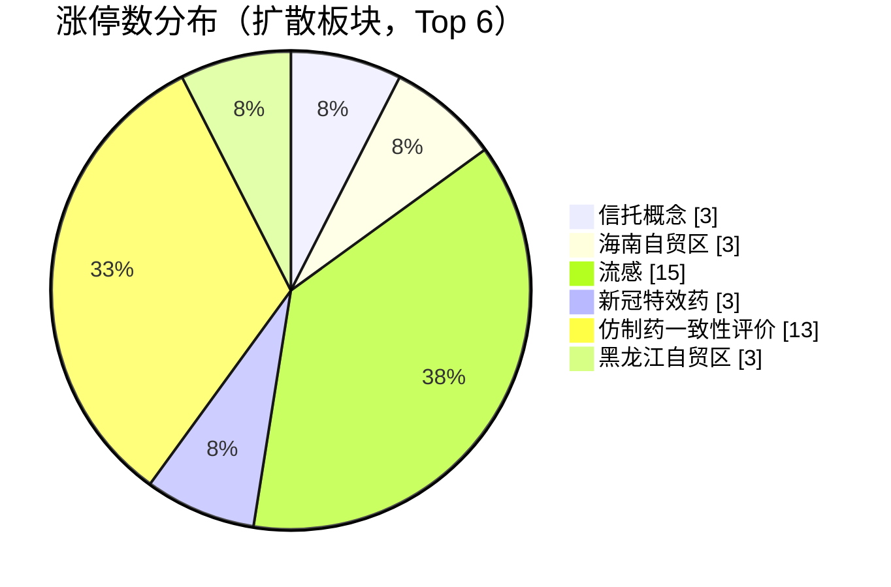
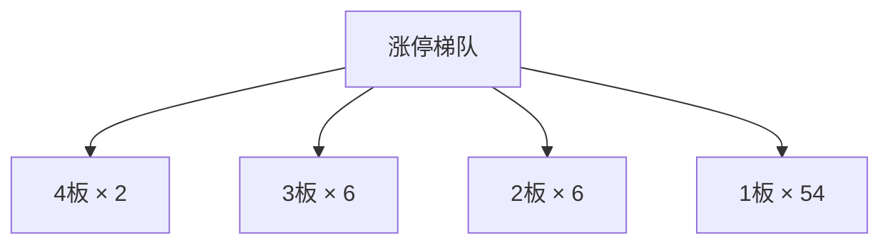
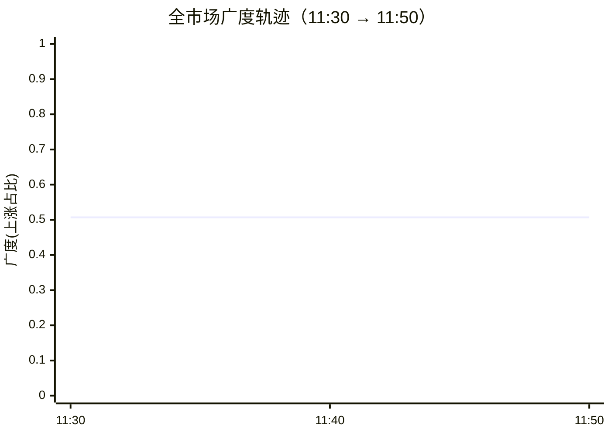

## 当日总览（截至 11:50）

> **结论**：全市场涨2824/跌2637（广度0.52）；涨停68/跌停3；中位涨幅+0.07%。 钱在：信托概念(涨停3/成分23，中位+0.92%)、海南自贸区(涨停3/成分30，中位+2.15%)、流感(涨停15/成分164，中位+2.13%)；零星涨停：巴黎奥运会概念(2)、青蒿素(1)、NMN概念(2)、大豆(1)、钛白粉概念(1)。 退潮：2024中报预增(跌停2)、西部大开发(跌停2)、5G(跌停1)。 梯队：4板×2、3板×6、2板×6、1板×54，最高4板。 预案：超买区 长华集团、中京电子、克来机电、宁波东力、九阳股份、汇洲智能、胜宏科技、金新农；已触发 福莱新材、中际旭创、宝鼎科技、光洋股份、华东重机、南亚新材、七匹狼；未到价 沪电股份、同星科技、寒武纪、联创电子、奥尼电子、浙文影业、行云科技、锋龙股份、科森科技、襄阳轴承、合锻智能、信科移动、魅视科技、艾艾精工、东方海洋。 较上一轮广度基本持平。

### 盘前路径对照

未定：当前盘前文件版本不早于开盘或本轮截止。不使用其他日期或其他文档补位。

### 板块扩散

> 口径：XTick 概念成分 × 全市场实时报价；分母 = 板块内有有效报价的成分数。排序用涨停密度（涨停数/有效成分数），已剔除宽基属性板块（全市场 432 个板块中剔 16 个）。

**扩散中（题材，按涨停密度排序）**

| 板块 | 涨停 | 有效成分 | 涨停密度 | 上涨广度 | 中位涨幅 | 相对全市场 | 成交(亿) |
|---|---|---|---|---|---|---|---|
| 信托概念 | 3 | 23 | 0.130 | 0.70 | +0.92% | +0.85% | 23 |
| 海南自贸区 | 3 | 30 | 0.100 | 0.77 | +2.15% | +2.08% | 38 |
| 流感 | 15 | 164 | 0.091 | 0.87 | +2.13% | +2.06% | 158 |
| 新冠特效药 | 3 | 33 | 0.091 | 0.88 | +1.29% | +1.22% | 40 |
| 巴黎奥运会概念 ⬦ | 2 | 22 | 0.091 | 0.86 | +0.88% | +0.81% | 22 |
| 青蒿素 ⬦ | 1 | 11 | 0.091 | 1.00 | +2.13% | +2.06% | 21 |
| 仿制药一致性评价 | 13 | 145 | 0.090 | 0.91 | +2.15% | +2.08% | 166 |
| 黑龙江自贸区 | 3 | 36 | 0.083 | 0.75 | +0.95% | +0.88% | 58 |
| NMN概念 ⬦ | 2 | 25 | 0.080 | 0.80 | +1.34% | +1.27% | 20 |
| 维生素 | 6 | 77 | 0.078 | 0.91 | +2.40% | +2.33% | 72 |
| 大豆 ⬦ | 1 | 15 | 0.067 | 0.87 | +1.82% | +1.75% | 8 |
| 钛白粉概念 ⬦ | 1 | 15 | 0.067 | 0.67 | +1.16% | +1.09% | 13 |

> ⬦ = 涨停 <3 只，零星个例，不构成扩散（不计入「钱在」判定）。



零星涨停板块（<3 只）：巴黎奥运会概念(2)、青蒿素(1)、NMN概念(2)、大豆(1)、钛白粉概念(1)

**退潮中（跌停集中）**

| 板块 | 跌停 | 有效成分 | 上涨广度 | 中位涨幅 |
|---|---|---|---|---|
| 2024中报预增 | 2 | 653 | 0.50 | +0.00% |
| 西部大开发 | 2 | 636 | 0.60 | +0.60% |
| 5G | 1 | 454 | 0.35 | -0.53% |
| 无人机 | 1 | 471 | 0.38 | -0.42% |
| AI视频 | 1 | 67 | 0.40 | -0.36% |
| 车联网(车路协同) | 1 | 292 | 0.42 | -0.18% |
| 低空经济 | 1 | 507 | 0.43 | -0.27% |
| 抖音概念(字节概念) | 1 | 218 | 0.43 | -0.19% |
| 手机游戏 | 1 | 56 | 0.45 | -0.16% |
| 物联网 | 1 | 471 | 0.45 | -0.17% |
| 氢能源 | 1 | 408 | 0.46 | -0.14% |
| AIGC概念 | 1 | 298 | 0.49 | +0.00% |

### 涨停梯队

> 最高 4 板 ｜ 涨停 68 ｜ 跌停 3 ｜ 炸板 17 ｜ 封板率 80.0% ｜ 打板成功率 21.88% ｜ 一进二 17.65% ｜ 二进三 24.00%

| 身位 | 家数 | 成员（涨幅/封单亿/首封） |
|---|---|---|
| 4板 | 2 | 克来机电 +9.99%/0.046亿/09:25；金新农 +10.11%/0.017亿/09:25 |
| 3板 | 6 | 杭州解百 +10.01%/0.047亿/09:30；九阳股份 +10.01%/0.020亿/09:45；汇洲智能 +10.12%/0.017亿/09:25；创源股份 +20.03%/0.015亿/10:15；宁波东力 +9.98%/0.014亿/09:30 |
| 2板 | 6 | 全筑股份 +10.13%/0.018亿/09:25；天圣制药 +10.08%/0.015亿/09:25；利君股份 +10.03%/0.011亿/09:30；*ST开元 +19.90%/0.001亿/10:18；*ST瑞茂 +10.91%/0.001亿/09:30 |
| 1板 | 54 | 德龙汇能 +10.02%/0.043亿/09:30；青山纸业 +9.88%/0.035亿/09:55；好当家 +10.09%/0.022亿/09:31；荣联科技 +10.05%/0.019亿/10:08；万事利 +19.96%/0.019亿/10:07 |



炸板 17 只（前几）：祖名股份(4次)、*ST启环(3次)、征和工业(3次)、中哲精化(2次)、ST文峰(2次)

### 预案池对照

| 票 | 池 | 板块 | 现价 | 涨幅 | 触发价 | 买区 | 风险位 | 判定 |
|---|---|---|---|---|---|---|---|---|
| 福莱新材 `605488.SH` | 执行池 | 机器人／执行器 | 51.21 | -0.47% | 51.45 | [51.19, 52.22] | 49.61 | **买区内** |
| 长华集团 `605018.SH` | 观察池 | 机器人／执行器 | 12.87 | +3.62% | — | [12.36, 12.61] | 11.98 | **超买区** |
| 中京电子 `002579.SZ` | 观察池 | PCB／覆铜板 | 16.61 | +2.53% | — | [16.12, 16.44] | 15.62 | **超买区** |
| 沪电股份 `002463.SZ` | 观察池 | PCB／覆铜板 | 82.31 | -2.16% | 84.13 | [83.71, 85.39] | 81.67 | **未到价** |
| 同星科技 `301252.SZ` | 观察池 | 国产算力／液冷 | 43.6 | +2.64% | 45.96 | [45.73, 46.65] | 42.92 | **未到价** |
| 寒武纪 `688256.SH` | 观察池 | 国产算力／液冷 | 930.6 | -4.06% | 1033.18 | [1028.01, 1048.68] | 964.79 | **未到价** |
| 中际旭创 `300308.SZ` | 观察池 | 光通信／CPO | 418.79 | +0.43% | 417.0 | [414.92, 423.25] | 389.39 | **已触发** |
| 克来机电 `603960.SH` | 观察池 | 光通信／CPO | 18.6 | +9.99% | — | [16.83, 17.16] | 16.3 | **超买区** |
| 联创电子 `002036.SZ` | 观察池 | 消费电子／端侧 | 5.24 | -2.24% | — | [5.33, 5.44] | 5.3 | **未到价** |
| 奥尼电子 `301189.SZ` | 观察池 | 消费电子／端侧 | 39.34 | -10.02% | 43.72 | [43.5, 44.38] | 41.47 | **未到价** |
| 浙文影业 `601599.SH` | 观察池 | AI应用／短剧 | 3.95 | -1.74% | 4.02 | [4.0, 4.08] | 3.88 | **未到价** |
| 行云科技 `300209.SZ` | 观察池 | 国产算力／液冷 | 22.18 | +2.16% | 25.76 | [25.63, 26.15] | 24.06 | **未到价** |
| 锋龙股份 `002931.SZ` | 观察池 | 机器人／执行器 | 45.47 | -2.65% | 46.71 | [46.48, 47.41] | 45.89 | **未到价** |
| 科森科技 `603626.SH` | 观察池 | 机器人／执行器 | 25.57 | -2.48% | 26.22 | [26.09, 26.61] | 25.28 | **未到价** |
| 襄阳轴承 `000678.SZ` | 观察池 | 机器人／执行器 | 19.02 | -2.86% | 19.58 | [19.48, 19.87] | 18.88 | **未到价** |
| 宝鼎科技 `002552.SZ` | 观察池 | PCB／覆铜板 | 27.94 | -0.21% | 28.0 | [27.86, 28.42] | 27.0 | **买区内** |
| 合锻智能 `603011.SH` | 观察池 | PCB／覆铜板 | 14.29 | -1.24% | 14.47 | [14.4, 14.69] | 13.96 | **未到价** |
| 宁波东力 `002164.SZ` | 观察池 | 机器人／执行器 | 21.7 | +9.98% | 19.73 | [19.63, 20.03] | 19.03 | **超买区** |
| 光洋股份 `002708.SZ` | 观察池 | 机器人／执行器 | 23.18 | +0.39% | 23.09 | [22.97, 23.44] | 22.57 | **已触发** |
| 九阳股份 `002242.SZ` | 观察池 | 情绪辨识／名字梗 | 38.56 | +10.01% | 35.05 | [34.87, 35.58] | 33.8 | **超买区** |
| 华东重机 `002685.SZ` | 观察池 | 情绪辨识／名字梗 | 8.97 | +0.22% | 8.95 | [8.91, 9.08] | 8.63 | **已触发** |
| 汇洲智能 `002122.SZ` | 观察池 | 摘帽／题材 | 3.59 | +10.12% | 3.26 | [3.24, 3.31] | 3.14 | **超买区** |
| 胜宏科技 `300476.SZ` | 观察池 | PCB／覆铜板 | 125.46 | +2.57% | 122.32 | [121.71, 124.15] | 118.33 | **超买区** |
| 南亚新材 `688519.SH` | 观察池 | PCB／覆铜板 | 145.1 | +0.10% | 144.95 | [144.23, 147.12] | 135.35 | **已触发** |
| 信科移动 `688387.SH` | 观察池 | 6G／通信 | 9.39 | -0.63% | 9.45 | [9.4, 9.59] | 8.82 | **未到价** |
| 魅视科技 `001229.SZ` | 观察池 | 国产算力／液冷 | 28.85 | -5.35% | — | [30.33, 30.94] | 30.13 | **未到价** |
| 艾艾精工 `603580.SH` | 观察池 | 消费电子／端侧 | 57.94 | -9.23% | 66.85 | [66.52, 67.85] | 64.46 | **未到价** |
| 金新农 `002548.SZ` | 观察池 | 农业／猪肉与水产 | 5.01 | +10.11% | 4.55 | [4.53, 4.62] | 4.39 | **超买区** |
| 东方海洋 `002086.SZ` | 观察池 | 农业／猪肉与水产 | 4.49 | -1.10% | 4.54 | [4.52, 4.61] | 4.38 | **未到价** |
| 七匹狼 `002029.SZ` | 观察池 | 情绪辨识／名字梗 | 6.74 | +1.05% | 6.67 | [6.64, 6.77] | 6.43 | **已触发** |

- **福莱新材** — 现价51.21 落在买区[51.19, 52.22]；仅价格位置对照，不代表完整入场条件确认；不能据此确认站稳，不授予下单权限
- **长华集团** — 现价12.87 已高于买区上沿12.61，不追高；仅价格位置对照，不代表完整入场条件确认；不能据此确认站稳，不授予下单权限
- **中京电子** — 现价16.61 已高于买区上沿16.44，不追高；仅价格位置对照，不代表完整入场条件确认；不能据此确认站稳，不授予下单权限
- **中际旭创** — 现价418.79 ≥ 触发价417.0；仅价格位置对照，不代表完整入场条件确认；不能据此确认站稳，不授予下单权限
- **克来机电** — 现价18.6 已高于买区上沿17.16，不追高；仅价格位置对照，不代表完整入场条件确认；不能据此确认站稳，不授予下单权限
- **宝鼎科技** — 现价27.94 落在买区[27.86, 28.42]；仅价格位置对照，不代表完整入场条件确认；不能据此确认站稳，不授予下单权限
- **宁波东力** — 现价21.7 已高于买区上沿20.03，不追高；仅价格位置对照，不代表完整入场条件确认；不能据此确认站稳，不授予下单权限
- **光洋股份** — 现价23.18 ≥ 触发价23.09；仅价格位置对照，不代表完整入场条件确认；不能据此确认站稳，不授予下单权限
- **九阳股份** — 现价38.56 已高于买区上沿35.58，不追高；仅价格位置对照，不代表完整入场条件确认；不能据此确认站稳，不授予下单权限
- **华东重机** — 现价8.97 ≥ 触发价8.95；仅价格位置对照，不代表完整入场条件确认；不能据此确认站稳，不授予下单权限
- **汇洲智能** — 现价3.59 已高于买区上沿3.31，不追高；仅价格位置对照，不代表完整入场条件确认；不能据此确认站稳，不授予下单权限
- **胜宏科技** — 现价125.46 已高于买区上沿124.15，不追高；仅价格位置对照，不代表完整入场条件确认；不能据此确认站稳，不授予下单权限
- **南亚新材** — 现价145.1 ≥ 触发价144.95；仅价格位置对照，不代表完整入场条件确认；不能据此确认站稳，不授予下单权限
- **金新农** — 现价5.01 已高于买区上沿4.62，不追高；仅价格位置对照，不代表完整入场条件确认；不能据此确认站稳，不授予下单权限
- **七匹狼** — 现价6.74 ≥ 触发价6.67；仅价格位置对照，不代表完整入场条件确认；不能据此确认站稳，不授予下单权限

### 盘面 vs 静态复盘 vs 消息面

| 维度 | 对象 | 静态基线（按事实日） | 今日盘面 | 关系 |
|---|---|---|---|---|
| 板块主线 | 国产算力／液冷 | R2 次线 score=68 涨停None（T-1 口径） | 盘面未见该板块成分票涨停 | **背离** |
| 板块主线 | 光通信／CPO | R2 次线 score=66 涨停None（T-1 口径） | 盘面未见该板块成分票涨停 | **背离** |
| 板块主线 | 消费电子／端侧 | R2 次线 score=63 涨停None（T-1 口径） | 盘面未见该板块成分票涨停 | **背离** |
| 板块主线 | 半导体设备／芯片 | R2 次线 score=60 涨停None（T-1 口径） | 盘面未见该板块成分票涨停 | **背离** |
| 板块主线 | AI应用／短剧 | R2 次线 score=55 涨停None（T-1 口径） | 盘面未见该板块成分票涨停 | **背离** |
| 板块主线 | 农业／猪肉与水产 | R2 次线 score=51 涨停None（T-1 口径） | 盘面未见该板块成分票涨停 | **背离** |
| 情绪阶段 | 降温 | R3 原生六态基线（事实日 2026-11-24） | 涨停68 跌停3 炸板率3.13% 打板成功率21.88% | **待研判** |
| 梯队结构 | 最高4板 | 未提供同口径前序梯队 | 今日 4板×2、3板×6、2板×6、1板×54；封板率0.8 炸板17只 | **待研判** |
| 预案验证 | 福莱新材(605488.SH) | 预案 机器人／执行器／leader／触发价51.45／买区[51.19, 52.22] | 买区内：现价51.21 落在买区[51.19, 52.22]；仅价格位置对照，不代表完整入场条件确认；不能据此确认站稳，不授予下单权限 | **印证** |
| 预案验证 | 长华集团(605018.SH) | 预案 机器人／执行器／leader／触发价None／买区[12.36, 12.61] | 超买区：现价12.87 已高于买区上沿12.61，不追高；仅价格位置对照，不代表完整入场条件确认；不能据此确认站稳，不授予下单权限 | **背离** |
| 预案验证 | 中京电子(002579.SZ) | 预案 PCB／覆铜板／leader／触发价None／买区[16.12, 16.44] | 超买区：现价16.61 已高于买区上沿16.44，不追高；仅价格位置对照，不代表完整入场条件确认；不能据此确认站稳，不授予下单权限 | **背离** |
| 预案验证 | 沪电股份(002463.SZ) | 预案 PCB／覆铜板／core_midcap／触发价84.13／买区[83.71, 85.39] | 未到价：现价82.31，触发价84.13，还差2.21%；仅价格位置对照，不代表完整入场条件确认；不能据此确认站稳，不授予下单权限 | **无响应** |
| 预案验证 | 同星科技(301252.SZ) | 预案 国产算力／液冷／watch_elastic／触发价45.96／买区[45.73, 46.65] | 未到价：现价43.6，触发价45.96，还差5.41%；仅价格位置对照，不代表完整入场条件确认；不能据此确认站稳，不授予下单权限 | **无响应** |
| 预案验证 | 寒武纪(688256.SH) | 预案 国产算力／液冷／core_largecap／触发价1033.18／买区[1028.01, 1048.68] | 未到价：现价930.6，触发价1033.18，还差11.02%；仅价格位置对照，不代表完整入场条件确认；不能据此确认站稳，不授予下单权限 | **无响应** |
| 预案验证 | 中际旭创(300308.SZ) | 预案 光通信／CPO／core_largecap／触发价417.0／买区[414.92, 423.25] | 已触发：现价418.79 ≥ 触发价417.0；仅价格位置对照，不代表完整入场条件确认；不能据此确认站稳，不授予下单权限 | **印证** |
| 预案验证 | 克来机电(603960.SH) | 预案 光通信／CPO／watch_elastic／触发价None／买区[16.83, 17.16] | 超买区：现价18.6 已高于买区上沿17.16，不追高；仅价格位置对照，不代表完整入场条件确认；不能据此确认站稳，不授予下单权限 | **背离** |
| 预案验证 | 联创电子(002036.SZ) | 预案 消费电子／端侧／watch_elastic／触发价None／买区[5.33, 5.44] | 未到价：现价5.24 低于买区下沿5.33；仅价格位置对照，不代表完整入场条件确认；不能据此确认站稳，不授予下单权限 | **无响应** |
| 预案验证 | 奥尼电子(301189.SZ) | 预案 消费电子／端侧／watch_elastic／触发价43.72／买区[43.5, 44.38] | 未到价：现价39.34，触发价43.72，还差11.13%；仅价格位置对照，不代表完整入场条件确认；不能据此确认站稳，不授予下单权限 | **无响应** |
| 预案验证 | 浙文影业(601599.SH) | 预案 AI应用／短剧／watch_elastic／触发价4.02／买区[4.0, 4.08] | 未到价：现价3.95，触发价4.02，还差1.77%；仅价格位置对照，不代表完整入场条件确认；不能据此确认站稳，不授予下单权限 | **无响应** |
| 预案验证 | 行云科技(300209.SZ) | 预案 国产算力／液冷／watch／触发价25.76／买区[25.63, 26.15] | 未到价：现价22.18，触发价25.76，还差16.14%；仅价格位置对照，不代表完整入场条件确认；不能据此确认站稳，不授予下单权限 | **无响应** |
| 预案验证 | 锋龙股份(002931.SZ) | 预案 机器人／执行器／watch_elastic／触发价46.71／买区[46.48, 47.41] | 未到价：现价45.47，触发价46.71，还差2.73%；仅价格位置对照，不代表完整入场条件确认；不能据此确认站稳，不授予下单权限 | **无响应** |
| 预案验证 | 科森科技(603626.SH) | 预案 机器人／执行器／watch／触发价26.22／买区[26.09, 26.61] | 未到价：现价25.57，触发价26.22，还差2.54%；仅价格位置对照，不代表完整入场条件确认；不能据此确认站稳，不授予下单权限 | **无响应** |
| 预案验证 | 襄阳轴承(000678.SZ) | 预案 机器人／执行器／watch／触发价19.58／买区[19.48, 19.87] | 未到价：现价19.02，触发价19.58，还差2.94%；仅价格位置对照，不代表完整入场条件确认；不能据此确认站稳，不授予下单权限 | **无响应** |
| 预案验证 | 宝鼎科技(002552.SZ) | 预案 PCB／覆铜板／watch／触发价28.0／买区[27.86, 28.42] | 买区内：现价27.94 落在买区[27.86, 28.42]；仅价格位置对照，不代表完整入场条件确认；不能据此确认站稳，不授予下单权限 | **印证** |
| 预案验证 | 合锻智能(603011.SH) | 预案 PCB／覆铜板／watch／触发价14.47／买区[14.4, 14.69] | 未到价：现价14.29，触发价14.47，还差1.26%；仅价格位置对照，不代表完整入场条件确认；不能据此确认站稳，不授予下单权限 | **无响应** |
| 预案验证 | 宁波东力(002164.SZ) | 预案 机器人／执行器／watch_elastic／触发价19.73／买区[19.63, 20.03] | 超买区：现价21.7 已高于买区上沿20.03，不追高；仅价格位置对照，不代表完整入场条件确认；不能据此确认站稳，不授予下单权限 | **背离** |
| 预案验证 | 光洋股份(002708.SZ) | 预案 机器人／执行器／watch_elastic／触发价23.09／买区[22.97, 23.44] | 已触发：现价23.18 ≥ 触发价23.09；仅价格位置对照，不代表完整入场条件确认；不能据此确认站稳，不授予下单权限 | **印证** |
| 预案验证 | 九阳股份(002242.SZ) | 预案 情绪辨识／名字梗／watch_elastic／触发价35.05／买区[34.87, 35.58] | 超买区：现价38.56 已高于买区上沿35.58，不追高；仅价格位置对照，不代表完整入场条件确认；不能据此确认站稳，不授予下单权限 | **背离** |
| 预案验证 | 华东重机(002685.SZ) | 预案 情绪辨识／名字梗／watch_elastic／触发价8.95／买区[8.91, 9.08] | 已触发：现价8.97 ≥ 触发价8.95；仅价格位置对照，不代表完整入场条件确认；不能据此确认站稳，不授予下单权限 | **印证** |
| 预案验证 | 汇洲智能(002122.SZ) | 预案 摘帽／题材／watch／触发价3.26／买区[3.24, 3.31] | 超买区：现价3.59 已高于买区上沿3.31，不追高；仅价格位置对照，不代表完整入场条件确认；不能据此确认站稳，不授予下单权限 | **背离** |
| 预案验证 | 胜宏科技(300476.SZ) | 预案 PCB／覆铜板／core_largecap／触发价122.32／买区[121.71, 124.15] | 超买区：现价125.46 已高于买区上沿124.15，不追高；仅价格位置对照，不代表完整入场条件确认；不能据此确认站稳，不授予下单权限 | **背离** |
| 预案验证 | 南亚新材(688519.SH) | 预案 PCB／覆铜板／watch／触发价144.95／买区[144.23, 147.12] | 已触发：现价145.1 ≥ 触发价144.95；仅价格位置对照，不代表完整入场条件确认；不能据此确认站稳，不授予下单权限 | **印证** |
| 预案验证 | 信科移动(688387.SH) | 预案 6G／通信／watch／触发价9.45／买区[9.4, 9.59] | 未到价：现价9.39，触发价9.45，还差0.64%；仅价格位置对照，不代表完整入场条件确认；不能据此确认站稳，不授予下单权限 | **无响应** |
| 预案验证 | 魅视科技(001229.SZ) | 预案 国产算力／液冷／watch／触发价None／买区[30.33, 30.94] | 未到价：现价28.85 低于买区下沿30.33；仅价格位置对照，不代表完整入场条件确认；不能据此确认站稳，不授予下单权限 | **无响应** |
| 预案验证 | 艾艾精工(603580.SH) | 预案 消费电子／端侧／watch／触发价66.85／买区[66.52, 67.85] | 未到价：现价57.94，触发价66.85，还差15.38%；仅价格位置对照，不代表完整入场条件确认；不能据此确认站稳，不授予下单权限 | **无响应** |
| 预案验证 | 金新农(002548.SZ) | 预案 农业／猪肉与水产／watch／触发价4.55／买区[4.53, 4.62] | 超买区：现价5.01 已高于买区上沿4.62，不追高；仅价格位置对照，不代表完整入场条件确认；不能据此确认站稳，不授予下单权限 | **背离** |
| 预案验证 | 东方海洋(002086.SZ) | 预案 农业／猪肉与水产／watch／触发价4.54／买区[4.52, 4.61] | 未到价：现价4.49，触发价4.54，还差1.11%；仅价格位置对照，不代表完整入场条件确认；不能据此确认站稳，不授予下单权限 | **无响应** |
| 预案验证 | 七匹狼(002029.SZ) | 预案 情绪辨识／名字梗／watch／触发价6.67／买区[6.64, 6.77] | 已触发：现价6.74 ≥ 触发价6.67；仅价格位置对照，不代表完整入场条件确认；不能据此确认站稳，不授予下单权限 | **印证** |
| 消息面对照 | 盘面热点板块 | R4 消息面（T-1 口径） | 实时快讯中命中热点板块关键词 4 条 | **印证** |

**分歧点（不掩盖）：**
- 板块主线·国产算力／液冷 → 背离：T-1 有辨识度但今日盘中无涨停响应，题材未获资金确认
- 板块主线·光通信／CPO → 背离：T-1 有辨识度但今日盘中无涨停响应，题材未获资金确认
- 板块主线·消费电子／端侧 → 背离：T-1 有辨识度但今日盘中无涨停响应，题材未获资金确认
- 板块主线·半导体设备／芯片 → 背离：T-1 有辨识度但今日盘中无涨停响应，题材未获资金确认
- 板块主线·AI应用／短剧 → 背离：T-1 有辨识度但今日盘中无涨停响应，题材未获资金确认
- 板块主线·农业／猪肉与水产 → 背离：T-1 有辨识度但今日盘中无涨停响应，题材未获资金确认
- 预案验证·长华集团(605018.SH) → 背离：仅研究对照，不授予交易权限
- 预案验证·中京电子(002579.SZ) → 背离：仅研究对照，不授予交易权限
- 预案验证·克来机电(603960.SH) → 背离：仅研究对照，不授予交易权限
- 预案验证·宁波东力(002164.SZ) → 背离：仅研究对照，不授予交易权限
- 预案验证·九阳股份(002242.SZ) → 背离：仅研究对照，不授予交易权限
- 预案验证·汇洲智能(002122.SZ) → 背离：仅研究对照，不授予交易权限
- 预案验证·胜宏科技(300476.SZ) → 背离：仅研究对照，不授予交易权限
- 预案验证·金新农(002548.SZ) → 背离：仅研究对照，不授予交易权限

### 全天广度轨迹

| 时点 | 涨 | 跌 | 广度 | 涨停 | 跌停 | 成交(亿) | 有效样本 |
|---|---|---|---|---|---|---|---|
| 1130 | 2824 | 2626 | 0.507 | 70 | 3 | 7,689 | 5573 |
| 1140 | 2824 | 2626 | 0.507 | 70 | 3 | 7,689 | 5573 |
| 1150 | 2824 | 2626 | 0.507 | 70 | 3 | 7,689 | 5573 |

> ⚠ **数据冻结段**：1130–1150 数值连续完全一致，说明行情源未刷新，**不是市场横盘**，该段不可解读为盘面变化。



### 观察建议（仅研究）

- **环境**：涨停 68.0 / 跌停 3.0，打板成功率 21.9%，一进二 17.6%。
- **方向**：今日形成实质扩散的是 信托概念（涨停3/成分23，密度0.130，中位+0.92%）、海南自贸区（涨停3/成分30，密度0.100，中位+2.15%）、流感（涨停15/成分164，密度0.091，中位+2.13%）。**需确认**：次日能否维持涨停家数且中位涨幅不掉队，否则只是普跌中的避险轮动。
- **零星**：巴黎奥运会概念(2只/22成分)、青蒿素(1只/11成分)、NMN概念(2只/25成分)、大豆(1只/15成分)、钛白粉概念(1只/15成分) 属零星个例，不视为题材，不据此选股。
- **回避**：2024中报预增（跌停2）、西部大开发（跌停2）、5G（跌停1） 板块中位跌幅深，趋势未止跌前不接。
- **身位**：最高 4 板。梯队有高度不等于可接力，需逐票核验封单稳定性与开板次数后再定。
- **预案**：长华集团（现价12.87 已高于买区上沿12.61，不追高；仅价格位置对照，不代表完整入场条件确认；不能据此确认站稳，不授予下单权限）、中京电子（现价16.61 已高于买区上沿16.44，不追高；仅价格位置对照，不代表完整入场条件确认；不能据此确认站稳，不授予下单权限）、克来机电（现价18.6 已高于买区上沿17.16，不追高；仅价格位置对照，不代表完整入场条件确认；不能据此确认站稳，不授予下单权限）、宁波东力（现价21.7 已高于买区上沿20.03，不追高；仅价格位置对照，不代表完整入场条件确认；不能据此确认站稳，不授予下单权限）、九阳股份（现价38.56 已高于买区上沿35.58，不追高；仅价格位置对照，不代表完整入场条件确认；不能据此确认站稳，不授予下单权限）、汇洲智能（现价3.59 已高于买区上沿3.31，不追高；仅价格位置对照，不代表完整入场条件确认；不能据此确认站稳，不授予下单权限）、胜宏科技（现价125.46 已高于买区上沿124.15，不追高；仅价格位置对照，不代表完整入场条件确认；不能据此确认站稳，不授予下单权限）、金新农（现价5.01 已高于买区上沿4.62，不追高；仅价格位置对照，不代表完整入场条件确认；不能据此确认站稳，不授予下单权限）。买区已错过，**不追高**；要参与需等新剧本，不能沿用原预案价位。
- **预案待检验**：沪电股份(触发价84.13，还差+2.21%)、同星科技(触发价45.96，还差+5.41%)、寒武纪(触发价1033.18，还差+11.02%)、联创电子(触发价—)、奥尼电子(触发价43.72，还差+11.13%)、浙文影业(触发价4.02，还差+1.77%)、行云科技(触发价25.76，还差+16.14%)、锋龙股份(触发价46.71，还差+2.73%)、科森科技(触发价26.22，还差+2.54%)、襄阳轴承(触发价19.58，还差+2.94%)、合锻智能(触发价14.47，还差+1.26%)、信科移动(触发价9.45，还差+0.64%)、魅视科技(触发价—)、艾艾精工(触发价66.85，还差+15.38%)、东方海洋(触发价4.54，还差+1.11%) 尚未触及触发价，剧本未被盘面检验，继续按原失效条件看。

<details>
<summary>原始截面与数据质量（折叠）</summary>

**跨源校验**

```json
{
  "xtick": {
    "up": 2824,
    "down": 2637,
    "n": 5586,
    "amount_yi": 7629.6
  },
  "rtk_snapshot": {
    "up": 2824,
    "down": 2626,
    "valid_n": 5573,
    "amount_yi": 7688.7,
    "up_limit": 70,
    "down_limit": 3
  },
  "note": "两源口径不同（XTick 全市场含全部票；rt_k 返回样本）"
}
```

**rt_k 截面（原始）**

```json
{
  "market": {
    "total": 5586,
    "up": 2824,
    "down": 2626,
    "flat": 123,
    "requested_n": 5586,
    "received_n": 5586,
    "valid_n": 5573,
    "missing_n": 13,
    "universe_requested_n": null,
    "population_scope": "returned_rows_not_verified_all_a_universe",
    "up_ratio": 0.5055,
    "legacy_up_ratio_placeholder": false,
    "up_ratio_is_observed": true,
    "up_ratio_all": 0.5055,
    "up_ratio_valid": 0.5067,
    "up_ratio_denominator": "requested_n",
    "degraded": false,
    "limit_known_n": 5573,
    "limit_unknown_n": 0,
    "limit_counts_complete": true,
    "limit_source_errors": [],
    "up_gt3": 388,
    "up_gt5": 144,
    "up_limit": 70,
    "down_gt3": 580,
    "down_gt5": 154,
    "down_limit": 3,
    "amount_yi": 7688.7,
    "amount_sum_overflow": false,
    "amount_valid_n": 5573,
    "amount_missing_n": 0
  },
  "source_time_quality": {
    "quote_age_min_seconds": 2.044327,
    "quote_age_max_seconds": 61.044327,
    "source_age_limit_seconds": null,
    "freshness_status": "age_limit_not_configured",
    "age_reference_at": "2026-11-25T11:50:58.044327+08:00"
  },
  "trading_authorized": false
}
```

</details>

## 分时研判记录

### 10:05 研判增量

- **趋势**：数据轮 10:00（今日首份完整分析——0930/0940/0950 三轮分析层降级缺失，跨轮对比统一用快照 `up_ratio_valid` 同口径）。开盘是恐慌价：09:30 仅 893 只红、广度 0.161（rt_k 有效样本 5560），40 分钟内修复到 09:40 的 0.579，09:50 回吐 0.516，10:00 再抬到 0.560（ups 3123/down 2302，成交 4295.2 亿，样本 5573 无降级）。**修复发生过、当前未延续**：峰值 0.579 仍在 10:00 之上未被吃掉。涨停口径 15→34→33→**43**（情绪层 ztnum 42、跌停 4、炸板 10、封板率 0.808），涨停在增而广度横着走，是强势集中在补涨方向，不是普涨。接力温度偏低：打板成功率 20.31%、1进2 仅 14.71%、2进3 20%、3进4 75%、**4进5 为 0**——高度天花板就压在 4 板（4板×3/3板×5/2板×5/1板×29）。

- **轮动**：跷跷板方向已经换人，不是预案里那两张牌。**进钱**：医药生物（申万一级 10 涨停/509 家、广度 0.78、中位 +1.24%、相对全市场 +0.95%），细分里仿制药一致性评价 10/145、广度 0.91、中位 +2.11%、相对 +1.82%，流感 9/164、广度 0.884、相对 +1.83%，医疗器械概念 8/417，新冠特效药广度 0.94；商贸零售同强（5/100、广度 0.85、相对 +1.93%，杭州解百 3 板）。**失血**：电子（申万一级 1 涨停/522 家、广度 0.224、中位 −1.23%、相对 −1.52%）、人形机器人（3/482、广度 0.274、相对 −0.99%）、液冷服务器（0 涨停/240、相对 −0.95%）、CPO（1/230、广度 0.335）、存储芯片（0/203、广度 0.153、相对 −2.08%）。全市场中位 +0.29%，科技三线全部跑输大盘——这是**科技→医药/商业内需**的高低切，不是同一个池子里的分歧。消息面同向：10:00:10 芯片股集体下跌（华虹 −8%、北方华创 −5%）、10:00:45 台股跌 7%；两条快讯时点**晚于本截面报价**，其杀伤需 10:10 轮验证，不作为本轮的定价依据。

- **剧本**：预案主线（机器人／执行器 + PCB／覆铜板）与盘面主线错位，**今天不是预案票跌了，是钱换了方向**。① 执行池唯一票福莱新材：竞价 52.15（+1.36%、量 117.9 万股、量比 3.31）**曾落在 T1 区间 50.68~52.47 内且在买区 51.19~52.22 上方**，开盘冲 53.42（+3.83%）后单边下滑 52.91→51.15→50.88（rt_k 10:00，XTick 同步口径 50.79/−1.28%），**现价已跌破买区下沿 51.19**——买区内无承接，原剧本「回踩买区放量接」事实上不成立；距 seesaw 触发1 线 **50.68** 只剩 0.1~0.3 元，止损 49.61 未破但缓冲已薄（预案预算 6%、max_positions 1，no_trade=false、autonomous_trading_enabled=false、requires_user_confirmation=true，研究口径不变）。② 机器人温度计长华 4 板封着但**封单仅 0.015 亿（150 万）、成交 1.48 亿**——低换手一字锁价，不是资金强度；宁波东力 3 板开板 1 次、封单 0.021 亿；光洋 +3.33%（从 09:40 的 +7.62% 回落）、锋龙 −1.03%（转负）。seesaw 触发2 的三个前置（长华开板、宁波/光洋/锋龙同向转弱）已现三分之二。③ PCB：中京现 +3.40% **未封板，4 板高度中断**；沪电 82.38 距触发价 84.13 差 2.12%，09:50 反抽到 −0.21% 后又落回 −2.03%，仍是「资金在、价格不认」；胜宏 +1.14%、南亚 +0.62%、中际旭创 +0.88%、信科 +0.74% 都已进触发区，但板块广度只有 0.335/0.28——**有价格修复，无扩散确认**。

- **下一步看**：① 福莱 **50.68** 为当日失效分界，破位即 seesaw 触发1 成立，机器人执行方向归零、不拿后排补位；即便回到 51.19 上方，也须机器人红盘 ≥3 家 + 长华封住同时成立才谈剧本重建。② 长华 0.015 亿封单能否撑住——**开板是唯一确认点**，开板不回封 = 整组降档。③ 医药是真题材还是避险轮动：仿制药一致性评价维持 **≥10 家涨停且广度 ≥0.85**（当前 10/0.91）；10:10—10:20 若涨停掉到 ≤7 家或广度跌破 0.80 → 判为普跌中的避险，不追。④ 科技侧开关：电子申万一级广度 0.224、涨停 1 家，10:10 若广度仍 <0.30 且涨停 0 → 机器人/PCB/CPO 当日一律不参与。⑤ 全市场跌停 4 家、广度 0.560：跌停 ≥8 或广度 <0.45 = 修复失败，全面退回观察。⑥ 中京回封 + 沪电站上 84.13 同时成立，才算 PCB 高度与容量同步修复，缺一不算。

### 10:15 研判增量

- **趋势**：本轮口径＝10:10 分析（报价 10:11:04、有效样本 5573、`errors` 空）＋ 10:17 单票核价，两个时点分列不拼接。广度 0.5604→**0.6706**，已超过 09:40 的首峰 0.579（今日轨迹 0.1606→0.5790→0.5162→0.5604→0.6706），涨停 42→52（rt_k 涨停口径 43→53）、跌停 4→3、炸板 10→9、封板率 0.808→0.853，1 板 29→39。上行面确实在扩散，但**高度没有跟上**：4 板仍 ×3、4进5 依旧 0、1进2 14.71% 未动，增量全在 1 板。更关键的是量能逐段递减——每 10 分钟增量 1740.6亿→1094.6亿→800.3亿→**667.2亿**（累计 4962.4 亿），广度新高是缩量抬起来的，属于承接回补而非新钱进场；广度可以继续走，但修复质量要按量验。

- **轮动**：上一轮"科技→医药/商业内需"的高低切，本轮应改写为**普涨＋相对强弱拉开**，不是整块切换。领涨组守住且更厚：医药生物 涨停 10→12、广度 0.780→0.815，前一轮自己设的尺子（仿制药一致性评价/流感 涨停≥10、广度≥0.85）达标（11/0.903、11/0.896），但相对全市场由 +1.82%/+1.83% 收窄到 **+1.64%/+1.74%**——仍领涨，领先幅度被普涨摊薄。商贸零售/商业贸易 涨停 5→7、广度 0.85→0.89、商业贸易广度 0.9425，是当前扩散最完整的一组。失血组回血但仍是相对最弱：电子 广度 0.224→0.439、相对 −1.52%→**−0.96%**，涨停仍只有 1 家；计算机 涨停 1→4、广度 0.577→0.686、相对 0.01%→0.00%；通信 广度 0.568→0.773、相对 −0.05%→+0.45%。结论：科技三线（机器人/PCB/CPO）是被大盘 β 拉起来的，相对强度还没回正，不构成资金回补确认。

- **剧本**：原预案 09:02 生成，其市场仓位建议 `valid_until` 为 **10:00，已过期**；`no_trade=false` 但 `autonomous_trading_enabled=false`、`requires_user_confirmation=true`、预算 0.06、max_positions 1、账户未核——以下全部只是研究对照，不授予任何买入许可。① **福莱新材（唯一执行池票）本轮判据被改写两次**：10:10 截面 52.25 在买区上沿 52.22 之上（"超买区"）；同源分钟线显示它 09:55 最低 **50.15**、10:01 收 50.82，10:02 起才反弹 51.30→10:09 51.76→10:12 最高 **52.60**，随后 6 分钟回落 51.55→**10:17 51.25**，只比买区下沿 51.19 高 0.06 元。"回到买区"是事实，"站稳"不成立，10:10 的"超买区"判定已被 10:12 之后的回吐推翻。原入场条件里"机器人同向≥1只同步走强"可观察到（长华 13.66 封 4 板、宁波东力 21.70 封 3 板、光洋 24.16 +4.63%、锋龙 47.06 +0.75%）；"板块红盘≥3家"本轮 analysis 只输出 hot/cold 前 12 板块、**机器人概念广度未核**，不能替它算成立；入场窗口 09:30-10:30 只剩 15 分钟。② 长华 4 板封单 0.014 亿、低换手锁价，仍不是资金强度；seesaw 触发2（长华开板不回封＋宁波/光洋/锋龙同向转弱）本轮**不成立**——长华没开板、宁波封着、光洋与锋龙由跌转涨，上一轮"已现三分之二"已被反转。③ PCB：中京 16.98（+4.81%）未封（涨停价 17.82），4 板高度中断未修复；沪电 10:10 83.88 在买区，10:17 单票核价 **84.21**，仅越过触发价 84.13 约 0.08 元——一次越线不算确认，seesaw 触发3 要求的"中京回封＋至少 1 家封板"未出现，PCB 剧本仍未兑现。④ seesaw 触发1（福莱跌破 50.68 或 49.61）**不成立**：全段最低 50.15 未到 49.61，且已收回 51 上方。

- **下一步看**：① 福莱 **51.19** 是当下真分界：10:30 窗口内收不回 51.45（触发价）上方，原买点剧本按失效处理，不下移买区接弱；破 **50.68** 则 seesaw 触发1 成立，机器人执行方向当日归零；52.22 之上仍不追（10:12 的 52.60 已证明站不住）。② 机器人组"红盘≥3家"要等下一轮 analysis 真的给出概念广度才算核到，在此之前记"未核"，不据此补条件。③ 沪电要谈 PCB 修复，必须同时出现 **中京回到 17.82 涨停＋PCB 至少 1 家封板**，缺一不算。④ 修复质量看量：10:20 截面 10 分钟增量若 <600 亿，广度即使 ≥0.65 也只是缩量修复；涨停回落到 <50 或炸板回升 >12 只＝强势衰减。⑤ 医药的延续尺子就用它自己定的：仿制药一致性评价/流感 涨停 ≥10 家且广度 ≥0.85（现 11/0.903、11/0.896），跌破即按"普涨里的跟涨"处理。⑥ 科技转正门槛：电子涨停 ≥3 且相对全市场转正（现 1 家 / −0.96%），否则机器人/PCB/CPO 一律只算观察。⑦ 全场失效线不变：跌停 ≥8 或广度 <0.45；当前 3 家 / 0.6706，修复未失败。⑧ 数据边界：10:10 分析报价年龄 2.9-58.9 秒、10:17 三个单票价为独立核价时点；viking 与本轮无关的旧上下文未参与判定。
---
### 10:20 截面

### 盘前路径对照

未定：缺少绑定本轮的路径对照，不借用其他时点。

返回样本: 涨3242/跌2202 广度0.58（有效样本分母） ｜ 返回5586/有效5573/缺失13；全A覆盖未核验 ｜ 涨跌停已确认计数: 涨停57 跌停3；边界已知样本5573/未知样本0（未知不等于0） ｜ 成交5433.2亿（金额缺失0，求和溢出False） ｜ 数据质量: 返回样本可用（非全A覆盖保证） ｜ 仅供市场参考，不授予交易权限；D1预算/no_trade/个股资格原样有效 ｜ D1预算上下文: {"market_context": {"emotion_cycle": {"alternative": "降温", "as_of": "2026-11-25T06:06:17.841721+08:00", "display_prior": {"from_phase": "降温", "kind": "rounded_display_percent", "missing_cells": [], "outside_six": [], "percent": {"修复": 11.0, "冰点": 7.0, "升温": 16.0, "退潮": 31.0, "降温": 17.0, "高潮": 17.0}, "raw_cells": {"修复": "11%", "冰点": "7%", "升温": "16%", "退潮": "31%", "降温": "17%", "高潮": "17%"}, "shown_six_percent_sum": 99.0, "uncovered_mass": null}, "fact_date": "20261124", "first_choice": "退潮", "forecast_target_date": "20261125", "historical_first": "退潮", "intraday_status": "missing", "phase": "降温", "phase_name": "降温", "phase_schema": "lianban_six_v1", "rationale": "保持基础首位：事实日放量未换普涨，广度从83.63%降至35.01%，昨日涨停池开盘中位+3.72%，盘中中位0%，旧双5板失守且未回封多；隔夜纳指/标普回落，缺已核的广谱利好及发布后可持续价量联动。", "same_scene": {"consecutive_bucket": "第1天", "display_destinations": "退潮34% / 高潮17%", "from_phase": "降温", "sample_count": 82, "uncovered_mass": null}, "strongest_counterevidence": "跌停仅2，昨封板池仍109/146收红且30只续板，二板数量增加、道指上涨，对全面恶化构成最强反证。若局部奖励保持而广度仍不能扩开，降温比修复或高潮更贴合。", "trade_permission": "仅作市场背景，不授予交易权限"}, "four_quadrant": {"基本面估值": "逐票差异大，不作全局否决：福莱PE224.44/PS4.55（极贵、Q3净利-13.17%）、长华PE161.43/净利-96.95%、中京亏损F3/F4/F9/F10四项红旗、沪电PE24.19且净利+106.87%；机器人两支都是估值极贵的高度/换手票，只能短线博弈不能当价值买入；PCB容量的估值相对合理但价格未承接。", "情绪": "原生六态=降温、事实日2026-11-24、盘中观察缺失（intraday_status=missing）；展示先验退潮31%/降温17%/高潮17%/升温16%/修复11%/冰点7%（页面取整、合计99%，不归一）；同景『降温第1天、年线下』82例，历史首位退潮34%、次位高潮17%。事实面：涨停55/跌停2、炸板率55.28%、最高4板、旧双5板断板收跌、昨板池109/146红且开盘溢价中位+3.72%、盘中中位0%。温度在往下，但还没到冰点。", "结构": "机器人19家涨停仍是第一主线（score77），但结构是『长华3板一字锁价（成交极低）+福莱2板换手（10.08亿）』，真实筹码在福莱；PCB（74）资金最实（5日+151.87亿）却价格回吐、高度只有2家涨停且中京一字4板，属『钱在、价不认』；算力6→7家是少数逆向扩散、液冷5日-97.27亿；CPO容量正资金但开收-9.97%。T+1结构上，昨天收益主要在开盘前形成（盘中中位0%），今天买=押次日接力，只有换手核心有次日被接的筹码基础。", "综合": "结论：只做机器人换手核心的一只条件候选（福莱6%），不追3板一字（长华）、不接R6四项红旗的4板（中京）、不接破位容量（沪电）；市场建议上限15%、初试6%，其余保留等承接与扩散确认。", "资金": "局部、分方向：11/24东财电子+64.73亿、印制电路板+33.92亿（5日+151.87亿）、元件+30.47亿/5日+152.72亿；但计算机-22.95亿/5日-102.62亿。机器人宽概念当日+20.80亿而5日-117.18亿、人形+8.90/-38.18、执行器-1.49亿、同花顺宽机器人-58.24亿——当日有回流、五日仍净出。个股层：沪电5日+29.18亿、中京+9.96亿、福莱+3.87亿（双口径一致），长华仅+0.60亿。钱在容量与换手核心，不在高度锁价票。"}, "market_facts": {"breadth": {"down": 3498, "flat": 126, "median_pct": -0.6688, "n": 5576, "trade_date": "20261124", "turnover_yi": 16678.004453, "up": 1952}, "fact_date": "20261124", "failed_seal_rate_pct": 55.28, "indexes": {"000001.SH": 0.2662, "000016.SH": 0.4487, "000300.SH": 0.1397, "000688.SH": 1.8085, "000852.SH": -0.2289, "000905.SH": -0.2702, "399001.SZ": -0.2943, "399006.SZ": -0.0531}, "ladder": {"2": 25, "3": 4, "4": 1}, "limit_down": 2, "limit_up": 55, "pool_open_median_pct": 3.721, "pool_open_to_close_median_pct": 0.0, "prior_limit_cohort": {"cohort_date": "20261123", "definition": "前一交易日非ST涨停样本的次日收盘涨跌；不等同开盘溢价", "median_pct": 3.2626, "n": 146, "source": "tushare.limit_list_d/daily/stock_basic", "trade_date": "20261124", "up": 109}}, "overseas": {"note": "隔夜SOX回吐、纳指/标普回落；R4 E20261125_SOX（行业级：海外AI硬件/光通信CPO/存储/半导体设备/PCB覆铜板）与E20261125_NVREG（议员质疑英伟达复职，行业级）构成对PCB/CPO/半导体的直接压制。", "source": "R4 top_events + R7 overseas_core_stocks"}, "structure": "今日更可能怎么走：先看昨天涨停池那109/146只红盘和机器人前排能不能守住，再靠承接分出方向——首选退潮（降温第1天同景历史首位），备选才是降温内的局部接力。", "style": "震荡分化型", "style_note": "收盘55涨停且有低位接力并不自动等于主线扩散。广度缩至35.01%、旧高标负反馈、未回封陡升、指数与个股分化，故五类中最接近震荡分化型；不是按20–40阈值机械归类。跌停仅2且指数不齐跌，排除崩溃退潮型；高度4和炸板55.28%排除连板情绪型；市场放量且封板仍多，不属防御观望型。"}, "no_trade": false, "risk_limits": {"block_prefixes": ["920"], "block_st": true, "kill_switch_file": "data/runtime/KILL_SWITCH", "max_buy_orders_per_day": 1, "max_orders_per_symbol_per_day": 2, "max_positions": 1, "max_single_sector_pct": 0.06, "max_single_stock_pct": 0.06, "target_total_position_pct": 0.06}, "trade_date": "20261125"} ｜ 报价年龄上限未配置，未验证新鲜；时点质量: {"age_reference_at": "2026-11-25T10:21:04.783016+08:00", "freshness_status": "age_limit_not_configured", "quote_age_max_seconds": 88.783016, "quote_age_min_seconds": 2.783016, "source_age_limit_seconds": null} ｜ 预案池热点: 汇洲智能+10.12%、金新农+10.11%、九阳股份+10.01%、克来机电+9.99%、长华集团+9.98%

| 票 | 池 | 现价 | 涨幅 | 状态 |
|---|---|---|---|---|
| 福莱新材 `605488.SH` | execution_pool | 51.03 | -0.82% | down |
| 长华集团 `605018.SH` | watch_pool | 13.66 | +9.98% | limit_up |
| 中京电子 `002579.SZ` | watch_pool | 16.94 | +4.57% | up |
| 沪电股份 `002463.SZ` | watch_pool | 83.8 | -0.39% | down |
| 同星科技 `301252.SZ` | watch_pool | 45.53 | +7.18% | up |
| 寒武纪 `688256.SH` | watch_pool | 945.52 | -2.52% | down |
| 中际旭创 `300308.SZ` | watch_pool | 422.67 | +1.36% | up |
| 克来机电 `603960.SH` | watch_pool | 18.6 | +9.99% | limit_up |
| 联创电子 `002036.SZ` | watch_pool | 5.39 | +0.56% | up |
| 奥尼电子 `301189.SZ` | watch_pool | 40.41 | -7.57% | down |
| 浙文影业 `601599.SH` | watch_pool | 3.94 | -1.99% | down |
| 行云科技 `300209.SZ` | watch_pool | 21.99 | +1.29% | up |
| 锋龙股份 `002931.SZ` | watch_pool | 45.93 | -1.67% | down |
| 科森科技 `603626.SH` | watch_pool | 25.55 | -2.56% | down |
| 襄阳轴承 `000678.SZ` | watch_pool | 18.51 | -5.46% | down |
| 宝鼎科技 `002552.SZ` | watch_pool | 28.32 | +1.14% | up |
| 合锻智能 `603011.SH` | watch_pool | 14.4 | -0.48% | down |
| 宁波东力 `002164.SZ` | watch_pool | 21.7 | +9.98% | limit_up |
| 光洋股份 `002708.SZ` | watch_pool | 23.49 | +1.73% | up |
| 九阳股份 `002242.SZ` | watch_pool | 38.56 | +10.01% | limit_up |
| 华东重机 `002685.SZ` | watch_pool | 8.91 | -0.45% | down |
| 汇洲智能 `002122.SZ` | watch_pool | 3.59 | +10.12% | limit_up |
| 胜宏科技 `300476.SZ` | watch_pool | 127.08 | +3.89% | up |
| 南亚新材 `688519.SH` | watch_pool | 147.1 | +1.48% | up |
| 信科移动 `688387.SH` | watch_pool | 9.43 | -0.21% | down |
| 魅视科技 `001229.SZ` | watch_pool | 28.72 | -5.77% | down |
| 艾艾精工 `603580.SH` | watch_pool | 59.6 | -6.63% | down |
| 金新农 `002548.SZ` | watch_pool | 5.01 | +10.11% | limit_up |
| 东方海洋 `002086.SZ` | watch_pool | 4.58 | +0.88% | up |
| 七匹狼 `002029.SZ` | watch_pool | 6.73 | +0.90% | up |


### 10:25 研判增量

- **趋势**：本轮口径＝10:20 分析（报价 10:19:36–10:21:04，有效样本 5573，涨停梯队与情绪取 XTick）＋ 10:27 三只重点票分钟线核价，两个时点分列不拼接。**修复峰值没守住**：广度 0.6706（10:10）→ **0.5817**（同分母 5573），涨 3737→3242、跌 1715→2202、涨超3% 496→388、跌超3% 167→271；而涨停 53→**57**（情绪层 ztnum 57）、跌停 3→3、炸板 9→10、封板率 0.8525→0.8507、最高仍 4 板（克来机电/金新农/长华集团）。**广度掉、涨停增＝强势集中，不是普跌**。更关键的是量：10 分钟增量 667.2 亿→**470.8 亿**（累计 5433.2 亿），是今日最小的一段增量，而广度恰在这段缩量里从峰值回落——上一轮判的"缩量抬起来的修复"，这轮给出了后半句：抬上去守不住。晋级温度同步偏冷：1进2 17.65%、2进3 24%、3进4 75%、**4进5 仍为 0**，增量仍全在 1 板（42 只）。
- **轮动**：跷跷板不是"科技↔其他"两块，而是**内需消费↑ / 科技制造↓**，且是缩量内部腾挪，不是新钱进场。进钱且**相对强度还在扩大**的一组：商业贸易 涨停 6→7、相对 +1.84%→**+2.13%**（广度 0.943→0.908 仍最高）；商贸零售 7→8、相对 +1.78%→+1.83%（董事长 100 家、广度 0.85，杭州解百 3 板、国芳集团 1 板）；农林牧渔 4→5、相对 +0.68%→+1.09%；社服 2→3、食品/纺服相对分别 +0.48%/+0.80%、房地产 1 涨停/相对 +1.31%。医药生物 涨停 12→**13**（全场第一）、相对 +0.75%→**+0.87%**，但广度 0.815→0.772、成员 509——**头部在涨、扩散在收**。失血加剧：电子 广度 0.439→**0.293**、相对 −0.96%→**−1.37%**、涨停仍 1 家，而它成交 **1405 亿（约占全市场 26%）**，钱最多、价最不认；机械设备 0.629→0.485、通信 0.773→0.625、计算机 0.686→0.588、汽车 0.602→0.456、电力设备 0.510→0.409。预案埋伏的 PCB/CPO 一条都没接棒（下面剧本）。
- **剧本**：预案 09:02 生成，`market_position_advice.valid_until`＝**10:00，已过期**；`no_trade=false` 但 `autonomous_trading_enabled=false`、`requires_user_confirmation=true`、预算 0.06、max_positions 1、账户未核——以下只是研究对照，不授予任何买入许可。① **福莱新材（唯一执行池票）判"窗口过期、未兑现"**：10:20 报价 51.02（−0.84%），跌破买区下沿 51.19、距触发价 51.45 差 0.84%；分钟线 10:12 冲 52.60 后逐级回吐至 10:20-10:23 的 50.97，10:27 核价 51.40 只回到买区内、仍站不上 51.45。原条件要求"09:30-10:00 在 51.19~52.22 成交＋机器人同向≥1 只走强＋板块红盘≥3"，时间窗已过、机器人概念广度本轮仍未核（bk 概念层抓取失败，见下）→ 按失效处理，**不下移买区接弱**。② **PCB 没接棒**：中京电子 10:20 +4.38%（16.89）、10:27 16.93，涨停价 17.82 **开板未回封**；沪电 10:20 83.85 低于触发价 84.13（＝昨收），10:17 曾越线到 84.21，10:27 回落 83.36——**一次越线不算确认，现在已掉回线下**。seesaw 触发3（中京回封＋PCB 至少 1 家封板）不成立，触发1（福莱破 50.68/49.61）也未成立（日内最低仍是 50.15 一带）。③ **预案池内部是"冲高回落"不是"集体转强"**：30 票中 5 只涨停（汇洲智能 +10.12%、金新农 +10.11%、九阳股份 +10.01%、克来机电 +9.99%、长华 +9.98%）；10:10→10:20 判定迁移有 4 只从"已触发"退回（同星科技 9.65%→7.16% 未到价、锋龙 0.75%→−1.71%、华东重机 0.00%→−0.56%）、2 只从"已触发"退回买区内（合锻、信科），同时 4 只新进触发区（中际旭创 422.0≥417、宝鼎 28.32≥28.0、南亚 147.01≥144.95、东方海洋 4.59≥4.54）——越线多数是瞬时，**"已触发"只证明价格位置，不证明站稳，更不是买点**。
- **下一步看**：① 福莱 **51.45** 是当日真分界（10:30-11:00 收不回即按剧本失效），**50.68** 破位则 seesaw 触发1 成立、机器人执行方向当日归零，52.22 之上仍不追。② 大盘修复是否还在：10:30 截面 `up_ratio_valid` 需 ≥0.60 且涨停 ≥57；跌破 **0.50** 或跌停 ≥8 即判修复失败、全面退回观察（现 0.5817 / 涨停 57 / 跌停 3）。③ 量能闸门：下一个 10 分钟增量若仍 ≤470 亿，广度任何回升都只算缩量修复，不改"强势集中"定性。④ 医药延续尺子用它自己的数：涨停 ≥10 且广度 ≥0.75（现 13 / 0.772），跌破即按普涨跟涨处理，不追高。⑤ 内需消费是当前唯一"扩散完整＋相对扩大"的组合：商贸零售涨停 ≥8 且广度守住 0.80（现 8 / 0.85）才继续算领涨；科技转正门槛＝电子广度 ≥0.40 且涨停 ≥3（现 0.293 / 1），未达标前机器人、PCB、CPO 一律只算观察。⑥ **数据边界（本轮新增缺口）**：10:20 分析 `errors` 非空（`bk_agn: IncompleteRead`），概念板块层不可用，渲染脚本因此降级——md 顶部"当日总览"仍停在 10:10，本轮板块结论**只用申万一级 sw1 口径**（68 板块、有分母、剔除宽基）；机器人概念广度、概念纯度本轮**未核**，不拿缺失当 0，也不据此补条件。

### 10:35 研判增量

- **趋势**：本轮口径＝10:30 分析（快照报价 10:31、返回 5586/有效 5573、`errors` 空；概念板块层 bk_agn 已恢复，10:20 的 IncompleteRead 缺口本轮补齐）＋10:36 单票分钟线核价，两个时点分列不拼接。广度 0.5817→**0.6034**（涨 3242→3363、跌 2202→2095），涨停 57→**58**（1板 43、2板 6、3板 6、4板 3），跌停 3、炸板 10、封板率 0.8529、最高仍 4 板、**4进5 仍为 0**。这是"广度回来了、量更缩了"：10 分钟增量 470.8→**403.9 亿**（累计 5837.1 亿），今日六段增量 1740.6→1094.6→800.3→667.2→470.8→403.9 逐段递减，**本轮回升站在全天最薄的一段量上**——定性仍是缩量修复，不是新钱进场。涨停只 +1 而广度 +2.2 个百分点：增量落在 1 板与中位股，强势梯队没有扩容。（渲染总览另取了一次报价，涨3405/跌2053、广度0.62，与快照差 1 个百分点内，属同一时段不同取数时刻，不算数据冻结。）

- **轮动**：内需＋医药扩大相对优势、科技制造逆着大盘修复继续失血，跷跷板更陡不是更缓。**① 医药**：申万医药生物 涨停 13→**14**、广度 0.772→0.794、相对 +0.87%→**+1.14%**；概念层仿制药一致性评价 **12/145**（涨停 +1，相对 +1.64→+2.06）、流感 **13/164**（+2，相对 +1.74→**+2.18**）、医美概念 6/96 广度 0.875、消毒剂 4/61 广度仅 0.72（组内最弱）。催化归因是**研报不是快讯**：10:30:23 长城证券《中药行业业绩蓄势待发、27 年看好内需中高壁垒标的》**时点晚于价格**，属先涨后见报，且口径是 27 年不是当日，只解释持续性预期、不构成本轮定价依据。**② 内需**：商业贸易 7/87、广度 **0.954**、相对 **+2.24%**（三连扩）；商贸零售 8/100、广度 0.88、相对 +1.96%；农林牧渔 5/113 相对 +1.09→+1.30%；食品饮料 广度 0.717→**0.827**、相对 +0.53→+0.84（新增扩散）。**③ 科技制造**：电子 广度 0.293→**0.266**、相对 −1.37%→**−1.46%**、涨停仍 1 家——全市场广度在涨它在跌，这是真分歧不是 β；通信 0/128、相对 +0.14%→**−0.09%** 翻负；机械设备 0.489/相对 −0.55%、电力设备 0.457/−0.67%、汽车 0.489/−0.55%。**新进 top 两条**：海南自贸区 3/30（密度 0.10、广度 0.90、相对 +2.10，与医药链部分重叠——海南海药 1 板，题材纯度未核）、新冠特效药 3/33（广度 0.94、相对 +1.27）。

- **剧本**：预案 09:02 生成，`market_position_advice.valid_until`＝10:00 早过期，执行池 `time_window`＝09:30-10:30 **本轮已关闭**；`autonomous_trading_enabled=false`、`requires_user_confirmation=true`、预算 0.06、max_positions 1、账户未核——以下纯研究对照，不授予任何买入许可。**① 福莱新材（唯一执行池票）**：10:30 截面 51.50（+0.10%）判"已触发"（触发价＝昨收 51.45），但分钟线是**缩量震荡**：10:21 触 51.02、10:24 探 50.97、10:29 51.50、**10:33 冲到 52.28（买区上沿 52.22 之上）又回落 51.86→51.71，10:36 报 51.82**，反弹段单分钟成交 660–1200 万元级（早盘单分钟曾有 2.1 亿），是缩量抬升不是资金回补。结论：窗口内价格多次进过买区（原买点确实出现过），但"机器人板块红盘≥3 家＋同向≥1 只走强"的**板块条件本轮仍未核**（概念层只输出 top/bottom 12，机器人概念广度不在样本内），且窗口已过 → 按**未兑现、不下移买区接弱**处理；52.22 之上不追，破 50.68 则 seesaw 触发1 成立。**② 机器人组温度在降**：长华 4 板仍封，但封单 **0.015→0.014→0.012 亿三连缩**（成交仅 1.53 亿，低换手锁价）；宁波东力 3 板封（封单 0.015 亿）、光洋 +2.04%（23.56，超买区）、锋龙 −1.97%（45.79，未到价）——"长华开板＋宁波/光洋/锋龙同向转弱"三条没齐，触发2 不成立；但**封单是这组最先恶化的量**。**③ PCB 没接棒**：中京开盘 17.82 一字、09:34 即开板、09:47 最低 16.23，现回 17.05（+5.25%，涨停价 17.82）**仍未回封**；沪电 83.69（−0.52%）掉回买区下沿 83.71 之下（10:20 判"买区内"→本轮"未到价"），触发价 84.13 未过；触发3（中京回封＋PCB 至少 1 家封板）不成立。**④ 预案池 30 票本轮 4 次判定迁移**：福莱 未到价→已触发、沪电 买区内→未到价、南亚新材 已触发→超买区（147.2 越上沿 147.12）、东方海洋 已触发→超买区（4.66）——"已触发"只证价格位置，不证站稳，更不是买点。

- **下一步看**：① 福莱 **51.19 / 50.68 / 52.22** 三线不动：跌破 51.19 且不收回＝原买点彻底失效；破 50.68＝seesaw 触发1、机器人执行方向当日归零；52.22 之上不追。② 长华封单：下一轮 **<0.01 亿或开板不回封**＝4 板高度当轮降档（现 0.012 亿）。③ 医药尺子用它自己的数：仿制药一致性评价/流感 涨停 ≥10 且广度 ≥0.85（现 12/0.903、13/0.884），跌破即按"普涨里的跟涨"处理；研报口径是 27 年，只作背景不作买点。④ 内需扩散尺：商业贸易 广度 ≥0.85 且相对 ≥+1.5%（现 0.954/+2.24）继续算领涨；食品饮料是新增扩散组，广度掉回 0.75 以下即剔除。⑤ 科技转正门槛不变：电子 广度 ≥0.40 且涨停 ≥3（现 0.266/1，反而更差），未达标前机器人/PCB/CPO 一律只算观察。⑥ 大盘：修复维持需广度 ≥0.60 且涨停 ≥58（现 0.6034/58，刚好临界）；跌破 **0.50** 或跌停 ≥8 判失败、全面退回观察。⑦ 量能闸门：10:40 段增量若仍 ≤400 亿，任何广度回升只算缩量修复，不改"强势集中＋缩量"定性（本轮 403.9 亿已是今日最低）。⑧ 数据边界：10:30 快照报价 10:31、10:36 单票分钟价为独立核价时点，不拼成同一瞬间；10:20 概念层缺口已由本轮恢复，顶部总览重置到 10:30。

### 10:45 研判增量

- **趋势**：本轮口径＝10:40 分析（快照报价 10:41、返回 5586/有效 5573、`errors` 空）＋10:40 快照 pool，两个取数时刻分列不拼接。**上一轮"广度回来了"被本轮直接推翻**：广度 0.6034→**0.5586**（涨 3363→3113、跌 2095→2341），而涨停 58→**64**（今日新高，轨迹 15→34→33→43→53→57→58→64）、封板率 0.8529→**0.8649**、炸板仍 10、1 板 43→49、最高仍 4 板、**4进5 仍为 0**。真正恶化的是分布不在指数：涨超3% 493→**442**、跌超3% 301→**426**、跌超5% 78→**100**——涨停在增、下跌加速的票也在增，这是**分化加剧＋钱向头部集中**，不是普跌。量：10 分钟增量 403.9→**408.7 亿**（累计 6245.8 亿），七段增量 1740.6→1094.6→800.3→667.2→470.8→403.9→408.7，仍在全天最薄区间；涨停新高是缩量里抱出来的，修复质量不过这关。

- **轮动**：**医药是唯一既加涨停又扩相对的组，内需相对还在扩但绝对广度开始收，科技继续逆着大盘失血。**① 医药：申万医药生物 涨停 14→**18**（509 家）、广度 0.794→0.776、相对 +1.14%→**+1.25%**——涨停 +4、广度反降，头部集中而非扩散；概念层流感 **15/164**（广度 0.890、相对 **+2.27%**）、仿制药一致性评价 **13/145**（0.9034、+2.08%）、新增维生素 6/77（相对 +2.11）、新冠特效药 3/33（+1.26）。**催化归因本轮修正**：真正的驱动是**昨日已公开**的事件——11/24 15:06 国家疾控局发布会"流感已进入流行季"、11/24 17:24 丽珠三价流感疫苗获临床批准、11/24 15:38 ST人福奥司他韦获注册证；盘中"流感概念股集体大涨"快讯是**结果报道**，按同一事件只算一次，不计第二条催化（10:35 那轮把它记成研报 27 年口径，本轮按快讯原文核到源头）。② 内需：商业贸易 7/87、广度 0.954→**0.931**、相对 +2.24%→**+2.37%**（三连扩相对、广度首现回落）；商贸零售 8/100、广度 0.88→0.86、相对 +1.96→+2.14；美容护理广度 0.875→0.906、相对 +1.21；**农林牧渔掉队**：5/113、广度 0.805→0.770、相对 +1.30%→**+1.04%**，从领涨组退到跟涨。③ 科技制造更差不是更好：电子 广度 0.266→**0.216**、相对 −1.46%→**−1.86%**、涨停仍 1；计算机 4/357 广度 0.588→0.487、相对 −0.30%；通信 0/128 广度 0.632→0.562；机械设备 0.431/−0.59%（涨停 2）、电力设备 0.385/−0.79%、传媒 广度 0.618→**0.473**、相对 −0.30% 为全场最弱。跷跷板定性：**医药＋内需 ⇄ 科技制造**，且是"相对强度扩大、绝对广度收缩"的抱团形态——钱没变多，只是更集中。

- **剧本**：预案 09:02 生成，`market_position_advice.valid_until`＝10:00 已过期，执行池 `time_window`＝09:30-10:30 **已关闭**；`autonomous_trading_enabled=false`、`requires_user_confirmation=true`、预算 0.06、max_positions 1、账户未核——以下纯研究对照，不授予任何买入许可。① **福莱新材（唯一执行池票）＝窗口关、价格在、条件未核到**：快照 51.52（+0.14%）、分析截面 51.50（+0.10%），仍在买区 51.19~52.22 内、已触发（触发价＝昨收 51.45），距下沿 51.19 约 0.6%、距 seesaw 触发1 **50.68** 约 1.6%；`time_window` 已过，"机器人板块红盘≥3 家"概念广度本轮仍未核（只输出 top/bottom 12，机器人概念不在样本内），按**未兑现、不下移买区**处理。② **机器人组前端靠锁价、后排继续失血**：长华 4 板仍封，但封单 **0.015→0.014→0.012→0.011 亿**四连缩、成交仅 1.56 亿（低换手锁价，不是资金强度）；宁波东力 3 板封（封单 0.015 亿、成交 4.93 亿）；光洋 23.26 由"超买区"回落到买区内（+0.95%）；后排锋龙 −2.61%、科森 −3.93%、襄阳 −4.75%、魅视 −6.33%、艾艾精工 −7.18%。seesaw 触发2（长华开板＋宁波/光洋/锋龙同向转弱）**仍不成立**（长华未开板、光洋回正），但组内分化已到"3 只封板撑高度、5 只后排深跌"。③ **PCB 仍未接棒，只是价格都挪到了买区附近**：中京电子 16.86（+4.07%，快照，较上轮 17.12 回落）、涨停价 17.82 **连续第四轮未回封**；沪电 83.62（−0.61%）距触发价 84.13 差 0.6%；南亚新材 147.03 从超买区回落进买区（已触发）；宝鼎 28.19 已触发；合锻 14.33 **跌破买区下沿 14.40**（买区内→未到价）、信科 9.35 跌破 9.40（买区内→未到价）。触发3（中京回封＋PCB 至少 1 家封板）不成立。④ **预案池 30 票本轮 4 次判定迁移，方向全是回落不是突破**：南亚 超买区→已触发、光洋 超买区→已触发（回落进买区）；合锻、信科 买区内→未到价（跌破下沿）。"已触发"只证价格位置，不证站稳、不是买点。⑤ **R2 六条次线全部"背离"（本轮新增硬证据）**：国产算力/液冷、光通信/CPO、消费电子/端侧、半导体设备/芯片、AI应用/短剧、农业/猪肉与水产——盘中均"未见该板块成分票涨停"，仅农业靠金新农 4 板挂一线；预案主线内部也是单腿：机器人组靠长华/宁波东力 2 只封板撑高度、PCB 组 0 只涨停（中京未回封、胜宏/南亚/宝鼎只到买区），而今日涨停 64 的主力来自医药链与内需/商贸，主线与盘面仍在错位。

- **下一步看**：① 抱团还是扩散，看 11:00 截面：广度跌破 **0.55** 而涨停仍 ≥64＝抱团加剧（后排一律不碰）；跌破 **0.50** 或跌停 ≥8＝修复失败、全面退回观察（现 0.5586 / 涨停 64 / 跌停 3）。② 医药尺子用它自己的数：流感 **涨停 ≥15 且广度 ≥0.85**（现 15/0.890）、仿制药一致性评价 ≥13/0.90（现 13/0.9034），跌破即按"普涨里的跟涨"处理；催化已是昨日事件，今日无新催化前不追高。③ 内需：商业贸易 相对 ≥+1.5% 且广度 ≥0.85（现 +2.37%/0.931）继续算领涨；农林牧渔 相对掉到 +1.04%、广度 0.770，**移出领涨组只留观察**。④ 科技转正门槛不变：电子 广度 ≥0.40 且涨停 ≥3（现 0.216/1，反而更差），未达标前机器人/PCB/CPO 一律只算观察。⑤ 福莱 **51.19 / 50.68 / 52.22** 三线不动：跌破 51.19 不收回＝原买点彻底失效；破 50.68＝seesaw 触发1、机器人执行方向当日归零；52.22 之上不追。⑥ 长华封单已到 **0.011 亿**：下一轮 <0.01 亿或开板不回封＝4 板高度当轮降档。⑦ PCB 唯一确认点不变：中京 **17.82 回封＋至少 1 家封板**，缺一不算。⑧ 量能闸门：本轮增量 408.7 亿仍薄，10:50 段若 ≤400 亿，涨停新高只算缩量集中，不改定性。⑨ 数据边界：快照报价 10:41、有效样本 5573、缺失 13、`errors` 空；预案池快照价与 plan_check 有分位差（福莱 51.52 vs 51.50、中京 16.86 vs 16.85）系同轮两次取数时刻不同，不拼成同一瞬间；机器人概念广度本轮未核，不拿缺失当 0。

### 10:55 研判增量

- **趋势**：本轮口径＝10:50 分析（快照报价 10:51、返回 5586/有效 5573/缺失 13、`errors` 空、成交 6620.0 亿）＋ 10:44–10:57 分钟线单票核价，两个取数时点分列不拼接。**广度连续第二轮掉 4.5 个点**：0.5586→**0.5128**（涨 3113→2858、跌 2341→2578），今日轨迹 0.1606→0.5790→0.5162→0.5604→0.6706→0.5817→0.6034→0.5586→0.5128；而涨停 58→64→**67**（今日新高）、1 板 49→53、跌停仍 3。**本轮第一次出现封板质量掉头**：炸板 10→**12**、封板率 0.8649→**0.8481**、打板成功率 23.44%→21.88%、炸板率 1.56%→3.13%、3进4 由 75%降到 **50%**。底层比指数更差：涨超3% 442→**420**、跌超3% 426→**560**（+134 只）、跌超5% 100→**137**。量：10 分钟增量 408.7→**374.2 亿**（八段 1740.6→1094.6→800.3→667.2→470.8→403.9→408.7→374.2，本轮为次薄）。定性：**涨停新高是"头部抱团＋1 板补涨"，不是扩散；涨停在增、封板率首降、跌超 3% 加速增加三件事同时发生，说明钱在往少数票里挤、票外资金在撤。**

- **轮动**：**医药从"最强之一"变成"唯一还在扩相对"的组，内需开始分层，科技制造继续单向失血。**① 医药：申万医药生物 涨停 18→**18**（509 家）、广度 0.776→0.768、相对 +1.25%→**+1.40%**；概念层分化出真正的扩散子链——仿制药一致性评价 **13/145**、广度 0.9034→**0.924**（今日唯一广度还在扩的医药细分）、相对 +2.08→+2.29；流感 **15/164**、广度 0.890→0.878、相对 +2.27→**+2.41**（涨停不降、头部相对更强、成员广度转弱＝核心吸筹）；维生素 6/77 广度 0.909 相对 +2.43；新冠特效药 3/33 广度 0.909。医药链 1 板新增新华制药（10:20 首封）、特一药业（09:31）、天圣制药 2 板——**涨停结构是"医药在加新首板"，这正是全市场 1 板从 49 增到 53 的来源。**② 内需出现第一道裂缝：商贸零售 涨停 8→9 但广度 0.86→**0.84**、相对 +2.14%→**+2.06%（今日首次收窄）**；商业贸易 涨停 7→8、广度 0.931→**0.897**、相对 +2.37→**+2.55%**（仍是全场相对最强，但只剩广度在退）；农林牧渔 涨停 5→6、相对 +1.04→**+1.26%**，回到相对第二。③ 科技制造：通信 广度 0.562→**0.453**、相对 -0.04%→**-0.27%**（本轮加速下滑），传媒 0.473→0.443、相对 -0.27%（本样本内最弱）。**电子本轮不在 top/bottom 12 样本内，记"未核"，不拿上轮 0.216 当本轮值。**④ 信托概念以 3/23、密度 13% 空降榜首，但成分仅 23 只、题材纯度未核，**不列入主线**（密度高但样本小，不能与 164 只成分的流感并排看）。

- **剧本**：预案 09:02 生成，市场敞口 `valid_until`＝**10:00 已过期**、执行池 `time_window`＝09:30–10:30 **已关闭**；`autonomous_trading_enabled=false`、`requires_user_confirmation=true`、初试 6%／总上限 15%、账户未核——以下纯研究对照，不授予任何买入许可。① **本轮唯一的新增硬事实：机器人温度计长华断板。**分钟线显示它 13.66 一字封到 10:43，**10:44 单分钟开板**（开 13.66、收 13.02、最低 13.00、成交 79,642 手≈**1.08 亿**，是当日最大单分钟成交，早盘 09:31 仅 0.744 亿），此后在 12.54–13.05 区间反复，10:57 报 12.84（+3.38%），**未回封**，当日累计成交从 1.5 亿级放到 4.74 亿。这与预案自己定的判据完全对齐——"它开板回封＝线还活着，它断板＝整组降档"——**温度计已断**。seesaw 触发2 三条里"长华开板不回封"已成立，但后排没全线转弱：宁波东力 21.70 仍封（分时单分钟成交仅 0.003–0.01 亿，僵在板上）、光洋 +1.13%、锋龙 −3.21%。所以结论要写成：**高度只剩单票锁价在撑，换手路线（福莱）无人接，组内已无第二条腿。**② 福莱：分钟线 10:52 探 51.20、10:53 探 **51.16**（一度跌破买区下沿 51.19 后收回），10:57 报 51.34；窗口已关、"机器人红盘≥3 家＋同向≥1 只走强"始终未核到 → 按**未兑现、不下移买区**处理；日内最低仍是 50.15 一带，**50.68 未破，seesaw 触发1 不成立**。③ PCB：中京连续**第五轮**未回封 17.82，10:56 探 **16.60**（10:20 后新低）、10:57 16.64（+2.72%），当日累计成交 29.39 亿；沪电 82.95（−1.40%）距触发价 84.13 差 1.42%；南亚 145.21 距触发价 144.95 只剩 0.26 元；宝鼎 27.95 落回买区内。**高度锚（中京不回封）与容量（沪电上不了台阶）同时走弱，"PCB 接力"这条腿当日已不具备条件。**④ 预案池 30 票：仍在买区内的只剩福莱 51.25、宝鼎 27.95 两只；今日 4 板由克来机电（行业为汽零、预案明写"只作分离反证"）与金新农（农业）占着，**高度与预案主线（机器人／PCB）已完全错位**。

- **下一步看**：① 11:00 截面：广度跌破 **0.50**＝修复失败、全面退回观察（现 0.5128）；若广度 <0.50 而涨停仍 ≥67＝抱团加剧，后排一律不碰。② 长华 **13.66 回封**＝整组降档暂缓（现 12.84，距涨停价 6.4%），回不去就按断板定性；宁波东力 **21.70 开板**＝机器人组当日高度清零。③ 中京 **17.82 回封**是 PCB 唯一确认点（已连续五轮失败）；跌回 **16.20**（昨收）以下＝整条线当日翻绿，PCB 不再讨论接力。④ 医药尺子用它自己的数：仿制药一致性评价 涨停 ≥13 且广度 ≥0.90（现 13/0.924）、流感 ≥15 且广度 ≥0.85（现 15/0.878），跌破其一即按"普涨里的跟涨"处理。⑤ 内需尺：商贸零售 相对转负或涨停 <9（现 +2.06%/9）＝内需见顶；商业贸易 广度跌破 **0.85**（现 0.897）。⑥ 量能闸门：11:00 段增量若 ≤**370 亿**，涨停新高只算缩量抱团，不改定性。⑦ 数据边界：10:50 分析报价 10:51、长华/中京/福莱分钟线截至 10:57，两个时点不拼成同一瞬间；电子申万广度与"机器人概念广度"本轮均未在样本内，记**未核**，不拿缺失当 0。

### 11:05 研判增量

- **趋势**：本轮口径＝11:00 分析（快照采集 11:00:55–11:01:10、行情源时报 11:00:00–11:01:08、最长报价年龄 70 秒、返回 5586/有效 5573/缺失 13、`errors` 空、分析生成 11:01:11）。**上一轮自己预置的分界线本轮被破：广度 0.5128→0.4931**（涨 2858→2748、跌 2578→2696、平 129），今日轨迹 0.1606→0.5790→0.5162→0.5604→0.6706→0.5817→0.6034→0.5586→0.5128→**0.4931**。按上一轮写死的判据（广度 <0.50 且涨停仍 ≥67＝"修复失败＋抱团加剧"），涨停 rt_k **69**（Xtick 情绪层 ztnum 68、梯队口径 68，两源差 1 不合并）、跌停 3、最高仍 4 板，两条同时成立 → **修复失败成立，但还不是崩盘，是钱往少数票里再挤一层**。质量面第三轮继续漏气：炸板 10→12→**14**、封板率 0.8649→0.8481→**0.8293**、打板成功率 21.88%、**4进5 仍为 0**；梯队 4板 ×2（连续两轮，长华已掉出）、3板 ×6、2板 ×6、1板 54。量能闸门同时触发：10 分钟增量 374.2→**320.7 亿**（九段 1740.6→1094.6→800.3→667.2→470.8→403.9→408.7→374.2→320.7，全程递减、本轮最薄），累计 6940.7 亿——"涨停新高只算缩量抱团"由预置条件变成本轮事实。

- **轮动**：三块都换成了新指纹，不是上一轮的重复。① **医药仍是唯一在加涨停的组，但扩散在收、内部换支线**：申万医药生物 涨停 18→**20**（509 家）、广度 0.7682→**0.7426**、相对 +1.40%→+1.36%；概念层 流感 15→15/164、广度 0.878→**0.860**、相对 **+2.42%**（涨幅仍第一梯队、广度连续两轮回落）；仿制药一致性评价 13→13/145、广度 0.924→**0.917**、相对 +2.24；**新增扩散点为新冠特效药 3→5/33、广度 0.909、相对 +1.46**——催化未核、与流感呼吸道链重叠，只记扩散不记题材。② **内需由"第一道裂缝"扩成三线齐退**：商业贸易 涨停 8→**7**、广度 0.8966→**0.8851**、相对 +2.55→+2.50；商贸零售 9→**8**、0.84→**0.83**、相对 +2.06→+2.02；社服广度 0.7558→0.7093。**但农林牧渔相对 1.26%→1.52% 在扩、广度 0.7788→0.7876**——内需内部换腿：商贸退、农业进，不是整块熄火。③ **科技制造加速失血，电子本轮已核到、比上轮更差**：电子 广度 0.216（10:40）→**0.1513**（522 家）、相对 **−2.13%** 为本样本最弱、涨停仍 1；通信 0.453→**0.398**/相对 −0.35%、计算机 0.4034/−0.42%、机械 0.3387/−0.78%、电力设备 0.2799/−0.91%、汽车 0.37/−0.58%。跷跷板定型为 **医药＋内需（农业接棒）⇄ 科技制造**，本轮形态是"相对强度守住、绝对广度全面退"的抱团，不是新钱进场。

- **剧本**：本轮只做一件事——把上一轮预置的观察条件逐条兑现，不开新剧本。① **福莱（唯一执行池票）＝价格在场、窗口已关**：快照 51.27/−0.35%、plan_check 51.26/−0.37%（同轮两次取数时刻不同，不拼成同一瞬间），仍在买区 51.19~52.22 内、距下沿只 0.07 元、**触发价 51.45 未站上**；`time_window` 09:30–10:30 已关、机器人概念广度本轮仍未核 → 按**未兑现、不下移买区**处理，52.22 之上不追；日内最低仍 50.15 一带、**50.68 未破，seesaw 触发1 不成立**。② **机器人组高度只剩单腿**：长华 12.90（+3.86%）断板后小幅回抬、距涨停价 13.66 差 5.9%，**未回封**；宁波东力 21.70 仍封未开板（封单 0.014 亿、成交 5.01 亿）；光洋 23.36（+1.17%）、锋龙 45.07（−3.51%）——seesaw 触发2 三条里"长华开板不回封"成立、"宁波/光洋/锋龙同向转弱"不成立，条件仍不齐。③ **PCB 第六轮未回封**：中京 16.76（+3.46%）距涨停价 17.82 差 6.1%，未回封、也未跌回 16.20；沪电 83.02（−1.32%）距触发价 84.13 差 1.34%；南亚 145.67 已触发、胜宏 126.12 超买区、信科 9.33 跌破买区下沿——**组内 0 只涨停，"PCB 接力"当日仍不成立**。④ **预案池 30 票本轮仅 2 次判定迁移**：华东重机 未到价→买区内（8.93）、七匹狼 超买区→已触发（6.75），**全是回落进区、无一只突破**；分布 未到价 14／超买区 9／已触发 4／买区内 3。⑤ 最高 4 板只剩克来机电（一字、封单 0.05 亿/成交 0.51 亿）与金新农（开板 2 次、成交 8.36 亿）——**高度继续落在预案外两条线（分离反证＋农业），与预案主线无关**。

- **下一步看**：① 11:10 截面是"抱团"与"退潮"的开关：广度 <0.47 且涨停仍 ≥69＝抱团继续（后排一律不碰）；涨停回落 <60 而广度仍 <0.50＝转向退潮、当日所有预案路径作废。② **11:30 午收是当日定性关口**：广度回到 0.52 以上且涨停守住 ≥68＝修复重启；否则午收即按"修复失败"定性、下午纯观察。③ 长华 **13.66 回封**＝整组降档暂缓（现 12.90）；宁波东力 **21.70 开板**＝机器人组当日高度清零。④ 中京 **17.82 回封**仍是 PCB 唯一确认点（第六轮失败）；跌回 **16.20** 以下＝PCB 当日翻绿、不再讨论接力。⑤ 医药尺子照旧：流感 涨停 ≥15 且广度 ≥0.85（现 15／**0.860**，贴线）、仿制药 ≥13 且广度 ≥0.90（现 13／0.917），破其一即按"普涨里的跟涨"处理；新冠特效药 涨停 ≥6 才算新支线成立（现 5/33）。⑥ 内需：商业贸易 广度 <0.85 或涨停 <7（现 0.8851／7）＝内需只剩农业一条腿；农林牧渔 相对 ≥+1.5%（现 +1.52）＝农业接棒确认。⑦ 科技转正门槛不变（电子 广度 ≥0.40 且涨停 ≥3，现 **0.1513／1**），差得远，机器人/PCB/CPO 当日只观察。⑧ 量能：11:10 段增量若 ≤300 亿，涨停新高继续只算缩量抱团。⑨ **数据边界**：11:00 轮 `errors` 空、电子广度本轮已核（上轮标"未核"的缺口补齐）；Xtick 与 rt_k 广度分母不同（2732/2727 vs 2748/2696），不混算；11:00:05 韩国综指 −6%（三星/SK海力士跌超 9%）时点与本轮快照同窗、晚于多数报价，**只作外部环境继续恶化、不作电子杀跌的本轮归因**；顶部渲染行的"较上一轮广度基本持平"弱于实际 −2.0 个百分点（0.5128→0.4931），决策以数值为准；渲染模板把"买区内"并入"已触发"显示，福莱实为买区内、非突破。

### 11:15 研判增量

- **趋势**：本轮口径＝11:10 分析（analysis 生成 11:11:16、快照报价 11:10、rt_k 返回 5586／有效 5573／缺失 13、`errors` 空）＋ 11:04–11:17 四只重点票分钟线核价（独立时点，不拼接）。**广度在 11:00 见底后首次回升**：0.4931→**0.5092**（涨 2748→2838、跌 2696→2604），今日轨迹 0.1606→0.5790→0.5162→0.5604→0.6706→0.5817→0.6034→0.5586→0.5128→0.4931→0.5092；但**上层继续漏**：涨停 69→68（Xtick 68→67、梯队 67、1板 54→53）、炸板 14→**16**、封板率 0.8293→**0.8072**（连续第三轮下滑）、最高仍 4 板、4进5 仍为 0。**真正变化在分布不在广度**：涨超3% 387→403、跌超3% **597→559**、跌超5% 157→148——这是今日**第一次尾部止血**（跌超3% 首降 38 只），广度回升由超跌股修复贡献，而涨停与封板同步退，属"**下层回血、上层漏气**"，不是强势扩散。量能闸门按 11:05 预置的判据兑现：10 分钟增量 320.7→**282.9 亿**（十段 1740.6→1094.6→800.3→667.2→470.8→403.9→408.7→374.2→320.7→282.9），**≤300 亿成立，为今日最薄一段**——"涨停新高只算缩量抱团"的定性继续有效，本轮回升同样落在最薄的量上。上一轮预置的 11:10 开关（广度 <0.47 且涨停 ≥69＝抱团继续；涨停 <60 且广度 <0.50＝转退潮）**两条都没触发**：广度 0.5092、涨停 68，盘面既没再恶化也没修复，卡在开关中间。

- **轮动**：三块都换了指纹。① **医药第一次掉头**：申万医药生物 涨停 20→**18**（509 家，五连增后首降）、广度 0.7426→0.7407 持平、相对 +1.36→**+1.25**；概念层流感 15 持平、广度 0.8598→**0.878** 回升、相对 +2.42→+2.23 收窄；仿制药一致性评价 13 持平、广度 0.9172→**0.9241**、相对 +2.24→+2.27 仍扩；**上一轮点名"涨停 ≥6 才算新支线"的新冠特效药 5→3，支线当场作废**（广度 0.909 未掉、密度降至 0.0909）；维生素 7→6。医药现在是"两条老支线守住、一条新支线死掉、总量 −2"，头部不再加新票。② **内需换腿第二次失败**：商业贸易 7 持平、广度 0.8851 持平、相对 +2.50→+2.45；商贸零售 8 持平、相对 +2.02→+2.03；**农林牧渔 6 持平但广度 0.7876→0.7522（−3.5 个点）、相对 1.52→1.29**——上一轮判的"农业接棒"本轮退回去，内需只剩商贸一条腿。③ **科技全组广度回血、相对仍全部为负**：电子 广度 0.1513→**0.1686**、相对 −2.13→−2.06（522 家、涨停仍 1）；计算机 0.4034→0.451／−0.26；通信 0.3984→**0.4609**／−0.31；电力设备 0.2799→0.3062／−0.85；机械 0.3387→0.3728／−0.77；概念层人形机器人 2 涨停、广度 0.1701→0.195、相对 −1.82→**−1.75**（本样本最弱之一），液冷服务器 1 涨停 0.2292→0.2583，存储芯片 0 涨停 0.1182→0.1281。跷跷板定性不变但**两头都松了**：医药不再加涨停、科技只是 β 回血，钱没换方向，是两头都在缩量里等。④ 信托概念 广度 0.6957→0.7826 但相对 0.84→0.70、成分仅 23 只，密度榜首但样本太小，仍不列主线。

- **剧本**：预案 09:02 生成，`market_position_advice.valid_until`＝**10:00 已过期**、执行池 `time_window`＝09:30–10:30 **已关闭**；`autonomous_trading_enabled=false`、`requires_user_confirmation=true`、初试 6%／总上限 15%、账户未核——以下纯研究对照，不授予任何买入许可。① **福莱（唯一执行池票）＝重新站上触发价，但只是缩量窄幅**：11:10 截面 51.58（+0.25%）判"已触发"（触发价＝昨收 51.45）；分钟线 10:53 探 **51.16**（买区下沿 51.19 之下 3 分）、11:04–11:05 在 51.25–51.35、**11:06–11:11 站上 51.45（11:08 高 51.69）**、11:12–11:16 回落 51.33、11:17 报 51.58；这一段每分钟成交仅 **500–1,500 手（约 0.05–0.08 亿）**，早盘单分钟曾 2 亿级——是"无人卖"的窄幅，不是"有人买"的承接。窗口已关、"机器人红盘≥3 家＋同向≥1 只走强"始终未核 → 仍按**未兑现、不下移买区**处理；日内最低仍是 09:56 的 **50.15**，**50.68 未破，seesaw 触发1 不成立**；52.22 之上不追。② **长华＝温度计从"断板"走到"跌回预案买区"**：11:10 报 12.51（+0.72%）落在买区 [12.36, 12.61] 内（渲染总览把它并入"已触发"，实为买区内，以 plan_check 为准）；分钟线 11:04 12.87→**11:15 最低 12.43**→11:17 12.55，距涨停价 13.66 差 **8.1%**。预案明写它 `max_position_pct=0.0`、只作温度计，"买区覆盖现价"不是买点：断板后一路下行跌进买区，证明的是**高度已无回封能力**，不是承接出现。③ **中京＝第七轮未回封**：11:10 16.71（+3.15%，超买区），分钟线 10:50 高 17.21 后单边阴跌、**11:15–11:17 报 16.61**，距涨停价 17.82 差 6.8%，仍未跌回 16.20；沪电 83.02（−1.32%）距触发价 84.13 差 1.34%。PCB 触发3（中京回封＋至少 1 家封板）连续第七轮不成立。④ **预案池判定分布首次向"已触发"堆积**：已触发 4→**7**（新增福莱、华东重机 8.97、东方海洋 4.61；后两只都是回落进触发区，不是突破）、买区内 3→**2**（长华、宝鼎）、超买区 9→7、未到价 14 不变；后排继续深跌（艾艾精工 −8.8%、魅视 −6.66%、奥尼 −9.56%、襄阳 −4.49%）——**"已触发"变多不等于剧本在兑现**，多数是价格滑进区间。

- **下一步看**：① **11:30 午收是当日定性关口**：广度 ≥**0.52** 且涨停 ≥**68**＝修复重启（现 0.5092／68，广度差 1.1 个点、涨停恰好卡线）；涨停 <**60** 而广度 <0.50＝转退潮、当日所有预案路径作废。② 上层漏气是否止住：炸板 ≥**18**（现 16）或封板率 <**0.78**（现 0.8072）＝高位层继续漏，午后 1 板不接；4进5 今日仍为 0，任何"5 板"说法都不成立。③ 医药：医药生物 涨停回到 **≥20** 且流感 ≥15／广度 ≥0.85 才算主线守住（现 18／15／0.878）；涨停 ≤**16**＝医药头部转退，只观察。④ 福莱 **51.19／51.45／50.68** 三线：11:30 收在 51.45 上方，且宁波东力仍封、长华回抬 ≥**12.80**，才算"组内没全灭"（现 51.58／21.70 封／12.55）；跌破 51.19 不收回＝原买点彻底失效，破 **50.68**＝seesaw 触发1、机器人执行方向当日归零。⑤ 长华跌破 **12.36**（买区下沿）＝连温度计都失去预案参照，机器人组当日只看不碰；回封 13.66 才谈降档解除（现 12.55，差 8.1%）。⑥ 中京 **17.82** 回封是 PCB 唯一确认点（第七轮失败）；跌破 **16.20**＝PCB 当日翻绿。⑦ 内需：农林牧渔 广度 <**0.72**（现 0.7522）＝农业腿断、内需只剩商业贸易单腿（广度 ≥0.85、相对 ≥+1.5，现 0.8851／+2.45）。⑧ 科技转正门槛不变：电子 广度 ≥**0.40** 且涨停 ≥**3**（现 0.1686／1，差得远），未达标前机器人／PCB／CPO 一律只算观察。⑨ **数据边界**：analysis 生成 11:11:16、快照报价 11:10、单票分钟线截至 11:17，三个时点分列不拼接；rt_k 与 XTick 广度分母不同（5573 vs 5586）不混算；渲染总览"较上一轮广度基本持平"弱于实际 **+1.6 个百分点**（0.4931→0.5092），且把长华"买区内"显示成"已触发"，决策以 plan_check 为准。

### 11:25 研判增量

- **趋势**：本轮口径＝11:20 分析（生成 11:21:08、`errors` 空、快照 rt_k 报价 11:20、返回 5586／有效 5573／缺失 13、成交 7466.4 亿）＋ 11:27:39–43 XTick 独立复核（`/doc/order/day?code=all`，返回 5587／有效 5573／剔除 14、报价窗口 11:06:17–11:27:43），两个时点分列不拼接。**广度连续第三轮回升，但仍够不到"修复重启"**：0.5092→0.5213→复核 0.5265（轨迹 …0.5128→0.4931→0.5092→0.5213→0.5265，自 11:00 谷底累计 +3.3 个百分点，距 10:10 峰值 0.6706 仍差 14.4）。**涨停反手减 1 家**：68→67（rt_k 67、Xtick 情绪 ztnum 67、梯队 67 三口径同值），炸板 16→17、封板率 0.8072→**0.7976**（连续第四轮下滑 0.8649→0.8481→0.8293→0.8072→0.7976）。分布是"下层续回血、上层没扩容"：up_gt3 403→387（复核 411）、down_gt3 559→524（复核 527）、down_gt5 148→143 —— 广度回升主要靠下跌股收敛，涨超 3% 的家数本轮还在减。量：10 分钟增量 282.9→**242.8 亿**，今日最薄一段（十一 段 1740.6→1094.6→800.3→667.2→470.8→403.9→408.7→374.2→320.7→282.9→242.8），复核时点累计 7623.0 亿。**梯队两轮完全冻结**：4板×2（克来机电／金新农）、3板×6、2板×6 名单逐字相同，1板 53 只只换进 1 只（华升股份），无升板、无掉板、4进5 仍为 0——高度与晋级温度本轮零变化。

- **轮动**：三条线各自换了指纹，但没有一条拿到涨停确认。① **医药挤头部、扩散继续收**：医药生物 涨停 18→**17**（五连增后首次回落）、广度 0.7407→0.7544、相对 +1.25→+1.19；细分全是"涨停不动、广度退"——流感 15/164 不变、广度 0.878→**0.8598**（连续第二轮回落、贴 0.85 线）、相对 +2.23→+2.16；仿制药一致性评价 13/145 不变、广度 0.9241→**0.9103**、相对 +2.11；新冠特效药 3/33 广度 0.9091→0.8788；维生素 6/77 0.9351→0.9091。② **内需第二腿正式断掉（上一轮预置条件兑现）**：农林牧渔 广度 0.7522→**0.6991**（−5.3 个百分点，跌破我定的 0.72 线）、相对 +1.29→+0.91 → **农业腿断成立，内需只剩商业贸易单腿**；商业贸易 7/87、广度 0.8851→0.8736、相对 +2.45→+2.37（相对三连收窄但仍全场第二）；商贸零售 8/100 广度 0.8300、相对 +2.03 与上一轮四位数全同，**疑似该板块报价未随本轮刷新，按数据未刷新处理，不解读为走平**。③ **科技是 β 回血不是资金回补**：电子 广度 0.1686→**0.1897**、相对 −2.06→**−1.97**（仍本样本最弱、涨停 1 不变）；计算机 0.4510→0.5238、相对 −0.26→**−0.02**；通信 0.4609→0.4922、−0.31→−0.14；传媒 0.4885→0.5496、相对 −0.11→**+0.07 转正**；军工 0.4894→0.5461、−0.11→+0.04。跷跷板从"医药＋内需 ⇄ 科技制造"退化成**三条都在同一个池子里等**：医药不加新票、内需断腿、科技相对转正的两条（传媒／军工）涨停 0–1 家——没有新方向获得涨停确认。④ 概念层"密度榜首"仍不入主线：信托概念 3/23、相对 0.70→0.61 收窄、成分仅 23 只；海南自贸区 3/30、广度 0.8333→0.7333、相对 2.13→1.98。

- **剧本**：预案 09:02 生成，`market_position_advice.valid_until`＝10:00 已过期、执行池 `time_window` 09:30–10:30 已关；本轮 analysis `trading_authorized=false`，预案侧 `autonomous_trading_enabled=false`、`requires_user_confirmation=true`、初试 6%／总上限 15%、账户未核 → 以下纯研究对照，不授予任何买入许可。① **福莱（唯一执行池票）＝贴在触发价上三连下滑**：11:20 51.56（+0.21%）判"已触发"，11:27 复核 **51.47（+0.04%）**，只比触发价 51.45 高 2 分钱（51.58→51.56→51.47），距买区下沿 51.19 差 0.55%；日内最低仍是 09:56 的 **50.15**，**50.68 未破、seesaw 触发1 不成立**。窗口已关 → 按未兑现、不下移买区处理。② **"机器人板块红盘≥3家"这个前几轮一直未核的缺口本轮首次核到，核出来的却是反向结果**：人形机器人概念 广度 **0.2137**（红盘 103／482）、中位 **−1.48%**、相对 **−1.62%**、涨停仅 2 家、成交 1083 亿（约占全市场 14%）——红盘家数在数字上远超 3 家，但整组中位跑输大盘 1.62 个百分点、板块涨停从昨日高度掉到 2 家，用它判"板块红盘≥3家"成立等于拿口径漏洞自我批准；另半条"同向≥1 只走强"实际只剩宁波东力一只独苗封着（长华已断板）。③ **长华＝反抽不是回封**：11:20 12.59（+1.37%）在买区 [12.36, 12.61] 上沿，11:27 复核 **12.70（+2.25%）** 虽越过上沿，但距涨停价 13.66 仍差 **7.5%**，从 11:15 低点 12.43 回升属超跌反抽；预案对它 `max_position_pct=0`、只作温度计，"价格进买区"不是买点。④ **PCB 第八轮不成立，且容量腿在恶化**：中京 16.62（+2.59%）超买区（上沿 16.44）、距涨停价 17.82 差 **6.7%**、连续第八轮未回封；沪电 82.88→复核 **82.60（−1.82%）**，距触发价 84.13 由 1.51% 扩大到 **1.82%**，方向仍是往下。⑤ **预案池 30 票只有 2 次判定迁移，且全是回落进区**：已触发 7→**6**、买区内 2→**3**、超买区 7、未到价 14；浙文影业 未到价→买区内（3.89→4.00，恰落在下沿）、东方海洋 已触发→未到价（4.61→4.50，跌破买区下沿 4.52）。⑥ **高度与预案完全错位**：4 板仍是克来机电（预案明写只作分离反证）与金新农（农业），两轮名单不变——预案主线（机器人／PCB）当日最高只到 3 板，且只有宁波东力一只封着。

- **下一步看**：① **11:30 午收定稿：我上一轮定的"修复重启"两条判据只满足一条**——广度 ≥0.52 已满足（0.5213／复核 0.5265），涨停 ≥68 未满足（**67**，差 1 家）→ 午收只能定性"下层回血、上层漏气"，不能写修复重启；定稿再看封板率是否续跌破 **0.79**（现 0.7976）＝高位层继续漏、午后 1 板不接。② 高度冻结的破局点：4进5 今日 0、最高 4 板两轮名单不变——下午 克来机电 或 金新农 任一开板＝高度当轮降档；**宁波东力 21.70**（3 板、机器人组唯一封板、封单 0.014 亿级）开板＝机器人组当日高度清零。③ 福莱 **51.45／51.19／50.68** 三线：现价 51.47 只高触发价 2 分且三连下滑，午后失守 51.19 不收回＝原买点彻底失效；破 **50.68**＝seesaw 触发1、机器人执行方向当日归零；52.22 之上不追。④ 中京 **17.82** 回封仍是 PCB 唯一确认点（第八轮失败）；沪电跌破 **82.60→82.00** 一带则容量腿当日翻绿，PCB 不再讨论接力。⑤ 医药尺子用它自己的数：流感 涨停 ≥15 且广度 ≥**0.85**（现 15／**0.8598**，贴线）、仿制药 ≥13 且广度 ≥**0.90**（现 13／0.9103）；流感广度破 0.85 即按"普涨里的跟涨"处理，医药生物涨停 ≤**16**＝头部转退（现 17）。⑥ 内需只剩商业贸易单腿（广度 ≥0.85／相对 ≥+1.5，现 0.8736／+2.37）；农林牧渔 0.6991 已破 0.72 线，**农业腿断成立，不再当接棒腿**。⑦ 科技转正门槛不变：电子 广度 ≥**0.40** 且涨停 ≥**3**（现 0.1897／1）；计算机 −0.02、传媒 +0.07 的相对转正只算 β，"相对转正＋零涨停"不算资金回补。⑧ 量能闸门：本轮增量 **242.8 亿**为今日最薄，午收前若继续 ≤250 亿，涨停 67／封板率 0.7976 一律按缩量抱团解读，不因广度回升改判。⑨ **数据边界与消息面**：11:20 分析生成 11:21:08、`errors` 空；11:27 复核为 XTick 独立时点（同为 5573 有效分母的同口径，但不拼成同一瞬间）；Xtick 单票分钟接口本轮**只返回最新一根**，分钟路径未取得，不断言区间走势或"缩量回踩"，只报现价与时点；涨停/炸板数一律取 analysis 梯队口径（67／17），不用按涨跌幅自算的口径（自算会把 ST 与 20cm 板算错）；快讯最新 5 条（11:19:54–11:20:58：证监会监管措施、黑龙江证监局对大通期货、广州前 10 月经济数据、焦煤期货涨超 5%）**与预案和盘面主线无关**，流感相关 4 条均为 10:05–10:21 发布的结果报道，本轮无新增催化。

### 11:35 研判增量

- **趋势**：本轮口径＝11:30 分析（生成 11:31:00、`errors` 空、rt_k 快照报价 11:30、返回 5586／有效 5573／缺失 13）＋ 11:39 独立复核（XTick 全市场，报价时标 11:29:59–11:30:02，**午休定格**：涨 2824／全市场中位 +0.07%／梯队涨停 68／炸板 17，与 11:30 快照同值）。**这是午收定稿轮，不是普通一跳**：广度 0.5213（11:20）→ **0.5067**（−1.46 个点），三轮回升（0.4931→0.5092→0.5213）在午收前回吐，当前只比 11:00 谷底高 1.4 个点、距 10:10 峰值 0.6706 差 16.4 个点。涨停三源分歧：**rt_k 70／XTick 梯队 68／情绪层 ztnum 68**（两口径分列不合并）；跌停 3、炸板 17（与上轮同值）、封板率 0.80（0.7976→0.80，仅因涨停 +1）、打板成功率 21.88%、**4进5 仍为 0**。分布继续坏：涨超 3% 387→388 不动，跌超 3% 524→**580**（+56 只）、跌超 5% 143→**154**。量：10 分钟增量 242.8→**222.3 亿，今日最薄一段**（十二段 1740.6→…→242.8→222.3），午收累计 7688.7 亿。**上一轮预置的「午收定性」两条判据只满足一条**——涨停 ≥68 满足（68/70）、广度 ≥0.52 不满足（0.5067）→ 午收只能定性「下层回血三轮后回吐、上层不加高度、全程缩量」，**不写修复重启**。

- **轮动**：本轮最值得记的不是哪个板块更强，而是**全市场中位涨幅从 +0.14% 掉到 +0.07%**——各板块的「相对强度」被分母下移机械抬高，不能当资金流入读。① **医药＝头部不加票、绝对涨幅回落**：医药生物 涨停 17 平、广度 0.7544→**0.7367**（三连降）、中位 1.33→**1.29**（绝对在跌）、相对 1.19→1.22（只是分母下移）；流感 15/164 涨停不动、广度 0.8598→**0.8659** 微升、中位 2.30→**2.13**、相对 2.16→**2.06 收窄**；仿制药一致性评价 13/145 广度 0.9103 平、相对 2.11→2.08；维生素 6/77 相对 2.27→2.33（唯一还在扩的医药细分）。家数维持靠 **1 板换血**：特一药业、新华制药掉出，海南海药、国芳集团（商贸）补进——换的是同题材低位票，不是新钱。② **内需两条腿都只是相对值在涨**：商业贸易 7/87、广度 0.8736、中位 2.51 **两轮逐字相同**，相对 2.37→2.44 是分母效应 → 按「该板块报价疑似未刷新」处理，不解读为资金回补；商贸零售 8/100 广度 0.83→**0.82**、中位 2.17→**2.15**（绝对值回落）、相对 2.03→2.08；农林牧渔 广度 0.6991→**0.6903**（连续第二轮退、早已破 0.72 线）、中位 1.05→1.16 反弹、相对 0.91→1.09——**农业腿断维持，这轮只是超跌反抽**。③ **科技制造的「相对转正」是分母给的**：通信 0 涨停、广度 0.4922→**0.4766**、相对 −0.14→−0.10；传媒 涨停 0→**1 家**（科技侧本轮唯一新增涨停）、广度 0.5496→0.5344、中位仅 +0.19%、相对 0.07→0.12。电子／计算机／机械／电力设备**不在本轮 hot/cold 12 名单 → 未核**（不拿上轮 0.1897/1 当本轮值）。跷跷板定性（医药＋内需 ⇄ 科技制造）不变，但**本轮两头都在缩、中枢整体下移**，这是普跌背景下的相对排序，不是两线之间的资金换手。

- **剧本**：预案仍是 09:02 版，`market_position_advice.valid_until`＝**10:00 已过期**、执行池 `time_window` 09:30–10:30 **已关闭**，`no_trade=false` 但 `autonomous_trading_enabled=false`、`requires_user_confirmation=true`、初试 6%／总上限 15%、max_positions 1、账户未核 → **以下纯研究对照，不授予任何买入许可**。① **福莱（唯一执行池票）＝午收掉回买区下沿、只贴 2 分钱**：51.21（−0.47%，XTick 11:30:02 与 plan_check 同值），由「已触发」退回「买区内」，距买区下沿 51.19 **仅 0.04%**、距触发价 51.45 差 0.47%；日内最低仍是 09:56 的 50.15，**50.68 未破、seesaw 触发1 不成立**；窗口已关＋「机器人板块红盘≥3家」上轮已核出反向（人形机器人相对 −1.62%、涨停 2 家）→ 仍按**未兑现、不下移买区**处理。② **机器人组：高度单腿、温度计只是反抽**：长华 12.87（+3.62%）从买区内升到**超买区**（越过上沿 12.61），但距涨停价 13.66 仍差 **6.1%**，是断板后超跌反抽不是回封；宁波东力 21.70 仍封（3 板、开板 1 次、封单 0.014 亿、成交 5.03 亿）＝**组内唯一封板**；后排继续深跌：奥尼 −10.02%、艾艾精工 −9.23%、魅视 −5.35%、襄阳 −2.86%。seesaw 触发2 三条仍未齐。③ **PCB：第九轮不回封，容量腿逼近预案止损参考**：中京 16.61（+2.53%）距涨停价 17.82 差 **7.3%**、连续第九轮未回封；沪电 82.31（−2.16%）距触发价 84.13 由 2.16% 扩到 **2.21%**，**离预案止损参考 81.67 只剩 0.78%**——高度锚与容量腿同向走坏，触发3（中京回封＋至少 1 家封板）仍不成立。④ **预案池 30 票 3 次判定迁移**：福莱 已触发→买区内、浙文影业 买区内→未到价（3.95 跌破下沿 4.00）、长华 买区内→超买区（反抽上冲）——两次回落、一次缩量反抽，**无一只向上突破**；分布 未到价 15／超买区 8／已触发 5／买区内 2（上轮 14／7／6／3），池内封板仍 5 只（克来机电、九阳、汇洲、金新农、宁波东力），与预案主线（机器人／PCB）的关联仍只有宁波 1 只。⑤ 高度继续冻结：4 板×2（克来机电 一字、封单 0.046 亿／成交 0.52 亿；金新农 开板 2 次、成交 8.4 亿）、3 板×6、2 板×6 **名单逐字不变第三轮**，无升板无掉板、4进5 今日 0。

- **下一步看**：① **午后 13:00 首轮是定性延续关口**：广度 ≥**0.52** 且涨停 ≥**68** 才重谈修复（现 0.5067／68–70）；广度 <**0.50**＝午后继续退；炸板 ≥**20**（现 17）或封板率 <**0.78**＝高位层继续漏、午后 1 板一律不接。② 福莱 **51.19／50.68／52.22** 三线不动：午收已贴 51.19 上方 2 分，午后跌破不收回＝原买点彻底失效；破 **50.68**＝seesaw 触发1 成立、机器人执行方向当日归零；52.22 之上不追。③ 长华要谈降档解除必须回封 **13.66**（现 12.87、差 6.1%）；跌回 **12.61** 之下且宁波东力 **21.70 开板**＝机器人组高度双清零。④ PCB 唯一确认点仍是中京 **17.82 回封**（第九轮失败）；沪电跌破 **81.67**（预案止损参考，现距 0.78%）＝容量腿当日翻绿，PCB 不再讨论接力。⑤ 医药尺子用它自己的数：流感 涨停 ≥15 且广度 ≥**0.85**（现 15／**0.8659** 贴线）、仿制药 ≥13 且广度 ≥**0.90**（现 13／0.9103）；医药生物涨停 ≤**16**＝头部转退（现 17）。⑥ 内需：商业贸易 下轮刷新后广度 <**0.85** 或涨停 <7＝单腿断；农林牧渔 广度 <**0.68**（现 0.6903）＝农业彻底出局。⑦ 科技转正门槛不变（电子 广度 ≥0.40 且涨停 ≥3，本轮**未核**）；传媒 1 家涨停＋广度 0.5344 只是单点，不算资金回补，未达标前机器人／PCB／CPO 只观察。⑧ 量能：午后首段增量 ≤**300 亿**＝缩量抱团延续，不因广度回升改判。⑨ **数据边界与消息面**：午间快讯 11:30:47 华尔街见闻《三大指数均跌超1%，医药、消费股逆势走强》属**结果报道**、不算新催化；11:30:46 期货午评（碳酸锂 −7.5%、沪银 −6.6%，美联储加息预期）是外部风险偏好继续收紧，对 A 股科技制造只作背景、不作本轮归因；焦煤 +6%／焦炭 PVC +4% 的强势在 A 股本轮样本内**未核**。渲染总览把福莱「买区内」显示成「已触发」、把广度 −1.46 个点写成「基本持平」，决策以 plan_check 与原值口径为准。

### 11:45 研判增量

- **趋势**：本轮口径＝11:40 分析（生成 11:41:00、`errors` 空、rt_k 快照报价 11:30）＋ 11:46:50–11:47:15 六只重点票定向核价（独立时点，不与快照拼成同一瞬间）。**先给结论：本轮没有新的行情数据**——11:40 与 11:30 逐字段同值（`market` 全字段一致：涨 2824／跌 2626／`up_ratio_valid` 0.5067／涨停 70／跌停 3／涨超3% 388／跌超3% 580／成交 7688.7 亿；预案池 30 票收盘价 0 变动；hot/cold 板块全部数值逐字相同），`analysis` 唯一差异是 `news` 与 `trajectory` 长度。这是**午休（11:30–13:00）停牌导致的行情冻结，不是"盘面走平"**，今日定性仍按 11:35 午收定稿执行：下层回血三轮后回吐、上层不加高度、全程缩量（末段增量 222.3 亿为今日最薄）。本轮新增信息只有两类：盘中路径补核（修正前几轮的措辞性误判）与午间消息。

- **轮动**：补核出的日内 OHLC 把三条候选线的强弱重排了一次，比板块排名更能说明问题。① **福莱＝高开冲高后被砸回**：开 52.15（+1.36%）、**日内最高 54.60（+6.12%，具体时点本轮未取分钟路径）**、最低 50.15、午收 51.21（−0.47%），自高回吐 **−6.21%**、振幅 8.65%、成交 **20.75 亿**——不是"换手核心窄幅承接"，是"高开给溢价、无承接、收在昨收下方"的分歧形态，且午收只比买区下沿 51.19 高 0.04%。② **机器人组：高度票触板未封、低位票封着**：长华 开 12.88（+3.70%）→ 最高 **13.66＝涨停价** → 最低 **12.42（平昨收，涨幅被完整抹平一次）** → 午收 12.87（+3.62%）、成交 5.06 亿。**前几轮"13.66 一字封到 10:43"的措辞不成立：开盘价 12.88≠涨停价，它不是一字板，是冲板后开板**。宁波东力 3 板封住（开 21.26、日内未开板、成交 5.03 亿），仍是组内唯一涨停。③ **PCB 的实际形态比"未回封"更弱**：中京 开 16.75、**日内最高 17.51 < 涨停价 17.82（差 1.6%）、全天从未触及涨停**——"第九轮未回封"应改口为**今日从未上板**；最低 16.43（守住 16.20）、午收 16.61（+2.53%）、成交 29.47 亿。沪电 开 **80.97（−3.76%）**、日内最高 **84.89 越过触发价 84.13**、最低 **80.45 已跌穿预案止损参考 81.67**、午收 82.31（−2.16%）——触发价今天被触及过一次但没守住，容量腿也跌穿过风险位再收回。④ **预案池里唯一"深水 V 回"的是 CPO 龙头**：中际旭创 开 401（−3.84%）、最低 400.88、最高 429.42（+2.98%）、午收 418.79（+0.43%）、成交 **108.38 亿**（量能第一梯队），现价在预案买区 [414.92, 423.25] 内并越过触发价 417（引擎判"已触发"）——30 票中唯一低开被打下去又拉回买区的方向，但其板块（CPO／算力）广度仍在样本弱侧。⑤ **午间 ETF 口径独立印证跷跷板方向**：半导体设备ETF −4.85%／−4.64%、半导体ETF −3.97%、芯片ETF −3.90% 领跌；涨幅前五全是生物科技／创新药（标普生物科技 +4.39%、纳指生物科技 +4.12%、港股通创新药 +2.24%）。医药强、半导体弱得到 ETF 侧确认，但**领涨是海外生物科技 ETF、不是 A 股医药 ETF**，说明 A 股医药这一波是"β 跟随＋本土流感事件"，与概念层密度榜首（信托 3/23、海南自贸区 3/30 等小样本）不同源，两条口径不合并。

- **剧本**：预案仍是 09:02 版（`valid_until` 10:00 已过期、执行池 `time_window` 09:30–10:30 已关、`autonomous_trading_enabled=false`、`requires_user_confirmation=true`、初试 6%／上限 15%、账户未核）→ 以下纯研究对照，不授予任何买入许可。① **福莱的板块前提在午间被显式降档**：11:47 落盘的 `data/plans/20261125/midday_amendment.json`（`status=complete`、`confidence=0.5`、`data_health_severity=2`）对它给 `tighten_exit`：**止损参考由预案 49.61 上移至今日日内低 50.15**，理由是"唯一执行票的板块前提被上午盘面证伪"（人形机器人 广度 0.1971／中位 −1.62%／涨停仅 2，而 D1 第一主线假设是机器人 19 家涨停）。按本 skill 口径：**止损参考不是"现价跌破即失效"，主判据仍是触发价／买区**——福莱现价 51.21 在买区内、贴下沿 0.04%、窗口已关，实为**"未兑现＋板块前提撤回"**，不是买点；本日无新仓卖权，该条对无仓者无对象。② **长华作为温度计已彻底失效**：现价 12.87 在买区 [12.36, 12.61] 上方（超买区 6.2%）、距涨停价 6.1%，预案 `max_position_pct=0` 只作温度计——**触板未封＋日内回到昨收＋午收只回到 +3.6%，证明它已无回封能力**，价格进/升进买区都不是买点。③ **宁波东力是唯一的活口，但封单口径必须修正**：3 板封住、bid1 6,508,928 股 ≈ **1.41 亿元**；前几轮记录的"封单 0.014 亿"与本轮 rt_k 差 100 倍，**该记录口径未核、标为待核**——即便按 1.41 亿，对成交 5.03 亿的 3 板票也只算中性，不改"板块靠单票锁价撑着"的判断。④ **PCB 当日不成立，理由要换硬说法**：预案触发3 原文是"中京**开板**不回封＋沪电/胜宏同步转弱"，但中京今日**从未上板**，前半条件的前提根本不成立；后半已部分成立（沪电跌破 81.67 后收回）。即**"高度锚"今日根本不存在（从未上板），"容量腿"当日翻绿过一次**，PCB 不讨论接力。⑤ **中际旭创是预案池今日唯一有意义的走势分歧**：低开 −3.83%、盘中被压至 400.88（−3.87%）后拉回 418.79；但触发价＝昨收 417、板块广度仍处弱侧，**按"仅一次越线不算确认"不作兑现**，对无仓者只是复盘素材，不是午后买点（时间窗口已关）。⑥ **预案池 30 票判定分布零迁移**（未到价 15／超买区 8／已触发 5／买区内 2，与 11:30 逐字相同），午间没有任何一只票跨档——这正是数据冻结的直接后果，不能当"午间走稳"。

- **下一步看**：① **13:00 首轮是今日唯一真正的开关**：对 11:30 定稿（广度 0.5067／涨停 68–70）比——广度 ≥**0.52** 且涨停 ≥**68** 才重谈修复；广度 <**0.50** 或炸板 ≥**20**（现 17）＝午后继续退、1 板一律不接。② **福莱 51.19／50.68／50.15**：跌破 51.19 不收回＝原买点彻底失效；破 **50.68**＝seesaw 触发1 成立、机器人执行方向当日归零；若已按买区成交，**P2 的止损参考已是 50.15**（今日低），跌破 50.15 即该票当日全部买点论据归零（非卖出指令，本日无新仓卖权）。③ **长华 13.66 回封**才谈降档解除（现 12.87，差 6.1%）；宁波东力 **21.70 开板**＝机器人组高度清零（封单按 13:00 后 bid1 复标，不沿用 0.014 亿口径）。④ **中京 17.82 首次上板**是 PCB 唯一确认点（今日最高 17.51、从未触及）；沪电**日内破 81.67 且收在下方**即当日定性，容量接力不再讨论。⑤ **中际旭创 414.92–423.25** 是 CPO 午后唯一可验的尺：跌破 414.92＝低开 V 回作废；站上 423.25 且板块广度转正才谈修复（现 418.79）。⑥ **医药尺子不变**：流感 15/164、广度 0.8659（贴 0.85）、仿制药 13/145、广度 0.9103（贴 0.90）、医药生物涨停 17（≤**16** 即头部转退）。⑦ **存储涨价链只是逻辑储备**：iPhone Duo 拆解（DRAM 12GB 成本 200 美元 vs 31、NAND 256GB 98 vs 28、成本率 64% 创历代最高）说明涨价链仍在，但 A 股存储芯片概念本轮不在 hot/cold 12 名单 → 记**未核**，不因海外拆解把存储当作今日可交易方向。⑧ **数据边界**：11:40 与 11:30 逐字段同值＝午休停牌冻结（非走平，非数据源故障）；涨停三口径分列（rt_k 70／XTick 梯队 68／东财午间快报 68）；六只票核价时标 11:46:50–11:47:15、快照报价 11:30，不拼成同一瞬间；长华"一字"、中京"未回封"、宁波"封单 0.014 亿"三处历史措辞本轮以 rt_k OHLC/盘口为准修正。

### 11:55 研判增量

- **趋势**：本轮口径＝11:50 分析（生成 11:50:59、`errors` 空、rt_k 快照报价仍是 11:30）。**先说数据边界：11:30／11:40／11:50 三份逐字段同值**（涨 2824／跌 2626／`up_ratio_valid` 0.5067／涨停 rt_k 70、XTick 68／跌停 3／成交 7688.7 亿／预案池 30 票收盘价零变动／hot-cold 全表逐字相同），trajectory 新增的 1150 行数值等同 1130——这是午休停牌造成的**行情冻结**，不是「午后走平」。本轮真正能补的是前几轮都没做过的**跨日同刻对比**：11/24 11:30 广度 0.5601（涨 3123／跌 2273／有效 5576）、涨停 67、跌停 5、炸板 **42**、成交 **11302.0 亿**；今日 11:30 广度 **0.5067**、涨停 68–70、跌停 3、炸板 **17**、成交 **7688.7 亿**。三条结论：① 成交同刻缩 **3613.3 亿／−32.0%**；② 红盘比昨日少 **299 只**、广度低 **5.3 个百分点**；③ 但**封板质量明显好于昨日**（炸板 42→17、跌停 5→3）。所以今日不是「比昨天更烂的普跌」，而是**钱少三成、红盘少、少数票却封得更稳**——缩量抱团，不是加速崩塌。跨源印证：财联社午评（11:31:37）报半日成交 **7631 亿、较上一交易日缩量 3579 亿**，东财午间（11:36:22）报 **68 涨停／3 跌停**，与我侧 rt_k 7688.7／XTick 7629.6 同向（口径差 0.8%，不作同一瞬间合并）。

- **轮动**：板块数值本轮全部冻结，**不得把 hot／cold 排序再解读成资金变化**；新增信息只在午间消息面，且停牌期间没有一条能被 A 股价格验证。① **AI 资本开支的信用面在同一分钟出现多空两条**：11:50:13 格隆汇「软银五年期 CDS 利差升破 500bp、四年高位；甲骨文 5 年期 CDS 涨 17bp 至 356bp、创历史新高」，11:50:32 新浪「高盛：美国数据中心电力容量增长有望延续至 2028 年、新增 52GW」——前者是融资成本/信用风险逆风，后者是需求端多头叙事，说明市场对 AI 资本开支的定价正在分化而非共识；两条均为**海外市场信号、非 A 股盘面证据**，只作午后 CPO／算力链背景，不作本轮归因。② 11:49:50 广州 1–10 月数据（集成电路增加值 +62.2%、新能源车产量 +55%、生物药品 +22.9%）与 11:50:37 国科天成设集成电路制造子公司，属产业/宏观背景，与今日涨停结构（医药、商贸、机器人）无对应票，记**未核**。③ 医药链「唯一有扩散证据」的定性不变，但本轮没有新数据支持「继续扩」或「转头」，等 13:00 首轮定性。

- **剧本**：预案仍是 09:02 版（市场敞口 `valid_until` 10:00 已过期、执行池 `time_window` 09:30–10:30 已关、`autonomous_trading_enabled=false`、`requires_user_confirmation=true`、初试 6%／上限 15%、账户未核）；analysis 层 `trading_authorized=false` → 以下纯研究对照，不授予任何买入许可。① **福莱＝贴边＋无承接＋全程缩量三重叠加**：51.21 距买区下沿 51.19 仅 0.04%、距触发价 51.45 差 0.47%；午间 P2（11:47、`status=complete`）已把止损参考由 49.61 上移到 **50.15**（今日低）并撤回机器人板块前提。本轮据此把失效线定稿：破 **50.15** ＝当日全部买点论据归零（非卖出指令，本日无新仓卖权）；破 50.68＝seesaw 触发1、机器人执行方向当日归零。贴着买区下沿而全场成交只有昨日 **68%**，没有量就没有承接方——这是「价格在场、条件已撤」，不是「机会还在」。② **预案池 30 票判定零迁移**（未到价 15／超买区 8／已触发 5／买区内 2，与 11:30 逐字相同）是冻结的直接后果，**不能当午间走稳**。同日高度只剩克来机电（一字 18.60、开=高=低=收、成交 0.52 亿）与金新农（开板 2 次、成交 8.4 亿），P2 已明写「克来午后炸板＝退潮加速确认」。③ **中际旭创多了一个反向变量**：午收 418.79 在买区 [414.92, 423.25]、越过触发价 417，是 30 票里唯一低开 V 回的；但 11:50 的 AI 相关 CDS 走阔（软银 500bp、甲骨文 356bp 历史新高）对 CPO 是逆风。定性不变（一次越线不算兑现、窗口已关），但**午后容错要收紧**：跌破 414.92 即 V 回作废，不因「唯一 V 回」给它额外耐心。

- **下一步看**：① **13:00 首轮是今日唯一真开关**：广度 ≥**0.52** 且涨停 ≥**68** 才重谈修复；广度 <**0.50** 或炸板 ≥**20**＝午后继续退、1 板一律不接。② **新增放量尺（本轮才有的跨日基准）**：上午均速 64.1 亿/分，**14:00 累计 ≥ 11532 亿**才算午后首小时比上午更快（有增量资金）；只到 10000–11000 亿＝缩量延续。全天追平昨日 14:50 的 16005.6 亿需午后净增 8316.9 亿、按上午均速要 130 分钟——**今日缩量收场是定局，不是意外**。③ **新增质量尺**：炸板 17 对昨日同期 42 是上午相对昨日唯一的质量优势，**午后炸板升破 30 即该优势消失**，「抱团稳」的说法随之作废；4 进 5 今日仍为 0，任何「5 板」表述都不成立。④ 福莱 **51.19／51.45／50.68／50.15** 四线如上：收不回 51.19＝原买点失效、破 50.68＝seesaw 触发1、破 50.15＝买点论据归零、52.22 之上不追。⑤ 长华 **13.66** 回封才谈降档解除（现 12.87、差 6.1%）；宁波东力 **21.70** 开板＝机器人组高度清零（午后按 bid1 重标封单，不沿用 0.014 亿口径）。⑥ 中京 **17.82 首次上板**才是 PCB 确认点（今日最高 17.51、从未触及）；沪电收在 **81.67** 之下＝容量腿当日翻绿。⑦ 中际旭创 **414.92／423.25**：跌破作废，站上 423.25 且 CPO 广度转正才谈修复。⑧ 医药尺子不动：流感 15／广度 0.8659（贴 0.85）、仿制药 13／0.9103（贴 0.90）、医药生物涨停 ≤**16** 即头部转退（现 17）。⑨ 科技转正门槛不动：电子 广度 ≥**0.40** 且涨停 ≥**3**（本轮未核，不拿上轮 0.1897／1 当本轮值）。
