<!-- intraday-watch-cards:start -->

## 十分钟盯盘卡（最新在前）

<!-- intraday-watch-card:1130 -->

### 11:30 盯盘卡

> **当前落点：有同轮观察对象 · 未确认买点**

上涨 **42.6%**（较对照轮 -14.0 个百分点） · 涨停 53 · 跌停 7 · 成交 8,017 亿

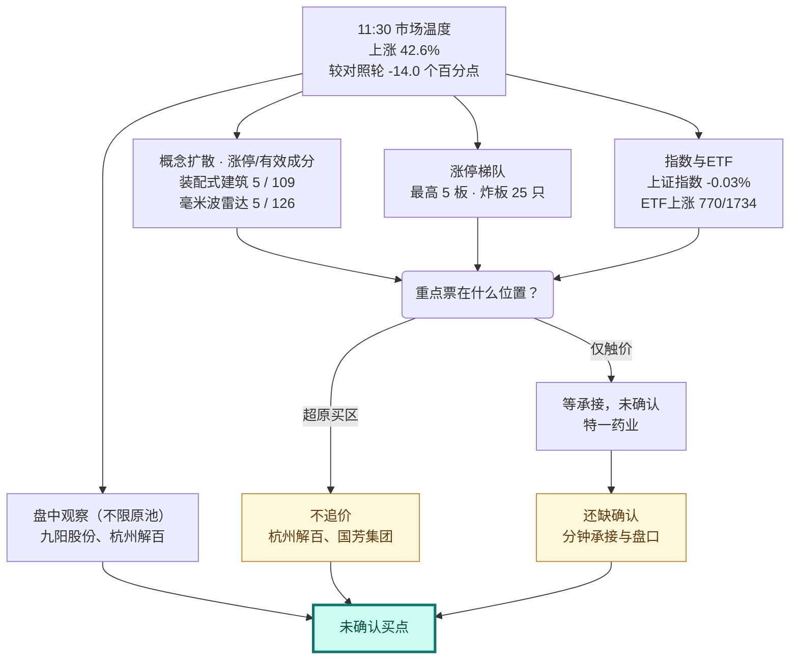

**指数截面**：上证指数 -0.03%（11:30:00） · 沪深300 +0.02%（11:30:00） · 中证500 +0.02%（11:30:00） · 中证1000 +0.09%（11:30:00） · 科创50 -0.93%（11:30:00） · 创业板指 +0.06%（11:30:03）

**ETF**：上涨 770/1734 只有成交样本（名录 1742 只，非全覆盖）；成交额前列：海富通中证短融ETF +0.01%（11:30:06） · 华泰柏瑞中证韩交所中韩半导体ETF(QDII +1.05%（11:30:24） · 银华货币ETF-A +0.00%（11:30:23）

**ETF相对强势方向**（按跟踪指数分组的样本中位涨幅）：SSH黄金股票 +3.62%（6 只） · 纳斯达克100指数 +2.48%（12 只）

| 盘中观察 | 本轮依据 | 下一轮看什么 |
|---|---|---|
| 九阳股份 `002242` · 观察池 | +6.79%（11:30:00），较 11:21 +1.29 个百分点；原预案价位：超买区 | 等板块响应及分钟承接，不按一次触价改判 |
| 杭州解百 `600814` · 执行池 | +7.78%（11:30:01），较 11:21 +2.63 个百分点；原预案价位：超买区 | 等板块响应及分钟承接，不按一次触价改判 |

**外盘背景，非实时**：标普500 -0.25%（11-25） · 纳斯达克 -0.62%（11-25） · 日经225缺留存 · 韩国综合 -6.16%（11-25，交易日历未核）

**板块扩散**（涨停/有效成分）：装配式建筑 **5**/109 · 毫米波雷达 **5**/126

**梯队**：最高 5 板

| 重点票 | 现价（元） | 原买区（元） | 现在看什么 |
|---|---:|---:|---|
| 杭州解百 `600814.SH` | 9.00 | 8.31–8.48 | **超原买区** · 不追价 |
| 国芳集团 `601086.SH` | 11.16 | 10.70–10.91 | **超原买区** · 不追价 |
| 特一药业 `002728.SZ` | 8.42 | 8.31–8.48 | **仅触价** · 等承接，未确认 |

**池外线索**：题材成交前排 0 只 / 同轮报价样本 4,380 只 · 仅观察 · 广筛市值底表缺失

**盘中快讯**：本轮快讯数据缺失

*报价截至 11:30:29 · 对照 11:20 · 有效 5578 只 · 全A覆盖未核 · 路径未定 · 缺同轮对照*

<!-- intraday-watch-card:1120 -->

### 11:20 盯盘卡

> **当前落点：有同轮观察对象 · 未确认买点**

上涨 **56.6%**（较对照轮 +8.2 个百分点） · 涨停 57 · 跌停 7 · 成交 7,747 亿


**指数截面**：上证指数 +0.20%（11:21:05） · 沪深300 +0.21%（11:21:05） · 中证500 +0.37%（11:21:05） · 中证1000 +0.52%（11:21:05） · 科创50 -0.64%（11:21:05） · 创业板指 +0.32%（11:21:03）

**ETF**：上涨 987/1734 只有成交样本（名录 1742 只，非全覆盖）；成交额前列：海富通中证短融ETF +0.01%（11:21:09） · 华泰柏瑞中证韩交所中韩半导体ETF(QDII +1.12%（11:21:09） · 银华货币ETF-A +0.01%（11:21:08）

**ETF相对强势方向**（按跟踪指数分组的样本中位涨幅）：SSH黄金股票 +4.03%（6 只） · 恒生港股通汽车主题 +2.79%（5 只）

| 盘中观察 | 本轮依据 | 下一轮看什么 |
|---|---|---|
| 九阳股份 `002242` · 观察池 | +5.50%（11:21:09），较 11:11 +1.09 个百分点；原预案价位：超买区 | 等板块响应及分钟承接，不按一次触价改判 |
| 杭州解百 `600814` · 执行池 | +5.15%（11:21:10），较 11:11 +1.32 个百分点；原预案价位：超买区 | 等板块响应及分钟承接，不按一次触价改判 |

**外盘背景，非实时**：标普500 -0.25%（11-25） · 纳斯达克 -0.62%（11-25） · 日经225缺留存 · 韩国综合 -6.16%（11-25，交易日历未核）

**板块扩散**（涨停/有效成分）：装配式建筑 **5**/109 · 毫米波雷达 **5**/126

**梯队**：最高 5 板

| 重点票 | 现价（元） | 原买区（元） | 现在看什么 |
|---|---:|---:|---|
| 杭州解百 `600814.SH` | 8.78 | 8.31–8.48 | **超原买区** · 不追价 |
| 国芳集团 `601086.SH` | 11.18 | 10.70–10.91 | **超原买区** · 不追价 |
| 特一药业 `002728.SZ` | 8.41 | 8.31–8.48 | **仅触价** · 等承接，未确认 |

**池外线索**：题材成交前排 0 只 / 同轮报价样本 5,507 只 · 仅观察 · 广筛市值底表缺失

**盘中快讯** · 来源时间，原文、首次可见与因果未核

| 北京时间 | 快讯与来源 |
|---|---|
| 11:20 | 【印尼西爪哇矿井事故遇难人数升至13人】据印度尼西亚搜救部门26日消息，搜救人员在该国西爪哇省茂物县一处矿井内已发现13名矿工的遗体，目前仍在全力搜救据报被困井下的13 · 新浪财经-快讯 |
| 11:20 | 【蔡磊回应病情：去年已进入终末期，希望大家关注渐冻症本身 】11月26日上午消息，今日蔡磊发布朋友圈，回应病情相关情况。他表示，家人因为我的病情而经常情绪失控，我很理解 · 新浪财经-快讯 |

*报价截至 11:21:04 · 对照 11:10 · 有效 5578 只 · 全A覆盖未核 · 路径未定 · 缺同轮对照*

<!-- intraday-watch-card:1110 -->

### 11:10 盯盘卡

> **当前落点：有同轮观察对象 · 未确认买点**

上涨 **48.4%**（较对照轮 -8.5 个百分点） · 涨停 56 · 跌停 6 · 成交 7,512 亿

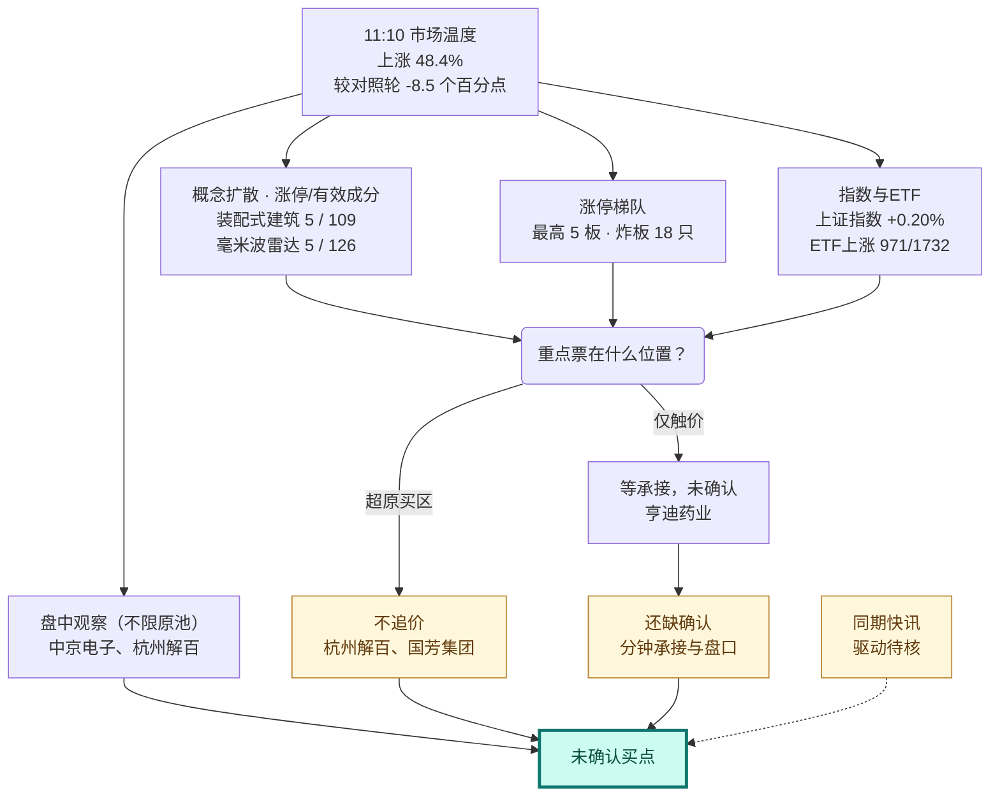

**指数截面**：上证指数 +0.20%（11:11:08） · 沪深300 +0.23%（11:11:08） · 中证500 +0.29%（11:11:08） · 中证1000 +0.31%（11:11:08） · 科创50 -0.64%（11:11:08） · 创业板指 +0.23%（11:11:06）

**ETF**：上涨 971/1732 只有成交样本（名录 1742 只，非全覆盖）；成交额前列：海富通中证短融ETF +0.01%（11:11:09） · 华泰柏瑞中证韩交所中韩半导体ETF(QDII +1.15%（11:11:12） · 银华货币ETF-A +0.01%（11:11:11）

**ETF相对强势方向**（按跟踪指数分组的样本中位涨幅）：SSH黄金股票 +4.33%（6 只） · 中证有色矿业 +2.74%（9 只）

| 盘中观察 | 本轮依据 | 下一轮看什么 |
|---|---|---|
| 中京电子 `002579` · 观察池 | +4.88%（11:11:12），较 11:01 -1.41 个百分点；毫米波雷达 5涨停/126有效成分 | 同题材强度能否延续，留意核心和助攻是否转弱 |
| 杭州解百 `600814` · 执行池 | +3.83%（11:11:13），较 11:01 -2.28 个百分点；原预案价位：超买区 | 等板块响应及分钟承接，不按一次触价改判 |

**外盘背景，非实时**：标普500 -0.25%（11-25） · 纳斯达克 -0.62%（11-25） · 日经225缺留存 · 韩国综合 -6.16%（11-25，交易日历未核）

**板块扩散**（涨停/有效成分）：装配式建筑 **5**/109 · 毫米波雷达 **5**/126

**梯队**：最高 5 板

| 重点票 | 现价（元） | 原买区（元） | 现在看什么 |
|---|---:|---:|---|
| 杭州解百 `600814.SH` | 8.67 | 8.31–8.48 | **超原买区** · 不追价 |
| 国芳集团 `601086.SH` | 11.16 | 10.70–10.91 | **超原买区** · 不追价 |
| 亨迪药业 `301211.SZ` | 11.03 | 11.03–11.37 | **仅触价** · 等承接，未确认 |

**池外线索**：题材成交前排 0 只 / 同轮报价样本 5,535 只 · 仅观察 · 广筛市值底表缺失

**盘中快讯** · 来源时间，原文、首次可见与因果未核

| 北京时间 | 快讯与来源 |
|---|---|
| 11:10 | 新加坡：对美国贸易代表办公室拟采取的行动深感失望。 · 新浪财经-快讯 |
| 11:10 | 南向资金净卖出超70亿港元 · 同花顺-快讯 |

*报价截至 11:11:07 · 对照 11:00 · 有效 5578 只 · 全A覆盖未核 · 路径未定 · 缺同轮对照*

<!-- intraday-watch-card:1100 -->

### 11:00 盯盘卡

> **当前落点：有同轮观察对象 · 未确认买点**

上涨 **56.9%**（较对照轮 -7.4 个百分点） · 涨停 54 · 跌停 6 · 成交 7,248 亿


**指数截面**：上证指数 +0.27%（11:01:08） · 沪深300 +0.26%（11:01:08） · 中证500 +0.44%（11:01:08） · 中证1000 +0.56%（11:01:08） · 科创50 -0.55%（11:01:08） · 创业板指 +0.38%（11:01:06）

**ETF**：上涨 1066/1733 只有成交样本（名录 1742 只，非全覆盖）；成交额前列：海富通中证短融ETF +0.01%（11:01:09） · 华泰柏瑞中证韩交所中韩半导体ETF(QDII +1.15%（11:01:09） · 银华货币ETF-A +0.01%（11:01:11）

**ETF相对强势方向**（按跟踪指数分组的样本中位涨幅）：SSH黄金股票 +4.78%（6 只） · 中证有色矿业 +3.09%（9 只）

| 盘中观察 | 本轮依据 | 下一轮看什么 |
|---|---|---|
| 金新农 `002548` · 观察池 | +6.99%（11:01:12），较 10:51 -0.59 个百分点；原预案价位：超买区 | 等板块响应及分钟承接，不按一次触价改判 |
| 杭州解百 `600814` · 执行池 | +6.11%（11:01:10），较 10:51 +1.44 个百分点；原预案价位：超买区 | 等板块响应及分钟承接，不按一次触价改判 |

**外盘背景，非实时**：标普500 -0.25%（11-25） · 纳斯达克 -0.62%（11-25） · 日经225缺留存 · 韩国综合 -6.16%（11-25，交易日历未核）

**板块扩散**（涨停/有效成分）：装配式建筑 **5**/109 · 移动支付 **3**/78 · 互联网金融 **8**/214

**梯队**：最高 3 板

| 重点票 | 现价（元） | 原买区（元） | 现在看什么 |
|---|---:|---:|---|
| 杭州解百 `600814.SH` | 8.86 | 8.31–8.48 | **超原买区** · 不追价 |
| 国芳集团 `601086.SH` | 10.98 | 10.70–10.91 | **超原买区** · 不追价 |
| 亨迪药业 `301211.SZ` | 11.09 | 11.03–11.37 | **仅触价** · 等承接，未确认 |

**池外线索**：题材成交前排 0 只 / 同轮报价样本 5,539 只 · 仅观察 · 广筛市值底表缺失

**盘中快讯** · 来源时间，原文、首次可见与因果未核

| 北京时间 | 快讯与来源 |
|---|---|
| 11:01 | 【上海银行间同业拆放利率(Shibor)涨跌互现】隔夜shibor报1.2730%，上涨0.20个基点；7天shibor报1.3670%，下跌0.60个基点；14天sh · 新浪财经-快讯 |
| 11:00 | 【我国牵头提出的基因组信息学数据通用要求国际标准成功立项】我国牵头提出的国际标准提案《基因组信息学 肽组学数据的数据元通用要求》近日在国际标准化组织（ISO）正式获批立 · 新浪财经-快讯 |

*报价截至 11:01:04 · 对照 10:50 · 有效 5578 只 · 全A覆盖未核 · 路径未定 · 缺同轮对照*

<!-- intraday-watch-card:1050 -->

### 10:50 盯盘卡

> **当前落点：有同轮观察对象 · 未确认买点**

上涨 **64.3%**（较对照轮 -9.1 个百分点） · 涨停 60 · 跌停 5 · 成交 6,895 亿

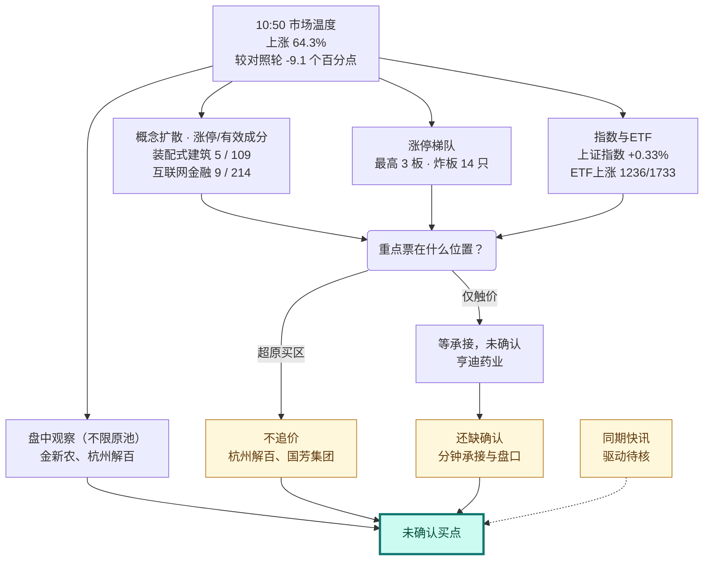

**指数截面**：上证指数 +0.33%（10:51:05） · 沪深300 +0.32%（10:51:05） · 中证500 +0.61%（10:51:05） · 中证1000 +0.82%（10:51:05） · 科创50 -0.26%（10:51:05） · 创业板指 +0.52%（10:51:06）

**ETF**：上涨 1236/1733 只有成交样本（名录 1742 只，非全覆盖）；成交额前列：海富通中证短融ETF +0.01%（10:51:09） · 华泰柏瑞中证韩交所中韩半导体ETF(QDII +1.27%（10:51:09） · 银华货币ETF-A +0.01%（10:51:08）

**ETF相对强势方向**（按跟踪指数分组的样本中位涨幅）：SSH黄金股票 +4.71%（6 只） · 中证有色矿业 +2.98%（9 只）

| 盘中观察 | 本轮依据 | 下一轮看什么 |
|---|---|---|
| 金新农 `002548` · 观察池 | +7.58%（10:51:09），较 10:41 -0.60 个百分点；原预案价位：超买区 | 等板块响应及分钟承接，不按一次触价改判 |
| 杭州解百 `600814` · 执行池 | +4.67%（10:51:10），较 10:41 -1.08 个百分点；原预案价位：超买区 | 等板块响应及分钟承接，不按一次触价改判 |

**外盘背景，非实时**：标普500 -0.25%（11-25） · 纳斯达克 -0.62%（11-25） · 日经225缺留存 · 韩国综合 -6.16%（11-25，交易日历未核）

**板块扩散**（涨停/有效成分）：装配式建筑 **5**/109 · 互联网金融 **9**/214 · 6G概念 **4**/99

**梯队**：最高 3 板

| 重点票 | 现价（元） | 原买区（元） | 现在看什么 |
|---|---:|---:|---|
| 杭州解百 `600814.SH` | 8.74 | 8.31–8.48 | **超原买区** · 不追价 |
| 国芳集团 `601086.SH` | 10.96 | 10.70–10.91 | **超原买区** · 不追价 |
| 亨迪药业 `301211.SZ` | 11.11 | 11.03–11.37 | **仅触价** · 等承接，未确认 |

**池外线索**：题材成交前排 0 只 / 同轮报价样本 5,557 只 · 仅观察 · 广筛市值底表缺失

**盘中快讯** · 来源时间，原文、首次可见与因果未核

| 北京时间 | 快讯与来源 |
|---|---|
| 10:50 | 【撤诉了，祝丽丹起诉娃哈哈商业股份有限公司案件未开庭】据浙江法院网此前披露，原告祝丽丹与被告娃哈哈商业股份有限公司涉及的涤除公司登记（备案）纠纷案件，将于11月26日在 · 新浪财经-快讯 |
| 10:50 | 中信证券：11月30日起两融保证金比例降至80% · 格隆汇-快讯 |

*报价截至 10:51:04 · 对照 10:40 · 有效 5578 只 · 全A覆盖未核 · 路径未定 · 缺同轮对照*

<!-- intraday-watch-card:1040 -->

### 10:40 盯盘卡

> **当前落点：有同轮观察对象 · 未确认买点**

上涨 **73.3%**（较对照轮 +3.1 个百分点） · 涨停 59 · 跌停 6 · 成交 6,517 亿


**指数截面**：上证指数 +0.52%（10:41:08） · 沪深300 +0.49%（10:41:08） · 中证500 +0.90%（10:41:08） · 中证1000 +1.16%（10:41:08） · 科创50 +0.14%（10:41:08） · 创业板指 +1.01%（10:41:06）

**ETF**：上涨 1320/1731 只有成交样本（名录 1742 只，非全覆盖）；成交额前列：海富通中证短融ETF +0.01%（10:41:09） · 华泰柏瑞中证韩交所中韩半导体ETF(QDII +1.67%（10:41:09） · 银华货币ETF-A +0.00%（10:41:11）

**ETF相对强势方向**（按跟踪指数分组的样本中位涨幅）：SSH黄金股票 +5.02%（6 只） · 中证有色矿业 +3.24%（9 只）

| 盘中观察 | 本轮依据 | 下一轮看什么 |
|---|---|---|
| 金新农 `002548` · 观察池 | +8.18%（10:41:12），较 10:31 +2.59 个百分点；原预案价位：超买区 | 等板块响应及分钟承接，不按一次触价改判 |
| 杭州解百 `600814` · 执行池 | +5.75%（10:41:10），较 10:31 +0.96 个百分点；原预案价位：超买区 | 等板块响应及分钟承接，不按一次触价改判 |

**外盘背景，非实时**：标普500 -0.25%（11-25） · 纳斯达克 -0.62%（11-25） · 日经225缺留存 · 韩国综合 -6.16%（11-25，交易日历未核）

**板块扩散**（涨停/有效成分）：互联网金融 **9**/214 · 6G概念 **4**/99 · 毫米波雷达 **5**/126

**梯队**：最高 3 板

| 重点票 | 现价（元） | 原买区（元） | 现在看什么 |
|---|---:|---:|---|
| 杭州解百 `600814.SH` | 8.83 | 8.31–8.48 | **超原买区** · 不追价 |
| 国芳集团 `601086.SH` | 11.07 | 10.70–10.91 | **超原买区** · 不追价 |
| 亨迪药业 `301211.SZ` | 11.25 | 11.03–11.37 | **仅触价** · 等承接，未确认 |

**池外线索**：题材成交前排 0 只 / 同轮报价样本 5,545 只 · 仅观察 · 广筛市值底表缺失

**盘中快讯** · 来源时间，原文、首次可见与因果未核

| 北京时间 | 快讯与来源 |
|---|---|
| 10:40 | 纽约期金突破3630美元/盎司，日内涨1.83%。 · 新浪财经-快讯 |
| 10:40 | 南向资金净卖出额达50亿港元。 · 新浪财经-快讯 |

*报价截至 10:41:07 · 对照 10:30 · 有效 5578 只 · 全A覆盖未核 · 路径未定 · 缺同轮对照*

<!-- intraday-watch-card:1030 -->

### 10:30 盯盘卡

> **当前落点：有同轮观察对象 · 未确认买点**

上涨 **70.2%**（较对照轮 -6.3 个百分点） · 涨停 52 · 跌停 6 · 成交 6,071 亿


**指数截面**：上证指数 +0.36%（10:31:08） · 沪深300 +0.40%（10:31:08） · 中证500 +0.86%（10:31:08） · 中证1000 +1.04%（10:31:08） · 科创50 +0.22%（10:31:08） · 创业板指 +1.22%（10:31:06）

**ETF**：上涨 1309/1728 只有成交样本（名录 1742 只，非全覆盖）；成交额前列：海富通中证短融ETF +0.01%（10:31:12） · 华泰柏瑞中证韩交所中韩半导体ETF(QDII +1.67%（10:31:12） · 易方达创业板ETF +1.18%（10:31:12）

**ETF相对强势方向**（按跟踪指数分组的样本中位涨幅）：SSH黄金股票 +3.99%（6 只） · 恒生港股通汽车主题 +2.79%（5 只）

| 盘中观察 | 本轮依据 | 下一轮看什么 |
|---|---|---|
| 九阳股份 `002242` · 观察池 | +6.35%（10:31:12），较 10:21 +0.23 个百分点；原预案价位：超买区 | 等板块响应及分钟承接，不按一次触价改判 |
| 杭州解百 `600814` · 执行池 | +4.79%（10:31:13），较 10:21 +0.24 个百分点；原预案价位：超买区 | 等板块响应及分钟承接，不按一次触价改判 |

**外盘背景，非实时**：标普500 -0.25%（11-25） · 纳斯达克 -0.62%（11-25） · 日经225缺留存 · 韩国综合 -6.16%（11-25，交易日历未核）

**板块扩散**（涨停/有效成分）：预制菜 **4**/101 · 装配式建筑 **4**/109 · 富士康概念 **4**/110

**梯队**：最高 3 板

| 重点票 | 现价（元） | 原买区（元） | 现在看什么 |
|---|---:|---:|---|
| 杭州解百 `600814.SH` | 8.75 | 8.31–8.48 | **超原买区** · 不追价 |
| 国芳集团 `601086.SH` | 11.17 | 10.70–10.91 | **超原买区** · 不追价 |
| 亨迪药业 `301211.SZ` | 11.36 | 11.03–11.37 | **仅触价** · 等承接，未确认 |

**池外线索**：题材成交前排 0 只 / 同轮报价样本 5,559 只 · 仅观察 · 广筛市值底表缺失

**盘中快讯** · 来源时间，原文、首次可见与因果未核

| 北京时间 | 快讯与来源 |
|---|---|
| 10:30 | 韩国央行行长申铉松表示，预计明年私人消费将增长2.4%。 · 新浪财经-快讯 |
| 10:30 | 韩国银行行长申铉松表示，信息技术行业的增长传导至消费领域需要时间。 · 新浪财经-快讯 |

*报价截至 10:31:07 · 对照 10:20 · 有效 5578 只 · 全A覆盖未核 · 路径未定 · 缺同轮对照*

<!-- intraday-watch-card:1020 -->

### 10:20 盯盘卡

> **当前落点：有同轮观察对象 · 未确认买点**

上涨 **76.5%**（较对照轮 +18.5 个百分点） · 涨停 49 · 跌停 7 · 成交 5,528 亿

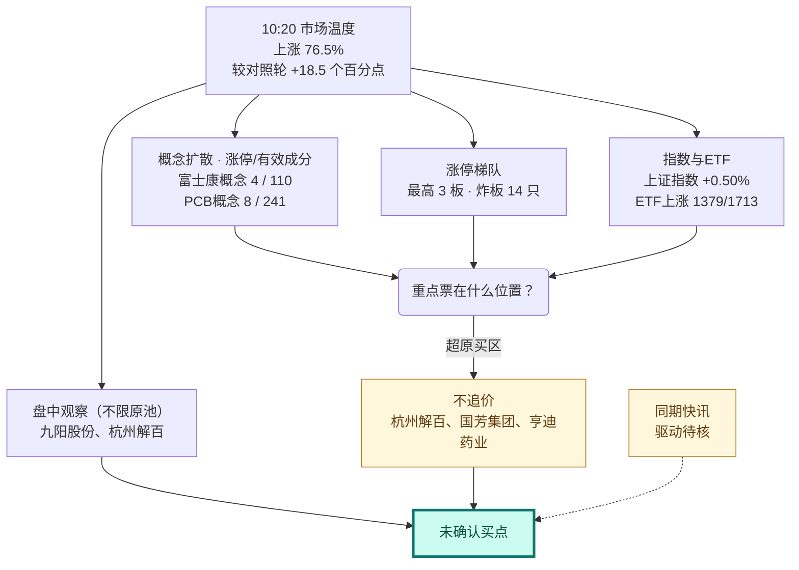

**指数截面**：上证指数 +0.50%（10:21:08） · 沪深300 +0.59%（10:21:08） · 中证500 +1.44%（10:21:08） · 中证1000 +1.58%（10:21:08） · 科创50 +1.14%（10:21:08） · 创业板指 +1.88%（10:21:06）

**ETF**：上涨 1379/1713 只有成交样本（名录 1742 只，非全覆盖）；成交额前列：海富通中证短融ETF +0.01%（10:21:09） · 华泰柏瑞中证韩交所中韩半导体ETF(QDII +2.17%（10:21:09） · 易方达创业板ETF +1.82%（10:21:09）

**ETF相对强势方向**（按跟踪指数分组的样本中位涨幅）：SSH黄金股票 +4.10%（6 只） · 上证科创成长 +3.44%（5 只）

| 盘中观察 | 本轮依据 | 下一轮看什么 |
|---|---|---|
| 九阳股份 `002242` · 观察池 | +6.12%（10:21:12），较 10:11 -0.65 个百分点；原预案价位：超买区 | 等板块响应及分钟承接，不按一次触价改判 |
| 杭州解百 `600814` · 执行池 | +4.55%（10:21:10），较 10:11 -0.60 个百分点；原预案价位：超买区 | 等板块响应及分钟承接，不按一次触价改判 |

**外盘背景，非实时**：标普500 -0.25%（11-25） · 纳斯达克 -0.62%（11-25） · 日经225缺留存 · 韩国综合 -6.16%（11-25，交易日历未核）

**板块扩散**（涨停/有效成分）：富士康概念 **4**/110 · PCB概念 **8**/241 · 互联网金融 **7**/214

**梯队**：最高 3 板

| 重点票 | 现价（元） | 原买区（元） | 现在看什么 |
|---|---:|---:|---|
| 杭州解百 `600814.SH` | 8.73 | 8.31–8.48 | **超原买区** · 不追价 |
| 国芳集团 `601086.SH` | 11.23 | 10.70–10.91 | **超原买区** · 不追价 |
| 亨迪药业 `301211.SZ` | 11.49 | 11.03–11.37 | **超原买区** · 不追价 |

**池外线索**：题材成交前排 0 只 / 同轮报价样本 5,570 只 · 仅观察 · 广筛市值底表缺失

**盘中快讯** · 来源时间，原文、首次可见与因果未核

| 北京时间 | 快讯与来源 |
|---|---|
| 10:21 | 韩国央行行长申铉松表示，在确信CPI向目标水平收敛之前需要采取行动。 · 新浪财经-快讯 |
| 10:20 | 恒生指数涨超2%，现报22405.400点；恒生科技指数现涨3.411%。 · 新浪财经-快讯 |

*报价截至 10:21:07 · 对照 10:10 · 有效 5578 只 · 全A覆盖未核 · 路径未定 · 缺同轮对照*

<!-- intraday-watch-card:1010 -->

### 10:10 盯盘卡

> **当前落点：有同轮观察对象 · 未确认买点**

上涨 **58.0%**（较对照轮 +18.6 个百分点） · 涨停 36 · 跌停 7 · 成交 4,677 亿

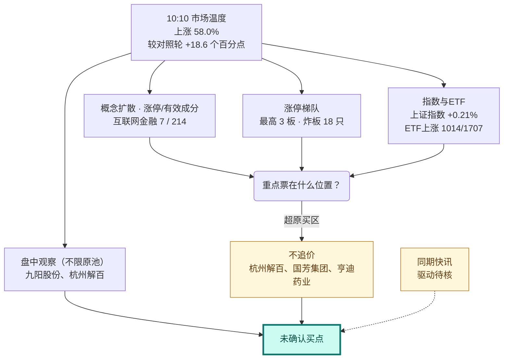

**指数截面**：上证指数 +0.21%（10:11:08） · 沪深300 +0.31%（10:11:08） · 中证500 +0.58%（10:11:08） · 中证1000 +0.75%（10:11:08） · 科创50 -0.12%（10:11:08） · 创业板指 +0.71%（10:11:09）

**ETF**：上涨 1014/1707 只有成交样本（名录 1742 只，非全覆盖）；成交额前列：海富通中证短融ETF +0.00%（10:11:12） · 华泰柏瑞中证韩交所中韩半导体ETF(QDII +1.24%（10:11:12） · 易方达创业板ETF +0.59%（10:11:12）

**ETF相对强势方向**（按跟踪指数分组的样本中位涨幅）：SSH黄金股票 +3.06%（6 只） · 恒生港股通汽车主题 +2.79%（5 只）

| 盘中观察 | 本轮依据 | 下一轮看什么 |
|---|---|---|
| 九阳股份 `002242` · 观察池 | +6.77%（10:11:12），较 10:01 -0.34 个百分点；原预案价位：超买区 | 等板块响应及分钟承接，不按一次触价改判 |
| 杭州解百 `600814` · 执行池 | +5.15%（10:11:13），较 10:01 +1.56 个百分点；原预案价位：超买区 | 等板块响应及分钟承接，不按一次触价改判 |

**外盘背景，非实时**：标普500 -0.25%（11-25） · 纳斯达克 -0.62%（11-25） · 日经225缺留存 · 韩国综合 -6.16%（11-25，交易日历未核）

**板块扩散**（涨停/有效成分）：互联网金融 **7**/214

**梯队**：最高 3 板

| 重点票 | 现价（元） | 原买区（元） | 现在看什么 |
|---|---:|---:|---|
| 杭州解百 `600814.SH` | 8.78 | 8.31–8.48 | **超原买区** · 不追价 |
| 国芳集团 `601086.SH` | 11.22 | 10.70–10.91 | **超原买区** · 不追价 |
| 亨迪药业 `301211.SZ` | 11.57 | 11.03–11.37 | **超原买区** · 不追价 |

**池外线索**：题材成交前排 0 只 / 同轮报价样本 5,578 只 · 仅观察 · 广筛市值底表缺失

**盘中快讯** · 来源时间，原文、首次可见与因果未核

| 北京时间 | 快讯与来源 |
|---|---|
| 10:11 | 八部门：创新发展数字贸易 促进数字金融、在线教育、远程医疗、微短剧等业态创新发展 · 格隆汇-快讯 |
| 10:10 | 中证1000指数期货连续主力合约日内涨2%，现报5544.00点。 · 新浪财经-快讯 |

*报价截至 10:11:07 · 对照 10:00 · 有效 5578 只 · 全A覆盖未核 · 路径未定 · 缺同轮对照*

<!-- intraday-watch-card:1000 -->

### 10:00 盯盘卡

> **当前落点：有同轮观察对象 · 未确认买点**

上涨 **39.4%**（较对照轮 -7.6 个百分点） · 涨停 31 · 跌停 7 · 成交 3,996 亿

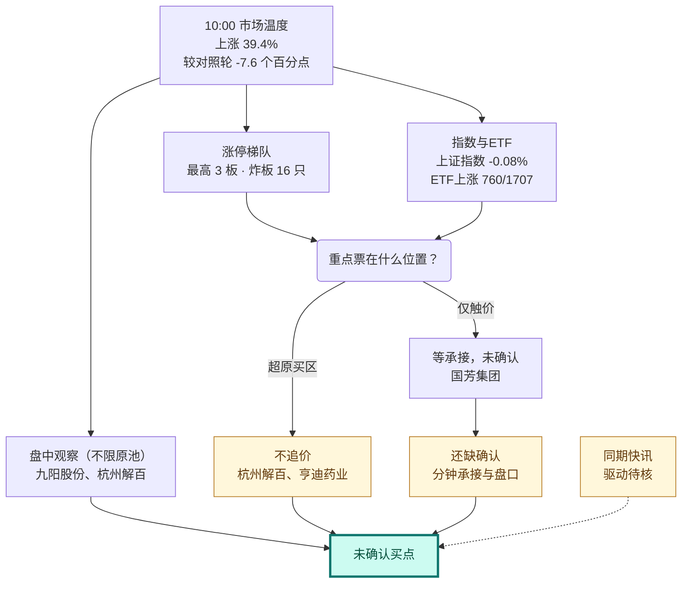

**指数截面**：上证指数 -0.08%（10:01:08） · 沪深300 +0.05%（10:01:08） · 中证500 +0.21%（10:01:08） · 中证1000 +0.11%（10:01:08） · 科创50 -0.57%（10:01:08） · 创业板指 +0.11%（10:01:06）

**ETF**：上涨 760/1707 只有成交样本（名录 1742 只，非全覆盖）；成交额前列：海富通中证短融ETF +0.00%（10:01:09） · 银华货币ETF-A +0.01%（10:01:11） · 华泰柏瑞中证韩交所中韩半导体ETF(QDII +1.08%（10:01:09）

**ETF相对强势方向**（按跟踪指数分组的样本中位涨幅）：SSH黄金股票 +2.86%（6 只） · 恒生港股通汽车主题 +2.68%（5 只）

| 盘中观察 | 本轮依据 | 下一轮看什么 |
|---|---|---|
| 九阳股份 `002242` · 观察池 | +7.11%（10:01:12），较 09:51 +1.15 个百分点；原预案价位：超买区 | 等板块响应及分钟承接，不按一次触价改判 |
| 杭州解百 `600814` · 执行池 | +3.59%（10:01:10），较 09:51 -3.60 个百分点；原预案价位：超买区 | 等板块响应及分钟承接，不按一次触价改判 |

**外盘背景，非实时**：标普500 -0.25%（11-25） · 纳斯达克 -0.62%（11-25） · 日经225缺留存 · 韩国综合 -6.16%（11-25，交易日历未核）

**梯队**：最高 3 板

| 重点票 | 现价（元） | 原买区（元） | 现在看什么 |
|---|---:|---:|---|
| 杭州解百 `600814.SH` | 8.65 | 8.31–8.48 | **超原买区** · 不追价 |
| 国芳集团 `601086.SH` | 10.86 | 10.70–10.91 | **仅触价** · 等承接，未确认 |
| 亨迪药业 `301211.SZ` | 11.41 | 11.03–11.37 | **超原买区** · 不追价 |

**池外线索**：题材成交前排 0 只 / 同轮报价样本 5,563 只 · 仅观察 · 广筛市值底表缺失

**盘中快讯** · 来源时间，原文、首次可见与因果未核

| 北京时间 | 快讯与来源 |
|---|---|
| 10:00 | 两高：联合发布办理妨害兴奋剂管理等刑事案件司法解释 · 同花顺-快讯 |
| 10:00 | 【商务部等8部门关于印发《服务贸易发展“十五五”规划》的通知 】为推动服务贸易高质量发展，加快贸易强国建设，根据《中华人民共和国国民经济和社会发展第十五个五年规划纲要》 · 新浪财经-快讯 |

*报价截至 10:01:04 · 对照 09:50 · 有效 5578 只 · 全A覆盖未核 · 路径未定 · 缺同轮对照*

<!-- intraday-watch-card:0950 -->

### 09:50 盯盘卡

> **当前落点：有同轮观察对象 · 未确认买点**

上涨 **46.9%**（较对照轮 +6.9 个百分点） · 涨停 31 · 跌停 7 · 成交 3,274 亿

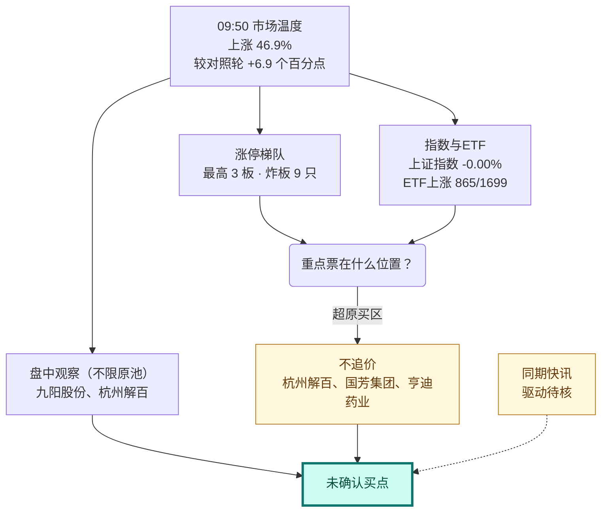

**指数截面**：上证指数 -0.00%（09:51:05） · 沪深300 +0.08%（09:51:05） · 中证500 +0.29%（09:51:05） · 中证1000 +0.28%（09:51:05） · 科创50 -0.55%（09:51:05） · 创业板指 +0.69%（09:51:06）

**ETF**：上涨 865/1699 只有成交样本（名录 1742 只，非全覆盖）；成交额前列：海富通中证短融ETF +0.01%（09:51:09） · 银华货币ETF-A +0.01%（09:51:08） · 华泰柏瑞中证韩交所中韩半导体ETF(QDII +1.36%（09:51:09）

**ETF相对强势方向**（按跟踪指数分组的样本中位涨幅）：SSH黄金股票 +2.16%（6 只） · 恒生港股通汽车主题 +2.06%（5 只）

| 盘中观察 | 本轮依据 | 下一轮看什么 |
|---|---|---|
| 九阳股份 `002242` · 观察池 | +5.96%（09:51:09），较 09:41 -0.03 个百分点；原预案价位：超买区 | 等板块响应及分钟承接，不按一次触价改判 |
| 杭州解百 `600814` · 执行池 | +7.19%（09:51:10），较 09:41 +0.96 个百分点；原预案价位：超买区 | 等板块响应及分钟承接，不按一次触价改判 |

**外盘背景，非实时**：标普500 -0.25%（11-25） · 纳斯达克 -0.62%（11-25） · 日经225缺留存 · 韩国综合 -6.16%（11-25，交易日历未核）

**梯队**：最高 3 板

| 重点票 | 现价（元） | 原买区（元） | 现在看什么 |
|---|---:|---:|---|
| 杭州解百 `600814.SH` | 8.95 | 8.31–8.48 | **超原买区** · 不追价 |
| 国芳集团 `601086.SH` | 11.12 | 10.70–10.91 | **超原买区** · 不追价 |
| 亨迪药业 `301211.SZ` | 11.65 | 11.03–11.37 | **超原买区** · 不追价 |

**池外线索**：题材成交前排 0 只 / 同轮报价样本 5,565 只 · 仅观察 · 广筛市值底表缺失

**盘中快讯** · 来源时间，原文、首次可见与因果未核

| 北京时间 | 快讯与来源 |
|---|---|
| 09:51 | 德国联邦预算案辩论开启 援乌成为争论重点 · 同花顺-快讯 |
| 09:50 | 【港股黄金股集体走强 紫金黄金国际涨近6%】截至发稿，紫金黄金国际(02259.HK)涨5.69%，潼关黄金(00340.HK)涨4.44%，赤峰黄金(06693.HK · 新浪财经-快讯 |

*报价截至 09:51:04 · 对照 09:40 · 有效 5578 只 · 全A覆盖未核 · 路径未定 · 缺同轮对照*

<!-- intraday-watch-card:0940 -->

### 09:40 盯盘卡

> **当前落点：有同轮观察对象 · 未确认买点**

上涨 **40.0%** · 涨停 24 · 跌停 7 · 成交 2,258 亿

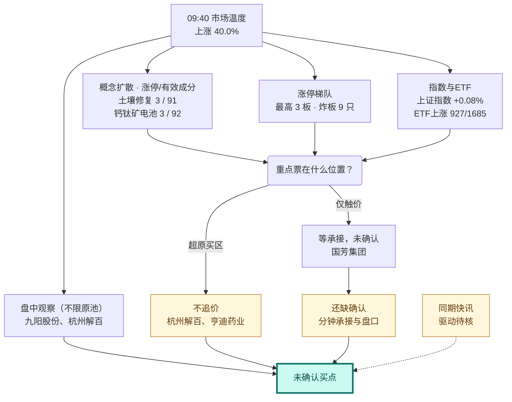

**指数截面**：上证指数 +0.08%（09:41:08） · 沪深300 +0.20%（09:41:08） · 中证500 +0.26%（09:41:08） · 中证1000 +0.19%（09:41:08） · 科创50 -1.21%（09:41:08） · 创业板指 +0.54%（09:41:06）

**ETF**：上涨 927/1685 只有成交样本（名录 1742 只，非全覆盖）；成交额前列：海富通中证短融ETF +0.00%（09:41:09） · 易方达创业板ETF +0.55%（09:41:09） · 华泰柏瑞中证韩交所中韩半导体ETF(QDII +1.46%（09:41:12）

**ETF相对强势方向**（按跟踪指数分组的样本中位涨幅）：恒生港股通汽车主题 +2.79%（5 只） · 港股通汽车 +2.45%（7 只）

| 盘中观察 | 本轮依据 | 下一轮看什么 |
|---|---|---|
| 九阳股份 `002242` · 观察池 | +5.99%（09:41:12），较 09:31 +2.26 个百分点；原预案价位：超买区 | 等板块响应及分钟承接，不按一次触价改判 |
| 杭州解百 `600814` · 执行池 | +6.23%（09:41:13），较 09:31 +0.24 个百分点；原预案价位：超买区 | 等板块响应及分钟承接，不按一次触价改判 |

**外盘背景，非实时**：标普500 -0.25%（11-25） · 纳斯达克 -0.62%（11-25） · 日经225缺留存 · 韩国综合 -6.16%（11-25，交易日历未核）

**板块扩散**（涨停/有效成分）：土壤修复 **3**/91 · 钙钛矿电池 **3**/92 · 煤化工概念 **3**/110

**梯队**：最高 3 板

| 重点票 | 现价（元） | 原买区（元） | 现在看什么 |
|---|---:|---:|---|
| 杭州解百 `600814.SH` | 8.87 | 8.31–8.48 | **超原买区** · 不追价 |
| 国芳集团 `601086.SH` | 10.90 | 10.70–10.91 | **仅触价** · 等承接，未确认 |
| 亨迪药业 `301211.SZ` | 11.57 | 11.03–11.37 | **超原买区** · 不追价 |

**池外线索**：题材成交前排 0 只 / 同轮报价样本 5,573 只 · 仅观察 · 广筛市值底表缺失

**盘中快讯** · 来源时间，原文、首次可见与因果未核

| 北京时间 | 快讯与来源 |
|---|---|
| 09:40 | 【全国纪念馆超3000家 革命文物资源底数基本摸清】由国家文物局主办的全国纪念馆高质量发展论坛·2026今天（26日）在广东广州举办，记者从现场了解到，我国纪念馆体系日 · 新浪财经-快讯 |
| 09:40 | AI投资重仓押注遭遇重创 Situational Awareness三季度亏损65% · 格隆汇-快讯 |

*报价截至 09:41:04 · 有效 5578 只 · 全A覆盖未核 · 路径未定 · 缺同轮对照*

<!-- intraday-watch-card:0930 -->

### 09:30 盯盘卡

> **当前落点：有同轮观察对象 · 未确认买点**

上涨 **68.9%** · 涨停 16 · 跌停 6 · 成交 617 亿

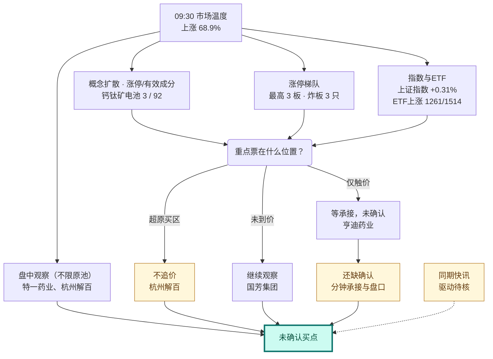

**指数截面**：上证指数 +0.31%（09:31:08） · 沪深300 +0.40%（09:31:08） · 中证500 +0.92%（09:31:08） · 中证1000 +0.89%（09:31:08） · 科创50 +0.23%（09:31:08） · 创业板指 +1.14%（09:31:06）

**ETF**：上涨 1261/1514 只有成交样本（名录 1742 只，非全覆盖）；成交额前列：海富通中证短融ETF +0.00%（09:31:09） · 易方达创业板ETF +1.23%（09:31:09） · 银华货币ETF-A +0.00%（09:31:11）

**ETF相对强势方向**（按跟踪指数分组的样本中位涨幅）：中证卫星产业 +2.45%（8 只） · SSH黄金股票 +2.19%（6 只）

| 盘中观察 | 本轮依据 | 下一轮看什么 |
|---|---|---|
| 特一药业 `002728` · 观察池 | +8.86%（09:31:00）；原预案价位：超买区 | 等板块响应及分钟承接，不按一次触价改判 |
| 杭州解百 `600814` · 执行池 | +5.99%（09:31:01）；原预案价位：超买区 | 等板块响应及分钟承接，不按一次触价改判 |

**外盘背景，非实时**：标普500 -0.25%（11-25） · 纳斯达克 -0.62%（11-25） · 日经225缺留存 · 韩国综合 -6.16%（11-25，交易日历未核）

**板块扩散**（涨停/有效成分）：钙钛矿电池 **3**/92

**梯队**：最高 3 板

| 重点票 | 现价（元） | 原买区（元） | 现在看什么 |
|---|---:|---:|---|
| 杭州解百 `600814.SH` | 8.85 | 8.31–8.48 | **超原买区** · 不追价 |
| 国芳集团 `601086.SH` | 10.53 | 10.70–10.91 | **未到价** · 继续观察 |
| 亨迪药业 `301211.SZ` | 11.07 | 11.03–11.37 | **仅触价** · 等承接，未确认 |

**池外线索**：题材成交前排 0 只 / 同轮报价样本 5,575 只 · 仅观察 · 广筛市值底表缺失

**盘中快讯** · 来源时间，原文、首次可见与因果未核

| 北京时间 | 快讯与来源 |
|---|---|
| 09:31 | 奥赛康(002755.SZ)：截至11月20日公司股东人数为30168户 · 格隆汇-事件 |
| 09:31 | 韩国央行：7名委员中有2人投票支持维持利率不变。 · 新浪财经-快讯 |

*报价截至 09:31:04 · 有效 5573 只 · 全A覆盖未核 · 路径未定 · 缺同轮对照*

<!-- intraday-watch-cards:end -->

## 当日总览（截至 11:30）

| 看哪里 | 本轮速览 |
|---|---|
| 市场（XTick） | 涨 2380 / 跌 2946 · 涨停 53 / 跌停 7 |
| 扩散（涨停/有效成分） | 冰雪产业 3/61 · 装配式建筑 5/109 · 毫米波雷达 5/126 |
| 走弱 | 智能制造 跌停 2 · 工业互联网 跌停 2 |
| 预案价格位置 | 仅触价 3 · 在原买区 2 · 超原买区 5 · 未到价 3 |

### 盘前路径对照

未定：公开字段混有敏感或非纯文本内容，不转述。不使用其他日期或其他文档补位。

### 板块扩散

> 口径：XTick 概念成分 × 全市场实时报价；分母 = 板块内有有效报价的成分数。排序用涨停密度（涨停数/有效成分数），已剔除宽基属性板块（全市场 432 个板块中剔 16 个）。

**扩散中（题材，按涨停密度排序）**

| 板块 | 涨停 | 有效成分 | 涨停密度 | 上涨广度 | 中位涨幅 | 相对全市场 | 成交(亿) |
|---|---|---|---|---|---|---|---|
| 广东自贸区 ⬦ | 2 | 29 | 0.069 | 0.45 | +0.00% | +0.17% | 56 |
| 大豆 ⬦ | 1 | 15 | 0.067 | 0.60 | +0.23% | +0.40% | 8 |
| 中韩自贸区 ⬦ | 1 | 17 | 0.059 | 0.65 | +0.30% | +0.47% | 37 |
| 横琴新区 ⬦ | 2 | 38 | 0.053 | 0.39 | -0.14% | +0.03% | 40 |
| 动物疫苗 ⬦ | 1 | 20 | 0.050 | 0.25 | -0.47% | -0.30% | 12 |
| 冰雪产业 | 3 | 61 | 0.049 | 0.44 | -0.11% | +0.06% | 89 |
| 装配式建筑 | 5 | 109 | 0.046 | 0.50 | +0.12% | +0.29% | 75 |
| 粮食概念 ⬦ | 2 | 48 | 0.042 | 0.71 | +1.01% | +1.18% | 63 |
| 民爆概念 ⬦ | 1 | 25 | 0.040 | 0.64 | +0.46% | +0.63% | 34 |
| 毫米波雷达 | 5 | 126 | 0.040 | 0.55 | +0.37% | +0.54% | 498 |
| 免税店 ⬦ | 1 | 26 | 0.038 | 0.54 | +0.32% | +0.49% | 34 |
| 无人零售 ⬦ | 1 | 26 | 0.038 | 0.38 | -0.26% | -0.09% | 56 |

> ⬦ = 涨停 <3 只，零星个例，不构成扩散（不计入「钱在」判定）。

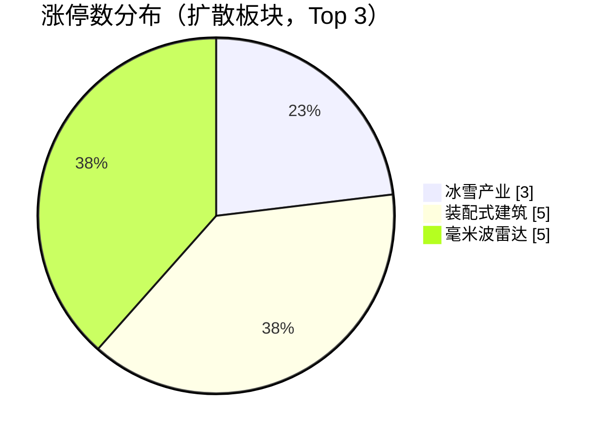

零星涨停板块（<3 只）：广东自贸区(2)、大豆(1)、中韩自贸区(1)、横琴新区(2)、动物疫苗(1)、粮食概念(2)、民爆概念(1)、免税店(1)

**退潮中（跌停集中）**

| 板块 | 跌停 | 有效成分 | 上涨广度 | 中位涨幅 |
|---|---|---|---|---|
| 智能制造 | 2 | 459 | 0.41 | -0.23% |
| 工业互联网 | 2 | 442 | 0.45 | -0.15% |
| 节能环保 | 2 | 333 | 0.51 | +0.09% |
| 网络游戏 | 1 | 58 | 0.16 | -1.08% |
| 手机游戏 | 1 | 56 | 0.18 | -1.23% |
| 医疗器械概念 | 1 | 417 | 0.27 | -0.73% |
| 北交所概念 | 1 | 29 | 0.28 | -0.54% |
| DeepSeek概念 | 1 | 769 | 0.30 | -0.57% |
| 长安汽车概念 | 1 | 231 | 0.30 | -0.32% |
| 机器视觉 | 1 | 252 | 0.31 | -0.62% |
| 抖音概念(字节概念) | 1 | 218 | 0.32 | -0.78% |
| 信创 | 1 | 303 | 0.33 | -0.55% |

### 涨停梯队

> 最高 5 板 ｜ 涨停 53 ｜ 跌停 7 ｜ 炸板 25 ｜ 封板率 68.0% ｜ 打板成功率 19.30% ｜ 一进二 11.90% ｜ 二进三 83.33%

| 身位 | 家数 | 成员（涨幅/封单亿/首封） |
|---|---|---|
| 5板 | 1 | 克来机电 +10.00%/0.012亿/09:31 |
| 3板 | 5 | 天圣制药 +10.00%/0.024亿/09:25；金牛化工 +10.04%/0.021亿/09:58；利君股份 +10.00%/0.019亿/09:25；全筑股份 +9.96%/0.009亿/09:55；*ST瑞茂 +9.84%/0.001亿/09:30 |
| 2板 | 5 | 宏达高科 +10.02%/0.046亿/09:30；证通电子 +9.98%/0.020亿/09:25；好当家 +10.00%/0.012亿/10:28；中央商场 +9.93%/0.003亿/09:25；城市传媒 +9.98%/0.003亿/09:30 |
| 1板 | 42 | 襄阳轴承 +10.02%/0.083亿/11:18；上证环保 +9.98%/0.067亿/09:41；顺灏股份 +10.05%/0.065亿/09:25；雪人集团 +10.03%/0.042亿/10:32；崇达技术 +10.02%/0.041亿/10:11 |

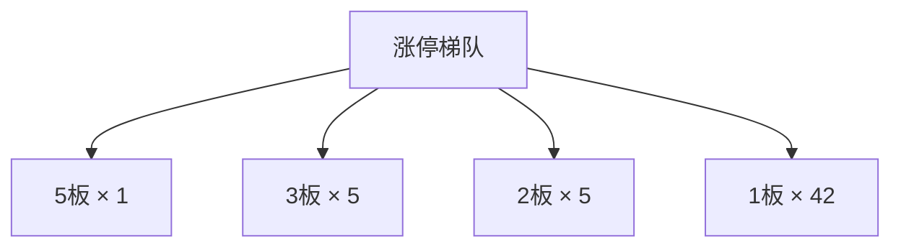

炸板 25 只（前几）：东方海洋(8次)、西部材料(5次)、青山纸业(3次)、安达维尔(3次)、杭州解百(3次)

### 预案池对照

| 票 | 池 | 板块 | 现价 | 涨幅 | 触发价 | 买区 | 风险位 | 判定 |
|---|---|---|---|---|---|---|---|---|
| 杭州解百 `600814.SH` | 执行池 | 一般零售／百货 | 9.0 | +7.78% | 8.35 | [8.31, 8.48] | 8.06 | **超买区** |
| 国芳集团 `601086.SH` | 执行池 | 一般零售／百货 | 11.16 | +3.81% | 10.75 | [10.7, 10.91] | 10.51 | **超买区** |
| 亨迪药业 `301211.SZ` | 观察池 | 流感／药品端（医药商业为扩散对照） | 10.96 | -1.35% | 11.03 | [11.03, 11.37] | 10.46 | **未到价** |
| 特一药业 `002728.SZ` | 观察池 | 流感／药品端（医药商业为扩散对照） | 8.42 | +0.84% | 8.35 | [8.31, 8.48] | 8.22 | **已触发** |
| 家家悦 `603708.SH` | 观察池 | 一般零售／百货 | 9.89 | +2.17% | 9.87 | [9.82, 10.02] | 9.52 | **已触发** |
| 九安医疗 `002432.SZ` | 观察池 | 流感／药品端（医药商业为扩散对照） | 45.77 | -0.50% | 46.0 | [45.77, 46.69] | 44.36 | **买区内** |
| 海南海药 `000566.SZ` | 观察池 | 流感／药品端（医药商业为扩散对照） | 3.53 | -3.55% | 3.66 | [3.64, 3.71] | 3.52 | **未到价** |
| 百花医药 `600721.SH` | 观察池 | 流感／药品端（医药商业为扩散对照） | 7.73 | +0.65% | 7.68 | [7.64, 7.8] | 7.41 | **已触发** |
| 中京电子 `002579.SZ` | 观察池 | PCB／覆铜板 | 18.7 | +4.94% | 17.82 | [17.73, 18.09] | 17.19 | **超买区** |
| 九阳股份 `002242.SZ` | 观察池 | 小家电／九阳人气抱团 | 41.18 | +6.79% | 38.56 | [38.37, 39.14] | 37.18 | **超买区** |
| 金新农 `002548.SZ` | 观察池 | 猪肉／农业存量接力 | 5.25 | +4.79% | 5.01 | [4.98, 5.09] | 4.84 | **超买区** |
| 宁波东力 `002164.SZ` | 观察池 | 机器人／执行器 | 20.89 | -3.73% | 21.7 | [21.59, 22.03] | 20.93 | **未到价** |
| 天孚通信 `300394.SZ` | 观察池 | 光通信／CPO容量修复 | 130.67 | -0.15% | 130.87 | [130.22, 132.83] | 123.61 | **买区内** |

- **杭州解百** — 现价9.0 已高于买区上沿8.48，不追高；仅价格位置对照，不代表完整入场条件确认；不能据此确认站稳，不授予下单权限
- **国芳集团** — 现价11.16 已高于买区上沿10.91，不追高；仅价格位置对照，不代表完整入场条件确认；不能据此确认站稳，不授予下单权限
- **特一药业** — 现价8.42 ≥ 触发价8.35；仅价格位置对照，不代表完整入场条件确认；不能据此确认站稳，不授予下单权限
- **家家悦** — 现价9.89 ≥ 触发价9.87；仅价格位置对照，不代表完整入场条件确认；不能据此确认站稳，不授予下单权限
- **九安医疗** — 现价45.77 落在买区[45.77, 46.69]；仅价格位置对照，不代表完整入场条件确认；不能据此确认站稳，不授予下单权限
- **百花医药** — 现价7.73 ≥ 触发价7.68；仅价格位置对照，不代表完整入场条件确认；不能据此确认站稳，不授予下单权限
- **中京电子** — 现价18.7 已高于买区上沿18.09，不追高；仅价格位置对照，不代表完整入场条件确认；不能据此确认站稳，不授予下单权限
- **九阳股份** — 现价41.18 已高于买区上沿39.14，不追高；仅价格位置对照，不代表完整入场条件确认；不能据此确认站稳，不授予下单权限
- **金新农** — 现价5.25 已高于买区上沿5.09，不追高；仅价格位置对照，不代表完整入场条件确认；不能据此确认站稳，不授予下单权限
- **天孚通信** — 现价130.67 落在买区[130.22, 132.83]；仅价格位置对照，不代表完整入场条件确认；不能据此确认站稳，不授予下单权限

### 盘面 vs 静态复盘 vs 消息面

| 维度 | 对象 | 静态基线（按事实日） | 今日盘面 | 关系 |
|---|---|---|---|---|
| 板块主线 | 光通信／CPO容量修复 | R2 次线 score=62 涨停None（T-1 口径） | 盘面未见该板块成分票涨停 | **背离** |
| 板块主线 | 猪肉／农业存量接力 | R2 次线 score=60 涨停None（T-1 口径） | 盘面未见该板块成分票涨停 | **背离** |
| 板块主线 | PCB／覆铜板 | R2 次线 score=52 涨停None（T-1 口径） | 盘面未见该板块成分票涨停 | **背离** |
| 板块主线 | 机器人／执行器 | R2 次线 score=51 涨停None（T-1 口径） | 盘面未见该板块成分票涨停 | **背离** |
| 板块主线 | 算力租赁／AIDC存量 | R2 次线 score=51 涨停None（T-1 口径） | 盘面未见该板块成分票涨停 | **背离** |
| 板块主线 | 小家电／九阳人气抱团 | R2 次线 score=50 涨停None（T-1 口径） | 盘面未见该板块成分票涨停 | **背离** |
| 情绪阶段 | 冰点 | R3 原生六态基线（事实日 2026-11-25） | 涨停53 跌停7 炸板率3.51% 打板成功率19.3% | **待研判** |
| 梯队结构 | 最高5板 | 未提供同口径前序梯队 | 今日 5板×1、3板×5、2板×5、1板×42；封板率0.6795 炸板25只 | **待研判** |
| 预案验证 | 杭州解百(600814.SH) | 预案 一般零售／百货／leader／触发价8.35／买区[8.31, 8.48] | 超买区：现价9.0 已高于买区上沿8.48，不追高；仅价格位置对照，不代表完整入场条件确认；不能据此确认站稳，不授予下单权限 | **背离** |
| 预案验证 | 国芳集团(601086.SH) | 预案 一般零售／百货／core_midcap／触发价10.75／买区[10.7, 10.91] | 超买区：现价11.16 已高于买区上沿10.91，不追高；仅价格位置对照，不代表完整入场条件确认；不能据此确认站稳，不授予下单权限 | **背离** |
| 预案验证 | 亨迪药业(301211.SZ) | 预案 流感／药品端（医药商业为扩散对照）／watch_elastic／触发价11.03／买区[11.03, 11.37] | 未到价：现价10.96，触发价11.03，还差0.64%；仅价格位置对照，不代表完整入场条件确认；不能据此确认站稳，不授予下单权限 | **无响应** |
| 预案验证 | 特一药业(002728.SZ) | 预案 流感／药品端（医药商业为扩散对照）／watch／触发价8.35／买区[8.31, 8.48] | 已触发：现价8.42 ≥ 触发价8.35；仅价格位置对照，不代表完整入场条件确认；不能据此确认站稳，不授予下单权限 | **印证** |
| 预案验证 | 家家悦(603708.SH) | 预案 一般零售／百货／watch／触发价9.87／买区[9.82, 10.02] | 已触发：现价9.89 ≥ 触发价9.87；仅价格位置对照，不代表完整入场条件确认；不能据此确认站稳，不授予下单权限 | **印证** |
| 预案验证 | 九安医疗(002432.SZ) | 预案 流感／药品端（医药商业为扩散对照）／watch／触发价46.0／买区[45.77, 46.69] | 买区内：现价45.77 落在买区[45.77, 46.69]；仅价格位置对照，不代表完整入场条件确认；不能据此确认站稳，不授予下单权限 | **印证** |
| 预案验证 | 海南海药(000566.SZ) | 预案 流感／药品端（医药商业为扩散对照）／watch／触发价3.66／买区[3.64, 3.71] | 未到价：现价3.53，触发价3.66，还差3.68%；仅价格位置对照，不代表完整入场条件确认；不能据此确认站稳，不授予下单权限 | **无响应** |
| 预案验证 | 百花医药(600721.SH) | 预案 流感／药品端（医药商业为扩散对照）／watch／触发价7.68／买区[7.64, 7.8] | 已触发：现价7.73 ≥ 触发价7.68；仅价格位置对照，不代表完整入场条件确认；不能据此确认站稳，不授予下单权限 | **印证** |
| 预案验证 | 中京电子(002579.SZ) | 预案 PCB／覆铜板／watch／触发价17.82／买区[17.73, 18.09] | 超买区：现价18.7 已高于买区上沿18.09，不追高；仅价格位置对照，不代表完整入场条件确认；不能据此确认站稳，不授予下单权限 | **背离** |
| 预案验证 | 九阳股份(002242.SZ) | 预案 小家电／九阳人气抱团／watch／触发价38.56／买区[38.37, 39.14] | 超买区：现价41.18 已高于买区上沿39.14，不追高；仅价格位置对照，不代表完整入场条件确认；不能据此确认站稳，不授予下单权限 | **背离** |
| 预案验证 | 金新农(002548.SZ) | 预案 猪肉／农业存量接力／watch／触发价5.01／买区[4.98, 5.09] | 超买区：现价5.25 已高于买区上沿5.09，不追高；仅价格位置对照，不代表完整入场条件确认；不能据此确认站稳，不授予下单权限 | **背离** |
| 预案验证 | 宁波东力(002164.SZ) | 预案 机器人／执行器／watch／触发价21.7／买区[21.59, 22.03] | 未到价：现价20.89，触发价21.7，还差3.88%；仅价格位置对照，不代表完整入场条件确认；不能据此确认站稳，不授予下单权限 | **无响应** |
| 预案验证 | 天孚通信(300394.SZ) | 预案 光通信／CPO容量修复／watch_elastic／触发价130.87／买区[130.22, 132.83] | 买区内：现价130.67 落在买区[130.22, 132.83]；仅价格位置对照，不代表完整入场条件确认；不能据此确认站稳，不授予下单权限 | **印证** |
| 消息面对照 | 盘面热点板块 | R4 消息面（T-1 口径） | 实时快讯未出现热点板块关键词 | **无响应** |

**分歧点（不掩盖）：**
- 板块主线·光通信／CPO容量修复 → 背离：T-1 有辨识度但今日盘中无涨停响应，题材未获资金确认
- 板块主线·猪肉／农业存量接力 → 背离：T-1 有辨识度但今日盘中无涨停响应，题材未获资金确认
- 板块主线·PCB／覆铜板 → 背离：T-1 有辨识度但今日盘中无涨停响应，题材未获资金确认
- 板块主线·机器人／执行器 → 背离：T-1 有辨识度但今日盘中无涨停响应，题材未获资金确认
- 板块主线·算力租赁／AIDC存量 → 背离：T-1 有辨识度但今日盘中无涨停响应，题材未获资金确认
- 板块主线·小家电／九阳人气抱团 → 背离：T-1 有辨识度但今日盘中无涨停响应，题材未获资金确认
- 预案验证·杭州解百(600814.SH) → 背离：仅研究对照，不授予交易权限
- 预案验证·国芳集团(601086.SH) → 背离：仅研究对照，不授予交易权限
- 预案验证·中京电子(002579.SZ) → 背离：仅研究对照，不授予交易权限
- 预案验证·九阳股份(002242.SZ) → 背离：仅研究对照，不授予交易权限
- 预案验证·金新农(002548.SZ) → 背离：仅研究对照，不授予交易权限

### 观察建议（仅研究）

- **环境**：涨停 53.0 / 跌停 7.0，打板成功率 19.3%，一进二 11.9%。
- **方向**：今日形成实质扩散的是 冰雪产业（涨停3/成分61，密度0.049，中位-0.11%）、装配式建筑（涨停5/成分109，密度0.046，中位+0.12%）、毫米波雷达（涨停5/成分126，密度0.040，中位+0.37%）。**需确认**：次日能否维持涨停家数且中位涨幅不掉队，否则只是普跌中的避险轮动。
- **零星**：广东自贸区(2只/29成分)、大豆(1只/15成分)、中韩自贸区(1只/17成分)、横琴新区(2只/38成分)、动物疫苗(1只/20成分) 属零星个例，不视为题材，不据此选股。
- **回避**：智能制造（跌停2）、工业互联网（跌停2）、节能环保（跌停2） 板块中位跌幅深，趋势未止跌前不接。
- **身位**：最高 5 板。梯队有高度不等于可接力，需逐票核验封单稳定性与开板次数后再定。
- **预案**：杭州解百（现价9.0 已高于买区上沿8.48，不追高；仅价格位置对照，不代表完整入场条件确认；不能据此确认站稳，不授予下单权限）、国芳集团（现价11.16 已高于买区上沿10.91，不追高；仅价格位置对照，不代表完整入场条件确认；不能据此确认站稳，不授予下单权限）、中京电子（现价18.7 已高于买区上沿18.09，不追高；仅价格位置对照，不代表完整入场条件确认；不能据此确认站稳，不授予下单权限）、九阳股份（现价41.18 已高于买区上沿39.14，不追高；仅价格位置对照，不代表完整入场条件确认；不能据此确认站稳，不授予下单权限）、金新农（现价5.25 已高于买区上沿5.09，不追高；仅价格位置对照，不代表完整入场条件确认；不能据此确认站稳，不授予下单权限）。买区已错过，**不追高**；要参与需等新剧本，不能沿用原预案价位。
- **预案待检验**：亨迪药业(触发价11.03，还差+0.64%)、海南海药(触发价3.66，还差+3.68%)、宁波东力(触发价21.7，还差+3.88%) 尚未触及触发价，剧本未被盘面检验，继续按原失效条件看。

<details>
<summary>原始截面与数据质量（折叠）</summary>

**跨源校验**

```json
{
  "xtick": {
    "up": 2380,
    "down": 2946,
    "n": 5586,
    "amount_yi": 7962.1
  },
  "rtk_snapshot": {
    "up": 2379,
    "down": 2939,
    "valid_n": 5578,
    "amount_yi": 8016.9,
    "up_limit": 53,
    "down_limit": 7
  },
  "note": "两源口径不同（XTick 全市场含全部票；rt_k 返回样本）"
}
```

**采集错误**

```json
[
  "news: TimeoutError: timed out"
]
```

**rt_k 截面（原始）**

```json
{
  "market": {
    "total": 5586,
    "up": 2379,
    "down": 2939,
    "flat": 260,
    "requested_n": 5586,
    "received_n": 5586,
    "valid_n": 5578,
    "missing_n": 8,
    "universe_requested_n": null,
    "population_scope": "returned_rows_not_verified_all_a_universe",
    "up_ratio": 0.4259,
    "legacy_up_ratio_placeholder": false,
    "up_ratio_is_observed": true,
    "up_ratio_all": 0.4259,
    "up_ratio_valid": 0.4265,
    "up_ratio_denominator": "requested_n",
    "degraded": false,
    "limit_known_n": 5578,
    "limit_unknown_n": 0,
    "limit_counts_complete": true,
    "limit_source_errors": [],
    "up_gt3": 326,
    "up_gt5": 135,
    "up_limit": 53,
    "down_gt3": 247,
    "down_gt5": 88,
    "down_limit": 7,
    "amount_yi": 8016.9,
    "amount_sum_overflow": false,
    "amount_valid_n": 5578,
    "amount_missing_n": 0
  },
  "source_time_quality": {
    "quote_age_min_seconds": 3.312395,
    "quote_age_max_seconds": 32.312395,
    "source_age_limit_seconds": null,
    "freshness_status": "age_limit_not_configured",
    "age_reference_at": "2026-11-26T11:30:32.312395+08:00"
  },
  "trading_authorized": false
}
```

</details>

## 分时研判记录

### 09:30 研判增量

> 证据轮次 = 09:30 analysis（报价截至 09:31:04）；当日首轮，无相邻盘中轮次可比，基线取昨收事实日 2026-11-25。

- **趋势**：开盘反转成立，但形态是普涨修复、不是攻击。广度 68.9%（有效 5573 只，涨 3838/跌 1387）对昨收 10.5%（586/5573）、中位 -3.77%；涨逾5% 57 只、跌逾5% 47 只，昨日是 1860 只跌逾5%。而涨停只有 16 只（昨 51）、最高 3 板（昨 5 板）——赚钱效应回来了、强势集中度没回来。高度端明确不给奖：昨 5 板中京电子仅 +0.73%（17.95）、昨 4 板金新农 0.00%（5.01）、昨 3 板 6 只无一晋级 4 板（jj3t4=0.0）。边界：首轮报价只有开盘 1 分钟（含竞价），成交 617.4 亿不可与昨全天 13829 亿线性比；一进二 7.14%、二进三 50% 在 09:30 只反映开盘瞬间，不能当胜率；昨涨停池今日红盘率本轮未算（缺 cohort×报价 join），仅用上述三只代理。
- **轮动**：真正在扩散的是军工／商业航天与光伏电池，两条都不在原预案。国防军工（申万口径）2 涨停／141 成分，广度 96.5%、中位 +1.58%、相对全市场 +1.12%、首分钟成交 17.8 亿——是板块整体抬升而非涨停抱团；成飞概念广度 0.907 佐证。光伏电池端钙钛矿电池 3 涨停／92 成分（广度 0.85、中位 +1.13%、相对 +0.67%）、TOPCON 2／82（广度 0.84、中位 +1.25%），是今日唯一"涨停数＋广度"双确认的板块；催化见 09:30:11 快讯（西部材料、上海沪工、利君股份、顺灏股份涨停，信维通信涨超15%）。反向失血正是预案两条防守线：商贸零售 2 涨停／100 成分但广度仅 0.46、中位 0.00%、相对 -0.46%——杭州解百、家家悦只是两点强，行业整体弱于市场；流感线仅特一药业 +8.86% 独走，亨迪 -0.36%、九安 +0.04%、海南海药 -2.19%、百花医药 -1.69%，全板块无涨停。跷跷板：预案 B 计划（零售／医药整线不及预期 → CPO 容量承接天孚）**不成立**——零售整体未崩（杭州触板 +5.99%、家家悦 +4.65%），天孚 131.51 仅 +0.49% 刚过 130.87，中际／新易盛无一只转红，容量线未获确认。今日实际跷跷板是"防守线 → 军工＋光伏"，A/B 剧本都未覆盖，独立记录，不硬套原分支。
- **剧本**：预案开盘执行条件为"同窗广度≥55% 且 昨涨停池红盘率≥60%"。前半达成（68.9%），后半未核，代理证据偏负（昨 5 板 +0.73%、昨 4 板 0.00%、昨 3 板 0/6 晋级）——**双条件只满足一半，不构成按预案执行初试的依据**；且 autonomous_trading_enabled=false、requires_user_confirmation=true，本轮无任何下单许可。零售线内条件"杭州守 8.35 ＋ 国芳／家家悦至少 1 只助攻"：杭州 8.85 守住✓、家家悦 +4.65% 助攻✓，但国芳 10.53（-2.05%，低于触发价 10.75）掉队，龙二失守。更要紧的是杭州解百已在炸板名单（触板后开板 1 次，由 +9.1% 回落至 +5.99%），与 11/25 零售"4 封 3 未回封"是同一个兑现不完整的毛病。执行池：杭州 8.85 高于买区上沿 8.48（超买区不追）、国芳 10.53 未到价差 2.09%。流感线：特一 9.09 已远超买区 8.31–8.48，且它是 R6 判定的"杂毛＋红旗、只作时序对照"——线内最弱票领涨，是这条线质量差的信号，不做。已触发 6 只（亨迪 11.07、九安 46.02、中京 17.95、金新农 5.01、宁波东力 22.01、天孚 131.51）全部只是价格贴着触发线（偏离仅 0.0%–1.43%），无一只走出突破幅度；触发 ≠ 有效（本轮无分钟量能序列，不足以判断放量，标未核）。09:25 竞价快照缺失（fetch 在 09:27），杭州／特一竞价最低价未核，不能断言"原买点没给"或"已错过"。
- **下一步看**：① 09:50–10:00 同口径广度（up_ratio_valid，分母 5573）能否守住 ≥55%；跌破 50% 即确认高开低走，按"修复发生过、当前未延续"处理。② 昨涨停池 55 只今日红盘率补算（需下一轮 cohort×报价 join）；<60% 则初试条件整条不成立，维持不执行。③ 杭州解百 10:00 前能否回封；若跌破预案硬条件 8.35，该票当日取消，不再看买区。④ 军工是否延续：国防军工广度由 96.5% 降到 <70%，或西部材料（1 板／封单 0.077 亿）、铖昌科技（封单仅 0.020 亿、偏薄）任一炸板 → 降级为一日脉冲。⑤ 光伏电池：10:00 前钙钛矿(3/92)＋TOPCON(2/82) 涨停合计能否 ≥6 且中位涨幅守住 ≥+1%；钧达股份（1 板、成交 1.67 亿为 1 板最活跃）是关键观察点。⑥ 天孚通信：需站上 130.87 且 CPO 上涨家数由 10/100 扩张、中际／新易盛至少 1 只转红——B 计划唯一启动条件，现仅价格过线、无同伴。

### 09:40 研判增量

> 证据轮次 = 09:40 analysis（报价截至 09:41:04，有效 5578 只）；前置轮 09:30。补充核对：昨涨停池 51 只同源报价截至 09:48:08–09:48:11（tushare rt_k），与 09:40 截面非同瞬，只用于门槛补齐，不与本轮截面混算。

- **趋势**：高开低走已从"可能"变"已发生"，但形态不是普跌，是强势集中＋尾部扩散。同口径广度 68.9%（有效 5573，涨 3838/跌 1387）→ 40.0%（有效 5578，涨 2231/跌 2989），10 分钟 −28.9 个百分点；指数同步回落：上证 0.31%→0.08%、中证500 0.92%→0.26%、创业板指 1.14%→0.54%、科创50 0.23%→−1.21%（另见同花顺 09:39:56 快讯"科创50 现跌1.5%、此前涨超1%"，与 rt_idx_k 非同源，不拼成一条曲线）。同时涨停 16→24、涨逾5% 57→65、跌逾5% 47→76、炸板 3→9（封板率 84.2%→72.7%，成交额 617.4 亿→2258.2 亿为累计值、不可与昨全天比）。涨停增而广度塌＝钱在往少数票集中，不是全面退潮。边界：09:30 首分钟报价含竞价一次性定价，那 −28.9pp 不能全归盘中失血；但指数与快讯两条独立证据同向，方向成立。
- **轮动**：钱从科技／科创搬到化工、零售与军工余温。申万一级相对全市场中位（09:30→09:40）：计算机 −0.13→−0.56、医药生物 −0.31→−0.61、电子 +0.24→−0.11（广度 0.778→0.435）；反向：煤炭 +1.42、有色 +0.91、基础化工 +0.40（涨停 0→3，中毅达 09:38 涨停）、商贸零售 −0.46→+0.18（广度 0.46→0.57）。概念层真扩散（涨停≥3）：煤化工 3/110（广度 0.764、中位 +0.92）、土壤修复 3/91、钙钛矿 3/92（广度 0.848→0.565、中位 1.13→0.27，退了）。军工一日脉冲已被打掉一半：国防军工广度 0.965→0.773、涨停 2→1，铖昌科技（+8.44%）与上海沪工（+8.82%）双双入炸板名单——09:30 设的"铖昌炸板即降级"条件已触发。跷跷板不是预案设的"零售→CPO"，而是"科技→周期＋零售"；零售与流感是失血市场里的两处逆势，医药生物广度仅 0.224 而亨迪、特一、拓新、康芝在涨＝板块失血＋个股抱团。
- **剧本**：预案三条硬闸本轮 0/3 通过，初试条件不成立。①"开盘同窗广度≥55%"：40.0%，不成立。②"昨涨停池红盘率≥60%"：09:48 同源补齐 30/51＝58.8%（中位 +1.89%、池内再涨停 6 只），差 1.2pp，不成立；口径为 tushare limit_list_d 非ST 51 只，预案 market_facts 记 55 只，含 ST／北交所差异，未对齐。③"炸板率>25%"：9/(24+9)＝27.27%（09:30 为 15.79%），已升破；"百货资金转负"本轮未核。分层反馈：1板 37→4 再板（10.8%）、2板 5→2（40%，天圣制药／利君股份晋级 3 板）、3板 6→0、4板 2→0、5板 1（中京电子 +2.53%）→0，高度端连续第三日不给奖。线内条件：杭州解百守 8.35 ✓（09:48 8.89）、国芳 +3.35%（11.11）、家家悦 +4.03%（10.07）双助攻 ✓，但杭州当日触板 3 次未封、距涨停价 9.19 差 3.32%——"守住＋助攻"成立，"回封"未成立。09:30 设的光伏条件（钙钛矿＋TOPCON 合计≥6 且中位≥+1%）不成立：中位 0.27，TOPCON 被挤出 hot 前 12、其本轮数值未留存。B 计划天孚 128.50（−1.81%）未站 130.87，继续远离。预案注脚"全市场降档"三项：涨面<50% ✓、炸板率>25% ✓、两条线前排均回吐 ✗（零售／流感前排都在涨）→2/3，严格按注脚未达"降档"，但前两项已足以否掉按预案初试（本轮无买权：autonomous_trading_enabled=false、requires_user_confirmation=true）。
- **下一步看**：① 10:00–10:10 同口径广度（分母约 5578）能否收回 50%；若仍 <45% 且涨逾5% 自 65 掉头 → 高开低走定性，不再按修复剧本处理。② 炸板率是否连续第二轮 >25%（对应涨停 ≤24 且炸板 ≥9）；若回到 ≤25%，按字面仍算已触发一次，但按"连续两轮"口径才升级为当日不再新增——预案未定义统计窗口，这一点需按连续口径读，不改阈值。③ 昨板 51 只红盘率能否到 60%（再 1 只转红即 60.8%）。④ 杭州解百 10:00 前能否封住 9.19（以实际涨停价为准）；封不住且跌破 8.35，预案明写该票当日取消。⑤ 军工：西部材料（1板在封）炸板或国防军工广度跌破 0.70 → 彻底否决；广度回 0.85 以上且涨停回到 2 只才维持。⑥ 化工链：涨停 ≥4 且中位守住 ≥+0.9%；金牛化工（昨 2 连板，现 +7.07%）能否封板，决定煤化工是否成为新持续方向。⑦ 科创50 收复 0% 且电子广度回到 0.60，才算科技失血结束；在此之前不把科创反弹当主线回归。


### 09:50 研判增量

> 证据轮次 = 09:50 analysis（rt_k 报价 09:50:24–09:51:04，XTick 参考 09:51:12）；前轮 09:40。广度分母同为 5578，可跨轮比较。

- **趋势**：10 分钟里发生了一次修复，但只修到"对半"，没修到"可以确认"。同分母广度 40.0%→46.9%（涨 2231→2618、跌 2989→2615），涨停 24→32（XTick 口径；rt_k 截面 31，差 1 只属源口径差，不并列成两个事实）、涨逾 5% 65→86、涨逾 3% 157→202、跌逾 5% 76→72；指数上证 0.08%→0.00%、创业板指 0.54%→0.69%、科创50 −1.21%→−0.55%，科创收复约一半。三个必须扣住的边界：① 炸板只数仍是 9 只、没减少，break_rate 27.3%→22.0%（9/41）是涨停变多造成的算术稀释，不是炸板转好；② 高度端连续第三日不给奖——最高仍 3 板（天圣制药、利君股份、*ST瑞茂），新增全部落在低位：2 板 1→4、1 板 20→25；③ 渲染表把 emotion.zbl＝3.51 显示成"炸板率 3.51%"，那是打板类字段口径，与 ladder break_rate 22.0% 不是同一回事，两个数不能互引。
- **轮动**：09:40 记的"科技→周期＋零售"本轮部分回摆，钱回的是硬件、不回软件。电子 广度 0.435→0.634、相对 −0.11→+0.40、涨停 3→4、成交 544→809 亿；先进封装 涨停 0→0→3／210 只、广度 0.538→0.724、相对 +0.74（前两轮均无涨停，是本轮唯一"涨停＋广度＋相对强度"三合一的窄成分板块）；通信 广度 0.50→0.664、相对 +0.46 但 0 涨停。催化落在 09:50:06／09:50:15 两源同题快讯"元件板块再度拉升，金禄电子涨超13%"（生益电子、胜宏科技、生益科技、四会富仕跟涨），先涨后见报，驱动未核。软件继续失血：计算机 广度 0.241、相对 −0.59、2 只涨停都是孤军；传媒 0.298／−0.53。反向最狠的是医药生物：广度 0.224→0.157、相对 −0.61→−0.89（本轮跌幅第一），09:50:37 快讯"创新药概念早盘调整、近岸蛋白跌超10%"；医疗器械 涨停 2→5 但广度一直卡在 0.30——涨停增加、扩散不动，是抱团不是板块修复。军工三连降 0.965→0.773→0.518、涨停 2→1→1，09:30 设的"广度跌破 0.70 即彻底否决"已触发。跷跷板因此从"科技→周期＋零售"变成"军工／光伏→电子元件"，零售未失血（相对 +0.18→+0.20、涨停 2→3）。值得单列的一层：≥3 涨停的概念板块从 23 个跳到 44 个，但最高涨停密度仍是 0.067（即单个 1 只涨停的小板块），涨停从抱团变成撒网——这是无主线的形态，不能读成多线共振。数据中心(AIDC) 4 涨停／664 只、成交 812 亿为全场最大，相对只 +0.16：有钱没价，是分歧位不是主升位。
- **剧本**：三条硬闸 1/3。① 广度≥55%：46.9%，连续两轮不成立（40.0%、46.9%）。② 昨板红盘率≥60%：本轮 analysis 缺 cohort×报价 join，**未重算，标缺失**，最后已知仍是 09:48 同源 30/51＝58.8%（差 1.2pp），不拿旧数当本轮结论。③ 炸板率>25%：22.0% 回落，按 09:40 定的"连续两轮"口径只算一轮，未升级。零售线内条件成立：杭州 8.96 守 8.35 ✓，国芳 11.12（+3.44%）、家家悦 10.23（+5.68%）双助攻 ✓。但同轮两源冲突必须先点明：rt_k 09:51:04 报 8.95（+7.19%），XTick 涨停板端点 09:51:12 报 +10.06%、broken_times＝3（按昨收 8.35 折 9.19 涨停价）；8 秒差 2.6%，不拼成一条轨迹，只能写到"在涨停附近反复、至少守住 8.35"，回封未确认。流感线：亨迪 11.65、特一 8.75 均在买区上方，但板块广度 0.157、R2 仍无已确认龙一/龙二，板块级负面快讯已出——两票再强也改不了板块失血，不进执行池。B 计划（天孚 131.41 贴 130.87 触发价）仍缺同伴：通信广度修复但 0 涨停；中京电子（PCB watch）18.15 只在买区上沿外 0.06 元，元件快讯没把它抬起来——方向对、核心没动，这正是"预案名字在涨"不等于"辨识度在涨"。反证样本：宁波东力 09:30 已触发 22.01 → 0950 20.96（−3.41%）跌回触发价下方；金新农 5.01 磨平盘（昨 4 板今天 0.00%）——触发≠有效，两轮内就被打回。权限事实：autonomous_trading_enabled=false、requires_user_confirmation=true，本轮全部只作研究观察；仓位建议 valid_until＝10:00（总仓 20%／初试 11%）在 5 分钟后到期，R1 自己的意见是 0%，过期后不延用旧数。
- **下一步看**：① 10:00–10:10 同分母（5578）广度能否收回 50%（差 3.1pp）；若涨逾 5% 从 86 继续扩而广度仍 <50%，定性"尾厚身薄"，只认龙头不认扩散。② 电子：广度≥0.65 且涨停≥4 才算新对抗方向；金禄电子开板＋元件退潮＝09:50 一次性脉冲。③ 军工已否决，复审唯一条件：广度回 0.85 且涨停≥2。④ 杭州：以 10:00 轮 rt_k 价为准，封住 9.19 才算回封；跌回 8.35 以下预案明写该票当日取消。⑤ 炸板：只数回到 ≥11 且涨停 ≤30 才再破 25%，在此之前不升级"当日不再新增"。⑥ 仓位建议 10:00 到期，重算前不延用 D1 的 20%／11%，重算依赖 ②④ 两项结果。


### 10:00 研判增量

> 证据轮次 = 10:00 analysis（rt_k 报价 10:01:04–10:01:08，有效 5578 只，XTick 参考 10:01:12–10:01:13）；前轮 09:50，广度分母同为 5578，可跨轮比较。闸门②的 cohort 单独补齐并单独标时点：昨涨停 51 只／昨炸板 30 只用同源 XTick `/doc/order/day` 在 10:08:51–10:08:57 取价，与 10:00 截面非同瞬，只用于门槛判定，不与截面混算。

- **趋势**：09:40–09:50 那段修复已在 09:50–10:00 结束，本轮转为**放量失血**。同分母广度 46.9%→39.4%（涨 2618→2196、跌 2615→3075），全市场中位 0.00%→−0.23%，10 分钟成交 +723 亿（3274→3996 亿，累计值，不与昨全天线性比）。结构比总数更说明问题：涨逾 3% 202→204 基本不动，跌逾 3% 179→222、跌逾 5% 72→89——**头部没坏、尾部在塌**。涨停只数不动（32，XTick 口径；rt_k 31），但炸板 9→16、封板率 78.0%→66.7%、炸板率 22.0%→33.3%：同一个 32 只是"到过涨停"的池子在扩大，不是新钱进场。指数同向：上证 −0.00%→−0.08%、创业板 +0.69%→+0.11%、中证 1000 +0.28%→+0.11%、科创 50 −0.55%→−0.57%；ETF 上涨样本 865/1699→760/1707（分母变了 8 只，只作方向参考不作严格比较）。两条口径边界先扣住：emotion.zbl 3.51→7.02 是打板类字段，与 ladder 炸板率 33.3% 不是一回事，不互引；高度端本轮**首次出现晋级**——金牛化工 09:58 首封、2→3 板，但最高仍 3 板，1 板 25→25、2 板 4→3（中央商场跌出梯队并入炸板名单 5 次）——晋级有了、扩容没有。
- **轮动**：钱从"防御抱团"搬到"周期＋农业"，方向本轮可证。**预案防守线的板块级支撑消失**：商贸零售（申万）广度 0.52→0.44、相对全市场 +0.20→−0.04、涨停 3→2；前排三只只剩个股还红，且全部回吐三分之一到一半（杭州 +7.19%→+3.59%、国芳 +3.44%→+1.02%、家家悦 +5.89%→+2.79%）。接钱的两头：基础化工 6 涨停／451 只、广度 0.616、相对 +0.66、成交 214 亿，是全场唯一"广度>0.6 且有 6 只涨停"的行业（09:40 设的"涨停≥4"达成、"中位≥+0.9%"未达，本轮中位 +0.43%），金牛化工是化工内部第一个晋级；农林牧渔广度 0.39→0.44、相对 −0.20→+0.23，是唯一"广度与相对强度双升"的行业，概念层粮食 2/48（广度 0.67、相对 +1.08）、玉米 1/34（0.74、+1.21）、大豆 1/15（0.67、+0.68），金健米业 10:01 首封 1 板。失血端：医药生物广度 0.14、相对 −0.81（cold 第一）、机械设备 0.33（4 涨停但 2 跌停，宁波东力 −4.65%）。更关键的一层：09:40 的真扩散本轮全部降级——煤化工 3/110、土壤修复 3/91、钙钛矿 3/92 全数跌出 hot 前 12（热榜按涨停密度排序，0.027–0.033 的旧值本轮本应排进前 6，缺席即推断其涨停数已 <3；成分数未变可作旁证，但未逐板块复查），与"申万化工 6 只涨停却无任一概念 ≥3"同证：**有钱、没主线，钱散在化工不同细分**。跷跷板：09:50 记的"军工／光伏→电子元件"两端本轮都不成立（军工 09:40 已否决、钙钛矿跌破 3 涨停、元件本轮无该字段＝缺失不计 0）；实际跷跷板换成"零售／流感抱团 ↔ 化工＋农业"，以及**昨日封住的票 ↔ 昨日炸板的票**（见剧本）。B 计划（CPO 容量）本轮失守：天孚 131.41→129.36（−1.15%），跌回 130.87 触发价下方，中际／新易盛是否转红本轮未取，标未核。
- **剧本**：预案三道硬闸本轮 2/3，但主闸是合取式，结论仍**不执行**。① 开盘同窗广度≥55%：当前 39.4%，连续三轮不成立（40.0、46.9、39.4）；"开盘同窗"这一窗已过，事后只能写"09:30 那窗广度 68.9% 达标、红盘率当时未测"，不能追认两条件同时成立。② 昨涨停池红盘率≥60%：10:08 同源补齐 **31/51＝60.8%**（中位 +2.83%、涨逾 5% 14 只、跌逾 5% 10 只、6 只再涨停：宏达高科、证通电子、利君股份、天圣制药、城市传媒、金牛化工），**首次达成**；但同一口径下昨炸板 30 只只有 4 只红盘（13.3%）、中位 −3.59%——封住的给奖、炸板的挨打，是两极分化，不能拿 60.8% 单独当回暖读。③ 盘中炸板率>25%：本轮 33.3%（16/48）字面成立；前两轮定的"连续两轮"口径下 0940 27.3%→0950 22.0%→1000 33.3% 未连续，只算新触发一次——但预案原文是"炸板率>25% 当日不再新增"，**字面已生效**。④ 百货资金转负：本轮 analysis 无同轮资金字段，标缺失，不用 0 代。线内条件：杭州 8.65（+3.59%）仍守 8.35 ✓、国芳／家家悦双助攻 ✓，但三者同轮全部回吐、板块相对强度转负——条件字面成立、右侧确认在恶化，只能写"未失效也不成立"。预案池其余：国芳 10.86 已回落到买区 [10.70,10.91] 内、家家悦 9.95 回到 [9.82,10.02] 内——位置回到区间**不是买点**，板块动能与炸板率两条反向证据同时成立；金新农 5.01→5.29（+5.59%，昨 4 板）、九阳 40.86→41.30（+7.11%，昨 3 板）、中京 18.15→18.26（昨 5 板）三只高位票逆势强于中位 −0.23%，但三只预案明写硬拒／只作温度计，变强只改温度计读数、不改资格；天孚跌回触发价下方＝B 计划当日作废条件之一已现。权限事实：预案文件 no_trade=false、预算 20%，但 mode=dry_run、autonomous_trading_enabled=false、requires_user_confirmation=true＝**无下单许可**；仓位建议 valid_until=10:00 已过期，初试 11% 不得延用。
- **下一步看**：① 10:10–10:20 同分母（5578）广度能否回 45%；若仍 <40% 且跌逾 5% 由 89 扩到 >100，定性"高开低走已确认，修复只发生在 09:40–09:50"。② 炸板只数能否回落到 ≤10（涨停 30–32 只时炸板率 23.8%–25.0%，才回到 ≤25% 以内）；回不去则"当日不再新增"按预案字面持续生效。③ 化工：涨停维持 ≥5、广度 ≥0.58，且金牛化工（3 板、封单仅 0.034 亿，偏薄）不炸；它一炸，化工晋级链断，今日不提高到"主线"。④ 农业：粮食 2/48＋玉米 1/34 广度守住 ≥0.65、金健米业封住，才把农业从"逆势"升级为可跟踪方向；掉回 <0.55 即一日反抽。⑤ 杭州解百：以 10:10 轮 rt_k 价为准，守 8.35 则线内条件续存，跌破 8.35 预案明写该票当日取消；封 9.19 需分钟路径，本轮不推断（XTick 板端仍报 +10.06%、broken_times 3，与 rt_k 8.65 非同源非同瞬，不拼成轨迹）。⑥ 昨板 cohort：红盘率跌破 55% → 60.8% 只是"少数票在扛"；昨炸板池红盘率回到 >30% 才算情绪修复开始。⑦ 九安 45.55（差 0.99%）、海南海药 3.53（差 3.68%）、百花 7.52（差 2.13%）、宁波东力 20.69（差 4.88%）仍未到价，剧本未被检验，按原失效条件看，不因大盘下跌改价。

### 10:10 研判增量

> 证据轮次 = 10:10 analysis（rt_k 报价 10:11:04，有效 5578 只，errors=[]）；前轮 10:00，广度分母同为 5578，可跨轮比较。另用 XTick `/doc/order/day?code=all`＋`/doc/hot/board`＋`/doc/hot/emotion`＋`/doc/order/amount` 在 **10:16:53／10:17:09** 做只读复核（全市场 5586 行，报价时点 10:16:53，成交两源 5128 亿），与 10:10 截面**非同瞬**，只作轨迹延伸，不拼成同一瞬间；板块广度用 analysis 同一套 `agn`/`sw1` 成分与有效报价分母现算。

- **趋势**：10:00–10:10 是今天第一次**连续两轮向上的修复**，10:16:53 复核确认还在延续。同分母广度 39.4%→57.9%（涨 2196→3234），复核 65.1%（涨 3638/5586；`order/amount` 独立报 up 3636／down 1691，两源同向）；涨逾 3% 204→366→432、涨逾 5% 78→138→135、跌逾 3% 222→187→163、跌逾 5% 89→76→81、成交 3996→4677→5128 亿（累计值，不与昨全天 13829 亿线性比）、全市场中位 −0.23%→**+0.53%**（复核口径）。**但高度端连续第四日不给奖**：涨停 32→36→42（emotion 口径 10:17:09；板端 10:18 复查已 44 只，其中 1 板 36／2 板 3／3 板 5，与 emotion 42 差 2 属端点口径差，不并成精确梯队），最高仍 3 板（mhigh 3），三进四 0.0%、四进五 0.0%——**首板仍占八成以上，这是首板扩散，不是梯队拔高**。炸板率 16/58＝27.6%（前轮 18/54＝33.3%），仍在预案 25% 线之上，只是炸板只数从 18 降到 15（板端 flag3）／16（emotion zbnum，两端点差 1，不并列成两个事实）。
- **轮动**：10:00 记的"化工＋农业"没有断，本轮多了一条更硬的大板块。同一分母现算（10:16:53）：**共封装光学(CPO) 230 只、广度 0.848、中位 +2.13%、涨停 6 只**——全场唯一"广度>0.8＋中位>+2%＋涨停≥6"的概念，相对全市场中位 +1.60pp；农业化工三类同向：化肥 75 只 0.880/+1.67/2 涨停、磷化工 67 只 0.881/+1.57、煤化工 110 只 0.855/+1.33/3 涨停、玉米 34 只 0.824/+1.44、粮食 48 只 0.812/+1.31/2 涨停、大豆 15 只 0.867/+1.18；第三代半导体 184 只 0.804/+1.16 也翻上 0.8。**预案防守线本轮站回来了**：商贸零售（申万 100 只）广度 0.44→0.580、中位 −0.04→+0.45，但涨停仍只有 2 只——板块是跟着大盘红，不是新钱买零售。失血只剩两条：网络游戏 0.276/−0.55、猪肉 0.125/−0.73（32 只仅 4 只红，金新农 +4.39% 是板块唯一红票＝孤军不是方向，预案本就硬拒，强度只改温度计）。**跷跷板结论本轮改判**：不是"零售／流感 ↔ 化工＋农业"的切换，10:16 是 CPO＋农业化工＋零售三条同时红——普涨，跷跷板不成立；把普涨读成主线轮动，是今天最容易犯的错。
- **剧本**：先说撤销。10:00 写的"天孚跌回 130.87 下方＝B 计划当日作废条件之一已现"，**本轮撤销**：天孚 132.00（+0.86%，10:17 复核）、中际旭创 427.66（+4.56%）、新易盛 185.76（+2.46%）双双转红，CPO 广度扩到 0.848——承接侧三条条件全部满足。**但这不是 B 计划兑现**：seesaw 原文前置是"零售线两只均不及预期"，而杭州 8.74（+4.67%）守住硬线 8.35 ✓、国芳 11.14（+3.63%）、商贸零售广度回 0.58，前置不成立。正确写法是"承接侧条件满足、前置未成立"→ 两条线同时走强，跷跷板作废，不是切换。更要紧的质量问题：天孚 +0.86% **落后 CPO 中位 +2.13% 达 1.27pp**，230 只里 6 只涨停也没有它——预案里"天孚是本批最实的容量资金"这个 α 依据，盘中已变成板块 β 抬着它走，辨识度在降。零售线内部也分化：家家悦 9.86（+1.86%）**现价即日内最低**，从高点 10.65 回落 7.4%，是零售三票里唯一还在往下找底的；预案"家家悦只作宽度计、不升龙二"本轮被验证。杭州：板端 flag3 报触板价 9.19、broken_times 3（触板三次未回封），现价 8.74——"4 封 3 未回封"的老毛病连续第四天，硬线 8.35 未破（距 4.7%）。执行池判定：杭州 8.74、国芳 11.14 双双回到买区上沿之外（8.48／10.91）＝超买区，10:00 那次"国芳撤回 [10.70,10.91] 区间内"已被推翻。预案池其余：中京电子 18.71（+4.99%）从 18.26 继续走强、九阳 40.37（+4.69%）从 41.30 回吐、金新农 5.23（+4.39%）、宁波东力 20.55（−5.30%）继续最弱、亨迪 11.49（+3.42%）；三只高位票的强弱都不改预案硬拒资格。昨炸板池出现反抽信号：东方海洋 4.77（+8.29%，炸 6 次）、中央商场 3.07（+8.87%，炸 5 次）；但昨板 cohort 红盘率本轮未重算，**标缺失**，不拿旧数 60.8% 代本轮。权限事实不变：`mode=dry_run`、`autonomous_trading_enabled=false`、`requires_user_confirmation=true`＝**无下单许可**；仓位建议 `valid_until=10:00` 已过期，20%／初试 11% 不延用。
- **下一步看**：① **高度是今天的核心分歧**：11:30 前仍无 4 板（现 3 板：金牛化工已封 14.47、天圣制药、利君股份、*ST瑞茂等）且三进四保持 0.0% → 确认"扩散型修复、无龙头"，只认首板／二板，不接 4 板以上老龙（金新农、九阳、中京今日再强也不改）。② 广度：10:30 前同分母（5578）能否守住 ≥60%；跌破 55% 即本轮修复属冲高回落，按"修复发生过、当前未延续"处理，不追。③ CPO：涨停维持 ≥5、中位守住 ≥+1.5%，且**天孚必须追上板块中位（≥+2.0%）**才够"承接成立"；天孚落后中位 >1pp 持续到 11:00 → B 计划按"β 非 α"作废。④ 化工：金牛化工 600722 封板 14.47（3 板，封单额本轮未取）不炸，且化肥／磷化工／煤化工广度守住 ≥0.75 → 化工升级为可跟踪；金牛一炸，晋级链断。⑤ 农业：粮食 0.812／玉米 0.824／大豆 0.867 已过 10:00 设的 0.65 门槛、金健米业 600127 于 9.41 封首板 ✓，但需 11:00 前粮食概念涨停 ≥3（现 2 只）才算真扩散，否则仍判一日反抽。⑥ 杭州解百：8.35 为硬作废线；若第四次触 9.19 仍不回封 → 按预案"开板不回封"作废，当日不再看买区。⑦ 炸板率现值 27.6%，要回到 ≤25% 需涨停 ≥45 且炸板 ≤15；在此之前"当日不再新增"按预案字面持续生效。⑧ 猪肉 0.125／网络游戏 0.276 是唯二失血板块，11:00 仍 <0.30 → 确认资金只走新扩散、不回老方向。

### 10:20 研判增量

> 证据轮次 = 10:20 analysis（快照报价 10:20:24–10:21:07，解析落盘 10:21；有效 5578／返回 5586，errors=[]）；前轮 10:10。闸门②的 cohort 本轮 analysis 未含（全文无 cohort 字段），改用 Tushare rt_k 同源补齐并单列时点：昨涨停 51 只／昨炸板 30 只于 **10:28:30–10:28:40** 取价（`trade_time` 已返回并核为 2026-11-26 10:28:xx，昨炸板 30 只该字段为空，标未核），与 10:20 截面非同瞬，只用于门槛判定，不与截面混算。

- **趋势**：这是今天第一次把「修复」修到**全面铺开**，而不只是头部走强。同分母广度 57.9%→76.5%（涨 3234→4268、跌 2057→1141，有效分母同为 5578），连续第三轮向上；结构同步改善而非只数好看：涨逾 3% 366→731（翻倍）、涨逾 5% 138→205、跌逾 3% 187→121、跌逾 5% 76→52、全市场中位 +0.24%→+0.99%、成交 4677→5528 亿（累计值，不与昨全天 13829 亿线性比）。**炸板率首次回到 25% 线下**：炸板 18→14、封板率 66.67%→77.42%、炸板率 14/62＝22.58%。指数层面彻底反转：10:00 时科创50 还是 −0.57%，本轮 创业板指 +1.88%、中证1000 +1.58%、中证500 +1.44%、科创50 +1.14%、上证 +0.50%——**小盘弹性全面领先权重**，与「广度铺开」是同一条证据链。**但高度端连续第四日不给奖**：最高仍 3 板（mhigh 3），三进四 0.0%；梯队 3板 4→5（全筑股份由炸板转回封补入）、2板 3→4（青山纸业新晋）、1板 39/48＝81%。结构含义要写死：**今天是首板扩散＋二板晋级，不是梯队拔高**，赚钱效应回来了、龙头没回来。
- **轮动**：**电子元件链本轮硬化成唯一的主攻方向，化工农业是相对强度见顶**。概念层同分母对照（10:10→10:20）：PCB 5→8 涨停／241 只，广度 0.830→0.950、中位 +1.69→+2.95、相对全市场 +1.45→+1.96；共封装光学(CPO) 3→7／230 只，广度 0.787→0.930、中位 +1.48→+3.16、相对 +1.24→**+2.17（全场第一）**；先进封装 3→5／210 只（0.791→0.933、+1.15→+2.38）；富士康概念 3→4／110 只（相对 +0.77→+1.36）；数据中心(AIDC) 6→10／664 只。申万侧同向：电子 广度 0.718→0.887、涨停 7→11（**全场唯一涨停上双的行业**）、相对 +0.52→+1.10；通信 0.727→0.883、中位 +2.04、相对 +1.05。**跷跷板本轮可以点名了**：反向是化工农业的相对强度退潮——化肥 +1.44→+1.07、磷化工 +1.30→+1.07、煤化工 +1.18→+0.76、粮食 +1.20→+0.82（广度都还在 0.85 以上，是「跟着大盘红」而不是「被资金选中」，这正是相对强度而非广度的用处）。失血端是权重防守：银行 广度 0.643→0.500、相对 +0.06→**−0.96**；食品饮料 −0.63→−1.04；美容护理 −0.59→−1.02；传媒 −0.64→−0.91；非银 −0.45→−0.82。医药生物广度 0.283→0.593 大幅跟涨，但相对仍 −0.66——**跟涨不领先，流感线依旧没有独立资金**。一句话：钱从「权重防守＋化工农业」挪到「电子元件」，这是今天第一个有方向、有分母、有相对强度的轮动，不是普涨里的噪声。催化侧只到「方向一致、先后未核」：10:20:23 财联社「八部门推动云计算、大模型等 AI 服务出海」晚于 10:10–10:20 的板块拉升，属先涨后见报；10:20:56 恒指涨超 2%、恒生科技 +3.4% 是同向外部环境，不构成 A 股该板块的成因。
- **剧本**：**三道硬闸第一次同时不再否决，但买点位置已经走完——这是本轮最需要说清的一层。** ① 开盘同窗广度≥55%：76.5% ✓（09:30 开盘窗 68.9% 当时亦达标，连续第二轮达标）。② 昨涨停池红盘率≥60%：同源补齐 **33/51＝64.7%**（中位 +2.99%、涨逾 5% 17 只、跌逾 5% 7 只），高于 10:08 那次的 60.8%，**首次在同一口径下越过门槛**。③ 炸板率>25%：22.58%，跌回线下，预案「当日不再新增」的字面条件**本轮解除**。④ 百货资金转负：同轮无资金字段，**标缺失，不用 0 代**。所以按预案文字，执行前置「广度≥55% 且 红盘率≥60%」在这轮第一次同时成立。但位置检查把结论拉回来：杭州解百日内最低 8.60，**高于买区上沿 8.48，原买区全天未给**（现 8.69，距硬作废线 8.35 还有 4.07%）；国芳集团开盘 10.81 落在买区 [10.70,10.91] 内，现 11.14 已超区；家家悦 9.94、九安 46.41、百花医药 7.80 虽在触发价上方，但没有同轮分钟承接与量能序列，**触发≠有效**（今日反复验证的样本：宁波东力昨 3 板今日 −4.52% 跌回触发价下方、创源股份昨 3 板 −14.04%）。**天孚通信 133.40（+1.93%）落后 CPO 中位 +3.16 达 1.23pp，同时已高于买区上沿 132.83＝超买区**——10:10 设的「落后中位 >1pp 持续到 11:00 → B 计划按 β 非 α 作废」正在走实，不是新结论、是条件在兑现。反证面同时成立且必须并列写：昨炸板池 30 只红盘仅 6 只（20.0%，中位 −2.65%）——修复只发生在昨天封住的票身上，没有扩散到昨天挨打的票；昨 3 板 6 只无一晋级 4 板（汇洲 +1.39、宁波东力 −4.52、九阳 +6.25、创源 −14.04、杭州 +4.07、铁流 +4.01）。**权限事实不变**：`mode=dry_run`、`autonomous_trading_enabled=false`、`requires_user_confirmation=true`＝无下单许可；R1 建议 0%、D1 仓位建议 20%／初试 11% 两者 `valid_until=10:00` 均已过期，不延用旧数。附一条口径缺陷：同轮 cross_check 把 PCB／覆铜板标为「背离：盘面未见该板块成分票涨停」，与 sector_heat 同轮 PCB 8 涨停直接冲突；有成分与分母的 sector_heat 优先，cross_check 该行按字段缺陷记，不作结论。
- **下一步看**：① **高度**（今日核心分歧）：11:30 前 mhigh 仍 3、jj3t4 仍 0.0% → 定性「扩散型修复、无龙头」，只认首板／二板，不接 4 板以上老龙（金新农 5.99%、中京 6.45%、九阳 6.25% 再强也不改资格）；判据用「mhigh≥4 或 3 板只数≥6」才叫高度修复，现 3 板 5 只。② **广度**：10:40 同分母 5578 守 ≥65%（现 76.5%）；跌破 65% 且涨逾 3% 由 731 回落到 <500 → 本轮修复属冲高，按「修复发生过、当前未延续」写，不用峰值。③ **电子链**：PCB 涨停维持 ≥8 且 CPO ≥7、CPO 中位守住 ≥+2.5% → 升级为可跟踪主线；掉到 PCB ≤5／CPO ≤5 且中位 <+2% → 降级为脉冲。④ **天孚**：11:00 前必须 ≥+3.16%（追上板块中位）且站回 132.83 之上才算承接成立，否则 B 计划作废——这是唯一还活着的 B 计划条件。⑤ **杭州解百**：8.35 为硬作废线；若第四次触 9.19 仍不回封，按预案「开板不回封」当日取消，不再看买区。⑥ **情绪扩散**：昨炸板池红盘率需 >30%（现 20.0%）才算修复从「封住的票」扩到「挨打的票」。⑦ **跷跷板回摆风险**：化肥／磷化工相对强度回到 ≥+1.3 才恢复为并行方向（现 +1.07，连续第二轮回落）；银行广度回到 ≥0.60 且相对 ≥0 → 权重回补，电子链资金可能被抽走。⑧ 化工晋级链：金牛化工 14.47 封 3 板未炸，但封单额仅 0.024 亿（梯队内 3 板中最薄一档之一），它一炸化工晋级链即断。


### 10:30 研判增量

> 证据轮次 = 10:30 analysis（快照报价 10:29:45–10:31:07，解析落盘 10:31:15，有效 5578／返回 5586，errors=[]）；前轮 10:20，广度分母同为 5578，可跨轮比较。另在 **10:37:31**（昨涨停 51／昨炸板 30）与 **10:37:52**（预案 13 只）用 Tushare rt_k 做只读复核，`trade_time` 字段本轮未返回，按本机取数时刻标注，与 10:30 截面**非同瞬**，只用于门槛与日内高低点核对，不与截面混算。

- **趋势**：10:20 的"全面铺开"在本轮结束，但结束方式是**收敛，不是转跌**。同分母广度 76.5%→70.2%（涨 4268→3916、跌 1141→1446），涨逾 3% 731→537、涨逾 5% 205→164，跌逾 3% 121→149、跌逾 5% 52→61，全市场中位 0.99%→0.71%，10 分钟成交 +543 亿（5528→6071 亿，累计值，不与昨全天 13829 亿线性比）。同时涨停 48→52（XTick 板端；rt_k 截面 49→52，两端口径差 1，不并列）、炸板 14→12、封板率 77.42%→81.25%、炸板率 22.58%→18.75%、跌停 7→6。涨停增、炸板减、封板率升而广度掉 6.3pp，只能读成**强势集中**——钱往少数票收，不能概括成普涨，也不必读成二次杀跌（跌停反而少了 1 只、跌逾 5% 仅扩 9 只）。高度仍是今日没修好的那截：mhigh 3、3 板 5 只原地、jj3t4 0.0%，连续第四日没出现 4 板；2 板层反而加厚 4→6（中央商场今日炸板 5 次后回封补入、好当家由昨涨停池内再封新晋，两只封单 0.005／0.017 亿都偏薄）＝**底加宽、顶不抬**。内部质量单列（10:37:31 复核，非同瞬）：昨涨停 51 只红盘 33（64.7%，与 10:28 那次同数）、中位 +2.99→+2.45、再封 6→10、跌逾 5% 7→8（创源股份 −13.09%、万事利 −11.62%）——红盘率没掉，是"晋级更硬、失败更惨"的两极分化，不拿它读成回暖。
- **轮动**：10:20 定为主攻的电子元件链，本轮**一只涨停都没多**却整体退位——PCB 8→8／241 只（中位 2.95→2.23、相对 +1.96→+1.52）、CPO 7→7／230 只（3.16→2.21、相对 +2.17→+1.50）、先进封装 5→5、富士康 4→4、AIDC 10→10；申万电子中位 2.09→1.37、相对 +1.10→+0.66、广度 0.89→0.80。**中位绝对值也在掉，不能把退位归给大盘摊薄**——领涨位本轮结束扩张。接棒的是资源：煤炭是全场唯一"绝对中位与相对强度同升、广度不掉"的行业（2.40→2.70、相对 +1.41→+1.99、广度 0.97，但 0 涨停＝整体抬升不是抱团）；采掘 相对 +1.36→+1.61（中位平 2.32、广度 0.97）；有色 中位 2.40→1.96／相对 +1.25；石油石化 相对 +1.03。农业化工是**广度型跟进、不是抱团**：农林牧渔涨停 3→4、相对 +0.02→+0.31、中位平 1.02；粮食 中位 1.81 平、广度 0.854→0.875（逆势升）、相对 +0.82→+1.10；化肥 相对 +1.07→+1.25；大豆 相对 +0.32→+0.60——广度在升而涨停不增（粮食 2、大豆 1、玉米 1），跟风扩散的形态。失血端变明确：医药生物 广度 0.59→0.47、中位 +0.33→0.00、相对 −0.71（cold 第一档），流感概念 广度 0.530→0.451、中位 0.20→−0.12；传媒 广度 0.50→0.31、中位 0.08→−0.27、相对 −0.98 全场最差；非银 广度 0.44、汽车 0.53。新面孔只有零星：预制菜 3→4／101（广度仅 0.604、相对 −0.19 仍落后）、装配式建筑 4／109、广东自贸区 2／29、中韩自贸区 1／17，按"≥3 涨停＋广度 ≥0.6"门槛只有预制菜勉强入选但广度不足 → 记账、不进图、不当主线；10:29:34 商务部服务贸易「十五五」规划快讯与自贸区概念拉升先后未核，驱动不认。**跷跷板本轮该改口径**：10:20 写的"权重防守＋化工农业 → 电子元件"只回摆了一半——电子退、资源进，同时银行广度 0.50→0.67、中位 0.03→0.39 开始回补，三件事同时发生＝**分散型轮动，不是二选一切换**，不再拿跷跷板框架讲今天。
- **剧本**：三道硬闸字面全部通过，位置把结论拉回来。① 广度 ≥55%：70.2% ✓（连续第二轮，但在往下走）；② 昨涨停池红盘 ≥60%：10:37:31 同源 33/51＝64.7% ✓；③ 炸板率 >25%：18.75% ✓（远在线下）。所以否决不再来自闸门，而是来自位置与质量：杭州解百当日一字开在 9.19（涨停价）、日内最低 8.60 **高于买区上沿 8.48**＝**原买区全天未给**，现 8.87（+6.23%）超买区不追，硬作废线 8.35 未破（距 5.5%）；国芳开盘 10.81 落进 [10.70,10.91]、现 11.12 出区；家家悦日内低 9.86 在 [9.82,10.02] 内、现 10.00 贴上沿；亨迪日内低 10.53、现 11.28 在 [11.03,11.37] 内；九安日内低 45.28 破下沿 45.77、现 46.20；百花日内低 7.44 破下沿 7.64、现 7.77；天孚日内低 127.96 破买区下沿 130.22、现 131.72。价格带曾覆盖 ≠ 买点成立：同轮分钟量能与板块同步条件本轮无留存，标**未核**，不写"错过"也不写"该买"。**B 计划继续走实作废路线**：天孚从 133.40（10:20 超买区）掉回 131.75、撤出买区上沿 132.83 之下，与 CPO 中位 +2.21% 差 1.54pp（10:20 差 1.23pp、10:10 差 1.27pp），CPO 涨停 7 未增、广度 0.930→0.861——10:10 设的"落后中位 >1pp 持续到 11:00 → 按 β 非 α 作废"只差到点。预案防守线**彻底没有板块支撑**：流感 9 只票只剩亨迪／特一／百花还红（10:37 复核 +1.53%／+2.28%／+1.17%），板块广度 0.451、中位 −0.12、医药生物 cold 第一，线内最弱票领涨的老毛病没修好，不做。高位老龙只改温度计不改资格：金新农 5.46（+8.98%，日高 5.51）、中京 18.77（+5.33%）、九阳 40.94（+6.17%）；宁波东力 20.59（−5.12%）仍未到触发 21.70（差 5.5%）。权限事实不变：`mode=dry_run`、`autonomous_trading_enabled=false`、`requires_user_confirmation=true`＝**无下单许可**；R1 0% 与 D1 20%／初试 11% 的 `valid_until=10:00` 均已过期，不延用。口径缺陷沿用上轮记法：同轮 cross_check 仍判 PCB／CPO／AIDC"背离：盘面未见该板块成分票涨停"，与 sector_heat 同轮 PCB 8 只涨停直接冲突；有成分分母的 sector_heat 优先，该行按字段缺陷记、不作结论。
- **下一步看**：① 10:40–10:50 同分母（5578）广度守 ≥65%（现 70.2%）；跌破 65% 且涨逾 3% 从 537 掉到 <450 → 按"修复发生过、当前未延续"写，不拿 10:20 的 76.5% 当峰值往回追。② 电子：PCB 涨停 ≥9 或 CPO ≥8 且相对强度回 ≥+1.8（现 +1.52／+1.50）才算重启，否则把 10:10–10:20 那波定性为脉冲顶部。③ 高度：11:30 前 mhigh 仍 3 且 jj3t4 0.0% → 维持"扩散型修复、无龙头"，只认首板／二板；判据 mhigh≥4 或 3 板 ≥6（现 5）。④ 农业真扩散：粮食涨停 ≥3（现 2）且广度守 ≥0.85（现 0.875）、化肥 ≥3（现 2）才升级为可跟踪，只有广度没有涨停家数＝跟风。⑤ 资源接棒：煤炭／采掘／有色 相对 ≥+1.5 且广度 ≥0.90 守到 11:00 → 认"资源＋农业"为今日第二方向；任一掉到 ≤+0.8＝一日轮动。⑥ 天孚：11:00 前 ≥+2.2%（追上 CPO 中位）且站回 132.83 → 承接成立，否则 B 计划当日作废，不再用 CPO 当 B 计划（现 131.72／10:37）。⑦ 杭州解百：8.35 为硬作废线（现 8.87）；原买区 8.31–8.48 日内最低 8.60 未返，不追高；再一次触 9.19 不回封，按预案"开板不回封"当日取消。⑧ 昨炸板池红盘率需 >30%（现 23.3%／10:37）才算修复扩散到"挨打的票"；昨涨停池中位守 ≥+2.0%（现 +2.45）。
### 10:40 研判增量

> 证据轮次 = 10:40 analysis（快照报价 10:39:45–10:41:07，解析落盘 10:41:14，有效 5578／返回 5586，errors=[]）；前轮 10:30，广度分母同为 5578，可跨轮比较。补充核对均为只读、非同瞬，单列时点：昨涨停池 51 只／昨炸板池 30 只（Tushare limit_list_d 20261125、非ST）于 **10:49:00–10:49:14** 取价；预案池与 CPO 同业于 **10:48:00–10:49:40** 取价。不与 10:40 截面拼成同一瞬间。

- **趋势**：10:30 那次收敛在本轮停住并小幅回摆，但**顶仍然没抬**。同分母广度 70.20%→73.34%（涨 3916→4091、跌 1446→1335、平 216→152），涨逾 3% 537→557、涨逾 5% 164→182、跌逾 3% 149→156、跌逾 5% 61→57、全市场中位 0.71%→0.90%，10 分钟累计成交 +446 亿（6071→6517 亿，累计值，不与昨全天 13829 亿线性比）。涨停 52→58（XTick 板端；rt_k 截面 52→59，端口径差 1，不并列）、炸板 12 只不变、封板率 81.25%→82.86%、炸板率 18.75%→17.14%、跌停 6 不变——涨停增、炸板不减、广度回升，比 10:30 的"强势集中"更均衡，但**不是加速**：指数端上证 +0.36%→+0.52%、中证1000 +1.04%→+1.16%，创业板指 +1.22%→+1.01%、科创50 +0.22%→+0.14%（两个最弱的反而回落），小盘仍强于权重。**高度端连续第五日不给奖**：mhigh 仍 3、3 板 5 只原地（天圣制药、金牛化工、利君股份、全筑股份、*ST瑞茂）、jj3t4 仍 0.0%、2 板 6 只不变，新增全部落在 1 板（41→47）。本轮新封的 1 板：崇达技术 10:11、盛合晶微 10:19（科创 20cm、成交 24.4 亿）、雪人集团 10:32、招金黄金 10:35、普利特 10:40——**加宽不加高**，定性维持"扩散型修复、无龙头"。板块层同样是撒网：≥3 涨停的概念板块 81→92 个，涨停数最多的仍是 一带一路 16／商业航天 12／AIDC 11 这类宽成分，本轮热榜第一仍是 广东自贸区（2 涨停／29 只、密度 0.069）＝小板块个别强，不构成主线。
- **轮动**：**本轮领涨权从电子元件交到资源，电子没有崩、只是让位**。资源侧（同分母对照，10:30→10:40）：有色金属 广度 0.918→0.952、中位 +1.96→+2.47、相对 +1.25→+1.57、涨停 2→3；黄金概念 涨停 1→3／广度 0.866→0.902／中位 +2.24→+2.92／相对 +1.53→+2.02（在 ≥3 涨停的概念里相对强度第一）；小金属 涨停 2→4／中位 1.64→1.95；煤化工概念 涨停 3 只不变、广度 0.864→0.909、中位 1.65→1.96、相对 +0.94→+1.06（家数不增、强度续升）；石油石化 中位 +1.74→+2.34、相对 +1.03→+1.44；煤炭 相对 +1.93（0 涨停，整体抬升）。电子侧只是相对强度退位：PCB 8 涨停不变、广度 0.900→0.925、中位 2.23→2.06、相对 +1.52→+1.16；CPO 7 不变、中位 2.21→1.96、相对 +1.50→+1.06；先进封装 中位 1.85→1.65、相对 +1.14→+0.75；申万电子 涨停 11 不变、广度 0.801 不变、相对 +0.66→+0.49；AIDC 涨停 10→11。**广度没掉、涨停没减、只是中位与相对在掉 = 领涨位交出去，不是资金撤离**，所以不写"电子→资源跷跷板"，仍按 10:30 定的"分散型轮动"读。消费与农业是广度型跟进：商贸零售 中位 +0.89→+1.40、相对 +0.18→+0.50、广度 0.730→0.760、3 涨停不变；农林牧渔 中位 +1.02→+1.28；粮食概念 相对 +1.10→+1.14、化肥 +1.25→+1.16、广度 .907→.920 但**仍只有 2 只涨停**（广度升、家数不增＝跟风）；建筑装饰 涨停 4→5、相对 −0.04→+0.20。失血端没修好：美容护理 相对 −1.08（全场最差）、医药生物 −0.90（广度 0.497）、传媒 −0.90（广度 0.305→0.488 抬了但相对仍负）、食品饮料 −0.78、汽车 −0.53（0 涨停）。银行继续回补：广度 0.667→0.786、中位 +0.39→+0.66、相对 −0.32→−0.24。
- **剧本**：**三道硬闸字面仍过，但②在贴线，位置把结论继续往回拉**。① 广度 ≥55%：73.34% ✓；② 昨涨停池红盘 ≥60%：10:49 同源 **31/51＝60.8%**（中位 +2.24%、再封 10 只、涨逾 5% 19 只、跌逾 5% 10 只：创源股份 −13.09%、万事利 −12.79%），比 10:37 的 64.7% 下滑 3.9pp，只比门槛高 0.8pp＝**再掉 1 只即失守**；③ 炸板率 17.14% ✓。位置：杭州解百开盘即涨停价 9.19、日内最低 8.60 仍高于原买区上沿 8.48 → **原买区全天未给**；broken_times 仍为 3（本轮仍在炸板名单，未回封），10:48:04 现价 8.73（+4.55%），距硬作废线 8.35 有 4.5%。更要紧的是 10:41→10:48 这三只零售 leader 同步回落（杭州 8.83→8.73、国芳 11.07→10.98、家家悦 9.97→9.90）而板块中位在升（+1.40）＝**领涨票跑输自己板块，辨识度在降**，预案"杭州＋家家悦助攻"的宽度条件成立、强度条件在退。B 计划按条件走实作废：天孚 10:48:03 130.60（−0.21%）→10:49:40 130.18（−0.53%），同日 CPO 链龙头 中际旭创 +4.16%（日高 440.00＝+7.58%）、新易盛 +1.79%、生益科技 +4.72%、沪电股份 +2.30%、工业富联 +3.43%，板块中位 +1.96% → 天孚落后中位 2.2–2.5pp；10:10 设的"11:00 前 ≥+2.2% 且站回 132.83"已不可能满足，**按 β 非 α 作废，11:00 只是形式到点**。催化侧同时给出一条反向证据：10:40:02 主力资金快讯点名中际旭创净买入 12.71 亿（全场首位）、并报"净流出昨日涨停板块 12.17 亿"——钱在龙头、不在容量补涨票，也与 cohort 红盘率下滑同向。流感线：亨迪日内冲到 12.21（+9.9%）后回落至 11.15（+0.36%）、特一由 9.19 回 8.44、九安 46.24（+0.52%）、百花 7.73（+0.65%）、海南海药 3.56（−2.73%），板块相对 −0.90、广度 0.497＝**冲高回落＋全线不给 β**，线内最弱票领涨的老毛病没修好，不做。高位老龙只作温度计：中京电子 18.84（+5.72%，日高 19.19）、九阳 40.67（+5.47%，日高 41.80、日低 37.66 破买区下沿 38.37）、金新农 5.42（+8.18%，日高 5.51、日低 4.73 破买区下沿 4.98）——**价格穿区 ≠ 买点成立**，同轮分钟量与承接未留存，标未核，不写"错过"也不写"该买"；宁波东力 20.58（−5.16%）仍未到触发 21.70。权限事实不变：`mode=dry_run`、`autonomous_trading_enabled=false`、`requires_user_confirmation=true`＝**无下单许可**；R1 建议 0% 与 D1 的 20%／初试 11% 均 `valid_until=10:00` 已过期，不延用。口径缺陷沿用上轮记法：同轮 cross_check 仍把 PCB／CPO／AIDC 判为"背离：盘面未见该成分票涨停"，与 sector_heat 同轮 PCB 8 只、CPO 7 只、AIDC 11 只涨停直接冲突，有成分与分母的 sector_heat 优先，该行按字段缺陷记、不作结论。另：昨炸板池本轮同源只 3/30 红盘（10.0%、中位 −2.65%），中位数与 10:20 那次一模一样，说明该池有相当比例标的报价未刷新（弱流动性池），**这个池的红盘率跨轮不可比，只作定性参考**，不拿它单独下"修复已扩散"或"修复失败"的结论。
- **下一步看**：① 11:00 同分母（5578）广度守 ≥70%（现 73.34%）；跌破 68% 且涨逾 5% 由 182 掉头 → 按"修复发生过、当前未延续"写，不拿 10:20 的 76.5% 当峰值回追。② 高度（今日核心分歧）：11:30 前 mhigh 仍 3 且 jj3t4 仍 0.0% → 维持"扩散修复、无龙头"，只认首板／二板；升级判据 mhigh≥4 或 3 板只数 ≥6（现 5）。③ 资源能否成为第二方向：黄金概念 涨停 ≥3 且相对 ≥+1.5（现 +2.02）、煤化工 ≥3 且相对 ≥+1.0（现 +1.06）、有色广度守 ≥0.90（现 0.952）→ 三条同守才认；任一掉到 ≤+0.8 即一日轮动。④ 电子：PCB ≥9 涨停或 CPO ≥8 且相对强度重回 ≥+1.5（现 +1.16／+1.06）才算重启，否则把 10:10–10:20 那波定性为脉冲顶部。⑤ 昨涨停池红盘率守 ≥60%（现 60.8%，贴线）——再掉 1 只＝58.8%，硬闸②失守，当日初试条件整条作废。⑥ 天孚：11:00 前需 ≥+2.2%（现 −0.53%）且站回 132.83，否则 B 计划当日作废，不再用 CPO 当 B 计划。⑦ 杭州解百：8.35 为硬作废线（现 8.73）；若再一次触 9.19 不回封，按预案"开板不回封"当日取消；若商贸零售中位跌破 +0.8 且杭州跌破日内低 8.60，该线整体降级。⑧ 极端失血：汽车 0 涨停、美容护理 −1.08，11:30 前仍无涨停 → 确认资金只走资源＋电子＋农业，不回消费与汽车；银行广度守 ≥0.75 且相对回到 ≥−0.2（现 −0.24）才谈权重回补。

### 10:50 研判增量

> 证据轮次 = 10:50 analysis（快照报价 10:50:06–10:51:04，解析落盘 10:51，有效 5578／返回 5586，errors=[]）；前轮 10:40，广度分母同为 5578，可跨轮比较。补充核对均为只读、非同瞬，单列时点：昨涨停池 51 只／昨炸板池 30 只（Tushare limit_list_d 20261125、非ST）于 **10:57:12–10:57:20** 取价（`trade_time` 已返回并核为 2026-11-26 10:57:xx）；预案 13 只与 CPO 同业 5 只于 **10:58:21–10:58:24** 取价。不与 10:50 截面拼成同一瞬间。

- **趋势**：10:40 那次小幅回摆在本轮结束，且结束方式是**普跌式退水**，不是收敛。同分母广度 73.34%→64.29%（涨 4091→3586、跌 1335→1757、平 152→235，−9.05pp），涨逾 3% 557→435、涨逾 5% 182→155、跌逾 3% 156→182、跌逾 5% 57→73，全市场中位 +0.90%→+0.53%。10 分钟累计成交 6517.3→6894.6 亿（+377.3 亿，累计值，不与昨全天 13829 亿线性比），**增量本身在递减（10:20→30 +543亿、30→40 +446亿、40→50 +377亿）而价格在退**——这是买盘撤退，不是恐慌砸盘，两个读数不能混讲。涨停 59（XTick 板端；rt_k 截面 60，端口径差 1，不并列）、跌停 5（板端 6→5，仅因一彬科技昨日跌停出榜）、炸板 12→14、封板率 82.86%→80.82%、炸板率 17.14%→19.18%（仍在 25% 线下）。结构：3 板 5 只原地、2 板 6→**5**（青山纸业 3 次开板后掉出梯队、进炸板名单）、1 板 47→49；mhigh 仍 3、jj3t4 仍 0.0%、jj1t2 14.29→11.90——**底还在加、顶第五日不抬、封板质量略微变差**。指数端同步回落且小盘回得更深：上证 +0.52%→+0.33%、沪深300 +0.49%→+0.32%、中证500 +0.90%→+0.61%、中证1000 +1.16%→+0.82%、创业板指 +1.01%→+0.52%、科创50 +0.14%→**−0.26%**（唯一转负）。
- **轮动**：**本轮没有换手方向，只有水位下降。** 同一分母概念对照（10:40→10:50）：黄金概念 中位 +2.92→+2.36、相对 +2.02→+1.83；PCB 8 只涨停不变、中位 +2.06→+1.61、相对 +1.16→+1.08；CPO 涨停 7→6、中位 +1.96→+1.53、相对 +1.06→+1.00；化肥 +1.16→+1.04；煤化工 +1.06→+1.03；6G 概念 +1.44→+1.48（唯一相对微升）——**绝对中位全体下移约 0.4pp、相对强度榜几乎原样**，说明跌的是水不是船的位置，这既否掉"资金换方向"，也否掉"资源接棒已成立"。真正变了的只有两条：①**农林牧渔由正转负**，相对 +0.38→**−0.19**、广度 0.743→0.593、中位 +1.28→+0.34、涨停 4→3，配套粮食 相对 +1.14→+0.70（广度 0.896→0.792）、大豆 +0.28→−0.04、预制菜 −0.21→−0.53 → 10:30 起记的"农业广度型跟风"**本轮断掉**；②**抗跌方向换到低位权重**，国防军工 相对 +0.15→**+0.54** 且绝对中位逆势微升 +1.05→+1.07、广度 0.794→0.801，钢铁 相对 0.41→0.49，银行 广度 0.786→**0.833**、相对 −0.24→**+0.15**——但这三条**都没有涨停家数**（军工 1、钢铁 0、银行 0），是"跌得少"不是"有人买"。涨停家数逆势增加的只有低位基建化工：基础化工 9→**10**（唯一增加的大行业，但相对 +0.64→+0.56 反而退）、建筑装饰 5→6、装配式建筑 4→5＝**分散首板，不是抱团**。失血端继续烂：医药生物 广度 0.497→0.334／相对 −0.86、流感 0.512→0.281／中位 −0.37／相对 −0.90、商贸零售 广度 0.760→0.590／相对 +0.50→**+0.08**、社会服务 0.721→0.512、食品饮料 0.528→0.307／相对 −0.92、猪肉 0.438→0.156／相对 −1.33。**跷跷板本轮不适用**：没有"A 涨 B 跌"的换手对，是一起退水；10:30 放弃跷跷板框架、按分散型轮动读的口径，本轮进一步退化为"整体退潮"，不再拿跷跷板解释。
- **剧本**：**①10:40 设的闸①触发——今日定性改写为「修复发生过、当前未延续」。** 10:40 原文条件："广度守 ≥70%（现 73.34）；跌破 68% 且涨逾 5% 由 182 掉头 → 按'修复发生过、当前未延续'写，不拿 10:20 的 76.5% 当峰值回追"。本轮 64.29% < 68%、涨逾 5% 182→155 已掉头，**两个子条件同时满足**，不再需要新的全局阈值，直接用原条件收口：今日修复在 10:20（76.5%）见峰、10:30 收敛、10:50 转弱，**峰值只作历史记录不作跟踪依据**。②**闸②守住但只是"强势集中"的证据，不是看多理由**：昨涨停池 31/51＝**60.8%**（10:57:12–10:57:20，与 10:49 那次同为 31 只，贴线未失守），中位 +2.24→**+2.55**、涨逾 5% 19→20、再封 9 只、跌逾 5% 12 只（创源股份 −13.48%、万事利 −12.79%）；闸③炸板率 19.18% 未触发"当日不再新增"。结论：**广度崩了 9pp 而强势池只只不掉，压力全在没涨停的票身上**——这是"钱缩到少数票"，配合 2 板层 −1、封板率 −2pp，读成"集中＋质量下滑"，不读成"退潮完成"，也不读成"洗盘结束"。③**天孚通信 B 计划提前作废，比 10:40 说的"11:00 只差形式到点"更早落地**：10:58:24 现价 129.90（−0.74%），已跌破触发价 130.87 **并且**跌破买区下沿 130.22（10:50 快照 131.85→130.01 的判定由"已触发"变"未到价"），同时 CPO 中位 +1.53%、链上龙头 中际旭创 +3.98%（日高 440.00）、生益科技 +4.57%、工业富联 +3.51%、新易盛 +1.34% → 天孚落后板块中位 **2.27pp**、日低 127.96。按 10:10 起连续三轮记录的条件（"落后中位 >1pp 持续到 11:00 → 按 β 非 α 作废"）**承接条件已消失**：不是"跌回买区"，是"跌回触发价下方"。④**零售防守线整体降级**：商贸零售 相对 +0.50→+0.08、广度 0.760→0.590；杭州解百 10:58 报 8.81（10:50 快照 8.74，10:40→10:50 为 −1.02%、10:58 又回 8.81），日高 9.19（涨停价）**第四次触板、broken_times 仍 3 未回封**，日低 8.60 > 原买区上沿 8.48＝**原买区全天未给**，硬作废线 8.35 未破（距 4.5%）；国芳 11.02 出上沿 10.91；**家家悦 10:50 快照 9.83 落在 [9.82,10.02] 内、10:58 已跌到 9.77＝跌破买区下沿**（日内低 9.70、日高 10.65 回落 8.3%）——预案"家家悦只作宽度计、不升龙二"再被验证一次，且这次是**穿区下行**，不能当"回踩进区"看。⑤**流感线彻底无 β**：流感 广度 0.281／中位 −0.37／相对 −0.90，亨迪 11.09（日高 12.21 回落 −9.2%）、特一 8.44（日高 9.19 回落 −8.1%）、九安 46.04、百花 7.69、海南海药 3.54（−3.28%，日低 3.49）——三只"仅触价"的票全部在板块失血里，触价不成立。⑥高位老龙只改温度计不改资格：中京电子 18.88（较 10:40 快照 18.78 反升 +0.48%，是预案池 13 只里本轮唯一上涨的一只）、九阳 40.45（−0.76%）、金新农 5.37（−0.55%，日高 5.51）；**宁波东力 20.58（−5.16%）日高 22.37 曾越过触发价 21.70**——若按预案在 21.70 触发买入，现价浮亏 −5.1%，这是"触价≠成立"的当日真实样本；但同轮分钟量与盘口未留存，**标未核**，不写"该买"也不写"错过"。⑦**权限事实：计划字段的实况与"禁止交易"表述要分开写**——`mode=dry_run`、`autonomous_trading_enabled=false`、`requires_user_confirmation=true`＝**无下单许可**；`no_trade=false`、`effective_trading_budget=0.20`（初试 0.11＝杭州 0.06＋国芳 0.05、cap 0.20），但 `market_position_advice.valid_until=2026-11-26T10:00` **已过期**，不延用任何旧仓位数字；本轮无买点，20% 只是过期风险敞口口径。⑧口径缺陷沿用 10:40 记法不展开：同轮 cross_check 仍把 PCB／CPO／AIDC 判"背离：盘面未见该成分票涨停"，与 sector_heat 同轮 PCB 8、CPO 6、AIDC 10 直接冲突，有分母的 sector_heat 优先，该行记字段缺陷。⑨快讯两条都只到"先后未核"：10:50:11 格隆汇「中信证券 11/30 起两融保证金比例 100%→80%」（11/22 证监会批准后头部券商落地）对应 非银 相对 −0.69→−0.47、参股券商涨停 0→1、银行相对转正，但快讯与这段改善同时或略晚，**驱动不认**；10:49:03／10:49:10 新浪、东财「光刻胶概念异动拉升 普利特直线涨停」——光刻胶板块涨停 0→1 但广度 0.775→0.7125、相对 0.56→0.49 反而退，且普利特 10:40 已在 1 板名单（**先封板、后见报**），单票不动板块，只记观察。
- **下一步看**：① **11:00–11:30 同分母（5578）广度**：跌破 **55%**（现 64.29%）→ 修复转弱、午后只按防守读；回到 **≥68% 且涨逾 5% 回 ≥182** 才把本轮回落定性为洗盘、不写成转折。② **涨停端质量**：涨停 **≥65**（现 59／板端）且炸板 **≤14**（现 14）→ 强势重新聚拢；掉到 **≤55 且炸板 ≥18** → 确认退潮。③ **高度（今日核心分歧，第五日）**：11:30 前 **mhigh≥4 或 3 板 ≥6**（现 3 板 5、jj3t4 0.0%）→ 才算高度修复；否则维持"扩散型修复、无龙头"，只认首板／二板，不接 4 板以上老龙。④ **闸②贴线**：昨涨停池红盘率守 **≥60%**（现 31/51＝60.8%），**再掉 1 只＝58.8% 即失守**，当日初试条件整条作废（沿用 10:40 定义，不改阈值）。⑤ **农业**：粮食涨停 **≥3**（现 2）且农林牧渔相对 **回 ≥0**（现 −0.19）才恢复可跟踪；否则 10:30–10:40 记的"农业真扩散"作废。⑥ **抗跌方向不升级**：军工／钢铁／银行要靠**涨停家数**（军工 ≥3、银行或钢铁 ≥1）才谈方向，只有相对强度+广度＝跌得少，不作跟踪主线。⑦ **光刻胶**：涨停 **≥3**（现 1）且板块广度回 **≥0.75**（现 0.7125）才算新方向，单票异动不入池。⑧ **零售两票**：杭州 8.35 硬作废线（现 8.81），若再一次触 9.19 不回封按预案"开板不回封"当日取消；家家悦原买区 [9.82,10.02] 已被穿（现 9.77），**当日不再看该票原买区**；国芳 10.91 之上不追。⑨ **天孚／CPO**：作废后重启需 **CPO 涨停 ≥8 且中位 ≥+2.0% 且天孚站回 132.83**（现 129.90），否则今日不用 CPO 当 B 计划。⑩ **两融政策**：11/30 生效，不是当日变量；若午后 参股券商涨停 ≥3 且 非银相对 ≥0 → 记为政策响应（现 1 只、−0.47），否则只记快讯不记驱动。

### 11:00 研判增量

> 证据轮次 = 11:00 analysis（快照采集 11:00:55 起，源报价时点 10:59:42–11:01:04，解析落盘 11:01:14，有效 5578／返回 5586，errors=[]）；前轮 10:50，广度分母同为 5578，可跨轮比较。缺口先标：闸门②（昨涨停池红盘率）本轮 analysis 未含同轮 cohort，**标缺失**，不拿 10:57 的旧值代本轮；emotion 的 jjl 17.54、jj1t2 11.90、jj2t3 83.33 三个晋级率字段与 10:40、10:50 两轮数值完全一致，疑为同一计算快照，**不作跨轮趋势解读**。

- **趋势**：10:50 那次「普跌式退水」在本轮继续，而且退化进了质量层。同分母广度 64.29%→56.88%（涨 3586→3173、跌 1757→2175、平 235→230，−7.41pp），全市场中位 +0.53%→+0.27%，涨逾3% 435→400、涨逾5% 155→152、跌逾3% 182→196、跌逾5% 73→77；10 分钟累计成交 6894.6→7248.5 亿（+353.9 亿，增量连续第四段递减：543→446→377→354 亿，累计值不与昨全天 13829 亿线性比）。**两端都没坏，中间塌了**：涨逾5% 只掉 3 只、跌逾5% 只增 4 只，收缩全发生在 5% 以内——买盘撤离摊薄的是「温吞红」，不是砸盘。**真正的拐点在涨停端**：涨停 60→54（rt_k 截面；XTick 板端 59→54，本轮两源首次同报 54，不再是 1 只口径差）、炸板 14→20、封板率 80.82%→72.97%、**炸板率 19.18%→27.03% 重新升破 25%**；跌停 rt_k 口径 5→6，但 XTick 板端两轮名单未变（华东重机、北纬科技、力聚热能、神雾节能、大烨智能），多出的 1 只属源口径差，不并成一个事实。梯队底在缩：1 板 49→44、2 板 5 与 3 板 5 原地、mhigh 仍 3、jj3t4 仍 0.0%；本轮 1板44＋2板5＋3板5＝54 与涨停数自洽——**第五日不给高度，且首板开始掉队**。

- **轮动**：本轮不是换方向，是**水位再降一层＋电子链自身失血**。交出的方向很明确：申万电子涨停 11→7（−4，全场最大）、广度 0.741→0.663、中位 +1.03→+0.57、相对 +0.50→+0.30；概念层同步——CPO 涨停 6→4（广度 0.817→0.800、中位 +1.53→+1.23）、先进封装 5→3、AIDC 10→7、6G 4→2（中位 +2.01→+1.82）、算力租赁 4→3、固态电池 2→1、光伏 3→2、钙钛矿 3→2。相对强度榜看着「资源更强」，实为**除数效应**：全市场中位腰斩（0.53→0.27），于是有色相对 +1.37→+1.61（绝对中位反而 1.90→1.88、广度 0.898→0.844）、黄金 +1.83→+2.02（中位 2.36→2.29、涨停 3 不变）、采掘 +1.63→+1.94、石油石化 +1.18→+1.48、国防军工 +0.54→+0.65、钢铁 +0.49→+0.58、银行相对 +0.15→+0.21（广度反降 0.833→0.762）——**全是绝对强度不动或小退、广度下滑、靠分母下移才显强，一只涨停都没多**，只能记「跌得少」，不能认资源接棒。农业同步退：农林牧渔相对 −0.19→−0.01（中位 0.34→0.26、涨停 3 不变）、粮食中位 1.23→1.22、大豆 0.49→0.68（唯一逆势）。医药生物继续烂到底：广度 0.334→0.269、中位 −0.33→−0.57，流感 广度 0.281→0.220／中位 −0.37→−0.59。**跷跷板仍不适用**：没有 A 涨 B 跌的换手对，是齐退，10:30 弃用跷跷板框架的口径维持。口径缺陷须单列：煤炭 广度 0.970／中位 +2.35 两轮一字不差、商贸零售广度 0.590 两轮不动，属成分报价未全刷新的迹象，**吹这两块「相对强度变化」不解读为资金行为**。外部一条反向证据：10:59:49 智谱港股涨超 15%，而 A 股 DeepSeek 概念广度 0.568→0.476、涨停 5→4——外部 AI 热、内部 AI 退，不拿港股当 A 股 AI 链的催化。

- **剧本**：**10:50 写在「下一步看」里的退潮判据本轮被动兑现，用的是原条件、没有临时加阈值。** 原文：涨停 ≥65 且炸板 ≤14 → 强势重新聚拢；掉到 ≤55 且炸板 ≥18 → 确认退潮。本轮涨停 54 ≤55、炸板 20 ≥18，**两个子条件同时满足**，今日定性从「修复发生过、当前未延续」改写为**退潮确认**。配套证据同向：炸板率 27.03% 重新升破 25%，预案「炸板率>25% 当日不再新增」的**字面条件自 10:20 解除后本轮恢复生效**；预案注脚「A、B 两向同时走弱（涨面<50%、炸板率>25%、两条线前排均回吐）→ 全市场降档」现在 1 项硬成立（炸板率）、涨面 56.88% 未破 50%、前排回吐部分成立，按字面未满 3 项，但方向一致。三道硬闸：① 广度 ≥55%：56.88%，仅高于门槛 1.88pp＝贴线未破；② 昨板红盘 ≥60%：本轮**标缺失**（最后已知 10:57 同源 31/51＝60.8%，不代本轮）；③ 炸板率已触发。**结论：即便①②字面还站着，③已把当日新增资格锁掉，叠加高度第五日不修复，今日不按初试剧本执行。** 位置层继续把结论往回拉：零售前排里杭州解百 8.74→**8.86（+6.11%，较 10:50 +1.44pp，三票中回升最强）**，国芳 10.96→10.98 基本持平、家家悦 9.83→9.75 继续下滑；杭州 broken_times 仍 3 未回封、日高即涨停价 9.19，现价高于原买区上沿 8.48＝超买区不追，硬作废线 8.35 未破（距 6.6%）；国芳 10.98 出上沿 10.91；家家悦 9.75 **连续两轮在买区下沿 9.82 之下＝穿区下行**，不是回踩进区，「只作宽度计不升龙二」再被验证。B 计划维持作废且更远：天孚 130.03（−0.64%）低于触发价 130.87 差 0.65%、也低于买区下沿 130.22，而 CPO 自身在退（涨停 6→4、中位 +1.53→+1.23）——10:50 设的重启三条件（CPO 涨停 ≥8、中位 ≥+2.0%、天孚站回 132.83）一项未近。流感线四只「已触发」（亨迪 11.09、特一 8.45、九安 46.01、百花 7.69）在板块广度 0.220／相对 −0.86 里只是贴价，触价≠成立，不做。高位老龙只改温度计不改资格：中京 18.94（+6.29%，本轮继续走强）、九阳 40.25（较 10:50 的 40.71 回吐 −1.48%）、金新农 5.36（−0.56%）、宁波东力 20.59（−5.12%，仍未到触发 21.70）。**权限事实不变**：`mode=dry_run`、`autonomous_trading_enabled=false`、`requires_user_confirmation=true`、`trading_authorized=false`＝无下单许可；预案 `no_trade=false`、执行额度 0.20（初试 0.11）但 `market_position_advice.valid_until=10:00` 已过期，不延用任何旧仓位数；预案 `status=degraded`（R3 0.364／R4 partial／R5 chart 5/13／R6 未完成／R7 0.42），研究端本身带缺口。

- **下一步看**：① **11:00–11:30 同分母（5578）广度**：跌破 **55%**（现 56.88%）→ 按 10:50 原文进入「午后只按防守读」；回到 **≥62% 且涨停 ≥58**（现 54）→ 才否认本轮退潮定性，两者缺一不改口。② **炸板率回到 ≤25%** 需炸板 ≤15（现 20）且涨停 ≥58，在此之前「当日不再新增」按预案字面持续生效。③ **高度（第五日）**：11:30 前 **mhigh≥4 或 3 板 ≥6**（现 3 板 5、jj3t4 0.0%）才算高度修复，否则维持「无龙头、只认首板／二板」。④ **电子链失血是否停止**：申万电子涨停回 **≥10**（现 7）、广度回 **≥0.72**（现 0.663）、CPO 涨停回 **≥6**（现 4）、CPO 中位 **≥+1.5%**（现 +1.23）——四条同守才谈重启，只回广度不算。⑤ **资源要转正必须靠家数**：黄金／有色涨停 ≥3 且相对 ≥+1.5（现 3／+2.02、3／+1.61）持到 11:30、煤炭概念涨停 **≥3**（现 2）才升第二方向；仍 0–2 只家数＝跌得少，不跟踪。⑥ **杭州解百**：封住 9.19（已触板 3 次）才算回封，8.35 为硬作废线（现 8.86），8.48 上方不追，再触板不回封按预案当日取消。⑦ **零售第二只**：家家悦 9.82 之下不看原买区（现 9.75）；国芳 10.91 上方不追（现 10.98）。⑧ **天孚／CPO**：天孚站回 130.87 之前不进入任何观察升级（现 130.03），重启按 CPO 三条件、今日大概率不成立。⑨ **流感线**：医药生物广度 ≥0.35（现 0.269）且流感广度 ≥0.40（现 0.220）才恢复关注，否则四只「已触发」票一律只作温度计。⑩ **口径提醒**：若 11:10 轮 emotion 三个晋级率字段仍与 10:40／10:50 一字不差，按冻结处理，不以「晋级率不变」论证情绪稳定。

### 11:20 研判增量

> 证据轮次 = 11:20 analysis（快照报价 11:20:24–11:21:07，解析落盘 11:21:13；有效 5578／返回 5586，errors=[]）；对照基线 = 11:00 已写研判（11:00 是本记录里最后一节），**11:10 轮有盯盘卡但无研判增量，属缺卡**，其 analysis 数据只作中间轨迹引用、不当作已写结论。另在 **11:29:28** 用 XTick `/doc/order/day?code=all`＋`/doc/hot/bk`＋`/doc/hot/board`＋`/doc/hot/emotion`＋`/doc/order/amount` 做只读复核（全市场 5586 行、全市场中位 −0.15%、成交自报 7928 亿），与 11:20 截面**非同源非同瞬**，只作午收前方向参考，不拼成一条轨迹。

- **趋势**：11:00 起的这波退水在本轮**先砸出一个坑、再被赎回一半**，形状是锯齿不是单边。同分母（5578）广度 56.88%→**48.40%**（11:10）→**56.63%**（11:20，涨 3159／跌 2162），10 分钟一跌一涨各约 8.5pp；90 分钟累计成交 6894.6→7248.5→7511.9→7746.8 亿，增量连续第五、第六段递减（543→446→377→354→263→235 亿，累计值不与昨全天线性比）。涨停 54→56→**57**、跌停 6→6→7、炸板 20→18→**20**、炸板率 27.03%→24.32%→**25.97%**（仍在 25% 线之上，"当日不再新增"按预案字面持续）。**今日最大的变化在高度端：mhigh 3→5**，克来机电 `603960`（5 板、09:31 首封、当日炸 3 次、成交 12.8 亿）首次进梯队，11:29 板端复核封单仅 **121.7 万元（0.012 亿）**——封单/成交约 0.09%，这是今天第一只 4/5 板，却是"薄封＋三开"的 5 板。结构上更要紧的是**4 板桶整日为空**：梯队只有 1 板 46（44→45→46）、2 板 5、3 板 5 和孤零零一只 5 板，中间断层——这叫单点高度，不是梯队抬升，不能按"高度修复"来接。边界：11:29 复核（XTick 自报涨 2492／跌 2802／平 284＝涨面 44.7%、涨停 54、炸板 24、炸板率 30.8%）显示午收前 8 分钟又把 11:20 的修复吐掉大半，所以 56.63% 更像日内第二次反抽的高点，不宜当转折写入。

- **轮动**：11:20 同轮概念层数据不全（sector_heat 只落 hot 前 12／cold 后 12，CPO、PCB、先进封装、AIDC 均不在榜内＝**同轮缺失**，不拿 11:00 的旧值代），改用 11:29 只读复核补方向、标时点：**钱在资源与低位基建化工，不在成长**。资源是"广度＋中位、零涨停"：煤炭（33 只、广度 0.970、中位 +1.99、相对 +2.03、0 涨停）、黄金概念（82 只、0.805、+1.64、+1.68、0 涨停）、有色（147 只、0.769、+1.32、+1.36、**0 涨停**——11:20 同系加权口径还报 3 只涨停，说明这 3 只在午收前已被打开）。家数扩张的只有低位基建化工农业：基础化工 11 涨停／广度 0.627／中位 +0.38、建筑装饰 6 涨停但广度 0.487／中位 0.00（11:20 还是 0.617／+0.43，**家数在、广度破**）、装配式建筑 5 涨停／广度 0.697→0.541、粮食 2 涨停／广度 0.729／中位 +1.17／相对 +1.21、化肥 3 涨停／+1.05、煤化工 3 涨停／+1.06。电子链只能算"守而不涨"：CPO 7 涨停／230（广度 0.678、中位 +0.81、相对 +0.96）、PCB 7／241（0.726／+0.80／+0.95）、先进封装 5／210（0.610／+0.40／+0.55）、申万电子 10 涨停但中位只 +0.16（相对 +0.20）——相对强度相比 10:20 峰值（CPO +2.17、PCB +1.96）砍掉一半以上。失血是成长与消费整片：医药生物 508 只广度 **0.205**／中位 −0.84（全场最差）、计算机 0.275／−0.67、传媒 0.244／−0.88、非银 0.208／−0.44、汽车 0.287／−0.43、食品饮料 0.286／−0.67、美容护理 0.250／−0.81；11:20 商贸零售 0.600／+0.75（相对 +0.46）到 11:29 只剩 0.530／+0.32。跷跷板框架继续弃用（10:30 起口径）：本轮没有"A 涨 B 跌"的换手对，是成长失血、资源与低位基建靠广度承接，齐退中的相对强弱。

- **剧本**：**11:00 写的"退潮确认"本轮不撤销、也不追加，标悬置——判据本身在 8 分钟内翻了两面。** 原条件（涨停 ≤55 且炸板 ≥18 → 退潮确认；回到 ≥62% 且涨停 ≥58 → 否认）：11:00 是 54／20（成立），11:20 是 57／20（第一条不成立），11:29 复核又是 54／24（第一条重新成立），而否认条件（56.63%＜62%、57＜58）两次都没到——按纪律不临时调阈值，等午收截面与 13:00 复市首轮再定。预案注脚三项（涨面<50%、炸板率>25%、两线前排均回吐）在不同采样点各成立两项，**同一采样点从未三项齐备**：11:10 涨面 48.40%、11:20 涨面 56.63%、11:29 涨面 44.7%，炸板率三连 27.03／24.32／25.97（11:29 口径 30.8%）——按字面不宣布"全市场降档"，按方向已连续符合。位置层继续把结论按住：杭州解百 `600814` 8.78→**9.08（+8.74%，日高仍是 9.19）**，第五次向涨停价冲而未进 11:29 涨停名单，broken_times 仍 3，现价在买区上沿 8.48 之上 7.1%、硬作废线 8.35 未破（距 8.7%）；国芳 11.18→11.17（日高 11.28）仍超区；家家悦 9.78→**9.81 连续第三轮在买区下沿 9.82 之下**。流感线四只"已触发"在 11:29 有三只跌回触发价下方：亨迪 10.99→**10.94**（触发 11.03，日高 12.21 已回落 −10.4%）、九安 46.01→**45.89**（触发 46.0）、特一 8.41 仍在 [8.31,8.48] 内但日高 9.19 回落 −8.6%、百花 7.74、海南海药 3.52——**触价≠成立，这是今日第二次被同一批票验证**（第一次是宁波东力昨 3 板今日 −5.12% 跌回触发价下方），而板块广度 0.205／中位 −0.84 说明它们只是在失血板块里贴价。B 计划维持作废且理由更硬：天孚 130.55→**130.97（+0.08%）**仍在买区 [130.22,132.83] 内，但同链 中际旭创 +4.22%（426.27）、生益科技 +5.36%、工业富联 +3.58%、沪电 +2.53%、新易盛 +1.70%，CPO 7 只涨停里没有它——落后链上龙头 4.1pp，α 变 β 之后连 β 都不领先，不因价格回到买区就恢复。**权限事实**：analysis `trading_authorized=false`；预案 `status=degraded`、`mode=dry_run`、`autonomous_trading_enabled=false`、`requires_user_confirmation=true`、`no_trade=false`、额度 0.20（初试 0.11），但 `market_position_advice.valid_until=10:00` **已过期**，20%／11% 不延用＝**无下单许可，全部只作研究**。

- **下一步看**：① **午收（11:30 截面）与 13:00 复市首轮**：同分母 5578 广度跌破 **50%**（11:10 曾 48.40%、11:29 快照 44.7%）→ 午后按"退潮延续"读；回到 **≥62% 且涨停 ≥58** → 才撤销 11:00 的退潮定性（沿用 11:00 原条件，不改阈值）。② **高度**：克来机电 5 板封单 0.0121 亿、炸 3 次，14:00 前仍在板且封单回 **≥0.5 亿** → 今日才算高度端第一次成立；一炸则"高度不给奖"的结论延续到第六个交易日；同时看 **4 板桶（现 0 只）**是否补上，断层不补则 5 板仍是孤点。③ **炸板率**：11:29 口径 24/(54+24)＝30.8%，回到 ≤25% 需炸板 ≤16 且涨停 ≥57；在此之前预案"当日不再新增"持续生效。④ **电子链**：CPO 涨停 ≥8（现 7）**且**中位 ≥+2.00%（现 +0.81）、PCB 同门槛（现 7／+0.80）——只回家数不回中位，按脉冲读、不升主线。⑤ **资源要转正必须靠家数**：黄金／有色／煤炭 出现 ≥3 涨停（现 0／0／0）才认第二方向；仍 0 只＝跌得少的防守位，不跟踪。⑥ **杭州解百**：9.19 是唯一确认线，封住只意味着"四封三未回封"的毛病当日修复（买区 8.31–8.48 早不在覆盖内，仍不给买权）；再一次触板不回封按预案当日取消，8.35 为硬作废线。⑦ **流感线**：亨迪 10.94／九安 45.89 已回触发价下方，恢复关注需 医药生物广度 ≥0.35（现 0.205）且流感端 ≥2 只涨停（现 2 只，未扩）。⑧ **口径提醒**：emotion 的 `jj1t2` 11.90、`jj2t3` 83.33 两字段自 10:40 起四轮一字不差，按冻结处理、不作情绪稳定论证；11:20 的 `zbnum` 20 与 11:29 板端 24 属不同端点不同时点，不并列成两个事实。
