<!-- intraday-watch-cards:start -->

## 十分钟盯盘卡（最新在前）

<!-- intraday-watch-card:1500 -->

### 15:00 盯盘卡

原预案禁新仓

> **当前落点：未确认买点**

上涨 **97.4%** · 涨停 274 · 跌停 1 · 成交 13,095 亿

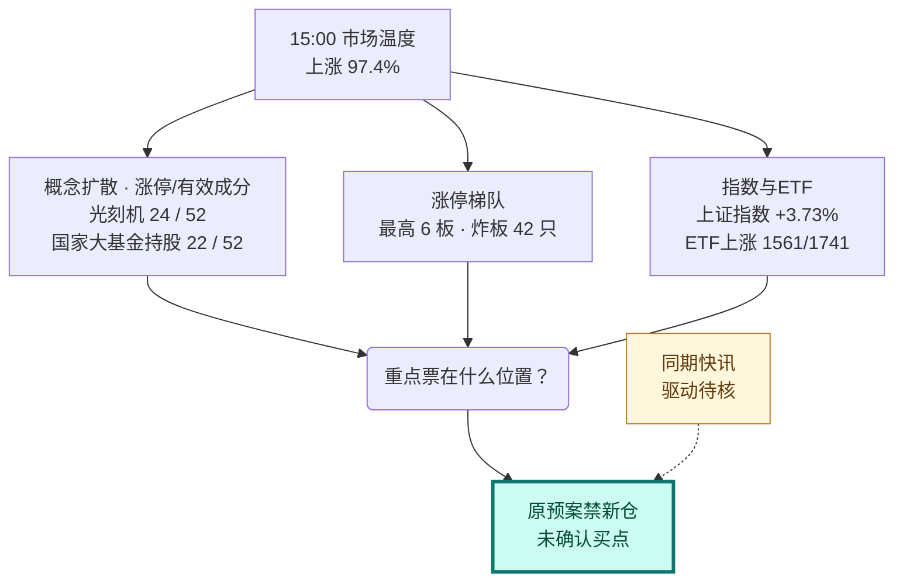

**指数截面**：上证指数 +3.73%（15:00:00） · 沪深300 +4.17%（15:00:00） · 中证500 +7.68%（15:00:00） · 中证1000 +8.15%（15:00:00） · 科创50 +15.07%（15:00:00） · 创业板指 +11.61%（15:00:03）

**ETF**：上涨 1561/1741 只有成交样本（名录 1742 只，非全覆盖）；成交额前列：海富通中证短融ETF -0.02%（15:00:00） · 银华货币ETF-A -0.00%（15:00:15） · 华宝现金添益货币ETF-A -0.01%（15:00:13）

**ETF相对强势方向**（按跟踪指数分组的样本中位涨幅）：科创信息 +20.01%（3 只） · 上证科创芯片 +20.00%（11 只）

**外盘背景，非实时**：标普500 -0.25%（11-26，交易日历未核） · 纳斯达克 -0.62%（11-26，交易日历未核） · 日经225缺留存 · 韩国综合 +0.29%（11-26，交易日历未核）

**板块扩散**（涨停/有效成分）：光刻机 **24**/52 · 国家大基金持股 **22**/52 · 中芯国际概念 **36**/91

**梯队**：最高 6 板

| 重点票 | 现价（元） | 原买区（元） | 现在看什么 |
|---|---:|---:|---|
| — | — | — | 本轮无重点票可列 |

**池外线索**：题材成交前排 0 只 / 同轮报价样本 5,578 只 · 仅观察 · 广筛市值底表缺失

**盘中快讯** · 来源时间，原文、首次可见与因果未核

| 北京时间 | 快讯与来源 |
|---|---|
| 15:00 | 蔚来李斌：“速成车”标签是对中国智能电动汽车产业多年创新的污名化 · 华尔街-快讯 |
| 15:00 | 菲律宾股市指数收盘上涨2.2%，报5611.97点。 · 新浪财经-快讯 |

*报价截至 15:00:00 · 有效 3486 只 · 全A覆盖未核 · 路径未定 · 缺同轮对照*

<!-- intraday-watch-card:1450 -->

### 14:50 盯盘卡

原预案禁新仓

> **当前落点：未确认买点**

上涨 **96.6%**（较对照轮 +0.4 个百分点） · 涨停 429 · 跌停 0 · 成交 19,318 亿

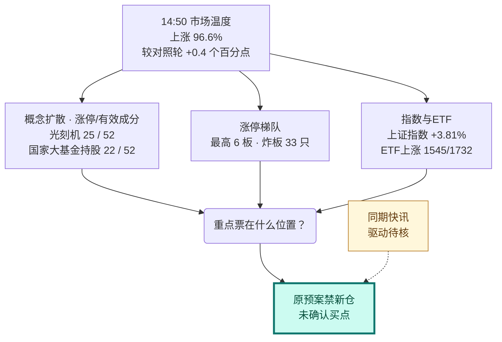

**指数截面**：上证指数 +3.81%（14:50:23） · 沪深300 +4.24%（14:50:23） · 中证500 +7.67%（14:50:23） · 中证1000 +8.08%（14:50:23） · 科创50 +14.90%（14:50:23） · 创业板指 +11.58%（14:50:21）

**ETF**：上涨 1545/1732 只有成交样本（名录 1742 只，非全覆盖）；成交额前列：海富通中证短融ETF -0.02%（14:50:27） · 银华货币ETF-A -0.00%（14:50:27） · 华泰柏瑞中证韩交所中韩半导体ETF(QDII +9.99%（14:50:27）

**ETF相对强势方向**（按跟踪指数分组的样本中位涨幅）：上证科创芯片 +20.02%（11 只） · 科创半导体材料设备 +19.97%（3 只）

**外盘背景，非实时**：标普500 -0.25%（11-26，交易日历未核） · 纳斯达克 -0.62%（11-26，交易日历未核） · 日经225缺留存 · 韩国综合 +0.29%（11-26，交易日历未核）

**板块扩散**（涨停/有效成分）：光刻机 **25**/52 · 国家大基金持股 **22**/52 · 中芯国际概念 **36**/91

**梯队**：最高 6 板

| 重点票 | 现价（元） | 原买区（元） | 现在看什么 |
|---|---:|---:|---|
| — | — | — | 本轮无重点票可列 |

**池外线索**：题材成交前排 0 只 / 同轮报价样本 5,559 只 · 仅观察 · 广筛市值底表缺失

**盘中快讯** · 来源时间，原文、首次可见与因果未核

| 北京时间 | 快讯与来源 |
|---|---|
| 14:50 | 大行评级｜大和：小鹏就人形机器人及Robotaxi路线图提供更多细节，评级“买入” · 格隆汇-快讯 |
| 14:50 | 沪深300指数期货连续主力合约日内涨6%，现报4080.80点。 · 新浪财经-快讯 |

*报价截至 14:50:22 · 对照 14:40 · 有效 5576 只 · 全A覆盖未核 · 路径未定 · 缺同轮对照*

<!-- intraday-watch-card:1440 -->

### 14:40 盯盘卡

原预案禁新仓

> **当前落点：未确认买点**

上涨 **96.2%**（较对照轮 +0.1 个百分点） · 涨停 381 · 跌停 0 · 成交 18,578 亿


**指数截面**：上证指数 +3.53%（14:40:20） · 沪深300 +3.87%（14:40:20） · 中证500 +7.43%（14:40:20） · 中证1000 +7.92%（14:40:20） · 科创50 +14.38%（14:40:20） · 创业板指 +10.93%（14:40:21）

**ETF**：上涨 1524/1731 只有成交样本（名录 1742 只，非全覆盖）；成交额前列：海富通中证短融ETF -0.01%（14:40:24） · 银华货币ETF-A -0.01%（14:40:24） · 华泰柏瑞中证韩交所中韩半导体ETF(QDII +9.68%（14:40:24）

**ETF相对强势方向**（按跟踪指数分组的样本中位涨幅）：科创半导体材料设备 +19.97%（3 只） · 上证科创芯片 +18.48%（11 只）

**外盘背景，非实时**：标普500 -0.25%（11-26，交易日历未核） · 纳斯达克 -0.62%（11-26，交易日历未核） · 日经225缺留存 · 韩国综合 +0.29%（11-26，交易日历未核）

**板块扩散**（涨停/有效成分）：光刻机 **22**/52 · 国家大基金持股 **20**/52 · 中芯国际概念 **34**/91

**梯队**：最高 6 板

| 重点票 | 现价（元） | 原买区（元） | 现在看什么 |
|---|---:|---:|---|
| — | — | — | 本轮无重点票可列 |

**池外线索**：题材成交前排 0 只 / 同轮报价样本 5,550 只 · 仅观察 · 广筛市值底表缺失

**盘中快讯** · 来源时间，原文、首次可见与因果未核

| 北京时间 | 快讯与来源 |
|---|---|
| 14:40 | 莱茵金属公司盘前股价预计上涨 2.4%，当地交易员指出有报道称其计划与德国电信合作开发人工智能平台。 · 新浪财经-快讯 |
| 14:40 | 2027年APEC领导人会议周将在越南富国岛举行 · 华尔街-快讯 |

*报价截至 14:40:19 · 对照 14:30 · 有效 5576 只 · 全A覆盖未核 · 路径未定 · 缺同轮对照*

<!-- intraday-watch-card:1430 -->

### 14:30 盯盘卡

原预案禁新仓

> **当前落点：未确认买点**

上涨 **96.1%**（较对照轮 +0.5 个百分点） · 涨停 349 · 跌停 0 · 成交 17,983 亿


**指数截面**：上证指数 +3.59%（14:30:26） · 沪深300 +3.91%（14:30:26） · 中证500 +7.44%（14:30:26） · 中证1000 +7.81%（14:30:26） · 科创50 +14.60%（14:30:26） · 创业板指 +10.89%（14:30:27）

**ETF**：上涨 1524/1739 只有成交样本（名录 1742 只，非全覆盖）；成交额前列：海富通中证短融ETF -0.01%（14:30:30） · 银华货币ETF-A -0.01%（14:30:30） · 华泰柏瑞中证韩交所中韩半导体ETF(QDII +9.40%（14:30:30）

**ETF相对强势方向**（按跟踪指数分组的样本中位涨幅）：科创半导体材料设备 +19.97%（3 只） · 上证科创芯片 +18.44%（11 只）

**外盘背景，非实时**：标普500 -0.25%（11-26，交易日历未核） · 纳斯达克 -0.62%（11-26，交易日历未核） · 日经225缺留存 · 韩国综合 +0.29%（11-26，交易日历未核）

**板块扩散**（涨停/有效成分）：光刻机 **21**/52 · 国家大基金持股 **19**/52 · 华为盘古 **10**/30

**梯队**：最高 6 板

| 重点票 | 现价（元） | 原买区（元） | 现在看什么 |
|---|---:|---:|---|
| — | — | — | 本轮无重点票可列 |

**池外线索**：题材成交前排 0 只 / 同轮报价样本 5,557 只 · 仅观察 · 广筛市值底表缺失

**盘中快讯** · 来源时间，原文、首次可见与因果未核

| 北京时间 | 快讯与来源 |
|---|---|
| 14:30 | 【风险偏好回升 铜价创10个月来最大盘中涨幅】围绕人工智能(AI)交易的担忧引发连续数周市场动荡后，风险偏好回升，铜价随全球股市一道继续从11个月低点反弹，创下1月以来 · 新浪财经-快讯 |
| 14:30 | 陈光明出手！旗下专户重启新客申购，睿远基金拟自购不低于1亿元 · 华尔街-快讯 |

*报价截至 14:30:25 · 对照 14:20 · 有效 5576 只 · 全A覆盖未核 · 路径未定 · 缺同轮对照*

<!-- intraday-watch-card:1420 -->

### 14:20 盯盘卡

原预案禁新仓

> **当前落点：未确认买点**

上涨 **95.6%**（较对照轮 -0.2 个百分点） · 涨停 299 · 跌停 0 · 成交 17,429 亿

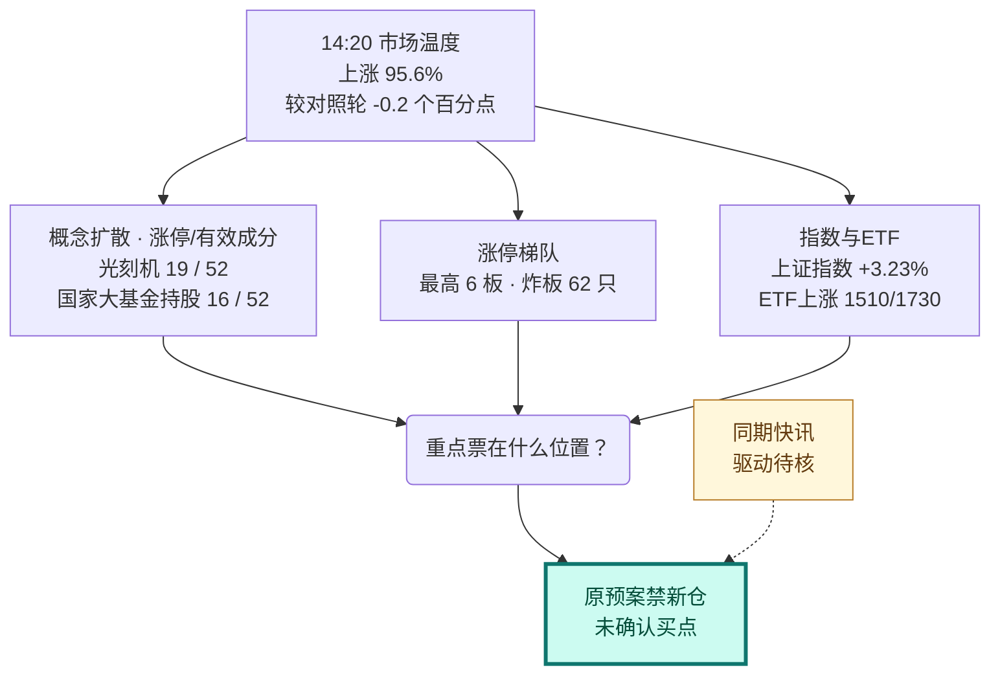

**指数截面**：上证指数 +3.23%（14:20:20） · 沪深300 +3.53%（14:20:20） · 中证500 +7.06%（14:20:20） · 中证1000 +7.43%（14:20:20） · 科创50 +13.50%（14:20:20） · 创业板指 +10.18%（14:20:18）

**ETF**：上涨 1510/1730 只有成交样本（名录 1742 只，非全覆盖）；成交额前列：海富通中证短融ETF -0.01%（14:20:24） · 银华货币ETF-A -0.00%（14:20:24） · 华泰柏瑞中证韩交所中韩半导体ETF(QDII +8.84%（14:20:24）

**ETF相对强势方向**（按跟踪指数分组的样本中位涨幅）：科创半导体材料设备 +19.97%（3 只） · 上证科创芯片 +16.71%（11 只）

**外盘背景，非实时**：标普500 -0.25%（11-26，交易日历未核） · 纳斯达克 -0.62%（11-26，交易日历未核） · 日经225缺留存 · 韩国综合 +0.29%（11-26，交易日历未核）

**板块扩散**（涨停/有效成分）：光刻机 **19**/52 · 国家大基金持股 **16**/52 · 华为盘古 **9**/30

**梯队**：最高 6 板

| 重点票 | 现价（元） | 原买区（元） | 现在看什么 |
|---|---:|---:|---|
| — | — | — | 本轮无重点票可列 |

**池外线索**：题材成交前排 0 只 / 同轮报价样本 5,527 只 · 仅观察 · 广筛市值底表缺失

**盘中快讯** · 来源时间，原文、首次可见与因果未核

| 北京时间 | 快讯与来源 |
|---|---|
| 14:20 | 【美银：小鹏投资者日聚焦人形机器人及Robotaxi商业化，维持“买入”评级】美银证券发表研报指，小鹏集团管理层在投资者日阐述人形机器人IRON的量产路线图、技术架构及 · 新浪财经-快讯 |
| 14:20 | 【永辉超市合肥首家全健康场景调改店开业】永辉超市合肥正大广场店正式焕新开业。作为永辉超市合肥首家全健康场景调改店，正大广场店首次展示现烤烘焙馆、鲜活水族馆、海味厨房、缤 · 新浪财经-快讯 |

*报价截至 14:20:19 · 对照 14:10 · 有效 5576 只 · 全A覆盖未核 · 路径未定 · 缺同轮对照*

<!-- intraday-watch-card:1410 -->

### 14:10 盯盘卡

原预案禁新仓

> **当前落点：未确认买点**

上涨 **95.8%**（较对照轮 -0.9 个百分点） · 涨停 286 · 跌停 0 · 成交 16,882 亿

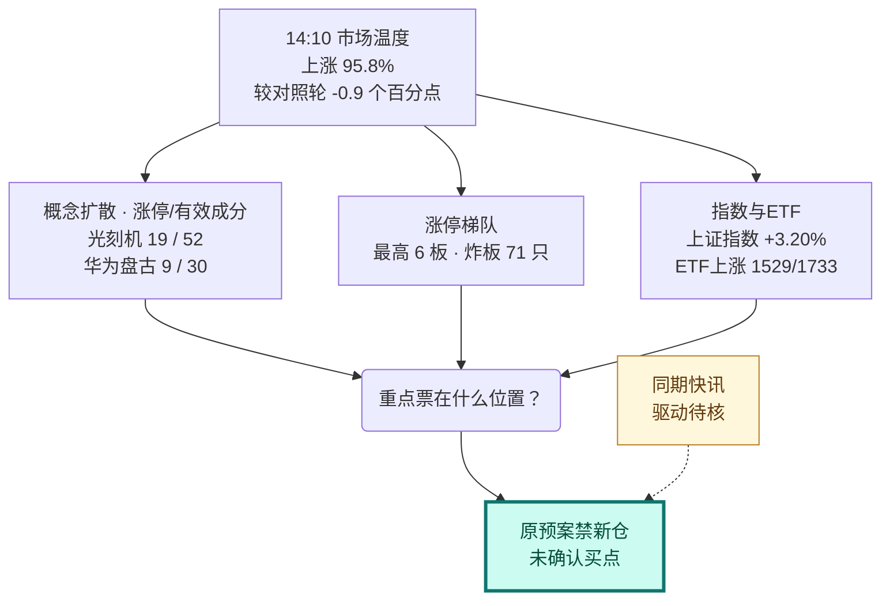

**指数截面**：上证指数 +3.20%（14:10:23） · 沪深300 +3.43%（14:10:23） · 中证500 +6.91%（14:10:23） · 中证1000 +7.32%（14:10:23） · 科创50 +13.07%（14:10:23） · 创业板指 +9.81%（14:10:21）

**ETF**：上涨 1529/1733 只有成交样本（名录 1742 只，非全覆盖）；成交额前列：海富通中证短融ETF -0.01%（14:10:24） · 银华货币ETF-A -0.01%（14:10:24） · 华泰柏瑞中证韩交所中韩半导体ETF(QDII +8.71%（14:10:24）

**ETF相对强势方向**（按跟踪指数分组的样本中位涨幅）：科创半导体材料设备 +19.73%（3 只） · 上证科创芯片 +16.31%（11 只）

**外盘背景，非实时**：标普500 -0.25%（11-26，交易日历未核） · 纳斯达克 -0.62%（11-26，交易日历未核） · 日经225缺留存 · 韩国综合 +0.29%（11-26，交易日历未核）

**板块扩散**（涨停/有效成分）：光刻机 **19**/52 · 华为盘古 **9**/30 · 国家大基金持股 **15**/52

**梯队**：最高 6 板

| 重点票 | 现价（元） | 原买区（元） | 现在看什么 |
|---|---:|---:|---|
| — | — | — | 本轮无重点票可列 |

**池外线索**：题材成交前排 0 只 / 同轮报价样本 5,552 只 · 仅观察 · 广筛市值底表缺失

**盘中快讯** · 来源时间，原文、首次可见与因果未核

| 北京时间 | 快讯与来源 |
|---|---|
| 14:10 | 研报掘金｜华鑫证券：维持杰瑞股份“买入”评级，天然气景气与燃机订单共振 · 格隆汇-快讯 |
| 14:10 | 最高法公开宣判利乐垄断后继民事诉讼两案 合计判赔4.92亿元 · 华尔街-快讯 |

*报价截至 14:10:19 · 对照 14:00 · 有效 5576 只 · 全A覆盖未核 · 路径未定 · 缺同轮对照*

<!-- intraday-watch-card:1400 -->

### 14:00 盯盘卡

原预案禁新仓

> **当前落点：未确认买点**

上涨 **96.6%**（较对照轮 -0.2 个百分点） · 涨停 293 · 跌停 0 · 成交 16,264 亿

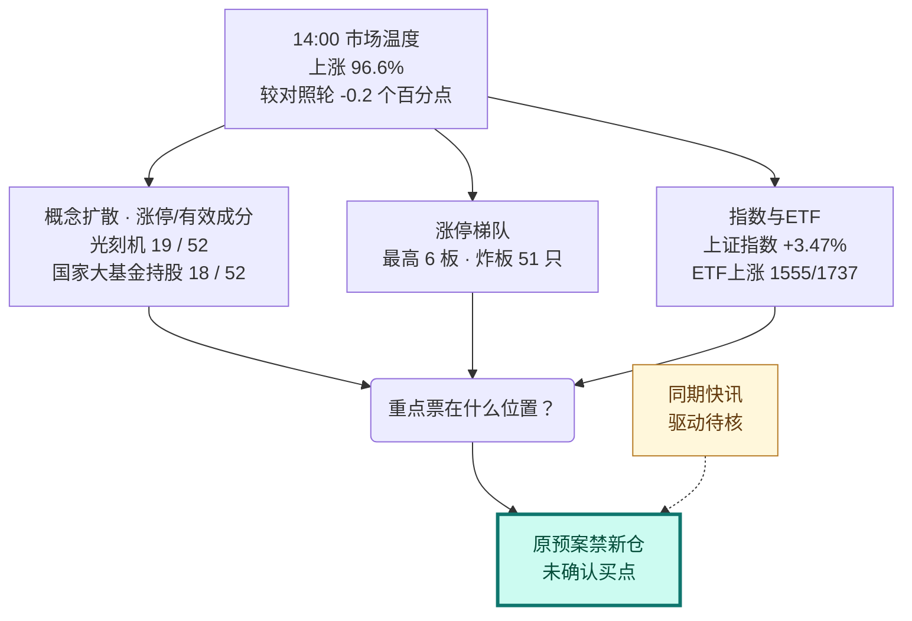

**指数截面**：上证指数 +3.47%（14:00:26） · 沪深300 +3.76%（14:00:26） · 中证500 +7.20%（14:00:26） · 中证1000 +7.75%（14:00:26） · 科创50 +13.72%（14:00:26） · 创业板指 +10.61%（14:00:24）

**ETF**：上涨 1555/1737 只有成交样本（名录 1742 只，非全覆盖）；成交额前列：海富通中证短融ETF -0.02%（14:00:30） · 银华货币ETF-A -0.01%（14:00:27） · 华泰柏瑞中证韩交所中韩半导体ETF(QDII +9.18%（14:00:30）

**ETF相对强势方向**（按跟踪指数分组的样本中位涨幅）：科创半导体材料设备 +19.81%（3 只） · 上证科创芯片 +16.89%（11 只）

**外盘背景，非实时**：标普500 -0.25%（11-26，交易日历未核） · 纳斯达克 -0.62%（11-26，交易日历未核） · 日经225缺留存 · 韩国综合 +0.29%（11-26，交易日历未核）

**板块扩散**（涨停/有效成分）：光刻机 **19**/52 · 国家大基金持股 **18**/52 · 华为盘古 **10**/30

**梯队**：最高 6 板

| 重点票 | 现价（元） | 原买区（元） | 现在看什么 |
|---|---:|---:|---|
| — | — | — | 本轮无重点票可列 |

**池外线索**：题材成交前排 0 只 / 同轮报价样本 5,548 只 · 仅观察 · 广筛市值底表缺失

**盘中快讯** · 来源时间，原文、首次可见与因果未核

| 北京时间 | 快讯与来源 |
|---|---|
| 14:00 | 消息人士称，美国曾施压委内瑞拉和伊拉克考虑退出欧佩克。 · 新浪财经-快讯 |
| 13:59 | 研报掘金｜东吴证券：维持移远通信“买入”评级，车载与智能方案开启成长新空间 · 格隆汇-快讯 |

*报价截至 14:00:22 · 对照 13:50 · 有效 5576 只 · 全A覆盖未核 · 路径未定 · 缺同轮对照*

<!-- intraday-watch-card:1350 -->

### 13:50 盯盘卡

原预案禁新仓

> **当前落点：未确认买点**

上涨 **96.8%**（较对照轮 +1.1 个百分点） · 涨停 297 · 跌停 0 · 成交 15,541 亿


**指数截面**：上证指数 +3.49%（13:50:23） · 沪深300 +3.74%（13:50:23） · 中证500 +7.07%（13:50:23） · 中证1000 +7.68%（13:50:23） · 科创50 +13.98%（13:50:23） · 创业板指 +10.30%（13:50:21）

**ETF**：上涨 1568/1735 只有成交样本（名录 1742 只，非全覆盖）；成交额前列：海富通中证短融ETF -0.02%（13:50:27） · 银华货币ETF-A -0.01%（13:50:24） · 华泰柏瑞中证韩交所中韩半导体ETF(QDII +8.90%（13:50:27）

**ETF相对强势方向**（按跟踪指数分组的样本中位涨幅）：科创半导体材料设备 +19.87%（3 只） · 上证科创芯片 +17.47%（11 只）

**外盘背景，非实时**：标普500 -0.25%（11-26，交易日历未核） · 纳斯达克 -0.62%（11-26，交易日历未核） · 日经225缺留存 · 韩国综合 +0.29%（11-26，交易日历未核）

**板块扩散**（涨停/有效成分）：光刻机 **20**/52 · 国家大基金持股 **16**/52 · 华为盘古 **9**/30

**梯队**：最高 6 板

| 重点票 | 现价（元） | 原买区（元） | 现在看什么 |
|---|---:|---:|---|
| — | — | — | 本轮无重点票可列 |

**池外线索**：题材成交前排 0 只 / 同轮报价样本 5,559 只 · 仅观察 · 广筛市值底表缺失

**盘中快讯** · 来源时间，原文、首次可见与因果未核

| 北京时间 | 快讯与来源 |
|---|---|
| 13:50 | "国家队"入市护盘过程中 各类机构均表现为净买入 · 同花顺-快讯 |
| 13:49 | 沪指涨3.64%，重回3600点以上 · 同花顺-快讯 |

*报价截至 13:50:19 · 对照 13:40 · 有效 5576 只 · 全A覆盖未核 · 路径未定 · 缺同轮对照*

<!-- intraday-watch-card:1340 -->

### 13:40 盯盘卡

原预案禁新仓

> **当前落点：未确认买点**

上涨 **95.7%**（较对照轮 +0.1 个百分点） · 涨停 229 · 跌停 0 · 成交 14,606 亿


**指数截面**：上证指数 +3.03%（13:40:20） · 沪深300 +3.22%（13:40:20） · 中证500 +6.79%（13:40:20） · 中证1000 +7.37%（13:40:20） · 科创50 +12.76%（13:40:20） · 创业板指 +9.60%（13:40:18）

**ETF**：上涨 1525/1729 只有成交样本（名录 1742 只，非全覆盖）；成交额前列：海富通中证短融ETF -0.02%（13:40:24） · 银华货币ETF-A -0.00%（13:40:24） · 华泰柏瑞中证韩交所中韩半导体ETF(QDII +8.49%（13:40:24）

**ETF相对强势方向**（按跟踪指数分组的样本中位涨幅）：科创半导体材料设备 +18.83%（3 只） · 上证科创芯片 +15.70%（11 只）

**外盘背景，非实时**：标普500 -0.25%（11-26，交易日历未核） · 纳斯达克 -0.62%（11-26，交易日历未核） · 日经225缺留存 · 韩国综合 +0.29%（11-26，交易日历未核）

**板块扩散**（涨停/有效成分）：华为盘古 **9**/30 · 光刻机 **14**/52 · 华为昇腾 **25**/105

**梯队**：最高 6 板

| 重点票 | 现价（元） | 原买区（元） | 现在看什么 |
|---|---:|---:|---|
| — | — | — | 本轮无重点票可列 |

**池外线索**：题材成交前排 0 只 / 同轮报价样本 5,553 只 · 仅观察 · 广筛市值底表缺失

**盘中快讯** · 来源时间，原文、首次可见与因果未核

| 北京时间 | 快讯与来源 |
|---|---|
| 13:40 | 国家大基金持股板块掀涨停潮 · 同花顺-快讯 |
| 13:39 | 创业板指盘中涨超10% · 同花顺-快讯 |

*报价截至 13:40:19 · 对照 13:30 · 有效 5576 只 · 全A覆盖未核 · 路径未定 · 缺同轮对照*

<!-- intraday-watch-card:1330 -->

### 13:30 盯盘卡

原预案禁新仓

> **当前落点：未确认买点**

上涨 **95.6%**（较对照轮 +3.7 个百分点） · 涨停 222 · 跌停 0 · 成交 13,526 亿

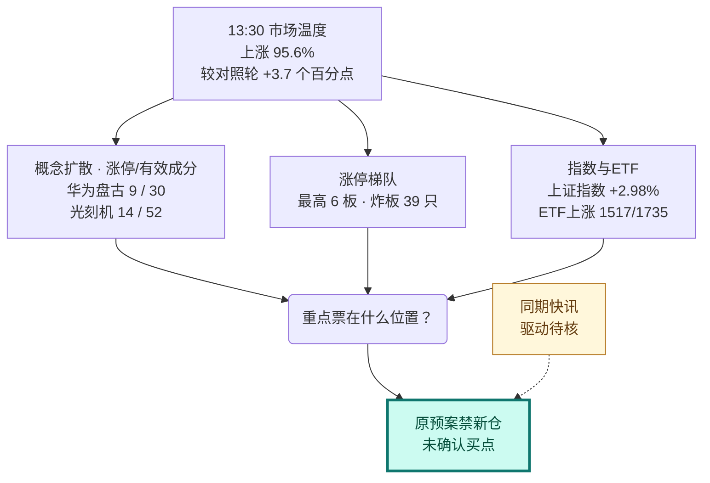

**指数截面**：上证指数 +2.98%（13:30:23） · 沪深300 +3.10%（13:30:23） · 中证500 +6.51%（13:30:23） · 中证1000 +7.24%（13:30:23） · 科创50 +12.39%（13:30:23） · 创业板指 +9.27%（13:30:21）

**ETF**：上涨 1517/1735 只有成交样本（名录 1742 只，非全覆盖）；成交额前列：海富通中证短融ETF -0.02%（13:30:27） · 银华货币ETF-A -0.01%（13:30:27） · 华泰柏瑞中证韩交所中韩半导体ETF(QDII +8.49%（13:30:27）

**ETF相对强势方向**（按跟踪指数分组的样本中位涨幅）：科创半导体材料设备 +18.27%（3 只） · 上证科创芯片 +15.09%（11 只）

**外盘背景，非实时**：标普500 -0.25%（11-26，交易日历未核） · 纳斯达克 -0.62%（11-26，交易日历未核） · 日经225缺留存 · 韩国综合 +0.29%（11-26，交易日历未核）

**板块扩散**（涨停/有效成分）：华为盘古 **9**/30 · 光刻机 **14**/52 · 华为昇腾 **26**/105

**梯队**：最高 6 板

| 重点票 | 现价（元） | 原买区（元） | 现在看什么 |
|---|---:|---:|---|
| — | — | — | 本轮无重点票可列 |

**池外线索**：题材成交前排 0 只 / 同轮报价样本 5,567 只 · 仅观察 · 广筛市值底表缺失

**盘中快讯** · 来源时间，原文、首次可见与因果未核

| 北京时间 | 快讯与来源 |
|---|---|
| 13:30 | 创业板指涨9% · 同花顺-快讯 |
| 13:30 | 纽约期金突破3690美元/盎司，日内涨3.52%。 · 新浪财经-快讯 |

*报价截至 13:30:22 · 对照 13:20 · 有效 5576 只 · 全A覆盖未核 · 路径未定 · 缺同轮对照*

<!-- intraday-watch-card:1320 -->

### 13:20 盯盘卡

原预案禁新仓

> **当前落点：未确认买点**

上涨 **92.0%**（较对照轮 -2.7 个百分点） · 涨停 153 · 跌停 0 · 成交 12,428 亿


**指数截面**：上证指数 +1.97%（13:20:20） · 沪深300 +2.03%（13:20:20） · 中证500 +5.14%（13:20:20） · 中证1000 +5.66%（13:20:20） · 科创50 +10.00%（13:20:20） · 创业板指 +7.03%（13:20:18）

**ETF**：上涨 1452/1731 只有成交样本（名录 1742 只，非全覆盖）；成交额前列：海富通中证短融ETF -0.01%（13:20:24） · 银华货币ETF-A -0.00%（13:20:24） · 华泰柏瑞中证韩交所中韩半导体ETF(QDII +7.53%（13:20:24）

**ETF相对强势方向**（按跟踪指数分组的样本中位涨幅）：科创半导体材料设备 +16.13%（3 只） · 上证科创芯片 +12.56%（11 只）

**外盘背景，非实时**：标普500 -0.25%（11-26，交易日历未核） · 纳斯达克 -0.62%（11-26，交易日历未核） · 日经225缺留存 · 韩国综合 +0.29%（11-26，交易日历未核）

**板块扩散**（涨停/有效成分）：华为盘古 **8**/30 · 华为昇腾 **22**/105 · 华为欧拉 **9**/47

**梯队**：最高 6 板

| 重点票 | 现价（元） | 原买区（元） | 现在看什么 |
|---|---:|---:|---|
| — | — | — | 本轮无重点票可列 |

**池外线索**：题材成交前排 0 只 / 同轮报价样本 5,539 只 · 仅观察 · 广筛市值底表缺失

**盘中快讯** · 来源时间，原文、首次可见与因果未核

| 北京时间 | 快讯与来源 |
|---|---|
| 13:20 | WTI原油日内涨3%，现报86.20美元/桶。 · 新浪财经-快讯 |
| 13:20 | 【监管部门将全力维护资本市场平稳运行】国常会针对增强股市内在稳定性做了最新部署。记者获悉，下一步监管部门将坚持稳字当头，加强跨境风险监测研判和政策工具储备，巩固完善稳市 · 新浪财经-快讯 |

*报价截至 13:20:19 · 对照 13:10 · 有效 5576 只 · 全A覆盖未核 · 路径未定 · 缺同轮对照*

<!-- intraday-watch-card:1310 -->

### 13:10 盯盘卡

原预案禁新仓

> **当前落点：未确认买点**

上涨 **94.6%**（较对照轮 +11.2 个百分点） · 涨停 183 · 跌停 0 · 成交 11,242 亿


**指数截面**：上证指数 +2.49%（13:10:20） · 沪深300 +2.66%（13:10:20） · 中证500 +5.73%（13:10:20） · 中证1000 +6.41%（13:10:20） · 科创50 +11.06%（13:10:20） · 创业板指 +8.23%（13:10:21）

**ETF**：上涨 1493/1734 只有成交样本（名录 1742 只，非全覆盖）；成交额前列：海富通中证短融ETF -0.01%（13:10:24） · 银华货币ETF-A -0.00%（13:10:24） · 华泰柏瑞中证韩交所中韩半导体ETF(QDII +8.34%（13:10:24）

**ETF相对强势方向**（按跟踪指数分组的样本中位涨幅）：科创半导体材料设备 +16.80%（3 只） · 创业板金融科技 +14.29%（4 只）

**外盘背景，非实时**：标普500 -0.25%（11-26，交易日历未核） · 纳斯达克 -0.62%（11-26，交易日历未核） · 日经225缺留存 · 韩国综合 +0.29%（11-26，交易日历未核）

**板块扩散**（涨停/有效成分）：华为盘古 **10**/30 · 华为昇腾 **26**/105 · 财税数字化 **14**/66

**梯队**：最高 6 板

| 重点票 | 现价（元） | 原买区（元） | 现在看什么 |
|---|---:|---:|---|
| — | — | — | 本轮无重点票可列 |

**池外线索**：题材成交前排 0 只 / 同轮报价样本 5,567 只 · 仅观察 · 广筛市值底表缺失

**盘中快讯** · 来源时间，原文、首次可见与因果未核

| 北京时间 | 快讯与来源 |
|---|---|
| 13:09 | 【多只科创半导体ETF涨幅扩大至16%】半导体板块大幅上涨。科创半导体设备ETF鹏华、科创半导体ETF华夏等多只ETF涨幅扩大至16%，半导体设备ETF广发、半导体设备 · 新浪财经-快讯 |
| 13:09 | 多只科创半导体ETF涨幅扩大至16% · 同花顺-快讯 |

*报价截至 13:10:19 · 对照 11:30 · 有效 5576 只 · 全A覆盖未核 · 路径未定 · 缺同轮对照*

<!-- intraday-watch-card:1130 -->

### 11:30 盯盘卡

原预案禁新仓

> **当前落点：未确认买点**

上涨 **83.5%**（较对照轮 -0.7 个百分点） · 涨停 96 · 跌停 0 · 成交 9,269 亿


**指数截面**：上证指数 +0.28%（11:30:00） · 沪深300 +0.24%（11:30:00） · 中证500 +2.64%（11:30:00） · 中证1000 +3.31%（11:30:00） · 科创50 +4.43%（11:30:00） · 创业板指 +3.79%（11:30:03）

**ETF**：上涨 1260/1739 只有成交样本（名录 1742 只，非全覆盖）；成交额前列：海富通中证短融ETF +0.00%（11:30:00） · 银华货币ETF-A +0.00%（11:30:15） · 华泰柏瑞中证韩交所中韩半导体ETF(QDII +3.87%（11:30:18）

**ETF相对强势方向**（按跟踪指数分组的样本中位涨幅）：科创半导体材料设备 +8.40%（3 只） · 半导体材料设备 +8.31%（5 只）

**外盘背景，非实时**：标普500 -0.25%（11-26，交易日历未核） · 纳斯达克 -0.62%（11-26，交易日历未核） · 日经225缺留存 · 韩国综合 +0.29%（11-26，交易日历未核）

**板块扩散**（涨停/有效成分）：华为盘古 **6**/30 · 华为昇腾 **15**/105 · 国产操作系统 **8**/67

**梯队**：最高 4 板

| 重点票 | 现价（元） | 原买区（元） | 现在看什么 |
|---|---:|---:|---|
| — | — | — | 本轮无重点票可列 |

**池外线索**：题材成交前排 0 只 / 同轮报价样本 4,525 只 · 仅观察 · 广筛市值底表缺失

**盘中快讯** · 来源时间，原文、首次可见与因果未核

| 北京时间 | 快讯与来源 |
|---|---|
| 11:30 | 股指期货早盘收盘 主力合约全线上涨 · 同花顺-快讯 |
| 11:30 | 【股指期货早盘收盘】 中证1000指数期货连续涨5.01%， 沪深300指数期货连续涨1.12%， 中证500指数期货连续涨4.11%， 上证50指数期货连续涨0.11 · 新浪财经-快讯 |

*报价截至 11:30:13 · 对照 11:20 · 有效 5576 只 · 全A覆盖未核 · 路径未定 · 缺同轮对照*

<!-- intraday-watch-card:1120 -->

### 11:20 盯盘卡

<!-- intraday-watch-card:fallback -->

截面保底 · 原预案禁新仓

> **当前落点：分析材料缺口 · 不判买点**

上涨 **84.2%**（较对照轮 +3.4 个百分点） · 涨停 91 · 跌停 1 · 成交 8,762 亿

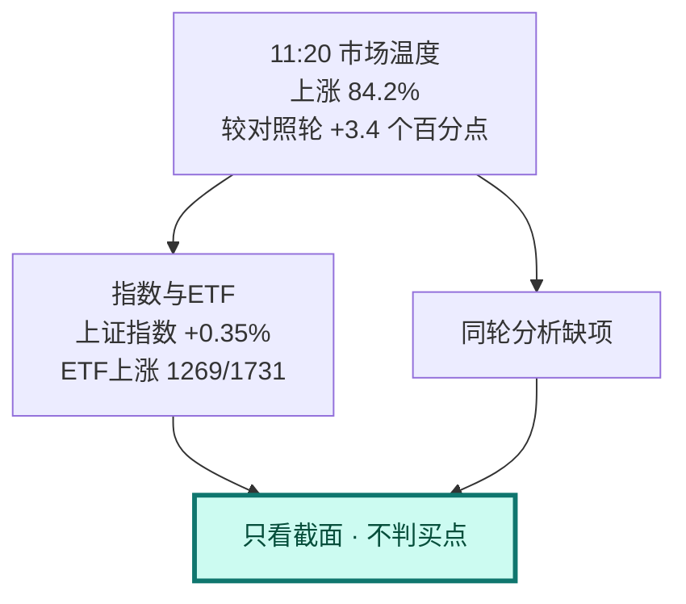

**指数截面**：上证指数 +0.35%（11:20:23） · 沪深300 +0.29%（11:20:23） · 中证500 +2.72%（11:20:23） · 中证1000 +3.33%（11:20:23） · 科创50 +4.73%（11:20:23） · 创业板指 +3.74%（11:20:21）

**ETF**：上涨 1269/1731 只有成交样本（名录 1742 只，非全覆盖）；成交额前列：海富通中证短融ETF +0.00%（11:20:27） · 银华货币ETF-A +0.01%（11:20:27） · 华泰柏瑞中证韩交所中韩半导体ETF(QDII +4.15%（11:20:27）

**ETF相对强势方向**（按跟踪指数分组的样本中位涨幅）：科创半导体材料设备 +8.93%（3 只） · 半导体材料设备 +8.61%（5 只）

**外盘背景，非实时**：标普500 -0.25%（11-26，交易日历未核） · 纳斯达克 -0.62%（11-26，交易日历未核） · 日经225缺留存 · 韩国综合 +0.29%（11-26，交易日历未核）

| 重点票 | 现价（元） | 原买区（元） | 现在看什么 |
|---|---:|---:|---|
| — | — | — | 无同轮个股对照 |

**池外线索**：缺同轮筛选结果

**盘中快讯** · 来源时间，原文、首次可见与因果未核

| 北京时间 | 快讯与来源 |
|---|---|
| 11:20 | 【多只双创宽基ETF涨幅进一步扩大】科创综指涨超5%，创业板指数涨超4%，多只双创宽基ETF涨幅进一步扩大。科创50ETF易方达、科创50ETF广发多只科创50ETF涨 · 新浪财经-快讯 |
| 11:20 | 【近30万加拿大民众要求驱逐美国大使 实名联署请愿书已提交国会】由加拿大近30万民众实名联署、呼吁加政府驱逐美国驻加大使皮特·胡克斯特拉的请愿书26日已被提交加拿大国会 · 新浪财经-快讯 |

*报价截至 11:20:22 · 对照 11:10 · 有效 5576 只 · 全A覆盖未核 · 路径未定 · 缺同轮对照*

<!-- intraday-watch-card:1110 -->

### 11:10 盯盘卡

原预案禁新仓

> **当前落点：未确认买点**

上涨 **80.8%**（较对照轮 +4.6 个百分点） · 涨停 80 · 跌停 1 · 成交 8,086 亿

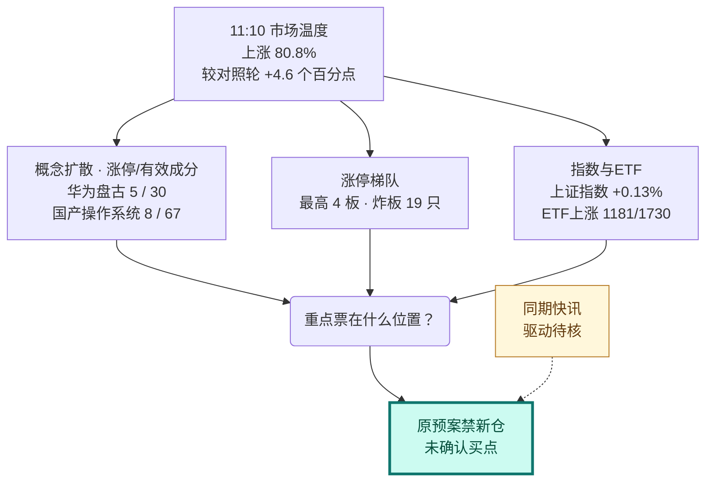

**指数截面**：上证指数 +0.13%（11:10:20） · 沪深300 -0.02%（11:10:20） · 中证500 +2.30%（11:10:20） · 中证1000 +2.85%（11:10:20） · 科创50 +3.70%（11:10:20） · 创业板指 +2.92%（11:10:21）

**ETF**：上涨 1181/1730 只有成交样本（名录 1742 只，非全覆盖）；成交额前列：海富通中证短融ETF +0.00%（11:10:24） · 银华货币ETF-A +0.01%（11:10:24） · 华泰柏瑞中证韩交所中韩半导体ETF(QDII +3.22%（11:10:24）

**ETF相对强势方向**（按跟踪指数分组的样本中位涨幅）：科创半导体材料设备 +8.00%（3 只） · 半导体材料设备 +7.86%（5 只）

**外盘背景，非实时**：标普500 -0.25%（11-26，交易日历未核） · 纳斯达克 -0.62%（11-26，交易日历未核） · 日经225缺留存 · 韩国综合 +0.29%（11-26，交易日历未核）

**板块扩散**（涨停/有效成分）：华为盘古 **5**/30 · 国产操作系统 **8**/67 · 华为海思概念股 **6**/52

**梯队**：最高 4 板

| 重点票 | 现价（元） | 原买区（元） | 现在看什么 |
|---|---:|---:|---|
| — | — | — | 本轮无重点票可列 |

**池外线索**：题材成交前排 0 只 / 同轮报价样本 5,479 只 · 仅观察 · 广筛市值底表缺失

**盘中快讯** · 来源时间，原文、首次可见与因果未核

| 北京时间 | 快讯与来源 |
|---|---|
| 11:10 | 国际铜期货涨4% · 格隆汇-快讯 |
| 11:09 | 中证500指数期货连续主力合约日内涨3%，现报5965.00点。 · 新浪财经-快讯 |

*报价截至 11:10:19 · 对照 11:00 · 有效 5576 只 · 全A覆盖未核 · 路径未定 · 缺同轮对照*

<!-- intraday-watch-card:1100 -->

### 11:00 盯盘卡

原预案禁新仓

> **当前落点：未确认买点**

上涨 **76.2%**（较对照轮 -3.4 个百分点） · 涨停 71 · 跌停 1 · 成交 7,650 亿


**指数截面**：上证指数 +0.00%（11:00:23） · 沪深300 -0.18%（11:00:23） · 中证500 +1.71%（11:00:23） · 中证1000 +2.21%（11:00:23） · 科创50 +2.31%（11:00:23） · 创业板指 +2.05%（11:00:21）

**ETF**：上涨 1180/1732 只有成交样本（名录 1742 只，非全覆盖）；成交额前列：海富通中证短融ETF +0.00%（11:00:27） · 银华货币ETF-A +0.01%（11:00:27） · 华泰柏瑞中证韩交所中韩半导体ETF(QDII +2.72%（11:00:27）

**ETF相对强势方向**（按跟踪指数分组的样本中位涨幅）：科创半导体材料设备 +6.27%（3 只） · 半导体材料设备 +6.11%（5 只）

**外盘背景，非实时**：标普500 -0.25%（11-26，交易日历未核） · 纳斯达克 -0.62%（11-26，交易日历未核） · 日经225缺留存 · 韩国综合 +0.29%（11-26，交易日历未核）

**板块扩散**（涨停/有效成分）：华为盘古 **5**/30 · 华为昇腾 **12**/105 · 国产操作系统 **7**/67

**梯队**：最高 4 板

| 重点票 | 现价（元） | 原买区（元） | 现在看什么 |
|---|---:|---:|---|
| — | — | — | 本轮无重点票可列 |

**池外线索**：题材成交前排 0 只 / 同轮报价样本 5,481 只 · 仅观察 · 广筛市值底表缺失

**盘中快讯** · 来源时间，原文、首次可见与因果未核

| 北京时间 | 快讯与来源 |
|---|---|
| 10:59 | 大行评级｜花旗：AI药物疗效更佳临床证明料2030年后出现，首选药明生物及英矽智能 · 格隆汇-快讯 |
| 10:59 | 港股IPO早播报：袁记食品和贝斯特材开启招股 · 财联社-头条 |

*报价截至 11:00:22 · 对照 10:50 · 有效 5576 只 · 全A覆盖未核 · 路径未定 · 缺同轮对照*

<!-- intraday-watch-card:1050 -->

### 10:50 盯盘卡

原预案禁新仓

> **当前落点：未确认买点**

上涨 **79.6%**（较对照轮 -2.1 个百分点） · 涨停 73 · 跌停 1 · 成交 7,165 亿

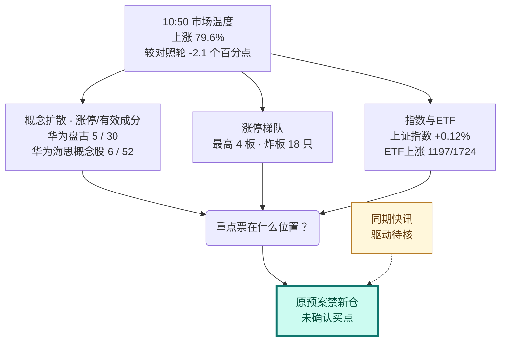

**指数截面**：上证指数 +0.12%（10:50:20） · 沪深300 -0.07%（10:50:20） · 中证500 +1.95%（10:50:20） · 中证1000 +2.51%（10:50:20） · 科创50 +2.83%（10:50:20） · 创业板指 +2.25%（10:50:21）

**ETF**：上涨 1197/1724 只有成交样本（名录 1742 只，非全覆盖）；成交额前列：海富通中证短融ETF +0.00%（10:50:24） · 银华货币ETF-A +0.00%（10:50:24） · 华泰柏瑞中证韩交所中韩半导体ETF(QDII +2.81%（10:50:24）

**ETF相对强势方向**（按跟踪指数分组的样本中位涨幅）：半导体材料设备 +6.54%（5 只） · 科创半导体材料设备 +6.53%（3 只）

**外盘背景，非实时**：标普500 -0.25%（11-26，交易日历未核） · 纳斯达克 -0.62%（11-26，交易日历未核） · 日经225缺留存 · 韩国综合 +0.29%（11-26，交易日历未核）

**板块扩散**（涨停/有效成分）：华为盘古 **5**/30 · 华为海思概念股 **6**/52 · 华为昇腾 **12**/105

**梯队**：最高 4 板

| 重点票 | 现价（元） | 原买区（元） | 现在看什么 |
|---|---:|---:|---|
| — | — | — | 本轮无重点票可列 |

**池外线索**：题材成交前排 0 只 / 同轮报价样本 5,466 只 · 仅观察 · 广筛市值底表缺失

**盘中快讯** · 来源时间，原文、首次可见与因果未核

| 北京时间 | 快讯与来源 |
|---|---|
| 10:49 | 【东风日产NX7正式上市 新能源车型将加速走向海外】11月27日，东风日产NX7新车正式上市。公司方面表示，这标志着两年前东风日产宣布的新能源规划进入成果兑现阶段。公司 · 新浪财经-快讯 |
| 10:49 | 美股AI风向变了：软件&gt;硬件？ · 财联社-头条 |

*报价截至 10:50:19 · 对照 10:40 · 有效 5576 只 · 全A覆盖未核 · 路径未定 · 缺同轮对照*

<!-- intraday-watch-card:1040 -->

### 10:40 盯盘卡

原预案禁新仓

> **当前落点：未确认买点**

上涨 **81.7%**（较对照轮 +6.3 个百分点） · 涨停 71 · 跌停 2 · 成交 6,600 亿


**指数截面**：上证指数 +0.23%（10:40:20） · 沪深300 +0.02%（10:40:20） · 中证500 +1.87%（10:40:20） · 中证1000 +2.57%（10:40:20） · 科创50 +2.75%（10:40:20） · 创业板指 +2.24%（10:40:21）

**ETF**：上涨 1212/1727 只有成交样本（名录 1742 只，非全覆盖）；成交额前列：海富通中证短融ETF +0.00%（10:40:24） · 银华货币ETF-A +0.01%（10:40:24） · 华宝现金添益货币ETF-A -0.00%（10:40:25）

**ETF相对强势方向**（按跟踪指数分组的样本中位涨幅）：科创半导体材料设备 +6.27%（3 只） · 半导体材料设备 +6.08%（5 只）

**外盘背景，非实时**：标普500 -0.25%（11-26，交易日历未核） · 纳斯达克 -0.62%（11-26，交易日历未核） · 日经225缺留存 · 韩国综合 +0.29%（11-26，交易日历未核）

**板块扩散**（涨停/有效成分）：华为盘古 **5**/30 · 华为海思概念股 **6**/52 · 华为昇腾 **12**/105

**梯队**：最高 4 板

| 重点票 | 现价（元） | 原买区（元） | 现在看什么 |
|---|---:|---:|---|
| — | — | — | 本轮无重点票可列 |

**池外线索**：题材成交前排 0 只 / 同轮报价样本 5,519 只 · 仅观察 · 广筛市值底表缺失

**盘中快讯** · 来源时间，原文、首次可见与因果未核

| 北京时间 | 快讯与来源 |
|---|---|
| 10:40 | 【主力资金：华胜天成净买入超8亿】截至目前，今日主力资金净流入109.56亿；净流入TMT、芯片概念、融资融券等板块，其中TMT板块净流入132.66亿；净流出大消费、 · 新浪财经-快讯 |
| 10:39 | 沪银期货暴涨10% · 格隆汇-快讯 |

*报价截至 10:40:19 · 对照 10:30 · 有效 5576 只 · 全A覆盖未核 · 路径未定 · 缺同轮对照*

<!-- intraday-watch-card:1030 -->

### 10:30 盯盘卡

原预案禁新仓

> **当前落点：未确认买点**

上涨 **75.5%**（较对照轮 +9.1 个百分点） · 涨停 58 · 跌停 1 · 成交 5,806 亿

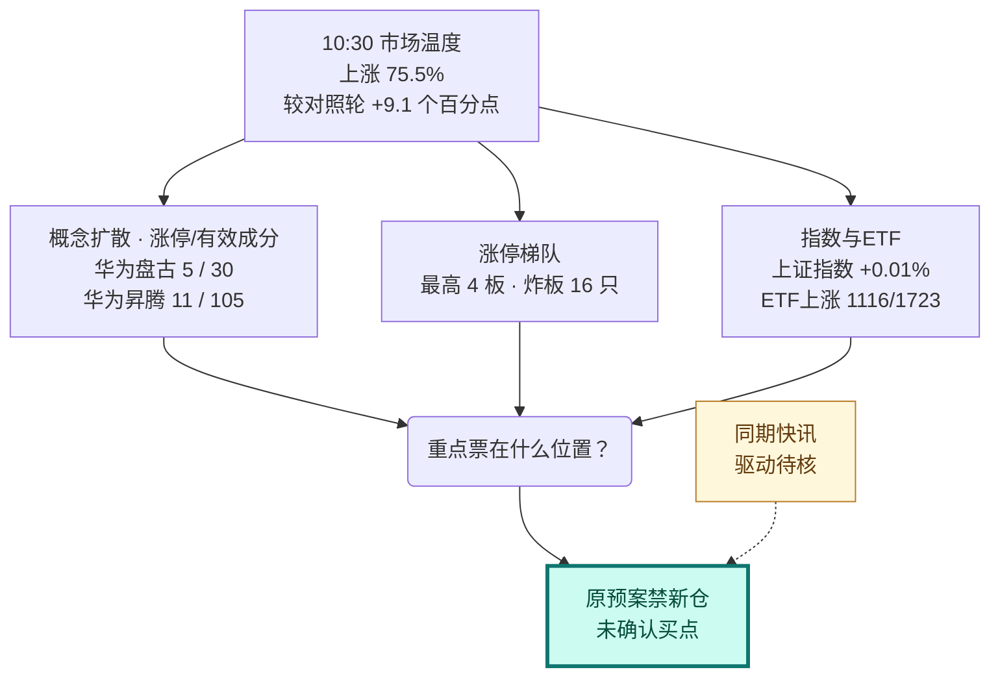

**指数截面**：上证指数 +0.01%（10:30:23） · 沪深300 -0.25%（10:30:23） · 中证500 +1.44%（10:30:23） · 中证1000 +1.90%（10:30:23） · 科创50 +1.74%（10:30:23） · 创业板指 +1.56%（10:30:21）

**ETF**：上涨 1116/1723 只有成交样本（名录 1742 只，非全覆盖）；成交额前列：海富通中证短融ETF +0.01%（10:30:27） · 银华货币ETF-A +0.01%（10:30:27） · 华宝现金添益货币ETF-A -0.00%（10:30:25）

**ETF相对强势方向**（按跟踪指数分组的样本中位涨幅）：创业板金融科技 +5.03%（4 只） · 半导体材料设备 +4.75%（5 只）

**外盘背景，非实时**：标普500 -0.25%（11-26，交易日历未核） · 纳斯达克 -0.62%（11-26，交易日历未核） · 日经225缺留存 · 韩国综合 +0.29%（11-26，交易日历未核）

**板块扩散**（涨停/有效成分）：华为盘古 **5**/30 · 华为昇腾 **11**/105 · 国产操作系统 **7**/67

**梯队**：最高 4 板

| 重点票 | 现价（元） | 原买区（元） | 现在看什么 |
|---|---:|---:|---|
| — | — | — | 本轮无重点票可列 |

**池外线索**：题材成交前排 0 只 / 同轮报价样本 5,510 只 · 仅观察 · 广筛市值底表缺失

**盘中快讯** · 来源时间，原文、首次可见与因果未核

| 北京时间 | 快讯与来源 |
|---|---|
| 10:30 | 【四大核心维度完成技术升级 信息无障碍国家标准修订发布】市场监管总局修订发布《信息技术 互联网内容无障碍可访问性技术要求与测试方法》国家标准，该标准将于2027年2月1 · 新浪财经-快讯 |
| 10:30 | 【曝苹果巨屏折叠iPad最高卖5000美元】知名记者马克·古尔曼最新透露，尽管面临诸多技术难题，苹果仍未放弃巨屏折叠iPad的研发。 据悉，该产品内部代号为“J312” · 新浪财经-快讯 |

*报价截至 10:30:19 · 对照 10:20 · 有效 5576 只 · 全A覆盖未核 · 路径未定 · 缺同轮对照*

<!-- intraday-watch-card:1020 -->

### 10:20 盯盘卡

原预案禁新仓

> **当前落点：未确认买点**

上涨 **66.4%**（较对照轮 -5.9 个百分点） · 涨停 52 · 跌停 1 · 成交 5,320 亿

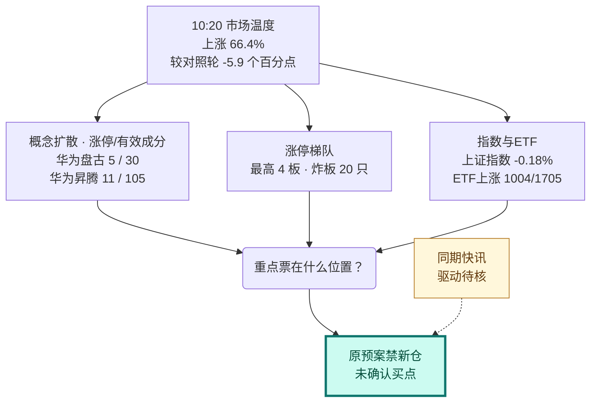

**指数截面**：上证指数 -0.18%（10:20:20） · 沪深300 -0.40%（10:20:20） · 中证500 +0.86%（10:20:20） · 中证1000 +1.22%（10:20:20） · 科创50 +1.14%（10:20:20） · 创业板指 +0.85%（10:20:21）

**ETF**：上涨 1004/1705 只有成交样本（名录 1742 只，非全覆盖）；成交额前列：海富通中证短融ETF +0.00%（10:20:24） · 银华货币ETF-A +0.01%（10:20:24） · 华宝现金添益货币ETF-A -0.00%（10:20:25）

**ETF相对强势方向**（按跟踪指数分组的样本中位涨幅）：创业板金融科技 +4.67%（4 只） · 深证创业软件 +4.39%（4 只）

**外盘背景，非实时**：标普500 -0.25%（11-26，交易日历未核） · 纳斯达克 -0.62%（11-26，交易日历未核） · 日经225缺留存 · 韩国综合 +0.29%（11-26，交易日历未核）

**板块扩散**（涨停/有效成分）：华为盘古 **5**/30 · 华为昇腾 **11**/105 · 国产操作系统 **7**/67

**梯队**：最高 4 板

| 重点票 | 现价（元） | 原买区（元） | 现在看什么 |
|---|---:|---:|---|
| — | — | — | 本轮无重点票可列 |

**池外线索**：题材成交前排 0 只 / 同轮报价样本 5,463 只 · 仅观察 · 广筛市值底表缺失

**盘中快讯** · 来源时间，原文、首次可见与因果未核

| 北京时间 | 快讯与来源 |
|---|---|
| 10:19 | 中国10月规模以上工业企业利润同比增长20.1% · 格隆汇-快讯 |
| 10:19 | 【光刻机板块持续走高，海立股份涨停】光刻机板块持续走高，海立股份涨停，腾景科技涨超10%，芯碁微装、高凯技术、波长光电、炬光科技、路维光电跟涨。 · 新浪财经-快讯 |

*报价截至 10:20:19 · 对照 10:10 · 有效 5576 只 · 全A覆盖未核 · 路径未定 · 缺同轮对照*

<!-- intraday-watch-card:1010 -->

### 10:10 盯盘卡

<!-- intraday-watch-card:fallback -->

截面保底 · 原预案禁新仓

> **当前落点：分析材料缺口 · 不判买点**

上涨 **72.3%**（较对照轮 +0.2 个百分点） · 涨停 52 · 跌停 2 · 成交 4,723 亿

```mermaid
flowchart TD
    M["10:10 市场温度<br/>上涨 72.3%<br/>较对照轮 +0.2 个百分点"]
    M --> I["指数与ETF<br/>上证指数 -0.07%<br/>ETF上涨 1046/1704"] --> NOW
    M --> GAP["同轮分析缺项"] --> NOW["只看截面 · 不判买点"]
    class NOW current
    classDef current fill:#ccfbf1,color:#064e3b,stroke:#0f766e,stroke-width:3px
    classDef caution fill:#fff7db,color:#633b0f,stroke:#b77c27,stroke-width:1px
```

**指数截面**：上证指数 -0.07%（10:10:20） · 沪深300 -0.28%（10:10:20） · 中证500 +1.01%（10:10:20） · 中证1000 +1.32%（10:10:20） · 科创50 +1.26%（10:10:20） · 创业板指 +0.99%（10:10:21）

**ETF**：上涨 1046/1704 只有成交样本（名录 1742 只，非全覆盖）；成交额前列：海富通中证短融ETF +0.01%（10:10:24） · 银华货币ETF-A +0.01%（10:10:24） · 华宝现金添益货币ETF-A -0.00%（10:10:25）

**ETF相对强势方向**（按跟踪指数分组的样本中位涨幅）：创业板金融科技 +5.09%（4 只） · 深证创业软件 +4.89%（4 只）

**外盘背景，非实时**：标普500 -0.25%（11-26，交易日历未核） · 纳斯达克 -0.62%（11-26，交易日历未核） · 日经225缺留存 · 韩国综合 +0.29%（11-26，交易日历未核）

| 重点票 | 现价（元） | 原买区（元） | 现在看什么 |
|---|---:|---:|---|
| — | — | — | 无同轮个股对照 |

**池外线索**：缺同轮筛选结果

**盘中快讯** · 来源时间，原文、首次可见与因果未核

| 北京时间 | 快讯与来源 |
|---|---|
| 10:10 | 现货黄金突破3620美元/盎司，日内涨1.53%。 · 新浪财经-快讯 |
| 10:10 | 【小米澎程全量推送小米HAD最新版本】11月27日，小米汽车宣布，小米HAD最新版本Xiaomi HyperOS 1.20，引入“因果链”和“车端世界模型”，小米澎程全 · 新浪财经-快讯 |

*报价截至 10:10:19 · 对照 10:00 · 有效 5576 只 · 全A覆盖未核 · 路径未定 · 缺同轮对照*

<!-- intraday-watch-card:1000 -->

### 10:00 盯盘卡

原预案禁新仓

> **当前落点：未确认买点**

上涨 **72.1%**（较对照轮 +25.7 个百分点） · 涨停 38 · 跌停 1 · 成交 3,996 亿

```mermaid
flowchart TD
    M["10:00 市场温度<br/>上涨 72.1%<br/>较对照轮 +25.7 个百分点"]
    P("重点票在什么位置？")
    M --> S["概念扩散 · 涨停/有效成分<br/>华为盘古 3 / 30<br/>ERP概念 3 / 35"]
    M --> L["涨停梯队<br/>最高 4 板 · 炸板 13 只"]
    M --> I["指数与ETF<br/>上证指数 -0.07%<br/>ETF上涨 1001/1706"]
    S --> P
    L --> P
    I --> P
    P --> NOW
    N["同期快讯<br/>驱动待核"] -.-> NOW
    class N caution
    NOW["原预案禁新仓<br/>未确认买点"]
    class NOW current
    classDef current fill:#ccfbf1,color:#064e3b,stroke:#0f766e,stroke-width:3px
    classDef caution fill:#fff7db,color:#633b0f,stroke:#b77c27,stroke-width:1px
```

**指数截面**：上证指数 -0.07%（10:00:26） · 沪深300 -0.24%（10:00:26） · 中证500 +0.96%（10:00:26） · 中证1000 +1.23%（10:00:26） · 科创50 +1.32%（10:00:26） · 创业板指 +1.07%（10:00:27）

**ETF**：上涨 1001/1706 只有成交样本（名录 1742 只，非全覆盖）；成交额前列：海富通中证短融ETF +0.01%（10:00:30） · 银华货币ETF-A +0.01%（10:00:30） · 华宝现金添益货币ETF-A -0.00%（10:00:31）

**ETF相对强势方向**（按跟踪指数分组的样本中位涨幅）：创业板金融科技 +4.08%（4 只） · 中证金融科技 +4.03%（11 只）

**外盘背景，非实时**：标普500 -0.25%（11-26，交易日历未核） · 纳斯达克 -0.62%（11-26，交易日历未核） · 日经225缺留存 · 韩国综合 +0.29%（11-26，交易日历未核）

**板块扩散**（涨停/有效成分）：华为盘古 **3**/30 · ERP概念 **3**/35 · 华为欧拉 **4**/47

**梯队**：最高 4 板

| 重点票 | 现价（元） | 原买区（元） | 现在看什么 |
|---|---:|---:|---|
| — | — | — | 本轮无重点票可列 |

**池外线索**：题材成交前排 0 只 / 同轮报价样本 5,557 只 · 仅观察 · 广筛市值底表缺失

**盘中快讯** · 来源时间，原文、首次可见与因果未核

| 北京时间 | 快讯与来源 |
|---|---|
| 10:00 | 现货白银涨2% 纽约期银涨5% · 格隆汇-快讯 |
| 10:00 | 新加坡副总理：正与美国合作获取高端芯片。 · 新浪财经-快讯 |

*报价截至 10:00:25 · 对照 09:50 · 有效 5576 只 · 全A覆盖未核 · 路径未定 · 缺同轮对照*

<!-- intraday-watch-card:0950 -->

### 09:50 盯盘卡

原预案禁新仓

> **当前落点：未确认买点**

上涨 **46.4%**（较对照轮 -11.0 个百分点） · 涨停 34 · 跌停 6 · 成交 3,120 亿

```mermaid
flowchart TD
    M["09:50 市场温度<br/>上涨 46.4%<br/>较对照轮 -11.0 个百分点"]
    P("重点票在什么位置？")
    M --> S["概念扩散 · 涨停/有效成分<br/>华为盘古 3 / 30<br/>时空大数据 5 / 71"]
    M --> L["涨停梯队<br/>最高 4 板 · 炸板 7 只"]
    M --> I["指数与ETF<br/>上证指数 -0.11%<br/>ETF上涨 889/1692"]
    S --> P
    L --> P
    I --> P
    P --> NOW
    N["同期快讯<br/>驱动待核"] -.-> NOW
    class N caution
    NOW["原预案禁新仓<br/>未确认买点"]
    class NOW current
    classDef current fill:#ccfbf1,color:#064e3b,stroke:#0f766e,stroke-width:3px
    classDef caution fill:#fff7db,color:#633b0f,stroke:#b77c27,stroke-width:1px
```

**指数截面**：上证指数 -0.11%（09:50:23） · 沪深300 -0.24%（09:50:23） · 中证500 +0.45%（09:50:23） · 中证1000 +0.45%（09:50:23） · 科创50 +1.07%（09:50:23） · 创业板指 +0.73%（09:50:21）

**ETF**：上涨 889/1692 只有成交样本（名录 1742 只，非全覆盖）；成交额前列：银华货币ETF-A +0.01%（09:50:27） · 海富通中证短融ETF +0.01%（09:50:27） · 华宝现金添益货币ETF-A -0.00%（09:50:25）

**ETF相对强势方向**（按跟踪指数分组的样本中位涨幅）：半导体材料设备 +3.33%（5 只） · 科创半导体材料设备 +3.20%（3 只）

**外盘背景，非实时**：标普500 -0.25%（11-26，交易日历未核） · 纳斯达克 -0.62%（11-26，交易日历未核） · 日经225缺留存 · 韩国综合 +0.29%（11-26，交易日历未核）

**板块扩散**（涨停/有效成分）：华为盘古 **3**/30 · 时空大数据 **5**/71 · 华为昇腾 **7**/105

**梯队**：最高 4 板

| 重点票 | 现价（元） | 原买区（元） | 现在看什么 |
|---|---:|---:|---|
| — | — | — | 本轮无重点票可列 |

**池外线索**：题材成交前排 0 只 / 同轮报价样本 5,514 只 · 仅观察 · 广筛市值底表缺失

**盘中快讯** · 来源时间，原文、首次可见与因果未核

| 北京时间 | 快讯与来源 |
|---|---|
| 09:50 | 【世界黄金协会：中国投资者黄金配置可采用双层策略】11月26日，世界黄金协会发布《中国不同经济周期下的黄金配置比例》报告。报告指出，中国投资者黄金配置可采用双层策略：一 · 新浪财经-快讯 |
| 09:50 | 【粮食概念板块走势疲软，万向德农触及跌停】粮食概念板块走势疲软，万向德农触及跌停，金健米业、神农种业、新赛股份、敦煌种业跌幅居前。 · 新浪财经-快讯 |

*报价截至 09:50:22 · 对照 09:40 · 有效 5576 只 · 全A覆盖未核 · 路径未定 · 缺同轮对照*

<!-- intraday-watch-card:0940 -->

### 09:40 盯盘卡

原预案禁新仓

> **当前落点：未确认买点**

上涨 **57.4%** · 涨停 32 · 跌停 1 · 成交 2,015 亿

```mermaid
flowchart TD
    M["09:40 市场温度<br/>上涨 57.4%"]
    P("重点票在什么位置？")
    M --> S["概念扩散 · 涨停/有效成分<br/>华为盘古 3 / 30<br/>时空大数据 5 / 71"]
    M --> L["涨停梯队<br/>最高 4 板 · 炸板 6 只"]
    M --> I["指数与ETF<br/>上证指数 -0.11%<br/>ETF上涨 965/1681"]
    S --> P
    L --> P
    I --> P
    P --> NOW
    NOW["原预案禁新仓<br/>未确认买点"]
    class NOW current
    classDef current fill:#ccfbf1,color:#064e3b,stroke:#0f766e,stroke-width:3px
    classDef caution fill:#fff7db,color:#633b0f,stroke:#b77c27,stroke-width:1px
```

**指数截面**：上证指数 -0.11%（09:40:20） · 沪深300 -0.23%（09:40:20） · 中证500 +0.56%（09:40:20） · 中证1000 +0.60%（09:40:20） · 科创50 +1.16%（09:40:20） · 创业板指 +0.90%（09:40:21）

**ETF**：上涨 965/1681 只有成交样本（名录 1742 只，非全覆盖）；成交额前列：海富通中证短融ETF +0.01%（09:40:24） · 银华货币ETF-A +0.01%（09:40:24） · 华夏上证科创板半导体材料设备主题ETF +2.92%（09:40:25）

**ETF相对强势方向**（按跟踪指数分组的样本中位涨幅）：中证云计算50 +3.61%（5 只） · 半导体材料设备 +3.54%（5 只）

**外盘背景，非实时**：标普500 -0.25%（11-26，交易日历未核） · 纳斯达克 -0.62%（11-26，交易日历未核） · 日经225缺留存 · 韩国综合 +0.29%（11-26，交易日历未核）

**板块扩散**（涨停/有效成分）：华为盘古 **3**/30 · 时空大数据 **5**/71 · 算力租赁 **12**/188

**梯队**：最高 4 板

| 重点票 | 现价（元） | 原买区（元） | 现在看什么 |
|---|---:|---:|---|
| — | — | — | 本轮无重点票可列 |

**池外线索**：题材成交前排 0 只 / 同轮报价样本 5,525 只 · 仅观察 · 广筛市值底表缺失

**盘中快讯**：本轮快讯数据缺失

*报价截至 09:40:19 · 有效 5576 只 · 全A覆盖未核 · 路径未定 · 缺同轮对照*

<!-- intraday-watch-card:0930 -->

### 09:30 盯盘卡

原预案禁新仓

> **当前落点：未确认买点**

上涨 **69.3%** · 涨停 16 · 跌停 1 · 成交 270 亿

```mermaid
flowchart TD
    M["09:30 市场温度<br/>上涨 69.3%"]
    P("重点票在什么位置？")
    M --> S["概念扩散 · 涨停/有效成分<br/>互联网金融 5 / 214"]
    M --> L["涨停梯队<br/>最高 4 板 · 炸板 1 只"]
    M --> I["指数与ETF<br/>上证指数 -0.14%<br/>ETF上涨 802/1313"]
    S --> P
    L --> P
    I --> P
    P --> NOW
    N["同期快讯<br/>驱动待核"] -.-> NOW
    class N caution
    NOW["原预案禁新仓<br/>未确认买点"]
    class NOW current
    classDef current fill:#ccfbf1,color:#064e3b,stroke:#0f766e,stroke-width:3px
    classDef caution fill:#fff7db,color:#633b0f,stroke:#b77c27,stroke-width:1px
```

**指数截面**：上证指数 -0.14%（09:30:23） · 沪深300 -0.11%（09:30:23） · 中证500 +0.31%（09:30:23） · 中证1000 +0.41%（09:30:23） · 科创50 +0.40%（09:30:23） · 创业板指 +0.61%（09:30:21）

**ETF**：上涨 802/1313 只有成交样本（名录 1742 只，非全覆盖）；成交额前列：海富通中证短融ETF +0.01%（09:30:27） · 银华货币ETF-A +0.01%（09:30:27） · 华宝现金添益货币ETF-A +0.00%（09:30:25）

**ETF相对强势方向**（按跟踪指数分组的样本中位涨幅）：中证云计算 +1.51%（5 只） · 中证软件 +1.50%（5 只）

**外盘背景，非实时**：标普500 -0.25%（11-26，交易日历未核） · 纳斯达克 -0.62%（11-26，交易日历未核） · 日经225缺留存 · 韩国综合 +0.29%（11-26，交易日历未核）

**板块扩散**（涨停/有效成分）：互联网金融 **5**/214

**梯队**：最高 4 板

| 重点票 | 现价（元） | 原买区（元） | 现在看什么 |
|---|---:|---:|---|
| — | — | — | 本轮无重点票可列 |

**池外线索**：题材成交前排 0 只 / 同轮报价样本 5,547 只 · 仅观察 · 广筛市值底表缺失

**盘中快讯** · 来源时间，原文、首次可见与因果未核

| 北京时间 | 快讯与来源 |
|---|---|
| 09:30 | 恒生科技指数涨超1%，现报3451.570点；恒生指数现涨0.522%。 · 新浪财经-快讯 |
| 09:30 | 【股指期货早盘开盘】 中证1000指数期货连续涨1.87%， 沪深300指数期货连续涨0.58%， 中证500指数期货连续涨1.46%， 上证50指数期货连续涨0.19 · 新浪财经-快讯 |

*报价截至 09:30:19 · 有效 5541 只 · 全A覆盖未核 · 路径未定 · 缺同轮对照*

<!-- intraday-watch-cards:end -->

## 当日总览（截至 15:00）

| 看哪里 | 本轮速览 |
|---|---|
| 市场（XTick） | 涨 5384 / 跌 185 · 涨停 426 / 跌停 0 |
| 扩散（涨停/有效成分） | 光刻机 24/52 · 国家大基金持股 22/52 · 中芯国际概念 36/91 |
| 走弱 | 未见集中跌停方向 |
| 预案价格位置 | 暂无可概括的价格位置 |

> 🔒 **no_trade / 买入预算 0 / max_position_pct 0 —— 全部内容仅供研究，不授予交易权限。**

### 盘前路径对照

未定：当日正式盘前 Markdown 缺失。不使用其他日期或其他文档补位。

### 板块扩散

> 口径：XTick 概念成分 × 全市场实时报价；分母 = 板块内有有效报价的成分数。排序用涨停密度（涨停数/有效成分数），已剔除宽基属性板块（全市场 432 个板块中剔 16 个）。

**扩散中（题材，按涨停密度排序）**

| 板块 | 涨停 | 有效成分 | 涨停密度 | 上涨广度 | 中位涨幅 | 相对全市场 | 成交(亿) |
|---|---|---|---|---|---|---|---|
| 光刻机 | 24 | 52 | 0.462 | 1.00 | +14.06% | +7.18% | 351 |
| 国家大基金持股 | 22 | 52 | 0.423 | 1.00 | +15.53% | +8.65% | 1,334 |
| 中芯国际概念 | 36 | 91 | 0.396 | 1.00 | +13.83% | +6.95% | 1,163 |
| 存储芯片 | 72 | 203 | 0.355 | 1.00 | +13.23% | +6.35% | 2,829 |
| 华为盘古 | 10 | 30 | 0.333 | 1.00 | +10.05% | +3.17% | 126 |
| 中国AI 50 | 16 | 50 | 0.320 | 0.96 | +10.00% | +3.12% | 1,625 |
| 华为昇腾 | 33 | 105 | 0.314 | 0.99 | +11.87% | +4.99% | 435 |
| 华为海思概念股 | 16 | 52 | 0.308 | 1.00 | +10.01% | +3.13% | 471 |
| F5G概念 | 11 | 36 | 0.306 | 0.97 | +10.00% | +3.12% | 745 |
| AI PC | 21 | 69 | 0.304 | 1.00 | +10.01% | +3.13% | 869 |
| 先进封装 | 60 | 210 | 0.286 | 1.00 | +12.05% | +5.17% | 2,426 |
| 共封装光学(CPO) | 64 | 230 | 0.278 | 1.00 | +10.37% | +3.49% | 3,751 |

> ⬦ = 涨停 <3 只，零星个例，不构成扩散（不计入「钱在」判定）。

```mermaid
pie showData
    title 涨停数分布（扩散板块，Top 6）
    "光刻机" : 24
    "国家大基金持股" : 22
    "中芯国际概念" : 36
    "存储芯片" : 72
    "华为盘古" : 10
    "中国AI 50" : 16
```

### 涨停梯队

> 最高 6 板 ｜ 涨停 426 ｜ 跌停 0 ｜ 炸板 42 ｜ 封板率 91.0% ｜ 打板成功率 44.12% ｜ 一进二 42.31% ｜ 二进三 33.33%

| 身位 | 家数 | 成员（涨幅/封单亿/首封） |
|---|---|---|
| 6板 | 1 | 克来机电 +10.02%/0.005亿/13:10 |
| 4板 | 4 | 全筑股份 +10.10%/0.009亿/09:30；利君股份 +10.01%/0.008亿/09:30；天圣制药 +9.99%/0.001亿/09:30；*ST瑞茂 +10.45%/0.001亿/09:25 |
| 3板 | 3 | 证通电子 +10.07%/0.030亿/09:25；宏达高科 +10.01%/0.006亿/09:51；中央商场 +10.00%/0.001亿/09:30 |
| 2板 | 22 | 上证环保 +10.01%/0.042亿/09:25；拓维信息 +10.02%/0.025亿/09:33；中嘉博创 +9.97%/0.011亿/09:30；山鹰国际 +9.90%/0.008亿/09:25；旋极信息 +20.04%/0.008亿/13:01 |
| 1板 | 396 | 东山精密 +10.00%/0.060亿/13:02；北方华创 +10.00%/0.043亿/13:01；华正新材 +10.00%/0.035亿/13:00；兆易创新 +10.00%/0.031亿/14:26；长电科技 +10.00%/0.030亿/13:03 |

```mermaid
flowchart TD
    B_0["6板 × 1"]
    B_1["4板 × 4"]
    B_2["3板 × 3"]
    B_3["2板 × 22"]
    B_4["1板 × 396"]
    ROOT["涨停梯队"]
    ROOT --> B_0
    ROOT --> B_1
    ROOT --> B_2
    ROOT --> B_3
    ROOT --> B_4
```

炸板 42 只（前几）：威星智能(17次)、新里程(14次)、正强股份(12次)、通用电梯(9次)、瑞玛精密(8次)

### 预案池对照

无预案数据。

### 盘面 vs 静态复盘 vs 消息面

| 维度 | 对象 | 静态基线（按事实日） | 今日盘面 | 关系 |
|---|---|---|---|---|
| 情绪阶段 | 未核 | 无可核的原生六态基线 | 涨停426 跌停0 炸板率2.94% 打板成功率44.12% | **待研判** |
| 梯队结构 | 最高6板 | 未提供同口径前序梯队 | 今日 6板×1、4板×4、3板×3、2板×22、1板×396；封板率0.9103 炸板42只 | **待研判** |
| 消息面对照 | 盘面热点板块 | R4 消息面（T-1 口径） | 实时快讯中命中热点板块关键词 9 条 | **印证** |

### 全天广度轨迹

| 时点 | 涨 | 跌 | 广度 | 涨停 | 跌停 | 成交(亿) | 有效样本 |
|---|---|---|---|---|---|---|---|
| 0930 | 3840 | 1233 | 0.693 | 16 | 1 | 270 | 5541 |
| 0940 | 3199 | 2049 | 0.574 | 32 | 1 | 2,015 | 5576 |
| 0950 | 2586 | 2733 | 0.464 | 34 | 6 | 3,120 | 5576 |
| 1000 | 4020 | 1356 | 0.721 | 38 | 1 | 3,996 | 5576 |
| 1010 | 4033 | 1353 | 0.723 | 52 | 2 | 4,723 | 5576 |
| 1020 | 3702 | 1660 | 0.664 | 52 | 1 | 5,320 | 5576 |
| 1030 | 4208 | 1211 | 0.755 | 58 | 1 | 5,806 | 5576 |
| 1040 | 4557 | 900 | 0.817 | 71 | 2 | 6,600 | 5576 |
| 1050 | 4440 | 1011 | 0.796 | 73 | 1 | 7,165 | 5576 |
| 1100 | 4249 | 1145 | 0.762 | 71 | 1 | 7,650 | 5576 |
| 1110 | 4504 | 956 | 0.808 | 80 | 1 | 8,086 | 5576 |
| 1120 | 4694 | 795 | 0.842 | 91 | 1 | 8,762 | 5576 |
| 1130 | 4653 | 827 | 0.835 | 96 | 0 | 9,269 | 5576 |
| 1140 | 4653 | 827 | 0.835 | 96 | 0 | 9,269 | 5576 |
| 1150 | 4653 | 827 | 0.835 | 96 | 0 | 9,269 | 5576 |
| 1200 | 4653 | 827 | 0.835 | 96 | 0 | 9,269 | 5576 |
| 1210 | 4653 | 827 | 0.835 | 96 | 0 | 9,269 | 5576 |
| 1220 | 4653 | 827 | 0.835 | 96 | 0 | 9,269 | 5576 |
| 1230 | 4653 | 827 | 0.835 | 96 | 0 | 9,269 | 5576 |
| 1240 | 4653 | 827 | 0.835 | 96 | 0 | 9,269 | 5576 |
| 1250 | 4653 | 827 | 0.835 | 96 | 0 | 9,269 | 5576 |
| 1310 | 5276 | 279 | 0.946 | 183 | 0 | 11,242 | 5576 |
| 1320 | 5127 | 405 | 0.919 | 153 | 0 | 12,428 | 5576 |
| 1330 | 5333 | 222 | 0.956 | 222 | 0 | 13,526 | 5576 |
| 1340 | 5336 | 219 | 0.957 | 229 | 0 | 14,606 | 5576 |
| 1350 | 5399 | 162 | 0.968 | 297 | 0 | 15,541 | 5576 |
| 1400 | 5388 | 170 | 0.966 | 293 | 0 | 16,264 | 5576 |
| 1410 | 5339 | 219 | 0.958 | 286 | 0 | 16,882 | 5576 |
| 1420 | 5329 | 230 | 0.956 | 299 | 0 | 17,429 | 5576 |
| 1430 | 5359 | 196 | 0.961 | 349 | 0 | 17,983 | 5576 |
| 1440 | 5362 | 202 | 0.962 | 381 | 0 | 18,578 | 5576 |
| 1450 | 5384 | 180 | 0.966 | 429 | 0 | 19,318 | 5576 |
| 1500 | 3395 | 87 | 0.974 | 274 | 1 | 13,095 | 3486 |

> ⚠ **数据冻结段**：1130–1250 数值连续完全一致，说明行情源未刷新，**不是市场横盘**，该段不可解读为盘面变化。

> ⚠ **分母变化**：1500（5576→3486） 有效样本变动超 15%，该时点广度与前后不可直接比较（数据降级）。

```mermaid
xychart-beta
    title "全市场广度轨迹（09:30 → 15:00）"
    x-axis ["09:30", "09:40", "09:50", "10:00", "10:10", "10:20", "10:30", "10:40", "10:50", "11:00", "11:10", "11:20", "11:30", "11:40", "11:50", "12:00", "12:10", "12:20", "12:30", "12:40", "12:50", "13:10", "13:20", "13:30", "13:40", "13:50", "14:00", "14:10", "14:20", "14:30", "14:40", "14:50", "15:00"]
    y-axis "广度(上涨占比)" 0 --> 1
    line [0.693, 0.574, 0.464, 0.721, 0.723, 0.664, 0.755, 0.817, 0.796, 0.762, 0.808, 0.842, 0.835, 0.835, 0.835, 0.835, 0.835, 0.835, 0.835, 0.835, 0.835, 0.946, 0.919, 0.956, 0.957, 0.968, 0.966, 0.958, 0.956, 0.961, 0.962, 0.966, 0.974]
```

### 观察建议（仅研究）

- **环境**：涨停 426.0 / 跌停 0.0，打板成功率 44.1%，一进二 42.3%。
- **方向**：今日形成实质扩散的是 光刻机（涨停24/成分52，密度0.462，中位+14.06%）、国家大基金持股（涨停22/成分52，密度0.423，中位+15.53%）、中芯国际概念（涨停36/成分91，密度0.396，中位+13.83%）。**需确认**：次日能否维持涨停家数且中位涨幅不掉队，否则只是普跌中的避险轮动。
- **身位**：最高 6 板。梯队有高度不等于可接力，需逐票核验封单稳定性与开板次数后再定。

<details>
<summary>原始截面与数据质量（折叠）</summary>

**跨源校验**

```json
{
  "xtick": {
    "up": 5384,
    "down": 185,
    "n": 5618,
    "amount_yi": 19994.8
  },
  "rtk_snapshot": {
    "up": 3395,
    "down": 87,
    "valid_n": 3486,
    "amount_yi": 13094.7,
    "up_limit": 274,
    "down_limit": 1
  },
  "note": "两源口径不同（XTick 全市场含全部票；rt_k 返回样本）"
}
```

**rt_k 截面（原始）**

```json
{
  "market": {
    "total": 5586,
    "up": 3395,
    "down": 87,
    "flat": 4,
    "requested_n": 5586,
    "received_n": 5586,
    "valid_n": 3486,
    "missing_n": 2100,
    "universe_requested_n": null,
    "population_scope": "returned_rows_not_verified_all_a_universe",
    "up_ratio": 0.6078,
    "legacy_up_ratio_placeholder": false,
    "up_ratio_is_observed": true,
    "up_ratio_all": 0.6078,
    "up_ratio_valid": 0.9739,
    "up_ratio_denominator": "requested_n",
    "degraded": true,
    "limit_known_n": 3486,
    "limit_unknown_n": 0,
    "limit_counts_complete": true,
    "limit_source_errors": [],
    "up_gt3": 3029,
    "up_gt5": 2486,
    "up_limit": 274,
    "down_gt3": 20,
    "down_gt5": 9,
    "down_limit": 1,
    "amount_yi": 13094.7,
    "amount_sum_overflow": false,
    "amount_valid_n": 3486,
    "amount_missing_n": 0
  },
  "source_time_quality": {
    "quote_age_min_seconds": 16.162487,
    "quote_age_max_seconds": 16.162487,
    "source_age_limit_seconds": null,
    "freshness_status": "age_limit_not_configured",
    "age_reference_at": "2026-11-27T15:00:16.162487+08:00"
  },
  "trading_authorized": false
}
```

</details>

## 分时研判记录

### 09:35 研判增量

> 数据轮次：analysis 09:30（截面源时标 09:30:01–09:30:19，有效 5541 只）；昨日涨停票的今日反馈用 rt_k 09:36:53–09:36:56 回查。两段报价不拼成同一瞬间。

- **趋势**：
  - 开盘温度与昨日同刻几乎重合，但接力质量明显更好：广度 69.3%（昨日 68.9%）、涨停 16 / 16 持平，而跌停 6→1、封板率 84.1%→94.1%、打板成功率 10.53→16.18、一进二 7.14→9.62。同样广度下，今天开盘的封板质量强于昨天。
  - 昨日同一时段的路径必须拿来当参照：09:30 广度 68.9% → **09:40 急坠到 40.0%**（同期涨停反而增至 24）→ 10:20 修复到 76.5% → 午前再跌回 42.6%。今天开盘位置与之相同，**第一道测试就是 09:40–10:00 会不会复制那一段**。
  - 成交额本轮不可比：今天源时标窗口 19 秒（270.1 亿），昨日同轮窗口约 64 秒（617.4 亿）。不读成缩量，也不做同比结论。
  - 高度标全断：昨日最高 5 板克来机电今日 09:36 +2.83% 未上板，昨日 4 板杭州解百 -1.20%。今日最高 4 板（利君股份、天圣制药、*ST瑞茂），梯队高度从 5 退到 4。
  - 昨日收盘涨停 65 只的今日反馈（09:36:54 核价）：红盘率 **56.9%**（37/65）、平均 +2.19%、中位 +1.49%，其中 14 只仍在涨停价。**分层是今天最硬的一条数据**：昨日 1 板 56.9%（n=51）· 昨日 2 板 **37.5%**（n=8，最弱）· 昨日 3 板 100%（n=4）· 昨日 4 板 0%（n=1）· 昨日 5 板 100%（n=1）。→ 资金只做两端（首板与 3 板以上），中间身位 2 板最没人接，晋级断档。

- **轮动**：
  - 昨日的三条真扩散线全断：冰雪产业（昨 3/61）、装配式建筑（昨 5/109）、毫米波雷达（昨 5/126）今日均跌出涨停密度前 12（前 12 门槛 0.023），钙钛矿电池（昨 3/92）同样掉出。冰雪产业成分 61 只，若今天有 2 只涨停必进前 12，故现在**≤1 只**——昨日题材是一日游。
  - 今日唯一 ≥3 涨停是互联网金融 **5/214**（密度 0.023、广度 0.73、中位 +0.61%、相对 +0.42%、成交 15.5 亿）。成分 214 只、密度低，属"广度好但集中在宽基"，不能只凭它下结论。
  - 软件／信创／云计算是今天**三源同向**的一条线：概念端 华为盘古（广度 0.83 / 中位 +1.50% / 相对 +1.31%）、ERP概念（0.86 / +1.06%）、数字水印（0.86 / +1.04%）；ETF 端 中证云计算 +1.51%、中证软件 +1.50%（跟踪指数分组样本中位）；昨涨停接力名单里 拓维信息 +10.02%（成交 15.5 亿）、常山北明 +10.01%、中电鑫龙 +10.07%、证通电子 +10.07% 都在这条线上。
  - 传媒是今天**最宽的行业**：申万传媒 131 只有效成分 121 只上涨（广度 0.92）、中位 +1.20%、相对全市场 +1.01pct、成交 14.9 亿；梯队内有城市传媒 3 板、新华传媒 1 板，09:29:08 新浪快讯已点名这两个票——但两只均 09:25/09:30 已封，**新闻晚于封板，属事后描述，不作驱动**。
  - 失血侧：昨日农业／渔业涨停票集体回落（东方海洋 -8.18%、中水渔业 -4.74%、金健米业 -4.46%、好当家 -4.29%）；申万最弱方向是 商贸零售（广度 0.37 / 中位 -0.18%）与商业贸易（0.36 / -0.14%）；造纸（青山纸业 -3.13%）、环保设备（盛剑科技 -2.82%）、农化（赤天化 -4.79%）同步走弱。大豆概念相对全市场 -0.53%，是前 12 里唯一负相对强度的领先板块 → 昨天的农业线在失血。
  - 口径校正一处：当日总览把 光伏概念 / 节能环保 / 金属铜 / 固废处理 标成"退潮中·中位跌幅深"，实际四者中位涨幅是 +0.21% / +0.25% / +0.32% / +0.26%，全为正，只是各含 1 只跌停、成分 602/333/93/156 只。**不是退潮板块，不宜按"回避"读**。
  - 数据口径提醒：梯队表把 000158 记为"上证环保"，rt_k 名录与申万行业均为**常山北明（IT服务Ⅱ，+10.01%）**。身位判断以代码为准。

- **剧本**：
  - 今日**无权威预案**：`data/plans/20261127/` 下只有 auction_amendment.json（status=timeout_no_amendment、items=[]），watchlist_plan.json 未产出；快照 pool=0 条、plan_check=[]。逐票 trigger_price / buy_zone 判定本轮无法执行，按契约不拿昨日或 runtime 副本顶替，也不据此推定"没有机会"。
  - 09:27 竞价快照本身是 stub（severity=2、market_sentiment 15 个字段缺失），连竞价口径都没有基准，所以"高开兑现"这类盘前剧本今天无法对照。
  - 今天唯一可证伪的剧本假设是**期现价差**：股指期货开盘 中证1000 连续 +1.87%、中证500 +1.46%、沪深300 +0.58%，而现货 中证1000 +0.41%、中证500 +0.31%、沪深300 -0.11%（09:30 截面）。期货领先现货约 1.5pct。若现货 10:00 前不跟，说明开盘是期货端抢跑、现货承接不足。
  - 高度断裂正在被验证：4 板天圣制药 09:36 已回落至 +7.17%（触及 8.59 后开板），3 板中央商场 +9.35%（自 3.41 开板），4 板利君股份仍封在 9.56；09:30 炸板的骏亚科技 09:36 已回到涨停价 15.97（封单量未核，不判"封稳"）。若天圣、中央商场午前不回封，则不成立"高位接力"假设。

- **下一步看**：
  - **09:40 广度**：守住 65% 以上 = 昨日 40% 那段未复制；跌破 55% 而涨停数上升 → 判定为昨日的"强势集中 + 普跌"重演。
  - **09:40–10:00 涨停家数**：现 16 只。若 ≥20 且广度不下滑，修复成立；若广度 <55% 而涨停 >25，钱只在极少数票里，广度读数要打折。
  - **软件线确认阈值**：华为盘古／ERP概念／数字水印 广度维持 ≥0.80 且相对全市场中位 ≥+0.8pct，同时 拓维信息、常山北明、证通电子 三只中至少两只不开板 → 扩散成立；任一回落到前收以下 → 按一日游处理。
  - **互联网金融**：5 只涨停若增至 ≥7 且中位维持 +0.6% 以上 → 真扩散；涨停数不变而广度跌破 0.60 → 只是宽基噪声。
  - **期现收敛**：10:00 前 中证1000 现货（现 +0.41%）补到 +1% 以上才算期货领先兑现；不跟则记逆向。
  - **2 板身位**：昨日 2 板红盘率仅 37.5%，今天 2 板 5 只（上证环保/常山北明、山鹰国际、中嘉博创、鹿山新材、东晶电子）09:36 已全部封住——若这批明日红盘率仍低于 50%，则中间身位继续不参与。

> 本段仅为研究判断，D1 当日 no_trade=true、买入预算 0、max_position_pct=0，不构成任何买入许可。

### 09:40 研判增量

> 数据轮次：analysis 09:40（rt_k 源时标 09:40:19、有效 5576 只；文件生成 09:41）。另附两次 XTick 全市场报价旁证：09:47:41（5586 只，同时回查昨日涨停 65 只）与 09:48:06（5586 只）。三段报价分列，不拼成同一瞬间、不跨源相减。本轮新闻源失败（`news: IncompleteRead`），快讯为空，任何"消息驱动"均标驱动未核。

- **趋势**：
  - **广度与封板反向走**：09:30→09:40 上涨家数 3840→3199、广度 0.6930→0.5737（分母 5541→5576，差 0.6%，视同口径），同期涨停 16→32、封板率 94.12%→84.21%、炸板 1→6（炸板率 1.47%→5.88%）。涨停翻倍而广度掉 12 个点 = **资金集中，不是普涨**；跌停始终 1 只（ST节能），下跌没有规模化。
  - **广度还在往下**：09:47:41 报价口径 0.5188（2898/5586）、09:48:06 为 0.4923（2750/5586），两次采样都低于 09:40 的 0.5737。25 秒内两次的秒级差不足以当趋势，只取"继续下滑"这一个方向。
  - **量能边际在收，不是放量**：XTick 同源累计成交 2,034 亿（09:40）→2,954 亿（09:48），边际 8 分钟约 920 亿（≈114 亿/分钟），低于开盘后头 10 分钟的均值（≈197 亿/分钟）。广度跌 + 边际量能回落 + 封板集中 = **缩圈**，而非放量普涨。
  - **唯一改善项在首板→二板**：打板成功率 16.18%→19.12%、一进二 9.62%→17.31%；但二进三 33.33%→11.11%。改善只发生在最前端，往上反而变差。
  - **高度没有提升**：最高仍 4 板，但昨日 5 板克来机电 09:47 +1.56% 未上板、昨日 4 板杭州解百 -0.76%，高位标全断。今日 4 板层是换人：天圣制药开板 4 次仍在涨停价未封、跌出封板名单，全筑股份补上（封单 0.023 亿），利君股份开板 3 次、封单 0.029→0.015 亿。3 板层 3→1（城市传媒触板后回落至 +7.39%，只剩证通电子）。
  - **昨日涨停票在被卖**：65 只（tushare limit_list_d 20261126，不含 ST）09:47:41 回查——红盘 34 只 52.3%、平均 +1.38%、中位 +0.90%、仍在涨停价 14 只。09:36 的 rt_k 口径是 56.9% / +2.19% / +1.49% / 14 只，方向一致向下（口径不同，只读方向不做精确相减）。
  - **分层把断档钉死了**（09:47 报价口径）：昨日 1 板 51%（26/51）· 2 板 37.5%（3/8，**中位 -3.24%**）· 3 板 100%（4/4）· 4 板 0%（0/1）· 5 板 100%（1/1）。中间身位不只是"没人接"，是已经亏钱。
  - **指数端分化**：沪深 300 -0.11%→-0.23%、中证 1000 +0.41%→+0.60%、科创 50 +0.40%→+1.16%、创业板 +0.61%→+0.90%（09:30/09:40:20 截面）。小盘科创抬、权重压——和广度下滑同时发生。

- **轮动**：
  - **板块榜整体换人**：0930 前 12 里只有 大豆、华为盘古、ERP 三个还在 0940 前 12。新进前 12 的是 算力租赁(12/188)、华为昇腾(6/105)、华为欧拉(3/47)、云计算(11/224)、时空大数据(5/71)、蚂蚁集团概念(4/80)、MLCC(2/39)。跌出前 12 的：数字水印（0930 广度 0.862）、互联网金融（0930 5 涨停/214）、无人零售、室外经济、POE胶膜、C2M、特色小镇、成飞、金改——榜外未留存具体密度，不推定排名。
  - **钱只有一条去向**：涨停 ≥3 且中位显著的板块可归为同一条 AI 算力/信创大线——算力租赁 12/188（中位 +2.54%、成交 149 亿，当日最大成交的真扩散线）、云计算 11/224（+1.90%）、华为昇腾 6/105（中位 +2.88%、广度 0.93）、时空大数据 5/71（+1.10%）、蚂蚁 4/80（+1.36%）、华为盘古 3/30（+2.74%）、华为欧拉 3/47（+2.90%）。同一板块跨轮加速的硬证据：华为盘古 涨停 1→3、中位 +1.50%→+2.74%；ERP 涨停 1→2、中位 +1.06%→+1.71%。
  - **失血侧是权重与资源**：金属铜 广度 0.6774→0.2258、中位 +0.32%→-0.63%；节能环保 0.6246→0.5105；固废 0.6795→0.4615；光伏 0.6013（涨停密度 0.0066，成交 211 亿也撑不成线）；大豆广度 0.4667→0.1333。0930→0940 的成交额是累计值（09:30 只有 1 分钟），**不做同日跨轮成交额加速/缩量结论**。
  - **昨日涨停票里最惨的是农业/渔业**（09:47）：东方海洋 -10.06%（昨涨停→今日跌停附近）、善水科技 -7.81%、金健米业 -7.76%、中水渔业 -7.51%、好当家 -7.32%。昨日农业/农化/水产是一日游，钱转去 AI 算力。
  - **不虚构跷跷板 B 面**：当前是单一方向抽水，铜/环保/固废/光伏/农业是"被抽水方"，不是另一条在接力的线。没有第二条有涨停 ≥3 支撑的方向，就不写"跷跷板"。

- **剧本**：
  - **今日没有权威预案可对照，这件事必须先说清**：data/plans/20261127/ 只有 auction_amendment.json，D1 08:00 未落盘；research R1–R7 全部 timeout（orchestrator_status=failed、artifacts 空、contract_failures 7 项）；P1 竞价修订 status=timeout_no_amendment、items 空、confidence 0.0。→ 本轮 plan_check 0 条，**没有 trigger_price / buy_zone / stop_loss 可判"正在被满足或正在失效"**。这是数据缺口，不是预案通过；不用 20261126 的 plan 顶替。
  - 因此只能按盘前唯一可用先验推演：情绪周期 phase=修复（fact_date 20261126，第 1 天，close_verified=false），转移先验 退潮 32% > 升温 18%≈冰点 18% > 修复 15% > 高潮 10%。
  - **A（退潮兑现）已出现雏形**：广度连续下滑（0.693→0.574→0.492）、昨日涨停红盘率下滑（56.9%→52.3%）、昨日 2 板中位转负（-3.24%）、3 板层 3→1。
  - **B（修复转强）也有一半证据**：封板数 16→32（报价口径 09:48 封 37 只、触板未封 11 只）、一进二 9.62%→17.31%、打板成功率升至 19.12%、方向集中在 AI 算力一条线。
  - **判定：两个分支都没被证伪，盘面是"窄口径升温 + 宽口径退潮"的分化结构**。这种结构不给打法结论，只给一条操作约束：赚钱效应在缩圈，选票范围要收窄而不是扩大，涨停数增加不等于接力容易。
  - **和昨日同刻比**：昨日 09:40 广度急坠到 40.0%（当日最深段），10:20 修复到 76.5%；今日 09:40 只到 57.4%、09:48 到 49.2%，**尚未复制昨日的急坠深度，也还没出现昨日的修复**。10:00 是同一个比较位。

- **下一步看**：
  - **广度**：10:00 XTick 同源 up_ratio 能否站回 0.55；跌破 0.45 且跌停 >3 只 → A 分支确认。
  - **封板**：hot/board 同源涨停数 32 → 站上 40 才算 B 延续；跌破 25，或报价口径触板未封（当前 11 只）继续增多至 >15 只 → 接力失败。
  - **昨日涨停 65 只**：仍在涨停价 14 只（09:47），跌破 10 只 = 昨日强势票在被卖，A 分支加强。
  - **昨日 2 板 8 只**（宏达高科、证通电子、青山纸业、赤天化、城市传媒、中央商场、好当家、盛剑科技）：红盘率 37.5%、中位 -3.24%，若下一轮仍 <40% 且中位更负 → 中间身位继续不参与（与 09:35 结论一致，但证据从"红盘少"升级为"已经在亏"）。
  - **算力租赁 12/188** 是唯一"涨停 ≥3 且成交额最大"的真扩散线：下一轮涨停 ≥8、中位 >+2.0%、华为昇腾广度 ≥0.85，两条同时掉 → 这条线也在缩圈。
  - **金属铜**：广度 0.2258 若继续下行，且沪深 300 跌到 -0.5% 以下 → 权重拖累升级，指数与个股分化会更快。
  - **新闻缺口**：本轮 IncompleteRead，快讯空。下一轮补抓成功后，才能把催化与板块对上；在此之前不把任何板块归因为"消息驱动"。

> 本段仅为研究判断，D1 当日 no_trade=true、买入预算 0、max_position_pct=0，不构成任何买入许可。

### 09:50 研判增量

> 数据轮次：analysis 09:50（rt_k 源时标 09:48:51–09:50:22、采集 09:50:02–09:50:24、有效 5576 只）；对照 analysis 09:40（源时标 09:39:21–09:40:19、有效 5576 只）。两轮分母同为 5576，可直接比。新闻源本轮恢复（519 条，上轮 IncompleteRead 为空），但与热门板块关键词匹配 0 条。

- **趋势**：
  - 广度连续第二段 -11 个点：0.6930 → 0.5737 → 0.4638（涨 2586 / 跌 2733 / 平 257，分母 5576）。两段跌幅几乎相等（-11.9pt、-11.0pt），是**匀速下台阶**，不是急杀后反抽。
  - **本轮最硬的新增不在广度，在弱侧加速**：跌超 5% 家数 62→109（+76%），涨超 5% 家数 132→131（不动）；跌超 3% 166→256，涨超 3% 315→316（不动）。下跌在扩散、上涨没有扩散——这是结构恶化，不是均匀普跌。
  - **跌停 1 只 → 6 只**：ST节能、东方海洋 -10.06%、金新农 -9.94%、龙江交通 -10.00%、长华集团 -10.02%、万向德农 -10.03%。其中 3 只属农业粮食（东方海洋、金新农、万向德农），龙江交通属黑龙江自贸区（该板块跌停 2/36 成分）。09:35/09:40 立的 A 分支判据是「广度跌破 0.45 且跌停 >3」——**本轮跌停条件已越线（6>3），广度条件未越线（0.4638 仍高于 0.45）**，所以 A 不算正式确认；但跌停四倍化是 09:40 时没有的证据，A 的权重必须上调。不因"接近阈值"就改判。
  - 封板两端同时在走反：打板成功率 19.12→22.06、一进二 17.31→21.15（第二轮改善）、涨停 32→34；但封板率 84.21→82.93、炸板 6→7。**前端接力在变好、整体封板在变软**，两句都成立。
  - 量能边际继续收（rt_k 同源累计）：2,015.4 亿 → 3,120.2 亿，10 分钟边际 1,105 亿 ≈110 亿/分钟；前一段 1,745 亿 ≈175 亿/分钟，降约 37%（首段含竞价成交、基数偏高，方向仍是收缩）。
  - 高度仍 4 板且封单在减薄：全筑股份 0.023→0.020 亿、利君股份 0.015→0.010 亿、*ST瑞茂 0.002 亿；3 板仍只有证通电子（0.099→0.098 亿）。天圣制药仍在炸板名单（4 次、9.99% 处涨停价但未进 4 板封板名单）→ 不能记作回封。
  - 指数没接力：上证 -0.14→-0.11%、沪深300 -0.23→-0.24%、中证1000 +0.60→**+0.45%**、科创50 +1.16→+1.07%、创业板 +0.90→+0.73%（09:30/09:40/09:50 截面）。小盘尾端也在回落。
  - **09:35 立的期现假设现在可以收口**：期货开盘 中证1000 连续 +1.87%（09:35 轮留存），现货 09:50 只到 +0.45%，"10:00 前补到 +1%"未兑现 → 记**期货抢跑、现货承接不足（逆向）**，不记兑现。

- **轮动**：
  - 钱仍只在 AI 算力/信创一条线上，但这条线的指标开始互相矛盾：涨停数 算力租赁 12→11、华为昇腾 6→**7**、华为盘古 3→3、华为欧拉 3→3，中位涨幅却全线回落（算力租赁 +2.54→+1.96、华为盘古 +2.74→+2.06、华为昇腾 +2.88→+2.52、华为欧拉 +2.90→+2.52、时空大数据 +1.10→+0.81、ERP +1.71→+1.00）。相对全市场仍在 +2pct 以上，但**涨幅在被压平、封板数靠少数票硬撑**——不写"加速"。
  - 华为昇腾（7/105、广度 0.905、成交 85→119 亿）是唯一涨停数增加的，也是当日最干净的线；但它的中位同步回落，只能记"相对最强"，不记"转强"。
  - 榜内换人是**末端补涨特征**：云计算 11/224（中位 +1.90%、成交大）、蚂蚁集团概念 4/80、MLCC 2/39 掉出前 12；国产操作系统 4/67（+1.32%、成交 95 亿）、移动支付 4/78（+1.52%）、噪声防治 1/19 进入。掉出的是有量的主线，进来的是同族后排。（前 12 之外未留存密度，不推定它们跌到多少位。）
  - 失血侧从"权重资源"换成"农业粮食整条线崩"：冷榜新增 乡村振兴 3 跌停/440、黑龙江自贸区 2/36、2024中报预增 2/653、光伏概念跌停 1→2；玉米 -1.35%、猪肉 -1.38%、转基因 -1.60%、粮食 -1.42%、化肥 -1.40%、预制菜 -1.27%。昨日农业/水产的一日游今天进入跌停阶段。金属铜/固废已掉出冷榜前列，说明资金连"抗跌角落"都不留。
  - **仍不写跷跷板**：没有任何第二条"涨停 ≥3 且中位为正"的独立方向——移动支付、国产操作系统都属 AI 信创同族。当前是单边抽水 + 弱侧崩塌，不是两线互换。

- **剧本**：
  - 预案缺口未变：data/plans/20261127/ 只有 auction_amendment.json（timeout_no_amendment、items 空），watchlist_plan.json 不存在，本轮 plan_check 仍 0 条。**没有 trigger_price / buy_zone / stop_loss 可判"正在被满足或正在失效"**，不用昨日或 runtime 副本顶替（09:40 已论证，此处只报现状）。
  - 情绪周期先验（phase=修复、fact_date 20261126、第 1 天、close_verified=false；转移 退潮 32% > 升温 18%≈冰点 18% > 修复 15%）本轮落到 A 侧：广度匀速两段各 -11pt、跌停 1→6、昨日涨停的农业票直接跌停、主线中位全线压平。**A（退潮）已从"雏形"升级为当前主路径**；B（修复转强）只剩一进二 21.15%、打板成功率 22.06% 这一条前端数据在撑。
  - 但差一口气没确认（广度 0.4638 未破 0.45）。本轮定性：**退潮倾向明确、尚未完成确认**。操作含义只有一条——赚钱效应在缩圈且弱侧在加速，涨停家数上升不能当作赚钱效应改善。

- **下一步看**（对照 10:00 轮）：
  - **广度**：站回 0.50 以上 = 下台阶暂停；继续低于 0.45 → A 正式确认（跌停条件已满足，缺的就是这条）。回到 0.55 以上且涨停 ≥40 → 才谈 B 修复。
  - **跌停数**：6 只是今日新高。10:00 ≥10 只且农业粮食仍占多数 → 弱侧崩塌在扩散；回到 ≤3 只 → 本轮属单点。
  - **算力租赁 11/188**：涨停跌破 8 或中位跌破 +1.5%（现 +1.96%）→ 当日成交最大的真扩散线开始散架，"缩圈"要升级为"退潮"。华为昇腾 7/105 是最后一道：涨停跌破 5 或广度跌破 0.85（现 0.905）→ AI 线整体转弱。
  - **封板**：涨停 34 下一轮 ≥40 且封板率回 85% 以上才算延续；炸板 7 只中天圣制药(4次)、宁波建工(3次)、天创股份(3次)午前不回封 → 高位接力假设作废。
  - **昨日涨停 65 只反馈**：09:40 轮 09:47 口径为仍在涨停价 14 只、红盘 52.3%，**本轮 analysis 未含同口径更新**，标缺失，不拿 09:40 的数字当 09:50 现状。下一轮补测若"仍在涨停价"跌破 10 只 → A 加强。
  - **新闻**：519 条快讯、与热门板块匹配 0 条。唯一对得上盘面的 09:50 新浪快讯「粮食概念板块走势疲软，万向德农触及跌停」是**先跌停、后见报的事后描述，不作驱动**；AI 算力线本轮仍无留存催化，"消息驱动"结论缺证据。

> 本段仅为研究判断，D1 当日 no_trade=true、买入预算 0、max_position_pct=0，不构成任何买入许可。

### 10:05 研判增量

> 数据轮次：analysis 10:00（rt_k 源时标 09:58:30–10:00:25、采集 10:00:02–10:00:29、有效 5576 只）；对照 analysis 09:50（有效 5576 只，分母同口径，可直接相减）。涨停数两套口径分列：hot/board 40 只、rt_k 触及涨停价 38 只。新闻源本轮恢复（watch_card_news 12 条），errors 空。

- **趋势**：
  - **广度一轮 V 反，把 09:40–09:50 的下台阶全吃掉**：广度 0.4638 → **0.7209**（涨 2586→4020、跌 2733→1356，分母同为 5576），单轮 +25.7pt。旁证同向：XTick 全市场口径 09:58–10:00 上涨 3955/5586 = 0.708（同轮 cross_source，两源分母不同不相减）。
  - 弱侧同步收缩，这一条比广度更硬：跌停 6→**1**（仅青岛食品 -9.99%）、跌超 5% 109→68、跌超 3% 256→147；而涨超 5% 131→**225**、涨超 3% 316→**704**。全市场个股中位数 +0.00%→**+0.81%**。09:50 那条"下跌在扩散、上涨没扩散"的结构本轮正式反转。
  - **但封板质量是反着走的**：hot/board 涨停 34→40、炸板 7→**13**、封板率 82.93%→**75.47%**、炸板率 4.41%→7.35%、打板成功率 22.06→**20.59**、一进二 21.15→19.23（仅二进三 11.11→33.33 改善，样本小）。**低位抢筹在扩散，冲高封板在遭抛** —— 广度和封板率这两条线本轮首次分叉。
  - 高度仍是 4 板且封单更薄：全筑股份 0.023→0.020→**0.014 亿**、利君股份 0.015→0.010→0.011 亿、*ST瑞茂 0.002 亿；3 板证通电子 0.098→**0.089 亿**。天圣制药 4 次炸板仍在 +9.99%（未进封板名单）、中央商场 2 次炸板 +9.68%、宁波建工 3 次 +9.79%、雪龙集团 3 次 +9.66%、宏达高科 +10.01% 炸 2 次 → **高度没打开，炸板全集中在高位票**，钱在做新面孔而不是接力老面孔。
  - **量能是本轮最重要的反面证据**：累计 3,120.2→3,996.4 亿，本段边际 876 亿 ≈88 亿/分钟，低于上一段 1,105 亿 ≈110 亿/分钟，也低于首段。广度 +25.7pt 而边际量能继续降 = **修复靠低位回补，不是增量资金放量**。这一条决定下面剧本的定性。
  - **一条旧判断按新证据修正**：09:50 结尾记的"期现逆向（现货未在 10:00 前补到 +1%）"，本轮 10:00:26 中证 1000 现货到 **+1.23%**（09:50 为 +0.45%）。以 +26 秒之差卡线，记"迟到一轮的兑现"，不再记完全逆向；期货开盘值不在本轮留存内，不与现货做新的相减。
  - 指数同步但权重缺席（10:00:26–27 截面）：中证 1000 +1.23%、科创 50 +1.32%、创业板指 +1.07%、中证 500 +0.96%，而上证 -0.07%、沪深 300 **-0.24%**。小盘抬、权重压的分化没有变，只是差距收窄。

- **轮动**：
  - **09:50 的"主线涨幅被压平"本轮作废，而且是全面抬升**：信创 涨停 9→10、中位 +1.64→**+3.22%**（广度 0.970、成交 360.9 亿）；东数西算(算力) 16→**17**、+1.21→+2.15%（417 只成分、成交 **715.5 亿**，当日成交最大的真扩散线）；数据要素 11→11、+0.79→+2.06%；国产软件 10→11、+1.27→+2.77%；网络安全 8→10、+1.42→+2.94%；鸿蒙 8→10、+1.10→+2.71%；云计算 11→10、+1.35→+2.96%；算力租赁 11→10、+1.96→**+3.28%**（成交 214.0→268.8 亿）；阿里巴巴概念 8→9、+0.74→+1.92%（成交 493.3 亿）。行业侧同向：计算机 涨停 11→11、中位 +1.51→**+3.03%**、广度 0.955、成交 282.7→362.1 亿；通信 3→4、+1.48→+2.46%；电子 3→3、+1.08→+1.89%、成交 800→1,012 亿。
  - **榜外不等于失血，必须按口径读**：算力租赁、云计算涨停数各减 1 属正常换手，它们本轮只是被 14–30 只成分的小样本板块用密度挤出前 12（前 12 门槛已升到 0.0714），**不是走弱**。同一提醒适用于所有"掉出前 12"的板块：榜外未留存密度，不推定排名，也不写失血。
  - **第二条线本轮才成型**：人形机器人 涨停 1→2→3→**8**（482 只成分、中位 +0.21→**+1.72%**、成交 580 亿），消费电子 2→4、+0.64→+1.67%（成交 637.1 亿），CPO 3→3、+1.34→+1.79%（成交 792.1 亿，全场最大）。驱动未核：东方财富快讯 09:58:37 点名光洋股份、爱仕达双双涨停，而这两只首封时间是 09:54、09:55 —— **新闻晚于封板，属扩散期描述，不作驱动**。
  - **金融科技/数字经济是第三个小分支，三源同向**：数字货币 3→4、+1.80→+3.28%；财税数字化 2→3、+1.92→**+3.56%**（全场概念中位第一）；互联网金融 9→10、+0.86→+1.81%（214 只成分）；ETF 端创业板金融科技 +4.08%、中证金融科技 +4.03%（分组样本中位，10:00:30 截面）。
  - **"全市场 β 修复 + 主线 α 集中"，不是跷跷板**：弱势板块普遍由负转正——电力设备 -0.23→+0.79%（广度 0.359→0.789）、有色 -0.60→+0.47%（0.265→0.735）、传媒 -1.56→0.00%（0.122→0.496）、机械 +0.25→+1.34%、军工 3→4 涨停 +0.37→+1.49%、低空经济 5→7 涨停 0.33→+1.47%、光伏 4→5 涨停 0.00→+1.03%。没有任何一条线是靠另一条线失血换来的，**继续不写跷跷板**。
  - 失血侧只剩三块，且是相对失血：食品饮料 -0.87→-0.36%（广度 0.28、相对 -1.17%，新的最冷点）、农林牧渔 -1.41→-0.74%（广度 0.071→0.221、相对 **-1.55%** 全场最弱，跌幅收窄但绝对最弱）、交通运输 -0.69→-0.32%（广度 0.33）。农业粮食从"崩"回到"弱"，不是修复到强。
  - **商品涨、股票不跟，这是一条现成的反证**：格隆汇 10:00:29 现货白银 +2%、纽约期银 +5%；新浪 09:58:36 沪银主力 +6%、沪金 +2%。但黄金概念 0/82 涨停、中位 +0.24%（相对 -0.57%）、稀土永磁 0/64、+0.57%。**贵金属涨价没传导到 A 股股票，本轮不构成题材，不据此点名任何票**。

- **剧本**：
  - 预案缺口未变（只报现状，不重复论证）：`data/plans/20261127/` 只有 auction_amendment.json（status=timeout_no_amendment、items=[]、confidence 0.0），watchlist_plan.json 不存在，本轮 plan_check 仍 0 条 → **没有 trigger_price / buy_zone / stop_loss 可判"正在被满足或正在失效"**，不用昨日或 runtime 副本顶替。
  - **A（退潮确认）本轮条件被反向击穿，当前作废**：09:50 立的判据是"广度 <0.45 且跌停 >3"，当时跌停 6 已满足、广度 0.4638 未满足；本轮广度 0.7209、跌停 1，**两条全部反向**。不因"曾经接近"就保留 A 为主路径。
  - **B（修复转强）两条判据均已满足**：09:50 写的"回到 0.55 以上且涨停 ≥40"——本轮 0.7209 / 40。→ **B 成立**，但带三条打折项：封板率 75.47%（较上轮降 7.5pt）、炸板 13 只、最高标仍 4 板未提升，且边际量能继续降。
  - 定性：**修复成立，属"低位扩散型修复"，不是"高度打开型修复"**。两者的区别可证伪——前者看广度与新首板，后者看最高标晋级与封单增厚；本轮只有前者。今日 D1 no_trade=true、买入预算 0、max_position_pct=0，本段只给研究判断，不给打法或买点。
  - 情绪周期先验（phase=修复、fact_date 20261126、第 1 天、close_verified=false；转移 退潮 32% > 升温 18%≈冰点 18% > 修复 15%）本轮站到修复一侧。先验是前一日的产物，本轮不改先验数值，只记录盘面对它的部分证伪。
  - **09:50 判断的复核结论**：当时"退潮倾向明确、未确认"在当时证据下成立（广度两段 -11pt、跌停 1→6、农业票直接跌停），本轮属**后来条件改变**（弱侧 10 分钟内反转），不是"当时证据不足"，也不是"当时判断有误"；原判断不改写，主路径现已换到 B。

- **下一步看**（10:10 轮，逐条可验证）：
  - **广度**：守住 ≥0.65 = B 延续；跌回 <0.55 = 本轮 V 反一次性回补，B 立即撤销。
  - **封板质量（比广度更要紧）**：涨停 40→≥42 且封板率回 80% 以上、炸板数 13 不再增 = 分歧收敛；涨停增加但炸板 >18、封板率跌破 70% = 冲高兑现失败。
  - **高度**：天圣制药（4 次炸板）、中央商场（2 次）、宁波建工（3 次）午前回封 = 高度接力恢复；不回封则最高标继续钉在 4 板，"高度打开型修复"不成立。
  - **主线**：信创 10/303 中位 +3.22%、东数西算 17/417 中位 +2.15%（成交 715.5 亿）——涨停 ≥12 且中位维持 +2% 以上、成交额继续放大 = 主线延续；中位跌回 +1% 以下或成交额掉头 = 只做轮内不追。
  - **第二条线**：人形机器人 8/482 涨停维持 ≥8 且中位 ≥+1.5% = 成立；回落到 ≤5 = 按快讯后一日游处理（驱动未核，09:58 晚于 09:54/09:55 首封）。
  - **量能**：下一段边际若仍低于 88 亿/分钟 = 修复缺增量资金，冲高空间受限，广度再高也按"回补"读。
  - **昨日涨停 65 只反馈本轮仍未留存（标缺失）**：下一轮必须补同口径（红盘率、仍在涨停价只数）。若红盘率 <50% 而全市场广度 0.72 → 说明这波是新票行情、昨日强势票没回流，接力不参与。
  - **指数**：沪深 300 若翻红，说明权重开始参与；若沪深 300 跌破 -0.5% 而小盘仍强 → 分化加剧，行情仍是小盘题材结构。
  - **新闻匹配与先后**：10:00:00 三条异动快讯（阿里云、ERP概念、财税改革）与 10:00 首封的润和软件（+19.99%、封单 0.225 亿、成交 19.29 亿）同一分钟，快讯引用的还是"涨 19.75%"，**先后不可判定，标驱动未核**；快讯称"常山北明触及涨停"而梯队记其 000158 于 09:25 首封、未开板，**两源口径冲突，未核，不据此推断操盘**。港股恒生科技 +2%（10:00:19 快讯，中芯、华虹涨超 4%）只作同日外部背景，与 A 股半导体链没有因果证据。

> 本段仅为研究判断，D1 当日 no_trade=true、买入预算 0、max_position_pct=0，不构成任何买入许可。

---
### 10:10 截面

### 盘前路径对照

未定：当日正式盘前 Markdown 缺失。不使用其他日期或其他文档补位。

返回样本: 涨4033/跌1353 广度0.72（有效样本分母） ｜ 返回5586/有效5576/缺失10；全A覆盖未核验 ｜ 涨跌停已确认计数: 涨停52 跌停2；边界已知样本5576/未知样本0（未知不等于0） ｜ 成交4723.3亿（金额缺失0，求和溢出False） ｜ 数据质量: 返回样本可用（非全A覆盖保证） ｜ 仅供市场参考，不授予交易权限；D1预算/no_trade/个股资格原样有效 ｜ D1预算上下文: {} ｜ 报价年龄上限未配置，未验证新鲜；时点质量: {"age_reference_at": "2026-11-27T10:10:23.674426+08:00", "freshness_status": "age_limit_not_configured", "quote_age_max_seconds": 56.674426, "quote_age_min_seconds": 4.674426, "source_age_limit_seconds": null}

---

### 10:15 研判增量

> 数据轮次：analysis 10:10（rt_k 源时标 10:09:27–10:10:19、采集 10:10:02–10:10:24、有效 5576 只，分母与 10:00 轮同为 5576，可直接相减）；对照 analysis 10:00。**本轮是残轮**：`errors` 记 `all_quotes: IncompleteRead`，XTick 全市场报价与板块成分都没取到 → `sector_heat` / `sector_heat_sw1` 的 hot、cold、all 全为空、`sector_n_total=0`、`market_median_pct=null`；cross_source 里 XTick 也是 `up=0 / down=0 / n=0`（只有成交额 4736.9 亿可用）。所以本轮不算板块扩散率、不做板块排名，只读 rt_k 广度、hot/board 梯队与 ETF 分组。另：情绪子字段 `jjl 22.06 / jj1t2 21.15 / jj2t3 11.11` 与 09:50 轮完全相同、`zbl 7.35` 与 10:00 轮相同 → 疑似该组字段未刷新，本轮不据此判接力趋势（`ztnum 51 / zbnum 15` 与梯队 51/15 对齐，属已刷新）。

- **趋势**：
  - **广度横盘、强势端变厚**：广度 0.7209→**0.7233**（涨 4020→4033 / 跌 1356→1353，分母 5576）。真正变化在分布右侧：涨超 5% 225→**274**（+49 只，+21.8%）、涨超 3% 704→**749**（+45）；弱侧继续收，跌超 5% 68→64、跌超 3% 147→150（基本平）。→ **不是普涨加速，是钱往已经强的票里加厚**。
  - **涨停增 11 只，封板只回一半**：hot/board 涨停 40→**51**、rt_k 触及涨停价 38→**52**（两源差 1，不合并）；炸板 13→**15**、封板率 75.47→**77.27%**（+1.8pt，仍未回 80%）。1 板 26→**36**（+10）、2 板 10→11、3 板 1→1、4 板 3→3，最高仍 **4 板**。→ 增量全在首板，**梯队高度这一轮仍然没打开**。
  - **量能边际第四段连降**：累计 3996.4→**4723.3 亿**，本段边际 726.9 亿 ≈**72.7 亿/分钟**；前三段 174.5→110.5→87.6 亿/分（rt_k 同源累计，口径一致）。广度没跌、涨停还增，边际量能反着降 → **涨停变多靠低位存量资金堆，不是新增资金进场**。
  - **指数**（10:10:20 截面）：中证 1000 +1.23→**+1.32%**、中证 500 +0.96→+1.01%；科创 50 +1.32→+1.26%、创业板 +1.07→+0.99% 小幅回落；沪深 300 -0.24→**-0.28%**、上证 -0.07% 持平。**小盘尾端还在抬、权重继续压，分化没收敛**。
  - **高度票封单继续变薄**：4 板全筑 0.014→**0.013 亿**、利君 0.011→**0.009 亿**（3 次炸板）、\*ST瑞茂 0.002 亿；3 板证通电子 0.089→0.086 亿。
  - **跌停是换人不是扩大**：hot/board 1 只（青岛食品换成 **\*ST亿晶 -9.68%**），rt_k 触及跌停 2 只（10:00 为 1）。弱侧没有重新扩散，只是单点轮换。

- **轮动**：
  - 板块层本轮**不可计算**（全空）。只能从涨停面孔读方向，且必须标清梯度名单是**抽样**：hot/board 每桶只留前 8 只，1 板实际 36 只只显示 8 只 → 名单里"消失/新增"**不能判开板或封板**，只读"新增可见面孔"。
  - **新增可见面孔集中在软件/科技**：太极股份（10:09 首封，软件服务）、秋田微（10:07 首封，+20.00%，元器件）、神州数码（10:01 首封、1 次炸板，软件服务）、汇洲智能（10:00 首封，机床制造）、大胜达（10:05，2 板，广告包装）。抽样 20 只里**软件服务 5→6 只**，IT 设备 1、元器件 2 不变 → 与 10:00 轮"信创/软件是唯一有量主线"同向，**本轮没被推翻**。
  - **口径校正（重要）**：梯队把 000034 记作"上证工业"、000062 记作"上证沪企"、000158 记作"上证环保"。静态名录（`stock_basic.json`，数据日 20261121）三者实为**神州数码（软件服务）/ 深圳华强（元器件）/ 常山北明（软件服务）**。前轮已发现 000158 一处，本轮同类错误共 3 处 → **身位与行业一律按代码判，不读名称字段**。
  - **ETF 端是唯一能跨轮比的轮动证据**（分组样本中位，非概念口径）：**创业板金融科技 +4.08→+5.09%**（n=4）连续两轮居首，**深证创业软件 +4.89%**（n=4）新进前二；中证金融科技（n=11）掉出前二，本轮未留存数值，**不推定跌幅**。ETF 上涨家数 1001→1046（样本 1704 只，非全覆盖）。
  - **失血侧本轮无法核**：没有板块数据，不写"某板块失血"，也不拿上一轮冷榜当本轮现状。
  - **仍不写跷跷板**：没有任何证据支持"两线互换"，连失血侧都测不到，跷跷板说法只会是编造。

- **剧本**：
  - **预案缺口第三次确认，只报现状**：`data/plans/20261127/` 仍只有 auction_amendment.json（status=timeout_no_amendment、items=[]），`watchlist_plan.json` 不存在，本轮 `plan_check` 仍 **0 条** → **没有 trigger_price / buy_zone / stop_loss 可判"正在被满足或正在失效"**；不用昨日或 runtime 副本顶替。
  - **拿 10:05 立的 B（修复转强）判据逐条对账**：广度 ≥0.65 → **0.7233 满足**；涨停 ≥42 → **51 满足**；封板率回 ≥80% → **77.27% 未满足**；炸板不再增 → **13→15 未满足**；高度打开 → **未打开**；边际量能 → **87.6→72.7 亿/分未满足**。→ **B 在广度与涨停数上延续，在封板质量、高度、量能三条上退坡**。
  - **定性：低位扩散型修复延续，但封板与量能同步退坡**。两句必须一起读——只看广度会高估赚钱效应，只看炸板会低估扩散。
  - A（退潮确认）条件继续不成立（广度 0.72、跌停 1–2 只），不复活。
  - 情绪周期先验（phase=修复、fact_date 20261126、第 1 天、close_verified=false）继续站修复一侧；先验数值不改。
  - 今日 D1 no_trade=true、买入预算 0、max_position_pct=0，本段只作研究判断，不给打法、买点，也不提名任何标的。

- **下一步看**（10:20 轮，逐条可验证）：
  - **广度**：守住 ≥0.70 = B 延续；跌破 0.65 = B 撤销（沿用 10:05 的阈值，不临时加新阈值）。
  - **封板**：涨停 51 → ≥55 且封板率回 ≥80%、炸板 ≤15 = 封板质量修复；涨停再增而封板率 <75% 或炸板 >20 = 冲高兑现失败，广度读数打折。
  - **量能**：本段 72.7 亿/分。下段回到 ≥90 亿/分 = 增量资金进场；仍 <75 = 第四段继续，修复只算回补。
  - **高度**：4 板三只——利君股份（封单 0.009 亿、3 次炸板）若开板即 4 板层断；天圣制药（4 次炸板，9.99%）、中央商场（3 次炸板，涨幅已从 9.68 回落到 **8.71%**）午前不回封 → "高度打开型修复"作废。
  - **板块层恢复后第一件事**：核对申万软件服务涨停数（本轮抽样 6 只）与新轮概念扩散率是否同向；两者背离只信行业口径，不信概念榜。
  - **商品传导**：本轮快讯 白银 +4% / 纽约期银 +7%、LME 铜 +4%、现货黄金 3620 美元 +1.53%、钯金 +3%，但板块层缺失无法核 A 股是否跟随；10:00 轮曾核黄金概念 0/82 涨停。下一轮数据恢复后若有色/贵金属仍 0 涨停，维持"商品涨、股票不跟"的反证结论，不据此点名。
  - **昨日涨停 65 只反馈本轮仍缺同口径**（红盘率、仍在涨停价只数都没留存），标缺失，不拿 09:47 的数字当 10:10 现状。

> 本段仅为研究判断，D1 当日 no_trade=true、买入预算 0、max_position_pct=0，不构成任何买入许可。

---

### 10:25 研判增量

> 数据轮次：analysis **10:20**（采集 10:20:02–10:20:22，rt_k 源时标 10:18:45–10:20:19、有效 5576 只、`errors` 空）；对照 analysis **10:10**（残轮：`all_quotes: IncompleteRead`，板块层全空）与 **10:00**（板块层完整）。因此**板块跨轮对比取 10:00 → 10:20（跨两轮 20 分钟）**，广度/分布取 10:10 → 10:20（同分母 5576 可直接相减），不把残轮当板块基线。指数截面 10:20:20–21。

- **趋势**：
  - **广度掉 5.9 个点，且第一次出现「涨停数回落 + 封板率跌破 75%」**：广度 0.7233→**0.6639**（涨 4033→3702、跌 1353→1660、平 190→214，分母 5576）；XTick 同轮 3689/1656=0.6604（n=5586，分母不同，不相减）。hot/board 涨停 **51→50**（今日首次回落；rt_k 触及涨停价 52→52 未变），炸板 **15→20**（今日最高）、封板率 **77.27%→71.43%**、炸板率 22.73%→28.57%。全市场中位涨幅 0.81%→**0.67%**。
  - **10:15 那条「钱往强票里加厚」本轮反转**：涨超 5% 274→**254**（-20）、涨超 3% 749→**653**（-96）；弱侧回扩：跌超 5% 64→**80**、跌超 3% 150→**188**。强势端变薄、弱侧回扩、广度下台阶——三件事同向。
  - **量能第五段连降，没给修复任何增量确认**：累计 4723.3→**5319.8 亿**，本段边际 596.5 亿 ≈**59.7 亿/分**；五段依次 174.5 → 110.5 → 87.6 → 72.7 → **59.7**（rt_k 同源累计，口径一致）。广度下跌而边际量能不放大，是「存量撤退」而非「换手消化」。
  - **指数全面小幅回落，小盘也没接住**（10:20:20–21）：中证 1000 +1.32→**+1.22%**、中证 500 +1.01→**+0.86%**、科创 50 +1.26→**+1.14%**、创业板 +0.99→**+0.85%**；沪深 300 -0.28→**-0.40%**、上证 -0.07→**-0.18%**。小盘领涨优势仍在，但绝对强度在降。
  - **高度仍钉在 4 板**：4 板 3 只不变，全筑股份封单 0.013→**0.016 亿**（唯一增厚项）、利君股份 0.009 亿持平、\*ST瑞茂 0.002 亿；3 板仍只证通电子（0.085 亿）。1 板 36→35、2 板 11→11。天圣制药（4 次炸板，仍 +9.99%）、中央商场（3 次，+8.71%）**仍未回封**。
  - **接力指标疑似未刷新，本轮不用**：`emotion` 的 `jjl 22.06 / jj1t2 21.15 / jj2t3 11.11 / zbl 7.35` 与 09:50、10:10 三轮完全相同，而 `ztnum 51→50 / zbnum 15→20` 已变 → 该组字段大概率未刷新（10:15 已标记，本轮延续），不据此判接力强弱。
  - **口径错误仍未修**：梯队名称把 000158 记「上证环保」、000034 记「上证工业」、000062 记「上证沪企」（实为常山北明／神州数码／深圳华强）。身位、行业**一律按代码判**。

- **轮动**（10:00 → 10:20）：
  - **板块层恢复，结论是「主线在内部加密，不是在向外扩散」**：信创 涨停 **10→16**（中位 +3.22→+3.18）；东数西算(算力) **17/417→23/417**、中位 +2.15→**+2.36%**、成交 715.5→**929.3 亿**（当日最大成交的真扩散线）；算力租赁 10/188→**13/188**、+3.28→+3.29、成交 268.8→**355.0 亿**；国产软件 11→**14**（+2.77→+2.58）；云计算 10→**15**（+2.96→+2.86）；数据要素 11→**16**（+2.06→+2.04）；网络安全 10/196→**14/196**（+2.94→+2.93）；ChatGPT 8/140→**11/140**（+2.17→+2.09）；数据中心(AIDC) 13/664→**16/664**（+1.69→+1.60，成交 **1460.7 亿**）；数字货币 4→6（+3.28→+3.16）；财税数字化 3/66→5/66（+3.56→**+3.73%**，概念中位第一）；互联网金融 10/214→13/214；阿里巴巴概念 9→13。**华为系最强且质量上行**：华为昇腾 8/105→**11/105**、中位 +4.23→**+4.50%**、广度 0.9905；华为盘古 3/30→**5/30**（+4.27→+4.24，密度 0.167 全场第一）；国产操作系统 5/67→7/67；时空大数据 5/71→7/71（+2.12→+2.27）；华为欧拉 4/47 不变（+4.48%）。
  - **10:15 留的待办已结**（抄原话：「板块层恢复后核对申万软件服务涨停数与概念扩散率是否同向」）：申万**计算机 涨停 11→17**、中位 +3.03→**+2.97%**、成交 362.1→**483.1 亿**、广度 0.9552 —— 与概念端（信创 16／国产软件 14／东数西算 23）**同向确认**，行业口径与概念口径没有背离。
  - **半导体链是本轮唯一新冒头的分支**：存储芯片 1/203→**3/203**（+1.99→+2.45）、光刻机 0/52→**2/52**（+2.85→**+3.65%**、广度 0.98）。海立股份 1 板、**首封 10:16、封单 0.044 亿**；而「光刻机板块持续走高、海立股份涨停」快讯 **10:19:42／10:19:48**（同花顺／新浪）——**新闻晚于封板，属事后描述，不作驱动**。
  - **第二条线退坡**：人形机器人 8/482→**6/482**、中位 +1.72→**+1.26%**；消费电子概念 4/514 持平但中位 +1.67→+1.50；AI眼镜 1/194→**0/194**（+1.76→+1.40）；华为汽车 3/174→**2/174**（+1.48→+1.00）；无人驾驶 4→8 只但中位 +1.61→**+1.19%**（数量增、质量降，不作转强）；低空经济 7→7（+1.47→+1.16）；军工 4→6（+1.49→+1.23）；光伏 5→7（+1.03→+0.91）。→ **钱没有第二条腿，10:00 轮的人形机器人只是单轮脉冲**。
  - **失血侧换成了权重与消费，且是结构性冷**：申万银行 广度 0.12→**0.02**、中位 -0.44→**-0.70%**；食品饮料 0.28→**0.11**、-0.36→**-0.85%**；农林牧渔 0.22→**0.14**、-0.74→**-1.05%**（相对 -1.72%，全场最弱）；煤炭 0.06／-1.20%、交通运输 0.25／-0.59%、传媒 0.38／-0.59%（广度从 0.50 掉下来）。概念冷榜仍是消费互联网系（乳业 广度 0.083；网络直播／新零售／网红经济／电子商务各 1 只跌停，广度 0.36–0.44）。
  - **仍不写跷跷板**：失血方是银行/食品饮料/农林牧渔/煤炭这类散点，**没有第二个「涨停 ≥3 且中位为正」的独立方向在接力**。今天出现的对立是「主线内部加密 vs 全市场退」，是单一主线抽水的加强版，不是两线互换——两者不能混为一谈。
  - **消息对盘面两处没传导**：①「华为星驰」智驾新品牌（11-26 晚华为乾崑生态大会发布，10:19:13 新浪快讯）→ 华为汽车概念涨停 3→2、中位掉到 +1.00%，**未见响应**；②10 月规模以上工业企业利润同比 **+20.1%**（1-10 月 +16%，10:19:50 格隆汇）→ 银行/煤炭仍是最冷，**宏观数据未传导到顺周期**。沪锌/伦锌 +2% 同理：申万有色广度 0.73→0.85、中位 +0.47→+0.93% 但**涨停 0 只**，商品涨、股票不跟的反证继续成立。

- **剧本**：
  - 预案缺口**第四次确认（只报现状）**：`data/plans/20261127/` 仍只有 `auction_amendment.json`（timeout_no_amendment、items 空），`watchlist_plan.json` 不存在，本轮 `plan_check` 仍 **0 条**、快照 `pool` 0 条 → **没有 trigger_price / buy_zone / stop_loss 可判「正在被满足」或「正在失效」**。不用昨日或 runtime 副本顶替。
  - **拿 10:15 立的条件逐条对账（不改阈值）**：广度 ≥0.70 → **0.6639 未达**；涨停 ≥55 → **50 未达**；封板率回 ≥80% → **71.43% 未达，且已跌破 75% 的退坡线**；炸板 ≤15 → **20 未达**；量能 ≥90 亿/分 → **59.7 未达**。五条全未达。
  - **但「撤销」条件也没触发**：10:05 立的撤销线是「广度跌破 0.65」，本轮 0.6639 只差 1.4 个点，尚未破。→ **B（修复）从 10:05 的「已成立」降档为「临界未确认」**：多头侧只剩一条硬证据——主线板块涨停数在增（信创 +6、东数西算 +6、国产软件 +3、数据要素 +5、云计算 +5）且相对强度仍在 +2pct 以上；空头侧是广度、封板率、炸板、量能四条同时退。
  - **定性一句话**：**修复还在，但已从「低位扩散型修复」收缩为「单线集中型修复」**，且这条单线的支撑是存量资金（量能五段连降）。赚钱效应变窄而不是变多，涨停家数今日首次不增。
  - **复核 10:15 的判断**：当时写「低位扩散型修复延续，但封板与量能同步退坡」——在那一轮证据下成立；本轮退坡从「封板/量能」扩散到「广度/分布」，属**后来条件改变**（新增证据），不改写原判断，也不倒填为「当时判断有误」。
  - 情绪周期先验（phase=修复、fact_date 20261126、第 1 天、close_verified=false；转移 退潮 32% > 升温 18%≈冰点 18% > 修复 15%）本轮仍站修复一侧，但**修复强度被下调**；先验数值不改。
  - A（退潮确认）条件继续不成立（广度 0.66、跌停 1 只），不复活。

- **下一步看**（10:30 轮，全部沿用已有阈值，不临时加新线）：
  - **广度**：跌破 **0.65** = B 撤销（10:05 阈值）；回到 **≥0.70** 且涨停回升 = B 延续条件恢复。
  - **封板**：涨停 **≥55** 且封板率 **≥80%**、炸板 **≤15** = 修复；炸板继续 **>20** 或封板率 **<70%** = 冲高兑现失败，广度读数一律打折（10:15 阈值）。
  - **单线是否见顶**（本轮最该盯的）：东数西算 **23/417** 中位 +2.36%（成交 929.3 亿）、算力租赁 **13/188** +3.29%、信创 **16** +3.18% —— 若中位跌回 **+1.5% 以下**或三者涨停合计回落 **≥3 只**，则「单线集中」开始散架，比广度更早报警。
  - **半导体新分支**：存储芯片 **3/203**、光刻机 **2/52** —— 涨停 **≥4** 且中位 **≥+2%** 才算第二条腿；回落到 0–1 只按快讯后一日游处理（驱动未核，10:19 快讯晚于 10:16 首封）。
  - **人形机器人 6/482** 中位 +1.26%：跌破 **5 只** = 退坡确认（沿用 10:05 的 ≤5 阈值），不在退坡线上找补涨。
  - **高度**：利君股份封单 0.009 亿若开板即 4 板层断；天圣制药（4 次炸板）、中央商场（3 次，+8.71%）午前不回封 → 「高度打开型修复」继续作废，今日只算低位结构。
  - **量能**：本段 59.7 亿/分。下段回到 **≥90 亿/分** 才算增量资金进场；仍 **<75** 则「存量博弈」定性不变，任何涨停增厚都按回补读。
  - **昨日涨停 65 只反馈**：**本轮仍缺同口径（红盘率、仍在涨停价只数）——第 4 轮缺失，标缺失**，不拿 09:47 的数字当 10:20 现状。
  - **指数**：沪深 300 若继续跌破 **-0.5%** 而中证 1000 仍在 +1% 以上 → 小盘题材结构更极端，权重拖累升级；沪深 300 翻红才算权重参与。

> 本段仅为研究判断，D1 当日 no_trade=true、买入预算 0、max_position_pct=0，不构成任何买入许可；本节未点名任何标的为买点。

---

### 10:35 研判增量

> 数据轮次：analysis **10:30**（采集 10:30:02–10:30:24、rt_k 源时标 10:28:54–10:30:19、有效 5576 只、`errors` 空）；对照 analysis **10:20**（有效 5576 只，**同分母可直接相减**）。板块对比同为 10:20→10:30（两轮板块层均完整，非残轮）。**指数截面本轮未留存**（analysis／snapshot 均无指数字段），标缺失，不拿 10:25 段引用的 10:20 数值当本轮现状。梯队名称字段继续把 000034／000062／000158 记作「上证工业／上证沪企／上证环保」（实为神州数码／深圳华强／常山北明），身位与行业一律**按代码判**。

- **趋势**：
  - **今天第一次「广度 + 分布 + 封板质量」三条同向改善**：（前四轮每轮都是两条好一条坏）广度 0.6639→**0.7547**（涨 3702→4208／跌 1660→1211／平 214→157，分母 5576），单轮 **+9.08pt**；分布右侧大举加厚——涨超 5% 254→**368**（+44.9%）、涨超 3% 653→**1022**（+56.5%，今日首次破千）；弱侧收缩 跌超 5% 80→71、跌超 3% 188→148。全市场中位涨幅 0.67%→**1.25%**。
  - **封板端本轮不再与广度反向**：hot/board 涨停 50→**58**（今日新高）、炸板 20→**16**（今日首次回落）、封板率 71.43→**78.38%**、炸板率 28.57%→21.62%。rt_k 触及涨停价 52→**58**，两源本轮差 0。
  - **唯一继续恶化的是量能，且它压住整段定性**：累计 5,319.8→**5,805.9 亿**，本段边际 486.1 亿 ≈**48.6 亿/分**；六段依次 174.5→110.5→87.6→72.7→59.7→**48.6**（rt_k 同源累计、口径一致）。广度 +9pt、涨超 3% 家数 +56%，而边际量能创全日最低 → **本轮修复是存量资金的低位回补 + 主线价格加厚，不是增量入场**。
  - **高度「人数回来、封单没回来」**：4 板 3→**4**（天圣制药回封，本日炸板 **5 次**、封单仅 0.009 亿）、3 板 1→**2**（宏达高科 09:51 首封、炸 2 次、封单 0.005 亿）。最高仍 **4 板**，今日尚未出现 5 板。封单厚度：全筑股份 0.016 亿（本轮唯一增厚）、利君股份 0.008 亿（3 次炸板）、\*ST瑞茂 0.002 亿、证通电子 0.083 亿（略减）。
  - 跌停仍 1 只（青岛食品），弱侧没有跟着广度一起重新扩散；本轮结构是「高位弱封 + 低位加厚」，不是全面转强。
  - 口径：情绪子字段 `jj1t2 21.15 / zbl 4.41` 与前几轮重复、`jjl 25.0 / jj2t3 22.22 / jj3t4 80` 已变 → **部分刷新**，接力强弱本轮仍不据此判（`ztnum 58 / zbnum 16` 与梯队 58/16 对齐，可用）。

- **轮动**（10:20→10:30，板块层同轮可比）：
  - **主线涨停数几乎零增、中位涨幅全线抬——这是「同一批票涨得更猛」，不是「新票上板扩散」**：信创 16→16（中位 3.18→**3.70%**）、东数西算(算力) 23→23（2.36→**3.05%**、成交 929.3→**1,000.8 亿**）、算力租赁 13→13（3.29→**4.11%**）、国产软件 14→14（2.58→**3.22%**）、云计算 15→15（2.86→**3.40%**）、数据要素 16→16（2.04→**2.54%**）、网络安全 14→14（2.93→**3.38%**）。涨停增量主要落在 1 板层（35→41，+6）与数据中心(AIDC) 16→**19**（成交 1,460.7→1,593.5 亿）。
  - **华为系仍是质量最高的一组，五项全部「涨停不变、中位抬 0.3–0.5pct」**：华为昇腾 11/105 中位 **+4.93%**（广度 0.991）、华为欧拉 4/47 **+4.81%**、华为盘古 5/30 **+4.52%**（密度 0.167 全场第一）、华为海思 4/52 +3.38%、国产操作系统 7/67 +3.28%。
  - **半导体分支在加速，但还不够格叫「第二条腿」**：光刻机 2/52 中位 3.65→**4.95%**、广度 **1.000**（52 只成分全红）；存储芯片 3/203 2.45→**3.44%**、成交 696.6→780.0 亿；申万电子涨停 4→4、中位 1.75→**2.70%**、广度 0.88→0.94。10:25 立的条件是「涨停 ≥4 且中位 ≥+2%」——**质量达标、数量（2–3 只）未达**，记「加速中、未成腿」。
  - **人形机器人反证了 10:25 的「退坡确认」**：涨停 6→**8**（+2／482 只成分）、中位 1.26→**1.87%**；减速器 1→2（1.07→1.67%）。但它的相对全市场只有 **+0.62pct**，主线那几组是 +1.8～+3.7pct → 数量上算第二方向，**质量上只有主线三分之一，记「弱第二腿」，不记「换线」**。
  - **β 回补是全面的，不只是主线**：申万弱侧几乎全线由负转正——传媒 -0.59→**+0.23%**（广度 0.38→0.51）、农林牧渔 -1.05→-0.60%（0.14→0.30）、食品饮料 -0.85→-0.41%（0.11→0.29）、煤炭 -1.20→-0.96%（0.06→0.09）、有色 0.93→**1.70%**（0.85→0.95）、机械 1.02→1.69%、电力设备 0.72→1.30%、国防军工 1.78→2.54%。**唯一没动的是银行：中位 -0.70% 持平、广度 0.02→0.05**，是本轮唯一的权重逆风。
  - **失血侧只剩「相对失血」，且都不带涨停**：乳业 0 涨停／中位 -0.66%（相对 **-1.91%**）、中韩自贸区 0、网络直播 2（相对 -1.15）、新零售 3、网红经济 2。**电子商务 8 只涨停但中位仅 +0.38%、相对 -0.87%** —— 这条正好反证「涨停数多＝强」，一律按密度与相对强度读，不按绝对涨停数点名。
  - **商品—股票反证更新**：黄金概念 0/82 涨停，中位 0.90→**1.62%**、广度 0.829，股票开始跟价但**仍无一只涨停** → 不构成题材，不据此点名。
  - **仍不写跷跷板**：这轮是「主线价格加厚 + 弱侧 β 回补」两头都抬，不是一增一减的互换；人形机器人虽有 8 只涨停属独立方向，但它抬升时没有任何方向在失血。跷跷板在本轮没有证据。

- **剧本**：
  - **预案缺口第五次确认（只报现状）**：`data/plans/20261127/` 仍只有 `auction_amendment.json`（status=timeout_no_amendment、items 空），`watchlist_plan.json` 不存在；本轮 `plan_check` 仍 **0 条**、快照 `pool` **0 条** → **没有 trigger_price / buy_zone / stop_loss 可判「正在被满足」或「正在失效」**，不用昨日或 runtime 副本顶替。
  - **拿 10:25 立的阈值逐条对账（不改线）**：B 撤销线「广度跌破 0.65」→ **0.7547 未破**，且「回到 ≥0.70」→ **满足，B 延续条件恢复**；涨停 ≥55 → **58 满足**；封板率 ≥80% → **78.38% 差 1.6pt 未达**；炸板 ≤15 → **16 差 1 只未达**；量能 ≥90 亿/分 → **48.6 反而创全日最低**。
  - **「单线是否见顶」（上一轮点名最该盯的）→ 没有发生，反而是单线内部加速**：东数西算 23/417 中位 **+3.05%**（高于 +1.5% 线）、信创 16 **+3.70%**、算力租赁 13 **+4.11%** —— 三者涨停合计 **52 只与上轮持平（未回落 ≥3）**，中位全部上抬，成交额继续放大（东数西算 929.3→1,000.8 亿、AIDC 1,460.7→1,593.5 亿）。
  - **判定：B（修复）由 10:25 的「临界未确认」回到「延续」，但不升级为「确认」**。五条判据里三条满足、两条差一口气（封板率、炸板），而量能反向恶化——广度与涨停数可以是存量回补的结果，**量能才是增量证据，本轮没有**。
  - **复核 10:25 的两条判断**：①「修复从低位扩散型收缩为单线集中型修复」——「单线集中」本轮被强化（主线中位全线抬），但「收缩」被广度 +9pt 与弱侧 β 回补推翻，属**后来条件改变**（新增证据），不改写原判断、也不倒填为「当时判断有误」；②「人形机器人退坡确认」——该判断立的阈值是「跌破 5 只」，本轮 8 只，**分支未触发、判断被反证**（在当时 6 只／+1.26% 的证据下成立，不复用于本轮结论）。
  - 情绪周期先验（phase=修复、fact_date 20261126、第 1 天、close_verified=false；转移 退潮 32% > 升温 18%≈冰点 18% > 修复 15%）继续站修复一侧，先验数值不改；A（退潮确认，判据广度<0.45 且跌停>3）继续不成立，不复活。
  - 今日 D1 no_trade=true、买入预算 0、max_position_pct=0，本段只作研究判断，不给打法、买点，**不提名任何标的为可买**。

- **下一步看**（10:40 轮，全部沿用已有阈值，不临时加新线）：
  - **量能（本轮第一优先，因为它和广度反着走）**：本段 48.6 亿/分。下段回到 **≥90 亿/分** = 增量资金进场、修复可升级；仍 **<60** = 「存量回补」定性不变，广度再高也不作放量叙事。
  - **广度**：守住 **≥0.70** = B 延续；跌破 **0.65** = B 撤销（沿用 10:05 阈值）。
  - **封板**：涨停 **≥58** 且封板率 **≥80%**、炸板 **≤15** = 质量确认；若涨停升到 **>62** 而封板率 **<75%** 或炸板 **>20** = 冲高兑现失败，广度读数一律打折（10:15 阈值）。
  - **单线**：东数西算 **23/417 +3.05%**、算力租赁 **13/188 +4.11%**、信创 **16 +3.70%** —— 三者涨停合计回落 **≥3 只** 或任一中位跌回 **+1.5% 以下** 即视为单线见顶（比广度更早报警）。
  - **高度**：天圣制药（封单 0.009 亿、本日炸 5 次）若开板即 4 板层再次断档；利君股份封单 0.008 亿同为薄封。**今日尚无 5 板**，出现 5 板才算「高度打开」。
  - **半导体**：光刻机 **2/52**（中位 +4.95%、广度 1.000）、存储芯片 **3/203**（+3.44%）—— 涨停到 **≥4** 才算第二条腿成立；回落到 1 只按分支脉冲处理。
  - **弱第二腿**：人形机器人 **8/482**、相对 **+0.62pct** —— 涨停跌回 **≤5** 且中位跌破 **+1.5%** 即作废；相对强度升不到 +1.5pct 就仍只当附属分支。
  - **昨日涨停 65 只反馈：第 5 轮缺失**（红盘率、仍在涨停价只数均未在 analysis 留存），标缺失，不拿 09:47 的数字当 10:30 现状。
  - **指数（新缺口）**：本轮 analysis／snapshot 都没有指数字段，标缺失；下一轮若恢复，核对沪深 300 是否随 β 回补翻红（银行中位 -0.70% 平持是当前唯一权重逆风）。

> 本段仅为研究判断，D1 当日 no_trade=true、买入预算 0、max_position_pct=0，不构成任何买入许可；本节未点名任何标的为买点。

---

### 10:45 研判增量

> 数据轮次：analysis **10:40**（采集 10:40:02–10:40:23、rt_k 源时标 10:39:15–10:40:19、有效 5576 只、`errors` 空）；对照 analysis **10:30**（有效 5576 只，**同分母可直接相减**）。板块对比同为 10:30→10:40（两轮板块层均完整）。指数与 ETF 取 snapshot `domestic_observation`（源时标 10:30:23 / 10:40:20）。**昨日涨停 65 只反馈本轮首次补齐**：tushare `limit_list_d` 20261126 + rt_k 回查 10:46:47–10:46:59，与 10:40 截面**分属两个时点，不拼成同一瞬间**。梯队名称字段继续把 000034／000062／000158 记作「上证工业／上证沪企／上证环保」（实为神州数码／深圳华强／常山北明），身位与行业一律**按代码判**。

- **趋势**：
  - **今日最强一轮，且第一次「广度 + 分布 + 封板质量 + 量能」四项同向**：广度 0.7547→**0.8173**（涨 4208→4557／跌 1211→900／平 157→119，分母 5576），单轮 **+6.26pt**，为**今日最高**；分布右侧继续加厚——涨超 5% 368→**590**（+60.3%）、涨超 3% 1022→**1498**（+46.6%）；弱侧收缩 跌超 5% 71→**58**、跌超 3% 148→**123**。全市场中位涨幅 1.25%→**1.72%**。
  - **量能七段连降后首次回升**：累计 5,805.9→**6,599.6 亿**，本段边际 793.7 亿 ≈**79.4 亿/分**，比上段 48.6 高 **+63%**；七段依次 174.5→110.5→87.6→72.7→59.6→48.6→**79.4**（rt_k 同源累计、口径一致）。**仍低于 90 亿/分的增量线**，所以只记「回升」，不记「增量资金进场」。
  - **封板质量今日首次站上 80%**：hot/board 涨停 58→**71**（今日新高，rt_k 触及涨停价同为 **71**，两源本轮差 0）；炸板 **16→16 持平**——即新增的 13 只涨停**全部封住**，封板率 78.38→**81.61%**、炸板率 21.62→**18.39%**。这是本轮最硬的一条质量改善。
  - **但增量一分钱没进高位**：1 板 41→**54**（+13）、2 板 **11→11**、3 板 **2→2**、4 板 **4→4**。涨停 +13 全部来自新首板，**无一只晋级**，最高仍 **4 板**，今日仍无 **5 板**。→ 定性只能是「低位加厚型修复」，不是「高度打开型修复」。
  - **指数今日首次全线上涨，权重翻红**（10:30:23 → 10:40:20）：上证 +0.01→**+0.23%**、沪深 300 -0.25→**+0.02%**（翻红）、中证 500 +1.44→**+1.87%**、中证 1000 +1.90→**+2.57%**、科创 50 +1.74→**+2.75%**、创业板指 +1.56→**+2.24%**。小盘仍占优，但权重不再拖后腿。
  - **补齐前五轮缺失的昨日涨停反馈，方向是回升**：65 只（不含 ST）10:46:47–10:46:59 回查——红盘率 **56.9%（37/65）**、平均 **+2.48%**、中位 **+2.50%**、仍在涨停价 **17 只**。对照 09:47 同源口径 52.3%／+1.38%／+0.90%／14 只，**全面回升**→ 昨日强势票在回流，不是被卖。分层：昨 1 板 **54.9%（28/51）**· 昨 2 板 **37.5%（3/8）**· 昨 3 板 **100%（4/4，平均 +8.56%）**· 昨 4 板 100%（1/1）· 昨 5 板 100%（1/1，克来机电 +3.81% **仍未上板**）。**中间身位 2 板是唯一亏钱层**，与 09:35／09:40 结论一致，本轮没有改善。
  - 跌停 1→2 只（梯队口径仍只 1 只：青岛食品 -9.99%），弱侧没有跟着广度重新扩散。

- **轮动**（10:30→10:40，板块层同轮可比）：
  - **主线从「涨价不加量」升级为「价＋量＋涨停数三增」**：信创 16→**17**（中位 3.70→**4.28%**、成交 506.8→547.1 亿）；东数西算(算力) 23→**25**（3.05→**3.59%**、1,000.8→**1,110.8 亿**）；算力租赁 13→**15**（4.11→**4.39%**）；国产软件 14→**16**（3.22→3.84%）；云计算 15→**17**（3.40→3.95%）；数据要素 16→**18**（2.54→3.13%）；网络安全 14→14（3.38→**4.12%**）；数据中心(AIDC) 19→**23**（2.40→2.92%、成交 1,593.5→**1,822.6 亿**，全场最大成交）。
  - **华为系仍是质量最高的一组**：华为昇腾 11→**12**（中位 4.93→**5.43%**、广度 0.9905）、华为欧拉 4/47（**5.36%**、广度 **1.000**）、华为盘古 5/30（5.06%、密度 0.167 全场第一）、华为海思 4→**6**（3.38→3.94%）、国产操作系统 7/67（3.93%）。
  - **半导体本轮够格叫「第二条腿」了，这是新增结论**：存储芯片 涨停 3→**4**（命中 10:35 立的「≥4」条件）、中位 3.44→**4.39%**、成交 780.0→**927.5 亿**；光刻机 2→3（中位 **5.74%**、广度 1.000，数量差 1 只）；申万**电子 涨停 4→7**、中位 2.70→**3.41%**、广度 0.96。ETF 端同向且升到第一：**半导体材料设备** 分组中位 +4.75→**+6.08%**、**科创半导体材料设备 +6.27%**；ETF 上涨 1116→**1212**（样本 1727）。三源（概念／行业／ETF）同向 → 可记账，不作买点。
  - **弱第二腿只抬不换**：人形机器人 8/482 不变、中位 1.87→**2.37%**，但**相对全市场仍只有 +0.65pct**；减速器 2→**4**、机械设备涨停 4→**8**。数量够、质量只有主线的三分之一，仍记附属分支。
  - **金融科技退位**：创业板金融科技 ETF +5.03% 掉出前二（累计口径，不推定跌幅）；数字货币 6/91（3.76→4.34%）、互联网金融 14→15（2.06→2.62%）、财税数字化 5→6（4.12→**4.75%**）。
  - **失血侧只剩「相对失血」，最弱换了人**：申万**银行** 广度 0.05→**0.02**、中位 -0.70→**-1.07%**（相对 **-2.79%**，全场最弱）——而沪深 300 同时翻红，说明权重内部在换人；食品饮料 0/126（-0.17%、相对 **-1.89%**）、农林牧渔 0/119（-0.19%、相对 -1.91%）、煤炭 -0.96→-0.69%（相对 -2.41%）、交通运输 相对 -1.93%。概念冷榜：乳业 0/36（相对 **-2.02%**）、新零售 -1.28%、网络直播 -1.27%、**电子商务 9 只涨停但相对 -0.96%**——再次反证「涨停数多 ≠ 强」。
  - **弱侧 β 回补是真的、但是全面的**：农林牧渔 广度 0.30→0.42、食品饮料 0.29→0.43、传媒 0.51→0.61、钢铁 0.55→0.68、石油石化 0.48→0.54、有色 0.97／+2.18%。
  - **仍不写跷跷板**：主线加密、半导体成腿、弱侧 β 回补三者同抬，没有一条线是靠另一条线失血换来的。「一增一减」的证据本轮依然不存在。
  - **商品—股票反证更新**：沪银主力日内 **+10%**（10:39:53 格隆汇）、铂 +4%，但黄金概念 **0/82 涨停**、中位 1.89%、相对仅 +0.17pct → 商品猛涨、股票不跟，**不构成题材、不点名**。
  - **消息面 624 条快讯，与热点匹配仅 1 条**：格隆汇 09:55:05「华为算力概念大涨，拓维信息、常山北明等多股涨停」——两只首封分别是 09:33／09:25，**新闻晚于封板，属事后描述，不作驱动**。半导体设备 ETF +6% 两条快讯（10:39:29／10:39:20）同样晚于光刻机第三只与华海诚科首封（10:35）→ 也记事后描述。10:40:07 主力资金快讯称 **TMT 净流入 132.66 亿、大消费净流出 24.39 亿**，方向与板块相对强度一致，属第三方口径，只作旁证、不作证据链。

- **剧本**：
  - **预案缺口第六次确认，而且它已经是当日事实、不再是「暂时缺失」**：`data/plans/20261127/` 只有 `auction_amendment.json`（status=timeout_no_amendment、items=[]），`watchlist_plan.json` 不存在；本轮 `plan_check` 仍 **0 条**、快照 `pool` **0 条** → **没有 trigger_price / buy_zone / stop_loss 可判「正在被满足」或「正在失效」**。不用昨日或 runtime 副本顶替。
  - **拿 10:35 立的阈值逐条对账（不改线）**：广度 ≥0.70 → **0.8173 满足**；涨停 ≥58 → **71 满足**；封板率 ≥80% → **81.61% 满足（今日首次）**；炸板 ≤15 → **16 差 1 只未达**（但涨停 +13 而炸板不增，质量实际改善）；量能 ≥90 亿/分 → **79.4 未达，方向首次转好**；「单线是否见顶」→ **未发生**（三者涨停合计 52→57，中位全抬）；半导体 ≥4 → **存储芯片 4，满足**；弱第二腿 ≥8 → **8 满足**，但相对 0.65 <1.5 仍算附属。
  - **判定：B（修复）由「延续」升级为「确认」**（五条硬条件四条满足，唯一未达是量能），但**不升级为「高度打开型修复」**——最高标 4 板未变、5 板缺席、炸板名单里的高位票（中央商场 3 次、雪龙集团 3 次、宁波建工 3 次）仍未回封。
  - **本轮定性一句话**：**修复确认，性质是「广度 + 主线 + 半导体第二腿」三线同向的存量加厚；量能首次回升但仍在门槛下，增量资金尚未进场。**
  - **复核前轮（两处更正，均只更正事实、不改当时判断）**：①10:35 段写「指数本轮未留存（analysis／snapshot 均无指数字段）」**与磁盘不符**——10:30 与 10:40 两轮 snapshot 的 `domestic_observation.indices` 均有值（源时标 10:30:23／10:40:20），本轮按磁盘更正；②10:25 段的「人形机器人退坡确认」已被 10:35、10:40 连续两轮反证（8 只、中位续抬），该分支作废。
  - 情绪周期先验（phase=修复、fact_date 20261126、第 1 天、close_verified=false；转移 退潮 32% > 升温 18%≈冰点 18% > 修复 15%）继续站修复一侧，先验数值不改；A（退潮确认：广度<0.45 且跌停>3）继续不成立（0.8173／跌停 2 只），不复活。
  - 今日 D1 no_trade=true、买入预算 0、max_position_pct=0，本段只作研究判断，不给打法、买点，**不提名任何标的为可买**。

- **下一步看**（10:50 轮，全部沿用已有阈值，不临时加新线）：
  - **量能（第一优先）**：本段 79.4 亿/分。下段回到 **≥90** = 增量资金进场、修复可升级为「增量型」；跌回 **<60** = 本轮回升只是一段脉冲。
  - **广度**：守住 **≥0.75** = 强势延续；跌回 **<0.70** = 本轮加厚被吐回（沿用 10:35 的 0.70 线，不用 0.65）。
  - **封板**：涨停 **≥71** 且封板率 **≥80%**、炸板 **≤16** = 质量确认；若涨停升到 **>80** 而封板率 **<75%** 或炸板 **>20** = 冲高兑现失败，广度读数一律打折。
  - **高度（本轮最该盯的反向指标）**：1 板 41→54 而 4 板仍是 4 只 = 增量全在低位。**出现 5 板、或 4 板层再增一只**才算高度打开；天圣制药（炸 5 次、封单 0.008 亿）、利君股份（炸 3 次、封单 0.011 亿）任一开板，4 板层当日即断。
  - **半导体第二条腿**：存储芯片 **4/203** 中位 +4.39%（成交 927.5 亿）、光刻机 **3/52** +5.74% —— 涨停维持 **≥4** 且中位 **≥+2%**、光刻机补到 ≥4 只 = 成腿确认；回落到 **≤2** = 单轮脉冲（沿用 10:35 的 ≥4 线）。
  - **主线**：东数西算 **25/417 +3.59%**、算力租赁 **15/188 +4.39%**、信创 **17 +4.28%** —— 三者涨停合计回落 **≥3 只** 或任一中位跌回 **+1.5% 以下** = 单线见顶（比广度更早报警）。
  - **昨日涨停 65 只（本轮已补齐，下一轮同口径再测）**：现 红盘率 56.9%／仍在涨停价 17 只。红盘率回落到 **<50%** 或仍在涨停价跌破 **14 只** = 回流中断；**2 板层 37.5% 是全表唯一亏钱层**，今日 11 只 2 板若明日红盘率仍 <40%，中间身位继续不做。
  - **银行**：广度 0.02、中位 -1.07%（相对 -2.79）——若中位跌到 **-1.5% 以下**且沪深 300 **重新翻绿** = 权重拖累回归，指数端持续性要打折；银行或非银接住才算权重稳住。
  - **商品传导**：沪银 +10% 而黄金概念 0 涨停，若出现 **≥2 只涨停**才承认传导，在此之前不点名。

> 本段仅为研究判断，D1 当日 no_trade=true、买入预算 0、max_position_pct=0，不构成任何买入许可；本节未点名任何标的为买点。

---

### 10:55 研判增量

> 数据轮次：analysis **10:50**（生成 10:50:29、rt_k 源时标 10:49:03–10:50:19、有效 5576 只、`errors` 空）；对照 analysis **10:40**（有效 5576 只，**同分母可直接相减**）。板块层两轮均 432 条概念 + 申万明细。指数取 snapshot `domestic_observation`（源时标 10:50:20–21）。跨源 XTick（涨 4418／跌 1048／n 5586／7131.5 亿）与 rt_k（4440／1011／5576／7165.2 亿）口径不同，不并入同一轨迹。梯队数组每层只留 8 只（2 板 count=12 而名单 8），新增／掉出成员无法从留存点名，标缺失。情绪子字段仅 `ztnum/zbnum/ztlbnum/jjl/jj1t2` 刷新，`zbl 4.41 / jj2t3 22.22 / jj3t4 80` 与前几轮重复未刷新，接力强弱不据此判。

- **趋势**：
  - **两连升后首次回落，但只是减速、不是转向**：广度 0.8173→**0.7963**（涨 4557→4440／跌 900→**1011**／平 119→125，分母 5576），单轮 **-2.10pt**。仍是今日第三高读数（低于 10:40 的 0.8173、高于 10:30 的 0.7547）。
  - **分布两侧同时变薄，右侧变薄更快**：涨超 5% 590→**577**（-13／-2.2%）、涨超 3% 1498→**1439**（-59／-3.9%）；跌超 3% 123→**139**（+16）、跌超 5% 58→**62**（+4）。全市场中位涨幅 1.72→**1.57%**。→ 高位票还在，但「涨得多的那一层」在被削，是获利端先松手的形态。
  - **封板质量今日首次回落，这是本轮最硬的一条负面变化**：涨停 71→**72**（rt_k 触及涨停价 71→**73**，两源差 **1** 只，前轮差 0）；炸板 **16→18**（+2）、封板率 81.61→**80.00%**、炸板率 18.39→**20.00%**。新增涨停只有 1 只，炸板却多 2 只 → 上轮「新增 13 只全部封住」的质量红利本轮没有延续。
  - **量能命中上轮自己立的「脉冲」线**：累计 6,599.6→**7,165.2 亿**，本段边际 565.6 亿 ≈**56.6 亿/分**，比上段 79.4 低 **28.7%**。八段依次 174.5→110.5→87.6→72.7→59.7→48.6→79.4→**56.6**。10:45 段原文写「跌回 <60 = 本轮回升只是一段脉冲」——**本轮 56.6 触发该条**，按既定阈值判定，不临时改线。
  - **高度只松动了半格**：最高仍 **4 板 4 只**（全筑股份／利君股份／天圣制药／*ST瑞茂，名单未变），3 板 **2**，2 板 11→**12**（+1），1 板 **54** 不变。净增的 1 只落在 **2 板层**（1 板持平 54），是今日**首个进入 2 板的身位**；但两轮名单都被截断到 8 只，**无法指名是哪一只、也无法排除层内有开板与补位的对冲**。**仍无 5 板**。→ 定性维持「低位加厚型」，不是「高度打开型」。
  - **指数端出现与小盘相反的一格**：上证 0.23→**0.12%**、沪深 300 +0.02→**-0.07%**（**再度翻绿**）、中证 500 1.87→**1.95%**、中证 1000 2.57→**2.51%**（微退）、科创 50 2.75→**2.83%**（今日新高）、创业板指 2.24→**2.25%**。ETF 上涨 1212→**1197**（样本 1727→1724）。→ 10:40 那次权重翻红**只维持了一格**。
  - **口径提醒**：本轮 432 条概念板块的涨停数与 1040 有 12 处完全相同的条目，但成分中位逐条有微小变化，说明报价在刷新、涨停统计未整体冻结，不作「数据未刷新」处理；仅 2 板／1 板名单受截断。

- **轮动**（10:40→10:50，概念层同轮可比）：
  - **主线从「价＋量＋数三增」退成「数不减、价回吐」**：信创 17→**18**（中位 4.28→**4.19%**，-0.09）、东数西算(算力) 25→**25**（3.59→**3.61%**，+0.02、成交 1,110.8→**1,191.9 亿**）、算力租赁 15→**15**（4.39→**4.42%**）、数据要素 18→**19**（3.13→**2.97%**，-0.16）、数据中心(AIDC) 23→**24**（2.92→**2.81%**，-0.11、成交 1,822.6→**1,974.9 亿** 全场最大）。
  - **软件端先软，这是本轮最明确的失血方向（相对失血，非塌陷）**：国产软件 16→16，中位 3.84→**3.60%**（-0.24）；网络安全 14→14，4.12→**3.74%**（-0.38，全主线最大回吐）；云计算 17→17，3.95→**3.80%**。申万**计算机 19→20 只涨停、中位 4.06→3.85%** —— 涨停还在增，中位却在掉，与概念层同向。
  - **硬件分支接棒，半导体第二腿加厚**：存储芯片 4→**5**（中位 4.39→**4.48%**、成交 927.5→**1,035.2 亿**、广度 0.985）；光刻机 3→**3**（5.74→**5.86%**、广度 **1.000**、相对 **+4.29pct** 全场最高之一）。1 板名单里新出现 **康强电子（002119）／金海通（603061）** 两只半导体封测设备方向首板（名单截断，仅见前 8）。
  - **华为系是唯一「中位继续抬升」的一组，资金在收窄到最高质量处**：华为欧拉 4/47 中位 5.36→**5.67%**（相对 **+4.10pct** 全场最高）、华为盘古 5/30 5.06→**5.29%**、华为海思 6/52 3.94→**4.04%**、华为昇腾 12/105 **5.43% 持平**（广度 0.991）、国产操作系统 7/67 3.93→**3.79%**（唯一回吐）。
  - **弱侧只轻微退，没有二次塌**：人形机器人 8/482 中位 2.37→**2.34%**（相对 0.65→**0.77pct**）、减速器 4→**3**（2.09→1.96）、固态电池 2/300 2.06→**1.95%**、商业航天 5/507 2.36→**2.29%**；煤炭概念 1/89 中位 -0.15→**-0.36%**、广度 0.405→**0.348**（今日最弱一侧在继续弱）。电子商务 9/676 涨停不变、中位 0.76→**0.61%**、相对 **-0.96pct**、广度 0.663→0.624 —— 「涨停 9 只但相对全场垫底」再次成立。
  - **不写跷跷板**：本轮是「整体减速 + 资金向华为系与半导体硬件收窄」，没有任何一条线是靠另一条线失血换来的（软件回吐 0.2–0.4pct，而硬件与华为系只抬 0.1–0.3pct，量级也不对称）。**记「集中化」，不记「换线」。**
  - **外部叙事与A股当日相反，只作反证**：财联社 10:49:11「美股AI风向变了：软件>硬件？」—— 美股端在讲「软件跑赢硬件」，而 A 股今日是「硬件（存储／光刻／封测）强于软件（信创／网安／云）」。属外部叙事，**不作 A 股驱动、不作买卖依据**，仅记一条「若美股软件线延续走强，明日 A 股软件端可能获外部支撑，需盘中验证」。
  - **消息面**：本轮留存快讯 623 条，命中热点板块仅 **2 条**，均为**华为昇腾**：东财 10:44:07「创业板指涨逾2% 昇腾概念领涨」、格隆汇 **09:55:05**「华为算力概念大涨，拓维信息、常山北明等多股涨停…」——两只首封分别在 09:33／09:25，**两则均晚于封板，属事后描述**。东财 10:46:48「先进封装概念反复走强 华海诚科20cm涨停」同为事后描述（华海诚科 10:35 首封，见 10:45 段）。**未见带时点的前置催化**，不把报道当驱动。

- **剧本**：
  - **预案缺口第七次确认（当日事实，非暂时缺失）**：`data/plans/20261127/` 仍只有 `auction_amendment.json`（status=timeout_no_amendment、items=[]），`watchlist_plan.json` 不存在；本轮 `plan_check` **0 条**、snapshot `pool` **0 条** → **没有 trigger_price / buy_zone / stop_loss 可判「正在被满足」或「正在失效」**，不用昨日或 runtime 副本顶替，也不据此推断任何标的状态。
  - **拿 10:45 立的阈值逐条对账（全部沿用，不改线）**：广度守 ≥0.75 → **0.7963 守住**，未跌回 <0.70；涨停 ≥71 → **73（rt_k）／72（hot·board）满足**；封板率 ≥80% → **80.00% 恰好压线（上轮 81.61%，回落 1.61pt）**；炸板 ≤16 → **18 未达，且反向多 2 只**；量能 ≥90 → **56.6 未达，且触发「<60 = 脉冲」条**；高度 → 仍 4 板、无 5 板、4 板层未增；半导体腿 → 存储 **5 ≥4 维持成腿**、光刻 **3 <4 未补**；主线合计 → 东数西算 25 + 算力租赁 15 + 信创 18 = **58**，上轮 57，未回落 ≥3。
  - **判定：B（修复）层级不再上调，动能层级下调一档。** 已确认的部分不变（广度 0.796、涨停 72–73、封板率 80% 仍在门槛上，跌停仍 1 只、弱侧无二次扩散）；但**升级到「增量型修复」的路径本轮关闭**（量能触发脉冲线、封板质量首次回落、分布右侧变薄）。定性一句话：**修复仍在，但性质从「四项同向的加速」退回「存量资金的集中加厚」。** 不新称「修复结束」，也不因一条量能线改写已确认的广度事实。
  - **复核 10:45 段（一处被反证，属后来条件改变）**：当时把「量能首次回升到 79.4」记作「方向首次转好」，并明确写「回升可能只是一段脉冲要看下段」——本轮 56.6 即反证该回升为**单段脉冲**。原判断在当时证据下成立，不改成「当时判断有误」，也不倒填为本轮结论。
  - **复核 10:45 段「银行」条线（标缺失，不下结论）**：本轮申万输出 `hot` 截断 10 条 + `cold` 2 条，**银行不在留存名单内**，无法复核「中位 -1.07%／广度 0.02」是否延续；但沪深 300 由 +0.02 翻绿至 **-0.07%** 是独立的指数端证据 → 上轮「权重不再拖后腿」的结论**本格未延续**，改记「权重回摆」。
  - **10:45 段点名最该盯的「高度」→ 走了半步**：出现今日首个 1 板→2 板晋级，但 4 板层 4 只原封不动、5 板仍缺席；炸板名单里 *ST海华 **5 次**（+10.14%）、中央商场 3 次（+8.71%）、雪龙集团 3 次（+9.66%）、宁波建工 3 次（+9.79%）仍未回封 —— 高位票反复撬板、封不住的格局没有改变。
  - 情绪周期先验（phase=修复、fact_date 20261126、第 1 天、close_verified=false；转移 退潮 32% > 升温 18%≈冰点 18% > 修复 15%）数值不改；A（退潮确认：广度<0.45 且跌停>3）继续不成立（0.7963／跌停 1 只）。
  - 今日 D1 no_trade=true、买入预算 0、max_position_pct=0，本段只作研究判断，不给打法、买点，**不提名任何标的为可买**。

- **下一步看**（11:00 轮，全部沿用已有阈值，不临时加新线）：
  - **量能（第一优先，本轮已触发脉冲线）**：本段 56.6 亿/分。下段回到 **≥90** = 增量恢复、修复可升级；**60–90** = 只算存量回补；仍 **<55** = 存量进一步萎缩，此时广度再高也一律按脉冲读。
  - **广度**：守住 **≥0.75** = 强势结构未破；**<0.70** = 10:40–10:50 这段加厚被吐回；**<0.65** = B 撤销。
  - **封板（本轮首次转向，优先复核是否止跌）**：涨停 **≥73** 且封板率 **≥80%**、炸板 **≤18** = 质量止跌；若涨停升到 **>80** 而封板率 **<75%** 或炸板 **>22** = 冲高兑现失败，广度读数一律打折。
  - **高度**：出现 **5 板**、或 4 板层再增一只 = 高度打开；天圣制药（封单薄、炸 5 次）、利君股份任一开板 → 4 板层当日即断。
  - **半导体第二腿**：存储芯片 **5/203 +4.48%**（成交 1,035.2 亿）、光刻机 **3/52 +5.86%**（广度 1.000）—— 存储维持 **≥4**、光刻补到 **≥4** = 成腿坐实；存储回落到 **≤2** 或光刻回 **≤1** = 单轮脉冲。
  - **软件端失血是否扩大**：网络安全 **3.74%**（本轮 -0.38 最狠）、国产软件 **3.60%** —— 任一再跌破 **+3.0%** 且涨停回落 ≥2 只 = 软件端让位确认，资金彻底转硬件；反之两者回到 **≥+4%** 则当日仍是「软硬同涨」。
  - **主线**：东数西算 **25/417**、算力租赁 **15/188**、信创 **18/303** 合计 58 —— 回落 **≥3 只** 或任一中位跌回 **+1.5% 以下** = 单线见顶（比广度更早报警）。
  - **权重**：沪深 300 已翻绿（-0.07%）。若中位跌到 **-0.5% 以下**且中证 1000 仍在 **+2% 以上** → 权重拖累升级；银行条线本轮**标缺失**，需从下周一轮 sw1 完整输出再核。
  - **待核单点（非买点）**：华海诚科（688535）10:46 快讯称 20cm 涨停，10:50 的 1 板前 8 名单里已不见 —— **名单受截断，不能据此断定开板**，需盘口／分钟线核；若确已开板，半导体封装分支的次日持续性要打折。
  - **昨日涨停 65 只反馈：本轮未重跑，标缺失**。最近一次同源读数（10:46:47–10:46:59）为 红盘率 **56.9%（37/65）**、仍在涨停价 **17 只**，属 **15 分钟前时点**，不作 10:50 现状。下一轮同口径再测：红盘率 **<50%** 或仍在涨停价 **<14 只** = 回流中断；**2 板层 37.5% 是全表唯一亏钱层**，今日 12 只 2 板若明日红盘率仍 <40%，中间身位继续不做。

> 本段仅为研究判断，D1 当日 no_trade=true、买入预算 0、max_position_pct=0，不构成任何买入许可；本节未点名任何标的为买点。

---

### 11:05 研判增量

> 数据轮次：analysis **11:00**（生成 11:00:35、rt_k 源时标 10:59:03–11:00:22、报价年龄 3.2–82.2 秒、有效 **5576** 只、`errors` 空、耗时 5.85 秒）；对照 analysis **10:50**（有效 5576 只，**同分母可直接相减**）。板块层本轮为**完整 432 条概念明细**（10:40／10:50 两轮同样留存全量），逐条可对。指数取 snapshot `domestic_observation.indices`（源时标 11:00:21–23）；ETF 上涨 1180／有成交样本 1732（上轮 1197／1724，**样本不同不直接相减**，名录 1742）。跨源 XTick（涨 4282／跌 1130／n 5586／7611.5 亿）与 rt_k（4249／1145／5576／7649.9 亿）口径不同，不并入同一轨迹。情绪子字段仅 `ztnum/zbnum/ztlbnum` 与 `updateTime` 刷新，`zbl 4.41 / jj1t2 23.08 / jj2t3 22.22 / jj3t4 80` 与前四轮完全重复 → **接力字段未刷新，不据此判接力强弱**。昨日涨停 65 只反馈本轮**未重跑，标缺失**。

- **趋势**：
  - **两连退，累计 -5.53pt，退回 10:30 水平**：广度 0.8173→0.7963→**0.7620**（涨 4557→4440→**4249**／跌 900→1011→**1145**／平 119→125→**182**，分母 5576），单轮 **-3.43pt**。今日单轮跌幅排第四（前为 09:40 -11.93、09:50 -10.99、10:20 -5.94）；但**10:40 那轮 +6.26pt 的升幅已被回吐 88%（-5.53／6.26）**。
  - **右侧塌得比左侧快**：涨超 5% 577→**439**（-138／**-23.9%**）、涨超 3% 1,439→**1,101**（-338／-23.5%）；同时弱侧扩张——跌超 3% 139→**157**（+18）、跌超 5% 62→**68**（+6）。全市场中位涨幅 1.57→**1.28%**。→ 不是「高低切换」，是**获利端同步松手 + 亏损端同步扩张**。
  - **封板质量今日首次跌破 75%，是本轮最硬的一条负面**：hot/board 涨停 72→**70**（rt_k 触及涨停价 73→**71**，两源差 **1**）；炸板 **18→25（+7，今日单轮最大增量）**、封板率 80.00→**73.68%**、炸板率 20.00→**26.32%**。新增炸板两只可点名：**康强电子（002119，炸 3 次、+9.71%）**、**海量数据（603138，炸 2 次、+9.05%）**。康强电子 10:50 时还挂在 **1 板名单第 3 位、封单 0.059 亿**，10 分钟内从「首板封单第三厚」变成「三次撬板」。
  - **量能命中自订的萎缩线**：累计 7,165.2→**7,649.9 亿**，本段边际 484.7 亿 ≈**48.5 亿/分**，比上段 56.6 再降 14.3%，**仅高于 10:30 的 48.6，为全日第二低**。九段依次 174.5→110.5→87.6→72.7→59.7→48.6→79.4→56.6→**48.5**。10:55 段原文「仍 **<55** = 存量进一步萎缩」——**本轮触发**。
  - **梯队：高位原封、低位首降**：4 板 **4 只不变**（全筑股份／利君股份／天圣制药／\*ST瑞茂，封单 0.015／0.010／0.007／0.002 亿，**四只全部 <0.02 亿**）、3 板 2 只、2 板 12 只均不变，**1 板 54→52，为今日首次下滑**（新增首板供给开始收口）。→ 本轮 -2 只全落在低位首板层；「低位加厚型修复」的加厚端开始收口。
  - **指数端与个股端同向退，小盘退得更多**（10:50:20 → 11:00:23）：上证 +0.12→**+0.00%**、沪深 300 -0.07→**-0.18%（二连绿）**、中证 500 1.95→**1.71%**、中证 1000 2.51→**2.21%**、科创 50 2.83→**2.31%**（-0.52pt，退幅最大）、创业板指 2.25→**2.05%**。ETF 分组中位同步退温：半导体材料设备 6.54→**6.11%**、科创半导体材料设备 6.53→**6.27%**。
  - 跌停仍 **1 只**（青岛食品 -9.99%），弱侧没有跟着广度二次扩散 → 本轮是**温和退温**，不是恐慌。

- **轮动**（10:50→11:00，432 条概念同轮可比）：
  - **全市场同步退温，主线相对强度反而普遍抬升**：全市场中位 1.57→**1.28%**（-0.29）；主线绝对中位全退，但相对强度多数抬——信创 2.62→**2.76**、网络安全 2.17→**2.45**、云计算 2.23→**2.34**、数据要素 1.40→**1.50**、算力租赁 2.85→**3.02**，仅东数西算持平（2.04→**2.00**）。→ **这不是主线失血，是主线抗跌**；失血发生在整个市场。
  - **价格与成交额的组合换了方向**：主线成交额继续放大而中位全退——东数西算(算力) 1,191.9→**1,257.7 亿**（中位 3.61→**3.28%**）、数据中心(AIDC) 1,974.9→**2,108.1 亿**（2.81→**2.51%**）、信创 579.6→**607.3 亿**（4.19→**4.04%**）、存储芯片 1,035.2→**1,124.5 亿**（4.48→**4.01%**）、CPO 1,530.0 亿（3.69→**3.34%**）。→ **价跌量增 = 高位换手、兑现盘在出**，不是资金离场（离场伴随缩量，不是放量）。
  - **唯一绝对中位还在抬的是华为昇腾／盘古／欧拉**：华为昇腾 12/105 中位 5.43→**5.63%**（相对 **+4.35pct 全场第一**、广度 0.9905）、华为盘古 5/30 5.29→**5.46%**（相对 4.18、密度 0.167 全场第一）、华为欧拉 4/47 **5.67% 持平**（相对 **4.39**、广度 **1.000**）。同组内部分化——**华为海思 6→5 只、中位 4.04→3.50%（-0.54，华为系最大回吐）**、国产操作系统 3.79→**3.66%**。→ 从「华为系整组共振」收窄为「**昇腾／盘古／欧拉单点留守**」。
  - **上一轮的「第二腿」本轮变薄**：存储芯片 **5→4 只**（4.48→4.01%，恰好压在 ≥4 线上）、先进封装 **4→3 只**（3.70→3.32%）、集成电路概念 **4→3 只**（3.61→3.05%）；只有光刻机维持 **3/52**（5.86→**5.46%**、广度仍 **1.000**、相对 4.18）。→ 腿没断，但**封测／封装分支当日已失效**（康强电子正是该分支新首板）。
  - **软件端没有继续让位——这是对 10:55 判断的直接反证**：国产软件 16→15（中位 3.60→**3.31%，仍高于 +3.0 线**）、信创 18→**16**（4.19→4.04%）、网络安全 14 不变（3.74→**3.73%**）、云计算 17→16（3.80→**3.62%**）。10:55 写的「资金彻底转硬件」未获确认，本轮实为「**硬件先退、软件抗跌**」。
  - **「数量维持、质量退潮」的第二个方向是汽车链**：比亚迪概念 12 只涨停不变、中位 2.17→**1.67%**（相对 0.60→**0.39**）、特斯拉概念 1.92→**1.44%**（相对 0.35→**0.16**）、长安汽车概念 1.84→**1.32%**（相对 0.27→**0.04**）、人形机器人 8 只不变 2.34→**1.81%**（相对 0.77→**0.53**）、减速器 3→**4 只**但中位 1.96→**1.41%**（相对仅 0.13）。
  - **绝对失血侧仍是低价族，没有反转**：乳业 0/36 中位 -0.40→**-0.62%**、广度 **0.2222**（全场最弱）；煤炭概念 1/89 -0.36→**-0.38%**、广度 **0.3371**；电子商务 **9 只涨停不变**、中位 0.61→**0.38%**、相对 **-0.90**、广度 0.60 → 「涨停 9 只但相对垫底」第三次成立。
  - **不写跷跷板**：本轮是**全面退温下的单点集中**——昇腾／盘古／欧拉的抬升来自自身封单与中位，硬件、软件、汽车链是同时退，没有任何一条线靠另一条线失血换扩散。记「**集中化 + 全面退温**」，不记「换线」。
  - **消息面**：本轮留存快讯 12 条（10:55:55–10:59:31）。脚本三方对照记「命中热点板块 3 条」，三条**全部指向华为昇腾**（10:44:07 创业板指涨逾 2% 昇腾领涨、09:55:05 华为算力概念大涨、拓维信息／润和软件涨停），**均属前两轮已判的事后描述，本轮无新增**。最接近盘面的一条是东财 **10:56:19「主力资金监控：中际旭创净买入超 10 亿」**——单票资金数据，且 CPO 涨停 7 只不变、中位同轮回吐至 3.34%，**不作板块催化**。10:56:02／10:56:52／10:57:51 央视军事「直-20T 首亮相第 16 届中国航展（12 月 7–13 日）」属事前预告，军工 7 只涨停不变、中位 2.21→1.90%，**非当日驱动**。→ **未见带时点的前置催化**。

- **剧本**：
  - **预案缺口（第八轮，已归为当日事实，其后不再逐轮重复）**：`data/plans/20261127/` 仅 `auction_amendment.json`（status=timeout_no_amendment、items=[]），`watchlist_plan.json` 不存在；本轮 `plan_check` **0 条**、快照 `pool` **[]**、`plan_budget_context` 为空 → **没有 trigger_price / buy_zone / stop_loss 可判「正在被满足」或「正在失效」**。不用昨日或 runtime 副本顶替；盘后补版若出现新证据再更新本条。
  - **拿 10:55 立的阈值逐条对账（全部沿用，不改线）**：
    - 量能 ≥90 → **48.5 未达**，并触发「<55 = 存量进一步萎缩」条 → **条件已落实**。
    - 广度 ≥0.75 → **0.7620 守住，仅高 1.2pt**；<0.70 未触发。
    - 封板「涨停 ≥73 且封板率 ≥80%、炸板 ≤18」→ **三条全未达**（70/71、73.68%、25）；反向条件「涨停 >80 而封板率 <75、或炸板 >22」→ **炸板 >22 的子条件已触发，但涨停前提（>80）未出现、反而降到 70**。→ 按原文只能判「**未冲高即兑现**」，不能写「冲高兑现失败」（那是涨停放大后的另一种形态）。结论：**封板质量恶化确认**。
    - 高度 → **5 板仍缺席、4 板层未增（4 只原封）**；1 板首次下滑（54→52）→ 加厚端开始收口。
    - 半导体第二腿 → 存储 **4（压线 ≥4）**、光刻 **3（未补到 ≥4）**、先进封装 -1 → **腿维持但变薄，封测分支当日失效**。
    - 软件端让位 → 信创涨停 -2 但中位 **4.04%**、国产软件 **3.31% > 3.0** → **未确认**。
    - 主线合计 东数西算 25 + 算力租赁 15 + 信创 16 = **56**（上轮 58，-2，未达回落 ≥3）；任一中位未跌破 +1.5%（最低 AIDC **2.51%**）→ **单线未见顶**。
    - 权重「沪深 300 中位跌到 -0.5% 以下且中证 1000 仍 >+2%」→ **-0.18% / +2.21%，未达升级条件**，但两项都在朝该方向走（300 二连绿、1000 两连退）。
  - **判定：B（修复）未撤销，层级降一档——由「存量集中加厚」降为「存量兑现 + 单点留守」。** 三条同向恶化（量能 <55、封板率破 75、1 板首降）压过三条仍在的支撑（广度 0.762、主线中位 3.3–4.3%、跌停仅 1 只）。定性一句话：**修复的加速度已经耗尽，但修复本身没破——因为还在抬的是最硬的那几只，不是全市场。** 不写「修复结束」，也不写「转退潮」（A 判据 广度<0.45 且跌停>3 仍相距很远）。
  - **复核 10:55 段（三处，均不倒填）**：①「硬件接棒、软件让位」→ **本轮被反证**（硬件先退、软件抗跌），属**后来条件改变**；原判断在 10:50 证据下成立，不改写为「当时判断有误」。②「待核单点：华海诚科是否开板」→ **本轮仍无法确认**（1 板名单截断 8 只，华海诚科既不在名单内、也不在炸板前 8 名单）；但**同分支的康强电子已在炸板名单 3 次**，10:55 预设的「封测分支若确已开板则次日持续性打折」**直接适用**，不必再等华海诚科。③ 10:50 炸板名单中的 **\*ST海华（炸 5 次）、超讯科技** 本轮掉出名单，但涨停名单未见 \*ST海华 → **回封与否无法确认，标缺失**，不据此判「高位回封」。
  - 情绪周期先验不改：phase=修复、fact_date 20261126、第 1 天、close_verified=false；转移 退潮 32% > 升温 18%≈冰点 18% > 修复 15%。
  - 今日 D1 no_trade=true、买入预算 0、max_position_pct=0，本段只作研究判断，不给打法、买点，**不提名任何标的为可买**。

- **下一步看**（11:10–11:20 轮，全部沿用已有阈值，不临时加新线）：
  - **量能（第一优先，本轮已触发萎缩线）**：48.5。若再出现一轮 **<55** = 存量萎缩确认，修复定性再降一档；回到 **≥75** 才算回补、**≥90** 才是增量。
  - **广度**：**0.75 是当前地板**（0.762，只高 1.2pt）。跌破 **0.75** = 今日加厚结构破位；跌破 **0.70** = 回到 10:30 前水平，B 转撤销。
  - **封板（本轮唯一还在恶化的质量指标）**：炸板 25 → 若 **>28** 且涨停跌破 **65** = 兑现加速；若炸板回 **≤20** 且涨停回 **≥71** = 质量止跌。封板率回到 **≥80%** 才算修复。
  - **高度**：4 板 4 只封单全部 **<0.02 亿**（0.015／0.010／0.007／0.002），**任一开板即 4 板层当日断档**；5 板仍未出现；1 板 52 → 跌破 **48** = 新增供给枯竭。
  - **华为系内部分化（本轮最关键的单点）**：昇腾 **12/105 +5.63%**（相对 4.35）、盘古 **5/30 +5.46%**（相对 4.18）、欧拉 **4/47 +5.67%**（广度 1.000）—— 三者任一涨停掉 1 只或中位跌破 **+5%**，即「最后留守群」开始松动，届时修复定性必须改；海思 6→5、+3.50% 已在退，若再掉 1 只即分化扩至整组。
  - **半导体**：存储 **4/203**（跌破 **3** 即腿失效）、光刻 **3/52**（补到 **≥4** 才算成腿坐实）、先进封装 **3/210**（再掉 1 即分支归零）。封测分支当日已由康强电子三次炸板证伪，**不指望当日回封**。
  - **软件端**：信创 **16/303**（4.04%）、国产软件 **15/258**（3.31%）、网络安全 **14/196**（3.73%）—— 信创跌破 **14 只** 或国产软件跌破 **+3.0%** 才是让位确认；两者回到 **≥+4%** 则当日仍是「软硬同涨」。
  - **汽车链（新增观察，不点名）**：比亚迪概念 12/696 **+1.67%**（相对 0.39）、长安汽车概念 5/231 **+1.32%**（相对 0.04）、特斯拉概念 4/250 **+1.44%**（相对 0.16）—— 三者中位齐齐跌破 **+1%** 且各自涨停回落 **≥3 只**，即记为今日第二个「数量维持、质量退潮」方向（第一个是人形机器人／减速器组）。
  - **昨日涨停 65 只反馈：本轮未重跑，标缺失**。最近同源读数仍是 10:46:47–10:46:59（红盘率 **56.9%**、仍在涨停价 **17 只**），**不作 11:00 现状**。下一轮同口径再测：红盘率 **<50%** 或仍在涨停价 **<14 只** = 回流中断。
  - **指数**：沪深 300 **-0.18% 二连绿**，若跌到 **-0.5% 以下**且中证 1000 仍 **>+2%** = 权重拖累升级；银行条线本轮 sw1 输出未进前列（**标缺失**，不推定）。

> 本段仅为研究判断，D1 当日 no_trade=true、买入预算 0、max_position_pct=0，不构成任何买入许可；本节未点名任何标的为买点。

### 11:15 研判增量

> 数据轮次：analysis **11:10**（生成 11:10:31、耗时 3.68 秒；rt_k 源时标 11:08:45–11:10:19、报价年龄 4.2–98.2 秒、有效 **5576** 只、缺失 10、`errors` 空）；对照 analysis **11:00**（有效 5576 只，**同分母可直接相减**）。板块层两轮均为**完整 432 条概念明细**，逐条可比；申万口径 68 条。指数取 snapshot `domestic_observation.indices`（源时标 11:10:20–21）；ETF 上涨 1181／有成交样本 1730（名录 1742；11:00 为 1180／1732，**样本不同不相减**）。跨源 XTick（涨 4501／跌 964／n 5586／8,047.4 亿）与 rt_k（4504／956／5576／8,085.7 亿）口径不同，不并入同一轨迹。涨停两源注：rt_k 触及涨停价 **80**、hot/board **79**（差 1）；1 板／2 板名单各只留前 8（按封单序），新增／掉出无法回补确认。情绪子字段 `zbl 4.41 / jjl 26.47 / jj1t2 23.08 / jj2t3 22.22 / jj3t4 80` 与上数轮完全重复未刷新 → **接力强弱不判**；昨日涨停 65 只反馈本轮未重跑，**标缺失**。

- **趋势**：
  - **单轮强回补，广度收回 0.80 上方**：广度 0.7620→**0.8077**（+4.57pt，为今日单轮升幅第 4，前为 10:00 +25.71、10:30 +9.08、10:40 +6.26）；涨 4249→**4504**／跌 1145→**956**／平 182→**116**，分母 5576。仍比 10:40 峰值 0.8173 低 **0.96pt**。
  - **分布整段右移，且比 10:40 更厚**：涨超 5% 439→**732**（+293／**+66.7%**）、涨超 3% 1101→**1680**（+579／+52.6%）；弱侧同时收缩——跌超 3% 157→**132**、跌超 5% 68→**60**。板块成分全样本中位 1.28→**1.79%**。涨超 5% 家数已超 10:40 的 590，是本轮比上一高点更硬的一处。
  - **封板质量单轮反转，是本轮最硬的一条正面**：涨停 71→**80**（rt_k；hot/board 70→**79**）、炸板 **25→19**（-6）、封板率 73.68→**80.61%**（+6.93pt）。仍低于 10:40 的 81.61%，但已重回 **80% 门槛**上。
  - **唯一背离：量能是全日最低一段**。累计 7,649.9→**8,085.7 亿**，本段边际 **435.8 亿 ≈ 43.6 亿/分**，比上段 48.5 再降 10.1%；十段依次 174.5→110.5→87.6→72.7→59.6→48.6→79.4→56.6→48.5→**43.6**。→ **价升量缩**：广度、涨停、封板率三项同时修复，成交额却是今日最弱的一段。这一条直接决定性质：**抛压衰竭型普涨，不是资金进攻型普涨。**
  - **梯队：高位原封、低位重开**。4 板 **4 只不变**（封单 0.013／0.010／0.007／0.002 亿，全筑股份由 0.015 降 0.013）、3 板 2、2 板 12 均不变；**1 板 52→61（+9）**——与 11:05 判的「新增供给开始收口」反向，首板供给重新开闸。5 板仍缺席。
  - **指数端小盘全面重估**：上证 -0.14→**+0.13%**、沪深300 -0.18→**-0.02%**（二连绿后基本回平）、中证500 1.71→**2.30%**、中证1000 2.21→**2.85%**、科创50 2.31→**3.70%（+1.39pt，今日可见最大单轮指数升幅，前最大为 10:40 的 +1.01pt）**、创业板指 2.05→**+2.92%**。ETF 相对强势：科创半导体材料设备 +8.00%（3 只）、半导体材料设备 +7.86%（5 只）。

- **轮动**（11:00→11:10，432 条概念同轮可比）：
  - **半导体硬件是唯一「数、价、量」三重加码的主轴**：存储芯片 **4→8 只**（全场最大单轮增量，中位 4.01→**5.22%**、成交 1,124.5→**1,206.5 亿**、广度 0.9901）、集成电路概念 3→**6**、先进封装 3→**6**（3.32→4.38%）、中芯国际概念 中位 3.31→**4.69%（+1.38，全场最大抬升）**、光刻机 3/52 中位 5.46→**6.83%（相对 +5.04 全场最高、广度 1.000）**、PCB 概念 2→3、富士康概念 2.75→3.87、国家大基金持股 0→1 只。
  - **软件端同步由退转进，「硬件先退、软件抗跌」本轮不成立**：信创 16→**19**（4.04→4.77%）、国产软件 15→**17**（3.31→**3.98%**）、网络安全 14→**15**（3.73→4.51%）、云计算 16→**18**（3.62→4.53%）、数据要素 18→20、数据安全 11→13。→ 现在是**软硬同涨**，两条线在同 10 分钟内同时扩张。
  - **算力主线加厚、不换线**：东数西算(算力) 25 只不变、中位 3.28→**4.25%**、成交 1,257.7→**1,324.6 亿**；算力租赁 15 不变、4.30→**5.15%**；数据中心(AIDC) 24→**26**、成交 **2,246.4 亿（全场最大）**；DeepSeek 概念 21→23、AI 应用 19→20。
  - **汽车／机器人链由退转稳**：比亚迪概念 12→13、中位 1.67→**2.41%**（相对 0.39→0.62）；人形机器人 8 不变、1.81→**2.62%**（相对 0.83）；减速器 4 不变、1.41→2.12；固态电池 1.54→2.16%。11:05 记的第二个「数量维持、质量退潮」方向，本轮**质量为回升**。
  - **今日第一条可量化的跷跷板出现：红利权重失血 ↔ 科技成长吸金**。红利破净股 中位 -1.26→**-1.87%**（10 只全绿、广度 **0.0**）、证金持股 -0.92→**-1.30%**、上证50样本股 -0.86→**-1.00%**、高股息精选 -0.65→**-0.80%**（广度 0.2281）；同时中证1000 +2.85%、科创50 +3.70%，而沪深300 只 -0.02% —— **指数被成长端对冲平，内部是红利给成长让位**。11:05 段「不写跷跷板」在 11:00 证据下成立；本轮出现新证据，改记「换线（红利→科技）」。
  - **弱侧未反转，但跌速收窄**：食品饮料仍是申万唯一 cold（0 涨停、中位 -0.17%、广度 0.4252，由 0.3543 略升）；煤炭概念 -0.38→**-0.52%**（相对 -2.31）、乳业 -0.55%（相对 -2.34）、电子商务 9 只涨停不变、中位 0.84%（相对 -0.95）。跌破 0.45 广度的只剩食品饮料一条线。
  - **商品与期指消息未形成题材超额**：11:10:12 格隆汇「国际铜期货涨 4%」、11:09:59 新浪「中证500 期货主力日内涨 3%」——金属铜板块中位 1.80→**2.02%**、相对仅 **0.23**，**无超额、不作驱动**；期指 +3% 与现货 +2.30% 同向，只记情绪印证。
  - **消息面**：本轮留存快讯 **570 条**，命中热点板块 **3 条全部指向华为昇腾**（10:44:07 创业板指涨逾 2% 昇腾领涨、09:55:05 华为算力概念大涨、拓维信息／润和软件涨停），**均为事后描述**，无新增前置催化。

- **剧本**：
  - **预案仍无（当日事实）**：`data/plans/20261127/` 只有 `auction_amendment.json`，`watchlist_plan.json` 不存在；本轮 `plan_check` **0 条**、快照 `pool` **[]** → 没有 trigger_price / buy_zone / stop_loss 可判「正在被满足」或「正在失效」。**风险待核**：`data/runtime/watchlist_plan_20261109.loaded.json` 在 11:14–11:16 被重写（其中 `trade_date` 仍为 `20261109`），本轮未被采用；若 11:20 轮出现预案判定条目，先核其 trade_date 再引用，防止跨日预案污染。
  - **回 11:05 立的阈值逐条对账（全部沿用，不改线）**：量能 ≥75 → **43.6 未达**，连续两轮 <55，**存量萎缩确认**；广度地板 0.75 → **0.8077 站上**，未破；封板「炸板 ≤20 且涨停 ≥71」→ **19／80 满足**、封板率 **80.61% ≥80%** → **质量止跌成立**，反向条件（炸板 >28 且涨停 <65）未发生；高度 → 5 板仍缺、4 板层原封、1 板 **52→61 反向**（收口判断失效）；半导体 → 存储 **8（≥4 远超）**、光刻 3（未补到 ≥4，但中位最强）；软件 → 信创 **19（≥14）**、国产软件 **3.98%**（≥3.0，距 +4 仅 0.02）→ **让位彻底未获确认**；主线合计 东数西算 25＋算力租赁 15＋信创 19 = **59**（上轮 56，未回落 ≥3）；权重 → 沪深300 -0.02%（未到 -0.5）、中证1000 +2.85%（仍 >+2）→ 升级条件**未达**。
  - **判定：B（修复）维持，层级由「存量兑现＋单点留守」回调至「存量集中加厚」；拒绝升级为「增量型修复」。** 理由只有一条：广度、涨停、封板率三项扩张**没有任何成交额背书**（量能是全日最低）。一句话——**质量回来了，钱没回来。**
  - **复核 11:05 段（三处属「后来条件改变」，不倒填）**：①「硬件先退、软件抗跌」→ 本轮软硬同涨；②「封测分支当日已由康强电子三次炸板证伪，不指望当日回封」→ 先进封装 3→6、集成电路 3→6，**分支当日恢复**；康强电子（002119）本轮既不在 1 板前 8、也不在炸板前 5 → **回封无法核**，只削弱不推翻；③「1 板 54→52 是加厚端收口」→ 本轮 61，**失效**。
  - **复核 11:05 留的「华海诚科待核」**：本轮重回涨停名单（20cm、封单 0.028 亿、首封 10:35、`broken_times=1`）→ 现处涨停且曾开板一次；11:00 是否真开板受名单截断**无法回补**。11:05 预设的「封测次日持续性打折」保留到收盘核，不改结论。
  - 情绪先验不改：phase=修复、fact_date 20261126、第 1 天、close_verified=false；转移 退潮 32% > 升温 18%≈冰点 18% > 修复 15%。A（退潮确认：广度 <0.45 且跌停 >3）不成立（**0.8077／跌停 1 只**）。
  - 今日 D1 no_trade=true、买入预算 0、max_position_pct=0，本段只作研究判断，**不给打法、不点名任何标的为可买**。

- **下一步看**（11:20–11:30 午前收官，全部沿用已有阈值，不临时加新线）：
  - **量能（第一优先，仍是本轮最硬的反证）**：43.6。11:20 段 **<40** = 缩量修复定型、午前高点大概率已现；**40–60** = 存量维持；**≥75** = 增量回补；**≥90** 才是增量进场（今日仅 09:40／09:50／10:00 三段达到过）。
  - **广度**：**0.8173 是今日峰值**（10:40）。上破 → 修复升级；跌破 **0.75** = 本轮加厚被吐回；跌破 **0.70** = B 转撤销。
  - **封板**：涨停 **80**／炸板 **19**／封板率 **80.61%**。炸板回 **≤15** 且涨停 **≥85** = 数量质量双升；涨停跌破 **70** 或炸板 **>25** = 本轮为诱多。
  - **高度**：4 板 4 只封单 **0.013／0.010／0.007／0.002 亿**，任一开板即 4 板层当日断档；5 板仍缺；1 板 61 → 午后跌破 **55** = 供给二次收口。
  - **半导体腿**：存储 **8/203 +5.22%**（回落 ≤5 = 反抽结束）、光刻机 **3/52 +6.83%**（补到 ≥4 才算成腿）、先进封装 **6/210**（回 ≤4 = 反抽失败）、集成电路 **6/241 +4.14%**。
  - **软件**：信创 **19/303 +4.77%**、国产软件 **17/258 +3.98%**、网络安全 **15/196 +4.51%**、云计算 **18/224 +4.53%** —— 四者**全部站上 +4%** 才算软硬同涨确认（国产软件差 0.02）。
  - **跷跷板（本轮新增观察）**：红利破净 **-1.87%**（广度 0.0）、证金持股 **-1.30%**、上证50 样本 **-1.00%**、高股息 **-0.80%**。跌幅再扩 **≥1pt** 而半导体／软件维持 = 换线确认；红利跌幅收窄回 **<0.5pt** = 只是日内波动，不记换线。
  - **消息**：无前置催化；午间（11:30–13:00）若出现与**存储／国产替代／华为算力**相关的原文快讯，才是驱动候选；现 3 条均事后描述。
  - **待核单点（非买点）**：康强电子（002119）状态；兴森科技（002436）`broken_times=1` 且封单 **0.185 亿**（首板全表最厚、首封 10:51）—— 是否回封需分钟线核；新华传媒／上证工业／华懋科技 掉出 1 板前 8 —— 封单被超越还是开板，需盘口核；昨日涨停 65 只反馈未重跑、**标缺失**；池外线索 193 条、报价样本 5,479 只，但流通市值底表缺失（`float_cap_sample_n=0`）→ **仍不点名**。

> 本段仅为研究判断，D1 当日 no_trade=true、买入预算 0、max_position_pct=0，不构成任何买入许可；本节未点名任何标的为买点。


### 11:20 研判增量

> 数据轮次：analysis **11:20**（`generated_at` 11:20:59、耗时 **30.98 秒**（含一次重试）、`errors` = **`all_quotes: IncompleteRead(158,891 bytes read)`**、有效 **5576** 只、缺失 10、rt_k 源时标 11:19:12–11:20:22、报价年龄 2.3–72.3 秒、`up_ratio_valid` 0.8418）；对照 analysis **11:10**（`up_ratio_valid` 0.8077、有效 5576 只，**同分母可直接相减**）。**本轮板块层不可用**：`sector_heat.sector_n_total=0`、`hot` 0 条、`sector_heat_sw1` 同为 0，且 `cross_source.xtick` 全市场报价 n=0（仅成交额 8,745.6 亿可用）→ 卡片按「**截面保底**」渲染。故轮动一节只能用 **11:10 的 432 条完整概念明细（已过期 10 分钟，逐条标时点）**，不拿它冒充 11:20 现状；个股只用 hot/board 梯队（11:20 有效）。指数取 snapshot `domestic_observation.indices`（源时标 11:20:21–23）；ETF 上涨 **1269**／有成交样本 1731（11:10 为 1181／1730，**样本不同不相减**，名录 1742）。跌停两源不一致：rt_k **1**／hot-board **0**（`limit_down_stocks` 空），**不取中间值、不判恐慌**。情绪子字段只有 `ztnum 79→93`、`zbnum 19→16`、`jjl 26.47→27.94` 刷新，`zbl 4.41 / jj1t2 23.08 / jj2t3 22.22 / jj3t4 80` 与上数轮完全重复 → **接力字段未刷新，不判接力强弱**。昨日涨停 65 只反馈本轮未重跑，**标缺失**。

- **趋势**：
  - **广度创日内新高，越过 10:40 峰值**：0.8077→**0.8418**（**+3.41pt**），涨 4504→**4694**／跌 956→**795**／平 116→**87**，分母 5576；较 10:40 峰值 0.8173 **高 2.45pt**。11:15 段「上破 0.8173 → 修复升级」的条件**本轮已触发**。
  - **分布两端同时变好，是今日第一次**：涨超 5% 732→**1003**（+271／**+37.0%**，已远超 10:40 的 590）、涨超 3% 1680→**2175**（+495／+29.5%）；同时弱侧继续收缩——跌超 3% 132→**121**、跌超 5% 60→**48**。→ 与 11:00 那轮「获利端与亏损端同步松手」相反，本轮是**右侧加厚、左侧同步变薄**。
  - **量能翻身，本轮最重要的一条**：累计 8,085.7→**8,761.7 亿**，本段边际 **676.0 亿 ≈ 67.6 亿/分**，比上段 43.6 **+55.1%**，为 10:40（79.4）以来最高一段（= 10:40 的 85.1%）。十一估值段依次 174.5→110.5→87.6→72.7→59.7→48.6→79.4→56.6→48.5→43.6→**67.6**。
    - **跨日硬对比（新口径）**：今日 11:20 累计 **8,761.7 亿** 已超昨日（11-26）**完整半日 8,016.9 亿**（11:30 截面）达 **744.8 亿／+9.3%**，而今日还少 10 分钟 → **量能是增的，不是缩的**（昨日午收广度仅 0.4265，今日 0.8418）。
    - **对账 11:15 的 ≥75 线**：67.6 **未达**，落在原文未定义的 **60–75** 区间 → 只写「**存量维持上沿已破、增量回补未达**」，不临时造新线。
  - **封板质量再进一档**：涨停 rt_k 80→**91**、hot/board 79→**93**（两源差 **2**，上轮差 1）；炸板 **19→16**（-3）、封板率 80.61→**85.32%**（+4.71pt）、炸板率 19.39→**14.68%**、打板成功率 26.47→**27.94**。11:15 立的「炸板 ≤15 且涨停 ≥85 = 双升」：**涨停条件已满足**（91／93）、**炸板差 1 只**（16）→ 记「数量达标、质量差一步」。
  - **梯队：午前最后一段仍在加厚**：4 板 **4 只原封**（全筑 0.013／利君 0.010／天圣 0.006（由 0.007 降）／\*ST瑞茂 0.002 亿）、3 板 2、**2 板 12→13**（泰嘉股份 11:17 首封进 2 板）、**1 板 61→74（+13）**。11:05 的「收口」、11:15 的「重开」，本轮继续向上 → **新增供给没有在午前关闸**。5 板仍缺（最高 4 板）。
  - **指数端成长再加速、权重转正**：科创 50 3.70→**4.73%**（+1.03pt，今日最大指数单轮升幅被自己再刷新）、创业板指 2.92→**3.74%**、中证 1000 2.85→**3.33%**、中证 500 2.30→**2.72%**、上证 0.13→**0.35%**、**沪深 300 -0.02→+0.29%（二连绿终结）**。ETF 相对强势方向仍集中在半导体链：科创半导体材料设备 +8.93%（3 只）、半导体材料设备 +8.61%（5 只）（分组样本中位，非净值）。

- **轮动**（前提：**本轮板块层缺失，以下 11:10 数据只作背景，不作 11:20 现状**）：
  - **11:10 最近可比的三个事实**（432 条概念同轮可比，中位基准 1.79%）：①半导体硬件是数、价、量三重加码的主轴——存储芯片 **8/203 +5.22%**（成交 1,206.5 亿）、先进封装 **6/210 +4.38%**、集成电路 **6/241 +4.14%**、光刻机 **3/52 +6.83%**（相对 **+5.04 全场第一**、广度 1.000）；②软硬同涨——信创 **19/303 +4.77%**、云计算 **18/224 +4.53%**、网络安全 **15/196 +4.51%**、国产软件 **17/258 +3.98%**；③算力加厚不换线——东数西算(算力) **25/417 +4.25%**、AIDC **26/664**（成交 **2,246.4 亿全场最大**）、算力租赁 **15/188 +5.15%**。**这些都不能当 11:20 读数使用。**
  - **本轮唯一可核的轮动证据来自梯队（个股级，非板块级）**：11:10→11:20 首板前 8 **换血 5 只**，且新进 5 只**全部首封于 11:11–11:17**——深南电路（002916，11:17，封单 **0.139 亿**、成交 27.55 亿）、蓝盾光电（300862，11:13，20cm）、高新发展（000628，11:16）、飞龙股份（002536，11:11）、模塑科技（000700，09:59 首封、炸 1 次后回榜）。→ **午前最后 20 分钟仍在生成新封单**，不是「午前收官兑现」的形态。**按名字贴题材本轮不做**：板块成分未核，只记代码与时点。
  - **封单在被削、总量在扩 = 换手而非单边衰减**：兴森科技 0.185→**0.153 亿**（-17.3%，仍为首板最厚）、润和软件 0.111→**0.095**（-14.4%）、华胜天成 0.073→**0.068**（-6.8%）。
  - **掉出前 8 的五只**（中国软件 0.043、上证沪企 0.028、华海诚科 0.028、腾景科技 0.028、金海通 0.024 亿）：名单只留前 8（按封单序），**掉出 = 被封单超越或已开板，两义不可区分**，不据此判炸板；但涨停总数同时 +14，**不推定它们全部开板**。
  - **不写跷跷板**：11:15 记的「红利 → 科技换线」本轮**无板块数据可复核**（红利破净／高股息／证金持股全部在板块层，已缺失）；沪深 300 由 -0.02 转 +0.29 只说明**权重端不再失血**，不构成「换线延续」的证据。记「**板块层断点，轮动证据只剩个股级新封单**」。

- **剧本**：
  - **预案仍无（当日事实，不重复展开）**：`data/plans/20261127/` 只有 `auction_amendment.json`，`watchlist_plan.json` 不存在；本轮 `plan_check` **0 条**、快照 `pool` **[]**、`plan_budget_context` **{}** → **没有 trigger_price / buy_zone / stop_loss 可判「正在被满足」或「正在失效」**。不用昨日或 runtime 副本顶替。
  - **待核风险延续**：`data/runtime/watchlist_plan_20261109.loaded.json`（`trade_date` 仍为 **20261109**）在 **11:25:04** 仍在被重写；本轮未被采用。若后续任何一轮出现 `plan_check` 条目，**先核 trade_date 再引用**，防跨日预案污染。
  - **拿 11:15 立的阈值逐条对账（全部沿用，不改线）**：广度上破峰值 → **已触发**，修复升级条件成立；量能 ≥75 → **未达**（67.6）；封板「炸板 ≤15 且涨停 ≥85」→ **数量达标、炸板差 1**；高度 → 5 板仍缺、4 板原封、1 板 74（未破 55）；半导体腿／软件端／跷跷板三条 → **本轮不可复核（板块层缺失），既不判成立也不判失效**。
  - **判定：B（修复）维持，并升级为「价、量、质量、广度四项同向扩张」——今日第一次四项同时向上。但仍不升级为「增量型修复」**：量能只到 10:40 的 85.1%、炸板未进 ≤15、5 板空缺、权重端仅回正不领涨。一句话——**普涨是真的，进攻性还差一档。**
  - **复核 11:15 段（一处属「后来条件改变」，不倒填）**：11:15 写「抛压衰竭型普涨，不是资金进攻型普涨」，依据是量能 43.6 为全日最低一段 → **本轮 67.6 推翻该定性**；11:15 在 43.6 的证据下成立，不改写为「当时判断有误」。
  - 情绪先验不改：phase=修复、fact_date 20261126、第 1 天、close_verified=false；转移 退潮 32% > 升温 18%≈冰点 18% > 修复 15%。A（退潮确认：广度 <0.45 且跌停 >3）不成立（**0.8418／跌停 0 或 1（两源不一致）**）。
  - 今日 D1 **no_trade=true、买入预算 0、max_position_pct=0**，本段只作研究判断，**不点名任何标的为可买**。

- **下一步看**（11:30 午收 + 13:00 复市，全部沿用已有阈值，不临时加新线）：
  - **板块层是否恢复（第一优先）**：11:30 必须 `sector_n_total=432` 且 `hot≥12`。若再出 `all_quotes: IncompleteRead`（**今日第二次，10:10 与 11:20 各一次，两次耗时均 ≈31 秒**）→ 记为数据链当日第三次中断，并明确 11:10 板块数据到 13:00 已过期 **≥110 分钟**，**不得代用**。
  - **量能**：**67.6 为新基准**。11:30 段 **≥75** = 增量回补首次确认（10:40 以来）；**<45** = 午前冲高即竭。半日额对账：今日 11:20 已 **8,761.7 亿**（超昨日半日 8,016.9 亿 9.3%），11:30 若 **>9,500 亿** = 较昨日半日 +18.5% 以上。
  - **广度**：**0.8418 为今日新高**。11:30 守住 **≥0.82** 且 13:00 复市不回吐 **<0.80** → 午前高点非日内顶；跌破 **0.80** = 上冲属半日脉冲；跌破 **0.75** = B 转撤销。
  - **封板**：涨停 **91／93**、炸板 **16**、封板率 **85.32%**。炸板回 **≤15** 且涨停 **≥85** = 双升确认（当前只差炸板 1 只）；涨停跌破 **70** 或炸板 **>25** = 上冲为诱多。
  - **高度**：4 板封单 **0.013／0.010／0.006／0.002 亿**，任一开板即 4 板层当日断档；5 板仍缺；1 板 **74** → 午后跌破 **55** = 供给二次收口（沿用 11:15 线）。
  - **新封单票（只核封单，非买点）**：深南电路 **0.139 亿**（跌破 0.10 = 首板转弱）、兴森科技 **0.153 亿**（再降 <0.12 = 首板最厚位失守）、蓝盾光电 **0.037 亿**。
  - **消息**：本轮留存快讯 **12 条**（11:17:58–11:20:48），新增 4 条**全部是与盘面同向的事后描述**——11:19:49 深证成指涨超 2%、11:20:09 中证 1000 股指期货涨超 5%、11:20:34／11:20:48 双创宽基 ETF 涨幅扩大（科创综指涨超 5%、创业板指涨超 4%）；11:19:38「美债收益率全线上升、亚洲股市反弹」属外盘宏观背景；11:19:04 零跑 Lafa5 上市为单票事件、时点晚于汽车链 11:10 的回升。→ **未见前置催化**；午间（11:30–13:00）若出现与**存储／国产替代／华为算力**相关的原文快讯，才是驱动候选。
  - **昨日涨停 65 只反馈：本轮未重跑，标缺失**。最近同源读数仍是 10:46（红盘率 56.9%、仍在涨停价 17 只），**不作 11:20 现状**。
  - **待核单点（非买点）**：康强电子（002119）回封状态；华海诚科（688535）与腾景科技（688195）掉出前 8 属「被超越 or 开板」未分；池外线索与流通市值底表本轮随板块层一并缺失（`float_cap_sample_n` 无输出）→ **仍不点名**。

> 本段仅为研究判断，D1 当日 no_trade=true、买入预算 0、max_position_pct=0，不构成任何买入许可；本节未点名任何标的为买点。

---

---
### 11:20 截面

### 盘前路径对照

未定：当日正式盘前 Markdown 缺失。不使用其他日期或其他文档补位。

返回样本: 涨4694/跌795 广度0.84（有效样本分母） ｜ 返回5586/有效5576/缺失10；全A覆盖未核验 ｜ 涨跌停已确认计数: 涨停91 跌停1；边界已知样本5576/未知样本0（未知不等于0） ｜ 成交8761.7亿（金额缺失0，求和溢出False） ｜ 数据质量: 返回样本可用（非全A覆盖保证） ｜ 仅供市场参考，不授予交易权限；D1预算/no_trade/个股资格原样有效 ｜ D1预算上下文: {} ｜ 报价年龄上限未配置，未验证新鲜；时点质量: {"age_reference_at": "2026-11-27T11:20:24.294829+08:00", "freshness_status": "age_limit_not_configured", "quote_age_max_seconds": 72.294829, "quote_age_min_seconds": 2.294829, "source_age_limit_seconds": null}

### 11:30 研判增量

> 数据轮次：analysis **11:30**（`errors` 空、rt_k 源时标 11:29:46–11:30:13、报价年龄 4.7–31.7 秒、有效 **5576** 只、缺失 10）——**这是午收定格**，11:30 后到 13:00 无连续交易。对照 analysis **11:20**（`up_ratio_valid` 0.8418、有效 5576，**同分母可直接相减**；11:20 的 `all_quotes: IncompleteRead` 只打掉 XTick 全市场报价与板块层，rt_k 截面本身完整，故广度可比、板块不可比）。板块层本轮 **`sector_n_total=432`／`hot 12`／`cold 0`＝恢复正常**（10:10、11:20 两次中断未重复）；逐条可比对象只能取 **11:10**（11:20 无板块层），间隔 **20 分钟**，按跨两轮读、不当相邻轮。指数取 snapshot `domestic_observation.indices`（源时标 11:30:00）；ETF 上涨 **1260**／有成交样本 **1739**（名录 1742；11:20 为 1269／1731，**样本不同不相减**）。情绪子字段 `zbl 4.41 / jj1t2 25.0 / jj2t3 22.22 / jj3t4 80` 与上轮相同 → **接力结构未刷新**，只有 `ztnum 93→96` 变了。昨日涨停 65 只反馈本轮未重跑，**标缺失**。

- **趋势**：
  - **午收定格 0.8345，出现今日第一次「广度回头、涨停继续增」**：广度 0.8418→**0.8345（-0.73pt）**，涨 4694→4653／跌 795→827／平 87→96；同日涨停 rt_k **91→96（+5）**、hot/board 93→96（**两源差由 2 收敛到 0**）、跌停 1→**0**。读法只有一种：**不是普涨延续，是强势集中**——机会往涨停端收，中间层在缩。
  - **右侧变薄，今日第一次**：涨超 5% 1003→**934（-69／-6.9%）**、涨超 3% 2175→**2101（-74）**；弱侧同步微扩：跌超 3% 121→**130**、跌超 5% 48→49。与 11:20「右侧加厚、左侧变薄」正好反向 → **上午的单边扩张在最后 10 分钟停止**。
  - **量能减半但未破地板**：半日累计 **9269.2 亿**，最后一段边际 **50.75 亿/分**（上段 67.6，**-24.9%**）；十二段依次 174.5→110.5→87.6→72.7→59.7→48.6→79.4→56.6→48.5→43.6→67.6→**50.75**。对账 11:20 立的 ≥75 线：**未达**，但仍在 45／43.6 地板之上 → 落「存量维持」，不是增量进场。
    - **跨日硬对比（半日对半日，新口径）**：今日午收 **9269.2 亿** 对昨日（11-26）完整半日 **8016.9 亿**＝**+1252.3 亿／+15.6%**；同期广度 0.8345 对昨日午收 0.4265。比 11:20 记的 +9.3% 更硬（两边同为 11:30 切点）。
  - **封板质量原地，且是「换人」不是「变好」**：封板率 85.32→**85.71%（+0.39pt）**、炸板 **16→16**（家数一字不动）。炸板榜换血：宁波建工（601789，3 次炸）**掉出**，芯碁微装（688630，20cm、2 次炸、现 +18.74%）**新进**。→ 11:15 立的「炸板 ≤15」**连续第二轮差 1 只**，"数量质量双升"仍未成立。
  - **梯队：高度原封、首板继续加、封单继续削**：4 板 **4 只**（全筑 0.013／利君 0.011（由 0.010 微增）／天圣 0.006／\*ST瑞茂 0.002 亿）、3 板 2、2 板 13 **全不变**；1 板 **74→77（+3）**；5 板仍缺（最高 4 板）。首板头部封单同步变薄：兴森科技 **0.153→0.138 亿（-9.8%）**、深南电路 **0.139→0.115（-17.3%）**、润和软件 0.095→0.090、蓝盾光电 0.037→0.029 → **涨停家数是靠新单入场堆出来的，不是老单加固**。
  - **成长指数首次回吐，是上午最关键的拐点信号**：科创 50 4.73→**4.43%（-0.30pt，今日可见最大单轮回吐）**、中证 1000 3.33→3.31、中证 500 2.72→2.64、上证 0.35→0.28、沪深 300 0.29→0.24；创业板指 3.74→**3.79%** 是唯一仍上行。→ **上午高点落在 11:20–11:30 之间（成长端）**，需 13:00 复市首轮确认是否日内顶。不因一次回吐就判「冲高回落」，也不因涨停仍增就判「还在加速」。

- **轮动**（口径：concept 逐条可比 **11:10 → 11:30，跨 20 分钟**；全市场板块中位 **1.79→2.25%**）：
  - **主线继续加厚，但只是「数量型」加厚——本轮最该记住的一条**：算力租赁 **15→21 只**（中位 5.15→5.86%、相对 3.36→3.61）、云计算 **18→21**（4.53→5.01%）、信创 **19→21**（4.77→5.26%）、数据中心(AIDC) **26→32**（成交 **2246.4→2608.9 亿，全场第一**）、东数西算 **25→32**（1324.6→1514.0 亿）、存储芯片 **8→10**（成交 **1206.5→1393.9 亿**、广度 1.000）、集成电路 **6→8**、先进封装 **6→8**、数据要素 **20→24**、PCB **3→5**（成交 874.2→1022.1 亿）、腾讯概念 15→17、阿里巴巴概念 16→20、百度概念 8→11。
  - **但相对强度基本原地，这是必须扣掉的一层**：华为昇腾 **相对 4.47→4.50**（中位 6.26→6.75，只比全市场 +0.46 多 0.03）、华为欧拉 4.47→4.58、华为海思 3.00→3.15、国产操作系统 **2.55→2.46（略降）**、光刻机 **5.04→4.98（略降）**、网络安全 2.72→2.71（平）。→ **20 分钟里是全市场在追主线，不是主线在加速。** 涨停数增长因此不能读成领先扩大——这是今日第一次拿到「主线不再加速」的量化证据。
  - **跷跷板第二次获证，且是加宽**：红利破净股 **10 只全绿、广度 0.0**、中位 -1.87→**-1.94%**、相对 -3.66→**-4.19（全场最弱）**；高股息精选 相对 -2.59→**-3.05**（广度 0.2772）；中特估100 -2.45→**-2.94**（广度 0.39）；上证180 成份 -2.61→**-3.00**（广度 0.3833）。同期期指早盘收盘（11:30:04）中证 1000 期货 **+5.01%**、中证 500 +4.11%、沪深 300 +1.12%、上证 50 **+0.11%**。→ **红利权重失血 ↔ 小盘成长吸金，从 11:15 的单次截面升级为两段连续同向**（11:10、11:30 各一次，中间无板块层可打断）。**且失血的是「风格属性」不是某个行业**：申万 68 行业本轮 `cold=0`（11:10 时是食品饮料一条），最弱变成房地产（中位 +1.24%、相对 -1.01）。
  - **商品暴涨在 A 股没有超额（唯一延续性反证）**：11:27–11:29 商品早盘收盘——白银主力 **+11%**、锡 +5.29%、铜 +4.74%、国际铜 +4.27%。对应 A 股：金属铜 相对 **0.31**、金属锌 0.38、小金属概念 **-0.09**、稀土永磁 **-0.12**、黄金概念 **0.02（由 0.11 降）**。→ **映射不成立，不把商品当 A 股驱动**，与 11:10 结论一致。
  - **弱侧不再是行业，只剩属性与题材尾部**：煤炭概念中位 -0.52→-0.26%（因全市场抬高，相对恶化到 -2.51）、白酒 相对 **-2.21**（广度 0.50）、养鸡 -2.69、中韩自贸区 -1.87。概念口径 `cold=0` 说明**没有整条线在系统性下跌**，跌的是权重红利属性（见上一条）。
  - **消息面（本轮 11:24:59–11:30:17 留存 12 条）**：与主线同向的产业消息只有 1 条——**11:24:59 SK 海力士计划四五年内量产 100 层 3D DRAM**（存储链、时点早于 11:30 板块读数约 5 分钟，但存储涨停 11:10 已有 8 只 → 只能记「方向同向、因果未核」）；11:26:25「L3 国标临近＋FSD 推送」对应无人驾驶 **11→12 只**、车联网 **9→10 只**（相对 0.96／1.48，**未成超额**）；11:27:22「PCB 概念股集体上涨、东山精密涨超 7%」是**事后描述股价**，不作催化；其余为商品／期指／国债早盘收盘与港股金山云，属背景。

- **剧本**：
  - **预案仍无（当日硬事实）**：`data/plans/20261127/` 只有 `auction_amendment.json`（`status=timeout_no_amendment`、`confidence=0.0`、`items=[]`），`watchlist_plan.json` 不存在 → 本轮 `plan_check` **0 条**、快照 `pool` **[]**、`plan_budget_context` **{}**。→ **没有 trigger_price／buy_zone／stop_loss 可判「正在被满足」或「正在失效」——不是全部通过，是无对象可判**。不用昨日或 runtime 副本顶替。
  - **跨日污染风险仍在**：`data/runtime/watchlist_plan_20261109.loaded.json`（`trade_date=20261109`）**11:35:31 仍被改写**；后续任一轮出现 `plan_check` 条目，先核 `trade_date` 再引用。
  - **沿 11:15／11:20 立的阈值逐条对账（全部沿用，不造新线）**：量能 ≥75 → **50.75 未达**；广度 11:30 ≥0.82 → **0.8345 守住**；封板「炸板 ≤15 且涨停 ≥85」→ **涨停 96 满足、炸板 16 差 1，连续两轮同一缺口**；高度 → 5 板仍缺、4 板原封、1 板 77（未破 55）；板块层恢复条件（`sector_n_total=432` 且 `hot≥12`）→ **满足**；半导体／软件腿 → 存储 10／集成电路 8／先进封装 8 全部加厚，信创 21／云计算 21／国产软件 18（中位 4.63%）／网络安全 17 **四者中位全 ≥4.6%**，11:15 要求「四者全上 +4% 才算软硬同涨确认」→ **本轮达标**。
  - **判定：B（修复）维持；性质由 11:20 的「价、量、质量、广度四项同向扩张」下调为「价退半步、量减半、质量原地、广度仍高」＝高位消化，不是二次加速。** 不升级「增量型修复」的四条理由没变：量能未过 75、炸板未进 ≤15、5 板空缺、权重端只回正不领涨（沪深 300 +0.24%）。一句话——**上午的顶大概率在 11:20–11:30 之间，但 0.8345 的广度还撑着，不是转弱。**
  - **复核 11:20 段（属「后来条件改变」，不倒填）**：11:20 记「四项同向扩张」，依据是 67.6 亿/分＋广度新高 0.8418；本轮量能回吐到 50.75、广度 -0.73pt、科创 50 -0.30 → 该定性在 11:20 的证据下成立，本轮改记「扩张停止」。
  - **复核 11:15 的「红利→科技换线」**：11:15 首次提出 → 11:20 因板块层缺失挂起 → **本轮板块层恢复、相对跌幅再扩 0.53pt，判定「成立，两段连续同向」**。这是本轮唯一一条由「挂起」转「确认」的判断。
  - 情绪先验不改：phase=修复、fact_date 20261126、第 1 天、close_verified=false。A（退潮确认：广度 <0.45 且跌停 >3）不成立（**0.8345／跌停 0**）。
  - 今日 D1 **no_trade=true、买入预算 0、max_position_pct=0**，本段只作研究判断，**不点名任何标的为可买**。

- **下一步看**（13:00 复市首轮是唯一有效证据窗，午休不出卡）：
  - **广度（第一优先）**：0.8345 为午收基准。复市首轮守 **≥0.80** ＝上午高点不是日内顶；掉到 **<0.80** ＝半日为脉冲；**<0.75** ＝本轮加厚被吐回（B 撤销边界，沿用 11:15 线）。
  - **量能**：**50.75 为新基准**。13:00–13:10 单段 **≥75 亿/分** ＝增量首次确认（今日只有 09:40／09:50／10:00 三段超过）；**<45** ＝午后持续衰减，半日高即日内顶。
  - **封板**：涨停 **96**／炸板 **16**／封板率 **85.71%**。炸板回 **≤15** 且涨停 **≥85** ＝双升确认（只差 1 只）；涨停跌破 **70** 或炸板 **>25** ＝上午冲高为诱多（沿用 11:15 线，不上调）。
  - **高度**：4 板 4 只封单 **0.013／0.011／0.006／0.002 亿**，任一开板即 4 板层当日断档；5 板仍缺；1 板 **77** → 午后跌破 **55** ＝供给二次收口。
  - **主线领先度（本轮新增的观察维度）**：华为昇腾相对 **4.50**、存储芯片 **3.69**、算力租赁 **3.61**。复市后相对强度跌破 **3.0**（回到 11:00 前水平）＝主线让位；回到 **≥5.0** ＝主线重新加速。**同时盯「涨停数」与「相对强度」是否背离**——背离＝数量靠新单堆、质量没跟上。
  - **跷跷板**：红利破净相对 **-4.19**、高股息 **-3.05**、中特估 **-2.94**、上证180 **-3.00**。相对跌幅再扩 **≥1pt** 且科技维持 ＝换线延续；收窄回 **≥1pt** ＝只算日内波动，改记「换线不成立」。
  - **消息**：午间（现在到 13:00）若出现**存储／国产替代／华为算力**的原文快讯 → 驱动候选；商品（白银 +11%、铜 +4.74%）已证「A 股无超额」，不追映射。
  - **待核单点（非买点）**：芯碁微装（688630）新进炸板榜、20cm、2 次炸、现 +18.74%，是否二次回封需分钟线核；宁波建工（601789）掉出炸板榜，**回封与「被挤出前 8」不可区分**（1 板只留前 8、按封单序）；兴森科技 **0.138 亿**、深南电路 **0.115 亿** 封单继续削；**昨日涨停反馈未重跑、标缺失**；`float_cap_sample_n=0`（流通市值底表缺失）＋池外线索 `outside_discovery_n=0` → **仍不点名任何池外标的**。

> 本段仅为研究判断，D1 当日 no_trade=true、买入预算 0、max_position_pct=0，不构成任何买入许可；本节未点名任何标的为买点。

### 11:40 研判增量

> 数据轮次：analysis **11:40**（`errors` 空、rt_k 源时标 11:39:03–11:40:03、报价年龄 1.9–61.9 秒、有效 **5576**／缺失 10）——**午休无交易，本轮与 11:30 午收定格逐项一致**：`sector_heat`／`sector_heat_sw1`／`ladder`／`plan_check` 四字段 JSON 全等（`sector_n_total=432`、hot 前八仍华为盘古/昇腾/国产 OS/壳资源/海思/算力租赁/欧拉/财税，涨停密度与相对强度一位不差），`emotion` 只有 `updateTime` 变（ztnum 96／zbnum 16／dtnum 0／mhigh 4／jjl 27.94／jj1t2 25.0 全同），`market` 全同（广度 0.8345、涨 4653／跌 827、涨停 96／跌停 0、涨超5% 934、成交 9269.2 亿）。→ **这是盘停出来的静止，不是源冻结故障**：源时标仍在推进、报价年龄 2–62 秒，P2 另作双源核对（XTick up 4655 vs rt_k 4653，差 2 只）。**故本轮不产生新的盘面变化判断**，只补三件 11:30 卡里没有的东西。

- **趋势**：行情层无新增，唯一变化是**证据补齐与一条坏消息**。① 昨涨停反馈首次有数：`data/runtime/sentiment_basket_20261127.json#recent_limit_up` 昨涨停 **65 只**，其中已核 **13 只今日仍涨停**（≥20%，**下界口径**，因 1 板名单只留成交前排）——11:30 卡标为「缺失」的这项现在有下界了，但**红盘率仍未知**（P2 `notes` 明写冲高回落扫描与昨涨停红盘率缺项保留）。② 研究链全断：`data/research/20261127/research_summary.json` `orchestrator_status=failed`、**R1–R7 七项全部 failed**（文件根本没生成，06:11 记录），`datasource_ledger` L3 七项 agent_output_missing → **今日「华为昇腾／算力租赁」这条主线是纯盘面反推，没有任何 R2／R7 结论支撑**，这也是全天最该记住的结构性事实。③ 指数与 ETF 层本轮**缺失**：`intraday_snapshot_1140.json` 无 `domestic_observation` 字段（11:30 有 indices/etf），故 11:40 指数读数不可得，只能沿用 11:30 收盘值（上证 3486.758／+0.284%、沪深300 3909.9314／+0.241%）。

- **轮动**：板块层逐条与 11:30 全等 → **无新增轮动证据，不重复解读**。本轮真正新增的是**把「红利失血」从板块中位落到具名个股**：格隆汇 11:39:24 报半日收盘「AI 链集体大涨之际银行股集体下跌，南京银行／宁波银行／渝农商行跌超 3%，杭州／江苏／苏州／邮储／中信／招商／交通／无锡／中国／浦发跌超 2%」——与 11:30 记的「红利破净股广度 0.0、相对 -4.19 全场最弱」同向，但**这是对已收盘价的描述，属事后报道，不是新催化**，只作跷跷板已成立的侧面佐证，不升级为第三条独立证据。

- **剧本**：**仍无对象可判，且 11:44 的午盘修订明确不授权**。`data/plans/20261127/` 只有 `auction_amendment.json`（`timeout_no_amendment`）＋ `midday_amendment.json`（11:44:25 落盘），`watchlist_plan.json` 不存在 → `plan_check` **0 条**、`pool` **[]**，**没有 trigger_price／buy_zone／stop_loss 可判「正在被满足」或「正在失效」**。P2 自身状态 `degraded_no_plan`、`confidence 0.4`、`observe_only`、`tighten_exit 0`／`promote 0`，3 条全是 `flag_for_user`：润和软件（300339，20cm +19.99%、10:00 首封、成交 21.94 亿、封单 0.09 亿，昇腾成分中成交最大封板票，原文明写「**已封板＝今日无买点，次日高开溢价不做接力**，仅作明日预案的主线身位输入」）、拓维信息（002261，2 板 +10.02%、09:33 首封但 `broken_times=2`，成交 20.32 亿——主线内连板身位却反复开板，与 11:30 记的 jj1t2 25.0／打板成功率 27.94% 同向，属低阶接力偏弱而非转强）、科创50（风格基线）。→ **11:30 卡要求的「存储／国产替代／华为算力原文快讯」在午间未出现**：11:38:55–11:39:48 留存 5 条经核全非催化——SK海力士 +4.1% 是韩股价格（催化仍是 11:24:59 的 3D DRAM 计划）、版权自律公约为广电总局行业文件、岚图泰山预售与印度电力需求与主线无关。判定维持：B（修复）性质为高位消化，不升级「增量型修复」。

- **下一步看**（13:00 复市首轮仍是唯一有效证据窗，午休不出卡；11:30 立的线全部沿用、不上调）：广度 ≥**0.80**／<**0.80**／<**0.75**；单段量能 ≥**75**／<**45** 亿/分（午收基准 50.75）；炸板回 **≤15** 且涨停 ≥**85**；涨停 <**70** 或炸板 >**25**；1 板 **77** → 午后 <**55**；主线相对强度 **3.0／5.0**；跷跷板红利相对 **-4.19** 再扩 ≥**1pt**。**本轮新增三条**：(a) 润和软件 300339 是否维持封板——板块高潮段的温度计，开板即上午「合力」叙事作废（非买点，不参与）；(b) 拓维信息 002261 若午后回封 → 低阶接力转暖的第一个实证，若再炸 → jj1t2 25.0 的下行延续；(c) 昨涨停 65 只的**红盘率**（唯一还缺的反馈维度，P2 只用涨停下界替代），13:00 后可用 live 报价核。数据缺口两条：`midday_snapshot.json` 未落盘（ledger 预期 11:50）、11:40 无指数/ETF 层。

> 本段仅为研究判断，D1 当日 `no_trade=true`、买入预算 0、`max_position_pct=0`，不构成任何买入许可；本节未点名任何标的为买点。

### 11:50 研判增量

> 数据轮次：analysis **11:50**（`errors` 空、快照源时标 **11:49:03–11:50:03**、报价年龄 2.2–62.2 秒、有效 5576／缺失 10）。`market`／`sector_heat`／`sector_heat_sw1`／`ladder`／`plan_check` 与 **11:30 午收定格、11:40** 逐字段全等（`emotion` 仅 `updateTime` 变），只有 `trajectory` 多两行同值。**源时标仍在推进（未被冻结），价格不动是因为午休停盘——这是盘停出来的静止，不是源故障。** 本轮不产生任何新的盘面变化判断，只做两件 11:30／11:40 卡没做完的事：**补齐昨涨停反馈**、**给 11:40 挂的两个待核单点收盘口径答案**。

- **趋势**：行情层**第三轮零变化**（广度 0.8345／涨 4653 跌 827／涨停 96／炸板 16／成交 9269.2 亿全同），不重复解读，也不得读成"盘面企稳"。真正的增量是一条此前两次标"缺失"的反馈维度——**昨日（11-26）65 只涨停的半日成绩单**（口径：`data/runtime/sentiment_basket_20261127.json#recent_limit_up` 全量 65 只 × rt_k 午收价，`close/pre_close`，非抽样）：
  - **红盘率 63.1%**（41 红／1 平／23 绿），中位 **+3.05%**、均值 +3.24%；**仍封/近涨停 18 只＝27.7%**。
  - 对照同轮全市场：中位 **+2.25%**、红盘 **83.4%**（5580 只有效样本）。→ **昨日强势股中位跑赢大盘 +0.80pt，红盘率却低了 20.3pt。**
  - 这条读数定性今日的上涨性质：**广度驱动，不是接力驱动**。涨的是全市场（83.4%），不是昨日那批强势票的延续（63.1%）；连板高度封在 4 板、5 板空缺与此同源。此前三张卡只能用「涨停家数／封板率」当赚钱效应代理，本轮第一次拿到直接读数。
  - **修正 11:40 卡的下界**：11:40 记的「13 只今日仍涨停（≥20%，下界口径，因 1 板榜只留前 8）」是榜单截断造成的低估，全量实测为 **18 只 / 65 = 27.7%**。用新的，下界作废。
  - 方法备注：午休期间 rt_k 的 `trade_time` 会推进到采集时刻（本批 11:55:27–11:56:44），**价格本身定格在 11:30 收盘**；故此处只能作「半日收盘口径」，不声称午后路径。

- **轮动**：板块层逐字段与 11:30 全等（`sector_n_total=432`、hot 前八原封、相对强度一位不差），**无新增轮动证据，不重复 11:30 的"数量型加厚／相对强度原地"结论**。可新增的只有「昨日强势股的行业延续」，这是与板块中位**不同分母的第二个维度**：
  - **科技链的老强势今天还在被买**：元件 5 只中位 **+5.18%（5 红 0 绿）**、计算机设备 2 只 **+13.07%**、半导体 2 只 **+8.37%**、通信设备 2 只 **+7.69%**、装修装饰 3 只 +6.62%／全筑股份（4 板）封在 **+10.1%**。
  - **昨日农业／周期类涨停今日直接失血**：农化制品 4 只 **全绿、中位 -3.37%**、农产品加工 2 只 **-5.60%**、渔业 2 只 **-4.08%**、通用设备 5 只 -1.05%（仅 2 红）；个股端 中水渔业 -6.13%、善水科技 -6.06%、金健米业 -5.95%、潞化科技 -5.33%、东方海洋 -5.24%。
  - 这与 11:15／11:30 记的「红利破净广度 0.0、相对 -4.19 ↔ 小盘成长吸金」**同向，但从"昨日强势股延续"这个独立维度拿到**，可作跨维度同向印证；**不改结论级别**，因为同一轮板块层没有新读数，不能拿两个维度拼成一条加速。

- **剧本**：**仍无对象可判**。`data/plans/20261127/` 只有 `auction_amendment.json`（`timeout_no_amendment`）＋ `midday_amendment.json`（11:44:25 落盘，`degraded_no_plan`／`confidence 0.4`／`observe_only`／`tighten_exit 0`／`promote 0`），**`watchlist_plan.json` 仍不存在** → `plan_check` 0 条、`pool` `[]`、`plan_budget_context` `{}`。**没有 trigger_price／buy_zone／stop_loss 可判"正在被满足"或"正在失效"——是无对象，不是全部通过。** 不拿昨日或 runtime 副本顶替。
  - **11:40 卡挂的两个待核单点，本轮有午收答案（同源 rt_k，只读补查）**：
    - **润和软件 300339**：收 **34.69** ＝ 20cm 涨停价（28.91×1.2＝34.692），高＝收＝限价，成交 21.94 亿 → **维持封板**。但**封住不等于封单稳定**（盘中曾 10:00 首封、`broken_times` 未核），非买点、不参与，仅作主线身位温度计。
    - **芯碁微装 688630**：最高 **251.16** ＝ 涨停价，收 **248.00（+18.49%）** → **触板未封**（较 11:30 记的 +18.74% 再退 0.25pt），"二次回封"仍**否**。也只作炸板质量口径，不入池。
    - **拓维信息 002261**（昨涨停池内）：午收 **+10.02%** 封板 → 11:40 卡(b) 要的「低阶接力转暖第一实证」**还没给**：封板 ≠ 回封成功（该票 `broken_times=2`），要 13:00 后分钟线确认是否站稳，否则按 jj1t2 25.0 的下行延续读。
  - **缺口三条，全部未修复**：① `midday_snapshot.json` 仍未落盘（ledger 预期 11:50，现已过点）；② `intraday_snapshot_1150.json` **仍无 `domestic_observation`** → 指数／ETF 层自 11:40 起连续两轮不可得，只能沿用 11:30 收盘值（上证 3486.758／+0.284%、沪深 300 3909.9314／+0.241%）；③ 研究链 `research_summary.json` `orchestrator_status=failed`、R1–R7 七项全 failed 未变 —— 主线仍是纯盘面反推，无 R2／R7 支撑。
  - **判定维持：B（修复）／性质「高位消化」，不升级「增量型修复」**。证伪线（A：广度 <0.45 且跌停 >3）不成立（0.8345／跌停 0）。今日新增的一条反面证据是「昨涨停红盘率 63.1% 低于全市场 83.4%」，它让"增量型修复"更难成立，但也不足以判转弱——**它只说明这轮的钱去了非连板标的**。
  - 今日 D1 **no_trade=true、买入预算 0、max_position_pct=0**；本段只作研究判断，不点名任何标的为买可买。

- **下一步看**（13:00 复市首轮是唯一有效证据窗；11:30 立的线全部沿用、不上调，本轮只**加基准不加门槛**）：
  - **昨涨停池（本轮新增第一优先，基准已可量化）**：65 只／红盘率 **63.1%**／中位 **+3.05%**／仍封 **18 只**。13:00–13:10 若红盘率掉到 **<55%** 而全市场广度仍守 **≥0.80** ＝ 接力资金撤、广度靠非连板票撑；回到 **>70%** ＝ 晋层级修复；仍封 **<13 只** ＝ 连板层塌（该数已由上界实测取代 11:40 的 13 只下界）。
  - **广度**：0.8345 为午收基准，守 **≥0.80** ＝ 上午高点非日内顶；**<0.80** ＝ 半日为脉冲；**<0.75** ＝ B 撤销边界。
  - **量能**：50.75 亿/分为新基准，单段 **≥75** ＝ 增量首次确认；**<45** ＝ 午后衰减、半日高即日内顶。
  - **封板**：涨停 **96**／炸板 **16**／封板率 **85.71%**；炸板回 **≤15** 且涨停 **≥85** ＝ 双升确认（连续两轮差 1 只）；涨停 **<70** 或炸板 **>25** ＝ 上午冲高为诱多。
  - **主线领先度**：华为昇腾相对 **4.50**、存储芯片 **3.69**、算力租赁 **3.61**；跌破 **3.0** ＝ 让位，回到 **≥5.0** ＝ 重新加速；同时盯「涨停数 vs 相对强度」是否背离。
  - **跷跷板**：红利破净相对 **-4.19**、高股息 **-3.05**、中特估 **-2.94**、上证180 **-3.00**；再扩 ≥**1pt** 且科技维持 ＝ 换线延续，收窄 ≥**1pt** ＝ 改记日内波动。
  - **开盘有效性（本轮补，防误读）**：13:00 首轮先核快照 `source_time_min/max` 是否真推进到 13:00 之后、且涨跌家数较 11:30 有变化；若仍是 4653/827／9269.2 亿，标 **「数据未刷新」**，不得写成"平开／横盘"。
  - **午间消息**：11:49–11:50 留存 5 条（摩根资管/贝莱德竞标新加坡公积金项目、特朗普"不需要中东石油"、中赋科技固废股权二次挂牌拟 5.95 亿成交、博盈特焊并购尽调推进并同题双源重复）——**全部与主线无关**，11:30 卡要的「存储／国产替代／华为算力原文快讯」**仍未出现**；商品已证 A 股无超额，不追映射。

> 本段仅为研究判断，D1 当日 `no_trade=true`、买入预算 0、`max_position_pct=0`，不构成任何买入许可；本节未点名任何标的为买点。

### 13:10 研判增量

> 数据轮次：analysis **13:10**（`errors` 空、快照源时标 **13:09:45–13:10:19**、有效 5576／缺失 10、指数与 ETF 层已恢复）。**13:00 轮次缺失**：`data/raw/20261127/` 无 `intraday_snapshot_1300`／`intraday_analysis_1300`，13:08 核进程表无残留——复市首窗 13:00–13:10 没有正式轮次，本段另用只读补算覆盖该窗（rt_k 13:10:58–13:11:14 全市场、XTick 13:09:09／13:13 板块与梯队），两源同向、不拼成同一条轨迹。三源涨停数 rt_k **183**／XTick 情绪 **179**／梯队 **180**，差 1–4 只属口径差异，不强行对齐。

- **趋势**：午收那段"零变化"被政策一拳打穿。广度 0.8345 → **0.9462**（涨 4653→**5276**、跌 827→**279**）；涨停 96→**183**；成交 **9269.2→11242.2 亿**（13:00–13:10 约 10 分钟进 **1973 亿 ≈ 197 亿/分**，是上午均速 38.6 亿/分的五倍）；涨超 5% 934→**2701**；跌停全天 **0**；封板率 0.8571→**0.9091**（炸板 16→18）。**11:50 设的上行线全被击穿**：广度 ≥0.80（现 0.9462）、量能 ≥75 亿/分（现 197）、涨停 ≥85（现 183）、主线相对 ≥5.0（华为昇腾 4.50→**5.20**）、昨涨停红盘率 >70%（只读补算 63.1%→**80.0%**）。"高位消化"这个词今天作废。
  - 驱动可定时，不是异动后倒找理由：新华社会议通稿 **12:22** 首入快讯流，**12:25** 全文（国常会研究持续深化资本市场投融资综合改革；"加力发挥'国家队'稳市作用，进一步优化中央汇金公司的类'平准基金'功能，提供充足流动性保障"；推动上市公司加大分红回购；完善保险／年金／社保入市支持），13:01 格隆汇转述，13:05–13:09 才是盘面快讯。**消息在开盘前已公开约 38 分钟，属"午间公开、开盘兑现"，不是盘中被发现的驱动**；13:10 卡仍标"驱动待核"，本段只补来源与时刻，不补因果。
  - 期货侧给性质：IC 主力 +7%、IM 主力 +8%、IH 主力 +2%、A50 期货 +2%（快讯口径），而现货中证500 **+5.73%**、中证1000 **+6.41%**——**期货涨得比现货还猛，是杠杆与空头回补主导的脉冲**，不是纯现货配置流入。

- **轮动**：政策文本指向红利与权重，钱却全去了弹性。最弱三档恰好都在"直接受益"名单上：银行行业中位 **-1.52%**（上涨占比 **11.9%**，全场垫底）、红利破净股 rel **-6.34%**（11:30 为 -4.19，剪刀差扩 **2.15pt**）、高股息精选 -4.17、中特估100 -3.74、上证50 样本 -3.38、沪深300 样本 -2.87、白酒 -2.87。**口径要说清：红利破净绝对中位 -1.84% 对 11:30 约 -1.94% 基本持平，是"全场涨它不涨"的相对掉队，不是"红利崩了"。**
  - 买的是**直接标的纯度**，不是参股映射：券商本体强（国盛证券 002670 涨停 +9.98%、成交 4.39 亿；湘财／天风／锦龙／华林跟涨，13:05 快讯），而**参股券商 rel -1.94% 反而弱**——同一条政策，本体涨、影子票不涨。数字货币 19 涨停/91（rel 4.26）、财税数字化 14/66（4.57）、互联网金融 32/214（2.17）。
  - 科技从"题材"升成"权重设备"：光刻机 rel **5.71**（9/52，新进前八）、华为盘古 dens 0.333（10/30）、华为昇腾 26/105 rel 5.20、华为鲲鹏 33/178 rel 4.72、算力租赁 31/188 rel 3.79；ETF 分组印证两条最强线：科创半导体材料设备中位 **+16.80%**（3 只）、创业板金融科技 **+14.29%**（4 只）。
  - **增量资金买大票，不完全买连板**：首板前二 东山精密 002384 成交 **101 亿**（封单 1.16 亿，13:02 首封）、北方华创 002371 成交 **55.93 亿**（封单 1.12 亿，13:01 首封）——政策后第一分钟封的是半导体设备权重；对照新晋 6 板克来机电 603960 封单仅 **0.008 亿（80 万）**、成交 12.27 亿，是"贴封"不是"稳封"。

- **剧本**：**无对象可判，不是全部通过。** `data/plans/20261127/` 仍只有 `auction_amendment`（timeout_no_amendment）＋ `midday_amendment`（11:44:25，degraded_no_plan／confidence 0.4／observe_only），**`watchlist_plan.json` 不存在** → `plan_check` **0 条**、`pool` **[]**、13:10 卡「本轮无重点票可列」。**没有 trigger_price／buy_zone／stop_loss 可用于"被满足／失效"判定**，不拿 11-26 的 plan 顶替。
  - 研究层改判：**"B（修复）／高位消化"作废 → 「政策驱动全市场 β 脉冲＋首板潮」**，但接力质量没跟上。依据是梯队内部：首板 **158** 只（11:30 的 1 板 **77** 只翻倍）、2 板仅 15、3 板 2、4 板 4、6 板 1；**1 进 2 只有 28.85%**（11:30 25.0%）、**2 进 3 22.22% 原封不动**、3 进 4 80%（样本仅 2 只，不作胜率）。**涨停家数近翻倍、晋级率几乎不动＝钱在买"第一次上板"和指数 β，不在买连板接力；这与"增量型修复"的乐观叙事相反，是今天最该留的证据。**
  - 11:40／11:50 挂的单点有答案（只读补算 13:10:57–13:11:09）：润和软件 300339 仍封 +19.99%（成交 22.22 亿、封单 0.066 亿）；拓维信息 002261 守住 2 板 +10.02%（20.42 亿、`broken_times` 2 未改善）；芯碁微装 688630 **回封成功 +20.00%**（11:30 为 +18.74% 未封）；4 板四只（全筑 603030／利君 002651／天圣 002872／*ST瑞茂 600180）全部维持。→ 价格层面"是"，但晋级率没跟上，不升级为"接力转暖"。

- **下一步看**（11:50 的线全部作废、按新基准重设）：
  - **脉冲守不守得住**：广度 **0.9462** 为新基准——14:00／14:30 守 **≥0.90** ＝ 政策脉冲有效；掉 **<0.85** ＝ 午间利好一日游。涨停 **183** → 收盘 **≥150** 有效、**<120** ＝ 尾盘兑现。量能 11242 亿 → 收盘 **≥16000 亿** 才叫真增量（按上午均速叠推，不是保证）。
  - **高度与接力跟不跟**：克来机电 603960（6 板）封单仅 **80 万**，**开板＝今日情绪高点的第一信号**；1 进 2 需抬到 **≥35%** 才算接力修复，停在 30% 以下就别把涨停 183 当赚钱效应。
  - **主线纯度**：光刻机 rel 5.71、华为昇腾 5.20 各守 **≥4.5** ＝ 未让位；证券看本体（002670 能否封到收盘），不看参股（rel -1.94）。
  - **高低切是否开始**：红利破净 rel **-6.34**，收窄 **≥2pt** 且科技相对回落 ＝ 政策资金外溢到权重（对指数更健康）；继续扩大 ＝ 仍是弹性单边。
  - **缺口两条**：① **13:00 轮次未生成**（无 snapshot／analysis、进程无残留）→ 复市首窗只能只读补算，正式轮次自 13:10 起；② 盘前正式 Markdown 缺失（`premarket_path_review`=未定），本段无盘前路径可对照，只对齐 11:30／11:50 的判断。

> 本段仅为研究判断，D1 当日 `no_trade=true`、买入预算 0、`max_position_pct=0`，不构成任何买入许可；本节未点名任何标的为买点。

### 13:25 研判增量

> 数据轮次：analysis **13:20**（`errors` 空、快照源时标 **13:20:19**、有效 **5576／5586**、XTick 报价 13:20:26）。另在 **13:26:57–13:27:10** 对封板池与情绪做一次独立核价（`/doc/hot/board` flag=1 与 `/doc/hot/emotion`），**单独标时点、不与 13:20 截面拼成同一瞬间**；两处数字不同属时点差，非口径修正。

- **趋势**：13:10 的"提拉"在 13:20 变成"高频开板换手"。广度 **0.9462 → 0.9195**（涨 5276→5127、跌 279→405）；涨停 **183 → 153**；炸板 **18 → 51**（封板率 0.9091 → **0.75**、炸板率 0.25）；10 分钟成交增量 **1973 亿 → 1185.5 亿**（197.3 亿/分 → **118.6 亿/分**，量速降约四成，但仍是上午 38.6 亿/分的三倍）；指数全线回吐——科创50 **11.06 → 10.00**、创业板 **8.23 → 7.03**、中证500 **5.73 → 5.14**、中证1000 6.41 → 5.66、上证 2.49 → 1.97、沪深300 2.66 → 2.03。
  - **但 13:26:57／13:27:10 的复核说明这不是拐头确认**：封板池 **190**／情绪涨停 **191**（13:20 对应 153／154）、炸板 **50 → 34**、上涨 5301／跌 260（广度 **0.953**）、1 进 2 **28.85% → 32.69%**。7 分钟内回封 30 余只、炸板数反降——**13:20 更像第一波兑现的瞬时低点**。同时炸板仍有 34 只、间隔仅 7 分钟出现 30 只级别摆动，说明是"快开快封"的筹码交换，不是稳态封板；把 13:20 的低点或 13:27 的 191 单独拿出来当趋势都会读错。

- **轮动**：政策直接受益的**金融科技链先失血**，半导体硬件链被动接棒。互联网金融 **34/214 → 24/214**、数字货币 **19/91 → 13/91**（rel 4.26 → 3.84）、参股券商 6 → 4、财税数字化 14/66 → 12/66，ERP／F5G／跨境支付／互联网金融整体掉出前十二。相对强度上 光刻机 rel **5.71 → 5.88**、华为欧拉 **5.19 → 5.84**、华为昇腾 **5.20 → 5.67** 逆势走强，**但涨停数同降**（昇腾 26→22、鲲鹏 33→27、盘古 10→8）——这是"跌得少"的相对强，不是"扩得开"的绝对强，不能当成新主线启动。
  - **没有高低切，只是全场一起退**：全场中位 **4.83 → 4.14**；红利破净 rel −6.72 → **−5.77**（仅收窄 0.95pt，未到 13:10 设的 ≥2pt 线）、高股息 −4.31 → −4.00、沪深300 样本 −2.86 → −2.56。政策文本指向的权重端仍未接钱。

- **剧本**：**仍无对象可判**——`plan_check` **0 条**、`pool` `[]`、`data/plans/20261127/` 只有 `auction_amendment`（timeout_no_amendment）＋ `midday_amendment`（11:44:25／`degraded_no_plan`／confidence 0.4／observe_only），**`watchlist_plan.json` 不存在**，无 trigger_price／buy_zone／stop_loss 可判"满足或失效"，也不拿 11-26 的 plan 顶替。
  - 研究层：13:10 的「政策驱动 β 脉冲＋首板潮」**未作废，但亏损点更精确了**——1 板 **158 → 131（−27）**，而 2 板 15／3 板 2／4 板 4／6 板 1 **家数一只没动**。即**连板梯队既没接力、也没崩，掉的全是当日"第一次上板"的那批**。加上 13:27 的 1 进 2 升到 32.69%（仍在 13:10 设的 35% 线下），接力只算"微弱修复"，不升级为"接力转暖"。
  - 13:10 挂的单点，13:26:57 核价：东山精密 002384 仍封 +10.00%（成交 **117.2 亿**、**broken_times=1** → 13:02 首封后至少开板一次）；北方华创 002371 封单 **864 万**、成交 57.4 亿；深南电路 002916 封单 686 万；润和软件 300339 封 +19.99%（封单 473 万、broken_times=0）；国盛证券 002670 封 +9.98% 但 **broken_times=2**（券商本体也反复开板）；克来机电 603960 6 板仍封（封单 **102 万**、成交 12.76 亿、broken_times=0）。→ 价格层面都还在，**但封单体量普遍只有百万级，是"贴封"，不是"稳封"**。

- **下一步看**（沿用 13:10 既有线，只补可验证窗口，不临时加阈值）：
  - **脉冲真假**：广度 0.9195 距 0.90 线仅 **2pt**——14:00 及以后守 **≥0.90** 且不破 13:20 低点 ＝ 13:20 属震荡；**破 0.90** ＝ 13:20 是拐点而非低点。
  - **首板潮去留**：涨停 13:20 的 **153** 刚压在 150 线上、13:27 已回 **190**；14:00 **<150** 而 190 守不住 → 兑现；首板数 131 → 14:30 **<110** 兑现、**≥150 且 1 进 2 ≥35%** 才认接力修复（现 32.69，差 2.31pt）。
  - **炸板节奏**：13:20 51／13:27 34；14:30 若 **>60** 且封板率 **<0.70** ＝ 换手转崩（现在是 0.75）。
  - **高度开关**：克来机电 603960 6 板封单仅 **102 万**，**开板＝今日情绪高点的第一信号**（未触发）。
  - **主线与政策链**：光刻机 rel ≥**4.5**（现 5.88）、华为昇腾 ≥**4.5**（现 5.67）＝未让位；数字货币 13/91，若 14:00 **<10** → 政策直接受益链一日游确认。
  - **量能**：每 10 分钟增量 **<1000 亿** ＝ 退坡（现 1185.5 亿、前值 1973 亿）。
  - **缺口两条（未修）**：① 13:00 无正式 snapshot／analysis，本日首个正式轮次仍自 13:10 起；② 盘前正式 Markdown 缺失（`premarket_path_review`=未定），无盘前路径可对照，本节只对齐 11:30／13:10 的判断。

> 本段仅为研究判断，D1 当日 `no_trade=true`、`trading_authorized=false`、买入预算 0、`max_position_pct=0`，不构成任何买入许可；所引个股价位均为截面/核价事实，非买点、非目标价。

### 13:30 研判增量

> 数据轮次：analysis **13:30**（`errors` 空、快照源时标 **13:30:22**、有效 **5576／5586**、缺失 10；XTick 报价 13:30:30）。复盘 13:20 判断时以 13:25 那次独立核价（13:26:57–13:27:10、封板池 190／情绪涨停 191）作中继点，三段各自标时点，不拼成同一瞬间。涨停两源 222（rt_k 截面）／221（XTick 情绪），差 1 只属口径差，不对齐。

- **趋势**：
  - **13:20 的「拐点」假设作废，日内新高成立**：广度 0.9195 → **0.9564**（涨 5127→5333、跌 405→222）；涨停 153 → **221**，超过 13:10 的 183，是今日新高；炸板 50 → **39**、封板率 0.75 → **0.85**、炸板率 25% → 15%。13:20 的 153 是短窗内快开快封造成的瞬时低点（13:27 独立核价已回 190），不是趋势转向——把那一轮当拐点会读反。
  - **真是普涨，不是缩圈**：全场中位涨幅 4.14 → **5.93**，涨超 5% 的 2117 → **3366** 只、涨超 3% 3634 → 4473 只。中位个股本身涨近 6%，这是 β 型普涨；但**封板率 0.85、炸板仍有 39 只**，说明封板不是稳态，是高频换手。
  - **接力仍不达标**：打板成功率 32.35 → **36.76**；1 进 2 走 28.85（13:10）→ 32.69（13:27）→ **34.62**，仍差 **0.38pt** 才到 13:10 设的 35% 线；2 进 3 **22.22 原封不动**。梯队增量：1 板 131 → **196（+65）**，2 板 15 → 18（+3），3/4/6 板一只没动。**多出的 68 只涨停里 65 只是首板**——钱买的是「第一次上板」和指数 β，接力层没跟上。
  - **量速没退**：10 分钟成交增量 1185.5 → **1098.4 亿（≈110 亿/分）**，13:25 设的 1000 亿退坡线未破。

- **轮动**：
  - 硬件链由「相对抗跌」升级为**绝对扩散**：光刻机 8/52 → **14/52（rel 5.88 → 6.55）**；中芯国际概念 **18/91**（rel 4.80、成交 843 亿）新进密度前六；存储芯片 **35/203**（rel 4.85、成交 2053 亿）；国家大基金持股 9/52 **rel 7.67 为全场最高**；华为海思 9/52。ETF 侧科创半导体材料设备 +18.27%、上证科创芯片 +15.09% 同向印证（卡内已列，此处只作交叉证据）。
  - 金融科技**回血但纯度退**：数字货币 13/91 → **16/91**（rel 3.74）、财税数字化 12/66 → 16/66（rel 4.46 → **4.09**）；互联网金融继续掉出密度前十二。政策文本的「直接受益」纯度重新落在**半导体设备＋国资持股**，不在券商／金融 IT。
  - **掉队的换人**：银行 rel −5.31 → **−6.97**（广度 0.19，全场最弱）、煤炭 −4.28 → −5.05、交通运输 −3.98、农林牧渔 −3.65。传媒从上午的领跑（09:30 rel +1.01）翻成跑输（中位 +5.22 < 全场 5.93、rel −0.71）——**钱从昨日补涨的宽基传媒切向硬件**，这是今天第一次出现「同一批票内部换车」。
  - **商品没传导到 A 股**：本轮快讯几乎被商品占满（纽金 +3.52% 破 3690、伦铜 +6%、伦锡 +8%、现货银 +6.24% 破 44 美元），而有色金属中位 +5.76、**rel −0.17**（13:20 为 −0.21）、仅 **2 只涨停**。商品是外盘／期货端的独立脉冲，A 股有色尚未定价，**驱动映射未成立**。

- **剧本**：
  - **对象仍是零**：`plan_check` **0 条**、`pool` `None`、`data/plans/20261127/` 只有 `auction_amendment`（09:28:45、`timeout_no_amendment`、items `[]`）＋ `midday_amendment`（11:44:25、`degraded_no_plan`／observe_only），**`watchlist_plan.json` 不存在** → 无 trigger_price／buy_zone／stop_loss 可判「被满足／失效」，不拿 11-26 顶替，也不由盘中价倒推买点成立。
  - 研究层剧本：13:10 的「政策驱动 β 脉冲＋首板潮」**维持并加强**（广度 0.92→0.96、涨停创日内新高）；13:20 的「拐点」作废（见趋势第一条）；13:25 的「1 进 2 需到 35%」仍未兑现。**结论：今日只认 β 的钱，不认接力的钱。**
  - 结构上纯度最高的一条线，从华为算力（昇腾 rel 5.67 → 5.22、鲲鹏 4.24 → 4.08，边际回落）**切换到半导体设备＋国家资本**（光刻机 6.55、大基金 7.67）。

- **下一步看**（沿用既有线，只更新现值＋补两条新线）：
  - **广度**：14:00／14:30 守 **≥0.90** 且不破 13:20 的 0.9195 ＝ 单边延续（现 0.9564）；破 0.90 ＝ 13:20 仍算拐点。
  - **涨停**：13:30 **221 为新基准**——14:30 **<180** ＝ 尾盘兑现启动；**≥200** ＝ 全天最强延续。
  - **接力**：1 进 2 需 **≥35%**（现 34.62，差 0.38）；2 板 18 只 → 14:30 **≥24** 才认接力修复。
  - **炸板节奏**：现 39／封板率 0.85；14:30 **炸板 >60 且封板率 <0.70** ＝ 换手转崩（13:25 原线不变）。
  - **高度开关**：克来机电 603960（6 板，封单 0.009 亿＝90 万、成交 12.79 亿、`broken_times` 0）**开板＝今日情绪高点第一信号**，未触发。
  - **主线纯度**：光刻机 rel 守 **≥4.5**（现 6.55）、国家大基金 rel 守 **≥5**（现 7.67）；14:30 光刻机涨停 **<10** ＝ 硬件线退坡（现 14）。
  - **新增·商品线索**：有色金属 rel 由 **−0.17 转正** 且涨停 **≥5** ＝ 商品行情扩散到 A 股（明日新方向）；维持 rel <0 且涨停 ≤3 ＝ A 股只买科技、不买商品。
  - **新增·量能跨线**：13:30 累计 **13526 亿**，按 110 亿／分推，**14:00 前应破 16000 亿**（13:10 设的「收盘 ≥16000 亿才算真增量」线）；14:00 仍 <16000 ＝ 量速实际在收，不是叠推能保的。
  - 缺口两条（未修）：① 13:00 无正式 snapshot／analysis，本日首个正式轮次仍自 13:10 起；② 盘前正式 Markdown 缺失（`premarket_path_review`＝未定），本节只对齐 13:10／13:25 的判断，无盘前路径可比。

> 本段仅为研究判断，D1 当日 `no_trade=true`、`trading_authorized=false`、买入预算 0、`max_position_pct=0`，不构成任何买入许可；所引个股与价位均为截面事实，非买点、非目标价。

### 13:40 研判增量

> 数据轮次：analysis **13:40**（`errors` 空、快照源时标 **13:40:22**、有效 **5576／5586**、缺失 10、报价年龄 3–88 秒；XTick 报价 13:40:27）。对照 **13:30**（有效 5576、同一分母），两轮同口径可相减。

- **趋势**：
  - **广度创新高但只是横住**：0.9564 → **0.9570**（涨 5333→5336、跌 222→219）；全场中位涨幅 5.93 → **5.95**。
  - **质量先退一步（本轮最重要的变化）**：广度、涨停同时新高，而涨超 5% 的家数 **3366 → 3342（−24）**、涨超 3% **4473 → 4445（−28）**、跌超 3% 36 → **40**。即增量落在低位补涨端，头部强票在家数上反在减少——**尾部扩、头部缩**。
  - **涨停仍在创新高，增速骤降**：rt_k 涨停 222 → **229**、情绪涨停 221 → **226**、梯队 221 → **226**；10 分钟内只 +5（13:20→13:30 是 +67），增速从约 **6.7 只／分掉到 0.5 只／分**。梯队增量 1 板 196 → **201（+5）**，2/3/4/6 板一只没动——新增 5 只全是首板。
  - **封板质量今日首次转差**：炸板 39 → **53（+14）**、封板率 0.85 → **0.81**、炸板率 15% → **19%**。涨停创新高与封板率下降同时出现＝数量顶、质量退。
  - **接力三项连续第三轮冻结**：打板成功率 **36.76**、1 进 2 **34.62**（仍差 0.38 才到 35%）、2 进 3 **22.22**（自 13:10 起未动）。
  - **量能仍大，边际在收**：成交 13526.1 → **14605.7 亿（+1079.6，≈108 亿／分）**；13:20→13:30 是 +1185.5（≈110 亿／分），连续两轮增速下台阶。
  - 指数同步小步抬升（13:30:2x → 13:40:1x/2x）：上证 2.98→**3.03**、沪深300 3.10→**3.22**、中证500 6.51→**6.79**、中证1000 7.24→**7.37**、科创50 12.39→**12.76**、创业板 9.27→**9.60**。

- **轮动**：
  - **电子一条腿吸金**：电子 49 → **52** 涨停、成交 3793.1 → **4059.0 亿（+266 亿）**，占全市场 10 分钟增量 1079.6 亿的约 **24.6%**；中位 10.0%、广度 0.998。设备／国资／存储同向：光刻机 **14/52**（rel 6.55 → **6.70**）、国家大基金持股 9 → **12**（rel **7.66**，全场最高）、华为海思 9 → **12**、存储芯片 35 → **37**（rel 4.85 → **5.06**）、中芯国际概念 18 → 17（rel 4.80 → **5.63**）。
  - **算力／软件端边际转弱**：华为昇腾 26 → **25**（rel 5.22 → **4.94**）、华为鲲鹏 33 → **31**、计算机 45 → **43**（中位反升 9.89 → **9.95**＝开板后仍挂高位）、财税数字化 16 → **15**；数字货币本轮**掉出密度前十二**。
  - **炸板家在哪（关键交叉证据）**：公开的开板样本（按开板次数排序前 8）中金融科技／金融 IT 占 4 只——大智慧开板 **27 次**、中科金财 **23 次**（13:30 还不在样本内）、信雅达 9 次、赢时胜 8 次；半导体 2 只（恒运昌 14 次、晶方科技 7 次）开板后被回封。→ 13:30 说的「金融科技回血」实为**反复开板的高位换手，不是新钱进来**。
  - **今日第二次内部换车**：钱从「应用／算力／金融 IT」切向「设备／国资／存储」（第一次是 13:30 的传媒→硬件）。机械 33 → **30** 涨停（成交 1075→1147 亿，量大但涨停减）；电力设备 2 → **4**；通信 13 → **14**。
  - **失血方向没变，个别更深**：银行 rel **−6.96**（0 涨停、广度 0.214）、煤炭 **−5.07**、食品饮料 −3.58 → **−3.73**（更弱）、传媒 −0.71 → **−0.60**（略修复但仍跑输）、非银 −1.12 → −0.89。
  - **商品仍未传导**：有色金属 2 → **3** 涨停、rel −0.17 → **−0.14**、成交 556.6 → 606.5 亿 → 13:30 设的「rel 转正且涨停 ≥5」未满足，**A 股只买科技、不买商品**这条维持。

- **剧本**：
  - 预案侧**对象仍是零**：`plan_check` **0 条**；`data/plans/20261127/` 仍只有 `auction_amendment.json`（09:28、`timeout_no_amendment`）＋`midday_amendment.json`（11:44、`degraded_no_plan`／observe_only），**全库无 `watchlist_plan.json`**（`data/runtime/` 只有 `sentiment_basket_20261127.json` 与 `d1_decision_20261127.lock`）→ 无 trigger_price／buy_zone／stop_loss 可判「被满足／失效」，不拿 11-26 顶替，也不由盘中价倒推买点成立。
  - 日内剧本从「加速」**改判为「高位钝化」**：13:30 的「只认 β 的钱、不认接力的钱」**维持**，但要加限定——β 尚未破（广度 0.957、成交 14606 亿、指数全线上行），而**增速与封板质量两项已转差**。钱还在，买入效率在下降；把 13:10 起的加速段标记在 13:40 结束。
  - **钝化 ≠ 派发**：13:30 设的转崩线（炸板 >60 且封板率 <0.70）**未触发**（现 53／0.81），差 7 只炸板；需连续破线才算换手转崩。
  - 结构纯度：13:30 的「半导体设备＋国家资本」**强化**（光刻机、大基金、海思、存储全线上行）；「华为算力」**边际走弱**（昇腾／鲲鹏两轮下滑）。

- **下一步看**（沿用 13:30 的线、只更新现值；本轮新增三条）：
  - **最紧的一条·炸板**：现 53／封板率 0.81 → 14:30 **炸板 >60 且封板率 <0.70 ＝ 换手转崩**（差 7 只）。若只是炸板升、封板率守 0.80 上方，算钝化不算崩。
  - **涨停**：**229（rt_k）／226（情绪）为本轮基准**；14:30 **≥230 ＝ 全天最强延续**；**<180 ＝ 尾盘兑现启动**。
  - **广度**：守 **≥0.90**（现 0.9570）；破 13:20 的 0.9195 ＝ 13:20 仍算拐点。
  - **质量线（新增）**：涨超 5% 家数 14:30 **<3200** ＝ 头部继续缩、钝化加深；回到 **≥3400** ＝ 13:40 的 −24 只是瞬时抖动。
  - **接力**：1 进 2 **≥35%**（现 34.62，差 0.38）；2 板 18 只 → 14:30 **≥24** 才认接力修复；2 进 3 连续三轮 22.22，14:30 不动 ＝ 高度层死。
  - **量能**：13:30 设「14:00 前破 16000 亿」。现 14605.7，14 分钟还需 1394 亿（≈100 亿／分），按现速 108 亿／分可过；**14:00 仍 <16000 ＝ 量速实质在收**，不是叠推能保的。
  - **高度开关**：克来机电 603960（6 板、13:10 首封、`broken_times` 0、封单 0.009 → **0.008 亿＝80 万**、成交 12.9 亿）**开板＝今日情绪高点第一信号**，未触发。
  - **主线纯度**：光刻机 rel 守 **≥4.5**（现 6.70）、涨停 **<10** ＝ 硬件线退坡（现 14）；国家大基金 rel 守 **≥5**（现 7.66，涨停 12）。
  - **新增·软件腿是否断**：计算机 43／昇腾 25／鲲鹏 31 连续两轮下滑且炸板集中；14:30 若 **计算机 <40 且 昇腾 <23** ＝ 算力软件线实质退坡，全市场只剩设备一条腿，钝化会加速。
  - **新增·金融科技是否二次退潮**：数字货币已掉出前十二、大智慧／中科金财反复开板；14:30 数字货币**重回前十二且涨停 ≥16** ＝ 13:30 的「回血」成立；继续掉出 ＝ 政策受益条线彻底让位硬件。
  - **新增·商品线（明日方向）**：有色 rel 转正且涨停 ≥5 才认商品传导；现 −0.14／3 只，不成立。
  - 缺口两条（未修）：① 13:00 无正式 snapshot／analysis，本日首个正式轮次仍自 13:10 起；② 盘前正式 Markdown 缺失（`premarket_path_review`＝未定），本轮仍无盘前路径可比。

> 本段仅为研究判断，D1 当日 `no_trade=true`、`trading_authorized=false`、买入预算 0、`max_position_pct=0`，不构成任何买入许可；所引个股与价位均为截面事实，非买点、非目标价。

### 13:50 研判增量

> 数据轮次：analysis **13:50**（`generated_at` 13:50:30、`errors` 空、rt_k 有效 **5576／5586**、XTick 全市场 5618 只、两源 up 5399／5398、amount 15540.6／15438.2 亿）。另于 **13:56:50** 独立取一次情绪（`/doc/hot/emotion`）与 **13:57:15** 全市场报价，用于核验 13:50 之后的变化——**单标时点，不与 13:50 截面拼成同一瞬间**。

- **趋势**：13:50 是今天到目前**最宽的一档**，宽度全线加速。广度 13:40 **0.9570 → 0.9683**（上涨 5336→**5399**、下跌 219→**162**、平 15）；涨停 rt_k **229 → 297**（情绪口径 226→**289**）、炸板 **53 → 41**（封板率 0.81 → **0.8758**，本轮反向改善）；涨超 5% **3342 → 3731**（+389），13:30 设的「回到 ≥3400＝13:40 的 −24 只是抖动」**已达成**；成交 **14605.7 → 15540.6 亿**（10 分钟 +934.9 亿 ≈ **93.5 亿／分**，仍是上午 38.6 亿／分的 2.4 倍）；跌停全天 **0**。
  - **结构没跟着走**：涨停净增 63 只，**100% 落在首板**（1 板 **201 → 264**）；2 板 **18**、3 板 **2**、4 板 **4**、6 板 **1** 四层**一格未动**；1 进 2 **34.62%**、2 进 3 **22.22%** 连续两轮原封不动。→ 今天是「首板潮 + 指数 β」，**广度在扩、深度没扩**。首板 264 只意味着明天候选池很厚——这是研究结论，不是买入清单。

- **轮动**：钱继续往「硬件设备＋国家资本」聚，华为软件腿在让位。光刻机 **14/52 → 20/52**（rel 6.70→**6.59**、密度 **0.3846** 全场第一，上涨占比 1.0）、国家大基金持股 **12/52 → 16/52**（rel 7.66→**7.87**）、存储芯片 **37 → 45**（rel 5.06→**5.58**）、中芯国际概念 **17 → 24**（rel 5.63→5.70）。
  - 反向：华为鲲鹏上涨家数 31→35 但 rel **4.07 → 3.57**、华为盘古 **4.07 → 3.56**、华为海思 **4.05 → 3.54**——**绝对数增加、相对强度全线下移**；算力租赁（13:40 为 31/188、rel 3.80）本轮**掉出前 12**。13:30 设的「昇腾 <23 且计算机滑坡＝软件腿断」尚未触发（昇腾 25→28 只），但相对强度已弱于硬件线。
  - 金融科技：数字货币 **18/91、rel 3.46 重回前 10**（13:40 不在榜）→ 13:40 设的「14:30 重回前十二且涨停 ≥16＝回血成立」**提前部分满足**（18 只 ✓、回榜 ✓），但 rel 3.46 远低于硬件线，判「回血、不成主线」。

- **剧本**：**仍然无对象可判。** `data/plans/20261127/` 只有 `auction_amendment`＋`midday_amendment`，**`watchlist_plan.json` 不存在** → `plan_check` **0 条**、`pool` **[]**，没有 `trigger_price`／`buy_zone`／`stop_loss` 可谈「被满足／失效」，不拿 11-26 plan 顶替。
  - 因此只做情景判定：政策脉冲已走完四种形态——13:10 提拉（广度 0.9462）→ 13:20 高频换手（0.9195、炸板 51）→ 13:30／13:40 钝化后再扩散（0.9570）→ **13:50 宽度新高（0.9683）但高度不动**。这条「宽度升、高度平」的组合，与「增量型修复」的乐观叙事仍然相反。
  - **13:50 之后 7 分钟已变盘（独立核价 13:56:50／13:57:15）**：涨停 **289 → 259**（−30）、炸板 **41 → 73**（+32）、封板率 **0.8758 → 0.78**、1 进 2 34.62 → **32.69**；同期成交 **15540.6 → 16253.4 亿**、13:30 设的「14:00 前破 16000 亿」**提前达成**；但广度 0.9683 → **0.9640**、涨超 5% 3731 → **3507**（−224）。→ **量还在进，封板在漏**：不是转跌，是打板盘在 13:50 峰值上兑现。实例：崇达技术 002815（13:40 列 2 板、首封 13:31、成交 32.35 亿）13:50 已不在封板名单；13:56:48 报 **16.74／+9.70%**、成交 34.01 亿——**确认是开板，不是明细截断**。

- **下一步看**：
  - **量能改为收口**：16253.4 亿（13:57:15）已过线，新线是收盘 **≥17000 亿** ＝ 真增量；14:30 仍 **<16500** ＝ 量速实质转收。
  - **封板是当前第一矛盾**：14:30 炸板 **>90** 或封板率 **<0.70** ＝ 13:10 起的政策脉冲见顶（现 73／0.78，差 17 只炸板）；只炸板升、封板率守 0.80 上方 ＝ 钝化不是崩。
  - **涨停**：**289（rt_k）／289（情绪）为峰值基准**；收盘 **≥250** 算守住，**<220** ＝ 尾盘集中兑现。
  - **高度与接力**：2 板需 **≥24**（现 18）；1 进 2 需回到 **≥35%**（现 32.69，比 13:40 反而回落 1.93pt）；克来机电 603960（6 板）封单 **0.008 亿＝80 万**、`broken` 0 仍未变——**开板＝今日情绪高点第一信号**。
  - **纯度分叉**：硬件守（光刻机 rel **≥4.5** 现 6.59、大基金 **≥5** 现 7.87）；软件腿看昇腾 rel **4.5**（现 5.06，差 0.56），鲲鹏 **3.57 已破 4** ＝ 该腿实质退坡。
  - **崇达技术 002815 的尾盘是 2 板层的样本**：回封 → 2 板层修复；收在 +9.7%~+10% 之间不上板 → 明早首板承接的负样本（只作观察记录，不作买点）。
  - 缺口未修：① 13:00 无正式 snapshot／analysis，本日首个正式轮次仍自 13:10 起；② 盘前正式 Markdown 缺失（`premarket_path_review`＝未定），本轮仍无盘前路径可对照，不改结论去凑路径。

> 本段仅为研究判断，D1 当日 `no_trade=true`、`trading_authorized=false`、买入预算 0、`max_position_pct=0`，不构成任何买入许可；所引个股与价位均为截面事实，非买点、非目标价。

### 14:00 研判增量

> 数据轮次：analysis **14:00**（`generated_at` 14:00:41、`errors` 空；snapshot `captured_at` 14:00:27、源时标 **13:59:03–14:00:22**、报价年龄 5–84 秒、有效 **5576／5586**、缺失 10）。对照 **13:50**（同分母 5576），同口径可相减。XTick 全市场 **5618** 只、up 5385／down 181、成交 16156.0 亿；rt_k 5388／170、16263.6 亿——两源分母不同，不拼成同一瞬间。

- **趋势**：
  - **13:50 是本日双顶，14:00 确认回落**：广度 **0.9683 → 0.9663**（−0.20pt，上涨 5399→**5388**、下跌 162→**170**、平 15→18）；涨停 rt_k **297 → 293**、情绪 **289 → 287**。宽度与涨停同时在 13:50 见高，此后十分钟双降。
  - **质量端同步退，且是第二次**：涨超 5% **3731 → 3678（−53）**、涨超 3% **4663 → 4611（−52）**、跌超 3% 18 → **21**、跌超 5% 4 → **6**。13:40 是「尾部扩、头部缩」，14:00 变成**两端都在缩**——增量在 13:50 用完。
  - **封板：破板—回封的高频换手，不是新钱推板（本轮最关键一条）**：13:50 涨停 289／炸板 41 → 13:57 独立核价 259／73 → 14:00 **287／51**。**触板总数 330 → 332 → 338**，只增 8 只，而封/开状态换了 **28 只**。→ 三分钟内 28 只回封，不是 28 只新涨停；封板率 0.8758 → **0.8491**、炸板率 12.42% → **15.09%**，相对 13:57 的 0.78 已修复，相对 13:50 峰值仍差。
  - **量能已过 16500，边际继续收**：成交 **15540.6 → 16263.6 亿（+723.0，≈72.3 亿／分）**，较上轮 93.5 亿／分再下台阶；13:50 设的「14:30 前 <16500 ＝ 转收」只剩 236.4 亿（≈7.9 亿／分）即过线，**该线已退化为必达**。
  - **梯队一格未动**：1 板 264 → **262**，2 板 **18**、3 板 **2**、4 板 **4**、6 板 **1** 全部原值；1 进 2 **34.62%**（13:57 曾落 32.69、现回到 13:50 原值）、打板成功率 **36.76%**（自 13:30 起三轮不动）。**2 进 3 自 10:30 起固定 22.22%**，跨 6 小时未变 —— 该字段疑未刷新，**不作为「高度层已死」的证据**，只标未核。
  - **指数内部第一次分叉**：上证 3.49→**3.47**、沪深300 3.74→**3.76**、中证500 7.07→**7.20**、中证1000 7.68→**7.75**、创业板 10.30→**10.61**、**科创50 13.98→13.72（唯一回落，−0.26pt）**。硬件权重端首次让位、成长端接上。

- **轮动**：
  - **硬件设备＋国家资本继续吸金**：电子成交 4309.0 → **4491.3 亿（+182.3）**，占本轮全市场增量 723.0 亿的 **25.2%**（占全市场成交 27.6%，与上轮 27.7% 持平＝没有加速、只是不掉队）；存储芯片 45 → **48** 只涨停（成交 +94.1 亿、rel 5.58→**5.86**）、国家大基金持股 16 → **18** 只（rel 7.87→**7.77**）、中芯国际概念涨停 24 平、rel 5.70→**6.23**；光刻机 **20 → 19**（前十中唯一减 1），但 rel 6.59→**7.20**（全市场中位 6.46 未变，等于个股端更强）。
  - **软件腿从「退坡」改为「守线」，未修复**：华为昇腾 28 → **29**、rel 5.06 → **5.26**（13:50 设的 4.5 线已回到上方）、华为欧拉 rel 5.93 → **6.48**、计算机 51 → **53**、算力租赁 34 → **35**、国产软件 39 平；**华为鲲鹏 35 → 36 但 rel 仍 3.58（<4，未修）**。→ 13:50 的「相对强度弱于硬件」维持，「退坡」本轮暂停，不是转强。
  - **金融科技回血继续但成不了主线**：数字货币 18 → **19** 只、rel 3.46 → **3.54**，仍在密度前 12 内；13:50 的「回血、不成主线」判定维持。
  - **失血端全线再深一格**：银行 rel −7.14 → **−7.33**（0 涨停／42 只）、煤炭 −5.31 → **−5.49**、食品饮料 −3.70 → **−3.84**、医药 −0.78 → **−0.92**、石油石化 −2.90 → **−3.09**（0 涨停／48 只）；机械涨停 42 → **39**、rel 1.40 → 1.36（连续两轮掉队）。
  - **地缘与商品：没有传导（反证成立）**：13:58 快讯「沙特加赞炼油厂遇袭、部分生产中断」＋「美国施压 OPEC 成员退出」，石油石化 **rel 反从 −2.90 走到 −3.09、0 涨停**；有色 rel −0.37 → **−0.18** 仍为负、涨停 6 只。→ 13:50 起的「A 股只买科技、不买商品」**再获一条反证**。
  - **卫星／低轨是事后报道，不是新点火**：13:56:42 东财「低轨组网明确 2030 年目标、卫星 ETF 盘中涨超 9%」在政策脉冲已走 46 分钟之后出现；板块端「卫星导航」30/281（rel 2.59→2.69、+46.4 亿）、「商业航天」41/507（rel 1.60→1.67、+87.4 亿）只小幅加量。**先后顺序＝先涨后见报，驱动未核**，不据此加码这条线。
  - **跷跷板形态明确**：低估值防守端（银行／煤炭／食品饮料／石油石化）与科技成长端反向加深，本轮的分叉发生在**成长端内部**——软件回线、硬件权重（科创50）让位，钱在同一主线里换腿，而不是换主线。

- **剧本**：
  - **预案对象仍是零，本轮不改口径**：`plan_check` **0 条**、`pool` **[]**；`data/plans/20261127/` 仍只有 `auction_amendment.json`（09:28、`timeout_no_amendment`）与 `midday_amendment.json`（11:44、`degraded_no_plan`／observe_only），**全库无 `watchlist_plan.json`**（`data/runtime/` 只有 `sentiment_basket_20261127.json` ＋ `d1_decision_20261127.lock`）。→ 无 `trigger_price`／`buy_zone`／`stop_loss` 可判「被满足／失效」；不拿 11-26 顶替，**也不由 14:00 的盘中价倒推「买点曾成立」**。
  - **日内形态第五段**：13:10 提拉（0.9462）→ 13:20 高频换手（0.9195、炸板 51）→ 13:30／13:40 钝化再扩散（0.9570）→ **13:50 宽度＋涨停双顶（0.9683／289）** → 13:57 封板漏（259）→ **14:00 部分回封（287）但质量端（涨超 5% 3678、炸板 51）仍低于 13:50**。判定：**当前处于 13:50 顶部的换手期**，不是二次启动。13:40 定下的「13:10 起的加速段在 13:40 结束」**维持**，不回改。
  - **转崩线未触发，但差口缩小**：13:50 设「14:30 炸板 >90 或封板率 <0.70 ＝ 脉冲见顶」→ 现 **51／0.8491**，差 39 只炸板，**不判崩**。
  - **高度开关仍未触发**：克来机电 603960（6 板、首封 13:10、`broken_times` **0**、封单 **0.008 亿＝80 万**、成交 13.02 亿）封着。**封单仅 80 万**——它一开板不只代表它自己，是全天高度层松动的第一信号；未触发前不做「高度已断」假设。

- **下一步看**（把 13:50 的线按现值更新，本轮新增三条）：
  - **顶是否确认（第一矛盾）**：14:30 情绪涨停 **<270**（现 287）且炸板 **>70**（现 51）＝ 13:50 双顶确认；涨停回到 **≥300** ＝ 顶被推翻、仍在扩，前面「钝化」要撤。
  - **质量线**：涨超 5% 家数 14:30 **<3400**（现 3678）＝ 头部继续缩；回到 **≥3731** ＝ 回到 13:50 水平才算修复。
  - **广度**：守 **≥0.9660**＝顶下横住；破 **0.9462**（13:10 值）＝ 政策脉冲被吞；中间区间只算回落不叫崩。
  - **量能重定**：14:30 **≥17000**（需 73.6 亿／分，刚才 72.3，正好卡线）＝ 真增量延续；14:30 **<16700** ＝ 量速实质转收；收盘 **≥18000** 才叫叠推。
  - **接力**：2 板 14:30 **≥24**（现 18，五轮未动）；1 进 2 **≥35%**（现 34.62）；2 进 3 若 14:30 仍写 22.22，按「字段未刷新」处理、不当证据。
  - **纯度分叉**：光刻机 rel 守 **≥4.5**（现 7.20）且涨停 **≥14**（现 19）；大基金 **≥5**（现 7.77）；软件腿 昇腾 **≥4.5**（现 5.26，已回线须守）、鲲鹏 **≥4**（现 3.58 仍破）→ 14:30 昇腾跌回 <4.5 且鲲鹏 <3.5 ＝ 软件腿第二轮退坡。
  - **新增·硬件权重 vs 成长端**：科创50 若再让 0.3pt 以上而创业板继续接 → 「光刻机／大基金涨停数在增、指数不给」＝ 分配（distribution）信号，比炸板率更早。
  - **新增·尾盘兑现计时器**：14:30 之后若「每 10 分钟涨停净减 ≥10 只」且炸板率 >18% ＝ 尾盘集中兑现启动（现 15.09%）。
  - **新增·商品/地缘二次验**：石油石化 14:30 若 rel 转正且出现 **≥2 涨停** ＝ 地缘传导首次成立；否则本条关闭。
  - **缺口（未修，如实标）**：① 13:00 无正式 snapshot／analysis，本日首个正式轮次仍自 13:10 起；② 盘前正式 Markdown 缺失（`premarket_path_review`＝未定），无盘前路径可对照；③ 2 板明细只返回前 **8** 只（计数 18），崇达技术 002815 是否回封**本轮无明细可核，标未核**，不据 13:50 的状态续写。

> 本段仅为研究判断，D1 当日 `no_trade=true`、`trading_authorized=false`、买入预算 0、`max_position_pct=0`，不构成任何买入许可；所引个股与价位均为截面事实，非买点、非目标价。

### 14:15 研判增量

> 数据轮次：analysis **14:10**（`generated_at` 14:10:31、`errors` 空、elapsed 3.22s；snapshot `captured_at` 14:10:23、源时标 **14:08:48–14:10:19**、报价年龄 4.9–95.9 秒、有效 **5576／5586**、缺失 10；情绪 `updateTime` 14:10:29）。对照 **14:00**（同分母 5576，可相减）。另于 **14:17:33** 独立取一次 XTick `/doc/order/day?code=all`（5618 只、**单源单时点**）用于看 14:10 之后的变化——不与 14:10 截面拼成同一瞬间，也不与 Tushare 口径相减。

- **趋势**｜**局部改判**：13:50 双顶后的回落，本轮从「平量消化」确认为**五项同降**，但尚未达到 14:00 给的顶确认线。
  - 五项同时转弱：广度 **0.9663 → 0.9575**（上涨 5388→**5339**、下跌 170→**219**）；涨停 rt_k **293 → 286**、情绪 **287 → 282**；封板率 **0.8491 → 0.7989（跌破 0.80）**；质量端 涨超 5% **3678 → 3340（−338）**、涨超 3% 4611→4449；跌超 3% 21→**35**、跌超 5% 6→8；六条指数全线下移——上证 3.47→**3.20**、沪深300 3.76→3.43、中证500 7.20→6.91、中证1000 7.75→7.32、科创50 13.72→**13.07**、创业板 10.61→**9.81**。相对 13:50 峰值：广度 −1.08pt、涨停 −11 只。
  - **封板是本轮最硬的变化**：触板总数 338→**353（新触板 15 只）**，炸板 51→**71（新开板 20 只）** → **新开板 > 新上板，净漏 5 只**；炸板率 15.09%→**20.11%**，提前越过 14:00 设的「>18% 尾盘兑现」线（原设 14:30 之后）。
  - 量能第三档减速：16263.6→**16882.1**（+618.5，**61.8 亿／分**，上两档 93.5、72.3）。14:00 的「14:30 <16500 ＝ 转收」已被现值越过，该线作废。
  - 梯队：1 板 262→**256**、2 板 18→**19**、3 板 2、4 板 4、6 板 1 全平；1 进 2 34.62→**36.54**、打板成功率 36.76→38.24。**这一升一增是同一只票**：崇达技术 002815 自 13:50 开板后回封（14:00 明细未给，本轮进 2 板名单；14:17 独立核价 **16.79 元／+10.03%** 仍封）——不是新增 1→2 晋级，**不重复计分**，接力面维持「没扩」。
  - 14:10 之后（14:17:33 独立单源）：广度 **0.9487**、涨超 5% **3298**、跌超 3% **52**、跌超 5% **20**、成交 17474.3 亿。方向未变，**尾端继续变差**（跨源不与 Tushare 口径相减，只作方向参考）。

- **轮动**｜钱不是在换主线，是在**成长内部换腿：半导体设备／消费电子 → 光模块**；增量资金另有一支进了权重宽基。
  - 先拆口径：全市场中位 **6.46 → 5.86（−0.60）**，所以几乎所有板块 rel 都**机械上移约 0.6**（华为盘古 3.58→4.14、鲲鹏 3.58→4.14、海思 3.55→4.14、集成电路 3.55→4.14、CPO 3.56→4.14 —— 这些**不是变强，是分母下移**）。看自身中位才看得见真退：光刻机 **13.66→12.73（−0.93，快于市场）**、华为欧拉 12.94→**11.51（−1.43，全场最大）**、存储 12.32→11.24（−1.08）、昇腾 11.72→11.03、中芯 12.69→12.18、大基金 14.23→13.45。
  - 减板集中在半导体／消费电子链：大基金 **18→15**、存储 **48→45**、中芯 24→23、汽车芯片 **18→14**、消费电子 47→44、集成电路 **43→37**、传感器 28→24；软件腿同步减：昇腾 29→28、鲲鹏 36→35、信创 53→51、国产软件 39→38、AIDC 80→77。**减的是涨停层，不是涨幅层**——多数板自身中位仍在 9.4–10 附近未退。
  - **唯一真加的是光模块／CPO**：共封装光学 **42→43 只涨停**（成分 230、上涨 229）、成交 **3158.0→3252.9 亿（+94.9）**、中位 10.02→10.00 不退；14:17 独立核价 中际旭创 300308 **+16.23%（281.0 亿）**、新易盛 300502 **+16.39%（239.6 亿）**，当日最大两个成交池。硬证据补一条：14:10:05 新浪财经主力资金快讯——今日主力净流入 **926.08 亿**，净流入转融券标的 **869.19 亿**／TMT，净流出银行概念 **22.42 亿**／银行／红利股；个股 中际旭创 **+29.85 亿居首**，东山精密、新易盛、长鑫科技居前；净卖出 东方海洋 5.93 亿居首、招商银行、伊利股份居前。→ **主力资金第一顺位不是涨停潮里的半导体设备，是 20cm 的光模块。**
  - 尾部补涨、但不是方向：节能环保 7→9、在线教育 12→14、医疗器械 14→16、基因测序 3→5，**rel 全在 0 附近（−0.32～0.01）**，属普涨溢出。
  - 防守腿继续失血：红利破净股中位 −1.47→**−1.75**、rel **−7.61**（样本内唯一负中位）；高股息精选 285 只 **0 涨停**、中位 0.92；白酒 0 板、中位 2.21；煤炭概念 2 板、中位 2.10 → 与「流出银行／红利」的快讯一致。
  - **地缘／商品第三次否决**：煤炭 2 板、天然气 4 板（中位 4.15→3.92）、黄金 **0 板**。**石油石化与银行不在本轮 `sector_heat` 样本内**，14:00 设的「石油石化 rel 转正且 ≥2 涨停」**本轮无法同口径复核，标缺失，不用 0 冒充**。
  - 卫星／商业航天不加：商业航天 41 板平、中位 8.13→7.46；卫星导航 30→28。
  - 跷跷板形态修正：不是「防守↔成长」，而是**成长内部「设备→光模块」换腿 + 增量进权重宽基**——主题层成交增量前两名是 MSCI 概念 **+222.3 亿**、沪深300 样本股 **+208.4 亿**，但两者 rel 仍为负（−2.04／−3.00）、涨停 19→19 与 11→10。**钱进了成分股，没进赚钱效应。**

- **剧本**｜**仍然无对象可判。** `plan_check` **0 条**、`pool` 空；`data/plans/20261127/` 仍只有 `auction_amendment.json`（09:28、`timeout_no_amendment`）与 `midday_amendment.json`（11:44、`degraded_no_plan`／`observe_only`），**全库无 `watchlist_plan.json`**（`data/runtime/` 仅 `sentiment_basket_20261127.json` ＋ `d1_decision_20261127.lock`）。→ 无 `trigger_price`／`buy_zone`／`stop_loss` 可谈「被满足／失效」，不拿 11-26 顶替，也不由 14:10 的价倒推「买点曾成立」。
  - 唯一可跟踪的观察对象是 P2 午盘 amendment 的 flag：**润和软件 300339**（P2 明写 observe_only、不 promote、不给买点）。本轮状态：仍在 1 板名单内；14:17 独立核价 **34.69 元／+19.99%** 仍封、成交 22.67 亿，自 10:00 首封起 **4 小时 17 分未开板**。这是「主线核心身位」假设的正面样本，**仍是观察记录，不构成许可**。
  - 日内形态第六段：13:10 提拉（0.9462）→ 13:20 高频换手 → 13:30／13:40 钝化再扩散 → **13:50 双顶（0.9683／289）** → 13:57 封板漏（259）→ 14:00 部分回封（287）→ **14:10 净漏（282／炸板 71／触板净漏 5）**。判定：**13:50 双顶后的兑现段，尚未崩**。
  - **14:00 的「成长端接上、硬件权重让位」本轮撤销**：14:00 科创50 独家回落、创业板接上；本轮六条指数同降，且创业板 **−0.80pt** 跌幅第一 —— 那是同一轮回吐的不同阶段，不是风格切换。
  - 未触发项照实记：涨停 282 **>270**（顶确认差 12 只）；广度 0.9575 **>0.9462**；封板率 0.7989 **>0.70**；克来机电 603960（6 板）14:17 独立核价 **22.51 元／+10.02%** 仍封、`broken` 0。**本轮 JSON 无封单额，封单标未核**，不续写 14:00 的 80 万。

- **下一步看**｜
  - **顶确认（第一矛盾，14:00 的线只兑现一半）**：14:30 情绪涨停 **≤270** 且炸板 **≥90** ＝ 13:50 双顶正式成立（现 282／71）；涨停回到 **≥300** ＝ 顶被推翻，「钝化」要撤。
  - **封板质变**：14:30 炸板率 **>25%**（现 20.11%）或封板率 **<0.75**（现 0.7989）＝ 尾盘集中兑现启动；炸板率高位横住且封板率守 0.78 上方 ＝ 高频换手，不叫崩。
  - **量能重设**：14:30 **≥17650 亿**（需 38.4 亿／分，现 61.8）＝ 量速守住；14:30 **<17300**（需 <20.9 亿／分）＝ 量速断崖。14:00 的 16500／17000 两线已作废。收盘 ≥18000 仅需 22.4 亿／分、已成必达，真看 **收盘 ≥18500**（需 32.4 亿／分）。
  - **广度**：守 **≥0.9500**（现 0.9575；14:17 单源曾报 0.9487，单时点不作定论）；破 **0.9462**（13:10 值）＝ 政策脉冲被吞。
  - **接力改口径（避免重复计分）**：1 进 2 的 36.54 归因崇达回封，**不再作为改善证据**；改看 2 板 **≥21**（现 19，需 2 只真晋级）、3 板 **≥4**（现 2）——高度层才是接力真伪。
  - **纯度分叉（本轮反转 14:00 排序）**：光刻机 rel 守 **≥6.0**（现 6.87，14:00 的 4.5 线已过时）且涨停 **≥17**（现 19）；**CPO 涨停 ≥45 且 10 分钟成交增 >80 亿**（现 43／+94.9）＝「设备→光模块」换腿确认；大基金涨停 **回 ≥18**（现 15）＝ 设备腿止跌，否则记退坡。
  - **高度开关**：克来机电 603960 开板＝今日情绪高点第一信号（14:17 仍封）。
  - **样本票（只作观察记录，非买点）**：崇达技术 002815 尾盘守封＝2 板层正样本，尾盘再开＝明早首板承接的负样本；润和软件 300339 尾盘是否守 20cm。
  - **缺口（未修，如实标）**：① 13:00 无正式 snapshot／analysis；② 盘前正式 Markdown 缺失（`premarket_path_review`＝未定），无盘前路径可对照；③ 石油石化／银行不在本轮板块样本，商品与防守腿只能用煤炭／天然气／高股息代理；④ 2 板／1 板明细只返回前 8 只，「崇达为唯一增量」按 bucket 计数＋名单变化＋14:17 独立核价推断；⑤ 多个板块自身中位并列 10.00（顶格值占比抬高），只作「未退」判断，不作强度排序。

> 本段仅为研究判断。D1 当日 `no_trade=true`、`trading_authorized=false`、买入预算 0、`max_position_pct=0`，不构成任何买入许可；所引个股与价位均为截面事实，非买点、非目标价，也不由截面价倒推任何入场条件。

### 14:20 研判增量

> 数据轮次：analysis **14:20**（`generated_at` 14:20:29、elapsed 3.0s、`errors` 空；snapshot `captured_at` 14:20:22、源时标 **14:18:36–14:20:19**、报价年龄 3.3–106.3 秒、有效 **5576／5586**、缺失 10；情绪 `updateTime` 14:20:27）。对照 **14:10**（同分母 5576，可相减）。另于 **14:26:48** 与 **14:27:49** 各独立取一次 XTick `/doc/order/day?code=all`（5618 只、单源单时点），只作同源方向与单票状态核验，不与 rt_k 截面拼成同一瞬间。撰写时点 14:29。

- **趋势**｜**局部改判：14:15 的「五项同降＝兑现段」本轮被四项回补推翻，但广度这一项没有回来。**
  - **回补的四项**：涨停 rt_k **286 → 299（+13）**、情绪 **282 → 300（+18）**；炸板 **71 → 62（−9）**、封板率 **0.7989 → 0.8287**、炸板率 **20.11% → 17.13%**（退出 14:15 设的「>18%＝尾盘兑现」区间）；质量端 涨超 5% **3340 → 3440（+100）**、涨超 3% 4449 → 4463；六条指数全回升——上证 3.20→**3.23**、沪深300 3.43→**3.53**、中证500 6.91→**7.06**、中证1000 7.32→**7.43**、科创50 13.07→**13.50（+0.43，最大）**、创业板 9.81→**10.18（+0.37）**。→ **14:10 是本轮次回撤的低点，不是崩塌起点。**
  - **没回补的一项**：广度 **0.9575 → 0.9557（−0.18pt）**（上涨 5339→**5329**、下跌 219→**230**）；且尾部同步变差：跌超 3% 35 → **45**、跌超 5% 8 → **11**。头部扩、尾部也扩 → **集中度上升，不是全面修复**。
  - **修复来自回封，不是新上板（本轮最关键一条）**：触板总数（rt_k 涨停＋炸板）**357 → 361，只增 4 只**；炸板 −9、涨停 +13 → 本轮为 **9 只回封 + 4 只新触板 + 0 只新开板**。对比 14:10：新触板 +15、新开板 +20、净漏 5 只。→ **封板质量修复，但上板动能只剩 4 只**，两者同时成立。
  - **梯队一格未动**：1 板 256 → **274**、2 板 **19**、3 板 **2**、4 板 **4**、6 板 **1**（最高 6 板）；1 进 2 **36.54%**、打板成功率 **38.24%** 与 14:10 完全相同。1 板层扩容完全由回封贡献，晋级层没有新增。
  - **量能第四档，稳而不增**：成交 **16882.1 → 17429.3 亿（+547.2，折 54.7 亿／分）**；前四档 93.5 → 72.3 → 61.8 → **54.7**。同源 XTick 复核：14:20 采到 **17296.2 亿**、14:27:49 采到 **18037.7 亿**，最后一分钟折 **≈59 亿／分**（14:10→14:20 同源为 53.7 亿／分）→ **量速钉在 55–60 亿／分，既没放大也没断**。（14:20→14:26 一次性折 106 亿／分是跨较长窗口的平均值，不作加速证据。）
  - **判定**：14:15 的「净漏＝尾盘兑现启动」**不成立，降级为「13:50 峰后回撤在 14:10 见底、14:20 二次上板」**；同时 14:15 自设的「涨停回 ≥300＝顶被推翻」**本轮恰好触线（情绪 300、rt_k 299）** → **撤销「13:50 双顶已确认」**，但**不撤「集中度上升」**（广度 0.9557 vs 峰值 0.9683，差 1.26pt 未回来）。

- **轮动**｜**不是换腿，是整条半导体链二次上板；14:15 的「设备 → 光模块」本轮撤销。**（先注口径：全市场中位 **5.86 → 5.98**，rel 机械下移约 0.12 —— 华为系 rel 4.14→4.02、鲲鹏同值属分母效应，**不是变弱**。）
  - **电子（申万）是本轮唯一真金主**：涨停 **72 → 81（+9）**、成交 **+123.3 亿**（本轮行业增量第一）；细分同步扩容——集成电路概念 **37 → 44**、消费电子概念 **44 → 50**、存储芯片 **45 → 49（+61.8 亿）**、汽车芯片 **14 → 17**、先进封装 **37 → 41**、传感器 **24 → 28**、中芯国际概念 **23 → 26**、国家大基金持股 **15 → 16**；光刻机涨停 19 平但 **rel 6.87 → 7.15（全场最强梯度）**、板块中位 12.73 → **13.13**。
  - **CPO 让位但不弱**：共封装光学 **43 → 44（+1）**、成交 **+78.0 亿（3330.9 亿，仍为最大池）**，板数增量从 +1 起明显放缓 → **「设备→光模块换腿」改判为「设备链二次上板、CPO 存量最强」**。
  - **软件腿只守不扩**：计算机 51 → **52**、通信 16 平（rel 3.34 → 3.54）、国产软件 38 → 39、信创 51 → 52、数字货币 17 → 19 → 14:15 的「回线、不成主线」**维持**，本轮无转强证据。
  - **权重宽基继续只吸金、不生赚钱效应**：成交增量前二仍是 MSCI 概念 **+174.3 亿**、沪深300 样本股 **+167.4 亿**，但 rel **−2.11／−3.02**、涨停 20／11（几乎不动，1 板都没多几格）。
  - **防守腿继续失血，并把利空吃掉**：银行 rel −6.84 → **−7.36**（0 涨停／中位 −1.38）、煤炭 −4.94 → **−5.48**、石油石化 −3.10（0 涨停）、白酒 −3.70、红利破净股 −7.61 → **−7.90**、高股息精选 **0 涨停**、rel −5.12。
  - **两条新反证（本轮留存快讯直接对撞）**：①**14:19:10 同花顺「俄罗斯将再度临时禁航煤出口，下月起生效」**，煤炭 rel 同期从 −4.94 走到 **−5.48**、仅 1 只涨停 → **商品利空不涨，地缘/供给传导第四次否决**；②**14:19:12 格隆汇「沪锡主力合约日内暴涨 8.00%」**，小金属 rel −0.61 → **−0.73**、有色 6 只涨停但 **rel 0.00** → **期货暴涨未传导**。
  - **跷跷板定形**：低估值防守（银行/煤炭/石油石化/白酒/高股息）与科技成长**反向继续加深**，而钱在科技内部是**从软件与光模块回流半导体设备/存储/消费电子**，不是跨主线搬家。

- **剧本**｜**仍无预案对象可判（第三轮不改口径），但唯一在册观察对象与高度开关的状态已更新。**
  - `plan_check` **0 条**、`pool` **[]**；`data/plans/20261127/` 仍只有 `auction_amendment.json`（09:28、`timeout_no_amendment`）与 `midday_amendment.json`（11:44、`degraded_no_plan`／observe_only），**`data/plans/20261127/watchlist_plan.json` 不存在**（最近一份在 `20261126/`）→ 无 `trigger_price`／`buy_zone`／`stop_loss` 可谈「被满足／失效」，不拿 11-26 顶替，也不由 14:20 截面价倒推「买点曾成立」。
  - **P2 唯一 flag 润和软件 300339（observe_only、无买点）**：14:26:48 独立核价 **+19.99%** 仍封、成交 **22.69 亿**（14:10 时 22.67 亿 → 6 分钟几乎零增量）、封单 0.036 亿 → **「封住但没人换手」**，是指数外最强的价格形态，但**不改 observe_only，不构成许可**。
  - **高度开关的风险已量化到极小**：克来机电 603960（6 板）封单 **0.006 亿＝60 万**（14:10 为 0.007 亿＝70 万，再薄一档）、成交 13.11 亿；14:26:48 独立核价 +10.02% 仍封 → **一张中等买单即可开板**，它开板＝全天高度层松动的第一信号。
  - **14:15「2 板名单换人」不成立（自我更正）**：崇达技术 002815 虽从 2 板前 8 明细中消失，14:26:48 独立核价 **+10.03%、成交 34.91 亿仍封**；2 板计数 19 与 14:10 相同，新进明细为鹿山新材 603051（+10.01%、1.15 亿）→ 判定为**明细截断＋名单排序变化**，不是接力层换血，**不重复计分**。
  - **日内形态第七段**：13:10 提拉（0.9462）→ 13:20 换手 → 13:30/13:40 钝化 → 13:50 双顶（0.9683／289）→ 13:57 封板漏 → 14:00 部分回封 → 14:10 净漏见底（282／炸板 71）→ **14:20 回封＋首板扩容（300／封板率 0.83／广度仍 0.9557）**。收盘定性只看 14:30–14:55 能否守住这一格。

- **下一步看**（按本轮现值重设，14:30／14:40 验；14:15 的旧线只保留仍有效者）：
  - **二次上板真伪（第一矛盾）**：14:40 涨停 **≥305 且炸板率 <15%**（现 300／17.13%）＝成立；涨停回落 **<285 且炸板 >70** ＝ 14:20 的回封是假修复，回到「兑现」口径。
  - **广度是唯一没修的项**：14:40 守 **≥0.9550**（现 0.9557）＝震荡；回到 **≥0.9600** ＝全面修复；破 **0.9462**（13:10 值）＝政策脉冲被吞。
  - **量能**：同源 rt_k 14:20→14:30 需 **≥600 亿（60 亿／分）**＝量速止跌；**<450 亿（45 亿／分）**＝再下一档。收盘 **≥18500 亿**才叫叠推（现 17429.3，需 22.5 亿／分×24 分钟）。
  - **半导体内核再扩一格（三个都只差 1 只）**：CPO **≥45**（现 44）、存储芯片 **≥50**（现 49）、集成电路概念 **≥45**（现 44）——任一破位向上＝「设备链二次上板确认」；光刻机 rel 守 **≥6.0**（现 7.15）、中位 ≥12.7（现 13.13）。
  - **高度与接力**：克来机电 603960 开板＝第一信号（封单 60 万）；2 板 **≥21**（现 19）、3 板 **≥4**（现 2）；2 进 3 若仍写 22.22（自 10:30 起未变）继续按**字段未刷新**处理，不当证据。
  - **首板层质量（新看项）**：1 板前排封单/成交比极低——东山精密 002384 封单 **0.078 亿**／成交 **120.72 亿**、北方华创 0.068／59.29、华胜天成 0.043／55.12、润和 0.036／22.67 → **都是换手板不是锁仓板，尾盘再开概率高**；只作风险标注，不做买卖结论。
  - **观察记录（非买点）**：润和软件 300339 成交停滞是否在 14:40 打开；崇达技术 002815 尾盘守封＝2 板正样本，再开＝明早首板承接负样本。
  - **缺口（未修，如实标）**：① 无盘前正式 Markdown（`premarket_path_review`＝未定）→ 无盘前路径可对照；② 无 `watchlist_plan.json` → 预案层全空；③ 2 板／1 板明细仍只返回前 8 只，崇达/鹿山的席位换位靠独立核价补证；④ 14:20 `market_observation` 的 `rows` 为空、`float_cap_sample_n` 0（`outside_hint_n` 223）→ **池外扫描本轮无可用线索，不等于全市场无机会**；⑤ 石油石化/银行在申万里有值、在概念样本里仍缺，跨表不混用。

**本轮留存快讯（仅列 14:18–14:20 新增，按标题去重）**

| 时间 | 来源 | 内容 | 与盘面的关系 |
|---|---|---|---|
| 14:19:23 | 格隆汇 | 美股夜盘 AI 链全线狂飙，三倍做多半导体 ETF 涨超 17%，闪迪、美光、迈威尔齐涨 | 与电子链二次上板同向；**电子涨停扩容起于 14:10 后、快讯在 14:19，先后顺序＝先涨后见报**，驱动未核 |
| 14:19:10 | 同花顺 | 俄罗斯将再度临时禁航煤出口，下月起生效 | 煤炭 rel 同期 −4.94 → **−5.48**、1 只涨停 → **利空不涨＝反证** |
| 14:19:12 | 格隆汇 | 沪锡主力合约日内暴涨 8.00%，报 309930 元/吨 | 小金属 rel −0.61 → **−0.73**、有色 rel 0.00 → **期货未传导＝反证** |
| 14:19:09 | 财联社 | 物理 AI 带磁传感器需求，TDK 大举扩产 | 传感器涨停 24 → **28**；**涨在前、快讯在后**，驱动未核 |
| 14:18:33 | 华尔街见闻 | 国常会对资本市场最新定调的专家解读 | 宏观；**只读到标题，内容未核**，不与盘面绑定 |

> 本段仅为研究判断。D1 当日 `no_trade=true`、`trading_authorized=false`、买入预算 0、`max_position_pct=0`，不构成任何买入许可；所引个股、封单与成交额均为截面事实，非买点、非目标价、非止损，也不由截面价倒推任何入场条件。
### 14:30 研判增量

> 数据轮次：analysis **14:30**（`generated_at` 14:30:36、elapsed 4.02s、`errors` 空；snapshot `captured_at` 14:30:28、源时标 **14:29:03–14:30:25**、报价年龄 3.4–85.4 秒、有效 **5576／5586**、缺失 10；情绪 `updateTime` 14:30:34）。对照 **14:20**（同分母 5576，可相减）。另于 **14:36:55** 独立取一次 XTick `/doc/order/day?code=all`（5618 只、有效 5610）＋情绪（`updateTime` 14:36:48），只作 14:30 之后的同源方向与单票核验——**单源单时点，不与 rt_k 截面拼成同一瞬间**，也不与 Tushare 口径相减。撰写时点 14:38。

- **趋势**｜**局部改判：14:20 的回封本轮被确认为二次加速，广度这一项也补回来了——四轮前设的「二次上板成立」条件已达成。**
  - **广度修回来了**：**0.9557 → 0.9611（+0.54pt）**（上涨 5329→**5359**、下跌 230→**196**、平 17→21）。14:20 设的「守 ≥0.9550＝震荡、回到 ≥0.9600＝全面修复」**已越过 0.9600**；距 13:50 峰值 0.9683 仍差 **0.72pt**，不是新高。同轮指数六条全部续升：上证 3.23→**3.59**、沪深300 3.53→**3.91**、中证500 7.06→**7.44**、中证1000 7.43→**7.81**、**科创50 13.50→14.60（+1.10，全场最大）**、创业板 10.18→**10.89（+0.71）**。→ 14:15 撤销的「硬件权重让位」**双重否定**：科创50 本轮不是让位，是领涨。
  - **涨停跨过 14:20 的两条线**：rt_k **299 → 349（+50）**、情绪 **300 → 338（+38）**；炸板 **62 → 45（−17）**、封板率 **0.8287 → 0.8825**、炸板率 **17.13% → 11.75%**。14:20 设的「涨停 ≥305 且炸板率 <15% ＝ 二次上板成立」**两项同时满足**。
  - **质量端同步回来，且是真回**：涨超 5% **3440 → 3672（+232）**（14:00 设的「回到 ≥3731 ＝ 回到 13:50 水平才算修复」本轮差 **59 只**，接近但未达）、涨超 3% 4463→**4587**；跌超 3% 45→**38**、跌超 5% 11→13。→ 与 14:20「头部扩、尾部也扩」不同，本轮是**头部扩、尾部收**，集中度压力缓解。
  - **上板来源：本轮仍是「回封 + 新触板」双轮，不是纯回封**：触板总数（涨停＋炸板）**362 → 383（+21）**，炸板 −17、涨停 +38 → 拆成 **17 只回封 + 21 只新触板、0 只新开板**。对比 14:20（9 只回封＋4 只新触板），**新触板从 4 只跳到 21 只**——这是本轮最关键的一条：上板动能真的回来了，不只是把旧板补回去。
  - **梯队只薄扩两层**：1 板 **274 → 311（+37）**、2 板 **19 → 20（+1）**、3 板 2、4 板 4、6 板 1 全平（最高仍 6 板）。14:20 设的「2 板 ≥21」「3 板 ≥4」**均未达**。1 进 2 **36.54 → 38.46**、打板成功率 **38.24 → 39.71**（同为小幅真升）；2 进 3 仍写 **22.22**（自 10:30 起未变）→ **继续按字段未刷新处理，不当「高度层已死」的证据**。
  - **量能第五档，仍是稳而不增**：成交 **17429.3 → 17982.9 亿（+553.6，折 55.4 亿／分）**；五档序列 93.5 → 72.3 → 61.8 → 54.7 → **55.4**。14:20 设的「≥600 亿（60 亿／分）＝量速止跌」差 **46.4 亿未达**，「<450 亿（45 亿／分）＝再下一档」未触发 → **量速钉在 55 亿／分一线，量没有跟着涨停一起放大**。
  - **14:30 之后（14:36:55 单源，不与上面相减）**：情绪涨停 **338 → 366（+28）**、炸板 **45 → 43**、打板成功率 **39.71 → 41.18**、1 进 2 **38.46 → 40.38**、成交 **18594.2 亿**；但上涨家数 **5360 → 5360（持平）**、跌 199、涨超 5% **3740**、跌超 3% 36。→ **上板还在加速，广度已经封顶**：新增 28 只涨停里的大部分是把**已经在涨的票**推到板上，而不是新增上涨股；单源广度 0.9554（分母 5610，与 rt_k 0.9611 不同分母，不比较）。

- **轮动**｜**半导体链从「设备＋存储」扩到「全链上板」，且是本轮唯一的资金去向；14:20 的「CPO 让位」改判为「CPO 与设备同涨、但不再超额」。**（先注口径：全市场中位 **5.98 → 6.40（+0.42）**，故多数板块 rel 机械下移约 0.4；只有**自身中位涨幅抬升超过 0.42** 的才是真变强。）
  - **电子（申万）唯一真金主**：涨停 **81 → 98（+17）**、成交 **4757.8 → 4897.6 亿（+139.8）**，占本轮全市场增量 553.6 亿的 **25.3%**；中位 10.03→**10.63**、rel 4.05→**4.23（逆分母上移）**。细分全线扩容：**存储芯片 49 → 59（+10，中位 11.65→12.66、rel 5.67→6.26、成交 +76.1 亿）**、**集成电路概念 44 → 54（+10）**、**先进封装 41 → 50（+9，中位 10.71→11.41）**、消费电子概念 50 → **58**（+8）、汽车芯片 17 → **23**（+6，rel 4.65→5.04）、传感器 28 → **32**、中芯国际概念 26 → **28**（rel 6.30→6.76）。
  - **「国家资本」是本轮唯一加速的一条**：国家大基金持股 **16 → 19（+3）**、中位 13.74 → **15.07（+1.33，超过市场 0.42 两倍以上）**、rel **7.76 → 8.67 全场最高**；光刻机 **19 → 21（+2）** 但中位 13.13→13.62（+0.49，与市场同步）、rel 7.15→**7.22（基本走平）**——**光刻机是跟上，大基金才是加速**，14:20 把两者并称「设备链」本轮要拆开。
  - **CPO 改判**：共封装光学(CPO) **44 → 49（+5）**、成交 **3330.9 → 3418.9 亿（+88.0）**，但**自身中位 10.01 → 10.03（几乎不动）**、rel 4.03 → **3.63**。14:20 设的「CPO ≥45 且 10 分钟成交增 >80 亿 ＝ 换腿确认」形式上都满足，但价格层没再超额 → **判定为「同涨、不领涨」**，不是资金从设备搬去光模块。单票核价（14:36:55）：中际旭创 300308 **507.88 元／+18.06%**／成交 **299.06 亿**、新易盛 300502 **224.87 元／+18.96%**／**250.08 亿**——两条最大成交池仍在光模块，**钱在这、涨停在设备链**，两者不是同一批钱。
  - **被挤出前 12 不等于失血（本轮的自我修正）**：数字货币 **19 → 20（+1）**、中位 9.63→9.92、rel 3.65 → **3.52**（仅随分母机械下移），它掉出密度前 12 是**被半导体链挤出去的，不是退潮**；华为鲲鹏 35 → 38 但中位 **10.00 → 10.00 未动**、rel 4.02 → **3.63 ＝ 纯分母效应**；算力租赁 36→37 同理。软件腿（计算机 52→**54**、信创 52→**56**、国产软件 39 平）**只跟着数量涨、相对强度全线下移** → 14:20 的「软件腿只守不扩」**维持**。
  - **第二梯队意外加力的是机械**：机械设备（申万）涨停 **39 → 47（+8）**、中位 7.38→**7.96**、rel 1.40→**1.56**、成交 1355.8→**1400.2 亿**（+44.4）。触发线索是 14:29:23 快讯「海天精工产能利用率达到较饱和」——但**机械在 14:10–14:20 已在涨，快讯在后，先后顺序＝先涨后见报，驱动未核**。
  - **防守腿继续失血、无一修复**：银行 rel −7.36 → **−7.59**（0 涨停／中位 −1.19）、煤炭 1 板 rel **−5.52**、食品饮料 rel −3.52 → **−3.68**、石油石化 **0 涨停** rel −3.09（几乎持平）、红利破净股 **0 涨停** rel −7.90 → **−8.10**、高股息精选 0 涨停 rel −5.12 → **−5.28**。→ 与 14:19:10「俄煤禁出口」、地缘快讯方向**完全相反**，**防守与商品两腿同时不认消息**。
  - **商品四条快讯全撞墙（本日最硬的一组反证）**：本轮 3 条商品快讯（14:27:48 现货金 +2% 报 3637.8／银 +6% 报 44.08、14:29:28 贵金属板块走高、14:30:08 LME 铜 +6.5% 破 12,600 美元创 10 个月最大盘中涨幅）之后，板块端只给出：**黄金概念 0 → 2 只涨停**、中位 4.71→5.22、**rel −1.27 → −1.18 仍为负**；**金属铜 1 → 3 只涨停**、rel −0.91 → **−0.86 仍为负**；有色金属（申万）6 → **7 只涨停**、rel 0.00 → **+0.11（本日首次转正）**。13:40 起设的「有色 rel 转正且涨停 ≥5 ＝ 商品传导」**形式上踩线**（rel +0.11 为正、涨停 7 ≥5），但 **rel 只有 +0.11（不到 1 个百分点）、两个细分（黄金概念 −1.18、金属铜 −0.86）仍为负，且这 7 只涨停的成分**未逐只核对**（本文件不回填未核内容）** → 判 **「技术性踩线、实质未成立」，记为首次待验，不升级为方向；收盘仍只有 rel +0.11 则按第 5 次否决归档**。
  - **跷跷板定形（本轮不变）**：钱只进科技一条腿（电子占增量 25.3%、科创50/创业板领涨），防守腿（银行/煤炭/食品饮料/石油石化/红利）**同步创新低且消息不救**；科技内部不再换腿，是**全链一起上板**。

- **剧本**｜**仍无预案对象可判（第四轮不改口径），但本轮多了一个可判的东西：加速段是否延续。**
  - `plan_check` **0 条**、`pool` **[]**；`data/plans/20261127/` 仍只有 `auction_amendment.json`（09:28、`timeout_no_amendment`）与 `midday_amendment.json`（11:44、`degraded_no_plan`／observe_only），**`watchlist_plan.json` 不存在**（全库最近一份在 `20261126/`，不顶替）→ 无 `trigger_price`／`buy_zone`／`stop_loss` 可谈「被满足／失效」，也不由 14:30 截面价倒推「买点曾成立」。
  - **P2 唯一 flag 润和软件 300339（observe_only、无买点）**：14:36:55 **34.69 元／+19.99%** 仍封、成交 **22.74 亿**（14:26 为 22.69 亿 → 10 分钟仅 +0.05 亿）。**封住、依然没人换手**——形态是全场最强的价格形态之一，但**不改 observe_only，不构成许可**。
  - **高度开关仍在，且封单仍是全场最小的那一档**：克来机电 603960（6 板、首封 13:10、`broken_times` **0**）**14:30 封单 0.006 亿＝60 万**（14:20 同为 0.006 亿）、成交 13.18 亿（14:20 为 13.11 亿）；14:36:55 单源 **22.51 元／+10.02% 仍封**、成交 13.20 亿。一张中等买单即可开板；它开板＝**全天高度层松动的第一信号**，未触发前不做「高度已断」假设。
  - **1 板层已现「换手板」特征（只作风险标注，非买卖结论；以下均为 **14:30** 同轮值，封单亿／成交亿）**：东山精密 002384 **0.074／121.09**（14:20 为 0.078／120.72，封单略薄）、北方华创 002371 **0.064／59.9**（0.068／59.29）、华胜天成 600410 **0.041／55.22**（0.043／55.12）、兆易创新 603986 **0.049／87.61**（14:26 首封的新面孔）：都是**几千万封单托几十上百亿成交**，尾盘再开概率高。
  - **日内形态第八段**：13:10 提拉（0.9462）→ 13:20 换手 → 13:30/13:40 钝化 → **13:50 双顶（0.9683／289）** → 13:57 封板漏（259）→ 14:00 部分回封 → **14:10 净漏见底（282／炸板 71）** → **14:20 回封＋首板扩容（300）** → **14:30 二次加速（338／封板率 0.88／广度 0.9611／新触板 21）**。判定：**峰值未定、仍在向上扩**，14:15 的「兑现段」与 14:20 的「顶确认」顾虑**本轮都作废**；但**量能没跟上（55 亿／分五档不动）**，加速是**结构性的（上板数）而非资金性的（成交量）**。

- **下一步看**（按本轮现值重设；14:20 的线只保留仍有效者）：
  - **第一矛盾：加速能否撑到收盘**：14:55 rt_k 涨停 **≥349**（现 349；14:36:55 单源已 366）且封板率 **≥0.85**（现 0.8825）＝ 全天最强延续；收盘涨停 **<300** ＝ 尾盘集中兑现启动。
  - **炸板/封板质变**：14:55 炸板 **>60**（现 45）或封板率 **<0.78**（现 0.8825）＝ 兑现启动；炸板再降到 **<40** ＝ 二次加速真成立。
  - **广度**：收盘守 **≥0.9550** ＝ 顶下横住；破 **0.9462**（13:10 值）＝ 政策脉冲被吞。**注意广度已在 0.96 附近封顶**（14:36 单源上涨家数零增长），下一步要看的是广度横住而涨停继续增——那就是**集中上板**，不是普涨。
  - **量能（唯一没跟上的项）**：收盘 **≥18500 亿**（rt_k 17982.9，需 25.9 亿／分×20 分钟；14:36:55 单源已 18594.2）＝ 量能补上；收盘 **<18000** ＝ 涨停新高但量能未创 → **顶背离**，这是收盘定性最关键的一组对照。
  - **高度层真伪**：2 板 **≥21**（现 20）、3 板 **≥4**（现 2）；1 进 2 已 38.46、若收盘 **≥40**（14:36 单源 40.38 已达）＝ 接力层实质性修复。2 进 3 若仍 22.22 继续标字段未刷新。
  - **纯度分叉（拆开设备三条腿）**：大基金 rel 守 **≥8.0**（现 8.67）且涨停 **≥19**；存储芯片 **≥60**（现 59，只差 1 只）且 rel 守 **≥6.0**（现 6.26）；光刻机 rel 守 **≥7.0**（现 7.22）且涨停 **≥21**；CPO 若 rel 继续向 **<3.5** 走（现 3.63）＝ 光模块相对退坡确认（价格不跟涨停走）。
  - **商品二次验（唯一一条新增的可升级项）**：收盘 有色金属 rel **≥+0.5** 且涨停 **≥10** ＝ 金/铜传导真成立；黄金概念涨停 **≥5**（现 2）＝ 贵金属独立成线。**达不到就按第 5 次否决记，明日不再追这条线。**
  - **机械是第二梯队里唯一在加速的**（39→47、rel 1.40→1.56）：收盘若 **≥50** ＝ 设备外溢成立（半导体设备→通用设备）；14:29:23 海天精工的产能快讯已无法解释先涨，**驱动仍标未核**。
  - **尾盘兑现计时器**：14:30 之后若「每 10 分钟涨停净减 ≥10 只」且炸板率 **>18%** ＝ 兑现启动（14:36 单源为 +28／炸板 43＝未启动）。
  - **缺口（未修，如实标）**：① 13:00 无正式 snapshot／analysis，本日首个正式轮次仍自 13:10 起；② 无盘前正式 Markdown（`premarket_path_review`＝未定）→ 无盘前路径可对照；③ 无 `watchlist_plan.json` → 预案层全空；④ 2 板／1 板明细仍只返回前 **8** 只，2 板 +1 的具体新增**无法核**（两轮前 8 名单完全相同，只标计数变化，不点名）；⑤ `market_observation` 本轮 `rows` 仍空、`float_cap_sample_n` **0**（`outside_hint_n` 271）→ **池外扫描无可用线索，不等于全市场无机会**；⑥ 有色金属/黄金/铜的 rel 来自申万与概念两套分母，不互相验证。

**本轮留存快讯（14:27–14:30，按标题去重）**

| 时间 | 来源 | 内容 | 与盘面的关系 |
|---|---|---|---|
| 14:27:48 | 新浪财经 | 贵金属概念午后活跃，兴业银锡涨停、盛达资源触板；现货金 +2% 报 3637.8 美元、现货银 +6% 报 44.08 | 黄金概念 0 → **2 板**、rel −1.27 → **−1.18 仍负** → **利好在涨、板块不认＝反证**（同标题 14:28:28 东财、14:29:28 同花顺已去重） |
| 14:29:27 | 格隆汇 | 中韩半导体ETF华泰柏瑞(513310) 成交突破 **317 亿**、涨超 9%，刷新历史天量（前高 2026-11-04 的 315.7 亿） | 与电子链二次加速同向；**ETF 成交额≠资金净流入**，只作情绪佐证，不当资金证据 |
| 14:29:23 | 新浪财经 | 海天精工：产能利用率达到较饱和，原材料价格稳定 | 机械设备 39 → **47** 涨停；**涨在快讯之前，驱动未核** |
| 14:30:08 | 新浪财经 | LME 铜盘中一度飙 **6.5%**、破 **12,600 美元/吨**，创 1 月 29 日以来最大盘中涨幅；美股期货走高 | 金属铜 1 → **3 板**、rel −0.86 **仍负** → **期货暴涨未传导**（第 5 次反证） |
| 14:30:06 | 华尔街见闻 | 陈光明旗下专户重启新客申购，睿远基金拟自购不低于 1 亿元 | 情绪/资金面口径的定性新闻，**未与任何板块涨跌绑定** |
| 14:29:01 | 同花顺 | 千问辟谣：后训练负责人周昊离职不实 | AI 主题的澄清类消息，**盘面无对应反应**，暂无影响 |
| 14:29:25 | 新浪财经 | 遭阿尔及利亚谴责，乌克兰称无意针对利比亚 | 地缘；石油石化 **0 涨停**、rel −3.09 → 未传导，仅记录 |

> 本段仅为研究判断。D1 当日 `no_trade=true`、`trading_authorized=false`、买入预算 0、`max_position_pct=0`，不构成任何买入许可；所引个股、封单与成交额均为截面事实，非买点、非目标价、非止损，也不由截面价倒推任何入场条件。

### 14:45 研判增量

> 数据轮次：analysis **14:40**（`generated_at` 14:40、`errors` 空；snapshot `captured_at` **14:40:23**、源时标 **14:38:57–14:40:19**、有效 **5576／5586**、缺失 10；情绪 `updateTime` **14:40:30**）。对照 **14:30**（同分母 5576，可相减）。另于 **14:47:15** 独立取一次 XTick `/doc/order/day` 单票核价 ＋ **14:47:34** 情绪快照 ＋ **14:47:41** 新浪快讯（“截止14:47 两市404只涨停”）——**单源单时点，只作 14:40 之后的方向与单票核验，不与 rt_k 截面拼成同一瞬间，也不跨源相减**。撰写时点 14:52。

- **趋势**｜**维持＋一处自我修正：加速段不但没停，14:40 之后还在加力；但「指数不跟」这个判据在 14:47 被推翻了一半——14:40 那一格是 7 分钟级别的回撤，不是滞涨拐点。**
  - **广度第三轮冻结，已可定性为「封顶」**：**0.9611 → 0.9616（+0.05pt）**，上涨 **5359 → 5362（仅 +3 只）**、下跌 196 → 202、平 21 → 12。三轮序列 0.9557 → 0.9611 → **0.9616**，上涨家数三轮合计只 **+33 只**，而同期 rt_k 涨停 **+82 只（299 → 381）**。→ **增量全部来自把「已经在涨的票」推上板，不是新增上涨股**——14:30 的「广度封顶、集中上板」本轮被第二次确认，这是全天最重要的结构事实。
  - **涨停越过所有前高**：rt_k **349 → 381（+32）**，XTick 情绪 **338 → 372（+34）**；炸板 **45 → 42（−3）**、封板率 **0.8825 → 0.8986**、炸板率 **11.75% → 10.14%**、打板成功率 **39.71 → 41.18**、1 进 2 **38.46 → 40.38（已达 14:30 设的 ≥40 线）**。触板总数 **383 → 414（+31）**，拆成 **3 只回封 ＋ 31 只新触板、0 只新开板**——14:30 的「新触板 21 只」本轮再跳到 **31 只**，上板动能在连续两轮加速。
  - **质量端首次摸到 13:50 的门槛**：涨超 5% **3672 → 3722（+50）**，14:00 设的「回到 ≥3731 才算修复」现差 **9 只**（上一轮差 59 只）；涨超 3% 4587 → **4631（+44）**；跌超 3% 38 → 39、跌超 5% 13 → 12（尾部继续收）。→ **头部扩、尾部不动**，集中度压力比 14:20 缓解但仍未回到 13:50 的最好状态。
  - **我在 14:30 写下的「指数滞涨」判据，本轮被拆成两半**：rt_k 六条指数 14:40 确实多数回落（上证 3.59→**3.53**、沪深300 3.91→**3.87**、中证500 7.44→7.43、**科创50 14.60→14.38（−0.22，日内首次回撤）**、创业板 10.89→10.93、中证1000 7.81→**7.92**）；但 **14:47:33 新浪快讯「科创50 日内涨幅达 15.01%」**——**15.01 > 14:40 的 14.38 > 14:30 的 14.60 不成立，实际路径是 14:30 14.60 → 14:40 回撤 14.38 → 14:47 新高 15.01**。→ **14:40 那一格是回撤不是拐点**；同时 **14:47:24 新浪「北证50 +13.00%」**、**14:45:06「沪深300 股指期货 +6.0% 至 4072.80」**。**修正结论：「上板数创新高而指数不跟」的背离已在 14:47 部分修复（科创50/北证50 新高），唯一没修的仍是广度。**
  - **量速回到上一档，且已提前越过 18500 线**：成交 **17982.9 → 18578.0 亿（+595.1，折 59.5 亿／分）**；五档序列 93.5 → 72.3 → 61.8 → 54.7 → 55.4 → **59.5**。14:30 设的「≥600 亿（60 亿／分）＝量速止跌」**差 4.9 亿，形式上差一点，实质是止跌回升**；「<450 亿（45 亿／分）＝再下一档」未触发。**14:30 设的「收盘 ≥18500 亿＝量能补上」已在 14:40 提前达成（18578）**——这是本日第一次「涨停创新高 ＋ 量能同步放大」，14:30 记的「顶背离」风险**本轮解除**。按 59.5 亿／分线性外推，收盘约 **19600–19700 亿**（**外推非预测，以 14:55/15:00 rt_k 实测为准**）。
  - **14:40 之后（14:47 单源，不与上面相减）**：涨停 **372 → 405（+33）**、炸板 **42 → 36（−6）**、封板率（自算 **405/(405+36) = 91.8%**）、连板数 28 不变、最高仍 6 板；**打板成功率 41.18 与 1 进 2 40.38 均未再变（14:40 已到，7 分钟内可能未刷新，不作「接力层继续改善」的证据）**；2 进 3 仍 **22.22**（自 10:30 未变，继续标**字段未刷新**）。**新浪快讯 14:47:41「两市 404 只涨停」与 XTick 405 吻合**——**尾盘上板仍在加速，且是两个独立源互证**。

- **轮动**｜**本轮回了一次「半导体内部的接力换棒」＋第二梯队三条腿同步扩容；但先给一个口径校准：板块层的「扩容」大幅被重叠标签放大，不是新增资金。**（全市场中位 **6.40 → 6.59（+0.19）**，故 rel 未涨过 0.19 的板块都是机械下移。）
  - **校准（本轮最该写在前面的一句）**：把 416 个概念板块的涨停增量求和得 **592 只**，而全市场净增只有 **32 只（rt_k）／34 只（XTick）**——**同一张票同时挂在 AIDC、算力、CPO、商业航天等十几个概念上，板块层「涨停扩容」是标签重叠，不是资金增量**。**只有「自身中位涨幅抬升 > 0.19」的板块才算真变强**，下文一律按此筛。
  - **电子（申万）仍是唯一金主，且逆分母上移**：涨停 **98 → 104（+6）**、成交 **4898 → 5025 亿（+127，占本轮全市场增量 595 亿的 21.3%）**、中位 10.63→**10.88**、rel 4.23→**4.29 ↑**。
  - **半导体内部换棒（14:30 的排序本轮反转，这是新信息）**：
    - **真强的两条**：**光刻机 22 只（+1）、中位 13.62→14.05（+0.43 > 0.19）、rel 7.22→7.46 ↑**；**先进封装 54 只（+4）、中位 11.41→11.67（+0.26 > 0.19）、rel 5.01→5.08 ↑**。→ 14:30 设的「光刻机 rel 守 ≥7.0 且涨停 ≥21」**达成**。
    - **只扩数量不扩强度的三条**：**国家大基金持股 20 只（达 ≥19，但中位 15.07→14.72、rel 8.67→8.13 ↓0.54，本日首次减速）**；**存储芯片 66 只（达 ≥60，但 rel 6.26→5.98，破 6.0 线 0.02）**；**中芯国际概念 34 只（+6，rel 6.76→6.61 ↓）**。→ 14:30 的「大基金才是加速、光刻机只是跟上」**本轮对调**：**标签（国家资本）退潮，基本面最硬的设备端（光刻机/先进封装）接棒**。
    - **CPO 相对退坡确认**：**54 只（+5）、成交 3418.9 → 3504.4 亿（+85.5，仍是全场最大成交池之一）**，但**自身中位 10.03 → 10.03（零变化）**、rel 3.63 → **3.44**。14:30 设的「rel 向 <3.5 走＝光模块相对退坡确认」**已触发**。→ **钱还在光模块（成交额最大），价格不再领先**——「钱在这、涨停在设备链」的结构本轮更清楚。
    - **软件/通信腿仍只跟数量**：计算机 54→**56**（rel 3.61→**3.44 ↓**）、通信 17→**20**（rel 3.58→**3.41 ↓**）、信创 56→61、国产软件 39→42（rel 3.50→3.41）。→ 「只守不扩」**维持第三轮**。
  - **第二梯队扩容的三条腿（都过了 rel > 0.19 的真强筛）**：**数据中心(AIDC) 87 → 100（+13）、中位 8.80→9.09、rel 2.40→2.50 ↑、成交 4802→4941 亿**；**商业航天 43 → 54（+11）、中位 8.14→8.40、rel 1.74→1.81 ↑、成交 +76 亿**；**人形机器人 46 → 52（+6）、中位 9.09→9.36、rel 2.69→2.77 ↑**。另有 **固态电池 18→22（rel 1.20→1.27 ↑）**、**低空经济 36→42（rel 1.41→1.36，仅随分母机械下移）**。→ 机器人这条腿有 **14:42:28 格隆汇「人形机器人概念全线上涨、宇树科技逼近涨停」** 的快讯，但**板块在 14:10–14:30 已在扩，快讯在后 = 先涨后见报，驱动未核**。
  - **机械设备继续加速（第二梯队里唯一连续三轮加速的）**：涨停 **47 → 53（+6）**、中位 7.96→**8.22**、rel 1.56→**1.63 ↑**、成交 1400 → **1451 亿**。14:29:23 海天精工产能快讯仍无法解释先涨，**驱动仍标未核**。
  - **防守腿无一修复，且银行失血在加深**：银行 **0 涨停、中位 −1.19→−1.38、rel −7.59→−7.97**、**上涨占比 breadth 0.167 → 0.143（即只有 14.3% 的银行股红盘）**；红利破净股 rel −8.10→**−8.46**；高股息精选 0 涨停 rel −5.28→**−5.57**；煤炭 1 只 rel −5.52→−5.77；食品饮料 1 只 rel −3.68→−3.80；石油石化 0 涨停 rel −3.09→−3.30。→ 与 14:19 的俄煤禁出口、地缘油价消息**方向完全相反**，**防守腿连续第四轮不认消息**。
  - **商品传导第二次验＝失败（本轮可归档）**：**有色金属（申万）7 → 10 只涨停（达 14:30 设的 ≥10）**，但**中位 6.51→6.60（+0.09 < 机械位移 0.19）→ rel +0.11 → +0.01**，14:30 设的「rel ≥+0.5」**未达**；细分 **黄金概念 3 只（未达 ≥5）、rel −1.10 仍负**；**金属铜 4 只、rel −0.87 仍负**。→ 在 LME 铜 +6.5%、沪锡 +8%、金银同步暴涨的背景下，**A 股有色的相对强度已经归零**。**判「商品传导实质不成立，按第 5 次否决归档，明日不再追这条线」。**
  - **跷跷板：不是两腿对立，是「一条腿极致 ＋ 另一条腿被抽干」**。钱只进科技（电子占增量 21.3%、科创50/北证50 领涨），防守腿（银行/煤炭/食品饮料/石油石化/红利）**rel 全部再创本日新低**且消息不救。半导体内部不再换腿（全链一起上板），真正的换棒只发生在**同一条链的内部结构**（大基金标签 → 设备端）。

- **剧本**｜**仍无预案对象可判（第五轮不改口径）；但本轮第一次出现「可以判的加速是否延续到收盘」，且答案正在向"是"走。**
  - `plan_check` **0 条**、`pool` **[]**；`data/plans/20261127/` 仍只有 `auction_amendment.json`（09:28、`timeout_no_amendment`）与 `midday_amendment.json`（11:44、`degraded_no_plan`／observe_only），**`watchlist_plan.json` 不存在**（全库最近一份在 `20261126/`，不顶替）→ 无 `trigger_price`／`buy_zone`／`stop_loss` 可谈「被满足／失效」，**也不由 14:40／14:47 的截面价倒推任何「买点曾成立」**。`trading_authorized=false`、`no_trade=true` 未变。
  - **加速段延续＝已成立（三项全过）**：14:30 设的「14:55 rt_k 涨停 ≥349 且封板率 ≥0.85」——**14:40 已达 381／0.8986**；「炸板再降到 <40 ＝二次加速真成立」——**14:47 单源 36，已达**；「收盘 ≥18500 亿」——**14:40 已达 18578**。**唯一未修复的仍是广度（0.9616 封顶三轮）。**
  - **高度开关仍在，且封单再薄一档**：**克来机电 603960（6 板、首封 13:10、`broken_times` 0）** 14:40 **封单 0.005 亿＝50 万（14:30 为 0.006＝60 万）**、成交 13.21 亿；**14:47:15 单票核价 22.51 元（＝20.46×1.10 涨停价）仍封、成交 13.23 亿（7 分钟仅 +0.02 亿）**。→ **既没人卖也没人买，一张中等买单即可开板**。它开板＝全天高度层松动的第一信号；**未触发前不做「高度已断」假设**。
  - **P2 唯一 flag 润和软件 300339（observe_only、无买点）**：**14:47:15 34.69 元（＝28.91×1.20 涨停价）仍封、成交 22.796 亿**（14:30 为 22.74 亿 → **17 分钟仅 +0.056 亿**）。**封住、零换手**，形态是全场最强之一，**不改 observe_only，不构成许可**。
  - **14:40 的「新炸板」里有一只大票值得记：沪电股份 002463**——14:40 时在炸板名单（pct **9.99%**、差一档未到涨停、`broken_times` **4**、成交体量 90 亿级），**14:47:15 单票核价 89.20 元＝81.09×1.10 涨停价、成交 90.34 亿** → **反复炸板 4 次后回封**。**只作「大票承接仍在」的样本，不是买点，不改任何结论**；明日是否守住是 PCB／光模块方向的正面／负面样本。
  - **日内形态第九段**：13:10 提拉（0.9462）→ 13:20 换手 → 13:30/13:40 钝化 → 13:50 双顶（0.9683／289）→ 13:57 封板漏（259）→ 14:00 部分回封 → 14:10 净漏见底（282／炸板 71）→ 14:20 回封（300）→ 14:30 二次加速（338／0.88）→ **14:40 上板扩张而广度封顶（381／0.8986／广度 0.9616）→ 14:47 单源 405（炸板 36）**。→ **峰值仍在上移，14:15 的「兑现段」与 14:20 的「顶确认」继续作废；但这次「量」也补上了（59.5 亿／分），不再是纯结构性加速**。收盘定性只剩一个悬项：**广度能否跟着走**。

- **下一步看**（按本轮现值重设；14:30 的线只保留仍有效者）：
  - **收盘上板数（第一判据）**：**收盘 rt_k 涨停 ≥381**（现 381；14:47 XTick 单源 405、新浪独立报 404）＝ **全天最强延续**；**收盘 <349** 或 14:55 后「每 10 分钟净减 ≥10 只且炸板率 >18%」＝ **尾盘集中兑现启动**。
  - **广度（唯一没修的项，收盘定性的关键）**：收盘守 **≥0.9550** ＝ 顶下横住；破 **0.9462**（13:10 值）＝ 政策脉冲被吞；**若收盘涨停 ≥400 而上涨家数仍 ≤5380（现 5362），收盘就写「集中上板」不写「普涨」**——这是本日最容易写错的一句。
  - **量能**：收盘 **≥19000 亿**＝量能同步创日高（按 59.5 亿／分外推约 19600–19700）；**收盘 <18500**＝14:40 的量能其实没接上。
  - **高度层真伪**：**克来机电 603960 开板＝第一信号**（封单 50 万）；**2 板 ≥21 已达标（现 21）**，**3 板 ≥4 仍未达（现 2）**；1 进 2 40.38 已到 ≥40 线，**若收盘 <38 ＝接力层回吐**；2 进 3 仍 22.22 → 继续按字段未刷新处理。
  - **纯度分叉（拆三条腿看收盘）**：**光刻机 rel 守 ≥7.0（现 7.46）且涨停 ≥22**；**先进封装 rel 守 ≥5.0（现 5.08）**；**大基金 rel 若跌破 8.0（现 8.13）＝「国家资本」标签线正式退潮**；**存储芯片 rel 若再跌破 5.9（现 5.98）＝存储从领涨退为跟随**；**CPO rel <3.5 已确认（3.44），收盘 <3.3 ＝ 光模块价格层退坡定档**。
  - **商品线已归档，不再验证**：有色 rel ≥+0.5 未达（现 +0.01）、黄金 ≥5 未达（现 3）→ **第 5 次否决，明日不再追金/铜/锡传导**。留给明日的唯一余项是**氢氧化锂（14:42:09 主力 +5% 报 73840）**，14:40 端锂电链只给出锂电池概念 43→50、rel 0.96→0.94（随分母机械下移），**期货未传导，等明日再验**。
  - **第二梯队（明日主线的候选，不是买点）**：AIDC 100 只（rel 2.50）、商业航天 54 只（rel 1.81）、人形机器人 52 只（rel 2.77）、机械设备 53 只（rel 1.63）。**收盘 rel 仍上移的那条才算真扩；只用「涨停数」可能会被重叠标签骗**（见轮动段校准）。
  - **缺口（未修，如实标）**：① 13:00 无正式 snapshot／analysis，本日首个正式轮次自 13:10 起；② **无盘前正式 Markdown**（`premarket_path_review`＝未定）→ 无盘前路径可对照；③ **无 `watchlist_plan.json`** → 预案层全空；④ 2 板／1 板明细仍只返回前 **8** 只，2 板 +1 的具体新增**无法核**（只标计数，不点名）；⑤ `market_observation` 本轮 `rows` 仍空、`float_cap_sample_n` **0**（`outside_hint_n` **278**）→ **池外扫描无可用线索，不等于全市场无机会**；⑥ 银行/煤炭/食品饮料/石油石化在申万一里有值、在概念样本里缺失，**跨表不互相验证**；⑦ 14:47 的涨停数、科创50 涨幅来自 XTick 与新浪快讯两个外部源，**与 rt_k 14:40 不同口径，只作方向互证，不相减**。

**本轮留存快讯（14:41–14:47，按标题去重）**

| 时间 | 来源 | 内容 | 与盘面的关系 |
|---|---|---|---|
| 14:47:41 | 新浪财经 | 截止 14:47，两市 **404 只**个股涨停 | 与 XTick 单源 405 吻合；**独立源互证尾盘上板加速** |
| 14:47:33 | 新浪财经 | 科创50 日内涨幅达 **15.01%**，芯原股份/华海清科/拓荆科技/盛合晶微 **+20%** | **科创50 14:40 的 14.38 是 7 分钟回撤，14:47 已新高**；成分股全为半导体设备 |
| 14:47:24 | 新浪财经 | 北证50 日内涨幅达 **13.00%**，艾融软件 +30%、并行科技 +26.91% | 小盘极端化；**与「广度封顶、集中上板」同向** |
| 14:47:00 | 新浪财经／华尔街 | 多只科创芯片ETF 逼近 20cm 涨停，源杰科技/华虹宏力触板、寒武纪 +18% | 与半导体主升同向；**ETF 成交额≠净流入**，只作情绪佐证 |
| 14:46:45 | 新浪财经 | 中韩半导体ETF(513310) **尾盘涨停**、成交额超 **340 亿**（14:29 为 317 亿） | 情绪佐证；**ETF 溢价不当资金证据** |
| 14:45:06 | 新浪财经 | 沪深300 股指期货 **+6.0% 至 4072.80** | 期指强于现指（现指 14:40 为 +3.87%），**基差/情绪面，不作现货传导结论** |
| 14:44:12 | 央视财经 | 交行已支持卓胜微、高测股份、**华正新材**等 14 家披露回购增持；农行签约超 1500 亿 | **华正新材 603186 在 1 板名单（封单 0.036 亿/成交 18.02 亿）**；政策利好与个股涨跌的时序**未核**，不写成驱动 |
| 14:42:28 | 格隆汇 | A 股人形机器人概念全线上涨，众诚科技 +21%、宇树科技逼近涨停 | 与 14:40「人形机器人 46→52 只、rel 2.77」同向；**板块 14:10–14:30 已在扩，快讯在后＝先涨后见报，驱动未核** |
| 14:42:09 | 格隆汇 | 氢氧化锂主力合约短线拉升 **+5%** 报 73840 元/吨 | 锂电池概念 43→50 只但 **rel 0.96→0.94（机械下移）** → **期货未传导**，等明日再验 |
| 14:43:15 | 格隆汇 | 纳指 100 期货涨近 **3%**、标普 500 期货近 2%、道指期货超 1% | 隔夜收盘 SPX −0.25%／IXIC −0.62%（11-26，06:05 采集）→ **由弱转强的期货方向，只作情绪背景** |

> 本段仅为研究判断。D1 当日 `no_trade=true`、`trading_authorized=false`、买入预算 0、`max_position_pct=0`，不构成任何买入许可；所引个股、封单与成交额均为截面事实，非买点、非目标价、非止损，也不由截面价倒推任何入场条件。

### 14:55 研判增量

> 数据轮次：analysis **14:50**（`generated_at` 14:50:31、elapsed 3.11s、`errors` 空；snapshot `captured_at` **14:50:24**、采集 14:50:03 起、源时标 **14:49:27–14:50:22**、报价年龄 2.6–57.6 秒、有效 **5576／5586**、缺失 10；情绪 `updateTime` **14:50:30**）。对照 **14:40**（同分母 5576，可相减）。撰写前另做一次只读核验：XTick `/doc/hot/board?flag=1`（378 只，逐票 `update_time` **14:56:57–14:57:00**）、`/doc/hot/emotion`（`updateTime` **14:57:17**）、`/doc/order/day?code=all`（5618 只，末笔 **14:58:13**）、`/doc/order/amount`（**14:57:36**）——**单源单时点，只作 14:50 之后的方向与单票核验，不与 rt_k 截面拼同一瞬间、不跨源相减**。

- **趋势**｜**维持加速，14:45 写下的「唯一没修的项是广度」本轮被修掉；同时必须先把一条警告写在前面：14:57 的 XTick 两处端点读数互相矛盾，尾盘数字带着口径噪声，不能拿它写成「尾盘崩落」。**
  - **广度四轮来首次真正动起来**：**0.9616 → 0.9656（+0.40pt）**（上涨 **5362 → 5384（+22）**、下跌 202 → 180、平 12 → 12），同分母 5576 可减。14:30→14:40 那轮只 **+3 只**，本轮 **+22 只** —— **这是 14:30 以来第一次「新增上涨股」，不是只把已在涨的票推上板**。仍低于 13:50 峰 **0.9683（差 0.27pt）**，属修复不是新高。
  - **涨停续创新高，全链条无一倒退**：rt_k 涨停 **381 → 429（+48）**；梯队（XTick 板口径）**372 → 418（+46）**、炸板 **42 → 33（−9）**、封板率 **0.8986 → 0.9268**、炸板率 **10.14% → 7.32%**、成交触板总数 **414 → 451（+37）** → 拆成 **9 只回封 ＋ 37 只新触板、0 只新开板**。**新触板连续第三轮加速（21 → 31 → 37）**。
  - **质量端越过 14:00 设的修复线**：涨超 5% **3722 → 3813（+91）**，14:00 设的「回到 ≥3731 ＝ 回到 13:50 水平」**本轮达成（超出 82 只）**；涨超 3% 4631 → **4676**；跌超 3% **39 → 34**、跌超 5% **12 → 11**、跌停 **0**。→ **头部扩、尾部收、且广度跟涨**，14:20 记的集中度压力基本解除。
  - **量速第一次上台阶，提前越过 19000 和 20000 两道线**：成交 **18578.0 → 19317.6 亿（+739.6，折 73.96 亿／分）**；七档序列 93.5 → 72.3 → 61.8 → 54.7 → 55.4 → 59.5 → **74.0**。14:45 设的「收盘 ≥19000 亿＝量能同步创日高」**在 14:50 即达成**；外推区间 19600–19700 被 **14:57:27 新浪「沪深京三市成交额突破 2 万亿、较上日此时放量近 6800 亿」** 和 **14:57:36 `/doc/order/amount` hsjcje 20005.0 亿** 双向确认越界。→ **「涨停创新高 ＋ 量能同步放大 ＋ 广度跟涨」三件同时成立，本日第一次**。
  - **指数背离彻底消失**：六条全线再升——上证 3.53 → **3.81（3609.34，收复 3600）**、沪深300 3.87 → **4.24**、中证500 7.43 → **7.67**、中证1000 7.92 → **8.08**、科创50 14.38 → **14.90**、创业板 10.93 → **11.58（+0.65，本轮最强）**。14:30 记的「上板创新高而指数不跟」**本轮正式作废**（14:47 只是局部修复，本轮才是全面）。
  - **先看这条警告：同源 XTick 在 14:57 自相矛盾。** `hot/emotion`（14:57:17）给出涨停 **378（比 14:50 的 418 少 40）**、炸板 **90（比 33 多 57）**、打板成功率 39.71、1 进 2 38.46；`hot/board?flag=1`（14:57:00）也是 **378 只**，与上述吻合。但我在 **14:58:13** 用全市场报价按各板限价阈值（主板 ≥9.85%／双创 ≥19.85%／北交所 ≥29.85%、且 `close==high`）自算，得到 **458 只（主板 349 ＋ 双创 105 ＋ 北交所 4）**，比该端点多 **80 只**。→ **两个口径不能相减（第 15 条），也不据此写「尾盘集中炸板」**：同源 7 分钟内 涨停 418→378、炸板 33→90 是真实读数变化，但我的报价复算显示封板数并未减少，**结论＝本轮标「源内不一致」，等 15:00 收盘 rt_k 同源复核，不做崩落推断、不改任何判断**。

- **轮动**｜**上一轮刚宣布的两条改判本轮都被推翻，原因只有一句话：最大成交池（光模块）在尾盘上板了。**（口径先注明：全市场中位 **6.59 → 6.77（+0.18）**，故 rel 抬升 ≤0.18 的板块都是机械位移，下文只认 >0.18。）
  - **电子仍是唯一金主且逆分母上移**：涨停 **104 → 117（+13）**、成交 **5025.1 → 5187.4 亿（+162.3，占全市场增量 739.6 亿的 22.0%）**、rel **4.29 → 4.50（↑0.21，过筛）**、板块广度 0.9943 → 0.9962。
  - **真强（rel 抬升 >0.18）只有半导体+光模块这几条**：**存储芯片 66 → 73 只、中位 12.57→13.26、rel 5.98 → 6.49（+0.51，同时越过 ≥70 只与 ≥6.0 两道线）**；**中芯国际概念 34 → 36、rel 6.61 → 7.10（+0.49）**；**CPO 54 → 61 只、成交 3504.4 → 3625.2 亿、中位 10.03→10.58、rel 3.44 → 3.81（+0.37）**；**国家大基金持股 20 → 22、rel 8.13 → 8.38（+0.25，回到 ≥8.0 线上）**；汽车芯片 25→27（rel 5.06→5.27，+0.21）、集成电路 57→61（+0.20）。
  - **两处必须自我作废的改判**：① 14:45 写「CPO rel 向 <3.5 走 ＝ 光模块相对退坡确认（3.44）已触发」——**本轮 rel 3.81，直接推翻，改判为「同涨、且价格重新跟上」**；证据是 **新易盛 300502 14:47 首封 20cm（成交 266.68 亿、封单 550 万、`broken_times` 0）**、**14:58:13 单票 226.84 元／+20.00%／268.51 亿**，**中际旭创 300308 14:58:13 516.07 元／+19.97%／331.11 亿**（14:36 为 507.88／+18.06%／299.06 亿），**14:52:01 格隆汇「新易盛 20CM 涨停，中际旭创、天孚通信逼近 20CM 涨停」**——**全场最大的两个成交池在最后 13 分钟一起上板**。② 14:45 写「国家资本标签退潮、设备端（光刻机／先进封装）接棒」——**本轮对调回来：大基金 rel 8.38 回升、存储 rel 6.49 回升，而 光刻机 22 → 25 只但 rel 7.46 → 7.39（−0.07）、先进封装 54 → 59 只但 rel 5.08 → 5.04（−0.04），两者在机械位移内原地踏步**。→ **正确表述是「标签／存储／设备三条腿轮流领涨」，不是单向换棒；前两轮连判两次方向都判错，本轮如实改回。**
  - **钱量最大的却是「只扩不超额」的那几条**：**数据中心(AIDC) 成交 4940.7 → 5126.1 亿，+185.4 亿是全市场单板块增量第一**，但 rel 只 **2.50 → 2.58（+0.08）**；商业航天 54 → 62 只 rel 1.81→1.91（+0.10）；人形机器人 52 → 61 只 rel 2.77→2.85（+0.08）。→ **增量资金在扩散，但没有一条扩散腿跑出超额**，这是「普涨扩散段」的典型形态，不是又出现第二条主线。
  - **机械设备三连加速终止**：53 → 60 只、成交 1451.1 → 1506.0 亿，但 rel **1.63 → 1.60（−0.03）**、中位 7.96→8.14（+0.18 ＝ 恰好等于机械位移）。→ 14:30 至 14:40 唯一在加速的第二梯队腿，本轮停下；**海天精工产能快讯的驱动仍标未核**。
  - **软件腿第五轮「只守不扩」**：计算机 56 → 60 只 rel 3.44 → **3.28**、通信 20 → 23 只 rel 3.41 → **3.24**、信创 61→66 只 rel 3.44→3.26、国产软件 42→45 只 rel 3.41→3.23、消费电子概念 62→73 只 rel 3.40→3.23、算力租赁 40→42 只 rel 3.39→3.22。→ **全部是机械位移，无一条逆势上移**。
  - **商品线按第 5 次否决归档，不再验证**：有色金属（申万）**10 → 11 只**，但 rel **0.01 → +0.10（+0.09，仍在机械位移内）**，14:30 设的「rel ≥+0.5」**仍未达**；黄金概念 **3 只**（未达 ≥5）、rel −1.10 → **−1.07 仍负**；金属铜 **4 只**、rel −0.87 → **−0.79 仍负**。**14:48:06 东财「AI 产业链反弹叠加贵金属走高，工业有色 ETF、有色 ETF 均涨超 5%」只作背景：ETF 涨幅不等于个股相对强度，且 ETF ≠ 净流入。**
  - **防守腿第五轮不认消息，但银行广度有微升**：银行 rel −7.97 → **−7.93**（0 涨停，板块广度 0.1429 → **0.1905**，仍只有 19% 红盘）；煤炭 1 只 rel −5.77 → **−5.94（本日新低）**；食品饮料 1 只 rel −3.80 → −3.81；石油石化 0 涨停 rel −3.30 → −3.11（+0.19，仅机械位移）；高股息精选 0 涨停 rel −5.57 平；红利破净股 rel −8.46 → −8.35。
  - **跷跷板定形不变**：钱只进科技一条腿（电子占增量 22%、AIDC 增量第一、双创指数领涨），防守腿（银行／煤炭／食品饮料／石油石化／红利）同步在深负区不动且消息不救。**科技内部本轮不是换腿，是「存储＋光模块补涨、设备原地」的内部再平衡。**

- **剧本**｜**仍无预案对象可判（第六轮不改口径）；但高度层与接力层本轮给了两个可判的新样本，其中一个读数是矛盾的。**
  - `plan_check` **0 条**、snapshot `pool` **[]**；`data/plans/20261127/` 仍只有 `auction_amendment.json`（09:28、`timeout_no_amendment`）与 `midday_amendment.json`（11:44、`degraded_no_plan`／observe_only），**`watchlist_plan.json` 不存在**（全库最近一份在 `20261126/`，不顶替）→ 无 `trigger_price`／`buy_zone`／`stop_loss` 可谈「被满足／失效」，**也不由本轮截面价倒推任何「买点曾成立」**。`trading_authorized=false`、`no_trade=true` 未变。
  - **梯队质量本轮才出现真改善（计数口径）**：1 板 **344 → 388（+44）**、2 板 **21 → 22（+1）**、**3 板 2 → 3（+1，新面孔 中央商场 600280：首封 09:30、`broken_times` 4、封单 10 万、成交 8.25 亿）**、4 板 4、6 板 1。14:30／14:45 设的「3 板 ≥4 未达」**仍差 1 只**，「2 板 ≥21」已连续两轮达标。
  - **接力率出现本日第一次刷新，但两个读数互相打架**：14:50 端点 **1 进 2 40.38 → 42.31、2 进 3 22.22 → 33.33（自 10:30 以来首次变动）**；可 **14:57:17 同端点又回到 1 进 2 38.46／2 进 3 22.22**。→ **同一端点 7 分钟内给出两组值，不能判「接力层实质修复」**，也不沿用 14:45 的「字段未刷新」标签——改为标 **「端点内部不一致，等收盘复核」**。**2 板 +1 的具体新增无法点名（明细只返回前 8 只，按封单额降序，名单已换位：顺灏股份退出前 8、鹿山新材进入，按第 19 条不作开板结论）。**
  - **高度开关仍在，封单已薄到披露阈值以下**：**克来机电 603960（6 板、首封 13:10、`broken_times` 0）** 14:50 封单 **0.004 亿＝40 万**（14:40 为 0.005 亿）、成交 13.25 亿；**14:57:00 单票 `seal_amount` 已读到 0.0（低于披露阈值）、成交 13.27 亿仍封**。→ **一张普通买单即可开板，它开板＝全天高度层松动的第一信号；未触发前不做「高度已断」假设。**
  - **P2 唯一 flag 润和软件 300339（observe_only、无买点）**：**14:58:13 34.69 元／+19.99%／成交 22.85 亿**，`hot/board` 单票显示 **`broken_times` 0、封单 244 万**（11:30 时为 0.09 亿）→ **仍封但封单在持续变薄**；形态仍是全场最强的价格形态之一，**不改 observe_only、不构成许可**。
  - **大票承接的两个样本（只作事实，非买点）**：**沪电股份 002463 14:58:13 89.20 元／+10.00%／90.77 亿**（14:40 曾在炸板名单、`broken_times` 4，已回封）；**长电科技 600584 52.58 元／+10.00%／46.50 亿**、`broken_times` 3 仍封。→ **反复炸板后回封的大票在增加**，是「承接还在」的样本，不改任何结论。
  - **新易盛的时序必须写清（避免编造驱动）**：**首封 14:47 → 14:48:12 东财「新易盛尾盘 20cm 涨停」→ 14:48:32 新浪「新易盛：1.6T 产品今年逐步放量，四季度更为明显」（互动易回复）**。→ **公司回复在封板之后，属「先涨后见报」，驱动未核，不写成公司消息推动涨停**；封单 550 万托 266 亿成交，属**换手板**形态，不代表稳封。
  - **日内形态第十段**：13:50 双顶（0.9683）→ 13:57 封板漏 → 14:10 净漏见底 → 14:20 回封 → 14:30 二次加速 → 14:40 上板扩张＋广度封顶 → **14:50 三件同步（涨停 429／广度 0.9656／量 19317.6 亿）→ 14:57 源内读数打架（378／90）**。→ **峰值仍未定，加速延续到今天最后 5 分钟；唯一悬项从「广度」变成「收盘同源数字与口径一致性」。**

- **下一步看**（按本轮现值重设；14:45 的线只保留仍有效者）：
  - **收盘同源复核（第一优先，取代原「收盘涨停 ≥381」）**：15:00 rt_k 收盘涨停 **≥429（现 429）** ＝ 全天最强延续；**<380** ＝ 尾盘兑现启动。同时核 XTick 收盘与 rt_k 差：**若差 >30 只 → 记源内不一致，不作崩落、不作新高定性**。
  - **广度（本轮已修）**：收盘守 **≥0.9650**（现 0.9656）且上涨家数 **≥5400（现 5384）** ＝ 广度真正跟上；守 **≥0.9550** ＝ 顶下横住；破 **0.9462**（13:10 值）＝ 政策脉冲被吞。**若收盘涨停 ≥450 而上涨家数仍 ≤5400，收盘写「集中上板＋广度小修」，不写「普涨」。**
  - **量能**：收盘 **≥20000 亿** ＝ 量能同步创日高（14:57:36 `amount` **20005.0 亿**、新浪 14:57:27 已报突破 2 万亿）；收盘 **<19317.6 亿**（14:50 值）＝ 尾盘不给量。**放量近 6800 亿（较上日此时）是同比口径，只作背景。**
  - **高度层真伪**：**克来机电 603960 开板＝第一信号**（封单一律按 <100 万处理）；3 板 **≥4**（现 3）、2 板 **≥24**（现 22）；1 进 2 与 2 进 3 一律以收盘端点单次读数定，不复用 14:50 的 42.31／33.33。
  - **纯度分叉（收盘定档用）**：存储芯片 rel 守 **≥6.0**（现 6.49）且涨停 **≥70**（现 73）；CPO rel 守 **≥3.8**（现 3.81）——**若收盘回落到 <3.5，14:45 的「光模块相对退坡」在收盘形式上复活，须按收盘值重判，不许两头都算对**；光刻机 rel **≥7.2**（现 7.39）、先进封装 **≥5.0**（现 5.04）、大基金 **≥8.0**（现 8.38）。
  - **扩散腿只看价不看量**：AIDC rel > **+0.18**（现 +0.08）、商业航天 >+0.18（现 +0.10）、人形机器人 >+0.18（现 +0.08）——**收盘仍停在机械位移内的，写「普涨扩散」不写「第二条主线」。**
  - **商品线已归档，不再验证**：有色 rel ≥+0.5 未达（现 +0.10）、黄金 ≥5 未达（现 3）→ **第 5 次否决，明日不再追金／铜／锡传导**。
  - **缺口（未修，如实标）**：① 13:00 无正式 snapshot／analysis（本日首个正式轮次自 13:10 起）；② 无盘前正式 Markdown（`premarket_path_review`＝未定）→ **无盘前路径可对照**；③ 无 `watchlist_plan.json` → 预案层全空；④ 2 板／1 板明细只返回前 8 只 → 2 板 +1 的具体新增无法点名；⑤ `market_observation` 本轮 `rows` 仍空、`float_cap_sample_n` **0**（`market_watch_scan.outside_hint_n` **278**）→ **池外扫描无可用线索，不等于全市场无机会**；⑥ 14:50 之后的所有数字来自 XTick／新浪等非 rt_k 源，**只作方向与单票核验，不与 rt_k 相减**。

**本轮留存快讯（14:47–14:57，按标题去重）**

| 时间 | 来源 | 内容 | 与盘面的关系 |
|---|---|---|---|
| 14:57:27 | 新浪财经 | 沪深京三市成交额突破 **2 万亿**，较上日此时放量近 **6800 亿** | 与 `amount` 端点 20005 亿吻合；**量能同比大幅放大，作 14:45 外推的独立互证** |
| 14:52:01 | 格隆汇 | 新易盛 **20CM 涨停**，中际旭创、天孚通信逼近 20CM 涨停 | **直接解释 CPO rel 3.44→3.81 的改判**；光模块价格层重新领涨 |
| 14:48:32 | 新浪财经 | 新易盛互动易回复：**1.6T 产品今年逐步放量，四季度更为明显** | **在 14:47 首封之后** → 先涨后见报，**驱动未核**，不写成涨停原因 |
| 14:48:57／14:48:49 | 新浪财经／同花顺 | 新易盛触及 20cm 涨停，报 **226.83 元** | 与板单首封 14:47 一致；14:58 报价 226.84 仍封 |
| 14:48:08 | 同花顺 | 科创50 涨幅扩大至 **15%**，**抹去今年所有跌幅** | 与 14:50 rt_k 科创50 **+14.90%** 同向；**两源时点差 2 分钟，不相减** |
| 14:48:06 | 东方财富 | AI 产业链反弹叠加贵金属走高，工业有色 ETF、有色 ETF 均涨超 **5%** | **ETF 涨幅≠个股相对强度**；有色（申万）rel 仍只 +0.10 → 商品线归档不受影响 |
| 14:48:04 | 新浪财经 | 曝问界将入局换电，已立项换电版 M6（36 氪） | 与今日科技单极行情无对应板块证据，**只记录、不映射** |
| 14:54:55 | 东方财富 | 算力概念集体爆发，科创创业人工智能 ETF 易方达 **+15.02%** | 与 AIDC 成交增量第一同向；**ETF 不作资金净流入证据** |
| 14:54:14 | 东方财富 | 科创 100ETF 易方达午后强势上涨 **14.24%** | 中盘成长口径的情绪佐证 |
| 14:47:21 | 新浪财经 | 截止 14:47，两市 **404 只**个股涨停 | 与本轮 rt_k 14:50 的 429、XTick 418 均不同口径，**只作量级背景，不参与判定** |

> 本段仅为研究判断。D1 当日 `no_trade=true`、`trading_authorized=false`、买入预算 0、`max_position_pct=0`，不构成任何买入许可；所引个股、封单与成交额均为截面事实，非买点、非目标价、非止损，也不由截面价倒推任何入场条件。

## 尾盘定论

### 14:55 尾盘定论

> 时点：截至 **14:50** 截面（报价 14:49:27–14:50:22、有效 5576/5586）；个股补核 **14:56:24** 单源（XTick）；15:00 收盘数据未纳入。D1 `no_trade=true`、买入预算 0、`max_position_pct=0`，以下全为研究判断，不构成任何买入许可。

**① 今日定性｜政策脉冲下的全市场 β 日，不是连板高潮日。** 涨停 **429**（rt_k）／418（梯队口径）、跌停 **0**、炸板 33（封板率 92.7%）、成交 **1.93 万亿**、全场中位 **+6.77%**、广度 **96.6%**（5384 涨 / 180 跌）、科创50 **+14.90%**。T-1 情绪基线为「修复」（fact_date 11-26、第 1 天、close_verified=false）；今日按一进二 42.31%、最高 6 板论为「升温」档，两个时点不混用。可复用判据：涨停 >300 且跌停 0 且中位 >5% ＝ β 普涨，接力质量另看一进二。

**② 主线判定｜半导体—电子全链，全天唯一有持续性的方向。** 电子（申万）涨停 **117/522**、中位 +11.27%、rel **+4.50%**、成交 5,187 亿；光刻机 25/52（rel 7.39）、大基金 22/52（rel 8.38）、存储 73/203。持续性有据：光刻机 13:10 的 9 只 → 14:50 的 25 只、存储 35 → 73，逐轮放大而非尾盘一次性。背离：银行/煤炭/红利全天走弱（14:40 截面 rel −7.97/−5.77/−8.46），政策文本指向权重而钱不进权重。R1/R2 文件缺失，只能判今日、无法判相对 T-1 的切换。

**③ 核心辨识度｜最高身位 6 板克来机电**（13:10 首封、0 次开板、封单仅 **0.004 亿＝40 万**、成交 13.25 亿；14:56 报 22.51 元仍封）——价格在涨停边界，贴封不等于稳封。梯队 6/4/3/2/1 = 1/4/3/22/388；一进二 42.31%、二进三 33.33%。辨识度来自设备权重而非连板：北方华创 13:01 首封（成交 60.12 亿）、东山精密 13:02（121.55 亿）、新易盛 14:47 收 20cm（266.68 亿）、润和软件 10:00 首封 20cm 且零开板。4 板层全筑/利君/天圣/*ST瑞茂 是低价＋ST 跟风壳（天圣炸板 10 次）。

**④ 预案复盘｜预案层全空，无从验证对错。** 无 `watchlist_plan.json`（D1 未落盘、R1–R7 全 failed），`plan_check` 0 条、`pool` `[]`；P1 为 timeout_no_amendment、P2 为 degraded_no_plan／observe_only，0 promote、0 tighten_exit，不以 11-26 预案顶替。触发价与买区今天没有可判对象——是缺口，不是通过。P2 三条事后看：润和「不接力」成立（零开板）；拓维「低阶接力弱」被一进二 42.31% 推翻（属后来条件改变）；科创50 方向对但 +4.43%→+14.90% 幅度低估。明日须重导完整预案。

**⑤ 明日（**2026-11-30 周一**，交易所日历已核）**：1）克来机电竞价一字或高开 ≥5% 且不开板 ＝ 高度层延续，平开走弱/开板 ＝ 连板接力不参与；2）今日 429 只涨停次日红盘率 ≥60% ＝ 有承接，<40% ＝ 一日游；3）光刻机 rel ≥4.5 且涨停 ≥10、大基金 rel ≥8.0 且涨停 ≥15 ＝ 设备链延续，否则标签退潮；4）量能 ≥1.5 万亿 ＝ 增量留存，<1.2 万亿 ＝ 脉冲结束；5）广度 <70% 而涨停 >150 ＝ 集中上板（不写普涨），广度 <50% 且跌停 >5 ＝ 回落。

**数据质量**：13:00 轮次缺失（复市首窗只有只读补算）；10:10、11:20 两轮 all_quotes IncompleteRead → `sector_heat` 为空，该两轮不做板块比较；11:40–12:50 快照与 11:30 逐字相同且仅 1.6KB（午休未刷新，不读作横盘）；2 板/1 板明细只返回前 8 只；rt_k 429 与 XTick 418 不同源、不相减。
