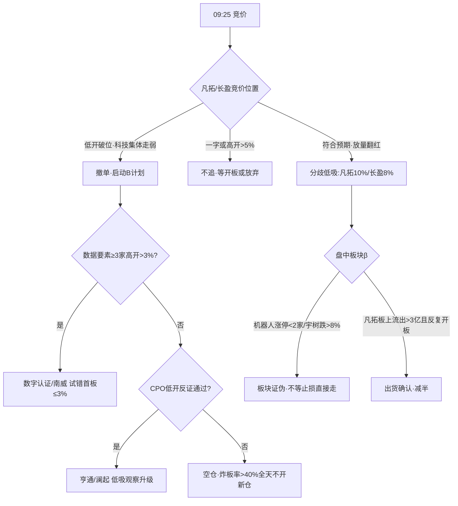

# 2026年10月21日 · 主决策 / D1 盘前预案(散文体)

> 数据源新鲜度:partial(资金面为 T-1 收盘口径,R3 降级)| 降级状态:degraded=true | 置信度:0.72
> 模式:dry_run(不自动交易,需用户 review 后手动 flip live)| 总仓上限:38% | 执行池 2 只 / 观察池 22 只

## 一句话结论

高位震荡、深坑反抽第二日,钱在物理 AI 但明牌催化今天就落地——只拿身位龙和容量中军的**分歧低吸**,不追一字、不接高标、不补杂毛;总仓压到三成八,竞价先看外盘半导体的脸。

## 今天市场在为什么付钱

昨天(10/20)表面热闹:3778 只上涨、54 家涨停,但炸板率 34.9% 已经顶到 35% 的红线边上,全市场主力净流出 121.7 亿、超大单流出 56 亿,比 10/19 的 +222 亿明显退了一个档次。连板天梯最高只有 4 板,而"三板以上接力"这个温度指数 30 日涨了 195%,与 42 个风格资产 30 日平均 -3.56% 形成极端劈叉。这不是主升,是**高标独活的缩量反抽**——情绪周期模型判 high_chop(高位震荡),它的指令很直接:落袋为安、控仓,只做龙头分歧和低位首板,不搏穿越。R1 据此把风格定为震荡分化、原始仓位上限 0.55;四阶段硬表再打七五折,叠加今天的事件门和 R6 的七条 strong_suggest,我把最终总仓上限定在 **0.38**。

钱的去向很集中:人工智能 +71 亿、机器人 +66 亿、华为 +51 亿,而国企改革 -131 亿、高股息 -46 亿、银行 -15 亿、证券 -26 亿全线失血。跷跷板方向是防御切科技,但科技内部也是存量搬家,不是增量入场——这决定了今天**不能同时铺太多方向**,只能跟最确定的那一条。

## 主线与段位:认物理 AI 的"新分支",不认母体加速

R2 给了两条主线。物理 AI/人形机器人(80 分)是四源共识(热度、资金、涨停、群聊共振全中),但要注意它内部是两个阶段叠在一起:母体"人形机器人"在热榜霸榜第一已经连续两天——R3 红线明确这是出货警报,不作正向信号;真正新的东西是"物理 AI"这个发酵第二三天的叙事名词,分支在**机器人大脑和具身数据采集**。黄仁勋今天在 GTC 柏林讲 Physical AI、南京世界模型大会 60 亿签约、宇树 22 日生态大会,三个催化都是明牌。明牌的意思是:竞价最容易被先手资金兑现成高开低走,所以这条线今天**买点全部后置到事件落地和竞价确认之后**。

第二条 AI 应用(71 分)是热榜动量最干净的一条(13→3),但 R4 没有独立硬催化,靠的是周末发酵的旧闻;它的龙一吉大正元还是全场唯一的陷阱——4 板全天炸 4 次、涨停日主力净流出 7.52 亿(陷阱榜第一)。叠加昨晚"要求机构停用 DeepSeek"的行业级利空,这条线我**只保留观察,不给执行位**。数据要素(国家数据集团揭牌)叙事最硬(18 分),但零资金、零身位,放进 B 计划等竞价证明;光通信有业绩有催化却长在 30 日深度退潮簇里,又正对费半 -2.3% 的风口,盘前不占位。

## 反证怎么处理的

R6 今天 hard_reject 为零——模式六霸榜出货的条件 2(个股主力净流出)被反向证据否掉了:凡拓数创机构席位净买 4.59 亿(全市场第一)、龙虎榜净买 2.84 亿,长盈精密龙虎榜 +2.41 亿、机构 +0.78 亿。板块霸板警报成立,但龙一个股的钱是真的,依规只能降 strong 不能硬杀。

七条 strong_suggest 我逐条接了:段位错配(M2)→ 仓位压到 0.38、执行池砍到 2 只;凡拓/长盈的霸榜+估值+盈亏比警告 → 仓位打八五折、**只给分歧价不给开盘价**;吉大正元 → 降观察池只接弱转强;欢瑞世纪(毛利为负、质押 30.6%、净卖出三红旗)→ 直接否决。同时按主线第一天参与原则(错题本 001/002 的教训:情绪没进主跌时,R6 反证只压仓位、不构成"不参与"的理由),龙一不能被打成纯观察,低位的索辰、博汇也不许自动升位替补——它们留在观察池,只按各自的激活条件走。

## 执行池两只,都是"等出来"的买点

**凡拓数创(301313.SZ),10% 仓。** 物理 AI 大脑身位龙,20cm 两连一字,机构真金白银是它和纯情绪小票最大的区别。但二连一字之后追三板一字没有盈亏比(三板一字我的快速通道纪律也不顶),所以买点只有两个:一是竞价开到 -4%~+4% 区间、低开后 15 分钟内放量翻红,按弱转强低吸;二是盘中开板换手、回踩 43.5-46.6 缩量企稳后回封确认。高开过 5% 不追,一字封死就等,9:20 后封单缩到 0.5 亿以下直接放弃。参考价 46.80,止损 41.50(分歧中枢 -8%,20cm 票放宽),目标 53 减半,低吸口径盈亏比约 2.2。DeepSeek 利空和它只是间接关系,真低开后快速翻红反而是"利空不跌"的强确认。

**长盈精密(300115.SZ),8% 仓。** 板块唯一容量中军(流通 335 亿),机器人 +40 亿和消费电子 +27 亿双料资金锚,首板放量突破两个月震荡区。中军不靠连板,所以只低吸/半路不打板:买点 23.5-24.3(低开回踩后翻红),或者放量突破 25.40(MA60)减半仓半路确认。PE108、H1 净利 -94% 是明牌瑕疵,这也是只给 8%、止损收紧到 22.30(-7%)的原因;消费电子侧要吃费半夜跌的低开传导,低开 -5% 以上不接、破 23 整数关不抄。两只合计 18%,占总仓上限的 47%,剩下的机动留给竞价不及预期时的 B 计划和午后。

## 观察池与 B 计划(计划内备选,不是盘中起意)

22 只观察票每只都带了预期方向和观察理由,分四类记在机读 JSON 里:弱转强类(吉大正元、博汇科技、赛摩智能、南威软件)、首板确认类(奥比中光、福莱新材、联创电子、数字认证)、技术位待收复类(昆仑万维站回 MA20 41.7 之前不碰)、情绪温度计(宇树科技、九阳股份、东安动力,只看不动)。超声电子关注度从 72 跳到 10 很诱人,但机构席位净卖 4.67 亿是全市场第一——高人气派发,明确不做。

B 计划的触发是机械的:执行池两只竞价都不及预期、或科技板块资金净流出无承接、或吉大核按钮/炸板率破 40%,三条中一条成立就切。方向依次是:数据要素首板(政策落地第一天的预期差)、硬业绩光通信(亨通、澜起,只认低开反证后的低吸)、主线内部高低切(凡拓被核时索辰的分离补涨)。特别说明:今天 B 计划**不放金融高股息**——10/20 那条线全线失血,GJD 的托底在宽基 ETF 不在银行券商;如果三个备选方向和主线一起走弱,那就是系统性降档信号,执行池全部后置、宁可空仓。

## 不交易条件

R1 失效、R6 hard_reject 超 30%、R7 不可用、severity≥3 等常规条款今日均不激活;真正要盯的是四条盘中硬线:开盘 30 分钟炸板率 >40% 或跌停 >30(BREADTH_BREAK,全线停手);吉大正元低开超 5% 且三个三板天梯批量低开(高标方向全禁);科技链竞价集体低开超 3% 且不能快速翻红(凡拓长盈全部撤单,不接飞刀);凡拓若三连一字但 9:20 后封单缩到 0.5 亿以下(不顶不追,开板下杀不承接)。

## 不确定性与自检

最大的未知是隔夜外盘:费半盘中 -2.3% 时 A 股已收盘,纳指最终收盘数据今夜才出,竞价的低开传导幅度只能等 9:25 实测;R7 全部资金数据是 T-1 收盘口径,ETF/期货维度缺失;本 profile 拿不到 QMT 真实持仓,存量票的处理要靠 P1/execute 按各自 exit 规则对账。错题本两条已固化进本预案:事件票(凡拓、数字认证)只认竞价硬确认,不留"盘中再看看"的宽松口子(20261020_001 协创数据的教训);观察池 22 只全部携带 expected_direction 和 watch_reason_code(20261020_002 第五次复发的字段缺失)。纪律自检:执行池两票一个是龙一一个是容量中军,无中位杂毛;买点全在主线计划内;盈亏比 ≥2;没有因为外盘利空就自己发明新方向。

机读契约:data/runtime/watchlist_plan_20261021.json(pydantic 校验通过,watchlist_plan_v1)。
