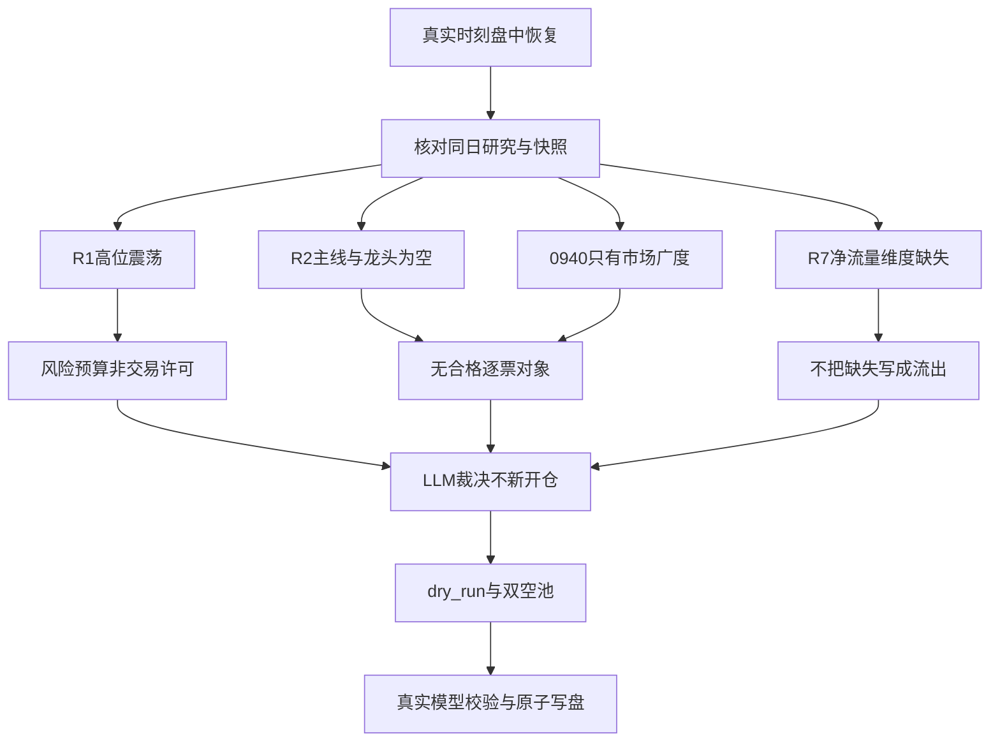

# 20261022 盘中补发／恢复版（非08:00盘前已知）

真实生成时间：2026-10-22T09:53:09+08:00。本版由当前LLM直接裁决，替换08:56:51的Python fallback占位版；未运行fallback选股程序。最新市场观测止于09:40:54，之后行情未知。

## 一句话结论

不新开仓：主线和龙头未确认、资金关键维度缺失；执行池0只、观察池0只，不凑票，不启用交易。

“不交易”只指本恢复预案不新增买入。持仓、成本、已有T计划均未知，不把未知写成空仓，不作全账户清仓、止损或调仓指令。

## 不交易条件与仓位推导

| 条件 | 当前裁决 | 证据 |
|---|---|---|
| 无确认主线 | 命中，拦截新仓 | R2 main_lines=[]，trading_permission=false，两个次线leaders=[] |
| R7关键维度缺失 | 命中，拦截新仓 | staleness_status=unavailable，北向可验证净流量不可得 |
| 无逐票盘中证据 | 命中，拦截新仓 | 两份盘中快照pool均为空 |
| R1置信度低于0.4 | 未命中 | 实际0.48；但其条件权限不等于已放行 |
| 全局severity≥3 | 未命中 | 汇总值2，不人为上调 |

R1原始预算50% × 高位震荡纪律折扣0.75 = 闸门前预算37.5%；无主线与R7 unavailable命中后，本预案新增风险预算为0%。这不是要求现有总持仓降至0%。单票15%、单板块40%、最多5仓、总仓80%的偏好硬限制不变；920禁用和ST过滤保留，不按旧skill解禁示例扩大权限。

仓库真实WatchlistPlan只接受live/dry_run，故机读编码为mode=dry_run、decision_status=no_trade、no_trade=true、active不交易条件、双空池。此为兼容实际模型的表达，不改schema或交易规则。

## 证据时点：盘前事实与盘中观察严格分离

| 输入       | 产物／抓取时间（CST） | 数据归属与用途                                                         |
| -------- | ------------ | --------------------------------------------------------------- |
| R1       | 06:19:08     | 国内量化基准20261021：high_chop，63分，条件权限                               |
| R2       | 06:35:49     | 20261021完整交易日研究；无合格主线及龙头                                        |
| R3       | 06:27:37     | 热榜以20261021对20261020；传播共振非今日涨幅                                  |
| R4       | 06:17:25     | 既有8事件；保留事件原始time与date的差别，不冒充新公告                                 |
| R5       | 06:40:31     | skipped，画像0；因R2空池而非接口故障                                         |
| R6       | 06:43:40     | hard_reject=0，正式反证空，不等于逐票通过                                     |
| R7实际文件   | 06:19:32     | 20261021为正常T-1；关键资金语义缺失，非日期陈旧                                   |
| 研究汇总     | 06:44:53     | skeleton、contract_checks_passed=false；completed_by=08:00非本次生成时间 |
| 竞价快照     | 09:28:07     | 开盘前后已形成的竞价观测，只在本恢复版引用                                           |
| 盘中快照0930 | 09:30:52     | 广度0.4123，涨停15、跌停2；无逐票pool                                       |
| 盘中快照0940 | 09:40:54     | 广度0.4239，涨停30、跌停6；无逐票pool                                       |
| 图形快照     | 06:11:41，无时区 | 12项分析，日K末日20261021；不晋升为今日R2候选                                   |

实际发现并读取的快照路径为data/raw/20261022/auction_snapshot.json、intraday_snapshot_0930.json、intraday_snapshot_0940.json、chart_vision_snapshot.json。发现但未消费overseas_snapshot.json；未发现同日midday快照。未读取其他raw新闻、manifest或数据库。

盘中涨停扩张与跌停增加并存，广度仍不能支持“全市场强修复”的结论；缺板块分布、龙头承接、昨日涨停红盘率，不能由广度直接给翻多权限。也不能因缺证据就断言当前已进入主跌。

质量提醒：0930涨跌平合计5552、0940合计5572，均未覆盖total=5579；保留差异不补造。竞价多个零指标与逐票非零金额并存，且部分行零价占位、存在NaN，不能按“全市场零炸板、零成交”解读。未用今日竞价价或盘中值冒充昨收；本版无任何买卖价位。

## LLM主路径决策：情绪→主线→龙头→买点

情绪阶段沿用R1的高位震荡，不拿63分覆盖其条件权限。单一模板沿用R2“分歧接力”，当前未激活；不同时混入首板、总龙锁仓等多模板凑候选。

数据要素只保留方向级降级观察：R2评分60、热度排名1、14家涨停，同时20261021概念净额-215550720元。大资金意图：净流出和涨停共存，可能有局部换手，不能确诊派发或机构增仓。为什么走强：国家数据集团成立解释传播与题材反应。逻辑够不够硬：不足以确认上市公司订单、生命周期或龙一，故不进execution。

AI应用只保留方向级观察：R2评分52、13家涨停、20261021概念净额-430286592元，R3未精确确认该主题。大资金意图：无持续一致配置证据，缺失的R7确认不能解读为流出。为什么走强：海外模型渠道与政策叙事提供催化。逻辑够不够硬：海外产品不等于国内收入，次线leaders为空，故不进execution。

R3/R4整合已由LLM完成，不再把提示词当分析结果：跨群同稿不算多位独立KOL；R3没有结构化next_day_signal，不杜撰“强修复”。太极股份直接合作澄清只打击其直接受益假设，不外推全行业。PHP事件同时保留网络安全需求正面与互联网／云服务暴露风险负面，不能用净分相消。R4五只消息侧候选均medium且execution_eligible=false，不能包装为已确认首板、龙头或交易票。

## R6反证闭环

hard_reject为0，全部保留原意；不新增D1硬否决。采纳R6_CONTEXT_01“数据要素降级观察”和R6_CONTEXT_02“太极直接合作假设不成立、不进”；无strong_suggest覆盖。AI应用与宁德时代风险为上下文，不升级为正式hard_reject。不新开仓的独立原因是无主线、R7关键维度阻断、逐票证据缺口，非R6无差别看空。

## 执行池、观察池、价位与T+1

执行池0只，观察池0只。no_trade下不为20–40只目标凑池；历史锚点、竞价篮子和图形快照标的均不自动获得候选资格。

逐票核心判定、RR、板型、总龙开关、禁止清单程序未运行：无合法候选，不伪记通过。没有有效reference_close、规则引擎输入和合格票，buy_zone／trigger／stop／take／RR均不编造；也未把旧VLM price_hint当引擎基准。当前不是“有票但漏价”，而是无交易对象。RR_FAIL无可计算对象，不能虚报0只全通过。

T+1开仓、加仓、止损三档均空；没有持仓输入，不为“至少一条止损”编造持仓。首推票四段买入论证无适用对象，未冒称逐票交付完成。

## B计划：证据恢复后重新决策，不自动切仓

R7 seesaw_pairs为空不等于无轮动；R2次线没有leaders，不能编造银行、防御或低位补涨候选。B计划暂无可交易标的。恢复顺序：合法主线和龙一／龙二确认→R5画像与价格基准→资金缺口解决或上游合法修订→完整逐票纪律及价位闸门→新的LLM裁决。盘中广度改善本身不能解除权限；本次不安排任何任务或自动交易。

## 数据源审计与已验证项

🟢 当日R1–R7实际文件可读；R7是R7_capital_flow_20261022.json，汇总指向的无日期文件不存在。本次只在plan记录解析，不修改研究目录。

🟡 R7记录行业／个股资金、龙虎榜、XTick及部分ETF请求成功，但北向净流量为空或语义不匹配，整体unavailable；调用成功不等于所需数据维度完整。DataPro4013与部分请求失败仅按上游记录描述，不宣称所有数据源DOWN。本次D1未直接调用任何数据源MCP。

🟡 R1与R2在R7当时未落盘属于当时not_yet_landed；当前已读到，不能沿用为“现在缺失”。研究汇总的R5置信度0与实际null并列保留，不把null补成已测得0。

🟡 未来3交易日完整事件日历、attention完整管线、持仓、错题本均未在本次范围补齐；不能声称无大事件、没有持仓或已读近期错题。

## 交付边界与未完成项

仅更新data/plans/20261022/watchlist_plan.json和本文件。覆盖前将旧JSON原样备份，旧Markdown以JSON封装备份，备份均位于允许的plans日期目录；不写md.bak。既有watchlist_plan.md、auction_amendment.json未修改，旧竞价修订不视为本恢复版授权。

独立plan.md、点位表、散文版、价位推导、一字预判等路径不在本次白名单，全部跳过。价位脚本和渲染脚本会产生额外写入且无候选，未运行。不写data/runtime、研究、执行、报告、错题目录，不改配置、skill、SOUL或交易规则，不发单。

尚未完成的是可交易研究及逐票价位，不是LLM恢复版文件生成。上游R2契约失败、R7净流量缺口仍真实存在，由相应数据／研究归属修复后再评估。

## 与上下游的关系及元数据

依赖：同日research_summary、R1–R7、user_preferences及已列快照。消费者：execute、P1/P2和用户；本版无新增交易授权。

模型：gpt-6.1-sol。决策来源：llm。仓库验证模型：trading.schema.watchlist_plan.WatchlistPlan。schema校验通过只代表实际模型接受，不能宣称不存在的更严格v2语义验收已完成。
