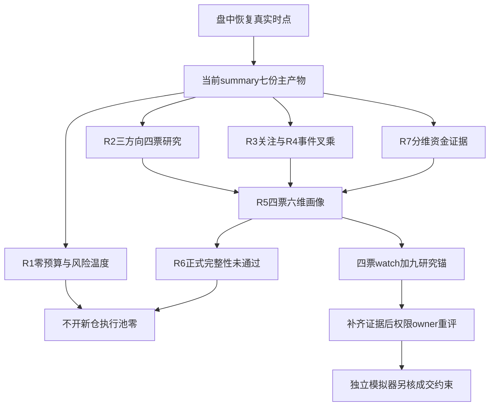

# 2026年10月23日 · 主决策 / D1 盘中恢复预案

> intraday_recovery：本次真实生成于北京时间14:22，不是盘前预测重建。所有行情只描述其标注的观测时点，不能据此证明早晨判断正确。
> 本次交付：execution 0只、watch 4只、仅研究锚9只；有效仓位上限0%，不开新仓。实盘关闭。研究综合已交付不等于研究就绪：R6正式反证未完成，production_ready=false，必须重评。

## 🧭 一句话结论

**市场在奖励局部首板、二板及权重承接，而非科技整板反转；保留三方向研究，零预算不动。**

这次不能再把“不许开新仓”翻译成“没有可研究的股票”。R2把AI应用、芯片概念和人形机器人保留在可供R5读取的研究载体中，R5确实为天娱数科、睿能科技、好上好、天奇股份完成了六维分析。四只都进watch，但没有一只已满足完整独立交易条件。零执行池的原因是有效预算为零、R1低置信与正式研究门禁未完成，不是北向缺失，也不是某一只票的RR不合格蔓延成全市场结论。

本预案只消费当前summary指向的七份主产物。summary状态为partial，契约结构检查通过只说明文件形状可读；R6正式评估对象数为0，虽另做四票有限负面诊断，也不能写成“四票全部通过”。本次分析的终点是保留可证伪对象、讲清分歧与缺口，不伪造开仓资格。

## 🚦 为什么今天仍不进execution

| 不交易条件 | 当前 | 含义 |
|---|:--:|---|
| 既有零预算 | 🔴 active | R1明确保留0%及禁止新仓；本次授权没有提高预算 |
| R1开仓信号置信度 | 🔴 active | 0.245低于skill既有0.4资格门槛，不能作为独立开仓依据 |
| 正式研究未就绪 | 🔴 active | R2等仍partial，R6正式反证被完整性门禁阻塞 |
| R7_STALE | 🟢 inactive | R7为partial但staleness_status=ok；北向null不使其余维度归零 |
| 全局数据severity≥3 | 🟢 inactive | 本次summary为2，不伪造三级故障 |
| R6硬否决溢出 | 🟡 不触发、不作安全证明 | 空hard_rejects且0正式评估，不能估算已排雷比例 |

仓位推导为min(既有有效授权上限0%，R1保留上限0%)=0%。不启用旧技能的默认50%，不套极恐抬仓下限，也不把研究方向数量代入公式抬预算。总仓上限0%、新仓预算0%、可新增买单0；单票15%、单板块40%、最多5只只是未来独立放行后的硬上限，不是今天的额度。没有读取私人持仓，因此这里的零预算不是“立即把持仓清零”的指令。

## 🌡️ 从R1温度到R7资金：盘面在奖励什么

R1在13:02观察到24只涨停、32只跌停、10只炸板，按10/(24+10)计算炸板率29.41%，最高梯队3板；四维情绪分44。此前12:59的炸板率为38.71%，说明盘中有修复，但仍有明显跌停压力。high_chop只是暂定温度，昨日涨停今日溢价缺测，main_down风险没有被排除。这里不拿昨日41.07%的炸板率冒充当前盘面，也不拿随后修复覆盖此前真实风险。

R2稍后研究样本又记录机器人6板高度锚大业股份，与R1早时点最高3板并不一致。由于样本、供应商、时间都不同且部分只给日期，不能选更有利的那个高度拼出统一市场周期。因此不接高位老龙，也不把低位天奇首板抬成龙一。研究主模板只有“首板隔日”；睿能二板仅作身位与重组事件对照，不混成第二套执行打法。

R3的48分与R1的44分不是两个同口径市场情绪估计。R3支持的是AI应用、芯片的L1+L2关注共振；机器人双日热度第一为拥挤警报，不等于已经确认霸榜出货。匿名文本中的AI购物、临床应用、国产替代叙事可提供研究假设，不能直接变成公司新增订单。次一交易日一致方向仍未确认；周五后的下一交易日不写成周六，也不在没有日历核验时指定日期。

R7保留了可核的主力、游资及ETF证据。其截至10月22日的五日市场主力连续五日净流出，合计约-1016.36亿元，这是风险背景而非今日实时总流出。今日十只定向股票有带源内时刻的XTick资金和报价，消费、保险存在局部承接；德明利则价格走强、当日XTick净卖，资金并不一边倒。ETF五日份额申购不是净流入金额，不能拿份额乘随意价格合成统一金额。

## 🧩 四象限叉乘：关注热度 × 同主题资金

这里“高情绪”指概念关注度，并不代表全市场亢奋或看多；“高资金”只表示本次同名同日概念主力净额为正，不代表持续性已经证明。热榜主要截至12:30，资金列在13:25接收但缺源内逐笔时刻，所以这是盘中研究叉乘，不是同步交易信号。

| 象限       | 本次可落对象    | 资金与价格证据                       | D1裁决                 |
| -------- | --------- | ----------------------------- | -------------------- |
| 高关注×正净额  | AI应用      | 热度第8；+24.418655亿元；概念-3.6503%  | 进watch对应研究，不能把承接当主升  |
| 高关注×正净额  | 芯片概念      | 热度第17；+75.030790亿元；概念-4.2852% | 进watch对应研究，海外行业负面仍压制 |
| 高关注×正净额  | 人形机器人     | 热度第1；+26.556962亿元；概念-3.3913%  | 降级警报观察，不把拥挤当净卖实锤     |
| 高关注×非正净额 | 无双轴齐全概念样本 | 天娱、睿能个股净卖不能混入整板资金轴            | 保持空样本，不造结论           |
| 低关注×正净额  | 未完成低关注认证  | 白酒、保险有承接，不等于已经证明低情绪           | 留未分类方向，不强贴“预期差”      |
| 低关注×非正净额 | 无双轴齐全对象   | CPO/PCB下跌不是净卖证明               | 不以价格代资金填象限           |

三概念成分重叠，净额不能相加为“科技合计流入”。共同风险恰恰是概念正净额与整体负收益并存：可能是在跌势中承接，也可能只是局部脉冲；只有持续资金、价格回收和跟风赚钱效应一起改善，才接近可交易确认。

- **大资金意图**: 当前更像在大幅波动后试探局部弹性和权重承接，而不是有证据的全面回补。概念净买与个股净卖并存，使“资金已一致”缺乏依据。
- **为什么走强**: 强的是少数首板、二板和部分消费保险个股，不是三大概念指数；板块仍跌，涨停家数只证明局部分化。
- **逻辑够不够硬**: 同名概念资金和关注轴可以交叉，但持续性、逐笔时刻、公司订单与完整龙头资格缺失，因此足够研究，不足够买入。

## 📰 R4事件打击面：正负不能相互抹平

R4八条主事件与十六个板块的128格极性映射已消费，另外保留霍尔木兹事件对航空、航运、成本敏感化工链的负面叠层。D1不以净分把负面抵消成“无风险”。

海外AI硬件抛售是光模块、CPO、半导体、存储、AI算力的行业风险偏好压力，不是国内订单取消的证据；午间光通信公司称经营正常、订单充足，也不能自动修复估值折价。芯片分销观察对象睿能、好上好保留这一行业风险覆盖，不因为国产替代叙事就宣告利空已被消化。R3讨论中的FCC限制未获本次R4独立同题公司受益确认，不能拼成双源确定性。

Isaac平台升级为机器人和工业软件提供正面研究催化，但天奇的工业场景映射不等于英伟达供应商身份。PHP漏洞对网络安全需求是正面机制，对线上公共服务、网络平台停服则是负面冲击；三六零免费体检也不是收费订单。金银大跌与赤峰控制权事件同样属于行业价格和公司事件两个层级，不能用后者抵消前者。霍尔木兹供给风险对油气、油服的正面映射，只是事件线索；缺热度、资金、封板合取证据，不扩成执行主线。

完整未来三交易日宏观/公司事件日历并未在本次主产物齐备，不声称“未来没有大事件”。本次所有票均无执行资格，已发生事件不倒写为晨间尚未落地，也不触发任何外发或账户动作。

## 🔍 四只真实画像：全进watch，均非可买名单

以下参考价是R5保留的14:00附近盘中报价，不是本文生成时的新核价，也不是成交。技术位截至10月22日，盘中累计量与此前完整日均量的比较不是时间校正量比。

| 对象 | 参考价 / 昨收 | 身位与龙头认定 | alpha / risk | 流通市值（亿元） | 裁决 |
|---|---|---|---|---|---|
| 天娱数科 002354.SZ | 8.03 / 7.30 | 未认定；低位首板研究；已证条数未知 | B / B- | 130.6476 | 进watch，仓位0% |
| 睿能科技 603933.SH | 20.94 / 19.04 | 龙头（样本临时）；已证条数1 | B+ / B- | 43.4598 | 进watch，仓位0% |
| 好上好 001298.SZ | 17.36 / 15.78 | 未认定；低位首板研究；已证条数未知 | B+ / C | 70.7280 | 进watch，仓位0% |
| 天奇股份 002009.SZ | 17.30 / 15.73 | 未认定；低位首板研究；已证条数未知 | B / C | 61.2820 | 进watch，仓位0% |

四只禁止清单已知命中项均为空，但检查状态都是partial_not_all_clear，绝不是“14项全部通过”。睿能43.4598亿元处20—50亿元谨慎区，仍保留研究；不把50亿元改成硬剔除线。四票均没有完成正式R6排雷、完整核心/战术引擎与可执行价位验证。

### 天娱数科 002354.SZ：观察：首板与人气修复成立，昨日破位及当日主力净卖矛盾未解；不是已确认AI应用龙头。

- **大资金意图**: 可观察的是高人气首板与主力净卖相背；大资金可能借应用叙事换手，亦可能先手兑现，无法从涨停断定机构吸筹。
- **为什么走强**: 昨日大跌收在短均线下，今日从低开拉回涨停，属于强修复；仍未越过30日高点，不能称已进入主升。
- **逻辑够不够硬**: 硬数据是报价、量价和中报，AI购物到公司收入的订单链缺失；人气与问财同源信号不能重复计算独立共识。

**买入理由**（仅解释研究价值，不是开仓授权）：AI应用/营销具备研究业务映射，非新增订单结论；今日首板及R2人气第3形成可验证的局部辨识度。参考价8.03，近五日大单加特大单净额-899.03万元，截至10月22日；今日另一供应商主力净额为-1.5198亿元，缺源内时刻，二者不拼成同口径连续确认。

**风险点**：盘中净卖与首板背离，次日有兑现风险；TTM PE缺、ROE双源不一致，业务弹性与现金兑现仍需核验。六维中催化侧：AI营销/应用是R2研究映射；R4未核同题公司级增量订单。近30日公告检索为空，扩窗可见中报及8月异动公告，不能把旧异动当今天催化。 估值侧：TTM PE为空，不能称低估；PS/PB仅T-1静态参考。中报正EPS与TTM亏损口径不矛盾但需全年度核对。公告摘要ROE3.12%与Tushare2.7951不同，保留冲突；不计算无预测CAGR和TAM支撑的PEG。

**止损条件**（研究证伪，非卖单）：若下一交易日收盘低于本次30日样本MA20且AI应用涨停家数少于3，撤销强修复研究假设；这是观察证伪，不是自动卖单。 可核技术锚为MA20=7.4975、20日高点=8.27、30日高点=8.62；它们不是批准止损价。

**可验证假设**：未来1-3个交易日核：收盘站上本次30日高点且AI应用涨停不少于3；否则维持观察或降级。 下一交易日需要核实溢价、封板/开板承接和板块跟随，而非看见涨停就假设有次日接盘。当前所有entry_rules为空，既不竞价挂单，也不等开板自动买。

### 睿能科技 603933.SH：观察：2板身位与早封成立，但盘中一字无换手检验，重组尚待审批、20–50亿风险保留。

- **大资金意图**: 昨日大单承接与今日一字形态可解释为抢身位；但R2主力负流向和小流通盘提高封单撤退风险，不把低成交当惜售锁仓铁证。
- **为什么走强**: 昨日从均线下方向上首板，今日一字2板，已经越过本次30日样本最高价；价格强度最明确但没有可成交性证明。
- **逻辑够不够硬**: 有公司原公告硬事件与真实价格锚；审批未完成且买入后次日接力未知，不能把重组预期等同盈利增量。

**买入理由**（仅解释研究价值，不是开仓授权）：收购博泰75%及产业分部重估是已披露的研究催化；2板与早封为R2样本内强身位，非全市场总龙证明。参考价20.94，近五日大单加特大单净额3045.15万元，截至10月22日；今日另一供应商主力净额为-0.2653亿元，缺源内时刻，二者不拼成同口径连续确认。

**风险点**：流通市值20–50亿元，盘中一字缺少换手承接检验；重组待审批且H1经营现金流为负，题材收入兑现有不确定性。六维中催化侧：10月13日公告全文确认拟收购博泰智能装备75%股权，治理条款调整不是新订单；仍需上交所审核及证监会等批准，不能写成重组完成。芯片分销映射与纯存储受益有别。 估值侧：IC分销/工控与并购混合，采用分部现金流/PS及PE交叉，不对整公司套芯片高成长PEG。H1利润增长但经营现金流每股为负，估值需要回款支撑；Q1现金流为正，未达到连续两期负CFO。

**止损条件**（研究证伪，非卖单）：若重组审核被否、终止，立即撤销重估假设；下一交易日收盘跌回本次30日样本最高价下方且芯片涨停少于3，降级研究。 可核技术锚为MA20=18.2910、20日高点=19.85、30日高点=19.85；它们不是批准止损价。

**可验证假设**：未来1-3个交易日核：收盘保持在本次30日样本高点上方、芯片涨停不少于3且原公告无否认；需另核换手和封单，均不自动授权买入。 下一交易日需要核实溢价、封板/开板承接和板块跟随，而非看见涨停就假设有次日接盘。当前所有entry_rules为空，既不竞价挂单，也不等开板自动买。

### 好上好 001298.SZ：观察：端侧AI分销有官方业务证据，首板与放量修复；负现金流和高负债压低风险档。

- **大资金意图**: 放量首板及小幅户数下降支持资金重新定价分销环节的假设；公司扩张消耗营运资本，承接者可能赌国产替代，也可能只是题材短钱。
- **为什么走强**: 从前期下行区间拉出首板，盘中量超过近期完整日均量并站上20日高点；仍低于30日样本最高价，反转尚待多日验证。
- **逻辑够不够硬**: 官方调研证明业务而非订单，增长数据证明历史而非远期；现金流反证很强，R6需独立评估F8，R5不代行硬否决。

**买入理由**（仅解释研究价值，不是开仓授权）：公司调研原文给出端侧AI产品和原厂合作证据；盘中首板、放量及近5日大单正流向形成研究锚。参考价17.36，近五日大单加特大单净额1197.57万元，截至10月22日；今日另一供应商主力净额为0.3894亿元，缺源内时刻，二者不拼成同口径连续确认。

**风险点**：首板次日兑现与芯片整板弱势仍可打断接力；连续报告期负经营现金流及70%以上资产负债率，成长不等于现金收益。六维中催化侧：10月14日调研原文确认BoB AI HUB、AI SoC/存储/模组与星宸科技、摩尔线程等合作及端侧推广；没有新增订单金额。10月13日宝汇芯19%股权收购进展为另一公司事件，不与FCC叙事混成确定受益。 估值侧：H1收入和净利高增，但Q1/H1每股经营现金流连续报告期为负、EPS为正，F8预警透传；负债率较高。不得把332%历史同比当未来2-3年CAGR算出廉价PEG。PS较低也不能忽略分销低利润率与营运资金。

**止损条件**（研究证伪，非卖单）：若公司否认原厂合作/业务映射，撤销事件研究；下一交易日收盘跌回本次20日高点下且芯片涨停少于3，降级首板假设。 可核技术锚为MA20=16.1400、20日高点=17.26、30日高点=18.74；它们不是批准止损价。

**可验证假设**：未来1-3个交易日核收盘能否守住本次20日高点、芯片涨停不少于3及无业务否认；现金流修复须等后续财报，不能要求72小时兑现。 下一交易日需要核实溢价、封板/开板承接和板块跟随，而非看见涨停就假设有次日接盘。当前所有entry_rules为空，既不竞价挂单，也不等开板自动买。

### 天奇股份 002009.SZ：观察：机器人首板放量、量价修复成立；非高度总龙，利润下滑与高估值限制研究评级。

- **大资金意图**: 五日大单承接和今日放量首板支持资金在工业应用端试错；没有订单和全板上涨证明，不能推论长期机构配置已完成。
- **为什么走强**: 前几日反弹后今日放量首板，盘中越过20/30日样本高点；旧周线仍弱，局部价格修复不等于机器人周期主升。
- **逻辑够不够硬**: 行情与担保原公告可核；机器人订单弹性未核，利润反而下降。两源事实不能替代订单端缺失的关键一环。

**买入理由**（仅解释研究价值，不是开仓授权）：工业场景/物流自动化给出具身数据落地的研究连接；连续大单正流向、放量首板和区间突破提供可证伪市场锚。参考价17.30，近五日大单加特大单净额6129.44万元，截至10月22日；今日另一供应商主力净额为0.8465亿元，缺源内时刻，二者不拼成同口径连续确认。

**风险点**：首板不是6板总龙，双日热度拥挤带来兑现；H1利润下滑、TTM高估值及集团内部担保约束中期逻辑。六维中催化侧：Isaac平台升级来自R4，是行业催化；天奇工业场景/物流自动化是业务映射，不证明英伟达供应商或新增订单。最新担保全文确认对子公司1900万元最高债权连带担保，实际担保余额占净资产50.09%，不是机器人订单。 估值侧：自动化与循环产业混合，宜用分部/正常化利润交叉，而非统一机器人PEG。TTM PE较高且H1净利同比下降，无法算有意义的正增长PEG；正CFO缓和但不能抵消盈利估值背离与担保风险。

**止损条件**（研究证伪，非卖单）：若公司公告否认机器人业务映射，撤销事件假设；下一交易日收盘跌回本次20日高点下且机器人涨停少于3，降级。 可核技术锚为MA20=15.3715、20日高点=16.59、30日高点=16.96；它们不是批准止损价。

**可验证假设**：未来1-3个交易日核收盘能否守住本次20日高点、机器人涨停不少于3；公司级新增订单仍须独立公告，不用量价替代。 下一交易日需要核实溢价、封板/开板承接和板块跟随，而非看见涨停就假设有次日接盘。当前所有entry_rules为空，既不竞价挂单，也不等开板自动买。

## 📏 价格与RR：明确未知，不生成假买点

RR就是(目标价−买入价)/(买入价−止损价)，亦即预期赚幅/允许亏幅。缺少证据支持的买入、止损或目标，原始比值应是null，不是0、不是合格、更不是RR_FAIL。当前SOUL关2的1、skill价位引擎的1.8与上游引用既有2并不一致；本次用户没有选新统一门槛，D1不能擅自消歧为放行。上游“SOUL.md:57”的引用也不是当前计划profile的RR条款，本次仅保留引用来源并标未验证，不把它伪装成已核规则。

| 票 | 本次取价与源 | 买区 / 触发 | 止损 / 目标 | 预期赚幅 / 允许亏幅 / 原始RR | 原因 |
|---|---|---|---|---|---|
| 天娱数科 | 8.03；R5内嵌Tushare盘中报价 | 未知 / 无授权 | 未知 / 未知 | 未知 / 未知 / null | 缺独立可执行价位依据，仅研究 |
| 睿能科技 | 20.94；R5内嵌Tushare盘中报价 | 未知 / 无授权 | 未知 / 未知 | 未知 / 未知 / null | 缺独立可执行价位依据，仅研究 |
| 好上好 | 17.36；R5内嵌Tushare盘中报价 | 未知 / 无授权 | 未知 / 未知 | 未知 / 未知 / null | 缺独立可执行价位依据，仅研究 |
| 天奇股份 | 17.30；R5内嵌Tushare盘中报价 | 未知 / 无授权 | 未知 / 未知 | 未知 / 未知 / null | 缺独立可执行价位依据，仅研究 |

主JSON在每票price_levels明确写null与原因，entry_rules为空；未把参考报价当触发价，也未以schema缺省的stop_loss=0冒充有效止损。当前schema顶层stop_loss不是nullable，本次不发布该缺省字段，以price_levels.stop_loss=null记录真实未知；任何消费者不得把模型缺省0作为交易价。所有B计划与研究锚同样没有有效买区，不具备自动执行资格。

价位脚本没有运行：实现会另读kb/research.db，并输出附加价位推导文件，超出本次“仅summary主产物”和“两核心文件”的限制。不能为了把表填满而引入旧库或编造目标。本次也没有单票RR_FAIL，因此没有新增任何由单票RR触发的全局禁令。未来任一单票RR失败只拦该票，真正独立全局禁令另保留。

## 🔭 未进入四票画像的研究锚：不让对象静默消失

R7五只资金研究对象和R4补充事件对象不被冒充为已完成R5画像；它们进入research_anchor_only而非执行池。下表所有对象均0%授权、无entry_rules、买区/止损/目标/RR未知；参考价只用于辨识研究时点，不是可买价。

| 研究锚 | 参考价 | 真实依据 | 未升级原因 |
|---|---:|---|---|
| 华天科技 002185.SZ | 16.27 | 昨日封测局部承接，今日价格与XTick净额同向，但五日资金主要来自昨日单日 | 无本次完整R5画像/独立执行资格 |
| 德明利 001309.SZ | 250.69 | 五日主力净入与今日价格上行，但XTick当日净卖出，保留资金价量背离 | 无本次完整R5画像/独立执行资格 |
| 百亚股份 003006.SZ | 22.93 | 五日逐日净入，今日价格与XTick净额同向，保留消费承接研究 | 无本次完整R5画像/独立执行资格 |
| 中国平安 601318.SH | 51.48 | 今日价格与XTick同向，作为保险权重回流研究对象而非静态防守股 | 无本次完整R5画像/独立执行资格 |
| 大洋电机 002249.SZ | 7.32 | 昨日涨停附近表现与今日净额及价格同向，保留电机方向研究 | 无本次完整R5画像/独立执行资格 |
| 正裕工业 603089.SH | 11.89 | 机器人局部前排研究；材料关联仍需公告核验 | 无本次完整R5画像/独立执行资格 |
| 襄阳轴承 000678.SZ | 13.23 | 机器人局部前排研究；不宣称总龙 | 无本次完整R5画像/独立执行资格 |
| 三六零 601360.SH | 8.11 | PHP应急服务研究；免费体检不代表收费订单 | 无本次完整R5画像/独立执行资格 |
| 大业股份 603278.SH | 未知 | 6板高度锚，不接高位老龙，不把天奇首板升位替补；与R1早时点3板存在梯队差异待核 | 无本次完整R5画像/独立执行资格 |

华阳智能301502.SZ在本次R4证据中流通市值15.3387亿元，低于20亿元硬线，明确拦截进rejected，不列成观察买入对象；这不是D1新增R6硬否决。正裕工业32.7830亿元为谨慎研究区，不因低于50亿被硬剔除。R2覆盖46条在线概念返回、18只聚焦股票，实际选4只；不是“看了全市场所以全覆盖”。其余历史锚未取得本次逐票资格，只列覆盖缺口，不为观察池配额补旧票。

## ↔️ B计划：先辨资金搬去哪里，不把备选当许可

若AI应用、芯片的首板梯队失去次日溢价，或概念资金转弱且价格继续下跌，先验证消费与保险承接。百亚股份五日逐日净买、当日价格与XTick同向，是消费研究锚；中国平安当日价格和资金同向，是保险回流研究锚，不因“传统股”静态排除。若仍在新事件低位方向试错，则只保留好上好、天奇股份和大洋电机的原有研究，不接高位老龙、不临时找补涨替代被否决龙头。

这不是已经证实的统计跷跷板：R7 seesaw_pairs为空，没有20日相关小于-0.6的合格配对，因此不虚构对冲强度，也不套50%/75%降仓公式。白酒保险有承接也不能强行放进“低关注高资金”象限。若B方向同样走弱，研究降档；即使B方向走强，仍须有权限owner重评零预算、R5/R6、核心、禁止清单及可成交价位，P1/P2不得通过promote解禁。

## 🧱 R6消费与T+1边界

summary和R6的hard_rejects已合并，本次均为空，因而“由R6硬否决实际移出执行池”的对象数为0；执行池为空仍有独立充分理由。正式strong_suggest也为空，没有需要覆盖的正式建议。七条负面诊断全部采纳为研究约束：概念/个股资金不混、零预算不清研究、天奇盈利估值背离、机器人热度不直接判出货、好上好现金流F8线索、跨时点梯队不拼接。它们不被升级成伪正式否决，也不被删除。

如果未来R6真实产生hard_reject，必须从execution剔除，不能以“等分歧”保留，也不能为补名额把龙二、候补升位。本次不读取QMT、IB、券商接口、凭据或私人持仓，不输出已有持仓增减动作。T+1开仓、加仓与持仓止损清单均为空；不会为满足旧技能“至少一条持仓止损”的配额杜撰持仓，逐票观察证伪条件已在上文保留。

用户已授权后续独立模拟执行器，但本计划仍dry_run、autonomous_trading_enabled=false、requires_user_confirmation=true、paper_trading_authorized=true。纸上授权不是本次研究通过，更不是模拟成交；模拟执行器仍要独立检查现金、真实报价、触发、可卖数量、T+1与成交限制。现有零预算与禁新仓未解除时不得买入，没有可执行买点允许不成交。

## 数据源审计

D1只读取主产物，不直接调用数据源MCP。下表描述本次上游报告内的真实证据覆盖，不声称D1另做在线探针。call_failed、空返回、缺时间或待落盘不被统称source_down；只有实测拒绝类证据才可定性为该请求故障，不能扩成整源停摆。

| 源 | 日期 | 状态 | 备注 |
|---|---|:--:|---|
| R1主产物 | 2026-10-23 | 🟡 degraded | 当前44分、震荡分化；high_chop暂定且主跌未排除；既有0%预算不变。 |
| R2主产物 | 2026-10-23 | 🟡 partial | 三条研究载体、四只真实对象；可交易主线0不清观察；AI应用70/芯片66/机器人48非交易许可。 |
| R3主产物 | 2026-10-23 | 🟡 degraded | 48分，AI应用与芯片L1+L2为关注共振；机器人双日top1拥挤非确认出货；次日方向未确认。 |
| R4主产物 | 2026-10-23 | 🟡 partial | 八条事件；海外AI硬件负面与机器人平台正面分开；PHP需求与线上停服相反打击面分开；公告经营正常不抵销估值压力。 |
| R5主产物 | 2026-10-23 | 🟡 partial | 四只六维画像已分析，数据覆盖仍partial；B/B-、B+/B-、B+/C、B/C，不能称完整排雷。 |
| R6主产物 | 2026-10-23 | 🟡 degraded | 正式反证partial，candidates_evaluated=0；四只有限负面诊断不是正式通过；hard_rejects空非全清。 |
| R7主产物 | 2026-10-23 | 🟡 partial | staleness_status=ok、confidence=0.45；北向可选null，内资/游资/ETF分维度保留；T-1历史与T0观测不混。 |
| XTick盘中情绪 | 2026-10-23 | 🟢 盘中可用 | R1源内13:02，R3另有13:16；非同刻、非终盘 |
| 同花顺概念/个股净额 | 2026-10-23 | 🟡 日期可核、逐笔时刻缺 | R2在13:25—13:26接收；不将接收时间当报价时间 |
| R5实时报价 | 2026-10-23 | 🟢 有源内时刻 | 四票约14:00；不是本文时刻的新核价，未成交 |
| Tushare日K/估值/五日大单 | 2026-10-22 | 🟡 正常完成日历史 | 30根日K、估值和资金窗口各分开；不是今日收盘 |
| 龙虎榜/席位 | 2026-10-22 | 🟡 T-1及近三日 | 事由行数不是股票数，同源交叉不冒充独立验证 |
| ETF份额 | 2026-10-22 | 🟡 覆盖1712只 | 五日申赎份额非金额，基差及A股期权隐波缺 |
| 当日匿名群文本与热榜 | 2026-10-23 | 🟡 文本117条、热榜异步 | 关注共振非资金，公众号旧材料不计当前共振 |
| 公司财报与公告 | 2026-06-30及原公告日 | 🟡 期间各保留 | 中报、调研和重组文件不是盘中新订单，不完整排雷 |
| 可选北向 | 2026-10-23及近5/10/20有效日 | 🟡 同口径净买额缺 | 净额/趋势均null，不用额度、成交额或股通席位替代 |
| DataPro请求 | 2026-10-23 | 🔴 上游报告4013订阅错误 | 只记该请求被拒，不宣称其他来源一起停机 |
| vibe资金流/基差等 | 2026-10-23 | 🟡 失败/无匹配 | 官方回退、XTick等各按证据保留；不自动整体unavailable |

七主产物的trade_date均为20261023，生成时刻均与当前summary.units的finished_at一致，已列上游SHA链接逐项吻合。R7规范路径为软链接，解析到R7_capital_flow_20261023.json，其内容SHA与R2/R6本次引用一致；D1没有另读旧R7补缺。当前summary批次为20261023T125645-recovery-3520，环境CHZL_RESEARCH_RUN_ID为空；各上游自身run_id多为null，因此只能确认内容哈希与时点血缘，不能声称所有上游run_id都精确相等。

summary的completed_by=08:00是调度残留/目标，不是本次完成事实；实际summary生成于14:13。各行情、财报、新闻源日期与观察时点另存JSON，不用文件名日期替代源日期。报告frontmatter中的stale用于保守表达执行新鲜度未全通过，不代表七份盘中主产物都是旧批次，更不等同源故障。

## ⚠️ 不确定性、交付边界与重评义务

本次分析已覆盖当前七份主产物，但数据覆盖不完整，正式研究未就绪。首板日内走强不保证T+1溢价；一字二板不证明可成交；五日历史净买不能证明当前净买；业务连接不等于订单与利润兑现。要把观察转执行，须先由有权限owner处理零预算，再补正式R6、全池龙头认定、完整禁止清单、同步报价和有证据的买入/止损/目标；RR门槛冲突不得靠降低门槛绕过。

本次只写核心JSON与本KG主MD。skill旧要求的runtime/plan.md副本、点位表、额外散文副本、价位推导MD及独立一字板文件均因本次输出范围或profile白名单阻塞，不生成。价位引擎因额外数据库输入与附加输出阻塞；错题本、独立attention_signals、额外周期文件和十日涨停库未读取，以遵守仅本次主产物限制。这些偏离在JSON meta.scope_blockers逐项保留，不冒充全技能外围交付已齐。

用户已提前备份原件，本次不另写.bak；不改代码、配置、技能、SOUL、模型、cron，不写raw/research/execution/runtime/模拟账，不调用实盘接口，不外发推送。上游刷新归研究owner，D1重评归计划owner；本文件存在不免除重评，也不得被解释为“研究已完成、现在可买”。

## 🔗 与其他单元的关系

输入仅为当前research_summary所列R1—R7；本次D1负责综合裁决，不补做研究抓数。下游execute及独立模拟执行器必须同时消费no_trade、零预算、production_ready=false、research_completion_passed=false与reassessment_required=true，不得因watch或paper授权绕过禁令。旧P1/P2修订文件未在本次重建，不能把它们的旧观察升级绑定成本次放行。

## Sub-Agent 元数据

- skill: main_decision_v1（本次用户范围覆盖旧附加输出要求）
- model: gpt-6.1-sol；decision_source见frontmatter及核心JSON
- artifact: data/plans/20261023/watchlist_plan.json
- 研究状态: 未就绪；综合交付: 两核心文件；数据质量: partial_coverage
- 复核依据: 日期、源内时点、summary unit时间与SHA血缘；非晨间预测归因
