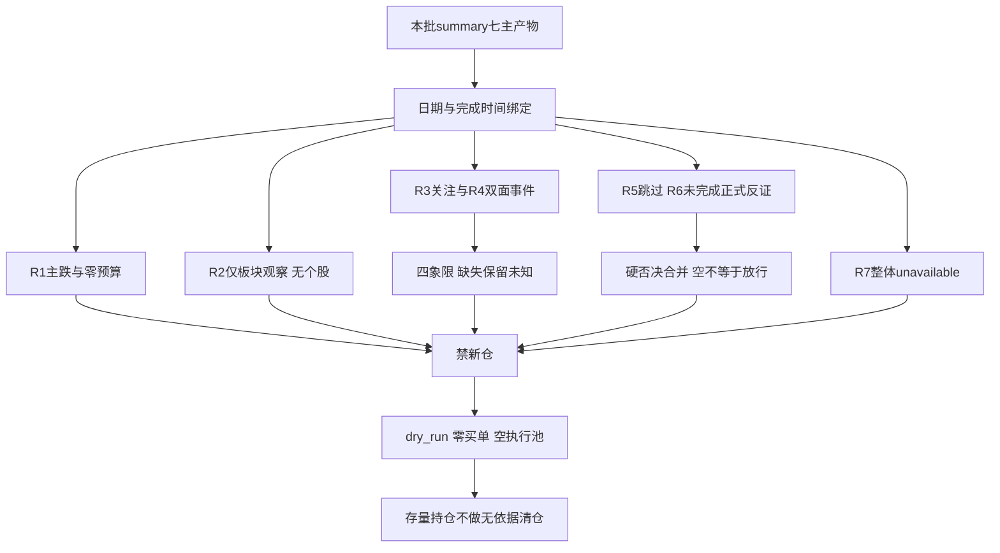

# 20261023 盘前预案：热度不是承接，今天不开新仓

> 本次决断：拦截新增交易；新仓风险预算0%，执行池0只，股票观察池0只。人形机器人只保留板块级降级观察。零预算不是命令把现有账户立即清仓。

## 一句话结论

主跌与数据资格双重拦截，不把高讨论度当作主线回流，也不把空反证清单当作放行。

## 先认市场，再认个股

今天首先要回答的不是哪只股票更便宜，而是有没有承担隔夜风险的资格。R1披露的境内观察日为2026-10-22：涨停33家、跌停48家、炸板23家，炸板率按23÷(33+23)计算为41.07%。这是主跌约束，不是可以靠情绪分46分冲销的噪声。R1的“主线扩散型”来自涨停数量与高度的分类代理，并不证明健康主线存在。D1采用其显式零预算，而不是遇到degraded就默认为50%仓位。

风险收缩也有跨资产印证，但证据边界必须说清。R1的20只ETF样本只有1只上涨；这不能说成全A股上涨比例只有5%。同一研究的42个目标只覆盖20个，22个同花顺对象历史缺口仍在。R1补核的2026-10-22美股指数中，纳指跌2.60%、费半跌6.72%；R7的美股个股样本仍截至2026-10-21，不能混拼成最新隔夜完整篮子。商品、美元与汇率终值或历史不足，宏观状态保留“未确认”，不强贴软着陆或滞胀标签。

R7的局部主力数据可用于风险描述，不能等同整体资金资格通过。其5、10、20交易日市场净额分别为-1016.3635亿、-2639.6748亿、-5278.0041亿元，窗口彼此包含，不能相加；主力资金流也不是所有投资者现金流。北向可靠净额缺失使R7整体staleness_status=unavailable、confidence=0。北向缺失不填零，不推断外资中性，更不能因部分行业净买就将整体门禁置为通过。

仓位推导因此只有一条：R1显式零预算、主跌无已认证试仓资格、R7整体资格未通过，三项取严后新仓额度仍为0%。本次不套“至少20%”的旧公式，不启用极恐逆向抬仓，不因一条观察主线乘出额外预算。今天是不开新仓日，主模板仍为R2选定的“首板隔日”，但只作观察模板，不混入总龙锁仓或分歧接力。

## 人形机器人：催化是真的，整板承接尚未到位

R2只有一条72分的板块观察主线——人形机器人；已确认可交易主线为0，leaders和股票候选均为空。R1未去重概念数量代理的“三条以上”，不能覆盖R2的逐线核验。机器人9家涨停、概念热度第1，叠加Isaac开发平台催化，足以解释为什么被讨论，却不足以授权今天买入。整板当日主力净额为-26.8853亿元；减速器和执行器子方向分别净买约6.4994亿元、6.0056亿元，说明局部承接存在，但不能拿重叠子方向流量冲销整板净卖。

- **大资金意图**: 可提出“资金在机器人内部做工具链与零部件分化”的假设，但无法由净额反推出具体机构意图。整板仍净流出，尚不是全市场合力回流的证据。
- **为什么走强**: 平台升级叙事、9家涨停和热榜前排提供可观察辨识度；但涨停家数不等于封板率，板块日涨跌和整板资金也未同步转强。
- **逻辑够不够硬**: 催化与关注证据成立，持续天数、生命周期、封板率、次日预期仍为null；没有合格龙头、画像及买卖点，结论只能是降级观察。

这不是“有9家涨停也坚决不参与”的静态偏见。主线第一天参与原则要求周期与开仓资格不被破坏，而当前研究主动不构建股票池。后续若同口径资金转正、主线阶段进入可交易主升、龙头及盈亏比等检查完成，可以形成新版本判断；本预案不预先授予这种资格，也不允许从新闻点名股票中临时挑一只补位。

## 四象限叉乘：情绪关注 × 同口径资金

本表沿用R6的可复核定义。“高情绪”是讨论/关注高，不代表看多；“高资金”仅为同一主题当日主力净额大于0，不代表五日持续性或资金强度。缺失不当作低值。行情观察日均为2026-10-22，分类不能跨行业、概念和个股偷换粒度。

| 象限 | 本次证据 | D1裁决 |
|---|---|---|
| 高关注×正净额 | 无同粒度可验证实例 | 不补造共振，不等于市场不存在 |
| 高关注×非正净额 | 人形机器人、网络安全、军工、AI应用、CPO | 关注与承接背离；不进execution，不定性为出货 |
| 明确低关注×正净额 | 无足够证据 | 美容护理、家电虽有净买，低关注未经核验，不强塞 |
| 明确低关注×非正净额 | 无足够证据 | 不把榜外或缺数据直接视作双低 |

| 高关注低资金对象 | 概念热度名次 | 当日主力净额（亿元） | 消息与资金交叉结论 |
|---|---:|---:|---|
| 人形机器人 | 1 | -26.8853 | 平台催化+L1/L2，不抵销整板净卖；只作板块观察 |
| 网络安全 | 16 | -25.0282 | PHP漏洞是真事件，免费应急服务不等于收入；拦截交易升级 |
| 军工 | 6 | -35.8593 | 关注共振成立，R4无对应正面订单催化；不进执行 |
| AI应用 | 9 | -67.2099 | 讨论热度不能借机器人事件扩张成整板利好；不进执行 |
| CPO | 4 | -127.4268 | 公司经营澄清与海外行业折价并存，不能只读利好半边 |

基础油有L1+L2但资金缺测，保留未分类；不能用油气资源代填。油气开采/油服有催化与净卖证据，但热度缺测，不能把未入top20写成低情绪。减速器/执行器有子方向净买，缺同粒度关注证据，也不强升至第一象限。四象限在本批是负面审计，不是正式反证、更不是新增股票推荐器。

## 消息双面与T+1接力

R3情绪分56，是在R1基线上的主题共振修正，不是更可靠的市场修复概率。五主题为人形机器人、基础油、网络安全、军工、AI应用；它们与R4并非五条独立利好线。匿名成员“拐头后试反弹”的条件观点，没有署名KOL核验，也没有广度及昨涨停红盘率确认。不能据此押注今天买入后明天一定有人接力。

R4八条核心事件中，最需要同时阅读的是三组正反面：AI硬件行业重估与CPO经营澄清，贵金属价格下跌与控制权交割，霍尔木兹供给风险溢价与航空运输成本上升。E007、E008共享霍尔木兹母事件，不重复计算成两个独立事实来源。黄金下跌报道为单独来源，其强度也不能因多站转载被抬高。

- **大资金意图**: AI链可能先消化估值折价，经营澄清只能缓释订单取消担忧；这是假设，不是已验证的买盘。
- **为什么走强**: CPO本批没有已确认走强；公司交付信息是正面，而海外可比重估、概念净卖是反面。把二者机械相抵会遗漏隔夜风险。
- **逻辑够不够硬**: R4部分披露原文已读，仍缺逐票主营和冲突公告专项核验；行业级负面必须保留，不能把点名股票自动转execution。

对机器人与安全方向，催化到收入之间尚有兑现距离；对油气，供给扰动可能抬升风险溢价，却不意味着基础油、航空和所有化工同时受益。利好若被竞价提前兑现，高开追入还要承担当日不能卖出的T+1风险。本次无合格股票、无reference_close与逐票价位推导，因此没有买区、竞价价带或假止损，更没有可执行的“事件后随便买”。

## R6否决消费与执行池结论

本次summary.hard_rejects与R6.hard_rejects均为空。D1已合并检查：候选0只、硬否决0条、剔除0只、执行池最终0只，未覆盖任何hard_reject。这个结果不能读作“R6已经审核全部股票并认为安全”：R6因R2非complete停止正式反证，六模式全部degraded；R5 skipped且画像0，也没有完成五日资金、估值或逐票盈亏比核验。

R6宁德时代条目仅是分歧审计：两个单日资金口径冲突，非高置信霸榜出货，且不是R2执行龙头，不能新增硬否决。五个主题的热度与净卖背离也不能越权升级为hard_reject。R6仍是唯一硬否决权；D1当前不开仓来自阶段与开仓资格拦截，不伪装成R6个股否决。

股票观察池同样为空。这是主动不补造：不拿R4原文点名映射、R7历史跟踪名单、同日旧研究或昨日票凑足20只。每只execution票的核心判定、RR、纪律、板型、总龙开关及禁止清单都没有可运行的逐票输入，本次标为未执行而非通过，不产生任何执行许可。买点表、价位引擎和首推票四段分析在无股票对象时不适用，不能为凑格式造票造价。

## B计划与存量持仓边界

B计划不预设银行或高股息必然接走科技资金。R7在20行业、190对的样本内，最低相关约-0.4593，没有达到低于-0.6的配对阈值；这只说明该样本未检出，不等于全市场没有跷跷板。美容护理与家电有局部净买但行业仍下跌，不是自动成立的新主线。

本次仅保留三个方向性观察剧本：机器人内部子方向承接、R7已披露的美容护理/家电净买、油气供给冲击。三者都没有已命名的合格股票，均不可自动切换买入。若这些方向也同步走弱，继续不开新仓；不能把“钱会搬家”当作一定存在可买标的的证明。

退潮次日可以修复，但本批没有盘中数据。后续可由既有右侧检测以广度≥0.55和昨涨停红盘率≥0.60作联合复核；本次未运行该检测，不宣称已有90%命中率保证，也不预先开放30%或45%预算。即便修复出现，R7及逐票资格仍要补齐，不能绕过本次禁新仓约束。

授权产物没有账户持仓与既有T计划。零新仓额度并非清仓令，本文不虚构逐票减仓、做T、止损或一次性卖多票。T+1三档保持空并标记blocked；“至少一条stop_loss_only”的可交易版完整度未满足，不能冒充已经核对持仓风险。

## 数据源审计

本表是对本次主产物的二次审计，D1没有调用数据源MCP，也没有顺着嵌套路径打开原始数据。结构化契约检查通过只证明上游文件可解析，不证明研究完成或交易资格通过。

| 主产物 | 生成日期 | 本次状态 | D1使用范围与缺口 |
|---|---|:--:|---|
| R1_style.json | 2026-10-23 | 🟡 degraded | T-1情绪、样本ETF及已披露外盘；未完成生产窗口复核，42对象仅20覆盖 |
| R2_main_sectors.json | 2026-10-23 | 🟡 degraded | 板块评分与资金；仅1条观察线、0个股票候选，生命周期未知 |
| R3_sentiment.json | 2026-10-23 | 🟡 degraded | 五主题L1+L2及匿名观点；不等于完整三源资金共振 |
| R4_news.json | 2026-10-23 | 🟡 partial | 八核心事件及正反打击面；主营、受益池及冲突公告专项不完整 |
| R5_stock_profiles.json | 2026-10-23 | 🔴 skipped | 0画像、全量研究未完成；非源故障，非通过 |
| R6_devil_advocate.json | 2026-10-23 | 🟡 degraded | 空硬否决与四象限审计；正式反证未完成 |
| R7_capital_flow.json | 2026-10-23 | 🔴 partial / unavailable | 局部主力T-1可读；可靠北向净额缺失，整体confidence=0 |

| 上游来源（仅转述主产物审计） | 数据日期 | 状态 | 证据边界 |
|---|---|:--:|---|
| Tushare境内涨跌停、ETF与资金 | 2026-10-22 | 🟢 局部有值 | T-1正常；概念、行业与全市场统计不能混用 |
| XTick情绪交叉 | 2026-10-22 | 🟡 口径分歧 | 跌停55/48、炸板22/23未统一，不平均、不改主源 |
| 同花顺概念热榜/板块核对 | 2026-10-22 | 🟢 局部有值 | R2披露热榜20条与精确指数核验；不是逐票龙头认定 |
| 匿名公众号/群聊文本 | 2026-10-23 | 🟡 部分覆盖 | R4引述90篇/436条；数量不是独立源数，D1未重抓 |
| 财联社及综合新闻、公告 | 2026-10-23 | 🟢 有读取记录 | R4引述2987/800条新闻与2672条公告，非D1直采 |
| 业绩预告指标记录 | 2026-10-23 | 🟡 非逐票完整核验 | 500条指标、196家公司，非500只股票；2026Q3非中报 |
| 实时新闻检索与原文 | 2026-10-23 | 🟢 局部核对 | R4记录59命中与3份原文；转载不增独立来源 |
| WeFlow | 未调用 | 🟡 已退场 | 不声称有L3，不定性今日服务故障 |
| R4生成时R3/R7文件 | 2026-10-23 | 🟡 not_yet_landed | 当时未落盘，当前已列入summary并已读；不是源down |
| 北向净额/资金代理 | 2026-10-22 | 🔴 语义未验证 | 不用成交额/持股代理净买卖，不以缺值填0 |
| Datapro、vibe资金/问财 | 2026-10-23 | 🟡 调用或权限异常 | R7记录4013、ProxyError及缺key；D1未探针，不扩大为全部source_down |
| R7两融/美股个股 | 2026-10-21 | 🟡 滞后 | 两融T-2，美股不是最新隔夜；R1指数补核不抹除个股缺口 |
| QMT持仓、既有T计划、近期错题本 | 未读取 | 🟡 范围受限 | 不在允许的本批研究主产物内，不伪称完成 |

本批绑定依据为research_summary显式指针与七份主产物的trade_date、generated_at逐一匹配units完成时间，JSON中保存SHA256。七份主产物没有嵌入run_id，故不能宣称拥有独立run_id血缘证明。R2正文曾引用带日期后缀的R7路径，D1未沿该路径扩读，只消费summary指定的R7主文件。所有研究输入不完整的状态都原样保留，不用旧文件补齐。

## 决策路径

## 不确定性、阻塞与交付边界

今天的反例是：机器人局部净买可能领先整板修复，严格空池会错过反弹初段。D1接受这个机会成本，但不会在未确认周期、无画像与无RR的条件下，把错失焦虑变成试仓资格。后续证据可以改变判断，本次文件不替未来数据预签放行。

实际Pydantic模型的mode只接受live/dry_run，不能写skill要求的no_trade。本次保持dry_run，并同时写trading_decision=no_trade、no_trade=true、禁自动交易、零买单额度及空双池；不修改schema，不宣称字面no_trade枚举验收通过。模型未提供可核对的“v2”独立类，按现有WatchlistPlan校验，schema_version采用skill示例的watchlist_plan_v1，不凭空命名v2。

用户本次只授权核心JSON与KG主MD。因此不写runtime、data/plans下plan.md、点位表、散文副本、价位推导附加MD、一字板文件、备份或其他附加产物；这些skill扩展交付要求报告为范围阻塞，不越权。价位脚本默认可能读取范围外研究/数据库并产生附加文件，本次未运行。近期错题本、attention、昨日观察、账户和现有T计划不在允许研究输入内，相应检查未完成，不能报全套skill验收通过。无股票对象的价位与首推分析为不适用，不是已执行通过。

## 与其他R/D/E的关系

依赖仅为本次summary指定的R1—R7主产物，数据源审计保留上游归因。execute只能看到空池与禁新仓设置，不能从板块观察或新闻映射自行造单；P1/P2也不能把缺失反证当作放行。E1后续可回看主跌识别和机会成本，但这次不写复盘或错题本。

## Sub-Agent元数据

- skill: main_decision_v1
- decision_source: llm；LLM独立综合裁决，Python仅用于字段组装、校验与落盘，未调用规则版决策主路径。
- model: gpt-6.1-sol
- artifact: data/plans/20261023/watchlist_plan.json
- 本次交付状态: degraded / no_trade；核心防误执行产物交付，不冒充完整可交易研究。
