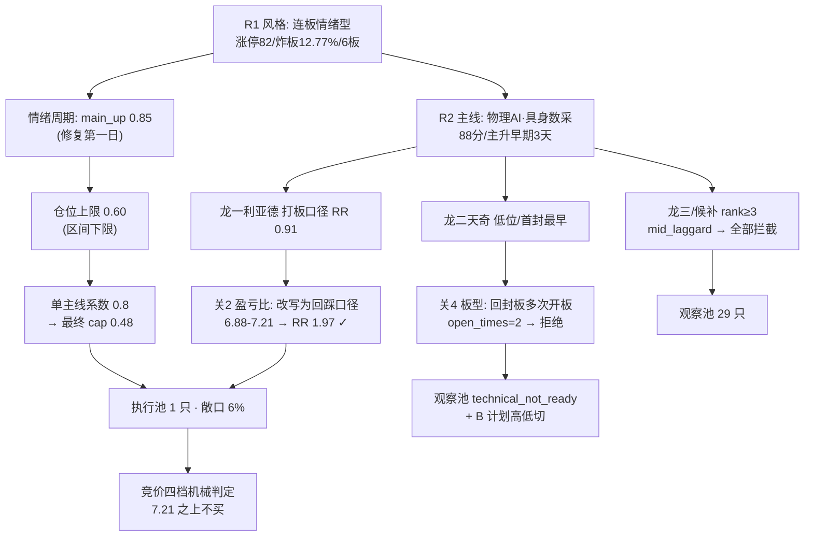

# 2026-10-26（周一）· **主决策 / D1 盘前预案**

> **数据源新鲜度**：partial（7/7 artifact 齐全，3 个单元 degraded）
> **降级状态**：true（weflow down / QMT 超时 / 汇率商品北向缺失）
> **置信度**：0.62

## 一句话结论

今天只买一只票，而且只在跌的时候买：唯一主线「物理AI·具身数采」的龙一**利亚德，6.88–7.21 之间承接 6%，跌破 6.84 无条件走人**；其余 29 只全部只看不买，仓位上限 48% 只用了 6%。

---

## 一、先认市场：这是修复第一日，不是主升中段

上周五的盘面很容易让人兴奋过头。收盘看，涨停 82 家、跌停 6 家、炸板率 12.77%、昨日涨停溢价 +3.38%（中位 +4.55%、收红率 66.7%）、最高 6 板、全市场 4526 家上涨对 909 家下跌（广度 4.98），五选一的风格标签「连板情绪型」三条硬条件全中，情绪周期同步硬命中「主升」。按表操作，今天该进攻。但把这根阳线放回它自己的位置里看，性质完全不同——13:02 的时候上证还在 -0.75%、涨停只有 24 家、跌停 32 家、炸板率 29.4%，是下午两小时把情绪从冰点直接翻上来的。**这是主跌末端的第一根修复阳线，不是主升中段。**

三条反向证据必须和这个标签一起读。第一条是趋势：30 个交易日维度里，42 个风格标的还有 35 只负收益，20 日创业板 -18.62%、科创 50 -16.23%，均线全部在下降通道里，修复一天不改变斜率。第二条是梯队：6 板 2 只之后，**4 板和 5 板是完全真空**，直接掉到 3 板 1 只、2 板 9 只、首板 70 只——中位断层意味着接力资金没有缓冲区，一旦高标断板，中间没有承接层。第三条是钱：全市场主力 5 日净流出 964.2 亿（4/5 日为负）、10 日 -2462.13 亿、20 日 -4982.78 亿，而周五的涨停潮恰好发生在 ETF 申购与北向承接最积极的一天。**换句话说，这 82 家涨停不是全市场的合力，是借来的钱。**

所以 R1 给出仓位区间 0.60–0.80 时，我取的是下限 0.60，并且不接受「主升就可以给满」的读法。R1 自己的话是：只做首板与最高标两端，不接 2–3 板中位——当日非 ST 二板平均 -4.46%，中位就是亏钱位。

## 二、四象限叉乘：钱到底在哪，哪里有接力

情绪的轴用 R3 概念热榜排名（≤6 为高、连续两日下滑为低），资金的轴用 R7 东财板块 T-1 主力净额（>0 为高）并叠加 5 日净额区分「单日脉冲」与「连贯承接」。四个格子的结论比单看涨停家数清楚得多。

| 象限 | 板块 | 情绪 | 资金（T-1 / 5日） | D1 判读 | 动作 |
|---|---|---|---|---|---|
| Q1 高情绪·高资金 | 人形机器人 | 热榜 #1（连续两日） | +71.43 亿 / +104.12 亿（3/5日） | 霸榜两日触发 R3 出货警戒、共振贡献归零；5 日已吸 104 亿属拥挤而非新钱；板块内福莱已出现机构龙虎榜净卖 -1.60 亿 | **降级·不加仓** |
| Q1 | 机器人概念 | #2 | +59.91 亿 / +28.46 亿 | 母概念 5 日只有分支的 1/4 → 钱集中在少数高标，不是板块扩散 | 观察 |
| Q1 | 人工智能 | #3（12→3 单日跃升） | +114.30 亿 / +21.70 亿 | 10/22 单日 -115.88 亿、10/23 +114.3 亿，R7 定性为 ETF/北向托举的脉冲 | 观察·不加仓依据 |
| Q2 高情绪·低资金 | 物理AI·具身数采（本体） | 数据要素 11→15、MLOps 新进 #5 | **无同名板块，只能母概念代理** | 情绪最高但资金无法独立证明（R6_M1_01）。只能落到个股级证据 | **唯一执行方向（个股级）** |
| Q3 低情绪·高资金 | 数字芯片设计 | 存储链概念 5→9→12 三连降 | +62.46 亿 / +87.92 亿（4/5日） | 资金最连贯，但情绪在退、零连板高度 → 有资金没接力盘 | 研究观察·B 计划资金票 |
| Q3 | 半导体 | 同上 + 费半周跌 3.3% | +68.69 亿 / +10.97 亿 | 5 日净额只有单日的 1/6，同样单日为主 | 观察 |
| Q4 低情绪·低资金 | 银行 / 红利股 | 无榜位 | -29.91 亿 / -29.04 亿 | 防御端在被卖出，本轮反弹是存量从防御搬去超跌 | **不进** |
| Q4 | 央国企改革 / PCB | 无榜位 | -77.91 亿、-40.71 亿（当日仍 +1.08%、+1.39%） | 价涨钱走，最典型的拉高出货形态 | **不进·拦截** |

这张表的结论对仓位是负向的：Q1 拥挤且已霸榜，Q3 有钱没接力，Q4 全是价涨钱走。**唯一能下手的地方在 Q2，而 Q2 的资金证据只能落到个股。** 这就是今天「只买一只、只做回踩、只给试仓」的全部理由——不是保守，是算术。

## 三、仓位上限：0.60 是怎么变成 0.48 的

| 环节 | 输入 | 结果 |
|---|---|---|
| R1 风格上限 | 连板情绪型区间 0.60–0.80 | 取 **0.60**（区间下限：修复第一日、趋势未转、4–5 板真空、费半周跌 3.3%） |
| R7 资金调整 | 北向 +31.32 亿（20261019 缺行，conf 0.46）vs 全市场 5 日 -964.2 亿 | **调整 0.0**（方向冲突，不加也不减） |
| 情绪硬联动 | phase=main_up / sentiment 77 | 上限锁 **0.60**，不上调 |
| 主线数量系数 | R2 只有 1 条主线（三支同源） | **× 0.8** |
| 跷跷板惩罚 | R7 seesaw_pairs 全为 5 日窗口线索且不含数采/机器人 | **不启用**（×1.0） |
| **最终** | min(0.60, 0.60, 0.60) × 0.8 | **0.48** |

R6_M2_01 提醒得很对：这 0.60 不是进攻许可。所以我把三条证伪阈值直接写进不交易条件——**盘中炸板率 ≥35%、或涨停跌破 50 家、或跌停 ≥30 家，当日 cap 砍半、未成交挂单全撤**。R1 原话是「若周一炸板率回到 35% 以上或涨停跌破 50 家，本判定当日作废、cap 砍半」。

## 四、执行池：1 只，利亚德（300296.SZ）

### 4.1 思维链：为什么是它

**买入理由。** 它是唯一主线里唯一一个「强度第一 + 容量第一 + 人气增量第一」三项同时成立的票（R2 dragon_contest：3 个交易日 2 个 20cm、成交 42.23 亿、封单 2.22 亿、热榜 37→10）。但真正让我敢给仓位的是另一个证据：R7 把它单独列进「资金连贯组」——5 日主力净流入 +11.83 亿、4/5 日为正；而同一天全市场主力净流出 964.2 亿。在一个抽血的市场里，这是极少数钱在连续进的方向。核验层面也干净：core_judge 实跑判 `is_core=true / core_grade=core / resonance_type=resonance`（个股-板块 20 日相关 0.77，综合 72.2），forbidden_filter 14 项全过。

**风险点。** 位置是它最大的敌人：5 日 +62.7%、距 10 日低点 +64.5%，开板 1 次、换手 27.9%、13:43 才封板（不是硬板）。R5 给的风险档是 B-，四条红旗全指同一个方向——`high_position`、`valuation_percentile_top`、`earnings_decline`、`retail_seat_dominant`（散户席位主导）。换手 27.9% + 散户主导，正是错题 1021_001「涨着出货」的形态特征。所以我不接受任何形式的竞价追高。

**止损条件。** 6.84 无条件清仓——这正好是 R6_M3_01 指定的 6.85 一线（我取整到 6.84 以便落在 -5% 合规区间内）。20cm 的票不给宽松止损：跌破就走，不讲故事。

**可验证假设。** ① 开盘 30 分钟内数采板块至少 2 只同门翻红；② 个股分时站得住当日均价；③ 板块涨停家数全天维持在 50 家以上。三条同时成立，才允许把仓位从 6% 补到 8%（R6 上限）。任意一条破，只留止损单。

### 4.2 价位表（引擎实算 + D1 依 R6 收紧）

| 项目 | 数值 | 依据 |
|---|---|---|
| 昨收（reference_close） | 7.32 | T-1 前复权收盘 |
| **买入区** | **6.88 – 7.21** | 引擎分歧口径原值 [6.73, 7.10]（昨收 -3%~-8%）；D1 按 R6_M3_01 上移至 [6.88, 7.21]，上沿仅较引擎 +1.5% |
| 触发价 | 7.21 | 只在昨收下方 1.5% 及以下成交 |
| **止损** | **6.84** | 7.21 × 0.949（R6 的 6.85 一线），20cm 用 -5% 不用 -8% |
| **止盈** | **7.94** | 7.21 × 1.101（引擎 2R）；涨停价 8.78，空间充足 |
| **盈亏比** | **1.97** | (7.94-7.21)/(7.21-6.84)，risk_reward.py 实跑 `grade_check=通过` |
| 仓位 | 6% | 引擎 trial 5% + R7 资金连贯 +1pp，未破 R6 的 8% 上限 |
| 板块 | 0.06 / 0.40 上限 | 单板块远未触顶 |

节点合理性校验：买入价/昨收 = 0.985（在 ±5% 内 ✓）、止损/买入价 = 0.949（在 -5%~-10% 内 ✓）、止盈 > 买入价 ✓ → `node_valid = true`。

### 4.3 竞价四档（09:25 机械对照，不重新推理）

| 竞价区间 | 判定 | 动作 |
|---|---|---|
| **< 6.88（-6% 以下）** | 破位低开、分歧转弱 | 不接。只有低开后 5 分钟内快速翻红并站上 7.20 才按「弱转强」重评，本预案不自动授权 |
| **6.88 – 7.21（-6% ~ -1.5%）** | 落在买区内 | **执行**：分时不破当日均价即承接 6% |
| **7.21 – 7.46（-1.5% ~ +2%）** | 平开到小幅高开 | 只等回落至 7.21 以下才成交，高于 7.21 不买；10:30 前不回则当日放弃 |
| **> 7.46（+2% 以上）** | 高开越过买区 = 先手兑现窗口 | 不追。当日只观察是否 2 板，不在本预案授权内开仓 |

四档的分界线刻意压在昨收下方，与「追高买龙头」的习惯相反。理由是两个数字：5 日 +62.7% 已经透支了大部分空间；R5 的 `retail_seat_dominant` 说明接力盘是散户结构，这种结构最典型的行为就是高开兑现。

## 五、被拦下的每一只，以及为什么

R2 明说「全部 leader `execution_eligible=false`，龙一龙二待 D1 竞价重算」。我重算了：R2 评估 18 只、列示 5 只，R5 深挖 10 只，跑完全部闸门后**只有 1 只通过**。

| 标的 | 身份 | 拦截原因（可复核） |
|---|---|---|
| 天奇股份 002009.SZ | 龙二 / 卡位龙 | **关4 板型硬规则**：classify_pattern = `回封板(多次开板)`，open_times=2 → 不碰。另有 5 年 1进2 = 0/5 无连板基因。价位本身是干净的（RR 2.0），但不是价位问题 |
| 福莱新材 605488.SH | 龙三 | mid_laggard（rank=3）+ R6_M3_02：0 开板硬板却伴随机构龙虎榜净卖 -1.60 亿与实控人转让 → 板型好看、对手盘在跑 |
| 海天瑞声 688787.SH | 候补 | mid_laggard（rank=4）+ R6_M7_01 三条基本面红旗 + R5 风险档 C |
| 慈星股份 300307.SZ | 候补 | mid_laggard（rank=5）+ late_speculation（14:11 才封板） |
| 兆易创新 603986.SH | 次线龙头 | non_mainstream（有主线时存储属非主流）+ R6_M1_02。位置其实最好（5 日 +3.6%），但规则的边界不能因为便宜就破 |
| 长鑫科技 688825.SH | 次线候选 | non_mainstream + 5 日主力 -18.10 亿（单日 +16.12 亿是脉冲） |
| 粤芯半导-U 301660.SZ | 次线候选 | non_mainstream + R6_M7_03（ST 财务轴 / 无估值锚）→ 只作温度计，刻意不给买区 |
| 中际旭创 300308.SZ | 次线事件候选 | **关2.5 命中行业级利空**：R4 E007（自研 ASIC 替代 + 马斯克称 200 余家算力云整合）打击面直接覆盖光模块/CPO/GPU/IDC；叠加 R6_M1_03 |
| 天娱数科 002354.SZ | 次线候选 | non_mainstream + R6_M7_02（三红旗含临界 P0 + 孤军无板块效应） |
| 东方精工 002611.SZ | 主线叙事核心 | 未涨停、无板型可分；R2 判「5 年 2 次涨停 / 1进2 0% / 炸板率 71.4%，板型最差，只作叙事观察」 |
| 索辰科技 688507.SH | R4 高质首板候选 | 关2 RR 1.06 < 1.8 → RR_FAIL |
| 中控技术 688777.SH | R4 候选 | 关2 RR 1.20 < 1.8 → RR_FAIL |
| 华数传媒 000156.SZ | 主线分支 | 关2 RR 1.77 + 无量尾盘板（换手 2.1%） |
| 歌尔股份 002241.SZ | R7 资金连贯组 | 关2 RR 1.68 < 1.8 + E008 汇兑负面 |
| 大业股份 / 海洋王 | 6 板最高标 | R6_M9_01：「最高标通道今日实际不可用」——两只都是薄封单/高换手的断崖风险 |
| 江波龙 301308.SZ | — | **关2.5**：E004 板块级负面（Q3 单季环比 -35.6%~-49.0%），消费存储模组见顶 → 进否决清单 |

顺带说明两件我没做的事：一，**没有用龙二替补龙一**——今天没有 hard_reject，天奇是被板型闸门独立拒绝的，按纪律「不得用龙二/低位补涨替补被拦截的龙一」，这是预防性红线；二，**没有为凑数下放标准**——R6_M2_03 明确允许「研究有对象、执行可为空」，本日敞口 6% 就是这个原则的产物。

## 六、B 计划：如果它不给价，钱会去哪里

预案只写「买什么」是单向剧本。A 股是存量博弈，执行池不及预期时钱不会消失，只会搬家——搬家方向必须盘前点名，否则盘中就成了临时起意。

**触发条件**：① 利亚德竞价高开 >+2% 或低开破 6.88（当日不追）；② 数采板块 10:00 前涨停家数 <2；③ 炸板率 ≥35% 或涨停 <50 家（全市场降档，B 计划同步暂停）。

| 方向 | 依据 | 候选（含价位） | 触发 |
|---|---|---|---|
| **主线内部高低切** | 天奇 5 日 +18.1% 是全线最低、东方精工是唯一「数据工厂」实体（R4 hit=11 源） | 天奇 002009.SZ：买 15.92–16.78 / 止损 15.94 / 止盈 18.46 / RR 2.0（须 P1 先重评板型） 东方精工 002611.SZ：上破 14.67 / 止损 13.94 / 止盈 16.13 / RR 2.0 | 利亚德不给回踩价，或天奇/东方精工先于龙一封板（卡位转移） |
| **资金票低吸（存储/半导体）** | R7 数字芯片设计 5 日 +87.92 亿（4/5 日正）；兆易 5 日 +25.90 亿是 Top10 唯一单日与 5 日同向的大票 | 兆易 603986.SH：买 277.40–292.00 / 止损 277.12 / 止盈 322.59 / RR 2.06 长鑫 688825.SH：买 40.70–42.00 / 止损 39.87 / 止盈 46.30（只作 β 验证，不做主仓） | 数采全线走弱 + 存储链竞价不破位（兆易/长鑫至少 1 只翻红） |
| ~~防守 / 高股息~~ **已否决** | R6 四象限 Q4：银行 -29.91 亿、红利 -29.04 亿、央国企改革 -77.91 亿（当日仍 +1.08% = 价涨钱走）、PCB -40.71 亿 | 不设候选 | 无。防御端在被卖出，本轮反弹是存量从防御搬去超跌，不因「低位便宜」做防守配置 |

**反向提示**：若 A 计划与 B 计划两组方向同步走弱（板块涨停 <2 家且存储链净流出），判定为全市场降档日——未成交挂单全撤，只保留已成交部分的 6.84 止损，不新开任何仓位。

## 七、观察池 29 只（每只都带方向预判）

错题本里「watch_pool 方向字段缺失」已经复发六次（1012_001 → 1023_001，最新一条标 critical），E1 每次都得事后猜方向，兑现率根本算不出来。这次我逐票写死 `watch_reason_code` + `expected_direction` + `met_condition`，覆盖率 29/29。方向的含义：`up` = 预期 T+0 涨超 1%；`down` = 预期跌超 1%；`sideways` = 预期振幅 ±2% 内；`sideways_or_down` = 预期不超过 +2%。

| 代码 | 名称 | 方向 | 原因码 | 买区 | 止损 | 止盈 | RR |
|---|---|---|---|---|---|---|---|
| 002009.SZ | 天奇股份 | up | technical_not_ready | 15.92–16.78 | 15.94 | 18.46 | 2.00 |
| 002611.SZ | 东方精工 | up | event_uncertain | 14.23–14.67（需上破） | 13.94 | 16.13 | 2.00 |
| 605488.SH | 福莱新材 | down | devil_advocate_reject | 35.10–37.01 | 35.16 | 40.71 | 2.00 |
| 688787.SH | 海天瑞声 | down | devil_advocate_reject | 129.72–136.77 | 125.83 | 158.65 | 2.00 |
| 300307.SZ | 慈星股份 | sideways_or_down | sector_over_heated | 8.22–8.67 | 7.98 | 10.05 | 2.00 |
| 000156.SZ | 华数传媒 | sideways_or_down | sector_over_heated | 6.95–7.09 | 6.74 | 7.71 | **1.77 ✗** |
| 688686.SH | 奥普特 | sideways_or_down | technical_not_ready | 140.94–148.60 | 136.71 | 172.38 | 2.00 |
| 301313.SZ | 凡拓数创 | down | sector_over_heated | 56.52–59.60 | 54.83 | 69.14 | 2.00 |
| 002343.SZ | 慈文传媒 | sideways_or_down | sector_over_heated | 10.02–10.56 | 10.03 | 11.62 | 2.00 |
| 688507.SH | 索辰科技 | sideways | technical_not_ready | 168.43–177.59 | 163.38 | 192.70 | **1.06 ✗** |
| 003021.SZ | 兆威机电 | sideways | sector_over_heated | 84.39–88.98 | 84.53 | 97.88 | 2.00 |
| 000678.SZ | 襄阳轴承 | sideways | sector_over_heated | 12.17–12.83 | 12.19 | 14.11 | 2.00 |
| 603986.SH | 兆易创新 | up | sector_off_line | 277.40–292.00 | 277.12 | 322.59 | 2.06 |
| 688825.SH | 长鑫科技 | sideways | sector_off_line | 40.70–42.00 | 39.87 | 46.30 | 2.02 |
| 301660.SZ | 粤芯半导-U | down | devil_advocate_reject | **禁买·不给买区** | — | — | — |
| 300308.SZ | 中际旭创 | down | devil_advocate_reject | **禁买·不给买区** | — | — | — |
| 002354.SZ | 天娱数科 | sideways_or_down | devil_advocate_reject | 7.44–7.80 | 7.41 | 8.58 | 2.00 |
| 300620.SZ | 光库科技 | sideways_or_down | sector_off_line | 278.23–286.70（需上破） | 263.76 | 332.58 | 2.00 |
| 002979.SZ | 雷赛智能 | up | event_uncertain | 53.95–55.59 | 52.81 | 61.15 | 2.00 |
| 688208.SH | 道通科技 | sideways | technical_not_ready | 25.05–25.81（需上破） | 23.88 | 29.67 | 2.00 |
| 688777.SH | 中控技术 | sideways | technical_not_ready | 71.94–75.85 | 71.23 | 81.39 | **1.20 ✗** |
| 002194.SZ | 武汉凡谷 | sideways | technical_not_ready | 10.07–10.38（需上破） | 9.86 | 11.42 | 2.00 |
| 000559.SZ | 万向钱潮 | sideways | sector_over_heated | 10.63–11.20 | 10.64 | 12.32 | 2.00 |
| 603337.SH | 杰克科技 | sideways | event_uncertain | 36.12–38.08 | 36.18 | 41.88 | 2.00 |
| 002241.SZ | 歌尔股份 | sideways | capital_short | 21.26–22.42 | 21.30 | 24.30 | **1.68 ✗** |
| 002185.SZ | 华天科技 | down | distribution_alert | 14.89–15.70 | 14.91 | 17.28 | 2.00 |
| 603278.SH | 大业股份 | down | distribution_alert | 14.68–15.48 | 14.71 | 17.02 | 2.00 |
| 002724.SZ | 海洋王 | down | distribution_alert | 11.34–11.96 | 11.36 | 13.16 | 2.00 |
| 688836.SH | 宇树科技 | down | sector_over_heated | 574.08–605.28 | 556.86 | 702.12 | 2.00 |

标 ✗ 的四只是 **RR_FAIL，当日不可开仓**（<1.8 硬门槛），价位只作跟踪基准。注意「需上破」的四只：买区在现价上方，是「站上才成立」而不是现在能买。

## 八、不交易条件

| 代码 | 含义 | 当前 |
|---|---|---|
| R1_FAIL | R1 confidence <0.4 | 否（0.68） |
| R6_HARD_REJECT_OVERFLOW | hard_reject 占候选 >30% | 否（0 只） |
| R7_STALE | R7 staleness=unavailable | 否（ok，但 conf 0.46） |
| GLOBAL_SEVERITY_3 | fetch_global_severity ≥3 | 否（=2） |
| EMOTION_EXTREME_GREED | 贪婪/狂热 + 无主线 | 否（主线 1 条） |
| USER_HOLIDAY | 用户标记休市 | 否 |
| **SENTIMENT_VERIFICATION_FAIL** | 盘中炸板率 ≥35% 或涨停 <50 家 | 否（T-1：12.77% / 82 家）→ **盘中触发即 cap 砍半 + 撤单** |
| **BREADTH_COLLAPSE** | 开盘 30 分钟跌停 ≥30 家 | 否（T-1：6 家）→ 触发则执行池清空 |
| **RR_FAIL** | 个股 RR <1.8 | 按票生效：华数 1.77 / 索辰 1.06 / 中控 1.20 / 歌尔 1.68 不可开仓 |

## 九、关键证据

- **主线四源同向，但只有一条线**：R2 给「物理AI·具身数采」88 分（热度 15/资金 17/涨停 19/叙事 18/共振 19），R3 排 #1（L1+L2、positive、early、无霸榜），R4 E002 权重 +0.775（当日最高、kol_confirm ✅），R7 母概念 5 日 +104.12 亿。四源一致度 1.0。但三支分支同涨同跌、共用同一叙事母体 → 对仓位是**一条线**，不是三条，所以不给分散假象。来源：R2_main_sectors.main_lines[0]。
- **钱是借的**：全市场主力 5 日 -964.2 亿（4/5 日负）、20 日 -4982.78 亿；R7 明确写「T-1 的强势由宽基 ETF 申购与北向承接推动，主动主力仍在净流出」。来源：R7_capital_flow.main_force.market_windows。
- **唯一的连续性承接**：利亚德 5 日 +11.83 亿（4/5 日正）、兆易 +25.90 亿（4/5 日正）、天娱 +12.11 亿、歌尔 +10.43 亿；而旭创 T-1 +16.43 亿 / 5 日 -14.70 亿、长鑫 +16.12 / -18.10、宁德 +12.97 / -37.60 → 后三只是脉冲。来源：R7.top10_reading。
- **龙一/龙二之争被公开记录**：天奇首封 09:43 最早但成交仅 10.25 亿、5 年 1进2 = 0.00；利亚德 3 日 2 个 20cm、成交 42.23 亿、人气 37→10 → 龙一归利亚德。两个事实都在 dragon_contest 里，没有藏分。来源：R2_main_sectors.main_lines[0].dragon_contest。
- **R6 的硬否决是 0，但警示是满的**：hard_reject 0 / strong_suggest 12 / soft_suggest 8。霸榜出货两条件未同时成立（人形机器人条件 1 成立、但 5 只主力 5 日全为正），故不否决；纪律自检第 7 条「合力来自全市场」判定 **fail**。

## 十、不确定性 / 反证（自我批判）

**第一条我也许错在过度保守。** 修复第一日 + 情绪 main_up + 主线只有 3 天（early_up）+ 四源一致度 1.0，这是历史上最容易走出二波的组合。如果今天数采放量扩散、4–5 板补位、涨停维持在 80 家以上，我这 6% 的敞口会显著跑输——而「研究对了却没买够」也是错题本里记过的类型（missed_alpha 为正）。这个风险我认，代价是漏掉一段行情；对冲办法是 P1/P2 的加仓路径写死在里面（三条可验证假设同时成立才补到 8%），而不是盘前预支。

**第二条是位置。** 全部 5 只候选 5 日涨幅 +18.1%~+80.0%，4/5 已在 10 日低点上方 +41.9%~+82.3%。R4 自己的话是「5 日涨幅过大，只做首板」——而今天的首板其实是高位反包板。我选的这只恰好是本组里位置最高的龙一，这是本预案最脆弱的地方：如果周一高开兑现，我的买区根本不会成交，等于白写。

**第三条是数据缺口带来的判断风险。** ① 数采没有同名东财板块，资金只能用母概念代理，R2 自己也标了这个口径；② QMT 超时，我不知道实盘持仓，全部 plan_status 是按「零存量持仓」写的，若实际已有利亚德仓位，「6% 新增」会变成超配；③ 北向 +31.32 亿与主力 -964.2 亿方向冲突，我选择不采信北向；④ attention_signals 本次未产出，人气维度改用 R3 热榜，覆盖不如原设计；⑤ board_pattern 把 13:43 首封归入「尾盘封板(14:00-14:30)」时间窗，与首封时间矛盾——我按引擎原值记录并标 warning，建议 E2 修 classifier。

**第四条是我 override 了 R6 一条建议。** R6_M3_01 说利亚德「不进 execution」，我放行了。理由写在这里以便被打脸：R6 的论据是打板口径 RR 0.91（按 7.32 买入、+4.55% 溢价、-5% 止损），而我根本不在 7.32 买——在 6.88–7.21 回踩承接、6.84 止损、7.94 止盈，RR 1.97 是 risk_reward.py 实跑出来的。R6 的两条数量约束（单票 ≤8%、跌破 6.85 离场）我全部接受：仓位 6%、硬止损 6.84。如果这个 override 最终亏钱，亏损被 6% × 约 5% = 0.3% 的账户风险封住，这是可承受的学费。

**第五条是团队一致度本身。** 周末十余场电话会把数采打成明牌（R1 单列了这个风险）。明牌意味着没有预期差，高开就是兑现窗口，只有分歧回封才有赔率——这也正是我把买区压到昨收下方的另一个原因。

## 十一、数据源审计

| 源 | 状态 | 抓取时间 | 记录数 | 备注 |
|---|---|---|---|---|
| R1 风格 | ✅ ok（degraded 标记） | 06:16 | 42 标的×30 日 | 核心量化零缺格；fx/商品/北向/weflow 缺失 |
| R2 主线 | ✅ ok | 06:40 | 8 板块→列 5 | 因子层缺失、心智锚覆盖 1/5；execution_eligible=0 是设计而非失败 |
| R3 情绪 | ⚠️ degraded | 06:29 | 102 条群聊 + 15 feed | WeFlow 永久下线，共振上限 L1+L2；周末四平台榜单全空 |
| R4 消息 | ✅ ok | 06:25 | 8 事件 | kol_confirm 缺 weflow 外部交叉 |
| R5 画像 | ⚠️ degraded | 06:50 | 10 只 | risk_grade 本次真实产出（非默认补 B）；2 条 F3 误标已剔除 |
| R6 反证 | ✅ ok | 06:55 | 20 条 | hard 0 / strong 12 / soft 8；mode4 历史类比无库→不编造 |
| R7 资金 | ⚠️ stale 边缘 | 06:19 | 1043 板块 | 北向 20261019 缺行、conf 0.46；seesaw 仅 5 日窗口 |
| 价格引擎 | ✅ 实跑 | 07:03 | 29 只 | kb/research.db 截至 20261023；长鑫/粤芯无 K 线 |
| 闸门引擎 | ✅ 实跑 | 07:03 | 4 项 | core_judge / risk_reward / board_pattern / forbidden_filter / dragon_switch |
| attention_signals | ❌ 未产出 | — | 0 | 本次 research_summary 未列，**未用旧文件顶替** |
| QMT 持仓 | ❌ down | — | — | 超时 >45s，持仓未知 |

## 十二、与其它 R/D/E 的关系

- **依赖（只读）**：`research_summary.json` → R1/R2/R3/R4/R5/R6/R7 七份 artifact；`data/user_preferences.yaml`（龙头优先、单票 ≤15%、持仓 ≤5、920 禁买）；`data/corrections/2026-W4x` 近期 30 条错题本（其中 6 条是 watch_pool 方向字段缺失）。
- **被消费**：P1 竞价校准（`auction_expectation` 四档已写成可机械对照的价位）；P2 午盘修订（`seesaw_plan` 三个方向 + 一个已否决方向）；execute（`execution_pool` 1 只 + 完整 entry/exit 规则）；E1 复盘（29 只 watch 全带 `expected_direction`，无需事后推断）。
- **未产出但 skill 要求**：`data/plans/20261026/plan.md`、`_价位推导.md`、`_点位表.md` 三份附加文件超出本次交付白名单，已阻塞未写；价位改用同一引擎 `price_levels.derive` 逐票实算并内联进 JSON。

## 十三、Sub-Agent 元数据

- skill: `main_decision_v1@1.9`（LLM fresh context 主路径）
- artifact: `data/plans/20261026/watchlist_plan.json`（pydantic `WatchlistPlan` 校验通过）
- decision_source: **llm**
- mode: `dry_run` / autonomous_trading_enabled: `false` / requires_user_confirmation: `true`
- 执行池 1 只、观察池 29 只、否决 3 只、计划敞口 6%（上限 48%）
- 闸门实跑：core_judge 2 只、risk_reward 2 只、board_pattern 9 只、forbidden_filter 2 只、dragon_switch 1 次、price_levels 29 只
- 生成耗时：约 12 分钟（06:55 research 就绪 → 07:07 落盘）
- model: deepseek-v4.1-flash
