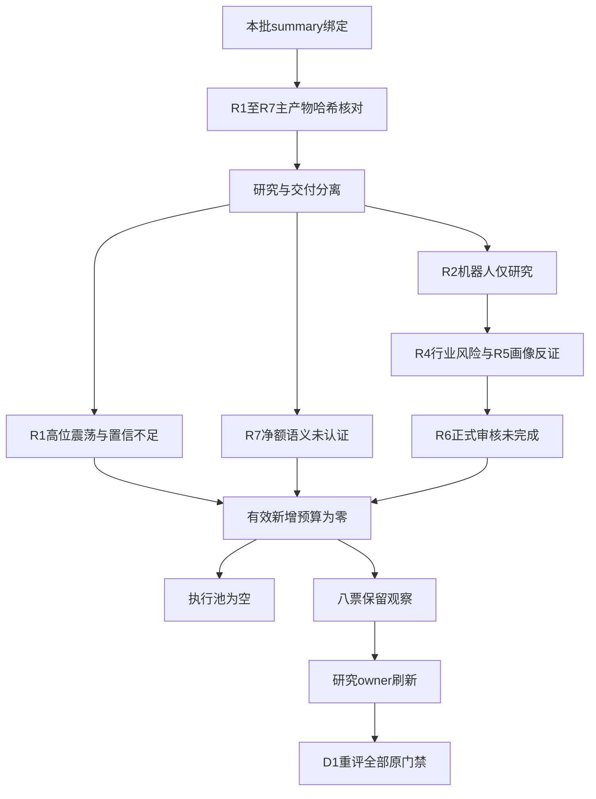

# 2026年10月27日 · 主决策 / D1盘前预案

## 🛑 一句话裁决

今日禁新仓：机器人保留研究主线，执行池为空；8只进观察，研究尚未通过，等待完整重评。

这是LLM综合裁决，不是Python量价兜底。文件可以交付，研究仍未就绪，更没有获得开仓授权。今日新增风险预算为0%，所有观察票自动交易关闭、入场规则为空。此处“空执行池”不是要求把真实账户清仓：本次没有账户与既有T计划输入，因此不发布卖出、换仓或持仓比例调整命令。

| 不交易条件 | 本批实证 | 裁决 |
|---|---|---|
| R1信号不足 | 置信度0.392，低于0.4 | 生效，禁新仓 |
| R7资金维度不可用 | confidence=0、staleness_status=unavailable | 生效，北向净额语义未认证；并非境内T-1过期 |
| R6审查未完成 | review_passed=false，正式评估0只 | 生效，空硬否决不能当通过 |
| 研究完整性不足 | summary=partial，七个研究单元均非complete | 生效，不读旧文件补“通过” |
| 逐票开仓资格不足 | 核心共振、RR、完整禁止项及T+1尾部风险未齐 | 生效，不给予试仓保底额度 |
| 事件日历不完整 | 主产物没有未来3交易日完整重大事件表 | 生效，未知不等于无事件 |
| 数据健康严重度≥3 | 本批为2 | 未生效，不夸大健康故障 |
| R6硬否决溢出 | 本批硬否决为空 | 未生效，不造个股出货结论 |

## 🌡️ 先认市场：强的是局部辨识度，不是全市场普涨

R1给出的温度是震荡分化、高位震荡，情绪66分。最新完整境内观察日为2026-10-26：55家涨停、26家跌停、23家炸板，统一炸板率为23÷(55+23)=29.49%，最高4板；上涨2252家、下跌3157家。上证上涨0.1909%，但深证下跌1.1945%、创业板下跌1.7088%。因此，前排连板仍有溢价，不代表后排价格安全，更不能把指数的局部承接解释成普遍接力。

R1的“三主线以上”来自重叠概念统计代理，不是三条已认证交易主线。D1采用R2的独立结果：一条人形机器人研究主线，已确认可交易主线为0条。唯一主模板是“分歧接力”；不会再同时拼接首板隔日、总龙锁仓、三格或树干打法凑票。高位震荡只定温度，不机械关闭打板或停止新方向研究；今天不开仓，原因是独立门禁未过，而不是阶段标签本身。

研究仓位温度上限按既有减量约束复算：min(R1的40%，用户硬上限80%)×0.75=30%。它只是风险背景，不是30%的下单预算；R1信号、R7语义、R6审查与交易主线资格门禁叠加后，有效新增预算仍为0%。北向强弱未知，不给它填“中性”或擅自加5%；也不以“只有一条研究主线”为理由把零预算抬成试仓额度。

今天是不是空仓日？就新增交易而言，是。并非已经证明市场主跌或炸板率超过40%，而是本批证据不允许承担新的T+1尾部风险。账户是否已有底仓未知，不把“禁新仓”偷换成“全账户清仓”。

## 🧭 主线：人形机器人有钱有热度，但尚不够硬

R2的人形机器人研究得分72；主题名称明确，持续性是“1日验证窗口”，封板率60.87%，下一交易日预期为分歧。这里不能把1日窗口写成已确认持续一天，也不能把生命周期函数的mid_up当成已经认证主升中期：该函数使用的年龄只是至少6个交易日的观测下界，R2本身已标为降级。

精准人形概念T-1净流入26.324636亿元、五日105.724808亿元；但广义机器人同日净流出0.702784亿元。人形概念14家涨停、9家炸板，涨停家数较上日26家收缩，概念指数下跌0.7874%。这说明前排高度与板块整体承接并不一致。精准概念与行业层汽车零部件也不是同一集合，不能借R7的汽车零部件流入补出“人形三源共振”。

- **大资金意图**: 可见的是精准概念承接与高度前排溢价，可能在争夺具身智能辨识度；但缺少一致的逐票双源确认与板块带动链，不能断言机构已锁仓或全板块主升。
- **为什么走强**: R3触觉数采讨论与多伦、福莱等人气前移相互印证，叠加连板高度形成注意力集中；与此同时，匿名交易者文本已出现持续性谨慎，热度不是单边看多。
- **逻辑够不够硬**: 不够。R4宇树与上纬公告是已核实的商业化风险披露，R5进一步指出多伦机器人收入利润极小、福莱柔性传感器贡献极低。硬的是公司风险披露，不是“明日必跌”；交易端仍不能靠热榜对冲原文。

R4行业级负面命中机器人研究票后，D1统一降级观察，没有用户例外sign-off，也不以“已披露了”直接恢复买单。宇树的出货警报只能是待核风险锚；R6没有形成正式hard_reject，D1不替R6宣布全机器人出货。

## 🔀 四象限叉乘：给情景，不伪造落位

采用R6明确的“情绪×资金”轴。四格推演已经展开，但正式分类仍是未完成：主产物未提供统一高低阈值，同窗精确板块资金与当日承接也不完整。未知不填“低”，R3热榜不替代净买入，R7行业金额不强配R2概念。下面是预先定义的情景反应，不是四格已经全部核验通过。

| 情绪×资金 | 本批可见线索 | 真正需要防什么 | D1动作 |
|---|---|---|---|
| 高×高 | 人形热榜第一与T-1精准概念流入是研究线索，尚无正式落位 | 一致加速后先手兑现；一字板没有实际买点 | 进watch，不因双强免检 |
| 高×低 | 广义机器人同日净额为负，但五日仍正，窗口不能混用 | 传播升温而真实承接退化 | 保留反证，不按人气开仓 |
| 低×高 | 油气资源单日正流入，五日仍负；情绪“低”未定义 | 把单日回流误当持续新主线 | 仅B计划研究，不左侧抄底 |
| 低×低 | 中京的价格与五日大单流出是衰弱对照，未完成全市场分类 | 便宜幻觉、后排弱转强幻想 | 降级观察，不给低吸买区 |

正负事件另做跨乘，而不是把情绪/资金象限与利好/利空混为一套指标：

算力租赁合同兑现与物理AI商业化风险并列，含义是AI内部证据硬度分层，并非资金已从机器人搬去算力。Robotaxi获运营资格也不代表人形机器人全链盈利，更不代表任意A股公司获得供货订单。国内非银流动性工具与巴西风险并列，含义是境内尾部缓释不能消除海外敞口；拟回购与外部风险并列，含义是个股资本安排不能锁定次日价格。商业秘密征求意见稿可能保护知识产权，也可能增加跨境合规成本，后者目前只是条件传导，不另造制裁事件。

## 📰 R3与R4整合：八条事件逐项处理

R3的66分继承降级R1，未独立形成次日方向概率；机器人、商贸零售、油气为三组讨论与热榜共振，都是T-1背景，不是今日开盘资金确认。R4的8条事件都已消费，不只挑利好：

| 事件 | 核实到哪一层 | 对预案的影响 |
|---|---|---|
| 行云科技V客户租赁协议升至88.48亿元 | 合同补充协议，非当期净利润 | 行云仅事件观察，R2方向28分、R5未覆盖 |
| 宇树物理AI规模化风险 | 公司公告内容已核，行业传导是研究推断 | 机器人观察降级，不生成R6硬否决 |
| 上纬量产爬坡与盈利不确定 | 公司公告内容已核 | 不把已有销售外推为盈利兑现 |
| BNSF非银赎回互换便利 | 制度工具事实 | 不等于所有金融股有增量买盘 |
| 小鹏Robotaxi运营资格 | 示范运营许可 | 不把许可转换为任意A股供货合同 |
| 金发3至5亿元注销回购 | 董事会方案，非已执行金额 | 金发仅研究锚，不新增执行候选 |
| 商业秘密规定征求意见 | 草案事实 | 没有新增订单，不造受益股 |
| 巴西熔断与汇率波动 | 可追溯报道，缺B3原始熔断记录 | 保留海外敞口风险，不编收盘跌幅及A股资金搬家 |

R4抓取时R3尚未就绪是当时的not_yet_landed；现在D1已读到本批R3，所以可以完成主题语义交叉，但不能倒过来声称R4当时已核群聊。R1在线补到美国最新收盘、R7海外仍标旧档，是产出时点与覆盖差异，不合并为数据源全面故障，也不据此消除R7北向缺口。

## 👁️ 可开仓 / 可观察 / 不可做

可开仓为0只。8只R2研究候选全部保留，不因R5只覆盖5只而静默消失；额外3个事件/风险锚单列，不冒充已完成画像。观察目标20至40只是覆盖目标，不是凑数配额，本次不外拉近10日涨停或继承旧观察名单。

以下价格均为2026-10-26参考收盘，不是现价报价，也不是买点。纯观察/禁买锚没有合法可执行买区，因此明确不给买区、触发、止损与止盈；JSON的stop_loss=0.0只是现行StockEntry非空数值字段占位，price_exception明确标注，不得作为卖单价格或0元止损。RR不是0、不是FAIL，而是未评估；不能先捏造2R目标再宣布通过。

| 标的 | 参考收盘 | R2研究身位 / 纪律四条已证数 | R5等级 | 裁决与首要缺口 |
|---|---:|---|---|---|
| 多伦科技 603528.SH | 8.95 | 龙头 / 1 | B/B- | 进 watch；三连板一字/零开板（缩量未核）；无买单 |
| 赛福天 603028.SH | 9.39 | 龙二 / 1 | B-/C | 进 watch；三连板一字/零开板（缩量未核）；无买单 |
| 福莱新材 605488.SH | 41.97 | 龙三 / 1 | B/C | 降级观察；二连板换手回封；无买单 |
| 旭光电子 600353.SH | 22.24 | 龙三 / 0 | C/C | 降级观察；非涨停趋势待验证；无买单 |
| 中京电子 002579.SZ | 12.94 | 龙三 / 0 | C/C | 降级观察；非涨停趋势待验证；无买单 |
| 上海九百 600838.SH | 12.10 | 龙三 / 1 | B/B（缺省，非已评） | 降级观察；四连板换手回封；无买单 |
| 中国石油 601857.SH | 13.38 | 龙三 / 0 | B/B（缺省，非已评） | 降级观察；非涨停趋势待验证；无买单 |
| 行云科技 300209.SZ | 28.01 | 龙三 / 0 | B/B（缺省，非已评） | 降级观察；非涨停趋势待验证；无买单 |

### 多伦科技：最高研究观察级，不把辨识度写成开仓资格

- **大资金意图**: 五日大单自算净流入3.087108亿元，有短线注意力证据；半年度股东集中不代表当前锁仓，也不能把营业部与股通席位总净买解释成机构吸筹。
- **为什么走强**: 并列3板与东财排名30升至6形成高度、人气辨识度；最后一日成交量仅前一日16.43%，是一字供给收缩，不是已完成放量换手。
- **逻辑够不够硬**: 不够。R5核实机器人主要是交通管理场景应用与定制，收入利润占比极小，不涉及人形核心本体研发生产；研究龙一只证明部分辨识度，不满足纪律至少3条。

**买入理由**: 当前没有获准买入理由。保留研究的两项依据是三板前排与人气提升、五日大单流入；产业逻辑只认公司已披露的实际业务，不把主题映射改写成核心供货。

**风险点**: 一字板未充分换手，收盘高于MA20约31.32%；收入利润锚弱且双源资金窗口冲突。RR、核心共振与完整开仓资格缺失，不能用轻仓规避。

**止损条件**: 本预案没有持仓或买入，因此不发卖出单。研究假设若失去相对高度前排且不能维持MA5=7.596上方，或板块涨停连续不足3家，则失效；该均线只作研究失效参考，不是可执行止损价。新开仓若将来获准，离场最早T+1，绝不写买入当日破位即走。

**可验证假设**: 未来24—72小时检验板块至少3家涨停、个股相对高度前二、同日资金双源方向一致。满足只进入重评，不自动解除R7、R6及全局禁令。

### 赛福天：并列高度不是资金第二，更不是财务风险消失

- **大资金意图**: 五日大单净流入0.835655亿元，但机构专用净卖与营业部净买并存，可能是短线接力承接机构筹码，而非机构锁仓。
- **为什么走强**: 并列3板与竞价早封支撑研究龙二身份；流通26.63亿元放大弹性，也放大退出拥挤，不能直接认证容量换手充足。
- **逻辑够不够硬**: 不够。R5为B-/C，负债率87.21%，半年营收同比下滑43.89%；题材业务缺新增业绩锚。两个完整年度亏损是财务风险观察，不等于已ST。

**买入理由**: 当前不买。研究保留依据只有并列三板身位和五日大单为正，产业相关仍须原文核实，不能靠龙二标签替代。

**风险点**: 一字板未充分换手、小流通盘拥挤；高杠杆、亏损与机构净卖并存。与多伦同为三板，不代表五日资金排名第二。

**止损条件**: 仅研究失效：跌出高度前二且不能维持MA5=7.948，或新榜机构持续净卖而接力衰减，不再维持最高观察级。没有账户输入，不发布当日减仓单；新增仓当天不可卖。

**可验证假设**: 未来24—72小时核真实分歧后是否保住前二、下一次机构专用净额能否非负。未出新榜则未知，不把无新数据写成通过。

### 福莱新材：触觉叙事有关注，不能用它补上龙一买不到的仓位

- **大资金意图**: 五日大单净流入3.629281亿元，但机构专用净卖约1.595467亿元，体现资金分歧而非统一合力。
- **为什么走强**: 触觉数采传播、人气42升至15与二板助攻相互印证；开板2次回封提供了换手检验，却命中多次开板的战术警戒。
- **逻辑够不够硬**: 不够。官方提示项目收入极低、对主营无重大影响；R2仅三及以下研究层，不能因为弹性更大改称阶段之王。

**买入理由**: 当前不买。研究理由是触觉产业叙事有明确注意力证据、两板价格结构与大单流入可持续追踪；这两点都不能解除后排身份与回封纪律。

**风险点**: 五日涨48.99%，高于MA20约38.20%，一致后兑现风险高；机构净卖及产业收入贡献弱，估值缺盈利弹性支撑。

**止损条件**: 仅研究失效：回封稳定性消失且收盘跌破MA5=35.74、人气回落，或新增原文继续否定业绩外推。没有有效入场锚，不造数字止损与RR。

**可验证假设**: 24—72小时看板块至少3家涨停、个股相对强势与下一次机构净额；收入硬度需新增原文证据。没有消息既不算证伪，也不算通过。

### 其余五票：继续研究，但不凭回撤或事件强度开仓

#### 旭光电子 600353.SH · 降级观察

**买入理由**: 仅保留研究的两个理由：一是R2明列的真实主题锚而非全市场新造票；二是半年盈利增长可作为基本面对照。缺产业新增催化与前排身份，所以没有已成立的买入理由。

**风险点**: 短期：均线空头与融资去化使反弹容易失去承接。中期：应收/期中收入偏高且经营现金流累计为负，盈利的回款质量需验证；已有R2禁止项命中不因研究得分解除。

**止损条件**: 当前分歧接力资格本就未成立。若未来两个交易日仍不能恢复MA5上方并进入板块高度前二，继续作为反证对照；新增催化被公司否认则相关观察假设失效，不给交易指令。。MA5研究参考为23.294，并非授权买卖触发价。

**可验证假设**: 24—72小时只观察能否连续两个交易日收在MA5之上且板块广度至少3家涨停；满足仅表示短线企稳，远不足以把后排改称阶段之王。

#### 中京电子 002579.SZ · 降级观察

**买入理由**: 仅研究理由：一是R2给出的真实主题锚可检验标签与价格背离；二是三季报及户数变化提供可跟踪的财务截面。没有形成产业催化加价格确认的开仓理由。

**风险点**: 短期：资金净流出、融资去化与均线破坏同步，承接未证。中期：亏损、高借款/净资产和资产减值提示利润修复不稳；定增不能自动解决盈利与回款问题。

**止损条件**: 当前分歧接力资格未成立。未来两日若继续弱于板块前排、收盘仍低于MA5且大单累计为负，任何短线修复假设失效；研究不发卖出命令。。MA5研究参考为14.434，并非授权买卖触发价。

**可验证假设**: 24—72小时要求先观察连续两日大单净额转正并与东财方向一致、收盘恢复MA5上方；这些只是修复观察量，未证明前二地位前不升级，R2拦截仍有效。

#### 上海九百 600838.SH · 降级观察

**买入理由**: 全市场唯一4板但全零售成分地位未核，R3人气前移；不由全市场高度自动授予板块龙一

**风险点**: 未有R5画像、正式前二地位及当日接力验证，不能按次线直接买入

**止损条件**: 所属方向未形成同口径资金和涨停效应前不升级

**可验证假设**: 未来24—72h核验方向连续性、正式身位、逐票资金与所有原门禁；缺失仍未知

#### 中国石油 601857.SH · 降级观察

**买入理由**: R3东财第8且收涨4.94%；油气资源五日资金为负，容量股不等于龙头

**风险点**: 未有R5画像、正式前二地位及当日接力验证，不能按次线直接买入

**止损条件**: 所属方向未形成同口径资金和涨停效应前不升级

**可验证假设**: 未来24—72h核验方向连续性、正式身位、逐票资金与所有原门禁；缺失仍未知

#### 行云科技 300209.SZ · 降级观察

**买入理由**: R4 E20261027_001合同正向high真实事件候选；收跌5.53%且无前排证明，不认龙一

**风险点**: 未有R5画像、正式前二地位及当日接力验证，不能按次线直接买入

**止损条件**: 所属方向未形成同口径资金和涨停效应前不升级

**可验证假设**: 未来24—72h核验方向连续性、正式身位、逐票资金与所有原门禁；缺失仍未知

旭光与中京是“旧标签不等于当前核心”的反证，不把下跌称作主升低吸。上海九百全市场4板不等于零售板块正式龙一；中国石油不能凭防守标签变成自动避险仓；行云合同总额不能直接当利润。三票R5未覆盖，B/B只是契约默认档位，不是完成画像。

不可做清单另保留R2的合规剔除：北自科技流通15.882082亿元、华阳智能18.406395亿元、奥雅股份17.696262亿元，均低于20亿元硬门槛。这是用户合规/流通盘规则，不是R6出货硬否决，也不是因为创业板前缀。现行偏好仍禁920前缀、拦ST，300/688不因板制自动排除。

## 🅱️ 对手盘B计划：只换研究优先级，不换开仓权限

R7在190对测试中没有满足“20日相关小于-0.6且5日反转”的跷跷板配对，因此本预案没有认证的资金互斥组合，不能把银行与科技等传统对立关系当统计事实。

如果机器人高度前排断板、精确板块资金转负且无承接，或者封板率继续恶化，先看零售研究温度计上海九百是否出现真正板块效应，而不因其4板单票强势直接切仓。零售概念五日净额仍为-9.179329亿元，需要连续承接反证，不是只要机器人弱就做零售。

油气方向以中国石油作观察温度计。R2油气资源单日+3.240798亿元、五日-8.653183亿元，尚不能写成连续资金新主线；R7石油石化口径不同，不拿其正五日替换。算力租赁以行云作合同兑现锚，先核合同、实际收入确认与个股承接；没有R5画像与前排资格前只观察。三方向如果一起走弱，维持零新增风险预算，不临时开出第四种打法。

B计划所有对象已在盘前点名，但“在预案里”只消除计划外问题，不消除其他门禁。即使盘中变强，P1/P2也只能反馈，不能以观察池promote身份绕过全局禁令；须由D1重新完成原资格、预算、买点与授权检查。

## ⏳ T+1与重评：零预算期间不造不可执行卖点

本次没有真实持仓与position_decisions输入，不能假定观察票是无底仓，也不能制造至少一只“仅止损”条目完成形式验收。JSON的开仓、回踩加仓、仅止损三档均留空并说明原因；不发布T操作或调仓方案。

未来若重新获准开仓，必须先判底仓状态。无底仓新增仓当天一股也卖不掉，止损只能从T+1生效；次日集合竞价的退出计划与委托价格也不是成交保证，跌停流动性风险必须先体现在仓位。当前授权输入没有匹配“昨日涨停→今日开盘买入→次日退出”的历史尾部分布，因此不能以假设的5%止损倒推一个看似安全的试仓。

重评责任分清：研究owner刷新R1—R7与同批summary；计划owner D1重新判断，而不是安全网用规则版覆盖。完整新批次必须先解R1信号、R7净额语义和R6审核，再核核心、板型、RR、禁止清单、事件与T+1可执行性。文件存在、delivery completed或decision_source=llm都不免除重评，production_ready=true本身也不授权live。

## 数据源审计

下表的“已读”指D1实际读取并校验本批主文件；“降级”指研究证据状态。两者不能混为一谈。七份哈希均与summary内input_manifest回执相符，run_id绑定一致；未读取任何canonical替代R7、同日旧版本、raw文件、旧观察池、辅助attention/emotion或研究数据库。

| 源 | 日期 | 状态 | 采用与限制 |
|---|---|:--:|---|
| R1主产物 | 2026-10-27（境内观测2026-10-26） | 🟡 已读、哈希一致；研究degraded | 置信0.392；采用震荡分化、高位震荡、情绪66及40%研究上限；置信0.392触发禁新，不从三主线以上代理直接认定交易主线。 |
| R2主产物 | 2026-10-27（境内观测2026-10-26） | 🟡 已读、哈希一致；研究partial | 置信0.392；采用单一分歧接力模板、人形研究主线72分、1日验证窗口、60.87%封板率、次日分歧；8只全保留观察，已剔三票保留理由。 |
| R3主产物 | 2026-10-27（境内观测2026-10-26） | 🟡 已读、哈希一致；研究degraded | 置信0.364；机器人/零售/油气L1+L2只作注意力证据；机器人多空并存；榜首与T-1 attention不作T0确认。 |
| R4主产物 | 2026-10-27（境内观测2026-10-26） | 🟡 已读、哈希一致；研究partial | 置信0.64；8条事件全部纳入正负传导审议；宇树/上纬负面覆盖机器人研究票；合同、政策、运营资格、拟回购不等于A股新订单或买单。 |
| R5主产物 | 2026-10-27（境内观测2026-10-26） | 🟡 已读、哈希一致；研究partial | 置信0.1925；采用5票画像与原等级，三票缺R5按B/B显式缺省但不授权；多伦业务极小、赛福天高杠杆、福莱收入贡献弱及两老锚下行均保留。 |
| R6主产物 | 2026-10-27（境内观测2026-10-26） | 🟡 已读、哈希一致；研究degraded | 置信0.12；消费空hard_rejects及空counter_arguments；尊重review_passed=false；无strong_suggest需覆盖，不把宇树警报扩成全板块出货。R6列canonical R7路径与summary授权路径不同，仅审计该引用，不去读取canonical。 |
| R7主产物 | 2026-10-27（境内观测2026-10-26） | 🟡 已读、哈希一致；研究partial | 置信0.0；采用资金窗口与unavailable硬状态、北向未知、候选四工具blocked_upstream；R1在线补齐外盘不能消除R7候选四工具或北向缺口。190对无seesaw配对，不制造负相关。 |
| summary与输入回执 | 2026-10-27 | 🟢 文件绑定 / 🟡 研究partial | contract_checks_passed=true仅是契约交付，不是七单元研究通过 |
| 用户偏好 | 本次只读现行文件 | 🟢 | 单票15%、板块40%、总仓80%、最多5只，执行禁920、拦ST；本次有效新预算0 |
| Tushare MCP/SDK | 2026-10-26 | 🟡 主产物转述 | 境内T-1正常；MCP与SDK同源，不重复计独立源；D1未直接调用 |
| 东财与XTick资金 | 2026-10-26 | 🟡 主产物转述 | XTick只核两票，不能扩成候选覆盖；东财行业父子层不相加 |
| 北向净额 | 2026-10-26 | 🔴 维度unavailable | 原始返回存在但净额语义未认证，不补零，不认作源宕机 |
| DataPro | 2026-10-27 | 🔴 上游实调4013 | 订阅失效，与健康ping不一致；并非D1重新探针确认全源down |
| vibe资金与问财 | 2026-10-27 | 🔴 call_failed / 配置缺失 | ProxyError与远端key缺失；官方问财曾替代，但不是所有候选四工具已覆盖 |
| 公众号与匿名群聊 | 2026-10-26至27 | 🟡 主产物转述 | 81篇、544条；177张图片未OCR，远端同步未验，不冒称全量阅读 |
| 外盘 | 2026-10-26 / 部分23 | 🟡 分研究单元口径 | R1在线补齐最新美股收盘；R7十四股与指数仍缺最新，不无差别合并 |
| 图像与技术 | 2026-10-26 | 🟡 仅R5已嵌数值 | 五票99根复权样本可用；视觉0/5，不读raw或调用有额外写盘副作用的图表 |
| 账户、T计划、历史尾部样本 | 未授权 | 🟡 未读 | 不是“源不可用”，不造持仓与可卖数量 |

R6在内部审计中引用了不带日期后缀的R7路径，而summary授权的是带20261027后缀的R7主产物。D1只读后者且哈希通过，保留前者为上游引用不一致项，不去读它“验证”或把它升级成第二份资金确认。

## 🧪 不确定性与执行模块自检

五个指定纪律模块及WatchlistPlan已实际导入成功。对R2三及以下研究层的6票调用了禁止过滤器的受限身位检查，仅采纳可证的mid_laggard，不将默认参数生成的“通过全部14项”作为资格。真实账户、当日资金与完整纪律上下文缺失，全部逐票资格仍记未通过或未知。

核心模块没有同窗20日个股、精确板块与指数序列，不能传空数组算出0相关再指控逆势抱团。板型模块缺原始完整封单字段，保留R2/R5已有板型，不造封单金额。总龙及监管停牌状态缺失，记unknown，不把上海九百最高4板直接当总龙alive。RR模块缺合法买点与目标，保持未评估，不制造已通过结果。执行池为0，因此没有任何票绕过这些缺口。

主要盲区是：主线分歧可能在开盘后得到真实承接，而盘前缺数据不能提前判成功或失败；行业风险公告也不能证明全部成员明日下跌。保留观察是为后续可证伪研究，不是隐蔽保留买单。没有买入不等于错过，更不是亏损；后续只审是否违反原纪律，不用涨幅倒推今天应当冒险。

## 🚧 输出边界与阻塞

按本次明确要求只生成核心JSON与本主MD。skill中的runtime副本、plan.md、点位表MD、额外散文版、价位推导MD、一字板预判文件均未生成。runtime及非owner目录属于越权；其他附加MD也超出本次双文件范围。

价位脚本会读取未授权的kb/research.db并生成额外价位MD，因此未运行；并非报告“引擎通过”。全局禁新仓下全部对象均为纯研究/风险锚，显式采用无有效买区例外。若以后要生成可执行数值剧本，须在授权输入内取得技术位、有效失效锚和目标，再完成价位引擎与节点校验，不能从渲染阶段反推买区。

与下游关系：P1/P2、execute消费同schema_version的正式JSON；观察与B计划均不构成开仓许可。本预案没有写运行副本，也没有变更任何研究、原始数据、账户、偏好或代码。

## Sub-Agent 元数据

- 决策来源：llm；模型：gpt-6.1-sol；skill：main_decision_v1。
- 研究批次：20261027T061019-79119-11237。
- 核心产物：data/plans/20261027/watchlist_plan.json。
- 本次交付：安全禁新仓临时版；研究未就绪、重评必需；不宣称完成正式象限落位、R6逐票审核或逐票交易闸门。
- 校验：写盘前以trading.schema.watchlist_plan.WatchlistPlan（Pydantic v2）验证；额外做批次哈希、候选去向、零预算和观察不下单语义检查。
