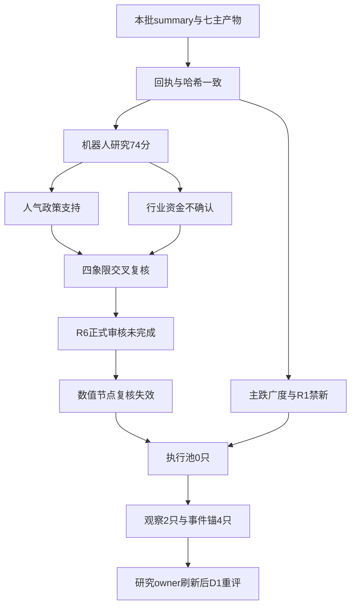

<!-- canghai:explicit-plan-report-assembly:v1 -->
# 显式组装报告（非重新推理）

> 决策来源（JSON）：llm
> 同版 JSON SHA-256（规范化内容）：15c05cc8a9ca97a958f7fdbd6bbcdfb3d1938c4a6249abaeaafbfab752974aa7
> 以下散文为调用方提供的模型原文，完整保留、未经重新推理；原文自述不是来源验证，不得覆盖 JSON 禁令、权限或缺口。
> 表格直接复用既有共享 renderer；只读展示，不构成开仓或自动交易授权。

## 模型原文（非重新推理）

---
date: 2026-10-28
agent: D1-main-decision
skill_version: main_decision_v1@1.9
generated_at: 2026-10-28T07:12:26+08:00
confidence: 0.28
degraded: true
decision_source: llm
mode: dry_run
position_cap: 0.20
execution_count: 0
watch_count: 2
data_sources:
  - name: research_summary
    path: data/research/20261028/research_summary.json
    status: ok
    captured_at: "2026-10-28T07:08:28+08:00"
    record_count: 7
  - name: R1-R7_current_batch
    path: research_summary.artifacts
    status: ok
    captured_at: null
    record_count: 7
    error: "ok只代表本批主产物可读且哈希一致；研究全部partial或degraded，不代表就绪。"
input_freshness: partial
input_freshness_note: "A股观察日为2026-10-27；两融至2026-10-26，R6正式反证未完成；只消费summary列出的本批主产物。"
---

# 2026年10月28日 · 主决策 / D1 盘前预案

> ⚠️ 今日禁新仓，no_trade=true。执行池0只，研究观察2只，事件研究锚4只。风险预算上限20%，有效新增预算0%，不授权自动交易。
> 这是本轮大模型裁决，不是Python规则兜底。交付完成不代表研究完成：production_ready=false，research_completion_passed=false，reassessment_required=true。

## 一句话结论

**局部人气不能抵消主跌广度，机器人只进研究观察，不进execution；今天是不开新仓日。**

## 🚦 不交易条件清单

| 条件 | 当前状态 | 动作 |
|---|---|---|
| R1明确不允许新仓 | 命中 | 禁新，不能凭盘前叙事覆盖 |
| R2没有已确认可交易主线 | 命中 | 74分只作研究排序 |
| R6正式审核未完成 | 命中 | 空hard_rejects不等于通过 |
| R1低于0.4或缺失 | 未命中 | 本次为0.45，不能另说R1完全失效 |
| R6正式硬否决超过候选30% | 未命中 | 正式硬否决0条，不虚造 |
| R7适用资金整体不可用 | 未命中 | staleness_status=ok，局部缺口单列 |
| 全局severity≥3 | 未命中 | 本次为2，不能虚报全局基础设施停摆 |
| 极端贪婪且无主线 | 未命中 | 本次为主跌，不套贪婪标签 |
| 用户休假 | 无本批标记 | 不额外读取未授权文件 |

两只观察票的数值节点另有失效问题，这是**逐票拦截**，不把RR引擎的问题扩散成新的全局禁令。即便节点修好，前三条全局禁令也不会自动解除。

## 🧭 市场：先承认亏钱扩散，再看局部赚钱

R1的底稿不是模糊的“分歧较大”：观察日涨停41家、炸板28家，炸板率40.58%，跌停22家；5570项截面只有606项上涨、4922项下跌，上涨占比10.88%，中位跌幅2.9749%。前日涨停55只完整匹配池平均溢价仍有1.3578%，但红盘占比只有50.91%。这说明前排尚存接力，并不说明全市场风险偏好恢复。R3的52分沿用四维口径，未直接扣罚全部广度和跌停，因此不能把52读成“中性市场，可以照常进攻”。

阶段采用R1内联的main_down，仅定义温度，不拿阶段机械关闭某个买点通道。今天不开新仓，直接依据是R1的明确权限约束、R2尚未确认可交易主线和R6正式审核未完成。研究仍继续，首板、二板的新题材仍可准备证据；但“四板老题材+盘后政策”不能改名成“新题材首板”。今日唯一主模板为R2选定的**首板隔日**，仅作研究框架，不混总龙锁仓、三格或其他模板。

风险预算上限沿用R1已批准的20%，与用户80%总仓硬上限取较小值，得20%；不再把已经收缩的预算重复乘0.4，也不因极恐逆向公式抬高仓位。新增预算为0%，每日新增买单上限显式置0。20%是风险预算上限，**不是对未知真实持仓下达立即压至20%的清仓命令**。本批没有可授权的真实持仓、可卖数量和已有T计划，因此不生成具体卖出或调仓指令。

## 🏭 板块：机器人是优先研究，不是已确认主升

人形机器人/物理AI数采在R2得74分，热度18、资金8、涨停18、叙事16、共振14。R3有人形数据采集论点和双榜注意力前移，R4有上海智能制造官方政策，故不能因主跌把这条研究线清空。但R7机器人行业当日净流出3.4649亿元，五日累计为正9.2593亿元；电机子环节当日流入7.2513亿元，不能替代整个人形概念资金，更不能把父子行业相加。机器人13家、人形9家涨停也存在重叠，不是22家。

- **大资金意图**: 当前只能提出“缩量市场围绕物理AI寻找新增叙事和少数承接载体”的假设；行业流出与电机子环节流入同时存在，尚不足以说机构共同加仓整条产业链。
- **为什么走强**: 人气、局部涨停梯队和盘后政策在叙事层相遇；但热榜前移不等同净流入，福莱跨平台降温、宇树注意力回落提示内部割裂。政策公开晚于昨日交易，不能倒因为昨日涨停。
- **逻辑够不够硬**: 官方政策原文是硬事件，但两票公司订单均未验证。生命周期真实年龄、完整概念资金持续性和题材封板率仍未知。1日只是研究复核有效期，不是已实现持续性，下一交易时段预期为分歧，不写“主升早”。

零售是54分次线：一般零售当日流入2.4881亿元，而商贸母行业流出0.5283亿元；R3只有弱双源讨论，R4的上海九百监管风险不能倒写成利好。银行当日流入7.6958亿元、五日累计流出26.8067亿元，只证明一日回流。银行并非天生不能做进攻线，只是**本批没有连续资金与个股地位证据**，所以不发个股买权。

## ✚ 四象限叉乘：高热不等于合力，正资金不等于资格

主轴用R3主题/个股注意力，与2026-10-27同口径资金正负叉乘。未获高热确认不是“已证实低热”；行业与个股分层展示，不混总额。

| 象限 | 本批对象与口径 | 叉乘后裁决 |
|---|---|---|
| 高热×正资金 | 大洋电机个股大单+超大单净流入5.0561亿元；一般零售行业为正 | 进watch，不进execution；持续性、地位与全局禁令都未解决 |
| 高热×负资金 | 襄阳轴承个股净流出0.9854亿元；机器人行业代理、AI短剧/传媒负反馈 | 降级观察；不能均值抹平口径冲突，不能把亏损讨论当积极买盘 |
| 未获高热确认×正资金 | 银行当日回流7.6958亿元，五日仍负 | 行业B研究，不直接造低位补涨名单 |
| 未获高热确认×负资金 | PCB当日流出30.1593亿元，五日流出148.6509亿元 | 拦截“季报同比增长即资金确认”的推断 |

另做**事件极性×价格位置**补充，避免与上述热度×资金混为一谈。正面政策×高位风险的例子是襄阳四板后才出现盘后政策；负面监管×高位风险的例子是上海九百。正面×低位、负面×低位在本批没有完整逐票位置阈值，留空，不造低位对象。对逸飞并购和恒瑞季报，正反两面一起保留，不能只读正面条目。

## 🔎 可开仓 / 可观察 / 不可做

| 档位 | 对象 | 本轮结论 |
|---|---|---|
| 可开仓 | 无 | 执行池为空，有效新增仓位0% |
| 可观察 | 大洋电机002249.SZ、襄阳轴承000678.SZ | 两票仅研究，entry_rules为空、单票授权仓位0%；下列价位为失效引擎参考 |
| 不可做 | 襄阳四板接力、把大洋缩量反包写成放量新高、事件锚临时转买单 | 模板/事实/权限均不允许；不是新增R6 hard_reject |

### 大洋电机 002249.SZ：资金较好，不代表门禁已过

**买入理由**: 本轮不发买入许可，仅保留研究的两项依据：首板反包形成局部辨识度，且最新分档主力净流入5.0561亿元、东财同向为5.0479亿元，日龙虎榜净买3.0104亿元；电机行业的相对强与此相符。上海政策提供产业研究方向，但没有公司人形业务收入和已签订单证明。

**风险点**: 昨收7.70元仍低于20日盘中高点7.75元，成交量只有前日的0.9021倍，所以不是放量创新高。三季报归母净利同比下降42.037%，PE_TTM为26.1963、三年分位96.41%；股东户数最近一期增长1.0627%，不能写成加速集中。前两日主力净流出，最新转正不是连续流入证明。

- **大资金意图**: 可检验的是电机子环节回流和反包承接，不是已证实的人形订单重估；营业部主导日榜净买也不自动等于机构一致进攻。
- **为什么走强**: 价格反包、双榜前移与个股正资金相符，但相对前日缩量且未过7.75元压力，不能省略反面。
- **逻辑够不够硬**: R5评级B/B-、综合49.25，只有研究价值。龙头认定已验证通过0/4是“尚未核验”，不是实际四条全不满足；板型、全板块排名与禁止清单都未完整完成，空命中数组不代表清白。

**止损条件**: 当前没有开仓，自然没有可下单的止损委托。引擎参考7.10元高于区间下沿7.08元，不能用它给整个区间设止损；按上沿7.47元算仅4.9531%，还不足5%硬边界。数值失效即维持不进；不得为了凑执行票修造新价。未来若独立重评允许新买，无底仓新增仓的卖出只能从T+1起生效，不能写当日跌破即走。

**可验证假设**: 接下来1—3个交易日，研究电机与目标题材是否连续两日同口径净流入、价格能否站上7.75元且成交量不再低于前日，并核验板块至少3家非ST涨停及真实跟随关系。这些只是重评取证条件，不是机械promote或解除禁新按钮；任一未满足继续观察，R1/R6仍须有权限owner重新通过。

### 襄阳轴承 000678.SZ：高辨识度只是研究锚，不接四板老龙

**买入理由**: 本轮不买。保留研究的依据是四板高度、双榜注意力前移和16.01元收盘创新高，它能充当人气与接力失败风险的温度计；上海人形进厂方案是后续产业映射的核查方向，而非已经证实的公司订单。

**风险点**: R5最新分档主力净流出0.9854亿元、日榜净卖1.3046亿元；股东数较上次增加39.8072%。半年报ROE为-2.6343%，PB为9.465、三年分位93.66%，PS分位94.48%；亏损PE不能用作低估依据。五日涨幅42.82%，又是四板，不符合今日首板隔日研究框架中的新增低位试错。

- **大资金意图**: 机构席位净买与营业部兑现并存，只能认定分歧；XTick主动成交代理为正不推翻订单分档净流出，不以不同口径均值化成“中性”。
- **为什么走强**: 连板、人气和短均线多头解释了辨识度，但成交量仅略高前日，不是持续放量；盘后政策不能解释盘中既成涨幅。
- **逻辑够不够硬**: R5为C/C、综合39分，真实订单未核，龙头四条资格仍未验证。它的五日大单累计净流入仍为正3.9034亿元，故不能把单日流出硬拼成模式六的五日出货，R6没有对此给hard_reject。

**止损条件**: 引擎参考止损14.75元高于买区下沿14.73元，整段不能作为可交易节点；区间下沿相对16.01元约低8%，不符合现价±5%的节点约束。当前禁买，不生成当日可卖的虚假建议。若政策映射不能落实公司业务、题材扩散继续减弱，撤销“产业兑现”的假设，不用后排递补来维持参与数量。

**可验证假设**: 未来1—3个交易日核验净流出是否真正扭转、至少3家同题材跟风是否有可追溯带动关系，以及公告能否证实具体业务。即使出现反包，也不把四板老题材冒充新题材首板；当前仍是降级观察、授权仓位0%。

## 🧮 价位推导：引擎算过，不代表模型照单全收

本轮调用的是apply_to_plan内存API，不运行默认CLI。默认技术加载器会读取未授权的kb/research.db，因此本轮只在当前进程把技术位读取接到**本次R5内嵌日线和指标**，没有读取旧库，没有更改公式引擎。两票窗口复权因子分别恒定为4.96与14.2188，末日锚定前复权与原价一致；昨收16.01与7.70均来自本批R5。MA50、牛线、熊线缺失保留null，不补成昨收或均线。

引擎因现价相对MA10高于8%选中分歧回踩口径。下表是**失效的研究参考**，不是可买区、不是委托单；对应entry_rules始终为空。

| 研究对象 | 引擎原始区间      | 参考触发  | 原始止损  | 原始止盈  | 上沿RR | 失效原因                                |
| ---- | ----------- | ----- | ----- | ----- | ---- | ----------------------------------- |
| 襄阳轴承 | 14.73—15.53 | 15.53 | 14.75 | 17.09 | 2.00 | 止损高于下沿；下沿距昨收-7.9950%                |
| 大洋电机 | 7.08—7.47   | 7.47  | 7.10  | 8.21  | 2.00 | 止损高于下沿；下沿距昨收-8.0519%；上沿止损距仅-4.9531% |

襄阳公式：原始区间=[16.01×0.92,16.01×0.97]，取分后为[14.73,15.53]；止损=max(15.53×0.95,12.035×0.99中符合结构条件者)=14.75；风险=15.53−14.75=0.78；2R目标=15.53+2×0.78=17.09；RR=(17.09−15.53)/(15.53−14.75)=2.00。技术位MA10=12.035、MA20=11.5135、20日高16.01、20日低8.73。虽然上沿止损距-5.0225%在硬区间内，**14.75不低于14.73**，整段依然失效。

大洋公式：原始区间=[7.70×0.92,7.70×0.97]，取分后为[7.08,7.47]；止损=max(7.47×0.95,6.681×0.99中符合结构条件者)=7.10；风险=0.37；目标=7.47+2×0.37=8.21；RR=(8.21−7.47)/(7.47−7.10)=2.00。MA10=6.681、MA20=6.544、20日高7.75、20日低6.04。**7.10高于7.08**，而且四舍五入后上沿止损距不足5%，不能以“引擎pass”替代业务校验。

两票node_invalid_count=2，RR原始结果留作证据，最终buy_eligibility=blocked。本轮不越权改引擎代码、不在展示阶段造新价。若未来要重评，必须修复有效价区并重算实际委托价RR、止损距离与T+1尾部风险，不靠这个2.00直接开仓。

## 📰 R4事件双面整合与四个纯事件锚

R4列出10条方向事件，其中并购和季报按正反两面拆列，不能当10个独立底层事件加权。上海智能制造与卫星互联网方案保留政策研究，但不因为官网发布就凭空点名受益股；电视/IPTV开机广告禁令是行业级负面，必须对相应收入链作打击面审查，不泛化为所有传媒股利空。上海九百监管对高位零售接力是负面，不能用一般零售资金正值冲掉。

华鑫股份600621.SH进research_anchor_only：控制权转让框架与复牌有官方公告，研究股东协同，不臆测券商合并。逸飞激光688646.SH同样只作事件锚：拟4亿元收购有转型想象，也有估值、商誉和交割风险，正负两条共同采纳。恒瑞医药600276.SH保留利润修复与收入目标风险两面，未经一致预期核验不叫超预期。金安国纪002636.SZ保持中性：单季环比已核，现货周期及预期差未核，PCB流出不能由季报同比覆盖。

这四只没有本批R5完整画像、可验证的前复权收盘与完整数值节点。因此买区、触发、止损、止盈均明确为空并写缺口，不查旁文件补价、不造买区，**它们不是watch候选的扩容，更不占六个合格新机会容量**。若要研究转交易，先补画像、地位、资金和正式审核，不能新闻一出即买。R4的合格可交易候选本来就是0只。

## 🔁 B计划：先保留去向假设，不把对手盘当通行证

触发观察切换的条件是机器人承接失败、前排断板无跟风，或板块资金继续流出。本批R7在20个昨日流入前排行业内检验190个配对，没有符合20日相关小于-0.6且双侧五日符号翻转的组合；这只是该样本无命中，不是全市场没有跷跷板。因此不造强度系数，不追加0.5或0.75的跷跷板惩罚。

已点名的大洋电机可作为“机器人整体分歧、电机子环节相对强”的研究锚，但仍沿用上述失效价区和禁买结论，不是自动B买单。银行回流与零售次线只设行业观察，不造本批没有地位证据的个股名单，也不拿高位监管票递补。A、B同时走弱则继续不交易。P1、P2可记录新证据，**不能凭观察身份或promote解除R1禁新、R6未完成或零新增预算**。

## 🛡️ R6消费与T+1可执行性

本批summary和R6的hard_rejects均为空，合并消费后仍为0条；执行池为空，自然没有漏放硬否决票。R6明确写R2未complete、正式反证不足，所以本次没有正式counter_arguments或strong_suggest。D01—D06作为研究诊断逐项采纳：概念与子行业口径、四板与首板模板不匹配、两票估值筹码、盘后政策时序、模式六条件不足。**不将这六条诊断伪装成正式反证完成，更不把空硬否决写成“R6全部通过”。**

A股新买入当日不可卖。没有匹配“昨日涨停→今日开盘买→次日卖”的历史cohort、最差5%尾损与账户风险预算，就不能倒推新增仓位；因此本轮不凭通用回测胜率定买单。未来若有无底仓新增仓，止损须从T+1生效，并核验下一交易日竞价挂单的成交、跌停与跳空风险；有可卖底仓才可能走当日卖出路径。此处是约束说明，不是本轮发出的卖单。

T+1三档open_position、add_on_pullback、stop_loss_only全部为空。skill历史要求stop_loss_only至少一条，但本批没有持仓与已有T计划输入，**该项阻塞且如实保留未完成**，不能虚构持仓凑条目，更不能一次性大幅清仓。执行owner须依真实持仓维护合法卖出，禁新不等于禁卖。

## 数据源审计

🟢表示本批文件/回执可验证，不表示研究完整；🟡表示partial、滞后或独立性不足；🔴表示本轮未完成的关键能力或上游明确调用失败。D1本轮没有直接调数据源MCP，下列供应商状态均为授权主产物记载，不伪装成D1探针。

| 源 | 日期 | 状态 | 备注 |
|---|---|:--:|---|
| summary与本批回执 | 2026-10-28 | 🟢 | 七份主产物逐一实读、哈希与run绑定一致；不是只看同日mtime |
| R1风格 | 2026-10-28 | 🟡 | confidence0.45；观察日27日；明确禁新、风险预算20% |
| R2主线 | 2026-10-28 | 🟡 | confidence0.245；2只研究样本、0条可交易主线；年龄与封板率未知 |
| R3舆情/热榜 | 2026-10-28 | 🟡 | confidence0.364；匿名群聊、RSS正文可见范围与双榜配对样本；图片/附件未读，非完整DC差分 |
| R4新闻/公告 | 2026-10-28 | 🟡 | confidence0.61；官方直读补证；72h快讯、订阅覆盖与群A缺口仍在 |
| R5画像 | 2026-10-28 | 🟡 | confidence0.1925；2票各31根日线可见，完整财务红旗和30日席位未完成 |
| R6正式反证 | 2026-10-28 | 🔴 | 研究降级、confidence未知；正式审核未完成，不把null填0或通过 |
| R7资金主产物（带日期后缀） | 2026-10-28 | 🟡 | confidence0.1925；staleness_status=ok；行业资金只有一个独立经济源 |
| tushare日线/复权/估值历史 | 2026-10-27 | 🟢 | R5本批留存62根日线、70条复权、1450条估值历史；技术位缺失保留null |
| fina_indicator/holdernumber | 2026-10-28 | 🟡 | 查询批次当日；财务报告期与股东统计期分别解释，不冒充当日变化 |
| moneyflow与moneyflow_dc | 2026-10-27 | 🟡 | 两票各5日；大单+超大单与主动成交代理不能直接相加/均值化 |
| 龙虎榜top_list/top_inst | 2026-10-27 | 🟡 | 单日、三日榜隔离去重；30日补查部分超时，不将未执行日期视为空 |
| hm_detail与游资重复组合 | 2026-10-27 | 🟡 | R7五日原始1424条；重复组合未完成公告与封板核验，合格synergy为空 |
| XTick hot_money/hot_bk | 2026-10-27 | 🟡 | 全市场返回截断；行业成员表无净额；局部方向冲突不称source_down |
| block_trade/report_rc/stk_surv/forecast/pledge_stat | 2026-10-28 | 🟡 | 上游成功空返回不是源失败，也不证明无减持、无质押或无风险 |
| margin_detail | 2026-10-26 | 🟡 | 最新至26日，缺应有T-1一档；未知不补零 |
| ETF行情与净申赎 | 2026-10-27 | 🟡 | fund_daily仅行情，缺份额/净申赎；价格不能替代净买入 |
| 期货/指数 | 2026-10-27 | 🟡 | IF0连续代理，缺近月合约与持仓量；代理基差不等于精确期现证据 |
| 海外补充数据 | 2026-10-27 | 🟡 | R7补齐海外14股与3指数；原快照为26日，未用旧快照冒充27日 |
| Datapro/专业检索 | 2026-10-28 | 🔴 | 上游记载4013订阅失效，查询被暂停；本轮未自行探针，不扩大为全源故障 |
| vibe iwencai/read_url | 2026-10-28 | 🔴 | 上游访问密钥/401调用问题，官方直读是替代证据；不声称供应商全服务down |
| R5内联chart_vision | 2026-10-27 | 🟡 | 只消费R5已存分析；未读取独立快照或图片，快照覆盖0不否认R5补查 |
| 北向 | 2026-10-28 | 🟡 | 仅复盘参考/not_required；不进置信度分子分母，不触发R7整体失效 |
| 额外attention/错题本/预测/宏观/日历 | 2026-10-28 | 🟡 | 不在本次授权主产物范围，未读取；不是已验证无事件或文件不存在 |

本批来源严格固定为summary.artifacts，R7使用其中带日期后缀的主产物，没有改读规范名旧版。所有七份主产物的契约检查可读、交付回执成立，但status全部partial/degraded，因此不宣布R1—R7研究全部通过。D1置信度按0.80×0.70×0.50=0.28列明，北向不参与分子分母；这不是胜率，也不是放宽仓位的依据。

## ⚠️ 不确定性 / 反证与范围阻塞

若当日广度和涨停接力显著恢复，当前主跌判断可能需要修订；但本轮没有盘中数据，不能预测“必然修复”，也不复述历史命中率作为买权。重评应同时验证广度、昨日涨停红盘比例、炸板率、题材连续资金及个股承接，再由研究owner刷新，D1重审。不是达到某个市场阈值就自动恢复30%或45%仓位。

主要未完成项是正式R6、逐票核心/总龙与完整禁止清单、数值节点修复、匹配T+1尾损、真实持仓/T计划，以及完整未来三交易日事件日历。全局门禁已经阻断，本轮未用judge_core的空序列、总龙默认alive或禁止清单默认参数制造“通过”。五个相关模块已真实导入验证可调用，**未声称对缺数据的两票完成全门禁**。

profile白名单与本次要求只准两个交付文件。因此不写runtime副本、不写额外点位表/价位推导MD、不写raw或错题文件；默认价格CLI会产生额外MD，故不调用。近期错题本与独立辅助研究输入未获本次授权，注入要求记为阻塞。缺口保留在同版JSON与本文，不靠读同日旧文件补齐。price engine节点缺陷由代码owner处理，不在本轮越权改代码。

## 与其他 R/D/E 的关系

依赖本批summary列出的R1—R7七份主产物及只读用户风控配置；生产者为本轮D1大模型。下游execute、P1、P2、E1读取同版JSON时，必须保留no_trade、零新增预算、未就绪与需重评标记。观察票与事件锚不授予盘中新开计划外仓的权限；合法已持仓卖出由执行owner依据真实可卖量单独维护。

## Sub-Agent 元数据

- skill: main_decision_v1
- artifact: data/plans/20261028/watchlist_plan.json
- model: gpt-6.1-sol / openai-codex
- 研究观察日: 2026-10-27
- 交付形式: 本轮LLM完整原文与同版JSON共享表格，仅一个KG主MD
- 完成状态: 安全临时版交付；研究未完成，交易资格未通过，待owner重评

## 同版 JSON 共享表格（只读附录）

# 20261028 盘前预案 · 点位表版

> 计划生成时点：2026-10-28T07:12:26+08:00；决策来源：llm

## 板块机会总览

市场背景：主跌、广度恶化，机器人只获研究优先级；局部电机回流不足以确认全市场主线

> 先市场／板块效应，再个股地位；未提供关系证据不推断龙头带动或板块扩散。

| 板块／本轮行情 | 阶段／窗口 | 效应与延续 | 核心与梯队（上游标签） | 共振／分离证据 | 主／反向剧本（名单归属非关系证明） | 确认条件 | 共同失效条件 | 观测时点 |
|---|---|---|---|---|---|---|---|---|
| 人形机器人/物理AI数采 | ⚠️未给 | ⚠️未给 | ⚠️未给 | 关系证据未给（概念归属不证明联动） | 观察 | ⚠️未给 | ⚠️未给 | ⚠️未给 |
| 独立／关系未确认 | ⚠️未给 | ⚠️未给 | ⚠️未给 | 关系证据未给（概念归属不证明联动） | 反向：电机子环节相对强，仅研究；触发 机器人整体分歧而电机相对强持续，仍须owner独立重评全部门禁 | ⚠️未给 | ⚠️未给 | ⚠️未给 |

## 全局约束与数据边界

- 模式：dry_run；自动交易：False；需用户确认：True
- 总仓上限：20%；持仓上限：5；每日买单上限：0
- 单票上限：⚠️未给；单板块上限：⚠️未给
- 表格仅展示已给计划，不构成自动下单授权；观察／反向候选不自动晋级。候选数量不等于持仓名额。
- 评分未校准：未批准评分公式，不采用旧 score／默认50／板块分充个股分；原序展示，不另行排名。
- 静态价位非实时；数据日、复权／报价口径、有效期或动态线更新时间未给时均未核验，不以计划生成时间冒充价格时点。
- 新买入当日不可卖（T+1）；底仓是否可卖未核验。触发信号不保证可卖或成交。

- 强制风控（原字段）：account_hard_stop_loss_pct=⚠️未给；block_prefixes=920；block_st=True；max_orders_per_symbol_per_day=2；kill_switch_file=data/runtime/KILL_SWITCH

> 全局禁止开仓（no_trade）；研究与观察保留。

- 不交易条件 R1_FAIL：未触发；R1 confidence &lt;0.4 或缺失
- 不交易条件 R1_NO_NEW_POSITION：触发中／禁止开仓；R1.permission_layers.new_position_allowed=false，不得以研究分或情绪修复预期覆盖
- 不交易条件 NO_CONFIRMED_TRADABLE_MAINLINE：触发中／禁止开仓；R2 confirmed_tradable_main_lines_count=0
- 不交易条件 R6_REVIEW_INCOMPLETE：触发中／禁止开仓；R6正式反证未完成；空hard_rejects不是放行
- 不交易条件 R6_HARD_REJECT_OVERFLOW：未触发；正式hard_reject命中候选超过30%
- 不交易条件 R7_STALE：未触发；适用资金整体unavailable才触发；北向不参与
- 不交易条件 GLOBAL_SEVERITY_3：未触发；fetch_global_severity &gt;=3
- 不交易条件 EMOTION_EXTREME_GREED：未触发；贪婪且无主线
- 不交易条件 USER_HOLIDAY：未触发；本次无已授权用户休假信息；未额外读取

## 执行池（0 只）

### 执行池逐票说明

### 执行池机会与买入

| 股票／场景键 | 优先级（原计划） | 池／当前状态 | 所属板块／角色 | 质量分／评分时点 | 机会类型与理由 | 时间窗 | 触发价 | 可买区间 | 最高接受价 | 板块／量价确认 | 不做／取消条件 |
|---|---|---|---|---|---|---|---|---|---|---|---|

### 执行池退出与风险

| 股票／对应场景键 | 初始止损／绑定范围 | 止损依据与动作 | 分档止盈价及动作 | 移动止盈／其他退出 | 失效／取消条件 | 可卖限制 | 数据时点与缺口 |
|---|---|---|---|---|---|---|---|

> 本池为空；无对象不凑数，原因须由决策者提供。

## 观察池（2 只）

### 观察池逐票说明

- 襄阳轴承 000678.SZ：观察；研究保留、execution不进。最新大单与超大单合计净流出，日榜净卖，股东户数明显增加；机构席位净买不抵消营业部兑现。与XTick主动成交代理方向冲突；不能把热榜第一解释成新资金持续流入；本次D1禁新仓。引擎原始价区存在止损高于下沿问题，仅保留研究数值，不可按区间交易。；状态 watch_pool_only；买入资格受阻／当前禁止新买（非永久否决）；单票上限 0%；逐票权限 auto_trade_enabled=False；requires_user_confirmation=True
  - T+1博弈（原判断）：消息解读: 政策是盘后增量；高开可能先手兑现，不以政策倒推昨日涨停；预期差判断: 数采合同和进厂兑现尚未核实；只有相对板块的新增承接可证伪或支持；buy_point_check: 不进：本次不输出具体买点；竞价及开盘承接留给D1/执行侧；买点结论: 观察；短线结构标签: 高度联动风险样本；failure_condition: 若题材涨停扩散消失或自身承接不能验证，则不授予地位，不以便宜替换龙一
- 大洋电机 002249.SZ：观察；研究保留、execution不进。最新分档主力净流入与东财同向、龙虎榜净买；前两交易日资金曾流出，最新封板成交量缩于前日，持续性仍需新交易日确认。股东数最近一期增加，不能称加速集中。；本次D1禁新仓。引擎原始价区存在止损高于下沿问题，仅保留研究数值，不可按区间交易。；状态 watch_pool_only；买入资格受阻／当前禁止新买（非永久否决）；单票上限 0%；逐票权限 auto_trade_enabled=False；requires_user_confirmation=True
  - T+1博弈（原判断）：消息解读: 政策是盘后增量；高开可能先手兑现，不以政策倒推昨日涨停；预期差判断: 数采合同和进厂兑现尚未核实；只有相对板块的新增承接可证伪或支持；buy_point_check: 不进：本次不输出具体买点；竞价及开盘承接留给D1/执行侧；买点结论: 观察；短线结构标签: 低位助攻待确认；failure_condition: 若题材涨停扩散消失或自身承接不能验证，则不授予地位，不以便宜替换龙一

### 观察池机会与买入

| 股票／场景键 | 优先级（原计划） | 池／当前状态 | 所属板块／角色 | 质量分／评分时点 | 机会类型与理由 | 时间窗 | 触发价 | 可买区间 | 最高接受价 | 板块／量价确认 | 不做／取消条件 |
|---|---|---|---|---|---|---|---|---|---|---|---|
| 观察池:1:000678.SZ:1 襄阳轴承 | 原序1／⚠️未给 | 观察池／买入资格受阻／当前禁止新买（非永久否决） | 人形机器人/物理AI数采／watch | 未校准／评分时点未给 | ⚠️未给／观察；研究保留、execution不进。最新大单与超大单合计净流出，日榜净卖，股东户数明显增加；机构席位净买不抵消营业部兑现。与XTick主动成交代理方向冲突；不能把热榜第一解释成新资金持续流入；本次D1禁新仓。引擎原始价区存在止损高于下沿问题，仅保留研究数值，不可按区间交易。 | ⚠️未给 | ⚠️未给 | 14.73 ~ 15.53 | ⚠️未给 | 板块：⚠️未给；量价：⚠️未给；本场景依据：⚠️未给；需盘中确认：⚠️未给；原建议仓位：⚠️未给 | ⚠️未给；逐票权限 auto_trade_enabled=False；requires_user_confirmation=True；板块禁入 ；场景禁令 ⚠️未给；个股禁令 ⚠️未给；观察原因 grade_gate_dropped；原资格 source: D1_llm；status: blocked；scope: stock_buy_only；review_required: True；risk_reward_ratio: 2.0；reasons: GLOBAL_NO_TRADE；RESEARCH_INCOMPLETE；NODE_INVALID；note: 引擎RR=2仅计算证据，不能替代实际委托价RR与完整资格；利空反证 ⚠️未给；全局禁止开仓 |
| 观察池:2:002249.SZ:1 大洋电机 | 原序2／⚠️未给 | 观察池／买入资格受阻／当前禁止新买（非永久否决） | 人形机器人/物理AI数采／watch | 未校准／评分时点未给 | ⚠️未给／观察；研究保留、execution不进。最新分档主力净流入与东财同向、龙虎榜净买；前两交易日资金曾流出，最新封板成交量缩于前日，持续性仍需新交易日确认。股东数最近一期增加，不能称加速集中。；本次D1禁新仓。引擎原始价区存在止损高于下沿问题，仅保留研究数值，不可按区间交易。 | ⚠️未给 | ⚠️未给 | 7.08 ~ 7.47 | ⚠️未给 | 板块：⚠️未给；量价：⚠️未给；本场景依据：⚠️未给；需盘中确认：⚠️未给；原建议仓位：⚠️未给 | ⚠️未给；逐票权限 auto_trade_enabled=False；requires_user_confirmation=True；板块禁入 ；场景禁令 ⚠️未给；个股禁令 ⚠️未给；观察原因 grade_gate_dropped；原资格 source: D1_llm；status: blocked；scope: stock_buy_only；review_required: True；risk_reward_ratio: 2.0；reasons: GLOBAL_NO_TRADE；RESEARCH_INCOMPLETE；NODE_INVALID；note: 引擎RR=2仅计算证据，不能替代实际委托价RR与完整资格；利空反证 ⚠️未给；全局禁止开仓 |

### 观察池退出与风险

| 股票／对应场景键 | 初始止损／绑定范围 | 止损依据与动作 | 分档止盈价及动作 | 移动止盈／其他退出 | 失效／取消条件 | 可卖限制 | 数据时点与缺口 |
|---|---|---|---|---|---|---|---|
| 观察池:1:000678.SZ:1 襄阳轴承 | 14.75；本场景 | ⚠️未给 | 17.09；⚠️未给 | 移动止盈／其他退出未给 | ⚠️未给；逐票权限 auto_trade_enabled=False；requires_user_confirmation=True；板块禁入 ；场景禁令 ⚠️未给；个股禁令 ⚠️未给；观察原因 grade_gate_dropped；原资格 source: D1_llm；status: blocked；scope: stock_buy_only；review_required: True；risk_reward_ratio: 2.0；reasons: GLOBAL_NO_TRADE；RESEARCH_INCOMPLETE；NODE_INVALID；note: 引擎RR=2仅计算证据，不能替代实际委托价RR与完整资格；利空反证 ⚠️未给；全局禁止开仓 | T+1：新增仓当日不可卖；底仓可卖数量未给；触价不保证成交 | 昨收 16.01；price_source=R5.technical.daily_bars + adjustment（20261027末日锚定前复权）；数据日／有效期未核验；非实时；引擎参考（非场景绑定）：止损 14.75／止盈 17.09；来源 engine |
| 观察池:2:002249.SZ:1 大洋电机 | 7.10；本场景 | ⚠️未给 | 8.21；⚠️未给 | 移动止盈／其他退出未给 | ⚠️未给；逐票权限 auto_trade_enabled=False；requires_user_confirmation=True；板块禁入 ；场景禁令 ⚠️未给；个股禁令 ⚠️未给；观察原因 grade_gate_dropped；原资格 source: D1_llm；status: blocked；scope: stock_buy_only；review_required: True；risk_reward_ratio: 2.0；reasons: GLOBAL_NO_TRADE；RESEARCH_INCOMPLETE；NODE_INVALID；note: 引擎RR=2仅计算证据，不能替代实际委托价RR与完整资格；利空反证 ⚠️未给；全局禁止开仓 | T+1：新增仓当日不可卖；底仓可卖数量未给；触价不保证成交 | 昨收 7.70；price_source=R5.technical.daily_bars + adjustment（20261027末日锚定前复权）；数据日／有效期未核验；非实时；引擎参考（非场景绑定）：止损 7.10／止盈 8.21；来源 engine |

### 观察池竞价预期（原计划）

| 股票 | 区间／判定／动作 |
|---|---|
| 襄阳轴承 000678.SZ | 昨收 16.01；预期开盘带 ⚠️未给 |
| 大洋电机 002249.SZ | 昨收 7.70；预期开盘带 ⚠️未给 |

## 反向剧本／B计划

总触发：机器人题材承接失败或板块资金继续流出；前排断板且无跟风赚钱效应；市场广度未修复、炸板率继续高于40%
互斥／共同失效：B计划也是研究；A/B同弱继续不交易，P1/P2不得凭promote自动解禁。
关系：仅展示原剧本，不推断主／反向可同时买入；不得跨池借用未绑定场景价位。

方向：电机子环节相对强，仅研究；触发：机器人整体分歧而电机相对强持续，仍须owner独立重评全部门禁；证据：R2研究候选大洋电机 + R5个股正资金；R7电机行业流入

### B计划1逐票说明

- 大洋电机 002249.SZ：⚠️未给；状态 ⚠️未给；买入资格受阻／当前禁止新买（非永久否决）；单票上限 0%；逐票权限 auto_trade_enabled=False；requires_user_confirmation=⚠️未给

### B计划1机会与买入

| 股票／场景键 | 优先级（原计划） | 池／当前状态 | 所属板块／角色 | 质量分／评分时点 | 机会类型与理由 | 时间窗 | 触发价 | 可买区间 | 最高接受价 | 板块／量价确认 | 不做／取消条件 |
|---|---|---|---|---|---|---|---|---|---|---|---|
| B计划1:1:002249.SZ:1 大洋电机 | 原序1／⚠️未给 | B计划1／买入资格受阻／当前禁止新买（非永久否决） | 独立／关系未确认／research_anchor_only | 未校准／评分时点未给 | ⚠️未给／⚠️未给 | ⚠️未给 | ⚠️未给 | ⚠️未给 | ⚠️未给 | 板块：⚠️未给；量价：⚠️未给；反向触发：机器人整体分歧而电机相对强持续，仍须owner独立重评全部门禁；本场景依据：⚠️未给；需盘中确认：⚠️未给；原建议仓位：⚠️未给 | ⚠️未给；逐票权限 auto_trade_enabled=False；requires_user_confirmation=⚠️未给；板块禁入 ；场景禁令 ⚠️未给；个股禁令 ⚠️未给；观察原因 ⚠️未给；原资格 status: blocked；reasons: GLOBAL_NO_TRADE；NODE_INVALID；利空反证 ⚠️未给；全局禁止开仓 |

### B计划1退出与风险

| 股票／对应场景键 | 初始止损／绑定范围 | 止损依据与动作 | 分档止盈价及动作 | 移动止盈／其他退出 | 失效／取消条件 | 可卖限制 | 数据时点与缺口 |
|---|---|---|---|---|---|---|---|
| B计划1:1:002249.SZ:1 大洋电机 | ⚠️未给；个股共用 | ⚠️未给 | ⚠️未给；⚠️未给 | 移动止盈／其他退出未给 | ⚠️未给；逐票权限 auto_trade_enabled=False；requires_user_confirmation=⚠️未给；板块禁入 ；场景禁令 ⚠️未给；个股禁令 ⚠️未给；观察原因 ⚠️未给；原资格 status: blocked；reasons: GLOBAL_NO_TRADE；NODE_INVALID；利空反证 ⚠️未给；全局禁止开仓 | T+1：新增仓当日不可卖；底仓可卖数量未给；触价不保证成交 | 昨收 7.70；数据日／有效期未核验；非实时 |

方向：银行回流/零售次线，只观察行业不造个股；触发：主线不及预期后核资金是否连续而非单日避险；证据：R7银行一日+7.69581056亿但5日-26.80674048亿；R2零售次线与R4监管利空

### B计划2逐票说明

### B计划2机会与买入

| 股票／场景键 | 优先级（原计划） | 池／当前状态 | 所属板块／角色 | 质量分／评分时点 | 机会类型与理由 | 时间窗 | 触发价 | 可买区间 | 最高接受价 | 板块／量价确认 | 不做／取消条件 |
|---|---|---|---|---|---|---|---|---|---|---|---|

### B计划2退出与风险

| 股票／对应场景键 | 初始止损／绑定范围 | 止损依据与动作 | 分档止盈价及动作 | 移动止盈／其他退出 | 失效／取消条件 | 可卖限制 | 数据时点与缺口 |
|---|---|---|---|---|---|---|---|

> 本池为空；无对象不凑数，原因须由决策者提供。

## 禁入／否决名单

