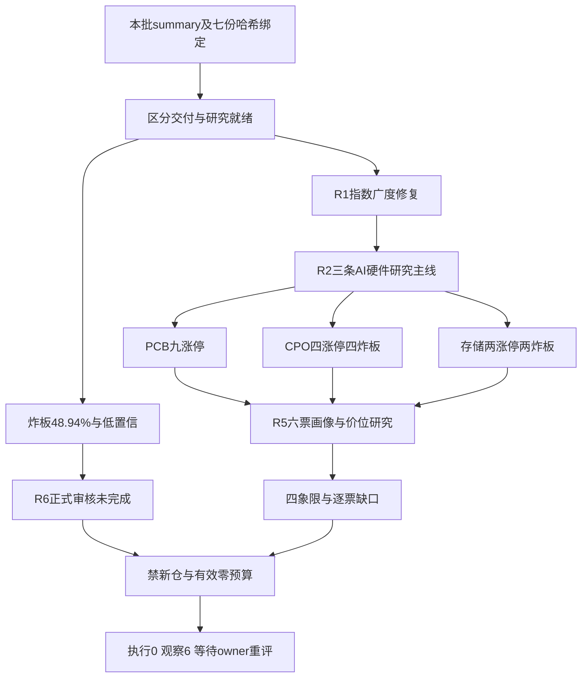

---

date: 2026-10-29
agent: D1-main-decision
skill_version: main_decision_v1@1.9
generated_at: 2026-10-29T07:11:10+08:00
confidence: 0.12
degraded: true
decision_source: llm
mode: dry_run
production_ready: false
research_completion_passed: false
reassessment_required: true
input_freshness: partial
input_freshness_note: 当前批次R1-R7哈希核对通过；研究均为partial或degraded，不能视为审核通过。A股观测截至20261028，R4新闻截至2026-10-29 06:19，海外资料各按实际会话日期披露。
data_sources:
  - {name: R1, path: data/research/20261029/R1_style.json, status: error, captured_at: '2026-10-29T06:23:54.965292+08:00', record_count: 1, error: 上游研究降级而非读取失败}
  - {name: R2, path: data/research/20261029/R2_main_sectors.json, status: error, captured_at: '2026-10-29T06:40:10+08:00', record_count: 3, error: 主线仅研究，完整资格未核}
  - {name: R3, path: data/research/20261029/R3_sentiment.json, status: error, captured_at: '2026-10-29T06:31:38+08:00', record_count: 1, error: 长期人气与图文覆盖不完整}
  - {name: R4, path: data/research/20261029/R4_news.json, status: error, captured_at: '2026-10-29T06:23:34+08:00', record_count: 12, error: 事件主产物partial并非全量日历完成}
  - {name: R5, path: data/research/20261029/R5_stock_profiles.json, status: error, captured_at: '2026-10-29T06:56:30+08:00', record_count: 6, error: 六票仅研究，门禁和视觉不完整}
  - {name: R6, path: data/research/20261029/R6_devil_advocate.json, status: error, captured_at: '2026-10-29T07:03:25.677737+08:00', record_count: 1, error: 正式反证未完成}
  - {name: R7, path: data/research/20261029/R7_capital_flow_20261029.json, status: error, captured_at: '2026-10-29T06:23:13.324973+08:00', record_count: 1, error: 资金研究partial，主力与游资T-1正常}
---
---
# 显式组装报告（非重新推理）

> 决策来源（JSON）：llm
> 同版 JSON SHA-256（规范化内容）：c99974a2c55bc4b9ec842613bedc35d75826495ae7b51a405f7d0785aa381c56
> 以下散文为调用方提供的模型原文，完整保留、未经重新推理；原文自述不是来源验证，不得覆盖 JSON 禁令、权限或缺口。
> 表格直接复用既有共享 renderer；只读展示，不构成开仓或自动交易授权。

## 模型原文（非重新推理）
# 2026年10月29日 · 主决策 / D1 盘前预案

## 一句话结论

指数强修复不等于接力安全：今日禁新仓，执行池0只、观察池6只；研究未就绪，保留重评义务。

这是一份本轮大模型作出的安全临时预案，不是Python规则版，也不是研究完成后的最终交易裁决。decision_source为llm。当前批次为20261029T061042-19265-2699，R1至R7均从research_summary列明的路径读取，七份主产物的内容哈希与本批receipt绑定一致。没有从同日另一个R7路径、旧预案、历史日志或未列出的研究附件补证。R7主产物的文件名带日期，尽管上游内部引用过不带日期的路径，本轮只读取摘要授权的带日期版本，并核对其内容哈希相同；没有沿指针读取另一文件。

## 🚫 不交易条件与权限

| 条件 | 本次状态 | 裁决 |
|---|---|---|
| R1置信度低于0.4 | active：0.392 | 不开新仓 |
| R6正式审核未完成 | active：formal_review_completed=false、review_passed=false | 空否决清单不能当审核通过 |
| 昨日炸板率高于40% | active：69/(72+69)=48.94% | 本轮试仓额度也取0，不用小仓例外绕门禁 |
| 上游研究未就绪 | active：七份研究均partial/degraded | 安全发布，必须重评 |
| R7适用资金证据整体失效 | inactive | 主力与游资T-1正常，不因北向或ETF申赎缺失单独触发 |
| 全局健康severity达到3 | inactive：本批2 | 不把降级写成基础设施全故障 |
| R6硬否决溢出 | inactive：本次清单为空 | 仍保留审核未完成禁令 |
| 无主线且极端贪婪 | inactive | 研究主线存在，83分也不是完整五维贪婪分 |
| 用户休假 | inactive：未提供 | 不臆设 |

有效新增买入预算=0%，单票拟新仓=0%，每日与单票买单预算均为0。max_positions仍为5，单票15%与板块40%的原保护不放宽。用户偏好文件当前920前缀仍禁买，ST仍阻断，不能照技能历史文字擅自解禁。

这里的0不是要求账户立即清仓。没有账户持仓、可卖量和既有T计划的授权主产物，本轮不作调仓、不撤单、不改原止损保护、不假造持仓退出票。JSON的portfolio_rebalance明确为none。production_ready与research_completion_passed均为false，reassessment_required为true；P1/P2看到观察身份或B计划也不能自动恢复买权。

## 🧭 市场：承认回流，也承认接力脆弱

R1的事实并不支持“市场很差所以停止研究”。昨日上证上涨0.9091%、深成指上涨2.0225%、创业板上涨3.399%，全A上涨4156家、下跌1239家，涨停72家、跌停5家，昨日涨停样本次日平均溢价2.3255%。这些说明风险偏好确有修复。另一面是69家炸板、48.94%的炸板率，以及最高5板、3板仅2只的梯队结构。指数修复与封板交易的可承受性不是同一个命题。

因此沿用R1 high_chop/震荡温度，而不把四维83分升级成主升或完整五维贪婪。R1原研究上限40%，按高位震荡原约束乘0.75得到30%的研究温度上限；它再与本轮禁新仓预算0取最小，最终新买预算仍是0。三条AI硬件方向共享风险簇，不套三主线1.1倍奖励，更不能用历史公式的最低仓位clamp抬起有效零预算。宏观铜、海外油、ICE美元指数不齐，黄金及离岸人民币日线只到27日且切点未认证，宏观三档定位保持未知，不据不齐的异步资料加减仓。

- **大资金意图**: 现有证据更像前期硬件跌幅后的回补与短线接力争夺；这是资金行为假设，不是识别到某机构账户增配。
- **为什么走强**: 广度、指数和部分容量净流入同向，构成修复事实；炸板近半说明兑现盘仍强，不能把普涨翻译成可以随便追板。
- **逻辑够不够硬**: T-1价格与资金数字可核，但R1低置信、R6未审完和逐票门禁缺口足以阻止新增交易；它们不抹掉已经发生的回流事实。

## 🧩 板块公共判断：有研究主线，没有交易通行证

### PCB概念：广度最完整，不能把身位当主营纯度

R2.main_lines中的PCB有9家涨停、3家炸板，宽概念封板率75%；概念口径净流入70.21421056亿元，R7印制电路板行业净流入47.0233472亿元，二者不可相加。奥士康项目在昨日收盘后披露，是今天待验证的新增催化，不能倒过来解释昨天的上涨，更不是给光洋、金安国纪确认新增订单。

- **大资金意图**: 可能是在AI硬件修复中找已有板块广度和辨识度的承接位置；光洋三板身位与金安财报兑现代表不同接力诉求。
- **为什么走强**: 九家涨停支持板块效应，R3热榜与讨论同向；产业扩产消息增加预期，但融资与审批约束必须并列。
- **逻辑够不够硬**: 昨日广度硬，逐票主营纯度、今日承接和新增订单不够硬。完整生命周期stage与round_id均未知，不将板块名相同视作同轮主升。

公共失效条件是资金转负且无承接、广度明显缩窄或公司映射被证伪。光洋和金安的观察条件均引用此条，但保留各自财务、筹码反证，不复制成两条虚构独立共振。

### CPO：容量回流强，技术标签与订单传导不能偷换

R2给出4家涨停、4家炸板，封板率50%；概念净流入103.83385856亿元，通信器件66.01956864亿元只是父级代理。中际旭创单日资金强不能替整个细分链条确认净增订单。R3的MPO/DFAU讨论是上位光互联需求共振，MPO并不等于CPO。微软Azure与谷歌云增长给需求假设支持，谷歌利润及现金回报压力又约束资本开支回报叙事，两者不得抵消成一句利好。

- **大资金意图**: 可能在容量硬件上回补风险敞口，也可能借反弹释放原有筹码；两种动机均与大成交相容。
- **为什么走强**: 容量股回流和日涨幅已确认，但中际20日仍明显回撤，热度3→5是绝对热而相对退位。
- **逻辑够不够硬**: 海外需求事件不等于本公司订单；方正的PCB盈利也不等于CPO业务纯度。R4行业级负向风险没有用户例外签字，继续只研究。

### 存储：涨价叙事有人气，扩散宽度仍不足

R2存储当前207个成分仅2家涨停、2家炸板，封板率50%，不能用芯片大板块九涨停来替代。概念净流入65.00922112亿元，半导体68.90792448亿元是父级代理，不相加。R3热度4→3和L1+L2支持研究优先级，但R4对海力士财报同时保留需求长单与净利环比下行，不能复述群聊“大超预期”当已核结论。

- **大资金意图**: 可能寻找盈利弹性与跌后容量修复，而非已完成一轮新的行业重估。
- **为什么走强**: 行业需求讨论与资金修复同时存在，盈方首板、兆易五至十日净入是不同维度的事实。
- **逻辑够不够硬**: 两涨停尚不构成充分的接力合力；盈方亏损和商誉风险、兆易中期弱势及两源偏差均未消失。stage和轮次未知，保持观察。

人形机器人作为R2次线保留，热度第一不自动变为首选主线。TI18家涨停与另一统计17家冲突、炸板24家，原样保留口径差异；美国政策是谈判和未来工具选项，不是已经即时加税。次线无合格领导票主产物，不临时追加股票。

## ✖️ 四象限叉乘：事件正负 × 明确窗口的位置

本轮沿用R6明确的四象限定义，不换成“情绪×资金”。R6六个对象的高低位置及本轮轮次均未确认，四格实际确认对象都为空。R5的5日/20日收益、均线距离可以描述位置风险，但不能擅自补一个高低位阈值制造确定归类。

| 象限 | 本轮条件推演 | 当前裁决 |
|---|---|---|
| 高位×利好 | 若以后确认处于本轮高位，利好高开可能让先手兑现；光洋短期上涨不直接认证高位 | 不竞价追涨，不给执行资格 |
| 高位×利空 | 若高位及敞口均确认，行业负面可能压缩估值并放大接力断层 | 不以正向事件抵消，等待正式审核 |
| 低位×利好 | 若窗口低位成立，反弹可能只是套牢盘修复；方正、金安、中际、兆易均不能仅靠单日强势认证反转 | 观察回流连续性与广度，不接左侧飞刀 |
| 低位×利空 | 若低位成立，亏损/现金流恶化仍可能继续；盈方不能因跌过而称错杀 | 财务和合规继续核，不以弹性代替资格 |

同时交叉R4的正负事件打击面：光模块/AI服务器等面对微软及谷歌云需求支持与谷歌回报压力；存储面对海力士长单与净利环降；高端PCB面对奥士康扩产与融资履约约束。相同财报拆出的正负记录只算同一底层事件，12条方向记录不冒充12个独立事实。R6未完成正式审核，今天没有足够证据把任何一个条件象限写成“已确认机会”。

## 🔎 六只票：全部降级观察，无一进execution

### 光洋股份 002708.SZ · PCB研究高度龙一，主营纯度另核

- **大资金意图**: 三板与多题材辨识度可能吸引接力资金；27日机构净卖与营业部净买并存，不是机构锁仓证据。
- **为什么走强**: 3板、首封09:30和PCB九涨停构成身位证据，但28日两源大单已转负，缩量不能自动解释成惜售。
- **逻辑够不够硬**: 高度top1仅过1条已核龙头条件，五日资金全板块top1与完整综合地位未核；不能冒充纯正PCB总龙。

**买入理由**：只作为研究保留的两项依据是PCB与机器人交叉题材辨识度，以及三板和板块九涨停事实，不构成买入指令。

**风险点**：五日上涨30.53%后次日接力面临集中兑现；半年扣非含金量与经营现金流偏弱，机器人贸易收入敞口未核。R5为B/C。

**止损条件**：无新仓所以没有当日卖出指令。研究上，跌回MA20的15.7745且两源大单同负，或公告否认相关实质业务，接力假设失效。引擎止损参考17.45仅是T+1情景，不能用于新买当天离场；它高于研究区间下沿17.42，整个区间不能作为合法买区使用。

**可验证假设**：未来两个交易日至少一天两源净额均正，且PCB涨停至少3家，才支持进一步研究身位带动；即使命中也须D1重评全部门禁。

### 金安国纪 002636.SZ · PCB龙二，财报修复不是已确认主升

- **大资金意图**: 可能交易已披露三季报的盈利修复，但股东数扩散、融资收缩和五日资金分歧不支持简单锁仓叙事。
- **为什么走强**: 首板与财报增长是真实锚；20日跌幅31.54%，仍低于中期均线，反弹与上方供给并存。
- **逻辑够不够硬**: R2原角色为龙二，已核高度条件1条并不等于综合top2及七项资格全部通过。R5为B/B-。

**买入理由**：研究保留基于覆铜板/PCB与三季报增长的映射，以及首板和双平台前排人气；不是因板块上行就自动给轻仓。

**风险点**：先前深跌形成套牢供给，现金利润转化弱于账面增长；当日热度不能证明90日持续人气通过。

**止损条件**：收盘重回MA5的57.078下方且PCB封板率跌破50%，或财报现金流/盈利重大更正，研究逻辑证伪。引擎区间69.87—71.28距离昨收58.59过远，触发需上破19.3%，不在现价±5%节点带；不能挂这个价冒充今天低吸。

**可验证假设**：未来两个交易日至少一天两源同正，PCB涨停≥3且封板率≥50%。这只验证财报接力假设，不能解除本轮禁新仓。

### 方正科技 600601.SH · R2 CPO标签高度龙一，不等于业务纯度认证

- **大资金意图**: 可能交易本公司PCB盈利改善；放量换手支持真实供需变化，但没有席位证据不能点名机构主导。
- **为什么走强**: 三季报和约1.76倍量能支持首板修复；均线仍偏弱，昨板不是现成的主升回踩买点。
- **逻辑够不够硬**: R2原CPO归属与高度龙一保留，已核龙头条件1条；公司PCB利润不能充当CPO订单证明。R5为B+/B-。

**买入理由**：保留公司三季报盈利锚，以及放量首板、五日净入的研究价值。它引用CPO公共条目，也单独保留PCB主营错配风险。

**风险点**：CPO封板率仅50%，本票终封偏晚、资本开支消耗与中期空头压力并存；有封板事实不等于战术模块已核通过。

**止损条件**：收盘低于MA5的9.97且两源同负，或相关产品/客户映射否认，则修复假设失效。引擎触发12.59需较10.32上破22.0%，违反当日节点带，不在执行池。

**可验证假设**：未来两个交易日CPO涨停≥3、封板率≥60%，并至少一天个股两源同正，才进一步核对板块带动。

### 中际旭创 300308.SZ · 容量研究候补，不擅自升级龙二

- **大资金意图**: 235.73亿元成交与资金回流可能来自容量再平衡，同时机构大宗卖出和融资去杠杆仍构成对手盘。
- **为什么走强**: 昨日上涨10.2773%，但创业板20%涨跌幅下这不是涨停；20日仍跌31.31%，短期强反弹不等于主升恢复。
- **逻辑够不够硬**: R2原身份为候补/filtered_out，不冒充龙一龙二。已核完整龙头条件未知；行业需求支持不替代本公司订单增量。R5为B+/B-。

**买入理由**：光模块主营与海外云需求有业务关联，五日回流和容量成交可验证；这些支持观察，不授权接力买入。

**风险点**：现金转化偏弱、融资收缩与大宗筹码转移仍在；谷歌回报压力是行业级负向输入，不因微软利好被抵消。

**止损条件**：未来两日CPO封板率持续低于50%且个股两源连续两日均净出，或订单/盈利指引转弱，容量回流假设失效。引擎按828.99拟买、762.67止损、前高937.55止盈，RR=1.64<1.8，单票价位资格失败；这是独立于全局禁令的阻塞。

**可验证假设**：未来两个交易日至少一天两源同正且CPO涨停≥3，才继续核容量带动。仍不得从候补自动晋级。

### 盈方微 000670.SZ · 存储高度龙一，财务与合力双缺口

- **大资金意图**: 更像交易小市值弹性与首板，而不是已证实的机构长期配置。
- **为什么走强**: 首板、约1.74倍量能与净入可核，三次开板又说明封板承接并不稳；存储只有两涨停。
- **逻辑够不够硬**: 高度条件已核1条，完整核心与禁止清单未完成。亏损和薄净资产风险不能由题材抵消；R5为B-/C且综合分缺失。

**买入理由**：仅以首板弹性、两源同向与行业需求映射保留研究，不称便宜，不称已通过审计。

**风险点**：亏损、商誉相对薄归母净资产的压力与现金流风险并存；三次开板是战术拒绝风险，而不是“空禁止列表=没问题”。本轮不以默认参数冒跑模块假装验证完整。

**止损条件**：两源同负且收盘跌回MA20的6.7145，研究假设证伪；若出现ST预警或审计非标需交R6正式审查。引擎6.51—6.87的下沿低于6.53止损，且按触发价止损距约4.9491%，不满足完整节点条件，不能交易。

**可验证假设**：未来两个交易日存储涨停≥3且个股至少一天两源同正，才谈进一步核对；单票继续涨也不能代替板块合力。

### 兆易创新 603986.SH · 存储容量研究候补，不把小级别修复当日线反转

- **大资金意图**: 可能向有盈利锚的容量芯片股回补，但股东数增加和融资去杠杆不支持无条件新主升。
- **为什么走强**: 7.77%上涨、约1.36倍量能与五至十日回流支持修复；日线仍弱于中期均线，视觉主产物只有小级别转强支持。
- **逻辑够不够硬**: R2为候补，不擅自补成龙二。公司盈利与回购是公司层锚，海力士不能代替本公司ASP、订单及毛利兑现。R5为B/B-。

**买入理由**：保留存储产业需求与公司盈利，以及多日资金修复的观察价值，而非把涨价传闻变成明日涨停预测。

**风险点**：两源资金偏差超阈值、盈利周期外推和中期空头压力均在；群聊观点转发不等于多源独立订单确认。

**止损条件**：公司订单/ASP或扣非指引下修，或两源连续两日均负，研究逻辑失效。引擎357.45—364.67相对昨收289.88需先上破23.3%，不在±5%节点带，不能作为当日低吸执行。

**可验证假设**：未来两个交易日至少一天两源偏差降至5%以内且同正，同时存储涨停≥3，再核容量修复是否延续；不因此恢复交易预算。

以上六票板型均只继承主产物的事实与缺口；禁止清单命中列表为空只表示没有本轮完整结果，不表示已排除十四项风险。核心相关与市场总龙缺少完整同窗输入，不用空数组计算相关0来误判逆势抱团，也不编造总龙alive。四闸门无逐票已通过结论，execution为空。

## 📐 价位推导：真实运行引擎，暴露不能做的价，不凑过闸

本轮实际调用apply_to_plan，底层derive公式保持不变。默认load_tech会读未获授权的research.db，因此仅在内存把技术位加载入口接到本批R5内嵌80根前复权日线和既有均线字段，未读数据库、未调行情MCP、未伪造API响应。MA10取末10个收盘均值，20日高低取末20根已观测日线高低；原有MA50按R5保留。牛线、熊线未知，公式字符串中“牛线=MA50”只是引擎缺值回退，不是实测牛线。这个载入适配与缺失语义均在JSON留痕。

下表都是禁买锚的研究情景，不是可开仓价区。全部entry_rules为空。光洋、盈方虽引擎RR=2，区间下沿却落在止损下方；其余多票需远离现价站回均线，不能拿高处均线冒充眼前低吸。D1没有为凑出执行票而凭空移价。六票完整节点均未通过，node_invalid_count=6；止损距离的小数分位越界也如实保留，不宣称自动修过。

| 标的 | 昨收 | 引擎研究区间 | 研究触发 | 止损参考 | 止盈参考 | 引擎RR | 本轮资格 |
|---|---:|---|---:|---:|---:|---:|---|
| 光洋股份 |18.94|17.42—18.37|18.37|17.45|20.21|2.00|不可做：止损高于区间下沿 |
| 金安国纪 |58.59|69.87—71.28|69.87|67.72|78.40|2.00|不可做：超节点带、触发价止损距不足 |
| 方正科技 |10.32|12.59—12.85|12.59|12.21|14.13|2.00|不可做：超节点带、触发价止损距不足 |
| 中际旭创 |636.30|812.57—828.99|812.57|762.67|937.55|1.64|不可做：RR失败且超节点带 |
| 盈方微 |7.08|6.51—6.87|6.87|6.53|7.55|2.00|不可做：区间/止损次序及止损距不合格 |
| 兆易创新 |289.88|357.45—364.67|357.45|346.44|401.13|2.00|不可做：超节点带、触发价止损距不足 |

光洋买区=[18.94×0.92,18.94×0.97]=[17.42,18.37]；止损按上沿18.37×0.95取17.45，MA10×0.99约15.07较低；止盈=18.37+2×0.92=20.21，RR=(20.21−18.37)/(18.37−17.45)=2。止损高于下沿的问题不被RR掩盖。

金安买区按MA50约70.58×[0.99,1.01]得69.87—71.28；止损=71.28×0.95取67.72，高于MA10×0.99约60.91；止盈=71.28+2×3.56=78.40，RR=2。但实际触发69.87对应止损距仅约−3.0771%，并非买区上沿口径的约−4.9944%。

方正按MA50约12.72×[0.99,1.01]得12.59—12.85；止损取12.21，高于MA10×0.99约10.47；止盈=12.85+2×0.64=14.13，RR=2。实际触发12.59对应约−3.0183%，不能借用上沿RR证明触发价完全合格。

中际按MA50约820.78×[0.99,1.01]得812.57—828.99；止损=828.99×0.92取762.67，高于MA10×0.99约622.99；2R原目标961.63，但20日高937.55处于其下且高于拟买价5%，因此取937.55，RR=(937.55−828.99)/(828.99−762.67)=1.64，低于1.8门槛。

盈方按昨收7.08×[0.92,0.97]得6.51—6.87；止损6.53高于MA10×0.99约6.26；止盈=6.87+2×0.34=7.55，RR=2。但止损高于下沿，按触发价止损距约−4.9491%，不足5%。

兆易按MA50约361.06×[0.99,1.01]得357.45—364.67；止损346.44高于MA10×0.99约278.89；止盈=364.67+2×18.23=401.13，RR=2。触发价口径止损距约−3.0802%，上沿口径约−4.9990%，均不能包装为完整5%规则通过。

三档结论因此是：可开仓0只；可观察6只；当前拟开仓六票均不可做。数字用于复算与未来重评，不制造可以先下单再补手续的假象。

## 🕰️ T+1、竞价与一字板

新增仓当天不可卖，所以没有“跌破上述价当日无条件走”。所有新仓止损参考effective_from=T+1；如果未来获得新买授权，应按实际买价重新生成次日集合竞价的5%风险参考及盘中5%盈利参考，而不是继承本轮不合格价。跳空、跌停或流动性不足下挂单不保证成交。历史cohort和尾部5%亏损样本未在本批主产物里，无法据尾部风险反推合法仓位，所以本轮保持0，不补历史胜率。

尚未发生的29日竞价不作事实使用。执行池为空，因此没有每只execution竞价三档缺失；也不给观察票虚构可立即执行的竞价价格。若竞价低开破位、超预期高开或一字封死，都只改变观察证据，不能绕过全局禁令。R4首板候选为空，完整一字预测输入/模块结果未提供，故无可交付的一字候选；不顶三板光洋，不新增盘前清单外代码。既有持仓状态未知，t1_candidates三类为空，stop_loss_only至少一条的技能要求因缺持仓依据未通过，不造一条假持仓来满足字段数。

## 🔀 对手盘B计划：准备研究，不暗中开第二套交易模板

R7已算出的负相关配对包括照明与广告媒体、照明与其他黑色家电；它们不是PCB/CPO/存储主线的直接对冲。不能把任意−0.6以下配对拿来给AI硬件减半仓，也不能据此临时追加未研究股票。研究轮次未知，同名板块也不能充同轮相关性证明。

若PCB/CPO失去承接，而存储的涨停家数由2上升到至少3且两源资金继续改善，可在原清单内核对兆易的容量修复；若CPO容量回流失效而PCB广度仍在，可核对金安的财报承接。JSON B计划只列金安和兆易，引用各自板块公共条目及同一组研究价；它不是统计对冲，也没有自动买权。两者仍为研究备选、仓位0，不能以低位或候补身份绕过龙一龙二原规则。

若B方向也弱，继续不新开，不把“资金总会搬家”写成必须找到一只股票买入。分歧接力是今天唯一研究模板，没有同时运行首板隔日、总龙锁仓、三格等多套交易策略。

## 🛡️ R6消费与反证边界

摘要hard_rejects与R6.hard_rejects合并为空，所以实际硬否决剔除0只；不是R6审核通过。R6 counter_arguments为空，正式strong_suggest没有可覆盖条目，因此accepted与overridden都为空。R5财务风险中带strong_suggest的研究标签仍保留其上游身份，不伪装成R6正式强建议，更不谎报覆盖理由。

R6明示正式复核未完成、上游按其完整性定义均未通过。D1采纳的是“不能把空清单视为通过”的限制，同时保留R1/R7等已经可核的客观证据，不把“审核不可用”误写成工具读取失败。后续任何正式hard_reject都会继续剔除执行，不为凑六候选启用低位替补。今日执行空池首先由未完成研究和禁新预算决定，不是先删除股票再替它找一组否决理由。

## 数据源审计

| 源 | 日期 | 状态 | 记录/窗口及真实边界 |
|---|---|:--:|---|
| research_summary与R1-R7主产物 |2026-10-29|🟢|七份哈希/receipt绑定同一run；读取成功不等于研究成功 |
| R1市场/风格主产物 |2026-10-28|🟡|广度、梯队、指数与四维83可核；置信度0.392，宏观不齐 |
| R2主线主产物 |2026-10-28|🟡|3主线、1次线、6个原研究对象；stage/round未知；分歧接力单模板 |
| R3热榜与匿名群观点 |2026-10-28|🟡|热榜实际27→28比较；长期persistent未完成，图片未完整读、远端同步不可证；非D1新查 |
| R4消息/公告主产物 |2026-10-29|🟡|8个底层事件/12条正负方向记录；新闻截止06:19；一级核验为上游声明，本轮不复抓 |
| R5行情与画像主产物 |2026-10-28|🟡|6票各80根前复权日线；完整财务/合规/视觉与门禁未完 |
| R6正式反证 |2026-10-29|🔴|读取成功但formal_review_completed=false；没有可当作通过的正式审核 |
| R7主力与游资分项 |2026-10-28|🟢|T-1正常，上游全市场资金覆盖与席位可用；不代表今日实时资金 |
| R7 ETF/期货 |2026-10-28|🟡|一级净申购未知，二级大额单不等于申赎；期现为收盘近似非可交易同步基差 |
| R7两融 |2026-10-27|🟡|上游生成时最新已披露日期，不贴成28日 |
| R7海外股/指数 |2026-10-27|🟡|缺最新完成美股28日；R1部分指数有上游另补，不能补成R7个股齐全 |
| R7北向 |2026-10-29|🟡|仅复盘参考，不纳置信分子分母，不因缺口单独禁新，不填0/neutral |
| R7转述DataPro业务查询 |2026-10-29|🔴|4013订阅/席位错误是业务call_failed，不定性source_down |
| R7转述vibe问财 |2026-10-29|🔴|缺key为调用配置缺口；本轮D1按角色未调数据源MCP，不宣称探针确认源故障 |
| R5 top_list/top_inst首调 |2026-10-29|🟡|区间调用缺trade_date，后经逐日查询恢复；不是最终整源不可用 |
| 快图持久PNG |2026-10-29|🟡|输出超本轮两文件范围，不生成output/charts或新图文件；无伪造链接 |

七份主产物的完整路径、实际generated_at、哈希、receipt与消费记录均在同版JSON审计段。上游早期写“R1/R2尚未就绪”是它当时的not_yet_landed，不沿用为今天D1未读取；本轮七份确已读。D1没有网络探针，因此没有新增source_down断言。manifest指针未进一步打开，不把摘要severity=2说成本轮独立复核所有raw完成。

## ⚠️ 不确定性、范围阻塞与重评要求

本次白名单仅允许指定两份交付。近期错题本、attention_signals独立文件、完整三交易日大事件日历、昨日观察追踪、近十日涨停全量及持仓/T计划都不在当前授权主产物内，未另读。R3内嵌人气可用但不能冒充90日冷/热已核；没有把未知人气标成从未上榜。R4已有负面事件已消费，但未来日历完整性不能标通过。没有额外附加MD、runtime副本、raw文件或越权错题文件。

现有观察仅6只，不为满足20—40目标将R3人气证据股或R7资金排名股偷换成研究候选；R4首板池为空也不自行选票。三条主线仍保留，阶段标签不自动清研究池。上述覆盖缺口、持仓维护缺口、未通过逐票模块与节点资格，在JSON明确留痕，故研究状态保持incomplete。报告不是最终通过版。

研究owner需要刷新并完成缺项、由R6正式裁决；随后计划owner基于新批次重新评估原门禁、有效预算、持仓与T+1可执行性。成交价格、止损和资格必须同次重新计算，不能因为当前文件存在就免评。P1/P2不得靠promotion自动解禁；任何已有零预算和保护都保持。

## 与其他 R/D/E 的关系

依赖本次摘要授权的R1风格、R2主线、R3情绪、R4消息、R5画像、R6反证、R7资金七份主产物；行情证据只到各自实际观测日。execute消费核心JSON和合法amendment，用户读本主报告；E1可追踪观察假设，但不得把未授权研究价当成交建议或将空硬否决误评为审核通过。

本次实际生成处于正常交易日08:30交付目标之前，交易日依据R7所载当次SSE日历为开市；这是实际盘前生成而非回放，不因pre_delivery标签倒推任何来源日期。真实生成时间见frontmatter和JSON，最新新闻知识截止06:19，A股日线截止昨日。08:30为observe_only目标，不强杀、不撤单、不清池。5000万token是连续任务努力目标而非硬限或每日新额度；usage覆盖不足，实际消耗未知，不当0，也不承诺低于目标。

## Sub-Agent 元数据

- skill: main_decision_v1
- artifact: data/plans/20261029/watchlist_plan.json
- research_run_id: 20261029T061042-19265-2699
- model: gpt-6.1-sol
- decision_source: llm
- delivery: 核心JSON与本主MD安全临时交付；研究未完成、交易未授权
- 生成耗时: 见真实生成与会话启动观测；无独立完整计时，不造精确总耗时

## 同版 JSON 共享表格（只读附录）

# 20261029 盘前预案 · 点位表版

> 计划生成时点：2026-10-29T07:11:10+08:00；决策来源：llm

## 板块机会总览

市场背景：指数普涨与高炸板并存；AI硬件三方向研究非三重独立分散，今日禁新仓

> 先市场／板块效应，再个股地位；未提供关系证据不推断龙头带动或板块扩散。

| 板块／本轮行情 | 阶段／窗口 | 效应与延续 | 核心与梯队（上游标签） | 共振／分离证据 | 主／反向剧本（名单归属非关系证明） | 确认条件 | 共同失效条件 | 观测时点 |
|---|---|---|---|---|---|---|---|---|
| PCB概念 | ⚠️未给 | research_only | ts_code: 002708.SZ；name: 光洋股份；role: 龙一；ts_code: 002636.SZ；name: 金安国纪；role: 龙二 | path: data/research/20261029/R2_main_sectors.json；logic: 同花顺热度第6；9涨停、3炸板，宽概念封板率75%。；东财PCB概念主力净流入70.21421056亿元；R7印制电路板47.0233472亿元，口径不同不相加。；R4奥士康项目规划在昨日收盘后披露，是今日待验证新增催化，不能解释昨日已发生涨幅；融资及审批约束同时保留。；R3 L1+L2，但主题仍属于AI硬件共同风险簇；不当作独立三条产业周期。；score_evidence: heat_rank: 6；concept_net_inflow_yi: 70.21421056；capital_scope: 当前概念资金；R7行业及个股多日反证不相加；limits: limit_up_count: 9；broken_count: 3；seal_rate_pct: 75.0；method: 当次实时ths_member集合与20261028非ST limit_list_d U/Z代码交集；静态当前成分不冒充历史成分，涨停数不是涨家数；news_events: E20261029_006；E20261029_007；resonance: L1+L2；risks: 情绪=震荡；上一已收盘日炸板率48.94%，候选4→2。；R7相关行业5日/20日累计仍负，单日回流不能确证主升。；R4正负极性并存，不能将高强度负面计正叙事。；R6尚未运行；不自造hard_reject，不过滤未来R6否决。 | 观察 | 资金承接、广度与逐票原门禁均完成后才可申请D1重评；不是买权 | 资金转负无承接或公司业务/盈利映射证伪 | 2026-10-28T16:24:00+08:00 |
| 共封装光学(CPO) | ⚠️未给 | research_only | ts_code: 600601.SH；name: 方正科技；role: 龙一；ts_code: 300308.SZ；name: 中际旭创；role: 候补 | path: data/research/20261029/R2_main_sectors.json；logic: 同花顺热度3→5，绝对强但相对退位；4涨停、4炸板，封板率50%。；东财CPO概念主力净流入103.83385856亿元；R7通信器件净流入66.01956864亿元仅父级代理。；中际旭创单日主力31.97068亿元、5日29.72153808亿元，但20日-101.4408904亿元，不认定主升恢复。；微软及谷歌云新增披露支持需求假设；谷歌现金回报风险未解除，MPO并不等于CPO。；score_evidence: heat_rank: 5；concept_net_inflow_yi: 103.83385856；capital_scope: 当前概念资金；R7行业及个股多日反证不相加；limits: limit_up_count: 4；broken_count: 4；seal_rate_pct: 50.0；method: 当次实时ths_member集合与20261028非ST limit_list_d U/Z代码交集；静态当前成分不冒充历史成分，涨停数不是涨家数；news_events: E20261029_003；E20261029_001；E20261029_004；resonance: L1+L2；risks: 情绪=震荡；上一已收盘日炸板率48.94%，候选4→2。；R7相关行业5日/20日累计仍负，单日回流不能确证主升。；R4正负极性并存，不能将高强度负面计正叙事。；R6尚未运行；不自造hard_reject，不过滤未来R6否决。 | 观察 | 资金承接、广度与逐票原门禁均完成后才可申请D1重评；不是买权 | 资金转负无承接或公司业务/盈利映射证伪 | 2026-10-29T04:05:06+08:00 |
| 存储芯片 | ⚠️未给 | research_only | ts_code: 000670.SZ；name: 盈方微；role: 龙一；ts_code: 603986.SH；name: 兆易创新；role: 候补 | path: data/research/20261029/R2_main_sectors.json；logic: 同花顺热度4→3；207当前成分仅2涨停、2炸板，封板率50%，不以芯片大板块9涨停冒充存储。；东财存储概念主力65.00922112亿元；R7半导体68.90792448亿元仅父级代理，不能重复加总。；R3 L1+L2，海力士需求及长单与净利润环比下行并存；不采用群中单边大超预期措辞。；兆易创新5日19.42991552亿元、10日33.91773472亿元为正而20日为负，业绩传导仍待核。；score_evidence: heat_rank: 3；concept_net_inflow_yi: 65.00922112；capital_scope: 当前概念资金；R7行业及个股多日反证不相加；limits: limit_up_count: 2；broken_count: 2；seal_rate_pct: 50.0；method: 当次实时ths_member集合与20261028非ST limit_list_d U/Z代码交集；静态当前成分不冒充历史成分，涨停数不是涨家数；news_events: E20261029_010；E20261029_009；resonance: L1+L2；risks: 情绪=震荡；上一已收盘日炸板率48.94%，候选4→2。；R7相关行业5日/20日累计仍负，单日回流不能确证主升。；R4正负极性并存，不能将高强度负面计正叙事。；R6尚未运行；不自造hard_reject，不过滤未来R6否决。 | 观察 | 资金承接、广度与逐票原门禁均完成后才可申请D1重评；不是买权 | 资金转负无承接或公司业务/盈利映射证伪 | 2026-10-28T08:22:24+08:00 |
| 人形机器人 | ⚠️未给 | research_only | ⚠️未给 | path: data/research/20261029/R2_main_sectors.json；logic: 热度第一只计热度，不因连续第一给共振加分；TI18涨停与limit_cpt17涨停口径冲突保留；炸板24，不称低分歧主升；美国谈判不是即时加税，逐票出口敞口未核，不用板块标签硬否决；score_evidence: ⚠️未给；risks: ⚠️未给 | ⚠️未给 | 资金承接、广度与逐票原门禁均完成后才可申请D1重评；不是买权 | 资金转负无承接或公司业务/盈利映射证伪 | 2026-10-29T04:05:17+08:00 |
| 独立／关系未确认 | ⚠️未给 | ⚠️未给 | ⚠️未给 | 关系证据未给（概念归属不证明联动） | 反向：AI硬件内部相对强弱再确认，非统计负相关对冲；触发 原主线失去承接而备选板块广度与资金同时改善；仍保留禁令 | ⚠️未给 | ⚠️未给 | ⚠️未给 |

## 全局约束与数据边界

- 模式：dry_run；自动交易：False；需用户确认：True
- 总仓上限：0%；持仓上限：5；每日买单上限：0
- 单票上限：⚠️未给；单板块上限：⚠️未给
- 表格仅展示已给计划，不构成自动下单授权；观察／反向候选不自动晋级。候选数量不等于持仓名额。
- 评分未校准：未批准评分公式，不采用旧 score／默认50／板块分充个股分；原序展示，不另行排名。
- 静态价位非实时；数据日、复权／报价口径、有效期或动态线更新时间未给时均未核验，不以计划生成时间冒充价格时点。
- 新买入当日不可卖（T+1）；底仓是否可卖未核验。触发信号不保证可卖或成交。

- 强制风控（原字段）：block_prefixes=920；block_st=True；max_orders_per_symbol_per_day=0；kill_switch_file=data/runtime/KILL_SWITCH

> 全局禁止开仓（no_trade）；研究与观察保留。

- 不交易条件 R1_FAIL：触发中／禁止开仓；R1置信度0.392&lt;0.4，禁新仓
- 不交易条件 R6_REVIEW_INCOMPLETE：触发中／禁止开仓；R6 formal_review_completed=false，review_passed=false；空hard_rejects不代表通过
- 不交易条件 BREAK_RATE_OVER_40：触发中／禁止开仓；R1昨日炸板率69/(72+69)=48.936%，本轮新开仓预算取0；不凭极小试仓例外绕过原门禁
- 不交易条件 RESEARCH_INCOMPLETE：触发中／禁止开仓；R1-R7均partial/degraded，待上游刷新与D1重评
- 不交易条件 R7_STALE：未触发；R7适用主力/游资证据T-1正常，不因北向或ETF单项缺失单独全局禁新
- 不交易条件 GLOBAL_SEVERITY_3：未触发；本批severity=2，未达3
- 不交易条件 R6_HARD_REJECT_OVERFLOW：未触发；本批hard_rejects为空；未完成审核不算通过
- 不交易条件 EMOTION_EXTREME_GREED：未触发；83分是R1四维参考非完整五维贪婪判定
- 不交易条件 USER_HOLIDAY：未触发；未提供出行标记，不臆设

## 执行池（0 只）

### 执行池逐票说明

### 执行池机会与买入

| 股票／场景键 | 优先级（原计划） | 池／当前状态 | 所属板块／角色 | 质量分／评分时点 | 机会类型与理由 | 时间窗 | 触发价 | 可买区间 | 最高接受价 | 板块／量价确认 | 不做／取消条件 |
|---|---|---|---|---|---|---|---|---|---|---|---|

### 执行池退出与风险

| 股票／对应场景键 | 初始止损／绑定范围 | 止损依据与动作 | 分档止盈价及动作 | 移动止盈／其他退出 | 失效／取消条件 | 可卖限制 | 数据时点与缺口 |
|---|---|---|---|---|---|---|---|

> 本池为空；无对象不凑数，原因须由决策者提供。

## 观察池（6 只）

### 观察池逐票说明

- 光洋股份 002708.SZ：降级观察：三板身位最强，但末日主力转负、机构卖出与盈利含金量弱形成反证。；引用sector_core_watchlist同名板块；全局禁新/R6未审完，不构成新增买权；状态 watch_pool_only；买入资格受阻／当前禁止新买（非永久否决）；单票上限 0%；逐票权限 auto_trade_enabled=False；requires_user_confirmation=True
  - T+1博弈（原判断）：消息解读: 正向催化可能被先手高开兑现；负向信息需真实承接反证，不先判洗盘；预期差判断: 已涨主题的增量承接而非旧消息重复计分；买点结论: 观察；通道待D1以当日赚钱效应确认；短线结构标签: 身位/助攻；buy_point_check: 竞价未发生，不能把上一收盘涨幅当可成交买点
- 金安国纪 002636.SZ：降级观察：三季报增长已核，但属于深跌后的首板修复，筹码扩散和融资收缩未消失。；引用sector_core_watchlist同名板块；全局禁新/R6未审完，不构成新增买权；状态 watch_pool_only；买入资格受阻／当前禁止新买（非永久否决）；单票上限 0%；逐票权限 auto_trade_enabled=False；requires_user_confirmation=True
  - T+1博弈（原判断）：消息解读: 正向催化可能被先手高开兑现；负向信息需真实承接反证，不先判洗盘；预期差判断: 已涨主题的增量承接而非旧消息重复计分；买点结论: 观察；通道待D1以当日赚钱效应确认；短线结构标签: 身位/助攻；buy_point_check: 竞价未发生，不能把上一收盘涨幅当可成交买点
- 方正科技 600601.SH：降级观察：三季报与放量首板提供修复证据，尚不能确认CPO纯度或主升恢复。；引用sector_core_watchlist同名板块；全局禁新/R6未审完，不构成新增买权；状态 watch_pool_only；买入资格受阻／当前禁止新买（非永久否决）；单票上限 0%；逐票权限 auto_trade_enabled=False；requires_user_confirmation=True
  - T+1博弈（原判断）：消息解读: 正向催化可能被先手高开兑现；负向信息需真实承接反证，不先判洗盘；预期差判断: 已涨主题的增量承接而非旧消息重复计分；买点结论: 观察；通道待D1以当日赚钱效应确认；短线结构标签: 联动/分离；buy_point_check: 竞价未发生，不能把上一收盘涨幅当可成交买点
- 中际旭创 300308.SZ：降级观察：容量资金回流最显著，但不是涨停龙头；融资收缩、现金转化弱与大宗转移需反证。；引用sector_core_watchlist同名板块；全局禁新/R6未审完，不构成新增买权；状态 watch_pool_only；买入资格受阻／当前禁止新买（非永久否决）；单票上限 0%；逐票权限 auto_trade_enabled=False；requires_user_confirmation=True
  - T+1博弈（原判断）：消息解读: 正向催化可能被先手高开兑现；负向信息需真实承接反证，不先判洗盘；预期差判断: 已涨主题的增量承接而非旧消息重复计分；买点结论: 观察；通道待D1以当日赚钱效应确认；短线结构标签: 联动/分离；buy_point_check: 竞价未发生，不能把上一收盘涨幅当可成交买点
- 盈方微 000670.SZ：降级观察：首板弹性和资金回流已见，但亏损、极薄归母净资产及商誉构成显著风险。；引用sector_core_watchlist同名板块；全局禁新/R6未审完，不构成新增买权；状态 watch_pool_only；买入资格受阻／当前禁止新买（非永久否决）；单票上限 0%；逐票权限 auto_trade_enabled=False；requires_user_confirmation=True
  - T+1博弈（原判断）：消息解读: 正向催化可能被先手高开兑现；负向信息需真实承接反证，不先判洗盘；预期差判断: 已涨主题的增量承接而非旧消息重复计分；买点结论: 观察；通道待D1以当日赚钱效应确认；短线结构标签: 身位/助攻；buy_point_check: 竞价未发生，不能把上一收盘涨幅当可成交买点
- 兆易创新 603986.SH：降级观察：五至十日资金修复优于单日脉冲，但双源偏差、周期兑现和候补身份均需保留。；引用sector_core_watchlist同名板块；全局禁新/R6未审完，不构成新增买权；状态 watch_pool_only；买入资格受阻／当前禁止新买（非永久否决）；单票上限 0%；逐票权限 auto_trade_enabled=False；requires_user_confirmation=True
  - T+1博弈（原判断）：消息解读: 正向催化可能被先手高开兑现；负向信息需真实承接反证，不先判洗盘；预期差判断: 已涨主题的增量承接而非旧消息重复计分；买点结论: 观察；通道待D1以当日赚钱效应确认；短线结构标签: 联动/分离；buy_point_check: 竞价未发生，不能把上一收盘涨幅当可成交买点

### 观察池机会与买入

| 股票／场景键 | 优先级（原计划） | 池／当前状态 | 所属板块／角色 | 质量分／评分时点 | 机会类型与理由 | 时间窗 | 触发价 | 可买区间 | 最高接受价 | 板块／量价确认 | 不做／取消条件 |
|---|---|---|---|---|---|---|---|---|---|---|---|
| 观察池:1:002708.SZ:1 光洋股份 | 原序1／⚠️未给 | 观察池／买入资格受阻／当前禁止新买（非永久否决） | PCB概念／watch | 未校准／评分时点未给 | ⚠️未给／降级观察：三板身位最强，但末日主力转负、机构卖出与盈利含金量弱形成反证。；引用sector_core_watchlist同名板块；全局禁新/R6未审完，不构成新增买权 | ⚠️未给 | ⚠️未给 | 17.42 ~ 18.37 | ⚠️未给 | 板块：资金承接、广度与逐票原门禁均完成后才可申请D1重评；不是买权；量价：⚠️未给；本场景依据：src.plan.price_levels原公式；仅用本批R5内嵌前复权80根日线，MA10/20日高低依同窗计算；牛熊线未知，不把引擎MA50 fallback说成真实牛线；需盘中确认：⚠️未给；原建议仓位：⚠️未给 | 资金转负无承接或公司业务/盈利映射证伪；逐票权限 auto_trade_enabled=False；requires_user_confirmation=True；板块禁入 ；场景禁令 code: RESEARCH_ONLY；active: True；description: 全局禁新+逐票未就绪；引擎价位仅情景基准；个股禁令 code: RESEARCH_ONLY；active: True；description: 全局禁新+逐票未就绪；引擎价位仅情景基准；观察原因 research_incomplete；原资格 source: price_levels_engine；scope: stock_buy_only；ts_code: 002708.SZ；status: blocked；reasons: EXTERNAL_BUY_ELIGIBILITY；rr_min: 1.8；risk_reward_ratio: ⚠️未给；buy_price: ⚠️未给；stop_loss: ⚠️未给；take_profit: ⚠️未给；price_source: ⚠️未给；review_required: True；review_reasons: EXPLICIT_STOCK_REVIEW_REQUIRED；EXTERNAL_QUALIFICATION_REVIEW_REQUIRED；external_qualification: source: D1；status: blocked；review_required: True；reasons: GLOBAL_NO_TRADE；R6_REVIEW_INCOMPLETE；ORIGINAL_GATES_UNKNOWN；利空反证 event_id: E20261029_005；scope: 行业级；sector: 人形机器人；工业机器人；工业母机；action: 仅研究，不进execution；mapping_note: PCB交叉机器人/CPO光模块按风险敞口提示，非已证实收入归属；全局禁止开仓 |
| 观察池:2:002636.SZ:1 金安国纪 | 原序2／⚠️未给 | 观察池／买入资格受阻／当前禁止新买（非永久否决） | PCB概念／watch | 未校准／评分时点未给 | ⚠️未给／降级观察：三季报增长已核，但属于深跌后的首板修复，筹码扩散和融资收缩未消失。；引用sector_core_watchlist同名板块；全局禁新/R6未审完，不构成新增买权 | ⚠️未给 | ⚠️未给 | 69.87 ~ 71.28 | ⚠️未给 | 板块：资金承接、广度与逐票原门禁均完成后才可申请D1重评；不是买权；量价：⚠️未给；本场景依据：src.plan.price_levels原公式；仅用本批R5内嵌前复权80根日线，MA10/20日高低依同窗计算；牛熊线未知，不把引擎MA50 fallback说成真实牛线；需盘中确认：⚠️未给；原建议仓位：⚠️未给 | 资金转负无承接或公司业务/盈利映射证伪；逐票权限 auto_trade_enabled=False；requires_user_confirmation=True；板块禁入 ；场景禁令 code: RESEARCH_ONLY；active: True；description: 全局禁新+逐票未就绪；引擎价位仅情景基准；个股禁令 code: RESEARCH_ONLY；active: True；description: 全局禁新+逐票未就绪；引擎价位仅情景基准；观察原因 research_incomplete；原资格 source: price_levels_engine；scope: stock_buy_only；ts_code: 002636.SZ；status: blocked；reasons: EXTERNAL_BUY_ELIGIBILITY；rr_min: 1.8；risk_reward_ratio: ⚠️未给；buy_price: ⚠️未给；stop_loss: ⚠️未给；take_profit: ⚠️未给；price_source: ⚠️未给；review_required: True；review_reasons: EXPLICIT_STOCK_REVIEW_REQUIRED；EXTERNAL_QUALIFICATION_REVIEW_REQUIRED；external_qualification: source: D1；status: blocked；review_required: True；reasons: GLOBAL_NO_TRADE；R6_REVIEW_INCOMPLETE；ORIGINAL_GATES_UNKNOWN；利空反证 ⚠️未给；全局禁止开仓 |
| 观察池:3:600601.SH:1 方正科技 | 原序3／⚠️未给 | 观察池／买入资格受阻／当前禁止新买（非永久否决） | 共封装光学(CPO)／watch | 未校准／评分时点未给 | ⚠️未给／降级观察：三季报与放量首板提供修复证据，尚不能确认CPO纯度或主升恢复。；引用sector_core_watchlist同名板块；全局禁新/R6未审完，不构成新增买权 | ⚠️未给 | ⚠️未给 | 12.59 ~ 12.85 | ⚠️未给 | 板块：资金承接、广度与逐票原门禁均完成后才可申请D1重评；不是买权；量价：⚠️未给；本场景依据：src.plan.price_levels原公式；仅用本批R5内嵌前复权80根日线，MA10/20日高低依同窗计算；牛熊线未知，不把引擎MA50 fallback说成真实牛线；需盘中确认：⚠️未给；原建议仓位：⚠️未给 | 资金转负无承接或公司业务/盈利映射证伪；逐票权限 auto_trade_enabled=False；requires_user_confirmation=True；板块禁入 ；场景禁令 code: RESEARCH_ONLY；active: True；description: 全局禁新+逐票未就绪；引擎价位仅情景基准；个股禁令 code: RESEARCH_ONLY；active: True；description: 全局禁新+逐票未就绪；引擎价位仅情景基准；观察原因 research_incomplete；原资格 source: price_levels_engine；scope: stock_buy_only；ts_code: 600601.SH；status: blocked；reasons: EXTERNAL_BUY_ELIGIBILITY；rr_min: 1.8；risk_reward_ratio: ⚠️未给；buy_price: ⚠️未给；stop_loss: ⚠️未给；take_profit: ⚠️未给；price_source: ⚠️未给；review_required: True；review_reasons: EXPLICIT_STOCK_REVIEW_REQUIRED；EXTERNAL_QUALIFICATION_REVIEW_REQUIRED；external_qualification: source: D1；status: blocked；review_required: True；reasons: GLOBAL_NO_TRADE；R6_REVIEW_INCOMPLETE；ORIGINAL_GATES_UNKNOWN；利空反证 event_id: E20261029_003；scope: 行业级；sector: AI算力；光模块；AI服务器；数据中心液冷；action: 仅研究，不进execution；mapping_note: PCB交叉机器人/CPO光模块按风险敞口提示，非已证实收入归属；全局禁止开仓 |
| 观察池:4:300308.SZ:1 中际旭创 | 原序4／⚠️未给 | 观察池／买入资格受阻／当前禁止新买（非永久否决） | 共封装光学(CPO)／watch | 未校准／评分时点未给 | ⚠️未给／降级观察：容量资金回流最显著，但不是涨停龙头；融资收缩、现金转化弱与大宗转移需反证。；引用sector_core_watchlist同名板块；全局禁新/R6未审完，不构成新增买权 | ⚠️未给 | ⚠️未给 | 812.57 ~ 828.99 | ⚠️未给 | 板块：资金承接、广度与逐票原门禁均完成后才可申请D1重评；不是买权；量价：⚠️未给；本场景依据：src.plan.price_levels原公式；仅用本批R5内嵌前复权80根日线，MA10/20日高低依同窗计算；牛熊线未知，不把引擎MA50 fallback说成真实牛线；需盘中确认：⚠️未给；原建议仓位：⚠️未给 | 资金转负无承接或公司业务/盈利映射证伪；逐票权限 auto_trade_enabled=False；requires_user_confirmation=True；板块禁入 ；场景禁令 code: RESEARCH_ONLY；active: True；description: 全局禁新+逐票未就绪；引擎价位仅情景基准；个股禁令 code: RESEARCH_ONLY；active: True；description: 全局禁新+逐票未就绪；引擎价位仅情景基准；观察原因 research_incomplete；原资格 source: price_levels_engine；scope: stock_buy_only；ts_code: 300308.SZ；status: blocked；reasons: EXTERNAL_BUY_ELIGIBILITY；rr_min: 1.8；risk_reward_ratio: ⚠️未给；buy_price: ⚠️未给；stop_loss: ⚠️未给；take_profit: ⚠️未给；price_source: ⚠️未给；review_required: True；review_reasons: EXPLICIT_STOCK_REVIEW_REQUIRED；EXTERNAL_QUALIFICATION_REVIEW_REQUIRED；external_qualification: source: D1；status: blocked；review_required: True；reasons: GLOBAL_NO_TRADE；R6_REVIEW_INCOMPLETE；ORIGINAL_GATES_UNKNOWN；利空反证 event_id: E20261029_003；scope: 行业级；sector: AI算力；光模块；AI服务器；数据中心液冷；action: 仅研究，不进execution；mapping_note: PCB交叉机器人/CPO光模块按风险敞口提示，非已证实收入归属；全局禁止开仓 |
| 观察池:5:000670.SZ:1 盈方微 | 原序5／⚠️未给 | 观察池／买入资格受阻／当前禁止新买（非永久否决） | 存储芯片／watch | 未校准／评分时点未给 | ⚠️未给／降级观察：首板弹性和资金回流已见，但亏损、极薄归母净资产及商誉构成显著风险。；引用sector_core_watchlist同名板块；全局禁新/R6未审完，不构成新增买权 | ⚠️未给 | ⚠️未给 | 6.51 ~ 6.87 | ⚠️未给 | 板块：资金承接、广度与逐票原门禁均完成后才可申请D1重评；不是买权；量价：⚠️未给；本场景依据：src.plan.price_levels原公式；仅用本批R5内嵌前复权80根日线，MA10/20日高低依同窗计算；牛熊线未知，不把引擎MA50 fallback说成真实牛线；需盘中确认：⚠️未给；原建议仓位：⚠️未给 | 资金转负无承接或公司业务/盈利映射证伪；逐票权限 auto_trade_enabled=False；requires_user_confirmation=True；板块禁入 ；场景禁令 code: RESEARCH_ONLY；active: True；description: 全局禁新+逐票未就绪；引擎价位仅情景基准；个股禁令 code: RESEARCH_ONLY；active: True；description: 全局禁新+逐票未就绪；引擎价位仅情景基准；观察原因 research_incomplete；原资格 source: price_levels_engine；scope: stock_buy_only；ts_code: 000670.SZ；status: blocked；reasons: EXTERNAL_BUY_ELIGIBILITY；rr_min: 1.8；risk_reward_ratio: ⚠️未给；buy_price: ⚠️未给；stop_loss: ⚠️未给；take_profit: ⚠️未给；price_source: ⚠️未给；review_required: True；review_reasons: EXPLICIT_STOCK_REVIEW_REQUIRED；EXTERNAL_QUALIFICATION_REVIEW_REQUIRED；external_qualification: source: D1；status: blocked；review_required: True；reasons: GLOBAL_NO_TRADE；R6_REVIEW_INCOMPLETE；ORIGINAL_GATES_UNKNOWN；利空反证 event_id: E20261029_009；scope: 行业级；sector: 存储芯片；HBM；action: 仅研究，不进execution；mapping_note: PCB交叉机器人/CPO光模块按风险敞口提示，非已证实收入归属；全局禁止开仓 |
| 观察池:6:603986.SH:1 兆易创新 | 原序6／⚠️未给 | 观察池／买入资格受阻／当前禁止新买（非永久否决） | 存储芯片／watch | 未校准／评分时点未给 | ⚠️未给／降级观察：五至十日资金修复优于单日脉冲，但双源偏差、周期兑现和候补身份均需保留。；引用sector_core_watchlist同名板块；全局禁新/R6未审完，不构成新增买权 | ⚠️未给 | ⚠️未给 | 357.45 ~ 364.67 | ⚠️未给 | 板块：资金承接、广度与逐票原门禁均完成后才可申请D1重评；不是买权；量价：⚠️未给；本场景依据：src.plan.price_levels原公式；仅用本批R5内嵌前复权80根日线，MA10/20日高低依同窗计算；牛熊线未知，不把引擎MA50 fallback说成真实牛线；需盘中确认：⚠️未给；原建议仓位：⚠️未给 | 资金转负无承接或公司业务/盈利映射证伪；逐票权限 auto_trade_enabled=False；requires_user_confirmation=True；板块禁入 ；场景禁令 code: RESEARCH_ONLY；active: True；description: 全局禁新+逐票未就绪；引擎价位仅情景基准；个股禁令 code: RESEARCH_ONLY；active: True；description: 全局禁新+逐票未就绪；引擎价位仅情景基准；观察原因 research_incomplete；原资格 source: price_levels_engine；scope: stock_buy_only；ts_code: 603986.SH；status: blocked；reasons: EXTERNAL_BUY_ELIGIBILITY；rr_min: 1.8；risk_reward_ratio: ⚠️未给；buy_price: ⚠️未给；stop_loss: ⚠️未给；take_profit: ⚠️未给；price_source: ⚠️未给；review_required: True；review_reasons: EXPLICIT_STOCK_REVIEW_REQUIRED；EXTERNAL_QUALIFICATION_REVIEW_REQUIRED；external_qualification: source: D1；status: blocked；review_required: True；reasons: GLOBAL_NO_TRADE；R6_REVIEW_INCOMPLETE；ORIGINAL_GATES_UNKNOWN；利空反证 event_id: E20261029_009；scope: 行业级；sector: 存储芯片；HBM；action: 仅研究，不进execution；mapping_note: PCB交叉机器人/CPO光模块按风险敞口提示，非已证实收入归属；全局禁止开仓 |

### 观察池退出与风险

| 股票／对应场景键 | 初始止损／绑定范围 | 止损依据与动作 | 分档止盈价及动作 | 移动止盈／其他退出 | 失效／取消条件 | 可卖限制 | 数据时点与缺口 |
|---|---|---|---|---|---|---|---|
| 观察池:1:002708.SZ:1 光洋股份 | 17.45；本场景 | ⚠️未给 | 20.21；⚠️未给 | 移动止盈／其他退出未给 | 资金转负无承接或公司业务/盈利映射证伪；逐票权限 auto_trade_enabled=False；requires_user_confirmation=True；板块禁入 ；场景禁令 code: RESEARCH_ONLY；active: True；description: 全局禁新+逐票未就绪；引擎价位仅情景基准；个股禁令 code: RESEARCH_ONLY；active: True；description: 全局禁新+逐票未就绪；引擎价位仅情景基准；观察原因 research_incomplete；原资格 source: price_levels_engine；scope: stock_buy_only；ts_code: 002708.SZ；status: blocked；reasons: EXTERNAL_BUY_ELIGIBILITY；rr_min: 1.8；risk_reward_ratio: ⚠️未给；buy_price: ⚠️未给；stop_loss: ⚠️未给；take_profit: ⚠️未给；price_source: ⚠️未给；review_required: True；review_reasons: EXPLICIT_STOCK_REVIEW_REQUIRED；EXTERNAL_QUALIFICATION_REVIEW_REQUIRED；external_qualification: source: D1；status: blocked；review_required: True；reasons: GLOBAL_NO_TRADE；R6_REVIEW_INCOMPLETE；ORIGINAL_GATES_UNKNOWN；利空反证 event_id: E20261029_005；scope: 行业级；sector: 人形机器人；工业机器人；工业母机；action: 仅研究，不进execution；mapping_note: PCB交叉机器人/CPO光模块按风险敞口提示，非已证实收入归属；全局禁止开仓 | T+1：新增仓当日不可卖；底仓可卖数量未给；触价不保证成交 | 昨收 18.94；price_source=data/research/20261029/R5_stock_profiles.json#profiles[0].kline.bars[-1]；price_src=engine；数据日／有效期未核验；非实时；引擎参考（非场景绑定）：止损 17.45／止盈 20.21；来源 engine |
| 观察池:2:002636.SZ:1 金安国纪 | 67.72；本场景 | ⚠️未给 | 78.40；⚠️未给 | 移动止盈／其他退出未给 | 资金转负无承接或公司业务/盈利映射证伪；逐票权限 auto_trade_enabled=False；requires_user_confirmation=True；板块禁入 ；场景禁令 code: RESEARCH_ONLY；active: True；description: 全局禁新+逐票未就绪；引擎价位仅情景基准；个股禁令 code: RESEARCH_ONLY；active: True；description: 全局禁新+逐票未就绪；引擎价位仅情景基准；观察原因 research_incomplete；原资格 source: price_levels_engine；scope: stock_buy_only；ts_code: 002636.SZ；status: blocked；reasons: EXTERNAL_BUY_ELIGIBILITY；rr_min: 1.8；risk_reward_ratio: ⚠️未给；buy_price: ⚠️未给；stop_loss: ⚠️未给；take_profit: ⚠️未给；price_source: ⚠️未给；review_required: True；review_reasons: EXPLICIT_STOCK_REVIEW_REQUIRED；EXTERNAL_QUALIFICATION_REVIEW_REQUIRED；external_qualification: source: D1；status: blocked；review_required: True；reasons: GLOBAL_NO_TRADE；R6_REVIEW_INCOMPLETE；ORIGINAL_GATES_UNKNOWN；利空反证 ⚠️未给；全局禁止开仓 | T+1：新增仓当日不可卖；底仓可卖数量未给；触价不保证成交 | 昨收 58.59；price_source=data/research/20261029/R5_stock_profiles.json#profiles[1].kline.bars[-1]；price_src=engine；数据日／有效期未核验；非实时；引擎参考（非场景绑定）：止损 67.72／止盈 78.40；来源 engine |
| 观察池:3:600601.SH:1 方正科技 | 12.21；本场景 | ⚠️未给 | 14.13；⚠️未给 | 移动止盈／其他退出未给 | 资金转负无承接或公司业务/盈利映射证伪；逐票权限 auto_trade_enabled=False；requires_user_confirmation=True；板块禁入 ；场景禁令 code: RESEARCH_ONLY；active: True；description: 全局禁新+逐票未就绪；引擎价位仅情景基准；个股禁令 code: RESEARCH_ONLY；active: True；description: 全局禁新+逐票未就绪；引擎价位仅情景基准；观察原因 research_incomplete；原资格 source: price_levels_engine；scope: stock_buy_only；ts_code: 600601.SH；status: blocked；reasons: EXTERNAL_BUY_ELIGIBILITY；rr_min: 1.8；risk_reward_ratio: ⚠️未给；buy_price: ⚠️未给；stop_loss: ⚠️未给；take_profit: ⚠️未给；price_source: ⚠️未给；review_required: True；review_reasons: EXPLICIT_STOCK_REVIEW_REQUIRED；EXTERNAL_QUALIFICATION_REVIEW_REQUIRED；external_qualification: source: D1；status: blocked；review_required: True；reasons: GLOBAL_NO_TRADE；R6_REVIEW_INCOMPLETE；ORIGINAL_GATES_UNKNOWN；利空反证 event_id: E20261029_003；scope: 行业级；sector: AI算力；光模块；AI服务器；数据中心液冷；action: 仅研究，不进execution；mapping_note: PCB交叉机器人/CPO光模块按风险敞口提示，非已证实收入归属；全局禁止开仓 | T+1：新增仓当日不可卖；底仓可卖数量未给；触价不保证成交 | 昨收 10.32；price_source=data/research/20261029/R5_stock_profiles.json#profiles[2].kline.bars[-1]；price_src=engine；数据日／有效期未核验；非实时；引擎参考（非场景绑定）：止损 12.21／止盈 14.13；来源 engine |
| 观察池:4:300308.SZ:1 中际旭创 | 762.67；本场景 | ⚠️未给 | 937.55；⚠️未给 | 移动止盈／其他退出未给 | 资金转负无承接或公司业务/盈利映射证伪；逐票权限 auto_trade_enabled=False；requires_user_confirmation=True；板块禁入 ；场景禁令 code: RESEARCH_ONLY；active: True；description: 全局禁新+逐票未就绪；引擎价位仅情景基准；个股禁令 code: RESEARCH_ONLY；active: True；description: 全局禁新+逐票未就绪；引擎价位仅情景基准；观察原因 research_incomplete；原资格 source: price_levels_engine；scope: stock_buy_only；ts_code: 300308.SZ；status: blocked；reasons: EXTERNAL_BUY_ELIGIBILITY；rr_min: 1.8；risk_reward_ratio: ⚠️未给；buy_price: ⚠️未给；stop_loss: ⚠️未给；take_profit: ⚠️未给；price_source: ⚠️未给；review_required: True；review_reasons: EXPLICIT_STOCK_REVIEW_REQUIRED；EXTERNAL_QUALIFICATION_REVIEW_REQUIRED；external_qualification: source: D1；status: blocked；review_required: True；reasons: GLOBAL_NO_TRADE；R6_REVIEW_INCOMPLETE；ORIGINAL_GATES_UNKNOWN；利空反证 event_id: E20261029_003；scope: 行业级；sector: AI算力；光模块；AI服务器；数据中心液冷；action: 仅研究，不进execution；mapping_note: PCB交叉机器人/CPO光模块按风险敞口提示，非已证实收入归属；全局禁止开仓 | T+1：新增仓当日不可卖；底仓可卖数量未给；触价不保证成交 | 昨收 636.30；price_source=data/research/20261029/R5_stock_profiles.json#profiles[3].kline.bars[-1]；price_src=engine；数据日／有效期未核验；非实时；引擎参考（非场景绑定）：止损 762.67／止盈 937.55；来源 engine |
| 观察池:5:000670.SZ:1 盈方微 | 6.53；本场景 | ⚠️未给 | 7.55；⚠️未给 | 移动止盈／其他退出未给 | 资金转负无承接或公司业务/盈利映射证伪；逐票权限 auto_trade_enabled=False；requires_user_confirmation=True；板块禁入 ；场景禁令 code: RESEARCH_ONLY；active: True；description: 全局禁新+逐票未就绪；引擎价位仅情景基准；个股禁令 code: RESEARCH_ONLY；active: True；description: 全局禁新+逐票未就绪；引擎价位仅情景基准；观察原因 research_incomplete；原资格 source: price_levels_engine；scope: stock_buy_only；ts_code: 000670.SZ；status: blocked；reasons: EXTERNAL_BUY_ELIGIBILITY；rr_min: 1.8；risk_reward_ratio: ⚠️未给；buy_price: ⚠️未给；stop_loss: ⚠️未给；take_profit: ⚠️未给；price_source: ⚠️未给；review_required: True；review_reasons: EXPLICIT_STOCK_REVIEW_REQUIRED；EXTERNAL_QUALIFICATION_REVIEW_REQUIRED；external_qualification: source: D1；status: blocked；review_required: True；reasons: GLOBAL_NO_TRADE；R6_REVIEW_INCOMPLETE；ORIGINAL_GATES_UNKNOWN；利空反证 event_id: E20261029_009；scope: 行业级；sector: 存储芯片；HBM；action: 仅研究，不进execution；mapping_note: PCB交叉机器人/CPO光模块按风险敞口提示，非已证实收入归属；全局禁止开仓 | T+1：新增仓当日不可卖；底仓可卖数量未给；触价不保证成交 | 昨收 7.08；price_source=data/research/20261029/R5_stock_profiles.json#profiles[4].kline.bars[-1]；price_src=engine；数据日／有效期未核验；非实时；引擎参考（非场景绑定）：止损 6.53／止盈 7.55；来源 engine |
| 观察池:6:603986.SH:1 兆易创新 | 346.44；本场景 | ⚠️未给 | 401.13；⚠️未给 | 移动止盈／其他退出未给 | 资金转负无承接或公司业务/盈利映射证伪；逐票权限 auto_trade_enabled=False；requires_user_confirmation=True；板块禁入 ；场景禁令 code: RESEARCH_ONLY；active: True；description: 全局禁新+逐票未就绪；引擎价位仅情景基准；个股禁令 code: RESEARCH_ONLY；active: True；description: 全局禁新+逐票未就绪；引擎价位仅情景基准；观察原因 research_incomplete；原资格 source: price_levels_engine；scope: stock_buy_only；ts_code: 603986.SH；status: blocked；reasons: EXTERNAL_BUY_ELIGIBILITY；rr_min: 1.8；risk_reward_ratio: ⚠️未给；buy_price: ⚠️未给；stop_loss: ⚠️未给；take_profit: ⚠️未给；price_source: ⚠️未给；review_required: True；review_reasons: EXPLICIT_STOCK_REVIEW_REQUIRED；EXTERNAL_QUALIFICATION_REVIEW_REQUIRED；external_qualification: source: D1；status: blocked；review_required: True；reasons: GLOBAL_NO_TRADE；R6_REVIEW_INCOMPLETE；ORIGINAL_GATES_UNKNOWN；利空反证 event_id: E20261029_009；scope: 行业级；sector: 存储芯片；HBM；action: 仅研究，不进execution；mapping_note: PCB交叉机器人/CPO光模块按风险敞口提示，非已证实收入归属；全局禁止开仓 | T+1：新增仓当日不可卖；底仓可卖数量未给；触价不保证成交 | 昨收 289.88；price_source=data/research/20261029/R5_stock_profiles.json#profiles[5].kline.bars[-1]；price_src=engine；数据日／有效期未核验；非实时；引擎参考（非场景绑定）：止损 346.44／止盈 401.13；来源 engine |

## 反向剧本／B计划

总触发：PCB/CPO/存储板块资金转负且承接不恢复；研究龙头断板或全市场炸板率仍高于40%
互斥／共同失效：B计划亦仅研究，触发不自动解禁；若B方向同步转弱则继续禁新仓，不撤现有卖单、不全平持仓
关系：仅展示原剧本，不推断主／反向可同时买入；不得跨池借用未绑定场景价位。

方向：AI硬件内部相对强弱再确认，非统计负相关对冲；触发：原主线失去承接而备选板块广度与资金同时改善；仍保留禁令；证据：R2三主线/R5六对象；R7已核配对不对应本批主线

### B计划1逐票说明

- 金安国纪 002636.SZ：仅观察；触发B不授予交易，需有权限D1独立重评；状态 ⚠️未给；买入资格受阻／当前禁止新买（非永久否决）；单票上限 0%；逐票权限 auto_trade_enabled=False；requires_user_confirmation=⚠️未给
- 兆易创新 603986.SH：仅观察；触发B不授予交易，需有权限D1独立重评；状态 ⚠️未给；买入资格受阻／当前禁止新买（非永久否决）；单票上限 0%；逐票权限 auto_trade_enabled=False；requires_user_confirmation=⚠️未给

### B计划1机会与买入

| 股票／场景键 | 优先级（原计划） | 池／当前状态 | 所属板块／角色 | 质量分／评分时点 | 机会类型与理由 | 时间窗 | 触发价 | 可买区间 | 最高接受价 | 板块／量价确认 | 不做／取消条件 |
|---|---|---|---|---|---|---|---|---|---|---|---|
| B计划1:1:002636.SZ:1 金安国纪 | 原序1／⚠️未给 | B计划1／买入资格受阻／当前禁止新买（非永久否决） | 独立／关系未确认／研究备选 | 未校准／评分时点未给 | ⚠️未给／仅观察；触发B不授予交易，需有权限D1独立重评 | ⚠️未给 | 69.87 | 69.87 ~ 71.28 | ⚠️未给 | 板块：⚠️未给；量价：⚠️未给；反向触发：原主线失去承接而备选板块广度与资金同时改善；仍保留禁令；本场景依据：⚠️未给；需盘中确认：⚠️未给；原建议仓位：⚠️未给 | ⚠️未给；逐票权限 auto_trade_enabled=False；requires_user_confirmation=⚠️未给；板块禁入 ；场景禁令 ⚠️未给；个股禁令 ⚠️未给；观察原因 ⚠️未给；原资格 source: price_levels_engine；scope: stock_buy_only；ts_code: 002636.SZ；status: blocked；reasons: EXTERNAL_BUY_ELIGIBILITY；rr_min: 1.8；risk_reward_ratio: ⚠️未给；buy_price: ⚠️未给；stop_loss: ⚠️未给；take_profit: ⚠️未给；price_source: ⚠️未给；review_required: True；review_reasons: EXTERNAL_QUALIFICATION_REVIEW_REQUIRED；external_qualification: source: D1；status: blocked；review_required: True；reasons: GLOBAL_NO_TRADE；R6_REVIEW_INCOMPLETE；ORIGINAL_GATES_UNKNOWN；利空反证 ⚠️未给；全局禁止开仓 |
| B计划1:2:603986.SH:1 兆易创新 | 原序2／⚠️未给 | B计划1／买入资格受阻／当前禁止新买（非永久否决） | 独立／关系未确认／研究备选 | 未校准／评分时点未给 | ⚠️未给／仅观察；触发B不授予交易，需有权限D1独立重评 | ⚠️未给 | 357.45 | 357.45 ~ 364.67 | ⚠️未给 | 板块：⚠️未给；量价：⚠️未给；反向触发：原主线失去承接而备选板块广度与资金同时改善；仍保留禁令；本场景依据：⚠️未给；需盘中确认：⚠️未给；原建议仓位：⚠️未给 | ⚠️未给；逐票权限 auto_trade_enabled=False；requires_user_confirmation=⚠️未给；板块禁入 ；场景禁令 ⚠️未给；个股禁令 ⚠️未给；观察原因 ⚠️未给；原资格 source: price_levels_engine；scope: stock_buy_only；ts_code: 603986.SH；status: blocked；reasons: EXTERNAL_BUY_ELIGIBILITY；rr_min: 1.8；risk_reward_ratio: ⚠️未给；buy_price: ⚠️未给；stop_loss: ⚠️未给；take_profit: ⚠️未给；price_source: ⚠️未给；review_required: True；review_reasons: EXTERNAL_QUALIFICATION_REVIEW_REQUIRED；external_qualification: source: D1；status: blocked；review_required: True；reasons: GLOBAL_NO_TRADE；R6_REVIEW_INCOMPLETE；ORIGINAL_GATES_UNKNOWN；利空反证 ⚠️未给；全局禁止开仓 |

### B计划1退出与风险

| 股票／对应场景键 | 初始止损／绑定范围 | 止损依据与动作 | 分档止盈价及动作 | 移动止盈／其他退出 | 失效／取消条件 | 可卖限制 | 数据时点与缺口 |
|---|---|---|---|---|---|---|---|
| B计划1:1:002636.SZ:1 金安国纪 | 67.72；个股共用 | ⚠️未给 | 78.40；⚠️未给 | 移动止盈／其他退出未给 | ⚠️未给；逐票权限 auto_trade_enabled=False；requires_user_confirmation=⚠️未给；板块禁入 ；场景禁令 ⚠️未给；个股禁令 ⚠️未给；观察原因 ⚠️未给；原资格 source: price_levels_engine；scope: stock_buy_only；ts_code: 002636.SZ；status: blocked；reasons: EXTERNAL_BUY_ELIGIBILITY；rr_min: 1.8；risk_reward_ratio: ⚠️未给；buy_price: ⚠️未给；stop_loss: ⚠️未给；take_profit: ⚠️未给；price_source: ⚠️未给；review_required: True；review_reasons: EXTERNAL_QUALIFICATION_REVIEW_REQUIRED；external_qualification: source: D1；status: blocked；review_required: True；reasons: GLOBAL_NO_TRADE；R6_REVIEW_INCOMPLETE；ORIGINAL_GATES_UNKNOWN；利空反证 ⚠️未给；全局禁止开仓 | T+1：新增仓当日不可卖；底仓可卖数量未给；触价不保证成交 | 昨收 ⚠️未给；数据日／有效期未核验；非实时；引擎参考（非场景绑定）：止损 67.72／止盈 78.40；来源 engine |
| B计划1:2:603986.SH:1 兆易创新 | 346.44；个股共用 | ⚠️未给 | 401.13；⚠️未给 | 移动止盈／其他退出未给 | ⚠️未给；逐票权限 auto_trade_enabled=False；requires_user_confirmation=⚠️未给；板块禁入 ；场景禁令 ⚠️未给；个股禁令 ⚠️未给；观察原因 ⚠️未给；原资格 source: price_levels_engine；scope: stock_buy_only；ts_code: 603986.SH；status: blocked；reasons: EXTERNAL_BUY_ELIGIBILITY；rr_min: 1.8；risk_reward_ratio: ⚠️未给；buy_price: ⚠️未给；stop_loss: ⚠️未给；take_profit: ⚠️未给；price_source: ⚠️未给；review_required: True；review_reasons: EXTERNAL_QUALIFICATION_REVIEW_REQUIRED；external_qualification: source: D1；status: blocked；review_required: True；reasons: GLOBAL_NO_TRADE；R6_REVIEW_INCOMPLETE；ORIGINAL_GATES_UNKNOWN；利空反证 ⚠️未给；全局禁止开仓 | T+1：新增仓当日不可卖；底仓可卖数量未给；触价不保证成交 | 昨收 ⚠️未给；数据日／有效期未核验；非实时；引擎参考（非场景绑定）：止损 346.44／止盈 401.13；来源 engine |

## 禁入／否决名单

