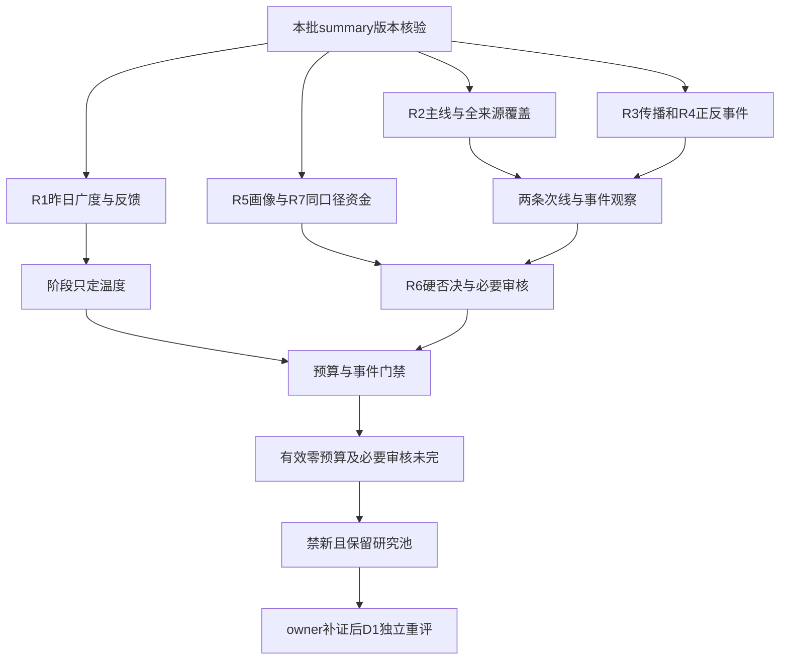

<!-- canghai:explicit-plan-report-assembly:v1 -->
# 显式组装报告（非重新推理）

> 决策来源（JSON）：llm
> 同版 JSON SHA-256（规范化内容）：fc2ec35c46721d677f4a058723d54cad718af4c649cf5e3ce5bee9fb8a79c38f
> 以下散文为调用方提供的模型原文，完整保留、未经重新推理；原文自述不是来源验证，不得覆盖 JSON 禁令、权限或缺口。
> 表格直接复用既有共享 renderer；只读展示，不构成开仓或自动交易授权。

## 模型原文（非重新推理）

---
date: 2026-10-30
agent: D1-main-decision
skill_version: main_decision_v1@1.9
generated_at: 2026-10-30T09:30:19+08:00
confidence: null
degraded: true
decision_source: llm
mode: dry_run
production_ready: false
research_completion_passed: false
reassessment_required: true
execution_count: 2
watch_count: 6
research_anchor_count: 15
data_sources:
  - name: research_summary_and_bound_R1_R7
    path: data/research/20261030/research_summary.json
    status: ok
    captured_at: null
    record_count: 7
  - name: attention_bound_snapshot
    path: data/research/20261030/attention_signals.json
    status: error
    captured_at: null
    record_count: null
    error: unavailable_at_binding_not_read_as_no_risk
  - name: emotion_bound_snapshot
    path: data/research/20261030/emotion_cycle.json
    status: partial
    captured_at: null
    record_count: 1
input_freshness: partial
input_freshness_note: 行情主要截至10月29日；博盈最后成交10月16日；R7外盘仅28日而R4另有29日隔夜事件；人气绑定缺失，情绪版本冲突未解，不冒充今日盘中数据。
---

# 2026年10月30日 · 主决策 / D1 盘前预案

## 本次修订：执行候选＋观察买卖点

这是同批盘前资料的价位修订，不是新增盘中结论。原版“不开仓便全票不给价、执行候选清空”已纠正。优先候选沪工、传智；其余六票观察。全部暂不开仓、实际买权0；候选不等于已审可买。价位单位元，最高接受价均为下表买区上沿；止损/止盈仅绑定该拟买情景，新仓T+1生效，不是未知底仓卖出指令。

| 对象 | 来源日期/场景状态 | 条件买区 | 确认价 | 最高接受 | 止损(T+1) | 止盈/2R |
|---|---|---|---|---|---|---|
| 上海沪工 603131.SH | 20261029/执行候选·待补证/暂不开仓 | 15.87—16.19 | 15.95 | 16.19 | 15.38 | 17.81 |
| 传智教育 003032.SZ | 20261029/执行候选·待补证/暂不开仓 | 9.49—9.68 | 9.54 | 9.68 | 9.20 | 10.64 |
| 中国卫星 600118.SH | 20261029/观察·多次开板战术禁止保留 | 59.42—60.62 | 59.72 | 60.62 | 57.59 | 66.68 |
| 文投控股 600715.SH | 20261029/观察·三进四/多次开板禁止保留 | 2.26—2.30 | 2.27 | 2.30 | 2.18 | 2.54 |
| 普冉股份 688766.SH | 20261029/观察·远端恢复情景，非今日可买区 | 426.74—435.31 | 428.88 | 435.31 | 400.49 | 504.95 |
| 三花智控 002050.SZ | 20261029/观察·行业级负面仍阻塞 | 36.66—37.40 | 36.85 | 37.40 | 35.53 | 41.14 |
| 博盈特焊 301468.SZ | 20261016/历史情景·10月16日旧价，复牌未核 | 33.92—34.60 | 34.09 | 34.60 | 31.83 | 40.14 |
| 上海洗霸 603200.SH | 20261029/观察·远端恢复情景，非今日可买区 | 57.81—58.97 | 58.10 | 58.97 | 56.02 | 64.87 |

普冉/洗霸为远端20日高恢复情景，不是今日可达性证明；近端结构恢复位详见下文。博盈全部数字仅截至10月16日的历史情景，不适用今日复牌报价。中国平安B温度计仅有53.20收盘，缺完整技术载荷，不编造买卖价。全部仍受no_trade、零预算和R6必要审核未完限制。

## ⚠️ 一句话结论与不交易条件

**今天不开新仓；保留航天、短剧及财报事件研究，等补证与独立重评，不用反弹想象恢复零预算。**

本报告是当前会话独立完成的LLM裁决，不是Python量价兜底。`decision_source=llm`，但“有LLM产物”不等于“研究完成”。本版是安全临时交付：`dry_run / no_trade=true`，自动交易关闭，要求人工确认；研究未就绪，必须重评。优先执行候选2只（待补证/暂不开仓），完整画像观察池6只，另保留15只来源明确的纯研究锚，4只非R6新增买入拦截。有效新增交易预算0%，不是“先给20%试仓”。

| 条件 | 当前状态 | 约束与来源 |
|---|---|---|
| 有效零交易预算 | 已命中 | R1与R2明确保留零预算；研究上限不转换为账户买权 |
| 可交易主线未确认 | 已命中 | R2主线为空，两条次线仅供研究，资金/催化未形成完整共振 |
| R6必要审核未完成 | 已命中 | 8个真实对象局部审查，必要审核完成0；空硬否决清单不是通过 |
| 主研究未就绪 | 已命中 | summary保留R2/R4契约失败及各角色降级，不自行抹掉 |
| 未来三交易日事件扫描 | 未完成、保留禁新 | 本轮未授权日历旁路，不把“未读”写成“没有大事件” |
| R1低于0.4 | 未命中 | 实际0.44625；degraded不是数值低于0.4 |
| R7整体不可用 | 未命中 | 实际partial，T-1主力和龙虎榜可用；北向不参与此门禁 |
| fetch严重度≥3 | 未命中 | 实际2，不夸大为基础设施全面失效 |
| 用户出行/假期 | 未知 | 本轮没有该类授权输入，未知不填成无 |

既有持仓、卖出保护和T计划没有被本报告暂停或推翻。没有读取账户，不能将其解释为零持仓，更不能凭新增预算为零要求一次性清仓。`risk_limits`目标0仅用于本版禁新，不是给未知持仓下卖单。

## 🧭 从市场到主线：弱的是接力环境，不是所有研究都没价值

R1给出的风格是震荡分化，情绪是**10月29日的主跌背景**，不是已经观察到10月30日开盘继续主跌。主源非ST涨停39、跌停41、炸板25，炸板率39.0625%，最高4板。5570条日线中781涨、4728跌、61平，中位涨幅为-2.599%。更关键的不是“还有39家涨停”，而是前日72只收盘涨停股在29日72/72匹配后平均反馈-0.9373%、中位-2.3998%；这里是**收盘反馈，不是开盘溢价**。涨停与下跌广度同时出现，说明少数强股的赚钱效应尚未扩散成普遍接力环境。

绑定的辅助情绪快照仍标高位震荡，溢价+1.89%，指标日期同为29日。两者冲突必须原样保留。D1采用R1可追溯全池负反馈作为保守温度依据，但不宣称已经证明快照的+1.89%必然计算错误，因为开盘/收盘及样本定义还需要owner核对。本轮不重算快照，不修绑定，也不读取后来可能补来的同名文件。阶段只定温度；今天若新证据出现，仍需进入计划owner重评，而不是把昨日阶段当永久禁研政策。

R7与上述弱接力环境方向一致：29日大盘主力净额-698.36054528亿元，五日-1215.066918亿元。四只ETF二级订单净额合计约-46.06亿元，不能冒称一级净赎回；28日份额变化代理与29日真一级申赎是两回事。IF2611与沪深300同日收盘差为-31.4376点，只是带成本影响的基差事实，不是对今日跌幅的预测。北向缺口仅复盘参考，不计分子或分母，不产生禁新或降仓。

本批R1的研究参考上限20%已经包含它对广度、反馈和数据缺口的保守判断。D1不再把主跌0.4倍、主线数量0.7倍、旧公式20%下限串起来机械算一遍，更不会让下限覆盖零预算。本轮真正有效的是`min(研究参考20%,既有有效预算0)=0%`。这不是“不敢决策”，而是明确区分研究温度、账户预算与逐票资格。

## 🛰️ 公共板块判断：航天有局部合力，短剧有传播，不等于同轮主升

### 商业航天：沪工列待补证执行候选，卫星观察；不借窄行业净入替代宽概念

R2商业航天为次线，序数分66，11家概念涨停；R3主题传播与热榜交叉为L1+L2。但同口径东财概念当日-18.988992亿元、五日-123.45112064亿元；R7航天装备Ⅲ当日+10.00102768亿元、五日+10.918865亿元，覆盖集合更窄，不能拿来抵销宽概念流出，更不能把Ⅱ/Ⅲ相同资金重复相加。

- **大资金意图**: 更接近局部容量与身位试探，而非整个商业航天概念已获持续增量配置。中国卫星的单票净入有事实支持，但仍不能推断资金从科技完整迁移到航天。
- **为什么走强**: 上海沪工2板零开板与中国卫星容量首板有辨识度，11家涨停给出局部助攻；宽概念仍跌、仍流出，强股与弱板块必须同时解释。
- **逻辑够不够硬**: 热度与身位较硬，主线启动催化、实际轮次起点、持续1/3/5日和板块封板率均未核齐。R2的age、round、event时点为空，不能把供应商榜单days=1当行情首日，更不能把conditional示例当正式formation。

公共重评条件是：同口径商业航天主力净额转正、至少2只首板/二板封住、原前排地位保持。这个条件只触发补证与重评，不解除R6、有效零预算、买点或用户授权。宽概念继续流出或身位丢失，则不升级；不据此对未知持仓自动卖出。

### 短剧游戏：传智列待补证执行候选，文投观察；分开“教育业绩修复”和“短剧利润兑现”

R2次线序数分52、4只概念涨停，R3也是L1+L2；但概念当日-15.9527824亿元，五日仅+0.29012624亿元，不能称持续主升。文投3板是组内高度，传智早封首板是另一种身位，不能以低价或首板模板为由自动替换原龙一。

- **大资金意图**: 可能试探AI内容商业化与局部低位题材；未证明存在从硬件向传媒的持续资金搬家。
- **为什么走强**: 文投热榜与三板高度、传智早封和业绩修复提供局部辨识度；掌阅等同题材表现弱、概念资金负，使“一致性”不足。
- **逻辑够不够硬**: 即梦工作室上线在10月26日已有传播，不是29日晚全新催化。产品事件不能直接推出文投或传智新增收入；主业映射、行情轮次与封板率仍未知。

公共升级条件仍是同口径概念资金转正、首二板扩散与前排承接同步，而非只有某只股封板。所有票沿用R2的原角色，最终观察身份不冒充上游角色重判。仅使用“首板隔日”一套研究模板，不混用总龙锁仓、三格、树干或分歧接力。

## 🧩 四象限叉乘与消息打击面

主四象限沿用本批R6定义：**市场情绪强/弱 × 同日个股大单加超大单净入/净出**。净额是资金符号，不是强弱幅度，更不是机构身份认证。情绪轴是市场级，不能拿股价涨停替代市场强。所有事实窗口均为29日，博盈例外为旧成交日，故不硬塞入象限。

| 象限 | 本批落点 | D1裁决 |
|---|---|---|
| 情绪强×资金净入 | 无已确认落点 | 不为了填满四格把T-1弱市改成强市；仅保留未来修复剧本 |
| 情绪强×资金净出 | 无已确认落点 | 如未来出现，研究兑现/分离，不预先赋予已发生事实 |
| 情绪弱×资金净入 | 沪工+0.833552、卫星+6.446159、传智+0.754024、洗霸+0.050120亿元 | 局部逆势资金不等于主升核心；洗霸还有跨源冲突与亏损，不做自动加分 |
| 情绪弱×资金净出 | 文投-0.275570、普冉-0.633497、三花-2.275403亿元 | 财报/题材利好不足以替代接力；维持降级观察 |
| 未能分格 | 博盈 | 最后成交10月16日，停牌零流量是占位，不是当前净出为零、无抛压或资金平衡 |

表中金额引用R6逐票叉乘，其底层为R5大单+超大单。中国卫星另有R7东财+6.640085亿元及XTick约+10.8727亿元，方向相同但阈值口径不同，不能平均或相加。沪工、文投、洗霸当日跨源冲突仍在；传智当日方向一致，不抹掉其五日内曾有跨源冲突。五日累计正也不能掩盖当天负反馈。

另一个常见四格是“高位/低位×利好/利空”：高位利好先查兑现，低位利好查预期差，高位利空查杀估值，低位利空查是否真正洗盘。这只是检验问题，不是本轮分类结果。本批缺绝对高低位与行情轮次共同基准，8票该投影均保留unknown；不能从MA位置、连板高度或消息极性臆造已核轮次高低。

R4的15方向×8核心事件共120格也保留在JSON中，原正负传导推断与强度不被D1重算成收益概率。海外科技下跌为行业级风险，命中存储/液冷等；新易盛Q3净利环比-19.07%又是光模块板块负面。普冉Q3环比+26.50%、扣非约7.20亿元是公司正面，不能覆盖海外行业负面；武汉液冷工程落地也不能证明三花是该项目供应商。欧方贸易限制仍为拟议条件风险，不夸大成已执行制裁。

更重要的相反证据不能删：新易盛深夜IR给出Q4交付准备与2027年NPO订单指引，属于独立正面，不与Q3负面合并为“全利空”。但指引不是已确认收入，行业负面与当日买点也未反证，所以本轮仍拦截新增，不宣布R6硬否决。上海洗霸的北京规划正面和公司Q3亏损、现金流压力同样并列；政策不是订单，不能用远景抹掉公司反证。

## 🔍 八只画像票：执行候选与观察分列，交易许可仍全部关闭

八只均给出有来源的数值情景；沪工、传智列优先执行候选·待补证/暂不开仓，另六只留观察。候选池不是成交池，也不是已审可买档。所有规则仓位0%、自动交易false、trade_authorized=false；核心/R6未完成保持未知，价格RR通过不代表资格通过。

### 1. 上海沪工 603131.SH（商业航天）——执行候选·待补证/暂不开仓，原R2龙一

- **大资金意图**: 二板零开板说明局部资金愿意维持身位，但宽概念持续流出，不能解读成产业资金全面认可。
- **为什么走强**: 两板突破短期箱体，29日收15.95，MA20为13.5705、MA60约14.2782；5日涨21.9419%。只是价格修复强，周线仍处长期回撤修复。
- **逻辑够不够硬**: 2板/零开板有客观依据，R2龙头过滤通过计数1，不等于全部开仓资格通过。航天敞口不能用焊接主业替代，归母正而扣非负削弱主营兑现。

**买入理由**：仅列未来可能重评的研究依据：一是二板零开板的组内辨识度；二是概念11家涨停的局部助攻。原龙一身份保留，列为待补证执行候选，但财务/晋级风险未解，不因“龙一”二字授予买权。

**风险点**：二进三有晋级尾部风险；R6_M9_01风险采纳，候选展示层覆盖另有记录。F6提示累计归母0.1159亿元而扣非-0.1584亿元；F8现金流红旗按R6_M7_02保留，展示层覆盖不解除风险。半年度与前三季度是重叠累计期，不能写成连续两个独立单季现金流负；也不能据此自创硬否决。

**止损条件**：本票条件拟买区15.87—16.19，确认价15.95，最高接受16.19；止损15.38按拟买上沿而非昨收推导，2R止盈17.81。新增仓最早T+1生效，未知底仓不编造当日可卖；触价不能保证退出。数值情景已补；R6正式审核、核心、主线、T+1尾部风险和有效预算仍未通过；当日交易所涨跌停边界未核。

**可验证假设**：未来1—3交易日，商业航天同口径净额>0且至少2只首二板封住，本票保持前排身位，再提出升级复核；任一缺失不升级。该票完整禁止清单/核心计算/RR仍未完成。

### 2. 传智教育 003032.SZ（短剧游戏）——执行候选·待补证/暂不开仓，原R2龙二

- **大资金意图**: 早封首板与当日净入支持短线试探，不证明筹码锁定；股东户数增加75.0311%反而提示筹码扩散。
- **为什么走强**: 29日首板、零开板，收9.05，收复MA20 8.464，但未收复MA60 9.818，5日+16.6237%；不能命名为已确认主升浪低吸。
- **逻辑够不够硬**: 收入、扣非与现金流修复有财报支撑，教育主业到短剧利润的映射没有证据。R5核心纪律通过计数0，不凭早封补齐资格。

**买入理由**：研究理由有两条：首板早封零开板符合本轮模板验证对象；收入及扣非修复比纯题材口号更实。研究分开教育基本面与短剧标签，不将一种利润解释偷换成另一种。

**风险点**：股东户数约+75%及部分资金源冲突；缩量首板且MA60未收复。R6_M1_04关于主业映射与筹码的反证采纳，不能因为财报改善就宣称风险已解。

**止损条件**：本票条件拟买区9.49—9.68，确认价9.54，最高接受9.68；止损9.20按拟买上沿而非昨收推导，2R止盈10.64。新增仓最早T+1生效，未知底仓不编造当日可卖；触价不能保证退出。价格已算；上沿距昨收超过5%的原节点限制仍保留，RR=2不等于交易资格通过。R6、主线、核心和零预算未解除。

**可验证假设**：未来1—3交易日维持MA20上方、同题材至少2只首二板封住且概念净额转正，再申请独立重评；短剧收入仍需公司原始披露，不能用市场热榜替代。

### 3. 中国卫星 600118.SH（商业航天）——降级观察，原R2容量龙二

- **大资金意图**: 单票容量承接有实据，但5日仅2天东财净入，不能由最后一天大单涌入断言持续机构建仓。
- **为什么走强**: 29日收55.90，放量首板收复MA20 52.7455，仍低于MA60 58.295；8次开板是同时存在的硬弱项，不能被快照末端缩量解释成全日一字。
- **逻辑够不够硬**: 卫星业务直接，产业映射比泛概念实；但低ROE、高PB与应收回款压力构成真实反证。R5纪律通过计数0，容量不等于龙头资格。

**买入理由**：只保留直接卫星业务和单日资金/量价对应两条研究依据，引用航天公共条目，不复制成“全板块已确认”的逐票结论。

**风险点**：8次开板触及多次开板战术拒绝标准；R6_M7_01强建议完整采纳。期末应收/前三季收入83.85%不是周转天数；F8累计现金流问题仍需定义与财务合规审核，不因同比盈利增长清除。

**止损条件**：本票条件拟买区59.42—60.62，确认价59.72，最高接受60.62；止损57.59按拟买上沿而非昨收推导，2R止盈66.68。新增仓最早T+1生效，未知底仓不编造当日可卖；触价不能保证退出。数值已给，8次开板及正式审核未完不解除；上沿超原昨收±5%节点带，交易所当日边界未核。

**可验证假设**：1—3交易日宽概念至少一日转正、本票站稳MA20且开板次数由8下降到不超过2，只触发承接复核；完整买点、R6与预算仍独立，不将弱转强设想当已发生。

### 4. 文投控股 600715.SH（短剧游戏）——降级观察，原R2龙一

- **大资金意图**: 29日龙虎榜净卖约1.05亿元、同日大单+超大单净额负；更需要研究兑现，而不是把三连板当资金锁仓证明。
- **为什么走强**: 收2.27，三连板加速且高于MA20 1.781、MA60约1.6953；但6次开板，强K线与弱承接可以同时成立。
- **逻辑够不够硬**: 组内高度最高是真的，短剧新增利润未证实也是真的。R5纪律计数1不等于完整资格；亏损与PS高分位不能因股价低而被忽略。

**买入理由**：保留三板身位与真实游戏业务两条研究线索；本轮模板仅研究首二板机会，不将三进四改写成新的接力模板。保留原龙一而不默默用龙三补位。

**风险点**：三进四尾部、6次开板、负扣非及当日兑现并存；R6_M9_02 strong_suggest采纳。五日累计正不覆盖当日负，历史单日榜和三日榜也不能相加。

**止损条件**：本票条件拟买区2.26—2.30，确认价2.27，最高接受2.30；止损2.18按拟买上沿而非昨收推导，2R止盈2.54。新增仓最早T+1生效，未知底仓不编造当日可卖；触价不能保证退出。数值情景已给；多次开板与主跌高位接力限制、R6强建议不解除。

**可验证假设**：未来1—3交易日概念资金仍负，或本票再次开板≥4次，维持降级；即便满足改善，也仍需完整审核和零预算重授权，不靠反包自动放行。

### 5. 普冉股份 688766.SH（存储芯片）——降级观察，财报硬而右侧未成

- **大资金意图**: 五日大单累计可正，但29日净额-0.633497亿元，融资回落和股东户数增加70.4521%不支持“已经机构抢筹”的叙事。
- **为什么走强**: 目前不能说趋势走强：收270.50低于MA5 278.938、MA20 308.393及MA60约369.8192，20日回撤37.239%；财报改善和价格承接尚未同向。
- **逻辑够不够硬**: Q3归母约7.2816亿元、扣非约7.2004亿元、环比约26.50%相对硬；SHM并表不能冒充全部内生增速，更不能跳过海外AI链利空。

**买入理由**：仅研究扣非兑现与产品周期改善两点，不做左侧抄底。R2只称事件研究对象，D1不补造龙头身位。

**风险点**：并表与周期利润不可线性外推；股东扩散、均线下行、海外行业级负面E001仍有效。完整图像证据本批缺失，不伪称已看图。

**止损条件**：本票条件拟买区426.74—435.31，确认价428.88，最高接受435.31；止损400.49按拟买上沿而非昨收推导，2R止盈504.95。新增仓最早T+1生效，未知底仓不编造当日可卖；触价不能保证退出。原通道20日高远离现有收盘；保留数值与距离失败，不改用昨收冒充高点。行业级负面、节点带和正式审核仍阻塞。

**可验证假设**：未来1—3交易日收盘回MA5以上、量能不低于此前5日均量、同口径资金转正，才重审右侧；产品现货、一致预期、并表拆分仍须补证。

### 6. 三花智控 002050.SZ（液冷热管理）——降级观察，供货事实不等于项目归属

- **大资金意图**: 29日大单净出-2.275403亿元，与融资回落共同限制主动加速解释。
- **为什么走强**: 收34.50虽高于MA20 33.68645，仍低于MA5 34.738、MA60约35.646；短期修复不等于主升持续。
- **逻辑够不够硬**: IR确认一次侧与CDU零部件批量供货，但武汉具体项目供应商未核；传统制冷业务比例不能冒充液冷收入比例。

**买入理由**：保留实际CDU零部件供货与传统主业现金流底座两点研究依据，不把供应链想象写成已获武汉订单。

**风险点**：项目归属缺证、资金出与海外行业级利空E001叠加；R5图像缺口仍在，不能用机器人故事替换液冷原逻辑。

**止损条件**：本票条件拟买区36.66—37.40，确认价36.85，最高接受37.40；止损35.53按拟买上沿而非昨收推导，2R止盈41.14。新增仓最早T+1生效，未知底仓不编造当日可卖；触价不能保证退出。数值已补；原行业负面、项目归属、节点带、R6和零预算限制均保留。

**可验证假设**：未来1—3交易日需要公司/项目方确认具体供应商、收盘重回MA5、资金转正才重评项目映射，不能只等其中一个条件成立就买。

### 7. 博盈特焊 301468.SZ（海工并购）——降级观察，旧价不做今日买区

- **大资金意图**: 停牌零流量只是无交易占位；期间融资下降不能转成“无抛压”或新买盘。
- **为什么走强**: 复牌预案有时点，但本批最后真实成交10月16日28.14，尚无今日价格确认，不能声称已经复牌走强。
- **逻辑够不够硬**: 拟购罗克莱55%股权、暂估4.95亿元是真实预案；审计评估、审批和新增股本摊薄仍未落定。

**买入理由**：同源技术并购原始预案与明确复牌安排是两条可核研究依据，复牌后的溢价只能事后验证，不能按旧价预支。

**风险点**：旧价、复牌跳空、审批和摊薄；主业扣非弱。R6不把停牌前5个有效日当最近5个交易日出货审核完成。

**止损条件**：本票条件拟买区33.92—34.60，确认价34.09，最高接受34.60；止损31.83按拟买上沿而非昨收推导，2R止盈40.14。新增仓最早T+1生效，未知底仓不编造当日可卖；触价不能保证退出。复牌未核、旧价与审批摊薄风险不解除；已给标明日期的历史数字，不冒充10月29日或今日可成交。

**可验证假设**：今日复牌后先记录真实成交与换手；若一字无法换手或没有有效成交，不升级。此为后续owner补证义务，不是本轮D1获准现场抓数。

### 8. 上海洗霸 603200.SH（固态电池/储能）——降级观察，不用规划替代回款

- **大资金意图**: 当日微正净额+0.050120亿元与资金口径冲突并存，不能说机构锁仓。
- **为什么走强**: 收47.02低于MA5 48.356及MA20 48.2115，中期MA60约42.0723未完全破坏；这是高波动回撤，不是已确认强势低吸。
- **逻辑够不够硬**: 北京能源规划、0.5GWh与500吨项目计划有出处，但不是公司合同或已实现收入，新能源材料敞口也不等于全公司固态纯度。

**买入理由**：只研究新材料项目可核进展与前期市场注意力，继续检验“政策→订单→回款”链，不提前把计划产能并入盈利。

**风险点**：归母/扣非亏损、经营现金流负、股东增加33.879%及应收压力；10月21日跌停为真实反证，不用宽泛政策洗白。

**止损条件**：本票条件拟买区57.81—58.97，确认价58.10，最高接受58.97；止损56.02按拟买上沿而非昨收推导，2R止盈64.87。新增仓最早T+1生效，未知底仓不编造当日可卖；触价不能保证退出。20日高远端情景与近端恢复参照分开；节点带、亏损/现金流、项目回款及正式审核仍阻塞。

**可验证假设**：未来1—3交易日仍无公司订单/投产原始披露且收盘不能回MA20，保持降级；后续财报需要扣非与经营现金流改善，不靠新闻重复转载过关。

## 🛡️ R6如何消费：硬否决零条，不代表审核零缺口

合并summary硬否决清单与R6硬否决/反证中的hard_reject后，本批仍为0，实际从执行池剔除0只。这个数字只代表没有落盘有效硬否决，不代表8票全部安全。R6实际局部审查8票、17条反证，正式必要审核完成0票，`formal_review_completed=false / review_passed=false`。R6是唯一hard_reject来源；D1的战术/资格拦截不冒名为R6硬否决。

4条strong_suggest的风险均保留；沪工两条仅对候选展示层显式覆盖，绝不升级交易资格：卫星F8/应收、沪工F8/扣非质量，及沪工、文投晋级尾部风险。中国卫星和文投多次开板还分别达到8次、6次，符合战术层拒绝多次开板买入的既有纪律；这与不硬判“已确认出货”不矛盾。襄阳轴承、 小崧股份按R2非前排拦截，新易盛、湖北广电按R4负面拦截，4条均明确**不是R6 hard_reject**。

必要缺口应交回具体owner：R3缺逐对象/精确板块出货alert覆盖；R4对四只次线票缺精确催化或明确已检查无催化结果；R7除中国卫星外缺同票适用资金分支；R5尚缺F1/F3/F4/F5/F7/F10/F11/S2/S3等财务合规分支，R6需据补证完成必要审核。R5有资金不能被D1偷偷改称R7已审，接口未列名也不等于明确false。历史类比与昨日兑现属于辅助缺口，不把没有历史权限升级成“所有研究都失败”。

## 🔢 价位推导、竞价与T+1：不开仓也正常给价格

此次纠正的是原版“禁新→不选价格情景→全票无价”的错误推论，不重跑研究。原版于07:16交付确实未提供价位；新生成时点见本版元数据。这里是盘前资料的价位修订，非新增盘中结论；没有读取本次之后到达的行情、竞价或新闻。八票逐一选择原有leader_breakout右侧恢复情景，不让Python从均线猜通道，不把主跌修复偷换为抄底策略。沪工与传智因前排/早封及原画像依据列优先补证候选；卫星8次、文投6次开板不列可执行候选，普冉/三花行业负面保留，博盈旧价单列。沪工的强建议仅在“候选展示”层显式覆盖，财务/晋级风险与禁买不覆盖。

真实调用price_levels.derive及apply_to_plan，技术载荷取本版R5嵌入payload，未读数据库。MA10/MA50取R5明确值；20日高低取严格早于10月30日、正成交且OHLC有效的尾20根日K，不是30自然日。多数窗口9月24日至10月29日，博盈9月11日至10月16日。采用R5前复权口径，牛熊线原值null，不造线；本轮未认证当日报价最小单位、涨跌停及除权边界。8票+B四个出现项共12行，11行引擎成功，平安因无绑定R5技术载荷真实失败，未缺高点退回昨收。

统一公式：pivot=max(参考收盘,真实hi20)，买区=[pivot×0.995,pivot×1.015]，确认价=pivot。拟买基准=买区上沿；基础止损为其×0.95（20cm为×0.92），再与合法且低于买区下沿的MA10×0.99/熊线候选取高，原始与舍入后均须低于下沿；止盈按2R或引擎允许的前高。买区下沿只是价格区间，不允许在确认前先买。各票公式与精确技术事实一并保留在JSON。本轮不改公式凑通过。

引擎最高接受=pivot×1.07并不能保证RR。故本轮实际最高接受价收紧为买区上沿，止损/止盈不抬高；在此最高价独立重算RR=2.00。7%引擎边界仅作原值审计，不能拿计划RR借给更高委托价。理论2R不是当日目标，更不是胜率；近端套牢压力可能使目标无法到达。传智、卫星、三花等上沿超出原±5%节点带，继续保留未通过；普冉/洗霸远端情景不包装为当日可买，近端恢复观察优先看各自MA5/MA20与昨高。

### 上海沪工：执行候选·待补证/暂不开仓

二板突破已有箱体、零开板；选择原leader_breakout确认情景，不用远离现价的MA50冒充低吸。候选只代表优先补证；财务与晋级强建议仍不允许买。 数字来源20261029。pivot=max(昨收15.95, 20日高15.95)=15.95; 买区=[pivot×0.995, pivot×(1+1.5%)]; 溢价上限7%；止损=买价×(1-5%) → 15.38（三者取最高: 买价×(1-5%)=15.38, MA10×0.99=13.56）；2R目标 = 买16.19 + 2×(买入价-止损0.81) = 17.81；RR=(17.81-16.19)/(16.19-15.38)=2.0。MA10=13.695，MA50=14.0836，hi20=15.95，lo20=12.37；牛/熊线缺失。实际最高接受16.19，RR=2.00；引擎原最高接受17.07处RR=0.44，不可混用。有效窗口：20261030 09:30-11:30，盘前资料情景，非盘中确认。失效：若后续收盘重新跌回本轮突破前箱体且同口径概念资金仍负，撤销突破研究假设；不是卖出委托。 未确认突破、买价超过最高接受价、板块无承接或审核未齐均不执行。

### 传智教育：执行候选·待补证/暂不开仓

首板早封且财报修复；选择突破9.54套牢压力情景，不把超跌反弹称主升回踩。 数字来源20261029。pivot=max(昨收9.05, 20日高9.54)=9.54; 买区=[pivot×0.995, pivot×(1+1.5%)]; 溢价上限7%；止损=买价×(1-5%) → 9.20（三者取最高: 买价×(1-5%)=9.20, MA10×0.99=8.10）；2R目标 = 买9.68 + 2×(买入价-止损0.48) = 10.64；RR=(10.64-9.68)/(9.68-9.20)=2.0。MA10=8.18，MA50=9.621，hi20=9.54，lo20=7.26；牛/熊线缺失。实际最高接受9.68，RR=2.00；引擎原最高接受10.21处RR=0.43，不可混用。有效窗口：20261030 09:30-11:30，盘前资料情景，非盘中确认。失效：若后续收盘再度跌回MA20下方，或公司证伪短剧关联，撤销题材升级假设；不临时切换为教育长线故事。 未确认突破、买价超过最高接受价、板块无承接或审核未齐均不执行。

### 中国卫星：观察·多次开板战术禁止保留

8次开板不适合追板；仅研究重越20日高的结构恢复，明确保持战术禁止。 数字来源20261029。pivot=max(昨收55.90, 20日高59.72)=59.72; 买区=[pivot×0.995, pivot×(1+1.5%)]; 溢价上限7%；止损=买价×(1-5%) → 57.59（三者取最高: 买价×(1-5%)=57.59, MA10×0.99=50.84）；2R目标 = 买60.62 + 2×(买入价-止损3.03) = 66.68；RR=(66.68-60.62)/(60.62-57.59)=2.0。MA10=51.352，MA50=57.37，hi20=59.72，lo20=48.1；牛/熊线缺失。实际最高接受60.62，RR=2.00；引擎原最高接受63.90处RR=0.44，不可混用。有效窗口：20261030 09:30-11:30，仅观察结构恢复。失效：若后续收盘失守日线MA20且宽概念净额仍负，撤销修复升级假设；财报应收和回款未改善则不升估值档。 未确认突破、买价超过最高接受价、板块无承接或审核未齐均不执行。

### 文投控股：观察·三进四/多次开板禁止保留

三进四及6次开板不合本轮首板隔日模板；只展示突破旧高的风险情景，不升级候选。 数字来源20261029。pivot=max(昨收2.27, 20日高2.27)=2.27; 买区=[pivot×0.995, pivot×(1+1.5%)]; 溢价上限7%；止损=买价×(1-5%) → 2.18（三者取最高: 买价×(1-5%)=2.18, MA10×0.99=1.82）；2R目标 = 买2.30 + 2×(买入价-止损0.12) = 2.54；RR=(2.54-2.30)/(2.30-2.18)=2.0。MA10=1.84，MA50=1.7044，hi20=2.27，lo20=1.58；牛/熊线缺失。实际最高接受2.30，RR=2.00；引擎原最高接受2.43处RR=0.44，不可混用。有效窗口：20261030 09:30-11:30，仅风险观察。失效：短剧变现若未出现公司正式证据且开板后不能维持前排，取消题材核心研究资格；禁止把低价当安全。 未确认突破、买价超过最高接受价、板块无承接或审核未齐均不执行。

### 普冉股份：观察·远端恢复情景，非今日可买区

下行趋势不做低吸；仅保留20日高突破恢复情景，远端不可当今日买点，同时列近端MA5/昨高/MA20。 数字来源20261029。pivot=max(昨收270.50, 20日高428.88)=428.88; 买区=[pivot×0.995, pivot×(1+1.5%)]; 溢价上限7%；止损=买价×(1-8%) → 400.49（三者取最高: 买价×(1-8%)=400.49, MA10×0.99=276.43）；2R目标 = 买435.31 + 2×(买入价-止损34.82) = 504.95；RR=(504.95-435.31)/(435.31-400.49)=2.0。MA10=279.226，MA50=370.7312，hi20=428.88，lo20=261.46；牛/熊线缺失。实际最高接受435.31，RR=2.00；引擎原最高接受458.90处RR=0.79，不可混用。有效窗口：20261030仅结构观察；远端价格情景不作当日委托。失效：后续1—3个交易日不能收复MA5且净额仍负则维持降级；后续产品价/扣非回落证伪基本面改善。 未确认突破、买价超过最高接受价、板块无承接或审核未齐均不执行。

### 三花智控：观察·行业级负面仍阻塞

主升未确认，选择20日高突破恢复情景，不以MA50附近等同合格低吸；行业负面不解除。 数字来源20261029。pivot=max(昨收34.50, 20日高36.85)=36.85; 买区=[pivot×0.995, pivot×(1+1.5%)]; 溢价上限7%；止损=买价×(1-5%) → 35.53（三者取最高: 买价×(1-5%)=35.53, MA10×0.99=33.32）；2R目标 = 买37.40 + 2×(买入价-止损1.87) = 41.14；RR=(41.14-37.40)/(37.40-35.53)=2.0。MA10=33.661，MA50=35.107662，hi20=36.845466，lo20=30.12；牛/熊线缺失。实际最高接受37.40，RR=2.00；引擎原最高接受39.42处RR=0.44，不可混用。有效窗口：20261030 09:30-11:30，仅结构观察。失效：若公司明确否认相关供货或股价收盘再失MA20，撤销右侧修复假设；不以机器人故事自动替换液冷逻辑。 未确认突破、买价超过最高接受价、板块无承接或审核未齐均不执行。

### 博盈特焊：历史情景·10月16日旧价，复牌未核

仅在10月16日冻结价格上研究20日高突破，复牌未核，不存在今日可执行价。 数字来源20261016。pivot=max(昨收28.14, 20日高34.09)=34.09; 买区=[pivot×0.995, pivot×(1+1.5%)]; 溢价上限7%；止损=买价×(1-8%) → 31.83（三者取最高: 买价×(1-8%)=31.83, MA10×0.99=28.37）；2R目标 = 买34.60 + 2×(买入价-止损2.77) = 40.14；RR=(40.14-34.60)/(34.60-31.83)=2.0。MA10=28.661，MA50=31.8528，hi20=34.09，lo20=26.26；牛/熊线缺失。实际最高接受34.60，RR=2.00；引擎原最高接受36.48处RR=0.79，不可混用。有效窗口：仅20261016历史情景；今日复牌未核，不适用今日委托。失效：预案取消、审计结果显著低于预案或审批未获通过即撤销协同假设；价格条件须由复牌真实数据重新推导。 未确认突破、买价超过最高接受价、板块无承接或审核未齐均不执行。

### 上海洗霸：观察·远端恢复情景，非今日可买区

高波动回撤且亏损，不新增抄底；仅保留20日高突破恢复情景并列近端结构线。 数字来源20261029。pivot=max(昨收47.02, 20日高58.10)=58.10; 买区=[pivot×0.995, pivot×(1+1.5%)]; 溢价上限7%；止损=买价×(1-5%) → 56.02（三者取最高: 买价×(1-5%)=56.02, MA10×0.99=49.01）；2R目标 = 买58.97 + 2×(买入价-止损2.95) = 64.87；RR=(64.87-58.97)/(58.97-56.02)=2.0。MA10=49.504，MA50=43.0046，hi20=58.1，lo20=36.54；牛/熊线缺失。实际最高接受58.97，RR=2.00；引擎原最高接受62.17处RR=0.44，不可混用。有效窗口：20261030仅结构观察；远端情景不作当日委托。失效：项目取消、延期或后续无公司订单/回款证据即降级事件映射；股价失守中期均线仅作为研究结构失效，不输出卖价。 未确认突破、买价超过最高接受价、板块无承接或审核未齐均不执行。

止损百分比仍按舍入后真数核对：传智9.20/9.68约-4.958678%、卫星57.59/60.62约-4.998350%，略浅于原-5%下限，节点检查保持未通过；不因四舍五入就自认证符合硬区间，也不改公式、抬止损或挪买区求过。

### 竞价情景与退出可行性

下面仅为盘前资料计算的预期阈值，没有读取今日竞价。普通票用参考收盘的-1.5%至+2%，超预期到+5%；20cm按1.2倍扩展。不是“已经观察到符合预期”，更不是这些价位都可买。

| 对象/来源日 | 不及预期 | 符合预期 | 超预期 | 过度高开 |
|---|---|---|---|---|
| 上海沪工/20261029 | <15.71 | 15.71—16.27 | >16.27—16.75 | >16.75 |
| 传智教育/20261029 | <8.91 | 8.91—9.23 | >9.23—9.50 | >9.50 |
| 中国卫星/20261029 | <55.06 | 55.06—57.02 | >57.02—58.70 | >58.70 |
| 文投控股/20261029 | <2.24 | 2.24—2.32 | >2.32—2.38 | >2.38 |
| 普冉股份/20261029 | <265.63 | 265.63—276.99 | >276.99—286.73 | >286.73 |
| 三花智控/20261029 | <33.98 | 33.98—35.19 | >35.19—36.23 | >36.23 |
| 博盈特焊/20261016 | <27.63 | 27.63—28.82 | >28.82—29.83 | >29.83 |
| 上海洗霸/20261029 | <46.31 | 46.31—47.96 | >47.96—49.37 | >49.37 |

不及预期不追；符合预期只核后续确认；超预期仍不得超过最高接受价；过度高开放弃。所有档位均保留no_trade和零预算，一字未开板不生成竞价委托。博盈上述竞价数值仅10月16日旧价演示，今日无可执行有效窗口。

新增仓当日不可卖，止损/止盈均标T+1；下一交易日竞价若已击穿风险位，应按真实可成交条件处理，不能承诺按参考价成交。真实成交价变化时重新计算RR与风险价，未知底仓不能套用当日卖出路径。没有账户和匹配cohort尾部数据，不编造持仓或恢复仓位；open_position/add_on_pullback/stop_loss_only仍为空仅代表本轮无买卖授权，不代表账户为空。

## ↔️ B计划与完整覆盖：备选是重评清单，不是秘密买单

R7对20个完整向量板块检验190对，`seesaw_pairs=[]`，没有满足20日相关<-0.6且相邻五日反转的配对。本轮不触发0.5/0.75统计对冲扣仓；也不把当天金融上涨自动定为已证实负相关。

A方向不及预期时有三套研究备选，但都不能绕过禁新：一是航天内部只核上海沪工身位与中国卫星承接，不能用容量净入掩盖宽概念流出和8次开板；二是金融温度计中国平安，依据R7保险Ⅲ当日+4.72059584亿元、国有大型银行Ⅲ+5.76705184亿元与单票净入，R2尚未认定其可交易主线/核心，不能因“防守”静态标签新开仓；三是博盈海工复牌事件，等真实成交与换手，旧价只给历史情景，不转今日买区。三方向合计4个出现项已点名，沪工/卫星/博盈与主表明确绑定同一价格情景。平安仅有R7 10月29日收53.20，缺R5日K/MA/20日高低，真实引擎失败，不能拿收盘退回假突破高点；仅温度计，无买区/止损/止盈，复权口径未核，等待原owner补技术资料。平安仍给预期竞价52.40—54.26、超预期至55.86（仅模型阈值，不是实测）；资金不再增强即撤销轮动假设。若B也弱，保持禁新，不临时另找票。

研究覆盖没有因零预算只剩这8票。R7其他9个资金锚——西部材料、中国平安、冰山冷热、五 粮 液、钧达股份、工商银行、顺灏股份、百亚股份、农业银行——完整保留在`research_anchor_only`，资金观测日29日，但没有R2核心身位与R5/R6逐票完成资格。名称“五 粮 液”保留上游原值，不擅自修token。R2已有的金螳螂、中京电子、魅视科技、天娱数科、欢瑞世纪5个未重复旧锚，以及龙三横店影视也保留，合计15个仅研究锚，不复制未校准默认score凑20只观察票。R2旧锚统计日期20日，0封单均值的零值语义未核，不当作真实无封单；其历史涨停次数也不是当前模板胜率。

本轮完整画像池兼容整数`score`只对本版R5的composite_score取整。R5催化/筹码/板块/估值/技术/机构权重为20%/25%/20%/10%/20%/5%，原始八个综合值55.65、53.75、52.10、51.25、45.80、37.35、37.25、33.50可以用已有维度复算，但它们只是证据强度序数分、缺口有保守扣分，不是收益/胜率。summary的trade_quality行仍unknown，原因是源对象缺明确YYYYMMDD研究日期；D1没有现场补上日期来冒称质量评分已经认证。R2的66/52是板块分，绝不改称个股质量分。

## 数据源审计

D1只读本批绑定主产物和两类授权辅助payload。下表对源调用的陈述来自同版角色正文/结构化字段，不表示D1再次直接调用，也未打开其证据locator指向的旁路文件。🟢表示相应事实可用，不表示研究整体通过；🟡表示缺口/延迟/语义限制；🔴标记有明确业务错误的调用，不笼统写MCP全面DOWN。

| 源与本批承载位置 | 事实日期 | 状态 | 具体审计与用途 |
|---|---|:--:|---|
| research_summary + R1—R7 input_manifest | 2026-10-30 | 🟢 | 当前run/attempt/receipt/hash核验成功；7份产物同批，不等于研究就绪 |
| user_preferences.yaml | 既有政策版本 | 🟢 | 只读政策，非另一批研究；实际仍限制920并禁ST，单票≤15%、单板块≤40%、最多5持仓 |
| Tushare daily/limit_list/limit_step，R1 | 2026-10-29 | 🟢 | 5570条日线；72/72前日涨停集合反馈，开盘/收盘口径明确区分 |
| XTick market_emotion，R1/R3 | 2026-10-29 | 🟡 | U39/D42/Z26/H4，按家数炸板40%；与主源39/41/25略异，不用raw_zbl=8.22替代炸板率 |
| 风格22篮子+20ETF，R1 | 2026-09-10至2026-10-29 | 🟡 | 1260格1258可用，6簇不等于6主线；缺两日不补零，不拉长窗口 |
| 公众号/匿名机构与交易群，R3 | 见R3传播窗口 | 🟡 | 83篇15feed仅辅助；五群本地历史远端同步未核，图片映射未读不判沉默；同文/作者去重 |
| WeFlow | 不适用 | 🟡 | 永久退役未调用，不能误报临时DOWN或用空表当无人讨论 |
| 同花顺/东财热榜，R3 | 2026-10-28至2026-10-29 | 🟡 | 本日盘前空榜不等于冷门；独立attention绑定缺失，不授权读其他历史人气快照 |
| R4新闻/公告/原始公司文件 | 见各事件首知/公告日 | 🟡 | 正反事件均保留；问财搜索TLS校验曾显式关闭，降低传输置信；转载不增加独立源 |
| 同花顺主营/行情官方OpenAPI，R4/R2 | 本批查询、报告期各异 | 🟡 | 受益池广查99仅返回15、定向4/4；部分主营未标报告期，制冷占比不是液冷占比 |
| R5 daily/adj_factor及财务/研报 | 2026-10-29及2026-09-30报表 | 🟡 | 多数81根日K，博盈72根截至16日；财务合规必要分支未全审，不能以无flags判安全 |
| R5已嵌入图像分析 | 截至2026-10-29 | 🟡 | 沪工/卫星/传智/文投4票有证据；三花/普冉/博盈/洗霸4票缺图，未冒称看过；周K30日标签非未来收盘 |
| Tushare市场/板块/个股资金，R7 | 2026-10-29 | 🟢 | 20日、板块9920行、资金6031原始条目；不是6031只上市股票，元/万元严格分开 |
| Tushare与vibe龙虎榜，R7 | 截至2026-10-29 | 🟢 | 五日431条及vibe75条披露；同底层不重复计独立源，单日/三日榜分开 |
| XTick hot_money，R7 | 截至2026-10-29 | 🟡 | 10票20日200记录，9/10同向、百亚相反；只做正向确认，不因无游资排票 |
| vibe大宗交易，R7 | 截至2026-10-29窗口 | 🟢 | 10票逐票实调，成功空记录不是未调，也不证明无减持 |
| 两融主备源，R7 | 2026-10-28 | 🟡 | 29日当时未到披露时点；百亚两源无记录，不能判零融资或非两融标的 |
| ETF二级/份额/IF2611，R7 | 2026-10-28至2026-10-29 | 🟡 | 二级资金与一级申赎分开；一级29日未知，份额仅28日，基差不当预测 |
| DataPro，R7 | 本批 | 🔴 | 实际业务4013订阅/席位错误；健康握手不等于查询正常，不叫全链source_down |
| vibe股票资金，R7 | 本批 | 🔴 | 10票ProxyError、缩2票重试仍失败；顶层ok不代表子项成功，记录call_failed |
| vibe问财，R7 | 本批 | 🔴 | access key未配置；不外推同花顺官方OpenAPI也坏，更不改凭据 |
| 外盘，R1/R7与R4 | 2026-10-28、2026-10-29 | 🟡 | R1/R7行情滞后28日；R4另有29日海外科技下跌事件，不反写前者为已拿最新收盘 |
| 北向，R7 | 参考用途 | 🟡 | 不参与置信度、禁新或机械仓位；未知不填neutral/0 |
| QMT账户/日历/错题/昨日观察旁路 | 未授权 | 🟡 | 本轮未读取，不写零持仓、无大事件、无错题或无人气；交具体owner |
| attention辅助绑定 | 2026-10-30绑定时 | 🟡 | unavailable，绑定时文件不存在；不补抓、不换日期、不重建绑定 |
| emotion辅助绑定 | 指标2026-10-29 | 🟡 | payload已取，high_chop/+1.89与R1 main_down/负反馈冲突，采用与缺口均已说明 |

三态尤其要区分：R4运行时R3/R7最终产物尚未落地，是`not_yet_landed`，今天D1已消费当前最终七份产物，不能继续把它们写成不可用；vibe代理报错是`call_failed`，未实测源端持续宕机不写`source_down`。只有绑定时缺失的attention仍维持缺口，后来是否出现不在本轮补读范围。

## 🧪 未完成项、反证与交付含义

本轮没有把“R2主线为空导致cross_validation校验失败”机械等同于“R2没研究”：它已有59个来源标签覆盖、两条次线和八个对象，全部有用证据被保留。R4被summary报缺top_pick_logic/止损，其中部分对象本来就是风险映射而非首推；D1不把这类契约适用性问题再包装成经济风险。但本轮也不能替研究owner抹掉失败回执。更重要的是独立于这些契约问题，R6的逐对象必要审核仍真实未完，零预算仍真实有效，今日不交易不能仅靠修改校验文字推翻。

未完成义务逐项归属：研究主控核R2空主线与R4风险对象契约的适用性；R1/快照owner核溢价定义冲突；R3补出货覆盖与人气快照交付；R4补精确对象催化，日历需要另行明确授权绑定；R7补同票适用资金并保留北向新边界；R5补财务合规及图像/博盈真实复牌资料；R6再完成必要审核；D1在同版补证、预算授权和逐票门禁齐全后重评。检测程序发现修复只触发重判，不直接把30%/45%参考档位变成预算。

本轮有2只待补证执行候选、6只观察票，8只全保留。数值RR已计算，但core_judge、board_pattern、dragon_switch、forbidden_filter及正式R6均不伪报全通过。入候选名单不是获准执行；所有真正买入仍须独立通过原闸门、节点带、T+1尾部预算和用户授权。不以价格修复完成代替研究完成。

输出只包含指定JSON与本主MD。价位推导、模型完整原文和同版共享表格都在这里，不另写点位表、散文副本、价位推导文件或runtime。原文由当前模型亲自撰写，后附共享表格仅是最终JSON的确定性展示，不补价、不补判断。价位纠错完成不等于研究就绪或交易获准，平安技术不足及博盈旧价例外仍保留；本轮整体状态仍为**partial / 待补证重评**。

## 🌳 决策图

## 与其他 R/D/E 的关系

依赖仅为本批summary及其R1—R7、只读政策、实际绑定两类辅助。供P1/P2、execute和E1消费：P1/P2不得靠观察身份或B计划promote自动解禁；execute继续既有合法退出保护，不能从表格缺省值生成新买单；E1须区分未买、规则外机会与真实可执行却遗漏，不将没赚的钱自动记作失误。错题反馈只能交回原owner，D1不越权写纠错目录。

## Sub-Agent 元数据

- skill: main_decision_v1；无再次启动CLI、无委派、无额外模型决策会话。
- model: gpt-6.1-sol，当前D1会话是唯一决策者；Python仅核版本、价位资格和schema，不替代本轮综合裁决。
- run_id: 20261030T061042-77225-17596；研究summary实际生成于10月30日07:05，非按08:00标签倒推源时点。
- 主研究summary内容摘要: c7fb3bd258ebe63b745d9d93b48bd12819b889a7b38ef000999886acac6df8b6。
- input_manifest摘要: 2a84efbe7c92c10901c311d9d1f5ab43a74adc652c4a35f8d13515c4ba3c275e。
- 本轮真实生成时刻见frontmatter；这是已交付盘前资料的局部修订，非新增盘中结论；原07:16版本确实未给这些价位，行情/事件截止仍按冻结资料，不冒充实时。
- 08:30为observe_only交付目标，不强杀、不撤单、不清池；5000万token是连续任务努力目标，不是硬限/每日新额度。usage_unknown，不能当0，也不保证总用量低于目标。
- 研究与价位完成状态: partial；安全交付与来源核验不代替研究完成和交易许可。

- 本轮实测处理时长约638秒（从首次环境/输入核对计至定稿，不代表provider token计量）。

## 同版 JSON 共享表格（只读附录）

# 20261030 盘前预案 · 点位表版

> 计划生成时点：2026-10-30T09:30:19+08:00；决策来源：llm

## 板块机会总览

市场背景：T-1广度与涨停反馈弱，局部航天/短剧有辨识度却未确认主线；本次仅研究禁新。

> 先市场／板块效应，再个股地位；未提供关系证据不推断龙头带动或板块扩散。

| 板块／本轮行情 | 阶段／窗口 | 效应与延续 | 核心与梯队（上游标签） | 共振／分离证据 | 主／反向剧本（名单归属非关系证明） | 确认条件 | 共同失效条件 | 观测时点 |
|---|---|---|---|---|---|---|---|---|
| 商业航天 | ⚠️未给 | research_only_unconfirmed | ts_code: 603131.SH；name: 上海沪工；role: 龙一；ts_code: 600118.SH；name: 中国卫星；role: 龙二 | R2.secondary_lines[0].reason: 热度/涨停强但概念净流出，R4无已核正面启动事件；次线观察；R2.secondary_lines[0].capital_scope_audit: 大概念流出、窄行业流入；方向分化不是数据互相证伪，不累加、不用窄代宽 | 主剧本／执行；观察；反向：局部航天承接复核；触发 宽概念净额转正+至少2只首二板封住，才提出重评请求 | 仅重评触发：同口径概念净额&gt;0、至少2只首二板封住、身位持续；全局禁新及R6审核仍独立有效。 | 概念继续净流出、身位丢失或新事件证伪则不升级；研究窗口不冒充行情轮次。 | 20261029 |
| 短剧游戏 | ⚠️未给 | research_only_unconfirmed | ts_code: 600715.SH；name: 文投控股；role: 龙一；ts_code: 003032.SZ；name: 传智教育；role: 龙二 | R2.secondary_lines[1].reason: L1+L2与4只概念涨停支持观察，概念当日资金流出且内测叙事未独立实锤；R2.secondary_lines[1].capital_scope_audit: 五日微正不抵销当日净流出，不宣称持续主升 | 主剧本／执行；观察 | 仅重评触发：同口径概念净额&gt;0、至少2只首二板封住、身位持续；全局禁新及R6审核仍独立有效。 | 概念继续净流出、身位丢失或新事件证伪则不升级；研究窗口不冒充行情轮次。 | 20261029 |
| 存储芯片 | ⚠️未给 | ⚠️未给 | ⚠️未给 | 关系证据未给（概念归属不证明联动） | 观察 | ⚠️未给 | ⚠️未给 | ⚠️未给 |
| 液冷热管理 | ⚠️未给 | ⚠️未给 | ⚠️未给 | 关系证据未给（概念归属不证明联动） | 观察 | ⚠️未给 | ⚠️未给 | ⚠️未给 |
| 海工装备/并购重组 | ⚠️未给 | ⚠️未给 | ⚠️未给 | 关系证据未给（概念归属不证明联动） | 观察；反向：并购复牌独立事件；触发 复牌实际成交/换手出现后由owner补证，审批摊薄和跳空风险仍独立 | ⚠️未给 | ⚠️未给 | ⚠️未给 |
| 固态电池/新型储能 | ⚠️未给 | ⚠️未给 | ⚠️未给 | 关系证据未给（概念归属不证明联动） | 观察 | ⚠️未给 | ⚠️未给 | ⚠️未给 |
| 独立／关系未确认 | ⚠️未给 | ⚠️未给 | ⚠️未给 | 关系证据未给（概念归属不证明联动） | 反向：防守资金温度计，非已批准主线；触发 科技继续弱而金融同口径资金持续增强，只核轮动，不能直接买 | ⚠️未给 | ⚠️未给 | ⚠️未给 |

## 全局约束与数据边界

- 模式：dry_run；自动交易：False；需用户确认：True
- 总仓上限：0%；持仓上限：5；每日买单上限：0
- 单票上限：⚠️未给；单板块上限：⚠️未给
- 表格仅展示已给计划，不构成自动下单授权；观察／反向候选不自动晋级。候选数量不等于持仓名额。
- 评分未校准：未批准评分公式，不采用旧 score／默认50／板块分充个股分；原序展示，不另行排名。
- 静态价位非实时；数据日、复权／报价口径、有效期或动态线更新时间未给时均未核验，不以计划生成时间冒充价格时点。
- 新买入当日不可卖（T+1）；底仓是否可卖未核验。触发信号不保证可卖或成交。

### 研究与正式反证状态（仅展示）

> 未完成不等于已审否决；已阅读不等于正式评估；硬否决数仅为已应用清单条数，0不等于反证通过。缺字段显式未知，不从池数量或原因文字推断；本表不改变买卖权限。

| 指标（已有JSON字段） | 状态／数量 |
|---|---|
| 研究是否完成（research_completion_passed） | 未完成 |
| 正式反证是否完成（meta.r6_devil_advocate.formal_review_completed） | 未完成 |
| 正式反证是否通过（meta.r6_devil_advocate.review_passed） | 未通过（不等于硬否决） |
| 正式评估数（meta.r6_devil_advocate.candidates_evaluated） | 未知（未提供或类型无效） |
| 已阅读研究对象数（meta.r6_devil_advocate.research_objects_inspected） | 未知（未提供或类型无效） |
| 硬否决数（meta.r6_devil_advocate.hard_rejects_applied） | 0 |
| 生产就绪（production_ready） | 否 |
| 需要重评（reassessment_required） | 是 |

- 强制风控（原字段）：block_prefixes=920；block_st=True；max_orders_per_symbol_per_day=0；kill_switch_file=data/runtime/KILL_SWITCH

> 全局禁止开仓（no_trade）；研究与观察保留。

- 不交易条件 EFFECTIVE_ZERO_BUDGET：触发中／禁止开仓；R1.position_cap_derivation.effective_budget/R2.effective_trading_budget为0；D1无权恢复账户/用户预算
- 不交易条件 NO_CONFIRMED_MAINLINE：触发中／禁止开仓；R2.main_lines为空；两次线均资金/催化不充分；不是仅凭阶段清池
- 不交易条件 R6_NECESSARY_REVIEW_INCOMPLETE：触发中／禁止开仓；R6 formal_review_completed=false、review_passed=false，8票必要审核完成0；空hard_rejects不等于通过
- 不交易条件 RESEARCH_NOT_READY：触发中／禁止开仓；summary contract_checks_passed=false；R2/R4契约失败原样保留，不伪报全研究完成
- 不交易条件 EVENT_GATE_UNRESOLVED：触发中／禁止开仓；大事件日历未获本轮授权/绑定；R4已核事件可用，但未来3交易日完整扫描未知，不视无事件
- 不交易条件 R1_FAIL：未触发；R1置信度0.44625不低于0.4；不因degraded标签伪称R1失败
- 不交易条件 R7_STALE：未触发；R7 staleness_status=partial，主力及龙虎榜T-1可用；北向不参与门禁，不能把部分缺口定性为整体不可用
- 不交易条件 GLOBAL_SEVERITY_3：未触发；本批fetch_global_severity=2，未命中&gt;=3
- 不交易条件 USER_HOLIDAY：未知／未核验（不得视为已解除）；本轮未授权读取日历/账户等，不据未读判无出行；未知不填false

## 执行池（2 只）

### 执行池逐票说明

- 上海沪工 603131.SH：二板身位保留研究；焊接主业、扣非亏损与宽概念流出拦住执行。；二板突破已有箱体、零开板；选择原leader_breakout确认情景，不用远离现价的MA50冒充低吸。候选只代表优先补证；财务与晋级强建议仍不允许买。；有效预算0、R6必要审核未完。；状态 agent_candidate_pool；执行候选／交易资格仍依原门禁；单票上限 0%；逐票权限 auto_trade_enabled=False；requires_user_confirmation=True
  - 买入依据：10月28日三季报与两连板同处窗口，但扣非亏损；蓝箭/中科宇航中标候选新闻不能变成沪工卫星订单。；近5个有效交易日大单+超大单自算1.698344亿元；最新股东户数变化-0.8698%；资金同日跨源冲突=True。超大单驱动的局部题材试探较可信，但大概念净流出，三日异动榜的营业部与股通对手盘不能说成机构一致吸筹。；2026中报焊接与切割设备为收入主体，高端装备配套只占小部分且分部毛利为负；不得把整个收入映射商业航天。；截至20260930营收同比16.4072%，归母同比687.4258%；PEttm=None、PB=3.2551，不以低PE分位证明低估。；日线两板突破短期箱体并收复MA60，但周线仍在长期回撤修复；不是已确认主升低吸标的。 前复权MA5/20/60=14.106/13.570/14.278，有效日K=81。；近30日去重研报0篇，调研记录0条；不把投资者业绩会当机构调研。
  - T+1博弈（原判断）：消息解读: 10月28日三季报与两连板同处窗口，但扣非亏损；蓝箭/中科宇航中标候选新闻不能变成沪工卫星订单。；预期差判断: 研究理由一：2板且零开板，组内高度领先。理由二：概念11只涨停给局部联动样本；产业纯度仍不足，不是买入许可。；买点结论: 突破15.95并站稳后才研究；不在确认前承接下沿。R6、核心与预算未通过，禁止委托。；新增仓止损/止盈仅T+1参考，底仓未知；不发单。；短线结构标签: 龙一（上游研究身份，非交易核心认定）
- 传智教育 003032.SZ：首板早封加业绩修复可研究，股东扩散及教育到短剧映射缺证不放行。；首板早封且财报修复；选择突破9.54套牢压力情景，不把超跌反弹称主升回踩。；有效预算0、R6必要审核未完。；状态 agent_candidate_pool；执行候选／交易资格仍依原门禁；单票上限 0%；逐票权限 auto_trade_enabled=False；requires_user_confirmation=True
  - 买入依据：三季报收入与扣非修复可核；问财概念归属与教育主业并不证明短剧收入，研报标题的AI课程属于另一条业绩解释。；近5个有效交易日大单+超大单自算1.159056亿元；最新股东户数变化75.0311%；资金同日跨源冲突=True。首封早、零开板和大单方向偏正支持短线资金试探，但最新股东户数显著增加，不能简单推断机构集中。；2026中报主体是短期培训、学历教育，非短剧制作；须把教育基本面修复与短剧标签分开。；截至20260930营收同比61.3988%，归母同比1012.6706%；PEttm=None、PB=2.9257，不以低PE分位证明低估。；缩量首板收复MA20，尚未收复MA60；属于超跌修复而不是已确认主升浪回踩。 前复权MA5/20/60=8.180/8.464/9.818，有效日K=81。；近30日去重研报1篇，调研记录0条；不把投资者业绩会当机构调研。
  - T+1博弈（原判断）：消息解读: 三季报收入与扣非修复可核；问财概念归属与教育主业并不证明短剧收入，研报标题的AI课程属于另一条业绩解释。；预期差判断: 研究理由一：低位首板且早封零开板符合模板的验证对象。理由二：收入、扣非、现金流修复，不靠短剧口号；未认定合规龙头。；买点结论: 先消化9.18压力，再放量站稳20日高9.54；不是9.05直接追。上沿距昨收超过5%，旧节点带未通过，仅待补证候选。；新增仓止损/止盈仅T+1参考，底仓未知；不发单。；短线结构标签: 龙二（上游研究身份，非交易核心认定）

### 执行池机会与买入

| 股票／场景键 | 优先级（原计划） | 池／当前状态 | 所属板块／角色 | 质量分／评分时点 | 机会类型与理由 | 时间窗 | 触发价 | 可买区间 | 最高接受价 | 板块／量价确认 | 不做／取消条件 |
|---|---|---|---|---|---|---|---|---|---|---|---|
| 执行池:1:603131.SH:1 上海沪工 | 原序1／⚠️未给 | 执行池／执行候选／交易资格仍依原门禁 | 商业航天／watch | 未校准／评分时点未给 | leader_breakout／二板身位保留研究；焊接主业、扣非亏损与宽概念流出拦住执行。；二板突破已有箱体、零开板；选择原leader_breakout确认情景，不用远离现价的MA50冒充低吸。候选只代表优先补证；财务与晋级强建议仍不允许买。；有效预算0、R6必要审核未完。 | 20261030 09:30-11:30，盘前资料情景，非盘中确认 | 15.95 | 15.87 ~ 16.19 | 16.19 | 板块：仅重评触发：同口径概念净额&gt;0、至少2只首二板封住、身位持续；全局禁新及R6审核仍独立有效。；量价：突破15.95并站稳后才研究；不在确认前承接下沿。R6、核心与预算未通过，禁止委托。；本场景依据：二板突破已有箱体、零开板；选择原leader_breakout确认情景，不用远离现价的MA50冒充低吸。候选只代表优先补证；财务与晋级强建议仍不允许买。；需盘中确认：⚠️未给；原建议仓位：0%；执行硬门槛（原字段）：confirm_price=15.95 | 概念继续净流出、身位丢失或新事件证伪则不升级；研究窗口不冒充行情轮次。；逐票权限 auto_trade_enabled=False；requires_user_confirmation=True；板块禁入 ；场景禁令 ⚠️未给；个股禁令 ⚠️未给；观察原因 ⚠️未给；原资格 source: price_levels_engine；scope: stock_buy_only；ts_code: 603131.SH；status: eligible；reasons: RR_PASS_NOT_TRADE_AUTHORIZATION；rr_min: 1.8；risk_reward_ratio: 2.0；buy_price: 16.19；stop_loss: 15.38；take_profit: 17.81；price_source: D1；review_required: False；review_reasons: ⚠️未给；利空反证 ⚠️未给；全局禁止开仓 |
| 执行池:2:003032.SZ:1 传智教育 | 原序2／⚠️未给 | 执行池／执行候选／交易资格仍依原门禁 | 短剧游戏／watch | 未校准／评分时点未给 | leader_breakout／首板早封加业绩修复可研究，股东扩散及教育到短剧映射缺证不放行。；首板早封且财报修复；选择突破9.54套牢压力情景，不把超跌反弹称主升回踩。；有效预算0、R6必要审核未完。 | 20261030 09:30-11:30，盘前资料情景，非盘中确认 | 9.54 | 9.49 ~ 9.68 | 9.68 | 板块：仅重评触发：同口径概念净额&gt;0、至少2只首二板封住、身位持续；全局禁新及R6审核仍独立有效。；量价：先消化9.18压力，再放量站稳20日高9.54；不是9.05直接追。上沿距昨收超过5%，旧节点带未通过，仅待补证候选。；本场景依据：首板早封且财报修复；选择突破9.54套牢压力情景，不把超跌反弹称主升回踩。；需盘中确认：⚠️未给；原建议仓位：0%；执行硬门槛（原字段）：confirm_price=9.54 | 概念继续净流出、身位丢失或新事件证伪则不升级；研究窗口不冒充行情轮次。；逐票权限 auto_trade_enabled=False；requires_user_confirmation=True；板块禁入 ；场景禁令 ⚠️未给；个股禁令 ⚠️未给；观察原因 ⚠️未给；原资格 source: price_levels_engine；scope: stock_buy_only；ts_code: 003032.SZ；status: eligible；reasons: RR_PASS_NOT_TRADE_AUTHORIZATION；rr_min: 1.8；risk_reward_ratio: 2.0；buy_price: 9.68；stop_loss: 9.2；take_profit: 10.64；price_source: D1；review_required: False；review_reasons: ⚠️未给；利空反证 ⚠️未给；全局禁止开仓 |

### 执行池退出与风险

| 股票／对应场景键 | 初始止损／绑定范围 | 止损依据与动作 | 分档止盈价及动作 | 移动止盈／其他退出 | 失效／取消条件 | 可卖限制 | 数据时点与缺口 |
|---|---|---|---|---|---|---|---|
| 执行池:1:603131.SH:1 上海沪工 | 15.38；个股共用 | stop_loss_break @ 15.38；比例 100%；条件 ⚠️未给；理由 拟买上沿16.19为基准的引擎风险参考；无当日新仓卖权，不是卖出指令；生效 T+1；窗口 ⚠️未给 | 17.81；take_profit_hit @ 17.81；比例 100%；条件 ⚠️未给；理由 2R目标，触价不保证成交；生效 T+1；窗口 ⚠️未给 | 移动止盈／其他退出未给 | 概念继续净流出、身位丢失或新事件证伪则不升级；研究窗口不冒充行情轮次。；逐票权限 auto_trade_enabled=False；requires_user_confirmation=True；板块禁入 ；场景禁令 ⚠️未给；个股禁令 ⚠️未给；观察原因 ⚠️未给；原资格 source: price_levels_engine；scope: stock_buy_only；ts_code: 603131.SH；status: eligible；reasons: RR_PASS_NOT_TRADE_AUTHORIZATION；rr_min: 1.8；risk_reward_ratio: 2.0；buy_price: 16.19；stop_loss: 15.38；take_profit: 17.81；price_source: D1；review_required: False；review_reasons: ⚠️未给；利空反证 ⚠️未给；全局禁止开仓 | T+1：新增仓当日不可卖；底仓可卖数量未给；触价不保证成交 | 昨收 15.95；data_date=20261029；price_source=bound_R5_price_levels_engine；price_src=D1；valid_until=2026-10-30T11:30:00+08:00；数据日／有效期未核验；非实时；引擎参考（非场景绑定）：止损 15.38／止盈 17.81；来源 engine |
| 执行池:2:003032.SZ:1 传智教育 | 9.20；个股共用 | stop_loss_break @ 9.20；比例 100%；条件 ⚠️未给；理由 以拟买上沿9.68为基准，不以昨收9.05计算；新增仓当日不可卖；生效 T+1；窗口 ⚠️未给 | 10.64；take_profit_hit @ 10.64；比例 100%；条件 ⚠️未给；理由 2R目标；MA60=9.818为近端压力，不能保证越过；生效 T+1；窗口 ⚠️未给 | 移动止盈／其他退出未给 | 概念继续净流出、身位丢失或新事件证伪则不升级；研究窗口不冒充行情轮次。；逐票权限 auto_trade_enabled=False；requires_user_confirmation=True；板块禁入 ；场景禁令 ⚠️未给；个股禁令 ⚠️未给；观察原因 ⚠️未给；原资格 source: price_levels_engine；scope: stock_buy_only；ts_code: 003032.SZ；status: eligible；reasons: RR_PASS_NOT_TRADE_AUTHORIZATION；rr_min: 1.8；risk_reward_ratio: 2.0；buy_price: 9.68；stop_loss: 9.2；take_profit: 10.64；price_source: D1；review_required: False；review_reasons: ⚠️未给；利空反证 ⚠️未给；全局禁止开仓 | T+1：新增仓当日不可卖；底仓可卖数量未给；触价不保证成交 | 昨收 9.05；data_date=20261029；price_source=bound_R5_price_levels_engine；price_src=D1；valid_until=2026-10-30T11:30:00+08:00；数据日／有效期未核验；非实时；引擎参考（非场景绑定）：止损 9.20／止盈 10.64；来源 engine |

### 执行池竞价预期（原计划）

| 股票 | 区间／判定／动作 |
|---|---|
| 上海沪工 603131.SH | 昨收 15.95；预期开盘带 15.71；16.27 below_expected：⚠️未给；低于预期不追，保留禁新；skip in_expected：⚠️未给；只核后续突破情景，不授权委托；execute_plan above_expected：⚠️未给；超预期仍须确认且不得超最高接受价，原禁令保留；over_expected_confirm far_above：⚠️未给；高开过度不追，不能借竞价恢复预算；skip |
| 传智教育 003032.SZ | 昨收 9.05；预期开盘带 8.91；9.23 below_expected：⚠️未给；低于预期不追，保留禁新；skip in_expected：⚠️未给；只核后续突破情景，不授权委托；execute_plan above_expected：⚠️未给；超预期仍须确认且不得超最高接受价，原禁令保留；over_expected_confirm far_above：⚠️未给；高开过度不追，不能借竞价恢复预算；skip |

## 观察池（6 只）

### 观察池逐票说明

- 中国卫星 600118.SH：容量助攻不是封板龙头：八次开板、低ROE高PB和现金流压力同时保留。；8次开板不适合追板；仅研究重越20日高的结构恢复，明确保持战术禁止。；有效预算0、R6必要审核未完。；状态 watch_pool_only；等待条件（非自动晋级／非买入授权）；单票上限 0%；逐票权限 auto_trade_enabled=False；requires_user_confirmation=True
  - 买入依据：10月29日三季报收入和扣非改善可核；不能用盘后财报反向证明当天盘中涨停是由报告驱动。；近5个有效交易日大单+超大单自算6.208868亿元；最新股东户数变化-14.0631%；资金同日跨源冲突=True。放量和大单净额方向偏正说明容量承接，但5日仅2天东财净流入、两融融资余额下降，不能称持续机构建仓。；2026中报宇航制造及卫星应用为主体，业务关联比泛航天标签硬；产业相关不等于当日交易龙头。；截至20260930营收同比27.5178%，归母同比473.4035%；PEttm=625.5171、PB=10.2585，不以低PE分位证明低估。；涨停收复MA20但仍在MA60下方；日线放量反弹、周线空头，不裁决为趋势反转。 前复权MA5/20/60=51.548/52.745/58.295，有效日K=81。；近30日去重研报0篇，调研记录0条；不把投资者业绩会当机构调研。
  - T+1博弈（原判断）：消息解读: 10月29日三季报收入和扣非改善可核；不能用盘后财报反向证明当天盘中涨停是由报告驱动。；预期差判断: 研究理由一：卫星业务直接且容量辨识度较高。理由二：单日大单/超大单净流入与放量首板一致；8次开板仅保留观察。；买点结论: 仅推演站稳20日高的结构恢复；8次开板战术禁止和R6强建议均保留，不可执行。；新增仓止损/止盈仅T+1参考，底仓未知；不发单。；短线结构标签: 龙二（上游研究身份，非交易核心认定）
- 文投控股 600715.SH：三连板不是安全：六次开板、龙虎榜净卖与扣非亏损构成共振反证。；三进四及6次开板不合本轮首板隔日模板；只展示突破旧高的风险情景，不升级候选。；有效预算0、R6必要审核未完。；状态 watch_pool_only；等待条件（非自动晋级／非买入授权）；单票上限 0%；逐票权限 auto_trade_enabled=False；requires_user_confirmation=True
  - 买入依据：10月30日风险提示和三季报在本轮实时数据中可见；即梦工作室10月26日上线是旧传播背景，内测不能等同文投新增收入。；近5个有效交易日大单+超大单自算1.540358亿元；最新股东户数变化4.4711%；资金同日跨源冲突=True。当日龙虎榜净卖约1.05亿元、东财大单净额负；这是封板下的兑现疑点，不因前一日净买反向洗白。；2026中报电影放映及影视投资收入高于游戏分部，游戏业务关联可见但短剧独立收入未披露。；截至20260930营收同比-29.5095%，归母同比-1120.9024%；PEttm=None、PB=8.6318，不以低PE分位证明低估。；日线三板加速且高于各均线，离MA20显著偏离；强K线不抵消分歧弱和主跌中位风险。 前复权MA5/20/60=1.926/1.781/1.695，有效日K=81。；近30日去重研报0篇，调研记录1条；不把投资者业绩会当机构调研。
  - T+1博弈（原判断）：消息解读: 10月30日风险提示和三季报在本轮实时数据中可见；即梦工作室10月26日上线是旧传播背景，内测不能等同文投新增收入。；预期差判断: 研究理由一：短剧组3板最高，必须解释而不是因禁新仓删掉。理由二：游戏业务真实存在；没有新增变现证据，不进执行。；买点结论: 仅列突破结构情景；6次开板及主跌三进四风险阻断执行，不新增接力模板。；新增仓止损/止盈仅T+1参考，底仓未知；不发单。；短线结构标签: 龙一（上游研究身份，非交易核心认定）
- 普冉股份 688766.SH：利润环比与扣非兑现最硬，但跌破均线、并表基数和筹码扩散阻止右侧升级。；下行趋势不做低吸；仅保留20日高突破恢复情景，远端不可当今日买点，同时列近端MA5/昨高/MA20。；有效预算0、R6必要审核未完。；状态 watch_pool_only；等待条件（非自动晋级／非买入授权）；单票上限 0%；逐票权限 auto_trade_enabled=False；requires_user_confirmation=True
  - 买入依据：R4原始季报已核Q3归母7.2816亿元、扣非7.2004亿元，环比约26.50%；SHM并表贡献不可当全内生增长。；近5个有效交易日大单+超大单自算4.728731亿元；最新股东户数变化70.4521%；资金同日跨源冲突=False。5日净额可正而最新一日为负，融资余额下降、股东户数增加；资金未把强财报兑现为右侧趋势。；2026中报芯片收入占主体；R4公告确认Q3 SHM收入20.39亿元，强增长中必须拆出收购贡献。；截至20260930营收同比389.0545%，归母同比2533.2326%；PEttm=40.4861、PB=12.0339，不以低PE分位证明低估。；收盘在MA5/20/60下方，20日回撤大，昨日冲高回落；没有止跌右侧确认，不做左侧抄底。 前复权MA5/20/60=278.938/308.393/369.819，有效日K=81。；近30日去重研报0篇，调研记录0条；不把投资者业绩会当机构调研。
  - T+1博弈（原判断）：消息解读: R4原始季报已核Q3归母7.2816亿元、扣非7.2004亿元，环比约26.50%；SHM并表贡献不可当全内生增长。；预期差判断: 研究理由一：Q3扣非利润真实而非一次性收益。理由二：价格周期和产品组合改善有公告依据；只有右侧确认后才重审，当前不进。；买点结论: 原20日高突破情景明显远离270.50，不能当今日买点；先看MA5=278.938、昨高295.55和MA20=308.393结构恢复。不换通道凑通过，不做下跌抄底。；新增仓止损/止盈仅T+1参考，底仓未知；不发单。；短线结构标签: 事件研究观察对象（上游研究身份，非交易核心认定）
- 三花智控 002050.SZ：产业供货有依据但武汉项目归属未核，利润与价格均未给趋势加速证据。；主升未确认，选择20日高突破恢复情景，不以MA50附近等同合格低吸；行业负面不解除。；有效预算0、R6必要审核未完。；状态 watch_pool_only；等待条件（非自动晋级／非买入授权）；单票上限 0%；逐票权限 auto_trade_enabled=False；requires_user_confirmation=True
  - 买入依据：R4原始IR确认一次侧/CDU零部件批量供货，但没有确认武汉项目客户；国产超节点上线不能直接变为三花定点收入。；近5个有效交易日大单+超大单自算2.69963亿元；最新股东户数变化-6.7758%；资金同日跨源冲突=False。近5日净额偏正但昨日大单净流出，融资回落而融券余额上升；未同时满足short_pressure的两条件，不滥打硬标签。；2026中报制冷空调零部件和汽车零部件为主体；制冷收入占比不是液冷占比，更不是人形机器人占比。；截至20260930营收同比5.1778%，归母同比-5.3992%；PEttm=37.3413、PB=4.4293，不以低PE分位证明低估。；短均线修复但收盘低于MA5和MA60，仍未建立持续主升结构；昨日回落不能被称强势低吸机会。 前复权MA5/20/60=34.738/33.686/35.646，有效日K=81。；近30日去重研报3篇，调研记录0条；不把投资者业绩会当机构调研。
  - T+1博弈（原判断）：消息解读: R4原始IR确认一次侧/CDU零部件批量供货，但没有确认武汉项目客户；国产超节点上线不能直接变为三花定点收入。；预期差判断: 研究理由一：CDU零部件供货经IR核验。理由二：传统主业和现金流提供产业底座；项目归属与主线地位未核，不进。；买点结论: 先收复MA5=34.738及MA60=35.645956，再研究20日高突破；不是回撤抄底。行业负面及项目归属缺证仍阻断执行。；新增仓止损/止盈仅T+1参考，底仓未知；不发单。；短线结构标签: 事件研究观察对象（上游研究身份，非交易核心认定）
- 博盈特焊 301468.SZ：复牌并购事件保留，停牌前价格与停牌期零资金都不能证明当日承接。；仅在10月16日冻结价格上研究20日高突破，复牌未核，不存在今日可执行价。；有效预算0、R6必要审核未完。；状态 watch_pool_only；等待条件（非自动晋级／非买入授权）；单票上限 0%；逐票权限 auto_trade_enabled=False；requires_user_confirmation=True
  - 买入依据：R4原文核验拟购罗克莱55%股权、暂估4.95亿元并于今日开市复牌；审计评估、审批、摊薄仍有不确定性。；近5个有效交易日大单+超大单自算0.270687亿元；最新股东户数变化-2.2332%；资金同日跨源冲突=True。停牌期间资金接口连续为0只是无交易占位；融资余额继续下降只说明偿还，不能冒充新买盘或无抛压。；2026中报防腐防磨堆焊占比可核，技术同源支持海工扩展；不能把拟收购标的提前并表。；截至20260930营收同比-15.8534%，归母同比-61.8736%；PEttm=193.0158、PB=2.0953，不以低PE分位证明低估。；72根历史K足够描述停牌前下降结构，但最后成交为10月16日；复牌跳空会改变结构，旧均线不得直接作今日买点。 前复权MA5/20/60=27.634/30.198/31.293，有效日K=72。；近30日去重研报1篇，调研记录0条；不把投资者业绩会当机构调研。
  - T+1博弈（原判断）：消息解读: R4原文核验拟购罗克莱55%股权、暂估4.95亿元并于今日开市复牌；审计评估、审批、摊薄仍有不确定性。；预期差判断: 研究理由一：同源技术并购有原始预案，不是群聊造题材。理由二：复牌时间确定，适合事后验证事件溢价；当前没有可交易承接证据。；买点结论: 仅用10月16日冻结资料演示20日高恢复；复牌价格/除权/涨跌停边界未核，全部数值不能当今日报价。；新增仓止损/止盈仅T+1参考，底仓未知；不发单。；短线结构标签: 事件研究观察对象（上游研究身份，非交易核心认定）
- 上海洗霸 603200.SH：规划与项目计划不能覆盖亏损、现金流负和前期高波动风险。；高波动回撤且亏损，不新增抄底；仅保留20日高突破恢复情景并列近端结构线。；有效预算0、R6必要审核未完。；状态 watch_pool_only；等待条件（非自动晋级／非买入授权）；单票上限 0%；逐票权限 auto_trade_enabled=False；requires_user_confirmation=True
  - 买入依据：北京能源规划为研发方向支持而非公司订单；R4原文项目0.5GWh与500吨是规划产能，尚不是收入兑现。；近5个有效交易日大单+超大单自算0.624049亿元；最新股东户数变化33.879%；资金同日跨源冲突=True。5日微正净额掩盖每日反复，股东增加及历史跌停榜净卖说明筹码分歧；不能把政策热度当机构锁仓。；2026中报新能源先进材料收入1337万元，分部毛利为负；其余以化学品及水处理服务等为主，固态映射纯度低。；截至20260930营收同比2.1383%，归母同比-116.9098%；PEttm=None、PB=7.6969，不以低PE分位证明低估。；短线回落低于MA5/20但中期均线未完全破坏，属于高波动回撤而非确认低吸；10月21日跌停是重要反证。 前复权MA5/20/60=48.356/48.212/42.072，有效日K=81。；近30日去重研报0篇，调研记录0条；不把投资者业绩会当机构调研。
  - T+1博弈（原判断）：消息解读: 北京能源规划为研发方向支持而非公司订单；R4原文项目0.5GWh与500吨是规划产能，尚不是收入兑现。；预期差判断: 研究理由一：新材料与储能项目真实存在可持续核验。理由二：前期有板块注意力；本次不满足低位前排和业绩兑现，不进。；买点结论: 先看MA20=48.2115与昨高49.35恢复，再研究20日高58.10；远端突破情景不伪装为当前强势低吸，不临时新增抄底。；新增仓止损/止盈仅T+1参考，底仓未知；不发单。；短线结构标签: 事件研究观察对象（上游研究身份，非交易核心认定）

### 观察池机会与买入

| 股票／场景键 | 优先级（原计划） | 池／当前状态 | 所属板块／角色 | 质量分／评分时点 | 机会类型与理由 | 时间窗 | 触发价 | 可买区间 | 最高接受价 | 板块／量价确认 | 不做／取消条件 |
|---|---|---|---|---|---|---|---|---|---|---|---|
| 观察池:1:600118.SH:1 中国卫星 | 原序1／⚠️未给 | 观察池／等待条件（非自动晋级／非买入授权） | 商业航天／watch | 未校准／评分时点未给 | leader_breakout／容量助攻不是封板龙头：八次开板、低ROE高PB和现金流压力同时保留。；8次开板不适合追板；仅研究重越20日高的结构恢复，明确保持战术禁止。；有效预算0、R6必要审核未完。 | 20261030 09:30-11:30，仅观察结构恢复 | 59.72 | 59.42 ~ 60.62 | 60.62 | 板块：仅重评触发：同口径概念净额&gt;0、至少2只首二板封住、身位持续；全局禁新及R6审核仍独立有效。；量价：仅推演站稳20日高的结构恢复；8次开板战术禁止和R6强建议均保留，不可执行。；本场景依据：8次开板不适合追板；仅研究重越20日高的结构恢复，明确保持战术禁止。；需盘中确认：⚠️未给；原建议仓位：0%；执行硬门槛（原字段）：confirm_price=59.72 | 概念继续净流出、身位丢失或新事件证伪则不升级；研究窗口不冒充行情轮次。；逐票权限 auto_trade_enabled=False；requires_user_confirmation=True；板块禁入 ；场景禁令 ⚠️未给；个股禁令 ⚠️未给；观察原因 ⚠️未给；原资格 source: price_levels_engine；scope: stock_buy_only；ts_code: 600118.SH；status: eligible；reasons: RR_PASS_NOT_TRADE_AUTHORIZATION；rr_min: 1.8；risk_reward_ratio: 2.0；buy_price: 60.62；stop_loss: 57.59；take_profit: 66.68；price_source: D1；review_required: False；review_reasons: ⚠️未给；利空反证 ⚠️未给；全局禁止开仓 |
| 观察池:2:600715.SH:1 文投控股 | 原序2／⚠️未给 | 观察池／等待条件（非自动晋级／非买入授权） | 短剧游戏／watch | 未校准／评分时点未给 | leader_breakout／三连板不是安全：六次开板、龙虎榜净卖与扣非亏损构成共振反证。；三进四及6次开板不合本轮首板隔日模板；只展示突破旧高的风险情景，不升级候选。；有效预算0、R6必要审核未完。 | 20261030 09:30-11:30，仅风险观察 | 2.27 | 2.26 ~ 2.30 | 2.30 | 板块：仅重评触发：同口径概念净额&gt;0、至少2只首二板封住、身位持续；全局禁新及R6审核仍独立有效。；量价：仅列突破结构情景；6次开板及主跌三进四风险阻断执行，不新增接力模板。；本场景依据：三进四及6次开板不合本轮首板隔日模板；只展示突破旧高的风险情景，不升级候选。；需盘中确认：⚠️未给；原建议仓位：0%；执行硬门槛（原字段）：confirm_price=2.27 | 概念继续净流出、身位丢失或新事件证伪则不升级；研究窗口不冒充行情轮次。；逐票权限 auto_trade_enabled=False；requires_user_confirmation=True；板块禁入 ；场景禁令 ⚠️未给；个股禁令 ⚠️未给；观察原因 ⚠️未给；原资格 source: price_levels_engine；scope: stock_buy_only；ts_code: 600715.SH；status: eligible；reasons: RR_PASS_NOT_TRADE_AUTHORIZATION；rr_min: 1.8；risk_reward_ratio: 2.0；buy_price: 2.3；stop_loss: 2.18；take_profit: 2.54；price_source: D1；review_required: False；review_reasons: ⚠️未给；利空反证 ⚠️未给；全局禁止开仓 |
| 观察池:3:688766.SH:1 普冉股份 | 原序3／⚠️未给 | 观察池／等待条件（非自动晋级／非买入授权） | 存储芯片／watch | 未校准／评分时点未给 | leader_breakout／利润环比与扣非兑现最硬，但跌破均线、并表基数和筹码扩散阻止右侧升级。；下行趋势不做低吸；仅保留20日高突破恢复情景，远端不可当今日买点，同时列近端MA5/昨高/MA20。；有效预算0、R6必要审核未完。 | 20261030仅结构观察；远端价格情景不作当日委托 | 428.88 | 426.74 ~ 435.31 | 435.31 | 板块：⚠️未给；量价：原20日高突破情景明显远离270.50，不能当今日买点；先看MA5=278.938、昨高295.55和MA20=308.393结构恢复。不换通道凑通过，不做下跌抄底。；本场景依据：下行趋势不做低吸；仅保留20日高突破恢复情景，远端不可当今日买点，同时列近端MA5/昨高/MA20。；需盘中确认：⚠️未给；原建议仓位：0%；执行硬门槛（原字段）：confirm_price=428.88 | ⚠️未给；逐票权限 auto_trade_enabled=False；requires_user_confirmation=True；板块禁入 ；场景禁令 ⚠️未给；个股禁令 ⚠️未给；观察原因 ⚠️未给；原资格 source: price_levels_engine；scope: stock_buy_only；ts_code: 688766.SH；status: eligible；reasons: RR_PASS_NOT_TRADE_AUTHORIZATION；rr_min: 1.8；risk_reward_ratio: 2.0；buy_price: 435.31；stop_loss: 400.49；take_profit: 504.95；price_source: D1；review_required: False；review_reasons: ⚠️未给；利空反证 event_id: E20261030_001；scope: 行业级；sector: 存储芯片；action: 降级观察；行业利空不被个股正面覆盖；sign_off: ⚠️未给；全局禁止开仓 |
| 观察池:4:002050.SZ:1 三花智控 | 原序4／⚠️未给 | 观察池／等待条件（非自动晋级／非买入授权） | 液冷热管理／watch | 未校准／评分时点未给 | leader_breakout／产业供货有依据但武汉项目归属未核，利润与价格均未给趋势加速证据。；主升未确认，选择20日高突破恢复情景，不以MA50附近等同合格低吸；行业负面不解除。；有效预算0、R6必要审核未完。 | 20261030 09:30-11:30，仅结构观察 | 36.85 | 36.66 ~ 37.40 | 37.40 | 板块：⚠️未给；量价：先收复MA5=34.738及MA60=35.645956，再研究20日高突破；不是回撤抄底。行业负面及项目归属缺证仍阻断执行。；本场景依据：主升未确认，选择20日高突破恢复情景，不以MA50附近等同合格低吸；行业负面不解除。；需盘中确认：⚠️未给；原建议仓位：0%；执行硬门槛（原字段）：confirm_price=36.85 | ⚠️未给；逐票权限 auto_trade_enabled=False；requires_user_confirmation=True；板块禁入 ；场景禁令 ⚠️未给；个股禁令 ⚠️未给；观察原因 ⚠️未给；原资格 source: price_levels_engine；scope: stock_buy_only；ts_code: 002050.SZ；status: eligible；reasons: RR_PASS_NOT_TRADE_AUTHORIZATION；rr_min: 1.8；risk_reward_ratio: 2.0；buy_price: 37.4；stop_loss: 35.53；take_profit: 41.14；price_source: D1；review_required: False；review_reasons: ⚠️未给；利空反证 event_id: E20261030_001；scope: 行业级；sector: 液冷热管理；action: 降级观察；行业利空不被个股正面覆盖；sign_off: ⚠️未给；全局禁止开仓 |
| 观察池:5:301468.SZ:1 博盈特焊 | 原序5／⚠️未给 | 观察池／等待条件（非自动晋级／非买入授权） | 海工装备/并购重组／watch | 未校准／评分时点未给 | leader_breakout／复牌并购事件保留，停牌前价格与停牌期零资金都不能证明当日承接。；仅在10月16日冻结价格上研究20日高突破，复牌未核，不存在今日可执行价。；有效预算0、R6必要审核未完。 | 仅20261016历史情景；20261030无可执行有效窗口 | 34.09 | 33.92 ~ 34.60 | 34.60 | 板块：⚠️未给；量价：仅用10月16日冻结资料演示20日高恢复；复牌价格/除权/涨跌停边界未核，全部数值不能当今日报价。；本场景依据：仅在10月16日冻结价格上研究20日高突破，复牌未核，不存在今日可执行价。；需盘中确认：⚠️未给；原建议仓位：0%；执行硬门槛（原字段）：confirm_price=34.09 | ⚠️未给；逐票权限 auto_trade_enabled=False；requires_user_confirmation=True；板块禁入 ；场景禁令 ⚠️未给；个股禁令 ⚠️未给；观察原因 ⚠️未给；原资格 source: price_levels_engine；scope: stock_buy_only；ts_code: 301468.SZ；status: eligible；reasons: RR_PASS_NOT_TRADE_AUTHORIZATION；rr_min: 1.8；risk_reward_ratio: 2.0；buy_price: 34.6；stop_loss: 31.83；take_profit: 40.14；price_source: D1；review_required: False；review_reasons: ⚠️未给；利空反证 ⚠️未给；全局禁止开仓 |
| 观察池:6:603200.SH:1 上海洗霸 | 原序6／⚠️未给 | 观察池／等待条件（非自动晋级／非买入授权） | 固态电池/新型储能／watch | 未校准／评分时点未给 | leader_breakout／规划与项目计划不能覆盖亏损、现金流负和前期高波动风险。；高波动回撤且亏损，不新增抄底；仅保留20日高突破恢复情景并列近端结构线。；有效预算0、R6必要审核未完。 | 20261030仅结构观察；远端情景不作当日委托 | 58.10 | 57.81 ~ 58.97 | 58.97 | 板块：⚠️未给；量价：先看MA20=48.2115与昨高49.35恢复，再研究20日高58.10；远端突破情景不伪装为当前强势低吸，不临时新增抄底。；本场景依据：高波动回撤且亏损，不新增抄底；仅保留20日高突破恢复情景并列近端结构线。；需盘中确认：⚠️未给；原建议仓位：0%；执行硬门槛（原字段）：confirm_price=58.1 | ⚠️未给；逐票权限 auto_trade_enabled=False；requires_user_confirmation=True；板块禁入 ；场景禁令 ⚠️未给；个股禁令 ⚠️未给；观察原因 ⚠️未给；原资格 source: price_levels_engine；scope: stock_buy_only；ts_code: 603200.SH；status: eligible；reasons: RR_PASS_NOT_TRADE_AUTHORIZATION；rr_min: 1.8；risk_reward_ratio: 2.0；buy_price: 58.97；stop_loss: 56.02；take_profit: 64.87；price_source: D1；review_required: False；review_reasons: ⚠️未给；利空反证 ⚠️未给；全局禁止开仓 |

### 观察池退出与风险

| 股票／对应场景键 | 初始止损／绑定范围 | 止损依据与动作 | 分档止盈价及动作 | 移动止盈／其他退出 | 失效／取消条件 | 可卖限制 | 数据时点与缺口 |
|---|---|---|---|---|---|---|---|
| 观察池:1:600118.SH:1 中国卫星 | 57.59；个股共用 | stop_loss_break @ 57.59；比例 100%；条件 ⚠️未给；理由 以拟买区上沿60.62为基准的情景风险位；未知底仓不作当日卖出授权；生效 T+1；窗口 ⚠️未给 | 66.68；take_profit_hit @ 66.68；比例 100%；条件 ⚠️未给；理由 2R测算，58.295均线压力先行核对，不是承诺收益；生效 T+1；窗口 ⚠️未给 | 移动止盈／其他退出未给 | 概念继续净流出、身位丢失或新事件证伪则不升级；研究窗口不冒充行情轮次。；逐票权限 auto_trade_enabled=False；requires_user_confirmation=True；板块禁入 ；场景禁令 ⚠️未给；个股禁令 ⚠️未给；观察原因 ⚠️未给；原资格 source: price_levels_engine；scope: stock_buy_only；ts_code: 600118.SH；status: eligible；reasons: RR_PASS_NOT_TRADE_AUTHORIZATION；rr_min: 1.8；risk_reward_ratio: 2.0；buy_price: 60.62；stop_loss: 57.59；take_profit: 66.68；price_source: D1；review_required: False；review_reasons: ⚠️未给；利空反证 ⚠️未给；全局禁止开仓 | T+1：新增仓当日不可卖；底仓可卖数量未给；触价不保证成交 | 昨收 55.90；data_date=20261029；price_source=bound_R5_price_levels_engine；price_src=D1；valid_until=2026-10-30T11:30:00+08:00；数据日／有效期未核验；非实时；引擎参考（非场景绑定）：止损 57.59／止盈 66.68；来源 engine |
| 观察池:2:600715.SH:1 文投控股 | 2.18；个股共用 | stop_loss_break @ 2.18；比例 100%；条件 ⚠️未给；理由 以拟买上沿2.30为基准；新仓当日不可卖；生效 T+1；窗口 ⚠️未给 | 2.54；take_profit_hit @ 2.54；比例 100%；条件 ⚠️未给；理由 仅2R情景，不是可交易许可；生效 T+1；窗口 ⚠️未给 | 移动止盈／其他退出未给 | 概念继续净流出、身位丢失或新事件证伪则不升级；研究窗口不冒充行情轮次。；逐票权限 auto_trade_enabled=False；requires_user_confirmation=True；板块禁入 ；场景禁令 ⚠️未给；个股禁令 ⚠️未给；观察原因 ⚠️未给；原资格 source: price_levels_engine；scope: stock_buy_only；ts_code: 600715.SH；status: eligible；reasons: RR_PASS_NOT_TRADE_AUTHORIZATION；rr_min: 1.8；risk_reward_ratio: 2.0；buy_price: 2.3；stop_loss: 2.18；take_profit: 2.54；price_source: D1；review_required: False；review_reasons: ⚠️未给；利空反证 ⚠️未给；全局禁止开仓 | T+1：新增仓当日不可卖；底仓可卖数量未给；触价不保证成交 | 昨收 2.27；data_date=20261029；price_source=bound_R5_price_levels_engine；price_src=D1；valid_until=2026-10-30T11:30:00+08:00；数据日／有效期未核验；非实时；引擎参考（非场景绑定）：止损 2.18／止盈 2.54；来源 engine |
| 观察池:3:688766.SH:1 普冉股份 | 400.49；个股共用 | stop_loss_break @ 400.49；比例 100%；条件 ⚠️未给；理由 仅绑定远端拟买上沿435.31，不是270.50附近持仓止损；生效 T+1；窗口 ⚠️未给 | 504.95；take_profit_hit @ 504.95；比例 100%；条件 ⚠️未给；理由 远端2R演算；不是当日收益目标；生效 T+1；窗口 ⚠️未给 | 移动止盈／其他退出未给 | ⚠️未给；逐票权限 auto_trade_enabled=False；requires_user_confirmation=True；板块禁入 ；场景禁令 ⚠️未给；个股禁令 ⚠️未给；观察原因 ⚠️未给；原资格 source: price_levels_engine；scope: stock_buy_only；ts_code: 688766.SH；status: eligible；reasons: RR_PASS_NOT_TRADE_AUTHORIZATION；rr_min: 1.8；risk_reward_ratio: 2.0；buy_price: 435.31；stop_loss: 400.49；take_profit: 504.95；price_source: D1；review_required: False；review_reasons: ⚠️未给；利空反证 event_id: E20261030_001；scope: 行业级；sector: 存储芯片；action: 降级观察；行业利空不被个股正面覆盖；sign_off: ⚠️未给；全局禁止开仓 | T+1：新增仓当日不可卖；底仓可卖数量未给；触价不保证成交 | 昨收 270.50；data_date=20261029；price_source=bound_R5_price_levels_engine；price_src=D1；valid_until=2026-10-30T11:30:00+08:00；数据日／有效期未核验；非实时；引擎参考（非场景绑定）：止损 400.49／止盈 504.95；来源 engine |
| 观察池:4:002050.SZ:1 三花智控 | 35.53；个股共用 | stop_loss_break @ 35.53；比例 100%；条件 ⚠️未给；理由 拟买上沿37.40为基准的风险位，不能套在昨收34.50上；生效 T+1；窗口 ⚠️未给 | 41.14；take_profit_hit @ 41.14；比例 100%；条件 ⚠️未给；理由 2R情景，不绕过行业利空；生效 T+1；窗口 ⚠️未给 | 移动止盈／其他退出未给 | ⚠️未给；逐票权限 auto_trade_enabled=False；requires_user_confirmation=True；板块禁入 ；场景禁令 ⚠️未给；个股禁令 ⚠️未给；观察原因 ⚠️未给；原资格 source: price_levels_engine；scope: stock_buy_only；ts_code: 002050.SZ；status: eligible；reasons: RR_PASS_NOT_TRADE_AUTHORIZATION；rr_min: 1.8；risk_reward_ratio: 2.0；buy_price: 37.4；stop_loss: 35.53；take_profit: 41.14；price_source: D1；review_required: False；review_reasons: ⚠️未给；利空反证 event_id: E20261030_001；scope: 行业级；sector: 液冷热管理；action: 降级观察；行业利空不被个股正面覆盖；sign_off: ⚠️未给；全局禁止开仓 | T+1：新增仓当日不可卖；底仓可卖数量未给；触价不保证成交 | 昨收 34.50；data_date=20261029；price_source=bound_R5_price_levels_engine；price_src=D1；valid_until=2026-10-30T11:30:00+08:00；数据日／有效期未核验；非实时；引擎参考（非场景绑定）：止损 35.53／止盈 41.14；来源 engine |
| 观察池:5:301468.SZ:1 博盈特焊 | 31.83；个股共用 | stop_loss_break @ 31.83；比例 100%；条件 ⚠️未给；理由 历史拟买上沿34.60基准，仅情景，非复牌实际仓位止损；生效 T+1；窗口 ⚠️未给 | 40.14；take_profit_hit @ 40.14；比例 100%；条件 ⚠️未给；理由 历史2R情景，复牌后须独立重评；生效 T+1；窗口 ⚠️未给 | 移动止盈／其他退出未给 | ⚠️未给；逐票权限 auto_trade_enabled=False；requires_user_confirmation=True；板块禁入 ；场景禁令 ⚠️未给；个股禁令 ⚠️未给；观察原因 ⚠️未给；原资格 source: price_levels_engine；scope: stock_buy_only；ts_code: 301468.SZ；status: eligible；reasons: RR_PASS_NOT_TRADE_AUTHORIZATION；rr_min: 1.8；risk_reward_ratio: 2.0；buy_price: 34.6；stop_loss: 31.83；take_profit: 40.14；price_source: D1；review_required: False；review_reasons: ⚠️未给；利空反证 ⚠️未给；全局禁止开仓 | T+1：新增仓当日不可卖；底仓可卖数量未给；触价不保证成交 | 昨收 28.14；data_date=20261016；price_source=bound_R5_20261016_historical_only；price_src=D1；数据日／有效期未核验；非实时；引擎参考（非场景绑定）：止损 31.83／止盈 40.14；来源 engine |
| 观察池:6:603200.SH:1 上海洗霸 | 56.02；个股共用 | stop_loss_break @ 56.02；比例 100%；条件 ⚠️未给；理由 绑定远端拟买上沿58.97，不是现有47.02附近仓位止损；生效 T+1；窗口 ⚠️未给 | 64.87；take_profit_hit @ 64.87；比例 100%；条件 ⚠️未给；理由 远端2R情景，非今日目标；生效 T+1；窗口 ⚠️未给 | 移动止盈／其他退出未给 | ⚠️未给；逐票权限 auto_trade_enabled=False；requires_user_confirmation=True；板块禁入 ；场景禁令 ⚠️未给；个股禁令 ⚠️未给；观察原因 ⚠️未给；原资格 source: price_levels_engine；scope: stock_buy_only；ts_code: 603200.SH；status: eligible；reasons: RR_PASS_NOT_TRADE_AUTHORIZATION；rr_min: 1.8；risk_reward_ratio: 2.0；buy_price: 58.97；stop_loss: 56.02；take_profit: 64.87；price_source: D1；review_required: False；review_reasons: ⚠️未给；利空反证 ⚠️未给；全局禁止开仓 | T+1：新增仓当日不可卖；底仓可卖数量未给；触价不保证成交 | 昨收 47.02；data_date=20261029；price_source=bound_R5_price_levels_engine；price_src=D1；valid_until=2026-10-30T11:30:00+08:00；数据日／有效期未核验；非实时；引擎参考（非场景绑定）：止损 56.02／止盈 64.87；来源 engine |

### 观察池竞价预期（原计划）

| 股票 | 区间／判定／动作 |
|---|---|
| 中国卫星 600118.SH | 昨收 55.90；预期开盘带 55.06；57.02 below_expected：⚠️未给；低于预期不追，保留禁新；skip in_expected：⚠️未给；只核后续突破情景，不授权委托；execute_plan above_expected：⚠️未给；超预期仍须确认且不得超最高接受价，原禁令保留；over_expected_confirm far_above：⚠️未给；高开过度不追，不能借竞价恢复预算；skip |
| 文投控股 600715.SH | 昨收 2.27；预期开盘带 2.24；2.32 below_expected：⚠️未给；低于预期不追，保留禁新；skip in_expected：⚠️未给；只核后续突破情景，不授权委托；execute_plan above_expected：⚠️未给；超预期仍须确认且不得超最高接受价，原禁令保留；over_expected_confirm far_above：⚠️未给；高开过度不追，不能借竞价恢复预算；skip |
| 普冉股份 688766.SH | 昨收 270.50；预期开盘带 265.63；276.99 below_expected：⚠️未给；低于预期不追，保留禁新；skip in_expected：⚠️未给；只核后续突破情景，不授权委托；execute_plan above_expected：⚠️未给；超预期仍须确认且不得超最高接受价，原禁令保留；over_expected_confirm far_above：⚠️未给；高开过度不追，不能借竞价恢复预算；skip |
| 三花智控 002050.SZ | 昨收 34.50；预期开盘带 33.98；35.19 below_expected：⚠️未给；低于预期不追，保留禁新；skip in_expected：⚠️未给；只核后续突破情景，不授权委托；execute_plan above_expected：⚠️未给；超预期仍须确认且不得超最高接受价，原禁令保留；over_expected_confirm far_above：⚠️未给；高开过度不追，不能借竞价恢复预算；skip |
| 博盈特焊 301468.SZ | 昨收 28.14；预期开盘带 27.63；28.82 below_expected：⚠️未给；低于预期不追，保留禁新；skip in_expected：⚠️未给；只核后续突破情景，不授权委托；execute_plan above_expected：⚠️未给；超预期仍须确认且不得超最高接受价，原禁令保留；over_expected_confirm far_above：⚠️未给；高开过度不追，不能借竞价恢复预算；skip |
| 上海洗霸 603200.SH | 昨收 47.02；预期开盘带 46.31；47.96 below_expected：⚠️未给；低于预期不追，保留禁新；skip in_expected：⚠️未给；只核后续突破情景，不授权委托；execute_plan above_expected：⚠️未给；超预期仍须确认且不得超最高接受价，原禁令保留；over_expected_confirm far_above：⚠️未给；高开过度不追，不能借竞价恢复预算；skip |

## 反向剧本／B计划

总触发：商业航天同口径继续净流出，龙头/容量助攻失去承接；短剧高位断板、再现多次开板或主题净流出；新事件与板块资金形成反向确认，须送计划owner重评
互斥／共同失效：R7 seesaw_pairs为空，以上是条件研究剧本，不宣称统计负相关。B也弱则维持禁新；B触发不解预算、不撤R6、不自动promotion。
关系：仅展示原剧本，不推断主／反向可同时买入；不得跨池借用未绑定场景价位。

方向：局部航天承接复核；触发：宽概念净额转正+至少2只首二板封住，才提出重评请求；证据：R2.secondary_lines[0] + R7.main_force.stock_top10[0]；宽概念流出与窄行业净入并存

### B计划1逐票说明

- 上海沪工 603131.SH：原R2龙一；只核二板身位及后续首二板扩散；须独立补齐审核和预算，无自动切换买权。 价格与对应主表同一情景引用，不新增候选或买权。；状态 ⚠️未给；反向条件待确认（非自动激活）；单票上限 0%；逐票权限 auto_trade_enabled=False；requires_user_confirmation=True
- 中国卫星 600118.SH：原R2容量龙二；8次开板和F8风险未消失；须独立补齐审核和预算，无自动切换买权。 价格与对应主表同一情景引用，不新增候选或买权。；状态 ⚠️未给；反向条件待确认（非自动激活）；单票上限 0%；逐票权限 auto_trade_enabled=False；requires_user_confirmation=True

### B计划1机会与买入

| 股票／场景键 | 优先级（原计划） | 池／当前状态 | 所属板块／角色 | 质量分／评分时点 | 机会类型与理由 | 时间窗 | 触发价 | 可买区间 | 最高接受价 | 板块／量价确认 | 不做／取消条件 |
|---|---|---|---|---|---|---|---|---|---|---|---|
| B计划1:1:603131.SH:1 上海沪工 | 原序1／⚠️未给 | B计划1／反向条件待确认（非自动激活） | 商业航天／研究备选锚，非交易候选 | 未校准／评分时点未给 | leader_breakout／原R2龙一；只核二板身位及后续首二板扩散；须独立补齐审核和预算，无自动切换买权。 价格与对应主表同一情景引用，不新增候选或买权。 | 20261030 09:30-11:30，盘前资料情景，非盘中确认 | 15.95 | 15.87 ~ 16.19 | 16.19 | 板块：仅重评触发：同口径概念净额&gt;0、至少2只首二板封住、身位持续；全局禁新及R6审核仍独立有效。；量价：突破15.95并站稳后才研究；不在确认前承接下沿。R6、核心与预算未通过，禁止委托。；反向触发：宽概念净额转正+至少2只首二板封住，才提出重评请求；本场景依据：二板突破已有箱体、零开板；选择原leader_breakout确认情景，不用远离现价的MA50冒充低吸。候选只代表优先补证；财务与晋级强建议仍不允许买。；需盘中确认：⚠️未给；原建议仓位：0%；执行硬门槛（原字段）：confirm_price=15.95 | 概念继续净流出、身位丢失或新事件证伪则不升级；研究窗口不冒充行情轮次。；逐票权限 auto_trade_enabled=False；requires_user_confirmation=True；板块禁入 ；场景禁令 ⚠️未给；个股禁令 ⚠️未给；观察原因 ⚠️未给；原资格 source: price_levels_engine；scope: stock_buy_only；ts_code: 603131.SH；status: eligible；reasons: RR_PASS_NOT_TRADE_AUTHORIZATION；rr_min: 1.8；risk_reward_ratio: 2.0；buy_price: 16.19；stop_loss: 15.38；take_profit: 17.81；price_source: D1；review_required: False；review_reasons: ⚠️未给；利空反证 ⚠️未给；全局禁止开仓 |
| B计划1:2:600118.SH:1 中国卫星 | 原序2／⚠️未给 | B计划1／反向条件待确认（非自动激活） | 商业航天／研究备选锚，非交易候选 | 未校准／评分时点未给 | leader_breakout／原R2容量龙二；8次开板和F8风险未消失；须独立补齐审核和预算，无自动切换买权。 价格与对应主表同一情景引用，不新增候选或买权。 | 20261030 09:30-11:30，仅观察结构恢复 | 59.72 | 59.42 ~ 60.62 | 60.62 | 板块：仅重评触发：同口径概念净额&gt;0、至少2只首二板封住、身位持续；全局禁新及R6审核仍独立有效。；量价：仅推演站稳20日高的结构恢复；8次开板战术禁止和R6强建议均保留，不可执行。；反向触发：宽概念净额转正+至少2只首二板封住，才提出重评请求；本场景依据：8次开板不适合追板；仅研究重越20日高的结构恢复，明确保持战术禁止。；需盘中确认：⚠️未给；原建议仓位：0%；执行硬门槛（原字段）：confirm_price=59.72 | 概念继续净流出、身位丢失或新事件证伪则不升级；研究窗口不冒充行情轮次。；逐票权限 auto_trade_enabled=False；requires_user_confirmation=True；板块禁入 ；场景禁令 ⚠️未给；个股禁令 ⚠️未给；观察原因 ⚠️未给；原资格 source: price_levels_engine；scope: stock_buy_only；ts_code: 600118.SH；status: eligible；reasons: RR_PASS_NOT_TRADE_AUTHORIZATION；rr_min: 1.8；risk_reward_ratio: 2.0；buy_price: 60.62；stop_loss: 57.59；take_profit: 66.68；price_source: D1；review_required: False；review_reasons: ⚠️未给；利空反证 ⚠️未给；全局禁止开仓 |

### B计划1退出与风险

| 股票／对应场景键 | 初始止损／绑定范围 | 止损依据与动作 | 分档止盈价及动作 | 移动止盈／其他退出 | 失效／取消条件 | 可卖限制 | 数据时点与缺口 |
|---|---|---|---|---|---|---|---|
| B计划1:1:603131.SH:1 上海沪工 | 15.38；个股共用 | stop_loss_break @ 15.38；比例 100%；条件 ⚠️未给；理由 拟买上沿16.19为基准的引擎风险参考；无当日新仓卖权，不是卖出指令；生效 T+1；窗口 ⚠️未给 | 17.81；take_profit_hit @ 17.81；比例 100%；条件 ⚠️未给；理由 2R目标，触价不保证成交；生效 T+1；窗口 ⚠️未给 | 移动止盈／其他退出未给 | 概念继续净流出、身位丢失或新事件证伪则不升级；研究窗口不冒充行情轮次。；逐票权限 auto_trade_enabled=False；requires_user_confirmation=True；板块禁入 ；场景禁令 ⚠️未给；个股禁令 ⚠️未给；观察原因 ⚠️未给；原资格 source: price_levels_engine；scope: stock_buy_only；ts_code: 603131.SH；status: eligible；reasons: RR_PASS_NOT_TRADE_AUTHORIZATION；rr_min: 1.8；risk_reward_ratio: 2.0；buy_price: 16.19；stop_loss: 15.38；take_profit: 17.81；price_source: D1；review_required: False；review_reasons: ⚠️未给；利空反证 ⚠️未给；全局禁止开仓 | T+1：新增仓当日不可卖；底仓可卖数量未给；触价不保证成交 | 昨收 15.95；data_date=20261029；price_source=bound_R5_price_levels_engine；price_src=D1；valid_until=2026-10-30T11:30:00+08:00；数据日／有效期未核验；非实时；引擎参考（非场景绑定）：止损 15.38／止盈 17.81；来源 engine |
| B计划1:2:600118.SH:1 中国卫星 | 57.59；个股共用 | stop_loss_break @ 57.59；比例 100%；条件 ⚠️未给；理由 以拟买区上沿60.62为基准的情景风险位；未知底仓不作当日卖出授权；生效 T+1；窗口 ⚠️未给 | 66.68；take_profit_hit @ 66.68；比例 100%；条件 ⚠️未给；理由 2R测算，58.295均线压力先行核对，不是承诺收益；生效 T+1；窗口 ⚠️未给 | 移动止盈／其他退出未给 | 概念继续净流出、身位丢失或新事件证伪则不升级；研究窗口不冒充行情轮次。；逐票权限 auto_trade_enabled=False；requires_user_confirmation=True；板块禁入 ；场景禁令 ⚠️未给；个股禁令 ⚠️未给；观察原因 ⚠️未给；原资格 source: price_levels_engine；scope: stock_buy_only；ts_code: 600118.SH；status: eligible；reasons: RR_PASS_NOT_TRADE_AUTHORIZATION；rr_min: 1.8；risk_reward_ratio: 2.0；buy_price: 60.62；stop_loss: 57.59；take_profit: 66.68；price_source: D1；review_required: False；review_reasons: ⚠️未给；利空反证 ⚠️未给；全局禁止开仓 | T+1：新增仓当日不可卖；底仓可卖数量未给；触价不保证成交 | 昨收 55.90；data_date=20261029；price_source=bound_R5_price_levels_engine；price_src=D1；valid_until=2026-10-30T11:30:00+08:00；数据日／有效期未核验；非实时；引擎参考（非场景绑定）：止损 57.59／止盈 66.68；来源 engine |

方向：防守资金温度计，非已批准主线；触发：科技继续弱而金融同口径资金持续增强，只核轮动，不能直接买；证据：R7 国有大型银行Ⅲ/保险Ⅲ净入，stock_top10 中国平安；不以传统标签静态定攻守

### B计划2逐票说明

- 中国平安 601318.SH：仅资金锚；R2未给该票主线核心身位，R5/R6未逐票审核；须独立补齐审核和预算，无自动切换买权。；状态 ⚠️未给；买入资格未知／待复核（非已审否决）；单票上限 0%；逐票权限 auto_trade_enabled=False；requires_user_confirmation=True

### B计划2机会与买入

| 股票／场景键 | 优先级（原计划） | 池／当前状态 | 所属板块／角色 | 质量分／评分时点 | 机会类型与理由 | 时间窗 | 触发价 | 可买区间 | 最高接受价 | 板块／量价确认 | 不做／取消条件 |
|---|---|---|---|---|---|---|---|---|---|---|---|
| B计划2:1:601318.SH:1 中国平安 | 原序1／⚠️未给 | B计划2／买入资格未知／待复核（非已审否决） | 独立／关系未确认／研究备选锚，非交易候选 | 未校准／评分时点未给 | leader_breakout／仅资金锚；R2未给该票主线核心身位，R5/R6未逐票审核；须独立补齐审核和预算，无自动切换买权。 | ⚠️未给 | ⚠️未给 | ⚠️未给 | ⚠️未给 | 板块：⚠️未给；量价：⚠️未给；反向触发：科技继续弱而金融同口径资金持续增强，只核轮动，不能直接买；本场景依据：中国平安仅有R7收盘/资金锚，没有R5技术载荷；尝试原突破引擎，但禁止缺高点退回昨收。；需盘中确认：⚠️未给；原建议仓位：0% | ⚠️未给；逐票权限 auto_trade_enabled=False；requires_user_confirmation=True；板块禁入 ；场景禁令 ⚠️未给；个股禁令 ⚠️未给；观察原因 ⚠️未给；原资格 source: price_levels_engine；scope: stock_buy_only；ts_code: 601318.SH；status: unknown；reasons: ENGINE_LEVELS_UNVERIFIED；rr_min: 1.8；risk_reward_ratio: ⚠️未给；buy_price: ⚠️未给；stop_loss: ⚠️未给；take_profit: ⚠️未给；price_source: ⚠️未给；review_required: False；review_reasons: ⚠️未给；利空反证 ⚠️未给；全局禁止开仓 |

### B计划2退出与风险

| 股票／对应场景键 | 初始止损／绑定范围 | 止损依据与动作 | 分档止盈价及动作 | 移动止盈／其他退出 | 失效／取消条件 | 可卖限制 | 数据时点与缺口 |
|---|---|---|---|---|---|---|---|
| B计划2:1:601318.SH:1 中国平安 | ⚠️未给；个股共用 | ⚠️未给 | ⚠️未给；⚠️未给 | 移动止盈／其他退出未给 | ⚠️未给；逐票权限 auto_trade_enabled=False；requires_user_confirmation=True；板块禁入 ；场景禁令 ⚠️未给；个股禁令 ⚠️未给；观察原因 ⚠️未给；原资格 source: price_levels_engine；scope: stock_buy_only；ts_code: 601318.SH；status: unknown；reasons: ENGINE_LEVELS_UNVERIFIED；rr_min: 1.8；risk_reward_ratio: ⚠️未给；buy_price: ⚠️未给；stop_loss: ⚠️未给；take_profit: ⚠️未给；price_source: ⚠️未给；review_required: False；review_reasons: ⚠️未给；利空反证 ⚠️未给；全局禁止开仓 | T+1：新增仓当日不可卖；底仓可卖数量未给；触价不保证成交 | 昨收 53.20；data_date=20261029；price_src=D1；valid_until=2026-10-30T11:30:00+08:00；数据日／有效期未核验；非实时；引擎参考（非场景绑定）：止损 ⚠️未给／止盈 ⚠️未给；来源 engine |

方向：并购复牌独立事件；触发：复牌实际成交/换手出现后由owner补证，审批摊薄和跳空风险仍独立；证据：R2.r4_research_hypotheses[2] + R4 E20261030_006

### B计划3逐票说明

- 博盈特焊 301468.SZ：海工并购预案有时点；旧价28.14不能转今日买区；须独立补齐审核和预算，无自动切换买权。 价格与对应主表同一情景引用，不新增候选或买权。；状态 ⚠️未给；反向条件待确认（非自动激活）；单票上限 0%；逐票权限 auto_trade_enabled=False；requires_user_confirmation=True

### B计划3机会与买入

| 股票／场景键 | 优先级（原计划） | 池／当前状态 | 所属板块／角色 | 质量分／评分时点 | 机会类型与理由 | 时间窗 | 触发价 | 可买区间 | 最高接受价 | 板块／量价确认 | 不做／取消条件 |
|---|---|---|---|---|---|---|---|---|---|---|---|
| B计划3:1:301468.SZ:1 博盈特焊 | 原序1／⚠️未给 | B计划3／反向条件待确认（非自动激活） | 海工装备/并购重组／研究备选锚，非交易候选 | 未校准／评分时点未给 | leader_breakout／海工并购预案有时点；旧价28.14不能转今日买区；须独立补齐审核和预算，无自动切换买权。 价格与对应主表同一情景引用，不新增候选或买权。 | 仅20261016历史情景；20261030无可执行有效窗口 | 34.09 | 33.92 ~ 34.60 | 34.60 | 板块：⚠️未给；量价：仅用10月16日冻结资料演示20日高恢复；复牌价格/除权/涨跌停边界未核，全部数值不能当今日报价。；反向触发：复牌实际成交/换手出现后由owner补证，审批摊薄和跳空风险仍独立；本场景依据：仅在10月16日冻结价格上研究20日高突破，复牌未核，不存在今日可执行价。；需盘中确认：⚠️未给；原建议仓位：0%；执行硬门槛（原字段）：confirm_price=34.09 | ⚠️未给；逐票权限 auto_trade_enabled=False；requires_user_confirmation=True；板块禁入 ；场景禁令 ⚠️未给；个股禁令 ⚠️未给；观察原因 ⚠️未给；原资格 source: price_levels_engine；scope: stock_buy_only；ts_code: 301468.SZ；status: eligible；reasons: RR_PASS_NOT_TRADE_AUTHORIZATION；rr_min: 1.8；risk_reward_ratio: 2.0；buy_price: 34.6；stop_loss: 31.83；take_profit: 40.14；price_source: D1；review_required: False；review_reasons: ⚠️未给；利空反证 ⚠️未给；全局禁止开仓 |

### B计划3退出与风险

| 股票／对应场景键 | 初始止损／绑定范围 | 止损依据与动作 | 分档止盈价及动作 | 移动止盈／其他退出 | 失效／取消条件 | 可卖限制 | 数据时点与缺口 |
|---|---|---|---|---|---|---|---|
| B计划3:1:301468.SZ:1 博盈特焊 | 31.83；个股共用 | stop_loss_break @ 31.83；比例 100%；条件 ⚠️未给；理由 历史拟买上沿34.60基准，仅情景，非复牌实际仓位止损；生效 T+1；窗口 ⚠️未给 | 40.14；take_profit_hit @ 40.14；比例 100%；条件 ⚠️未给；理由 历史2R情景，复牌后须独立重评；生效 T+1；窗口 ⚠️未给 | 移动止盈／其他退出未给 | ⚠️未给；逐票权限 auto_trade_enabled=False；requires_user_confirmation=True；板块禁入 ；场景禁令 ⚠️未给；个股禁令 ⚠️未给；观察原因 ⚠️未给；原资格 source: price_levels_engine；scope: stock_buy_only；ts_code: 301468.SZ；status: eligible；reasons: RR_PASS_NOT_TRADE_AUTHORIZATION；rr_min: 1.8；risk_reward_ratio: 2.0；buy_price: 34.6；stop_loss: 31.83；take_profit: 40.14；price_source: D1；review_required: False；review_reasons: ⚠️未给；利空反证 ⚠️未给；全局禁止开仓 | T+1：新增仓当日不可卖；底仓可卖数量未给；触价不保证成交 | 昨收 28.14；data_date=20261016；price_source=bound_R5_20261016_historical_only；price_src=D1；数据日／有效期未核验；非实时；引擎参考（非场景绑定）：止损 31.83／止盈 40.14；来源 engine |

## 禁入／否决名单

- 襄阳轴承 000678.SZ：非本轮主次线前排；连续霸榜第一且未封板，R3两资金口径相反，不予共振加分；不是R6 hard_reject
- 小崧股份 002723.SZ：群聊低位叙事不能取代板块身位，在线问财实际-3.988183%且无连板；不因低价替换文投/传智。四项杂毛量化条件不足，不触发&gt;=2项硬规则
- 新易盛 300502.SZ：拦截新增；海外科技风险+Q3环比下降19.07%，订单正面不抹掉季报负面
- 湖北广电 000665.SZ：拦截新增；终止智算中心合作；旧算力转型假设受损
