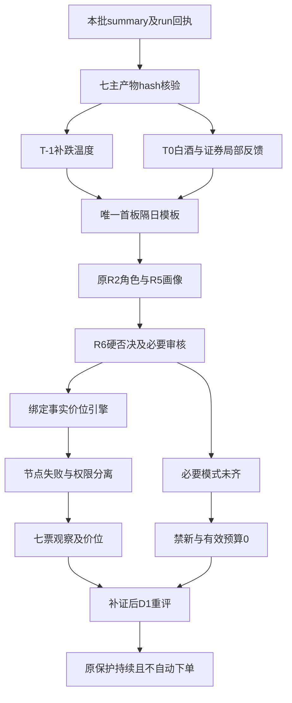

<!-- canghai:explicit-plan-report-assembly:v1 -->
# 显式组装报告（非重新推理）

> 决策来源（JSON）：llm
> 同版 JSON SHA-256（规范化内容）：def0f567b971e81d53b4c7202e68aba1fe96e662518612dc03ae3bbbe75652a2
> 以下散文为调用方提供的模型原文，完整保留、未经重新推理；原文自述不是来源验证，不得覆盖 JSON 禁令、权限或缺口。
> 表格直接复用既有共享 renderer；只读展示，不构成开仓或自动交易授权。

## 模型原文（非重新推理）

---
date: 2026-11-02
agent: D1-main-decision
skill_version: main_decision_v1@2.0
generated_at: 2026-11-02T11:00:39+08:00
confidence: null
degraded: true
data_sources:
  - name: research_summary_current_run
    path: data/research/20261102/research_summary.json
    status: ok
    captured_at: "2026-11-02T10:43:02+08:00"
    record_count: 7
  - name: attention_bound_snapshot
    path: data/research/20261102/attention_signals.json
    status: error
    captured_at: null
    record_count: null
    error: 绑定时exact_trade_date不合法，无可消费payload
  - name: emotion_cycle_bound_snapshot
    path: data/research/20261102/emotion_cycle.json
    status: stale
    captured_at: "2026-11-02T06:03:43+08:00"
    record_count: 1
input_freshness: partial
input_freshness_note: 研究主产物均为本批已核版本；事实混合10月30日完成日和11月2日盘中，情绪状态机冲突、人气非法、七票必要审核未完成。没有完整D1综合置信度，不补均值。
---

# 2026年11月2日 · 主决策 / D1 条件预案（盘中迟交，不是事前预测）

> 🟡 本轮为同一会话LLM裁决，decision_source=llm。研究未就绪，必须补证重评。
> 🔴 当前不交易：有效新增交易预算=0%，自动交易关闭，须人工确认；这不是清仓或撤单命令。
> 真实生成时间见frontmatter。研究在09:21以后启动，R2含10:01盘中资料，R5最新报价约10:16，summary到10:43交付。本文没有冻结回放输入，不把迟交写成08:30前预测。

## 🧭 一句话结论
白酒局部最强，证券留B计划；七票进观察，必要审核未齐、有效预算0%，不开新仓，不宣布市场没有机会。

## 🚫 不交易条件清单与当前状态

| 条件 | 当前 | 依据与处理 |
|---|---|---|
| R1信号降级 | active | confidence=0.392＜0.4；不是MCP全面故障 |
| 有效零预算/禁止新仓 | active | R1批准上限0；R2/R5/R7均继承，不能由局部修复或迟交撤销 |
| R6必要审核未完成 | active | 7票局部检查，必要完成0票；模式1/6/7仍缺，空硬否决不是通过 |
| 人气输入合法性缺口 | active | 绑定时快照exact_trade_date不合法，消费者没有payload；不当成无人气 |
| 完整大事件窗口未审 | active | 日历无本次授权/绑定，未来3个交易日完整性未知；已知会议预期仍买点后置 |
| R7整体陈旧 | inactive | 最新完成日10月30日，交易缺口0；周末约66.6小时不单独触发失效 |
| severity≥3 | inactive | 本批severity=2，不伪造基础设施熔断 |
| R6硬否决超比例 | inactive | 本批hard_rejects=0，仍不等于审核完成 |

这些缺项记录的是本批未就绪，不是新增永久行业禁令。P1/P2不能凭候选身份、价位或promote解除它们，外部程序的completed也不等于研究ready。合法持仓退出管理继续，本文未读账户，不知道可卖数量，不能输出卖X买Y或清空未知持仓。

## 💹 买卖点总表：条件价位与当前能否买分列

下表先保留模型选定的突破确认情景，再列确定性引擎基准。除明确历史例外外，基准日均为10月30日前复权完成日；有效研究窗口为本次生成至当日收盘，需授权的新证据才能重评。触发价是确认条件，不等于拟委托价；RR统一以买区上沿计算，最高接受价主动收紧至上沿，不能借给更高盘口委托价。新仓止损有效期最早T+1，绝不是当日可卖保险。

| 对象 | 条件买区 | 确认/触发 | 最高接受 | 止损/T+1 | 止盈/压力 | RR | 当前能否买 |
|---|---:|---:|---:|---:|---:|---:|---|
| 水井坊 | 25.43—25.94 | 25.56 | 25.94 | 25.13 | 27.56 | 2.00 | 不可做；止损距3.12%＜5%，禁新及未审 |
| 国金证券 | 8.23—8.39 | 8.27 | 8.39 | 7.97 | 9.23 | 2.00 | 不可做；买区上沿超昨收5%，实际高开＞7% |
| 皇台酒业 | 14.11—14.39 | 14.18 | 14.39 | 13.67 | 15.70 | 1.82 | 可观察；10:16已15.60，不借旧RR追高 |
| 益方生物 | 12.33—12.58 | 12.39 | 12.58 | 11.57 | 14.60 | 2.00 | 可观察；硬事件但下降趋势/必要审核未齐 |
| 东方海洋 | 2.82—2.87 | 2.83 | 2.87 | 2.73 | 3.15 | 2.00 | 不可做；止损距4.88%，拥挤与业务反证 |
| 上海沪工 | 17.46—17.81 | 17.55 | 17.81 | 16.92 | 19.59 | 2.00 | 不可做；止损距4.9972%，冲板回落，旧高位 |
| 高争民爆 | 无今日可成交买区 | 无 | 无 | 旧情景49.95 | 旧情景57.84 | 旧情景2.00 | 不可做；复牌一字，10月23日旧价仅参照 |

可开仓=0只；可观察不等于可买。节点失败5只，另两只几何未命中失败也未通过全部买权门禁。所有观察票的max_position_pct与入场仓位均显式为0；未执行纯Python选股，Python只承担价格、校验和附表。

## 🌊 从市场到板块：先认资金在交易什么，再认研究角色

10月30日完成日涨停47家、跌停82家、炸板31家，炸板率为31/(47+31)=39.74%。21家回封已包含在47家，不再重复加分母。前一涨停池开盘溢价约+0.96%，收盘反馈已是-0.68%，是接力收益回吐而不是简单的“还有溢价就能冲”。R1把五阶段补跌映射到main_down，属于T-1温度，不宣布今天没有反弹，也不把R1分数56机械翻成主升。

绑定的情绪快照确实可读，但它先用82家跌停判补跌，再因状态机不允许high_chop转capitulation而改成main_up。本文不采纳“任何位置都可进”的行动文案；采用R1解释清楚的原始事实与主跌定位，保留冲突交回owner。人气快照则在绑定时已非法，未读取后来文件补齐，更不能把缺payload说成90日从未上榜。R3正式产物内已有注意力事实可以引用，但不把它冒充D1独立消费的人气快照。

R2当前主线白酒84，次线创新药68、机器人54、证券52、CRO50，商业航天36降级。这里的分数是上游五维研究比较，不是胜率，更不能把板块84分改写成皇台个股质量84分。白酒T-1行业净流入约25.00亿元，白酒Ⅱ/Ⅲ是同一序列，不加成50亿；食品饮料母行业与子行业也不相加。T0两只前排及正资金提供局部延续线索，今日完整成分触板全集仍未知，不能用T-1五只涨停代替T0三只确认。

主线生命周期只能沿用R2的formation条件判断，真实round_id和启动年龄未知。上游把观察到一日涨停潮代作age=1得到early_up，只是敏感性情景，不是本轮已证明的主升早期。本文唯一主模板是首板隔日，不追加总龙锁仓、三格、树干或分歧接力。高位老龙和事件票保留研究与退出风险推演，不作为另一套新开仓模板；也不因当日是主跌背景而停止观察新题材首板/二板。

### 白酒公共判断：有局部合力证据，没有全市场修复证明
- **大资金意图**: 流动性收缩下可能转向消费前排，R7 T-1连续资金与R2 T0截面提供支持；不预设白酒永远防守或永远进攻。
- **为什么走强**: 白酒概念热榜从18到3、T-1五只涨停，T0皇台二板与水井首板形成相对身位；不同窗口只并列不拼成同刻确认。
- **逻辑够不够硬**: 价格/资金比盈利反转叙事硬；R4稳市场事件是间接映射，R3消费观点核心只有一份去重纪要，独立性有限，不能当多群事实共振。

R2.main_lines[0]为公共条目，皇台原角色龙一、水井原角色龙二、容量锚茅台均保留原身份。只有已核资料支持它们的关系，不因独立、相关性未知就改叫杂毛或anti_rotation。共同失效条件是前排承接与同窗口资金同时转弱，个股节点失败另判，不能用板块强覆盖个股失效。

### 证券、创新药、机器人及CRO的分化
证券已有政策报道与当日首板反馈，故列B计划；不是把券商归为“老登”就不研究。创新药的硬临床事件支持益方单票研究，不代表全行业主升。机器人走强的是部分宣传热度，R3 T-1板块-4.20%与卖方集中推荐并存，不能把观点声量充资金；上海沪工的T0回落又提供新反证。CRO母行业资金不能替代东方海洋的主营纯度与个股净额确认。商业航天保留热度但资金弱、无已核新增催化，不因热榜第一给正向信用，也不认定已出货。

## 🧮 四象限叉乘与R3/R4/R7交叉

按本批R6原定义，横轴为已核事件正负极性，纵轴为同有效窗口的高低价格位置。板数不是价格位置；从高点跌下来也不自动叫低位。本次不是冻结输入事前回放，不事后补一个高低阈值，让七票看似都完成归象限。

| 事件×位置 | 应检验的交易陷阱 | 本批裁决 |
|---|---|---|
| 正面×低位 | 事件能否转化为资金和可成交接力 | 不能仅凭益方跌幅或水井首板归入；位置/冻结窗口缺证 |
| 正面×高位 | 利好是否被先手资金兑现 | 皇台、高争的兑现风险必须推演，但不把连板/一字替代高位证据 |
| 负面×高位 | 双杀、接力断裂与估值压缩 | R4科技行业风险保留，不外推七票全受直接打击 |
| 负面×低位 | 价值陷阱与下跌中继 | 立案或业绩下滑不因价格低而变抄底理由，不扩散成全行业否决 |

| 正式对象 | 本批事件极性 | 价格位置/象限 | 实际反证与结论 |
|---|---|---|---|
| 皇台酒业 | 间接正面 | 未确认/null | 亏损/估值/原历史多次开板；进watch最高研究级 |
| 水井坊 | 间接正面 | 未确认/null | 跨窗口资金不能当连续吸筹；止损距失败，进watch |
| 益方生物 | 正面 | 未确认/null | 临床成功不等于商业化；降级观察 |
| 东方海洋 | 未核或混合 | 未确认/null | 纯度、机构与财务反证、拥挤；降级观察 |
| 上海沪工 | 未核或混合 | 未确认/null | 扣非/一次性收益及冲板回落；降级观察 |
| 国金证券 | 间接正面 | 未确认/null | 政策未落地，旧趋势/今日首板分开；进watch/B |
| 高争民爆 | 正面 | 未确认/null | 审计定价未知、一字无买点；降级观察 |

七个位置与象限均未认证，缺口逐票保留给R6/R5，不填0或默认低位。这个结果是完成了叉乘检查并明确未完成的输入，不是宣称象限研究全部通过。

R4原有15板块×8事件的120格叉乘完整保留在JSON。E001是科技行业级负面，打击半导体、存储、CPO算力，未把白酒/证券或创新药候补臆配进去；E002奥精医疗立案是个股级，不扩散成整个医疗板块造假，也不是R6已有hard_reject。E003高争重组与E004益方临床有原公告；E005/E006稳市场会议和贷款额度属于政策预期；E007燃机政策、E008脑科学专项仍缺可进入本轮正式R2/R5七票的合格新增对象，不现场补抓选股。

R6内追加的概念澄清、立案和销量下降事件也保留在JSON原有unmapped_negative_events；对象或板块对应不足时不跨票升级严重度。R4生成时R3尚未落盘，是not_yet_landed，不是R3源故障；本轮已取得后续同批R3最终产物，不能沿用当时错误推成当前不可用。

## 🧱 执行池与逐票门禁

execution_pool=0，watch_pool=7，另有26个纯研究锚与2个R2市值拦截留痕。七个正式R2对象全部有去向，不为20—40观察覆盖目标凑数。观察不满20的原因是本轮正式画像覆盖七票且辅助/历史读取受限，不证明全市场仅有七只机会。R2其他剔出对象、旧心智锚与R7早先资金对象都在JSON可追踪；它们不是当前正式龙头名单，缺本轮画像或只作纯温度计，不臆造可成交价位。

R6硬否决合并summary与本体后为0，实际从执行候选按硬否决剔除0只。18条反证中12条strong_suggest全部明确采纳、6条soft_suggest保留，覆盖强建议0条。七票必要模式1/6/7未完成，模式2已做不能代表全审。R7当时正式R2尚未交付，十只资金对象与现在七票并不一致；行业流入和R5个股资金不能替R7 owner默认为已补完正式逐票分支。

空执行池不是由全局no_trade机械清池：七票在R2/R5/R6已有plan_outside_scan，本轮不以点名自签消除；另有明确档位、节点或一字失败及强建议。水井/国金更接近本轮首板研究模板，仍有B/B-档、节点/高开限制；皇台研究龙一有估值强建议，余票原角色与反证逐项保留。不能把“研究入池”偷换为“今天已批准扫板”。

核心判定缺同日对齐板块/指数收益和完整排名，本轮不喂空数组得到假的anti_rotation；总龙身份与关停次数未核，不调用默认alive抬仓。禁止函数在有整数研究顺位的五票上真实做局部诊断，只采用已经有依据的plan_outside_scan，其余默认参数不认证14项通过；另两票无排名不补默认。板型函数只对可得历史事实运行，不把历史开板次数当今天。模块可用和必要输入齐备是两回事；本版安全禁新，不能包装成全部硬闸门实跑通过。

仓位推导是有效上限0×主跌温度0.4×单研究主线0.8=0；不以历史公式20%下限抬预算，不因为情绪极恐反向加仓。风险参数显式保留持仓最多5只、当日买单0、单票订单0；单票上限15%和单板块40%是不可突破的外层政策，不是本轮分配额度。920前缀沿用实际只读政策限制，300/688不因旧文案封禁。未知持仓不做一次性大幅减仓或T计划调整。

## 🗺️ 决策路径

## 🔬 逐票研究与T+1博弈

### 水井坊 600779.SH：进 watch，首板隔日研究顺位第一，不授买权

- **大资金意图**: 可能借消费轮动选择流通盘更大的首板承接对象；这是对白酒公共判断的逐票应用，不是把白酒改叫纯防守后机械排除。
- **为什么走强**: R2记录当日首板及较皇台更晚的首封；R5约10:16报价28.12，较昨收25.56涨停。但此前五日资金与今天的流入不是同一窗口，不能倒推连续吸筹。
- **逻辑够不够硬**: 板块联动和首板事实比盈利反转叙事硬，完整龙头只核2/4条；经营和估值并无足以消除周期风险的硬改善。

**买入理由**：仅就研究情景，一是R2白酒前排扩散已有两只已核样本，二是首板比高位旧龙更贴近本轮唯一模板。真正买入仍须同分钟价格、板块结构、个股资金与全部原门禁成立，不把研究顺位当订单顺位。

**风险点**：日周线原下降结构可能只反抽一天；TTM估值与盈利趋势不匹配。更直接的问题是引擎止损25.13相对拟买上沿25.94仅3.12%，低于5%纪律下限。保留几何失败，不向下挪止损凑通过。

**止损条件**：25.13仅为受阻研究场景的T+1风险参考，27.56为该场景第一止盈。10:16价格已在原买区之外，回落并不自动成为合规低吸；若跌破已观察日内低26.84，应取消原强势情景而不是等到25元接飞刀。

**可验证假设**：未来24—72小时检验皇台仍有承接时，水井能否形成独立换手与至少一只新增白酒前排；若只有皇台独涨或水井首板次日无接力，则助攻假设失效。人气及R6必要模式缺口仍交回原owner。

### 国金证券 600109.SH：进 watch，作为证券B计划锚，不因板块名字否定攻击性

- **大资金意图**: 可能押注资本市场支持工具会议与回购贷款预期，争夺科技失血时的增量风险偏好；额度不是实投，不能提前记成资产购买。
- **为什么走强**: R2证券方向已有两个返回涨停样本，国金在R5约10:16为8.45，已明显越过旧日线均线。旧图偏空不能覆盖今天的真实上涨，但一次首板也不能证明中期趋势已经逆转。
- **逻辑够不够硬**: E005/E006有明确政策报道，落地状态、同窗口个股资金以及全面行业排序尚缺；R6只给软提示，不是R6硬否决。

**买入理由**：研究上保留一是政策事件的可核传导对象，二是今日首板的实际价格反馈。它属于同一首板隔日模板的备选方向，不另启总龙锁仓或纯图形打法。

**风险点**：本次8.25开盘相对7.68昨收超过7%，按原高开纪律不追；历史突破买区上沿8.39相对昨收也超过5%，节点不合格。会议尚未落地，利好兑现与此前五日净流出不能被一个涨停抵消。

**止损条件**：7.97是8.39拟买上沿对应的历史条件止损，9.23为2R目标，均不代表现在可以成交。若证券前排与资金共同失效、或已观察日内低8.10被跌破，取消这套修复假设；新仓不能写成当日止损卖出。

**可验证假设**：白酒不及预期后，只有证券在同一窗口新增前排并取得本票适用资金确认，才触发D1重评；若只有孤立首板而未扩散，B计划也不成立。任何promote都不解除有效零预算。

### 皇台酒业 000995.SZ：进 watch最高研究级，研究龙一不是完整总龙

- **大资金意图**: 可能选择白酒小盘高度载体，交易的是接力辨识度而非当季盈利。R5五日大单净额约3.08亿元为支持，户数增加与跨源差异为反证。
- **为什么走强**: R2当日二板高度和更早首封占优，R5约10:16为15.60；白酒T-1五只涨停只是历史广度，不能给今日两只样本补成全池共振。
- **逻辑够不够硬**: 高度、首封共2/4条，不重复计数认证三条；三季报亏损、估值偏高与户数扩散仍在。采纳R6_M3_08降级观察，不将高估值写成确定下跌。

**买入理由**：仅研究，一是白酒公共线索的高度核心顺位，二是早封相对水井的领先。主线第一天研究优先不等于保底参与，T+1必须有人接力才能兑现。

**风险点**：实际开盘15.53较昨收14.18已高开约9.52%，不得追。10月30日六次开板的历史分类确为多次回封，本轮真实调用识别器留痕；不能把昨天板型冒充今天板型，但也不能把这一历史风险删掉。

**止损条件**：引擎14.11—14.39买区对应13.67止损、15.70压力目标，RR=1.82，是旧基准突破情景。10:16股价已明显高于买区，不能借该RR给15.60的新委托价放行；高开超限或跌破已观察日内低15.50即取消原强势入场假设。

**可验证假设**：24—72小时检验二板是否保持以及白酒是否至少新增一只可核前排；开板且板块资金转负则接力假设减弱。禁止项plan_outside_scan、必要审核与有效预算必须独立补齐，不以本文件点名自签解除。

### 益方生物 688382.SH：降级观察，硬事件不等于低位低风险

- **大资金意图**: 可能交易D-2570三期主要终点达成的预期差，但获批、商业化、盈利是后续不同节点。
- **为什么走强**: R4原始公告支持正面事件；价格却并非单向确认。R2约10:01的12.25与R5约10:16的12.80均应保留，不能把前一截面亏损当全天最终结果，也不能忽视13.32冲高回落。
- **逻辑够不够硬**: 临床结果比概念推广硬，但本票候补0/4条、行业地位未核；下降趋势和财务合规缺口不因利好取消。

**买入理由**：仅研究，一是明确临床节点，二是观察事件能否扭转原下降通道；没有确认就不把反抽包装成主升低吸。R6_M1_03、M7_14降级意见均采纳。

**风险点**：前一完成日日线明显空头，临床成功不保证获批或营收，亏损与现金消耗仍需排雷。正面事件与低价格不是正面×低位象限的自动认证。

**止损条件**：12.33—12.58是引擎基于12.39旧基准的突破观察区，11.57止损、14.60目标，RR=2；全局与逐票仍禁买。若跌破已观察日内低12.15或公告更正，撤销修复情景；假设新增仓退出最早T+1，不把11.57说成当天保险。

**可验证假设**：24—72小时看公告是否更正、价格是否重新收复13.32并形成行业扩散和同窗口个股资金支持；只出现单票反抽不视为行业主线。B计划也只触发重评，不能给这只候补越级买权。

### 东方海洋 002086.SZ：降级观察，保留真实强势，也保留拥挤与业务反证

- **大资金意图**: 可能交易低绝对价与CRO标签的高度接力，但主营纯度不能从概念名反推。
- **为什么走强**: 完成日日线阶梯抬升，R5约10:16为3.11且曾触板；R2原角色为CRO研究龙一，不应冒称已经确认今日三板或全市场合力。
- **逻辑够不够硬**: 龙头认定只过1/4，R3正向信用0与霸榜拥挤保留；缺出货确证，R6没有升级hard_reject，D1也不越权认定庄股。

**买入理由**：仅研究，一是原R2高度载体，二是可验证的价格强势，不能因为不交易而抹去上涨事实。业务收入纯度、资金与接力要分别验证，不让同一涨停计三次信用。

**风险点**：亏损叠加PB高分位，CRO资金及机构席位存在反证，低股价不代表便宜；原开盘3.11已远高于昨收，追高有兑现风险。两位小数舍入后止损距只有4.88%，几何也不合格。

**止损条件**：2.82—2.87买区对应2.73止损和3.15目标，RR=2只是受阻场景；不挪动止损求过门。若失守已观察日内低3.00或CRO标签被证伪，取消本次强势场景，新仓卖出不得早于T+1。

**可验证假设**：24—72小时补真实CRO收入映射、机构分日席位和接力承接；若只有热榜延续而资金/业务不支持，继续降级。拥挤不能推断已经出货，但也不能因此给正向合力信用。

### 上海沪工 603131.SH：降级观察，不接高位老龙的加速兑现

- **大资金意图**: 可能借机器人/物理AI叙事争夺高位辨识度，连续一字后的持筹者与新接力者存在明显兑现博弈。
- **为什么走强**: T-1三板和短周期均线突破是真实历史，R5约10:16却由19.31高点回到17.87，回撤约7.46%；不得继续沿用昨天的缩量锁仓叙述。
- **逻辑够不够硬**: 研究龙一只过1/4，非经常收益支撑归母利润而主题业务收入极小；周末卖方推广不是公司订单。R6_M1_05、M3_11、M9_18全部采纳。

**买入理由**：仅研究，一是跟踪R2既有高位载体的分歧，二是用真实量价证伪旧锁仓假设；它不是今日首板隔日模板的新开仓对象，不借补涨之名递补。

**风险点**：集中换手与冲板回落增加T+1尾部风险，扣非口径和产业纯度不支持稳态估值。上游极端尾部标签是风险提示，不是按三板高度新增硬否决。

**止损条件**：17.46—17.81的历史突破几何对应16.92止损与19.59目标，RR=2；舍入后止损距4.9972%，严格门禁下仍未通过，不向下改价。若跌破已观察日内低17.60或公司业务逻辑被否定，则取消强势接力情景。

**可验证假设**：24—72小时观察能否重建换手承接、重新核实主题收入，并区分归母与扣非。不能把盘中回落提前叫收盘断板，也不在主跌背景接高位旧龙。

### 高争民爆 002827.SZ：降级观察，复牌一字是明确价位例外

- **大资金意图**: 可能押注矿业资产注入后的业务重估，但发行股份、审计评估、交易作价和摊薄均不能跳过。
- **为什么走强**: R4原始复牌公告明确了拟购资产比例；R5约10:16为56.98且开高低收一致，是已观察的一字截面，不是盘前预测成功。
- **逻辑够不够硬**: 重组预案硬，估值和交割结果未知；候补没有完整龙头认证，单票重组不能外推民爆全行业共振。

**买入理由**：仅研究，一是具体资产注入预案，二是复牌实际价格重估。当前没有成交买点，不能以用户有快速通道就假设排队必成交、可随时撤回或无风险。

**风险点**：审计评估、审批与交易作价未完成，股本摊薄未知；高应收及负债风险保留。旧图只到10月23日，停牌分钟平铺不能拿来认证今日承接。

**止损条件**：不提供今日可成交买区/触发价/最高接受价，entry规则显式一字不追。停牌前51.80基准的引擎历史压力测试为51.54—52.58、止损49.95、目标57.84、RR=2，全部标为10月23日旧事实情景；47.50历史支撑和79.94历史20日压力只供风险参照，不能直接挂单。

**可验证假设**：后续24—72小时仅核开板是否真实换手、方案是否变化及估值资料进展；没有新成交与监管材料时继续观察，不找低位同概念票填补。

## 🔢 价位推导：保留公式、失败与数据时点

所有数值来自真实调用src/plan/price_levels.py，再由本轮D1复核。为了遵守读取边界，内存技术输入仅取已绑定R5画像的前复权日线、原均线和末20个已完成交易日高低点，未读kb/research.db；牛熊线未知，没有另造测量。load_tech的输入获取在内存限定，公式本体未改，未调用会副写额外MD的默认CLI。停牌股窗口仍标原截止日，不把停牌平铺当新交易日。

原引擎有“远端20日高超过推定涨幅时改以昨收”的诊断。本文保留原式，但当日交易所涨跌停边界未独立获授权核验，不能据这句诊断认证今日可达/不可达。表中这些价是研究条件，不是假装挂得到的订单；尤其不能把昨收型突破回落解释成任何位置都可低吸。舍入后失败不通过挪止损、抬止盈或换均线求过门。

### 水井坊：条件突破研究

数据日 20261030；昨收/停牌前价 25.56，MA10=25.381，MA50=26.493，历史20日高=29.9。

- 买区：pivot=ref_close(远端20日高今日不可达，仅作压力位)=25.56; 买区=[pivot×0.995, pivot×(1+1.5%)]; 溢价上限7%；⚠️20日高29.90距昨收+17.0%，今日不可达，不作买入基准
- 止损：止损=MA10×0.99 → 25.13（三者取最高: 买价×(1-5%)=24.64, MA10×0.99=25.13）
- 止盈：2R目标 = 买25.94 + 2×(买入价-止损0.81) = 27.56
- 盈亏比：RR=(27.56-25.94)/(25.94-25.13)=2.0
- 舍入后止损距=3.1226%；节点结果：stop_out_of_band。新增仓位=0%。

### 国金证券：条件突破研究

数据日 20261030；昨收/停牌前价 7.68，MA10=7.907，MA50=8.31，历史20日高=8.27。

- 买区：pivot=max(昨收,20日高)=8.27; 买区=[pivot×0.995, pivot×(1+1.5%)]; 溢价上限7%
- 止损：止损=买价×(1-5%) → 7.97（三者取最高: 买价×(1-5%)=7.97, MA10×0.99=7.83）
- 止盈：2R目标 = 买8.39 + 2×(买入价-止损0.42) = 9.23
- 盈亏比：RR=(9.23-8.39)/(8.39-7.97)=2.0
- 舍入后止损距=5.0060%；节点结果：buy_out_of_band。新增仓位=0%。

### 皇台酒业：条件突破研究

数据日 20261030；昨收/停牌前价 14.18，MA10=13.36，MA50=11.7634，历史20日高=15.7。

- 买区：pivot=ref_close(远端20日高今日不可达，仅作压力位)=14.18; 买区=[pivot×0.995, pivot×(1+1.5%)]; 溢价上限7%；⚠️20日高15.70距昨收+10.7%，今日不可达，不作买入基准
- 止损：止损=买价×(1-5%) → 13.67（三者取最高: 买价×(1-5%)=13.67, MA10×0.99=13.23）
- 止盈：20日高点15.70 低于2R目标15.83 且高于买价5%以上 → 取前高作第一压力位
- 盈亏比：RR=(15.70-14.39)/(14.39-13.67)=1.82
- 舍入后止损距=5.0035%；节点结果：未命中数值失败，但权限仍blocked。新增仓位=0%。

### 益方生物：条件突破研究

数据日 20261030；昨收/停牌前价 12.39，MA10=14.24，MA50=17.9906，历史20日高=19.49。

- 买区：pivot=ref_close(远端20日高今日不可达，仅作压力位)=12.39; 买区=[pivot×0.995, pivot×(1+1.5%)]; 溢价上限7%；⚠️20日高19.49距昨收+57.3%，今日不可达，不作买入基准
- 止损：止损=买价×(1-8%) → 11.57（三者取最高: 买价×(1-8%)=11.57）
- 止盈：2R目标 = 买12.58 + 2×(买入价-止损1.01) = 14.60
- 盈亏比：RR=(14.60-12.58)/(12.58-11.57)=2.0
- 舍入后止损距=8.0286%；节点结果：未命中数值失败，但权限仍blocked。新增仓位=0%。

### 东方海洋：条件突破研究

数据日 20261030；昨收/停牌前价 2.83，MA10=2.344，MA50=2.144，历史20日高=2.83。

- 买区：pivot=max(昨收,20日高)=2.83; 买区=[pivot×0.995, pivot×(1+1.5%)]; 溢价上限7%
- 止损：止损=买价×(1-5%) → 2.73（三者取最高: 买价×(1-5%)=2.73, MA10×0.99=2.32）
- 止盈：2R目标 = 买2.87 + 2×(买入价-止损0.14) = 3.15
- 盈亏比：RR=(3.15-2.87)/(2.87-2.73)=2.0
- 舍入后止损距=4.8780%；节点结果：stop_out_of_band。新增仓位=0%。

### 上海沪工：条件突破研究

数据日 20261030；昨收/停牌前价 17.55，MA10=14.132，MA50=14.1254，历史20日高=17.55。

- 买区：pivot=max(昨收,20日高)=17.55; 买区=[pivot×0.995, pivot×(1+1.5%)]; 溢价上限7%
- 止损：止损=买价×(1-5%) → 16.92（三者取最高: 买价×(1-5%)=16.92, MA10×0.99=13.99）
- 止盈：2R目标 = 买17.81 + 2×(买入价-止损0.89) = 19.59
- 盈亏比：RR=(19.59-17.81)/(17.81-16.92)=2.0
- 舍入后止损距=4.9972%；节点结果：stop_out_of_band。新增仓位=0%。

### 高争民爆：历史压力测试，非今日买区

数据日 20261023；昨收/停牌前价 51.80，MA10=54.974，MA50=60.3908，历史20日高=79.94。

- 买区：pivot=ref_close(远端20日高今日不可达，仅作压力位)=51.80; 买区=[pivot×0.995, pivot×(1+1.5%)]; 溢价上限7%；⚠️20日高79.94距昨收+54.3%，今日不可达，不作买入基准
- 止损：止损=买价×(1-5%) → 49.95（三者取最高: 买价×(1-5%)=49.95）
- 止盈：2R目标 = 买52.58 + 2×(买入价-止损2.63) = 57.84
- 盈亏比：RR=(57.84-52.58)/(52.58-49.95)=2.0
- 舍入后止损距=5.0019%；节点结果：one_word_no_executable_entry、suspended_historical_price。新增仓位=0%。

## ⏳ 竞价预期三档：研究阈值，不冒充已过去的竞价预测

本轮实际已过竞价时点。以下是用于后续核对的模型情景阈值，不自称09:25以前已经定义，不据此生成补单。基本预期为昨收-1.5%至+2%，20cm按1.2倍放宽；低于预期跳过或待右侧新证据，预期内也不解禁，超预期仍须原门禁，远超不追且>7%高开规则优先。

| 股票 | 基准日 | 低于预期 | 预期内具体价区 | 超预期 | 远超 |
|---|---|---|---|---|---|
| 水井坊 | 20261030 | <-1.5%取消/重评 | 25.18—26.07仅核条件 | +2%~+5%不解禁 | >+5%不追 |
| 国金证券 | 20261030 | <-1.5%取消/重评 | 7.56—7.83仅核条件 | +2%~+5%不解禁 | >+5%不追 |
| 皇台酒业 | 20261030 | <-1.5%取消/重评 | 13.97—14.46仅核条件 | +2%~+5%不解禁 | >+5%不追 |
| 益方生物 | 20261030 | <-1.8%取消/重评 | 12.17—12.69仅核条件 | +2.4%~+6%不解禁 | >+6%不追 |
| 东方海洋 | 20261030 | <-1.5%取消/重评 | 2.79—2.89仅核条件 | +2%~+5%不解禁 | >+5%不追 |
| 上海沪工 | 20261030 | <-1.5%取消/重评 | 17.29—17.90仅核条件 | +2%~+5%不解禁 | >+5%不追 |
| 高争民爆 | 20261023旧基准 | — | 无当日有效预期买区 | 已观察56.98一字：放弃排队 | 非一字也须新证据重评，不挂单 |

## 🔄 B计划：原主线不及预期，资金也可能不去任何备选方向

R7对20个有效资金向量做190组配对，没有同时满足相关<-0.6与窗口反转的统计跷跷板。不是工具没调，也不能造一个“科技跌银行必涨”的相关系数。以下只复用R2次线和七票既有对象，价位与前表完全相同，不新增池外标的。

一是证券政策修复的国金证券：白酒前排与资金承接失效，同时证券新增前排、个股资金与价格同窗口确认时，只触发重评。8.23—8.39/7.97/9.23的受阻几何仍在，高开及节点失败、会议后置、原禁令都不能消失。二是创新药的益方生物：临床事件未更正、价格右侧收复且行业扩散与本票资金共同确认时，才重新检验其独立性；12.33—12.58/11.57/14.60是原场景，不因为变成B计划就授予候补核心地位。

若白酒与B方向同步走弱，则继续不交易，不临时找第三套打法。主线内部也不因皇台买不进就绕原资格去接更低位杂毛；R6若以后真实hard_reject龙一，亦不为数量递补。触发B计划不等于允许下单。

## 🛡️ T+1与退出管理

open_position与add_on_pullback均为空，因为实际预算0，不伪造已有底仓或匹配历史样本。stop_loss_only保留七条“假设未来合法新仓”的T+1价格参考，current_position=null，不是七只现持仓卖令。实际下一个交易日须由执行层核日历；本批R2对11月3日的提示不替代该核验。当天新买不能卖，下一交易日竞价优先处理失败情景，止损价只是风险触发参考，不保证跳空或跌停可按该价成交；止盈也不能早于T+1。

没有该形态匹配的“昨日涨停→今日实际买价买入→下一交易日卖出”历史尾部分布，也没有账户风险预算读取权限，不伪造64%/35%之类统计为本轮胜率，不倒推出试仓额度。新增当天唯一可控变量是规模，本轮规模为0。未知底仓继续交原执行管理，禁新不能停止合法卖出。

## 数据源审计

D1审计的是绑定主产物里的事实和来源声明，未重新访问那些原始路径。表内记录数沿用相应owner口径，不把API次数、消息行数、公司数混用，也不把某次调用失败直接叫source_down。

| 源 | 日期 | 状态 | 备注 |
|---|---|:--:|---|
| research_summary及七产物 | 2026-11-02 | 🟢 | 当前run/attempt/receipt/hash核验；结构可交付不等于研究完成 |
| R1市场统计/聚类 | 2026-10-30 | 🟡 | 47涨停/82跌停/31炸板；两处序列缺失，R1置信度0.392 |
| XTick市场情绪 | 2026-10-30 | 🟡 | 49涨停/86跌停/31炸板，单独口径38.75%；不拼Tushare分母 |
| R2在线板块及报价 | 2026-11-02 | 🟡 | 白酒当前成分48、放宽查询30；不是全成分完备，T0报价非收盘 |
| R3五群观点/热榜 | 2026-11-01 | 🟡 | 匿名去重观点；群内转发不是新增独立事实；图片不可读不当原文 |
| 公众号RSS镜像 | 2026-11-01 | 🟡 | 47篇、17源；没有本次11月2日新稿证据；不双计镜像 |
| R4 news_cls文件 | 2026-11-02 | 🟡 | 2429行实际为新浪1493+同花顺936，并非2429条财联社；窗口不满72h |
| R4 major新闻 | 2026-11-02 | 🟡 | 800为单次上限，缺完整72h及多数正文 |
| R4公告/原始PDF | 2026-11-02 | 🟢 | 公告窗口146行、三份原PDF；仅其明确事实已核，不等于全市场排雷 |
| 财报预告指标 | 2026-09-30 | 🟡 | 500行是多指标，非500家公司，报告期不是抓取日 |
| R4生成时的R3 | 2026-11-02 | 🟡 | not_yet_landed；本轮现已取得同批最终R3，不记source_down |
| R5画像与技术 | 2026-10-30 | 🟡 | 7票，166次查询记录、14条财务补充；不是D1重新取数 |
| R5日线图像 | 2026-10-30 | 🟡 | 六票已有图像事实可引用，不能叫今日盘中图 |
| 高争民爆旧图/日线 | 2026-10-23 | 🟡 | 复牌前历史，仅风险参照；分钟平铺不能认证换手 |
| R6必要审核 | 2026-11-02 | 🟡 | 7票已局部检查、必要完成0票；18条反证、硬否决0 |
| R7内资主力/龙虎榜 | 2026-10-30 | 🟡 | 日期可用；20日市场主力累计-5716.81亿，正式七票适用分支不齐 |
| R7三交易所两融 | 2026-10-30 | 🟢 | 本批已补完整，不能沿用早轮只沪市的缺口 |
| R7 ETF份额及期货 | 2026-10-30 | 🟡 | 130.48亿份额差价代理非一级净流入；IF基差-25.501非明日预测 |
| R7 ETF二级资金 | 2026-10-30 | 🟡 | 3/4只可用小计-34.8632亿，510300重试仍空；不补0、不与一级代理相抵 |
| 北向 | 2026-10-30 | 🟡 | not_required，仅复盘参考，未知不进置信度分子/分母，不触发R7整体失效 |
| DataPro资金业务 | 2026-11-02 | 🔴 | 上游记订阅4013，健康ping不代表业务可用；不称全MCP源故障 |
| vibe问财/期权 | 2026-11-02 | 🔴 | 上游分别记访问key缺失、接口只支持美股；不是A股资金等于0 |
| attention辅助快照 | 2026-11-02 | 🔴 | 绑定时exact_trade_date不合法，消费者unavailable无payload；未直接重读/修绑定 |
| emotion_cycle辅助 | 2026-10-30 | 🟡 | 11月2日生成但指标基准10月30日；状态机主升标签与补跌证据冲突，未采用动作 |
| user_preferences | 2026-11-02 | 🟢 | 实际只读政策字节与摘要保留；920限制及ST/市值/仓位铁律原样继承 |
| 账户/事件日历/错题/昨日观察 | 2026-11-02 | 🟡 | 本轮未获读取授权，不是“无持仓/无事件/无错题/无机会” |

## ❓ 不确定性 / 反证与重评责任

研究交付七份齐全，但R6必要完成0票不是文件缺失，更不应该靠读取同日旧文件覆盖。R4/R7需要补正式七票消息映射、适用资金与窗口；R5/R6需要补财务合规、出货核验及必要审核回执；fetch/summary负责下一合法绑定批次的人气有效性与情绪状态机冲突。事件日历及账户预算须由原授权owner给出规范输入权限，D1不现场自建绑定或用模型authorized=true自签。拿到合法同版补证后由计划owner重评；在此之前旧禁令、确认要求、有效零预算与退出管理均持续。

旧整数score来自各票R5.composite_score四舍五入，仅为未校准解释性兼容字段。summary独立六维加权复算中，皇台、东方、沪工、高争与上游composite存在差异，quality_score为null；水井、益方、国金复算一致也不因此成为胜率。JSON保留实际字段路径、原值及复算结果，未把数据完整度、板块分或历史溢价当个股质量/胜率；候选研究顺位由本轮LLM比较，不是照着分数机械排序。

迟于08:30只记事实，不强杀、不撤单、不清池，也不把业务日倒推成资料观察日。5000万token是连续任务努力目标非硬限，已知历史native局部计量73714648不代表本轮总量；未计量保持unknown，不保证小于目标。本文没有另启动Hermes或任何模型会话执行本阶段。

## 🤝 与其他R/D/E的关系

依赖：本次research_summary.artifacts列出的R1—R7及其manifest，实际只读政策，绑定辅助消费者返回。被消费：execute、P1/P2及E1；它们必须保留schema_version、来源版本、未就绪和权限限制，不能从本报告反推买权。实际图表/JSON附表只展示本轮定稿对象，不补数据、不新增交易判断。

## Sub-Agent 元数据

- skill: main_decision_v1@2.0
- agent: canghai-plan / 当前唯一LLM决策会话
- model: gpt-6.1-sol / openai-codex
- run: 20261102T092110-23026-22281
- summary SHA-256: 5409231f329a720c5c406e4fef650ce21bef8b639940ffc86f0bb4e8e1009612
- artifact: data/plans/20261102/watchlist_plan.json
- report: chzl_kg/投研交易/盘前预案/20261102.md
- 研究状态: partial / production_ready=false / reassessment_required=true
- 输出边界: 仅核心JSON与唯一KG主MD；没有runtime副本、附加MD或越权错题写入。

## 同版 JSON 共享表格（只读附录）

# 20261102 盘前预案 · 点位表版

> 计划生成时点：2026-11-02T11:00:39+08:00；决策来源：llm

## 板块机会总览

市场背景：T-1补跌，T0白酒局部前排与证券首板修复；全市场修复未知，研究继续、交易不进

> 先市场／板块效应，再个股地位；未提供关系证据不推断龙头带动或板块扩散。

| 板块／本轮行情 | 阶段／窗口 | 效应与延续 | 核心与梯队（上游标签） | 共振／分离证据 | 主／反向剧本（名单归属非关系证明） | 确认条件 | 共同失效条件 | 观测时点 |
|---|---|---|---|---|---|---|---|---|
| 白酒概念 | formation | 五维84为局部研究主线，不等于可交易主线；T-1涨停潮与今日两只封板/正资金方向一致，催化为配置假设而非行业业绩反转。 | ts_code: 000995.SZ；name: 皇台酒业；r2_role: 龙一；ts_code: 600779.SH；name: 水井坊；r2_role: 龙二 | pointer: R2.main_lines[0]；quant_evidence: completed_observation_date: 20261030；member_snapshot_asof: current_online_members_not_historical_reconstitution；limit_up_count: 5；broken_count: 0；sector_seal_rate_pct: 100.0；seal_rate_basis: T-1 U/(U+Z)，成分使用当前在线名单，存在成分时点偏差；不能将回封票重复加分母；today_seal_rate_pct: ⚠️未给；today_seal_rate_gap: 未取得T0完整触板/炸板全集，不能以两只封板推100%；source: R2_live_verification.json#limits/member_885525.TI；cross_validation: r3_resonance_match: True；r4_catalyst_match: True；r7_capital_match: True；cross_validation_score: 1.0；r3_evidence: R3 resonance_top_themes[0] 白酒概念L1+L2；一份消费防御会议摘要，非多群独立事实；r4_evidence: R4 sectors_catalyzed 消费白酒 medium，E005为稳市场间接映射；不是白酒专属政策或业绩增长；r7_evidence: R7 top_inflow_sectors 白酒Ⅲ/Ⅱ #3/#4 +24.9995亿，同序列去重只计一次；对应概念BK0896实时补核+26.0895亿，不相加；quality_note: 匹配不等于同期正向确认；上游均partial/degraded；同底层数据不增加独立源数 | 观察 | 同窗口价格/资金/承接确认，原禁令由owner独立复核 | 事件否定或前排与资金共同失效；不是自动卖令 | 2026-11-02T10:12:27+08:00 |
| 创新药 | ⚠️未给 | 68分降级观察：临床硬事件只支持益方生物，不把单公司成功外推成行业资金趋势。 | ts_code: 688382.SH；name: 益方生物；r2_role: 候补 | pointer: R2.secondary_lines[0]；quant_evidence: completed_observation_date: 20261030；member_snapshot_asof: current_online_members_not_historical_reconstitution；limit_up_count: 4；broken_count: 3；sector_seal_rate_pct: 57.14；seal_rate_basis: T-1 U/(U+Z)，成分使用当前在线名单，存在成分时点偏差；不能将回封票重复加分母；today_seal_rate_pct: ⚠️未给；today_seal_rate_gap: 未取得T0完整触板/炸板全集，不能以两只封板推100%；source: R2_live_verification.json#limits/member_886015.TI；cross_validation: r3_resonance_match: False；r4_catalyst_match: True；r7_capital_match: False；cross_validation_score: 0.33；r3_evidence: R3只有群内创新药短观点，未入两条正式resonance_top_themes；r4_evidence: R4 E004临床主要终点已核，行业映射medium，不能外推商业化；r7_evidence: R7医药生物#2为母行业，不强制当创新药精确匹配；概念在线#12非前10；quality_note: 匹配不等于同期正向确认；上游均partial/degraded；同底层数据不增加独立源数 | 观察；反向：创新药硬事件独立性复核；触发 临床事件未更正、价格收复且行业扩散及个股资金同窗口确认，仅重评 | 同窗口价格/资金/承接确认，原禁令由owner独立复核 | 事件否定或前排与资金共同失效；不是自动卖令 | 2026-11-02T10:12:27+08:00 |
| 机器人概念 | ⚠️未给 | 54分降级：7只T-1涨停不抵消12只炸板及概念-102.4467亿净流出；R3人形/机器人大脑观点仅叙事，不代表量产或机构净买。 | ts_code: 603131.SH；name: 上海沪工；r2_role: 龙一 | pointer: R2.secondary_lines[1]；quant_evidence: completed_observation_date: 20261030；member_snapshot_asof: current_online_members_not_historical_reconstitution；limit_up_count: 7；broken_count: 12；sector_seal_rate_pct: 36.84；seal_rate_basis: T-1 U/(U+Z)，成分使用当前在线名单，存在成分时点偏差；不能将回封票重复加分母；today_seal_rate_pct: ⚠️未给；today_seal_rate_gap: 未取得T0完整触板/炸板全集，不能以两只封板推100%；source: R2_live_verification.json#limits/member_885517.TI；cross_validation: r3_resonance_match: True；r4_catalyst_match: False；r7_capital_match: False；cross_validation_score: 0.33；r3_evidence: R3人形机器人L1+L2映射父概念机器人；观点不是价格正反馈；r4_evidence: R4无已核机器人中强正催化；OpenAI/Meta等仅群文待核；r7_evidence: R7前10无机器人；在线东财概念-102.4467亿，不能把返回rank=9误读净流入第9；quality_note: 匹配不等于同期正向确认；上游均partial/degraded；同底层数据不增加独立源数 | 观察 | 同窗口价格/资金/承接确认，原禁令由owner独立复核 | 事件否定或前排与资金共同失效；不是自动卖令 | 2026-11-02T10:12:27+08:00 |
| 证券 | ⚠️未给 | 52分观察：T0证券+2.7953%、+21.3477亿、两首板是新生资金方向；热榜无直接行业记录，热度记0而非拿涨幅充热度。 | ts_code: 600109.SH；name: 国金证券；r2_role: 龙一 | pointer: R2.secondary_lines[2]；quant_evidence: completed_observation_date: 20261030；member_snapshot_asof: current_online_members_not_historical_reconstitution；limit_up_count: ⚠️未给；broken_count: ⚠️未给；sector_seal_rate_pct: ⚠️未给；seal_rate_basis: T-1 U/(U+Z)，成分使用当前在线名单，存在成分时点偏差；不能将回封票重复加分母；today_seal_rate_pct: ⚠️未给；today_seal_rate_gap: 未取得T0完整触板/炸板全集，不能以两只封板推100%；source: R2_live_verification.json#limits/member_881157.TI；cross_validation: r3_resonance_match: False；r4_catalyst_match: True；r7_capital_match: False；cross_validation_score: 0.33；r3_evidence: 政策段落仅注意力旁证，证券未进入正式resonance_top_themes；r4_evidence: R4证券medium，E005/E006稳市场工具/意向回购贷款，额度不是实投；r7_evidence: R7 T-1前10无证券；T0同花顺+21.3477亿属于新证据，不倒填R7匹配；quality_note: 匹配不等于同期正向确认；上游均partial/degraded；同底层数据不增加独立源数 | 观察；反向：证券政策修复；触发 白酒承接失效而证券新增前排与同窗口个股资金共同转强，仅重评 | 同窗口价格/资金/承接确认，原禁令由owner独立复核 | 事件否定或前排与资金共同失效；不是自动卖令 | 2026-11-02T10:12:27+08:00 |
| CRO概念 | ⚠️未给 | 50分观察：T-1概念资金+18.7152亿与行业连续5日流入有支撑，但今日同花顺CRO-2.0069%、资金-6.5261亿形成反证；不沿用昨日强势为今日确认。 | ts_code: 002086.SZ；name: 东方海洋；r2_role: 龙一 | pointer: R2.secondary_lines[3]；quant_evidence: completed_observation_date: 20261030；member_snapshot_asof: current_online_members_not_historical_reconstitution；limit_up_count: 3；broken_count: 1；sector_seal_rate_pct: 75.0；seal_rate_basis: T-1 U/(U+Z)，成分使用当前在线名单，存在成分时点偏差；不能将回封票重复加分母；today_seal_rate_pct: ⚠️未给；today_seal_rate_gap: 未取得T0完整触板/炸板全集，不能以两只封板推100%；source: R2_live_verification.json#limits/member_885927.TI；cross_validation: r3_resonance_match: False；r4_catalyst_match: True；r7_capital_match: True；cross_validation_score: 0.67；r3_evidence: R3未列CRO为共振主题；r4_evidence: R4 sectors_catalyzed CRO medium，但E004传导权重仅0.2且属间接映射；r7_evidence: R7医疗研发外包#6 +14.3932亿，等价行业映射CRO；本次T0反向资金另存；quality_note: 匹配不等于同期正向确认；上游均partial/degraded；同底层数据不增加独立源数 | 观察 | 同窗口价格/资金/承接确认，原禁令由owner独立复核 | 事件否定或前排与资金共同失效；不是自动卖令 | 2026-11-02T10:12:27+08:00 |
| 民爆概念 | ⚠️未给 | 38分不列主/次线，但保留具体重组研究对象；个股一字不等于板块已扩散，今日板块-0.201%、净流入仅0.0203亿。 | ts_code: 002827.SZ；name: 高争民爆；r2_role: 候补 | pointer: R2.event_research_lines[0]；quant_evidence: completed_observation_date: 20261030；member_snapshot_asof: current_online_members_not_historical_reconstitution；limit_up_count: ⚠️未给；broken_count: ⚠️未给；sector_seal_rate_pct: ⚠️未给；seal_rate_basis: T-1 U/(U+Z)，成分使用当前在线名单，存在成分时点偏差；不能将回封票重复加分母；today_seal_rate_pct: ⚠️未给；today_seal_rate_gap: 未取得T0完整触板/炸板全集，不能以两只封板推100%；source: R2_live_verification.json#limits/member_885960.TI；cross_validation: r3_resonance_match: False；r4_catalyst_match: True；r7_capital_match: False；cross_validation_score: 0.33；r3_evidence: R3周一推介跨群重复；非正式共振top主题；r4_evidence: R4 E003高争重组原公告已核，矿服民爆medium映射；r7_evidence: R7前10无民爆；T0小额正流入不冒充R7前10；quality_note: 匹配不等于同期正向确认；上游均partial/degraded；同底层数据不增加独立源数 | 观察 | 同窗口价格/资金/承接确认，原禁令由owner独立复核 | 事件否定或前排与资金共同失效；不是自动卖令 | 2026-11-02T10:12:27+08:00 |

## 全局约束与数据边界

- 模式：dry_run；自动交易：False；需用户确认：True
- 总仓上限：0%；持仓上限：5；每日买单上限：0
- 单票上限：⚠️未给；单板块上限：⚠️未给
- 表格仅展示已给计划，不构成自动下单授权；观察／反向候选不自动晋级。候选数量不等于持仓名额。
- 评分未校准：未批准评分公式，不采用旧 score／默认50／板块分充个股分；原序展示，不另行排名。
- 静态价位非实时；数据日、复权／报价口径、有效期或动态线更新时间未给时均未核验，不以计划生成时间冒充价格时点。
- 新买入当日不可卖（T+1）；底仓是否可卖未核验。触发信号不保证可卖或成交。

### 研究与正式反证状态（仅展示）

> 未完成不等于已审否决；已阅读不等于正式评估；硬否决数仅为已应用清单条数，0不等于反证通过。缺字段显式未知，不从池数量或原因文字推断；本表不改变买卖权限。

| 指标（已有JSON字段） | 状态／数量 |
|---|---|
| 研究是否完成（research_completion_passed） | 未完成 |
| 正式反证是否完成（meta.r6_devil_advocate.formal_review_completed） | 未完成 |
| 正式反证是否通过（meta.r6_devil_advocate.review_passed） | 未知（未提供或类型无效） |
| 正式评估数（meta.r6_devil_advocate.candidates_evaluated） | 未知（未提供或类型无效） |
| 已阅读研究对象数（meta.r6_devil_advocate.research_objects_inspected） | 未知（未提供或类型无效） |
| 硬否决数（meta.r6_devil_advocate.hard_rejects_applied） | 0 |
| 生产就绪（production_ready） | 否 |
| 需要重评（reassessment_required） | 是 |

- 强制风控（原字段）：block_prefixes=920；block_st=True；max_orders_per_symbol_per_day=0；kill_switch_file=data/runtime/KILL_SWITCH

> 全局禁止开仓（no_trade）；研究与观察保留。

- 不交易条件 R1_FAIL：触发中／禁止开仓；R1.confidence=0.392&lt;0.4；是判断降级，不是源整体故障
- 不交易条件 EFFECTIVE_ZERO_BUDGET：触发中／禁止开仓；本批继承有效零交易预算/禁止新仓，不因迟交或局部涨停解除
- 不交易条件 R6_NECESSARY_REVIEW_INCOMPLETE：触发中／禁止开仓；七票必要模式1/6/7未齐，hard_rejects空不等于通过
- 不交易条件 ATTENTION_VALIDITY_UNRESOLVED：触发中／禁止开仓；人气快照绑定时交易日不合法，无payload；不能判断无人气
- 不交易条件 EVENT_CALENDAR_UNREVIEWED：触发中／禁止开仓；完整未来3交易日事件日历未授权/绑定，不判断无大事件
- 不交易条件 R7_STALE：未触发；R7 staleness_status=ok，周末66.6小时不是交易日失效；逐票分支缺口另记
- 不交易条件 GLOBAL_SEVERITY_3：未触发；全局severity=2未达到3
- 不交易条件 R6_HARD_REJECT_OVERFLOW：未触发；本批硬否决0；必要审核未完成仍保留

## 执行池（0 只）

### 执行池逐票说明

### 执行池机会与买入

| 股票／场景键 | 优先级（原计划） | 池／当前状态 | 所属板块／角色 | 质量分／评分时点 | 机会类型与理由 | 时间窗 | 触发价 | 可买区间 | 最高接受价 | 板块／量价确认 | 不做／取消条件 |
|---|---|---|---|---|---|---|---|---|---|---|---|

### 执行池退出与风险

| 股票／对应场景键 | 初始止损／绑定范围 | 止损依据与动作 | 分档止盈价及动作 | 移动止盈／其他退出 | 失效／取消条件 | 可卖限制 | 数据时点与缺口 |
|---|---|---|---|---|---|---|---|

> 本池为空；无对象不凑数，原因须由决策者提供。

## 观察池（7 只）

### 观察池逐票说明

- 水井坊 600779.SH：进 watch：首板隔日主模板优先研究；白酒公共判断R2.main_lines[0]。研究龙二2/4，B/B-不满足零cap档A门槛；昨日资金与今日首板不混作连续吸筹；R6模式1/6/7未齐，原plan_outside_scan未解。；状态 watch_pool_only；买入资格受阻／当前禁止新买（非永久否决）；单票上限 0%；逐票权限 auto_trade_enabled=False；requires_user_confirmation=True
  - T+1博弈（原判断）：消息解读: 白酒轮动而非独立硬订单。三季报与三季度经营公告在10月31日发布，利润同比下降34.30%但经营现金流回正，改善与下滑须同时列。；预期差判断: 24-72h核验首板次日溢价与白酒资金，若只有皇台独涨、水井无承接，则助攻失效；买点结论: 仅研究突破确认/打板场景，不能竞价追高；B计划不解禁；T+1最早退出；短线结构标签: 弱转强/联动；known_intraday_quote: ts_code: 600779.SH；pre_close: 25.56；high: 28.12；open: 26.94；low: 26.84；close: 28.12；vol: 6443695；amount: 179284953；trade_time: 2026-11-02 10:16:02；failure: 同窗口资金与板块承接未形成、跌破日内低点/事件否定/高开&gt;7%/价格离带即取消，不事后追补
- 国金证券 600109.SH：进 watch/B计划：R2.secondary_lines[2]证券研究龙一，政策预期与T0首板；B/B-，实际日内高开超7%，禁止追；不能用政策额度替代实投；旧日线偏空不抵消今天上涨事实。；状态 watch_pool_only；买入资格受阻／当前禁止新买（非永久否决）；单票上限 0%；逐票权限 auto_trade_enabled=False；requires_user_confirmation=True
  - T+1博弈（原判断）：消息解读: 拟召开资本市场支持工具座谈会与意向额度是政策预期，不是资金已实投。三季报收入、利润同比正增长，基本面独立于政策传闻。；预期差判断: 24-72h核验两首板能否产生正溢价且证券维持正净额；若两票开板与行业资金转负同时发生，启动假设失效；买点结论: 仅研究突破确认/打板场景，不能竞价追高；B计划不解禁；T+1最早退出；短线结构标签: 分离/联动核验；known_intraday_quote: ts_code: 600109.SH；pre_close: 7.68；high: 8.45；open: 8.25；low: 8.1；close: 8.45；vol: 55569756；amount: 465522536；trade_time: 2026-11-02 10:16:02；failure: 同窗口资金与板块承接未形成、跌破日内低点/事件否定/高开&gt;7%/价格离带即取消，不事后追补
- 皇台酒业 000995.SZ：进 watch最高研究级：R2.main_lines[0]白酒研究龙一2/4，B+/C；R6估值强建议采纳，T0高开9.52%不追，不能把亏损票涨停当盈利反转；与水井联动未证明全池广度。；状态 watch_pool_only；买入资格受阻／当前禁止新买（非永久否决）；单票上限 0%；逐票权限 auto_trade_enabled=False；requires_user_confirmation=True
  - T+1博弈（原判断）：消息解读: 没有已核个股新增订单或盈利催化；白酒防御轮动是资金假设。三季报营收下降17.76%、归母亏损，不支持把二板解释为经营反转。；预期差判断: 24-72h核验二板能否保持、白酒新增前排至少1只；若核心开板且板块净额转负则延续假设减弱；买点结论: 仅研究突破确认/打板场景，不能竞价追高；B计划不解禁；T+1最早退出；短线结构标签: 弱转强/联动；known_intraday_quote: ts_code: 000995.SZ；pre_close: 14.18；high: 15.6；open: 15.53；low: 15.5；close: 15.6；vol: 11951600；amount: 186213091；trade_time: 2026-11-02 10:16:03；failure: 同窗口资金与板块承接未形成、跌破日内低点/事件否定/高开&gt;7%/价格离带即取消，不事后追补
- 益方生物 688382.SH：降级观察：R2.secondary_lines[0]创新药候补0/4；三期硬事件不等于获批收入，R5日线下降且盘中冲高回落。仅正面事件兑现风险研究，不给左侧低吸买权。；状态 watch_pool_only；买入资格受阻／当前禁止新买（非永久否决）；单票上限 0%；逐票权限 auto_trade_enabled=False；requires_user_confirmation=True
  - T+1博弈（原判断）：消息解读: D-2570注册性三期391例、PASI90均超70%、PGA0/1均超80%，R4已核公司原公告；公司明示结果不会对业绩产生重大影响，不能把终点成功写成销售落地。；预期差判断: 24-72h复核公告无更正、创新药价格广度与资金共同转强；单票临床成功不能代替行业趋势；买点结论: 仅研究突破确认/打板场景，不能竞价追高；B计划不解禁；T+1最早退出；短线结构标签: 分离/联动核验；known_intraday_quote: ts_code: 688382.SH；pre_close: 12.39；high: 13.32；open: 12.97；low: 12.15；close: 12.8；vol: 24844027；amount: 318117322；trade_time: 2026-11-02 10:16:02；failure: 同窗口资金与板块承接未形成、跌破日内低点/事件否定/高开&gt;7%/价格离带即取消，不事后追补
- 东方海洋 002086.SZ：降级观察：R2.secondary_lines[3]CRO研究龙一1/4；纯度、资金及财务反证，R3正向信用0与拥挤警报保留；非已证实出货，不升级R6硬否决。；状态 watch_pool_only；买入资格受阻／当前禁止新买（非永久否决）；单票上限 0%；逐票权限 auto_trade_enabled=False；requires_user_confirmation=True
  - T+1博弈（原判断）：消息解读: 10月子公司医疗器械注册证是已公开旧事件，R4临床消息主体是益方而非东方。10月30日股东提议换届与异常波动公告是治理/交易风险背景，不是已证实订单增长。；预期差判断: 下一交易时段核验CRO从负资金转正且至少2只相关前排跟随；若仍仅单票封板则是分离抱团而非主线扩散；买点结论: 仅研究突破确认/打板场景，不能竞价追高；B计划不解禁；T+1最早退出；短线结构标签: 分离/联动核验；known_intraday_quote: ts_code: 002086.SZ；pre_close: 2.83；high: 3.11；open: 3.11；low: 3；close: 3.11；vol: 162518100；amount: 504058587；trade_time: 2026-11-02 10:16:03；failure: 同窗口资金与板块承接未形成、跌破日内低点/事件否定/高开&gt;7%/价格离带即取消，不事后追补
- 上海沪工 603131.SH：降级观察：R2.secondary_lines[1]机器人研究龙一1/4；旧三板后T0冲板回落，扣非与主题收入反证，首板隔日模板不接高位老龙。；状态 watch_pool_only；买入资格受阻／当前禁止新买（非永久否决）；单票上限 0%；逐票权限 auto_trade_enabled=False；requires_user_confirmation=True
  - T+1博弈（原判断）：消息解读: 未取得已核机器人增量订单，三季报净利同比高增主要不能代表扣非质量；机器人集成半年收入仅64.49万元，与叙事规模不匹配。；预期差判断: 24-72h核验板块封板率是否从36.84%改善且主力资金转正；若沪工不能回封且同方向无扩散则不成立；买点结论: 仅研究突破确认/打板场景，不能竞价追高；B计划不解禁；T+1最早退出；短线结构标签: 分离/联动核验；known_intraday_quote: ts_code: 603131.SH；pre_close: 17.55；high: 19.31；open: 19；low: 17.6；close: 17.87；vol: 67073717；amount: 1265253422；trade_time: 2026-11-02 10:16:01；failure: 同窗口资金与板块承接未形成、跌破日内低点/事件否定/高开&gt;7%/价格离带即取消，不事后追补
- 高争民爆 002827.SZ：降级观察：R2.event_research_lines[0]单票重组候补；复牌一字无已核成交买点，R6强建议采纳；旧图截止10月23日，未知审计定价及摊薄，不启用首板替补。；状态 watch_pool_only；买入资格受阻／当前禁止新买（非永久否决）；单票上限 0%；逐票权限 auto_trade_enabled=False；requires_user_confirmation=True
  - T+1博弈（原判断）：消息解读: 拟购紫源铜业51%、晟源矿业100%并配套融资，审计评估与作价未定。11月2日复牌是明确时间锚，不把拟注入矿业当现有收入。；预期差判断: 24-72h核验正式方案或监管问询、同板块至少2只独立助攻且不是名字映射；无扩散只留单票事件观察；买点结论: 仅研究突破确认/打板场景，不能竞价追高；B计划不解禁；T+1最早退出；短线结构标签: 分离/联动核验；known_intraday_quote: ts_code: 002827.SZ；pre_close: 51.8；high: 56.98；open: 56.98；low: 56.98；close: 56.98；vol: 806500；amount: 45954370；trade_time: 2026-11-02 10:16:00；failure: 同窗口资金与板块承接未形成、跌破日内低点/事件否定/高开&gt;7%/价格离带即取消，不事后追补

### 观察池机会与买入

| 股票／场景键 | 优先级（原计划） | 池／当前状态 | 所属板块／角色 | 质量分／评分时点 | 机会类型与理由 | 时间窗 | 触发价 | 可买区间 | 最高接受价 | 板块／量价确认 | 不做／取消条件 |
|---|---|---|---|---|---|---|---|---|---|---|---|
| 观察池:1:600779.SH:1 水井坊 | 原序1／⚠️未给 | 观察池／买入资格受阻／当前禁止新买（非永久否决） | 白酒概念／watch | 未校准／评分时点未给 | leader_breakout／进 watch：首板隔日主模板优先研究；白酒公共判断R2.main_lines[0]。研究龙二2/4，B/B-不满足零cap档A门槛；昨日资金与今日首板不混作连续吸筹；R6模式1/6/7未齐，原plan_outside_scan未解。 | 本轮生成后至收盘；数据非实时，须授权重评 | 25.56 | 25.43 ~ 25.94 | 25.94 | 板块：同窗口价格/资金/承接确认，原禁令由owner独立复核；量价：仅条件研究、禁止新买：规则引擎: 买区覆盖现价，按盘中承接执行；RR=2.0 (pass)；原预算0/plan_outside_scan/必要审核缺口保持，数值不授买权；本场景依据：保持原engine买区与止损，最高接受价主动收紧至买区上沿；不借计划RR给更高委托价放行；需盘中确认：⚠️未给；原建议仓位：0%；执行硬门槛（原字段）：max_premium_pct=7%；post_event_only=True | 事件否定或前排与资金共同失效；不是自动卖令；逐票权限 auto_trade_enabled=False；requires_user_confirmation=True；板块禁入 ；场景禁令 ⚠️未给；个股禁令 code: INHERITED_PLAN_OUTSIDE_SCAN；active: True；source: R2/R5/R6；description: 本批上游明确的禁止项保留，本文件研究点名不等于已批准交易计划；观察原因 ⚠️未给；原资格 source: price_levels_engine；scope: stock_buy_only；ts_code: 600779.SH；status: blocked；reasons: STOCK_NO_TRADE_CONDITION；rr_min: 1.8；risk_reward_ratio: ⚠️未给；buy_price: ⚠️未给；stop_loss: ⚠️未给；take_profit: ⚠️未给；price_source: ⚠️未给；review_required: True；review_reasons: EXPLICIT_STOCK_REVIEW_REQUIRED；利空反证 ⚠️未给；全局禁止开仓 |
| 观察池:2:600109.SH:1 国金证券 | 原序2／⚠️未给 | 观察池／买入资格受阻／当前禁止新买（非永久否决） | 证券／watch | 未校准／评分时点未给 | leader_breakout／进 watch/B计划：R2.secondary_lines[2]证券研究龙一，政策预期与T0首板；B/B-，实际日内高开超7%，禁止追；不能用政策额度替代实投；旧日线偏空不抵消今天上涨事实。 | 本轮生成后至收盘；数据非实时，须授权重评 | 8.27 | 8.23 ~ 8.39 | 8.39 | 板块：同窗口价格/资金/承接确认，原禁令由owner独立复核；量价：仅条件研究、禁止新买：规则引擎: 需上破 +7.2% 站上买区才成立（不是现在能买）；RR=2.0 (pass)；原预算0/plan_outside_scan/必要审核缺口保持，数值不授买权；本场景依据：保持原engine买区与止损，最高接受价主动收紧至买区上沿；不借计划RR给更高委托价放行；需盘中确认：⚠️未给；原建议仓位：0%；执行硬门槛（原字段）：max_premium_pct=7%；post_event_only=True | 事件否定或前排与资金共同失效；不是自动卖令；逐票权限 auto_trade_enabled=False；requires_user_confirmation=True；板块禁入 ；场景禁令 ⚠️未给；个股禁令 code: INHERITED_PLAN_OUTSIDE_SCAN；active: True；source: R2/R5/R6；description: 本批上游明确的禁止项保留，本文件研究点名不等于已批准交易计划；观察原因 ⚠️未给；原资格 source: price_levels_engine；scope: stock_buy_only；ts_code: 600109.SH；status: blocked；reasons: STOCK_NO_TRADE_CONDITION；rr_min: 1.8；risk_reward_ratio: ⚠️未给；buy_price: ⚠️未给；stop_loss: ⚠️未给；take_profit: ⚠️未给；price_source: ⚠️未给；review_required: True；review_reasons: EXPLICIT_STOCK_REVIEW_REQUIRED；利空反证 ⚠️未给；全局禁止开仓 |
| 观察池:3:000995.SZ:1 皇台酒业 | 原序3／⚠️未给 | 观察池／买入资格受阻／当前禁止新买（非永久否决） | 白酒概念／watch | 未校准／评分时点未给 | leader_breakout／进 watch最高研究级：R2.main_lines[0]白酒研究龙一2/4，B+/C；R6估值强建议采纳，T0高开9.52%不追，不能把亏损票涨停当盈利反转；与水井联动未证明全池广度。 | 本轮生成后至收盘；数据非实时，须授权重评 | 14.18 | 14.11 ~ 14.39 | 14.39 | 板块：同窗口价格/资金/承接确认，原禁令由owner独立复核；量价：仅条件研究、禁止新买：规则引擎: 买区覆盖现价，按盘中承接执行；RR=1.82 (pass)；原预算0/plan_outside_scan/必要审核缺口保持，数值不授买权；本场景依据：保持原engine买区与止损，最高接受价主动收紧至买区上沿；不借计划RR给更高委托价放行；需盘中确认：⚠️未给；原建议仓位：0%；执行硬门槛（原字段）：max_premium_pct=7%；post_event_only=True | 事件否定或前排与资金共同失效；不是自动卖令；逐票权限 auto_trade_enabled=False；requires_user_confirmation=True；板块禁入 ；场景禁令 ⚠️未给；个股禁令 code: INHERITED_PLAN_OUTSIDE_SCAN；active: True；source: R2/R5/R6；description: 本批上游明确的禁止项保留，本文件研究点名不等于已批准交易计划；观察原因 ⚠️未给；原资格 source: price_levels_engine；scope: stock_buy_only；ts_code: 000995.SZ；status: blocked；reasons: STOCK_NO_TRADE_CONDITION；rr_min: 1.8；risk_reward_ratio: ⚠️未给；buy_price: ⚠️未给；stop_loss: ⚠️未给；take_profit: ⚠️未给；price_source: ⚠️未给；review_required: True；review_reasons: EXPLICIT_STOCK_REVIEW_REQUIRED；利空反证 ⚠️未给；全局禁止开仓 |
| 观察池:4:688382.SH:1 益方生物 | 原序4／⚠️未给 | 观察池／买入资格受阻／当前禁止新买（非永久否决） | 创新药／watch | 未校准／评分时点未给 | leader_breakout／降级观察：R2.secondary_lines[0]创新药候补0/4；三期硬事件不等于获批收入，R5日线下降且盘中冲高回落。仅正面事件兑现风险研究，不给左侧低吸买权。 | 本轮生成后至收盘；数据非实时，须授权重评 | 12.39 | 12.33 ~ 12.58 | 12.58 | 板块：同窗口价格/资金/承接确认，原禁令由owner独立复核；量价：仅条件研究、禁止新买：规则引擎: 买区覆盖现价，按盘中承接执行；RR=2.0 (pass)；原预算0/plan_outside_scan/必要审核缺口保持，数值不授买权；本场景依据：保持原engine买区与止损，最高接受价主动收紧至买区上沿；不借计划RR给更高委托价放行；需盘中确认：⚠️未给；原建议仓位：0%；执行硬门槛（原字段）：max_premium_pct=7%；post_event_only=True | 事件否定或前排与资金共同失效；不是自动卖令；逐票权限 auto_trade_enabled=False；requires_user_confirmation=True；板块禁入 ；场景禁令 ⚠️未给；个股禁令 code: INHERITED_PLAN_OUTSIDE_SCAN；active: True；source: R2/R5/R6；description: 本批上游明确的禁止项保留，本文件研究点名不等于已批准交易计划；观察原因 ⚠️未给；原资格 source: price_levels_engine；scope: stock_buy_only；ts_code: 688382.SH；status: blocked；reasons: STOCK_NO_TRADE_CONDITION；rr_min: 1.8；risk_reward_ratio: ⚠️未给；buy_price: ⚠️未给；stop_loss: ⚠️未给；take_profit: ⚠️未给；price_source: ⚠️未给；review_required: True；review_reasons: EXPLICIT_STOCK_REVIEW_REQUIRED；利空反证 ⚠️未给；全局禁止开仓 |
| 观察池:5:002086.SZ:1 东方海洋 | 原序5／⚠️未给 | 观察池／买入资格受阻／当前禁止新买（非永久否决） | CRO概念／watch | 未校准／评分时点未给 | leader_breakout／降级观察：R2.secondary_lines[3]CRO研究龙一1/4；纯度、资金及财务反证，R3正向信用0与拥挤警报保留；非已证实出货，不升级R6硬否决。 | 本轮生成后至收盘；数据非实时，须授权重评 | 2.83 | 2.82 ~ 2.87 | 2.87 | 板块：同窗口价格/资金/承接确认，原禁令由owner独立复核；量价：仅条件研究、禁止新买：规则引擎: 买区覆盖现价，按盘中承接执行；RR=2.0 (pass)；原预算0/plan_outside_scan/必要审核缺口保持，数值不授买权；本场景依据：保持原engine买区与止损，最高接受价主动收紧至买区上沿；不借计划RR给更高委托价放行；需盘中确认：⚠️未给；原建议仓位：0%；执行硬门槛（原字段）：max_premium_pct=7%；post_event_only=True | 事件否定或前排与资金共同失效；不是自动卖令；逐票权限 auto_trade_enabled=False；requires_user_confirmation=True；板块禁入 ；场景禁令 ⚠️未给；个股禁令 code: INHERITED_PLAN_OUTSIDE_SCAN；active: True；source: R2/R5/R6；description: 本批上游明确的禁止项保留，本文件研究点名不等于已批准交易计划；观察原因 ⚠️未给；原资格 source: price_levels_engine；scope: stock_buy_only；ts_code: 002086.SZ；status: blocked；reasons: STOCK_NO_TRADE_CONDITION；rr_min: 1.8；risk_reward_ratio: ⚠️未给；buy_price: ⚠️未给；stop_loss: ⚠️未给；take_profit: ⚠️未给；price_source: ⚠️未给；review_required: True；review_reasons: EXPLICIT_STOCK_REVIEW_REQUIRED；利空反证 ⚠️未给；全局禁止开仓 |
| 观察池:6:603131.SH:1 上海沪工 | 原序6／⚠️未给 | 观察池／买入资格受阻／当前禁止新买（非永久否决） | 机器人概念／watch | 未校准／评分时点未给 | leader_breakout／降级观察：R2.secondary_lines[1]机器人研究龙一1/4；旧三板后T0冲板回落，扣非与主题收入反证，首板隔日模板不接高位老龙。 | 本轮生成后至收盘；数据非实时，须授权重评 | 17.55 | 17.46 ~ 17.81 | 17.81 | 板块：同窗口价格/资金/承接确认，原禁令由owner独立复核；量价：仅条件研究、禁止新买：规则引擎: 买区覆盖现价，按盘中承接执行；RR=2.0 (pass)；原预算0/plan_outside_scan/必要审核缺口保持，数值不授买权；本场景依据：保持原engine买区与止损，最高接受价主动收紧至买区上沿；不借计划RR给更高委托价放行；需盘中确认：⚠️未给；原建议仓位：0%；执行硬门槛（原字段）：max_premium_pct=7%；post_event_only=True | 事件否定或前排与资金共同失效；不是自动卖令；逐票权限 auto_trade_enabled=False；requires_user_confirmation=True；板块禁入 ；场景禁令 ⚠️未给；个股禁令 code: INHERITED_PLAN_OUTSIDE_SCAN；active: True；source: R2/R5/R6；description: 本批上游明确的禁止项保留，本文件研究点名不等于已批准交易计划；观察原因 ⚠️未给；原资格 source: price_levels_engine；scope: stock_buy_only；ts_code: 603131.SH；status: blocked；reasons: STOCK_NO_TRADE_CONDITION；rr_min: 1.8；risk_reward_ratio: ⚠️未给；buy_price: ⚠️未给；stop_loss: ⚠️未给；take_profit: ⚠️未给；price_source: ⚠️未给；review_required: True；review_reasons: EXPLICIT_STOCK_REVIEW_REQUIRED；利空反证 ⚠️未给；全局禁止开仓 |
| 观察池:7:002827.SZ:1 高争民爆 | 原序7／⚠️未给 | 观察池／买入资格受阻／当前禁止新买（非永久否决） | 民爆概念／watch | 未校准／评分时点未给 | leader_breakout／降级观察：R2.event_research_lines[0]单票重组候补；复牌一字无已核成交买点，R6强建议采纳；旧图截止10月23日，未知审计定价及摊薄，不启用首板替补。 | 本轮生成后至收盘；数据非实时，须授权重评 | ⚠️未给 | ⚠️未给 | ⚠️未给 | 板块：同窗口价格/资金/承接确认，原禁令由owner独立复核；量价：仅条件研究、禁止新买：复牌一字无已核成交买点；历史10月23日几何只作参考，待开板及新有效证据，不挂竞价单；原预算0/plan_outside_scan/必要审核缺口保持，数值不授买权；本场景依据：保持原engine买区与止损，最高接受价主动收紧至买区上沿；不借计划RR给更高委托价放行；需盘中确认：⚠️未给；原建议仓位：0%；执行硬门槛（原字段）：max_premium_pct=7%；one_word_no_chase=True；post_event_only=True | 事件否定或前排与资金共同失效；不是自动卖令；逐票权限 auto_trade_enabled=False；requires_user_confirmation=True；板块禁入 ；场景禁令 ⚠️未给；个股禁令 code: INHERITED_PLAN_OUTSIDE_SCAN；active: True；source: R2/R5/R6；description: 本批上游明确的禁止项保留，本文件研究点名不等于已批准交易计划；观察原因 ⚠️未给；原资格 source: price_levels_engine；scope: stock_buy_only；ts_code: 002827.SZ；status: blocked；reasons: STOCK_NO_TRADE_CONDITION；rr_min: 1.8；risk_reward_ratio: ⚠️未给；buy_price: ⚠️未给；stop_loss: ⚠️未给；take_profit: ⚠️未给；price_source: ⚠️未给；review_required: True；review_reasons: EXPLICIT_STOCK_REVIEW_REQUIRED；利空反证 ⚠️未给；一字不追，等开板承接；全局禁止开仓 |

### 观察池退出与风险

| 股票／对应场景键 | 初始止损／绑定范围 | 止损依据与动作 | 分档止盈价及动作 | 移动止盈／其他退出 | 失效／取消条件 | 可卖限制 | 数据时点与缺口 |
|---|---|---|---|---|---|---|---|
| 观察池:1:600779.SH:1 水井坊 | 25.13；个股共用 | stop_loss_break @ 25.13；比例 100%；条件 仅假设新仓：下一交易日竞价优先处置；跌破参考位不保证该价成交。当日新买不可卖，底仓未知不得套用数量；理由 止损以拟买区上沿为基准，不是reference_close直接减5%；生效 T+1；窗口 ⚠️未给 | 27.56；take_profit_hit @ 27.56；比例 50%；条件 新仓T+1后触第一压力/2R；未确认的持仓不生成订单；理由 ⚠️未给；生效 T+1；窗口 ⚠️未给 | 移动止盈／其他退出未给 | 事件否定或前排与资金共同失效；不是自动卖令；逐票权限 auto_trade_enabled=False；requires_user_confirmation=True；板块禁入 ；场景禁令 ⚠️未给；个股禁令 code: INHERITED_PLAN_OUTSIDE_SCAN；active: True；source: R2/R5/R6；description: 本批上游明确的禁止项保留，本文件研究点名不等于已批准交易计划；观察原因 ⚠️未给；原资格 source: price_levels_engine；scope: stock_buy_only；ts_code: 600779.SH；status: blocked；reasons: STOCK_NO_TRADE_CONDITION；rr_min: 1.8；risk_reward_ratio: ⚠️未给；buy_price: ⚠️未给；stop_loss: ⚠️未给；take_profit: ⚠️未给；price_source: ⚠️未给；review_required: True；review_reasons: EXPLICIT_STOCK_REVIEW_REQUIRED；利空反证 ⚠️未给；全局禁止开仓 | T+1：新增仓当日不可卖；底仓可卖数量未给；触价不保证成交 | 昨收 25.56；price_source=bound_R5_qfq_completed_daily；price_src=engine；valid_until=2026-11-02T15:00:00+08:00；数据日／有效期未核验；非实时；引擎参考（非场景绑定）：止损 25.13／止盈 27.56；来源 engine |
| 观察池:2:600109.SH:1 国金证券 | 7.97；个股共用 | stop_loss_break @ 7.97；比例 100%；条件 仅假设新仓：下一交易日竞价优先处置；跌破参考位不保证该价成交。当日新买不可卖，底仓未知不得套用数量；理由 止损以拟买区上沿为基准，不是reference_close直接减5%；生效 T+1；窗口 ⚠️未给 | 9.23；take_profit_hit @ 9.23；比例 50%；条件 新仓T+1后触第一压力/2R；未确认的持仓不生成订单；理由 ⚠️未给；生效 T+1；窗口 ⚠️未给 | 移动止盈／其他退出未给 | 事件否定或前排与资金共同失效；不是自动卖令；逐票权限 auto_trade_enabled=False；requires_user_confirmation=True；板块禁入 ；场景禁令 ⚠️未给；个股禁令 code: INHERITED_PLAN_OUTSIDE_SCAN；active: True；source: R2/R5/R6；description: 本批上游明确的禁止项保留，本文件研究点名不等于已批准交易计划；观察原因 ⚠️未给；原资格 source: price_levels_engine；scope: stock_buy_only；ts_code: 600109.SH；status: blocked；reasons: STOCK_NO_TRADE_CONDITION；rr_min: 1.8；risk_reward_ratio: ⚠️未给；buy_price: ⚠️未给；stop_loss: ⚠️未给；take_profit: ⚠️未给；price_source: ⚠️未给；review_required: True；review_reasons: EXPLICIT_STOCK_REVIEW_REQUIRED；利空反证 ⚠️未给；全局禁止开仓 | T+1：新增仓当日不可卖；底仓可卖数量未给；触价不保证成交 | 昨收 7.68；price_source=bound_R5_qfq_completed_daily；price_src=engine；valid_until=2026-11-02T15:00:00+08:00；数据日／有效期未核验；非实时；引擎参考（非场景绑定）：止损 7.97／止盈 9.23；来源 engine |
| 观察池:3:000995.SZ:1 皇台酒业 | 13.67；个股共用 | stop_loss_break @ 13.67；比例 100%；条件 仅假设新仓：下一交易日竞价优先处置；跌破参考位不保证该价成交。当日新买不可卖，底仓未知不得套用数量；理由 止损以拟买区上沿为基准，不是reference_close直接减5%；生效 T+1；窗口 ⚠️未给 | 15.70；take_profit_hit @ 15.70；比例 50%；条件 新仓T+1后触第一压力/2R；未确认的持仓不生成订单；理由 ⚠️未给；生效 T+1；窗口 ⚠️未给 | 移动止盈／其他退出未给 | 事件否定或前排与资金共同失效；不是自动卖令；逐票权限 auto_trade_enabled=False；requires_user_confirmation=True；板块禁入 ；场景禁令 ⚠️未给；个股禁令 code: INHERITED_PLAN_OUTSIDE_SCAN；active: True；source: R2/R5/R6；description: 本批上游明确的禁止项保留，本文件研究点名不等于已批准交易计划；观察原因 ⚠️未给；原资格 source: price_levels_engine；scope: stock_buy_only；ts_code: 000995.SZ；status: blocked；reasons: STOCK_NO_TRADE_CONDITION；rr_min: 1.8；risk_reward_ratio: ⚠️未给；buy_price: ⚠️未给；stop_loss: ⚠️未给；take_profit: ⚠️未给；price_source: ⚠️未给；review_required: True；review_reasons: EXPLICIT_STOCK_REVIEW_REQUIRED；利空反证 ⚠️未给；全局禁止开仓 | T+1：新增仓当日不可卖；底仓可卖数量未给；触价不保证成交 | 昨收 14.18；price_source=bound_R5_qfq_completed_daily；price_src=engine；valid_until=2026-11-02T15:00:00+08:00；数据日／有效期未核验；非实时；引擎参考（非场景绑定）：止损 13.67／止盈 15.70；来源 engine |
| 观察池:4:688382.SH:1 益方生物 | 11.57；个股共用 | stop_loss_break @ 11.57；比例 100%；条件 仅假设新仓：下一交易日竞价优先处置；跌破参考位不保证该价成交。当日新买不可卖，底仓未知不得套用数量；理由 止损以拟买区上沿为基准，不是reference_close直接减5%；生效 T+1；窗口 ⚠️未给 | 14.60；take_profit_hit @ 14.60；比例 50%；条件 新仓T+1后触第一压力/2R；未确认的持仓不生成订单；理由 ⚠️未给；生效 T+1；窗口 ⚠️未给 | 移动止盈／其他退出未给 | 事件否定或前排与资金共同失效；不是自动卖令；逐票权限 auto_trade_enabled=False；requires_user_confirmation=True；板块禁入 ；场景禁令 ⚠️未给；个股禁令 code: INHERITED_PLAN_OUTSIDE_SCAN；active: True；source: R2/R5/R6；description: 本批上游明确的禁止项保留，本文件研究点名不等于已批准交易计划；观察原因 ⚠️未给；原资格 source: price_levels_engine；scope: stock_buy_only；ts_code: 688382.SH；status: blocked；reasons: STOCK_NO_TRADE_CONDITION；rr_min: 1.8；risk_reward_ratio: ⚠️未给；buy_price: ⚠️未给；stop_loss: ⚠️未给；take_profit: ⚠️未给；price_source: ⚠️未给；review_required: True；review_reasons: EXPLICIT_STOCK_REVIEW_REQUIRED；利空反证 ⚠️未给；全局禁止开仓 | T+1：新增仓当日不可卖；底仓可卖数量未给；触价不保证成交 | 昨收 12.39；price_source=bound_R5_qfq_completed_daily；price_src=engine；valid_until=2026-11-02T15:00:00+08:00；数据日／有效期未核验；非实时；引擎参考（非场景绑定）：止损 11.57／止盈 14.60；来源 engine |
| 观察池:5:002086.SZ:1 东方海洋 | 2.73；个股共用 | stop_loss_break @ 2.73；比例 100%；条件 仅假设新仓：下一交易日竞价优先处置；跌破参考位不保证该价成交。当日新买不可卖，底仓未知不得套用数量；理由 止损以拟买区上沿为基准，不是reference_close直接减5%；生效 T+1；窗口 ⚠️未给 | 3.15；take_profit_hit @ 3.15；比例 50%；条件 新仓T+1后触第一压力/2R；未确认的持仓不生成订单；理由 ⚠️未给；生效 T+1；窗口 ⚠️未给 | 移动止盈／其他退出未给 | 事件否定或前排与资金共同失效；不是自动卖令；逐票权限 auto_trade_enabled=False；requires_user_confirmation=True；板块禁入 ；场景禁令 ⚠️未给；个股禁令 code: INHERITED_PLAN_OUTSIDE_SCAN；active: True；source: R2/R5/R6；description: 本批上游明确的禁止项保留，本文件研究点名不等于已批准交易计划；观察原因 ⚠️未给；原资格 source: price_levels_engine；scope: stock_buy_only；ts_code: 002086.SZ；status: blocked；reasons: STOCK_NO_TRADE_CONDITION；rr_min: 1.8；risk_reward_ratio: ⚠️未给；buy_price: ⚠️未给；stop_loss: ⚠️未给；take_profit: ⚠️未给；price_source: ⚠️未给；review_required: True；review_reasons: EXPLICIT_STOCK_REVIEW_REQUIRED；利空反证 ⚠️未给；全局禁止开仓 | T+1：新增仓当日不可卖；底仓可卖数量未给；触价不保证成交 | 昨收 2.83；price_source=bound_R5_qfq_completed_daily；price_src=engine；valid_until=2026-11-02T15:00:00+08:00；数据日／有效期未核验；非实时；引擎参考（非场景绑定）：止损 2.73／止盈 3.15；来源 engine |
| 观察池:6:603131.SH:1 上海沪工 | 16.92；个股共用 | stop_loss_break @ 16.92；比例 100%；条件 仅假设新仓：下一交易日竞价优先处置；跌破参考位不保证该价成交。当日新买不可卖，底仓未知不得套用数量；理由 止损以拟买区上沿为基准，不是reference_close直接减5%；生效 T+1；窗口 ⚠️未给 | 19.59；take_profit_hit @ 19.59；比例 50%；条件 新仓T+1后触第一压力/2R；未确认的持仓不生成订单；理由 ⚠️未给；生效 T+1；窗口 ⚠️未给 | 移动止盈／其他退出未给 | 事件否定或前排与资金共同失效；不是自动卖令；逐票权限 auto_trade_enabled=False；requires_user_confirmation=True；板块禁入 ；场景禁令 ⚠️未给；个股禁令 code: INHERITED_PLAN_OUTSIDE_SCAN；active: True；source: R2/R5/R6；description: 本批上游明确的禁止项保留，本文件研究点名不等于已批准交易计划；观察原因 ⚠️未给；原资格 source: price_levels_engine；scope: stock_buy_only；ts_code: 603131.SH；status: blocked；reasons: STOCK_NO_TRADE_CONDITION；rr_min: 1.8；risk_reward_ratio: ⚠️未给；buy_price: ⚠️未给；stop_loss: ⚠️未给；take_profit: ⚠️未给；price_source: ⚠️未给；review_required: True；review_reasons: EXPLICIT_STOCK_REVIEW_REQUIRED；利空反证 ⚠️未给；全局禁止开仓 | T+1：新增仓当日不可卖；底仓可卖数量未给；触价不保证成交 | 昨收 17.55；price_source=bound_R5_qfq_completed_daily；price_src=engine；valid_until=2026-11-02T15:00:00+08:00；数据日／有效期未核验；非实时；引擎参考（非场景绑定）：止损 16.92／止盈 19.59；来源 engine |
| 观察池:7:002827.SZ:1 高争民爆 | 49.95；个股共用 | stop_loss_break @ 49.95；比例 100%；条件 仅假设新仓：下一交易日竞价优先处置；跌破参考位不保证该价成交。当日新买不可卖，底仓未知不得套用数量；理由 止损以拟买区上沿为基准，不是reference_close直接减5%；生效 T+1；窗口 ⚠️未给 | 57.84；take_profit_hit @ 57.84；比例 50%；条件 新仓T+1后触第一压力/2R；未确认的持仓不生成订单；理由 ⚠️未给；生效 T+1；窗口 ⚠️未给 | 移动止盈／其他退出未给 | 事件否定或前排与资金共同失效；不是自动卖令；逐票权限 auto_trade_enabled=False；requires_user_confirmation=True；板块禁入 ；场景禁令 ⚠️未给；个股禁令 code: INHERITED_PLAN_OUTSIDE_SCAN；active: True；source: R2/R5/R6；description: 本批上游明确的禁止项保留，本文件研究点名不等于已批准交易计划；观察原因 ⚠️未给；原资格 source: price_levels_engine；scope: stock_buy_only；ts_code: 002827.SZ；status: blocked；reasons: STOCK_NO_TRADE_CONDITION；rr_min: 1.8；risk_reward_ratio: ⚠️未给；buy_price: ⚠️未给；stop_loss: ⚠️未给；take_profit: ⚠️未给；price_source: ⚠️未给；review_required: True；review_reasons: EXPLICIT_STOCK_REVIEW_REQUIRED；利空反证 ⚠️未给；一字不追，等开板承接；全局禁止开仓 | T+1：新增仓当日不可卖；底仓可卖数量未给；触价不保证成交 | 昨收 51.80；price_source=bound_R5_qfq_completed_daily；price_src=engine；valid_until=2026-11-02T15:00:00+08:00；数据日／有效期未核验；非实时；引擎参考（非场景绑定）：止损 49.95／止盈 57.84；来源 engine |

### 观察池竞价预期（原计划）

| 股票 | 区间／判定／动作 |
|---|---|
| 水井坊 600779.SH | 昨收 25.56；预期开盘带 25.18；26.07 below_expected：&lt;-1.5%；取消原情景；弱转强须新证据重评，当前不买；skip_or_weak_to_strong in_expected：-1.5%~+2%；只核预案条件，不解除禁新/零预算/未审核；execute_plan above_expected：+2%~+5%；超预期仍须同分钟价格/板块/资金，当前只能观察；over_expected_confirm far_above：&gt;+5%；不追；高开&gt;7%硬约束仍优先，放弃或重评；skip |
| 国金证券 600109.SH | 昨收 7.68；预期开盘带 7.56；7.83 below_expected：&lt;-1.5%；取消原情景；弱转强须新证据重评，当前不买；skip_or_weak_to_strong in_expected：-1.5%~+2%；只核预案条件，不解除禁新/零预算/未审核；execute_plan above_expected：+2%~+5%；超预期仍须同分钟价格/板块/资金，当前只能观察；over_expected_confirm far_above：&gt;+5%；不追；高开&gt;7%硬约束仍优先，放弃或重评；skip |
| 皇台酒业 000995.SZ | 昨收 14.18；预期开盘带 13.97；14.46 below_expected：&lt;-1.5%；取消原情景；弱转强须新证据重评，当前不买；skip_or_weak_to_strong in_expected：-1.5%~+2%；只核预案条件，不解除禁新/零预算/未审核；execute_plan above_expected：+2%~+5%；超预期仍须同分钟价格/板块/资金，当前只能观察；over_expected_confirm far_above：&gt;+5%；不追；高开&gt;7%硬约束仍优先，放弃或重评；skip |
| 益方生物 688382.SH | 昨收 12.39；预期开盘带 12.17；12.69 below_expected：&lt;-1.8%；取消原情景；弱转强须新证据重评，当前不买；skip_or_weak_to_strong in_expected：-1.8%~+2.4%；只核预案条件，不解除禁新/零预算/未审核；execute_plan above_expected：+2.4%~+6%；超预期仍须同分钟价格/板块/资金，当前只能观察；over_expected_confirm far_above：&gt;+6%；不追；高开&gt;7%硬约束仍优先，放弃或重评；skip |
| 东方海洋 002086.SZ | 昨收 2.83；预期开盘带 2.79；2.89 below_expected：&lt;-1.5%；取消原情景；弱转强须新证据重评，当前不买；skip_or_weak_to_strong in_expected：-1.5%~+2%；只核预案条件，不解除禁新/零预算/未审核；execute_plan above_expected：+2%~+5%；超预期仍须同分钟价格/板块/资金，当前只能观察；over_expected_confirm far_above：&gt;+5%；不追；高开&gt;7%硬约束仍优先，放弃或重评；skip |
| 上海沪工 603131.SH | 昨收 17.55；预期开盘带 17.29；17.9 below_expected：&lt;-1.5%；取消原情景；弱转强须新证据重评，当前不买；skip_or_weak_to_strong in_expected：-1.5%~+2%；只核预案条件，不解除禁新/零预算/未审核；execute_plan above_expected：+2%~+5%；超预期仍须同分钟价格/板块/资金，当前只能观察；over_expected_confirm far_above：&gt;+5%；不追；高开&gt;7%硬约束仍优先，放弃或重评；skip |
| 高争民爆 002827.SZ | 昨收 51.80；预期开盘带 ⚠️未给 one_word：⚠️未给；已知10:16一字截面，非9:25回放；放弃排队，不挂竞价价；skip not_one_word：⚠️未给；仅旧基准至已观察价格的研究范围，不是买区；待开板真实证据重评；skip |

## 反向剧本／B计划

总触发：白酒前排开板且同窗口板块资金无承接；白酒孤立强而证券前排扩散，只触发重评不切单；主线与B方向同步弱则继续不交易
互斥／共同失效：B仅研究备选，不是统计确认负相关，不能凭P1/P2 promote解禁
关系：仅展示原剧本，不推断主／反向可同时买入；不得跨池借用未绑定场景价位。

方向：证券政策修复；触发：白酒承接失效而证券新增前排与同窗口个股资金共同转强，仅重评；证据：R2.secondary_lines[2] + R4.E005/E006

### B计划1逐票说明

- 国金证券 600109.SH：进 watch/B计划：R2.secondary_lines[2]证券研究龙一，政策预期与T0首板；B/B-，实际日内高开超7%，禁止追；不能用政策额度替代实投；旧日线偏空不抵消今天上涨事实。；状态 watch_pool_only；买入资格受阻／当前禁止新买（非永久否决）；单票上限 0%；逐票权限 auto_trade_enabled=False；requires_user_confirmation=True
  - T+1博弈（原判断）：消息解读: 拟召开资本市场支持工具座谈会与意向额度是政策预期，不是资金已实投。三季报收入、利润同比正增长，基本面独立于政策传闻。；预期差判断: 24-72h核验两首板能否产生正溢价且证券维持正净额；若两票开板与行业资金转负同时发生，启动假设失效；买点结论: 仅研究突破确认/打板场景，不能竞价追高；B计划不解禁；T+1最早退出；短线结构标签: 分离/联动核验；known_intraday_quote: ts_code: 600109.SH；pre_close: 7.68；high: 8.45；open: 8.25；low: 8.1；close: 8.45；vol: 55569756；amount: 465522536；trade_time: 2026-11-02 10:16:02；failure: 同窗口资金与板块承接未形成、跌破日内低点/事件否定/高开&gt;7%/价格离带即取消，不事后追补

### B计划1机会与买入

| 股票／场景键 | 优先级（原计划） | 池／当前状态 | 所属板块／角色 | 质量分／评分时点 | 机会类型与理由 | 时间窗 | 触发价 | 可买区间 | 最高接受价 | 板块／量价确认 | 不做／取消条件 |
|---|---|---|---|---|---|---|---|---|---|---|---|
| B计划1:1:600109.SH:1 国金证券 | 原序1／⚠️未给 | B计划1／买入资格受阻／当前禁止新买（非永久否决） | 证券／watch | 未校准／评分时点未给 | leader_breakout／进 watch/B计划：R2.secondary_lines[2]证券研究龙一，政策预期与T0首板；B/B-，实际日内高开超7%，禁止追；不能用政策额度替代实投；旧日线偏空不抵消今天上涨事实。 | 本轮生成后至收盘；数据非实时，须授权重评 | 8.27 | 8.23 ~ 8.39 | 8.39 | 板块：同窗口价格/资金/承接确认，原禁令由owner独立复核；量价：仅条件研究、禁止新买：规则引擎: 需上破 +7.2% 站上买区才成立（不是现在能买）；RR=2.0 (pass)；原预算0/plan_outside_scan/必要审核缺口保持，数值不授买权；反向触发：白酒承接失效而证券新增前排与同窗口个股资金共同转强，仅重评；本场景依据：保持原engine买区与止损，最高接受价主动收紧至买区上沿；不借计划RR给更高委托价放行；需盘中确认：⚠️未给；原建议仓位：0%；执行硬门槛（原字段）：max_premium_pct=7%；post_event_only=True | 事件否定或前排与资金共同失效；不是自动卖令；逐票权限 auto_trade_enabled=False；requires_user_confirmation=True；板块禁入 ；场景禁令 ⚠️未给；个股禁令 code: INHERITED_PLAN_OUTSIDE_SCAN；active: True；source: R2/R5/R6；description: 本批上游明确的禁止项保留，本文件研究点名不等于已批准交易计划；观察原因 ⚠️未给；原资格 source: price_levels_engine；scope: stock_buy_only；ts_code: 600109.SH；status: blocked；reasons: STOCK_NO_TRADE_CONDITION；rr_min: 1.8；risk_reward_ratio: ⚠️未给；buy_price: ⚠️未给；stop_loss: ⚠️未给；take_profit: ⚠️未给；price_source: ⚠️未给；review_required: True；review_reasons: EXPLICIT_STOCK_REVIEW_REQUIRED；利空反证 ⚠️未给；全局禁止开仓 |

### B计划1退出与风险

| 股票／对应场景键 | 初始止损／绑定范围 | 止损依据与动作 | 分档止盈价及动作 | 移动止盈／其他退出 | 失效／取消条件 | 可卖限制 | 数据时点与缺口 |
|---|---|---|---|---|---|---|---|
| B计划1:1:600109.SH:1 国金证券 | 7.97；个股共用 | stop_loss_break @ 7.97；比例 100%；条件 仅假设新仓：下一交易日竞价优先处置；跌破参考位不保证该价成交。当日新买不可卖，底仓未知不得套用数量；理由 止损以拟买区上沿为基准，不是reference_close直接减5%；生效 T+1；窗口 ⚠️未给 | 9.23；take_profit_hit @ 9.23；比例 50%；条件 新仓T+1后触第一压力/2R；未确认的持仓不生成订单；理由 ⚠️未给；生效 T+1；窗口 ⚠️未给 | 移动止盈／其他退出未给 | 事件否定或前排与资金共同失效；不是自动卖令；逐票权限 auto_trade_enabled=False；requires_user_confirmation=True；板块禁入 ；场景禁令 ⚠️未给；个股禁令 code: INHERITED_PLAN_OUTSIDE_SCAN；active: True；source: R2/R5/R6；description: 本批上游明确的禁止项保留，本文件研究点名不等于已批准交易计划；观察原因 ⚠️未给；原资格 source: price_levels_engine；scope: stock_buy_only；ts_code: 600109.SH；status: blocked；reasons: STOCK_NO_TRADE_CONDITION；rr_min: 1.8；risk_reward_ratio: ⚠️未给；buy_price: ⚠️未给；stop_loss: ⚠️未给；take_profit: ⚠️未给；price_source: ⚠️未给；review_required: True；review_reasons: EXPLICIT_STOCK_REVIEW_REQUIRED；利空反证 ⚠️未给；全局禁止开仓 | T+1：新增仓当日不可卖；底仓可卖数量未给；触价不保证成交 | 昨收 7.68；price_source=bound_R5_qfq_completed_daily；price_src=engine；valid_until=2026-11-02T15:00:00+08:00；数据日／有效期未核验；非实时；引擎参考（非场景绑定）：止损 7.97／止盈 9.23；来源 engine |

方向：创新药硬事件独立性复核；触发：临床事件未更正、价格收复且行业扩散及个股资金同窗口确认，仅重评；证据：R2.secondary_lines[0] + R4.E004

### B计划2逐票说明

- 益方生物 688382.SH：降级观察：R2.secondary_lines[0]创新药候补0/4；三期硬事件不等于获批收入，R5日线下降且盘中冲高回落。仅正面事件兑现风险研究，不给左侧低吸买权。；状态 watch_pool_only；买入资格受阻／当前禁止新买（非永久否决）；单票上限 0%；逐票权限 auto_trade_enabled=False；requires_user_confirmation=True
  - T+1博弈（原判断）：消息解读: D-2570注册性三期391例、PASI90均超70%、PGA0/1均超80%，R4已核公司原公告；公司明示结果不会对业绩产生重大影响，不能把终点成功写成销售落地。；预期差判断: 24-72h复核公告无更正、创新药价格广度与资金共同转强；单票临床成功不能代替行业趋势；买点结论: 仅研究突破确认/打板场景，不能竞价追高；B计划不解禁；T+1最早退出；短线结构标签: 分离/联动核验；known_intraday_quote: ts_code: 688382.SH；pre_close: 12.39；high: 13.32；open: 12.97；low: 12.15；close: 12.8；vol: 24844027；amount: 318117322；trade_time: 2026-11-02 10:16:02；failure: 同窗口资金与板块承接未形成、跌破日内低点/事件否定/高开&gt;7%/价格离带即取消，不事后追补

### B计划2机会与买入

| 股票／场景键 | 优先级（原计划） | 池／当前状态 | 所属板块／角色 | 质量分／评分时点 | 机会类型与理由 | 时间窗 | 触发价 | 可买区间 | 最高接受价 | 板块／量价确认 | 不做／取消条件 |
|---|---|---|---|---|---|---|---|---|---|---|---|
| B计划2:1:688382.SH:1 益方生物 | 原序1／⚠️未给 | B计划2／买入资格受阻／当前禁止新买（非永久否决） | 创新药／watch | 未校准／评分时点未给 | leader_breakout／降级观察：R2.secondary_lines[0]创新药候补0/4；三期硬事件不等于获批收入，R5日线下降且盘中冲高回落。仅正面事件兑现风险研究，不给左侧低吸买权。 | 本轮生成后至收盘；数据非实时，须授权重评 | 12.39 | 12.33 ~ 12.58 | 12.58 | 板块：同窗口价格/资金/承接确认，原禁令由owner独立复核；量价：仅条件研究、禁止新买：规则引擎: 买区覆盖现价，按盘中承接执行；RR=2.0 (pass)；原预算0/plan_outside_scan/必要审核缺口保持，数值不授买权；反向触发：临床事件未更正、价格收复且行业扩散及个股资金同窗口确认，仅重评；本场景依据：保持原engine买区与止损，最高接受价主动收紧至买区上沿；不借计划RR给更高委托价放行；需盘中确认：⚠️未给；原建议仓位：0%；执行硬门槛（原字段）：max_premium_pct=7%；post_event_only=True | 事件否定或前排与资金共同失效；不是自动卖令；逐票权限 auto_trade_enabled=False；requires_user_confirmation=True；板块禁入 ；场景禁令 ⚠️未给；个股禁令 code: INHERITED_PLAN_OUTSIDE_SCAN；active: True；source: R2/R5/R6；description: 本批上游明确的禁止项保留，本文件研究点名不等于已批准交易计划；观察原因 ⚠️未给；原资格 source: price_levels_engine；scope: stock_buy_only；ts_code: 688382.SH；status: blocked；reasons: STOCK_NO_TRADE_CONDITION；rr_min: 1.8；risk_reward_ratio: ⚠️未给；buy_price: ⚠️未给；stop_loss: ⚠️未给；take_profit: ⚠️未给；price_source: ⚠️未给；review_required: True；review_reasons: EXPLICIT_STOCK_REVIEW_REQUIRED；利空反证 ⚠️未给；全局禁止开仓 |

### B计划2退出与风险

| 股票／对应场景键 | 初始止损／绑定范围 | 止损依据与动作 | 分档止盈价及动作 | 移动止盈／其他退出 | 失效／取消条件 | 可卖限制 | 数据时点与缺口 |
|---|---|---|---|---|---|---|---|
| B计划2:1:688382.SH:1 益方生物 | 11.57；个股共用 | stop_loss_break @ 11.57；比例 100%；条件 仅假设新仓：下一交易日竞价优先处置；跌破参考位不保证该价成交。当日新买不可卖，底仓未知不得套用数量；理由 止损以拟买区上沿为基准，不是reference_close直接减5%；生效 T+1；窗口 ⚠️未给 | 14.60；take_profit_hit @ 14.60；比例 50%；条件 新仓T+1后触第一压力/2R；未确认的持仓不生成订单；理由 ⚠️未给；生效 T+1；窗口 ⚠️未给 | 移动止盈／其他退出未给 | 事件否定或前排与资金共同失效；不是自动卖令；逐票权限 auto_trade_enabled=False；requires_user_confirmation=True；板块禁入 ；场景禁令 ⚠️未给；个股禁令 code: INHERITED_PLAN_OUTSIDE_SCAN；active: True；source: R2/R5/R6；description: 本批上游明确的禁止项保留，本文件研究点名不等于已批准交易计划；观察原因 ⚠️未给；原资格 source: price_levels_engine；scope: stock_buy_only；ts_code: 688382.SH；status: blocked；reasons: STOCK_NO_TRADE_CONDITION；rr_min: 1.8；risk_reward_ratio: ⚠️未给；buy_price: ⚠️未给；stop_loss: ⚠️未给；take_profit: ⚠️未给；price_source: ⚠️未给；review_required: True；review_reasons: EXPLICIT_STOCK_REVIEW_REQUIRED；利空反证 ⚠️未给；全局禁止开仓 | T+1：新增仓当日不可卖；底仓可卖数量未给；触价不保证成交 | 昨收 12.39；price_source=bound_R5_qfq_completed_daily；price_src=engine；valid_until=2026-11-02T15:00:00+08:00；数据日／有效期未核验；非实时；引擎参考（非场景绑定）：止损 11.57／止盈 14.60；来源 engine |

## 禁入／否决名单

- 阳普医疗 300030.SZ：T-1 float_mv=19.8998366097亿&lt;20亿硬市值筛选；未核满足两项杂毛规则，rank保留null
- 天鹅股份 603029.SH：T-1 float_mv=19.475391亿&lt;20亿，不能因首板入研究核心；非R6 hard_reject
