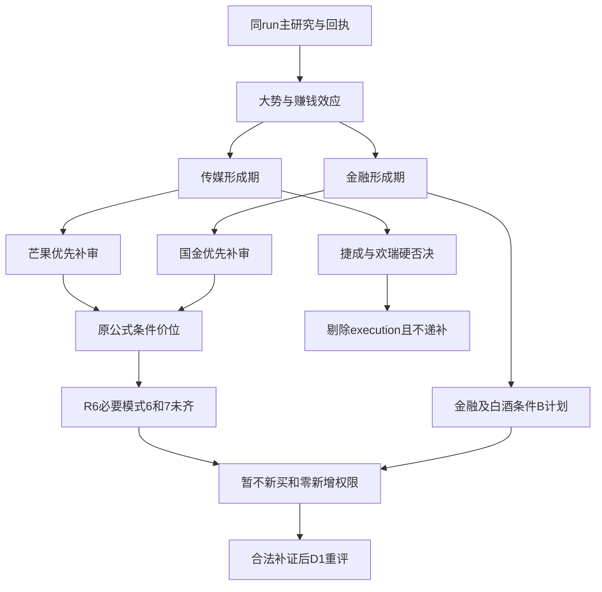

<!-- canghai:explicit-plan-report-assembly:v1 -->
# 显式组装报告（非重新推理）

> 决策来源（JSON）：llm
> 同版 JSON SHA-256（规范化内容）：345aded5a141e731f99e8f3dc1282d933e0a7905de93528f6c381b0ce0f05a08
> 以下散文为调用方提供的模型原文，完整保留、未经重新推理；原文自述不是来源验证，不得覆盖 JSON 禁令、权限或缺口。
> 表格直接复用既有共享 renderer；只读展示，不构成开仓或自动交易授权。

## 模型原文（非重新推理）

---
date: 2026-11-03
agent: D1-main-decision
skill_version: main_decision_v1@2.1
generated_at: 2026-11-03T07:32:58+08:00
confidence: null
degraded: true
decision_source: llm
mode: dry_run
position_cap: 0.40
execution_count: 2
watch_count: 11
data_sources:
  - name: current_run_R1_R7
    path: data/research/20261103/research_summary.json
    status: ok
    captured_at: 2026-11-03T07:29:21+08:00
    record_count: 7
  - name: bound_attention_and_emotion
    path: input_manifest.bound_auxiliary_inputs
    status: ok
    captured_at: null
    record_count: 2
  - name: catalyst_calendar
    path: chzl_kg/投研交易/催化剂/20261103.md
    status: error
    captured_at: null
    record_count: null
    error: 本批绑定时缺失，不补抓、不换日历
input_freshness: partial
input_freshness_note: 主版本与回执通过；行情为11月2日收盘，个别两融及ETF份额为10月30日。R6逐票必要审核未完，今日日历缺失；均按来源和对象处理。
---

# 2026年11月3日 · 主决策 / D1盘前预案

## 🧭 一句话结论
修复不等于普涨接力：传媒、金融龙一进执行研究候选，必要审核未齐暂不开仓，研究上限40%不是账户预算。

## 🛑 不交易条件清单与当前有效限制

本次是LLM真实决策，不是Python量价选股兜底。决定保留芒果超媒、国金证券两只优先执行候选，意在把值得补证的核心、条件买卖点和失败剧本讲清楚，不是用空池证明研究完成。当前可开仓0只、可观察11只、不可做2只真实R6硬否决（已包含在风险观察锚中，另外列入rejected）；两执行候选单独列为“待补证／暂不开仓”，不混充可开仓。观察数量不足20是本版正式逐票画像覆盖所限，不为满足数量复制热榜或另抓票。

|限制|来源与对象|当前状态|解除／重评边界|
|---|---|---|---|
|必要模式6/7未齐|R6：芒果、国金；其他画像逐票状态保留|两候选均active，禁止对应新买|补真实精确板块出货检查及相关合规必要结论，由R6/研究owner补证、D1重评；空alert、现名无ST都不代替阴性结论|
|hard_reject|捷成股份、欢瑞世纪|active，从execution剔除|仅R6真实新证据可重评；不因原研究窗口结束自动解除|
|账户预算与独立交易授权|未获读取账户许可；预算来源未知|effective_trading_budget=null；当前新增仓位0|不把未知改成正预算，不声称真实账户额度为0；任何既有用户/账户停买和有效零预算原样保留|
|执行保护|本计划dry_run、禁自主、需人工确认；买入订单上限0|有效|用户确认也不能替代必要风险补审；P1/P2或图注不自动解禁|
|基础设施全局严重度|summary=2|GLOBAL_SEVERITY_3不激活|版本/基础设施真实变化另核；不因0.392质量分全局禁买|
|日历覆盖|今日本批绑定缺失|辅助gap，不激活全市场事件禁买|calendar/fetch owner补合法绑定，D1不现场重建、不读其他日期|

本计划no_trade=true是“当前计划没有可授权新买对象”的汇总结论，不是市场没有机会、更不是把资料质量冻结成永久空仓。所有execution/watch/B条目的auto_trade_enabled=false、trade_authorized=false、requires_user_confirmation=true，max_position_pct及入场position_pct均为0。正常退出管理不能因禁新停止，但本轮没有读取真实持仓，不给虚构可卖数量，不提一把清仓或杜撰T计划。

## 💰 条件买卖点总表：研究价位与当前买权分开

以下基于本版R5前复权日线，事实日2026-11-02，适用本次11月3日剧本；竞价后须重评，不自动跨日继承。触发价不是委托价；“引擎最高接受价”也不是RR已通过的可追价。实际报价、涨跌停边界和流动性未核，不能把公式价格说成今日一定可成交。

|对象／身份|昨收|条件买区|突破确认|引擎最高接受|止损参考（T+1）|止盈／2R参考|买区上沿RR|当前能否买|
|---|---:|---|---:|---:|---:|---:|---:|---|
|芒果超媒 300413.SZ／执行候选|26.76|26.98–27.53|27.12|29.02|25.33|31.93|2.00|不可，待核／未授权|
|国金证券 600109.SH／执行候选|8.45|8.41–8.58|8.45|9.04|8.15|9.44|2.00|不可，待核／未授权|
|龙版传媒 605577.SH／观察|13.00|12.94–13.19|13.00|13.91|12.53|14.51|2.00|不可，待核／未授权|
|捷成股份 300182.SZ／硬否决锚|5.64|无买入情景|—|—|—|前20日高6.12仅参照|未知|不可，R6硬否决|
|欢瑞世纪 000892.SZ／硬否决锚|4.41|无买入情景|—|—|—|前20日高5.64仅参照|未知|不可，R6硬否决|
|新华传媒 600825.SH／观察|12.47|12.41–12.66|12.47|13.34|12.03|13.92|2.00|不可，待核／未授权|
|银之杰 300085.SZ／观察|26.68|30.19–30.80|30.34|32.46|28.34|35.72|2.00|不可，待核／未授权|
|太平洋 601099.SH／观察|3.54|3.54–3.61|3.56|3.81|3.43|3.97|2.00|不可，待核／未授权|
|东方财富 300059.SZ／观察|18.71|18.89–19.26|18.98|20.31|17.93|21.92|2.00|不可，待核／未授权|
|恒生电子 600570.SH／观察|20.76|20.93–21.36|21.04|22.51|20.29|23.50|2.00|不可，待核／未授权|
|皇台酒业 000995.SZ／观察|15.60|15.62–15.94|15.70|16.80|15.14|17.54|2.00|不可，待核／未授权|
|水井坊 600779.SH／观察|28.12|29.75–30.35|29.90|31.99|28.83|33.39|2.00|不可，待核／未授权|
|泉阳泉 600189.SH／观察|9.72|9.67–9.87|9.72|10.40|9.38|10.85|2.00|不可，待核／未授权|

芒果的计划拟买基准27.53，止损25.33，止损距=-7.991%，止盈31.93；国金基准8.58，止损8.15，止损距=-5.012%，止盈9.44。两者买区上沿RR=2.0，但若追到29.02和9.04，RR分别仅0.7886、0.4494，低于原1.8门槛。必须保留原数值并拒绝用计划RR放行高价，而不是抬止盈或挪止损凑通过。观察池有数字也不取得买权。

## 🌊 大势优先：市场正在奖励什么

先认市场再认个股。R1以11月2日已完成收盘为基准，4681涨、818跌，非ST涨停125、跌停8；相对于前一日跌停82，亏钱广度确实收缩，不能继续套用旧市场零仓。但情绪89并不是胜率89%，更不能据此给满仓。47只昨日涨停池开盘至收盘平均仅+0.13%，说明追价后兑现不强，广谱修复的好看指数与接力参与者的真实收益并不是一回事。

阶段沿用high_chop，仅定温度。开盘溢价+2.72%与收盘反馈+2.83%各有自己的cohort和窗口，不能混算；R1共同风险簇30日仍-14.77%，板块资金又多是一日转正、五日仍负。由此我将R1的55%研究建议作为比较起点，原high_chop减量参考为55%×0.75=41.25%，再结合先手兑现偏弱，独立裁量研究上限40%。这不是固定“阶段→打法”的通道表，也不是从情绪分机械算出账户可花40%。用户总硬顶80%、单票15%、板块40%、最多5持仓仍有效；本计划当前新增仓位仍为0。

今天是不是空仓日？就市场判断，未出现主跌或炸板率>40%的证据，不应宣告全市场空仓日；就本计划实际新买，必要审核与授权均未齐，答案是暂不新买。两层结论可以同时成立。真正让观点失效的是今日广度/溢价再转弱、核心承接失效或新增公告证伪，而非时间过去自动翻多。盘前研究窗口截至09:30，P1只做校准，不得据“超预期”授予买权。

## 🔀 四象限叉乘：热度、资金分别定时点和口径

|象限|本版证据|D1取舍|
|---|---|---|
|高情绪×高资金|传媒与证券/金融科技均R3 L1+L2；R7传媒单日+55.489004亿、非银+31.609464亿|优先研究龙一；单日转入不冒称五日持续主升，两票必要模式未完暂不买|
|高情绪×低资金|机器人、白酒都有传播共振；R2引R7分别-2.75187亿、白酒Ⅱ-2.453512亿|热点不替代合力，保留观察；白酒B计划须出现真实转强|
|低／未确认情绪×高资金|半导体单日+46.076503亿、五日-154.020309亿；R3未覆盖共振|“未覆盖”不是已核低热度；象限归属待定，R4行业负面另存，不能为填格子给执行票|
|低情绪×低资金|本版没有能同时确认两轴均低的具体对象|留空，不伪造方向或把未读当阴性|

两轴均为11月2日／各上游实际窗口，不冒充11月3日实时资金。概念AI视频、AI应用、短剧游戏互有交集，不能把三个概念再数成三条独立主线。钱不会必然从传媒流向白酒：R7的190对检验没有满足负相关且翻向的配对，因此B计划只是条件研究，未启用跷跷板减仓因子。

## 🧩 板块公共判断：传媒与金融，都是形成而非已经完成主升

### 传媒／AI内容：新载体强，不等于旧龙全部复活

- **大资金意图**: 传媒行业+8.49%、单日+55.489004亿元，配合20cm首板和出版、游戏扩散，更像应用端修复的集中定价。资金意图是可检验解释，不是读心结论；五日净额-2.939679亿元仍提醒持续性不足。
- **为什么走强**: AI内容效率叙事和市场风险偏好修复共同作用，芒果的人气容量与龙版的早封都是真实差异。旧新华-6.66%与新首板正收益分离，因此不能让历史心智锚替整个方向代言。
- **逻辑够不够硬**: 价格、首封与资金记录够硬；影之刃零销量给芒果、龙版带来利润分成的说法不够硬。新闻在11月2日盘中已公开，不能拿盘后转载解释为今日新催化。板块封板率缺同口径分母、round_id未知，formation标签不补成已核行情轮次。

公共条件引用JSON的sector_core_watchlist“传媒/AI内容”：核心保住承接、前排有正溢价、同分钟个股资金与价格带同时成立。若核心冲高回落且板块净卖无承接，取消当前突破剧本，不把低开大跌改称主升低吸。龙版早封保留观察，但下降结构不被首板抹掉；捷成与欢瑞各有真实R6硬否决，禁止递补。

### 证券／金融科技：传统行业可以转攻，政策金额不能加成已买入

- **大资金意图**: 非银实际单日净入、早封国金、银之杰20cm与太平洋助攻共同表明金融本轮可成为进攻方向，不按行业名称静态判防守。政策有利融资约束，但不说明所有申请额度今天都进股市。
- **为什么走强**: R4核到再贷款利率由1.25%降至1%、长期制度安排，第三批SFISF操作及主动ETF募资预期，配合T-1前排形成修复交易。政策在盘后确认，T-1上涨不能伪装成公告后的A股T0反应。
- **逻辑够不够硬**: 公告状态比传闻硬，但申请超1000亿元、18只ETF募集超350亿元不等于净买入金额；回购规则修订、两融优化的拟议条款也不是已实施新比例。国金Q3归母+18.01%、PB0.8427支持比较，保荐业务监管警示仍为真实反证。

公共条件引用sector_core_watchlist“证券/金融科技”：证券Ⅱ已明确只有国金、太平洋两只涨停，而金融母方向连同银之杰、赢时胜、恒生是五个已述涨停对象。板型函数按本票最终母方向考察合力，不把子行业2家谎称5家，也不认证“国金先封导致了全部后排”的因果。容量锚东方财富未板，不能按资金绝对额或历史股性替代首板地位。

## 🎯 执行候选逐票裁决（不是可开仓名单）

### 芒果超媒 300413.SZ：进 execution，待补证／暂不开仓

- **大资金意图**: 在传媒广谱修复里选择人气与容量兼具的锚，而不是挑历史最妖的票。T-1大单超大单净入3.094190亿元、五日+1.527083亿元是支持，但龙虎榜净卖0.530632亿元，不能写成全席位一致吸筹。
- **为什么走强**: 20cm首板未开板、末榜人气第3与行业扩散形成研究辨识度；此前五日均量口径下量比约0.92，不采用原图文字“放量已确认”。目前未越27.12前高，确认条件仍在未来。
- **逻辑够不够硬**: R2龙头规则已核1条，即板块连板高度并列top1，不是独占总龙；纪律三条完整认定数量unknown。R5财务Q3归母同比-79.01%、应收／营收42.74%、估值高分位均是真反证，内容降本转利润还只是预期。

- **买入理由**: 第一，主线前排与资金实流有同日事实，优先补审比追历史锚更合理；第二，相较龙版的下降反抽与新华的资金撤退，芒果已收复主要均线，选择半路突破27.12的既有通道，而非从更低MA50幻想能买到。

- **风险点**: 第一，先手在20cm之后可能高开兑现，今天买入又被T+1锁住；第二，财务/估值压力与榜单净卖不因市场热度消失。R6_M7_001、R6_M3_027强提示采纳为风险约束、0新增权限；保留优先研究候选不是覆盖成可参与。

- **止损条件**: 情景买区26.98–27.53，参考止损25.33、止盈31.93。若未来合法授权无底仓新买，当天不能卖，止损effective_from=T+1；次日竞价/可成交盘口处理，无法保证按25.33成交，跌停可能造成更大尾损。研究假设失效或开盘+7%以上不追；当前仓位建议=0%。

- **可验证假设**: 未来1—3交易日传媒前排延续正溢价、芒果保持主要均线与前高突破后的承接；冲高回落且丢失MA5约24.112、板块实流转弱则修复延续假设被否证。不能用“后来又涨了”补做当时价格已离带的交易。

龙头认定：研究硬条件1条，完整纪律条数unknown。板型：T-1午前首板分类，今日承接unknown。禁止清单已知硬命中=[]，不代表全清单已审；plan_formation显式运行，不用in_today_plan=false循环阻止首次成案。core_judge缺20日同口径板块/指数收益序列，未喂空数组造假。R6模式6缺精确板块检查结果，模式7的S3必要结论未齐，当前buy_eligibility=blocked。T+1尾部cohort、账户风险预算未核，不能采用函数正仓位建议。

### 国金证券 600109.SH：进 execution，待补证／暂不开仓

- **大资金意图**: 证券资金在稳市政策预期下选择早封核心，是动态金融进攻，不是防御高股息的静态标签。T-1主力+1.648270亿元、五日+1.173202亿元，体现局部真买盘，但不代表整条金融五日已转强。
- **为什么走强**: 09:34首封未开、成交额相对此前五日约3.41倍，配合金融母方向扩散；8.45收复MA20和MA60但MA5仍在MA20下，属于反转试探，不写长期多头已成。
- **逻辑够不够硬**: 公司盈利和政策状态较芒果的增利假设更硬，所以风险比较优先；但政策实投、后续净额、保荐监管事件完整合规结论仍待核。首板隔日是同一套模板，不新增“低PB稳胜”打法。

- **买入理由**: 第一，国金是证券子板块早封龙一，比太平洋晚封助攻更适合本模板；第二，东方财富虽然人气更高、资金绝对额更大，未涨停且五日净入仅约0.0651亿元，不应替代已核首板身位。旧股性43.7低于东方财富64，不影响当前裁决。

- **风险点**: 第一，政策高开可能被先手兑现，额度与ETF募资不能直接当新增购买力；第二，监管警示及必要审查缺项未闭环，不把未证发行人立案误写为已认定重大违法，也不把未认定违法误写成全面无风险。

- **止损条件**: 研究买区8.41–8.58、突破确认8.45，止损8.15、止盈9.44。无底仓新增仓仍最早T+1退出，止损参考不保证实际成交价。若未来价格高开远离带、突破失败且金融核心失去承接，取消新买剧本，不低开补票；当前仓位建议=0%。

- **可验证假设**: 下一交易时段证券早封核心仍有正溢价、可比行业资金延续，国金守住已收复结构；若只是消息高开后兑现、次日溢价消失，政策交易延续假设失败。验证资料须与当时盘口同窗，不能用盘后净额反推买点当时已满足。

龙头认定：R2研究硬条件1条，完整三条纪律认定unknown。板型：秒拉板；最终主题是金融母方向5个已述涨停对象，函数提示排板不冲，不等于证券Ⅱ有5家。禁止清单已知硬命中=[]，全清单仍未齐。模式6缺精确板块分布检查，模式7还缺S2后续完整合规、S3必要结论；总龙身份和停牌次数未知，不调用dragon_switch默认alive。当前buy_eligibility=blocked。

## 👀 观察池与不选对照：不让候选静默消失

龙版传媒是R2龙二，不因风险档位自动否定市场价值；但R5低于MA10/20、R6反抽强提示使它不能被称主升低吸。突破演算买区12.94–13.19只是原引擎在远端20日高21.27之外使用昨收pivot的反抽参照，未核当日交易所边界，不能宣称实际可达。图像途中压力14.3低于引擎止盈14.51，保持双方数值并标manual_review_required=true。它不挤占芒果首推；这不是仅因历史股性更低而排除。

银之杰是金融科技龙二，20cm与五日+2.597817亿元有真实强点，1次开板也不等于多次开板硬拒。但MA20/50仍压制、亏损与估值压力保留，只作右侧确认观察，不把“金融IT业务有未来”冒充本次交易已经有资格。演算突破30.34不等于现价26.68附近可以买，更不为了给近买点切到MA10。

新华传媒历史股性72.8、主题锚领先，但当日-6.66%、五日主力-4.483877亿元、资金跨口径还冲突。它作为旧锚与新载体分离的温度计，不能用主题上涨替它恢复核心。太平洋有强净流，仍是R2助攻；恒生电子有金融IT逻辑，五日资金负且开板1/2次跨源冲突，二者都不自动递补。东方财富是容量参照，政策强时可以转攻，但不改本模板的首板身份要求。

白酒三票分别保留：皇台二板高度与小流通盘/控制人风险并列，水井首板放量与库存利润反证并列，泉阳泉二板与4次开板、当日资金净卖及减持窗口并列。泉阳泉主营不是白酒，不偷换行业。皇台是跨模板／次线观察，不扩成第三套执行策略；水井作为B计划条件研究，尚无板块净额转强，不能因为本报告点名就买。

真实硬否决单列：捷成的四项财务红旗F2/F3/F9/F11同时成立，其中F3依据是应收同比下降9.07%、收入下降23.73%的原不等式，不夸大成应收绝对暴增；会计整改不是此硬否决唯一或替代依据。欢瑞是发行人立案且截至三季报仍无结论，不称已经判定财务造假；控制主体之一约98.92%质押不称集团全体质押率。二者只作禁买风险锚，MA10/20与前高可参考，没有新增买区，也不让龙三或低位替补绕过。

R2/R4的外围对照已阅读而未转成 execution：海看20cm、文投早封、粤传媒等分别有流通盘/旧反复结构/主题映射不足；凌云光虽有参股动捕的更直接业务映射，仅有无行情时点的38.26报价，不能当昨收或据此计算买卖价，必要结构/合规也不完整。赛诺Q3改善、思泉已过解禁与成长池的“0全条件认证”同样不等于它们全市场不合格；只是当前缺本轮前排地位与可执行必要证据。红利炬华等旧表不替代当日金融进攻，理由是时点/资金/地位，不是行业偏见。完整对照对象沿用本版R2/R4/R5的candidate_comparisons，已在JSON留证，不现场跑全市场。

## 🅱️ B计划：条件方向不是自动买入候补单

第一层：传媒不及预期，但金融前排独立承接时，仍只核国金8.41–8.58、确认8.45、止损8.15、止盈9.44，RR=2.0；不把“切金融”当解除R6缺证。第二层：两主线同时分歧，白酒真实转强且水井价格在29.75–30.35内才保留次线核验，确认29.90、止损28.83、止盈33.39，RR=2.0。白酒板块T-1净额负，不能仅靠反向上涨直觉或负相关名词认定资金已搬家。

触发观察是两执行候选竞价均不及预期、主线资金净卖无承接，或龙头断板／炸板率升破25%；具体动作须以当日真实数据由owner重评。若金融与白酒也共同走弱，停止新买研究触发，不用第三个计划追更偏门方向。B计划中代码来自同版原池，权限与零新增仓位均原样保留。

## 🕘 竞价预期与T+1可执行性

### 芒果超媒竞价校准

预期带26.36–27.30（昨收26.76）。这只是D1情景设定，非当日事实。

|区间|判定|动作|
|---|---|---|
|<-1.5%|below_expected|取消当前突破情景，降级观察；不承接低开飞刀。|
|-1.5%~+2%|in_expected|只校准原剧本，不解除R6缺证/预算/授权；带内同分钟确认后仍须独立授权。|
|+2%~+5%|above_expected|先核先手兑现，量价承接不成立取消；不得凭超预期自动晋级。|
|>+5%|far_above|本轮不追，等合法重评；一字不挂竞价单，开盘>7%为原硬限制。|
### 国金证券竞价校准

预期带8.32–8.62（昨收8.45）。这只是D1情景设定，非当日事实。

|区间|判定|动作|
|---|---|---|
|<-1.5%|below_expected|取消当前突破情景，降级观察；不承接低开飞刀。|
|-1.5%~+2%|in_expected|只校准原剧本，不解除R6缺证/预算/授权；带内同分钟确认后仍须独立授权。|
|+2%~+5%|above_expected|先核先手兑现，量价承接不成立取消；不得凭超预期自动晋级。|
|>+5%|far_above|本轮不追，等合法重评；一字不挂竞价单，开盘>7%为原硬限制。|

本次不给竞价顶一字单。首板隔日模板并不强制选择竞价抢筹；高开先兑现、价格离带后才满足资金条件都应取消当日交易，而不是补票。一字板没有有效成交买点，只能等合法新证据确认开板承接。20cm不因为波幅大就自动获得更高追价权。

所有新增仓离场最早T+1。JSON止损和止盈两类exit_rules均标effective_from=T+1，未知底仓不伪造T+0可卖量。t1_candidates开仓/加仓/止损持仓三列表为空，原因分别是当前无独立买权、没有获准读取或核实持仓，不是全市场无机会或持仓为零。历史股性封板率/涨停次日溢价不是“昨日涨停→今日开盘买入→次日卖出”的匹配cohort；没有尾部5%损失样本与账户风险预算，不编造正EV和由此倒推的仓位。

## 🧠 专题证据：本轮最终取舍，不继承上游自报已采纳

只消费R2/R4/R5/R6 JSON中的knowledge_context及声明。input_manifest.topic_knowledge的run、attempt、context标识、主产物版本在原消费函数中核过；这只认证运输/版本，不证明模型理解或专题效果。R2接收回执是partial、knowledge_context_status=missing_or_invalid；R4/R5是matched；R6专题prepare失败，独立读取/采用unknown。保留这些差异，不抹成全成功。

历史股性采用的是R5精确13码投影：新华72.8高于芒果40、东方财富64高于国金43.7，反而构成“历史分不能替代今日地位”的对照，没有额外权重。主题锚只保留有限历史对照，其运输接收异常未被本轮声明抹平。成长池新版本只采“未全核不是全市场不合格”的限定，不解码未运输的附录字母为已核风险。红利与增持表没有本池精确命中，不迁移其资格、持仓或资金认证。

一字预测目标日匹配，但前三只阳光照明、东方海洋、桂林三金已是三板，不在只顶首／二板边界；劲旅环境、高争民爆虽首板，仍缺本轮板块核心与必要审核。拒绝“可重点排隔夜单”文案作为指令，概率未经本轮策略校准。复盘feedback_evidence为空，采用与效果unknown，不能借索引说已读错题。

旧日历只读本版R4内嵌K01—K07摘录：其中“会议内容尚未公开”已不能代表当前，用同版R4会后政策事实替代，但不把旧日历当第二独立正面源。其余停牌、作价、PMI与未来会期覆盖留deferred；不沿旧来源路径打开文件。今日唯一获准路径缺失，未来三交易日完整日程unknown，而不是“无大事件”。JSON逐来源/对象给出source_id、refs、disposition、用途、影响代码与板块，并把上游采用声明和D1最终取舍分开保存；传递留证不是效果证明。

## 🧮 价位推导与识图复核

原API在本轮工作对象上实际运行：consume_authorized_inputs(saved)取得同版primary，chart_evidence_from_profiles(primary.R5)仅取内嵌快照，apply_to_plan输出价位。默认引擎load_tech会查数据库；本轮以只读内存适配将其限定为本版R5的前复权日线／均线，再用原公式，未开数据库、raw/latest、图缓存或MCP。83条内嵌日线的最后20个实际交易样本形成高低点，事实截止11月2日；牛熊线null不伪造为测量值，未提供的结构候选不使用。

所有有效情景先由D1选leader_breakout，不由MA50位置或引擎旧规则猜通道。pivot=max(昨收,20日高)，普通slack=1.5%；远端前高被原引擎当理论板制边界外参照时，保留远端值和边界未核限定，不把算法诊断当交易所可达性证明。止损以买区上沿为基准与可用技术候选取高且在买区下方；未人为扩大损失或挪买区求通过。下面逐票抄录的是实跑公式，不是另一份模型拍价。

### 芒果超媒 300413.SZ

pivot=max(昨收,20日高)=27.12; 买区=[pivot×0.995, pivot×(1+1.5%)]; 溢价上限7%。

止损=买价×(1-8%) → 25.33（三者取最高: 买价×(1-8%)=25.33, MA10×0.99=23.35）。

2R目标 = 买27.53 + 2×(买入价-止损2.20) = 31.93。

RR=(31.93-27.53)/(27.53-25.33)=2.0。

原始与舍入节点：valid（仅几何）；权限仍blocked。数据日2026-11-02，MA10=23.5820，MA50=19.7794，20日高=27.12。

识图确认（仅breakout；数据日20261102）；非交易授权。仅可比项有效；其余周期、日期、时点、复权或语义未满足不作确认，不改变价格、资格或授权。

### 国金证券 600109.SH

pivot=max(昨收,20日高)=8.45; 买区=[pivot×0.995, pivot×(1+1.5%)]; 溢价上限7%。

止损=买价×(1-5%) → 8.15（三者取最高: 买价×(1-5%)=8.15, MA10×0.99=7.87）。

2R目标 = 买8.58 + 2×(买入价-止损0.43) = 9.44。

RR=(9.44-8.58)/(8.58-8.15)=2.0。

原始与舍入节点：valid（仅几何）；权限仍blocked。数据日2026-11-02，MA10=7.9450，MA50=8.3062，20日高=8.45。

识图确认（仅breakout；数据日20261102）；非交易授权。仅可比项有效；其余周期、日期、时点、复权或语义未满足不作确认，不改变价格、资格或授权。

### 龙版传媒 605577.SH

pivot=ref_close(远端20日高今日不可达，仅作压力位)=13.00; 买区=[pivot×0.995, pivot×(1+1.5%)]; 溢价上限7%；⚠️20日高21.27距昨收+63.6%，今日不可达，不作买入基准。

止损=买价×(1-5%) → 12.53（三者取最高: 买价×(1-5%)=12.53）。

2R目标 = 买13.19 + 2×(买入价-止损0.66) = 14.51。

RR=(14.51-13.19)/(13.19-12.53)=2.0。

原始与舍入节点：valid（仅几何）；权限仍blocked。数据日2026-11-02，MA10=13.8230，MA50=13.8414，20日高=21.27。

识图冲突（数据日20261102）：resistance 图=14.3 引擎={'channel': 'leader_breakout', 'trigger_price': 13.0, 'buy_zone': [12.94, 13.19], 'stop_loss': 12.53, 'take_profit': 14.51, 'quote_decimals': 2} 理由=chart_pressure_on_path_before_engine_target；人工复核，不改价/买权。仅可比项有效；其余周期、日期、时点、复权或语义未满足不作确认，不改变价格、资格或授权。

### 捷成股份 300182.SZ

真实R6硬否决，纯禁买锚无买入情景；不是缺昨收，保留MA10/20与前高结构参照，不生成零元止损或假买点。

识图unknown：engine_levels_unavailable。仅可比项有效；其余周期、日期、时点、复权或语义未满足不作确认，不改变价格、资格或授权。

### 欢瑞世纪 000892.SZ

真实R6硬否决，纯禁买锚无买入情景；不是缺昨收，保留MA10/20与前高结构参照，不生成零元止损或假买点。

识图unknown：engine_levels_unavailable。仅可比项有效；其余周期、日期、时点、复权或语义未满足不作确认，不改变价格、资格或授权。

### 新华传媒 600825.SH

pivot=ref_close(远端20日高今日不可达，仅作压力位)=12.47; 买区=[pivot×0.995, pivot×(1+1.5%)]; 溢价上限7%；⚠️20日高16.34距昨收+31.0%，今日不可达，不作买入基准。

止损=买价×(1-5%) → 12.03（三者取最高: 买价×(1-5%)=12.03）。

2R目标 = 买12.66 + 2×(买入价-止损0.63) = 13.92。

RR=(13.92-12.66)/(12.66-12.03)=2.0。

原始与舍入节点：valid（仅几何）；权限仍blocked。数据日2026-11-02，MA10=14.6660，MA50=8.2420，20日高=16.34。

识图unknown：no_comparable_chart_level。仅可比项有效；其余周期、日期、时点、复权或语义未满足不作确认，不改变价格、资格或授权。

### 银之杰 300085.SZ

pivot=max(昨收,20日高)=30.34; 买区=[pivot×0.995, pivot×(1+1.5%)]; 溢价上限7%。

止损=买价×(1-8%) → 28.34（三者取最高: 买价×(1-8%)=28.34, MA10×0.99=25.46）。

2R目标 = 买30.80 + 2×(买入价-止损2.46) = 35.72。

RR=(35.72-30.80)/(30.80-28.34)=2.0。

原始与舍入节点：valid（仅几何）；权限仍blocked。数据日2026-11-02，MA10=25.7220，MA50=29.1996，20日高=30.34。

识图unknown：no_comparable_chart_level。仅可比项有效；其余周期、日期、时点、复权或语义未满足不作确认，不改变价格、资格或授权。

### 太平洋 601099.SH

pivot=max(昨收,20日高)=3.56; 买区=[pivot×0.995, pivot×(1+1.5%)]; 溢价上限7%。

止损=买价×(1-5%) → 3.43（三者取最高: 买价×(1-5%)=3.43, MA10×0.99=3.29）。

2R目标 = 买3.61 + 2×(买入价-止损0.18) = 3.97。

RR=(3.97-3.61)/(3.61-3.43)=2.0。

原始与舍入节点：valid（仅几何）；权限仍blocked。数据日2026-11-02，MA10=3.3280，MA50=3.4512，20日高=3.56。

识图确认（仅breakout,support；数据日20261102）；非交易授权。仅可比项有效；其余周期、日期、时点、复权或语义未满足不作确认，不改变价格、资格或授权。

### 东方财富 300059.SZ

pivot=max(昨收,20日高)=18.98; 买区=[pivot×0.995, pivot×(1+1.5%)]; 溢价上限7%。

止损=MA10×0.99 → 17.93（三者取最高: 买价×(1-8%)=17.72, MA10×0.99=17.93）。

2R目标 = 买19.26 + 2×(买入价-止损1.33) = 21.92。

RR=(21.92-19.26)/(19.26-17.93)=2.0。

原始与舍入节点：valid（仅几何）；权限仍blocked。数据日2026-11-02，MA10=18.1130，MA50=18.5038，20日高=18.98。

识图确认（仅breakout；数据日20261102）；非交易授权。仅可比项有效；其余周期、日期、时点、复权或语义未满足不作确认，不改变价格、资格或授权。

### 恒生电子 600570.SH

pivot=max(昨收,20日高)=21.04; 买区=[pivot×0.995, pivot×(1+1.5%)]; 溢价上限7%。

止损=买价×(1-5%) → 20.29（三者取最高: 买价×(1-5%)=20.29, MA10×0.99=19.80）。

2R目标 = 买21.36 + 2×(买入价-止损1.07) = 23.50。

RR=(23.50-21.36)/(21.36-20.29)=2.0。

原始与舍入节点：valid（仅几何）；权限仍blocked。数据日2026-11-02，MA10=20.0030，MA50=20.5269，20日高=21.04。

识图确认（仅breakout；数据日20261102）；非交易授权。仅可比项有效；其余周期、日期、时点、复权或语义未满足不作确认，不改变价格、资格或授权。

### 皇台酒业 000995.SZ

pivot=max(昨收,20日高)=15.70; 买区=[pivot×0.995, pivot×(1+1.5%)]; 溢价上限7%。

止损=买价×(1-5%) → 15.14（三者取最高: 买价×(1-5%)=15.14, MA10×0.99=13.39）。

2R目标 = 买15.94 + 2×(买入价-止损0.80) = 17.54。

RR=(17.54-15.94)/(15.94-15.14)=2.0。

原始与舍入节点：valid（仅几何）；权限仍blocked。数据日2026-11-02，MA10=13.5260，MA50=11.8564，20日高=15.70。

识图确认（仅breakout；数据日20261102）；非交易授权。仅可比项有效；其余周期、日期、时点、复权或语义未满足不作确认，不改变价格、资格或授权。

### 水井坊 600779.SH

pivot=max(昨收,20日高)=29.90; 买区=[pivot×0.995, pivot×(1+1.5%)]; 溢价上限7%。

止损=买价×(1-5%) → 28.83（三者取最高: 买价×(1-5%)=28.83, MA10×0.99=25.32）。

2R目标 = 买30.35 + 2×(买入价-止损1.52) = 33.39。

RR=(33.39-30.35)/(30.35-28.83)=2.0。

原始与舍入节点：valid（仅几何）；权限仍blocked。数据日2026-11-02，MA10=25.5750，MA50=26.4860，20日高=29.90。

识图unknown：no_comparable_chart_level。仅可比项有效；其余周期、日期、时点、复权或语义未满足不作确认，不改变价格、资格或授权。

### 泉阳泉 600189.SH

pivot=max(昨收,20日高)=9.72; 买区=[pivot×0.995, pivot×(1+1.5%)]; 溢价上限7%。

止损=买价×(1-5%) → 9.38（三者取最高: 买价×(1-5%)=9.38, MA10×0.99=8.30）。

2R目标 = 买9.87 + 2×(买入价-止损0.49) = 10.85。

RR=(10.85-9.87)/(9.87-9.38)=2.0。

原始与舍入节点：valid（仅几何）；权限仍blocked。数据日2026-11-02，MA10=8.3810，MA50=8.1062，20日高=9.72。

识图确认（仅breakout；数据日20261102）；非交易授权。仅可比项有效；其余周期、日期、时点、复权或语义未满足不作确认，不改变价格、资格或授权。

芒果、国金仅breakout项确认，不冒称支撑止损与途中压力也通过；太平洋的support项是一项辅助可比诊断，不把图像观察支撑改成执行止损。龙版resistance冲突已保留双方价位并标人工复核。缺图／不可比／未知项不写成失败硬禁，更不把图注充当手工偏价依据。已有真实字符串理由才附owned注记，本轮没有以识图改变任何entry/exit数值、池身份、仓位、RR资格或执行模式。

## 数据源审计

下表是本版主研究内的数据源审计转述，D1本会话只读取绑定产物，没有沿路径打开raw、外链或另调provider。🟢代表该分项上游取证／交付可用，不代表研究完整或可买；🟡代表partial/stale/未全核；🔴只是实际缺失或原错误。call_failed、not_yet_landed、source_down不混用，未实测探针不能据此说provider全局宕机。

|源|日期|状态|记录数／备注|
|---|---|:--:|---|
|R1主产物|2026-11-03|🟡|版本回执核过；原status=degraded，confidence=0.476，不是胜率|
|R2主产物|2026-11-03|🟡|版本回执核过；原status=partial，confidence=0.392，不是胜率|
|R3主产物|2026-11-03|🟡|版本回执核过；原status=partial，confidence=0.364，不是胜率|
|R4主产物|2026-11-03|🟡|版本回执核过；原status=partial，confidence=0.63，不是胜率|
|R5主产物|2026-11-03|🟡|版本回执核过；原status=partial，confidence=0.72，不是胜率|
|R6主产物|2026-11-03|🟡|版本回执核过；原status=partial，confidence=0.64125，不是胜率|
|R7主产物|2026-11-03|🟡|版本回执核过；原status=partial，confidence=0.2625，不是胜率|
|R1：tushare.ths_daily|2026-11-03|🟢|22；22/22本次实时拉取；其中1序列窗口缺2日，整体覆盖partial|
|R1：tushare.fund_daily|2026-11-03|🟢|20；20/20，30日齐全；未复权价格回报，不是含分红总回报|
|R1：tushare.daily+limit_list_d+limit_step+index_daily|2026-11-03|🟢|5571；广度包含当日有日线样本，涨跌停统计按非ST，非同一母体|
|R1：xtick.market_emotion|2026-11-03|🟢|1；高度及修复方向交叉；不强行拼接范围不同的计数|
|R1：tushare.index_global+us_daily|2026-11-03|🟡|19；5指数和14核心样本有日线；美股最新20261030，SOX/HSTECH为空|
|R1：tencent.us_existing_overseas_helper|2026-11-03|🟢|3；本轮实时HTTP，源报价美东20261102核验；收盘后截面非官方收盘认证|
|R1：tushare.fx_daily|2026-11-03|🟡|53；有效标识重查得人民币历史，最新20261101；美元指数空，日界线未核|
|R1：cross_asset_monthly|未知|🔴|None；上游skipped_by_policy；本轮无黄金/铜/原油完整月度动量；不替代为零|
|R1：wechat_official_20|2026-11-03|🟢|88；本日fetch输入；转载政策与盘中行情，非官方原始核实|
|R1：wechat_cli_5groups|2026-11-03|🟢|464；5群；严格昨夜优先群KOL长文0条，短句不冒充权威长文|
|R1：manifest+mcp_health|2026-11-03|🟢|None；global_severity=2；未用健康分触发no_trade|
|R1：weflow_optional|2026-11-03|🔴|None；404；辅助缺失，降置信度不全局禁买|
|R3：R1_current_day|2026-11-03|🟢|1；当日盘前基线；原status=degraded，量化观测20261102并在有效窗内；不是昨日R1|
|R3：tushare_hotlists_live|2026-11-03|🟢|440；两期热股100+人气100+概念20；11月3日两榜为空，非伪装即时人气|
|R3：attention_signals|2026-11-03|🟢|320；T-1已收盘基准含飙升榜100；persistent非连续top1证据；非独立主源|
|R3：wechat_cli|2026-11-03|🟢|464；5群尾页空/分日多重集一致，远端同步未知；图片未读|
|R3：wechat_official_rss|2026-11-03|🟢|88；88篇；主观点全文抽阅，宏观单列，不计共振或分数|
|R3：xtick_emotion|2026-11-03|🟢|1；含ST等范围未与非ST对齐，131/10/31，不混算|
|R3：tushare_banner_moneyflow|2026-11-03|🟢|10；仅000678五个交易日两资金口径|
|R3：xtick_banner_money|2026-11-03|🟢|1；带后缀空，6位code重查有效；正向确认不排除|
|R3：weflow_retired|未知|🔴|0；永久下线，旧快照未读取|
|R3：five_dimension_crosscheck|未知|🔴|None；杠杆外资及各维尺度定义未齐；不填0、不算伪分|
|R3：image_bodies|2026-11-03|🔴|104；本轮未解析图片，不用图片缺失推断沉默|
|R4：news_cls|2026-11-03|🟢|1997；新浪1438条+同花顺559条;实际最早20261031 09:04最新20261103 05:58:36;不是财联社直采|
|R4：news_major|2026-11-03|🟢|800；最早20261102 16:13:11最新20261103 04:40;全为标题无正文;800条上限截断72h|
|R4：eastmoney_earnings_predict|2026-11-03|🟡|500；2026Q3样本;公告日期20260825-20261024;不是当前H1/全量业绩;无记录不能写无预告|
|R4：wechat_official_20|未知|🟢|88；17个RSS源;兼容镜像仅计一次;盘前纪要只有11月2日旧版;本日07点文章尚未到发布时段|
|R4：wechat_cli_5groups|未知|🟢|464；五群文字;图片/文件未读;只作线索不计独立原始支持|
|R4：anns_window|未知|🟢|1622；20261102/03公告目录;日期级无完整发布时间;重点PDF8份实际复核|
|R4：hithink_business_query|2026-11-03|🟢|None；实际官方OpenAPI两票;报告期缺失/产品层级混合;event收入占比未知|
|R4：hithink_market_query|2026-11-03|🟢|10；20261102游戏前10只实取;非自动龙头判定|
|R4：announcement_search|2026-11-03|🟡|None；同日问句返回历史公告;不代表同日无冲突|
|R4：tushare_MCP|未知|🟢|None；实际两轮短讯与3票公告目录直调;不按工具重复计源|
|R4：official_originals|2026-11-03|🟢|None；已取新华社政策/新华财经问答/财联社收盘;游戏页面只取得付费公开摘要|
|R4：R7|未知|🔴|None；本轮正式R7_capital_flow.json尚未出现;未借旧资金值填补|
|R4：R3|未知|🔴|None；正式R3_sentiment.json尚未出现;KOL独立验证unknown|
|R4：xtick_news|未知|🔴|None；R4当前developer工具权限不含xtick;未调用;用获准新闻与公告主路径补核|
|R4：datapro_vibe_cross|未知|🔴|None；当前R4白名单file/wechat/tushare;未调用越权provider;采用skill官方OpenAPI及原文;不全局禁买|
|R5：tushareMcp_live|2026-11-03|🟢|221；来源实际窗口见该主产物；无全量读取或独立源认证|
|R5：issuer_original_pdf|2026-11-03|🟢|44；来源实际窗口见该主产物；无全量读取或独立源认证|
|R5：bound_chart_vision|2026-11-03|🟢|13；来源实际窗口见该主产物；无全量读取或独立源认证|
|R5：canghai-sise|2026-11-03|🟢|9；来源实际窗口见该主产物；无全量读取或独立源认证|
|R5：R2|2026-11-03|🟢|13；来源实际窗口见该主产物；无全量读取或独立源认证|
|R5：R4|2026-11-03|🟢|13；来源实际窗口见该主产物；无全量读取或独立源认证|
|R7：tushareMcp.block_trade|2026-11-02|🟢|86；实时MCP查询，实际观察日独立保留；同一底层东财不算多独立源|
|R7：tushareMcp.daily|2026-11-02|🟢|5931；实时MCP查询，实际观察日独立保留；同一底层东财不算多独立源|
|R7：tushareMcp.daily_basic|2026-11-02|🟢|360；实时MCP查询，实际观察日独立保留；同一底层东财不算多独立源|
|R7：tushareMcp.fund_daily|2026-11-02|🟢|80；实时MCP查询，实际观察日独立保留；同一底层东财不算多独立源|
|R7：tushareMcp.fund_share|2026-10-30|🟡|76；实时MCP查询，实际观察日独立保留；同一底层东财不算多独立源|
|R7：tushareMcp.fut_daily|2026-11-02|🟢|20；实时MCP查询，实际观察日独立保留；同一底层东财不算多独立源|
|R7：tushareMcp.hm_detail|2026-11-02|🟢|1405；实时MCP查询，实际观察日独立保留；同一底层东财不算多独立源|
|R7：tushareMcp.index_daily|2026-11-02|🟢|20；实时MCP查询，实际观察日独立保留；同一底层东财不算多独立源|
|R7：tushareMcp.limit_list_d|2026-11-02|🟢|161；实时MCP查询，实际观察日独立保留；同一底层东财不算多独立源|
|R7：tushareMcp.limit_step|2026-11-02|🟢|11；实时MCP查询，实际观察日独立保留；同一底层东财不算多独立源|
|R7：tushareMcp.margin_detail|2026-10-30|🟡|304；实时MCP查询，实际观察日独立保留；同一底层东财不算多独立源|
|R7：tushareMcp.moneyflow_dc|2026-11-02|🟢|12422；实时MCP查询，实际观察日独立保留；同一底层东财不算多独立源|
|R7：tushareMcp.moneyflow_ind_dc|2026-11-02|🟢|9920；实时MCP查询，实际观察日独立保留；同一底层东财不算多独立源|
|R7：tushareMcp.moneyflow_mkt_dc|2026-11-02|🟢|20；实时MCP查询，实际观察日独立保留；同一底层东财不算多独立源|
|R7：tushareMcp.stock_basic|2026-11-02|🟢|5577；实时MCP查询，实际观察日独立保留；同一底层东财不算多独立源|
|R7：tushareMcp.top_inst|2026-11-02|🟢|4180；实时MCP查询，实际观察日独立保留；同一底层东财不算多独立源|
|R7：tushareMcp.top_list|2026-11-02|🟢|418；实时MCP查询，实际观察日独立保留；同一底层东财不算多独立源|
|R7：tushareMcp.trade_cal|2026-11-02|🟢|95；实时MCP查询，实际观察日独立保留；同一底层东财不算多独立源|
|R7：tushareMcp.us_daily|2026-10-30|🟡|14；实时MCP查询，实际观察日独立保留；同一底层东财不算多独立源|
|R7：xtick.xtick_hot_money|2026-11-03|🟢|58；10票逐日五日+其他8票末日；四只ETF空返回不计覆盖|
|R7：xtick.xtick_market_emotion|2026-11-03|🟢|1；来源实际窗口见该主产物；无全量读取或独立源认证|
|R7：xtick.xtick_hot_bk|2026-11-03|🔴|None；仅返回板块成分股，无可比资金字段|
|R7：datapro.dataPro_search|未知|🔴|None；4013 Agent Plan订阅已失效或未分配席位；trace_id=17d28dd995674de0b07f8de8d9221a28|
|R7：overseas_snapshot|2026-11-03|🟡|12；指数最新，12只美股全为20261030|
|attention绑定|2026-11-02|🟢|使用日11月3日，事实日11月2日；同源榜单不重复算资金独立确认|
|emotion_cycle绑定|2026-11-02|🟢|high_chop=0.72为阶段证据置信，不是胜率；旧动作字符串不作指令|
|catalyst_calendar当日绑定|未知|🔴|指定20261103.md缺失，仅gap，owner补证；不换日期、不补绑定|
|账户／错题／观察目录|未知|🟡|本轮无读取许可；未读不等于无持仓、无错题或无风险|

R1质量分原公式0.85×0.7×0.8=0.476；R2为0.70×0.7×0.8=0.392；R3为0.65×0.7×0.8=0.364；R6原公式base×freshness×agreement并钳位，值0.64125；R7为0.75×0.7×0.5=0.2625。R4=0.63、R5=0.72是上游原值，本轮未见同名公式细项则不补造。R7北向不进分子分母，也不因其缺失清零；DataPro 4013是上游实调订阅失效，不扩大为全部MCP源故障。

R7美股核心个股末日10月30日滞后，不把它们写成11月2日隔夜反应；R4本轮收盘报道中纳指-1.07%、光通信并购双方约-12.7%／-18.6%是另一条新证据，限定作用于硬件/半导体相关方向，不扩成传媒金融都不能买。ETF份额与两融末日10月30日，R5两融仅14观测，不称15日完整；图像周线仅至10月30日、分钟/周线复权未知，不跨周期凑三项确认。公众号88篇、群聊464条等是各自上游覆盖声明，图片104个未解析，不能把图片缺失当市场沉默。主源／必要风险缺口使degraded=true，辅助缺口不独立全局禁买。

旧score逐票取本版R5 composite_score四舍五入，仅兼容未校准六维研究判断。R5首板隔日维度及权重的计算留在原产物／summary；可复算不证明样本有效或盈利概率，板块score没有冒称个股质量。不同原始资金分类口径、数值零来自真实测量还是缺省未核时不解读为确定阴性；股性历史窗口与当下策略cohort分开。

## 🧯 不确定性、失效事实与owner补证义务

我最可能错在两点：其一，把一日修复当连续赚钱的起点，实际次日先手继续兑现；其二，过度依赖已知前排，外围真新线后来走出。本次用条件剧本而不是强制正仓位处理第一点，用完整候选比较、观察与合法重评义务处理第二点，而不是把每只后验上涨都算漏赚。没有真实成交不记录实盘盈亏；没有匹配样本不报胜率。

研究owner需要补的是精确对象、窗口与可核结果：R3/R6的板块出货检查，R4/R5/R6关于S2/S3的必要性和完整结论，core_judge所需同口径20日序列和地位事实、总龙身份与监管次数、T+1匹配尾部样本；不是反复跑无关七份报告。calendar/fetch owner应补当日合法日历绑定，事件是否核实仍由来源和内容独立判断。账户预算、真实停买、人工确认归权限owner，不由本轮市场研究自动撤销。P1/P2要保留这些精确缺口，不能靠promote或图像一致把它们改成通过。

## 与其他R/D/E的关系

上游只消费本版summary列出的R1—R7。R2负责主线、身位与比较；R3提供热度/情绪并承担实际出货检查覆盖；R4提供消息双面与公告时序；R5提供同版财务、资金和价格、内嵌识图；R6唯一真实hard_reject权保留；R7负责可适用资金与跷跷板证据。D1承担本轮最终取舍、价格情景和权限分层；不委派、不再启动模型，不改研究原产物。下游P1/P2、execute、E1消费原限制、原价位和候选身份，不把研究完成等同执行许可。

## Sub-Agent元数据

- skill: main_decision_v1@2.1
- model: gpt-6.1-sol；本CLI会话唯一决策者
- decision_source: llm；没有调用d1_algorithm.py或main_decision.py替代决策
- 核心artifact: data/plans/20261103/watchlist_plan.json
- 主报告: chzl_kg/投研交易/盘前预案/20261103.md
- 研究run: 20261103T061037-82910-26171；主摘要及辅助版本启动／交付复核相同
- 研究质量：partial；production_ready=false，research_completion_passed=false，reassessment_required=true
- 本轮生成于真实盘前；行情截止11月2日，消息截至R4本轮截止；不是事后回放，不冒充当日竞价已发生
- 用量：usage_unknown，不记0；5000万仅连续任务努力目标，无硬限承诺
- 交付只含核心JSON与本主MD，不写runtime副本、附加MD、raw或错题文件

## 同版 JSON 共享表格（只读附录）

# 20261103 盘前预案 · 点位表版

> 计划生成时点：2026-11-03T07:32:58+08:00；决策来源：llm

## 板块机会总览

市场背景：广谱修复、前排兑现偏弱；传媒与证券/金融科技双线优先，新老载体分离。

> 先市场／板块效应，再个股地位；未提供关系证据不推断龙头带动或板块扩散。

| 板块／本轮行情 | 阶段／窗口 | 效应与延续 | 核心与梯队（上游标签） | 共振／分离证据 | 主／反向剧本（名单归属非关系证明） | 确认条件 | 共同失效条件 | 观测时点 |
|---|---|---|---|---|---|---|---|---|
| 传媒/AI内容 | formation | 已核T-1合力；T0可交易确认待竞价 | ts_code: 300413.SZ；name: 芒果超媒；r2_role: 龙一；ts_code: 605577.SH；name: 龙版传媒；r2_role: 龙二；ts_code: 300182.SZ；name: 捷成股份；r2_role: 候补；ts_code: 000892.SZ；name: 欢瑞世纪；r2_role: 候补；ts_code: 600825.SH；name: 新华传媒；r2_role: 候补 | 市场奖励：传媒行业+8.49%居行业资金首位；AI视频+8.7688%、短剧+8.2996%是同母方向而非三主线；合力：概念41涨停、AI应用47涨停存在交集不相加；芒果/捷成/海看20cm与出版、游戏共同扩散；核心：芒果人气容量、龙版早封与心智锚；旧新华传媒负收益与新载体正反馈分离，不继续以旧锚代表全主题；R1.market_breadth；R3.resonance_top_themes[0]；R4.top_events/E20261103_012；R7.main_force.sector_flows/BK0486.DC；R2_live_evidence.json#/sector_selector_projection | 主剧本／执行；观察 | 次日核心承接、板块与个股资金同分钟确认；当前未发生 | 核心负溢价且板块净流出无承接；或相关公司逻辑被新公告证伪 | 2026-11-02T15:00:00+08:00 |
| 证券/金融科技 | formation | 已核T-1合力；T0可交易确认待竞价 | ts_code: 600109.SH；name: 国金证券；r2_role: 龙一；ts_code: 300085.SZ；name: 银之杰；r2_role: 龙二；ts_code: 601099.SH；name: 太平洋；r2_role: 候补；ts_code: 300059.SZ；name: 东方财富；r2_role: 候补；ts_code: 600570.SH；name: 恒生电子；r2_role: 候补 | 市场奖励：非银+3.91%/证券+4.48%，国金和太平洋首板、银之杰与赢时胜20cm扩散，传统金融动态转攻；合力：行业实流+31.609464亿及R3热度相互印证；5日净流仍负不是持续主升；地位：国金证券首封最早，银之杰承担金融科技弹性；东方财富作为容量锚而非资金排名替代身位；R3.resonance_top_themes[2]；R4.top_events/E20261103_001；R4.top_events/E20261103_002；R7.main_force.sector_flows/BK1203.DC；R2_live_evidence.json#/limit_up | 主剧本／执行；观察；反向：传媒不及预期→金融前排独立承接；触发 传媒转弱且金融核心未随跌、当日个股及板块资金同分钟确认 | 次日核心承接、板块与个股资金同分钟确认；当前未发生 | 核心负溢价且板块净流出无承接；或相关公司逻辑被新公告证伪 | 2026-11-02T20:02:42+08:00 |
| 白酒 | ⚠️未给 | 研究方向未列主推 | ts_code: 000995.SZ；name: 皇台酒业；r2_role: 龙一；ts_code: 600779.SH；name: 水井坊；r2_role: 龙二；ts_code: 600189.SH；name: 泉阳泉；r2_role: 候补 | 皇台2板、水井首板支持局部延续；行业白酒Ⅱ净流出2.453512亿且R4无本轮白酒明确硬催化，不能因旧前排强就列第一主线；不否定消费，只是不将板块上涨直接解释为当日持续净买或经营反转；R3.resonance_top_themes；R4.sectors_catalyzed；R7.main_force.sector_flows | 观察；反向：主线共同分歧→白酒次线研究；触发 消费承接在价格带内成立且行业实流转强；本次仍只观察 | 次日核心承接、板块与个股资金同分钟确认；当前未发生 | 核心负溢价且板块净流出无承接；或相关公司逻辑被新公告证伪 | 2026-11-02T15:00:00+08:00 |
| 机器人 | ⚠️未给 | 研究方向未列主推 | ⚠️未给 | 26涨停及R3热度不能忽略；但源days16而非新主线，机器人行业当日-2.75187亿，沪工触板回落-1.42%显示旧高位分离；沈阳机床2板且8次开板，R4原文澄清无具身智能收入；这针对映射对象，不否定全机器人产业；R3.resonance_top_themes；R4.sectors_catalyzed；R7.main_force.sector_flows | ⚠️未给 | 次日核心承接、板块与个股资金同分钟确认；当前未发生 | 核心负溢价且板块净流出无承接；或相关公司逻辑被新公告证伪 | 2026-11-02T15:00:00+08:00 |
| 半导体 | ⚠️未给 | 研究方向未列主推 | ⚠️未给 | 行业+2.77%单日+46.076503亿构成真实对照，不因海外跌一票否决；5日-154.020309亿、海外费半/纳指反面与本轮R3未覆盖共振；缺当前地位核验，暂不挤占已核传媒/金融方向；R3.resonance_top_themes；R4.sectors_catalyzed；R7.main_force.sector_flows | ⚠️未给 | 次日核心承接、板块与个股资金同分钟确认；当前未发生 | 核心负溢价且板块净流出无承接；或相关公司逻辑被新公告证伪 | 2026-11-02T15:00:00+08:00 |
| 航空成本改善 | ⚠️未给 | 研究方向未列主推 | ⚠️未给 | R4 E005油价回落与美航司上涨是成本假设；同底层油价不重复算独立催化；国内行业单日仅+0.484868亿、5日-4.00672亿且无已核涨停/核心梯队，保留研究不制造新主线；R3.resonance_top_themes；R4.sectors_catalyzed；R7.main_force.sector_flows | ⚠️未给 | 次日核心承接、板块与个股资金同分钟确认；当前未发生 | 核心负溢价且板块净流出无承接；或相关公司逻辑被新公告证伪 | 2026-11-02T15:00:00+08:00 |

## 全局约束与数据边界

- 模式：dry_run；自动交易：False；需用户确认：True
- 总仓上限：40%；持仓上限：5；每日买单上限：0
- 单票上限：⚠️未给；单板块上限：⚠️未给
- 表格仅展示已给计划，不构成自动下单授权；观察／反向候选不自动晋级。候选数量不等于持仓名额。
- 评分未校准：未批准评分公式，不采用旧 score／默认50／板块分充个股分；原序展示，不另行排名。
- 静态价位非实时；数据日、复权／报价口径、有效期或动态线更新时间未给时均未核验，不以计划生成时间冒充价格时点。
- 新买入当日不可卖（T+1）；底仓是否可卖未核验。触发信号不保证可卖或成交。

### 研究与正式反证状态（仅展示）

> 未完成不等于已审否决；已阅读不等于正式评估；硬否决数仅为已应用清单条数，0不等于反证通过。缺字段显式未知，不从池数量或原因文字推断；本表不改变买卖权限。

| 指标（已有JSON字段） | 状态／数量 |
|---|---|
| 研究是否完成（research_completion_passed） | 未完成 |
| 正式反证是否完成（meta.r6_devil_advocate.formal_review_completed） | 未知（未提供或类型无效） |
| 正式反证是否通过（meta.r6_devil_advocate.review_passed） | 未知（未提供或类型无效） |
| 正式评估数（meta.r6_devil_advocate.candidates_evaluated） | 未知（未提供或类型无效） |
| 已阅读研究对象数（meta.r6_devil_advocate.research_objects_inspected） | 未知（未提供或类型无效） |
| 硬否决数（meta.r6_devil_advocate.hard_rejects_applied） | 4 |
| 生产就绪（production_ready） | 否 |
| 需要重评（reassessment_required） | 是 |

- 强制风控（原字段）：account_hard_stop_loss_pct=⚠️未给；block_prefixes=920；block_st=True；max_orders_per_symbol_per_day=0；kill_switch_file=data/runtime/KILL_SWITCH

> 全局禁止开仓（no_trade）；研究与观察保留。

- 不交易条件 NECESSARY_REVIEW_INCOMPLETE：触发中／禁止开仓；R3：本次R2精确板块的已核distribution_alert结果缺失/范围外；个股局部阴性或同母题子概念结果不等于该板块阴性；S3：FY2025审计已核标准无保留；最新定报/公告目录已审但没有明示当前ST临近风险的完整原文结论。不用盈利、现名无ST或无风险标题证明S3阴性；仅本票相应项待R5/R4必要性裁决。
- 不交易条件 NECESSARY_REVIEW_INCOMPLETE：触发中／禁止开仓；R3：本次R2精确板块的已核distribution_alert结果缺失/范围外；个股局部阴性或同母题子概念结果不等于该板块阴性；S2：H1保荐业务监管警示已核，尚不等于发行人立案/重大违规；无后续完整合规结论不默判全过
- 不交易条件 GLOBAL_SEVERITY_3：未触发；本版fetch_global_severity=2，不触发基础设施全局禁买；质量分不独立生效

## 执行池（2 只）

### 执行池逐票说明

- 芒果超媒 300413.SZ：进 execution（执行候选·待补证／暂不开仓）：传媒人气容量龙一，20cm首板且未开板，与行业扩散同向；优先于龙版反抽及新华旧锚破位。接受R6财务/估值强提示，只研究突破确认，不把销量新闻映射为公司盈利。；状态 agent_candidate_pool；买入资格受阻／当前禁止新买（非永久否决）；单票上限 0%；逐票权限 auto_trade_enabled=False；requires_user_confirmation=True
  - 买入依据：传媒人气容量核心保留；涨停未越前高，估值与回款约束不能忽略。；公共判断引用sector_core_watchlist：传媒/AI内容；R2角色不等于执行资格。；专题引用R5#/knowledge_context/sources/0（stock_character），历史股性仅对照；最终采用当前价量地位，不按历史分选股。；D1专题最终取舍见meta.knowledge_adjudications；R5历史股性投影仅比较，R6声明与D1采用分别留存。
  - T+1博弈（原判断）：消息解读: 传媒销量/降本叙事在T-1已交易，非公司分成证明。；预期差判断: 押注首板后核心持续正溢价；先手高开兑现时不补追，板块全退则取消。；买点结论: 半路突破：须在原引擎买区内完成量价与板块确认；超过最高接受价或开盘+7%不追；当前不具备买权。；短线结构标签: 联动；弱转强待当日证实，不预写已成立
- 国金证券 600109.SH：进 execution（执行候选·待补证／暂不开仓）：证券早封首板龙一；政策降低融资成本但额度不是实际入市。优先于未板东财和晚封太平洋，必须先补R6模式6/7及当日确认。；状态 agent_candidate_pool；买入资格受阻／当前禁止新买（非永久否决）；单票上限 0%；逐票权限 auto_trade_enabled=False；requires_user_confirmation=True
  - 买入依据：早封证券核心与低PB支持研究优先，政策额度仍不是实买。；公共判断引用sector_core_watchlist：证券/金融科技；R2角色不等于执行资格。；专题引用R5#/knowledge_context/sources/0（stock_character），历史股性仅对照；最终采用当前价量地位，不按历史分选股。；D1专题最终取舍见meta.knowledge_adjudications；R5历史股性投影仅比较，R6声明与D1采用分别留存。
  - T+1博弈（原判断）：消息解读: 政策公告已核，但申请额度/ETF募资不是今日实际净买。；预期差判断: 押注首板后核心持续正溢价；先手高开兑现时不补追，板块全退则取消。；买点结论: 半路突破：须在原引擎买区内完成量价与板块确认；超过最高接受价或开盘+7%不追；当前不具备买权。；短线结构标签: 联动；弱转强待当日证实，不预写已成立

### 执行池机会与买入

| 股票／场景键 | 优先级（原计划） | 池／当前状态 | 所属板块／角色 | 质量分／评分时点 | 机会类型与理由 | 时间窗 | 触发价 | 可买区间 | 最高接受价 | 板块／量价确认 | 不做／取消条件 |
|---|---|---|---|---|---|---|---|---|---|---|---|
| 执行池:1:300413.SZ:1 芒果超媒 | 原序1／⚠️未给 | 执行池／买入资格受阻／当前禁止新买（非永久否决） | 传媒/AI内容／leader | 未校准／评分时点未给 | leader_breakout／进 execution（执行候选·待补证／暂不开仓）：传媒人气容量龙一，20cm首板且未开板，与行业扩散同向；优先于龙版反抽及新华旧锚破位。接受R6财务/估值强提示，只研究突破确认，不把销量新闻映射为公司盈利。 | 09:30-11:30（研究情景，非执行许可） | 27.12 | 26.98 ~ 27.53 | 29.02 | 板块：次日核心承接、板块与个股资金同分钟确认；当前未发生；量价：本轮D1原选首板隔日右侧突破确认；非强趋势低吸、非抄底；价格/板块/个股资金同分钟成立且全部原门禁和独立授权通过后才可能实际新买。当前禁止新买。；本场景依据：本轮D1显式选择leader_breakout通道；价格绑定本版R5前复权事实运行原引擎，不作模型偏价；观察/B不是自动晋级。[d1_chart_consistency_v1]识图确认（仅breakout；数据日20261102）；非交易授权[/d1_chart_consistency_v1]；需盘中确认：⚠️未给；原建议仓位：0%；执行硬门槛（原字段）：max_premium_pct=7% | 核心负溢价且板块净流出无承接；或相关公司逻辑被新公告证伪；逐票权限 auto_trade_enabled=False；requires_user_confirmation=True；板块禁入 ；场景禁令 ⚠️未给；个股禁令 code: NECESSARY_REVIEW_INCOMPLETE；active: True；source: R6；scope: stock；ts_code: 300413.SZ；description: R3：本次R2精确板块的已核distribution_alert结果缺失/范围外；个股局部阴性或同母题子概念结果不等于该板块阴性；S3：FY2025审计已核标准无保留；最新定报/公告目录已审但没有明示当前ST临近风险的完整原文结论。不用盈利、现名无ST或无风险标题证明S3阴性；仅本票相应项待R5/R4必要性裁决。；valid_from: 2026-11-03T07:32:58+08:00；valid_until: 补证并由R6/D1独立重评，不因时间流逝自动解除；观察原因 ⚠️未给；原资格 source: price_levels_engine；scope: stock_buy_only；ts_code: 300413.SZ；status: blocked；reasons: STOCK_NO_TRADE_CONDITION；rr_min: 1.8；risk_reward_ratio: ⚠️未给；buy_price: ⚠️未给；stop_loss: ⚠️未给；take_profit: ⚠️未给；price_source: ⚠️未给；review_required: False；review_reasons: ⚠️未给；利空反证 ⚠️未给；全局禁止开仓 |
| 执行池:2:600109.SH:1 国金证券 | 原序2／⚠️未给 | 执行池／买入资格受阻／当前禁止新买（非永久否决） | 证券/金融科技／leader | 未校准／评分时点未给 | leader_breakout／进 execution（执行候选·待补证／暂不开仓）：证券早封首板龙一；政策降低融资成本但额度不是实际入市。优先于未板东财和晚封太平洋，必须先补R6模式6/7及当日确认。 | 09:30-11:30（研究情景，非执行许可） | 8.45 | 8.41 ~ 8.58 | 9.04 | 板块：次日核心承接、板块与个股资金同分钟确认；当前未发生；量价：本轮D1原选首板隔日右侧突破确认；非强趋势低吸、非抄底；价格/板块/个股资金同分钟成立且全部原门禁和独立授权通过后才可能实际新买。当前禁止新买。；本场景依据：本轮D1显式选择leader_breakout通道；价格绑定本版R5前复权事实运行原引擎，不作模型偏价；观察/B不是自动晋级。[d1_chart_consistency_v1]识图确认（仅breakout；数据日20261102）；非交易授权[/d1_chart_consistency_v1]；需盘中确认：⚠️未给；原建议仓位：0%；执行硬门槛（原字段）：max_premium_pct=7% | 核心负溢价且板块净流出无承接；或相关公司逻辑被新公告证伪；逐票权限 auto_trade_enabled=False；requires_user_confirmation=True；板块禁入 ；场景禁令 ⚠️未给；个股禁令 code: NECESSARY_REVIEW_INCOMPLETE；active: True；source: R6；scope: stock；ts_code: 600109.SH；description: R3：本次R2精确板块的已核distribution_alert结果缺失/范围外；个股局部阴性或同母题子概念结果不等于该板块阴性；S2：H1保荐业务监管警示已核，尚不等于发行人立案/重大违规；无后续完整合规结论不默判全过；valid_from: 2026-11-03T07:32:58+08:00；valid_until: 补证并由R6/D1独立重评，不因时间流逝自动解除；观察原因 ⚠️未给；原资格 source: price_levels_engine；scope: stock_buy_only；ts_code: 600109.SH；status: blocked；reasons: STOCK_NO_TRADE_CONDITION；rr_min: 1.8；risk_reward_ratio: ⚠️未给；buy_price: ⚠️未给；stop_loss: ⚠️未给；take_profit: ⚠️未给；price_source: ⚠️未给；review_required: False；review_reasons: ⚠️未给；利空反证 ⚠️未给；全局禁止开仓 |

### 执行池退出与风险

| 股票／对应场景键 | 初始止损／绑定范围 | 止损依据与动作 | 分档止盈价及动作 | 移动止盈／其他退出 | 失效／取消条件 | 可卖限制 | 数据时点与缺口 |
|---|---|---|---|---|---|---|---|
| 执行池:1:300413.SZ:1 芒果超媒 | 25.33；个股共用 | stop_loss_break @ 25.33；比例 100%；条件 若未来经独立授权新买且无可核底仓：止损仅T+1起有效；次日竞价/合法盘口触发执行，停跌停/流动性不足可能无法按参考价成交。未知底仓不编造可卖量。；理由 情景失败或弱于预期；不写当日新买当日卖。；生效 T+1；窗口 ⚠️未给 | 31.93；take_profit_hit @ 31.93；比例 50%；条件 ⚠️未给；理由 计划2R参考，不保证达到；剩余仓位按核心/板块逻辑失效退出。；生效 T+1；窗口 ⚠️未给 | 移动止盈／其他退出未给 | 核心负溢价且板块净流出无承接；或相关公司逻辑被新公告证伪；逐票权限 auto_trade_enabled=False；requires_user_confirmation=True；板块禁入 ；场景禁令 ⚠️未给；个股禁令 code: NECESSARY_REVIEW_INCOMPLETE；active: True；source: R6；scope: stock；ts_code: 300413.SZ；description: R3：本次R2精确板块的已核distribution_alert结果缺失/范围外；个股局部阴性或同母题子概念结果不等于该板块阴性；S3：FY2025审计已核标准无保留；最新定报/公告目录已审但没有明示当前ST临近风险的完整原文结论。不用盈利、现名无ST或无风险标题证明S3阴性；仅本票相应项待R5/R4必要性裁决。；valid_from: 2026-11-03T07:32:58+08:00；valid_until: 补证并由R6/D1独立重评，不因时间流逝自动解除；观察原因 ⚠️未给；原资格 source: price_levels_engine；scope: stock_buy_only；ts_code: 300413.SZ；status: blocked；reasons: STOCK_NO_TRADE_CONDITION；rr_min: 1.8；risk_reward_ratio: ⚠️未给；buy_price: ⚠️未给；stop_loss: ⚠️未给；take_profit: ⚠️未给；price_source: ⚠️未给；review_required: False；review_reasons: ⚠️未给；利空反证 ⚠️未给；全局禁止开仓 | T+1：新增仓当日不可卖；底仓可卖数量未给；触价不保证成交 | 昨收 26.76；price_source=same_run_bound_R5_qfq；数据日／有效期未核验；非实时；引擎参考（非场景绑定）：止损 25.33／止盈 31.93；来源 engine |
| 执行池:2:600109.SH:1 国金证券 | 8.15；个股共用 | stop_loss_break @ 8.15；比例 100%；条件 若未来经独立授权新买且无可核底仓：止损仅T+1起有效；次日竞价/合法盘口触发执行，停跌停/流动性不足可能无法按参考价成交。未知底仓不编造可卖量。；理由 情景失败或弱于预期；不写当日新买当日卖。；生效 T+1；窗口 ⚠️未给 | 9.44；take_profit_hit @ 9.44；比例 50%；条件 ⚠️未给；理由 计划2R参考，不保证达到；剩余仓位按核心/板块逻辑失效退出。；生效 T+1；窗口 ⚠️未给 | 移动止盈／其他退出未给 | 核心负溢价且板块净流出无承接；或相关公司逻辑被新公告证伪；逐票权限 auto_trade_enabled=False；requires_user_confirmation=True；板块禁入 ；场景禁令 ⚠️未给；个股禁令 code: NECESSARY_REVIEW_INCOMPLETE；active: True；source: R6；scope: stock；ts_code: 600109.SH；description: R3：本次R2精确板块的已核distribution_alert结果缺失/范围外；个股局部阴性或同母题子概念结果不等于该板块阴性；S2：H1保荐业务监管警示已核，尚不等于发行人立案/重大违规；无后续完整合规结论不默判全过；valid_from: 2026-11-03T07:32:58+08:00；valid_until: 补证并由R6/D1独立重评，不因时间流逝自动解除；观察原因 ⚠️未给；原资格 source: price_levels_engine；scope: stock_buy_only；ts_code: 600109.SH；status: blocked；reasons: STOCK_NO_TRADE_CONDITION；rr_min: 1.8；risk_reward_ratio: ⚠️未给；buy_price: ⚠️未给；stop_loss: ⚠️未给；take_profit: ⚠️未给；price_source: ⚠️未给；review_required: False；review_reasons: ⚠️未给；利空反证 ⚠️未给；全局禁止开仓 | T+1：新增仓当日不可卖；底仓可卖数量未给；触价不保证成交 | 昨收 8.45；price_source=same_run_bound_R5_qfq；数据日／有效期未核验；非实时；引擎参考（非场景绑定）：止损 8.15／止盈 9.44；来源 engine |

### 执行池竞价预期（原计划）

| 股票 | 区间／判定／动作 |
|---|---|
| 芒果超媒 300413.SZ | 昨收 26.76；预期开盘带 26.36；27.3 below_expected：&lt;-1.5%；取消当前突破情景，降级观察；不承接低开飞刀。；skip in_expected：-1.5%~+2%；只校准原剧本，不解除R6缺证/预算/授权；带内同分钟确认后仍须独立授权。；execute_plan above_expected：+2%~+5%；先核先手兑现，量价承接不成立取消；不得凭超预期自动晋级。；over_expected_confirm far_above：&gt;+5%；本轮不追，等合法重评；一字不挂竞价单，开盘&gt;7%为原硬限制。；skip |
| 国金证券 600109.SH | 昨收 8.45；预期开盘带 8.32；8.62 below_expected：&lt;-1.5%；取消当前突破情景，降级观察；不承接低开飞刀。；skip in_expected：-1.5%~+2%；只校准原剧本，不解除R6缺证/预算/授权；带内同分钟确认后仍须独立授权。；execute_plan above_expected：+2%~+5%；先核先手兑现，量价承接不成立取消；不得凭超预期自动晋级。；over_expected_confirm far_above：&gt;+5%；本轮不追，等合法重评；一字不挂竞价单，开盘&gt;7%为原硬限制。；skip |

## 观察池（11 只）

### 观察池逐票说明

- 龙版传媒 605577.SH：降级观察：R2龙二早封/历史锚成立，但R5日线低于MA10/20，接受R6_M2_005反抽非主升；不赋予强趋势低吸资格，突破原情景仅作远近压力演算。；状态 watch_pool_only；买入资格受阻／当前禁止新买（非永久否决）；单票上限 0%；逐票权限 auto_trade_enabled=False；requires_user_confirmation=True
  - 买入依据：早封与历史股性不能覆盖下降通道，降级反抽研究，不认主升低吸。；公共判断引用sector_core_watchlist：传媒/AI内容；R2角色不等于执行资格。；专题引用R5#/knowledge_context/sources/0（stock_character），历史股性仅对照；最终采用当前价量地位，不按历史分选股。；D1专题最终取舍见meta.knowledge_adjudications；R5历史股性投影仅比较，R6声明与D1采用分别留存。
  - T+1博弈（原判断）：消息解读: 传媒销量/降本叙事在T-1已交易，非公司分成证明。；预期差判断: 押注首板后核心持续正溢价；先手高开兑现时不补追，板块全退则取消。；买点结论: 半路突破：须在原引擎买区内完成量价与板块确认；超过最高接受价或开盘+7%不追；当前不具备买权。；短线结构标签: 联动；弱转强待当日证实，不预写已成立
- 捷成股份 300182.SZ：拦截：R6_M7_006 hard_reject，F2/F3/F9/F11四项已核，且3次开板；禁止execution及替补。应收下降9.07%不误写暴增。仅保留风险观察参照。；状态 watch_pool_only；仅观察／禁买（不建议开仓）；单票上限 0%；逐票权限 auto_trade_enabled=False；requires_user_confirmation=True
  - 买入依据：资金与20cm有力度，但高商誉、高质押和会计整改使其不能替代核心。；公共判断引用sector_core_watchlist：传媒/AI内容；R2角色不等于执行资格。；专题引用R5#/knowledge_context/sources/0（stock_character），历史股性仅对照；最终采用当前价量地位，不按历史分选股。；D1专题最终取舍见meta.knowledge_adjudications；R5历史股性投影仅比较，R6声明与D1采用分别留存。
  - T+1博弈（原判断）：消息解读: 传媒销量/降本叙事在T-1已交易，非公司分成证明。；预期差判断: 押注首板后核心持续正溢价；先手高开兑现时不补追，板块全退则取消。；买点结论: 半路突破：须在原引擎买区内完成量价与板块确认；超过最高接受价或开盘+7%不追；当前不具备买权。；短线结构标签: 联动；弱转强待当日证实，不预写已成立
- 欢瑞世纪 000892.SZ：拦截：R6_M7_008 hard_reject，发行人立案未结论，不写已判财务造假；4次开板。历史股性不覆盖合规否决，仅风险观察。；状态 watch_pool_only；仅观察／禁买（不建议开仓）；单票上限 0%；逐票权限 auto_trade_enabled=False；requires_user_confirmation=True
  - 买入依据：公司被立案在三季报仍未结案；历史妖性和首板均不抵消合规反证。；公共判断引用sector_core_watchlist：传媒/AI内容；R2角色不等于执行资格。；专题引用R5#/knowledge_context/sources/0（stock_character），历史股性仅对照；最终采用当前价量地位，不按历史分选股。；D1专题最终取舍见meta.knowledge_adjudications；R5历史股性投影仅比较，R6声明与D1采用分别留存。
  - T+1博弈（原判断）：消息解读: 传媒销量/降本叙事在T-1已交易，非公司分成证明。；预期差判断: 押注首板后核心持续正溢价；先手高开兑现时不补追，板块全退则取消。；买点结论: 半路突破：须在原引擎买区内完成量价与板块确认；超过最高接受价或开盘+7%不追；当前不具备买权。；短线结构标签: 联动；弱转强待当日证实，不预写已成立
- 新华传媒 600825.SH：降级观察：历史心智/股性锚不等于当前核心，五日资金负、股价与传媒扩散分离；接受R6_M7_010/M1_011/M2_012/M3_028，不接旧龙抄底。；状态 watch_pool_only；买入资格受阻／当前禁止新买（非永久否决）；单票上限 0%；逐票权限 auto_trade_enabled=False；requires_user_confirmation=True
  - 买入依据：旧锚高股性不抵资金撤退与破位，作为新旧载体分离对照，不接老龙。；公共判断引用sector_core_watchlist：传媒/AI内容；R2角色不等于执行资格。；专题引用R5#/knowledge_context/sources/0（stock_character），历史股性仅对照；最终采用当前价量地位，不按历史分选股。；D1专题最终取舍见meta.knowledge_adjudications；R5历史股性投影仅比较，R6声明与D1采用分别留存。
  - T+1博弈（原判断）：消息解读: 传媒销量/降本叙事在T-1已交易，非公司分成证明。；预期差判断: 押注首板后核心持续正溢价；先手高开兑现时不补追，板块全退则取消。；买点结论: 半路突破：须在原引擎买区内完成量价与板块确认；超过最高接受价或开盘+7%不追；当前不具备买权。；短线结构标签: 联动；弱转强待当日证实，不预写已成立
- 银之杰 300085.SZ：降级观察：R2金融科技龙二、20cm席位合力真实，亏损/弱中期结构及必要审核未完；接受R6_M7_014/M2_016/M3_029，不以弱转强研究等同主升低吸。；状态 watch_pool_only；买入资格受阻／当前禁止新买（非永久否决）；单票上限 0%；逐票权限 auto_trade_enabled=False；requires_user_confirmation=True
  - 买入依据：金融科技弹性核心保留，但亏损、高PB和弱中期结构使其仅作观察。；公共判断引用sector_core_watchlist：证券/金融科技；R2角色不等于执行资格。；专题引用R5#/knowledge_context/sources/0（stock_character），历史股性仅对照；最终采用当前价量地位，不按历史分选股。；D1专题最终取舍见meta.knowledge_adjudications；R5历史股性投影仅比较，R6声明与D1采用分别留存。
  - T+1博弈（原判断）：消息解读: 政策公告已核，但申请额度/ETF募资不是今日实际净买。；预期差判断: 押注首板后核心持续正溢价；先手高开兑现时不补追，板块全退则取消。；买点结论: 半路突破：须在原引擎买区内完成量价与板块确认；超过最高接受价或开盘+7%不追；当前不具备买权。；短线结构标签: 联动；弱转强待当日证实，不预写已成立
- 太平洋 601099.SH：进 watch：R2龙三助攻；资金强但首封晚于国金，不因净额更大替代身位。第一大股东质押/冻结保留，不自动晋级。；状态 watch_pool_only；买入资格受阻／当前禁止新买（非永久否决）；单票上限 0%；逐票权限 auto_trade_enabled=False；requires_user_confirmation=True
  - 买入依据：券商助攻不取代早封国金；第一大股东高质押冻结风险单列。；公共判断引用sector_core_watchlist：证券/金融科技；R2角色不等于执行资格。；专题引用R5#/knowledge_context/sources/0（stock_character），历史股性仅对照；最终采用当前价量地位，不按历史分选股。；D1专题最终取舍见meta.knowledge_adjudications；R5历史股性投影仅比较，R6声明与D1采用分别留存。
  - T+1博弈（原判断）：消息解读: 政策公告已核，但申请额度/ETF募资不是今日实际净买。；预期差判断: 押注首板后核心持续正溢价；先手高开兑现时不补追，板块全退则取消。；买点结论: 半路突破：须在原引擎买区内完成量价与板块确认；超过最高接受价或开盘+7%不追；当前不具备买权。；短线结构标签: 联动；弱转强待当日证实，不预写已成立
- 东方财富 300059.SZ：进 watch：容量核心对照而非本模板首板龙一；当日资金强但五日接近零、未收复MA60。接受R6_M7_018，不能以股性64压过早封国金43.7。；状态 watch_pool_only；买入资格受阻／当前禁止新买（非永久否决）；单票上限 0%；逐票权限 auto_trade_enabled=False；requires_user_confirmation=True
  - 买入依据：金融容量与盈利较硬，但未板且MA60未收复，不用容量替代接力身位。；公共判断引用sector_core_watchlist：证券/金融科技；R2角色不等于执行资格。；专题引用R5#/knowledge_context/sources/0（stock_character），历史股性仅对照；最终采用当前价量地位，不按历史分选股。；D1专题最终取舍见meta.knowledge_adjudications；R5历史股性投影仅比较，R6声明与D1采用分别留存。
  - T+1博弈（原判断）：消息解读: 政策公告已核，但申请额度/ETF募资不是今日实际净买。；预期差判断: 押注首板后核心持续正溢价；先手高开兑现时不补追，板块全退则取消。；买点结论: 半路突破：须在原引擎买区内完成量价与板块确认；超过最高接受价或开盘+7%不追；当前不具备买权。；短线结构标签: 联动；弱转强待当日证实，不预写已成立
- 恒生电子 600570.SH：降级观察：金融IT助攻，资金五日负、开板1/2次跨源冲突；接受R6_M2_022，未核清前不按稳定首板参与。；状态 watch_pool_only；买入资格受阻／当前禁止新买（非永久否决）；单票上限 0%；逐票权限 auto_trade_enabled=False；requires_user_confirmation=True
  - 买入依据：金融IT政策映射成立但非前排，五日资金仍负，不因低估值挤占核心。；公共判断引用sector_core_watchlist：证券/金融科技；R2角色不等于执行资格。；专题引用R5#/knowledge_context/sources/0（stock_character），历史股性仅对照；最终采用当前价量地位，不按历史分选股。；D1专题最终取舍见meta.knowledge_adjudications；R5历史股性投影仅比较，R6声明与D1采用分别留存。
  - T+1博弈（原判断）：消息解读: 政策公告已核，但申请额度/ETF募资不是今日实际净买。；预期差判断: 押注首板后核心持续正溢价；先手高开兑现时不补追，板块全退则取消。；买点结论: 半路突破：须在原引擎买区内完成量价与板块确认；超过最高接受价或开盘+7%不追；当前不具备买权。；短线结构标签: 联动；弱转强待当日证实，不预写已成立
- 皇台酒业 000995.SZ：进 watch：次线二板高度而非本轮首板模板执行对象；小流通盘、财务与控制人事件反证，接受R6_M7_023/M3_030；不凭历史妖性跨模式。；状态 watch_pool_only；买入资格受阻／当前禁止新买（非永久否决）；单票上限 0%；逐票权限 auto_trade_enabled=False；requires_user_confirmation=True
  - 买入依据：消费二板高度保留研究，弱财务和控制人调查背景限制风险档。；公共判断引用sector_core_watchlist：白酒；R2角色不等于执行资格。；专题引用R5#/knowledge_context/sources/0（stock_character），历史股性仅对照；最终采用当前价量地位，不按历史分选股。；D1专题最终取舍见meta.knowledge_adjudications；R5历史股性投影仅比较，R6声明与D1采用分别留存。
  - T+1博弈（原判断）：消息解读: 政策公告已核，但申请额度/ETF募资不是今日实际净买。；预期差判断: 押注首板后核心持续正溢价；先手高开兑现时不补追，板块全退则取消。；买点结论: 半路突破：须在原引擎买区内完成量价与板块确认；超过最高接受价或开盘+7%不追；当前不具备买权。；短线结构标签: 联动；弱转强待当日证实，不预写已成立
- 水井坊 600779.SH：进 watch／B计划：消费次线首板对照，放量早封有实际交易反馈，但白酒行业净额负、利润库存约束；未取代主线国金/芒果。；状态 watch_pool_only；买入资格受阻／当前禁止新买（非永久否决）；单票上限 0%；逐票权限 auto_trade_enabled=False；requires_user_confirmation=True
  - 买入依据：放量首板好于历史弱股性，但利润/库存反证使其仍是次线对照。；公共判断引用sector_core_watchlist：白酒；R2角色不等于执行资格。；专题引用R5#/knowledge_context/sources/0（stock_character），历史股性仅对照；最终采用当前价量地位，不按历史分选股。；D1专题最终取舍见meta.knowledge_adjudications；R5历史股性投影仅比较，R6声明与D1采用分别留存。
  - T+1博弈（原判断）：消息解读: 政策公告已核，但申请额度/ETF募资不是今日实际净买。；预期差判断: 押注首板后核心持续正溢价；先手高开兑现时不补追，板块全退则取消。；买点结论: 半路突破：须在原引擎买区内完成量价与板块确认；超过最高接受价或开盘+7%不追；当前不具备买权。；短线结构标签: 联动；弱转强待当日证实，不预写已成立
- 泉阳泉 600189.SH：降级观察：消费概念联动非主营白酒；二板4次开板，股价涨而当日资金净卖；接受R6_M1_026，不以低位或二板递补。；状态 watch_pool_only；买入资格受阻／当前禁止新买（非永久否决）；单票上限 0%；逐票权限 auto_trade_enabled=False；requires_user_confirmation=True
  - 买入依据：二板不能覆盖股价涨与资金净卖背离、杠杆及减持窗口，只作消费联动对照。；公共判断引用sector_core_watchlist：白酒；R2角色不等于执行资格。；专题引用R5#/knowledge_context/sources/0（stock_character），历史股性仅对照；最终采用当前价量地位，不按历史分选股。；D1专题最终取舍见meta.knowledge_adjudications；R5历史股性投影仅比较，R6声明与D1采用分别留存。
  - T+1博弈（原判断）：消息解读: 政策公告已核，但申请额度/ETF募资不是今日实际净买。；预期差判断: 押注首板后核心持续正溢价；先手高开兑现时不补追，板块全退则取消。；买点结论: 半路突破：须在原引擎买区内完成量价与板块确认；超过最高接受价或开盘+7%不追；当前不具备买权。；短线结构标签: 联动；弱转强待当日证实，不预写已成立

### 观察池机会与买入

| 股票／场景键 | 优先级（原计划） | 池／当前状态 | 所属板块／角色 | 质量分／评分时点 | 机会类型与理由 | 时间窗 | 触发价 | 可买区间 | 最高接受价 | 板块／量价确认 | 不做／取消条件 |
|---|---|---|---|---|---|---|---|---|---|---|---|
| 观察池:1:605577.SH:1 龙版传媒 | 原序1／⚠️未给 | 观察池／买入资格受阻／当前禁止新买（非永久否决） | 传媒/AI内容／watch | 未校准／评分时点未给 | leader_breakout／降级观察：R2龙二早封/历史锚成立，但R5日线低于MA10/20，接受R6_M2_005反抽非主升；不赋予强趋势低吸资格，突破原情景仅作远近压力演算。 | ⚠️未给 | 13.00 | 12.94 ~ 13.19 | 13.91 | 板块：次日核心承接、板块与个股资金同分钟确认；当前未发生；量价：本轮D1原选首板隔日右侧突破确认；非强趋势低吸、非抄底；价格/板块/个股资金同分钟成立且全部原门禁和独立授权通过后才可能实际新买。当前禁止新买。；本场景依据：本轮D1显式选择leader_breakout通道；价格绑定本版R5前复权事实运行原引擎，不作模型偏价；观察/B不是自动晋级。[d1_chart_consistency_v1]识图冲突（数据日20261102）：resistance 图=14.3 引擎={'channel': 'leader_breakout', 'trigger_price': 13.0, 'buy_zone': [12.94, 13.19], 'stop_loss': 12.53, 'take_profit': 14.51, 'quote_decimals': 2} 理由=chart_pressure_on_path_before_engine_target；人工复核，不改价/买权[/d1_chart_consistency_v1]；需盘中确认：⚠️未给；原建议仓位：0% | 核心负溢价且板块净流出无承接；或相关公司逻辑被新公告证伪；逐票权限 auto_trade_enabled=False；requires_user_confirmation=True；板块禁入 ；场景禁令 ⚠️未给；个股禁令 code: WATCH_ONLY；active: True；scope: stock；ts_code: 605577.SH；source: D1；description: 观察身份不授权晋级；研究情景不是可买；code: NECESSARY_REVIEW_INCOMPLETE；active: True；scope: stock；ts_code: 605577.SH；source: R6；description: 本版R6必要模式未齐，逐票待补证。；观察原因 ⚠️未给；原资格 source: price_levels_engine；scope: stock_buy_only；ts_code: 605577.SH；status: blocked；reasons: STOCK_NO_TRADE_CONDITION；rr_min: 1.8；risk_reward_ratio: ⚠️未给；buy_price: ⚠️未给；stop_loss: ⚠️未给；take_profit: ⚠️未给；price_source: ⚠️未给；review_required: False；review_reasons: ⚠️未给；利空反证 ⚠️未给；全局禁止开仓 |
| 观察池:2:300182.SZ:1 捷成股份 | 原序2／⚠️未给 | 观察池／仅观察／禁买（不建议开仓） | 传媒/AI内容／watch | 未校准／评分时点未给 | ⚠️未给／拦截：R6_M7_006 hard_reject，F2/F3/F9/F11四项已核，且3次开板；禁止execution及替补。应收下降9.07%不误写暴增。仅保留风险观察参照。 | ⚠️未给 | ⚠️未给 | ⚠️未给 | ⚠️未给 | 板块：次日核心承接、板块与个股资金同分钟确认；当前未发生；量价：⚠️未给；本场景依据：⚠️未给；需盘中确认：⚠️未给；原建议仓位：⚠️未给 | 核心负溢价且板块净流出无承接；或相关公司逻辑被新公告证伪；逐票权限 auto_trade_enabled=False；requires_user_confirmation=True；板块禁入 ；场景禁令 ⚠️未给；个股禁令 code: R6_HARD_REJECT；active: True；scope: stock；ts_code: 300182.SZ；source: R6；description: 拦截：R6_M7_006 hard_reject，F2/F3/F9/F11四项已核，且3次开板；禁止execution及替补。应收下降9.07%不误写暴增。仅保留风险观察参照。；观察原因 distribution_alert；原资格 source: price_levels_engine；scope: stock_buy_only；ts_code: 300182.SZ；status: blocked；reasons: STOCK_NO_TRADE_CONDITION；rr_min: 1.8；risk_reward_ratio: ⚠️未给；buy_price: ⚠️未给；stop_loss: ⚠️未给；take_profit: ⚠️未给；price_source: ⚠️未给；review_required: False；review_reasons: ⚠️未给；利空反证 ⚠️未给；全局禁止开仓 |
| 观察池:3:000892.SZ:1 欢瑞世纪 | 原序3／⚠️未给 | 观察池／仅观察／禁买（不建议开仓） | 传媒/AI内容／watch | 未校准／评分时点未给 | ⚠️未给／拦截：R6_M7_008 hard_reject，发行人立案未结论，不写已判财务造假；4次开板。历史股性不覆盖合规否决，仅风险观察。 | ⚠️未给 | ⚠️未给 | ⚠️未给 | ⚠️未给 | 板块：次日核心承接、板块与个股资金同分钟确认；当前未发生；量价：⚠️未给；本场景依据：⚠️未给；需盘中确认：⚠️未给；原建议仓位：⚠️未给 | 核心负溢价且板块净流出无承接；或相关公司逻辑被新公告证伪；逐票权限 auto_trade_enabled=False；requires_user_confirmation=True；板块禁入 ；场景禁令 ⚠️未给；个股禁令 code: R6_HARD_REJECT；active: True；scope: stock；ts_code: 000892.SZ；source: R6；description: 拦截：R6_M7_008 hard_reject，发行人立案未结论，不写已判财务造假；4次开板。历史股性不覆盖合规否决，仅风险观察。；观察原因 distribution_alert；原资格 source: price_levels_engine；scope: stock_buy_only；ts_code: 000892.SZ；status: blocked；reasons: STOCK_NO_TRADE_CONDITION；rr_min: 1.8；risk_reward_ratio: ⚠️未给；buy_price: ⚠️未给；stop_loss: ⚠️未给；take_profit: ⚠️未给；price_source: ⚠️未给；review_required: False；review_reasons: ⚠️未给；利空反证 ⚠️未给；全局禁止开仓 |
| 观察池:4:600825.SH:1 新华传媒 | 原序4／⚠️未给 | 观察池／买入资格受阻／当前禁止新买（非永久否决） | 传媒/AI内容／watch | 未校准／评分时点未给 | leader_breakout／降级观察：历史心智/股性锚不等于当前核心，五日资金负、股价与传媒扩散分离；接受R6_M7_010/M1_011/M2_012/M3_028，不接旧龙抄底。 | ⚠️未给 | 12.47 | 12.41 ~ 12.66 | 13.34 | 板块：次日核心承接、板块与个股资金同分钟确认；当前未发生；量价：本轮D1原选首板隔日右侧突破确认；非强趋势低吸、非抄底；价格/板块/个股资金同分钟成立且全部原门禁和独立授权通过后才可能实际新买。当前禁止新买。；本场景依据：本轮D1显式选择leader_breakout通道；价格绑定本版R5前复权事实运行原引擎，不作模型偏价；观察/B不是自动晋级。；需盘中确认：⚠️未给；原建议仓位：0% | 核心负溢价且板块净流出无承接；或相关公司逻辑被新公告证伪；逐票权限 auto_trade_enabled=False；requires_user_confirmation=True；板块禁入 ；场景禁令 ⚠️未给；个股禁令 code: WATCH_ONLY；active: True；scope: stock；ts_code: 600825.SH；source: D1；description: 观察身份不授权晋级；研究情景不是可买；code: NECESSARY_REVIEW_INCOMPLETE；active: True；scope: stock；ts_code: 600825.SH；source: R6；description: 本版R6必要模式未齐，逐票待补证。；观察原因 ⚠️未给；原资格 source: price_levels_engine；scope: stock_buy_only；ts_code: 600825.SH；status: blocked；reasons: STOCK_NO_TRADE_CONDITION；rr_min: 1.8；risk_reward_ratio: ⚠️未给；buy_price: ⚠️未给；stop_loss: ⚠️未给；take_profit: ⚠️未给；price_source: ⚠️未给；review_required: False；review_reasons: ⚠️未给；利空反证 ⚠️未给；全局禁止开仓 |
| 观察池:5:300085.SZ:1 银之杰 | 原序5／⚠️未给 | 观察池／买入资格受阻／当前禁止新买（非永久否决） | 证券/金融科技／watch | 未校准／评分时点未给 | leader_breakout／降级观察：R2金融科技龙二、20cm席位合力真实，亏损/弱中期结构及必要审核未完；接受R6_M7_014/M2_016/M3_029，不以弱转强研究等同主升低吸。 | ⚠️未给 | 30.34 | 30.19 ~ 30.80 | 32.46 | 板块：次日核心承接、板块与个股资金同分钟确认；当前未发生；量价：本轮D1原选首板隔日右侧突破确认；非强趋势低吸、非抄底；价格/板块/个股资金同分钟成立且全部原门禁和独立授权通过后才可能实际新买。当前禁止新买。；本场景依据：本轮D1显式选择leader_breakout通道；价格绑定本版R5前复权事实运行原引擎，不作模型偏价；观察/B不是自动晋级。；需盘中确认：⚠️未给；原建议仓位：0% | 核心负溢价且板块净流出无承接；或相关公司逻辑被新公告证伪；逐票权限 auto_trade_enabled=False；requires_user_confirmation=True；板块禁入 ；场景禁令 ⚠️未给；个股禁令 code: WATCH_ONLY；active: True；scope: stock；ts_code: 300085.SZ；source: D1；description: 观察身份不授权晋级；研究情景不是可买；code: NECESSARY_REVIEW_INCOMPLETE；active: True；scope: stock；ts_code: 300085.SZ；source: R6；description: 本版R6必要模式未齐，逐票待补证。；观察原因 ⚠️未给；原资格 source: price_levels_engine；scope: stock_buy_only；ts_code: 300085.SZ；status: blocked；reasons: STOCK_NO_TRADE_CONDITION；rr_min: 1.8；risk_reward_ratio: ⚠️未给；buy_price: ⚠️未给；stop_loss: ⚠️未给；take_profit: ⚠️未给；price_source: ⚠️未给；review_required: False；review_reasons: ⚠️未给；利空反证 ⚠️未给；全局禁止开仓 |
| 观察池:6:601099.SH:1 太平洋 | 原序6／⚠️未给 | 观察池／买入资格受阻／当前禁止新买（非永久否决） | 证券/金融科技／watch | 未校准／评分时点未给 | leader_breakout／进 watch：R2龙三助攻；资金强但首封晚于国金，不因净额更大替代身位。第一大股东质押/冻结保留，不自动晋级。 | ⚠️未给 | 3.56 | 3.54 ~ 3.61 | 3.81 | 板块：次日核心承接、板块与个股资金同分钟确认；当前未发生；量价：本轮D1原选首板隔日右侧突破确认；非强趋势低吸、非抄底；价格/板块/个股资金同分钟成立且全部原门禁和独立授权通过后才可能实际新买。当前禁止新买。；本场景依据：本轮D1显式选择leader_breakout通道；价格绑定本版R5前复权事实运行原引擎，不作模型偏价；观察/B不是自动晋级。[d1_chart_consistency_v1]识图确认（仅breakout,support；数据日20261102）；非交易授权[/d1_chart_consistency_v1]；需盘中确认：⚠️未给；原建议仓位：0% | 核心负溢价且板块净流出无承接；或相关公司逻辑被新公告证伪；逐票权限 auto_trade_enabled=False；requires_user_confirmation=True；板块禁入 ；场景禁令 ⚠️未给；个股禁令 code: WATCH_ONLY；active: True；scope: stock；ts_code: 601099.SH；source: D1；description: 观察身份不授权晋级；研究情景不是可买；code: NECESSARY_REVIEW_INCOMPLETE；active: True；scope: stock；ts_code: 601099.SH；source: R6；description: 本版R6必要模式未齐，逐票待补证。；观察原因 ⚠️未给；原资格 source: price_levels_engine；scope: stock_buy_only；ts_code: 601099.SH；status: blocked；reasons: STOCK_NO_TRADE_CONDITION；rr_min: 1.8；risk_reward_ratio: ⚠️未给；buy_price: ⚠️未给；stop_loss: ⚠️未给；take_profit: ⚠️未给；price_source: ⚠️未给；review_required: False；review_reasons: ⚠️未给；利空反证 ⚠️未给；全局禁止开仓 |
| 观察池:7:300059.SZ:1 东方财富 | 原序7／⚠️未给 | 观察池／买入资格受阻／当前禁止新买（非永久否决） | 证券/金融科技／watch | 未校准／评分时点未给 | leader_breakout／进 watch：容量核心对照而非本模板首板龙一；当日资金强但五日接近零、未收复MA60。接受R6_M7_018，不能以股性64压过早封国金43.7。 | ⚠️未给 | 18.98 | 18.89 ~ 19.26 | 20.31 | 板块：次日核心承接、板块与个股资金同分钟确认；当前未发生；量价：本轮D1原选首板隔日右侧突破确认；非强趋势低吸、非抄底；价格/板块/个股资金同分钟成立且全部原门禁和独立授权通过后才可能实际新买。当前禁止新买。；本场景依据：本轮D1显式选择leader_breakout通道；价格绑定本版R5前复权事实运行原引擎，不作模型偏价；观察/B不是自动晋级。[d1_chart_consistency_v1]识图确认（仅breakout；数据日20261102）；非交易授权[/d1_chart_consistency_v1]；需盘中确认：⚠️未给；原建议仓位：0% | 核心负溢价且板块净流出无承接；或相关公司逻辑被新公告证伪；逐票权限 auto_trade_enabled=False；requires_user_confirmation=True；板块禁入 ；场景禁令 ⚠️未给；个股禁令 code: WATCH_ONLY；active: True；scope: stock；ts_code: 300059.SZ；source: D1；description: 观察身份不授权晋级；研究情景不是可买；code: NECESSARY_REVIEW_INCOMPLETE；active: True；scope: stock；ts_code: 300059.SZ；source: R6；description: 本版R6必要模式未齐，逐票待补证。；观察原因 ⚠️未给；原资格 source: price_levels_engine；scope: stock_buy_only；ts_code: 300059.SZ；status: blocked；reasons: STOCK_NO_TRADE_CONDITION；rr_min: 1.8；risk_reward_ratio: ⚠️未给；buy_price: ⚠️未给；stop_loss: ⚠️未给；take_profit: ⚠️未给；price_source: ⚠️未给；review_required: False；review_reasons: ⚠️未给；利空反证 ⚠️未给；全局禁止开仓 |
| 观察池:8:600570.SH:1 恒生电子 | 原序8／⚠️未给 | 观察池／买入资格受阻／当前禁止新买（非永久否决） | 证券/金融科技／watch | 未校准／评分时点未给 | leader_breakout／降级观察：金融IT助攻，资金五日负、开板1/2次跨源冲突；接受R6_M2_022，未核清前不按稳定首板参与。 | ⚠️未给 | 21.04 | 20.93 ~ 21.36 | 22.51 | 板块：次日核心承接、板块与个股资金同分钟确认；当前未发生；量价：本轮D1原选首板隔日右侧突破确认；非强趋势低吸、非抄底；价格/板块/个股资金同分钟成立且全部原门禁和独立授权通过后才可能实际新买。当前禁止新买。；本场景依据：本轮D1显式选择leader_breakout通道；价格绑定本版R5前复权事实运行原引擎，不作模型偏价；观察/B不是自动晋级。[d1_chart_consistency_v1]识图确认（仅breakout；数据日20261102）；非交易授权[/d1_chart_consistency_v1]；需盘中确认：⚠️未给；原建议仓位：0% | 核心负溢价且板块净流出无承接；或相关公司逻辑被新公告证伪；逐票权限 auto_trade_enabled=False；requires_user_confirmation=True；板块禁入 ；场景禁令 ⚠️未给；个股禁令 code: WATCH_ONLY；active: True；scope: stock；ts_code: 600570.SH；source: D1；description: 观察身份不授权晋级；研究情景不是可买；code: NECESSARY_REVIEW_INCOMPLETE；active: True；scope: stock；ts_code: 600570.SH；source: R6；description: 本版R6必要模式未齐，逐票待补证。；观察原因 ⚠️未给；原资格 source: price_levels_engine；scope: stock_buy_only；ts_code: 600570.SH；status: blocked；reasons: STOCK_NO_TRADE_CONDITION；rr_min: 1.8；risk_reward_ratio: ⚠️未给；buy_price: ⚠️未给；stop_loss: ⚠️未给；take_profit: ⚠️未给；price_source: ⚠️未给；review_required: False；review_reasons: ⚠️未给；利空反证 ⚠️未给；全局禁止开仓 |
| 观察池:9:000995.SZ:1 皇台酒业 | 原序9／⚠️未给 | 观察池／买入资格受阻／当前禁止新买（非永久否决） | 白酒／watch | 未校准／评分时点未给 | leader_breakout／进 watch：次线二板高度而非本轮首板模板执行对象；小流通盘、财务与控制人事件反证，接受R6_M7_023/M3_030；不凭历史妖性跨模式。 | ⚠️未给 | 15.70 | 15.62 ~ 15.94 | 16.80 | 板块：次日核心承接、板块与个股资金同分钟确认；当前未发生；量价：本轮D1原选首板隔日右侧突破确认；非强趋势低吸、非抄底；价格/板块/个股资金同分钟成立且全部原门禁和独立授权通过后才可能实际新买。当前禁止新买。；本场景依据：本轮D1显式选择leader_breakout通道；价格绑定本版R5前复权事实运行原引擎，不作模型偏价；观察/B不是自动晋级。[d1_chart_consistency_v1]识图确认（仅breakout；数据日20261102）；非交易授权[/d1_chart_consistency_v1]；需盘中确认：⚠️未给；原建议仓位：0% | 核心负溢价且板块净流出无承接；或相关公司逻辑被新公告证伪；逐票权限 auto_trade_enabled=False；requires_user_confirmation=True；板块禁入 ；场景禁令 ⚠️未给；个股禁令 code: WATCH_ONLY；active: True；scope: stock；ts_code: 000995.SZ；source: D1；description: 观察身份不授权晋级；研究情景不是可买；code: NECESSARY_REVIEW_INCOMPLETE；active: True；scope: stock；ts_code: 000995.SZ；source: R6；description: 本版R6必要模式未齐，逐票待补证。；观察原因 ⚠️未给；原资格 source: price_levels_engine；scope: stock_buy_only；ts_code: 000995.SZ；status: blocked；reasons: STOCK_NO_TRADE_CONDITION；rr_min: 1.8；risk_reward_ratio: ⚠️未给；buy_price: ⚠️未给；stop_loss: ⚠️未给；take_profit: ⚠️未给；price_source: ⚠️未给；review_required: False；review_reasons: ⚠️未给；利空反证 ⚠️未给；全局禁止开仓 |
| 观察池:10:600779.SH:1 水井坊 | 原序10／⚠️未给 | 观察池／买入资格受阻／当前禁止新买（非永久否决） | 白酒／watch | 未校准／评分时点未给 | leader_breakout／进 watch／B计划：消费次线首板对照，放量早封有实际交易反馈，但白酒行业净额负、利润库存约束；未取代主线国金/芒果。 | ⚠️未给 | 29.90 | 29.75 ~ 30.35 | 31.99 | 板块：次日核心承接、板块与个股资金同分钟确认；当前未发生；量价：本轮D1原选首板隔日右侧突破确认；非强趋势低吸、非抄底；价格/板块/个股资金同分钟成立且全部原门禁和独立授权通过后才可能实际新买。当前禁止新买。；本场景依据：本轮D1显式选择leader_breakout通道；价格绑定本版R5前复权事实运行原引擎，不作模型偏价；观察/B不是自动晋级。；需盘中确认：⚠️未给；原建议仓位：0% | 核心负溢价且板块净流出无承接；或相关公司逻辑被新公告证伪；逐票权限 auto_trade_enabled=False；requires_user_confirmation=True；板块禁入 ；场景禁令 ⚠️未给；个股禁令 code: WATCH_ONLY；active: True；scope: stock；ts_code: 600779.SH；source: D1；description: 观察身份不授权晋级；研究情景不是可买；code: NECESSARY_REVIEW_INCOMPLETE；active: True；scope: stock；ts_code: 600779.SH；source: R6；description: 本版R6必要模式未齐，逐票待补证。；观察原因 ⚠️未给；原资格 source: price_levels_engine；scope: stock_buy_only；ts_code: 600779.SH；status: blocked；reasons: STOCK_NO_TRADE_CONDITION；rr_min: 1.8；risk_reward_ratio: ⚠️未给；buy_price: ⚠️未给；stop_loss: ⚠️未给；take_profit: ⚠️未给；price_source: ⚠️未给；review_required: False；review_reasons: ⚠️未给；利空反证 ⚠️未给；全局禁止开仓 |
| 观察池:11:600189.SH:1 泉阳泉 | 原序11／⚠️未给 | 观察池／买入资格受阻／当前禁止新买（非永久否决） | 白酒／watch | 未校准／评分时点未给 | leader_breakout／降级观察：消费概念联动非主营白酒；二板4次开板，股价涨而当日资金净卖；接受R6_M1_026，不以低位或二板递补。 | ⚠️未给 | 9.72 | 9.67 ~ 9.87 | 10.40 | 板块：次日核心承接、板块与个股资金同分钟确认；当前未发生；量价：本轮D1原选首板隔日右侧突破确认；非强趋势低吸、非抄底；价格/板块/个股资金同分钟成立且全部原门禁和独立授权通过后才可能实际新买。当前禁止新买。；本场景依据：本轮D1显式选择leader_breakout通道；价格绑定本版R5前复权事实运行原引擎，不作模型偏价；观察/B不是自动晋级。[d1_chart_consistency_v1]识图确认（仅breakout；数据日20261102）；非交易授权[/d1_chart_consistency_v1]；需盘中确认：⚠️未给；原建议仓位：0% | 核心负溢价且板块净流出无承接；或相关公司逻辑被新公告证伪；逐票权限 auto_trade_enabled=False；requires_user_confirmation=True；板块禁入 ；场景禁令 ⚠️未给；个股禁令 code: WATCH_ONLY；active: True；scope: stock；ts_code: 600189.SH；source: D1；description: 观察身份不授权晋级；研究情景不是可买；code: NECESSARY_REVIEW_INCOMPLETE；active: True；scope: stock；ts_code: 600189.SH；source: R6；description: 本版R6必要模式未齐，逐票待补证。；观察原因 ⚠️未给；原资格 source: price_levels_engine；scope: stock_buy_only；ts_code: 600189.SH；status: blocked；reasons: STOCK_NO_TRADE_CONDITION；rr_min: 1.8；risk_reward_ratio: ⚠️未给；buy_price: ⚠️未给；stop_loss: ⚠️未给；take_profit: ⚠️未给；price_source: ⚠️未给；review_required: False；review_reasons: ⚠️未给；利空反证 ⚠️未给；全局禁止开仓 |

### 观察池退出与风险

| 股票／对应场景键 | 初始止损／绑定范围 | 止损依据与动作 | 分档止盈价及动作 | 移动止盈／其他退出 | 失效／取消条件 | 可卖限制 | 数据时点与缺口 |
|---|---|---|---|---|---|---|---|
| 观察池:1:605577.SH:1 龙版传媒 | 12.53；个股共用 | stop_loss_break @ 12.53；比例 100%；条件 若未来经独立授权新买且无可核底仓：止损仅T+1起有效；次日竞价/合法盘口触发执行，停跌停/流动性不足可能无法按参考价成交。未知底仓不编造可卖量。；理由 情景失败或弱于预期；不写当日新买当日卖。；生效 T+1；窗口 ⚠️未给 | 14.51；take_profit_hit @ 14.51；比例 50%；条件 ⚠️未给；理由 计划2R参考，不保证达到；剩余仓位按核心/板块逻辑失效退出。；生效 T+1；窗口 ⚠️未给 | 移动止盈／其他退出未给 | 核心负溢价且板块净流出无承接；或相关公司逻辑被新公告证伪；逐票权限 auto_trade_enabled=False；requires_user_confirmation=True；板块禁入 ；场景禁令 ⚠️未给；个股禁令 code: WATCH_ONLY；active: True；scope: stock；ts_code: 605577.SH；source: D1；description: 观察身份不授权晋级；研究情景不是可买；code: NECESSARY_REVIEW_INCOMPLETE；active: True；scope: stock；ts_code: 605577.SH；source: R6；description: 本版R6必要模式未齐，逐票待补证。；观察原因 ⚠️未给；原资格 source: price_levels_engine；scope: stock_buy_only；ts_code: 605577.SH；status: blocked；reasons: STOCK_NO_TRADE_CONDITION；rr_min: 1.8；risk_reward_ratio: ⚠️未给；buy_price: ⚠️未给；stop_loss: ⚠️未给；take_profit: ⚠️未给；price_source: ⚠️未给；review_required: False；review_reasons: ⚠️未给；利空反证 ⚠️未给；全局禁止开仓 | T+1：新增仓当日不可卖；底仓可卖数量未给；触价不保证成交 | 昨收 13.00；price_source=same_run_bound_R5_qfq；数据日／有效期未核验；非实时；引擎参考（非场景绑定）：止损 12.53／止盈 14.51；来源 engine |
| 观察池:2:300182.SZ:1 捷成股份 | ⚠️未给；个股共用 | ⚠️未给 | ⚠️未给；⚠️未给 | 移动止盈／其他退出未给 | 核心负溢价且板块净流出无承接；或相关公司逻辑被新公告证伪；逐票权限 auto_trade_enabled=False；requires_user_confirmation=True；板块禁入 ；场景禁令 ⚠️未给；个股禁令 code: R6_HARD_REJECT；active: True；scope: stock；ts_code: 300182.SZ；source: R6；description: 拦截：R6_M7_006 hard_reject，F2/F3/F9/F11四项已核，且3次开板；禁止execution及替补。应收下降9.07%不误写暴增。仅保留风险观察参照。；观察原因 distribution_alert；原资格 source: price_levels_engine；scope: stock_buy_only；ts_code: 300182.SZ；status: blocked；reasons: STOCK_NO_TRADE_CONDITION；rr_min: 1.8；risk_reward_ratio: ⚠️未给；buy_price: ⚠️未给；stop_loss: ⚠️未给；take_profit: ⚠️未给；price_source: ⚠️未给；review_required: False；review_reasons: ⚠️未给；利空反证 ⚠️未给；全局禁止开仓 | T+1：新增仓当日不可卖；底仓可卖数量未给；触价不保证成交 | 昨收 5.64；price_source=same_run_bound_R5_qfq；数据日／有效期未核验；非实时；引擎参考（非场景绑定）：止损 ⚠️未给／止盈 ⚠️未给；来源 engine |
| 观察池:3:000892.SZ:1 欢瑞世纪 | ⚠️未给；个股共用 | ⚠️未给 | ⚠️未给；⚠️未给 | 移动止盈／其他退出未给 | 核心负溢价且板块净流出无承接；或相关公司逻辑被新公告证伪；逐票权限 auto_trade_enabled=False；requires_user_confirmation=True；板块禁入 ；场景禁令 ⚠️未给；个股禁令 code: R6_HARD_REJECT；active: True；scope: stock；ts_code: 000892.SZ；source: R6；description: 拦截：R6_M7_008 hard_reject，发行人立案未结论，不写已判财务造假；4次开板。历史股性不覆盖合规否决，仅风险观察。；观察原因 distribution_alert；原资格 source: price_levels_engine；scope: stock_buy_only；ts_code: 000892.SZ；status: blocked；reasons: STOCK_NO_TRADE_CONDITION；rr_min: 1.8；risk_reward_ratio: ⚠️未给；buy_price: ⚠️未给；stop_loss: ⚠️未给；take_profit: ⚠️未给；price_source: ⚠️未给；review_required: False；review_reasons: ⚠️未给；利空反证 ⚠️未给；全局禁止开仓 | T+1：新增仓当日不可卖；底仓可卖数量未给；触价不保证成交 | 昨收 4.41；price_source=same_run_bound_R5_qfq；数据日／有效期未核验；非实时；引擎参考（非场景绑定）：止损 ⚠️未给／止盈 ⚠️未给；来源 engine |
| 观察池:4:600825.SH:1 新华传媒 | 12.03；个股共用 | stop_loss_break @ 12.03；比例 100%；条件 若未来经独立授权新买且无可核底仓：止损仅T+1起有效；次日竞价/合法盘口触发执行，停跌停/流动性不足可能无法按参考价成交。未知底仓不编造可卖量。；理由 情景失败或弱于预期；不写当日新买当日卖。；生效 T+1；窗口 ⚠️未给 | 13.92；take_profit_hit @ 13.92；比例 50%；条件 ⚠️未给；理由 计划2R参考，不保证达到；剩余仓位按核心/板块逻辑失效退出。；生效 T+1；窗口 ⚠️未给 | 移动止盈／其他退出未给 | 核心负溢价且板块净流出无承接；或相关公司逻辑被新公告证伪；逐票权限 auto_trade_enabled=False；requires_user_confirmation=True；板块禁入 ；场景禁令 ⚠️未给；个股禁令 code: WATCH_ONLY；active: True；scope: stock；ts_code: 600825.SH；source: D1；description: 观察身份不授权晋级；研究情景不是可买；code: NECESSARY_REVIEW_INCOMPLETE；active: True；scope: stock；ts_code: 600825.SH；source: R6；description: 本版R6必要模式未齐，逐票待补证。；观察原因 ⚠️未给；原资格 source: price_levels_engine；scope: stock_buy_only；ts_code: 600825.SH；status: blocked；reasons: STOCK_NO_TRADE_CONDITION；rr_min: 1.8；risk_reward_ratio: ⚠️未给；buy_price: ⚠️未给；stop_loss: ⚠️未给；take_profit: ⚠️未给；price_source: ⚠️未给；review_required: False；review_reasons: ⚠️未给；利空反证 ⚠️未给；全局禁止开仓 | T+1：新增仓当日不可卖；底仓可卖数量未给；触价不保证成交 | 昨收 12.47；price_source=same_run_bound_R5_qfq；数据日／有效期未核验；非实时；引擎参考（非场景绑定）：止损 12.03／止盈 13.92；来源 engine |
| 观察池:5:300085.SZ:1 银之杰 | 28.34；个股共用 | stop_loss_break @ 28.34；比例 100%；条件 若未来经独立授权新买且无可核底仓：止损仅T+1起有效；次日竞价/合法盘口触发执行，停跌停/流动性不足可能无法按参考价成交。未知底仓不编造可卖量。；理由 情景失败或弱于预期；不写当日新买当日卖。；生效 T+1；窗口 ⚠️未给 | 35.72；take_profit_hit @ 35.72；比例 50%；条件 ⚠️未给；理由 计划2R参考，不保证达到；剩余仓位按核心/板块逻辑失效退出。；生效 T+1；窗口 ⚠️未给 | 移动止盈／其他退出未给 | 核心负溢价且板块净流出无承接；或相关公司逻辑被新公告证伪；逐票权限 auto_trade_enabled=False；requires_user_confirmation=True；板块禁入 ；场景禁令 ⚠️未给；个股禁令 code: WATCH_ONLY；active: True；scope: stock；ts_code: 300085.SZ；source: D1；description: 观察身份不授权晋级；研究情景不是可买；code: NECESSARY_REVIEW_INCOMPLETE；active: True；scope: stock；ts_code: 300085.SZ；source: R6；description: 本版R6必要模式未齐，逐票待补证。；观察原因 ⚠️未给；原资格 source: price_levels_engine；scope: stock_buy_only；ts_code: 300085.SZ；status: blocked；reasons: STOCK_NO_TRADE_CONDITION；rr_min: 1.8；risk_reward_ratio: ⚠️未给；buy_price: ⚠️未给；stop_loss: ⚠️未给；take_profit: ⚠️未给；price_source: ⚠️未给；review_required: False；review_reasons: ⚠️未给；利空反证 ⚠️未给；全局禁止开仓 | T+1：新增仓当日不可卖；底仓可卖数量未给；触价不保证成交 | 昨收 26.68；price_source=same_run_bound_R5_qfq；数据日／有效期未核验；非实时；引擎参考（非场景绑定）：止损 28.34／止盈 35.72；来源 engine |
| 观察池:6:601099.SH:1 太平洋 | 3.43；个股共用 | stop_loss_break @ 3.43；比例 100%；条件 若未来经独立授权新买且无可核底仓：止损仅T+1起有效；次日竞价/合法盘口触发执行，停跌停/流动性不足可能无法按参考价成交。未知底仓不编造可卖量。；理由 情景失败或弱于预期；不写当日新买当日卖。；生效 T+1；窗口 ⚠️未给 | 3.97；take_profit_hit @ 3.97；比例 50%；条件 ⚠️未给；理由 计划2R参考，不保证达到；剩余仓位按核心/板块逻辑失效退出。；生效 T+1；窗口 ⚠️未给 | 移动止盈／其他退出未给 | 核心负溢价且板块净流出无承接；或相关公司逻辑被新公告证伪；逐票权限 auto_trade_enabled=False；requires_user_confirmation=True；板块禁入 ；场景禁令 ⚠️未给；个股禁令 code: WATCH_ONLY；active: True；scope: stock；ts_code: 601099.SH；source: D1；description: 观察身份不授权晋级；研究情景不是可买；code: NECESSARY_REVIEW_INCOMPLETE；active: True；scope: stock；ts_code: 601099.SH；source: R6；description: 本版R6必要模式未齐，逐票待补证。；观察原因 ⚠️未给；原资格 source: price_levels_engine；scope: stock_buy_only；ts_code: 601099.SH；status: blocked；reasons: STOCK_NO_TRADE_CONDITION；rr_min: 1.8；risk_reward_ratio: ⚠️未给；buy_price: ⚠️未给；stop_loss: ⚠️未给；take_profit: ⚠️未给；price_source: ⚠️未给；review_required: False；review_reasons: ⚠️未给；利空反证 ⚠️未给；全局禁止开仓 | T+1：新增仓当日不可卖；底仓可卖数量未给；触价不保证成交 | 昨收 3.54；price_source=same_run_bound_R5_qfq；数据日／有效期未核验；非实时；引擎参考（非场景绑定）：止损 3.43／止盈 3.97；来源 engine |
| 观察池:7:300059.SZ:1 东方财富 | 17.93；个股共用 | stop_loss_break @ 17.93；比例 100%；条件 若未来经独立授权新买且无可核底仓：止损仅T+1起有效；次日竞价/合法盘口触发执行，停跌停/流动性不足可能无法按参考价成交。未知底仓不编造可卖量。；理由 情景失败或弱于预期；不写当日新买当日卖。；生效 T+1；窗口 ⚠️未给 | 21.92；take_profit_hit @ 21.92；比例 50%；条件 ⚠️未给；理由 计划2R参考，不保证达到；剩余仓位按核心/板块逻辑失效退出。；生效 T+1；窗口 ⚠️未给 | 移动止盈／其他退出未给 | 核心负溢价且板块净流出无承接；或相关公司逻辑被新公告证伪；逐票权限 auto_trade_enabled=False；requires_user_confirmation=True；板块禁入 ；场景禁令 ⚠️未给；个股禁令 code: WATCH_ONLY；active: True；scope: stock；ts_code: 300059.SZ；source: D1；description: 观察身份不授权晋级；研究情景不是可买；code: NECESSARY_REVIEW_INCOMPLETE；active: True；scope: stock；ts_code: 300059.SZ；source: R6；description: 本版R6必要模式未齐，逐票待补证。；观察原因 ⚠️未给；原资格 source: price_levels_engine；scope: stock_buy_only；ts_code: 300059.SZ；status: blocked；reasons: STOCK_NO_TRADE_CONDITION；rr_min: 1.8；risk_reward_ratio: ⚠️未给；buy_price: ⚠️未给；stop_loss: ⚠️未给；take_profit: ⚠️未给；price_source: ⚠️未给；review_required: False；review_reasons: ⚠️未给；利空反证 ⚠️未给；全局禁止开仓 | T+1：新增仓当日不可卖；底仓可卖数量未给；触价不保证成交 | 昨收 18.71；price_source=same_run_bound_R5_qfq；数据日／有效期未核验；非实时；引擎参考（非场景绑定）：止损 17.93／止盈 21.92；来源 engine |
| 观察池:8:600570.SH:1 恒生电子 | 20.29；个股共用 | stop_loss_break @ 20.29；比例 100%；条件 若未来经独立授权新买且无可核底仓：止损仅T+1起有效；次日竞价/合法盘口触发执行，停跌停/流动性不足可能无法按参考价成交。未知底仓不编造可卖量。；理由 情景失败或弱于预期；不写当日新买当日卖。；生效 T+1；窗口 ⚠️未给 | 23.50；take_profit_hit @ 23.50；比例 50%；条件 ⚠️未给；理由 计划2R参考，不保证达到；剩余仓位按核心/板块逻辑失效退出。；生效 T+1；窗口 ⚠️未给 | 移动止盈／其他退出未给 | 核心负溢价且板块净流出无承接；或相关公司逻辑被新公告证伪；逐票权限 auto_trade_enabled=False；requires_user_confirmation=True；板块禁入 ；场景禁令 ⚠️未给；个股禁令 code: WATCH_ONLY；active: True；scope: stock；ts_code: 600570.SH；source: D1；description: 观察身份不授权晋级；研究情景不是可买；code: NECESSARY_REVIEW_INCOMPLETE；active: True；scope: stock；ts_code: 600570.SH；source: R6；description: 本版R6必要模式未齐，逐票待补证。；观察原因 ⚠️未给；原资格 source: price_levels_engine；scope: stock_buy_only；ts_code: 600570.SH；status: blocked；reasons: STOCK_NO_TRADE_CONDITION；rr_min: 1.8；risk_reward_ratio: ⚠️未给；buy_price: ⚠️未给；stop_loss: ⚠️未给；take_profit: ⚠️未给；price_source: ⚠️未给；review_required: False；review_reasons: ⚠️未给；利空反证 ⚠️未给；全局禁止开仓 | T+1：新增仓当日不可卖；底仓可卖数量未给；触价不保证成交 | 昨收 20.76；price_source=same_run_bound_R5_qfq；数据日／有效期未核验；非实时；引擎参考（非场景绑定）：止损 20.29／止盈 23.50；来源 engine |
| 观察池:9:000995.SZ:1 皇台酒业 | 15.14；个股共用 | stop_loss_break @ 15.14；比例 100%；条件 若未来经独立授权新买且无可核底仓：止损仅T+1起有效；次日竞价/合法盘口触发执行，停跌停/流动性不足可能无法按参考价成交。未知底仓不编造可卖量。；理由 情景失败或弱于预期；不写当日新买当日卖。；生效 T+1；窗口 ⚠️未给 | 17.54；take_profit_hit @ 17.54；比例 50%；条件 ⚠️未给；理由 计划2R参考，不保证达到；剩余仓位按核心/板块逻辑失效退出。；生效 T+1；窗口 ⚠️未给 | 移动止盈／其他退出未给 | 核心负溢价且板块净流出无承接；或相关公司逻辑被新公告证伪；逐票权限 auto_trade_enabled=False；requires_user_confirmation=True；板块禁入 ；场景禁令 ⚠️未给；个股禁令 code: WATCH_ONLY；active: True；scope: stock；ts_code: 000995.SZ；source: D1；description: 观察身份不授权晋级；研究情景不是可买；code: NECESSARY_REVIEW_INCOMPLETE；active: True；scope: stock；ts_code: 000995.SZ；source: R6；description: 本版R6必要模式未齐，逐票待补证。；观察原因 ⚠️未给；原资格 source: price_levels_engine；scope: stock_buy_only；ts_code: 000995.SZ；status: blocked；reasons: STOCK_NO_TRADE_CONDITION；rr_min: 1.8；risk_reward_ratio: ⚠️未给；buy_price: ⚠️未给；stop_loss: ⚠️未给；take_profit: ⚠️未给；price_source: ⚠️未给；review_required: False；review_reasons: ⚠️未给；利空反证 ⚠️未给；全局禁止开仓 | T+1：新增仓当日不可卖；底仓可卖数量未给；触价不保证成交 | 昨收 15.60；price_source=same_run_bound_R5_qfq；数据日／有效期未核验；非实时；引擎参考（非场景绑定）：止损 15.14／止盈 17.54；来源 engine |
| 观察池:10:600779.SH:1 水井坊 | 28.83；个股共用 | stop_loss_break @ 28.83；比例 100%；条件 若未来经独立授权新买且无可核底仓：止损仅T+1起有效；次日竞价/合法盘口触发执行，停跌停/流动性不足可能无法按参考价成交。未知底仓不编造可卖量。；理由 情景失败或弱于预期；不写当日新买当日卖。；生效 T+1；窗口 ⚠️未给 | 33.39；take_profit_hit @ 33.39；比例 50%；条件 ⚠️未给；理由 计划2R参考，不保证达到；剩余仓位按核心/板块逻辑失效退出。；生效 T+1；窗口 ⚠️未给 | 移动止盈／其他退出未给 | 核心负溢价且板块净流出无承接；或相关公司逻辑被新公告证伪；逐票权限 auto_trade_enabled=False；requires_user_confirmation=True；板块禁入 ；场景禁令 ⚠️未给；个股禁令 code: WATCH_ONLY；active: True；scope: stock；ts_code: 600779.SH；source: D1；description: 观察身份不授权晋级；研究情景不是可买；code: NECESSARY_REVIEW_INCOMPLETE；active: True；scope: stock；ts_code: 600779.SH；source: R6；description: 本版R6必要模式未齐，逐票待补证。；观察原因 ⚠️未给；原资格 source: price_levels_engine；scope: stock_buy_only；ts_code: 600779.SH；status: blocked；reasons: STOCK_NO_TRADE_CONDITION；rr_min: 1.8；risk_reward_ratio: ⚠️未给；buy_price: ⚠️未给；stop_loss: ⚠️未给；take_profit: ⚠️未给；price_source: ⚠️未给；review_required: False；review_reasons: ⚠️未给；利空反证 ⚠️未给；全局禁止开仓 | T+1：新增仓当日不可卖；底仓可卖数量未给；触价不保证成交 | 昨收 28.12；price_source=same_run_bound_R5_qfq；数据日／有效期未核验；非实时；引擎参考（非场景绑定）：止损 28.83／止盈 33.39；来源 engine |
| 观察池:11:600189.SH:1 泉阳泉 | 9.38；个股共用 | stop_loss_break @ 9.38；比例 100%；条件 若未来经独立授权新买且无可核底仓：止损仅T+1起有效；次日竞价/合法盘口触发执行，停跌停/流动性不足可能无法按参考价成交。未知底仓不编造可卖量。；理由 情景失败或弱于预期；不写当日新买当日卖。；生效 T+1；窗口 ⚠️未给 | 10.85；take_profit_hit @ 10.85；比例 50%；条件 ⚠️未给；理由 计划2R参考，不保证达到；剩余仓位按核心/板块逻辑失效退出。；生效 T+1；窗口 ⚠️未给 | 移动止盈／其他退出未给 | 核心负溢价且板块净流出无承接；或相关公司逻辑被新公告证伪；逐票权限 auto_trade_enabled=False；requires_user_confirmation=True；板块禁入 ；场景禁令 ⚠️未给；个股禁令 code: WATCH_ONLY；active: True；scope: stock；ts_code: 600189.SH；source: D1；description: 观察身份不授权晋级；研究情景不是可买；code: NECESSARY_REVIEW_INCOMPLETE；active: True；scope: stock；ts_code: 600189.SH；source: R6；description: 本版R6必要模式未齐，逐票待补证。；观察原因 ⚠️未给；原资格 source: price_levels_engine；scope: stock_buy_only；ts_code: 600189.SH；status: blocked；reasons: STOCK_NO_TRADE_CONDITION；rr_min: 1.8；risk_reward_ratio: ⚠️未给；buy_price: ⚠️未给；stop_loss: ⚠️未给；take_profit: ⚠️未给；price_source: ⚠️未给；review_required: False；review_reasons: ⚠️未给；利空反证 ⚠️未给；全局禁止开仓 | T+1：新增仓当日不可卖；底仓可卖数量未给；触价不保证成交 | 昨收 9.72；price_source=same_run_bound_R5_qfq；数据日／有效期未核验；非实时；引擎参考（非场景绑定）：止损 9.38／止盈 10.85；来源 engine |

### 观察池竞价预期（原计划）

| 股票 | 区间／判定／动作 |
|---|---|
| 龙版传媒 605577.SH | 昨收 13.00；预期开盘带 12.8；13.26 below_expected：&lt;-1.5%；取消当前突破情景，降级观察；不承接低开飞刀。；skip in_expected：-1.5%~+2%；只校准原剧本，不解除R6缺证/预算/授权；带内同分钟确认后仍须独立授权。；execute_plan above_expected：+2%~+5%；先核先手兑现，量价承接不成立取消；不得凭超预期自动晋级。；over_expected_confirm far_above：&gt;+5%；本轮不追，等合法重评；一字不挂竞价单，开盘&gt;7%为原硬限制。；skip |
| 新华传媒 600825.SH | 昨收 12.47；预期开盘带 12.28；12.72 below_expected：&lt;-1.5%；取消当前突破情景，降级观察；不承接低开飞刀。；skip in_expected：-1.5%~+2%；只校准原剧本，不解除R6缺证/预算/授权；带内同分钟确认后仍须独立授权。；execute_plan above_expected：+2%~+5%；先核先手兑现，量价承接不成立取消；不得凭超预期自动晋级。；over_expected_confirm far_above：&gt;+5%；本轮不追，等合法重评；一字不挂竞价单，开盘&gt;7%为原硬限制。；skip |
| 银之杰 300085.SZ | 昨收 26.68；预期开盘带 26.28；27.21 below_expected：&lt;-1.5%；取消当前突破情景，降级观察；不承接低开飞刀。；skip in_expected：-1.5%~+2%；只校准原剧本，不解除R6缺证/预算/授权；带内同分钟确认后仍须独立授权。；execute_plan above_expected：+2%~+5%；先核先手兑现，量价承接不成立取消；不得凭超预期自动晋级。；over_expected_confirm far_above：&gt;+5%；本轮不追，等合法重评；一字不挂竞价单，开盘&gt;7%为原硬限制。；skip |
| 太平洋 601099.SH | 昨收 3.54；预期开盘带 3.49；3.61 below_expected：&lt;-1.5%；取消当前突破情景，降级观察；不承接低开飞刀。；skip in_expected：-1.5%~+2%；只校准原剧本，不解除R6缺证/预算/授权；带内同分钟确认后仍须独立授权。；execute_plan above_expected：+2%~+5%；先核先手兑现，量价承接不成立取消；不得凭超预期自动晋级。；over_expected_confirm far_above：&gt;+5%；本轮不追，等合法重评；一字不挂竞价单，开盘&gt;7%为原硬限制。；skip |
| 东方财富 300059.SZ | 昨收 18.71；预期开盘带 18.43；19.08 below_expected：&lt;-1.5%；取消当前突破情景，降级观察；不承接低开飞刀。；skip in_expected：-1.5%~+2%；只校准原剧本，不解除R6缺证/预算/授权；带内同分钟确认后仍须独立授权。；execute_plan above_expected：+2%~+5%；先核先手兑现，量价承接不成立取消；不得凭超预期自动晋级。；over_expected_confirm far_above：&gt;+5%；本轮不追，等合法重评；一字不挂竞价单，开盘&gt;7%为原硬限制。；skip |
| 恒生电子 600570.SH | 昨收 20.76；预期开盘带 20.45；21.18 below_expected：&lt;-1.5%；取消当前突破情景，降级观察；不承接低开飞刀。；skip in_expected：-1.5%~+2%；只校准原剧本，不解除R6缺证/预算/授权；带内同分钟确认后仍须独立授权。；execute_plan above_expected：+2%~+5%；先核先手兑现，量价承接不成立取消；不得凭超预期自动晋级。；over_expected_confirm far_above：&gt;+5%；本轮不追，等合法重评；一字不挂竞价单，开盘&gt;7%为原硬限制。；skip |
| 皇台酒业 000995.SZ | 昨收 15.60；预期开盘带 15.37；15.91 below_expected：&lt;-1.5%；取消当前突破情景，降级观察；不承接低开飞刀。；skip in_expected：-1.5%~+2%；只校准原剧本，不解除R6缺证/预算/授权；带内同分钟确认后仍须独立授权。；execute_plan above_expected：+2%~+5%；先核先手兑现，量价承接不成立取消；不得凭超预期自动晋级。；over_expected_confirm far_above：&gt;+5%；本轮不追，等合法重评；一字不挂竞价单，开盘&gt;7%为原硬限制。；skip |
| 水井坊 600779.SH | 昨收 28.12；预期开盘带 27.7；28.68 below_expected：&lt;-1.5%；取消当前突破情景，降级观察；不承接低开飞刀。；skip in_expected：-1.5%~+2%；只校准原剧本，不解除R6缺证/预算/授权；带内同分钟确认后仍须独立授权。；execute_plan above_expected：+2%~+5%；先核先手兑现，量价承接不成立取消；不得凭超预期自动晋级。；over_expected_confirm far_above：&gt;+5%；本轮不追，等合法重评；一字不挂竞价单，开盘&gt;7%为原硬限制。；skip |
| 泉阳泉 600189.SH | 昨收 9.72；预期开盘带 9.57；9.91 below_expected：&lt;-1.5%；取消当前突破情景，降级观察；不承接低开飞刀。；skip in_expected：-1.5%~+2%；只校准原剧本，不解除R6缺证/预算/授权；带内同分钟确认后仍须独立授权。；execute_plan above_expected：+2%~+5%；先核先手兑现，量价承接不成立取消；不得凭超预期自动晋级。；over_expected_confirm far_above：&gt;+5%；本轮不追，等合法重评；一字不挂竞价单，开盘&gt;7%为原硬限制。；skip |

## 反向剧本／B计划

总触发：两执行候选竞价均低于各自expected_open_band下沿；传媒主线资金净流出且无承接；龙头断板或非ST炸板率升破25%，按当日事实由owner重评
互斥／共同失效：B计划也同步走弱则保留不新买；B计划点名、行情/图注/竞价promote不能解除原R6、预算和确认。正常持仓退出须由执行owner按真实可卖量继续，不因禁新停止。
关系：仅展示原剧本，不推断主／反向可同时买入；不得跨池借用未绑定场景价位。

方向：传媒不及预期→金融前排独立承接；触发：传媒转弱且金融核心未随跌、当日个股及板块资金同分钟确认；证据：R2 main_lines[1] + R7非银实际资金 + R4 E001/E002；无已核反相关翻向配对

### B计划1逐票说明

- 国金证券 600109.SH：进 execution（执行候选·待补证／暂不开仓）：证券早封首板龙一；政策降低融资成本但额度不是实际入市。优先于未板东财和晚封太平洋，必须先补R6模式6/7及当日确认。；状态 agent_candidate_pool；买入资格受阻／当前禁止新买（非永久否决）；单票上限 0%；逐票权限 auto_trade_enabled=False；requires_user_confirmation=True
  - 买入依据：早封证券核心与低PB支持研究优先，政策额度仍不是实买。；公共判断引用sector_core_watchlist：证券/金融科技；R2角色不等于执行资格。；专题引用R5#/knowledge_context/sources/0（stock_character），历史股性仅对照；最终采用当前价量地位，不按历史分选股。；D1专题最终取舍见meta.knowledge_adjudications；R5历史股性投影仅比较，R6声明与D1采用分别留存。
  - T+1博弈（原判断）：消息解读: 政策公告已核，但申请额度/ETF募资不是今日实际净买。；预期差判断: 押注首板后核心持续正溢价；先手高开兑现时不补追，板块全退则取消。；买点结论: 半路突破：须在原引擎买区内完成量价与板块确认；超过最高接受价或开盘+7%不追；当前不具备买权。；短线结构标签: 联动；弱转强待当日证实，不预写已成立

### B计划1机会与买入

| 股票／场景键 | 优先级（原计划） | 池／当前状态 | 所属板块／角色 | 质量分／评分时点 | 机会类型与理由 | 时间窗 | 触发价 | 可买区间 | 最高接受价 | 板块／量价确认 | 不做／取消条件 |
|---|---|---|---|---|---|---|---|---|---|---|---|
| B计划1:1:600109.SH:1 国金证券 | 原序1／⚠️未给 | B计划1／买入资格受阻／当前禁止新买（非永久否决） | 证券/金融科技／leader | 未校准／评分时点未给 | leader_breakout／进 execution（执行候选·待补证／暂不开仓）：证券早封首板龙一；政策降低融资成本但额度不是实际入市。优先于未板东财和晚封太平洋，必须先补R6模式6/7及当日确认。 | 09:30-11:30（研究情景，非执行许可） | 8.45 | 8.41 ~ 8.58 | 9.04 | 板块：次日核心承接、板块与个股资金同分钟确认；当前未发生；量价：本轮D1原选首板隔日右侧突破确认；非强趋势低吸、非抄底；价格/板块/个股资金同分钟成立且全部原门禁和独立授权通过后才可能实际新买。当前禁止新买。；反向触发：传媒转弱且金融核心未随跌、当日个股及板块资金同分钟确认；本场景依据：本轮D1显式选择leader_breakout通道；价格绑定本版R5前复权事实运行原引擎，不作模型偏价；观察/B不是自动晋级。[d1_chart_consistency_v1]识图确认（仅breakout；数据日20261102）；非交易授权[/d1_chart_consistency_v1]；需盘中确认：⚠️未给；原建议仓位：0%；执行硬门槛（原字段）：max_premium_pct=7% | 核心负溢价且板块净流出无承接；或相关公司逻辑被新公告证伪；逐票权限 auto_trade_enabled=False；requires_user_confirmation=True；板块禁入 ；场景禁令 ⚠️未给；个股禁令 code: NECESSARY_REVIEW_INCOMPLETE；active: True；source: R6；scope: stock；ts_code: 600109.SH；description: R3：本次R2精确板块的已核distribution_alert结果缺失/范围外；个股局部阴性或同母题子概念结果不等于该板块阴性；S2：H1保荐业务监管警示已核，尚不等于发行人立案/重大违规；无后续完整合规结论不默判全过；valid_from: 2026-11-03T07:32:58+08:00；valid_until: 补证并由R6/D1独立重评，不因时间流逝自动解除；观察原因 ⚠️未给；原资格 source: price_levels_engine；scope: stock_buy_only；ts_code: 600109.SH；status: blocked；reasons: STOCK_NO_TRADE_CONDITION；rr_min: 1.8；risk_reward_ratio: ⚠️未给；buy_price: ⚠️未给；stop_loss: ⚠️未给；take_profit: ⚠️未给；price_source: ⚠️未给；review_required: False；review_reasons: ⚠️未给；利空反证 ⚠️未给；全局禁止开仓 |

### B计划1退出与风险

| 股票／对应场景键 | 初始止损／绑定范围 | 止损依据与动作 | 分档止盈价及动作 | 移动止盈／其他退出 | 失效／取消条件 | 可卖限制 | 数据时点与缺口 |
|---|---|---|---|---|---|---|---|
| B计划1:1:600109.SH:1 国金证券 | 8.15；个股共用 | stop_loss_break @ 8.15；比例 100%；条件 若未来经独立授权新买且无可核底仓：止损仅T+1起有效；次日竞价/合法盘口触发执行，停跌停/流动性不足可能无法按参考价成交。未知底仓不编造可卖量。；理由 情景失败或弱于预期；不写当日新买当日卖。；生效 T+1；窗口 ⚠️未给 | 9.44；take_profit_hit @ 9.44；比例 50%；条件 ⚠️未给；理由 计划2R参考，不保证达到；剩余仓位按核心/板块逻辑失效退出。；生效 T+1；窗口 ⚠️未给 | 移动止盈／其他退出未给 | 核心负溢价且板块净流出无承接；或相关公司逻辑被新公告证伪；逐票权限 auto_trade_enabled=False；requires_user_confirmation=True；板块禁入 ；场景禁令 ⚠️未给；个股禁令 code: NECESSARY_REVIEW_INCOMPLETE；active: True；source: R6；scope: stock；ts_code: 600109.SH；description: R3：本次R2精确板块的已核distribution_alert结果缺失/范围外；个股局部阴性或同母题子概念结果不等于该板块阴性；S2：H1保荐业务监管警示已核，尚不等于发行人立案/重大违规；无后续完整合规结论不默判全过；valid_from: 2026-11-03T07:32:58+08:00；valid_until: 补证并由R6/D1独立重评，不因时间流逝自动解除；观察原因 ⚠️未给；原资格 source: price_levels_engine；scope: stock_buy_only；ts_code: 600109.SH；status: blocked；reasons: STOCK_NO_TRADE_CONDITION；rr_min: 1.8；risk_reward_ratio: ⚠️未给；buy_price: ⚠️未给；stop_loss: ⚠️未给；take_profit: ⚠️未给；price_source: ⚠️未给；review_required: False；review_reasons: ⚠️未给；利空反证 ⚠️未给；全局禁止开仓 | T+1：新增仓当日不可卖；底仓可卖数量未给；触价不保证成交 | 昨收 8.45；price_source=same_run_bound_R5_qfq；数据日／有效期未核验；非实时；引擎参考（非场景绑定）：止损 8.15／止盈 9.44；来源 engine |

方向：主线共同分歧→白酒次线研究；触发：消费承接在价格带内成立且行业实流转强；本次仍只观察；证据：R2 secondary_lines[0] + R5水井画像；白酒T-1净流负，未认定对冲

### B计划2逐票说明

- 水井坊 600779.SH：进 watch／B计划：消费次线首板对照，放量早封有实际交易反馈，但白酒行业净额负、利润库存约束；未取代主线国金/芒果。；状态 watch_pool_only；买入资格受阻／当前禁止新买（非永久否决）；单票上限 0%；逐票权限 auto_trade_enabled=False；requires_user_confirmation=True
  - 买入依据：放量首板好于历史弱股性，但利润/库存反证使其仍是次线对照。；公共判断引用sector_core_watchlist：白酒；R2角色不等于执行资格。；专题引用R5#/knowledge_context/sources/0（stock_character），历史股性仅对照；最终采用当前价量地位，不按历史分选股。；D1专题最终取舍见meta.knowledge_adjudications；R5历史股性投影仅比较，R6声明与D1采用分别留存。
  - T+1博弈（原判断）：消息解读: 政策公告已核，但申请额度/ETF募资不是今日实际净买。；预期差判断: 押注首板后核心持续正溢价；先手高开兑现时不补追，板块全退则取消。；买点结论: 半路突破：须在原引擎买区内完成量价与板块确认；超过最高接受价或开盘+7%不追；当前不具备买权。；短线结构标签: 联动；弱转强待当日证实，不预写已成立

### B计划2机会与买入

| 股票／场景键 | 优先级（原计划） | 池／当前状态 | 所属板块／角色 | 质量分／评分时点 | 机会类型与理由 | 时间窗 | 触发价 | 可买区间 | 最高接受价 | 板块／量价确认 | 不做／取消条件 |
|---|---|---|---|---|---|---|---|---|---|---|---|
| B计划2:1:600779.SH:1 水井坊 | 原序1／⚠️未给 | B计划2／买入资格受阻／当前禁止新买（非永久否决） | 白酒／watch | 未校准／评分时点未给 | leader_breakout／进 watch／B计划：消费次线首板对照，放量早封有实际交易反馈，但白酒行业净额负、利润库存约束；未取代主线国金/芒果。 | ⚠️未给 | 29.90 | 29.75 ~ 30.35 | 31.99 | 板块：次日核心承接、板块与个股资金同分钟确认；当前未发生；量价：本轮D1原选首板隔日右侧突破确认；非强趋势低吸、非抄底；价格/板块/个股资金同分钟成立且全部原门禁和独立授权通过后才可能实际新买。当前禁止新买。；反向触发：消费承接在价格带内成立且行业实流转强；本次仍只观察；本场景依据：本轮D1显式选择leader_breakout通道；价格绑定本版R5前复权事实运行原引擎，不作模型偏价；观察/B不是自动晋级。；需盘中确认：⚠️未给；原建议仓位：0% | 核心负溢价且板块净流出无承接；或相关公司逻辑被新公告证伪；逐票权限 auto_trade_enabled=False；requires_user_confirmation=True；板块禁入 ；场景禁令 ⚠️未给；个股禁令 code: WATCH_ONLY；active: True；scope: stock；ts_code: 600779.SH；source: D1；description: 观察身份不授权晋级；研究情景不是可买；code: NECESSARY_REVIEW_INCOMPLETE；active: True；scope: stock；ts_code: 600779.SH；source: R6；description: 本版R6必要模式未齐，逐票待补证。；观察原因 ⚠️未给；原资格 source: price_levels_engine；scope: stock_buy_only；ts_code: 600779.SH；status: blocked；reasons: STOCK_NO_TRADE_CONDITION；rr_min: 1.8；risk_reward_ratio: ⚠️未给；buy_price: ⚠️未给；stop_loss: ⚠️未给；take_profit: ⚠️未给；price_source: ⚠️未给；review_required: False；review_reasons: ⚠️未给；利空反证 ⚠️未给；全局禁止开仓 |

### B计划2退出与风险

| 股票／对应场景键 | 初始止损／绑定范围 | 止损依据与动作 | 分档止盈价及动作 | 移动止盈／其他退出 | 失效／取消条件 | 可卖限制 | 数据时点与缺口 |
|---|---|---|---|---|---|---|---|
| B计划2:1:600779.SH:1 水井坊 | 28.83；个股共用 | stop_loss_break @ 28.83；比例 100%；条件 若未来经独立授权新买且无可核底仓：止损仅T+1起有效；次日竞价/合法盘口触发执行，停跌停/流动性不足可能无法按参考价成交。未知底仓不编造可卖量。；理由 情景失败或弱于预期；不写当日新买当日卖。；生效 T+1；窗口 ⚠️未给 | 33.39；take_profit_hit @ 33.39；比例 50%；条件 ⚠️未给；理由 计划2R参考，不保证达到；剩余仓位按核心/板块逻辑失效退出。；生效 T+1；窗口 ⚠️未给 | 移动止盈／其他退出未给 | 核心负溢价且板块净流出无承接；或相关公司逻辑被新公告证伪；逐票权限 auto_trade_enabled=False；requires_user_confirmation=True；板块禁入 ；场景禁令 ⚠️未给；个股禁令 code: WATCH_ONLY；active: True；scope: stock；ts_code: 600779.SH；source: D1；description: 观察身份不授权晋级；研究情景不是可买；code: NECESSARY_REVIEW_INCOMPLETE；active: True；scope: stock；ts_code: 600779.SH；source: R6；description: 本版R6必要模式未齐，逐票待补证。；观察原因 ⚠️未给；原资格 source: price_levels_engine；scope: stock_buy_only；ts_code: 600779.SH；status: blocked；reasons: STOCK_NO_TRADE_CONDITION；rr_min: 1.8；risk_reward_ratio: ⚠️未给；buy_price: ⚠️未给；stop_loss: ⚠️未给；take_profit: ⚠️未给；price_source: ⚠️未给；review_required: False；review_reasons: ⚠️未给；利空反证 ⚠️未给；全局禁止开仓 | T+1：新增仓当日不可卖；底仓可卖数量未给；触价不保证成交 | 昨收 28.12；price_source=same_run_bound_R5_qfq；数据日／有效期未核验；非实时；引擎参考（非场景绑定）：止损 28.83／止盈 33.39；来源 engine |

## 禁入／否决名单

- 捷成股份 300182.SZ：拦截：R6_M7_006 hard_reject，F2/F3/F9/F11四项已核，且3次开板；禁止execution及替补。应收下降9.07%不误写暴增。仅保留风险观察参照。
- 欢瑞世纪 000892.SZ：拦截：R6_M7_008 hard_reject，发行人立案未结论，不写已判财务造假；4次开板。历史股性不覆盖合规否决，仅风险观察。
