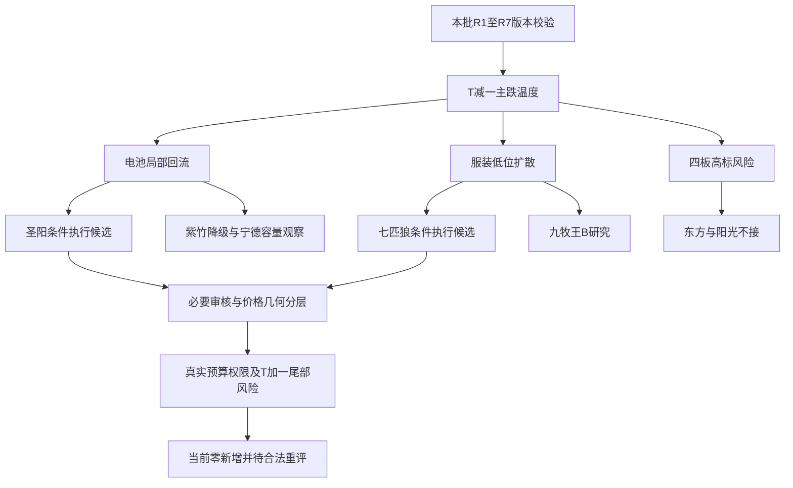

<!-- canghai:explicit-plan-report-assembly:v1 -->
# 显式组装报告（非重新推理）

> 决策来源（JSON）：llm
> 同版 JSON SHA-256（规范化内容）：0501aa85fafe3d60cfe8eafda0b6ac722161d47494a7d7932cbdb2cb3c4ddd16
> 以下散文为调用方提供的模型原文，完整保留、未经重新推理；原文自述不是来源验证，不得覆盖 JSON 禁令、权限或缺口。
> 表格直接复用既有共享 renderer；只读展示，不构成开仓或自动交易授权。

## 模型原文（非重新推理）

---
date: 2026-11-04
agent: D1-main-decision
skill_version: main_decision_v1@2.1
generated_at: 2026-11-04T07:23:09+08:00
confidence: null
degraded: true
data_sources:
  - name: current_run_R1_R7
    path: data/research/20261104/research_summary.json
    status: partial
    captured_at: null
    record_count: 7
  - name: attention_signals_bound
    path: data/research/20261104/attention_signals.json
    status: ok
    captured_at: null
    record_count: null
  - name: emotion_cycle_bound
    path: data/research/20261104/emotion_cycle.json
    status: ok
    captured_at: null
    record_count: 1
  - name: catalyst_calendar_bound
    path: chzl_kg/投研交易/催化剂/20261104.md
    status: error
    captured_at: null
    record_count: null
    error: unavailable_at_binding
input_freshness: partial
input_freshness_note: 市场与价位事实截至2026-11-03；周线截至2026-10-30，部分两融/ETF滞后一交易日；当日日历绑定时缺失，未来三交易日覆盖未知。研究版本已核，不等于逐票审核通过。
---

# 2026年11月4日 · 主决策 / D1盘前预案

## 一句话结论

**市场主跌温度下只研究低位前排：圣阳股份、七匹狼进条件执行候选，当前可开仓为0，不接四板老高标。**

## 🚦不交易条件与买卖点先读

当前active全局项只有“账户预算与权限未核”：本轮没有读取账户的授权，绑定研究也没有账户可用额度，因此预算仍为未知，不能继承旧计划的零预算，更不能把研究上限变成正额度。全局no_trade=true、dry_run、禁止自主交易、需要人工确认同时保留。这里不是声称用户今天下达了停买命令，也不是把日历缺失或R2低分变成全市场禁买。

所选对象的阻塞分开列：七匹狼R6模式1独立消息交叉未完成；圣阳虽然模式1/2/6/7必要覆盖完成，仍缺当日承接、同窗核心相关输入、真实账户预算及T+1尾部风险定仓。二者**进execution仅表示优先研究候选·待补证／暂不开仓**。所有逐票max_position_pct和entry_rules.position_pct均为0，trade_authorized=false。其余对象的问题不牵连已经完成的圣阳必要审核，但也不能从“审核完成”推导“可买”。

今天是不是空仓日？以已经观察到的11月3日炸板率41.4634%和17家跌停为起点，**是空仓优先、只能讨论低位试错的环境**；还没有11月4日竞价事实，不把昨天主跌写成今天已跌。当前实际新增为0。修复若出现，要由计划owner以真实新证据重评，不能用旧no_trade永续封死研究，也不能自动释放买权。既有持仓数量、可卖量与T计划均未知，本报告不命令清仓，更不虚构当天可卖库存。

下表均为本版R5前复权事实经原引擎计算的条件情景，不是订单。价格事实日2026-11-03；当日研究窗口至2026-11-04收盘，市场判断至09:25先重评。触发价不是无条件拟成交价；本轮D1最高接受价严格取买区上沿，严于原引擎参考的7%上限。所有拟委托均须另核当日精确涨跌停边界、实际ask和RR。

|身份|对象|条件买区|确认触发|D1最高接受|T+1风险边界|2R研究目标|RR|当前能否买|
|---|---|---:|---:|---:|---:|---:|---:|---|
|进execution·待补证|圣阳股份 002580.SZ|18.58—18.95|18.67|18.95|18.00|20.85|2.00|否：预算/完整资格未知；图像19.50途中压力人工复核|
|进execution·待补证|七匹狼 002029.SZ|11.24—11.47|11.30|11.47|10.90|12.61|2.00|否：R6模式1缺证；今日价带可成交边界未核|
|降级观察|紫竹高科 002058.SZ|21.02—21.45|21.13|21.45|20.38|23.59|2.00|否：接受财务及风格降级，认定仅2条|
|进watch·容量锚|宁德时代 300750.SZ|248.07—253.06|249.32|253.06|232.82|293.54|2.00|否：R2原龙三，弱趋势容量修复非10cm接力|
|进watch·B研究|九牧王 601566.SH|11.49—11.72|11.55|11.72|11.13|12.90|2.00|否：消息与模式6未完成，不自动递补七匹狼|
|降级风险观察|东方海洋 002086.SZ|3.40—3.47|3.42|3.47|3.30|3.81|2.00|不可做：4板3次开板、S2窗口缺证；仅保留研究几何|
|降级风险观察|阳光照明 600261.SH|4.93—5.02|4.95|5.02|4.77|5.52|2.00|不可做：4板5次开板、净卖与经营反证；仅保留研究几何|

“2R”是预设目标几何，不是实现概率，也不是清除了途中压力。主板原始止损按买区上沿-5%、宁德按-8%生成；两位小数报价后，七匹狼距上沿-4.969%、紫竹-4.988%、东方-4.899%等舍入差异如实保留，不挪风险边界凑整。原始几何与报价后节点均已核。未知底仓按新增仓T+1路径设计：买入日不能卖，跌破只记失效，最早下一交易日集合竞价退出；跌停和跳空可能无法按风险价成交。不能用纸面盘中止损掩盖尾部损失。

## 🌊大势：市场奖励的是局部，而不是全面翻多

11月2日4681涨、818跌、125家涨停的普涨，11月3日转为2108涨、3309跌、48家涨停、17家跌停；637只跌幅至少5%，中位数-0.65465%。炸板34/(48+34)=41.4634%。此前涨停池11月3日收盘反馈均值仍+0.9499%、中位数+0.1324%，说明尚有接力赚钱效应；但不能拿这个幸存池均值掩盖全市场尾部亏损。R1用当期证据给研究上限25%而非机械0仓，我不把它改写成账户预算。

R7支持更具体的分化：电池行业单日净入25.31913亿元、五日合计+2.564668亿元、连续三日正；电子单日-236.255521亿元、通信-103.019896亿元。行业与二级/三级成分重叠，不可累加成全市场资金净额。电池逆势并不等于所有固态票都在主升——固态概念本身仍有负收益和净流出，不能把宽概念热度直接兑成行业合力。

R3的人形机器人、AI应用有L1+L2叙事共振，但昨日价格与热度排名回落；这恰好要求把“有人在谈”与“资金已奖励”拆开。R4的澄清、合同、宏观工具都有实际内容，却没有一条能绕过价格/资金事实。当前我选择R2已有的唯一主模板“92科比三格（龙头/补涨/切换）”，只做低位前排与备选切换情景，不混入总龙锁仓、五套模板并行出候选。

- **大资金意图**: 电池的净额和容量修复支持从电子/通信风险中寻找局部落脚点；服装只有单日小额回流，更多是低位情绪资金选择。资金数据只能支持此假设，不能证明同一资金账户从A卖到B买。
- **为什么走强**: 电池108只当前成分7封板1炸板；服装75只成分3封板0已观测炸板，都是同口径局部扩散。全市场走弱时，这种局部相对收益值得继续研究，而非预先清池。
- **逻辑够不够硬**: 电池资金强于服装，但无本批新增固态订单硬催化；服装五日行业净出2.263415亿元，尚未确认持续主升。真实轮次起点与年龄均未知，不从R2的age=1/4敏感性结果选一个冒充实际阶段。

仓位推导保持可复算：本轮R1研究上限0.25 × 原main_down减量0.4 = **0.10研究风险上限**，低于既有用户硬上限0.80；不再按主线数抬升。北向不参与加减仓与置信度，不要求其补齐。R7限定20层级板块、190对检查未发现符合条件的统计跷跷板，因此不机械套减仓罚项，更不宣称全市场没有跷跷板。10%不是下单预算、不是必须加到10%，也不是要求已有持仓立即降到10%。单票≤15%、板块≤40%、持仓≤5、日买单≤4、每票日订单≤2等原保护不变，当前新增仍为0。政策文件实际还限制920前缀，优先于历史技能里的全解禁示例。

## 🧭四象限叉乘：先对时间，再谈反应

本轮使用消息极性×价格/资金反馈四象限；资金方向和价格方向分别保留。未知不塞进正面象限，收盘后公告不能与公告前跌幅拼成“利好不涨”。

|象限|本批证据|D1最终取舍|
|---|---|---|
|正消息×正资金/价强|七只画像票未同时核出本期独立硬正催化和消息后资金确认|留unknown，不造最优共振；宁德历史回购不算今天新增买盘|
|正消息×负资金/价弱|云南锗业11月3日跌5.0831%，订单收盘后公开；中际/光迅的澄清同样晚于当日下跌|时间错位，只是反转待验对象，不能称公告后不涨；本轮不越过R5/R6补出新买票|
|负消息×正资金/价强|电池行业正流入与龙蟠履约负面并存|龙蟠具名合同风险不套给圣阳/紫竹/宁德；同行负面不是这三票违法或违约证据，仍保留行业经营反证|
|负消息×负资金，价格却封板|东方近三日净卖、阳光昨日双口径巨额净卖；经营负面与4板并存|拆开封板与净卖，拒绝“锁仓”故事；未证明11月4日公告后的反馈，不能倒置时间因果|

七匹狼、九牧王属于消息独立覆盖不足而资金/价格有证据的混合区，不能因无产业新闻就否定纯情绪机会，也不能因有名字就补成正消息。

R4全部16项事件均已纳入取舍，而非只读利好：

|事件|可采用事实与反面|本轮处理|
|---|---|---|
|E001/E002 云南锗业|2027年18万片合同对应1.944亿美元；出口许可、取消退款条件同源并存|进事件观察背景，不把框架五年数量当锁定收入；无消息后成交反馈，不进本次执行|
|E003 光迅科技|公司否认缺料停工、称交付正常|纠正传言不是新订单，板块合力仍待核|
|E004 中际旭创|晚间纪要称绝大部分客户未下修，个别有结构调整|不把澄清写成全天量价已经翻多|
|E005/E006 AMD|需求/收入与指引正面，毛利率指引55%对本季56%、现金流共识反证并列|上游索引文本与媒体共识分层；不编具名A股供应链、不覆盖原行业风险|
|E007 互换便利|媒体结果报道1000亿元、31家、10bp，央行结果原页面未直接读到|从待发生更新为已报道操作；融资工具额度不等于当日净买股|
|E008 地缘|谈判无新进展与船只遇袭的上游报道|航空/航运/能源传导异向，不一概说航运受益，不连带禁买服装|
|E009 龙蟠科技|具名长期供货进度不及预期，公告最早公开时分未核|保留公司履约负面，不连带判整个电池硬否决|
|E010 国晟科技|子公司仍停产，后续条件性风险警示；质押/冻结口径有重叠|公司风险保留，不写已经被ST或整个光伏退市|
|E011/E012/E013|品茗实控人、三星新材公司、山鹰董事长各有具名立案事项|对象和事由不互换，个人调查不扩大为其他公司违法；非本次七票R6已审对象|
|E014 英伟达51%报道|缺FT原稿及英伟达书面规则，外交部称不了解不等于确认|待证实行业风险，不编国产替代买权|
|E015 海洋经济|2030年13万亿目标来自发布会报道，11月3日日盘已公开|不是东方海洋的具名订单，也不是11月4日全新首发题材|
|E016 秦港股份|11月4日复牌日确定，但资产价格、审计评估未完|保留事件观察；本版无新复牌可成交价及完整画像，不用旧价造买区|

未来三交易日大事件扫描不完整：当日精确日历在绑定时不存在，晚到也不能重建本版绑定。R4内嵌旧日历只允许阅读可见截取，元数据核验不等于事件核验；不跟随previous_report，不据目录推未来节点已定档。责任回研究/日历owner。这是具体gap，不是全市场已命中大事件；已有真实逐公司/行业风险照旧保留。

## 🎭10cm情绪核心／名字梗

这不是用宁德等容量锚替代用户要找的情绪核心。本批R2已经实查七匹狼、圣阳、紫竹以及洋/阳高标，并分开真实传播、用户线索与模型推演。研究的是2026年四季度对**2027年羊年**的预期，不能因为当前是马年就机械过滤；反过来，狼、羊、洋、阳字形相近也不证明统一资金主线。

R2内嵌群聊可见洋字、羊奶/羊肉和皇字传播；“狼吃羊”的完整独立传播仍未核。授权attention事实日为11月3日，使用日11月4日，不是今日实时榜：圣阳东财第3/同花顺第8；七匹狼第10/14，东财40→10、跳升30名；紫竹第39/81。热榜AI归因文字只作传播证据，其中固态量产/生肖政策等转述不能冒充本轮R4已核新催化。

七匹狼在同版R2为服装唯一二板，早于九牧王和龙头股份，五日净额排名第一；因此本轮**进execution·待补证**，并非“无产业所以不纳入”，也不是用户提名就强买。与九牧王比较：后者历史股性77.3高于七匹狼46.4、日线更顺，但当期首板身位落后；不能用历史高分替换今日龙一。与东方/阳光比较：前者低位二板且有服装3封板对照，后二者4板、多次开板、净卖和经营反证并存；不为“妖”而下调资格。

本轮没有证明监管警告导致资金从洋/阳换到狼，也不把异动公告等同处罚/停牌，更不以换名字消除风险。R6空hard_reject不是这条传播链已经核实。

## 🎯执行候选一：圣阳股份——有资金前排，先补齐可执行判断

- **大资金意图**: 电池逆势回流中，本票五日东财净额3.551016亿元列行业第2，昨日3.962487亿元明显；相较紫竹仅资金第8，圣阳的资金与人气辨识度更强。但前日净卖0.705837亿元，不能叫连续五日稳买。
- **为什么走强**: 首板且早封、零开板，7只行业封板提供局部效应；同花顺61→8、东财第3构成传播/资金对照。原板型函数输出“秒拉板，排板不冲”，是首封时间代理，不证明盘中有半小时横盘。
- **逻辑够不够硬**: R2龙头认定3条只限热度、板块扩散、真实换手；本轮新增订单未核。R6模式1/2/6/7覆盖完成，不等于否定存货/应收风险；持续主升与今天带动性仍待核。

- **买入理由**: 一是电池行业实际回流与7封板强于宽固态概念；二是本票资金第2及双平台人气前排，不是因为紫竹降级才递补的无地位杂毛。保留既有三格内的首板转强/半路确认情景，18.58—18.95内才研究。
- **风险点**: 存货同比+51.51%对收入+23.77%、周转率下降，F4成立；应收/收入49.62%、F9成立，并表效应不能称内生高增长。日价仍低于MA50/60，图像途中压力19.50而引擎2R目标20.85，人工复核义务明确；不把目标几何2.00伪装实际第一压力有2R。
- **止损条件**: 同情景止损18.00，距18.95上沿-5.013%；仅T+1合法退出。若次日不及预期，不等2R目标讲故事。买前价格离带后才有资金确认则当天取消，当前无预算/授权不买。
- **可验证假设**: 下一个交易窗口核电池同口径是否仍有至少3只前排封板/强承接，以及本票不失去原资金/热度前排；股价站回18.67但资金转负、板块同步失去承接则撤销强回流假设。量价/板块三要件须同分钟，不补票。

对R6_M7_02与R6_M2_12的处理是**有限覆盖展示降级建议**：不认财务风险已经消失，只保留优先候选身份、承担补证义务，实际新增0。若以19.50途中压力衡量而非20.85目标，盈利空间明显缩小，不能借图像冲突偷偷更改买权或改引擎价。

## 🎯执行候选二：七匹狼——身位领先不等于明天有人接

- **大资金意图**: 五日两口径逐日净入约1.30/1.27亿元、服装当前资金第一，支持低位辨识度聚焦；行业五日净出说明它更可能是局部核心，不是已确认全服装主升。
- **为什么走强**: 二板、早封、5.2777%换手，加上两只后续服装首板与热榜跳升。缩量封板对流动性有两面性：可以是筹码集中，也可以让后续承接验证更困难；不以尾段横线称全天无量一字。
- **逻辑够不够硬**: R2局部龙头认定3条有来源，真正独立狼羊传播未核；R6模式1消息独立交叉没有闭环，不能以R5原文和R2同源转述补成两个源。必要缺证是这只票的阻塞，不扩成圣阳必要审核失败。

- **买入理由**: 一是同版服装二板/资金第一比九牧王首板更有当期身位；二是热度跳升与低位板块扩散提供可证伪接力假设，不靠无证产业故事。只保留11.30前高突破情景，11.24—11.47研究带；**不把图像10.58观察位挪成更便宜的执行触发**。
- **风险点**: 前三季归母-5055.33万元、单季扣非-6130.86万元，与累计扣非为正必须分开；控制人质押约50.65%不是无质押。服装五日净出，昨日缩量封板与更高前压同在，先手有兑现动机；目前甚至没有精确当日可交易上界，买区上沿不可承诺可成交。
- **止损条件**: 研究情景10.90、目标12.61、上沿RR2.00；原始止损5%，舍入后-4.969%如实保留。最早T+1退出，次日竞价不达预期或服装扩散失效优先处理，不承诺买入当日“破10.90即走”。
- **可验证假设**: 24—72小时核二板核心身位是否延续、至少3只同口径服装前排是否仍有有效承接，以及个股资金能否在价格带内同时成立。若只剩七匹狼独涨、原助攻持续走弱，不把“独立”直接叫庄股，但应撤销原服装扩散逻辑并重评。

对R6_M2_13覆盖的也只是研究候选展示结论，不覆盖模式1未完成、账户未知或T+1约束。当前不是让用户竞价挂11.30，也不是明示次日涨停。竞价强而价格已经越过可用区间时，宁可没有成交。

## 👀观察池与同版对照：不凑20只，也不让候选消失

紫竹高科接受R6财务与风格strong_suggest：流通约30.29亿元在20—50亿元警示区不是小于20亿元硬拒；然而应收占比41.68%、已核借款下界/并表净资产226.15%、薄净资产与PB39.69倍构成实质风险。它有电池二板高度，却只有2条龙头认定、首封较晚、资金第8，我选择降级观察而非因“龙一”强行放行。比圣阳多一板，不能抹掉更弱资金确认；更名后的身份按002058精确代码，不延续旧*ST标签。

宁德时代是容量锚，累计业绩与估值对照强，但30日-26.04%、仍在MA20/60下；单季现金净额14.09亿元对并表净利224.68亿元是不能忽略的边际反证。R2原角色龙三/容量验证，不因资金第一自动升接力龙一。研究突破触发249.32保留，图像日线258.12途中压力与293.54目标冲突，人工复核，不凭低PE换成左侧抄底。

九牧王是服装B研究，不抢七匹狼的位置。日线MA多头、历史股性77.3分是正面，但当期首板且晚封，股性统计窗口/有效样本口径也不能当当前策略胜率。R6模式1、模式6尚有缺项，且Q3单季扣非亏损；不因它有11.55突破识图确认就自动晋级。七匹狼若被真实硬否决，不能以“龙二较便宜”递补。

东方海洋与阳光照明都只做高标风险温度计：前者近三日净卖且S2适用窗口未核、3次开板；后者昨日自算净卖4.7682亿与东财5.94369亿，量级差异保留，5次开板和25.5208%换手不支持锁仓。两只原多次回封规则已经拦截开仓，不能用4板高度、图像偏多、预测一字抵消。其数字只是同公式研究参照，不是当前可买区。

同版研究对照不止这七票：科森-7.9245%、通鼎-6.9065%、三祥-4.1148%，以及杭电/诺德，说明历史固态心智锚并非本次价格前排；深中华A未封板、五日净额为负，不按锚排序抬入。龙头股份首板较晚且非前二；桂发祥流通19.2432亿元、尚水智能约11.64亿元低于20亿元政策硬线，分别保留政策剔除，不伪称R6否决，也不把20cm前缀本身当禁令。

短剧从前日31板收缩，当前成员交叉4封板4炸板，供应商另口径5板不混算；奥飞、浙文、电魂、龙版保留上游次线比较，不在无完整画像下批量发买点。文投10次开板且尾盘回封、宝明晚封、皇台3板缩量及亏损、高争0.17%换手一字、大晟负净资产条件性风险，都有逐对象理由，不是“今日市场没有机会”。云南锗业订单仍是事件观察，消息后没有成交反馈，R5七票之外没有足够同版价格/必要审核，暂不挤进执行。

观察池本次5只，不补到20—40配额：七票均有去向，研究对照与政策剔除另留证；未读昨日观察/错题目录、未获近10日涨停全市场原始文件旁路许可，不能假装完成全覆盖。这些缺口交研究/E1 owner，不等于全市场没有更多机会。

## 🔁竞价三档与B计划：先备剧本，不等于自动晋级

|对象|不及预期|符合预期区间|超预期|动作|
|---|---|---|---|---|
|圣阳|低于18.39|18.39—19.04|19.04以上至19.60附近；再高为过热|符合只校准承接，不解预算；超预期但离18.58—18.95则不追|
|七匹狼|低于10.18|10.18—10.54|10.54以上至10.85附近；再高为过热|符合不等于达到11.30确认；更不能把竞价高开直接当突破买入|

JSON逐票保留<-1.5%、-1.5%至+2%、+2%至+5%、>+5%四动作，20cm宁德按1.2倍调整为-1.8%至+2.4%的预期带。表内为报价展示、精确百分比规则在JSON；等于边界归符合档。过热竞价不追，>7%高开另有原突破保护；一字无成交买点则等待开板，不能把历史非一字票预写成今日已一字。

若电池核心不及预期而服装仍有自身承接，B方向是本版已经点名的七匹狼/九牧王研究比较；不是假设资金必然转来。七匹狼与九牧王沿用同一数字价带及零新增权限，不换一套价格。七匹狼若硬否决，九牧王不能自动递补；R6必要审核未完时，P1/P2的promote也不能解禁。电池与服装都弱则继续不新增，不临时找银行、保险或未列出的票。

## 📐价位推导与识图复核

本轮真实执行consume_authorized_inputs(saved)、chart_evidence_from_profiles及apply_to_plan。原引擎load_tech默认查库超出本轮来源许可，因此只在当前进程把技术读取函数绑定至已授权R5内存payload，源码/公式没有改动，没有读研究数据库、raw/latest图缓存或现场补图。R5每票84根前复权日K截至11月3日，MA直接采用同版已算指标，20日高低由本版末20个交易日复算；牛/熊线原本null保持null，不冒称已核。

突破先定pivot=max(昨收,20日高)，原算法对远端高有回退规则：紫竹26.65、圣阳21.47、宁德306.71仅作远端压力，原引擎回退昨收枢轴。这个10%/20%距离诊断不是交易所当日边界证明。本轮不把回退后数字说成已经站上20日高。七匹狼20日高11.30仍是枢轴，保留原带11.24—11.47，不为可达性改带。图像10.58只是另一语义观察位，不替换它。

逐票几何如下；止损以买区上沿而非昨收为基准，均检查低于买区下沿。止盈2R只是研究目标，未包含成功概率：

- 圣阳：pivot18.67；买区=18.67×[0.995,1.015]→[18.58,18.95]；止损取18.95×0.95与MA10×0.99有效候选较高者→18.00；目标18.95+2×0.95=20.85；RR=(20.85−18.95)/(18.95−18.00)=2.00。MA50=19.2494、远端高21.47，均非已突破事实。
- 七匹狼：pivot11.30；买区=11.30×[0.995,1.015]→[11.24,11.47]；止损原始11.47×0.95=10.8965→10.90；目标11.47+2×0.57=12.61；RR2.00。MA10=8.529不是当前执行止损；今日完整价带可成交性未知。
- 紫竹：pivot回退21.13；买区[21.02,21.45]；止损原始20.3775→20.38；目标21.45+2×1.07=23.59；RR2.00。MA10=18.543、MA50=18.2306，26.65留远端压力，不据回退证明趋势已成。
- 宁德：pivot回退249.32；买区[248.07,253.06]；止损原始253.06×0.92=232.8152→232.82；目标253.06+2×20.24=293.54；RR2.00。MA10约233.755的0.99值低于原始8%风险价，故不取更低者；306.71是远端高。
- 九牧王：pivot11.55；买区[11.49,11.72]；止损原始11.134→11.13；目标11.72+2×0.59=12.90；RR2.00。MA50=9.4644，不能用更低均线作扩大风险借口。
- 东方：pivot3.42；买区[3.40,3.47]；止损原始3.2965→3.30；目标3.47+2×0.17=3.81；RR2.00。几何合格不能覆盖原多次回封与合规未知，只是风险对照。
- 阳光：pivot4.95；买区[4.93,5.02]；止损原始4.769→4.77；目标5.02+2×0.25=5.52；RR2.00。同样不覆盖5次开板或巨额净卖。

原引擎max_acceptable_ask为pivot×1.07，往往比买区上沿更高；本轮原值完整保留在engine_levels，但D1自身最高接受严格取买区上沿，不能用2R目标替更高ask背书。本轮没有手工抬价/抬止盈/挪止损来追求通过。

识图复核只用本版R5嵌入快照，不重新读图文件，也不宣称本会话做了新的视觉推理：

|对象|可比项实际结果|未知或冲突及限制|
|---|---|---|
|圣阳|无确认项|日K压力19.50处在18.95买上沿和20.85目标之间，conflict.manual_review_required=true；图像18.45不是同一执行pivot，60分支撑17.36非执行止损，均unknown|
|七匹狼|无确认项|图像日线10.58与执行11.30不同语义；9.50支撑不能冒充10.90止损；周K仅截至10月30日，不能认证当前日线三项全通过|
|紫竹|无确认项|图像20.58收复均线、周线22附近压力、60分19.10支撑各属不同语义；本执行pivot21.13与止损20.38未获识图确认|
|宁德|无确认项|258.12日线压力处在253.06与293.54之间，人工复核；60分支撑及216.51深支撑不变为执行止损|
|九牧王|识图确认：仅breakout，数据日20261103，图像11.55|10.50支撑不是11.13止损，周线压力不作日线目标确认；其余unknown|
|东方|识图确认：仅breakout，数据日20261103，图像3.42|支撑3.11非3.30止损，周线/15分不同语义unknown，不解除高标拦截|
|阳光|识图确认：仅breakout，数据日20261103，图像4.95|4.50支撑不是4.77止损；图像全天一字低换手叙述被真实日线/开板事实否定，不因一个价位一致说整图正确|

本辅助诊断不改名单、仓位、entry/exit价格、buy_eligibility、模式或下单许可，也没有因此加新全局禁买。手工原始derivation_reason保留，模块只更新其owned识图标注；没有确认的对象不写“识图通过”。每执行票都保存chart_consistency，重复附着已核不会改变价格/权限。

## 🧾R6裁决、专题取舍与资料质量

本轮summary.hard_rejects和R6.hard_rejects均为空，14条counter_arguments中也没有hard_reject；真实合并检验未发现可剔除对象，不能编造“已剔若干只”。本轮保留8条strong_suggest采纳、3条有限覆盖记录，以及3条soft_suggest；覆盖理由逐ID入JSON。紫竹、东方、阳光的降级接受，圣阳两条与七匹狼一条只为保留待补证候选而覆盖展示，不是越过风险获得买权。

R6原矩阵对完整七票先校验，再看所选两票：紫竹、圣阳、宁德必要1/2/6/7完成；七匹狼、九牧王、东方、阳光未完成。所选七匹狼仍缺，所以selected_review_completed=false、production_ready=false、research_completion_passed=false、reassessment_required=true。空否决、文件已交付、summary的partial或无关对象缺项都不能代替这些逐票事实。

专题只来自已校验R2/R4/R5/R6的knowledge_context实际可见内容及原裁决。本批四阶段topic_knowledge均version_bound，run/attempt/context_sha256/研究版本已核；source refs在JSON逐来源对象保留，不能由运输回执证明模型采纳或收益有效。

D1的最终取舍不是照抄上游adopted：历史股性**采用作比较**，不形成新分数权重；心智锚**采用作当期对照**，不照锚排名选股；一字预测对高标的排单暗示**拒绝**，28.8%/26.2%只作未校准预测留证；空复盘反馈**unknown**，不假称读完错题；旧日历未来事项**延后**，只采纳可见分层提醒；两版增长池、红利池、公开增减持投影与本批七票无直接交集，**not_applicable**是本次适用性判断，不是说这些公司不合格。共9个实际source_id逐项落meta.knowledge_adjudications；无任何专题原路径回读。

R2已经比较增长池中的赛诺、大博、瑞立、日联、大豪及红利快照中的格力、云天化、炬华、中远海控等对照：当期接力身位未证，不因专题提名强塞execution。新增长投影新增研究线索也不授本轮买权；红利滚动现金覆盖不足和增减持历史补档时点不删。没有合法当期对照的其他领域明确不补票、不编名次。

旧score是兼容整数：圣阳72、七匹狼74、紫竹68、宁德65、九牧王62、东方35、阳光30均为本轮LLM未校准解释性比较，来自上述身位、资金与反证取舍，不是R2板块分移植、不是胜率、不是新加权评分。R5六维仍有null，不能声称已经完成可复算质量评分；置信度保留R1—R7原值和原公式，不调分凑线。

## 数据源审计

下列为消费已绑定主研究所载源审计，不声称D1重新调用了接口。主研究文件版本通过与业务状态partial并存；所有原始源路径只作引用，未被打开。本轮完全没有调用数据源MCP、账户或额外模型。

|源/产物|事实日期|状态|覆盖及限制|
|---|---|:--:|---|
|R1_style|2026-11-03|🟡|当期广度/情绪温度，confidence0.448=.80×.70×.80；25%是研究建议|
|R2_main_sectors|2026-11-03|🟡|7真实候选与同版对照，confidence0.392；非胜率39.2%，轮次年龄未核|
|R3_sentiment|2026-11-03|🟡|双源叙事/热榜覆盖，confidence0.364；对象外或窗口缺失不称阴性|
|R4_news|2026-11-03—2026-11-04|🟡|16个正反事件，confidence0.700；先后时点与独立性分层|
|R5_stock_profiles|2026-11-03；财报2026-09-30|🟡|7票、各84根前复权日K；confidence0.720；财务辅助unknown逐票保留|
|R6_devil_advocate|2026-11-04|🟡|7票覆盖、14条反证、3票必要审核完成；confidence0.780，不是3票可买|
|R7_capital_flow_20261104|2026-11-03|🟡|confidence0.2625；真实行业回流/撤退；两融和ETF部分滞后，不要求北向补齐|
|Tushare与东财口径经上游SDK|2026-11-03|🟡|同一聚合provider多个接口不是多个独立源；阳光净卖量级差异保留|
|XTick上游交叉|2026-11-03|🟡|市场返回截断，部分top10以逐票修复；计数范围不强行对齐|
|news_cls命名文件|2026-11-01—2026-11-04|🟡|实际新浪1465+同花顺1028=2493条，不含直接cls；补采同源不再计一份|
|news_major|2026-11-03—2026-11-04|🟡|800条标题无正文，非72小时全文覆盖|
|公众号上游|2026-11-03—2026-11-04|🟡|17源88篇，与RSS镜像去重；图片内容未全读|
|匿名机构/行业/游资群上游|2026-11-03—2026-11-04|🟡|5组372文本索引，至少116带图片；未全图OCR不能称全覆盖|
|公告窗口上游|2026-11-03—2026-11-04|🟡|2168条标题索引；选定16份PDF抽取，不能将抽取等同逐页语义阅读|
|同花顺新闻/公告/主营/市场工具上游|2026-11-03—2026-11-04|🟡|实际片段/字段有效；主营报告期有缺口，海洋查询被解析为捕捞两票，不能冒充全受益池|
|DataPro|2026-11-04|🔴|R7记录4013失败，D1未重新探针，不扩大为所有资金源down|
|绑定attention|2026-11-03|🟡|使用日2026-11-04，严格T-1榜单；不是实时人气|
|绑定emotion_cycle|2026-11-03|🟡|main_down；2.21%开盘溢价与R1收盘反馈口径不同，不混算|
|当日精确催化剂日历|未知|🟡|绑定时missing，未来三交易日覆盖gap，不称无风险、不旁路旧日历|
|R5嵌入chart_vision|日线2026-11-03；周线2026-10-30|🟡|仅结构证据；压力冲突/多周期unknown逐项保留；未现场补图|
|用户政策|2026-11-04读取|🟢|只读并保存实际摘要；非另一批研究、无账户额度来源|

fetch_global_severity=2，不把辅助通道故障说成全局3级。call_failed是调用记录，not_yet_landed是当时未交付，source_down须实际探针；本轮不新探针，不把未读/缺绑定称供应商已宕机。报告质量partial不自动将另一对象买权归零，但真实账户权限与必要缺证不能放松。

## 不确定性 / 反证与下一责任人

最大的可推翻点不是“资料不完美”，而是昨天局部前排今天是否还有人接。电池资金强但历史回撤仍深；服装身位强但行业持续性弱；两者也可能同步转弱，B方向不是保险。图像途中压力要求人工复核，不用抬目标造赔率。所有当前可开仓数为0，不能因此假称研究已经完成。

R4/R6负责七匹狼及服装消息独立交叉与九牧王警报窗口，R4/R5/R6补东方S2当前适用窗口；日历owner补合法当日版本，由研究owner按原流程形成下一绑定，不能本轮自行改绑定。D1/权限owner负责收到真实更新后的逐票重评、账户硬额度、T+1风险与人工确认。没有绑定的20日板块/指数收益率，core_judge不喂空数组造拒绝或通过；唯一总龙和停牌次数未知，dragon_switch不默认0/“alive”。函数模块可用与输入足够是两回事。

盘前“符合预期”不解除这些责任，08:30目标或资源观察也不是买权触发器。当前是实际盘前生成，不是历史回放；生成时刻与源事实时刻在JSON分开保留。usage未计量就是未知，不写0、不承诺低于目标。

## 与其他R/D/E的关系

依赖本批R1—R7全部主JSON及input_manifest绑定三类辅助；既有用户政策只读。execute、P1/P2与E1消费本版身份和限制：只能由合法owner补证/重评后取得新权限，不能靠promote、价格几何通过或报告生成来自动解禁。卖出管理不因禁新停止，但本轮未读持仓，不能下虚构卖单。

## Sub-Agent元数据

- skill: main_decision_v1；单一当前会话直接LLM裁决，无delegate/重启Hermes/额外模型。
- model: gpt-6.1-sol；decision_source: llm。
- run: 20261104T061037-8009-23744；主研究各attempt=1，summary与topic/aux绑定启动及交付前复核。
- artifact: data/plans/20261104/watchlist_plan.json；唯一人读主报告为本文件。
- 状态: 条件预案已形成，研究/可交易状态未就绪；不存在额外runtime副本或其他附加MD。

## 同版 JSON 共享表格（只读附录）

# 20261104 盘前预案 · 点位表版

> 计划生成时点：2026-11-04T07:23:09+08:00；决策来源：llm

## 板块机会总览

市场背景：T-1亏钱扩散下电池局部回流与服装低位扩散；盘前不追高位老龙，当前没有获授权可开仓对象。

> 先市场／板块效应，再个股地位；未提供关系证据不推断龙头带动或板块扩散。

| 板块／本轮行情 | 阶段／窗口 | 效应与延续 | 核心与梯队（上游标签） | 共振／分离证据 | 主／反向剧本（名单归属非关系证明） | 确认条件 | 共同失效条件 | 观测时点 |
|---|---|---|---|---|---|---|---|---|
| 电池（固态/储能局部扩散） | ⚠️未给 | 局部修复/形成待核，未确认主升年龄 | ts_code: 002058.SZ；name: 紫竹高科；role: 龙一；ts_code: 002580.SZ；name: 圣阳股份；role: 龙二；ts_code: 300750.SZ；name: 宁德时代；role: 候补 | logic: 行业+1.63%、净入25.31913亿元、近5日+2.564668亿元且连续3日净入；电子/通信撤退背景下存在可辨认的局部资金回流。；108只当前电池成分交叉：7封板1炸板，封板率87.5%；不把617只锂电概念的10板或302只固态的6板叠加。；固态概念自身-0.46%（同花顺）、净出3.4079104亿元（东财）；“电池行业回流”不等于“固态全面主升”。；先比较合力再打分；宁德为容量验证，紫竹身位、圣阳热度与资金分工；不拿宁德替代妖股。；cross_validation: r3_resonance_match: True；r4_catalyst_match: ⚠️未给；r7_capital_match: True；cross_validation_score: 1.0；checked_source_count: 2；r3_evidence: R3.other_theme_observations[固态电池]已核L1+L2，仅研究观点；与行业映射有范围差异；r4_evidence: R4未给本批固态正向硬催化；龙蟠公司负面不能升级行业阴性，故null；r7_evidence: R7.main_force.sector_flows.电池净入25.31913亿，5日+2.564668亿；固态概念净出另列，不掩盖冲突；independence_note: 跨Agent同源转述不重复计独立性；该摘要不是交易门槛；fact_at: 2026-11-03T15:00:00+08:00；valid_until: 2026-11-04T09:25:00+08:00；missing: 真实启动日/轮次未知，敏感性分析不充实际阶段 | 主剧本／执行；观察 | 竞价后重新核板块扩散/核心承接/同分钟个股资金；不是许可 | 核心失去同组领先且板块承接消失；新已核反证立即重评 | ⚠️未给 |
| 服装家纺（低位情绪扩散） | ⚠️未给 | 局部修复/形成待核，未确认主升年龄 | ts_code: 002029.SZ；name: 七匹狼；role: 龙一；ts_code: 601566.SH；name: 九牧王；role: 龙二 | logic: 75只当前行业成分3封板、无已观测炸板；七匹狼唯一二板，九牧王和龙头股份后续首板。；七匹狼5日净额第1、热度上升；九牧王资金第2并有历史股性对照，选择服装局部而非强行拼出羊狼全市场主线。；R7服装家纺净入0.211937亿元但5日仍净出2.263415亿元，远弱于电池；局部价格合力成立、持续性仍待核。；叙事与共振未核，五维分数保留null而不补0；仍根据真实低位前排与板块扩散保留研究，不让分数缺口变成全市场禁令。；cross_validation: r3_resonance_match: ⚠️未给；r4_catalyst_match: ⚠️未给；r7_capital_match: True；cross_validation_score: 1.0；checked_source_count: 1；r3_evidence: R3热榜精确七匹狼上升；无已核服装KOL同方向共振，辅助热度不当全行业L1+L2，null；r4_evidence: 本批R4无服装新催化覆盖；公司异动无未披露重大事项，不据未覆盖写false；r7_evidence: R7服装家纺BK1225.DC单日+0.211937亿、5日-2.263415亿；仅单日支持，不冒充连续主升；independence_note: 跨Agent同源转述不重复计独立性；该摘要不是交易门槛；fact_at: 2026-11-03T15:00:00+08:00；valid_until: 2026-11-04T09:25:00+08:00；missing: 真实启动日/轮次未知，敏感性分析不充实际阶段 | 主剧本／执行；观察；反向：电池退潮而服装保持低位扩散的研究切换；触发 电池两前排不及预期，而七匹狼仍领先、服装核心真实承接；两边都弱则取消 | 竞价后重新核板块扩散/核心承接/同分钟个股资金；不是许可 | 核心失去同组领先且板块承接消失；新已核反证立即重评 | ⚠️未给 |
| 羊/洋/阳、皇字及狼线索的情绪比较 | ⚠️未给 | 高位分歧待核 | ts_code: 002086.SZ；name: 东方海洋；role: 候补；ts_code: 600261.SH；name: 阳光照明；role: 候补 | logic: 真实群聊有洋字、羊奶和皇字传播，但七匹狼的狼羊推演只有用户线索；不是因无产业政策剔除。4板高标仅为情绪温度/风险观察。；cross_validation: r3_resonance_match: ⚠️未给；r4_catalyst_match: ⚠️未给；r7_capital_match: ⚠️未给；cross_validation_score: ⚠️未给；checked_source_count: 0；r3_evidence: R3有原文传播但其分类unmapped，不等于无情绪机会；r4_evidence: 未有针对统一名字主题的独立事件验证；r7_evidence: 无统一成员与同口径资金样本，不将高标流出推广至全部名字票；independence_note: 跨Agent同源转述不重复计独立性；该摘要不是交易门槛；fact_at: 2026-11-03T15:00:00+08:00；valid_until: 2026-11-04T09:25:00+08:00；missing: 真实启动日/轮次未知，敏感性分析不充实际阶段 | 观察 | 竞价后重新核板块扩散/核心承接/同分钟个股资金；不是许可 | 核心失去同组领先且板块承接消失；新已核反证立即重评 | ⚠️未给 |
| 传媒/短剧接力 | ⚠️未给 | 缩圈分歧 | ⚠️未给 | logic: 实际成员交叉仅4封板4炸板、封板率50%，供应商cpt给5板须保留口径差异；11/2的31板到11/3统计5板显示收缩，不沿E1旧强势直接认今日主线。行业传媒净出11.260593亿、短剧概念净出8.5195136亿；游戏行业+4.251575亿不能替代短剧同口径。；cross_validation: r3_resonance_match: ⚠️未给；r4_catalyst_match: ⚠️未给；r7_capital_match: False；cross_validation_score: 0.0；checked_source_count: 1；r3_evidence: R3 AI应用整体偏多观点与负收益冲突；不精准冒充短剧共振；r4_evidence: R4本批没有短剧硬催化覆盖；r7_evidence: 已实际检查传媒与短剧概念同日负净额；游戏正流入按范围不同另列；independence_note: 跨Agent同源转述不重复计独立性；该摘要不是交易门槛；fact_at: 2026-11-03T15:00:00+08:00；valid_until: 2026-11-04T09:25:00+08:00；missing: 真实启动日/轮次未知，敏感性分析不充实际阶段 | ⚠️未给 | 竞价后重新核板块扩散/核心承接/同分钟个股资金；不是许可 | 核心失去同组领先且板块承接消失；新已核反证立即重评 | ⚠️未给 |
| 磷化铟订单事件 | ⚠️未给 | 新事件待资金验证 | ⚠️未给 | logic: 云南锗业是订单具名主体，保留R4研究线索，但11/3净卖3.220608亿元、5日净卖6.81712亿元；消息在收盘后，不能用此前流出否定其消息后表现，也不能预先认证成龙。；cross_validation: r3_resonance_match: ⚠️未给；r4_catalyst_match: True；r7_capital_match: ⚠️未给；cross_validation_score: 1.0；checked_source_count: 1；r3_evidence: R3无精确可比覆盖；r4_evidence: R4 E001/E002直接合同与许可条件共源，正反不重复计；r7_evidence: 尚无消息发布后的本日资金，旧日流出另列，不把时间错位写false；independence_note: 跨Agent同源转述不重复计独立性；该摘要不是交易门槛；fact_at: 2026-11-03T15:00:00+08:00；valid_until: 2026-11-04T09:25:00+08:00；missing: 真实启动日/轮次未知，敏感性分析不充实际阶段 | ⚠️未给 | 竞价后重新核板块扩散/核心承接/同分钟个股资金；不是许可 | 核心失去同组领先且板块承接消失；新已核反证立即重评 | ⚠️未给 |
| 保险容量回流 | ⚠️未给 | 容量连续性已见、题材阶段未知 | ⚠️未给 | logic: R7保险+2.66%、5日净入16.623715亿且5日均正，确有资金认可；但本次低位10cm接力比较未见涨停梯队或本批完整核心候选证据，不强塞容量防守票冒充妖股。不是因传统行业静态排除。；cross_validation: r3_resonance_match: ⚠️未给；r4_catalyst_match: ⚠️未给；r7_capital_match: True；cross_validation_score: 1.0；checked_source_count: 1；r3_evidence: R3未核可比保险观点；r4_evidence: R4流动性政策不直接等于保险专属新增订单；r7_evidence: R7保险五日均正，Ⅱ/Ⅲ重复层级只计一份；independence_note: 跨Agent同源转述不重复计独立性；该摘要不是交易门槛；fact_at: 2026-11-03T15:00:00+08:00；valid_until: 2026-11-04T09:25:00+08:00；missing: 真实启动日/轮次未知，敏感性分析不充实际阶段 | ⚠️未给 | 竞价后重新核板块扩散/核心承接/同分钟个股资金；不是许可 | 核心失去同组领先且板块承接消失；新已核反证立即重评 | ⚠️未给 |

## 全局约束与数据边界

- 模式：dry_run；自动交易：False；需用户确认：True
- 总仓上限：10%；持仓上限：5；每日买单上限：4
- 单票上限：⚠️未给；单板块上限：⚠️未给
- 表格仅展示已给计划，不构成自动下单授权；观察／反向候选不自动晋级。候选数量不等于持仓名额。
- 评分未校准：未批准评分公式，不采用旧 score／默认50／板块分充个股分；原序展示，不另行排名。
- 静态价位非实时；数据日、复权／报价口径、有效期或动态线更新时间未给时均未核验，不以计划生成时间冒充价格时点。
- 新买入当日不可卖（T+1）；底仓是否可卖未核验。触发信号不保证可卖或成交。

### 研究与正式反证状态（仅展示）

> 未完成不等于已审否决；已阅读不等于正式评估；硬否决数仅为已应用清单条数，0不等于反证通过。缺字段显式未知，不从池数量或原因文字推断；本表不改变买卖权限。

| 指标（已有JSON字段） | 状态／数量 |
|---|---|
| 研究是否完成（research_completion_passed） | 未完成 |
| 正式反证是否完成（meta.r6_devil_advocate.formal_review_completed） | 未知（未提供或类型无效） |
| 正式反证是否通过（meta.r6_devil_advocate.review_passed） | 未知（未提供或类型无效） |
| 正式评估数（meta.r6_devil_advocate.candidates_evaluated） | 未知（未提供或类型无效） |
| 已阅读研究对象数（meta.r6_devil_advocate.research_objects_inspected） | 未知（未提供或类型无效） |
| 硬否决数（meta.r6_devil_advocate.hard_rejects_applied） | 0 |
| 生产就绪（production_ready） | 否 |
| 需要重评（reassessment_required） | 是 |

- 强制风控（原字段）：block_prefixes=920；block_st=True；max_orders_per_symbol_per_day=2；kill_switch_file=data/runtime/KILL_SWITCH

> 全局禁止开仓（no_trade）；研究与观察保留。

- 不交易条件 ACCOUNT_BUDGET_UNVERIFIED：触发中／禁止开仓；本轮未获账户读取授权，已绑定研究无可核账户预算；保留未知，不填写旧零预算或正额度。

## 执行池（2 只）

### 执行池逐票说明

- 圣阳股份 002580.SZ：电池7封板且行业净入25.31913亿元；本票资金第2、热榜双平台前排，独立于龙一降级仍有首板转强研究价值。R6 F4/F9与并表、单日集中买盘是真反证；仅保留执行候选·待补证，不取得买权。 图像19.50为途中压力、引擎目标20.85：人工复核的辅助冲突，不改引擎价或买权。；状态 agent_candidate_pool；买入资格受阻／当前禁止新买（非永久否决）；单票上限 0%；逐票权限 auto_trade_enabled=False；requires_user_confirmation=True
  - 买入依据：首板资金与热度前排保留，但存货、应收和盈利质量不支持无条件主升叙事。；共同判断引用sector_core_watchlist；R2原角色=龙二；专题source refs见本票knowledge_refs；不是已取得买权。；adopted theme_anchors:c83488391cfd8596845d99792839ada63ea1f0e443e322c85cd27545e5ae0817；R2:/knowledge_context/sources/0；D1采用历史心智锚作反向比较，不照抄锚排序：同版科森昨日-7.9245%、通鼎-6.9065%，不能因锚分高取代电池当前7封板局部前排；不新增其买权。其余题材目录未全文审阅。；adopted stock_character:656397480b1e398ed295c90854a59723790e98ebb28948d9877aa5c8d514335f；R2:/knowledge_context/sources/1;R5:/knowledge_context/sources/0；D1只采用可见精确历史股性：九牧王77.3不倒置七匹狼当前二板，紫竹旧名按精确代码，更不以历史平均封单证明锁仓。宁德无精确股性行未知；未读4508全表。
  - T+1博弈（原判断）：消息解读: 本轮R4没有精确圣阳新增硬催化，已读Q3原文显示收入增长同时并表深圳达人高科影响资产结构；不能把全部同比增长认定纯内生。储能产业映射是研究背景，不是本批新订单。；预期差判断: 电池7封板且行业净入25.31913亿元；本票资金第2、热榜双平台前排，独立于龙一降级仍有首板转强研究价值。R6 F4/F9与并表、单日集中买盘是真反证；仅保留执行候选·待补证，不取得买权。；买点结论: 半路/突破确认研究；不是竞价直接挂单。只在引擎区间与全部门禁同时满足时才可能由权限owner复核；当前新增0。；短线结构标签: 助攻/弱转强待核
- 七匹狼 002029.SZ：服装唯一二板、5日净额第1及3封板；纳入用户提名七匹狼的执行候选·待补证。比九牧王首板更有身位，历史46.4低股性不抹掉今日领先；狼吃羊传播未证实、R6模式1未完成。 引擎突破11.30与原买区11.24—11.47保留，不为降低门槛改成图像10.58；今日上边界未核，整带不保证可达/可成交。；状态 agent_candidate_pool；买入资格受阻／当前禁止新买（非永久否决）；单票上限 0%；逐票权限 auto_trade_enabled=False；requires_user_confirmation=True
  - 买入依据：服装当前高度和资金领先，历史低股性不否定地位；亏损与缩量二板仍须承接验证。；共同判断引用sector_core_watchlist；R2原角色=龙一；专题source refs见本票knowledge_refs；不是已取得买权。；adopted stock_character:656397480b1e398ed295c90854a59723790e98ebb28948d9877aa5c8d514335f；R2:/knowledge_context/sources/1;R5:/knowledge_context/sources/0；D1只采用可见精确历史股性：九牧王77.3不倒置七匹狼当前二板，紫竹旧名按精确代码，更不以历史平均封单证明锁仓。宁德无精确股性行未知；未读4508全表。
  - T+1博弈（原判断）：消息解读: 11月3日异动公告原文称经营和内外环境无重大变化，无未披露重大事项。所谓狼羊关系只保留用户线索，不当独立传播或新业务催化；当前上涨只能先按价格传播解释。；预期差判断: 服装唯一二板、5日净额第1及3封板；纳入用户提名七匹狼的执行候选·待补证。比九牧王首板更有身位，历史46.4低股性不抹掉今日领先；狼吃羊传播未证实、R6模式1未完成。；买点结论: 半路/突破确认研究；不是竞价直接挂单。只在引擎区间与全部门禁同时满足时才可能由权限owner复核；当前新增0。；短线结构标签: 卡位/新旧切换

### 执行池机会与买入

| 股票／场景键 | 优先级（原计划） | 池／当前状态 | 所属板块／角色 | 质量分／评分时点 | 机会类型与理由 | 时间窗 | 触发价 | 可买区间 | 最高接受价 | 板块／量价确认 | 不做／取消条件 |
|---|---|---|---|---|---|---|---|---|---|---|---|
| 执行池:1:002580.SZ:1 圣阳股份 | 原序1／⚠️未给 | 执行池／买入资格受阻／当前禁止新买（非永久否决） | 电池（固态/储能局部扩散）／leader | 未校准／评分时点未给 | leader_breakout／电池7封板且行业净入25.31913亿元；本票资金第2、热榜双平台前排，独立于龙一降级仍有首板转强研究价值。R6 F4/F9与并表、单日集中买盘是真反证；仅保留执行候选·待补证，不取得买权。 图像19.50为途中压力、引擎目标20.85：人工复核的辅助冲突，不改引擎价或买权。 | 09:30-11:30；当日条件错位或价格离带即取消 | 18.67 | 18.58 ~ 18.95 | 18.95 | 板块：竞价后重新核板块扩散/核心承接/同分钟个股资金；不是许可；量价：仅研究：半路站回枢轴/放量确认；价格、板块同轮承接、个股净额同分钟满足，原预算及必要审核/授权先闭环；开盘高开&gt;7%不追；实际拟委托价独立算RR。；本场景依据：沿用原引擎leader_breakout情景；D1最高接受价限定为本情景买区上沿，严于引擎参考7%上限；不挪买区、止损或止盈。枢轴远端高回退仅为原算法诊断，未核交易所当日边界不认证全区可成交。[d1_chart_consistency_v1]识图冲突（数据日20261103）：resistance 图=19.5 引擎={'channel': 'leader_breakout', 'trigger_price': 18.67, 'buy_zone': [18.58, 18.95], 'stop_loss': 18.0, 'take_profit': 20.85, 'quote_decimals': 2} 理由=chart_pressure_on_path_before_engine_target；人工复核，不改价/买权[/d1_chart_consistency_v1]；需盘中确认：⚠️未给；原建议仓位：0%；执行硬门槛（原字段）：max_premium_pct=7% | 核心失去同组领先且板块承接消失；新已核反证立即重评；逐票权限 auto_trade_enabled=False；requires_user_confirmation=True；板块禁入 ；场景禁令 ⚠️未给；个股禁令 code: ACCOUNT_BUDGET_UNVERIFIED；source: D1_permission_boundary；scope: stock；ts_code: 002580.SZ；active: True；description: 预算/许可未知，当前新增0；不冒充账户实际预算为0。；code: CURRENT_ENTRY_FACTS_UNVERIFIED；source: D1；scope: stock；ts_code: 002580.SZ；active: True；description: 今日可成交边界、实时承接、完整资格/T+1风险预算未核；不以历史OHLC代替当期。；观察原因 ⚠️未给；原资格 source: price_levels_engine；scope: stock_buy_only；ts_code: 002580.SZ；status: blocked；reasons: STOCK_NO_TRADE_CONDITION；rr_min: 1.8；risk_reward_ratio: ⚠️未给；buy_price: ⚠️未给；stop_loss: ⚠️未给；take_profit: ⚠️未给；price_source: ⚠️未给；review_required: False；review_reasons: ⚠️未给；利空反证 ⚠️未给；全局禁止开仓 |
| 执行池:2:002029.SZ:1 七匹狼 | 原序2／⚠️未给 | 执行池／买入资格受阻／当前禁止新买（非永久否决） | 服装家纺（低位情绪扩散）／leader | 未校准／评分时点未给 | leader_breakout／服装唯一二板、5日净额第1及3封板；纳入用户提名七匹狼的执行候选·待补证。比九牧王首板更有身位，历史46.4低股性不抹掉今日领先；狼吃羊传播未证实、R6模式1未完成。 引擎突破11.30与原买区11.24—11.47保留，不为降低门槛改成图像10.58；今日上边界未核，整带不保证可达/可成交。 | 09:30-11:30；当日条件错位或价格离带即取消 | 11.30 | 11.24 ~ 11.47 | 11.47 | 板块：竞价后重新核板块扩散/核心承接/同分钟个股资金；不是许可；量价：仅研究：半路站回枢轴/放量确认；价格、板块同轮承接、个股净额同分钟满足，原预算及必要审核/授权先闭环；开盘高开&gt;7%不追；实际拟委托价独立算RR。；本场景依据：沿用原引擎leader_breakout情景；D1最高接受价限定为本情景买区上沿，严于引擎参考7%上限；不挪买区、止损或止盈。枢轴远端高回退仅为原算法诊断，未核交易所当日边界不认证全区可成交。；需盘中确认：⚠️未给；原建议仓位：0%；执行硬门槛（原字段）：max_premium_pct=7% | 核心失去同组领先且板块承接消失；新已核反证立即重评；逐票权限 auto_trade_enabled=False；requires_user_confirmation=True；板块禁入 ；场景禁令 ⚠️未给；个股禁令 code: ACCOUNT_BUDGET_UNVERIFIED；source: D1_permission_boundary；scope: stock；ts_code: 002029.SZ；active: True；description: 预算/许可未知，当前新增0；不冒充账户实际预算为0。；code: CURRENT_ENTRY_FACTS_UNVERIFIED；source: D1；scope: stock；ts_code: 002029.SZ；active: True；description: 今日可成交边界、实时承接、完整资格/T+1风险预算未核；不以历史OHLC代替当期。；code: R6_NECESSARY_REVIEW_INCOMPLETE；source: R6；scope: stock；ts_code: 002029.SZ；active: True；description: 保留原模式矩阵缺项，补证归研究owner，D1不自填通过。；观察原因 ⚠️未给；原资格 source: price_levels_engine；scope: stock_buy_only；ts_code: 002029.SZ；status: blocked；reasons: STOCK_NO_TRADE_CONDITION；rr_min: 1.8；risk_reward_ratio: ⚠️未给；buy_price: ⚠️未给；stop_loss: ⚠️未给；take_profit: ⚠️未给；price_source: ⚠️未给；review_required: False；review_reasons: ⚠️未给；利空反证 ⚠️未给；全局禁止开仓 |

### 执行池退出与风险

| 股票／对应场景键 | 初始止损／绑定范围 | 止损依据与动作 | 分档止盈价及动作 | 移动止盈／其他退出 | 失效／取消条件 | 可卖限制 | 数据时点与缺口 |
|---|---|---|---|---|---|---|---|
| 执行池:1:002580.SZ:1 圣阳股份 | 18.00；个股共用 | stop_loss_break @ 18.00；比例 100%；条件 新开仓当日只能记失效，最早下一交易日集合竞价退出；实际成交可能跳空且跌停不保证卖出。；理由 同一突破情景的风险边界，不是当日可卖承诺；生效 T+1；窗口 ⚠️未给 | 20.85；take_profit_hit @ 20.85；比例 50%；条件 ⚠️未给；理由 2R是研究目标不是保证；次日不及预期优先退出而非死等2R；生效 T+1；窗口 ⚠️未给 | sector_switch_exit @ ⚠️未给；比例 100%；条件 次日核心地位/板块扩散消失或进场逻辑被新证据证伪，合法可卖时退出；理由 进出同因；底仓数量未知不编造当日可卖；生效 T+1；窗口 ⚠️未给 | 核心失去同组领先且板块承接消失；新已核反证立即重评；逐票权限 auto_trade_enabled=False；requires_user_confirmation=True；板块禁入 ；场景禁令 ⚠️未给；个股禁令 code: ACCOUNT_BUDGET_UNVERIFIED；source: D1_permission_boundary；scope: stock；ts_code: 002580.SZ；active: True；description: 预算/许可未知，当前新增0；不冒充账户实际预算为0。；code: CURRENT_ENTRY_FACTS_UNVERIFIED；source: D1；scope: stock；ts_code: 002580.SZ；active: True；description: 今日可成交边界、实时承接、完整资格/T+1风险预算未核；不以历史OHLC代替当期。；观察原因 ⚠️未给；原资格 source: price_levels_engine；scope: stock_buy_only；ts_code: 002580.SZ；status: blocked；reasons: STOCK_NO_TRADE_CONDITION；rr_min: 1.8；risk_reward_ratio: ⚠️未给；buy_price: ⚠️未给；stop_loss: ⚠️未给；take_profit: ⚠️未给；price_source: ⚠️未给；review_required: False；review_reasons: ⚠️未给；利空反证 ⚠️未给；全局禁止开仓 | T+1：新增仓当日不可卖；底仓可卖数量未给；触价不保证成交 | 昨收 18.67；price_src=D1；数据日／有效期未核验；非实时；引擎参考（非场景绑定）：止损 18.00／止盈 20.85；来源 engine |
| 执行池:2:002029.SZ:1 七匹狼 | 10.90；个股共用 | stop_loss_break @ 10.90；比例 100%；条件 新开仓当日只能记失效，最早下一交易日集合竞价退出；实际成交可能跳空且跌停不保证卖出。；理由 同一突破情景的风险边界，不是当日可卖承诺；生效 T+1；窗口 ⚠️未给 | 12.61；take_profit_hit @ 12.61；比例 50%；条件 ⚠️未给；理由 2R是研究目标不是保证；次日不及预期优先退出而非死等2R；生效 T+1；窗口 ⚠️未给 | sector_switch_exit @ ⚠️未给；比例 100%；条件 次日核心地位/板块扩散消失或进场逻辑被新证据证伪，合法可卖时退出；理由 进出同因；底仓数量未知不编造当日可卖；生效 T+1；窗口 ⚠️未给 | 核心失去同组领先且板块承接消失；新已核反证立即重评；逐票权限 auto_trade_enabled=False；requires_user_confirmation=True；板块禁入 ；场景禁令 ⚠️未给；个股禁令 code: ACCOUNT_BUDGET_UNVERIFIED；source: D1_permission_boundary；scope: stock；ts_code: 002029.SZ；active: True；description: 预算/许可未知，当前新增0；不冒充账户实际预算为0。；code: CURRENT_ENTRY_FACTS_UNVERIFIED；source: D1；scope: stock；ts_code: 002029.SZ；active: True；description: 今日可成交边界、实时承接、完整资格/T+1风险预算未核；不以历史OHLC代替当期。；code: R6_NECESSARY_REVIEW_INCOMPLETE；source: R6；scope: stock；ts_code: 002029.SZ；active: True；description: 保留原模式矩阵缺项，补证归研究owner，D1不自填通过。；观察原因 ⚠️未给；原资格 source: price_levels_engine；scope: stock_buy_only；ts_code: 002029.SZ；status: blocked；reasons: STOCK_NO_TRADE_CONDITION；rr_min: 1.8；risk_reward_ratio: ⚠️未给；buy_price: ⚠️未给；stop_loss: ⚠️未给；take_profit: ⚠️未给；price_source: ⚠️未给；review_required: False；review_reasons: ⚠️未给；利空反证 ⚠️未给；全局禁止开仓 | T+1：新增仓当日不可卖；底仓可卖数量未给；触价不保证成交 | 昨收 10.33；price_src=D1；数据日／有效期未核验；非实时；引擎参考（非场景绑定）：止损 10.90／止盈 12.61；来源 engine |

### 执行池竞价预期（原计划）

| 股票 | 区间／判定／动作 |
|---|---|
| 圣阳股份 002580.SZ | 昨收 18.67；预期开盘带 18.39；19.04 below_expected：&lt;-1.5%；不按原突破单开仓；仅记录弱转强待新确认，必要审核/权限不解除；skip_or_weak_to_strong in_expected：-1.5%~+2%；只核计划价带与承接；当前暂不开仓，不据符合预期自动授权；execute_plan above_expected：+2%~+5%；不在原价带则不追，只有价格与资金同分钟重新满足才重评；over_expected_confirm far_above：&gt;+5%；竞价不追；高开&gt;7%原突破保护独立生效，一字无可成交买点；skip |
| 七匹狼 002029.SZ | 昨收 10.33；预期开盘带 10.18；10.54 below_expected：&lt;-1.5%；不按原突破单开仓；仅记录弱转强待新确认，必要审核/权限不解除；skip_or_weak_to_strong in_expected：-1.5%~+2%；只核计划价带与承接；当前暂不开仓，不据符合预期自动授权；execute_plan above_expected：+2%~+5%；不在原价带则不追，只有价格与资金同分钟重新满足才重评；over_expected_confirm far_above：&gt;+5%；竞价不追；高开&gt;7%原突破保护独立生效，一字无可成交买点；skip |

## 观察池（5 只）

### 观察池逐票说明

- 紫竹高科 002058.SZ：电池高度龙一但5日资金第8、龙头认定2条，财务应收及债务下界风险实质存在；接受R6降级进watch，不把更名或两板当经营反转。相较圣阳热榜和资金确认较弱。；状态 watch_pool_only；买入资格受阻／当前禁止新买（非永久否决）；单票上限 0%；逐票权限 auto_trade_enabled=False；requires_user_confirmation=True
  - 买入依据：保留电池高度研究，净资产薄与债务下界过线削弱风险质量；不是确认总龙。；共同判断引用sector_core_watchlist；R2原角色=龙一；专题source refs见本票knowledge_refs；不是已取得买权。；adopted theme_anchors:c83488391cfd8596845d99792839ada63ea1f0e443e322c85cd27545e5ae0817；R2:/knowledge_context/sources/0；D1采用历史心智锚作反向比较，不照抄锚排序：同版科森昨日-7.9245%、通鼎-6.9065%，不能因锚分高取代电池当前7封板局部前排；不新增其买权。其余题材目录未全文审阅。；adopted stock_character:656397480b1e398ed295c90854a59723790e98ebb28948d9877aa5c8d514335f；R2:/knowledge_context/sources/1;R5:/knowledge_context/sources/0；D1只采用可见精确历史股性：九牧王77.3不倒置七匹狼当前二板，紫竹旧名按精确代码，更不以历史平均封单证明锁仓。宁德无精确股性行未知；未读4508全表。
  - T+1博弈（原判断）：消息解读: 11月4日异动公告原文确认经营环境无重大变化、无未披露重大事项；不能把连板或更名当新订单。6月撤销退市风险警示公告已取原文，6月15日起撤销，旧*ST不得延续到本轮。电池/铝塑膜是既有业务关联，本轮未核新增产能兑现。；预期差判断: 电池高度龙一但5日资金第8、龙头认定2条，财务应收及债务下界风险实质存在；接受R6降级进watch，不把更名或两板当经营反转。相较圣阳热榜和资金确认较弱。；买点结论: 半路/突破确认研究；不是竞价直接挂单。只在引擎区间与全部门禁同时满足时才可能由权限owner复核；当前新增0。；短线结构标签: 低位前排/身位
- 宁德时代 300750.SZ：电池容量锚，5日东财净额18.070534亿元但30日-26.04%；R2龙三仅进watch，不用容量修复替代10cm情绪核心。Q3单季现金转化反证保留。；状态 watch_pool_only；买入资格受阻／当前禁止新买（非永久否决）；单票上限 0%；逐票权限 auto_trade_enabled=False；requires_user_confirmation=True
  - 买入依据：业绩与容量资金最硬，但仍是弱趋势修复的容量锚，不替补10cm接力龙头。；共同判断引用sector_core_watchlist；R2原角色=候补；专题source refs见本票knowledge_refs；不是已取得买权。；adopted theme_anchors:c83488391cfd8596845d99792839ada63ea1f0e443e322c85cd27545e5ae0817；R2:/knowledge_context/sources/0；D1采用历史心智锚作反向比较，不照抄锚排序：同版科森昨日-7.9245%、通鼎-6.9065%，不能因锚分高取代电池当前7封板局部前排；不新增其买权。其余题材目录未全文审阅。
  - T+1博弈（原判断）：消息解读: Q3原文有实际经营利润和股份回购历史进展；截至9月30日回购33.03亿元不等于11月4日新增流入。11月2日回购进展、11月3日员工持股预留份额只按标题列新事件，本轮未将标题金额猜成实买。凝聚态等产品披露是既有进度，不等于本批固态量产突破。；预期差判断: 电池容量锚，5日东财净额18.070534亿元但30日-26.04%；R2龙三仅进watch，不用容量修复替代10cm情绪核心。Q3单季现金转化反证保留。；买点结论: 半路/突破确认研究；不是竞价直接挂单。只在引擎区间与全部门禁同时满足时才可能由权限owner复核；当前新增0。；短线结构标签: 容量联动
- 九牧王 601566.SH：服装龙二，日线均线顺序较好、历史股性77.3；不颠倒七匹狼二板领先，R6消息交叉和模式6待核，进watch。不是龙一被否后的自动递补。；状态 watch_pool_only；买入资格受阻／当前禁止新买（非永久否决）；单票上限 0%；逐票权限 auto_trade_enabled=False；requires_user_confirmation=True
  - 买入依据：保留服装补涨，日线较顺但当前身位落后；历史极佳股性不产生龙一资格。；共同判断引用sector_core_watchlist；R2原角色=龙二；专题source refs见本票knowledge_refs；不是已取得买权。；adopted stock_character:656397480b1e398ed295c90854a59723790e98ebb28948d9877aa5c8d514335f；R2:/knowledge_context/sources/1;R5:/knowledge_context/sources/0；D1只采用可见精确历史股性：九牧王77.3不倒置七匹狼当前二板，紫竹旧名按精确代码，更不以历史平均封单证明锁仓。宁德无精确股性行未知；未读4508全表。
  - T+1博弈（原判断）：消息解读: 已读Q3主营品牌和渠道原文：九牧王品牌收入增长、FUN线下关闭转线上；这属于经营结构验证，不是今日新催化。R4未覆盖本票硬事件，不能将没有事件命中写为无经营变化。；预期差判断: 服装龙二，日线均线顺序较好、历史股性77.3；不颠倒七匹狼二板领先，R6消息交叉和模式6待核，进watch。不是龙一被否后的自动递补。；买点结论: 半路/突破确认研究；不是竞价直接挂单。只在引擎区间与全部门禁同时满足时才可能由权限owner复核；当前新增0。；短线结构标签: 助攻/补涨
- 东方海洋 002086.SZ：四板且3次开板、近三日净卖和连续亏损，当前S2窗口未核。接受R6全部strong_suggest，降级风险观察；不是R6 hard_reject，不以海洋宏观目标造公司订单。；状态 watch_pool_only；买入资格受阻／当前禁止新买（非永久否决）；单票上限 0%；逐票权限 auto_trade_enabled=False；requires_user_confirmation=True
  - 买入依据：四板只保留风险对照；连续亏损、近三日净卖和历史诉讼不被一字预测抵消。；共同判断引用sector_core_watchlist；R2原角色=候补；专题source refs见本票knowledge_refs；不是已取得买权。；adopted stock_character:656397480b1e398ed295c90854a59723790e98ebb28948d9877aa5c8d514335f；R2:/knowledge_context/sources/1;R5:/knowledge_context/sources/0；D1只采用可见精确历史股性：九牧王77.3不倒置七匹狼当前二板，紫竹旧名按精确代码，更不以历史平均封单证明锁仓。宁德无精确股性行未知；未读4508全表。；rejected yizi_prediction:c832ab813ca6a818ff2a959252e76bb162ce227b4849568a194985f8d5c05a98；R2:/knowledge_context/sources/4;R5:/knowledge_context/sources/4；D1拒绝将预测升级成可排单或已命中；只留证11/4目标日28.8%/26.2%未校准预测，昨日3/5次开板、净卖及财务反证优先。上游adopted指研究比较，D1最终不采用高标买入提议。三板以上不顶。
  - T+1博弈（原判断）：消息解读: 11月4日原公告明确海洋和大健康两板块均亏损、加工盈利不足以覆盖全板块亏损；10月21日起累计上涨57.60%而基本面无重大变化。宏观海洋经济规模不能映射成养殖/检测企业已经受益订单。治理换届进程保留原事实，不臆测控制权确定变化。；预期差判断: 四板且3次开板、近三日净卖和连续亏损，当前S2窗口未核。接受R6全部strong_suggest，降级风险观察；不是R6 hard_reject，不以海洋宏观目标造公司订单。；买点结论: 半路/突破确认研究；不是竞价直接挂单。只在引擎区间与全部门禁同时满足时才可能由权限owner复核；当前新增0。；短线结构标签: 高位温度计/洋字传播假设
- 阳光照明 600261.SH：四板5次开板、25.5208%换手和双口径巨额净卖，命中原多次开板战术拒绝，降级风险观察。驳回图像全天一字/低换手，不从阳字生成买权。；状态 watch_pool_only；买入资格受阻／当前禁止新买（非永久否决）；单票上限 0%；逐票权限 auto_trade_enabled=False；requires_user_confirmation=True
  - 买入依据：放量四板与巨额净卖冲突，只作高标风险对照；驳回快照“全天一字、低换手”叙述。；共同判断引用sector_core_watchlist；R2原角色=候补；专题source refs见本票knowledge_refs；不是已取得买权。；adopted stock_character:656397480b1e398ed295c90854a59723790e98ebb28948d9877aa5c8d514335f；R2:/knowledge_context/sources/1;R5:/knowledge_context/sources/0；D1只采用可见精确历史股性：九牧王77.3不倒置七匹狼当前二板，紫竹旧名按精确代码，更不以历史平均封单证明锁仓。宁德无精确股性行未知；未读4508全表。；rejected yizi_prediction:c832ab813ca6a818ff2a959252e76bb162ce227b4849568a194985f8d5c05a98；R2:/knowledge_context/sources/4;R5:/knowledge_context/sources/4；D1拒绝将预测升级成可排单或已命中；只留证11/4目标日28.8%/26.2%未校准预测，昨日3/5次开板、净卖及财务反证优先。上游adopted指研究比较，D1最终不采用高标买入提议。三板以上不顶。
  - T+1博弈（原判断）：消息解读: 11月4日原公告确认前三季利润同比下降77.07%，材料成本、汇率及金融资产公允价值影响并存，生产经营无重大变化；一字预测与阳字情绪不构成新增产业催化。异动公告不是停牌决定，不任意制造停买硬禁。；预期差判断: 四板5次开板、25.5208%换手和双口径巨额净卖，命中原多次开板战术拒绝，降级风险观察。驳回图像全天一字/低换手，不从阳字生成买权。；买点结论: 半路/突破确认研究；不是竞价直接挂单。只在引擎区间与全部门禁同时满足时才可能由权限owner复核；当前新增0。；短线结构标签: 高位分歧/阳字观察

### 观察池机会与买入

| 股票／场景键 | 优先级（原计划） | 池／当前状态 | 所属板块／角色 | 质量分／评分时点 | 机会类型与理由 | 时间窗 | 触发价 | 可买区间 | 最高接受价 | 板块／量价确认 | 不做／取消条件 |
|---|---|---|---|---|---|---|---|---|---|---|---|
| 观察池:1:002058.SZ:1 紫竹高科 | 原序1／⚠️未给 | 观察池／买入资格受阻／当前禁止新买（非永久否决） | 电池（固态/储能局部扩散）／watch | 未校准／评分时点未给 | leader_breakout／电池高度龙一但5日资金第8、龙头认定2条，财务应收及债务下界风险实质存在；接受R6降级进watch，不把更名或两板当经营反转。相较圣阳热榜和资金确认较弱。 | ⚠️未给 | 21.13 | 21.02 ~ 21.45 | 21.45 | 板块：竞价后重新核板块扩散/核心承接/同分钟个股资金；不是许可；量价：规则引擎: 买区覆盖现价，按盘中承接执行；RR=2.0 (pass)；本场景依据：沿用原引擎leader_breakout情景；D1最高接受价限定为本情景买区上沿，严于引擎参考7%上限；不挪买区、止损或止盈。枢轴远端高回退仅为原算法诊断，未核交易所当日边界不认证全区可成交。；需盘中确认：⚠️未给；原建议仓位：0% | 核心失去同组领先且板块承接消失；新已核反证立即重评；逐票权限 auto_trade_enabled=False；requires_user_confirmation=True；板块禁入 ；场景禁令 ⚠️未给；个股禁令 code: ACCOUNT_BUDGET_UNVERIFIED；source: D1_permission_boundary；scope: stock；ts_code: 002058.SZ；active: True；description: 预算/许可未知，当前新增0；不冒充账户实际预算为0。；code: CURRENT_ENTRY_FACTS_UNVERIFIED；source: D1；scope: stock；ts_code: 002058.SZ；active: True；description: 今日可成交边界、实时承接、完整资格/T+1风险预算未核；不以历史OHLC代替当期。；观察原因 ⚠️未给；原资格 source: price_levels_engine；scope: stock_buy_only；ts_code: 002058.SZ；status: blocked；reasons: STOCK_NO_TRADE_CONDITION；rr_min: 1.8；risk_reward_ratio: ⚠️未给；buy_price: ⚠️未给；stop_loss: ⚠️未给；take_profit: ⚠️未给；price_source: ⚠️未给；review_required: False；review_reasons: ⚠️未给；利空反证 ⚠️未给；全局禁止开仓 |
| 观察池:2:300750.SZ:1 宁德时代 | 原序2／⚠️未给 | 观察池／买入资格受阻／当前禁止新买（非永久否决） | 电池（固态/储能局部扩散）／watch | 未校准／评分时点未给 | leader_breakout／电池容量锚，5日东财净额18.070534亿元但30日-26.04%；R2龙三仅进watch，不用容量修复替代10cm情绪核心。Q3单季现金转化反证保留。 | ⚠️未给 | 249.32 | 248.07 ~ 253.06 | 253.06 | 板块：竞价后重新核板块扩散/核心承接/同分钟个股资金；不是许可；量价：规则引擎: 买区覆盖现价，按盘中承接执行；RR=2.0 (pass)；本场景依据：沿用原引擎leader_breakout情景；D1最高接受价限定为本情景买区上沿，严于引擎参考7%上限；不挪买区、止损或止盈。枢轴远端高回退仅为原算法诊断，未核交易所当日边界不认证全区可成交。[d1_chart_consistency_v1]识图冲突（数据日20261103）：resistance 图=258.12 引擎={'channel': 'leader_breakout', 'trigger_price': 249.32, 'buy_zone': [248.07, 253.06], 'stop_loss': 232.82, 'take_profit': 293.54, 'quote_decimals': 2} 理由=chart_pressure_on_path_before_engine_target；人工复核，不改价/买权[/d1_chart_consistency_v1]；需盘中确认：⚠️未给；原建议仓位：0% | 核心失去同组领先且板块承接消失；新已核反证立即重评；逐票权限 auto_trade_enabled=False；requires_user_confirmation=True；板块禁入 ；场景禁令 ⚠️未给；个股禁令 code: ACCOUNT_BUDGET_UNVERIFIED；source: D1_permission_boundary；scope: stock；ts_code: 300750.SZ；active: True；description: 预算/许可未知，当前新增0；不冒充账户实际预算为0。；code: CURRENT_ENTRY_FACTS_UNVERIFIED；source: D1；scope: stock；ts_code: 300750.SZ；active: True；description: 今日可成交边界、实时承接、完整资格/T+1风险预算未核；不以历史OHLC代替当期。；观察原因 ⚠️未给；原资格 source: price_levels_engine；scope: stock_buy_only；ts_code: 300750.SZ；status: blocked；reasons: STOCK_NO_TRADE_CONDITION；rr_min: 1.8；risk_reward_ratio: ⚠️未给；buy_price: ⚠️未给；stop_loss: ⚠️未给；take_profit: ⚠️未给；price_source: ⚠️未给；review_required: False；review_reasons: ⚠️未给；利空反证 ⚠️未给；全局禁止开仓 |
| 观察池:3:601566.SH:1 九牧王 | 原序3／⚠️未给 | 观察池／买入资格受阻／当前禁止新买（非永久否决） | 服装家纺（低位情绪扩散）／watch | 未校准／评分时点未给 | leader_breakout／服装龙二，日线均线顺序较好、历史股性77.3；不颠倒七匹狼二板领先，R6消息交叉和模式6待核，进watch。不是龙一被否后的自动递补。 | ⚠️未给 | 11.55 | 11.49 ~ 11.72 | 11.72 | 板块：竞价后重新核板块扩散/核心承接/同分钟个股资金；不是许可；量价：规则引擎: 买区覆盖现价，按盘中承接执行；RR=2.0 (pass)；本场景依据：沿用原引擎leader_breakout情景；D1最高接受价限定为本情景买区上沿，严于引擎参考7%上限；不挪买区、止损或止盈。枢轴远端高回退仅为原算法诊断，未核交易所当日边界不认证全区可成交。[d1_chart_consistency_v1]识图确认（仅breakout；数据日20261103）；非交易授权[/d1_chart_consistency_v1]；需盘中确认：⚠️未给；原建议仓位：0% | 核心失去同组领先且板块承接消失；新已核反证立即重评；逐票权限 auto_trade_enabled=False；requires_user_confirmation=True；板块禁入 ；场景禁令 ⚠️未给；个股禁令 code: ACCOUNT_BUDGET_UNVERIFIED；source: D1_permission_boundary；scope: stock；ts_code: 601566.SH；active: True；description: 预算/许可未知，当前新增0；不冒充账户实际预算为0。；code: CURRENT_ENTRY_FACTS_UNVERIFIED；source: D1；scope: stock；ts_code: 601566.SH；active: True；description: 今日可成交边界、实时承接、完整资格/T+1风险预算未核；不以历史OHLC代替当期。；code: R6_NECESSARY_REVIEW_INCOMPLETE；source: R6；scope: stock；ts_code: 601566.SH；active: True；description: 保留原模式矩阵缺项，补证归研究owner，D1不自填通过。；观察原因 ⚠️未给；原资格 source: price_levels_engine；scope: stock_buy_only；ts_code: 601566.SH；status: blocked；reasons: STOCK_NO_TRADE_CONDITION；rr_min: 1.8；risk_reward_ratio: ⚠️未给；buy_price: ⚠️未给；stop_loss: ⚠️未给；take_profit: ⚠️未给；price_source: ⚠️未给；review_required: False；review_reasons: ⚠️未给；利空反证 ⚠️未给；全局禁止开仓 |
| 观察池:4:002086.SZ:1 东方海洋 | 原序4／⚠️未给 | 观察池／买入资格受阻／当前禁止新买（非永久否决） | 羊/洋/阳、皇字及狼线索的情绪比较／watch | 未校准／评分时点未给 | leader_breakout／四板且3次开板、近三日净卖和连续亏损，当前S2窗口未核。接受R6全部strong_suggest，降级风险观察；不是R6 hard_reject，不以海洋宏观目标造公司订单。 | ⚠️未给 | 3.42 | 3.40 ~ 3.47 | 3.47 | 板块：竞价后重新核板块扩散/核心承接/同分钟个股资金；不是许可；量价：规则引擎: 买区覆盖现价，按盘中承接执行；RR=2.0 (pass)；本场景依据：沿用原引擎leader_breakout情景；D1最高接受价限定为本情景买区上沿，严于引擎参考7%上限；不挪买区、止损或止盈。枢轴远端高回退仅为原算法诊断，未核交易所当日边界不认证全区可成交。[d1_chart_consistency_v1]识图确认（仅breakout；数据日20261103）；非交易授权[/d1_chart_consistency_v1]；需盘中确认：⚠️未给；原建议仓位：0% | 核心失去同组领先且板块承接消失；新已核反证立即重评；逐票权限 auto_trade_enabled=False；requires_user_confirmation=True；板块禁入 ；场景禁令 ⚠️未给；个股禁令 code: ACCOUNT_BUDGET_UNVERIFIED；source: D1_permission_boundary；scope: stock；ts_code: 002086.SZ；active: True；description: 预算/许可未知，当前新增0；不冒充账户实际预算为0。；code: CURRENT_ENTRY_FACTS_UNVERIFIED；source: D1；scope: stock；ts_code: 002086.SZ；active: True；description: 今日可成交边界、实时承接、完整资格/T+1风险预算未核；不以历史OHLC代替当期。；code: R6_NECESSARY_REVIEW_INCOMPLETE；source: R6；scope: stock；ts_code: 002086.SZ；active: True；description: 保留原模式矩阵缺项，补证归研究owner，D1不自填通过。；code: MULTIPLE_REOPEN_BOARD_REJECT；source: D1_tactical_gate；scope: stock；ts_code: 002086.SZ；active: True；description: 昨日开板3次&gt;=2，原板型硬规则拒绝，不作为本日可买候选。；观察原因 ⚠️未给；原资格 source: price_levels_engine；scope: stock_buy_only；ts_code: 002086.SZ；status: blocked；reasons: STOCK_NO_TRADE_CONDITION；rr_min: 1.8；risk_reward_ratio: ⚠️未给；buy_price: ⚠️未给；stop_loss: ⚠️未给；take_profit: ⚠️未给；price_source: ⚠️未给；review_required: False；review_reasons: ⚠️未给；利空反证 ⚠️未给；全局禁止开仓 |
| 观察池:5:600261.SH:1 阳光照明 | 原序5／⚠️未给 | 观察池／买入资格受阻／当前禁止新买（非永久否决） | 羊/洋/阳、皇字及狼线索的情绪比较／watch | 未校准／评分时点未给 | leader_breakout／四板5次开板、25.5208%换手和双口径巨额净卖，命中原多次开板战术拒绝，降级风险观察。驳回图像全天一字/低换手，不从阳字生成买权。 | ⚠️未给 | 4.95 | 4.93 ~ 5.02 | 5.02 | 板块：竞价后重新核板块扩散/核心承接/同分钟个股资金；不是许可；量价：规则引擎: 买区覆盖现价，按盘中承接执行；RR=2.0 (pass)；本场景依据：沿用原引擎leader_breakout情景；D1最高接受价限定为本情景买区上沿，严于引擎参考7%上限；不挪买区、止损或止盈。枢轴远端高回退仅为原算法诊断，未核交易所当日边界不认证全区可成交。[d1_chart_consistency_v1]识图确认（仅breakout；数据日20261103）；非交易授权[/d1_chart_consistency_v1]；需盘中确认：⚠️未给；原建议仓位：0% | 核心失去同组领先且板块承接消失；新已核反证立即重评；逐票权限 auto_trade_enabled=False；requires_user_confirmation=True；板块禁入 ；场景禁令 ⚠️未给；个股禁令 code: ACCOUNT_BUDGET_UNVERIFIED；source: D1_permission_boundary；scope: stock；ts_code: 600261.SH；active: True；description: 预算/许可未知，当前新增0；不冒充账户实际预算为0。；code: CURRENT_ENTRY_FACTS_UNVERIFIED；source: D1；scope: stock；ts_code: 600261.SH；active: True；description: 今日可成交边界、实时承接、完整资格/T+1风险预算未核；不以历史OHLC代替当期。；code: R6_NECESSARY_REVIEW_INCOMPLETE；source: R6；scope: stock；ts_code: 600261.SH；active: True；description: 保留原模式矩阵缺项，补证归研究owner，D1不自填通过。；code: MULTIPLE_REOPEN_BOARD_REJECT；source: D1_tactical_gate；scope: stock；ts_code: 600261.SH；active: True；description: 昨日开板5次&gt;=2，原板型硬规则拒绝，不作为本日可买候选。；观察原因 ⚠️未给；原资格 source: price_levels_engine；scope: stock_buy_only；ts_code: 600261.SH；status: blocked；reasons: STOCK_NO_TRADE_CONDITION；rr_min: 1.8；risk_reward_ratio: ⚠️未给；buy_price: ⚠️未给；stop_loss: ⚠️未给；take_profit: ⚠️未给；price_source: ⚠️未给；review_required: False；review_reasons: ⚠️未给；利空反证 ⚠️未给；全局禁止开仓 |

### 观察池退出与风险

| 股票／对应场景键 | 初始止损／绑定范围 | 止损依据与动作 | 分档止盈价及动作 | 移动止盈／其他退出 | 失效／取消条件 | 可卖限制 | 数据时点与缺口 |
|---|---|---|---|---|---|---|---|
| 观察池:1:002058.SZ:1 紫竹高科 | 20.38；个股共用 | stop_loss_break @ 20.38；比例 100%；条件 新开仓当日只能记失效，最早下一交易日集合竞价退出；实际成交可能跳空且跌停不保证卖出。；理由 同一突破情景的风险边界，不是当日可卖承诺；生效 T+1；窗口 ⚠️未给 | 23.59；take_profit_hit @ 23.59；比例 50%；条件 ⚠️未给；理由 2R是研究目标不是保证；次日不及预期优先退出而非死等2R；生效 T+1；窗口 ⚠️未给 | sector_switch_exit @ ⚠️未给；比例 100%；条件 次日核心地位/板块扩散消失或进场逻辑被新证据证伪，合法可卖时退出；理由 进出同因；底仓数量未知不编造当日可卖；生效 T+1；窗口 ⚠️未给 | 核心失去同组领先且板块承接消失；新已核反证立即重评；逐票权限 auto_trade_enabled=False；requires_user_confirmation=True；板块禁入 ；场景禁令 ⚠️未给；个股禁令 code: ACCOUNT_BUDGET_UNVERIFIED；source: D1_permission_boundary；scope: stock；ts_code: 002058.SZ；active: True；description: 预算/许可未知，当前新增0；不冒充账户实际预算为0。；code: CURRENT_ENTRY_FACTS_UNVERIFIED；source: D1；scope: stock；ts_code: 002058.SZ；active: True；description: 今日可成交边界、实时承接、完整资格/T+1风险预算未核；不以历史OHLC代替当期。；观察原因 ⚠️未给；原资格 source: price_levels_engine；scope: stock_buy_only；ts_code: 002058.SZ；status: blocked；reasons: STOCK_NO_TRADE_CONDITION；rr_min: 1.8；risk_reward_ratio: ⚠️未给；buy_price: ⚠️未给；stop_loss: ⚠️未给；take_profit: ⚠️未给；price_source: ⚠️未给；review_required: False；review_reasons: ⚠️未给；利空反证 ⚠️未给；全局禁止开仓 | T+1：新增仓当日不可卖；底仓可卖数量未给；触价不保证成交 | 昨收 21.13；price_src=D1；数据日／有效期未核验；非实时；引擎参考（非场景绑定）：止损 20.38／止盈 23.59；来源 engine |
| 观察池:2:300750.SZ:1 宁德时代 | 232.82；个股共用 | stop_loss_break @ 232.82；比例 100%；条件 新开仓当日只能记失效，最早下一交易日集合竞价退出；实际成交可能跳空且跌停不保证卖出。；理由 同一突破情景的风险边界，不是当日可卖承诺；生效 T+1；窗口 ⚠️未给 | 293.54；take_profit_hit @ 293.54；比例 50%；条件 ⚠️未给；理由 2R是研究目标不是保证；次日不及预期优先退出而非死等2R；生效 T+1；窗口 ⚠️未给 | sector_switch_exit @ ⚠️未给；比例 100%；条件 次日核心地位/板块扩散消失或进场逻辑被新证据证伪，合法可卖时退出；理由 进出同因；底仓数量未知不编造当日可卖；生效 T+1；窗口 ⚠️未给 | 核心失去同组领先且板块承接消失；新已核反证立即重评；逐票权限 auto_trade_enabled=False；requires_user_confirmation=True；板块禁入 ；场景禁令 ⚠️未给；个股禁令 code: ACCOUNT_BUDGET_UNVERIFIED；source: D1_permission_boundary；scope: stock；ts_code: 300750.SZ；active: True；description: 预算/许可未知，当前新增0；不冒充账户实际预算为0。；code: CURRENT_ENTRY_FACTS_UNVERIFIED；source: D1；scope: stock；ts_code: 300750.SZ；active: True；description: 今日可成交边界、实时承接、完整资格/T+1风险预算未核；不以历史OHLC代替当期。；观察原因 ⚠️未给；原资格 source: price_levels_engine；scope: stock_buy_only；ts_code: 300750.SZ；status: blocked；reasons: STOCK_NO_TRADE_CONDITION；rr_min: 1.8；risk_reward_ratio: ⚠️未给；buy_price: ⚠️未给；stop_loss: ⚠️未给；take_profit: ⚠️未给；price_source: ⚠️未给；review_required: False；review_reasons: ⚠️未给；利空反证 ⚠️未给；全局禁止开仓 | T+1：新增仓当日不可卖；底仓可卖数量未给；触价不保证成交 | 昨收 249.32；price_src=D1；数据日／有效期未核验；非实时；引擎参考（非场景绑定）：止损 232.82／止盈 293.54；来源 engine |
| 观察池:3:601566.SH:1 九牧王 | 11.13；个股共用 | stop_loss_break @ 11.13；比例 100%；条件 新开仓当日只能记失效，最早下一交易日集合竞价退出；实际成交可能跳空且跌停不保证卖出。；理由 同一突破情景的风险边界，不是当日可卖承诺；生效 T+1；窗口 ⚠️未给 | 12.90；take_profit_hit @ 12.90；比例 50%；条件 ⚠️未给；理由 2R是研究目标不是保证；次日不及预期优先退出而非死等2R；生效 T+1；窗口 ⚠️未给 | sector_switch_exit @ ⚠️未给；比例 100%；条件 次日核心地位/板块扩散消失或进场逻辑被新证据证伪，合法可卖时退出；理由 进出同因；底仓数量未知不编造当日可卖；生效 T+1；窗口 ⚠️未给 | 核心失去同组领先且板块承接消失；新已核反证立即重评；逐票权限 auto_trade_enabled=False；requires_user_confirmation=True；板块禁入 ；场景禁令 ⚠️未给；个股禁令 code: ACCOUNT_BUDGET_UNVERIFIED；source: D1_permission_boundary；scope: stock；ts_code: 601566.SH；active: True；description: 预算/许可未知，当前新增0；不冒充账户实际预算为0。；code: CURRENT_ENTRY_FACTS_UNVERIFIED；source: D1；scope: stock；ts_code: 601566.SH；active: True；description: 今日可成交边界、实时承接、完整资格/T+1风险预算未核；不以历史OHLC代替当期。；code: R6_NECESSARY_REVIEW_INCOMPLETE；source: R6；scope: stock；ts_code: 601566.SH；active: True；description: 保留原模式矩阵缺项，补证归研究owner，D1不自填通过。；观察原因 ⚠️未给；原资格 source: price_levels_engine；scope: stock_buy_only；ts_code: 601566.SH；status: blocked；reasons: STOCK_NO_TRADE_CONDITION；rr_min: 1.8；risk_reward_ratio: ⚠️未给；buy_price: ⚠️未给；stop_loss: ⚠️未给；take_profit: ⚠️未给；price_source: ⚠️未给；review_required: False；review_reasons: ⚠️未给；利空反证 ⚠️未给；全局禁止开仓 | T+1：新增仓当日不可卖；底仓可卖数量未给；触价不保证成交 | 昨收 11.55；price_src=D1；数据日／有效期未核验；非实时；引擎参考（非场景绑定）：止损 11.13／止盈 12.90；来源 engine |
| 观察池:4:002086.SZ:1 东方海洋 | 3.30；个股共用 | stop_loss_break @ 3.30；比例 100%；条件 新开仓当日只能记失效，最早下一交易日集合竞价退出；实际成交可能跳空且跌停不保证卖出。；理由 同一突破情景的风险边界，不是当日可卖承诺；生效 T+1；窗口 ⚠️未给 | 3.81；take_profit_hit @ 3.81；比例 50%；条件 ⚠️未给；理由 2R是研究目标不是保证；次日不及预期优先退出而非死等2R；生效 T+1；窗口 ⚠️未给 | sector_switch_exit @ ⚠️未给；比例 100%；条件 次日核心地位/板块扩散消失或进场逻辑被新证据证伪，合法可卖时退出；理由 进出同因；底仓数量未知不编造当日可卖；生效 T+1；窗口 ⚠️未给 | 核心失去同组领先且板块承接消失；新已核反证立即重评；逐票权限 auto_trade_enabled=False；requires_user_confirmation=True；板块禁入 ；场景禁令 ⚠️未给；个股禁令 code: ACCOUNT_BUDGET_UNVERIFIED；source: D1_permission_boundary；scope: stock；ts_code: 002086.SZ；active: True；description: 预算/许可未知，当前新增0；不冒充账户实际预算为0。；code: CURRENT_ENTRY_FACTS_UNVERIFIED；source: D1；scope: stock；ts_code: 002086.SZ；active: True；description: 今日可成交边界、实时承接、完整资格/T+1风险预算未核；不以历史OHLC代替当期。；code: R6_NECESSARY_REVIEW_INCOMPLETE；source: R6；scope: stock；ts_code: 002086.SZ；active: True；description: 保留原模式矩阵缺项，补证归研究owner，D1不自填通过。；code: MULTIPLE_REOPEN_BOARD_REJECT；source: D1_tactical_gate；scope: stock；ts_code: 002086.SZ；active: True；description: 昨日开板3次&gt;=2，原板型硬规则拒绝，不作为本日可买候选。；观察原因 ⚠️未给；原资格 source: price_levels_engine；scope: stock_buy_only；ts_code: 002086.SZ；status: blocked；reasons: STOCK_NO_TRADE_CONDITION；rr_min: 1.8；risk_reward_ratio: ⚠️未给；buy_price: ⚠️未给；stop_loss: ⚠️未给；take_profit: ⚠️未给；price_source: ⚠️未给；review_required: False；review_reasons: ⚠️未给；利空反证 ⚠️未给；全局禁止开仓 | T+1：新增仓当日不可卖；底仓可卖数量未给；触价不保证成交 | 昨收 3.42；price_src=D1；数据日／有效期未核验；非实时；引擎参考（非场景绑定）：止损 3.30／止盈 3.81；来源 engine |
| 观察池:5:600261.SH:1 阳光照明 | 4.77；个股共用 | stop_loss_break @ 4.77；比例 100%；条件 新开仓当日只能记失效，最早下一交易日集合竞价退出；实际成交可能跳空且跌停不保证卖出。；理由 同一突破情景的风险边界，不是当日可卖承诺；生效 T+1；窗口 ⚠️未给 | 5.52；take_profit_hit @ 5.52；比例 50%；条件 ⚠️未给；理由 2R是研究目标不是保证；次日不及预期优先退出而非死等2R；生效 T+1；窗口 ⚠️未给 | sector_switch_exit @ ⚠️未给；比例 100%；条件 次日核心地位/板块扩散消失或进场逻辑被新证据证伪，合法可卖时退出；理由 进出同因；底仓数量未知不编造当日可卖；生效 T+1；窗口 ⚠️未给 | 核心失去同组领先且板块承接消失；新已核反证立即重评；逐票权限 auto_trade_enabled=False；requires_user_confirmation=True；板块禁入 ；场景禁令 ⚠️未给；个股禁令 code: ACCOUNT_BUDGET_UNVERIFIED；source: D1_permission_boundary；scope: stock；ts_code: 600261.SH；active: True；description: 预算/许可未知，当前新增0；不冒充账户实际预算为0。；code: CURRENT_ENTRY_FACTS_UNVERIFIED；source: D1；scope: stock；ts_code: 600261.SH；active: True；description: 今日可成交边界、实时承接、完整资格/T+1风险预算未核；不以历史OHLC代替当期。；code: R6_NECESSARY_REVIEW_INCOMPLETE；source: R6；scope: stock；ts_code: 600261.SH；active: True；description: 保留原模式矩阵缺项，补证归研究owner，D1不自填通过。；code: MULTIPLE_REOPEN_BOARD_REJECT；source: D1_tactical_gate；scope: stock；ts_code: 600261.SH；active: True；description: 昨日开板5次&gt;=2，原板型硬规则拒绝，不作为本日可买候选。；观察原因 ⚠️未给；原资格 source: price_levels_engine；scope: stock_buy_only；ts_code: 600261.SH；status: blocked；reasons: STOCK_NO_TRADE_CONDITION；rr_min: 1.8；risk_reward_ratio: ⚠️未给；buy_price: ⚠️未给；stop_loss: ⚠️未给；take_profit: ⚠️未给；price_source: ⚠️未给；review_required: False；review_reasons: ⚠️未给；利空反证 ⚠️未给；全局禁止开仓 | T+1：新增仓当日不可卖；底仓可卖数量未给；触价不保证成交 | 昨收 4.95；price_src=D1；数据日／有效期未核验；非实时；引擎参考（非场景绑定）：止损 4.77／止盈 5.52；来源 engine |

### 观察池竞价预期（原计划）

| 股票 | 区间／判定／动作 |
|---|---|
| 紫竹高科 002058.SZ | 昨收 21.13；预期开盘带 20.81；21.55 below_expected：&lt;-1.5%；不按原突破单开仓；仅记录弱转强待新确认，必要审核/权限不解除；skip_or_weak_to_strong in_expected：-1.5%~+2%；只核计划价带与承接；当前暂不开仓，不据符合预期自动授权；execute_plan above_expected：+2%~+5%；不在原价带则不追，只有价格与资金同分钟重新满足才重评；over_expected_confirm far_above：&gt;+5%；竞价不追；高开&gt;7%原突破保护独立生效，一字无可成交买点；skip |
| 宁德时代 300750.SZ | 昨收 249.32；预期开盘带 244.83；255.3 below_expected：&lt;-1.8%；不按原突破单开仓；仅记录弱转强待新确认，必要审核/权限不解除；skip_or_weak_to_strong in_expected：-1.8%~+2.4%；只核计划价带与承接；当前暂不开仓，不据符合预期自动授权；execute_plan above_expected：+2.4%~+6%；不在原价带则不追，只有价格与资金同分钟重新满足才重评；over_expected_confirm far_above：&gt;+6%；竞价不追；高开&gt;7%原突破保护独立生效，一字无可成交买点；skip |
| 九牧王 601566.SH | 昨收 11.55；预期开盘带 11.38；11.78 below_expected：&lt;-1.5%；不按原突破单开仓；仅记录弱转强待新确认，必要审核/权限不解除；skip_or_weak_to_strong in_expected：-1.5%~+2%；只核计划价带与承接；当前暂不开仓，不据符合预期自动授权；execute_plan above_expected：+2%~+5%；不在原价带则不追，只有价格与资金同分钟重新满足才重评；over_expected_confirm far_above：&gt;+5%；竞价不追；高开&gt;7%原突破保护独立生效，一字无可成交买点；skip |
| 东方海洋 002086.SZ | 昨收 3.42；预期开盘带 3.37；3.49 below_expected：&lt;-1.5%；不按原突破单开仓；仅记录弱转强待新确认，必要审核/权限不解除；skip_or_weak_to_strong in_expected：-1.5%~+2%；只核计划价带与承接；当前暂不开仓，不据符合预期自动授权；execute_plan above_expected：+2%~+5%；不在原价带则不追，只有价格与资金同分钟重新满足才重评；over_expected_confirm far_above：&gt;+5%；竞价不追；高开&gt;7%原突破保护独立生效，一字无可成交买点；skip |
| 阳光照明 600261.SH | 昨收 4.95；预期开盘带 4.88；5.05 below_expected：&lt;-1.5%；不按原突破单开仓；仅记录弱转强待新确认，必要审核/权限不解除；skip_or_weak_to_strong in_expected：-1.5%~+2%；只核计划价带与承接；当前暂不开仓，不据符合预期自动授权；execute_plan above_expected：+2%~+5%；不在原价带则不追，只有价格与资金同分钟重新满足才重评；over_expected_confirm far_above：&gt;+5%；竞价不追；高开&gt;7%原突破保护独立生效，一字无可成交买点；skip |

## 反向剧本／B计划

总触发：执行候选两票竞价均不及预期，或电池回流失去承接，或高标断板引发尾部扩散；这里只触发研究重评，不授买权。
互斥／共同失效：电池与服装都弱则维持无新增；不临时补银行/保险。R7无合格统计对冲，B只是条件备选。
关系：仅展示原剧本，不推断主／反向可同时买入；不得跨池借用未绑定场景价位。

方向：电池退潮而服装保持低位扩散的研究切换；触发：电池两前排不及预期，而七匹狼仍领先、服装核心真实承接；两边都弱则取消；证据：R2.main_lines[1] / R7服装单日+0.211937亿但5日-2.263415亿；不是合格统计负相关对

### B计划1逐票说明

- 七匹狼 002029.SZ：服装唯一二板、5日净额第1及3封板；纳入用户提名七匹狼的执行候选·待补证。比九牧王首板更有身位，历史46.4低股性不抹掉今日领先；狼吃羊传播未证实、R6模式1未完成。 引擎突破11.30与原买区11.24—11.47保留，不为降低门槛改成图像10.58；今日上边界未核，整带不保证可达/可成交。；状态 agent_candidate_pool；买入资格受阻／当前禁止新买（非永久否决）；单票上限 0%；逐票权限 auto_trade_enabled=False；requires_user_confirmation=True
  - 买入依据：服装当前高度和资金领先，历史低股性不否定地位；亏损与缩量二板仍须承接验证。；共同判断引用sector_core_watchlist；R2原角色=龙一；专题source refs见本票knowledge_refs；不是已取得买权。；adopted stock_character:656397480b1e398ed295c90854a59723790e98ebb28948d9877aa5c8d514335f；R2:/knowledge_context/sources/1;R5:/knowledge_context/sources/0；D1只采用可见精确历史股性：九牧王77.3不倒置七匹狼当前二板，紫竹旧名按精确代码，更不以历史平均封单证明锁仓。宁德无精确股性行未知；未读4508全表。
  - T+1博弈（原判断）：消息解读: 11月3日异动公告原文称经营和内外环境无重大变化，无未披露重大事项。所谓狼羊关系只保留用户线索，不当独立传播或新业务催化；当前上涨只能先按价格传播解释。；预期差判断: 服装唯一二板、5日净额第1及3封板；纳入用户提名七匹狼的执行候选·待补证。比九牧王首板更有身位，历史46.4低股性不抹掉今日领先；狼吃羊传播未证实、R6模式1未完成。；买点结论: 半路/突破确认研究；不是竞价直接挂单。只在引擎区间与全部门禁同时满足时才可能由权限owner复核；当前新增0。；短线结构标签: 卡位/新旧切换
- 九牧王 601566.SH：服装龙二，日线均线顺序较好、历史股性77.3；不颠倒七匹狼二板领先，R6消息交叉和模式6待核，进watch。不是龙一被否后的自动递补。；状态 watch_pool_only；买入资格受阻／当前禁止新买（非永久否决）；单票上限 0%；逐票权限 auto_trade_enabled=False；requires_user_confirmation=True
  - 买入依据：保留服装补涨，日线较顺但当前身位落后；历史极佳股性不产生龙一资格。；共同判断引用sector_core_watchlist；R2原角色=龙二；专题source refs见本票knowledge_refs；不是已取得买权。；adopted stock_character:656397480b1e398ed295c90854a59723790e98ebb28948d9877aa5c8d514335f；R2:/knowledge_context/sources/1;R5:/knowledge_context/sources/0；D1只采用可见精确历史股性：九牧王77.3不倒置七匹狼当前二板，紫竹旧名按精确代码，更不以历史平均封单证明锁仓。宁德无精确股性行未知；未读4508全表。
  - T+1博弈（原判断）：消息解读: 已读Q3主营品牌和渠道原文：九牧王品牌收入增长、FUN线下关闭转线上；这属于经营结构验证，不是今日新催化。R4未覆盖本票硬事件，不能将没有事件命中写为无经营变化。；预期差判断: 服装龙二，日线均线顺序较好、历史股性77.3；不颠倒七匹狼二板领先，R6消息交叉和模式6待核，进watch。不是龙一被否后的自动递补。；买点结论: 半路/突破确认研究；不是竞价直接挂单。只在引擎区间与全部门禁同时满足时才可能由权限owner复核；当前新增0。；短线结构标签: 助攻/补涨

### B计划1机会与买入

| 股票／场景键 | 优先级（原计划） | 池／当前状态 | 所属板块／角色 | 质量分／评分时点 | 机会类型与理由 | 时间窗 | 触发价 | 可买区间 | 最高接受价 | 板块／量价确认 | 不做／取消条件 |
|---|---|---|---|---|---|---|---|---|---|---|---|
| B计划1:1:002029.SZ:1 七匹狼 | 原序1／⚠️未给 | B计划1／买入资格受阻／当前禁止新买（非永久否决） | 服装家纺（低位情绪扩散）／leader | 未校准／评分时点未给 | leader_breakout／服装唯一二板、5日净额第1及3封板；纳入用户提名七匹狼的执行候选·待补证。比九牧王首板更有身位，历史46.4低股性不抹掉今日领先；狼吃羊传播未证实、R6模式1未完成。 引擎突破11.30与原买区11.24—11.47保留，不为降低门槛改成图像10.58；今日上边界未核，整带不保证可达/可成交。 | 09:30-11:30；当日条件错位或价格离带即取消 | 11.30 | 11.24 ~ 11.47 | 11.47 | 板块：竞价后重新核板块扩散/核心承接/同分钟个股资金；不是许可；量价：仅研究：半路站回枢轴/放量确认；价格、板块同轮承接、个股净额同分钟满足，原预算及必要审核/授权先闭环；开盘高开&gt;7%不追；实际拟委托价独立算RR。；反向触发：电池两前排不及预期，而七匹狼仍领先、服装核心真实承接；两边都弱则取消；本场景依据：沿用原引擎leader_breakout情景；D1最高接受价限定为本情景买区上沿，严于引擎参考7%上限；不挪买区、止损或止盈。枢轴远端高回退仅为原算法诊断，未核交易所当日边界不认证全区可成交。；需盘中确认：⚠️未给；原建议仓位：0%；执行硬门槛（原字段）：max_premium_pct=7% | 核心失去同组领先且板块承接消失；新已核反证立即重评；逐票权限 auto_trade_enabled=False；requires_user_confirmation=True；板块禁入 ；场景禁令 ⚠️未给；个股禁令 code: ACCOUNT_BUDGET_UNVERIFIED；source: D1_permission_boundary；scope: stock；ts_code: 002029.SZ；active: True；description: 预算/许可未知，当前新增0；不冒充账户实际预算为0。；code: CURRENT_ENTRY_FACTS_UNVERIFIED；source: D1；scope: stock；ts_code: 002029.SZ；active: True；description: 今日可成交边界、实时承接、完整资格/T+1风险预算未核；不以历史OHLC代替当期。；code: R6_NECESSARY_REVIEW_INCOMPLETE；source: R6；scope: stock；ts_code: 002029.SZ；active: True；description: 保留原模式矩阵缺项，补证归研究owner，D1不自填通过。；观察原因 ⚠️未给；原资格 source: price_levels_engine；scope: stock_buy_only；ts_code: 002029.SZ；status: blocked；reasons: STOCK_NO_TRADE_CONDITION；rr_min: 1.8；risk_reward_ratio: ⚠️未给；buy_price: ⚠️未给；stop_loss: ⚠️未给；take_profit: ⚠️未给；price_source: ⚠️未给；review_required: False；review_reasons: ⚠️未给；利空反证 ⚠️未给；全局禁止开仓 |
| B计划1:2:601566.SH:1 九牧王 | 原序2／⚠️未给 | B计划1／买入资格受阻／当前禁止新买（非永久否决） | 服装家纺（低位情绪扩散）／watch | 未校准／评分时点未给 | leader_breakout／服装龙二，日线均线顺序较好、历史股性77.3；不颠倒七匹狼二板领先，R6消息交叉和模式6待核，进watch。不是龙一被否后的自动递补。 | ⚠️未给 | 11.55 | 11.49 ~ 11.72 | 11.72 | 板块：竞价后重新核板块扩散/核心承接/同分钟个股资金；不是许可；量价：规则引擎: 买区覆盖现价，按盘中承接执行；RR=2.0 (pass)；反向触发：电池两前排不及预期，而七匹狼仍领先、服装核心真实承接；两边都弱则取消；本场景依据：沿用原引擎leader_breakout情景；D1最高接受价限定为本情景买区上沿，严于引擎参考7%上限；不挪买区、止损或止盈。枢轴远端高回退仅为原算法诊断，未核交易所当日边界不认证全区可成交。[d1_chart_consistency_v1]识图确认（仅breakout；数据日20261103）；非交易授权[/d1_chart_consistency_v1]；需盘中确认：⚠️未给；原建议仓位：0% | 核心失去同组领先且板块承接消失；新已核反证立即重评；逐票权限 auto_trade_enabled=False；requires_user_confirmation=True；板块禁入 ；场景禁令 ⚠️未给；个股禁令 code: ACCOUNT_BUDGET_UNVERIFIED；source: D1_permission_boundary；scope: stock；ts_code: 601566.SH；active: True；description: 预算/许可未知，当前新增0；不冒充账户实际预算为0。；code: CURRENT_ENTRY_FACTS_UNVERIFIED；source: D1；scope: stock；ts_code: 601566.SH；active: True；description: 今日可成交边界、实时承接、完整资格/T+1风险预算未核；不以历史OHLC代替当期。；code: R6_NECESSARY_REVIEW_INCOMPLETE；source: R6；scope: stock；ts_code: 601566.SH；active: True；description: 保留原模式矩阵缺项，补证归研究owner，D1不自填通过。；观察原因 ⚠️未给；原资格 source: price_levels_engine；scope: stock_buy_only；ts_code: 601566.SH；status: blocked；reasons: STOCK_NO_TRADE_CONDITION；rr_min: 1.8；risk_reward_ratio: ⚠️未给；buy_price: ⚠️未给；stop_loss: ⚠️未给；take_profit: ⚠️未给；price_source: ⚠️未给；review_required: False；review_reasons: ⚠️未给；利空反证 ⚠️未给；全局禁止开仓 |

### B计划1退出与风险

| 股票／对应场景键 | 初始止损／绑定范围 | 止损依据与动作 | 分档止盈价及动作 | 移动止盈／其他退出 | 失效／取消条件 | 可卖限制 | 数据时点与缺口 |
|---|---|---|---|---|---|---|---|
| B计划1:1:002029.SZ:1 七匹狼 | 10.90；个股共用 | stop_loss_break @ 10.90；比例 100%；条件 新开仓当日只能记失效，最早下一交易日集合竞价退出；实际成交可能跳空且跌停不保证卖出。；理由 同一突破情景的风险边界，不是当日可卖承诺；生效 T+1；窗口 ⚠️未给 | 12.61；take_profit_hit @ 12.61；比例 50%；条件 ⚠️未给；理由 2R是研究目标不是保证；次日不及预期优先退出而非死等2R；生效 T+1；窗口 ⚠️未给 | sector_switch_exit @ ⚠️未给；比例 100%；条件 次日核心地位/板块扩散消失或进场逻辑被新证据证伪，合法可卖时退出；理由 进出同因；底仓数量未知不编造当日可卖；生效 T+1；窗口 ⚠️未给 | 核心失去同组领先且板块承接消失；新已核反证立即重评；逐票权限 auto_trade_enabled=False；requires_user_confirmation=True；板块禁入 ；场景禁令 ⚠️未给；个股禁令 code: ACCOUNT_BUDGET_UNVERIFIED；source: D1_permission_boundary；scope: stock；ts_code: 002029.SZ；active: True；description: 预算/许可未知，当前新增0；不冒充账户实际预算为0。；code: CURRENT_ENTRY_FACTS_UNVERIFIED；source: D1；scope: stock；ts_code: 002029.SZ；active: True；description: 今日可成交边界、实时承接、完整资格/T+1风险预算未核；不以历史OHLC代替当期。；code: R6_NECESSARY_REVIEW_INCOMPLETE；source: R6；scope: stock；ts_code: 002029.SZ；active: True；description: 保留原模式矩阵缺项，补证归研究owner，D1不自填通过。；观察原因 ⚠️未给；原资格 source: price_levels_engine；scope: stock_buy_only；ts_code: 002029.SZ；status: blocked；reasons: STOCK_NO_TRADE_CONDITION；rr_min: 1.8；risk_reward_ratio: ⚠️未给；buy_price: ⚠️未给；stop_loss: ⚠️未给；take_profit: ⚠️未给；price_source: ⚠️未给；review_required: False；review_reasons: ⚠️未给；利空反证 ⚠️未给；全局禁止开仓 | T+1：新增仓当日不可卖；底仓可卖数量未给；触价不保证成交 | 昨收 10.33；price_src=D1；数据日／有效期未核验；非实时；引擎参考（非场景绑定）：止损 10.90／止盈 12.61；来源 engine |
| B计划1:2:601566.SH:1 九牧王 | 11.13；个股共用 | stop_loss_break @ 11.13；比例 100%；条件 新开仓当日只能记失效，最早下一交易日集合竞价退出；实际成交可能跳空且跌停不保证卖出。；理由 同一突破情景的风险边界，不是当日可卖承诺；生效 T+1；窗口 ⚠️未给 | 12.90；take_profit_hit @ 12.90；比例 50%；条件 ⚠️未给；理由 2R是研究目标不是保证；次日不及预期优先退出而非死等2R；生效 T+1；窗口 ⚠️未给 | sector_switch_exit @ ⚠️未给；比例 100%；条件 次日核心地位/板块扩散消失或进场逻辑被新证据证伪，合法可卖时退出；理由 进出同因；底仓数量未知不编造当日可卖；生效 T+1；窗口 ⚠️未给 | 核心失去同组领先且板块承接消失；新已核反证立即重评；逐票权限 auto_trade_enabled=False；requires_user_confirmation=True；板块禁入 ；场景禁令 ⚠️未给；个股禁令 code: ACCOUNT_BUDGET_UNVERIFIED；source: D1_permission_boundary；scope: stock；ts_code: 601566.SH；active: True；description: 预算/许可未知，当前新增0；不冒充账户实际预算为0。；code: CURRENT_ENTRY_FACTS_UNVERIFIED；source: D1；scope: stock；ts_code: 601566.SH；active: True；description: 今日可成交边界、实时承接、完整资格/T+1风险预算未核；不以历史OHLC代替当期。；code: R6_NECESSARY_REVIEW_INCOMPLETE；source: R6；scope: stock；ts_code: 601566.SH；active: True；description: 保留原模式矩阵缺项，补证归研究owner，D1不自填通过。；观察原因 ⚠️未给；原资格 source: price_levels_engine；scope: stock_buy_only；ts_code: 601566.SH；status: blocked；reasons: STOCK_NO_TRADE_CONDITION；rr_min: 1.8；risk_reward_ratio: ⚠️未给；buy_price: ⚠️未给；stop_loss: ⚠️未给；take_profit: ⚠️未给；price_source: ⚠️未给；review_required: False；review_reasons: ⚠️未给；利空反证 ⚠️未给；全局禁止开仓 | T+1：新增仓当日不可卖；底仓可卖数量未给；触价不保证成交 | 昨收 11.55；price_src=D1；数据日／有效期未核验；非实时；引擎参考（非场景绑定）：止损 11.13／止盈 12.90；来源 engine |

## 禁入／否决名单

- 桂发祥 002820.SZ：股性极佳但本日流通19.24亿元低于20亿元现行硬线，不因历史81.4分恢复资格。
- 尚水智能 301513.SZ：20cm不因前缀拒绝；实际流通11.64亿元低于20亿元硬线，本轮剔除。
