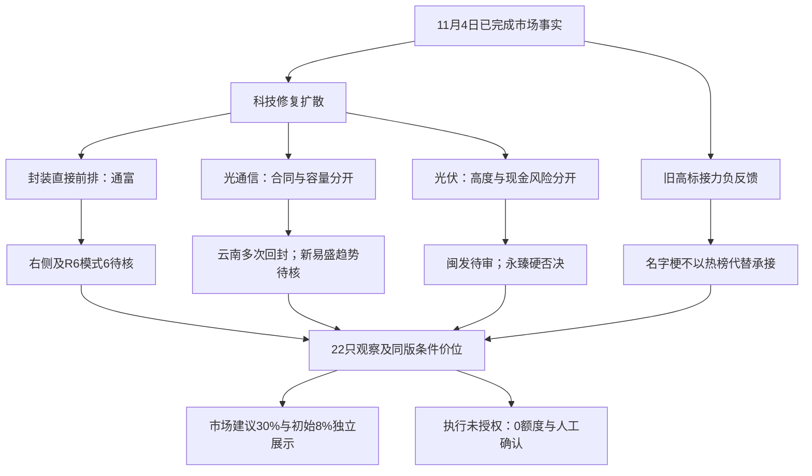

<!-- canghai:explicit-plan-report-assembly:v1 -->
# 显式组装报告（非重新推理）

> 决策来源（JSON）：llm
> 同版 JSON SHA-256（规范化内容）：5e00dfeea4fcf416dc72c26e4e163133100412c1983ee51d2d923fbd6737dc87
> 以下散文为调用方提供的模型原文，完整保留、未经重新推理；原文自述不是来源验证，不得覆盖 JSON 禁令、权限或缺口。
> 表格直接复用既有共享 renderer；只读展示，不构成开仓或自动交易授权。

## 模型原文（非重新推理）

---
date: 2026-11-05
agent: D1-main-decision
skill_version: main_decision_v1@2.1
decision_source: llm
generated_at: 2026-11-05T09:17:53+08:00
confidence: null
degraded: true
data_sources:
  - name: verified_R1_R7
    path: data/research/20261105/research_summary.json
    status: partial
    captured_at: "2026-11-05T07:33:40+08:00"
    record_count: 7
  - name: bound_aux3
    path: input_manifest.bound_auxiliary_inputs
    status: partial
    captured_at: null
    record_count: 2
input_freshness: partial
input_freshness_note: 行情事实为11月4日；主研究同run七份均已校验，但必要审核仅新易盛完整。注意力为T-1，情绪为T-1；本日日历绑定缺失，不补历史正文。
---

# 2026年11月5日 · 主决策 / D1 盘前预案

## 🧭 一句话结论

**科技修复强，旧高标接力弱；通富保留第一研究位，当前不认证可买，条件价位不删。**

这份报告由本轮LLM综合裁决，不是先前08:58的Python安全网。真实生成窗口已晚于08:00目标，仍在竞价前；没有读取11月5日行情，不冒充已看过今日竞价。研究批次为 `20261105T061038-34166-8710`。后续只有本版核心JSON与这份主报告，不写runtime副本。

## 💰 市场建议与执行权限，先分成两张账

| 层次 | 本轮明确结论 | 不是哪件事 |
|---|---|---|
| 市场建议总风险敞口 | **上限30%**，以净资产100%为概念基准 | 不是在已有持仓外再加30%，不读取真实/模拟账户 |
| 本轮初始条件试探 | **8%**，唯一明确逐票条件建议为通富微电8% | 不是立刻买入；右侧、模式6、核心输入、报价/成交性和授权未齐时不激活 |
| 其他对象条件建议 | 明确拦截/放弃的为0；未形成可靠定仓结论的为未知null | 不从执行max_position_pct借数，不给观察/B计划填默认正仓位 |
| 系统执行额度 | **0**；dry_run、禁自主、需人工确认 | 不是“人的市场建议空仓”，不是已核用户实际新增为0 |
| 当前池身份 | 进execution **0**；进watch **22**；其中两票真实R6硬否决 | 非执行候选少于目标就从次线凑票，亦非partial整体清池 |
| 有效事实与窗口 | 11月4日收盘事实；本轮意见至11月5日09:30 | 不把前日大阳外推为11月5日持续主升；到期必须重评，不能自动续期 |

市场上限30%低于R1研究建议45%，来自两组真实事实的取舍：上涨4667/5572、成交较前日扩张19.64%、封装同轮19封1炸，说明风险偏好修复不是猜测；但前日涨停池收盘中位数-2.34%、开盘到收盘均值-1.99%、高度从6降到4再到3，说明“追昨天最强”还没得到稳定奖励。我愿意保留风险敞口的条件空间，不愿把一次广谱回补定性成新主升，更不把账户未知推成市场零仓。30%和8%都是本轮取舍，不是已验证最优比例或检测器档位。

### 当前不交易条件清单

当前active全局项仅为 `ACCOUNT_BUDGET_UNVERIFIED`：独立执行预算与权限未核，保留零执行额度。mode=dry_run、autonomous=false、人工确认同时有效。并未用低confidence、summary partial、日历缺失或北向缺口制造新的全市场风险禁令。

逐票active项另列：R6必要缺项、已核板型/禁止项、右侧核心未验证及两票真实hard_reject。不是别的票没审完就全体没审完；新易盛模式1/2/6/7已完整，是“完成审核仍未恢复右侧趋势”的反例。空execution也不认证研究完成，因此production_ready、research_completion_passed均为false，仍有补审/重评义务。退出管理不因禁新停摆；但本轮账户未读，不能编已有底仓及可卖数量。

## 📍 条件买卖点总表：数字与能不能买分列

下表是本轮明确选择的三格切换中“半路续强/突破确认”研究情景，通道为leader_breakout。**没有将下跌抄底改称强势低吸**。买区是条件区间，不表示当下可成交；最高接受价由D1收紧到买区上沿，不使用引擎7%宽上限借计划RR放行。实际ask、交易所涨跌停、竞价与必要资格仍须独立核。

| 股票             | 身份         | 买区            | 确认价    | 最高接受   | T+1止损  | 目标     | 计划RR | 条件仓位建议 | 当前能否买    |
| -------------- | ---------- | ------------- | ------ | ------ | ------ | ------ | ---- | ------ | -------- |
| 通富微电 002156.SZ | watch      | 42.12—42.96   | 42.33  | 42.96  | 40.81  | 47.26  | 2.00 | 8%     | 不可，见逐票限制 |
| 长电科技 600584.SH | watch      | 51.48—52.52   | 51.74  | 52.52  | 49.89  | 57.78  | 2.00 | 0%     | 不可，见逐票限制 |
| 北方华创 002371.SZ | watch      | 532.82—543.53 | 535.50 | 543.53 | 516.35 | 597.89 | 2.00 | 未知     | 不可，见逐票限制 |
| 博杰股份 002975.SZ | watch      | 76.94—78.49   | 77.33  | 78.49  | 74.57  | 86.33  | 2.00 | 0%     | 不可，见逐票限制 |
| 沃格光电 603773.SH | watch/R6拦截 | 56.86—58.01   | 57.15  | 58.01  | 55.11  | 63.81  | 2.00 | 0%     | 不可，见逐票限制 |
| 云南锗业 002428.SZ | watch      | 75.00—76.51   | 75.38  | 76.51  | 73.68  | 82.17  | 2.00 | 0%     | 不可，见逐票限制 |
| 新易盛 300502.SZ  | watch      | 195.52—199.45 | 196.50 | 199.45 | 183.49 | 231.37 | 2.00 | 未知     | 不可，见逐票限制 |
| 中际旭创 300308.SZ | watch      | 530.71—541.38 | 533.38 | 541.38 | 498.07 | 628.00 | 2.00 | 未知     | 不可，见逐票限制 |
| 华盛昌 002980.SZ  | watch      | 70.91—72.34   | 71.27  | 72.34  | 68.72  | 79.58  | 2.00 | 0%     | 不可，见逐票限制 |
| 闽发铝业 002578.SZ | watch      | 4.20—4.28     | 4.22   | 4.28   | 4.07   | 4.70   | 2.00 | 未知     | 不可，见逐票限制 |
| 永臻股份 603381.SH | watch/R6拦截 | 17.05—17.40   | 17.14  | 17.40  | 16.53  | 19.14  | 2.00 | 0%     | 不可，见逐票限制 |
| 阳光电源 300274.SZ | watch      | 83.38—85.06   | 83.80  | 85.06  | 78.26  | 98.66  | 2.00 | 未知     | 不可，见逐票限制 |
| 龙版传媒 605577.SH | watch      | 15.65—15.97   | 15.73  | 15.97  | 15.17  | 17.57  | 2.00 | 0%     | 不可，见逐票限制 |
| 浙文影业 601599.SH | watch      | 4.18—4.26     | 4.20   | 4.26   | 4.05   | 4.68   | 2.00 | 未知     | 不可，见逐票限制 |
| 福莱新材 605488.SH | watch      | 44.57—45.46   | 44.79  | 45.46  | 43.19  | 49.50  | 1.78 | 0%     | 不可，见逐票限制 |
| 兆威机电 003021.SZ | watch      | 101.24—103.28 | 101.75 | 103.28 | 98.12  | 113.60 | 2.00 | 未知     | 不可，见逐票限制 |
| 武汉天源 301127.SZ | watch      | 15.90—16.22   | 15.98  | 16.22  | 14.92  | 18.82  | 2.00 | 未知     | 不可，见逐票限制 |
| 翰宇药业 300199.SZ | watch      | 22.60—23.05   | 22.71  | 23.05  | 21.21  | 26.73  | 2.00 | 未知     | 不可，见逐票限制 |
| 四川黄金 001337.SZ | watch      | 36.99—37.74   | 37.18  | 37.74  | 36.55  | 40.12  | 2.00 | 未知     | 不可，见逐票限制 |
| 七匹狼 002029.SZ  | watch      | 9.25—9.44     | 9.30   | 9.44   | 8.97   | 10.38  | 2.00 | 0%     | 不可，见逐票限制 |
| 九牧王 601566.SH  | watch      | 10.90—11.11   | 10.95  | 11.11  | 10.55  | 12.23  | 2.00 | 0%     | 不可，见逐票限制 |
| 深中华A 000017.SZ | watch      | 6.35—6.48     | 6.38   | 6.48   | 6.16   | 7.12   | 2.00 | 未知     | 不可，见逐票限制 |

全部价格事实为11月4日。本表不是22只同时买入的组合；B计划重复对象不再累计。福莱情景RR约1.78低于原1.8门槛，不能参与。兆威、武汉等突破位高于昨收，不是现在能买；其中“超过10%”只为引擎距离诊断，不是已核交易所不可达性。一字封死不排竞价单；只有真实开板、有成交且重新走完原资格时才有研究价值。

## 🌊 从市场到板块，再到个股

R1情绪83描述11月4日的热度，不是83%胜率。独立绑定emotion_cycle为high_chop，所用开盘溢价+1.75%与R1收盘反馈-0.32%分母/时间窗口不同，不能择一删另一。昨天83.76%的上涨广度与前日涨停股多数亏钱可以同时成立：新资金买科技超跌修复，旧情绪先手趁热度兑现。这是今天要区分的两种赚钱效应。

R2只采用一套主模板“三格”，比较龙头、补涨、切换，不同时拼首板隔日、总龙锁仓和树干等五套模板。R3热榜与群聊把科技修复和名字梗负反馈交叉出来，但热度既不是资金净入，也不能以“旧高标依然热门”代替承接。R7先进封装单日净入111.497764亿、五日仍净出76.366001亿，支持修复合力而非持续主升；北向不参与仓位增减或置信度分母。ETF份额与两融最新到11月3日、美股缺11月4日最新收盘，明确是时序缺口，不把旧值写成隔夜确认。

### 主线一：先进封装/半导体修复

- **大资金意图**: 从涨幅、扩散和净额可推测资金在回补高弹性科技，但不能据一天净额断言机构长期锁仓。封装212成分中209上涨、19封1炸，证据是同轮横截面；缺逐笔因果，不声称通富一只带起全行业。
- **为什么走强**: 半导体行业+10.64%、先进封装概念单日资金回流，与通富/长电直接封测封板形成交叉；没有R4新增封测官方订单也不妨碍修复事实成立。
- **逻辑够不够硬**: 市场合力比公司新增订单证据硬。五日净额仍负、直接双核心仍在中期均线下，延续只作一天前瞻假设，不继承历史轮次。当前优先通富研究，不用设备容量北方华创或历史锚中京电子替换封测身位。

### 主线二：光通信/磷化铟事件链

- **大资金意图**: 云南锗业年度合同提供直接交易锚；新易盛/中际是光模块容量修复，不是同一合同签约主体。消息传播与资金购买对象须分开。
- **为什么走强**: 光通信成分229/231上涨、12封2炸，云南首板与双平台人气共振；但三次开板显露分歧，不能拿封单收盘快照冒充全天承接。
- **逻辑够不够硬**: 年度18万片4英寸InP、1.944亿美元约13.053182亿元合同事实硬；许可取得/维持、订单取消退款与实际采购是同一合同的条件，不是另一条独立利空。把五年安排乘出未来利润是越界。云南降级观察，新易盛虽必要审核完整仍非已确认主升。

### 主线三：光伏/储能修复

- **大资金意图**: 闽发三板与光伏22封6炸显示情绪资金愿意给高度；阳光电源是经营容量对照，不能把两者身份混为一个龙头。
- **为什么走强**: 604只有价成分中552上涨，板块中位约+3.01%；闽发五日正资金与身位是真实证据，但仍需核明日承接，不把榜内活跃days当真实行情年龄。
- **逻辑够不够硬**: 量价比盈利反转更硬。闽发微利与负CFO、永臻现金/杠杆硬否决、阳光营利下滑分别处理，不因一个财务雷否决整条线；也不因永臻低一板就递补买入。

## 🔬 四象限叉乘：硬证据不豁免已现风险

沿用R6对已有对象的交叉识别，不另造评分：横轴为相对硬α/待证α，纵轴为已现风险/尚无已证重大风险。北方华创落Q1仅表示相对经营与现金较好，不是无风险证明。通富、云南、新易盛、中际、阳光、武汉、翰宇、四川等Q2，说明经营/事件锚与趋势、现金、许可或必要缺证同时存在。Q3本版没有可合法列出的对象，不造对照票。其余Q4不以题材词和历史活跃取代当前风险，沃格/永臻再单列不可覆盖硬否决。

这张叉乘解释“为什么同样涨停处置不同”：云南消息更硬但多次回封，新易盛审核更完整但趋势未回，通富身位更好但模式6与下降结构仍待核。辅助partial不全局禁买；明确失败或必要未知也不冒充已经通过。

## 🥇 通富微电：第一研究位，不是当前买入票

- **大资金意图**: 直接封测先封、日成交约41.96亿元、五日两口径均正，支持修复资金给前排溢价；没有证据认证长期锁仓。
- **为什么走强**: 首板零开板、热榜第7与封装19封1炸交叉。旧股性51.9/近期“好”只是历史属性，没有比当下市场更高的决策权。
- **逻辑够不够硬**: 股价仍低于MA20/60，利润54.98%非经常、有息负债较高，R6模式6未完成，不能直接称可交易核心。与长电四次回封相比研究优先，与中京82.1历史锚相比当前封板/资金更直接；这不是继承R2 adopted，也不是把资料齐全当盈利概率。

**买入理由**: 第一，封测业务与主线直接，非泛概念附会；第二，零开板首板与五日资金转正优于直接对照。条件建议8%只在下降结构解除、核心与必要审核及授权全闭环时激活，当前不买。

**风险点**: 第一，首板属于下跌通道修复，43.25等压力可能使理论2R过于乐观；第二，财务质量及R6模式6缺证不能被单日8亿级净入覆盖。图像只作辅助诊断，不借它挪目标或止损以求RR通过。

**止损条件**: 同一情景拟买上沿42.96、止损40.81、目标47.26，止损距约-5.00%，RR=2.00。新增仓买入当日无法卖出，若后来合法成交，只能T+1以真实可卖量执行止损/目标；现在无底仓数据，不编可卖数量，不写当天跌破就走。

**可验证假设**: 下个有效窗口核能否在原价带内同时形成核心资金、板块扩散与价格确认，并补齐R6模式6；任一迟到、盘初失守原情景或同线双核心共同转弱即取消未买剧本。不能先追价，再倒填“已确认”。

## 🧪 云南锗业与新易盛：事件最硬、审核最齐，也不等于今天就买

### 云南锗业

- **大资金意图**: 合同与双平台人气提供公司级辨识度，不能解释为AOI五年现金已落袋。
- **为什么走强**: 早封首板及五日正资金真实，三次开板同样真实；比博杰/华盛昌间接叙事更直接，不以叙事优势赦免板型。
- **逻辑够不够硬**: 主体、年度数量金额硬，许可和采购未知，S3未齐，多次回封原禁止项命中。最终降级观察，条件仓位建议显式0，不上execution。

**买入理由**: 仅研究直接合同与板块合力两项事实；并未形成当下可买结论。**风险点**: 许可维持和取消退款条款、三次开板与先手兑现。**止损条件**: 研究上沿76.51、T+1止损73.68、目标82.17，止损更紧且是原引擎结构结果，不能强改-7%凑纪律；这不代表准许开仓。**可验证假设**: 真实新证据能否补S3、事件落实与当日承接，而非再转载同一合同；在本版多次回封拦截解除前不买。

### 新易盛

- **大资金意图**: 广谱光通信回补可解释单日大阳，不足证明此前持续卖压已清。
- **为什么走强**: 收入/利润增长与当日科技修复共振；30交易日跌幅约半、MA5未稳构成相反证据。
- **逻辑够不够硬**: R6模式1/2/6/7唯一全齐，明确承认其局部完整性，不受其他21票缺证牵连；但高业绩、低估值都不能替代右侧。最终watch，逐票条件定仓保持null而非默认5%。

**买入理由**: 经营证据强、必要审查已完成，值得持续保留；不是云南合同的直接获利主体。**风险点**: 现金转换低、存货和资金跨源偏差及下跌结构。**止损条件**: 上沿199.45、止损183.49、目标231.37，T+1约-8.00%风险、RR=2.00，不伪写当日能卖。**可验证假设**: 实际右侧/筹码承接是否恢复；中际是同业务容量对照但审核与资金更弱，不能从两票反弹里强选一只“估值底”。

## 🎭 10cm情绪核心／名字梗：研究不停止，旧线不硬续命

这不是用北方华创/阳光电源替代情绪票。本轮确有闽发三板、浙文三板、龙版三板、七匹狼、九牧王、深中华的同版覆盖。闽发是光伏高度锚，不是盈利反转认证；浙文早封少开板仍有新业务未变和负CFO，龙版四次开板命中禁止项。传媒4封3炸与五日净额偏弱，明显逊于封装，不通过挖同名后排强行延长旧剧本。

跨年按2026年四季度交易2027羊年预期解释，不因当前马年机械排除。纯生肖/谐音允许作为传播研究，但本批没有独立传播原文认证“羊狼已成市场共识”，也没有证据说监管后资金已经切换名字。七匹狼约-9.97%、净出约4.20亿，九牧王约-5.19%、净出约1.68亿，是当下负反馈而非热榜强势。两票降级观察、条件建议0；深中华首板与76股性是真线索，但未证明同轮关系，不递补为羊狼新龙，亦不把其金银加工当金矿利润弹性。

**大资金意图**仍须由当下承接验证，不能把高人气即将跌停解释成“吸筹”；**为什么走强**只对确实走强的闽发/浙文等说明，旧名字票这次在兑现；**逻辑够不够硬**取决于传播、梯队、换手、限制及次日接力能否同时得到新证据。本轮缺合法同轮新龙对照，明确交回R2，不由D1开源文件补选。

一字预判仅消费R5内嵌6票属性，不运行新的预测模型。三板闽发/浙文/龙版不顶；首板通富/北方/云南即使原预测存在，也不是本版隔夜单许可。拒绝运输摘要中的排隔夜指令与概率=胜率解释。新来源提名不是买权，真实监管对象和制度限制不能靠改名规避。

## 📰 消息、产业、纯情绪并行裁决

云南合同：采用公司级事实、保留兑现约束，交易延后。武汉天源：采用正式签约增量，不把36.4亿元联合体总额当上市公司收入，97%并网后付款、垫资和定增摊薄须核；其11月4日盘中上涨早于盘后公告，不能倒因。翰宇：采用HY3003周制剂首次临床许可，非上市、非口服/月制剂许可；保留质押和应收风险，消息后价格/资金仍未知。三者对照直接公司事实、板块传导与财务必要审查，不以新闻新旧一个标签定输赢。

节约方案：采用政策方向，延后没有当前R2/R5核心映射的公司选取，不凭“节水/算力”现场补新票。逆回购3000亿对5000亿同期限到期是缩量2000亿，不写净投放；回购增持再贷款利率下降是融资成本，不等于额度申请已进入股票。高耗能约束按已声明行业核，不把它泛化为所有科技硬件利空。

江苏雷利/鼎智是实控人个人立案，天山是公司立案加会计监管问题，大晟负净资产退市风险、浙文无新重大经营变化、龙蟠部分长单滞后分别保留；这些不是所有机器人、传媒、光伏统一财务造假。沃格历史个人处罚已办结与本票财报四红旗硬否决，是两条不同证据链。

## 🔀 B计划不是绕门禁的后门

R7 seesaw_pairs为空，不能宣称黄金与科技已验证20日相关小于-0.6。只用R2同版次线构造条件：封测双核心均低于竞价预期/主线资金回流失效时，研究四川黄金自身资金与梯队；其矿价经营映射优于深中华，仍缺全板块核心及必要审查，不能自动买。光伏容量阳光与身位闽发作第二个对照方向，不让永臻硬否决票递补。武汉/翰宇为新消息后独立验证方向，不能用前一日涨幅证明已交易新消息。

上述五个B条目均复用观察池五只对象，仓位不重复累加，仍全是watch、零执行权限。触发只启动复评，不将promote自动变成授权；B也弱就不启用新情景，不把“资金一定搬家”当方向预测。

## 📚 专题证据：D1自己的取舍，不继承上游的“采用”

仅消费R2/R4/R5/R6主JSON内knowledge_context与knowledge_adjudications。run、attempt=1、context_sha256和研究文件版本已经由原接口复核；receipt的partial只是留证状态，不是全局禁买，也不证明模型真正理解或效果。

D1有限采用主题锚的“已有候选对照”，不声称重读597主题；采用股性22行的历史属性与相反证据，不给旧股性固定权重。采用新版成长池四川黄金金价/产量拆分与翰宇市值退出语义，旧版成长池单独延后，不把两source_id混在一起。红利overview实际已读但延后，不能把10月30日估值、未核153只和现金反证认证为稳息合格；R2中远海控/格力同版资金对照并未显示替代主线的当下合力。股东增持专题没有精确22代码匹配，not_applicable，不从池外提名扩名单。显式专题反馈为空，unknown，不虚构已读复盘或已有效果。

旧日历专题仅有限采用R4内嵌前缀的工具与时序边界，**不是本日三类辅助日历**，没有打开其来源MD、previous_report或外链。R2日历声明在运输回执内有invalid记录，不能凭上游adopted替代真实内容；本轮采用来自实际R4前缀，不来自该无效声明。今天aux日历明确unavailable，无完整正文可读，未来三交易日覆盖未核，责任归calendar/fetch owner；不补历史日历、不写“无大事件”。

正式JSON meta逐来源与逐对象记录共31条：source_id、source/evidence refs、disposition、具体用途、affected_codes/sectors。每票reason/alpha_logic均保留D1取舍与同版对照；后续格式重试冻结名单和原解释，不能借补记录重选。以下完整source_id与范围详见同版JSON，运输留证不构成理解/效果认证。

## 🧮 价位推导：原公式、原情景、原失败

定价前已明确所有22对象的leader_breakout研究情景；随后在本轮工作对象显式运行consume_authorized_inputs、chart_evidence_from_profiles与apply_to_plan，包含观察/B计划，不调用会副写价位MD的CLI。现有load_tech默认DB读取超出本轮范围，故仅在本次进程内将其读适配为已授权R5的真实技术值，**原derive与资格公式未改、源文件未改、数据库未开**。

收盘及MA为R5以adj_factor归一到11月4日的前复权值。20日高低来自同版最近20根日K的raw high/low乘同日qfq_close/raw_close比例，保留计算来源；并不把未复权OHLC直接混到前复权均线。牛熊线确实缺失保持null。引擎远高点距离诊断含旧10%或板制推断，不充交易所级可达性证明。原止损/买区/目标不因识图冲突重写；同一情景真值已经绑定顶层stop_loss/take_profit、entry规则和T+1退出，不留零元止损占位。

### 通富微电 002156.SZ

买区：pivot=ref_close(远端20日高今日不可达，仅作压力位)=42.33; 买区=[pivot×0.995, pivot×(1+1.5%)]; 溢价上限7%；⚠️20日高58.13距昨收+37.3%，今日不可达，不作买入基准。止损：止损=买价×(1-5%) → 40.81（三者取最高: 买价×(1-5%)=40.81）。目标：2R目标 = 买42.96 + 2×(买入价-止损2.15) = 47.26。RR：RR=(47.26-42.96)/(42.96-40.81)=2.0。D1实际最高接受价=42.96，不取引擎宽上限。数据日11月4日，窗口到09:30；高开超限、一字无成交、条件离带后才成立或本票逻辑证伪即取消未买情景。

D1取舍：进 watch：直接封测第一研究位。先封、零开板与五日正资金优于长电，但MA20/60下的修复尚未解除下降结构，R6模式6未完成；等待右侧续强及必要补审，不把首板当强势低吸。 对照：长电四次开板且五日净出；中京电子历史锚82.1不抵消本轮未封板及五日净出，不换龙。 来源：R5画像、R6逐票审核及该票reason/alpha_logic已列专题refs；不是因数字存在就准买。

### 长电科技 600584.SH

买区：pivot=ref_close(远端20日高今日不可达，仅作压力位)=51.74; 买区=[pivot×0.995, pivot×(1+1.5%)]; 溢价上限7%；⚠️20日高66.00距昨收+27.6%，今日不可达，不作买入基准。止损：止损=买价×(1-5%) → 49.89（三者取最高: 买价×(1-5%)=49.89）。目标：2R目标 = 买52.52 + 2×(买入价-止损2.63) = 57.78。RR：RR=(57.78-52.52)/(52.52-49.89)=2.0。D1实际最高接受价=52.52，不取引擎宽上限。数据日11月4日，窗口到09:30；高开超限、一字无成交、条件离带后才成立或本票逻辑证伪即取消未买情景。

D1取舍：降级观察：封测龙二容量真实，但四次开板、14点后首封命中原禁止项，五日净出；不因龙一待审自动递补。 对照：通富先封零开板及五日正流入更符合本轮前排；保留容量对照而不买。 来源：R5画像、R6逐票审核及该票reason/alpha_logic已列专题refs；不是因数字存在就准买。

### 北方华创 002371.SZ

买区：pivot=ref_close(远端20日高今日不可达，仅作压力位)=535.50; 买区=[pivot×0.995, pivot×(1+1.5%)]; 溢价上限7%；⚠️20日高634.41距昨收+18.5%，今日不可达，不作买入基准。止损：止损=买价×(1-5%) → 516.35（三者取最高: 买价×(1-5%)=516.35, MA10×0.99=504.80）。目标：2R目标 = 买543.53 + 2×(买入价-止损27.18) = 597.89。RR：RR=(597.89-543.53)/(543.53-516.35)=2.0。D1实际最高接受价=543.53，不取引擎宽上限。数据日11月4日，窗口到09:30；高开超限、一字无成交、条件离带后才成立或本票逻辑证伪即取消未买情景。

D1取舍：进 watch：设备容量资金较连续、经营质量相对好；本轮R2候补不是封测龙一龙二，且中期均线未收复，模式6待核。 对照：通富是直接封测前排，北方是设备容量，不能以净额金额替代业务身位。 来源：R5画像、R6逐票审核及该票reason/alpha_logic已列专题refs；不是因数字存在就准买。

### 博杰股份 002975.SZ

买区：pivot=ref_close(远端20日高今日不可达，仅作压力位)=77.33; 买区=[pivot×0.995, pivot×(1+1.5%)]; 溢价上限7%；⚠️20日高104.98距昨收+35.8%，今日不可达，不作买入基准。止损：止损=买价×(1-5%) → 74.57（三者取最高: 买价×(1-5%)=74.57）。目标：2R目标 = 买78.49 + 2×(买入价-止损3.92) = 86.33。RR：RR=(86.33-78.49)/(78.49-74.57)=2.0。D1实际最高接受价=78.49，不取引擎宽上限。数据日11月4日，窗口到09:30；高开超限、一字无成交、条件离带后才成立或本票逻辑证伪即取消未买情景。

D1取舍：降级观察：历史主题锚与首板不等于主营兑现，半导体子公司收入占比有限、InP参股亏损、光模块耦合设备未实现收入，R6必要审核未齐。 对照：通富直接封测、云南合同主体更直接；中京与本票的旧锚分均不证明当期核心。 来源：R5画像、R6逐票审核及该票reason/alpha_logic已列专题refs；不是因数字存在就准买。

### 沃格光电 603773.SH

买区：pivot=ref_close(远端20日高今日不可达，仅作压力位)=57.15; 买区=[pivot×0.995, pivot×(1+1.5%)]; 溢价上限7%；⚠️20日高89.28距昨收+56.2%，今日不可达，不作买入基准。止损：止损=买价×(1-5%) → 55.11（三者取最高: 买价×(1-5%)=55.11）。目标：2R目标 = 买58.01 + 2×(买入价-止损2.90) = 63.81。RR：RR=(63.81-58.01)/(58.01-55.11)=2.0。D1实际最高接受价=58.01，不取引擎宽上限。数据日11月4日，窗口到09:30；高开超限、一字无成交、条件离带后才成立或本票逻辑证伪即取消未买情景。

D1取舍：拦截：R6_M7_04四项财报红旗硬否决不可覆盖；首板与股性不抵消。个人历史处罚已办结，不冒充公司当前造假。 对照：不取代通富；即使先进封装板块修复也不能绕过本票财务硬否决。 来源：R5画像、R6逐票审核及该票reason/alpha_logic已列专题refs；不是因数字存在就准买。

### 云南锗业 002428.SZ

买区：pivot=ref_close(远端20日高今日不可达，仅作压力位)=75.38; 买区=[pivot×0.995, pivot×(1+1.5%)]; 溢价上限7%；⚠️20日高91.08距昨收+20.8%，今日不可达，不作买入基准。止损：止损=MA10×0.99 → 73.68（三者取最高: 买价×(1-5%)=72.68, MA10×0.99=73.68）。目标：2R目标 = 买76.51 + 2×(买入价-止损2.83) = 82.17。RR：RR=(82.17-76.51)/(76.51-73.68)=2.0。D1实际最高接受价=76.51，不取引擎宽上限。数据日11月4日，窗口到09:30；高开超限、一字无成交、条件离带后才成立或本票逻辑证伪即取消未买情景。

D1取舍：降级观察：AOI年度合同是真公司级锚，但三次开板命中多次回封禁止项；许可、取消退款条件和S3缺证保留，不追首板隔日。 对照：比博杰/华盛昌的间接题材映射更直接，但资金/人气领先不豁免板型；不把新易盛自动递补为龙一。 来源：R5画像、R6逐票审核及该票reason/alpha_logic已列专题refs；不是因数字存在就准买。

### 新易盛 300502.SZ

买区：pivot=ref_close(远端20日高今日不可达，仅作压力位)=196.50; 买区=[pivot×0.995, pivot×(1+1.5%)]; 溢价上限7%；⚠️20日高407.33距昨收+107.3%，今日不可达，不作买入基准。止损：止损=买价×(1-8%) → 183.49（三者取最高: 买价×(1-8%)=183.49）。目标：2R目标 = 买199.45 + 2×(买入价-止损15.96) = 231.37。RR：RR=(231.37-199.45)/(199.45-183.49)=2.0。D1实际最高接受价=199.45，不取引擎宽上限。数据日11月4日，窗口到09:30；高开超限、一字无成交、条件离带后才成立或本票逻辑证伪即取消未买情景。

D1取舍：进 watch：R6四项必要审核唯一完成对象，但30交易日约跌半、未站稳MA5，不符合已证主升低吸。现金转换、存货和跨源资金偏差仍在；审核完成不等于买入资格。 对照：中际同为光模块容量但五日净出、必要合规未齐；两者都不是云南InP合同的同一直接受益。 来源：R5画像、R6逐票审核及该票reason/alpha_logic已列专题refs；不是因数字存在就准买。

### 中际旭创 300308.SZ

买区：pivot=ref_close(远端20日高今日不可达，仅作压力位)=533.38; 买区=[pivot×0.995, pivot×(1+1.5%)]; 溢价上限7%；⚠️20日高833.25距昨收+56.2%，今日不可达，不作买入基准。止损：止损=买价×(1-8%) → 498.07（三者取最高: 买价×(1-8%)=498.07）。目标：2R目标 = 买541.38 + 2×(买入价-止损43.31) = 628.00。RR：RR=(628.00-541.38)/(541.38-498.07)=2.0。D1实际最高接受价=541.38，不取引擎宽上限。数据日11月4日，窗口到09:30；高开超限、一字无成交、条件离带后才成立或本票逻辑证伪即取消未买情景。

D1取舍：降级观察：盈利强与价格/资金弱并存，五日持续净出且MA20/60上方套牢；必要合规未齐。 对照：新易盛必要审核更完整，但同样未恢复右侧；不因本票估值低从反弹中猜底。 来源：R5画像、R6逐票审核及该票reason/alpha_logic已列专题refs；不是因数字存在就准买。

### 华盛昌 002980.SZ

买区：pivot=ref_close(远端20日高今日不可达，仅作压力位)=71.27; 买区=[pivot×0.995, pivot×(1+1.5%)]; 溢价上限7%；⚠️20日高118.56距昨收+66.4%，今日不可达，不作买入基准。止损：止损=买价×(1-5%) → 68.72（三者取最高: 买价×(1-5%)=68.72）。目标：2R目标 = 买72.34 + 2×(买入价-止损3.62) = 79.58。RR：RR=(79.58-72.34)/(72.34-68.72)=2.0。D1实际最高接受价=72.34，不取引擎宽上限。数据日11月4日，窗口到09:30；高开超限、一字无成交、条件离带后才成立或本票逻辑证伪即取消未买情景。

D1取舍：降级观察：晚封首板、应收与CFO反证、S3未核；历史CPO锚不授予核心地位。 对照：云南直接合同与通富直接封测更清晰；合锻/中京旧锚也未形成当期前排，不据锚排名买。 来源：R5画像、R6逐票审核及该票reason/alpha_logic已列专题refs；不是因数字存在就准买。

### 闽发铝业 002578.SZ

买区：pivot=max(昨收,20日高)=4.22; 买区=[pivot×0.995, pivot×(1+1.5%)]; 溢价上限7%。止损：止损=买价×(1-5%) → 4.07（三者取最高: 买价×(1-5%)=4.07, MA10×0.99=3.47）。目标：2R目标 = 买4.28 + 2×(买入价-止损0.21) = 4.70。RR：RR=(4.70-4.28)/(4.28-4.07)=2.0。D1实际最高接受价=4.28，不取引擎宽上限。数据日11月4日，窗口到09:30；高开超限、一字无成交、条件离带后才成立或本票逻辑证伪即取消未买情景。

D1取舍：进 watch：光伏三板最高身位、零开板与五日资金正值得保留，但微利依赖非经常项目、CFO负、必要审核缺项及高加速尾部风险未闭环。 对照：永臻低一板且财报硬否决，不能拿它作低位替补；阳光是经营容量对照不是10cm情绪龙。 来源：R5画像、R6逐票审核及该票reason/alpha_logic已列专题refs；不是因数字存在就准买。

### 永臻股份 603381.SH

买区：pivot=max(昨收,20日高)=17.14; 买区=[pivot×0.995, pivot×(1+1.5%)]; 溢价上限7%。止损：止损=买价×(1-5%) → 16.53（三者取最高: 买价×(1-5%)=16.53, MA10×0.99=14.39）。目标：2R目标 = 买17.40 + 2×(买入价-止损0.87) = 19.14。RR：RR=(19.14-17.40)/(17.40-16.53)=2.0。D1实际最高接受价=17.40，不取引擎宽上限。数据日11月4日，窗口到09:30；高开超限、一字无成交、条件离带后才成立或本票逻辑证伪即取消未买情景。

D1取舍：拦截：R6_M7_09五项财报红旗硬否决，二板突破不改变现金与杠杆风险；永不以低位理由绕过。 对照：比闽发身位低且现金负债压力更大；不因闽发高位就买本票。 来源：R5画像、R6逐票审核及该票reason/alpha_logic已列专题refs；不是因数字存在就准买。

### 阳光电源 300274.SZ

买区：pivot=max(昨收,20日高)=83.80; 买区=[pivot×0.995, pivot×(1+1.5%)]; 溢价上限7%。止损：止损=买价×(1-8%) → 78.26（三者取最高: 买价×(1-8%)=78.26, MA10×0.99=70.32）。目标：2R目标 = 买85.06 + 2×(买入价-止损6.80) = 98.66。RR：RR=(98.66-85.06)/(85.06-78.26)=2.0。D1实际最高接受价=85.06，不取引擎宽上限。数据日11月4日，窗口到09:30；高开超限、一字无成交、条件离带后才成立或本票逻辑证伪即取消未买情景。

D1取舍：进 watch：资金回流、收复MA20的容量修复可作为光伏分歧对照，但R2候补、模式6缺证和营利下滑仍在，不冒称主升。 对照：优于永臻的经营现金和容量，但不能替代闽发的10cm高度身份。 来源：R5画像、R6逐票审核及该票reason/alpha_logic已列专题refs；不是因数字存在就准买。

### 龙版传媒 605577.SH

买区：pivot=ref_close(远端20日高今日不可达，仅作压力位)=15.73; 买区=[pivot×0.995, pivot×(1+1.5%)]; 溢价上限7%；⚠️20日高21.27距昨收+35.2%，今日不可达，不作买入基准。止损：止损=买价×(1-5%) → 15.17（三者取最高: 买价×(1-5%)=15.17, MA10×0.99=13.47）。目标：2R目标 = 买15.97 + 2×(买入价-止损0.80) = 17.57。RR：RR=(17.57-15.97)/(15.97-15.17)=2.0。D1实际最高接受价=15.97，不取引擎宽上限。数据日11月4日，窗口到09:30；高开超限、一字无成交、条件离带后才成立或本票逻辑证伪即取消未买情景。

D1取舍：降级观察：三板辨识度不能抵消四次开板禁止项；主营未变、利润下滑与资本化红旗保留，不以一字预测顶单。 对照：浙文开板少但同样无新业务兑现；不通过继续挖龙字后排延续旧情绪剧本。 来源：R5画像、R6逐票审核及该票reason/alpha_logic已列专题refs；不是因数字存在就准买。

### 浙文影业 601599.SH

买区：pivot=max(昨收,20日高)=4.20; 买区=[pivot×0.995, pivot×(1+1.5%)]; 溢价上限7%。止损：止损=买价×(1-5%) → 4.05（三者取最高: 买价×(1-5%)=4.05, MA10×0.99=3.37）。目标：2R目标 = 买4.26 + 2×(买入价-止损0.21) = 4.68。RR：RR=(4.68-4.26)/(4.26-4.05)=2.0。D1实际最高接受价=4.26，不取引擎宽上限。数据日11月4日，窗口到09:30；高开超限、一字无成交、条件离带后才成立或本票逻辑证伪即取消未买情景。

D1取舍：进 watch：三板早封有情绪辨识度，经营未重大变化与CFO负要求防先手兑现；当期必要审核未齐，三板不进入一字顶单。 对照：较龙版少开板，但传媒4封3炸弱于封装19封1炸；不因同为三板强行主推。 来源：R5画像、R6逐票审核及该票reason/alpha_logic已列专题refs；不是因数字存在就准买。

### 福莱新材 605488.SH

买区：pivot=ref_close(远端20日高今日不可达，仅作压力位)=44.79; 买区=[pivot×0.995, pivot×(1+1.5%)]; 溢价上限7%；⚠️20日高49.50距昨收+10.5%，今日不可达，不作买入基准。止损：止损=买价×(1-5%) → 43.19（三者取最高: 买价×(1-5%)=43.19, MA10×0.99=42.85）。目标：20日高点49.50 低于2R目标50.00 且高于买价5%以上 → 取前高作第一压力位。RR：RR=(49.50-45.46)/(45.46-43.19)=1.78。D1实际最高接受价=45.46，不取引擎宽上限。数据日11月4日，窗口到09:30；高开超限、一字无成交、条件离带后才成立或本票逻辑证伪即取消未买情景。

D1取舍：降级观察：柔性传感收入极低与五日净出，不靠机器人名称升级；本情景RR低于1.8仍拦截。 对照：兆威微传动映射更直接，但其资金也弱，两者不因彼此比较就自动取得买权。 来源：R5画像、R6逐票审核及该票reason/alpha_logic已列专题refs；不是因数字存在就准买。

### 兆威机电 003021.SZ

买区：pivot=max(昨收,20日高)=101.75; 买区=[pivot×0.995, pivot×(1+1.5%)]; 溢价上限7%。止损：止损=买价×(1-5%) → 98.12（三者取最高: 买价×(1-5%)=98.12, MA10×0.99=90.36）。目标：2R目标 = 买103.28 + 2×(买入价-止损5.16) = 113.60。RR：RR=(113.60-103.28)/(103.28-98.12)=2.0。D1实际最高接受价=103.28，不取引擎宽上限。数据日11月4日，窗口到09:30；高开超限、一字无成交、条件离带后才成立或本票逻辑证伪即取消未买情景。

D1取舍：进 watch：微传动业务与均线上方结构相对明确，五日净出、利润下降及R6必要缺项阻止升位。 对照：福莱传感收入贡献更薄、波动更大；本票也未获本轮资金回流确认，不能用相对优越替代绝对资格。 来源：R5画像、R6逐票审核及该票reason/alpha_logic已列专题refs；不是因数字存在就准买。

### 武汉天源 301127.SZ

买区：pivot=max(昨收,20日高)=15.98; 买区=[pivot×0.995, pivot×(1+1.5%)]; 溢价上限7%。止损：止损=买价×(1-8%) → 14.92（三者取最高: 买价×(1-8%)=14.92, MA10×0.99=13.17）。目标：2R目标 = 买16.22 + 2×(买入价-止损1.30) = 18.82。RR：RR=(18.82-16.22)/(16.22-14.92)=2.0。D1实际最高接受价=16.22，不取引擎宽上限。数据日11月4日，窗口到09:30；高开超限、一字无成交、条件离带后才成立或本票逻辑证伪即取消未买情景。

D1取舍：进 watch：采用正式签约新增事实，延后交易；36.4亿是联合体总额、97%并网后付款，份额和垫资回款待核。11月4日盘中上涨不是盘后合同的价格验证。 对照：阳光电源经营现金与容量更可比，但无同类联合体事件；不同商业模式不借题材互相认证。 来源：R5画像、R6逐票审核及该票reason/alpha_logic已列专题refs；不是因数字存在就准买。

### 翰宇药业 300199.SZ

买区：pivot=ref_close(远端20日高今日不可达，仅作压力位)=22.71; 买区=[pivot×0.995, pivot×(1+1.5%)]; 溢价上限7%；⚠️20日高27.70距昨收+22.0%，今日不可达，不作买入基准。止损：止损=买价×(1-8%) → 21.21（三者取最高: 买价×(1-8%)=21.21）。目标：2R目标 = 买23.05 + 2×(买入价-止损1.84) = 26.73。RR：RR=(26.73-23.05)/(23.05-21.21)=2.0。D1实际最高接受价=23.05，不取引擎宽上限。数据日11月4日，窗口到09:30；高开超限、一字无成交、条件离带后才成立或本票逻辑证伪即取消未买情景。

D1取舍：进 watch：采用HY3003周制剂首次临床许可，延后交易；不是上市批准，质押、应收与盘后消息后资金/必要合规缺证仍在。 对照：四川黄金是经营增长对照不是GLP-1同业；市值超成长池上限不等于业绩恶化，亦不授予光通信主线位置。 来源：R5画像、R6逐票审核及该票reason/alpha_logic已列专题refs；不是因数字存在就准买。

### 四川黄金 001337.SZ

买区：pivot=ref_close(远端20日高今日不可达，仅作压力位)=37.18; 买区=[pivot×0.995, pivot×(1+1.5%)]; 溢价上限7%；⚠️20日高47.50距昨收+27.8%，今日不可达，不作买入基准。止损：止损=MA10×0.99 → 36.55（三者取最高: 买价×(1-5%)=35.85, MA10×0.99=36.55）。目标：2R目标 = 买37.74 + 2×(买入价-止损1.19) = 40.12。RR：RR=(40.12-37.74)/(37.74-36.55)=2.0。D1实际最高接受价=37.74，不取引擎宽上限。数据日11月4日，窗口到09:30；高开超限、一字无成交、条件离带后才成立或本票逻辑证伪即取消未买情景。

D1取舍：进 watch：金矿业务、首板及贵金属资金合力真实，保留科技失效后的B方向；仍是下行修复、必要风险与全黄金核心排名未完成。 对照：比深中华的金银加工更直接暴露矿价；不因历史股性71.9高于通富就挪为主线。 来源：R5画像、R6逐票审核及该票reason/alpha_logic已列专题refs；不是因数字存在就准买。

### 七匹狼 002029.SZ

买区：pivot=ref_close(远端20日高今日不可达，仅作压力位)=9.30; 买区=[pivot×0.995, pivot×(1+1.5%)]; 溢价上限7%；⚠️20日高11.36距昨收+22.2%，今日不可达，不作买入基准。止损：止损=买价×(1-5%) → 8.97（三者取最高: 买价×(1-5%)=8.97, MA10×0.99=8.48）。目标：2R目标 = 买9.44 + 2×(买入价-止损0.47) = 10.38。RR：RR=(10.38-9.44)/(9.44-8.97)=2.0。D1实际最高接受价=9.44，不取引擎宽上限。数据日11月4日，窗口到09:30；高开超限、一字无成交、条件离带后才成立或本票逻辑证伪即取消未买情景。

D1取舍：降级观察：名字梗仅传播假说；近跌停、主力净出与亏损为已知反证，不把榜首人气当承接，不低吸老龙。 对照：九牧王同步兑现不提供助攻；深中华没有同轮羊狼证据，不能补出新龙。 来源：R5画像、R6逐票审核及该票reason/alpha_logic已列专题refs；不是因数字存在就准买。

### 九牧王 601566.SH

买区：pivot=ref_close(远端20日高今日不可达，仅作压力位)=10.95; 买区=[pivot×0.995, pivot×(1+1.5%)]; 溢价上限7%；⚠️20日高12.71距昨收+16.1%，今日不可达，不作买入基准。止损：止损=买价×(1-5%) → 10.55（三者取最高: 买价×(1-5%)=10.55, MA10×0.99=10.05）。目标：2R目标 = 买11.11 + 2×(买入价-止损0.56) = 12.23。RR：RR=(12.23-11.11)/(11.11-10.55)=2.0。D1实际最高接受价=11.11，不取引擎宽上限。数据日11月4日，窗口到09:30；高开超限、一字无成交、条件离带后才成立或本票逻辑证伪即取消未买情景。

D1取舍：降级观察：冲高回落、净出与亏损显示旧线先手兑现；77.3历史股性不是本轮资金共识，不接跌幅修复。 对照：七匹狼同样无新承接，二者不是低价者优先；不为羊年叙事强选其一。 来源：R5画像、R6逐票审核及该票reason/alpha_logic已列专题refs；不是因数字存在就准买。

### 深中华A 000017.SZ

买区：pivot=ref_close(远端20日高今日不可达，仅作压力位)=6.38; 买区=[pivot×0.995, pivot×(1+1.5%)]; 溢价上限7%；⚠️20日高7.85距昨收+23.0%，今日不可达，不作买入基准。止损：止损=买价×(1-5%) → 6.16（三者取最高: 买价×(1-5%)=6.16, MA10×0.99=5.91）。目标：2R目标 = 买6.48 + 2×(买入价-止损0.32) = 7.12。RR：RR=(7.12-6.48)/(6.48-6.16)=2.0。D1实际最高接受价=6.48，不取引擎宽上限。数据日11月4日，窗口到09:30；高开超限、一字无成交、条件离带后才成立或本票逻辑证伪即取消未买情景。

D1取舍：进 watch：历史股性与首板作为研究线索，但AI子公司未实质经营、金银加工不等于金矿，必要审核未齐。 对照：四川黄金经营映射更直接；不替七匹狼做羊狼轮次的无证据递补，非控股国晟质押不等于控股万胜质押。 来源：R5画像、R6逐票审核及该票reason/alpha_logic已列专题refs；不是因数字存在就准买。

引擎几何在22个研究情景中有效，不代表所有真实消费节点已评为valid：原evaluate_stock_buy_eligibility先遇对象禁令时提前返回，随后node_valid为null，按真实结果原样保留，而不补true。福莱RR_FAIL、板型失败、必要缺证和两票硬否决都独立保留；不能用理论2R覆盖真实ask的RR。

## 👁️ 识图一致性：采用哪些，哪些unknown

只复用同版R5逐票chart_vision快照副本，未读raw/latest、PNG、图数据库或现场补抓，也不冒称本轮独立看图。保留chart_consistency作为非授权诊断；原手工字符串理由保留，owned注记仅幂等追加，不改变价位、身份、预算、门禁和许可。

- 通富微电：识图冲突（数据日20261104）：resistance 图=43.25 引擎={'channel': 'leader_breakout', 'trigger_price': 42.33, 'buy_zone': [42.12, 42.96], 'stop_loss': 40.81, 'take_profit': 47.26, 'quote_decimals': 2} 理由=chart_pressure_on_path_before_engine_target；人工复核，不改价/买权
- 长电科技：识图冲突（数据日20261104）：resistance 图=56.1 引擎={'channel': 'leader_breakout', 'trigger_price': 51.74, 'buy_zone': [51.48, 52.52], 'stop_loss': 49.89, 'take_profit': 57.78, 'quote_decimals': 2} 理由=chart_pressure_on_path_before_engine_target；人工复核，不改价/买权
- 北方华创：识图冲突（数据日20261104）：resistance 图=548.17 引擎={'channel': 'leader_breakout', 'trigger_price': 535.5, 'buy_zone': [532.82, 543.53], 'stop_loss': 516.35, 'take_profit': 597.89, 'quote_decimals': 2} 理由=chart_pressure_on_path_before_engine_target；人工复核，不改价/买权
- 博杰股份：识图冲突（数据日20261104）：resistance 图=84.92 引擎={'channel': 'leader_breakout', 'trigger_price': 77.33, 'buy_zone': [76.94, 78.49], 'stop_loss': 74.57, 'take_profit': 86.33, 'quote_decimals': 2} 理由=chart_pressure_on_path_before_engine_target；人工复核，不改价/买权
- 沃格光电：None
- 云南锗业：识图冲突（数据日20261104）：breakout 图=76.04 引擎={'channel': 'leader_breakout', 'trigger_price': 75.38, 'buy_zone': [75.0, 76.51], 'stop_loss': 73.68, 'take_profit': 82.17, 'quote_decimals': 2} 理由=engine_trigger_before_chart_breakout; resistance 图=78.25 引擎={'channel': 'leader_breakout', 'trigger_price': 75.38, 'buy_zone': [75.0, 76.51], 'stop_loss': 73.68, 'take_profit': 82.17, 'quote_decimals': 2} 理由=chart_pressure_on_path_before_engine_target；人工复核，不改价/买权
- 新易盛：识图冲突（数据日20261104）：resistance 图=203.8 引擎={'channel': 'leader_breakout', 'trigger_price': 196.5, 'buy_zone': [195.52, 199.45], 'stop_loss': 183.49, 'take_profit': 231.37, 'quote_decimals': 2} 理由=chart_pressure_on_path_before_engine_target；人工复核，不改价/买权
- 中际旭创：识图冲突（数据日20261104）：resistance 图=544 引擎={'channel': 'leader_breakout', 'trigger_price': 533.38, 'buy_zone': [530.71, 541.38], 'stop_loss': 498.07, 'take_profit': 628.0, 'quote_decimals': 2} 理由=chart_pressure_on_path_before_engine_target；人工复核，不改价/买权
- 华盛昌：识图确认（仅resistance；数据日20261104）；非交易授权
- 闽发铝业：识图确认（仅breakout；数据日20261104）；非交易授权
- 永臻股份：识图冲突（数据日20261104）：breakout 图=17.48 引擎={'channel': 'leader_breakout', 'trigger_price': 17.14, 'buy_zone': [17.05, 17.4], 'stop_loss': 16.53, 'take_profit': 19.14, 'quote_decimals': 2} 理由=chart_breakout_above_engine_buy_zone；人工复核，不改价/买权
- 阳光电源：识图冲突（数据日20261104）：resistance 图=89.7 引擎={'channel': 'leader_breakout', 'trigger_price': 83.8, 'buy_zone': [83.38, 85.06], 'stop_loss': 78.26, 'take_profit': 98.66, 'quote_decimals': 2} 理由=chart_pressure_on_path_before_engine_target；人工复核，不改价/买权
- 龙版传媒：识图冲突（数据日20261104）：resistance 图=16.51 引擎={'channel': 'leader_breakout', 'trigger_price': 15.73, 'buy_zone': [15.65, 15.97], 'stop_loss': 15.17, 'take_profit': 17.57, 'quote_decimals': 2} 理由=chart_pressure_on_path_before_engine_target；人工复核，不改价/买权
- 浙文影业：None
- 福莱新材：识图冲突（数据日20261104）：breakout 图=47.82 引擎={'channel': 'leader_breakout', 'trigger_price': 44.79, 'buy_zone': [44.57, 45.46], 'stop_loss': 43.19, 'take_profit': 49.5, 'quote_decimals': 2} 理由=chart_breakout_above_engine_buy_zone；人工复核，不改价/买权
- 兆威机电：None
- 武汉天源：None
- 翰宇药业：识图冲突（数据日20261104）：resistance 图=23.2 引擎={'channel': 'leader_breakout', 'trigger_price': 22.71, 'buy_zone': [22.6, 23.05], 'stop_loss': 21.21, 'take_profit': 26.73, 'quote_decimals': 2} 理由=chart_pressure_on_path_before_engine_target；人工复核，不改价/买权
- 四川黄金：识图确认（仅breakout,resistance；数据日20261104）；非交易授权
- 七匹狼：识图冲突（数据日20261104）：resistance 图=10.33 引擎={'channel': 'leader_breakout', 'trigger_price': 9.3, 'buy_zone': [9.25, 9.44], 'stop_loss': 8.97, 'take_profit': 10.38, 'quote_decimals': 2} 理由=chart_pressure_on_path_before_engine_target；人工复核，不改价/买权
- 九牧王：识图确认（仅resistance,support；数据日20261104）；非交易授权
- 深中华A：识图冲突（数据日20261104）：breakout 图=6.507 引擎={'channel': 'leader_breakout', 'trigger_price': 6.38, 'buy_zone': [6.35, 6.48], 'stop_loss': 6.16, 'take_profit': 7.12, 'quote_decimals': 2} 理由=chart_breakout_above_engine_buy_zone；人工复核，不改价/买权

通富的60分42.33不是日线突破一致认证，日线43.25压力在47.26目标途中构成conflict，38.22支撑不是执行止损40.81；conflict.manual_review_required=true，双方值与原因保留。华盛昌、闽发、四川、九牧王的consistent只认可各自实际可比项，不能宣称三项全通过。沃格、浙文、兆威、武汉等unknown保留具体输入或时点/语义缺口。识图不自动取消或批准交易；人工复核是诊断要求，不新造全局禁令。

## 🛡️ T+1与必要门禁自检

本轮不读账户，不判断实际有无底仓。若未来作为无底仓新仓合法成交，当日不可卖，止损只从T+1生效，集合竞价也无法保证跌停有对手盘。现有22对象均给stop_loss_break优先级1，目标与板块逻辑失效退出同样T+1。没有入场时点匹配的历史最差5%亏损样本，故不声称已完成尾部仓位倒推；不能拿涨停日收盘买的事后样本冒充次日开盘买。

已在有真实参数的对象上运行forbidden_filter的plan_formation检查与板型函数，RR函数只消费三价几何，不采用其静态阶段仓位。候补标签不等于全板块真实涨幅排名，未给伪排名。core_judge缺板块/指数20日收益与可比排名，明确unknown，未传空数组制造anti_rotation；dragon_switch缺唯一总龙及连续停牌事实，未传伪0制造alive。当前没有逐票取得实际买权，因此没有以缺输入伪造“四闸门全通过”的execution票。

通富的分类器将13:47粗标签写成14点时段：真实首封13:47保留，不据标签误判14点后；长电真实14:07且四次开板、云南三次开板、龙版四次开板则不能被该标签问题开脱。主板/20cm价格距离及紧止损均以原情景真实返回解释，不强改止损去追求统一-7%。

## 数据源审计

| 源 | 事实/资料日期 | 状态 | 实际采用及局限 |
|---|---|:--:|---|
| research_summary及R1—R7 | 2026-11-05；行情2026-11-04 | 🟢版本/🟡覆盖 | 同run、attempt、receipt/hash绑定通过；partial不等于全部不可用 |
| R1市场风格 | 2026-11-04 | 🟡 | 广度量能、接力收盘反馈；confidence=0.476=0.85×0.7×0.8，非胜率 |
| R2板块与候选 | 2026-11-04 | 🟡 | 三主线、六次线、22已画像对象；真实轮次起点未知，不按同名继承 |
| R3热度与群聊/公众号 | 2026-11-04至当轮截止 | 🟡 | 科技修复与旧情绪兑现交叉；未读图片，局部零消息不代表远端沉默；confidence=0.364原值保留 |
| R4公告与事件 | 2026-11-03至2026-11-05 | 🟡 | 同一公告多转载去重；13个top事件及正反条款已比较，confidence=0.67 |
| R5画像/技术/图像副本 | 2026-11-04行情；2026Q3财务 | 🟡 | 22对象嵌入数据，confidence=0.64；图像不是独立第三证据，原文页/URL未再打开 |
| R6必要审查与反证 | 2026-11-05 | 🟡 | 必要完整1票/22票；两票hard_reject；confidence=0.78，不等于其余21票有硬否决 |
| R7主力/游资/期货 | 2026-11-04 | 🟡 | 单日修复、长期净出分开；ETF/两融到11月3日；confidence=0.2625，不把北向缺口全局禁买 |
| R7美股与SOX | 2026-11-03/最新缺失 | 🟡 | 不拿11月3日当11月4日隔夜，不定性整个数据源宕机 |
| bound attention | 2026-11-04事实；2026-11-05使用 | 🟢 | 已读取实际payload，持续/跳升/跨平台只作历史人气；不是今日实时强度 |
| bound emotion_cycle | 2026-11-04事实 | 🟢 | high_chop；开盘溢价和收盘反馈不同口径同时保留 |
| bound catalyst_calendar | 2026-11-05 | 🔴缺失 | 绑定时unavailable，无完整正文；owner补证，不补抓、不换日期、不当无风险 |
| 专题运输R2/R4/R5/R6 | 保留各source实际日期 | 🟡 | 只消费嵌入投影；旧版/新版成长、红利partial、反馈空分别留证 |
| user_preferences | 本轮只读政策版本 | 🟢 | 单票15%、板块40%、总仓80%、持仓5；920原禁入保留，不改配置 |

七份研究confidence原值、原公式/解释按主artifact引用保留，D1不另给一个伪胜率或调分凑过线。旧整数score继承各票R5 composite_score，是未校准研究刻度，字段位置逐票留证，板块86分没有冒称个股质量86分；trade_quality可复算质量分本批unknown，不假称完整评分。

## ⚠️ 不确定性、反证与下一责任方

最大反证不是“资料不够漂亮”，而是昨天修复第二天是否继续给追涨者回报：强广度与差接力并存，只有竞价后新事实能推翻。R1意见09:30到期，不能在P1未取得授权增量时自行延长。必要审查按本票缺项交R3/R5/R6，日历缺口交calendar/fetch，交易授权归权限owner；没有现场补抓、重建绑定或再启动模型。

真实用户/账户禁令、有效零预算、未知来源保护、人工确认与硬否决保持原边界；本轮从Python兜底转LLM不新增live权限。假如新事实能把通富真正转成右侧核心，须原owner合法重评而非让扫描器凭价格自动promote；假如修复失败，8%条件建议不激活，而不是先买再用T掩盖错误。

## 与其他R/D/E的关系

依赖同版R1—R7及三类绑定辅助结果；执行层只能消费已授权版本，P1/P2修订引用本版schema_version，不因候选/价位存在就解除限制。E1分账检验预测、机会遗漏与交易违规，不把未成交的事后涨幅记实盘损失。专题传递、采用声明与效果验证三者分离。

## Sub-Agent元数据

- skill: main_decision_v1；本轮单一LLM直接裁决，没有调用规则决策主路径或其他模型。
- artifact: data/plans/20261105/watchlist_plan.json
- model: gpt-6.1-sol
- run: 20261105T061038-34166-8710
- 生成耗时以当前会话实际计时为准，不编固定用时；生成与源事实时点分开。
- 输出边界：仅核心JSON和本主MD；不写runtime、附加点位表、raw或专题源文件。

## 同版 JSON 共享表格（只读附录）

# 20261105 盘前预案 · 点位表版

> 计划生成时点：2026-11-05T09:17:53+08:00；决策来源：llm

## 板块机会总览

市场背景：科技容量修复胜过旧高标接力；优先封装直接前排，当前没有已核可买对象但保留条件价格与研究观察。

> 先市场／板块效应，再个股地位；未提供关系证据不推断龙头带动或板块扩散。

| 板块／本轮行情 | 阶段／窗口 | 效应与延续 | 核心与梯队（上游标签） | 共振／分离证据 | 主／反向剧本（名单归属非关系证明） | 确认条件 | 共同失效条件 | 观测时点 |
|---|---|---|---|---|---|---|---|---|
| 先进封装/半导体修复 | formation | 11月4日主线合力已核；11月5日可交易主线尚未竞价确认 | ts_code: 002156.SZ；name: 通富微电；r2_role: 龙一；ts_code: 600584.SH；name: 长电科技；r2_role: 龙二；ts_code: 002371.SZ；name: 北方华创；r2_role: 候补；ts_code: 002975.SZ；name: 博杰股份；r2_role: 候补；ts_code: 603773.SH；name: 沃格光电；r2_role: 候补 | ref: R2#/main_lines/0；logic: 先看市场奖励：半导体行业+10.64%、净入195.890708亿元，先进封装概念净入111.497764亿元；成分股19封板/1炸板，明显强于旧高位接力。；封测直接载体通富先于长电封板；北方华创是设备容量核心，不以流入最大替代封测龙一。存储与设备同属芯片修复支路，不拆成三条重复主线。；五日先进封装仍-76.366001亿元，只确认11月4日修复合力，不宣称完整新主升或旧轮次自然延续。；market_breadth: sector_id: 886009.TI；constituent_count: 212；priced_members: 212；up_members: 209；median_pct_chg: 7.76765；U: 19；Z: 1；seal_rate_pct: 95.0；height: 1；scope: 本轮实时取得THS最新成分与11月4日非ST U/Z交集；非历史成分回放，Z仅收盘未封，不将U中的回封算第二次炸板；fact_at: 2026-11-04T15:00:00+08:00；flow_evidence: name: 先进封装；ts_code: BK1101.DC；content_type: 概念；net_amount_yi: 111.497764；pct_change: 9.58；net_5d_yi: -76.366001；valid_20d: 20；series: trade_date: 20261008；net_amount_yi: -67.960284；trade_date: 20261009；net_amount_yi: -43.854369；trade_date: 20261012；net_amount_yi: -18.976988；trade_date: 20261013；net_amount_yi: 7.390111；trade_date: 20261014；net_amount_yi: -35.672924；trade_date: 20261015；net_amount_yi: -22.009252；trade_date: 20261016；net_amount_yi: 13.695588；trade_date: 20261019；net_amount_yi: 1.099876；trade_date: 20261020；net_amount_yi: -3.687549；trade_date: 20261021；net_amount_yi: 1.735767；trade_date: 20261022；net_amount_yi: -32.209748；trade_date: 20261023；net_amount_yi: 3.702075；trade_date: 20261026；net_amount_yi: -24.249869；trade_date: 20261027；net_amount_yi: -59.838669；trade_date: 20261028；net_amount_yi: 46.994163；trade_date: 20261029；net_amount_yi: -97.91038；trade_date: 20261030；net_amount_yi: -44.084966；trade_date: 20261102；net_amount_yi: 18.742172；trade_date: 20261103；net_amount_yi: -64.610591；trade_date: 20261104；net_amount_yi: 111.497764；source: tushare_pro_sdk.moneyflow_ind_dc / Eastmoney；evidence_ref: data/research/20261105/R7_evidence_20261105.json#/calls/sector_20261104；risks: 先进封装5日净额仍负，单日大涨不证明反转。；本批主板封测首板群体多，通富只是直接封测前排，不称全半导体唯一总龙。；首板隔日承接、原始业务/治理公告与RR由R5/R6/D1逐票核。 | 观察 | 只在已发布计划、必要审核与独立权限闭环后，核价在带内+板块扩散+个股资金；未核不写成通过 | 同线核心共同弱、资金净出无承接或直接事件被证伪；先取消未买条件，新增仓退出T+1 | 20261104 |
| 光通信/磷化铟事件链 | formation | 11月4日主线合力已核；11月5日可交易主线尚未竞价确认 | ts_code: 002428.SZ；name: 云南锗业；r2_role: 龙一；ts_code: 300502.SZ；name: 新易盛；r2_role: 龙二；ts_code: 300308.SZ；name: 中际旭创；r2_role: 候补；ts_code: 002980.SZ；name: 华盛昌；r2_role: 候补 | ref: R2#/main_lines/1；logic: CPO热榜第一、12封板/2炸板，东财概念单日净入139.565937亿元；云南锗业首板与双平台人气构成直接材料事件载体。；AOI年度合同和出口许可/退款取消条款来自同一公告，正反不拆成两个独立支持。云南锗业是R4业务映射的上游，不冒充THS CPO成分股。；新易盛与中际旭创属于大跌后的容量修复；新易盛5日虽正但价格仍深度回撤，不能把它们改称已确认右侧趋势股。；market_breadth: sector_id: 886033.TI；constituent_count: 231；priced_members: 231；up_members: 229；median_pct_chg: 7.4454；U: 12；Z: 2；seal_rate_pct: 85.7143；height: 1；scope: 本轮实时取得THS最新成分与11月4日非ST U/Z交集；非历史成分回放，Z仅收盘未封，不将U中的回封算第二次炸板；fact_at: 2026-11-04T15:00:00+08:00；flow_evidence: name: CPO概念；ts_code: BK1128.DC；content_type: 概念；net_amount_yi: 139.565937；pct_change: 7.98；net_5d_yi: -295.726267；valid_20d: 20；series: trade_date: 20261008；net_amount_yi: -173.12417；trade_date: 20261009；net_amount_yi: -75.979937；trade_date: 20261012；net_amount_yi: -95.344684；trade_date: 20261013；net_amount_yi: 17.486387；trade_date: 20261014；net_amount_yi: -109.02369；trade_date: 20261015；net_amount_yi: -124.831734；trade_date: 20261016；net_amount_yi: -8.172836；trade_date: 20261019；net_amount_yi: 17.073108；trade_date: 20261020；net_amount_yi: -9.302781；trade_date: 20261021；net_amount_yi: 24.849859；trade_date: 20261022；net_amount_yi: -127.426778；trade_date: 20261023；net_amount_yi: 2.701852；trade_date: 20261026；net_amount_yi: -99.010092；trade_date: 20261027；net_amount_yi: -51.314568；trade_date: 20261028；net_amount_yi: 103.833859；trade_date: 20261029；net_amount_yi: -205.594028；trade_date: 20261030；net_amount_yi: -87.867392；trade_date: 20261102；net_amount_yi: 15.928637；trade_date: 20261103；net_amount_yi: -157.759421；trade_date: 20261104；net_amount_yi: 139.565937；source: tushare_pro_sdk.moneyflow_ind_dc / Eastmoney；evidence_ref: data/research/20261105/R7_evidence_20261105.json#/calls/sector_20261104；risks: CPO5日主力净额-295.726267亿元；下游缺料也可能抑制交付。；云南锗业长单并非全部当期收入；出口许可未认证完成。；新易盛/中际旭创5日价格回撤明显，不把大阳线当下降趋势风险已解除。 | 观察 | 只在已发布计划、必要审核与独立权限闭环后，核价在带内+板块扩散+个股资金；未核不写成通过 | 同线核心共同弱、资金净出无承接或直接事件被证伪；先取消未买条件，新增仓退出T+1 | 20261104 |
| 光伏/储能修复 | formation | 11月4日主线合力已核；11月5日可交易主线尚未竞价确认 | ts_code: 002578.SZ；name: 闽发铝业；r2_role: 龙一；ts_code: 603381.SH；name: 永臻股份；r2_role: 龙二；ts_code: 300274.SZ；name: 阳光电源；r2_role: 候补 | ref: R2#/main_lines/2；logic: 光伏概念单日净入72.420613亿元，成分交集22封板/6炸板；闽发三板、永臻二板，阳光电源作容量，不因20cm自动排除。；闽发光伏支架边框与永臻主营产品由本轮同花顺问财业务查询核实；两票20—50亿仅注明风险不一刀切。；美国选举/IRA/FCC转发尚未官方核实，不作为硬政策已落地。武汉天源正式合同是储能工程独立研究增量，不据36.4亿总合同升它为核心。；market_breadth: sector_id: 885531.TI；constituent_count: 610；priced_members: 604；up_members: 552；median_pct_chg: 3.0137；U: 22；Z: 6；seal_rate_pct: 78.5714；height: 3；scope: 本轮实时取得THS最新成分与11月4日非ST U/Z交集；非历史成分回放，Z仅收盘未封，不将U中的回封算第二次炸板；fact_at: 2026-11-04T15:00:00+08:00；flow_evidence: name: 光伏概念；ts_code: BK0588.DC；content_type: 概念；net_amount_yi: 72.420613；pct_change: 3.47；net_5d_yi: -41.90706；valid_20d: 20；series: trade_date: 20261008；net_amount_yi: -7.007396；trade_date: 20261009；net_amount_yi: -39.158694；trade_date: 20261012；net_amount_yi: -36.666747；trade_date: 20261013；net_amount_yi: -17.593577；trade_date: 20261014；net_amount_yi: -18.192653；trade_date: 20261015；net_amount_yi: -53.548052；trade_date: 20261016；net_amount_yi: -0.509517；trade_date: 20261019；net_amount_yi: -0.840671；trade_date: 20261020；net_amount_yi: -29.633948；trade_date: 20261021；net_amount_yi: -16.121329；trade_date: 20261022；net_amount_yi: -44.157501；trade_date: 20261023；net_amount_yi: -12.768666；trade_date: 20261026；net_amount_yi: -44.664223；trade_date: 20261027；net_amount_yi: -54.482683；trade_date: 20261028；net_amount_yi: 15.849119；trade_date: 20261029；net_amount_yi: -51.748045；trade_date: 20261030；net_amount_yi: -44.744973；trade_date: 20261102；net_amount_yi: 6.7421；trade_date: 20261103；net_amount_yi: -24.576755；trade_date: 20261104；net_amount_yi: 72.420613；source: tushare_pro_sdk.moneyflow_ind_dc / Eastmoney；evidence_ref: data/research/20261105/R7_evidence_20261105.json#/calls/sector_20261104；risks: 光伏概念5日-41.90706亿元，短窗修复不等于产业盈利反转。；永臻东财单日净入0.355372亿、同花顺净出0.108147亿，方向冲突保留，不取平均。；闽发及永臻流通盘20—50亿，历史股性与板数不能消除成交承接风险。 | 观察；反向：光伏容量与情绪身位对照；触发 科技分歧而光伏核心仍承接；闽发必要审核与尾部风险仍须闭环 | 只在已发布计划、必要审核与独立权限闭环后，核价在带内+板块扩散+个股资金；未核不写成通过 | 同线核心共同弱、资金净出无承接或直接事件被证伪；先取消未买条件，新增仓退出T+1 | 20261104 |
| 短剧/影视/出版情绪 | ⚠️未给 | 待核 | ts_code: 605577.SH；name: 龙版传媒；r2_role: 候补；ts_code: 601599.SH；name: 浙文影业；r2_role: 候补 | ref: R2#/secondary_lines/0；logic: ⚠️未给；market_breadth: ⚠️未给；flow_evidence: ⚠️未给；risks: ⚠️未给 | 观察 | 只在已发布计划、必要审核与独立权限闭环后，核价在带内+板块扩散+个股资金；未核不写成通过 | 同线核心共同弱、资金净出无承接或直接事件被证伪；先取消未买条件，新增仓退出T+1 | 20261104 |
| 人形机器人/物理AI | ⚠️未给 | 待核 | ts_code: 605488.SH；name: 福莱新材；r2_role: 候补；ts_code: 003021.SZ；name: 兆威机电；r2_role: 候补 | ref: R2#/secondary_lines/1；logic: ⚠️未给；market_breadth: ⚠️未给；flow_evidence: ⚠️未给；risks: ⚠️未给 | 观察 | 只在已发布计划、必要审核与独立权限闭环后，核价在带内+板块扩散+个股资金；未核不写成通过 | 同线核心共同弱、资金净出无承接或直接事件被证伪；先取消未买条件，新增仓退出T+1 | 20261104 |
| 共享储能工程事件 | ⚠️未给 | 待核 | ts_code: 301127.SZ；name: 武汉天源；r2_role: 候补 | ref: R2#/secondary_lines/2；logic: ⚠️未给；market_breadth: ⚠️未给；flow_evidence: ⚠️未给；risks: ⚠️未给 | 观察；反向：正式合同与临床准入新信息观察；触发 直接新消息后的第一段交易与资金验证完成，非用11月4日价格倒证盘后信息 | 只在已发布计划、必要审核与独立权限闭环后，核价在带内+板块扩散+个股资金；未核不写成通过 | 同线核心共同弱、资金净出无承接或直接事件被证伪；先取消未买条件，新增仓退出T+1 | 20261104 |
| 创新药/GLP-1事件 | ⚠️未给 | 待核 | ts_code: 300199.SZ；name: 翰宇药业；r2_role: 候补 | ref: R2#/secondary_lines/3；logic: ⚠️未给；market_breadth: ⚠️未给；flow_evidence: ⚠️未给；risks: ⚠️未给 | 观察；反向：正式合同与临床准入新信息观察；触发 直接新消息后的第一段交易与资金验证完成，非用11月4日价格倒证盘后信息 | 只在已发布计划、必要审核与独立权限闭环后，核价在带内+板块扩散+个股资金；未核不写成通过 | 同线核心共同弱、资金净出无承接或直接事件被证伪；先取消未买条件，新增仓退出T+1 | 20261104 |
| 黄金/资源弹性对照 | ⚠️未给 | 待核 | ts_code: 001337.SZ；name: 四川黄金；r2_role: 候补 | ref: R2#/secondary_lines/4；logic: ⚠️未给；market_breadth: ⚠️未给；flow_evidence: ⚠️未给；risks: ⚠️未给 | 观察；反向：科技失效后的黄金竞争方向；触发 封测两核心不及预期且贵金属自身资金/梯队获新事实确认；不是板块相关系数已证 | 只在已发布计划、必要审核与独立权限闭环后，核价在带内+板块扩散+个股资金；未核不写成通过 | 同线核心共同弱、资金净出无承接或直接事件被证伪；先取消未买条件，新增仓退出T+1 | 20261104 |
| 羊年/狼/名字梗跨年情绪 | ⚠️未给 | 待核 | ts_code: 002029.SZ；name: 七匹狼；r2_role: 候补；ts_code: 601566.SH；name: 九牧王；r2_role: 候补；ts_code: 000017.SZ；name: 深中华A；r2_role: 候补 | ref: R2#/secondary_lines/5；logic: ⚠️未给；market_breadth: ⚠️未给；flow_evidence: ⚠️未给；risks: ⚠️未给 | 观察 | 只在已发布计划、必要审核与独立权限闭环后，核价在带内+板块扩散+个股资金；未核不写成通过 | 同线核心共同弱、资金净出无承接或直接事件被证伪；先取消未买条件，新增仓退出T+1 | 20261104 |

## 全局约束与数据边界

- 模式：dry_run；自动交易：False；需用户确认：True
- 总仓上限：0%；持仓上限：5；每日买单上限：4
- 单票上限：⚠️未给；单板块上限：⚠️未给
- 表格仅展示已给计划，不构成自动下单授权；观察／反向候选不自动晋级。候选数量不等于持仓名额。
- 评分未校准：未批准评分公式，不采用旧 score／默认50／板块分充个股分；原序展示，不另行排名。
- 静态价位非实时；数据日、复权／报价口径、有效期或动态线更新时间未给时均未核验，不以计划生成时间冒充价格时点。
- 新买入当日不可卖（T+1）；底仓是否可卖未核验。触发信号不保证可卖或成交。

### 市场仓位建议（独立于账户与执行权限）

- 市场建议总仓上限：30%
- 初始试探建议：8%
- 依据：LLM市场独立判断：83.76%上涨、量能扩张19.64%及封装19封1炸支持保留修复风险敞口；昨日涨停池收盘中位-2.34%、高度压缩及先进封装五日仍净出使30%比R1的45%更审慎。8%为通富完成右侧与必要审核后的一次条件试探，总敞口而非额外加仓；不表示现在可以下单。未读取任何账户。
- 条件：仅基于11月4日已完成事实，09:30到期须owner据新事实重评，不自动续期；通富中期下降结构解除/当日续强、R6模式6补审、核心必要输入、真实报价RR及可交易边界均须独立通过；否则8%仅为未激活情景；价格、板块结构、个股资金须在买区内同窗口成立；不追迟到确认；所有真实硬否决、账户禁令、有效零预算及人工确认独立有效；市场建议不得回填执行额度
- 事实时点：2026-11-04T15:00:00+08:00；有效期至：2026-11-05T09:30:00+08:00
> 账户未知不等于市场建议空仓。以上是总风险敞口建议，不是在未知已有仓位上额外加仓；不读取或扣减真实／模拟持仓，不代表账户可用资金、买入资格或下单授权。

> 上列原总仓上限、持仓和订单限制属于系统执行约束；不得反推市场建议。

### 研究与正式反证状态（仅展示）

> 未完成不等于已审否决；已阅读不等于正式评估；硬否决数仅为已应用清单条数，0不等于反证通过。缺字段显式未知，不从池数量或原因文字推断；本表不改变买卖权限。

| 指标（已有JSON字段） | 状态／数量 |
|---|---|
| 研究是否完成（research_completion_passed） | 未完成 |
| 正式反证是否完成（meta.r6_devil_advocate.formal_review_completed） | 未知（未提供或类型无效） |
| 正式反证是否通过（meta.r6_devil_advocate.review_passed） | 未知（未提供或类型无效） |
| 正式评估数（meta.r6_devil_advocate.candidates_evaluated） | 未知（未提供或类型无效） |
| 已阅读研究对象数（meta.r6_devil_advocate.research_objects_inspected） | 未知（未提供或类型无效） |
| 硬否决数（meta.r6_devil_advocate.hard_rejects_applied） | 2 |
| 生产就绪（production_ready） | 否 |
| 需要重评（reassessment_required） | 是 |

- 强制风控（原字段）：block_prefixes=920；block_st=True；max_orders_per_symbol_per_day=2；kill_switch_file=data/execution/KILL_SWITCH

> 全局禁止开仓（no_trade）；这是系统执行限制，市场建议另列，研究与观察保留。

- 不交易条件 ACCOUNT_BUDGET_UNVERIFIED：触发中／禁止开仓；本轮未授权读取账户且无可核独立执行预算/开仓许可；保留零执行额度、dry_run/禁自主/人工确认。不是市场空仓结论，不声称用户实际新增为0。

## 执行池（0 只）

### 执行池逐票说明

### 执行池机会与买入

| 股票／场景键 | 优先级（原计划） | 池／当前状态 | 所属板块／角色 | 质量分／评分时点 | 机会类型与理由 | 时间窗 | 触发价 | 可买区间 | 最高接受价 | 板块／量价确认 | 不做／取消条件 |
|---|---|---|---|---|---|---|---|---|---|---|---|

### 执行池退出与风险

| 股票／对应场景键 | 初始止损／绑定范围 | 止损依据与动作 | 分档止盈价及动作 | 移动止盈／其他退出 | 失效／取消条件 | 可卖限制 | 数据时点与缺口 |
|---|---|---|---|---|---|---|---|

> 本池为空；无对象不凑数，原因须由决策者提供。

## 观察池（22 只）

### 观察池逐票说明

- 通富微电 002156.SZ：进 watch：直接封测第一研究位。先封、零开板与五日正资金优于长电，但MA20/60下的修复尚未解除下降结构，R6模式6未完成；等待右侧续强及必要补审，不把首板当强势低吸。 对照：长电四次开板且五日净出；中京电子历史锚82.1不抵消本轮未封板及五日净出，不换龙。 专题用途：股性只解释历史交易属性，不作胜率或买权。source refs：R5#/profiles/0,R6#/candidate_reviews/0,R2#/main_lines/0/leaders/0,R5#/knowledge_context/sources/0/content/rows,R5#/knowledge_context/sources/4/content/candidates；状态 watch_pool_only；买入资格受阻／当前禁止新买（非永久否决）；系统执行单票上限 0%；个股条件建议仓位：8%；逐票权限 auto_trade_enabled=False；requires_user_confirmation=True
  - 买入依据：直接封测先封且5日两口径均正，修复资金愿意为低位前排付钱；但收盘仍低于MA20/30，不能把首板当主升低吸。Q3归母利润中54.98%为非经常收益、有息负债超过归母净资产，利润高增不能直接等同封装主业爆发。；D1最终取舍：进 watch：直接封测第一研究位。先封、零开板与五日正资金优于长电，但MA20/60下的修复尚未解除下降结构，R6模式6未完成；等待右侧续强及必要补审，不把首板当强势低吸。；对照取舍：长电四次开板且五日净出；中京电子历史锚82.1不抵消本轮未封板及五日净出，不换龙。；source_id=stock_character:656397480b1e398ed295c90854a59723790e98ebb28948d9877aa5c8d514335f,yizi_prediction:a9e0305ab67808ebbc3e23397a2dc7f12592a871d64a1a4a5a1e72ae28e55b94；source refs=R5#/profiles/0,R6#/candidate_reviews/0,R2#/main_lines/0/leaders/0,R5#/knowledge_context/sources/0/content/rows,R5#/knowledge_context/sources/4/content/candidates
  - T+1博弈（原判断）：消息解读: 直接封测先封且5日两口径均正，修复资金愿意为低位前排付钱；但收盘仍低于MA20/30，不能把首板当主升低吸。Q3归母利润中54.98%为非经常收益、有息负债超过归母净资产，利润高增不能直接等同封装主业爆发。；预期差判断: 检验科技修复能否由一天扩散转为次日接力，不重复定价旧消息；长电四次开板且五日净出；中京电子历史锚82.1不抵消本轮未封板及五日净出，不换龙。；买点结论: 半路/突破研究；仅在原价带与同窗口确认成立且全部权限通过后；当前watch不可买。；短线结构标签: 三格/切换对照；R2原角色=龙一
  - 股性已有字段（非综合质量分）：ts_code: 002156.SZ；name: 通富微电；market: 深主板；涨停次数: 26；炸板次数: 11；炸板率: 0.297；平均连板: 1.15；最高连板: 3；首次涨停时间: 14:47:54；平均封单金额(万): 38317；封单有效样本数: 26；封单原始样本数: 26；封单数据质量: observed；平均成交额(万): 621596；1进2晋级率: 0.087；近期涨停次数(120日): 5；近期炸板率(120日): 0.286；股性综合分: 51.9；股性评级: 中；近期股性评级: 好；题材: 半导体
    - 保真提示：上游缺值／非法值／NaN可能已补0，0不必然是实测零；统计窗口／样本数／数据时点以显式提供值为准，未给部分不可推断；不代表当前策略胜率。
  - 条件建议是个股总风险敞口，互斥场景不重复累加；观察／B计划仍须满足各自条件，不自动晋级。
- 长电科技 600584.SH：降级观察：封测龙二容量真实，但四次开板、14点后首封命中原禁止项，五日净出；不因龙一待审自动递补。 对照：通富先封零开板及五日正流入更符合本轮前排；保留容量对照而不买。 专题用途：股性只解释历史交易属性，不作胜率或买权。source refs：R5#/profiles/1,R6#/candidate_reviews/1,R2#/main_lines/0/leaders/1,R5#/knowledge_context/sources/0/content/rows；状态 watch_pool_only；买入资格受阻／当前禁止新买（非永久否决）；系统执行单票上限 0%；个股条件建议仓位：0%；逐票权限 auto_trade_enabled=False；requires_user_confirmation=True
  - 买入依据：封测容量核心的单日修复真实，但近5日两源仍净流出，14点后首封且开板4次。收入同比仅约8%，存货增速与周转反证提示备货压力，尚不足确认资金从游资接力转为机构持续加仓。；D1最终取舍：降级观察：封测龙二容量真实，但四次开板、14点后首封命中原禁止项，五日净出；不因龙一待审自动递补。；对照取舍：通富先封零开板及五日正流入更符合本轮前排；保留容量对照而不买。；source_id=stock_character:656397480b1e398ed295c90854a59723790e98ebb28948d9877aa5c8d514335f；source refs=R5#/profiles/1,R6#/candidate_reviews/1,R2#/main_lines/0/leaders/1,R5#/knowledge_context/sources/0/content/rows
  - T+1博弈（原判断）：消息解读: 封测容量核心的单日修复真实，但近5日两源仍净流出，14点后首封且开板4次。收入同比仅约8%，存货增速与周转反证提示备货压力，尚不足确认资金从游资接力转为机构持续加仓。；预期差判断: 检验科技修复能否由一天扩散转为次日接力，不重复定价旧消息；通富先封零开板及五日正流入更符合本轮前排；保留容量对照而不买。；买点结论: 半路/突破研究；仅在原价带与同窗口确认成立且全部权限通过后；当前watch不可买。；短线结构标签: 三格/切换对照；R2原角色=龙二
  - 股性已有字段（非综合质量分）：ts_code: 600584.SH；name: 长电科技；market: 沪主板；涨停次数: 12；炸板次数: 4；炸板率: 0.25；平均连板: 1.17；最高连板: 2；首次涨停时间: 09:25:03；平均封单金额(万): 53879；封单有效样本数: 12；封单原始样本数: 12；封单数据质量: observed；平均成交额(万): 1570811；1进2晋级率: 0.2；近期涨停次数(120日): 9；近期炸板率(120日): 0.182；股性综合分: 42.3；股性评级: 弱；近期股性评级: 极佳；题材: 半导体
    - 保真提示：上游缺值／非法值／NaN可能已补0，0不必然是实测零；统计窗口／样本数／数据时点以显式提供值为准，未给部分不可推断；不代表当前策略胜率。
  - 条件建议是个股总风险敞口，互斥场景不重复累加；观察／B计划仍须满足各自条件，不自动晋级。
- 北方华创 002371.SZ：进 watch：设备容量资金较连续、经营质量相对好；本轮R2候补不是封测龙一龙二，且中期均线未收复，模式6待核。 对照：通富是直接封测前排，北方是设备容量，不能以净额金额替代业务身位。 专题用途：股性只解释历史交易属性，不作胜率或买权。source refs：R5#/profiles/2,R6#/candidate_reviews/2,R2#/main_lines/0/leaders/2,R5#/knowledge_context/sources/0/content/rows,R5#/knowledge_context/sources/4/content/candidates；状态 watch_pool_only；买入资格受阻／当前禁止新买（非永久否决）；系统执行单票上限 0%；个股条件建议仓位：未知（未提供有效市场建议）；逐票权限 auto_trade_enabled=False；requires_user_confirmation=True
  - 买入依据：设备容量核心近5日净入更连续，Q3经营现金流和利润均为正，具备独立经营质量；单日涨停仍未收复MA20和MA60，不能以大市值净入推断总龙。；D1最终取舍：进 watch：设备容量资金较连续、经营质量相对好；本轮R2候补不是封测龙一龙二，且中期均线未收复，模式6待核。；对照取舍：通富是直接封测前排，北方是设备容量，不能以净额金额替代业务身位。；source_id=stock_character:656397480b1e398ed295c90854a59723790e98ebb28948d9877aa5c8d514335f,yizi_prediction:a9e0305ab67808ebbc3e23397a2dc7f12592a871d64a1a4a5a1e72ae28e55b94；source refs=R5#/profiles/2,R6#/candidate_reviews/2,R2#/main_lines/0/leaders/2,R5#/knowledge_context/sources/0/content/rows,R5#/knowledge_context/sources/4/content/candidates
  - T+1博弈（原判断）：消息解读: 设备容量核心近5日净入更连续，Q3经营现金流和利润均为正，具备独立经营质量；单日涨停仍未收复MA20和MA60，不能以大市值净入推断总龙。；预期差判断: 检验科技修复能否由一天扩散转为次日接力，不重复定价旧消息；通富是直接封测前排，北方是设备容量，不能以净额金额替代业务身位。；买点结论: 半路/突破研究；仅在原价带与同窗口确认成立且全部权限通过后；当前watch不可买。；短线结构标签: 三格/切换对照；R2原角色=候补
  - 股性已有字段（非综合质量分）：ts_code: 002371.SZ；name: 北方华创；market: 深主板；涨停次数: 9；炸板次数: 10；炸板率: 0.526；平均连板: 1；最高连板: 1；首次涨停时间: 14:54:15；平均封单金额(万): 41200；封单有效样本数: 9；封单原始样本数: 9；封单数据质量: observed；平均成交额(万): 503247；1进2晋级率: 0；近期涨停次数(120日): 1；近期炸板率(120日): 0.667；股性综合分: 26.5；股性评级: 差；近期股性评级: 差；题材: 半导体
    - 保真提示：上游缺值／非法值／NaN可能已补0，0不必然是实测零；统计窗口／样本数／数据时点以显式提供值为准，未给部分不可推断；不代表当前策略胜率。
  - 条件建议是个股总风险敞口，互斥场景不重复累加；观察／B计划仍须满足各自条件，不自动晋级。
- 博杰股份 002975.SZ：降级观察：历史主题锚与首板不等于主营兑现，半导体子公司收入占比有限、InP参股亏损、光模块耦合设备未实现收入，R6必要审核未齐。 对照：通富直接封测、云南合同主体更直接；中京与本票的旧锚分均不证明当期核心。 专题用途：股性只解释历史交易属性，不作胜率或买权。source refs：R5#/profiles/3,R6#/candidate_reviews/3,R2#/main_lines/0/leaders/3,R5#/knowledge_context/sources/0/content/rows,R2#/anchor_candidate_comparisons；状态 watch_pool_only；买入资格受阻／当前禁止新买（非永久否决）；系统执行单票上限 0%；个股条件建议仓位：0%；逐票权限 auto_trade_enabled=False；requires_user_confirmation=True
  - 买入依据：首板与历史锚有研究价值，但半导体、InP、机器人等热词的利润贡献被公司风险公告明确限制：2025划片机子公司收入占比2.78%，参股InP企业连续亏损，光模块耦合设备尚未实现收入。不能拿主题映射代替主营兑现。；D1最终取舍：降级观察：历史主题锚与首板不等于主营兑现，半导体子公司收入占比有限、InP参股亏损、光模块耦合设备未实现收入，R6必要审核未齐。；对照取舍：通富直接封测、云南合同主体更直接；中京与本票的旧锚分均不证明当期核心。；source_id=stock_character:656397480b1e398ed295c90854a59723790e98ebb28948d9877aa5c8d514335f,theme_anchors:c83488391cfd8596845d99792839ada63ea1f0e443e322c85cd27545e5ae0817；source refs=R5#/profiles/3,R6#/candidate_reviews/3,R2#/main_lines/0/leaders/3,R5#/knowledge_context/sources/0/content/rows,R2#/anchor_candidate_comparisons
  - T+1博弈（原判断）：消息解读: 首板与历史锚有研究价值，但半导体、InP、机器人等热词的利润贡献被公司风险公告明确限制：2025划片机子公司收入占比2.78%，参股InP企业连续亏损，光模块耦合设备尚未实现收入。不能拿主题映射代替主营兑现。；预期差判断: 检验科技修复能否由一天扩散转为次日接力，不重复定价旧消息；通富直接封测、云南合同主体更直接；中京与本票的旧锚分均不证明当期核心。；买点结论: 半路/突破研究；仅在原价带与同窗口确认成立且全部权限通过后；当前watch不可买。；短线结构标签: 三格/切换对照；R2原角色=候补
  - 股性已有字段（非综合质量分）：ts_code: 002975.SZ；name: 博杰股份；market: 深主板；涨停次数: 48；炸板次数: 17；炸板率: 0.262；平均连板: 1.31；最高连板: 4；首次涨停时间: 13:44:18；平均封单金额(万): 8523；封单有效样本数: 48；封单原始样本数: 48；封单数据质量: observed；平均成交额(万): 67187；1进2晋级率: 0.158；近期涨停次数(120日): 14；近期炸板率(120日): 0.222；股性综合分: 60；股性评级: 好；近期股性评级: 极佳；题材: 专用机械
    - 保真提示：上游缺值／非法值／NaN可能已补0，0不必然是实测零；统计窗口／样本数／数据时点以显式提供值为准，未给部分不可推断；不代表当前策略胜率。
  - 条件建议是个股总风险敞口，互斥场景不重复累加；观察／B计划仍须满足各自条件，不自动晋级。
- 沃格光电 603773.SH：拦截：R6_M7_04四项财报红旗硬否决不可覆盖；首板与股性不抵消。个人历史处罚已办结，不冒充公司当前造假。 对照：不取代通富；即使先进封装板块修复也不能绕过本票财务硬否决。 专题用途：股性只解释历史交易属性，不作胜率或买权。source refs：R5#/profiles/4,R6#/candidate_reviews/4,R2#/main_lines/0/leaders/4,R5#/knowledge_context/sources/0/content/rows,R2#/anchor_candidate_comparisons；状态 watch_pool_only；仅观察／禁买（不建议开仓）；系统执行单票上限 0%；个股条件建议仓位：0%；逐票权限 auto_trade_enabled=False；requires_user_confirmation=True
  - 买入依据：首板反包不抵消财务和治理：Q3仍亏损、有息负债/净资产高，应收及存货与收入背离；控股股东个人信披案已于8月行政处罚并办结，不能冒充当前公司财务造假或未结案。原始处罚事实完整交R6判断有效范围。；D1最终取舍：拦截：R6_M7_04四项财报红旗硬否决不可覆盖；首板与股性不抵消。个人历史处罚已办结，不冒充公司当前造假。；对照取舍：不取代通富；即使先进封装板块修复也不能绕过本票财务硬否决。；source_id=stock_character:656397480b1e398ed295c90854a59723790e98ebb28948d9877aa5c8d514335f,theme_anchors:c83488391cfd8596845d99792839ada63ea1f0e443e322c85cd27545e5ae0817；source refs=R5#/profiles/4,R6#/candidate_reviews/4,R2#/main_lines/0/leaders/4,R5#/knowledge_context/sources/0/content/rows,R2#/anchor_candidate_comparisons
  - T+1博弈（原判断）：消息解读: 首板反包不抵消财务和治理：Q3仍亏损、有息负债/净资产高，应收及存货与收入背离；控股股东个人信披案已于8月行政处罚并办结，不能冒充当前公司财务造假或未结案。原始处罚事实完整交R6判断有效范围。；预期差判断: 检验科技修复能否由一天扩散转为次日接力，不重复定价旧消息；不取代通富；即使先进封装板块修复也不能绕过本票财务硬否决。；买点结论: 半路/突破研究；仅在原价带与同窗口确认成立且全部权限通过后；当前watch不可买。；短线结构标签: 三格/切换对照；R2原角色=候补
  - 股性已有字段（非综合质量分）：ts_code: 603773.SH；name: 沃格光电；market: 沪主板；涨停次数: 60；炸板次数: 28；炸板率: 0.318；平均连板: 1.2；最高连板: 4；首次涨停时间: 10:01:52；平均封单金额(万): 7713；封单有效样本数: 60；封单原始样本数: 60；封单数据质量: observed；平均成交额(万): 83169；1进2晋级率: 0.096；近期涨停次数(120日): 13；近期炸板率(120日): 0.435；股性综合分: 56.1；股性评级: 中；近期股性评级: 极佳；题材: 元器件
    - 保真提示：上游缺值／非法值／NaN可能已补0，0不必然是实测零；统计窗口／样本数／数据时点以显式提供值为准，未给部分不可推断；不代表当前策略胜率。
  - 条件建议是个股总风险敞口，互斥场景不重复累加；观察／B计划仍须满足各自条件，不自动晋级。
- 云南锗业 002428.SZ：降级观察：AOI年度合同是真公司级锚，但三次开板命中多次回封禁止项；许可、取消退款条件和S3缺证保留，不追首板隔日。 对照：比博杰/华盛昌的间接题材映射更直接，但资金/人气领先不豁免板型；不把新易盛自动递补为龙一。 专题用途：股性只解释历史交易属性，不作胜率或买权。source refs：R5#/profiles/5,R6#/candidate_reviews/5,R2#/main_lines/1/leaders/0,R5#/knowledge_context/sources/0/content/rows,R5#/knowledge_context/sources/4/content/candidates；状态 watch_pool_only；买入资格受阻／当前禁止新买（非永久否决）；系统执行单票上限 0%；个股条件建议仓位：0%；逐票权限 auto_trade_enabled=False；requires_user_confirmation=True
  - 买入依据：年度InP合同提供本批最清晰的公司级事件锚，首板、双平台辨识度和5日正资金共振；但出口许可、采购执行及取消条款未兑现，PE约277倍且仍在MA20下方。做事件兑现研究，不把合同总额当净利润或即时现金。；D1最终取舍：降级观察：AOI年度合同是真公司级锚，但三次开板命中多次回封禁止项；许可、取消退款条件和S3缺证保留，不追首板隔日。；对照取舍：比博杰/华盛昌的间接题材映射更直接，但资金/人气领先不豁免板型；不把新易盛自动递补为龙一。；source_id=stock_character:656397480b1e398ed295c90854a59723790e98ebb28948d9877aa5c8d514335f,yizi_prediction:a9e0305ab67808ebbc3e23397a2dc7f12592a871d64a1a4a5a1e72ae28e55b94；source refs=R5#/profiles/5,R6#/candidate_reviews/5,R2#/main_lines/1/leaders/0,R5#/knowledge_context/sources/0/content/rows,R5#/knowledge_context/sources/4/content/candidates
  - T+1博弈（原判断）：消息解读: 年度InP合同提供本批最清晰的公司级事件锚，首板、双平台辨识度和5日正资金共振；但出口许可、采购执行及取消条款未兑现，PE约277倍且仍在MA20下方。做事件兑现研究，不把合同总额当净利润或即时现金。；预期差判断: 检验科技修复能否由一天扩散转为次日接力，不重复定价旧消息；比博杰/华盛昌的间接题材映射更直接，但资金/人气领先不豁免板型；不把新易盛自动递补为龙一。；买点结论: 半路/突破研究；仅在原价带与同窗口确认成立且全部权限通过后；当前watch不可买。；短线结构标签: 三格/切换对照；R2原角色=龙一
  - 股性已有字段（非综合质量分）：ts_code: 002428.SZ；name: 云南锗业；market: 深主板；涨停次数: 39；炸板次数: 14；炸板率: 0.264；平均连板: 1.46；最高连板: 4；首次涨停时间: 13:30:45；平均封单金额(万): 21063；封单有效样本数: 39；封单原始样本数: 39；封单数据质量: observed；平均成交额(万): 408642；1进2晋级率: 0.214；近期涨停次数(120日): 10；近期炸板率(120日): 0.231；股性综合分: 62.8；股性评级: 好；近期股性评级: 极佳；题材: 小金属
    - 保真提示：上游缺值／非法值／NaN可能已补0，0不必然是实测零；统计窗口／样本数／数据时点以显式提供值为准，未给部分不可推断；不代表当前策略胜率。
  - 条件建议是个股总风险敞口，互斥场景不重复累加；观察／B计划仍须满足各自条件，不自动晋级。
- 新易盛 300502.SZ：进 watch：R6四项必要审核唯一完成对象，但30交易日约跌半、未站稳MA5，不符合已证主升低吸。现金转换、存货和跨源资金偏差仍在；审核完成不等于买入资格。 对照：中际同为光模块容量但五日净出、必要合规未齐；两者都不是云南InP合同的同一直接受益。 专题用途：股性只解释历史交易属性，不作胜率或买权。source refs：R5#/profiles/6,R6#/candidate_reviews/6,R2#/main_lines/1/leaders/1,R5#/knowledge_context/sources/0/content/rows；状态 watch_pool_only；买入资格受阻／当前禁止新买（非永久否决）；系统执行单票上限 0%；个股条件建议仓位：未知（未提供有效市场建议）；逐票权限 auto_trade_enabled=False；requires_user_confirmation=True
  - 买入依据：收入与净利增长是真经营证据，但5日净额跨源有偏差，CFO/归母净利很低、存货快速增加；30交易日价格跌幅约一半且未站稳MA5。强业绩不等于当前强趋势，单日大阳不足证明抛压已清。；D1最终取舍：进 watch：R6四项必要审核唯一完成对象，但30交易日约跌半、未站稳MA5，不符合已证主升低吸。现金转换、存货和跨源资金偏差仍在；审核完成不等于买入资格。；对照取舍：中际同为光模块容量但五日净出、必要合规未齐；两者都不是云南InP合同的同一直接受益。；source_id=stock_character:656397480b1e398ed295c90854a59723790e98ebb28948d9877aa5c8d514335f；source refs=R5#/profiles/6,R6#/candidate_reviews/6,R2#/main_lines/1/leaders/1,R5#/knowledge_context/sources/0/content/rows
  - T+1博弈（原判断）：消息解读: 收入与净利增长是真经营证据，但5日净额跨源有偏差，CFO/归母净利很低、存货快速增加；30交易日价格跌幅约一半且未站稳MA5。强业绩不等于当前强趋势，单日大阳不足证明抛压已清。；预期差判断: 检验科技修复能否由一天扩散转为次日接力，不重复定价旧消息；中际同为光模块容量但五日净出、必要合规未齐；两者都不是云南InP合同的同一直接受益。；买点结论: 半路/突破研究；仅在原价带与同窗口确认成立且全部权限通过后；当前watch不可买。；短线结构标签: 三格/切换对照；R2原角色=龙二
  - 股性已有字段（非综合质量分）：ts_code: 300502.SZ；name: 新易盛；market: 创业板；涨停次数: 6；炸板次数: 0；炸板率: 0；平均连板: 1；最高连板: 1；首次涨停时间: 10:22:54；平均封单金额(万): 19675；封单有效样本数: 6；封单原始样本数: 6；封单数据质量: observed；平均成交额(万): 607706；1进2晋级率: 0；近期涨停次数(120日): 0；近期炸板率(120日): 0；股性综合分: 34；股性评级: 弱；近期股性评级: 中；题材: 通信设备
    - 保真提示：上游缺值／非法值／NaN可能已补0，0不必然是实测零；统计窗口／样本数／数据时点以显式提供值为准，未给部分不可推断；不代表当前策略胜率。
  - 条件建议是个股总风险敞口，互斥场景不重复累加；观察／B计划仍须满足各自条件，不自动晋级。
- 中际旭创 300308.SZ：降级观察：盈利强与价格/资金弱并存，五日持续净出且MA20/60上方套牢；必要合规未齐。 对照：新易盛必要审核更完整，但同样未恢复右侧；不因本票估值低从反弹中猜底。 专题用途：股性只解释历史交易属性，不作胜率或买权。source refs：R5#/profiles/7,R6#/candidate_reviews/7,R2#/main_lines/1/leaders/2,R5#/knowledge_context/sources/0/content/rows；状态 watch_pool_only；买入资格受阻／当前禁止新买（非永久否决）；系统执行单票上限 0%；个股条件建议仓位：未知（未提供有效市场建议）；逐票权限 auto_trade_enabled=False；requires_user_confirmation=True
  - 买入依据：高收入高利润与价格、资金构成显著背离：前三季利润兑现较强，近5日净额仍大幅为负，股价远在MA20和MA60下。CFO/净利偏低需核备货与回款，不由低PE宣告估值底。；D1最终取舍：降级观察：盈利强与价格/资金弱并存，五日持续净出且MA20/60上方套牢；必要合规未齐。；对照取舍：新易盛必要审核更完整，但同样未恢复右侧；不因本票估值低从反弹中猜底。；source_id=stock_character:656397480b1e398ed295c90854a59723790e98ebb28948d9877aa5c8d514335f；source refs=R5#/profiles/7,R6#/candidate_reviews/7,R2#/main_lines/1/leaders/2,R5#/knowledge_context/sources/0/content/rows
  - T+1博弈（原判断）：消息解读: 高收入高利润与价格、资金构成显著背离：前三季利润兑现较强，近5日净额仍大幅为负，股价远在MA20和MA60下。CFO/净利偏低需核备货与回款，不由低PE宣告估值底。；预期差判断: 检验科技修复能否由一天扩散转为次日接力，不重复定价旧消息；新易盛必要审核更完整，但同样未恢复右侧；不因本票估值低从反弹中猜底。；买点结论: 半路/突破研究；仅在原价带与同窗口确认成立且全部权限通过后；当前watch不可买。；短线结构标签: 三格/切换对照；R2原角色=候补
  - 股性已有字段（非综合质量分）：ts_code: 300308.SZ；name: 中际旭创；market: 创业板；涨停次数: 4；炸板次数: 1；炸板率: 0.2；平均连板: 1；最高连板: 1；首次涨停时间: 14:55:30；平均封单金额(万): 23551；封单有效样本数: 4；封单原始样本数: 4；封单数据质量: observed；平均成交额(万): 687891；1进2晋级率: 0；近期涨停次数(120日): 0；近期炸板率(120日): 0；股性综合分: 28；股性评级: 差；近期股性评级: 中；题材: 通信设备
    - 保真提示：上游缺值／非法值／NaN可能已补0，0不必然是实测零；统计窗口／样本数／数据时点以显式提供值为准，未给部分不可推断；不代表当前策略胜率。
  - 条件建议是个股总风险敞口，互斥场景不重复累加；观察／B计划仍须满足各自条件，不自动晋级。
- 华盛昌 002980.SZ：降级观察：晚封首板、应收与CFO反证、S3未核；历史CPO锚不授予核心地位。 对照：云南直接合同与通富直接封测更清晰；合锻/中京旧锚也未形成当期前排，不据锚排名买。 专题用途：股性只解释历史交易属性，不作胜率或买权。source refs：R5#/profiles/8,R6#/candidate_reviews/8,R2#/main_lines/1/leaders/3,R5#/knowledge_context/sources/0/content/rows,R2#/anchor_candidate_comparisons；状态 watch_pool_only；买入资格受阻／当前禁止新买（非永久否决）；系统执行单票上限 0%；个股条件建议仓位：0%；逐票权限 auto_trade_enabled=False；requires_user_confirmation=True
  - 买入依据：首板不能解决并购口径与现金质量问题：应收同比远快于收入，应收/收入高，前三季CFO为负。市场给了反抽，但主营与事件链受益份额、核心带动性均未证实。；D1最终取舍：降级观察：晚封首板、应收与CFO反证、S3未核；历史CPO锚不授予核心地位。；对照取舍：云南直接合同与通富直接封测更清晰；合锻/中京旧锚也未形成当期前排，不据锚排名买。；source_id=stock_character:656397480b1e398ed295c90854a59723790e98ebb28948d9877aa5c8d514335f,theme_anchors:c83488391cfd8596845d99792839ada63ea1f0e443e322c85cd27545e5ae0817；source refs=R5#/profiles/8,R6#/candidate_reviews/8,R2#/main_lines/1/leaders/3,R5#/knowledge_context/sources/0/content/rows,R2#/anchor_candidate_comparisons
  - T+1博弈（原判断）：消息解读: 首板不能解决并购口径与现金质量问题：应收同比远快于收入，应收/收入高，前三季CFO为负。市场给了反抽，但主营与事件链受益份额、核心带动性均未证实。；预期差判断: 检验科技修复能否由一天扩散转为次日接力，不重复定价旧消息；云南直接合同与通富直接封测更清晰；合锻/中京旧锚也未形成当期前排，不据锚排名买。；买点结论: 半路/突破研究；仅在原价带与同窗口确认成立且全部权限通过后；当前watch不可买。；短线结构标签: 三格/切换对照；R2原角色=候补
  - 股性已有字段（非综合质量分）：ts_code: 002980.SZ；name: 华盛昌；market: 深主板；涨停次数: 56；炸板次数: 19；炸板率: 0.253；平均连板: 1.23；最高连板: 3；首次涨停时间: 09:33:18；平均封单金额(万): 6514；封单有效样本数: 56；封单原始样本数: 56；封单数据质量: observed；平均成交额(万): 62927；1进2晋级率: 0.2；近期涨停次数(120日): 15；近期炸板率(120日): 0.348；股性综合分: 60.8；股性评级: 好；近期股性评级: 极佳；题材: 电器仪表
    - 保真提示：上游缺值／非法值／NaN可能已补0，0不必然是实测零；统计窗口／样本数／数据时点以显式提供值为准，未给部分不可推断；不代表当前策略胜率。
  - 条件建议是个股总风险敞口，互斥场景不重复累加；观察／B计划仍须满足各自条件，不自动晋级。
- 闽发铝业 002578.SZ：进 watch：光伏三板最高身位、零开板与五日资金正值得保留，但微利依赖非经常项目、CFO负、必要审核缺项及高加速尾部风险未闭环。 对照：永臻低一板且财报硬否决，不能拿它作低位替补；阳光是经营容量对照不是10cm情绪龙。 专题用途：股性只解释历史交易属性，不作胜率或买权。source refs：R5#/profiles/9,R6#/candidate_reviews/9,R2#/main_lines/2/leaders/0,R5#/knowledge_context/sources/0/content/rows,R5#/knowledge_context/sources/4/content/candidates；状态 watch_pool_only；买入资格受阻／当前禁止新买（非永久否决）；系统执行单票上限 0%；个股条件建议仓位：未知（未提供有效市场建议）；逐票权限 auto_trade_enabled=False；requires_user_confirmation=True
  - 买入依据：三板高度、零开板和正五日资金是当日身位证据；但下午首封、从低位三日连续加速，产业与利润锚偏弱。前三季微利主要由非经常项目覆盖，CFO为负，不能把铝加工情绪代理写成光伏行业盈利反转。；D1最终取舍：进 watch：光伏三板最高身位、零开板与五日资金正值得保留，但微利依赖非经常项目、CFO负、必要审核缺项及高加速尾部风险未闭环。；对照取舍：永臻低一板且财报硬否决，不能拿它作低位替补；阳光是经营容量对照不是10cm情绪龙。；source_id=stock_character:656397480b1e398ed295c90854a59723790e98ebb28948d9877aa5c8d514335f,yizi_prediction:a9e0305ab67808ebbc3e23397a2dc7f12592a871d64a1a4a5a1e72ae28e55b94；source refs=R5#/profiles/9,R6#/candidate_reviews/9,R2#/main_lines/2/leaders/0,R5#/knowledge_context/sources/0/content/rows,R5#/knowledge_context/sources/4/content/candidates
  - T+1博弈（原判断）：消息解读: 三板高度、零开板和正五日资金是当日身位证据；但下午首封、从低位三日连续加速，产业与利润锚偏弱。前三季微利主要由非经常项目覆盖，CFO为负，不能把铝加工情绪代理写成光伏行业盈利反转。；预期差判断: 检验科技修复能否由一天扩散转为次日接力，不重复定价旧消息；永臻低一板且财报硬否决，不能拿它作低位替补；阳光是经营容量对照不是10cm情绪龙。；买点结论: 半路/突破研究；仅在原价带与同窗口确认成立且全部权限通过后；当前watch不可买。；短线结构标签: 三格/切换对照；R2原角色=龙一
  - 股性已有字段（非综合质量分）：ts_code: 002578.SZ；name: 闽发铝业；market: 深主板；涨停次数: 29；炸板次数: 8；炸板率: 0.216；平均连板: 1.31；最高连板: 3；首次涨停时间: 14:07:09；平均封单金额(万): 5285；封单有效样本数: 29；封单原始样本数: 29；封单数据质量: observed；平均成交额(万): 38988；1进2晋级率: 0.333；近期涨停次数(120日): 4；近期炸板率(120日): 0；股性综合分: 65.2；股性评级: 好；近期股性评级: 极佳；题材: 铝
    - 保真提示：上游缺值／非法值／NaN可能已补0，0不必然是实测零；统计窗口／样本数／数据时点以显式提供值为准，未给部分不可推断；不代表当前策略胜率。
  - 条件建议是个股总风险敞口，互斥场景不重复累加；观察／B计划仍须满足各自条件，不自动晋级。
- 永臻股份 603381.SH：拦截：R6_M7_09五项财报红旗硬否决，二板突破不改变现金与杠杆风险；永不以低位理由绕过。 对照：比闽发身位低且现金负债压力更大；不因闽发高位就买本票。 专题用途：股性只解释历史交易属性，不作胜率或买权。source refs：R5#/profiles/10,R6#/candidate_reviews/10,R2#/main_lines/2/leaders/1,R5#/knowledge_context/sources/0/content/rows；状态 watch_pool_only；仅观察／禁买（不建议开仓）；系统执行单票上限 0%；个股条件建议仓位：0%；逐票权限 auto_trade_enabled=False；requires_user_confirmation=True
  - 买入依据：二板突破与近30日上涨较强，市场愿为光伏修复的低位连板付钱；但Q3累计CFO大幅负且连续两个单季负、归母净利为正，有息负债/净资产高，利润近乎由非经常项目解释。量价强不能消除现金风险。；D1最终取舍：拦截：R6_M7_09五项财报红旗硬否决，二板突破不改变现金与杠杆风险；永不以低位理由绕过。；对照取舍：比闽发身位低且现金负债压力更大；不因闽发高位就买本票。；source_id=stock_character:656397480b1e398ed295c90854a59723790e98ebb28948d9877aa5c8d514335f；source refs=R5#/profiles/10,R6#/candidate_reviews/10,R2#/main_lines/2/leaders/1,R5#/knowledge_context/sources/0/content/rows
  - T+1博弈（原判断）：消息解读: 二板突破与近30日上涨较强，市场愿为光伏修复的低位连板付钱；但Q3累计CFO大幅负且连续两个单季负、归母净利为正，有息负债/净资产高，利润近乎由非经常项目解释。量价强不能消除现金风险。；预期差判断: 检验科技修复能否由一天扩散转为次日接力，不重复定价旧消息；比闽发身位低且现金负债压力更大；不因闽发高位就买本票。；买点结论: 半路/突破研究；仅在原价带与同窗口确认成立且全部权限通过后；当前watch不可买。；短线结构标签: 三格/切换对照；R2原角色=龙二
  - 股性已有字段（非综合质量分）：ts_code: 603381.SH；name: 永臻股份；market: 沪主板；涨停次数: 5；炸板次数: 5；炸板率: 0.5；平均连板: 1；最高连板: 1；首次涨停时间: 14:18:02；平均封单金额(万): 4313；封单有效样本数: 5；封单原始样本数: 5；封单数据质量: observed；平均成交额(万): 53652；1进2晋级率: 0；近期涨停次数(120日): 0；近期炸板率(120日): 1；股性综合分: 23；股性评级: 差；近期股性评级: 差；题材: 电气设备
    - 保真提示：上游缺值／非法值／NaN可能已补0，0不必然是实测零；统计窗口／样本数／数据时点以显式提供值为准，未给部分不可推断；不代表当前策略胜率。
  - 条件建议是个股总风险敞口，互斥场景不重复累加；观察／B计划仍须满足各自条件，不自动晋级。
- 阳光电源 300274.SZ：进 watch：资金回流、收复MA20的容量修复可作为光伏分歧对照，但R2候补、模式6缺证和营利下滑仍在，不冒称主升。 对照：优于永臻的经营现金和容量，但不能替代闽发的10cm高度身份。 专题用途：股性只解释历史交易属性，不作胜率或买权。source refs：R5#/profiles/11,R6#/candidate_reviews/11,R2#/main_lines/2/leaders/2,R5#/knowledge_context/sources/0/content/rows；状态 watch_pool_only；买入资格受阻／当前禁止新买（非永久否决）；系统执行单票上限 0%；个股条件建议仓位：未知（未提供有效市场建议）；逐票权限 auto_trade_enabled=False；requires_user_confirmation=True
  - 买入依据：储能逆变器容量修复近5日资金为正，已收复MA20，强于多数超跌容量票；但MA60仍在上方，前三季收入、利润同比均下滑，存货和应收反证仍需解释，不提前认证新主升。；D1最终取舍：进 watch：资金回流、收复MA20的容量修复可作为光伏分歧对照，但R2候补、模式6缺证和营利下滑仍在，不冒称主升。；对照取舍：优于永臻的经营现金和容量，但不能替代闽发的10cm高度身份。；source_id=stock_character:656397480b1e398ed295c90854a59723790e98ebb28948d9877aa5c8d514335f；source refs=R5#/profiles/11,R6#/candidate_reviews/11,R2#/main_lines/2/leaders/2,R5#/knowledge_context/sources/0/content/rows
  - T+1博弈（原判断）：消息解读: 储能逆变器容量修复近5日资金为正，已收复MA20，强于多数超跌容量票；但MA60仍在上方，前三季收入、利润同比均下滑，存货和应收反证仍需解释，不提前认证新主升。；预期差判断: 检验科技修复能否由一天扩散转为次日接力，不重复定价旧消息；优于永臻的经营现金和容量，但不能替代闽发的10cm高度身份。；买点结论: 半路/突破研究；仅在原价带与同窗口确认成立且全部权限通过后；当前watch不可买。；短线结构标签: 三格/切换对照；R2原角色=候补
  - 股性已有字段（非综合质量分）：ts_code: 300274.SZ；name: 阳光电源；market: 创业板；涨停次数: 1；炸板次数: 0；炸板率: 0；平均连板: 1；最高连板: 1；首次涨停时间: 14:29:54；平均封单金额(万): 36946；封单有效样本数: 1；封单原始样本数: 1；封单数据质量: observed；平均成交额(万): 974207；1进2晋级率: 0；近期涨停次数(120日): 0；近期炸板率(120日): 0；股性综合分: 29；股性评级: 差；近期股性评级: 中；题材: 电气设备
    - 保真提示：上游缺值／非法值／NaN可能已补0，0不必然是实测零；统计窗口／样本数／数据时点以显式提供值为准，未给部分不可推断；不代表当前策略胜率。
  - 条件建议是个股总风险敞口，互斥场景不重复累加；观察／B计划仍须满足各自条件，不自动晋级。
- 龙版传媒 605577.SH：降级观察：三板辨识度不能抵消四次开板禁止项；主营未变、利润下滑与资本化红旗保留，不以一字预测顶单。 对照：浙文开板少但同样无新业务兑现；不通过继续挖龙字后排延续旧情绪剧本。 专题用途：股性只解释历史交易属性，不作胜率或买权。source refs：R5#/profiles/12,R6#/candidate_reviews/12,R2#/secondary_lines/0/leaders/0,R5#/knowledge_context/sources/0/content/rows,R5#/knowledge_context/sources/4/content/candidates；状态 watch_pool_only；买入资格受阻／当前禁止新买（非永久否决）；系统执行单票上限 0%；个股条件建议仓位：0%；逐票权限 auto_trade_enabled=False；requires_user_confirmation=True
  - 买入依据：三板早封有情绪辨识度，但开板4次，最新公告提示主营未变、前三季利润下降。H1研发资本化率超过50%触发F5，但绝对金额较小，应防止把会计红旗夸大成造假结论。；D1最终取舍：降级观察：三板辨识度不能抵消四次开板禁止项；主营未变、利润下滑与资本化红旗保留，不以一字预测顶单。；对照取舍：浙文开板少但同样无新业务兑现；不通过继续挖龙字后排延续旧情绪剧本。；source_id=stock_character:656397480b1e398ed295c90854a59723790e98ebb28948d9877aa5c8d514335f,yizi_prediction:a9e0305ab67808ebbc3e23397a2dc7f12592a871d64a1a4a5a1e72ae28e55b94；source refs=R5#/profiles/12,R6#/candidate_reviews/12,R2#/secondary_lines/0/leaders/0,R5#/knowledge_context/sources/0/content/rows,R5#/knowledge_context/sources/4/content/candidates
  - T+1博弈（原判断）：消息解读: 三板早封有情绪辨识度，但开板4次，最新公告提示主营未变、前三季利润下降。H1研发资本化率超过50%触发F5，但绝对金额较小，应防止把会计红旗夸大成造假结论。；预期差判断: 检验科技修复能否由一天扩散转为次日接力，不重复定价旧消息；浙文开板少但同样无新业务兑现；不通过继续挖龙字后排延续旧情绪剧本。；买点结论: 半路/突破研究；仅在原价带与同窗口确认成立且全部权限通过后；当前watch不可买。；短线结构标签: 三格/切换对照；R2原角色=候补
  - 条件建议是个股总风险敞口，互斥场景不重复累加；观察／B计划仍须满足各自条件，不自动晋级。
- 浙文影业 601599.SH：进 watch：三板早封有情绪辨识度，经营未重大变化与CFO负要求防先手兑现；当期必要审核未齐，三板不进入一字顶单。 对照：较龙版少开板，但传媒4封3炸弱于封装19封1炸；不因同为三板强行主推。 专题用途：股性只解释历史交易属性，不作胜率或买权。source refs：R5#/profiles/13,R6#/candidate_reviews/13,R2#/secondary_lines/0/leaders/1,R5#/knowledge_context/sources/0/content/rows,R5#/knowledge_context/sources/4/content/candidates；状态 watch_pool_only；买入资格受阻／当前禁止新买（非永久否决）；系统执行单票上限 0%；个股条件建议仓位：未知（未提供有效市场建议）；逐票权限 auto_trade_enabled=False；requires_user_confirmation=True
  - 买入依据：三板早盘封板和突破箱体表明情绪资金参与，主营未重大变化与高乖离同时提示兑现风险；前三季CFO仍负。不是有影视名称就有短剧订单，更不是一字概率提供胜率。；D1最终取舍：进 watch：三板早封有情绪辨识度，经营未重大变化与CFO负要求防先手兑现；当期必要审核未齐，三板不进入一字顶单。；对照取舍：较龙版少开板，但传媒4封3炸弱于封装19封1炸；不因同为三板强行主推。；source_id=stock_character:656397480b1e398ed295c90854a59723790e98ebb28948d9877aa5c8d514335f,yizi_prediction:a9e0305ab67808ebbc3e23397a2dc7f12592a871d64a1a4a5a1e72ae28e55b94；source refs=R5#/profiles/13,R6#/candidate_reviews/13,R2#/secondary_lines/0/leaders/1,R5#/knowledge_context/sources/0/content/rows,R5#/knowledge_context/sources/4/content/candidates
  - T+1博弈（原判断）：消息解读: 三板早盘封板和突破箱体表明情绪资金参与，主营未重大变化与高乖离同时提示兑现风险；前三季CFO仍负。不是有影视名称就有短剧订单，更不是一字概率提供胜率。；预期差判断: 检验科技修复能否由一天扩散转为次日接力，不重复定价旧消息；较龙版少开板，但传媒4封3炸弱于封装19封1炸；不因同为三板强行主推。；买点结论: 半路/突破研究；仅在原价带与同窗口确认成立且全部权限通过后；当前watch不可买。；短线结构标签: 三格/切换对照；R2原角色=候补
  - 条件建议是个股总风险敞口，互斥场景不重复累加；观察／B计划仍须满足各自条件，不自动晋级。
- 福莱新材 605488.SH：降级观察：柔性传感收入极低与五日净出，不靠机器人名称升级；本情景RR低于1.8仍拦截。 对照：兆威微传动映射更直接，但其资金也弱，两者不因彼此比较就自动取得买权。 专题用途：股性只解释历史交易属性，不作胜率或买权。source refs：R5#/profiles/14,R6#/candidate_reviews/14,R2#/secondary_lines/1/leaders/0,R5#/knowledge_context/sources/0/content/rows；状态 watch_pool_only；买入资格受阻／当前禁止新买（非永久否决）；系统执行单票上限 0%；个股条件建议仓位：0%；逐票权限 auto_trade_enabled=False；requires_user_confirmation=True
  - 买入依据：日线相对强但近30日涨幅大、五日资金净流出，前日跌停后再涨停说明高位波动而非低位确认。公司明确柔性传感器收入占比极低，PE接近200倍，不能把机器人热度当利润锚。；D1最终取舍：降级观察：柔性传感收入极低与五日净出，不靠机器人名称升级；本情景RR低于1.8仍拦截。；对照取舍：兆威微传动映射更直接，但其资金也弱，两者不因彼此比较就自动取得买权。；source_id=stock_character:656397480b1e398ed295c90854a59723790e98ebb28948d9877aa5c8d514335f；source refs=R5#/profiles/14,R6#/candidate_reviews/14,R2#/secondary_lines/1/leaders/0,R5#/knowledge_context/sources/0/content/rows
  - T+1博弈（原判断）：消息解读: 日线相对强但近30日涨幅大、五日资金净流出，前日跌停后再涨停说明高位波动而非低位确认。公司明确柔性传感器收入占比极低，PE接近200倍，不能把机器人热度当利润锚。；预期差判断: 检验科技修复能否由一天扩散转为次日接力，不重复定价旧消息；兆威微传动映射更直接，但其资金也弱，两者不因彼此比较就自动取得买权。；买点结论: 半路/突破研究；仅在原价带与同窗口确认成立且全部权限通过后；当前watch不可买。；短线结构标签: 三格/切换对照；R2原角色=候补
  - 条件建议是个股总风险敞口，互斥场景不重复累加；观察／B计划仍须满足各自条件，不自动晋级。
- 兆威机电 003021.SZ：进 watch：微传动业务与均线上方结构相对明确，五日净出、利润下降及R6必要缺项阻止升位。 对照：福莱传感收入贡献更薄、波动更大；本票也未获本轮资金回流确认，不能用相对优越替代绝对资格。 专题用途：股性只解释历史交易属性，不作胜率或买权。source refs：R5#/profiles/15,R6#/candidate_reviews/15,R2#/secondary_lines/1/leaders/1,R5#/knowledge_context/sources/0/content/rows；状态 watch_pool_only；买入资格受阻／当前禁止新买（非永久否决）；系统执行单票上限 0%；个股条件建议仓位：未知（未提供有效市场建议）；逐票权限 auto_trade_enabled=False；requires_user_confirmation=True
  - 买入依据：微型传动具业务基础，日线MA20/30/60上方反包提供结构证据；但5日净流出、利润同比下降和高PE削弱兑现能力，缩量涨停也不是新增资金充分承接。；D1最终取舍：进 watch：微传动业务与均线上方结构相对明确，五日净出、利润下降及R6必要缺项阻止升位。；对照取舍：福莱传感收入贡献更薄、波动更大；本票也未获本轮资金回流确认，不能用相对优越替代绝对资格。；source_id=stock_character:656397480b1e398ed295c90854a59723790e98ebb28948d9877aa5c8d514335f；source refs=R5#/profiles/15,R6#/candidate_reviews/15,R2#/secondary_lines/1/leaders/1,R5#/knowledge_context/sources/0/content/rows
  - T+1博弈（原判断）：消息解读: 微型传动具业务基础，日线MA20/30/60上方反包提供结构证据；但5日净流出、利润同比下降和高PE削弱兑现能力，缩量涨停也不是新增资金充分承接。；预期差判断: 检验科技修复能否由一天扩散转为次日接力，不重复定价旧消息；福莱传感收入贡献更薄、波动更大；本票也未获本轮资金回流确认，不能用相对优越替代绝对资格。；买点结论: 半路/突破研究；仅在原价带与同窗口确认成立且全部权限通过后；当前watch不可买。；短线结构标签: 三格/切换对照；R2原角色=候补
  - 条件建议是个股总风险敞口，互斥场景不重复累加；观察／B计划仍须满足各自条件，不自动晋级。
- 武汉天源 301127.SZ：进 watch：采用正式签约新增事实，延后交易；36.4亿是联合体总额、97%并网后付款，份额和垫资回款待核。11月4日盘中上涨不是盘后合同的价格验证。 对照：阳光电源经营现金与容量更可比，但无同类联合体事件；不同商业模式不借题材互相认证。 专题用途：股性只解释历史交易属性，不作胜率或买权。source refs：R5#/profiles/16,R6#/candidate_reviews/16,R2#/secondary_lines/2/leaders/0,R5#/knowledge_context/sources/0/content/rows；状态 watch_pool_only；买入资格受阻／当前禁止新买（非永久否决）；系统执行单票上限 0%；个股条件建议仓位：未知（未提供有效市场建议）；逐票权限 auto_trade_enabled=False；requires_user_confirmation=True
  - 买入依据：储能工程从中标进入正式合同是硬进展，但工程合同金额不是当期收入，更不是即时回款。五日资金仍负、价格低于MA20，杠杆和应收占比高，需核合同履约、建设节奏与回款。；D1最终取舍：进 watch：采用正式签约新增事实，延后交易；36.4亿是联合体总额、97%并网后付款，份额和垫资回款待核。11月4日盘中上涨不是盘后合同的价格验证。；对照取舍：阳光电源经营现金与容量更可比，但无同类联合体事件；不同商业模式不借题材互相认证。；source_id=stock_character:656397480b1e398ed295c90854a59723790e98ebb28948d9877aa5c8d514335f；source refs=R5#/profiles/16,R6#/candidate_reviews/16,R2#/secondary_lines/2/leaders/0,R5#/knowledge_context/sources/0/content/rows
  - T+1博弈（原判断）：消息解读: 储能工程从中标进入正式合同是硬进展，但工程合同金额不是当期收入，更不是即时回款。五日资金仍负、价格低于MA20，杠杆和应收占比高，需核合同履约、建设节奏与回款。；预期差判断: 检验科技修复能否由一天扩散转为次日接力，不重复定价旧消息；阳光电源经营现金与容量更可比，但无同类联合体事件；不同商业模式不借题材互相认证。；买点结论: 半路/突破研究；仅在原价带与同窗口确认成立且全部权限通过后；当前watch不可买。；短线结构标签: 三格/切换对照；R2原角色=候补
  - 条件建议是个股总风险敞口，互斥场景不重复累加；观察／B计划仍须满足各自条件，不自动晋级。
- 翰宇药业 300199.SZ：进 watch：采用HY3003周制剂首次临床许可，延后交易；不是上市批准，质押、应收与盘后消息后资金/必要合规缺证仍在。 对照：四川黄金是经营增长对照不是GLP-1同业；市值超成长池上限不等于业绩恶化，亦不授予光通信主线位置。 专题用途：股性只解释历史交易属性，不作胜率或买权。source refs：R5#/profiles/17,R6#/candidate_reviews/17,R2#/secondary_lines/3/leaders/0,R5#/knowledge_context/sources/0/content/rows,R5#/knowledge_context/sources/1/content/related_evidence；状态 watch_pool_only；买入资格受阻／当前禁止新买（非永久否决）；系统执行单票上限 0%；个股条件建议仓位：未知（未提供有效市场建议）；逐票权限 auto_trade_enabled=False；requires_user_confirmation=True
  - 买入依据：FDA许可是临床准入，不是药品获批上市或收入确认；前三季增长与CFO改善保留，但应收加速、有息负债较高，控制人曾少贵单体质押超过70%不能用一致行动人合计比例掩盖。；D1最终取舍：进 watch：采用HY3003周制剂首次临床许可，延后交易；不是上市批准，质押、应收与盘后消息后资金/必要合规缺证仍在。；对照取舍：四川黄金是经营增长对照不是GLP-1同业；市值超成长池上限不等于业绩恶化，亦不授予光通信主线位置。；source_id=stock_character:656397480b1e398ed295c90854a59723790e98ebb28948d9877aa5c8d514335f,growth_pool:37c7ec1e34620a4430053b47957f1206b9372d44be30e5f5ccc9c97711993053；source refs=R5#/profiles/17,R6#/candidate_reviews/17,R2#/secondary_lines/3/leaders/0,R5#/knowledge_context/sources/0/content/rows,R5#/knowledge_context/sources/1/content/related_evidence
  - T+1博弈（原判断）：消息解读: FDA许可是临床准入，不是药品获批上市或收入确认；前三季增长与CFO改善保留，但应收加速、有息负债较高，控制人曾少贵单体质押超过70%不能用一致行动人合计比例掩盖。；预期差判断: 检验科技修复能否由一天扩散转为次日接力，不重复定价旧消息；四川黄金是经营增长对照不是GLP-1同业；市值超成长池上限不等于业绩恶化，亦不授予光通信主线位置。；买点结论: 半路/突破研究；仅在原价带与同窗口确认成立且全部权限通过后；当前watch不可买。；短线结构标签: 三格/切换对照；R2原角色=候补
  - 条件建议是个股总风险敞口，互斥场景不重复累加；观察／B计划仍须满足各自条件，不自动晋级。
- 四川黄金 001337.SZ：进 watch：金矿业务、首板及贵金属资金合力真实，保留科技失效后的B方向；仍是下行修复、必要风险与全黄金核心排名未完成。 对照：比深中华的金银加工更直接暴露矿价；不因历史股性71.9高于通富就挪为主线。 专题用途：股性只解释历史交易属性，不作胜率或买权。source refs：R5#/profiles/18,R6#/candidate_reviews/18,R2#/secondary_lines/4/leaders/0,R5#/knowledge_context/sources/0/content/rows,R5#/knowledge_context/sources/1/content/related_evidence；状态 watch_pool_only；买入资格受阻／当前禁止新买（非永久否决）；系统执行单票上限 0%；个股条件建议仓位：未知（未提供有效市场建议）；逐票权限 auto_trade_enabled=False；requires_user_confirmation=True
  - 买入依据：金价与采选利润共同作用下盈利和现金较好，股性是历史弹性属性；但存货同比与周转恶化、日线仍空头，单日涨停不能证明稳定内生成长。黄金是市场动态资金对照，不是永久防守标签。；D1最终取舍：进 watch：金矿业务、首板及贵金属资金合力真实，保留科技失效后的B方向；仍是下行修复、必要风险与全黄金核心排名未完成。；对照取舍：比深中华的金银加工更直接暴露矿价；不因历史股性71.9高于通富就挪为主线。；source_id=stock_character:656397480b1e398ed295c90854a59723790e98ebb28948d9877aa5c8d514335f,growth_pool:37c7ec1e34620a4430053b47957f1206b9372d44be30e5f5ccc9c97711993053；source refs=R5#/profiles/18,R6#/candidate_reviews/18,R2#/secondary_lines/4/leaders/0,R5#/knowledge_context/sources/0/content/rows,R5#/knowledge_context/sources/1/content/related_evidence
  - T+1博弈（原判断）：消息解读: 金价与采选利润共同作用下盈利和现金较好，股性是历史弹性属性；但存货同比与周转恶化、日线仍空头，单日涨停不能证明稳定内生成长。黄金是市场动态资金对照，不是永久防守标签。；预期差判断: 检验科技修复能否由一天扩散转为次日接力，不重复定价旧消息；比深中华的金银加工更直接暴露矿价；不因历史股性71.9高于通富就挪为主线。；买点结论: 半路/突破研究；仅在原价带与同窗口确认成立且全部权限通过后；当前watch不可买。；短线结构标签: 三格/切换对照；R2原角色=候补
  - 条件建议是个股总风险敞口，互斥场景不重复累加；观察／B计划仍须满足各自条件，不自动晋级。
- 七匹狼 002029.SZ：降级观察：名字梗仅传播假说；近跌停、主力净出与亏损为已知反证，不把榜首人气当承接，不低吸老龙。 对照：九牧王同步兑现不提供助攻；深中华没有同轮羊狼证据，不能补出新龙。 专题用途：股性只解释历史交易属性，不作胜率或买权。source refs：R5#/profiles/19,R6#/candidate_reviews/19,R2#/secondary_lines/5/leaders/0,R5#/knowledge_context/sources/0/content/rows；状态 watch_pool_only；买入资格受阻／当前禁止新买（非永久否决）；系统执行单票上限 0%；个股条件建议仓位：0%；逐票权限 auto_trade_enabled=False；requires_user_confirmation=True
  - 买入依据：名字梗传播不等于产业合力；当日接近跌停、主力资金和龙虎榜席位兑现，前三季亏损。历史股性近期极佳不能消除当前亏钱效应。；D1最终取舍：降级观察：名字梗仅传播假说；近跌停、主力净出与亏损为已知反证，不把榜首人气当承接，不低吸老龙。；对照取舍：九牧王同步兑现不提供助攻；深中华没有同轮羊狼证据，不能补出新龙。；source_id=stock_character:656397480b1e398ed295c90854a59723790e98ebb28948d9877aa5c8d514335f；source refs=R5#/profiles/19,R6#/candidate_reviews/19,R2#/secondary_lines/5/leaders/0,R5#/knowledge_context/sources/0/content/rows
  - T+1博弈（原判断）：消息解读: 名字梗传播不等于产业合力；当日接近跌停、主力资金和龙虎榜席位兑现，前三季亏损。历史股性近期极佳不能消除当前亏钱效应。；预期差判断: 检验科技修复能否由一天扩散转为次日接力，不重复定价旧消息；九牧王同步兑现不提供助攻；深中华没有同轮羊狼证据，不能补出新龙。；买点结论: 半路/突破研究；仅在原价带与同窗口确认成立且全部权限通过后；当前watch不可买。；短线结构标签: 三格/切换对照；R2原角色=候补
  - 条件建议是个股总风险敞口，互斥场景不重复累加；观察／B计划仍须满足各自条件，不自动晋级。
- 九牧王 601566.SH：降级观察：冲高回落、净出与亏损显示旧线先手兑现；77.3历史股性不是本轮资金共识，不接跌幅修复。 对照：七匹狼同样无新承接，二者不是低价者优先；不为羊年叙事强选其一。 专题用途：股性只解释历史交易属性，不作胜率或买权。source refs：R5#/profiles/20,R6#/candidate_reviews/20,R2#/secondary_lines/5/leaders/1,R5#/knowledge_context/sources/0/content/rows；状态 watch_pool_only；买入资格受阻／当前禁止新买（非永久否决）；系统执行单票上限 0%；个股条件建议仓位：0%；逐票权限 auto_trade_enabled=False；requires_user_confirmation=True
  - 买入依据：盘中冲高大幅回落与净流出说明先手兑现，前三季亏损；价格仍在部分均线上方不等于还可接力。历史股性第一只证明往日活跃，不证明今天地位。；D1最终取舍：降级观察：冲高回落、净出与亏损显示旧线先手兑现；77.3历史股性不是本轮资金共识，不接跌幅修复。；对照取舍：七匹狼同样无新承接，二者不是低价者优先；不为羊年叙事强选其一。；source_id=stock_character:656397480b1e398ed295c90854a59723790e98ebb28948d9877aa5c8d514335f；source refs=R5#/profiles/20,R6#/candidate_reviews/20,R2#/secondary_lines/5/leaders/1,R5#/knowledge_context/sources/0/content/rows
  - T+1博弈（原判断）：消息解读: 盘中冲高大幅回落与净流出说明先手兑现，前三季亏损；价格仍在部分均线上方不等于还可接力。历史股性第一只证明往日活跃，不证明今天地位。；预期差判断: 检验科技修复能否由一天扩散转为次日接力，不重复定价旧消息；七匹狼同样无新承接，二者不是低价者优先；不为羊年叙事强选其一。；买点结论: 半路/突破研究；仅在原价带与同窗口确认成立且全部权限通过后；当前watch不可买。；短线结构标签: 三格/切换对照；R2原角色=候补
  - 条件建议是个股总风险敞口，互斥场景不重复累加；观察／B计划仍须满足各自条件，不自动晋级。
- 深中华A 000017.SZ：进 watch：历史股性与首板作为研究线索，但AI子公司未实质经营、金银加工不等于金矿，必要审核未齐。 对照：四川黄金经营映射更直接；不替七匹狼做羊狼轮次的无证据递补，非控股国晟质押不等于控股万胜质押。 专题用途：股性只解释历史交易属性，不作胜率或买权。source refs：R5#/profiles/21,R6#/candidate_reviews/21,R2#/secondary_lines/5/leaders/2,R5#/knowledge_context/sources/0/content/rows；状态 watch_pool_only；买入资格受阻／当前禁止新买（非永久否决）；系统执行单票上限 0%；个股条件建议仓位：未知（未提供有效市场建议）；逐票权限 auto_trade_enabled=False；requires_user_confirmation=True
  - 买入依据：首板和历史股性强是真线索，但不存在已核羊狼同轮次归属；公司此前澄清智数公司未开展实质业务，金银设计加工也不等于金矿利润弹性。前三季收入、利润下降，不能用AI经营范围造新故事。；D1最终取舍：进 watch：历史股性与首板作为研究线索，但AI子公司未实质经营、金银加工不等于金矿，必要审核未齐。；对照取舍：四川黄金经营映射更直接；不替七匹狼做羊狼轮次的无证据递补，非控股国晟质押不等于控股万胜质押。；source_id=stock_character:656397480b1e398ed295c90854a59723790e98ebb28948d9877aa5c8d514335f；source refs=R5#/profiles/21,R6#/candidate_reviews/21,R2#/secondary_lines/5/leaders/2,R5#/knowledge_context/sources/0/content/rows
  - T+1博弈（原判断）：消息解读: 首板和历史股性强是真线索，但不存在已核羊狼同轮次归属；公司此前澄清智数公司未开展实质业务，金银设计加工也不等于金矿利润弹性。前三季收入、利润下降，不能用AI经营范围造新故事。；预期差判断: 检验科技修复能否由一天扩散转为次日接力，不重复定价旧消息；四川黄金经营映射更直接；不替七匹狼做羊狼轮次的无证据递补，非控股国晟质押不等于控股万胜质押。；买点结论: 半路/突破研究；仅在原价带与同窗口确认成立且全部权限通过后；当前watch不可买。；短线结构标签: 三格/切换对照；R2原角色=候补
  - 条件建议是个股总风险敞口，互斥场景不重复累加；观察／B计划仍须满足各自条件，不自动晋级。

### 观察池机会与买入

| 股票／场景键 | 优先级（原计划） | 池／当前状态 | 所属板块／角色 | 质量分／评分时点 | 机会类型与理由 | 时间窗 | 触发价 | 可买区间 | 最高接受价 | 板块／量价确认 | 不做／取消条件 |
|---|---|---|---|---|---|---|---|---|---|---|---|
| 观察池:1:002156.SZ:1 通富微电 | 原序1／⚠️未给 | 观察池／买入资格受阻／当前禁止新买（非永久否决） | 先进封装/半导体修复／watch | 未校准／评分时点未给 | leader_breakout／进 watch：直接封测第一研究位。先封、零开板与五日正资金优于长电，但MA20/60下的修复尚未解除下降结构，R6模式6未完成；等待右侧续强及必要补审，不把首板当强势低吸。 对照：长电四次开板且五日净出；中京电子历史锚82.1不抵消本轮未封板及五日净出，不换龙。 专题用途：股性只解释历史交易属性，不作胜率或买权。source refs：R5#/profiles/0,R6#/candidate_reviews/0,R2#/main_lines/0/leaders/0,R5#/knowledge_context/sources/0/content/rows,R5#/knowledge_context/sources/4/content/candidates | ⚠️未给 | 42.33 | 42.12 ~ 42.96 | 42.96 | 板块：只在已发布计划、必要审核与独立权限闭环后，核价在带内+板块扩散+个股资金；未核不写成通过；量价：仅研究情景：半路续强/突破确认，不是当前可买；先通过本票必要审核及右侧核心，再核当日板块扩散与个股资金同窗口成立。高开超过7%、一字无成交、价格离带后才确认均取消；现有禁令不解除。；本场景依据：D1选择三格切换研究中的leader_breakout情景；采用原引擎基准，不作手工偏价。技术输入仅同版R5前复权收盘/均线及由逐日复权因子比例变换OHLC后的20日高低，非图像价位替代。[d1_chart_consistency_v1]识图冲突（数据日20261104）：resistance 图=43.25 引擎={'channel': 'leader_breakout', 'trigger_price': 42.33, 'buy_zone': [42.12, 42.96], 'stop_loss': 40.81, 'take_profit': 47.26, 'quote_decimals': 2} 理由=chart_pressure_on_path_before_engine_target；人工复核，不改价/买权[/d1_chart_consistency_v1]；需盘中确认：⚠️未给；系统执行分配：0%（非市场建议）；执行硬门槛（原字段）：max_premium_pct=7% | 同线核心共同弱、资金净出无承接或直接事件被证伪；先取消未买条件，新增仓退出T+1；逐票权限 auto_trade_enabled=False；requires_user_confirmation=True；板块禁入 ；场景禁令 ⚠️未给；个股禁令 code: NECESSARY_REVIEW_INCOMPLETE；source: R6；scope: stock；ts_code: 002156.SZ；active: True；description: [{"mode_id": 6, "missing_evidence": ["R3：本票或R2已声明精确板块、有效观察窗口的distribution_alert已核结果"]}]；code: RIGHT_SIDE_CORE_NOT_VERIFIED；source: D1；scope: stock；ts_code: 002156.SZ；active: True；description: 进 watch：直接封测第一研究位。先封、零开板与五日正资金优于长电，但MA20/60下的修复尚未解除下降结构，R6模式6未完成；等待右侧续强及必要补审，不把首板当强势低吸。 20日板块/指数收益与同口径排名不足，核心量化未认证；当前竞价/资金未知。；观察原因 grade_gate_dropped；原资格 source: price_levels_engine；scope: stock_buy_only；ts_code: 002156.SZ；status: blocked；reasons: STOCK_NO_TRADE_CONDITION；rr_min: 1.8；risk_reward_ratio: ⚠️未给；buy_price: ⚠️未给；stop_loss: ⚠️未给；take_profit: ⚠️未给；price_source: ⚠️未给；review_required: False；review_reasons: ⚠️未给；利空反证 ⚠️未给；全局禁止开仓 |
| 观察池:2:600584.SH:1 长电科技 | 原序2／⚠️未给 | 观察池／买入资格受阻／当前禁止新买（非永久否决） | 先进封装/半导体修复／watch | 未校准／评分时点未给 | leader_breakout／降级观察：封测龙二容量真实，但四次开板、14点后首封命中原禁止项，五日净出；不因龙一待审自动递补。 对照：通富先封零开板及五日正流入更符合本轮前排；保留容量对照而不买。 专题用途：股性只解释历史交易属性，不作胜率或买权。source refs：R5#/profiles/1,R6#/candidate_reviews/1,R2#/main_lines/0/leaders/1,R5#/knowledge_context/sources/0/content/rows | ⚠️未给 | 51.74 | 51.48 ~ 52.52 | 52.52 | 板块：只在已发布计划、必要审核与独立权限闭环后，核价在带内+板块扩散+个股资金；未核不写成通过；量价：仅研究情景：半路续强/突破确认，不是当前可买；先通过本票必要审核及右侧核心，再核当日板块扩散与个股资金同窗口成立。高开超过7%、一字无成交、价格离带后才确认均取消；现有禁令不解除。；本场景依据：D1选择三格切换研究中的leader_breakout情景；采用原引擎基准，不作手工偏价。技术输入仅同版R5前复权收盘/均线及由逐日复权因子比例变换OHLC后的20日高低，非图像价位替代。[d1_chart_consistency_v1]识图冲突（数据日20261104）：resistance 图=56.1 引擎={'channel': 'leader_breakout', 'trigger_price': 51.74, 'buy_zone': [51.48, 52.52], 'stop_loss': 49.89, 'take_profit': 57.78, 'quote_decimals': 2} 理由=chart_pressure_on_path_before_engine_target；人工复核，不改价/买权[/d1_chart_consistency_v1]；需盘中确认：⚠️未给；系统执行分配：0%（非市场建议）；执行硬门槛（原字段）：max_premium_pct=7% | 同线核心共同弱、资金净出无承接或直接事件被证伪；先取消未买条件，新增仓退出T+1；逐票权限 auto_trade_enabled=False；requires_user_confirmation=True；板块禁入 ；场景禁令 ⚠️未给；个股禁令 code: NECESSARY_REVIEW_INCOMPLETE；source: R6；scope: stock；ts_code: 600584.SH；active: True；description: [{"mode_id": 6, "missing_evidence": ["R3：本票或R2已声明精确板块、有效观察窗口的distribution_alert已核结果"]}, {"mode_id": 7, "missing_evidence": ["R5：S3：600584.SH已有年度标准审计意见，但本轮未完成可直接证明临近预警状态的原文闭环；名称非ST/盈利不替代S3。仅本票必要风险待R5/R4补核。"]}]；code: TACTICAL_OR_FORBIDDEN_HIT；source: D1_bound_R5_board；scope: stock；ts_code: 600584.SH；active: True；description: late_speculation,repeated_open_board；code: RIGHT_SIDE_CORE_NOT_VERIFIED；source: D1；scope: stock；ts_code: 600584.SH；active: True；description: 降级观察：封测龙二容量真实，但四次开板、14点后首封命中原禁止项，五日净出；不因龙一待审自动递补。 20日板块/指数收益与同口径排名不足，核心量化未认证；当前竞价/资金未知。；观察原因 grade_gate_dropped；原资格 source: price_levels_engine；scope: stock_buy_only；ts_code: 600584.SH；status: blocked；reasons: STOCK_NO_TRADE_CONDITION；rr_min: 1.8；risk_reward_ratio: ⚠️未给；buy_price: ⚠️未给；stop_loss: ⚠️未给；take_profit: ⚠️未给；price_source: ⚠️未给；review_required: False；review_reasons: ⚠️未给；利空反证 ⚠️未给；全局禁止开仓 |
| 观察池:3:002371.SZ:1 北方华创 | 原序3／⚠️未给 | 观察池／买入资格受阻／当前禁止新买（非永久否决） | 先进封装/半导体修复／watch | 未校准／评分时点未给 | leader_breakout／进 watch：设备容量资金较连续、经营质量相对好；本轮R2候补不是封测龙一龙二，且中期均线未收复，模式6待核。 对照：通富是直接封测前排，北方是设备容量，不能以净额金额替代业务身位。 专题用途：股性只解释历史交易属性，不作胜率或买权。source refs：R5#/profiles/2,R6#/candidate_reviews/2,R2#/main_lines/0/leaders/2,R5#/knowledge_context/sources/0/content/rows,R5#/knowledge_context/sources/4/content/candidates | ⚠️未给 | 535.50 | 532.82 ~ 543.53 | 543.53 | 板块：只在已发布计划、必要审核与独立权限闭环后，核价在带内+板块扩散+个股资金；未核不写成通过；量价：仅研究情景：半路续强/突破确认，不是当前可买；先通过本票必要审核及右侧核心，再核当日板块扩散与个股资金同窗口成立。高开超过7%、一字无成交、价格离带后才确认均取消；现有禁令不解除。；本场景依据：D1选择三格切换研究中的leader_breakout情景；采用原引擎基准，不作手工偏价。技术输入仅同版R5前复权收盘/均线及由逐日复权因子比例变换OHLC后的20日高低，非图像价位替代。[d1_chart_consistency_v1]识图冲突（数据日20261104）：resistance 图=548.17 引擎={'channel': 'leader_breakout', 'trigger_price': 535.5, 'buy_zone': [532.82, 543.53], 'stop_loss': 516.35, 'take_profit': 597.89, 'quote_decimals': 2} 理由=chart_pressure_on_path_before_engine_target；人工复核，不改价/买权[/d1_chart_consistency_v1]；需盘中确认：⚠️未给；系统执行分配：0%（非市场建议）；执行硬门槛（原字段）：max_premium_pct=7% | 同线核心共同弱、资金净出无承接或直接事件被证伪；先取消未买条件，新增仓退出T+1；逐票权限 auto_trade_enabled=False；requires_user_confirmation=True；板块禁入 ；场景禁令 ⚠️未给；个股禁令 code: NECESSARY_REVIEW_INCOMPLETE；source: R6；scope: stock；ts_code: 002371.SZ；active: True；description: [{"mode_id": 6, "missing_evidence": ["R3：本票或R2已声明精确板块、有效观察窗口的distribution_alert已核结果"]}]；code: RIGHT_SIDE_CORE_NOT_VERIFIED；source: D1；scope: stock；ts_code: 002371.SZ；active: True；description: 进 watch：设备容量资金较连续、经营质量相对好；本轮R2候补不是封测龙一龙二，且中期均线未收复，模式6待核。 20日板块/指数收益与同口径排名不足，核心量化未认证；当前竞价/资金未知。；观察原因 grade_gate_dropped；原资格 source: price_levels_engine；scope: stock_buy_only；ts_code: 002371.SZ；status: blocked；reasons: STOCK_NO_TRADE_CONDITION；rr_min: 1.8；risk_reward_ratio: ⚠️未给；buy_price: ⚠️未给；stop_loss: ⚠️未给；take_profit: ⚠️未给；price_source: ⚠️未给；review_required: False；review_reasons: ⚠️未给；利空反证 ⚠️未给；全局禁止开仓 |
| 观察池:4:002975.SZ:1 博杰股份 | 原序4／⚠️未给 | 观察池／买入资格受阻／当前禁止新买（非永久否决） | 先进封装/半导体修复／watch | 未校准／评分时点未给 | leader_breakout／降级观察：历史主题锚与首板不等于主营兑现，半导体子公司收入占比有限、InP参股亏损、光模块耦合设备未实现收入，R6必要审核未齐。 对照：通富直接封测、云南合同主体更直接；中京与本票的旧锚分均不证明当期核心。 专题用途：股性只解释历史交易属性，不作胜率或买权。source refs：R5#/profiles/3,R6#/candidate_reviews/3,R2#/main_lines/0/leaders/3,R5#/knowledge_context/sources/0/content/rows,R2#/anchor_candidate_comparisons | ⚠️未给 | 77.33 | 76.94 ~ 78.49 | 78.49 | 板块：只在已发布计划、必要审核与独立权限闭环后，核价在带内+板块扩散+个股资金；未核不写成通过；量价：仅研究情景：半路续强/突破确认，不是当前可买；先通过本票必要审核及右侧核心，再核当日板块扩散与个股资金同窗口成立。高开超过7%、一字无成交、价格离带后才确认均取消；现有禁令不解除。；本场景依据：D1选择三格切换研究中的leader_breakout情景；采用原引擎基准，不作手工偏价。技术输入仅同版R5前复权收盘/均线及由逐日复权因子比例变换OHLC后的20日高低，非图像价位替代。[d1_chart_consistency_v1]识图冲突（数据日20261104）：resistance 图=84.92 引擎={'channel': 'leader_breakout', 'trigger_price': 77.33, 'buy_zone': [76.94, 78.49], 'stop_loss': 74.57, 'take_profit': 86.33, 'quote_decimals': 2} 理由=chart_pressure_on_path_before_engine_target；人工复核，不改价/买权[/d1_chart_consistency_v1]；需盘中确认：⚠️未给；系统执行分配：0%（非市场建议）；执行硬门槛（原字段）：max_premium_pct=7% | 同线核心共同弱、资金净出无承接或直接事件被证伪；先取消未买条件，新增仓退出T+1；逐票权限 auto_trade_enabled=False；requires_user_confirmation=True；板块禁入 ；场景禁令 ⚠️未给；个股禁令 code: NECESSARY_REVIEW_INCOMPLETE；source: R6；scope: stock；ts_code: 002975.SZ；active: True；description: [{"mode_id": 1, "missing_evidence": ["R4本票/明确对象关联消息与可比观察窗口的交叉证据；缺失不代表消息被资金否定"]}, {"mode_id": 6, "missing_evidence": ["R3：本票或R2已声明精确板块、有效观察窗口的distribution_alert已核结果"]}, {"mode_id": 7, "missing_evidence": ["R5：S3：002975.SZ已有年度标准审计意见，但本轮未完成可直接证明临近预警状态的原文闭环；名称非ST/盈利不替代S3。仅本票必要风险待R5/R4补核。"]}]；code: RIGHT_SIDE_CORE_NOT_VERIFIED；source: D1；scope: stock；ts_code: 002975.SZ；active: True；description: 降级观察：历史主题锚与首板不等于主营兑现，半导体子公司收入占比有限、InP参股亏损、光模块耦合设备未实现收入，R6必要审核未齐。 20日板块/指数收益与同口径排名不足，核心量化未认证；当前竞价/资金未知。；观察原因 grade_gate_dropped；原资格 source: price_levels_engine；scope: stock_buy_only；ts_code: 002975.SZ；status: blocked；reasons: STOCK_NO_TRADE_CONDITION；rr_min: 1.8；risk_reward_ratio: ⚠️未给；buy_price: ⚠️未给；stop_loss: ⚠️未给；take_profit: ⚠️未给；price_source: ⚠️未给；review_required: False；review_reasons: ⚠️未给；利空反证 ⚠️未给；全局禁止开仓 |
| 观察池:5:603773.SH:1 沃格光电 | 原序5／⚠️未给 | 观察池／仅观察／禁买（不建议开仓） | 先进封装/半导体修复／watch | 未校准／评分时点未给 | leader_breakout／拦截：R6_M7_04四项财报红旗硬否决不可覆盖；首板与股性不抵消。个人历史处罚已办结，不冒充公司当前造假。 对照：不取代通富；即使先进封装板块修复也不能绕过本票财务硬否决。 专题用途：股性只解释历史交易属性，不作胜率或买权。source refs：R5#/profiles/4,R6#/candidate_reviews/4,R2#/main_lines/0/leaders/4,R5#/knowledge_context/sources/0/content/rows,R2#/anchor_candidate_comparisons | ⚠️未给 | 57.15 | 56.86 ~ 58.01 | 58.01 | 板块：只在已发布计划、必要审核与独立权限闭环后，核价在带内+板块扩散+个股资金；未核不写成通过；量价：仅研究情景：半路续强/突破确认，不是当前可买；先通过本票必要审核及右侧核心，再核当日板块扩散与个股资金同窗口成立。高开超过7%、一字无成交、价格离带后才确认均取消；现有禁令不解除。；本场景依据：D1选择三格切换研究中的leader_breakout情景；采用原引擎基准，不作手工偏价。技术输入仅同版R5前复权收盘/均线及由逐日复权因子比例变换OHLC后的20日高低，非图像价位替代。；需盘中确认：⚠️未给；系统执行分配：0%（非市场建议）；执行硬门槛（原字段）：max_premium_pct=7% | 同线核心共同弱、资金净出无承接或直接事件被证伪；先取消未买条件，新增仓退出T+1；逐票权限 auto_trade_enabled=False；requires_user_confirmation=True；板块禁入 ；场景禁令 ⚠️未给；个股禁令 code: R6_HARD_REJECT；source: R6；scope: stock；ts_code: 603773.SH；active: True；description: 原财报硬否决保留，时窗到期不得自动解禁；code: NECESSARY_REVIEW_INCOMPLETE；source: R6；scope: stock；ts_code: 603773.SH；active: True；description: [{"mode_id": 1, "missing_evidence": ["R4本票/明确对象关联消息与可比观察窗口的交叉证据；缺失不代表消息被资金否定"]}, {"mode_id": 6, "missing_evidence": ["R3：本票或R2已声明精确板块、有效观察窗口的distribution_alert已核结果"]}, {"mode_id": 7, "missing_evidence": ["R5：S3：603773.SH已有年度标准审计意见，但本轮未完成可直接证明临近预警状态的原文闭环；名称非ST/盈利不替代S3。仅本票必要风险待R5/R4补核。"]}]；code: TACTICAL_OR_FORBIDDEN_HIT；source: D1_bound_R5_board；scope: stock；ts_code: 603773.SH；active: True；description: repeated_open_board；code: RIGHT_SIDE_CORE_NOT_VERIFIED；source: D1；scope: stock；ts_code: 603773.SH；active: True；description: 拦截：R6_M7_04四项财报红旗硬否决不可覆盖；首板与股性不抵消。个人历史处罚已办结，不冒充公司当前造假。 20日板块/指数收益与同口径排名不足，核心量化未认证；当前竞价/资金未知。；观察原因 distribution_alert；原资格 source: price_levels_engine；scope: stock_buy_only；ts_code: 603773.SH；status: blocked；reasons: STOCK_NO_TRADE_CONDITION；rr_min: 1.8；risk_reward_ratio: ⚠️未给；buy_price: ⚠️未给；stop_loss: ⚠️未给；take_profit: ⚠️未给；price_source: ⚠️未给；review_required: False；review_reasons: ⚠️未给；利空反证 ⚠️未给；全局禁止开仓 |
| 观察池:6:002428.SZ:1 云南锗业 | 原序6／⚠️未给 | 观察池／买入资格受阻／当前禁止新买（非永久否决） | 光通信/磷化铟事件链／watch | 未校准／评分时点未给 | leader_breakout／降级观察：AOI年度合同是真公司级锚，但三次开板命中多次回封禁止项；许可、取消退款条件和S3缺证保留，不追首板隔日。 对照：比博杰/华盛昌的间接题材映射更直接，但资金/人气领先不豁免板型；不把新易盛自动递补为龙一。 专题用途：股性只解释历史交易属性，不作胜率或买权。source refs：R5#/profiles/5,R6#/candidate_reviews/5,R2#/main_lines/1/leaders/0,R5#/knowledge_context/sources/0/content/rows,R5#/knowledge_context/sources/4/content/candidates | ⚠️未给 | 75.38 | 75.00 ~ 76.51 | 76.51 | 板块：只在已发布计划、必要审核与独立权限闭环后，核价在带内+板块扩散+个股资金；未核不写成通过；量价：仅研究情景：半路续强/突破确认，不是当前可买；先通过本票必要审核及右侧核心，再核当日板块扩散与个股资金同窗口成立。高开超过7%、一字无成交、价格离带后才确认均取消；现有禁令不解除。；本场景依据：D1选择三格切换研究中的leader_breakout情景；采用原引擎基准，不作手工偏价。技术输入仅同版R5前复权收盘/均线及由逐日复权因子比例变换OHLC后的20日高低，非图像价位替代。[d1_chart_consistency_v1]识图冲突（数据日20261104）：breakout 图=76.04 引擎={'channel': 'leader_breakout', 'trigger_price': 75.38, 'buy_zone': [75.0, 76.51], 'stop_loss': 73.68, 'take_profit': 82.17, 'quote_decimals': 2} 理由=engine_trigger_before_chart_breakout; resistance 图=78.25 引擎={'channel': 'leader_breakout', 'trigger_price': 75.38, 'buy_zone': [75.0, 76.51], 'stop_loss': 73.68, 'take_profit': 82.17, 'quote_decimals': 2} 理由=chart_pressure_on_path_before_engine_target；人工复核，不改价/买权[/d1_chart_consistency_v1]；需盘中确认：⚠️未给；系统执行分配：0%（非市场建议）；执行硬门槛（原字段）：max_premium_pct=7% | 同线核心共同弱、资金净出无承接或直接事件被证伪；先取消未买条件，新增仓退出T+1；逐票权限 auto_trade_enabled=False；requires_user_confirmation=True；板块禁入 ；场景禁令 ⚠️未给；个股禁令 code: NECESSARY_REVIEW_INCOMPLETE；source: R6；scope: stock；ts_code: 002428.SZ；active: True；description: [{"mode_id": 7, "missing_evidence": ["R5：F2：商誉null不是0；未从其他资产倒挤商誉。"]}]；code: TACTICAL_OR_FORBIDDEN_HIT；source: D1_bound_R5_board；scope: stock；ts_code: 002428.SZ；active: True；description: repeated_open_board；code: RIGHT_SIDE_CORE_NOT_VERIFIED；source: D1；scope: stock；ts_code: 002428.SZ；active: True；description: 降级观察：AOI年度合同是真公司级锚，但三次开板命中多次回封禁止项；许可、取消退款条件和S3缺证保留，不追首板隔日。 20日板块/指数收益与同口径排名不足，核心量化未认证；当前竞价/资金未知。；观察原因 grade_gate_dropped；原资格 source: price_levels_engine；scope: stock_buy_only；ts_code: 002428.SZ；status: blocked；reasons: STOCK_NO_TRADE_CONDITION；rr_min: 1.8；risk_reward_ratio: ⚠️未给；buy_price: ⚠️未给；stop_loss: ⚠️未给；take_profit: ⚠️未给；price_source: ⚠️未给；review_required: False；review_reasons: ⚠️未给；利空反证 ⚠️未给；全局禁止开仓 |
| 观察池:7:300502.SZ:1 新易盛 | 原序7／⚠️未给 | 观察池／买入资格受阻／当前禁止新买（非永久否决） | 光通信/磷化铟事件链／watch | 未校准／评分时点未给 | leader_breakout／进 watch：R6四项必要审核唯一完成对象，但30交易日约跌半、未站稳MA5，不符合已证主升低吸。现金转换、存货和跨源资金偏差仍在；审核完成不等于买入资格。 对照：中际同为光模块容量但五日净出、必要合规未齐；两者都不是云南InP合同的同一直接受益。 专题用途：股性只解释历史交易属性，不作胜率或买权。source refs：R5#/profiles/6,R6#/candidate_reviews/6,R2#/main_lines/1/leaders/1,R5#/knowledge_context/sources/0/content/rows | ⚠️未给 | 196.50 | 195.52 ~ 199.45 | 199.45 | 板块：只在已发布计划、必要审核与独立权限闭环后，核价在带内+板块扩散+个股资金；未核不写成通过；量价：仅研究情景：半路续强/突破确认，不是当前可买；先通过本票必要审核及右侧核心，再核当日板块扩散与个股资金同窗口成立。高开超过7%、一字无成交、价格离带后才确认均取消；现有禁令不解除。；本场景依据：D1选择三格切换研究中的leader_breakout情景；采用原引擎基准，不作手工偏价。技术输入仅同版R5前复权收盘/均线及由逐日复权因子比例变换OHLC后的20日高低，非图像价位替代。[d1_chart_consistency_v1]识图冲突（数据日20261104）：resistance 图=203.8 引擎={'channel': 'leader_breakout', 'trigger_price': 196.5, 'buy_zone': [195.52, 199.45], 'stop_loss': 183.49, 'take_profit': 231.37, 'quote_decimals': 2} 理由=chart_pressure_on_path_before_engine_target；人工复核，不改价/买权[/d1_chart_consistency_v1]；需盘中确认：⚠️未给；系统执行分配：0%（非市场建议）；执行硬门槛（原字段）：max_premium_pct=7% | 同线核心共同弱、资金净出无承接或直接事件被证伪；先取消未买条件，新增仓退出T+1；逐票权限 auto_trade_enabled=False；requires_user_confirmation=True；板块禁入 ；场景禁令 ⚠️未给；个股禁令 code: RIGHT_SIDE_CORE_NOT_VERIFIED；source: D1；scope: stock；ts_code: 300502.SZ；active: True；description: 进 watch：R6四项必要审核唯一完成对象，但30交易日约跌半、未站稳MA5，不符合已证主升低吸。现金转换、存货和跨源资金偏差仍在；审核完成不等于买入资格。 20日板块/指数收益与同口径排名不足，核心量化未认证；当前竞价/资金未知。；观察原因 grade_gate_dropped；原资格 source: price_levels_engine；scope: stock_buy_only；ts_code: 300502.SZ；status: blocked；reasons: STOCK_NO_TRADE_CONDITION；rr_min: 1.8；risk_reward_ratio: ⚠️未给；buy_price: ⚠️未给；stop_loss: ⚠️未给；take_profit: ⚠️未给；price_source: ⚠️未给；review_required: False；review_reasons: ⚠️未给；利空反证 ⚠️未给；全局禁止开仓 |
| 观察池:8:300308.SZ:1 中际旭创 | 原序8／⚠️未给 | 观察池／买入资格受阻／当前禁止新买（非永久否决） | 光通信/磷化铟事件链／watch | 未校准／评分时点未给 | leader_breakout／降级观察：盈利强与价格/资金弱并存，五日持续净出且MA20/60上方套牢；必要合规未齐。 对照：新易盛必要审核更完整，但同样未恢复右侧；不因本票估值低从反弹中猜底。 专题用途：股性只解释历史交易属性，不作胜率或买权。source refs：R5#/profiles/7,R6#/candidate_reviews/7,R2#/main_lines/1/leaders/2,R5#/knowledge_context/sources/0/content/rows | ⚠️未给 | 533.38 | 530.71 ~ 541.38 | 541.38 | 板块：只在已发布计划、必要审核与独立权限闭环后，核价在带内+板块扩散+个股资金；未核不写成通过；量价：仅研究情景：半路续强/突破确认，不是当前可买；先通过本票必要审核及右侧核心，再核当日板块扩散与个股资金同窗口成立。高开超过7%、一字无成交、价格离带后才确认均取消；现有禁令不解除。；本场景依据：D1选择三格切换研究中的leader_breakout情景；采用原引擎基准，不作手工偏价。技术输入仅同版R5前复权收盘/均线及由逐日复权因子比例变换OHLC后的20日高低，非图像价位替代。[d1_chart_consistency_v1]识图冲突（数据日20261104）：resistance 图=544 引擎={'channel': 'leader_breakout', 'trigger_price': 533.38, 'buy_zone': [530.71, 541.38], 'stop_loss': 498.07, 'take_profit': 628.0, 'quote_decimals': 2} 理由=chart_pressure_on_path_before_engine_target；人工复核，不改价/买权[/d1_chart_consistency_v1]；需盘中确认：⚠️未给；系统执行分配：0%（非市场建议）；执行硬门槛（原字段）：max_premium_pct=7% | 同线核心共同弱、资金净出无承接或直接事件被证伪；先取消未买条件，新增仓退出T+1；逐票权限 auto_trade_enabled=False；requires_user_confirmation=True；板块禁入 ；场景禁令 ⚠️未给；个股禁令 code: NECESSARY_REVIEW_INCOMPLETE；source: R6；scope: stock；ts_code: 300308.SZ；active: True；description: [{"mode_id": 7, "missing_evidence": ["R5：S3：300308.SZ已有年度标准审计意见，但本轮未完成可直接证明临近预警状态的原文闭环；名称非ST/盈利不替代S3。仅本票必要风险待R5/R4补核。"]}]；code: RIGHT_SIDE_CORE_NOT_VERIFIED；source: D1；scope: stock；ts_code: 300308.SZ；active: True；description: 降级观察：盈利强与价格/资金弱并存，五日持续净出且MA20/60上方套牢；必要合规未齐。 20日板块/指数收益与同口径排名不足，核心量化未认证；当前竞价/资金未知。；观察原因 grade_gate_dropped；原资格 source: price_levels_engine；scope: stock_buy_only；ts_code: 300308.SZ；status: blocked；reasons: STOCK_NO_TRADE_CONDITION；rr_min: 1.8；risk_reward_ratio: ⚠️未给；buy_price: ⚠️未给；stop_loss: ⚠️未给；take_profit: ⚠️未给；price_source: ⚠️未给；review_required: False；review_reasons: ⚠️未给；利空反证 ⚠️未给；全局禁止开仓 |
| 观察池:9:002980.SZ:1 华盛昌 | 原序9／⚠️未给 | 观察池／买入资格受阻／当前禁止新买（非永久否决） | 光通信/磷化铟事件链／watch | 未校准／评分时点未给 | leader_breakout／降级观察：晚封首板、应收与CFO反证、S3未核；历史CPO锚不授予核心地位。 对照：云南直接合同与通富直接封测更清晰；合锻/中京旧锚也未形成当期前排，不据锚排名买。 专题用途：股性只解释历史交易属性，不作胜率或买权。source refs：R5#/profiles/8,R6#/candidate_reviews/8,R2#/main_lines/1/leaders/3,R5#/knowledge_context/sources/0/content/rows,R2#/anchor_candidate_comparisons | ⚠️未给 | 71.27 | 70.91 ~ 72.34 | 72.34 | 板块：只在已发布计划、必要审核与独立权限闭环后，核价在带内+板块扩散+个股资金；未核不写成通过；量价：仅研究情景：半路续强/突破确认，不是当前可买；先通过本票必要审核及右侧核心，再核当日板块扩散与个股资金同窗口成立。高开超过7%、一字无成交、价格离带后才确认均取消；现有禁令不解除。；本场景依据：D1选择三格切换研究中的leader_breakout情景；采用原引擎基准，不作手工偏价。技术输入仅同版R5前复权收盘/均线及由逐日复权因子比例变换OHLC后的20日高低，非图像价位替代。[d1_chart_consistency_v1]识图确认（仅resistance；数据日20261104）；非交易授权[/d1_chart_consistency_v1]；需盘中确认：⚠️未给；系统执行分配：0%（非市场建议）；执行硬门槛（原字段）：max_premium_pct=7% | 同线核心共同弱、资金净出无承接或直接事件被证伪；先取消未买条件，新增仓退出T+1；逐票权限 auto_trade_enabled=False；requires_user_confirmation=True；板块禁入 ；场景禁令 ⚠️未给；个股禁令 code: NECESSARY_REVIEW_INCOMPLETE；source: R6；scope: stock；ts_code: 002980.SZ；active: True；description: [{"mode_id": 1, "missing_evidence": ["R4本票/明确对象关联消息与可比观察窗口的交叉证据；缺失不代表消息被资金否定"]}, {"mode_id": 7, "missing_evidence": ["R5：S3：002980.SZ已有年度标准审计意见，但本轮未完成可直接证明临近预警状态的原文闭环；名称非ST/盈利不替代S3。仅本票必要风险待R5/R4补核。"]}]；code: RIGHT_SIDE_CORE_NOT_VERIFIED；source: D1；scope: stock；ts_code: 002980.SZ；active: True；description: 降级观察：晚封首板、应收与CFO反证、S3未核；历史CPO锚不授予核心地位。 20日板块/指数收益与同口径排名不足，核心量化未认证；当前竞价/资金未知。；观察原因 grade_gate_dropped；原资格 source: price_levels_engine；scope: stock_buy_only；ts_code: 002980.SZ；status: blocked；reasons: STOCK_NO_TRADE_CONDITION；rr_min: 1.8；risk_reward_ratio: ⚠️未给；buy_price: ⚠️未给；stop_loss: ⚠️未给；take_profit: ⚠️未给；price_source: ⚠️未给；review_required: False；review_reasons: ⚠️未给；利空反证 ⚠️未给；全局禁止开仓 |
| 观察池:10:002578.SZ:1 闽发铝业 | 原序10／⚠️未给 | 观察池／买入资格受阻／当前禁止新买（非永久否决） | 光伏/储能修复／watch | 未校准／评分时点未给 | leader_breakout／进 watch：光伏三板最高身位、零开板与五日资金正值得保留，但微利依赖非经常项目、CFO负、必要审核缺项及高加速尾部风险未闭环。 对照：永臻低一板且财报硬否决，不能拿它作低位替补；阳光是经营容量对照不是10cm情绪龙。 专题用途：股性只解释历史交易属性，不作胜率或买权。source refs：R5#/profiles/9,R6#/candidate_reviews/9,R2#/main_lines/2/leaders/0,R5#/knowledge_context/sources/0/content/rows,R5#/knowledge_context/sources/4/content/candidates | ⚠️未给 | 4.22 | 4.20 ~ 4.28 | 4.28 | 板块：只在已发布计划、必要审核与独立权限闭环后，核价在带内+板块扩散+个股资金；未核不写成通过；量价：仅研究情景：半路续强/突破确认，不是当前可买；先通过本票必要审核及右侧核心，再核当日板块扩散与个股资金同窗口成立。高开超过7%、一字无成交、价格离带后才确认均取消；现有禁令不解除。；本场景依据：D1选择三格切换研究中的leader_breakout情景；采用原引擎基准，不作手工偏价。技术输入仅同版R5前复权收盘/均线及由逐日复权因子比例变换OHLC后的20日高低，非图像价位替代。[d1_chart_consistency_v1]识图确认（仅breakout；数据日20261104）；非交易授权[/d1_chart_consistency_v1]；需盘中确认：⚠️未给；系统执行分配：0%（非市场建议）；执行硬门槛（原字段）：max_premium_pct=7% | 同线核心共同弱、资金净出无承接或直接事件被证伪；先取消未买条件，新增仓退出T+1；逐票权限 auto_trade_enabled=False；requires_user_confirmation=True；板块禁入 ；场景禁令 ⚠️未给；个股禁令 code: NECESSARY_REVIEW_INCOMPLETE；source: R6；scope: stock；ts_code: 002578.SZ；active: True；description: [{"mode_id": 1, "missing_evidence": ["R4本票/明确对象关联消息与可比观察窗口的交叉证据；缺失不代表消息被资金否定"]}, {"mode_id": 6, "missing_evidence": ["R3：本票或R2已声明精确板块、有效观察窗口的distribution_alert已核结果"]}, {"mode_id": 7, "missing_evidence": ["R5：F2：商誉null不是0；未从其他资产倒挤商誉。"]}]；code: RIGHT_SIDE_CORE_NOT_VERIFIED；source: D1；scope: stock；ts_code: 002578.SZ；active: True；description: 进 watch：光伏三板最高身位、零开板与五日资金正值得保留，但微利依赖非经常项目、CFO负、必要审核缺项及高加速尾部风险未闭环。 20日板块/指数收益与同口径排名不足，核心量化未认证；当前竞价/资金未知。；观察原因 grade_gate_dropped；原资格 source: price_levels_engine；scope: stock_buy_only；ts_code: 002578.SZ；status: blocked；reasons: STOCK_NO_TRADE_CONDITION；rr_min: 1.8；risk_reward_ratio: ⚠️未给；buy_price: ⚠️未给；stop_loss: ⚠️未给；take_profit: ⚠️未给；price_source: ⚠️未给；review_required: False；review_reasons: ⚠️未给；利空反证 ⚠️未给；全局禁止开仓 |
| 观察池:11:603381.SH:1 永臻股份 | 原序11／⚠️未给 | 观察池／仅观察／禁买（不建议开仓） | 光伏/储能修复／watch | 未校准／评分时点未给 | leader_breakout／拦截：R6_M7_09五项财报红旗硬否决，二板突破不改变现金与杠杆风险；永不以低位理由绕过。 对照：比闽发身位低且现金负债压力更大；不因闽发高位就买本票。 专题用途：股性只解释历史交易属性，不作胜率或买权。source refs：R5#/profiles/10,R6#/candidate_reviews/10,R2#/main_lines/2/leaders/1,R5#/knowledge_context/sources/0/content/rows | ⚠️未给 | 17.14 | 17.05 ~ 17.40 | 17.40 | 板块：只在已发布计划、必要审核与独立权限闭环后，核价在带内+板块扩散+个股资金；未核不写成通过；量价：仅研究情景：半路续强/突破确认，不是当前可买；先通过本票必要审核及右侧核心，再核当日板块扩散与个股资金同窗口成立。高开超过7%、一字无成交、价格离带后才确认均取消；现有禁令不解除。；本场景依据：D1选择三格切换研究中的leader_breakout情景；采用原引擎基准，不作手工偏价。技术输入仅同版R5前复权收盘/均线及由逐日复权因子比例变换OHLC后的20日高低，非图像价位替代。[d1_chart_consistency_v1]识图冲突（数据日20261104）：breakout 图=17.48 引擎={'channel': 'leader_breakout', 'trigger_price': 17.14, 'buy_zone': [17.05, 17.4], 'stop_loss': 16.53, 'take_profit': 19.14, 'quote_decimals': 2} 理由=chart_breakout_above_engine_buy_zone；人工复核，不改价/买权[/d1_chart_consistency_v1]；需盘中确认：⚠️未给；系统执行分配：0%（非市场建议）；执行硬门槛（原字段）：max_premium_pct=7% | 同线核心共同弱、资金净出无承接或直接事件被证伪；先取消未买条件，新增仓退出T+1；逐票权限 auto_trade_enabled=False；requires_user_confirmation=True；板块禁入 ；场景禁令 ⚠️未给；个股禁令 code: R6_HARD_REJECT；source: R6；scope: stock；ts_code: 603381.SH；active: True；description: 原财报硬否决保留，时窗到期不得自动解禁；code: NECESSARY_REVIEW_INCOMPLETE；source: R6；scope: stock；ts_code: 603381.SH；active: True；description: [{"mode_id": 1, "missing_evidence": ["R4本票/明确对象关联消息与可比观察窗口的交叉证据；缺失不代表消息被资金否定"]}, {"mode_id": 6, "missing_evidence": ["R3：本票或R2已声明精确板块、有效观察窗口的distribution_alert已核结果"]}, {"mode_id": 7, "missing_evidence": ["R5：S3：603381.SH已有年度标准审计意见，但本轮未完成可直接证明临近预警状态的原文闭环；名称非ST/盈利不替代S3。仅本票必要风险待R5/R4补核。"]}]；code: RIGHT_SIDE_CORE_NOT_VERIFIED；source: D1；scope: stock；ts_code: 603381.SH；active: True；description: 拦截：R6_M7_09五项财报红旗硬否决，二板突破不改变现金与杠杆风险；永不以低位理由绕过。 20日板块/指数收益与同口径排名不足，核心量化未认证；当前竞价/资金未知。；观察原因 distribution_alert；原资格 source: price_levels_engine；scope: stock_buy_only；ts_code: 603381.SH；status: blocked；reasons: STOCK_NO_TRADE_CONDITION；rr_min: 1.8；risk_reward_ratio: ⚠️未给；buy_price: ⚠️未给；stop_loss: ⚠️未给；take_profit: ⚠️未给；price_source: ⚠️未给；review_required: False；review_reasons: ⚠️未给；利空反证 ⚠️未给；全局禁止开仓 |
| 观察池:12:300274.SZ:1 阳光电源 | 原序12／⚠️未给 | 观察池／买入资格受阻／当前禁止新买（非永久否决） | 光伏/储能修复／watch | 未校准／评分时点未给 | leader_breakout／进 watch：资金回流、收复MA20的容量修复可作为光伏分歧对照，但R2候补、模式6缺证和营利下滑仍在，不冒称主升。 对照：优于永臻的经营现金和容量，但不能替代闽发的10cm高度身份。 专题用途：股性只解释历史交易属性，不作胜率或买权。source refs：R5#/profiles/11,R6#/candidate_reviews/11,R2#/main_lines/2/leaders/2,R5#/knowledge_context/sources/0/content/rows | ⚠️未给 | 83.80 | 83.38 ~ 85.06 | 85.06 | 板块：只在已发布计划、必要审核与独立权限闭环后，核价在带内+板块扩散+个股资金；未核不写成通过；量价：仅研究情景：半路续强/突破确认，不是当前可买；先通过本票必要审核及右侧核心，再核当日板块扩散与个股资金同窗口成立。高开超过7%、一字无成交、价格离带后才确认均取消；现有禁令不解除。；本场景依据：D1选择三格切换研究中的leader_breakout情景；采用原引擎基准，不作手工偏价。技术输入仅同版R5前复权收盘/均线及由逐日复权因子比例变换OHLC后的20日高低，非图像价位替代。[d1_chart_consistency_v1]识图冲突（数据日20261104）：resistance 图=89.7 引擎={'channel': 'leader_breakout', 'trigger_price': 83.8, 'buy_zone': [83.38, 85.06], 'stop_loss': 78.26, 'take_profit': 98.66, 'quote_decimals': 2} 理由=chart_pressure_on_path_before_engine_target；人工复核，不改价/买权[/d1_chart_consistency_v1]；需盘中确认：⚠️未给；系统执行分配：0%（非市场建议）；执行硬门槛（原字段）：max_premium_pct=7% | 同线核心共同弱、资金净出无承接或直接事件被证伪；先取消未买条件，新增仓退出T+1；逐票权限 auto_trade_enabled=False；requires_user_confirmation=True；板块禁入 ；场景禁令 ⚠️未给；个股禁令 code: NECESSARY_REVIEW_INCOMPLETE；source: R6；scope: stock；ts_code: 300274.SZ；active: True；description: [{"mode_id": 6, "missing_evidence": ["R3：本票或R2已声明精确板块、有效观察窗口的distribution_alert已核结果"]}]；code: RIGHT_SIDE_CORE_NOT_VERIFIED；source: D1；scope: stock；ts_code: 300274.SZ；active: True；description: 进 watch：资金回流、收复MA20的容量修复可作为光伏分歧对照，但R2候补、模式6缺证和营利下滑仍在，不冒称主升。 20日板块/指数收益与同口径排名不足，核心量化未认证；当前竞价/资金未知。；观察原因 grade_gate_dropped；原资格 source: price_levels_engine；scope: stock_buy_only；ts_code: 300274.SZ；status: blocked；reasons: STOCK_NO_TRADE_CONDITION；rr_min: 1.8；risk_reward_ratio: ⚠️未给；buy_price: ⚠️未给；stop_loss: ⚠️未给；take_profit: ⚠️未给；price_source: ⚠️未给；review_required: False；review_reasons: ⚠️未给；利空反证 ⚠️未给；全局禁止开仓 |
| 观察池:13:605577.SH:1 龙版传媒 | 原序13／⚠️未给 | 观察池／买入资格受阻／当前禁止新买（非永久否决） | 短剧/影视/出版情绪／watch | 未校准／评分时点未给 | leader_breakout／降级观察：三板辨识度不能抵消四次开板禁止项；主营未变、利润下滑与资本化红旗保留，不以一字预测顶单。 对照：浙文开板少但同样无新业务兑现；不通过继续挖龙字后排延续旧情绪剧本。 专题用途：股性只解释历史交易属性，不作胜率或买权。source refs：R5#/profiles/12,R6#/candidate_reviews/12,R2#/secondary_lines/0/leaders/0,R5#/knowledge_context/sources/0/content/rows,R5#/knowledge_context/sources/4/content/candidates | ⚠️未给 | 15.73 | 15.65 ~ 15.97 | 15.97 | 板块：只在已发布计划、必要审核与独立权限闭环后，核价在带内+板块扩散+个股资金；未核不写成通过；量价：仅研究情景：半路续强/突破确认，不是当前可买；先通过本票必要审核及右侧核心，再核当日板块扩散与个股资金同窗口成立。高开超过7%、一字无成交、价格离带后才确认均取消；现有禁令不解除。；本场景依据：D1选择三格切换研究中的leader_breakout情景；采用原引擎基准，不作手工偏价。技术输入仅同版R5前复权收盘/均线及由逐日复权因子比例变换OHLC后的20日高低，非图像价位替代。[d1_chart_consistency_v1]识图冲突（数据日20261104）：resistance 图=16.51 引擎={'channel': 'leader_breakout', 'trigger_price': 15.73, 'buy_zone': [15.65, 15.97], 'stop_loss': 15.17, 'take_profit': 17.57, 'quote_decimals': 2} 理由=chart_pressure_on_path_before_engine_target；人工复核，不改价/买权[/d1_chart_consistency_v1]；需盘中确认：⚠️未给；系统执行分配：0%（非市场建议）；执行硬门槛（原字段）：max_premium_pct=7% | 同线核心共同弱、资金净出无承接或直接事件被证伪；先取消未买条件，新增仓退出T+1；逐票权限 auto_trade_enabled=False；requires_user_confirmation=True；板块禁入 ；场景禁令 ⚠️未给；个股禁令 code: NECESSARY_REVIEW_INCOMPLETE；source: R6；scope: stock；ts_code: 605577.SH；active: True；description: [{"mode_id": 1, "missing_evidence": ["消息披露后有效窗口的本票可比价格/资金，不能用11月4日收盘解释盘后消息"]}, {"mode_id": 7, "missing_evidence": ["R5：F1：核同口径数据按原阈值计算；并非财务安全认证", "R5：F2：商誉null不是0；未从其他资产倒挤商誉。", "R5：S3：605577.SH已有年度标准审计意见，但本轮未完成可直接证明临近预警状态的原文闭环；名称非ST/盈利不替代S3。仅本票必要风险待R5/R4补核。"]}]；code: TACTICAL_OR_FORBIDDEN_HIT；source: D1_bound_R5_board；scope: stock；ts_code: 605577.SH；active: True；description: repeated_open_board；code: RIGHT_SIDE_CORE_NOT_VERIFIED；source: D1；scope: stock；ts_code: 605577.SH；active: True；description: 降级观察：三板辨识度不能抵消四次开板禁止项；主营未变、利润下滑与资本化红旗保留，不以一字预测顶单。 20日板块/指数收益与同口径排名不足，核心量化未认证；当前竞价/资金未知。；观察原因 grade_gate_dropped；原资格 source: price_levels_engine；scope: stock_buy_only；ts_code: 605577.SH；status: blocked；reasons: STOCK_NO_TRADE_CONDITION；rr_min: 1.8；risk_reward_ratio: ⚠️未给；buy_price: ⚠️未给；stop_loss: ⚠️未给；take_profit: ⚠️未给；price_source: ⚠️未给；review_required: False；review_reasons: ⚠️未给；利空反证 ⚠️未给；全局禁止开仓 |
| 观察池:14:601599.SH:1 浙文影业 | 原序14／⚠️未给 | 观察池／买入资格受阻／当前禁止新买（非永久否决） | 短剧/影视/出版情绪／watch | 未校准／评分时点未给 | leader_breakout／进 watch：三板早封有情绪辨识度，经营未重大变化与CFO负要求防先手兑现；当期必要审核未齐，三板不进入一字顶单。 对照：较龙版少开板，但传媒4封3炸弱于封装19封1炸；不因同为三板强行主推。 专题用途：股性只解释历史交易属性，不作胜率或买权。source refs：R5#/profiles/13,R6#/candidate_reviews/13,R2#/secondary_lines/0/leaders/1,R5#/knowledge_context/sources/0/content/rows,R5#/knowledge_context/sources/4/content/candidates | ⚠️未给 | 4.20 | 4.18 ~ 4.26 | 4.26 | 板块：只在已发布计划、必要审核与独立权限闭环后，核价在带内+板块扩散+个股资金；未核不写成通过；量价：仅研究情景：半路续强/突破确认，不是当前可买；先通过本票必要审核及右侧核心，再核当日板块扩散与个股资金同窗口成立。高开超过7%、一字无成交、价格离带后才确认均取消；现有禁令不解除。；本场景依据：D1选择三格切换研究中的leader_breakout情景；采用原引擎基准，不作手工偏价。技术输入仅同版R5前复权收盘/均线及由逐日复权因子比例变换OHLC后的20日高低，非图像价位替代。；需盘中确认：⚠️未给；系统执行分配：0%（非市场建议）；执行硬门槛（原字段）：max_premium_pct=7% | 同线核心共同弱、资金净出无承接或直接事件被证伪；先取消未买条件，新增仓退出T+1；逐票权限 auto_trade_enabled=False；requires_user_confirmation=True；板块禁入 ；场景禁令 ⚠️未给；个股禁令 code: NECESSARY_REVIEW_INCOMPLETE；source: R6；scope: stock；ts_code: 601599.SH；active: True；description: [{"mode_id": 1, "missing_evidence": ["消息披露后有效窗口的本票可比价格/资金，不能用11月4日收盘解释盘后消息"]}, {"mode_id": 7, "missing_evidence": ["R5：F2：Q3 API null保留；H1商誉已全额减值净额0另列有据历史阴性，不能移花为Q3数值0。", "R5：S3：601599.SH已有年度标准审计意见，但本轮未完成可直接证明临近预警状态的原文闭环；名称非ST/盈利不替代S3。仅本票必要风险待R5/R4补核。"]}]；code: RIGHT_SIDE_CORE_NOT_VERIFIED；source: D1；scope: stock；ts_code: 601599.SH；active: True；description: 进 watch：三板早封有情绪辨识度，经营未重大变化与CFO负要求防先手兑现；当期必要审核未齐，三板不进入一字顶单。 20日板块/指数收益与同口径排名不足，核心量化未认证；当前竞价/资金未知。；观察原因 grade_gate_dropped；原资格 source: price_levels_engine；scope: stock_buy_only；ts_code: 601599.SH；status: blocked；reasons: STOCK_NO_TRADE_CONDITION；rr_min: 1.8；risk_reward_ratio: ⚠️未给；buy_price: ⚠️未给；stop_loss: ⚠️未给；take_profit: ⚠️未给；price_source: ⚠️未给；review_required: False；review_reasons: ⚠️未给；利空反证 ⚠️未给；全局禁止开仓 |
| 观察池:15:605488.SH:1 福莱新材 | 原序15／⚠️未给 | 观察池／买入资格受阻／当前禁止新买（非永久否决） | 人形机器人/物理AI／watch | 未校准／评分时点未给 | leader_breakout／降级观察：柔性传感收入极低与五日净出，不靠机器人名称升级；本情景RR低于1.8仍拦截。 对照：兆威微传动映射更直接，但其资金也弱，两者不因彼此比较就自动取得买权。 专题用途：股性只解释历史交易属性，不作胜率或买权。source refs：R5#/profiles/14,R6#/candidate_reviews/14,R2#/secondary_lines/1/leaders/0,R5#/knowledge_context/sources/0/content/rows | ⚠️未给 | 44.79 | 44.57 ~ 45.46 | 45.46 | 板块：只在已发布计划、必要审核与独立权限闭环后，核价在带内+板块扩散+个股资金；未核不写成通过；量价：仅研究情景：半路续强/突破确认，不是当前可买；先通过本票必要审核及右侧核心，再核当日板块扩散与个股资金同窗口成立。高开超过7%、一字无成交、价格离带后才确认均取消；现有禁令不解除。；本场景依据：D1选择三格切换研究中的leader_breakout情景；采用原引擎基准，不作手工偏价。技术输入仅同版R5前复权收盘/均线及由逐日复权因子比例变换OHLC后的20日高低，非图像价位替代。[d1_chart_consistency_v1]识图冲突（数据日20261104）：breakout 图=47.82 引擎={'channel': 'leader_breakout', 'trigger_price': 44.79, 'buy_zone': [44.57, 45.46], 'stop_loss': 43.19, 'take_profit': 49.5, 'quote_decimals': 2} 理由=chart_breakout_above_engine_buy_zone；人工复核，不改价/买权[/d1_chart_consistency_v1]；需盘中确认：⚠️未给；系统执行分配：0%（非市场建议）；执行硬门槛（原字段）：max_premium_pct=7% | 同线核心共同弱、资金净出无承接或直接事件被证伪；先取消未买条件，新增仓退出T+1；逐票权限 auto_trade_enabled=False；requires_user_confirmation=True；板块禁入 ；场景禁令 ⚠️未给；个股禁令 code: NECESSARY_REVIEW_INCOMPLETE；source: R6；scope: stock；ts_code: 605488.SH；active: True；description: [{"mode_id": 1, "missing_evidence": ["R4本票/明确对象关联消息与可比观察窗口的交叉证据；缺失不代表消息被资金否定"]}, {"mode_id": 7, "missing_evidence": ["R5：F2：商誉null不是0；未从其他资产倒挤商誉。", "R5：S3：605488.SH已有年度标准审计意见，但本轮未完成可直接证明临近预警状态的原文闭环；名称非ST/盈利不替代S3。仅本票必要风险待R5/R4补核。"]}]；code: TACTICAL_OR_FORBIDDEN_HIT；source: D1_bound_R5_board；scope: stock；ts_code: 605488.SH；active: True；description: repeated_open_board；code: RIGHT_SIDE_CORE_NOT_VERIFIED；source: D1；scope: stock；ts_code: 605488.SH；active: True；description: 降级观察：柔性传感收入极低与五日净出，不靠机器人名称升级；本情景RR低于1.8仍拦截。 20日板块/指数收益与同口径排名不足，核心量化未认证；当前竞价/资金未知。；观察原因 grade_gate_dropped；原资格 source: price_levels_engine；scope: stock_buy_only；ts_code: 605488.SH；status: blocked；reasons: STOCK_NO_TRADE_CONDITION；rr_min: 1.8；risk_reward_ratio: ⚠️未给；buy_price: ⚠️未给；stop_loss: ⚠️未给；take_profit: ⚠️未给；price_source: ⚠️未给；review_required: False；review_reasons: ⚠️未给；利空反证 ⚠️未给；全局禁止开仓 |
| 观察池:16:003021.SZ:1 兆威机电 | 原序16／⚠️未给 | 观察池／买入资格受阻／当前禁止新买（非永久否决） | 人形机器人/物理AI／watch | 未校准／评分时点未给 | leader_breakout／进 watch：微传动业务与均线上方结构相对明确，五日净出、利润下降及R6必要缺项阻止升位。 对照：福莱传感收入贡献更薄、波动更大；本票也未获本轮资金回流确认，不能用相对优越替代绝对资格。 专题用途：股性只解释历史交易属性，不作胜率或买权。source refs：R5#/profiles/15,R6#/candidate_reviews/15,R2#/secondary_lines/1/leaders/1,R5#/knowledge_context/sources/0/content/rows | ⚠️未给 | 101.75 | 101.24 ~ 103.28 | 103.28 | 板块：只在已发布计划、必要审核与独立权限闭环后，核价在带内+板块扩散+个股资金；未核不写成通过；量价：仅研究情景：半路续强/突破确认，不是当前可买；先通过本票必要审核及右侧核心，再核当日板块扩散与个股资金同窗口成立。高开超过7%、一字无成交、价格离带后才确认均取消；现有禁令不解除。；本场景依据：D1选择三格切换研究中的leader_breakout情景；采用原引擎基准，不作手工偏价。技术输入仅同版R5前复权收盘/均线及由逐日复权因子比例变换OHLC后的20日高低，非图像价位替代。；需盘中确认：⚠️未给；系统执行分配：0%（非市场建议）；执行硬门槛（原字段）：max_premium_pct=7% | 同线核心共同弱、资金净出无承接或直接事件被证伪；先取消未买条件，新增仓退出T+1；逐票权限 auto_trade_enabled=False；requires_user_confirmation=True；板块禁入 ；场景禁令 ⚠️未给；个股禁令 code: NECESSARY_REVIEW_INCOMPLETE；source: R6；scope: stock；ts_code: 003021.SZ；active: True；description: [{"mode_id": 1, "missing_evidence": ["R4本票/明确对象关联消息与可比观察窗口的交叉证据；缺失不代表消息被资金否定"]}, {"mode_id": 7, "missing_evidence": ["R5：F2：商誉null不是0；未从其他资产倒挤商誉。"]}]；code: TACTICAL_OR_FORBIDDEN_HIT；source: D1_bound_R5_board；scope: stock；ts_code: 003021.SZ；active: True；description: repeated_open_board；code: RIGHT_SIDE_CORE_NOT_VERIFIED；source: D1；scope: stock；ts_code: 003021.SZ；active: True；description: 进 watch：微传动业务与均线上方结构相对明确，五日净出、利润下降及R6必要缺项阻止升位。 20日板块/指数收益与同口径排名不足，核心量化未认证；当前竞价/资金未知。；观察原因 grade_gate_dropped；原资格 source: price_levels_engine；scope: stock_buy_only；ts_code: 003021.SZ；status: blocked；reasons: STOCK_NO_TRADE_CONDITION；rr_min: 1.8；risk_reward_ratio: ⚠️未给；buy_price: ⚠️未给；stop_loss: ⚠️未给；take_profit: ⚠️未给；price_source: ⚠️未给；review_required: False；review_reasons: ⚠️未给；利空反证 ⚠️未给；全局禁止开仓 |
| 观察池:17:301127.SZ:1 武汉天源 | 原序17／⚠️未给 | 观察池／买入资格受阻／当前禁止新买（非永久否决） | 共享储能工程事件／watch | 未校准／评分时点未给 | leader_breakout／进 watch：采用正式签约新增事实，延后交易；36.4亿是联合体总额、97%并网后付款，份额和垫资回款待核。11月4日盘中上涨不是盘后合同的价格验证。 对照：阳光电源经营现金与容量更可比，但无同类联合体事件；不同商业模式不借题材互相认证。 专题用途：股性只解释历史交易属性，不作胜率或买权。source refs：R5#/profiles/16,R6#/candidate_reviews/16,R2#/secondary_lines/2/leaders/0,R5#/knowledge_context/sources/0/content/rows | ⚠️未给 | 15.98 | 15.90 ~ 16.22 | 16.22 | 板块：只在已发布计划、必要审核与独立权限闭环后，核价在带内+板块扩散+个股资金；未核不写成通过；量价：仅研究情景：半路续强/突破确认，不是当前可买；先通过本票必要审核及右侧核心，再核当日板块扩散与个股资金同窗口成立。高开超过7%、一字无成交、价格离带后才确认均取消；现有禁令不解除。；本场景依据：D1选择三格切换研究中的leader_breakout情景；采用原引擎基准，不作手工偏价。技术输入仅同版R5前复权收盘/均线及由逐日复权因子比例变换OHLC后的20日高低，非图像价位替代。；需盘中确认：⚠️未给；系统执行分配：0%（非市场建议）；执行硬门槛（原字段）：max_premium_pct=7% | 同线核心共同弱、资金净出无承接或直接事件被证伪；先取消未买条件，新增仓退出T+1；逐票权限 auto_trade_enabled=False；requires_user_confirmation=True；板块禁入 ；场景禁令 ⚠️未给；个股禁令 code: NECESSARY_REVIEW_INCOMPLETE；source: R6；scope: stock；ts_code: 301127.SZ；active: True；description: [{"mode_id": 1, "missing_evidence": ["消息披露后有效窗口的本票可比价格/资金，不能用11月4日收盘解释盘后消息"]}, {"mode_id": 6, "missing_evidence": ["R3：本票或R2已声明精确板块、有效观察窗口的distribution_alert已核结果"]}, {"mode_id": 7, "missing_evidence": ["R5：S3：301127.SZ已有年度标准审计意见，但本轮未完成可直接证明临近预警状态的原文闭环；名称非ST/盈利不替代S3。仅本票必要风险待R5/R4补核。"]}]；code: RIGHT_SIDE_CORE_NOT_VERIFIED；source: D1；scope: stock；ts_code: 301127.SZ；active: True；description: 进 watch：采用正式签约新增事实，延后交易；36.4亿是联合体总额、97%并网后付款，份额和垫资回款待核。11月4日盘中上涨不是盘后合同的价格验证。 20日板块/指数收益与同口径排名不足，核心量化未认证；当前竞价/资金未知。；观察原因 grade_gate_dropped；原资格 source: price_levels_engine；scope: stock_buy_only；ts_code: 301127.SZ；status: blocked；reasons: STOCK_NO_TRADE_CONDITION；rr_min: 1.8；risk_reward_ratio: ⚠️未给；buy_price: ⚠️未给；stop_loss: ⚠️未给；take_profit: ⚠️未给；price_source: ⚠️未给；review_required: False；review_reasons: ⚠️未给；利空反证 ⚠️未给；全局禁止开仓 |
| 观察池:18:300199.SZ:1 翰宇药业 | 原序18／⚠️未给 | 观察池／买入资格受阻／当前禁止新买（非永久否决） | 创新药/GLP-1事件／watch | 未校准／评分时点未给 | leader_breakout／进 watch：采用HY3003周制剂首次临床许可，延后交易；不是上市批准，质押、应收与盘后消息后资金/必要合规缺证仍在。 对照：四川黄金是经营增长对照不是GLP-1同业；市值超成长池上限不等于业绩恶化，亦不授予光通信主线位置。 专题用途：股性只解释历史交易属性，不作胜率或买权。source refs：R5#/profiles/17,R6#/candidate_reviews/17,R2#/secondary_lines/3/leaders/0,R5#/knowledge_context/sources/0/content/rows,R5#/knowledge_context/sources/1/content/related_evidence | ⚠️未给 | 22.71 | 22.60 ~ 23.05 | 23.05 | 板块：只在已发布计划、必要审核与独立权限闭环后，核价在带内+板块扩散+个股资金；未核不写成通过；量价：仅研究情景：半路续强/突破确认，不是当前可买；先通过本票必要审核及右侧核心，再核当日板块扩散与个股资金同窗口成立。高开超过7%、一字无成交、价格离带后才确认均取消；现有禁令不解除。；本场景依据：D1选择三格切换研究中的leader_breakout情景；采用原引擎基准，不作手工偏价。技术输入仅同版R5前复权收盘/均线及由逐日复权因子比例变换OHLC后的20日高低，非图像价位替代。[d1_chart_consistency_v1]识图冲突（数据日20261104）：resistance 图=23.2 引擎={'channel': 'leader_breakout', 'trigger_price': 22.71, 'buy_zone': [22.6, 23.05], 'stop_loss': 21.21, 'take_profit': 26.73, 'quote_decimals': 2} 理由=chart_pressure_on_path_before_engine_target；人工复核，不改价/买权[/d1_chart_consistency_v1]；需盘中确认：⚠️未给；系统执行分配：0%（非市场建议）；执行硬门槛（原字段）：max_premium_pct=7% | 同线核心共同弱、资金净出无承接或直接事件被证伪；先取消未买条件，新增仓退出T+1；逐票权限 auto_trade_enabled=False；requires_user_confirmation=True；板块禁入 ；场景禁令 ⚠️未给；个股禁令 code: NECESSARY_REVIEW_INCOMPLETE；source: R6；scope: stock；ts_code: 300199.SZ；active: True；description: [{"mode_id": 1, "missing_evidence": ["消息披露后有效窗口的本票可比价格/资金，不能用11月4日收盘解释盘后消息"]}, {"mode_id": 7, "missing_evidence": ["R5：F2：Q3 API null保留；H1商誉已全额减值净额0另列有据历史阴性，不能移花为Q3数值0。", "R5：S3：300199.SZ已有年度标准审计意见，但本轮未完成可直接证明临近预警状态的原文闭环；名称非ST/盈利不替代S3。仅本票必要风险待R5/R4补核。"]}]；code: RIGHT_SIDE_CORE_NOT_VERIFIED；source: D1；scope: stock；ts_code: 300199.SZ；active: True；description: 进 watch：采用HY3003周制剂首次临床许可，延后交易；不是上市批准，质押、应收与盘后消息后资金/必要合规缺证仍在。 20日板块/指数收益与同口径排名不足，核心量化未认证；当前竞价/资金未知。；观察原因 grade_gate_dropped；原资格 source: price_levels_engine；scope: stock_buy_only；ts_code: 300199.SZ；status: blocked；reasons: STOCK_NO_TRADE_CONDITION；rr_min: 1.8；risk_reward_ratio: ⚠️未给；buy_price: ⚠️未给；stop_loss: ⚠️未给；take_profit: ⚠️未给；price_source: ⚠️未给；review_required: False；review_reasons: ⚠️未给；利空反证 ⚠️未给；全局禁止开仓 |
| 观察池:19:001337.SZ:1 四川黄金 | 原序19／⚠️未给 | 观察池／买入资格受阻／当前禁止新买（非永久否决） | 黄金/资源弹性对照／watch | 未校准／评分时点未给 | leader_breakout／进 watch：金矿业务、首板及贵金属资金合力真实，保留科技失效后的B方向；仍是下行修复、必要风险与全黄金核心排名未完成。 对照：比深中华的金银加工更直接暴露矿价；不因历史股性71.9高于通富就挪为主线。 专题用途：股性只解释历史交易属性，不作胜率或买权。source refs：R5#/profiles/18,R6#/candidate_reviews/18,R2#/secondary_lines/4/leaders/0,R5#/knowledge_context/sources/0/content/rows,R5#/knowledge_context/sources/1/content/related_evidence | ⚠️未给 | 37.18 | 36.99 ~ 37.74 | 37.74 | 板块：只在已发布计划、必要审核与独立权限闭环后，核价在带内+板块扩散+个股资金；未核不写成通过；量价：仅研究情景：半路续强/突破确认，不是当前可买；先通过本票必要审核及右侧核心，再核当日板块扩散与个股资金同窗口成立。高开超过7%、一字无成交、价格离带后才确认均取消；现有禁令不解除。；本场景依据：D1选择三格切换研究中的leader_breakout情景；采用原引擎基准，不作手工偏价。技术输入仅同版R5前复权收盘/均线及由逐日复权因子比例变换OHLC后的20日高低，非图像价位替代。[d1_chart_consistency_v1]识图确认（仅breakout,resistance；数据日20261104）；非交易授权[/d1_chart_consistency_v1]；需盘中确认：⚠️未给；系统执行分配：0%（非市场建议）；执行硬门槛（原字段）：max_premium_pct=7% | 同线核心共同弱、资金净出无承接或直接事件被证伪；先取消未买条件，新增仓退出T+1；逐票权限 auto_trade_enabled=False；requires_user_confirmation=True；板块禁入 ；场景禁令 ⚠️未给；个股禁令 code: NECESSARY_REVIEW_INCOMPLETE；source: R6；scope: stock；ts_code: 001337.SZ；active: True；description: [{"mode_id": 6, "missing_evidence": ["R3：本票或R2已声明精确板块、有效观察窗口的distribution_alert已核结果"]}, {"mode_id": 7, "missing_evidence": ["R5：F1：核同口径数据按原阈值计算；并非财务安全认证"]}]；code: RIGHT_SIDE_CORE_NOT_VERIFIED；source: D1；scope: stock；ts_code: 001337.SZ；active: True；description: 进 watch：金矿业务、首板及贵金属资金合力真实，保留科技失效后的B方向；仍是下行修复、必要风险与全黄金核心排名未完成。 20日板块/指数收益与同口径排名不足，核心量化未认证；当前竞价/资金未知。；观察原因 grade_gate_dropped；原资格 source: price_levels_engine；scope: stock_buy_only；ts_code: 001337.SZ；status: blocked；reasons: STOCK_NO_TRADE_CONDITION；rr_min: 1.8；risk_reward_ratio: ⚠️未给；buy_price: ⚠️未给；stop_loss: ⚠️未给；take_profit: ⚠️未给；price_source: ⚠️未给；review_required: False；review_reasons: ⚠️未给；利空反证 ⚠️未给；全局禁止开仓 |
| 观察池:20:002029.SZ:1 七匹狼 | 原序20／⚠️未给 | 观察池／买入资格受阻／当前禁止新买（非永久否决） | 羊年/狼/名字梗跨年情绪／watch | 未校准／评分时点未给 | leader_breakout／降级观察：名字梗仅传播假说；近跌停、主力净出与亏损为已知反证，不把榜首人气当承接，不低吸老龙。 对照：九牧王同步兑现不提供助攻；深中华没有同轮羊狼证据，不能补出新龙。 专题用途：股性只解释历史交易属性，不作胜率或买权。source refs：R5#/profiles/19,R6#/candidate_reviews/19,R2#/secondary_lines/5/leaders/0,R5#/knowledge_context/sources/0/content/rows | ⚠️未给 | 9.30 | 9.25 ~ 9.44 | 9.44 | 板块：只在已发布计划、必要审核与独立权限闭环后，核价在带内+板块扩散+个股资金；未核不写成通过；量价：仅研究情景：半路续强/突破确认，不是当前可买；先通过本票必要审核及右侧核心，再核当日板块扩散与个股资金同窗口成立。高开超过7%、一字无成交、价格离带后才确认均取消；现有禁令不解除。；本场景依据：D1选择三格切换研究中的leader_breakout情景；采用原引擎基准，不作手工偏价。技术输入仅同版R5前复权收盘/均线及由逐日复权因子比例变换OHLC后的20日高低，非图像价位替代。[d1_chart_consistency_v1]识图冲突（数据日20261104）：resistance 图=10.33 引擎={'channel': 'leader_breakout', 'trigger_price': 9.3, 'buy_zone': [9.25, 9.44], 'stop_loss': 8.97, 'take_profit': 10.38, 'quote_decimals': 2} 理由=chart_pressure_on_path_before_engine_target；人工复核，不改价/买权[/d1_chart_consistency_v1]；需盘中确认：⚠️未给；系统执行分配：0%（非市场建议）；执行硬门槛（原字段）：max_premium_pct=7% | 同线核心共同弱、资金净出无承接或直接事件被证伪；先取消未买条件，新增仓退出T+1；逐票权限 auto_trade_enabled=False；requires_user_confirmation=True；板块禁入 ；场景禁令 ⚠️未给；个股禁令 code: NECESSARY_REVIEW_INCOMPLETE；source: R6；scope: stock；ts_code: 002029.SZ；active: True；description: [{"mode_id": 1, "missing_evidence": ["R4本票/明确对象关联消息与可比观察窗口的交叉证据；缺失不代表消息被资金否定"]}, {"mode_id": 7, "missing_evidence": ["R5：F2：商誉null不是0；未从其他资产倒挤商誉。"]}]；code: RIGHT_SIDE_CORE_NOT_VERIFIED；source: D1；scope: stock；ts_code: 002029.SZ；active: True；description: 降级观察：名字梗仅传播假说；近跌停、主力净出与亏损为已知反证，不把榜首人气当承接，不低吸老龙。 20日板块/指数收益与同口径排名不足，核心量化未认证；当前竞价/资金未知。；观察原因 grade_gate_dropped；原资格 source: price_levels_engine；scope: stock_buy_only；ts_code: 002029.SZ；status: blocked；reasons: STOCK_NO_TRADE_CONDITION；rr_min: 1.8；risk_reward_ratio: ⚠️未给；buy_price: ⚠️未给；stop_loss: ⚠️未给；take_profit: ⚠️未给；price_source: ⚠️未给；review_required: False；review_reasons: ⚠️未给；利空反证 ⚠️未给；全局禁止开仓 |
| 观察池:21:601566.SH:1 九牧王 | 原序21／⚠️未给 | 观察池／买入资格受阻／当前禁止新买（非永久否决） | 羊年/狼/名字梗跨年情绪／watch | 未校准／评分时点未给 | leader_breakout／降级观察：冲高回落、净出与亏损显示旧线先手兑现；77.3历史股性不是本轮资金共识，不接跌幅修复。 对照：七匹狼同样无新承接，二者不是低价者优先；不为羊年叙事强选其一。 专题用途：股性只解释历史交易属性，不作胜率或买权。source refs：R5#/profiles/20,R6#/candidate_reviews/20,R2#/secondary_lines/5/leaders/1,R5#/knowledge_context/sources/0/content/rows | ⚠️未给 | 10.95 | 10.90 ~ 11.11 | 11.11 | 板块：只在已发布计划、必要审核与独立权限闭环后，核价在带内+板块扩散+个股资金；未核不写成通过；量价：仅研究情景：半路续强/突破确认，不是当前可买；先通过本票必要审核及右侧核心，再核当日板块扩散与个股资金同窗口成立。高开超过7%、一字无成交、价格离带后才确认均取消；现有禁令不解除。；本场景依据：D1选择三格切换研究中的leader_breakout情景；采用原引擎基准，不作手工偏价。技术输入仅同版R5前复权收盘/均线及由逐日复权因子比例变换OHLC后的20日高低，非图像价位替代。[d1_chart_consistency_v1]识图确认（仅resistance,support；数据日20261104）；非交易授权[/d1_chart_consistency_v1]；需盘中确认：⚠️未给；系统执行分配：0%（非市场建议）；执行硬门槛（原字段）：max_premium_pct=7% | 同线核心共同弱、资金净出无承接或直接事件被证伪；先取消未买条件，新增仓退出T+1；逐票权限 auto_trade_enabled=False；requires_user_confirmation=True；板块禁入 ；场景禁令 ⚠️未给；个股禁令 code: NECESSARY_REVIEW_INCOMPLETE；source: R6；scope: stock；ts_code: 601566.SH；active: True；description: [{"mode_id": 1, "missing_evidence": ["R4本票/明确对象关联消息与可比观察窗口的交叉证据；缺失不代表消息被资金否定"]}, {"mode_id": 7, "missing_evidence": ["R5：F2：Q3 API null保留；H1商誉已全额减值净额0另列有据历史阴性，不能移花为Q3数值0。", "R5：S3：601566.SH已有年度标准审计意见，但本轮未完成可直接证明临近预警状态的原文闭环；名称非ST/盈利不替代S3。仅本票必要风险待R5/R4补核。"]}]；code: RIGHT_SIDE_CORE_NOT_VERIFIED；source: D1；scope: stock；ts_code: 601566.SH；active: True；description: 降级观察：冲高回落、净出与亏损显示旧线先手兑现；77.3历史股性不是本轮资金共识，不接跌幅修复。 20日板块/指数收益与同口径排名不足，核心量化未认证；当前竞价/资金未知。；观察原因 grade_gate_dropped；原资格 source: price_levels_engine；scope: stock_buy_only；ts_code: 601566.SH；status: blocked；reasons: STOCK_NO_TRADE_CONDITION；rr_min: 1.8；risk_reward_ratio: ⚠️未给；buy_price: ⚠️未给；stop_loss: ⚠️未给；take_profit: ⚠️未给；price_source: ⚠️未给；review_required: False；review_reasons: ⚠️未给；利空反证 ⚠️未给；全局禁止开仓 |
| 观察池:22:000017.SZ:1 深中华A | 原序22／⚠️未给 | 观察池／买入资格受阻／当前禁止新买（非永久否决） | 羊年/狼/名字梗跨年情绪／watch | 未校准／评分时点未给 | leader_breakout／进 watch：历史股性与首板作为研究线索，但AI子公司未实质经营、金银加工不等于金矿，必要审核未齐。 对照：四川黄金经营映射更直接；不替七匹狼做羊狼轮次的无证据递补，非控股国晟质押不等于控股万胜质押。 专题用途：股性只解释历史交易属性，不作胜率或买权。source refs：R5#/profiles/21,R6#/candidate_reviews/21,R2#/secondary_lines/5/leaders/2,R5#/knowledge_context/sources/0/content/rows | ⚠️未给 | 6.38 | 6.35 ~ 6.48 | 6.48 | 板块：只在已发布计划、必要审核与独立权限闭环后，核价在带内+板块扩散+个股资金；未核不写成通过；量价：仅研究情景：半路续强/突破确认，不是当前可买；先通过本票必要审核及右侧核心，再核当日板块扩散与个股资金同窗口成立。高开超过7%、一字无成交、价格离带后才确认均取消；现有禁令不解除。；本场景依据：D1选择三格切换研究中的leader_breakout情景；采用原引擎基准，不作手工偏价。技术输入仅同版R5前复权收盘/均线及由逐日复权因子比例变换OHLC后的20日高低，非图像价位替代。[d1_chart_consistency_v1]识图冲突（数据日20261104）：breakout 图=6.507 引擎={'channel': 'leader_breakout', 'trigger_price': 6.38, 'buy_zone': [6.35, 6.48], 'stop_loss': 6.16, 'take_profit': 7.12, 'quote_decimals': 2} 理由=chart_breakout_above_engine_buy_zone；人工复核，不改价/买权[/d1_chart_consistency_v1]；需盘中确认：⚠️未给；系统执行分配：0%（非市场建议）；执行硬门槛（原字段）：max_premium_pct=7% | 同线核心共同弱、资金净出无承接或直接事件被证伪；先取消未买条件，新增仓退出T+1；逐票权限 auto_trade_enabled=False；requires_user_confirmation=True；板块禁入 ；场景禁令 ⚠️未给；个股禁令 code: NECESSARY_REVIEW_INCOMPLETE；source: R6；scope: stock；ts_code: 000017.SZ；active: True；description: [{"mode_id": 1, "missing_evidence": ["R4本票/明确对象关联消息与可比观察窗口的交叉证据；缺失不代表消息被资金否定"]}, {"mode_id": 6, "missing_evidence": ["R3：本票或R2已声明精确板块、有效观察窗口的distribution_alert已核结果"]}, {"mode_id": 7, "missing_evidence": ["R5：F2：商誉null不是0；未从其他资产倒挤商誉。"]}]；code: RIGHT_SIDE_CORE_NOT_VERIFIED；source: D1；scope: stock；ts_code: 000017.SZ；active: True；description: 进 watch：历史股性与首板作为研究线索，但AI子公司未实质经营、金银加工不等于金矿，必要审核未齐。 20日板块/指数收益与同口径排名不足，核心量化未认证；当前竞价/资金未知。；观察原因 grade_gate_dropped；原资格 source: price_levels_engine；scope: stock_buy_only；ts_code: 000017.SZ；status: blocked；reasons: STOCK_NO_TRADE_CONDITION；rr_min: 1.8；risk_reward_ratio: ⚠️未给；buy_price: ⚠️未给；stop_loss: ⚠️未给；take_profit: ⚠️未给；price_source: ⚠️未给；review_required: False；review_reasons: ⚠️未给；利空反证 ⚠️未给；全局禁止开仓 |

### 观察池退出与风险

| 股票／对应场景键 | 初始止损／绑定范围 | 止损依据与动作 | 分档止盈价及动作 | 移动止盈／其他退出 | 失效／取消条件 | 可卖限制 | 数据时点与缺口 |
|---|---|---|---|---|---|---|---|
| 观察池:1:002156.SZ:1 通富微电 | 40.81；个股共用 | stop_loss_break @ 40.81；比例 100%；条件 仅对已合法新买且T+1可卖数量，次一交易日集合竞价核止损；跌停无法成交风险不豁免；理由 同一情景原引擎止损；无底仓新仓当日不可卖，持仓未知不编数量；生效 T+1；窗口 ⚠️未给 | 47.26；take_profit_hit @ 47.26；比例 50%；条件 ⚠️未给；理由 2R研究目标，不是承诺收益；T+1有可卖数量才执行；生效 T+1；窗口 ⚠️未给 | sector_switch_exit @ ⚠️未给；比例 100%；条件 本票直接逻辑证伪或所属公共板块失效，按真实可卖数量处理；理由 进出逻辑一致；不借禁新停止合法存量退出；生效 T+1；窗口 ⚠️未给 | 同线核心共同弱、资金净出无承接或直接事件被证伪；先取消未买条件，新增仓退出T+1；逐票权限 auto_trade_enabled=False；requires_user_confirmation=True；板块禁入 ；场景禁令 ⚠️未给；个股禁令 code: NECESSARY_REVIEW_INCOMPLETE；source: R6；scope: stock；ts_code: 002156.SZ；active: True；description: [{"mode_id": 6, "missing_evidence": ["R3：本票或R2已声明精确板块、有效观察窗口的distribution_alert已核结果"]}]；code: RIGHT_SIDE_CORE_NOT_VERIFIED；source: D1；scope: stock；ts_code: 002156.SZ；active: True；description: 进 watch：直接封测第一研究位。先封、零开板与五日正资金优于长电，但MA20/60下的修复尚未解除下降结构，R6模式6未完成；等待右侧续强及必要补审，不把首板当强势低吸。 20日板块/指数收益与同口径排名不足，核心量化未认证；当前竞价/资金未知。；观察原因 grade_gate_dropped；原资格 source: price_levels_engine；scope: stock_buy_only；ts_code: 002156.SZ；status: blocked；reasons: STOCK_NO_TRADE_CONDITION；rr_min: 1.8；risk_reward_ratio: ⚠️未给；buy_price: ⚠️未给；stop_loss: ⚠️未给；take_profit: ⚠️未给；price_source: ⚠️未给；review_required: False；review_reasons: ⚠️未给；利空反证 ⚠️未给；全局禁止开仓 | T+1：新增仓当日不可卖；底仓可卖数量未给；触价不保证成交 | 昨收 42.33；price_source=bound_R5 technical_readiness.kline_observations[-1].qfq_close；valid_until=2026-11-05T09:30:00+08:00；数据日／有效期未核验；非实时；引擎参考（非场景绑定）：止损 40.81／止盈 47.26；来源 engine |
| 观察池:2:600584.SH:1 长电科技 | 49.89；个股共用 | stop_loss_break @ 49.89；比例 100%；条件 仅对已合法新买且T+1可卖数量，次一交易日集合竞价核止损；跌停无法成交风险不豁免；理由 同一情景原引擎止损；无底仓新仓当日不可卖，持仓未知不编数量；生效 T+1；窗口 ⚠️未给 | 57.78；take_profit_hit @ 57.78；比例 50%；条件 ⚠️未给；理由 2R研究目标，不是承诺收益；T+1有可卖数量才执行；生效 T+1；窗口 ⚠️未给 | sector_switch_exit @ ⚠️未给；比例 100%；条件 本票直接逻辑证伪或所属公共板块失效，按真实可卖数量处理；理由 进出逻辑一致；不借禁新停止合法存量退出；生效 T+1；窗口 ⚠️未给 | 同线核心共同弱、资金净出无承接或直接事件被证伪；先取消未买条件，新增仓退出T+1；逐票权限 auto_trade_enabled=False；requires_user_confirmation=True；板块禁入 ；场景禁令 ⚠️未给；个股禁令 code: NECESSARY_REVIEW_INCOMPLETE；source: R6；scope: stock；ts_code: 600584.SH；active: True；description: [{"mode_id": 6, "missing_evidence": ["R3：本票或R2已声明精确板块、有效观察窗口的distribution_alert已核结果"]}, {"mode_id": 7, "missing_evidence": ["R5：S3：600584.SH已有年度标准审计意见，但本轮未完成可直接证明临近预警状态的原文闭环；名称非ST/盈利不替代S3。仅本票必要风险待R5/R4补核。"]}]；code: TACTICAL_OR_FORBIDDEN_HIT；source: D1_bound_R5_board；scope: stock；ts_code: 600584.SH；active: True；description: late_speculation,repeated_open_board；code: RIGHT_SIDE_CORE_NOT_VERIFIED；source: D1；scope: stock；ts_code: 600584.SH；active: True；description: 降级观察：封测龙二容量真实，但四次开板、14点后首封命中原禁止项，五日净出；不因龙一待审自动递补。 20日板块/指数收益与同口径排名不足，核心量化未认证；当前竞价/资金未知。；观察原因 grade_gate_dropped；原资格 source: price_levels_engine；scope: stock_buy_only；ts_code: 600584.SH；status: blocked；reasons: STOCK_NO_TRADE_CONDITION；rr_min: 1.8；risk_reward_ratio: ⚠️未给；buy_price: ⚠️未给；stop_loss: ⚠️未给；take_profit: ⚠️未给；price_source: ⚠️未给；review_required: False；review_reasons: ⚠️未给；利空反证 ⚠️未给；全局禁止开仓 | T+1：新增仓当日不可卖；底仓可卖数量未给；触价不保证成交 | 昨收 51.74；price_source=bound_R5 technical_readiness.kline_observations[-1].qfq_close；valid_until=2026-11-05T09:30:00+08:00；数据日／有效期未核验；非实时；引擎参考（非场景绑定）：止损 49.89／止盈 57.78；来源 engine |
| 观察池:3:002371.SZ:1 北方华创 | 516.35；个股共用 | stop_loss_break @ 516.35；比例 100%；条件 仅对已合法新买且T+1可卖数量，次一交易日集合竞价核止损；跌停无法成交风险不豁免；理由 同一情景原引擎止损；无底仓新仓当日不可卖，持仓未知不编数量；生效 T+1；窗口 ⚠️未给 | 597.89；take_profit_hit @ 597.89；比例 50%；条件 ⚠️未给；理由 2R研究目标，不是承诺收益；T+1有可卖数量才执行；生效 T+1；窗口 ⚠️未给 | sector_switch_exit @ ⚠️未给；比例 100%；条件 本票直接逻辑证伪或所属公共板块失效，按真实可卖数量处理；理由 进出逻辑一致；不借禁新停止合法存量退出；生效 T+1；窗口 ⚠️未给 | 同线核心共同弱、资金净出无承接或直接事件被证伪；先取消未买条件，新增仓退出T+1；逐票权限 auto_trade_enabled=False；requires_user_confirmation=True；板块禁入 ；场景禁令 ⚠️未给；个股禁令 code: NECESSARY_REVIEW_INCOMPLETE；source: R6；scope: stock；ts_code: 002371.SZ；active: True；description: [{"mode_id": 6, "missing_evidence": ["R3：本票或R2已声明精确板块、有效观察窗口的distribution_alert已核结果"]}]；code: RIGHT_SIDE_CORE_NOT_VERIFIED；source: D1；scope: stock；ts_code: 002371.SZ；active: True；description: 进 watch：设备容量资金较连续、经营质量相对好；本轮R2候补不是封测龙一龙二，且中期均线未收复，模式6待核。 20日板块/指数收益与同口径排名不足，核心量化未认证；当前竞价/资金未知。；观察原因 grade_gate_dropped；原资格 source: price_levels_engine；scope: stock_buy_only；ts_code: 002371.SZ；status: blocked；reasons: STOCK_NO_TRADE_CONDITION；rr_min: 1.8；risk_reward_ratio: ⚠️未给；buy_price: ⚠️未给；stop_loss: ⚠️未给；take_profit: ⚠️未给；price_source: ⚠️未给；review_required: False；review_reasons: ⚠️未给；利空反证 ⚠️未给；全局禁止开仓 | T+1：新增仓当日不可卖；底仓可卖数量未给；触价不保证成交 | 昨收 535.50；price_source=bound_R5 technical_readiness.kline_observations[-1].qfq_close；valid_until=2026-11-05T09:30:00+08:00；数据日／有效期未核验；非实时；引擎参考（非场景绑定）：止损 516.35／止盈 597.89；来源 engine |
| 观察池:4:002975.SZ:1 博杰股份 | 74.57；个股共用 | stop_loss_break @ 74.57；比例 100%；条件 仅对已合法新买且T+1可卖数量，次一交易日集合竞价核止损；跌停无法成交风险不豁免；理由 同一情景原引擎止损；无底仓新仓当日不可卖，持仓未知不编数量；生效 T+1；窗口 ⚠️未给 | 86.33；take_profit_hit @ 86.33；比例 50%；条件 ⚠️未给；理由 2R研究目标，不是承诺收益；T+1有可卖数量才执行；生效 T+1；窗口 ⚠️未给 | sector_switch_exit @ ⚠️未给；比例 100%；条件 本票直接逻辑证伪或所属公共板块失效，按真实可卖数量处理；理由 进出逻辑一致；不借禁新停止合法存量退出；生效 T+1；窗口 ⚠️未给 | 同线核心共同弱、资金净出无承接或直接事件被证伪；先取消未买条件，新增仓退出T+1；逐票权限 auto_trade_enabled=False；requires_user_confirmation=True；板块禁入 ；场景禁令 ⚠️未给；个股禁令 code: NECESSARY_REVIEW_INCOMPLETE；source: R6；scope: stock；ts_code: 002975.SZ；active: True；description: [{"mode_id": 1, "missing_evidence": ["R4本票/明确对象关联消息与可比观察窗口的交叉证据；缺失不代表消息被资金否定"]}, {"mode_id": 6, "missing_evidence": ["R3：本票或R2已声明精确板块、有效观察窗口的distribution_alert已核结果"]}, {"mode_id": 7, "missing_evidence": ["R5：S3：002975.SZ已有年度标准审计意见，但本轮未完成可直接证明临近预警状态的原文闭环；名称非ST/盈利不替代S3。仅本票必要风险待R5/R4补核。"]}]；code: RIGHT_SIDE_CORE_NOT_VERIFIED；source: D1；scope: stock；ts_code: 002975.SZ；active: True；description: 降级观察：历史主题锚与首板不等于主营兑现，半导体子公司收入占比有限、InP参股亏损、光模块耦合设备未实现收入，R6必要审核未齐。 20日板块/指数收益与同口径排名不足，核心量化未认证；当前竞价/资金未知。；观察原因 grade_gate_dropped；原资格 source: price_levels_engine；scope: stock_buy_only；ts_code: 002975.SZ；status: blocked；reasons: STOCK_NO_TRADE_CONDITION；rr_min: 1.8；risk_reward_ratio: ⚠️未给；buy_price: ⚠️未给；stop_loss: ⚠️未给；take_profit: ⚠️未给；price_source: ⚠️未给；review_required: False；review_reasons: ⚠️未给；利空反证 ⚠️未给；全局禁止开仓 | T+1：新增仓当日不可卖；底仓可卖数量未给；触价不保证成交 | 昨收 77.33；price_source=bound_R5 technical_readiness.kline_observations[-1].qfq_close；valid_until=2026-11-05T09:30:00+08:00；数据日／有效期未核验；非实时；引擎参考（非场景绑定）：止损 74.57／止盈 86.33；来源 engine |
| 观察池:5:603773.SH:1 沃格光电 | 55.11；个股共用 | stop_loss_break @ 55.11；比例 100%；条件 仅对已合法新买且T+1可卖数量，次一交易日集合竞价核止损；跌停无法成交风险不豁免；理由 同一情景原引擎止损；无底仓新仓当日不可卖，持仓未知不编数量；生效 T+1；窗口 ⚠️未给 | 63.81；take_profit_hit @ 63.81；比例 50%；条件 ⚠️未给；理由 2R研究目标，不是承诺收益；T+1有可卖数量才执行；生效 T+1；窗口 ⚠️未给 | sector_switch_exit @ ⚠️未给；比例 100%；条件 本票直接逻辑证伪或所属公共板块失效，按真实可卖数量处理；理由 进出逻辑一致；不借禁新停止合法存量退出；生效 T+1；窗口 ⚠️未给 | 同线核心共同弱、资金净出无承接或直接事件被证伪；先取消未买条件，新增仓退出T+1；逐票权限 auto_trade_enabled=False；requires_user_confirmation=True；板块禁入 ；场景禁令 ⚠️未给；个股禁令 code: R6_HARD_REJECT；source: R6；scope: stock；ts_code: 603773.SH；active: True；description: 原财报硬否决保留，时窗到期不得自动解禁；code: NECESSARY_REVIEW_INCOMPLETE；source: R6；scope: stock；ts_code: 603773.SH；active: True；description: [{"mode_id": 1, "missing_evidence": ["R4本票/明确对象关联消息与可比观察窗口的交叉证据；缺失不代表消息被资金否定"]}, {"mode_id": 6, "missing_evidence": ["R3：本票或R2已声明精确板块、有效观察窗口的distribution_alert已核结果"]}, {"mode_id": 7, "missing_evidence": ["R5：S3：603773.SH已有年度标准审计意见，但本轮未完成可直接证明临近预警状态的原文闭环；名称非ST/盈利不替代S3。仅本票必要风险待R5/R4补核。"]}]；code: TACTICAL_OR_FORBIDDEN_HIT；source: D1_bound_R5_board；scope: stock；ts_code: 603773.SH；active: True；description: repeated_open_board；code: RIGHT_SIDE_CORE_NOT_VERIFIED；source: D1；scope: stock；ts_code: 603773.SH；active: True；description: 拦截：R6_M7_04四项财报红旗硬否决不可覆盖；首板与股性不抵消。个人历史处罚已办结，不冒充公司当前造假。 20日板块/指数收益与同口径排名不足，核心量化未认证；当前竞价/资金未知。；观察原因 distribution_alert；原资格 source: price_levels_engine；scope: stock_buy_only；ts_code: 603773.SH；status: blocked；reasons: STOCK_NO_TRADE_CONDITION；rr_min: 1.8；risk_reward_ratio: ⚠️未给；buy_price: ⚠️未给；stop_loss: ⚠️未给；take_profit: ⚠️未给；price_source: ⚠️未给；review_required: False；review_reasons: ⚠️未给；利空反证 ⚠️未给；全局禁止开仓 | T+1：新增仓当日不可卖；底仓可卖数量未给；触价不保证成交 | 昨收 57.15；price_source=bound_R5 technical_readiness.kline_observations[-1].qfq_close；valid_until=2026-11-05T09:30:00+08:00；数据日／有效期未核验；非实时；引擎参考（非场景绑定）：止损 55.11／止盈 63.81；来源 engine |
| 观察池:6:002428.SZ:1 云南锗业 | 73.68；个股共用 | stop_loss_break @ 73.68；比例 100%；条件 仅对已合法新买且T+1可卖数量，次一交易日集合竞价核止损；跌停无法成交风险不豁免；理由 同一情景原引擎止损；无底仓新仓当日不可卖，持仓未知不编数量；生效 T+1；窗口 ⚠️未给 | 82.17；take_profit_hit @ 82.17；比例 50%；条件 ⚠️未给；理由 2R研究目标，不是承诺收益；T+1有可卖数量才执行；生效 T+1；窗口 ⚠️未给 | sector_switch_exit @ ⚠️未给；比例 100%；条件 本票直接逻辑证伪或所属公共板块失效，按真实可卖数量处理；理由 进出逻辑一致；不借禁新停止合法存量退出；生效 T+1；窗口 ⚠️未给 | 同线核心共同弱、资金净出无承接或直接事件被证伪；先取消未买条件，新增仓退出T+1；逐票权限 auto_trade_enabled=False；requires_user_confirmation=True；板块禁入 ；场景禁令 ⚠️未给；个股禁令 code: NECESSARY_REVIEW_INCOMPLETE；source: R6；scope: stock；ts_code: 002428.SZ；active: True；description: [{"mode_id": 7, "missing_evidence": ["R5：F2：商誉null不是0；未从其他资产倒挤商誉。"]}]；code: TACTICAL_OR_FORBIDDEN_HIT；source: D1_bound_R5_board；scope: stock；ts_code: 002428.SZ；active: True；description: repeated_open_board；code: RIGHT_SIDE_CORE_NOT_VERIFIED；source: D1；scope: stock；ts_code: 002428.SZ；active: True；description: 降级观察：AOI年度合同是真公司级锚，但三次开板命中多次回封禁止项；许可、取消退款条件和S3缺证保留，不追首板隔日。 20日板块/指数收益与同口径排名不足，核心量化未认证；当前竞价/资金未知。；观察原因 grade_gate_dropped；原资格 source: price_levels_engine；scope: stock_buy_only；ts_code: 002428.SZ；status: blocked；reasons: STOCK_NO_TRADE_CONDITION；rr_min: 1.8；risk_reward_ratio: ⚠️未给；buy_price: ⚠️未给；stop_loss: ⚠️未给；take_profit: ⚠️未给；price_source: ⚠️未给；review_required: False；review_reasons: ⚠️未给；利空反证 ⚠️未给；全局禁止开仓 | T+1：新增仓当日不可卖；底仓可卖数量未给；触价不保证成交 | 昨收 75.38；price_source=bound_R5 technical_readiness.kline_observations[-1].qfq_close；valid_until=2026-11-05T09:30:00+08:00；数据日／有效期未核验；非实时；引擎参考（非场景绑定）：止损 73.68／止盈 82.17；来源 engine |
| 观察池:7:300502.SZ:1 新易盛 | 183.49；个股共用 | stop_loss_break @ 183.49；比例 100%；条件 仅对已合法新买且T+1可卖数量，次一交易日集合竞价核止损；跌停无法成交风险不豁免；理由 同一情景原引擎止损；无底仓新仓当日不可卖，持仓未知不编数量；生效 T+1；窗口 ⚠️未给 | 231.37；take_profit_hit @ 231.37；比例 50%；条件 ⚠️未给；理由 2R研究目标，不是承诺收益；T+1有可卖数量才执行；生效 T+1；窗口 ⚠️未给 | sector_switch_exit @ ⚠️未给；比例 100%；条件 本票直接逻辑证伪或所属公共板块失效，按真实可卖数量处理；理由 进出逻辑一致；不借禁新停止合法存量退出；生效 T+1；窗口 ⚠️未给 | 同线核心共同弱、资金净出无承接或直接事件被证伪；先取消未买条件，新增仓退出T+1；逐票权限 auto_trade_enabled=False；requires_user_confirmation=True；板块禁入 ；场景禁令 ⚠️未给；个股禁令 code: RIGHT_SIDE_CORE_NOT_VERIFIED；source: D1；scope: stock；ts_code: 300502.SZ；active: True；description: 进 watch：R6四项必要审核唯一完成对象，但30交易日约跌半、未站稳MA5，不符合已证主升低吸。现金转换、存货和跨源资金偏差仍在；审核完成不等于买入资格。 20日板块/指数收益与同口径排名不足，核心量化未认证；当前竞价/资金未知。；观察原因 grade_gate_dropped；原资格 source: price_levels_engine；scope: stock_buy_only；ts_code: 300502.SZ；status: blocked；reasons: STOCK_NO_TRADE_CONDITION；rr_min: 1.8；risk_reward_ratio: ⚠️未给；buy_price: ⚠️未给；stop_loss: ⚠️未给；take_profit: ⚠️未给；price_source: ⚠️未给；review_required: False；review_reasons: ⚠️未给；利空反证 ⚠️未给；全局禁止开仓 | T+1：新增仓当日不可卖；底仓可卖数量未给；触价不保证成交 | 昨收 196.50；price_source=bound_R5 technical_readiness.kline_observations[-1].qfq_close；valid_until=2026-11-05T09:30:00+08:00；数据日／有效期未核验；非实时；引擎参考（非场景绑定）：止损 183.49／止盈 231.37；来源 engine |
| 观察池:8:300308.SZ:1 中际旭创 | 498.07；个股共用 | stop_loss_break @ 498.07；比例 100%；条件 仅对已合法新买且T+1可卖数量，次一交易日集合竞价核止损；跌停无法成交风险不豁免；理由 同一情景原引擎止损；无底仓新仓当日不可卖，持仓未知不编数量；生效 T+1；窗口 ⚠️未给 | 628.00；take_profit_hit @ 628.00；比例 50%；条件 ⚠️未给；理由 2R研究目标，不是承诺收益；T+1有可卖数量才执行；生效 T+1；窗口 ⚠️未给 | sector_switch_exit @ ⚠️未给；比例 100%；条件 本票直接逻辑证伪或所属公共板块失效，按真实可卖数量处理；理由 进出逻辑一致；不借禁新停止合法存量退出；生效 T+1；窗口 ⚠️未给 | 同线核心共同弱、资金净出无承接或直接事件被证伪；先取消未买条件，新增仓退出T+1；逐票权限 auto_trade_enabled=False；requires_user_confirmation=True；板块禁入 ；场景禁令 ⚠️未给；个股禁令 code: NECESSARY_REVIEW_INCOMPLETE；source: R6；scope: stock；ts_code: 300308.SZ；active: True；description: [{"mode_id": 7, "missing_evidence": ["R5：S3：300308.SZ已有年度标准审计意见，但本轮未完成可直接证明临近预警状态的原文闭环；名称非ST/盈利不替代S3。仅本票必要风险待R5/R4补核。"]}]；code: RIGHT_SIDE_CORE_NOT_VERIFIED；source: D1；scope: stock；ts_code: 300308.SZ；active: True；description: 降级观察：盈利强与价格/资金弱并存，五日持续净出且MA20/60上方套牢；必要合规未齐。 20日板块/指数收益与同口径排名不足，核心量化未认证；当前竞价/资金未知。；观察原因 grade_gate_dropped；原资格 source: price_levels_engine；scope: stock_buy_only；ts_code: 300308.SZ；status: blocked；reasons: STOCK_NO_TRADE_CONDITION；rr_min: 1.8；risk_reward_ratio: ⚠️未给；buy_price: ⚠️未给；stop_loss: ⚠️未给；take_profit: ⚠️未给；price_source: ⚠️未给；review_required: False；review_reasons: ⚠️未给；利空反证 ⚠️未给；全局禁止开仓 | T+1：新增仓当日不可卖；底仓可卖数量未给；触价不保证成交 | 昨收 533.38；price_source=bound_R5 technical_readiness.kline_observations[-1].qfq_close；valid_until=2026-11-05T09:30:00+08:00；数据日／有效期未核验；非实时；引擎参考（非场景绑定）：止损 498.07／止盈 628.00；来源 engine |
| 观察池:9:002980.SZ:1 华盛昌 | 68.72；个股共用 | stop_loss_break @ 68.72；比例 100%；条件 仅对已合法新买且T+1可卖数量，次一交易日集合竞价核止损；跌停无法成交风险不豁免；理由 同一情景原引擎止损；无底仓新仓当日不可卖，持仓未知不编数量；生效 T+1；窗口 ⚠️未给 | 79.58；take_profit_hit @ 79.58；比例 50%；条件 ⚠️未给；理由 2R研究目标，不是承诺收益；T+1有可卖数量才执行；生效 T+1；窗口 ⚠️未给 | sector_switch_exit @ ⚠️未给；比例 100%；条件 本票直接逻辑证伪或所属公共板块失效，按真实可卖数量处理；理由 进出逻辑一致；不借禁新停止合法存量退出；生效 T+1；窗口 ⚠️未给 | 同线核心共同弱、资金净出无承接或直接事件被证伪；先取消未买条件，新增仓退出T+1；逐票权限 auto_trade_enabled=False；requires_user_confirmation=True；板块禁入 ；场景禁令 ⚠️未给；个股禁令 code: NECESSARY_REVIEW_INCOMPLETE；source: R6；scope: stock；ts_code: 002980.SZ；active: True；description: [{"mode_id": 1, "missing_evidence": ["R4本票/明确对象关联消息与可比观察窗口的交叉证据；缺失不代表消息被资金否定"]}, {"mode_id": 7, "missing_evidence": ["R5：S3：002980.SZ已有年度标准审计意见，但本轮未完成可直接证明临近预警状态的原文闭环；名称非ST/盈利不替代S3。仅本票必要风险待R5/R4补核。"]}]；code: RIGHT_SIDE_CORE_NOT_VERIFIED；source: D1；scope: stock；ts_code: 002980.SZ；active: True；description: 降级观察：晚封首板、应收与CFO反证、S3未核；历史CPO锚不授予核心地位。 20日板块/指数收益与同口径排名不足，核心量化未认证；当前竞价/资金未知。；观察原因 grade_gate_dropped；原资格 source: price_levels_engine；scope: stock_buy_only；ts_code: 002980.SZ；status: blocked；reasons: STOCK_NO_TRADE_CONDITION；rr_min: 1.8；risk_reward_ratio: ⚠️未给；buy_price: ⚠️未给；stop_loss: ⚠️未给；take_profit: ⚠️未给；price_source: ⚠️未给；review_required: False；review_reasons: ⚠️未给；利空反证 ⚠️未给；全局禁止开仓 | T+1：新增仓当日不可卖；底仓可卖数量未给；触价不保证成交 | 昨收 71.27；price_source=bound_R5 technical_readiness.kline_observations[-1].qfq_close；valid_until=2026-11-05T09:30:00+08:00；数据日／有效期未核验；非实时；引擎参考（非场景绑定）：止损 68.72／止盈 79.58；来源 engine |
| 观察池:10:002578.SZ:1 闽发铝业 | 4.07；个股共用 | stop_loss_break @ 4.07；比例 100%；条件 仅对已合法新买且T+1可卖数量，次一交易日集合竞价核止损；跌停无法成交风险不豁免；理由 同一情景原引擎止损；无底仓新仓当日不可卖，持仓未知不编数量；生效 T+1；窗口 ⚠️未给 | 4.70；take_profit_hit @ 4.70；比例 50%；条件 ⚠️未给；理由 2R研究目标，不是承诺收益；T+1有可卖数量才执行；生效 T+1；窗口 ⚠️未给 | sector_switch_exit @ ⚠️未给；比例 100%；条件 本票直接逻辑证伪或所属公共板块失效，按真实可卖数量处理；理由 进出逻辑一致；不借禁新停止合法存量退出；生效 T+1；窗口 ⚠️未给 | 同线核心共同弱、资金净出无承接或直接事件被证伪；先取消未买条件，新增仓退出T+1；逐票权限 auto_trade_enabled=False；requires_user_confirmation=True；板块禁入 ；场景禁令 ⚠️未给；个股禁令 code: NECESSARY_REVIEW_INCOMPLETE；source: R6；scope: stock；ts_code: 002578.SZ；active: True；description: [{"mode_id": 1, "missing_evidence": ["R4本票/明确对象关联消息与可比观察窗口的交叉证据；缺失不代表消息被资金否定"]}, {"mode_id": 6, "missing_evidence": ["R3：本票或R2已声明精确板块、有效观察窗口的distribution_alert已核结果"]}, {"mode_id": 7, "missing_evidence": ["R5：F2：商誉null不是0；未从其他资产倒挤商誉。"]}]；code: RIGHT_SIDE_CORE_NOT_VERIFIED；source: D1；scope: stock；ts_code: 002578.SZ；active: True；description: 进 watch：光伏三板最高身位、零开板与五日资金正值得保留，但微利依赖非经常项目、CFO负、必要审核缺项及高加速尾部风险未闭环。 20日板块/指数收益与同口径排名不足，核心量化未认证；当前竞价/资金未知。；观察原因 grade_gate_dropped；原资格 source: price_levels_engine；scope: stock_buy_only；ts_code: 002578.SZ；status: blocked；reasons: STOCK_NO_TRADE_CONDITION；rr_min: 1.8；risk_reward_ratio: ⚠️未给；buy_price: ⚠️未给；stop_loss: ⚠️未给；take_profit: ⚠️未给；price_source: ⚠️未给；review_required: False；review_reasons: ⚠️未给；利空反证 ⚠️未给；全局禁止开仓 | T+1：新增仓当日不可卖；底仓可卖数量未给；触价不保证成交 | 昨收 4.14；price_source=bound_R5 technical_readiness.kline_observations[-1].qfq_close；valid_until=2026-11-05T09:30:00+08:00；数据日／有效期未核验；非实时；引擎参考（非场景绑定）：止损 4.07／止盈 4.70；来源 engine |
| 观察池:11:603381.SH:1 永臻股份 | 16.53；个股共用 | stop_loss_break @ 16.53；比例 100%；条件 仅对已合法新买且T+1可卖数量，次一交易日集合竞价核止损；跌停无法成交风险不豁免；理由 同一情景原引擎止损；无底仓新仓当日不可卖，持仓未知不编数量；生效 T+1；窗口 ⚠️未给 | 19.14；take_profit_hit @ 19.14；比例 50%；条件 ⚠️未给；理由 2R研究目标，不是承诺收益；T+1有可卖数量才执行；生效 T+1；窗口 ⚠️未给 | sector_switch_exit @ ⚠️未给；比例 100%；条件 本票直接逻辑证伪或所属公共板块失效，按真实可卖数量处理；理由 进出逻辑一致；不借禁新停止合法存量退出；生效 T+1；窗口 ⚠️未给 | 同线核心共同弱、资金净出无承接或直接事件被证伪；先取消未买条件，新增仓退出T+1；逐票权限 auto_trade_enabled=False；requires_user_confirmation=True；板块禁入 ；场景禁令 ⚠️未给；个股禁令 code: R6_HARD_REJECT；source: R6；scope: stock；ts_code: 603381.SH；active: True；description: 原财报硬否决保留，时窗到期不得自动解禁；code: NECESSARY_REVIEW_INCOMPLETE；source: R6；scope: stock；ts_code: 603381.SH；active: True；description: [{"mode_id": 1, "missing_evidence": ["R4本票/明确对象关联消息与可比观察窗口的交叉证据；缺失不代表消息被资金否定"]}, {"mode_id": 6, "missing_evidence": ["R3：本票或R2已声明精确板块、有效观察窗口的distribution_alert已核结果"]}, {"mode_id": 7, "missing_evidence": ["R5：S3：603381.SH已有年度标准审计意见，但本轮未完成可直接证明临近预警状态的原文闭环；名称非ST/盈利不替代S3。仅本票必要风险待R5/R4补核。"]}]；code: RIGHT_SIDE_CORE_NOT_VERIFIED；source: D1；scope: stock；ts_code: 603381.SH；active: True；description: 拦截：R6_M7_09五项财报红旗硬否决，二板突破不改变现金与杠杆风险；永不以低位理由绕过。 20日板块/指数收益与同口径排名不足，核心量化未认证；当前竞价/资金未知。；观察原因 distribution_alert；原资格 source: price_levels_engine；scope: stock_buy_only；ts_code: 603381.SH；status: blocked；reasons: STOCK_NO_TRADE_CONDITION；rr_min: 1.8；risk_reward_ratio: ⚠️未给；buy_price: ⚠️未给；stop_loss: ⚠️未给；take_profit: ⚠️未给；price_source: ⚠️未给；review_required: False；review_reasons: ⚠️未给；利空反证 ⚠️未给；全局禁止开仓 | T+1：新增仓当日不可卖；底仓可卖数量未给；触价不保证成交 | 昨收 17.14；price_source=bound_R5 technical_readiness.kline_observations[-1].qfq_close；valid_until=2026-11-05T09:30:00+08:00；数据日／有效期未核验；非实时；引擎参考（非场景绑定）：止损 16.53／止盈 19.14；来源 engine |
| 观察池:12:300274.SZ:1 阳光电源 | 78.26；个股共用 | stop_loss_break @ 78.26；比例 100%；条件 仅对已合法新买且T+1可卖数量，次一交易日集合竞价核止损；跌停无法成交风险不豁免；理由 同一情景原引擎止损；无底仓新仓当日不可卖，持仓未知不编数量；生效 T+1；窗口 ⚠️未给 | 98.66；take_profit_hit @ 98.66；比例 50%；条件 ⚠️未给；理由 2R研究目标，不是承诺收益；T+1有可卖数量才执行；生效 T+1；窗口 ⚠️未给 | sector_switch_exit @ ⚠️未给；比例 100%；条件 本票直接逻辑证伪或所属公共板块失效，按真实可卖数量处理；理由 进出逻辑一致；不借禁新停止合法存量退出；生效 T+1；窗口 ⚠️未给 | 同线核心共同弱、资金净出无承接或直接事件被证伪；先取消未买条件，新增仓退出T+1；逐票权限 auto_trade_enabled=False；requires_user_confirmation=True；板块禁入 ；场景禁令 ⚠️未给；个股禁令 code: NECESSARY_REVIEW_INCOMPLETE；source: R6；scope: stock；ts_code: 300274.SZ；active: True；description: [{"mode_id": 6, "missing_evidence": ["R3：本票或R2已声明精确板块、有效观察窗口的distribution_alert已核结果"]}]；code: RIGHT_SIDE_CORE_NOT_VERIFIED；source: D1；scope: stock；ts_code: 300274.SZ；active: True；description: 进 watch：资金回流、收复MA20的容量修复可作为光伏分歧对照，但R2候补、模式6缺证和营利下滑仍在，不冒称主升。 20日板块/指数收益与同口径排名不足，核心量化未认证；当前竞价/资金未知。；观察原因 grade_gate_dropped；原资格 source: price_levels_engine；scope: stock_buy_only；ts_code: 300274.SZ；status: blocked；reasons: STOCK_NO_TRADE_CONDITION；rr_min: 1.8；risk_reward_ratio: ⚠️未给；buy_price: ⚠️未给；stop_loss: ⚠️未给；take_profit: ⚠️未给；price_source: ⚠️未给；review_required: False；review_reasons: ⚠️未给；利空反证 ⚠️未给；全局禁止开仓 | T+1：新增仓当日不可卖；底仓可卖数量未给；触价不保证成交 | 昨收 81.17；price_source=bound_R5 technical_readiness.kline_observations[-1].qfq_close；valid_until=2026-11-05T09:30:00+08:00；数据日／有效期未核验；非实时；引擎参考（非场景绑定）：止损 78.26／止盈 98.66；来源 engine |
| 观察池:13:605577.SH:1 龙版传媒 | 15.17；个股共用 | stop_loss_break @ 15.17；比例 100%；条件 仅对已合法新买且T+1可卖数量，次一交易日集合竞价核止损；跌停无法成交风险不豁免；理由 同一情景原引擎止损；无底仓新仓当日不可卖，持仓未知不编数量；生效 T+1；窗口 ⚠️未给 | 17.57；take_profit_hit @ 17.57；比例 50%；条件 ⚠️未给；理由 2R研究目标，不是承诺收益；T+1有可卖数量才执行；生效 T+1；窗口 ⚠️未给 | sector_switch_exit @ ⚠️未给；比例 100%；条件 本票直接逻辑证伪或所属公共板块失效，按真实可卖数量处理；理由 进出逻辑一致；不借禁新停止合法存量退出；生效 T+1；窗口 ⚠️未给 | 同线核心共同弱、资金净出无承接或直接事件被证伪；先取消未买条件，新增仓退出T+1；逐票权限 auto_trade_enabled=False；requires_user_confirmation=True；板块禁入 ；场景禁令 ⚠️未给；个股禁令 code: NECESSARY_REVIEW_INCOMPLETE；source: R6；scope: stock；ts_code: 605577.SH；active: True；description: [{"mode_id": 1, "missing_evidence": ["消息披露后有效窗口的本票可比价格/资金，不能用11月4日收盘解释盘后消息"]}, {"mode_id": 7, "missing_evidence": ["R5：F1：核同口径数据按原阈值计算；并非财务安全认证", "R5：F2：商誉null不是0；未从其他资产倒挤商誉。", "R5：S3：605577.SH已有年度标准审计意见，但本轮未完成可直接证明临近预警状态的原文闭环；名称非ST/盈利不替代S3。仅本票必要风险待R5/R4补核。"]}]；code: TACTICAL_OR_FORBIDDEN_HIT；source: D1_bound_R5_board；scope: stock；ts_code: 605577.SH；active: True；description: repeated_open_board；code: RIGHT_SIDE_CORE_NOT_VERIFIED；source: D1；scope: stock；ts_code: 605577.SH；active: True；description: 降级观察：三板辨识度不能抵消四次开板禁止项；主营未变、利润下滑与资本化红旗保留，不以一字预测顶单。 20日板块/指数收益与同口径排名不足，核心量化未认证；当前竞价/资金未知。；观察原因 grade_gate_dropped；原资格 source: price_levels_engine；scope: stock_buy_only；ts_code: 605577.SH；status: blocked；reasons: STOCK_NO_TRADE_CONDITION；rr_min: 1.8；risk_reward_ratio: ⚠️未给；buy_price: ⚠️未给；stop_loss: ⚠️未给；take_profit: ⚠️未给；price_source: ⚠️未给；review_required: False；review_reasons: ⚠️未给；利空反证 ⚠️未给；全局禁止开仓 | T+1：新增仓当日不可卖；底仓可卖数量未给；触价不保证成交 | 昨收 15.73；price_source=bound_R5 technical_readiness.kline_observations[-1].qfq_close；valid_until=2026-11-05T09:30:00+08:00；数据日／有效期未核验；非实时；引擎参考（非场景绑定）：止损 15.17／止盈 17.57；来源 engine |
| 观察池:14:601599.SH:1 浙文影业 | 4.05；个股共用 | stop_loss_break @ 4.05；比例 100%；条件 仅对已合法新买且T+1可卖数量，次一交易日集合竞价核止损；跌停无法成交风险不豁免；理由 同一情景原引擎止损；无底仓新仓当日不可卖，持仓未知不编数量；生效 T+1；窗口 ⚠️未给 | 4.68；take_profit_hit @ 4.68；比例 50%；条件 ⚠️未给；理由 2R研究目标，不是承诺收益；T+1有可卖数量才执行；生效 T+1；窗口 ⚠️未给 | sector_switch_exit @ ⚠️未给；比例 100%；条件 本票直接逻辑证伪或所属公共板块失效，按真实可卖数量处理；理由 进出逻辑一致；不借禁新停止合法存量退出；生效 T+1；窗口 ⚠️未给 | 同线核心共同弱、资金净出无承接或直接事件被证伪；先取消未买条件，新增仓退出T+1；逐票权限 auto_trade_enabled=False；requires_user_confirmation=True；板块禁入 ；场景禁令 ⚠️未给；个股禁令 code: NECESSARY_REVIEW_INCOMPLETE；source: R6；scope: stock；ts_code: 601599.SH；active: True；description: [{"mode_id": 1, "missing_evidence": ["消息披露后有效窗口的本票可比价格/资金，不能用11月4日收盘解释盘后消息"]}, {"mode_id": 7, "missing_evidence": ["R5：F2：Q3 API null保留；H1商誉已全额减值净额0另列有据历史阴性，不能移花为Q3数值0。", "R5：S3：601599.SH已有年度标准审计意见，但本轮未完成可直接证明临近预警状态的原文闭环；名称非ST/盈利不替代S3。仅本票必要风险待R5/R4补核。"]}]；code: RIGHT_SIDE_CORE_NOT_VERIFIED；source: D1；scope: stock；ts_code: 601599.SH；active: True；description: 进 watch：三板早封有情绪辨识度，经营未重大变化与CFO负要求防先手兑现；当期必要审核未齐，三板不进入一字顶单。 20日板块/指数收益与同口径排名不足，核心量化未认证；当前竞价/资金未知。；观察原因 grade_gate_dropped；原资格 source: price_levels_engine；scope: stock_buy_only；ts_code: 601599.SH；status: blocked；reasons: STOCK_NO_TRADE_CONDITION；rr_min: 1.8；risk_reward_ratio: ⚠️未给；buy_price: ⚠️未给；stop_loss: ⚠️未给；take_profit: ⚠️未给；price_source: ⚠️未给；review_required: False；review_reasons: ⚠️未给；利空反证 ⚠️未给；全局禁止开仓 | T+1：新增仓当日不可卖；底仓可卖数量未给；触价不保证成交 | 昨收 4.20；price_source=bound_R5 technical_readiness.kline_observations[-1].qfq_close；valid_until=2026-11-05T09:30:00+08:00；数据日／有效期未核验；非实时；引擎参考（非场景绑定）：止损 4.05／止盈 4.68；来源 engine |
| 观察池:15:605488.SH:1 福莱新材 | 43.19；个股共用 | stop_loss_break @ 43.19；比例 100%；条件 仅对已合法新买且T+1可卖数量，次一交易日集合竞价核止损；跌停无法成交风险不豁免；理由 同一情景原引擎止损；无底仓新仓当日不可卖，持仓未知不编数量；生效 T+1；窗口 ⚠️未给 | 49.50；take_profit_hit @ 49.50；比例 50%；条件 ⚠️未给；理由 2R研究目标，不是承诺收益；T+1有可卖数量才执行；生效 T+1；窗口 ⚠️未给 | sector_switch_exit @ ⚠️未给；比例 100%；条件 本票直接逻辑证伪或所属公共板块失效，按真实可卖数量处理；理由 进出逻辑一致；不借禁新停止合法存量退出；生效 T+1；窗口 ⚠️未给 | 同线核心共同弱、资金净出无承接或直接事件被证伪；先取消未买条件，新增仓退出T+1；逐票权限 auto_trade_enabled=False；requires_user_confirmation=True；板块禁入 ；场景禁令 ⚠️未给；个股禁令 code: NECESSARY_REVIEW_INCOMPLETE；source: R6；scope: stock；ts_code: 605488.SH；active: True；description: [{"mode_id": 1, "missing_evidence": ["R4本票/明确对象关联消息与可比观察窗口的交叉证据；缺失不代表消息被资金否定"]}, {"mode_id": 7, "missing_evidence": ["R5：F2：商誉null不是0；未从其他资产倒挤商誉。", "R5：S3：605488.SH已有年度标准审计意见，但本轮未完成可直接证明临近预警状态的原文闭环；名称非ST/盈利不替代S3。仅本票必要风险待R5/R4补核。"]}]；code: TACTICAL_OR_FORBIDDEN_HIT；source: D1_bound_R5_board；scope: stock；ts_code: 605488.SH；active: True；description: repeated_open_board；code: RIGHT_SIDE_CORE_NOT_VERIFIED；source: D1；scope: stock；ts_code: 605488.SH；active: True；description: 降级观察：柔性传感收入极低与五日净出，不靠机器人名称升级；本情景RR低于1.8仍拦截。 20日板块/指数收益与同口径排名不足，核心量化未认证；当前竞价/资金未知。；观察原因 grade_gate_dropped；原资格 source: price_levels_engine；scope: stock_buy_only；ts_code: 605488.SH；status: blocked；reasons: STOCK_NO_TRADE_CONDITION；rr_min: 1.8；risk_reward_ratio: ⚠️未给；buy_price: ⚠️未给；stop_loss: ⚠️未给；take_profit: ⚠️未给；price_source: ⚠️未给；review_required: False；review_reasons: ⚠️未给；利空反证 ⚠️未给；全局禁止开仓 | T+1：新增仓当日不可卖；底仓可卖数量未给；触价不保证成交 | 昨收 44.79；price_source=bound_R5 technical_readiness.kline_observations[-1].qfq_close；valid_until=2026-11-05T09:30:00+08:00；数据日／有效期未核验；非实时；引擎参考（非场景绑定）：止损 43.19／止盈 49.50；来源 engine |
| 观察池:16:003021.SZ:1 兆威机电 | 98.12；个股共用 | stop_loss_break @ 98.12；比例 100%；条件 仅对已合法新买且T+1可卖数量，次一交易日集合竞价核止损；跌停无法成交风险不豁免；理由 同一情景原引擎止损；无底仓新仓当日不可卖，持仓未知不编数量；生效 T+1；窗口 ⚠️未给 | 113.60；take_profit_hit @ 113.60；比例 50%；条件 ⚠️未给；理由 2R研究目标，不是承诺收益；T+1有可卖数量才执行；生效 T+1；窗口 ⚠️未给 | sector_switch_exit @ ⚠️未给；比例 100%；条件 本票直接逻辑证伪或所属公共板块失效，按真实可卖数量处理；理由 进出逻辑一致；不借禁新停止合法存量退出；生效 T+1；窗口 ⚠️未给 | 同线核心共同弱、资金净出无承接或直接事件被证伪；先取消未买条件，新增仓退出T+1；逐票权限 auto_trade_enabled=False；requires_user_confirmation=True；板块禁入 ；场景禁令 ⚠️未给；个股禁令 code: NECESSARY_REVIEW_INCOMPLETE；source: R6；scope: stock；ts_code: 003021.SZ；active: True；description: [{"mode_id": 1, "missing_evidence": ["R4本票/明确对象关联消息与可比观察窗口的交叉证据；缺失不代表消息被资金否定"]}, {"mode_id": 7, "missing_evidence": ["R5：F2：商誉null不是0；未从其他资产倒挤商誉。"]}]；code: TACTICAL_OR_FORBIDDEN_HIT；source: D1_bound_R5_board；scope: stock；ts_code: 003021.SZ；active: True；description: repeated_open_board；code: RIGHT_SIDE_CORE_NOT_VERIFIED；source: D1；scope: stock；ts_code: 003021.SZ；active: True；description: 进 watch：微传动业务与均线上方结构相对明确，五日净出、利润下降及R6必要缺项阻止升位。 20日板块/指数收益与同口径排名不足，核心量化未认证；当前竞价/资金未知。；观察原因 grade_gate_dropped；原资格 source: price_levels_engine；scope: stock_buy_only；ts_code: 003021.SZ；status: blocked；reasons: STOCK_NO_TRADE_CONDITION；rr_min: 1.8；risk_reward_ratio: ⚠️未给；buy_price: ⚠️未给；stop_loss: ⚠️未给；take_profit: ⚠️未给；price_source: ⚠️未给；review_required: False；review_reasons: ⚠️未给；利空反证 ⚠️未给；全局禁止开仓 | T+1：新增仓当日不可卖；底仓可卖数量未给；触价不保证成交 | 昨收 92.90；price_source=bound_R5 technical_readiness.kline_observations[-1].qfq_close；valid_until=2026-11-05T09:30:00+08:00；数据日／有效期未核验；非实时；引擎参考（非场景绑定）：止损 98.12／止盈 113.60；来源 engine |
| 观察池:17:301127.SZ:1 武汉天源 | 14.92；个股共用 | stop_loss_break @ 14.92；比例 100%；条件 仅对已合法新买且T+1可卖数量，次一交易日集合竞价核止损；跌停无法成交风险不豁免；理由 同一情景原引擎止损；无底仓新仓当日不可卖，持仓未知不编数量；生效 T+1；窗口 ⚠️未给 | 18.82；take_profit_hit @ 18.82；比例 50%；条件 ⚠️未给；理由 2R研究目标，不是承诺收益；T+1有可卖数量才执行；生效 T+1；窗口 ⚠️未给 | sector_switch_exit @ ⚠️未给；比例 100%；条件 本票直接逻辑证伪或所属公共板块失效，按真实可卖数量处理；理由 进出逻辑一致；不借禁新停止合法存量退出；生效 T+1；窗口 ⚠️未给 | 同线核心共同弱、资金净出无承接或直接事件被证伪；先取消未买条件，新增仓退出T+1；逐票权限 auto_trade_enabled=False；requires_user_confirmation=True；板块禁入 ；场景禁令 ⚠️未给；个股禁令 code: NECESSARY_REVIEW_INCOMPLETE；source: R6；scope: stock；ts_code: 301127.SZ；active: True；description: [{"mode_id": 1, "missing_evidence": ["消息披露后有效窗口的本票可比价格/资金，不能用11月4日收盘解释盘后消息"]}, {"mode_id": 6, "missing_evidence": ["R3：本票或R2已声明精确板块、有效观察窗口的distribution_alert已核结果"]}, {"mode_id": 7, "missing_evidence": ["R5：S3：301127.SZ已有年度标准审计意见，但本轮未完成可直接证明临近预警状态的原文闭环；名称非ST/盈利不替代S3。仅本票必要风险待R5/R4补核。"]}]；code: RIGHT_SIDE_CORE_NOT_VERIFIED；source: D1；scope: stock；ts_code: 301127.SZ；active: True；description: 进 watch：采用正式签约新增事实，延后交易；36.4亿是联合体总额、97%并网后付款，份额和垫资回款待核。11月4日盘中上涨不是盘后合同的价格验证。 20日板块/指数收益与同口径排名不足，核心量化未认证；当前竞价/资金未知。；观察原因 grade_gate_dropped；原资格 source: price_levels_engine；scope: stock_buy_only；ts_code: 301127.SZ；status: blocked；reasons: STOCK_NO_TRADE_CONDITION；rr_min: 1.8；risk_reward_ratio: ⚠️未给；buy_price: ⚠️未给；stop_loss: ⚠️未给；take_profit: ⚠️未给；price_source: ⚠️未给；review_required: False；review_reasons: ⚠️未给；利空反证 ⚠️未给；全局禁止开仓 | T+1：新增仓当日不可卖；底仓可卖数量未给；触价不保证成交 | 昨收 13.61；price_source=bound_R5 technical_readiness.kline_observations[-1].qfq_close；valid_until=2026-11-05T09:30:00+08:00；数据日／有效期未核验；非实时；引擎参考（非场景绑定）：止损 14.92／止盈 18.82；来源 engine |
| 观察池:18:300199.SZ:1 翰宇药业 | 21.21；个股共用 | stop_loss_break @ 21.21；比例 100%；条件 仅对已合法新买且T+1可卖数量，次一交易日集合竞价核止损；跌停无法成交风险不豁免；理由 同一情景原引擎止损；无底仓新仓当日不可卖，持仓未知不编数量；生效 T+1；窗口 ⚠️未给 | 26.73；take_profit_hit @ 26.73；比例 50%；条件 ⚠️未给；理由 2R研究目标，不是承诺收益；T+1有可卖数量才执行；生效 T+1；窗口 ⚠️未给 | sector_switch_exit @ ⚠️未给；比例 100%；条件 本票直接逻辑证伪或所属公共板块失效，按真实可卖数量处理；理由 进出逻辑一致；不借禁新停止合法存量退出；生效 T+1；窗口 ⚠️未给 | 同线核心共同弱、资金净出无承接或直接事件被证伪；先取消未买条件，新增仓退出T+1；逐票权限 auto_trade_enabled=False；requires_user_confirmation=True；板块禁入 ；场景禁令 ⚠️未给；个股禁令 code: NECESSARY_REVIEW_INCOMPLETE；source: R6；scope: stock；ts_code: 300199.SZ；active: True；description: [{"mode_id": 1, "missing_evidence": ["消息披露后有效窗口的本票可比价格/资金，不能用11月4日收盘解释盘后消息"]}, {"mode_id": 7, "missing_evidence": ["R5：F2：Q3 API null保留；H1商誉已全额减值净额0另列有据历史阴性，不能移花为Q3数值0。", "R5：S3：300199.SZ已有年度标准审计意见，但本轮未完成可直接证明临近预警状态的原文闭环；名称非ST/盈利不替代S3。仅本票必要风险待R5/R4补核。"]}]；code: RIGHT_SIDE_CORE_NOT_VERIFIED；source: D1；scope: stock；ts_code: 300199.SZ；active: True；description: 进 watch：采用HY3003周制剂首次临床许可，延后交易；不是上市批准，质押、应收与盘后消息后资金/必要合规缺证仍在。 20日板块/指数收益与同口径排名不足，核心量化未认证；当前竞价/资金未知。；观察原因 grade_gate_dropped；原资格 source: price_levels_engine；scope: stock_buy_only；ts_code: 300199.SZ；status: blocked；reasons: STOCK_NO_TRADE_CONDITION；rr_min: 1.8；risk_reward_ratio: ⚠️未给；buy_price: ⚠️未给；stop_loss: ⚠️未给；take_profit: ⚠️未给；price_source: ⚠️未给；review_required: False；review_reasons: ⚠️未给；利空反证 ⚠️未给；全局禁止开仓 | T+1：新增仓当日不可卖；底仓可卖数量未给；触价不保证成交 | 昨收 22.71；price_source=bound_R5 technical_readiness.kline_observations[-1].qfq_close；valid_until=2026-11-05T09:30:00+08:00；数据日／有效期未核验；非实时；引擎参考（非场景绑定）：止损 21.21／止盈 26.73；来源 engine |
| 观察池:19:001337.SZ:1 四川黄金 | 36.55；个股共用 | stop_loss_break @ 36.55；比例 100%；条件 仅对已合法新买且T+1可卖数量，次一交易日集合竞价核止损；跌停无法成交风险不豁免；理由 同一情景原引擎止损；无底仓新仓当日不可卖，持仓未知不编数量；生效 T+1；窗口 ⚠️未给 | 40.12；take_profit_hit @ 40.12；比例 50%；条件 ⚠️未给；理由 2R研究目标，不是承诺收益；T+1有可卖数量才执行；生效 T+1；窗口 ⚠️未给 | sector_switch_exit @ ⚠️未给；比例 100%；条件 本票直接逻辑证伪或所属公共板块失效，按真实可卖数量处理；理由 进出逻辑一致；不借禁新停止合法存量退出；生效 T+1；窗口 ⚠️未给 | 同线核心共同弱、资金净出无承接或直接事件被证伪；先取消未买条件，新增仓退出T+1；逐票权限 auto_trade_enabled=False；requires_user_confirmation=True；板块禁入 ；场景禁令 ⚠️未给；个股禁令 code: NECESSARY_REVIEW_INCOMPLETE；source: R6；scope: stock；ts_code: 001337.SZ；active: True；description: [{"mode_id": 6, "missing_evidence": ["R3：本票或R2已声明精确板块、有效观察窗口的distribution_alert已核结果"]}, {"mode_id": 7, "missing_evidence": ["R5：F1：核同口径数据按原阈值计算；并非财务安全认证"]}]；code: RIGHT_SIDE_CORE_NOT_VERIFIED；source: D1；scope: stock；ts_code: 001337.SZ；active: True；description: 进 watch：金矿业务、首板及贵金属资金合力真实，保留科技失效后的B方向；仍是下行修复、必要风险与全黄金核心排名未完成。 20日板块/指数收益与同口径排名不足，核心量化未认证；当前竞价/资金未知。；观察原因 grade_gate_dropped；原资格 source: price_levels_engine；scope: stock_buy_only；ts_code: 001337.SZ；status: blocked；reasons: STOCK_NO_TRADE_CONDITION；rr_min: 1.8；risk_reward_ratio: ⚠️未给；buy_price: ⚠️未给；stop_loss: ⚠️未给；take_profit: ⚠️未给；price_source: ⚠️未给；review_required: False；review_reasons: ⚠️未给；利空反证 ⚠️未给；全局禁止开仓 | T+1：新增仓当日不可卖；底仓可卖数量未给；触价不保证成交 | 昨收 37.18；price_source=bound_R5 technical_readiness.kline_observations[-1].qfq_close；valid_until=2026-11-05T09:30:00+08:00；数据日／有效期未核验；非实时；引擎参考（非场景绑定）：止损 36.55／止盈 40.12；来源 engine |
| 观察池:20:002029.SZ:1 七匹狼 | 8.97；个股共用 | stop_loss_break @ 8.97；比例 100%；条件 仅对已合法新买且T+1可卖数量，次一交易日集合竞价核止损；跌停无法成交风险不豁免；理由 同一情景原引擎止损；无底仓新仓当日不可卖，持仓未知不编数量；生效 T+1；窗口 ⚠️未给 | 10.38；take_profit_hit @ 10.38；比例 50%；条件 ⚠️未给；理由 2R研究目标，不是承诺收益；T+1有可卖数量才执行；生效 T+1；窗口 ⚠️未给 | sector_switch_exit @ ⚠️未给；比例 100%；条件 本票直接逻辑证伪或所属公共板块失效，按真实可卖数量处理；理由 进出逻辑一致；不借禁新停止合法存量退出；生效 T+1；窗口 ⚠️未给 | 同线核心共同弱、资金净出无承接或直接事件被证伪；先取消未买条件，新增仓退出T+1；逐票权限 auto_trade_enabled=False；requires_user_confirmation=True；板块禁入 ；场景禁令 ⚠️未给；个股禁令 code: NECESSARY_REVIEW_INCOMPLETE；source: R6；scope: stock；ts_code: 002029.SZ；active: True；description: [{"mode_id": 1, "missing_evidence": ["R4本票/明确对象关联消息与可比观察窗口的交叉证据；缺失不代表消息被资金否定"]}, {"mode_id": 7, "missing_evidence": ["R5：F2：商誉null不是0；未从其他资产倒挤商誉。"]}]；code: RIGHT_SIDE_CORE_NOT_VERIFIED；source: D1；scope: stock；ts_code: 002029.SZ；active: True；description: 降级观察：名字梗仅传播假说；近跌停、主力净出与亏损为已知反证，不把榜首人气当承接，不低吸老龙。 20日板块/指数收益与同口径排名不足，核心量化未认证；当前竞价/资金未知。；观察原因 grade_gate_dropped；原资格 source: price_levels_engine；scope: stock_buy_only；ts_code: 002029.SZ；status: blocked；reasons: STOCK_NO_TRADE_CONDITION；rr_min: 1.8；risk_reward_ratio: ⚠️未给；buy_price: ⚠️未给；stop_loss: ⚠️未给；take_profit: ⚠️未给；price_source: ⚠️未给；review_required: False；review_reasons: ⚠️未给；利空反证 ⚠️未给；全局禁止开仓 | T+1：新增仓当日不可卖；底仓可卖数量未给；触价不保证成交 | 昨收 9.30；price_source=bound_R5 technical_readiness.kline_observations[-1].qfq_close；valid_until=2026-11-05T09:30:00+08:00；数据日／有效期未核验；非实时；引擎参考（非场景绑定）：止损 8.97／止盈 10.38；来源 engine |
| 观察池:21:601566.SH:1 九牧王 | 10.55；个股共用 | stop_loss_break @ 10.55；比例 100%；条件 仅对已合法新买且T+1可卖数量，次一交易日集合竞价核止损；跌停无法成交风险不豁免；理由 同一情景原引擎止损；无底仓新仓当日不可卖，持仓未知不编数量；生效 T+1；窗口 ⚠️未给 | 12.23；take_profit_hit @ 12.23；比例 50%；条件 ⚠️未给；理由 2R研究目标，不是承诺收益；T+1有可卖数量才执行；生效 T+1；窗口 ⚠️未给 | sector_switch_exit @ ⚠️未给；比例 100%；条件 本票直接逻辑证伪或所属公共板块失效，按真实可卖数量处理；理由 进出逻辑一致；不借禁新停止合法存量退出；生效 T+1；窗口 ⚠️未给 | 同线核心共同弱、资金净出无承接或直接事件被证伪；先取消未买条件，新增仓退出T+1；逐票权限 auto_trade_enabled=False；requires_user_confirmation=True；板块禁入 ；场景禁令 ⚠️未给；个股禁令 code: NECESSARY_REVIEW_INCOMPLETE；source: R6；scope: stock；ts_code: 601566.SH；active: True；description: [{"mode_id": 1, "missing_evidence": ["R4本票/明确对象关联消息与可比观察窗口的交叉证据；缺失不代表消息被资金否定"]}, {"mode_id": 7, "missing_evidence": ["R5：F2：Q3 API null保留；H1商誉已全额减值净额0另列有据历史阴性，不能移花为Q3数值0。", "R5：S3：601566.SH已有年度标准审计意见，但本轮未完成可直接证明临近预警状态的原文闭环；名称非ST/盈利不替代S3。仅本票必要风险待R5/R4补核。"]}]；code: RIGHT_SIDE_CORE_NOT_VERIFIED；source: D1；scope: stock；ts_code: 601566.SH；active: True；description: 降级观察：冲高回落、净出与亏损显示旧线先手兑现；77.3历史股性不是本轮资金共识，不接跌幅修复。 20日板块/指数收益与同口径排名不足，核心量化未认证；当前竞价/资金未知。；观察原因 grade_gate_dropped；原资格 source: price_levels_engine；scope: stock_buy_only；ts_code: 601566.SH；status: blocked；reasons: STOCK_NO_TRADE_CONDITION；rr_min: 1.8；risk_reward_ratio: ⚠️未给；buy_price: ⚠️未给；stop_loss: ⚠️未给；take_profit: ⚠️未给；price_source: ⚠️未给；review_required: False；review_reasons: ⚠️未给；利空反证 ⚠️未给；全局禁止开仓 | T+1：新增仓当日不可卖；底仓可卖数量未给；触价不保证成交 | 昨收 10.95；price_source=bound_R5 technical_readiness.kline_observations[-1].qfq_close；valid_until=2026-11-05T09:30:00+08:00；数据日／有效期未核验；非实时；引擎参考（非场景绑定）：止损 10.55／止盈 12.23；来源 engine |
| 观察池:22:000017.SZ:1 深中华A | 6.16；个股共用 | stop_loss_break @ 6.16；比例 100%；条件 仅对已合法新买且T+1可卖数量，次一交易日集合竞价核止损；跌停无法成交风险不豁免；理由 同一情景原引擎止损；无底仓新仓当日不可卖，持仓未知不编数量；生效 T+1；窗口 ⚠️未给 | 7.12；take_profit_hit @ 7.12；比例 50%；条件 ⚠️未给；理由 2R研究目标，不是承诺收益；T+1有可卖数量才执行；生效 T+1；窗口 ⚠️未给 | sector_switch_exit @ ⚠️未给；比例 100%；条件 本票直接逻辑证伪或所属公共板块失效，按真实可卖数量处理；理由 进出逻辑一致；不借禁新停止合法存量退出；生效 T+1；窗口 ⚠️未给 | 同线核心共同弱、资金净出无承接或直接事件被证伪；先取消未买条件，新增仓退出T+1；逐票权限 auto_trade_enabled=False；requires_user_confirmation=True；板块禁入 ；场景禁令 ⚠️未给；个股禁令 code: NECESSARY_REVIEW_INCOMPLETE；source: R6；scope: stock；ts_code: 000017.SZ；active: True；description: [{"mode_id": 1, "missing_evidence": ["R4本票/明确对象关联消息与可比观察窗口的交叉证据；缺失不代表消息被资金否定"]}, {"mode_id": 6, "missing_evidence": ["R3：本票或R2已声明精确板块、有效观察窗口的distribution_alert已核结果"]}, {"mode_id": 7, "missing_evidence": ["R5：F2：商誉null不是0；未从其他资产倒挤商誉。"]}]；code: RIGHT_SIDE_CORE_NOT_VERIFIED；source: D1；scope: stock；ts_code: 000017.SZ；active: True；description: 进 watch：历史股性与首板作为研究线索，但AI子公司未实质经营、金银加工不等于金矿，必要审核未齐。 20日板块/指数收益与同口径排名不足，核心量化未认证；当前竞价/资金未知。；观察原因 grade_gate_dropped；原资格 source: price_levels_engine；scope: stock_buy_only；ts_code: 000017.SZ；status: blocked；reasons: STOCK_NO_TRADE_CONDITION；rr_min: 1.8；risk_reward_ratio: ⚠️未给；buy_price: ⚠️未给；stop_loss: ⚠️未给；take_profit: ⚠️未给；price_source: ⚠️未给；review_required: False；review_reasons: ⚠️未给；利空反证 ⚠️未给；全局禁止开仓 | T+1：新增仓当日不可卖；底仓可卖数量未给；触价不保证成交 | 昨收 6.38；price_source=bound_R5 technical_readiness.kline_observations[-1].qfq_close；valid_until=2026-11-05T09:30:00+08:00；数据日／有效期未核验；非实时；引擎参考（非场景绑定）：止损 6.16／止盈 7.12；来源 engine |

### 观察池竞价预期（原计划）

| 股票 | 区间／判定／动作 |
|---|---|
| 通富微电 002156.SZ | 昨收 42.33；预期开盘带 41.7；43.18 below_expected：&lt;-1.5%；不及预期：取消未买情景，不接下跌；重新形成计划才能启用；skip_or_weak_to_strong in_expected：-1.5%~+2%；符合预期：仅核原条件，不是已获买权；execute_plan above_expected：+2%~+5%；超预期：不竞价追；在原买区/真实报价RR内等强度确认，未授权仍不买；over_expected_confirm far_above：&gt;5%；高开过度：取消追高，不能抬最高接受价；skip |
| 长电科技 600584.SH | 昨收 51.74；预期开盘带 50.96；52.77 below_expected：&lt;-1.5%；不及预期：取消未买情景，不接下跌；重新形成计划才能启用；skip_or_weak_to_strong in_expected：-1.5%~+2%；符合预期：仅核原条件，不是已获买权；execute_plan above_expected：+2%~+5%；超预期：不竞价追；在原买区/真实报价RR内等强度确认，未授权仍不买；over_expected_confirm far_above：&gt;5%；高开过度：取消追高，不能抬最高接受价；skip |
| 北方华创 002371.SZ | 昨收 535.50；预期开盘带 527.47；546.21 below_expected：&lt;-1.5%；不及预期：取消未买情景，不接下跌；重新形成计划才能启用；skip_or_weak_to_strong in_expected：-1.5%~+2%；符合预期：仅核原条件，不是已获买权；execute_plan above_expected：+2%~+5%；超预期：不竞价追；在原买区/真实报价RR内等强度确认，未授权仍不买；over_expected_confirm far_above：&gt;5%；高开过度：取消追高，不能抬最高接受价；skip |
| 博杰股份 002975.SZ | 昨收 77.33；预期开盘带 76.17；78.88 below_expected：&lt;-1.5%；不及预期：取消未买情景，不接下跌；重新形成计划才能启用；skip_or_weak_to_strong in_expected：-1.5%~+2%；符合预期：仅核原条件，不是已获买权；execute_plan above_expected：+2%~+5%；超预期：不竞价追；在原买区/真实报价RR内等强度确认，未授权仍不买；over_expected_confirm far_above：&gt;5%；高开过度：取消追高，不能抬最高接受价；skip |
| 沃格光电 603773.SH | 昨收 57.15；预期开盘带 56.29；58.29 below_expected：&lt;-1.5%；不及预期：取消未买情景，不接下跌；重新形成计划才能启用；skip_or_weak_to_strong in_expected：-1.5%~+2%；符合预期：仅核原条件，不是已获买权；execute_plan above_expected：+2%~+5%；超预期：不竞价追；在原买区/真实报价RR内等强度确认，未授权仍不买；over_expected_confirm far_above：&gt;5%；高开过度：取消追高，不能抬最高接受价；skip |
| 云南锗业 002428.SZ | 昨收 75.38；预期开盘带 74.25；76.89 below_expected：&lt;-1.5%；不及预期：取消未买情景，不接下跌；重新形成计划才能启用；skip_or_weak_to_strong in_expected：-1.5%~+2%；符合预期：仅核原条件，不是已获买权；execute_plan above_expected：+2%~+5%；超预期：不竞价追；在原买区/真实报价RR内等强度确认，未授权仍不买；over_expected_confirm far_above：&gt;5%；高开过度：取消追高，不能抬最高接受价；skip |
| 新易盛 300502.SZ | 昨收 196.50；预期开盘带 192.96；201.22 below_expected：&lt;-1.8%；不及预期：取消未买情景，不接下跌；重新形成计划才能启用；skip_or_weak_to_strong in_expected：-1.8%~+2.4%；符合预期：仅核原条件，不是已获买权；execute_plan above_expected：+2.4%~+6%；超预期：不竞价追；在原买区/真实报价RR内等强度确认，未授权仍不买；over_expected_confirm far_above：&gt;6%；高开过度：取消追高，不能抬最高接受价；skip |
| 中际旭创 300308.SZ | 昨收 533.38；预期开盘带 523.78；546.18 below_expected：&lt;-1.8%；不及预期：取消未买情景，不接下跌；重新形成计划才能启用；skip_or_weak_to_strong in_expected：-1.8%~+2.4%；符合预期：仅核原条件，不是已获买权；execute_plan above_expected：+2.4%~+6%；超预期：不竞价追；在原买区/真实报价RR内等强度确认，未授权仍不买；over_expected_confirm far_above：&gt;6%；高开过度：取消追高，不能抬最高接受价；skip |
| 华盛昌 002980.SZ | 昨收 71.27；预期开盘带 70.2；72.7 below_expected：&lt;-1.5%；不及预期：取消未买情景，不接下跌；重新形成计划才能启用；skip_or_weak_to_strong in_expected：-1.5%~+2%；符合预期：仅核原条件，不是已获买权；execute_plan above_expected：+2%~+5%；超预期：不竞价追；在原买区/真实报价RR内等强度确认，未授权仍不买；over_expected_confirm far_above：&gt;5%；高开过度：取消追高，不能抬最高接受价；skip |
| 闽发铝业 002578.SZ | 昨收 4.14；预期开盘带 4.08；4.22 below_expected：&lt;-1.5%；不及预期：取消未买情景，不接下跌；重新形成计划才能启用；skip_or_weak_to_strong in_expected：-1.5%~+2%；符合预期：仅核原条件，不是已获买权；execute_plan above_expected：+2%~+5%；超预期：不竞价追；在原买区/真实报价RR内等强度确认，未授权仍不买；over_expected_confirm far_above：&gt;5%；高开过度：取消追高，不能抬最高接受价；skip |
| 永臻股份 603381.SH | 昨收 17.14；预期开盘带 16.88；17.48 below_expected：&lt;-1.5%；不及预期：取消未买情景，不接下跌；重新形成计划才能启用；skip_or_weak_to_strong in_expected：-1.5%~+2%；符合预期：仅核原条件，不是已获买权；execute_plan above_expected：+2%~+5%；超预期：不竞价追；在原买区/真实报价RR内等强度确认，未授权仍不买；over_expected_confirm far_above：&gt;5%；高开过度：取消追高，不能抬最高接受价；skip |
| 阳光电源 300274.SZ | 昨收 81.17；预期开盘带 79.71；83.12 below_expected：&lt;-1.8%；不及预期：取消未买情景，不接下跌；重新形成计划才能启用；skip_or_weak_to_strong in_expected：-1.8%~+2.4%；符合预期：仅核原条件，不是已获买权；execute_plan above_expected：+2.4%~+6%；超预期：不竞价追；在原买区/真实报价RR内等强度确认，未授权仍不买；over_expected_confirm far_above：&gt;6%；高开过度：取消追高，不能抬最高接受价；skip |
| 龙版传媒 605577.SH | 昨收 15.73；预期开盘带 15.49；16.04 below_expected：&lt;-1.5%；不及预期：取消未买情景，不接下跌；重新形成计划才能启用；skip_or_weak_to_strong in_expected：-1.5%~+2%；符合预期：仅核原条件，不是已获买权；execute_plan above_expected：+2%~+5%；超预期：不竞价追；在原买区/真实报价RR内等强度确认，未授权仍不买；over_expected_confirm far_above：&gt;5%；高开过度：取消追高，不能抬最高接受价；skip |
| 浙文影业 601599.SH | 昨收 4.20；预期开盘带 4.14；4.28 below_expected：&lt;-1.5%；不及预期：取消未买情景，不接下跌；重新形成计划才能启用；skip_or_weak_to_strong in_expected：-1.5%~+2%；符合预期：仅核原条件，不是已获买权；execute_plan above_expected：+2%~+5%；超预期：不竞价追；在原买区/真实报价RR内等强度确认，未授权仍不买；over_expected_confirm far_above：&gt;5%；高开过度：取消追高，不能抬最高接受价；skip |
| 福莱新材 605488.SH | 昨收 44.79；预期开盘带 44.12；45.69 below_expected：&lt;-1.5%；不及预期：取消未买情景，不接下跌；重新形成计划才能启用；skip_or_weak_to_strong in_expected：-1.5%~+2%；符合预期：仅核原条件，不是已获买权；execute_plan above_expected：+2%~+5%；超预期：不竞价追；在原买区/真实报价RR内等强度确认，未授权仍不买；over_expected_confirm far_above：&gt;5%；高开过度：取消追高，不能抬最高接受价；skip |
| 兆威机电 003021.SZ | 昨收 92.90；预期开盘带 91.51；94.76 below_expected：&lt;-1.5%；不及预期：取消未买情景，不接下跌；重新形成计划才能启用；skip_or_weak_to_strong in_expected：-1.5%~+2%；符合预期：仅核原条件，不是已获买权；execute_plan above_expected：+2%~+5%；超预期：不竞价追；在原买区/真实报价RR内等强度确认，未授权仍不买；over_expected_confirm far_above：&gt;5%；高开过度：取消追高，不能抬最高接受价；skip |
| 武汉天源 301127.SZ | 昨收 13.61；预期开盘带 13.37；13.94 below_expected：&lt;-1.8%；不及预期：取消未买情景，不接下跌；重新形成计划才能启用；skip_or_weak_to_strong in_expected：-1.8%~+2.4%；符合预期：仅核原条件，不是已获买权；execute_plan above_expected：+2.4%~+6%；超预期：不竞价追；在原买区/真实报价RR内等强度确认，未授权仍不买；over_expected_confirm far_above：&gt;6%；高开过度：取消追高，不能抬最高接受价；skip |
| 翰宇药业 300199.SZ | 昨收 22.71；预期开盘带 22.3；23.26 below_expected：&lt;-1.8%；不及预期：取消未买情景，不接下跌；重新形成计划才能启用；skip_or_weak_to_strong in_expected：-1.8%~+2.4%；符合预期：仅核原条件，不是已获买权；execute_plan above_expected：+2.4%~+6%；超预期：不竞价追；在原买区/真实报价RR内等强度确认，未授权仍不买；over_expected_confirm far_above：&gt;6%；高开过度：取消追高，不能抬最高接受价；skip |
| 四川黄金 001337.SZ | 昨收 37.18；预期开盘带 36.62；37.92 below_expected：&lt;-1.5%；不及预期：取消未买情景，不接下跌；重新形成计划才能启用；skip_or_weak_to_strong in_expected：-1.5%~+2%；符合预期：仅核原条件，不是已获买权；execute_plan above_expected：+2%~+5%；超预期：不竞价追；在原买区/真实报价RR内等强度确认，未授权仍不买；over_expected_confirm far_above：&gt;5%；高开过度：取消追高，不能抬最高接受价；skip |
| 七匹狼 002029.SZ | 昨收 9.30；预期开盘带 9.16；9.49 below_expected：&lt;-1.5%；不及预期：取消未买情景，不接下跌；重新形成计划才能启用；skip_or_weak_to_strong in_expected：-1.5%~+2%；符合预期：仅核原条件，不是已获买权；execute_plan above_expected：+2%~+5%；超预期：不竞价追；在原买区/真实报价RR内等强度确认，未授权仍不买；over_expected_confirm far_above：&gt;5%；高开过度：取消追高，不能抬最高接受价；skip |
| 九牧王 601566.SH | 昨收 10.95；预期开盘带 10.79；11.17 below_expected：&lt;-1.5%；不及预期：取消未买情景，不接下跌；重新形成计划才能启用；skip_or_weak_to_strong in_expected：-1.5%~+2%；符合预期：仅核原条件，不是已获买权；execute_plan above_expected：+2%~+5%；超预期：不竞价追；在原买区/真实报价RR内等强度确认，未授权仍不买；over_expected_confirm far_above：&gt;5%；高开过度：取消追高，不能抬最高接受价；skip |
| 深中华A 000017.SZ | 昨收 6.38；预期开盘带 6.28；6.51 below_expected：&lt;-1.5%；不及预期：取消未买情景，不接下跌；重新形成计划才能启用；skip_or_weak_to_strong in_expected：-1.5%~+2%；符合预期：仅核原条件，不是已获买权；execute_plan above_expected：+2%~+5%；超预期：不竞价追；在原买区/真实报价RR内等强度确认，未授权仍不买；over_expected_confirm far_above：&gt;5%；高开过度：取消追高，不能抬最高接受价；skip |

## 反向剧本／B计划

总触发：封测双核心竞价均低于预期下沿，或板块资金回流失败；主线龙头断板且炸板/负反馈扩散，须同日新证据判定
互斥／共同失效：R7配对为空，以下只是R2同版竞争方向假设，不是已验证负相关；B也弱则不启用新情景。现有禁令与权限不因触发解除。
关系：仅展示原剧本，不推断主／反向可同时买入；不得跨池借用未绑定场景价位。

方向：科技失效后的黄金竞争方向；触发：封测两核心不及预期且贵金属自身资金/梯队获新事实确认；不是板块相关系数已证；证据：R2同版次线/主线对照 + R4已核直接事件；R7 seesaw_pairs=[]不冒称负相关

### B计划1逐票说明

- 四川黄金 001337.SZ：进 watch：金矿业务、首板及贵金属资金合力真实，保留科技失效后的B方向；仍是下行修复、必要风险与全黄金核心排名未完成。 对照：比深中华的金银加工更直接暴露矿价；不因历史股性71.9高于通富就挪为主线。 专题用途：股性只解释历史交易属性，不作胜率或买权。source refs：R5#/profiles/18,R6#/candidate_reviews/18,R2#/secondary_lines/4/leaders/0,R5#/knowledge_context/sources/0/content/rows,R5#/knowledge_context/sources/1/content/related_evidence；状态 watch_pool_only；买入资格受阻／当前禁止新买（非永久否决）；系统执行单票上限 0%；个股条件建议仓位：未知（未提供有效市场建议）；逐票权限 auto_trade_enabled=False；requires_user_confirmation=True
  - 买入依据：金价与采选利润共同作用下盈利和现金较好，股性是历史弹性属性；但存货同比与周转恶化、日线仍空头，单日涨停不能证明稳定内生成长。黄金是市场动态资金对照，不是永久防守标签。；D1最终取舍：进 watch：金矿业务、首板及贵金属资金合力真实，保留科技失效后的B方向；仍是下行修复、必要风险与全黄金核心排名未完成。；对照取舍：比深中华的金银加工更直接暴露矿价；不因历史股性71.9高于通富就挪为主线。；source_id=stock_character:656397480b1e398ed295c90854a59723790e98ebb28948d9877aa5c8d514335f,growth_pool:37c7ec1e34620a4430053b47957f1206b9372d44be30e5f5ccc9c97711993053；source refs=R5#/profiles/18,R6#/candidate_reviews/18,R2#/secondary_lines/4/leaders/0,R5#/knowledge_context/sources/0/content/rows,R5#/knowledge_context/sources/1/content/related_evidence
  - T+1博弈（原判断）：消息解读: 金价与采选利润共同作用下盈利和现金较好，股性是历史弹性属性；但存货同比与周转恶化、日线仍空头，单日涨停不能证明稳定内生成长。黄金是市场动态资金对照，不是永久防守标签。；预期差判断: 检验科技修复能否由一天扩散转为次日接力，不重复定价旧消息；比深中华的金银加工更直接暴露矿价；不因历史股性71.9高于通富就挪为主线。；买点结论: 半路/突破研究；仅在原价带与同窗口确认成立且全部权限通过后；当前watch不可买。；短线结构标签: 三格/切换对照；R2原角色=候补
  - 条件建议是个股总风险敞口，互斥场景不重复累加；观察／B计划仍须满足各自条件，不自动晋级。

### B计划1机会与买入

| 股票／场景键 | 优先级（原计划） | 池／当前状态 | 所属板块／角色 | 质量分／评分时点 | 机会类型与理由 | 时间窗 | 触发价 | 可买区间 | 最高接受价 | 板块／量价确认 | 不做／取消条件 |
|---|---|---|---|---|---|---|---|---|---|---|---|
| B计划1:1:001337.SZ:1 四川黄金 | 原序1／⚠️未给 | B计划1／买入资格受阻／当前禁止新买（非永久否决） | 黄金/资源弹性对照／watch | 未校准／评分时点未给 | leader_breakout／进 watch：金矿业务、首板及贵金属资金合力真实，保留科技失效后的B方向；仍是下行修复、必要风险与全黄金核心排名未完成。 对照：比深中华的金银加工更直接暴露矿价；不因历史股性71.9高于通富就挪为主线。 专题用途：股性只解释历史交易属性，不作胜率或买权。source refs：R5#/profiles/18,R6#/candidate_reviews/18,R2#/secondary_lines/4/leaders/0,R5#/knowledge_context/sources/0/content/rows,R5#/knowledge_context/sources/1/content/related_evidence | ⚠️未给 | 37.18 | 36.99 ~ 37.74 | 37.74 | 板块：只在已发布计划、必要审核与独立权限闭环后，核价在带内+板块扩散+个股资金；未核不写成通过；量价：仅研究情景：半路续强/突破确认，不是当前可买；先通过本票必要审核及右侧核心，再核当日板块扩散与个股资金同窗口成立。高开超过7%、一字无成交、价格离带后才确认均取消；现有禁令不解除。；反向触发：封测两核心不及预期且贵金属自身资金/梯队获新事实确认；不是板块相关系数已证；本场景依据：D1选择三格切换研究中的leader_breakout情景；采用原引擎基准，不作手工偏价。技术输入仅同版R5前复权收盘/均线及由逐日复权因子比例变换OHLC后的20日高低，非图像价位替代。[d1_chart_consistency_v1]识图确认（仅breakout,resistance；数据日20261104）；非交易授权[/d1_chart_consistency_v1]；需盘中确认：⚠️未给；系统执行分配：0%（非市场建议）；执行硬门槛（原字段）：max_premium_pct=7% | 同线核心共同弱、资金净出无承接或直接事件被证伪；先取消未买条件，新增仓退出T+1；逐票权限 auto_trade_enabled=False；requires_user_confirmation=True；板块禁入 ；场景禁令 ⚠️未给；个股禁令 code: NECESSARY_REVIEW_INCOMPLETE；source: R6；scope: stock；ts_code: 001337.SZ；active: True；description: [{"mode_id": 6, "missing_evidence": ["R3：本票或R2已声明精确板块、有效观察窗口的distribution_alert已核结果"]}, {"mode_id": 7, "missing_evidence": ["R5：F1：核同口径数据按原阈值计算；并非财务安全认证"]}]；code: RIGHT_SIDE_CORE_NOT_VERIFIED；source: D1；scope: stock；ts_code: 001337.SZ；active: True；description: 进 watch：金矿业务、首板及贵金属资金合力真实，保留科技失效后的B方向；仍是下行修复、必要风险与全黄金核心排名未完成。 20日板块/指数收益与同口径排名不足，核心量化未认证；当前竞价/资金未知。；观察原因 grade_gate_dropped；原资格 source: price_levels_engine；scope: stock_buy_only；ts_code: 001337.SZ；status: blocked；reasons: STOCK_NO_TRADE_CONDITION；rr_min: 1.8；risk_reward_ratio: ⚠️未给；buy_price: ⚠️未给；stop_loss: ⚠️未给；take_profit: ⚠️未给；price_source: ⚠️未给；review_required: False；review_reasons: ⚠️未给；利空反证 ⚠️未给；全局禁止开仓 |

### B计划1退出与风险

| 股票／对应场景键 | 初始止损／绑定范围 | 止损依据与动作 | 分档止盈价及动作 | 移动止盈／其他退出 | 失效／取消条件 | 可卖限制 | 数据时点与缺口 |
|---|---|---|---|---|---|---|---|
| B计划1:1:001337.SZ:1 四川黄金 | 36.55；个股共用 | stop_loss_break @ 36.55；比例 100%；条件 仅对已合法新买且T+1可卖数量，次一交易日集合竞价核止损；跌停无法成交风险不豁免；理由 同一情景原引擎止损；无底仓新仓当日不可卖，持仓未知不编数量；生效 T+1；窗口 ⚠️未给 | 40.12；take_profit_hit @ 40.12；比例 50%；条件 ⚠️未给；理由 2R研究目标，不是承诺收益；T+1有可卖数量才执行；生效 T+1；窗口 ⚠️未给 | sector_switch_exit @ ⚠️未给；比例 100%；条件 本票直接逻辑证伪或所属公共板块失效，按真实可卖数量处理；理由 进出逻辑一致；不借禁新停止合法存量退出；生效 T+1；窗口 ⚠️未给 | 同线核心共同弱、资金净出无承接或直接事件被证伪；先取消未买条件，新增仓退出T+1；逐票权限 auto_trade_enabled=False；requires_user_confirmation=True；板块禁入 ；场景禁令 ⚠️未给；个股禁令 code: NECESSARY_REVIEW_INCOMPLETE；source: R6；scope: stock；ts_code: 001337.SZ；active: True；description: [{"mode_id": 6, "missing_evidence": ["R3：本票或R2已声明精确板块、有效观察窗口的distribution_alert已核结果"]}, {"mode_id": 7, "missing_evidence": ["R5：F1：核同口径数据按原阈值计算；并非财务安全认证"]}]；code: RIGHT_SIDE_CORE_NOT_VERIFIED；source: D1；scope: stock；ts_code: 001337.SZ；active: True；description: 进 watch：金矿业务、首板及贵金属资金合力真实，保留科技失效后的B方向；仍是下行修复、必要风险与全黄金核心排名未完成。 20日板块/指数收益与同口径排名不足，核心量化未认证；当前竞价/资金未知。；观察原因 grade_gate_dropped；原资格 source: price_levels_engine；scope: stock_buy_only；ts_code: 001337.SZ；status: blocked；reasons: STOCK_NO_TRADE_CONDITION；rr_min: 1.8；risk_reward_ratio: ⚠️未给；buy_price: ⚠️未给；stop_loss: ⚠️未给；take_profit: ⚠️未给；price_source: ⚠️未给；review_required: False；review_reasons: ⚠️未给；利空反证 ⚠️未给；全局禁止开仓 | T+1：新增仓当日不可卖；底仓可卖数量未给；触价不保证成交 | 昨收 37.18；price_source=bound_R5 technical_readiness.kline_observations[-1].qfq_close；valid_until=2026-11-05T09:30:00+08:00；数据日／有效期未核验；非实时；引擎参考（非场景绑定）：止损 36.55／止盈 40.12；来源 engine |

方向：光伏容量与情绪身位对照；触发：科技分歧而光伏核心仍承接；闽发必要审核与尾部风险仍须闭环；证据：R2同版次线/主线对照 + R4已核直接事件；R7 seesaw_pairs=[]不冒称负相关

### B计划2逐票说明

- 闽发铝业 002578.SZ：进 watch：光伏三板最高身位、零开板与五日资金正值得保留，但微利依赖非经常项目、CFO负、必要审核缺项及高加速尾部风险未闭环。 对照：永臻低一板且财报硬否决，不能拿它作低位替补；阳光是经营容量对照不是10cm情绪龙。 专题用途：股性只解释历史交易属性，不作胜率或买权。source refs：R5#/profiles/9,R6#/candidate_reviews/9,R2#/main_lines/2/leaders/0,R5#/knowledge_context/sources/0/content/rows,R5#/knowledge_context/sources/4/content/candidates；状态 watch_pool_only；买入资格受阻／当前禁止新买（非永久否决）；系统执行单票上限 0%；个股条件建议仓位：未知（未提供有效市场建议）；逐票权限 auto_trade_enabled=False；requires_user_confirmation=True
  - 买入依据：三板高度、零开板和正五日资金是当日身位证据；但下午首封、从低位三日连续加速，产业与利润锚偏弱。前三季微利主要由非经常项目覆盖，CFO为负，不能把铝加工情绪代理写成光伏行业盈利反转。；D1最终取舍：进 watch：光伏三板最高身位、零开板与五日资金正值得保留，但微利依赖非经常项目、CFO负、必要审核缺项及高加速尾部风险未闭环。；对照取舍：永臻低一板且财报硬否决，不能拿它作低位替补；阳光是经营容量对照不是10cm情绪龙。；source_id=stock_character:656397480b1e398ed295c90854a59723790e98ebb28948d9877aa5c8d514335f,yizi_prediction:a9e0305ab67808ebbc3e23397a2dc7f12592a871d64a1a4a5a1e72ae28e55b94；source refs=R5#/profiles/9,R6#/candidate_reviews/9,R2#/main_lines/2/leaders/0,R5#/knowledge_context/sources/0/content/rows,R5#/knowledge_context/sources/4/content/candidates
  - T+1博弈（原判断）：消息解读: 三板高度、零开板和正五日资金是当日身位证据；但下午首封、从低位三日连续加速，产业与利润锚偏弱。前三季微利主要由非经常项目覆盖，CFO为负，不能把铝加工情绪代理写成光伏行业盈利反转。；预期差判断: 检验科技修复能否由一天扩散转为次日接力，不重复定价旧消息；永臻低一板且财报硬否决，不能拿它作低位替补；阳光是经营容量对照不是10cm情绪龙。；买点结论: 半路/突破研究；仅在原价带与同窗口确认成立且全部权限通过后；当前watch不可买。；短线结构标签: 三格/切换对照；R2原角色=龙一
  - 股性已有字段（非综合质量分）：ts_code: 002578.SZ；name: 闽发铝业；market: 深主板；涨停次数: 29；炸板次数: 8；炸板率: 0.216；平均连板: 1.31；最高连板: 3；首次涨停时间: 14:07:09；平均封单金额(万): 5285；封单有效样本数: 29；封单原始样本数: 29；封单数据质量: observed；平均成交额(万): 38988；1进2晋级率: 0.333；近期涨停次数(120日): 4；近期炸板率(120日): 0；股性综合分: 65.2；股性评级: 好；近期股性评级: 极佳；题材: 铝
    - 保真提示：上游缺值／非法值／NaN可能已补0，0不必然是实测零；统计窗口／样本数／数据时点以显式提供值为准，未给部分不可推断；不代表当前策略胜率。
  - 条件建议是个股总风险敞口，互斥场景不重复累加；观察／B计划仍须满足各自条件，不自动晋级。
- 阳光电源 300274.SZ：进 watch：资金回流、收复MA20的容量修复可作为光伏分歧对照，但R2候补、模式6缺证和营利下滑仍在，不冒称主升。 对照：优于永臻的经营现金和容量，但不能替代闽发的10cm高度身份。 专题用途：股性只解释历史交易属性，不作胜率或买权。source refs：R5#/profiles/11,R6#/candidate_reviews/11,R2#/main_lines/2/leaders/2,R5#/knowledge_context/sources/0/content/rows；状态 watch_pool_only；买入资格受阻／当前禁止新买（非永久否决）；系统执行单票上限 0%；个股条件建议仓位：未知（未提供有效市场建议）；逐票权限 auto_trade_enabled=False；requires_user_confirmation=True
  - 买入依据：储能逆变器容量修复近5日资金为正，已收复MA20，强于多数超跌容量票；但MA60仍在上方，前三季收入、利润同比均下滑，存货和应收反证仍需解释，不提前认证新主升。；D1最终取舍：进 watch：资金回流、收复MA20的容量修复可作为光伏分歧对照，但R2候补、模式6缺证和营利下滑仍在，不冒称主升。；对照取舍：优于永臻的经营现金和容量，但不能替代闽发的10cm高度身份。；source_id=stock_character:656397480b1e398ed295c90854a59723790e98ebb28948d9877aa5c8d514335f；source refs=R5#/profiles/11,R6#/candidate_reviews/11,R2#/main_lines/2/leaders/2,R5#/knowledge_context/sources/0/content/rows
  - T+1博弈（原判断）：消息解读: 储能逆变器容量修复近5日资金为正，已收复MA20，强于多数超跌容量票；但MA60仍在上方，前三季收入、利润同比均下滑，存货和应收反证仍需解释，不提前认证新主升。；预期差判断: 检验科技修复能否由一天扩散转为次日接力，不重复定价旧消息；优于永臻的经营现金和容量，但不能替代闽发的10cm高度身份。；买点结论: 半路/突破研究；仅在原价带与同窗口确认成立且全部权限通过后；当前watch不可买。；短线结构标签: 三格/切换对照；R2原角色=候补
  - 股性已有字段（非综合质量分）：ts_code: 300274.SZ；name: 阳光电源；market: 创业板；涨停次数: 1；炸板次数: 0；炸板率: 0；平均连板: 1；最高连板: 1；首次涨停时间: 14:29:54；平均封单金额(万): 36946；封单有效样本数: 1；封单原始样本数: 1；封单数据质量: observed；平均成交额(万): 974207；1进2晋级率: 0；近期涨停次数(120日): 0；近期炸板率(120日): 0；股性综合分: 29；股性评级: 差；近期股性评级: 中；题材: 电气设备
    - 保真提示：上游缺值／非法值／NaN可能已补0，0不必然是实测零；统计窗口／样本数／数据时点以显式提供值为准，未给部分不可推断；不代表当前策略胜率。
  - 条件建议是个股总风险敞口，互斥场景不重复累加；观察／B计划仍须满足各自条件，不自动晋级。

### B计划2机会与买入

| 股票／场景键 | 优先级（原计划） | 池／当前状态 | 所属板块／角色 | 质量分／评分时点 | 机会类型与理由 | 时间窗 | 触发价 | 可买区间 | 最高接受价 | 板块／量价确认 | 不做／取消条件 |
|---|---|---|---|---|---|---|---|---|---|---|---|
| B计划2:1:002578.SZ:1 闽发铝业 | 原序1／⚠️未给 | B计划2／买入资格受阻／当前禁止新买（非永久否决） | 光伏/储能修复／watch | 未校准／评分时点未给 | leader_breakout／进 watch：光伏三板最高身位、零开板与五日资金正值得保留，但微利依赖非经常项目、CFO负、必要审核缺项及高加速尾部风险未闭环。 对照：永臻低一板且财报硬否决，不能拿它作低位替补；阳光是经营容量对照不是10cm情绪龙。 专题用途：股性只解释历史交易属性，不作胜率或买权。source refs：R5#/profiles/9,R6#/candidate_reviews/9,R2#/main_lines/2/leaders/0,R5#/knowledge_context/sources/0/content/rows,R5#/knowledge_context/sources/4/content/candidates | ⚠️未给 | 4.22 | 4.20 ~ 4.28 | 4.28 | 板块：只在已发布计划、必要审核与独立权限闭环后，核价在带内+板块扩散+个股资金；未核不写成通过；量价：仅研究情景：半路续强/突破确认，不是当前可买；先通过本票必要审核及右侧核心，再核当日板块扩散与个股资金同窗口成立。高开超过7%、一字无成交、价格离带后才确认均取消；现有禁令不解除。；反向触发：科技分歧而光伏核心仍承接；闽发必要审核与尾部风险仍须闭环；本场景依据：D1选择三格切换研究中的leader_breakout情景；采用原引擎基准，不作手工偏价。技术输入仅同版R5前复权收盘/均线及由逐日复权因子比例变换OHLC后的20日高低，非图像价位替代。[d1_chart_consistency_v1]识图确认（仅breakout；数据日20261104）；非交易授权[/d1_chart_consistency_v1]；需盘中确认：⚠️未给；系统执行分配：0%（非市场建议）；执行硬门槛（原字段）：max_premium_pct=7% | 同线核心共同弱、资金净出无承接或直接事件被证伪；先取消未买条件，新增仓退出T+1；逐票权限 auto_trade_enabled=False；requires_user_confirmation=True；板块禁入 ；场景禁令 ⚠️未给；个股禁令 code: NECESSARY_REVIEW_INCOMPLETE；source: R6；scope: stock；ts_code: 002578.SZ；active: True；description: [{"mode_id": 1, "missing_evidence": ["R4本票/明确对象关联消息与可比观察窗口的交叉证据；缺失不代表消息被资金否定"]}, {"mode_id": 6, "missing_evidence": ["R3：本票或R2已声明精确板块、有效观察窗口的distribution_alert已核结果"]}, {"mode_id": 7, "missing_evidence": ["R5：F2：商誉null不是0；未从其他资产倒挤商誉。"]}]；code: RIGHT_SIDE_CORE_NOT_VERIFIED；source: D1；scope: stock；ts_code: 002578.SZ；active: True；description: 进 watch：光伏三板最高身位、零开板与五日资金正值得保留，但微利依赖非经常项目、CFO负、必要审核缺项及高加速尾部风险未闭环。 20日板块/指数收益与同口径排名不足，核心量化未认证；当前竞价/资金未知。；观察原因 grade_gate_dropped；原资格 source: price_levels_engine；scope: stock_buy_only；ts_code: 002578.SZ；status: blocked；reasons: STOCK_NO_TRADE_CONDITION；rr_min: 1.8；risk_reward_ratio: ⚠️未给；buy_price: ⚠️未给；stop_loss: ⚠️未给；take_profit: ⚠️未给；price_source: ⚠️未给；review_required: False；review_reasons: ⚠️未给；利空反证 ⚠️未给；全局禁止开仓 |
| B计划2:2:300274.SZ:1 阳光电源 | 原序2／⚠️未给 | B计划2／买入资格受阻／当前禁止新买（非永久否决） | 光伏/储能修复／watch | 未校准／评分时点未给 | leader_breakout／进 watch：资金回流、收复MA20的容量修复可作为光伏分歧对照，但R2候补、模式6缺证和营利下滑仍在，不冒称主升。 对照：优于永臻的经营现金和容量，但不能替代闽发的10cm高度身份。 专题用途：股性只解释历史交易属性，不作胜率或买权。source refs：R5#/profiles/11,R6#/candidate_reviews/11,R2#/main_lines/2/leaders/2,R5#/knowledge_context/sources/0/content/rows | ⚠️未给 | 83.80 | 83.38 ~ 85.06 | 85.06 | 板块：只在已发布计划、必要审核与独立权限闭环后，核价在带内+板块扩散+个股资金；未核不写成通过；量价：仅研究情景：半路续强/突破确认，不是当前可买；先通过本票必要审核及右侧核心，再核当日板块扩散与个股资金同窗口成立。高开超过7%、一字无成交、价格离带后才确认均取消；现有禁令不解除。；反向触发：科技分歧而光伏核心仍承接；闽发必要审核与尾部风险仍须闭环；本场景依据：D1选择三格切换研究中的leader_breakout情景；采用原引擎基准，不作手工偏价。技术输入仅同版R5前复权收盘/均线及由逐日复权因子比例变换OHLC后的20日高低，非图像价位替代。[d1_chart_consistency_v1]识图冲突（数据日20261104）：resistance 图=89.7 引擎={'channel': 'leader_breakout', 'trigger_price': 83.8, 'buy_zone': [83.38, 85.06], 'stop_loss': 78.26, 'take_profit': 98.66, 'quote_decimals': 2} 理由=chart_pressure_on_path_before_engine_target；人工复核，不改价/买权[/d1_chart_consistency_v1]；需盘中确认：⚠️未给；系统执行分配：0%（非市场建议）；执行硬门槛（原字段）：max_premium_pct=7% | 同线核心共同弱、资金净出无承接或直接事件被证伪；先取消未买条件，新增仓退出T+1；逐票权限 auto_trade_enabled=False；requires_user_confirmation=True；板块禁入 ；场景禁令 ⚠️未给；个股禁令 code: NECESSARY_REVIEW_INCOMPLETE；source: R6；scope: stock；ts_code: 300274.SZ；active: True；description: [{"mode_id": 6, "missing_evidence": ["R3：本票或R2已声明精确板块、有效观察窗口的distribution_alert已核结果"]}]；code: RIGHT_SIDE_CORE_NOT_VERIFIED；source: D1；scope: stock；ts_code: 300274.SZ；active: True；description: 进 watch：资金回流、收复MA20的容量修复可作为光伏分歧对照，但R2候补、模式6缺证和营利下滑仍在，不冒称主升。 20日板块/指数收益与同口径排名不足，核心量化未认证；当前竞价/资金未知。；观察原因 grade_gate_dropped；原资格 source: price_levels_engine；scope: stock_buy_only；ts_code: 300274.SZ；status: blocked；reasons: STOCK_NO_TRADE_CONDITION；rr_min: 1.8；risk_reward_ratio: ⚠️未给；buy_price: ⚠️未给；stop_loss: ⚠️未给；take_profit: ⚠️未给；price_source: ⚠️未给；review_required: False；review_reasons: ⚠️未给；利空反证 ⚠️未给；全局禁止开仓 |

### B计划2退出与风险

| 股票／对应场景键 | 初始止损／绑定范围 | 止损依据与动作 | 分档止盈价及动作 | 移动止盈／其他退出 | 失效／取消条件 | 可卖限制 | 数据时点与缺口 |
|---|---|---|---|---|---|---|---|
| B计划2:1:002578.SZ:1 闽发铝业 | 4.07；个股共用 | stop_loss_break @ 4.07；比例 100%；条件 仅对已合法新买且T+1可卖数量，次一交易日集合竞价核止损；跌停无法成交风险不豁免；理由 同一情景原引擎止损；无底仓新仓当日不可卖，持仓未知不编数量；生效 T+1；窗口 ⚠️未给 | 4.70；take_profit_hit @ 4.70；比例 50%；条件 ⚠️未给；理由 2R研究目标，不是承诺收益；T+1有可卖数量才执行；生效 T+1；窗口 ⚠️未给 | sector_switch_exit @ ⚠️未给；比例 100%；条件 本票直接逻辑证伪或所属公共板块失效，按真实可卖数量处理；理由 进出逻辑一致；不借禁新停止合法存量退出；生效 T+1；窗口 ⚠️未给 | 同线核心共同弱、资金净出无承接或直接事件被证伪；先取消未买条件，新增仓退出T+1；逐票权限 auto_trade_enabled=False；requires_user_confirmation=True；板块禁入 ；场景禁令 ⚠️未给；个股禁令 code: NECESSARY_REVIEW_INCOMPLETE；source: R6；scope: stock；ts_code: 002578.SZ；active: True；description: [{"mode_id": 1, "missing_evidence": ["R4本票/明确对象关联消息与可比观察窗口的交叉证据；缺失不代表消息被资金否定"]}, {"mode_id": 6, "missing_evidence": ["R3：本票或R2已声明精确板块、有效观察窗口的distribution_alert已核结果"]}, {"mode_id": 7, "missing_evidence": ["R5：F2：商誉null不是0；未从其他资产倒挤商誉。"]}]；code: RIGHT_SIDE_CORE_NOT_VERIFIED；source: D1；scope: stock；ts_code: 002578.SZ；active: True；description: 进 watch：光伏三板最高身位、零开板与五日资金正值得保留，但微利依赖非经常项目、CFO负、必要审核缺项及高加速尾部风险未闭环。 20日板块/指数收益与同口径排名不足，核心量化未认证；当前竞价/资金未知。；观察原因 grade_gate_dropped；原资格 source: price_levels_engine；scope: stock_buy_only；ts_code: 002578.SZ；status: blocked；reasons: STOCK_NO_TRADE_CONDITION；rr_min: 1.8；risk_reward_ratio: ⚠️未给；buy_price: ⚠️未给；stop_loss: ⚠️未给；take_profit: ⚠️未给；price_source: ⚠️未给；review_required: False；review_reasons: ⚠️未给；利空反证 ⚠️未给；全局禁止开仓 | T+1：新增仓当日不可卖；底仓可卖数量未给；触价不保证成交 | 昨收 4.14；price_source=bound_R5 technical_readiness.kline_observations[-1].qfq_close；valid_until=2026-11-05T09:30:00+08:00；数据日／有效期未核验；非实时；引擎参考（非场景绑定）：止损 4.07／止盈 4.70；来源 engine |
| B计划2:2:300274.SZ:1 阳光电源 | 78.26；个股共用 | stop_loss_break @ 78.26；比例 100%；条件 仅对已合法新买且T+1可卖数量，次一交易日集合竞价核止损；跌停无法成交风险不豁免；理由 同一情景原引擎止损；无底仓新仓当日不可卖，持仓未知不编数量；生效 T+1；窗口 ⚠️未给 | 98.66；take_profit_hit @ 98.66；比例 50%；条件 ⚠️未给；理由 2R研究目标，不是承诺收益；T+1有可卖数量才执行；生效 T+1；窗口 ⚠️未给 | sector_switch_exit @ ⚠️未给；比例 100%；条件 本票直接逻辑证伪或所属公共板块失效，按真实可卖数量处理；理由 进出逻辑一致；不借禁新停止合法存量退出；生效 T+1；窗口 ⚠️未给 | 同线核心共同弱、资金净出无承接或直接事件被证伪；先取消未买条件，新增仓退出T+1；逐票权限 auto_trade_enabled=False；requires_user_confirmation=True；板块禁入 ；场景禁令 ⚠️未给；个股禁令 code: NECESSARY_REVIEW_INCOMPLETE；source: R6；scope: stock；ts_code: 300274.SZ；active: True；description: [{"mode_id": 6, "missing_evidence": ["R3：本票或R2已声明精确板块、有效观察窗口的distribution_alert已核结果"]}]；code: RIGHT_SIDE_CORE_NOT_VERIFIED；source: D1；scope: stock；ts_code: 300274.SZ；active: True；description: 进 watch：资金回流、收复MA20的容量修复可作为光伏分歧对照，但R2候补、模式6缺证和营利下滑仍在，不冒称主升。 20日板块/指数收益与同口径排名不足，核心量化未认证；当前竞价/资金未知。；观察原因 grade_gate_dropped；原资格 source: price_levels_engine；scope: stock_buy_only；ts_code: 300274.SZ；status: blocked；reasons: STOCK_NO_TRADE_CONDITION；rr_min: 1.8；risk_reward_ratio: ⚠️未给；buy_price: ⚠️未给；stop_loss: ⚠️未给；take_profit: ⚠️未给；price_source: ⚠️未给；review_required: False；review_reasons: ⚠️未给；利空反证 ⚠️未给；全局禁止开仓 | T+1：新增仓当日不可卖；底仓可卖数量未给；触价不保证成交 | 昨收 81.17；price_source=bound_R5 technical_readiness.kline_observations[-1].qfq_close；valid_until=2026-11-05T09:30:00+08:00；数据日／有效期未核验；非实时；引擎参考（非场景绑定）：止损 78.26／止盈 98.66；来源 engine |

方向：正式合同与临床准入新信息观察；触发：直接新消息后的第一段交易与资金验证完成，非用11月4日价格倒证盘后信息；证据：R2同版次线/主线对照 + R4已核直接事件；R7 seesaw_pairs=[]不冒称负相关

### B计划3逐票说明

- 武汉天源 301127.SZ：进 watch：采用正式签约新增事实，延后交易；36.4亿是联合体总额、97%并网后付款，份额和垫资回款待核。11月4日盘中上涨不是盘后合同的价格验证。 对照：阳光电源经营现金与容量更可比，但无同类联合体事件；不同商业模式不借题材互相认证。 专题用途：股性只解释历史交易属性，不作胜率或买权。source refs：R5#/profiles/16,R6#/candidate_reviews/16,R2#/secondary_lines/2/leaders/0,R5#/knowledge_context/sources/0/content/rows；状态 watch_pool_only；买入资格受阻／当前禁止新买（非永久否决）；系统执行单票上限 0%；个股条件建议仓位：未知（未提供有效市场建议）；逐票权限 auto_trade_enabled=False；requires_user_confirmation=True
  - 买入依据：储能工程从中标进入正式合同是硬进展，但工程合同金额不是当期收入，更不是即时回款。五日资金仍负、价格低于MA20，杠杆和应收占比高，需核合同履约、建设节奏与回款。；D1最终取舍：进 watch：采用正式签约新增事实，延后交易；36.4亿是联合体总额、97%并网后付款，份额和垫资回款待核。11月4日盘中上涨不是盘后合同的价格验证。；对照取舍：阳光电源经营现金与容量更可比，但无同类联合体事件；不同商业模式不借题材互相认证。；source_id=stock_character:656397480b1e398ed295c90854a59723790e98ebb28948d9877aa5c8d514335f；source refs=R5#/profiles/16,R6#/candidate_reviews/16,R2#/secondary_lines/2/leaders/0,R5#/knowledge_context/sources/0/content/rows
  - T+1博弈（原判断）：消息解读: 储能工程从中标进入正式合同是硬进展，但工程合同金额不是当期收入，更不是即时回款。五日资金仍负、价格低于MA20，杠杆和应收占比高，需核合同履约、建设节奏与回款。；预期差判断: 检验科技修复能否由一天扩散转为次日接力，不重复定价旧消息；阳光电源经营现金与容量更可比，但无同类联合体事件；不同商业模式不借题材互相认证。；买点结论: 半路/突破研究；仅在原价带与同窗口确认成立且全部权限通过后；当前watch不可买。；短线结构标签: 三格/切换对照；R2原角色=候补
  - 条件建议是个股总风险敞口，互斥场景不重复累加；观察／B计划仍须满足各自条件，不自动晋级。
- 翰宇药业 300199.SZ：进 watch：采用HY3003周制剂首次临床许可，延后交易；不是上市批准，质押、应收与盘后消息后资金/必要合规缺证仍在。 对照：四川黄金是经营增长对照不是GLP-1同业；市值超成长池上限不等于业绩恶化，亦不授予光通信主线位置。 专题用途：股性只解释历史交易属性，不作胜率或买权。source refs：R5#/profiles/17,R6#/candidate_reviews/17,R2#/secondary_lines/3/leaders/0,R5#/knowledge_context/sources/0/content/rows,R5#/knowledge_context/sources/1/content/related_evidence；状态 watch_pool_only；买入资格受阻／当前禁止新买（非永久否决）；系统执行单票上限 0%；个股条件建议仓位：未知（未提供有效市场建议）；逐票权限 auto_trade_enabled=False；requires_user_confirmation=True
  - 买入依据：FDA许可是临床准入，不是药品获批上市或收入确认；前三季增长与CFO改善保留，但应收加速、有息负债较高，控制人曾少贵单体质押超过70%不能用一致行动人合计比例掩盖。；D1最终取舍：进 watch：采用HY3003周制剂首次临床许可，延后交易；不是上市批准，质押、应收与盘后消息后资金/必要合规缺证仍在。；对照取舍：四川黄金是经营增长对照不是GLP-1同业；市值超成长池上限不等于业绩恶化，亦不授予光通信主线位置。；source_id=stock_character:656397480b1e398ed295c90854a59723790e98ebb28948d9877aa5c8d514335f,growth_pool:37c7ec1e34620a4430053b47957f1206b9372d44be30e5f5ccc9c97711993053；source refs=R5#/profiles/17,R6#/candidate_reviews/17,R2#/secondary_lines/3/leaders/0,R5#/knowledge_context/sources/0/content/rows,R5#/knowledge_context/sources/1/content/related_evidence
  - T+1博弈（原判断）：消息解读: FDA许可是临床准入，不是药品获批上市或收入确认；前三季增长与CFO改善保留，但应收加速、有息负债较高，控制人曾少贵单体质押超过70%不能用一致行动人合计比例掩盖。；预期差判断: 检验科技修复能否由一天扩散转为次日接力，不重复定价旧消息；四川黄金是经营增长对照不是GLP-1同业；市值超成长池上限不等于业绩恶化，亦不授予光通信主线位置。；买点结论: 半路/突破研究；仅在原价带与同窗口确认成立且全部权限通过后；当前watch不可买。；短线结构标签: 三格/切换对照；R2原角色=候补
  - 条件建议是个股总风险敞口，互斥场景不重复累加；观察／B计划仍须满足各自条件，不自动晋级。

### B计划3机会与买入

| 股票／场景键 | 优先级（原计划） | 池／当前状态 | 所属板块／角色 | 质量分／评分时点 | 机会类型与理由 | 时间窗 | 触发价 | 可买区间 | 最高接受价 | 板块／量价确认 | 不做／取消条件 |
|---|---|---|---|---|---|---|---|---|---|---|---|
| B计划3:1:301127.SZ:1 武汉天源 | 原序1／⚠️未给 | B计划3／买入资格受阻／当前禁止新买（非永久否决） | 共享储能工程事件／watch | 未校准／评分时点未给 | leader_breakout／进 watch：采用正式签约新增事实，延后交易；36.4亿是联合体总额、97%并网后付款，份额和垫资回款待核。11月4日盘中上涨不是盘后合同的价格验证。 对照：阳光电源经营现金与容量更可比，但无同类联合体事件；不同商业模式不借题材互相认证。 专题用途：股性只解释历史交易属性，不作胜率或买权。source refs：R5#/profiles/16,R6#/candidate_reviews/16,R2#/secondary_lines/2/leaders/0,R5#/knowledge_context/sources/0/content/rows | ⚠️未给 | 15.98 | 15.90 ~ 16.22 | 16.22 | 板块：只在已发布计划、必要审核与独立权限闭环后，核价在带内+板块扩散+个股资金；未核不写成通过；量价：仅研究情景：半路续强/突破确认，不是当前可买；先通过本票必要审核及右侧核心，再核当日板块扩散与个股资金同窗口成立。高开超过7%、一字无成交、价格离带后才确认均取消；现有禁令不解除。；反向触发：直接新消息后的第一段交易与资金验证完成，非用11月4日价格倒证盘后信息；本场景依据：D1选择三格切换研究中的leader_breakout情景；采用原引擎基准，不作手工偏价。技术输入仅同版R5前复权收盘/均线及由逐日复权因子比例变换OHLC后的20日高低，非图像价位替代。；需盘中确认：⚠️未给；系统执行分配：0%（非市场建议）；执行硬门槛（原字段）：max_premium_pct=7% | 同线核心共同弱、资金净出无承接或直接事件被证伪；先取消未买条件，新增仓退出T+1；逐票权限 auto_trade_enabled=False；requires_user_confirmation=True；板块禁入 ；场景禁令 ⚠️未给；个股禁令 code: NECESSARY_REVIEW_INCOMPLETE；source: R6；scope: stock；ts_code: 301127.SZ；active: True；description: [{"mode_id": 1, "missing_evidence": ["消息披露后有效窗口的本票可比价格/资金，不能用11月4日收盘解释盘后消息"]}, {"mode_id": 6, "missing_evidence": ["R3：本票或R2已声明精确板块、有效观察窗口的distribution_alert已核结果"]}, {"mode_id": 7, "missing_evidence": ["R5：S3：301127.SZ已有年度标准审计意见，但本轮未完成可直接证明临近预警状态的原文闭环；名称非ST/盈利不替代S3。仅本票必要风险待R5/R4补核。"]}]；code: RIGHT_SIDE_CORE_NOT_VERIFIED；source: D1；scope: stock；ts_code: 301127.SZ；active: True；description: 进 watch：采用正式签约新增事实，延后交易；36.4亿是联合体总额、97%并网后付款，份额和垫资回款待核。11月4日盘中上涨不是盘后合同的价格验证。 20日板块/指数收益与同口径排名不足，核心量化未认证；当前竞价/资金未知。；观察原因 grade_gate_dropped；原资格 source: price_levels_engine；scope: stock_buy_only；ts_code: 301127.SZ；status: blocked；reasons: STOCK_NO_TRADE_CONDITION；rr_min: 1.8；risk_reward_ratio: ⚠️未给；buy_price: ⚠️未给；stop_loss: ⚠️未给；take_profit: ⚠️未给；price_source: ⚠️未给；review_required: False；review_reasons: ⚠️未给；利空反证 ⚠️未给；全局禁止开仓 |
| B计划3:2:300199.SZ:1 翰宇药业 | 原序2／⚠️未给 | B计划3／买入资格受阻／当前禁止新买（非永久否决） | 创新药/GLP-1事件／watch | 未校准／评分时点未给 | leader_breakout／进 watch：采用HY3003周制剂首次临床许可，延后交易；不是上市批准，质押、应收与盘后消息后资金/必要合规缺证仍在。 对照：四川黄金是经营增长对照不是GLP-1同业；市值超成长池上限不等于业绩恶化，亦不授予光通信主线位置。 专题用途：股性只解释历史交易属性，不作胜率或买权。source refs：R5#/profiles/17,R6#/candidate_reviews/17,R2#/secondary_lines/3/leaders/0,R5#/knowledge_context/sources/0/content/rows,R5#/knowledge_context/sources/1/content/related_evidence | ⚠️未给 | 22.71 | 22.60 ~ 23.05 | 23.05 | 板块：只在已发布计划、必要审核与独立权限闭环后，核价在带内+板块扩散+个股资金；未核不写成通过；量价：仅研究情景：半路续强/突破确认，不是当前可买；先通过本票必要审核及右侧核心，再核当日板块扩散与个股资金同窗口成立。高开超过7%、一字无成交、价格离带后才确认均取消；现有禁令不解除。；反向触发：直接新消息后的第一段交易与资金验证完成，非用11月4日价格倒证盘后信息；本场景依据：D1选择三格切换研究中的leader_breakout情景；采用原引擎基准，不作手工偏价。技术输入仅同版R5前复权收盘/均线及由逐日复权因子比例变换OHLC后的20日高低，非图像价位替代。[d1_chart_consistency_v1]识图冲突（数据日20261104）：resistance 图=23.2 引擎={'channel': 'leader_breakout', 'trigger_price': 22.71, 'buy_zone': [22.6, 23.05], 'stop_loss': 21.21, 'take_profit': 26.73, 'quote_decimals': 2} 理由=chart_pressure_on_path_before_engine_target；人工复核，不改价/买权[/d1_chart_consistency_v1]；需盘中确认：⚠️未给；系统执行分配：0%（非市场建议）；执行硬门槛（原字段）：max_premium_pct=7% | 同线核心共同弱、资金净出无承接或直接事件被证伪；先取消未买条件，新增仓退出T+1；逐票权限 auto_trade_enabled=False；requires_user_confirmation=True；板块禁入 ；场景禁令 ⚠️未给；个股禁令 code: NECESSARY_REVIEW_INCOMPLETE；source: R6；scope: stock；ts_code: 300199.SZ；active: True；description: [{"mode_id": 1, "missing_evidence": ["消息披露后有效窗口的本票可比价格/资金，不能用11月4日收盘解释盘后消息"]}, {"mode_id": 7, "missing_evidence": ["R5：F2：Q3 API null保留；H1商誉已全额减值净额0另列有据历史阴性，不能移花为Q3数值0。", "R5：S3：300199.SZ已有年度标准审计意见，但本轮未完成可直接证明临近预警状态的原文闭环；名称非ST/盈利不替代S3。仅本票必要风险待R5/R4补核。"]}]；code: RIGHT_SIDE_CORE_NOT_VERIFIED；source: D1；scope: stock；ts_code: 300199.SZ；active: True；description: 进 watch：采用HY3003周制剂首次临床许可，延后交易；不是上市批准，质押、应收与盘后消息后资金/必要合规缺证仍在。 20日板块/指数收益与同口径排名不足，核心量化未认证；当前竞价/资金未知。；观察原因 grade_gate_dropped；原资格 source: price_levels_engine；scope: stock_buy_only；ts_code: 300199.SZ；status: blocked；reasons: STOCK_NO_TRADE_CONDITION；rr_min: 1.8；risk_reward_ratio: ⚠️未给；buy_price: ⚠️未给；stop_loss: ⚠️未给；take_profit: ⚠️未给；price_source: ⚠️未给；review_required: False；review_reasons: ⚠️未给；利空反证 ⚠️未给；全局禁止开仓 |

### B计划3退出与风险

| 股票／对应场景键 | 初始止损／绑定范围 | 止损依据与动作 | 分档止盈价及动作 | 移动止盈／其他退出 | 失效／取消条件 | 可卖限制 | 数据时点与缺口 |
|---|---|---|---|---|---|---|---|
| B计划3:1:301127.SZ:1 武汉天源 | 14.92；个股共用 | stop_loss_break @ 14.92；比例 100%；条件 仅对已合法新买且T+1可卖数量，次一交易日集合竞价核止损；跌停无法成交风险不豁免；理由 同一情景原引擎止损；无底仓新仓当日不可卖，持仓未知不编数量；生效 T+1；窗口 ⚠️未给 | 18.82；take_profit_hit @ 18.82；比例 50%；条件 ⚠️未给；理由 2R研究目标，不是承诺收益；T+1有可卖数量才执行；生效 T+1；窗口 ⚠️未给 | sector_switch_exit @ ⚠️未给；比例 100%；条件 本票直接逻辑证伪或所属公共板块失效，按真实可卖数量处理；理由 进出逻辑一致；不借禁新停止合法存量退出；生效 T+1；窗口 ⚠️未给 | 同线核心共同弱、资金净出无承接或直接事件被证伪；先取消未买条件，新增仓退出T+1；逐票权限 auto_trade_enabled=False；requires_user_confirmation=True；板块禁入 ；场景禁令 ⚠️未给；个股禁令 code: NECESSARY_REVIEW_INCOMPLETE；source: R6；scope: stock；ts_code: 301127.SZ；active: True；description: [{"mode_id": 1, "missing_evidence": ["消息披露后有效窗口的本票可比价格/资金，不能用11月4日收盘解释盘后消息"]}, {"mode_id": 6, "missing_evidence": ["R3：本票或R2已声明精确板块、有效观察窗口的distribution_alert已核结果"]}, {"mode_id": 7, "missing_evidence": ["R5：S3：301127.SZ已有年度标准审计意见，但本轮未完成可直接证明临近预警状态的原文闭环；名称非ST/盈利不替代S3。仅本票必要风险待R5/R4补核。"]}]；code: RIGHT_SIDE_CORE_NOT_VERIFIED；source: D1；scope: stock；ts_code: 301127.SZ；active: True；description: 进 watch：采用正式签约新增事实，延后交易；36.4亿是联合体总额、97%并网后付款，份额和垫资回款待核。11月4日盘中上涨不是盘后合同的价格验证。 20日板块/指数收益与同口径排名不足，核心量化未认证；当前竞价/资金未知。；观察原因 grade_gate_dropped；原资格 source: price_levels_engine；scope: stock_buy_only；ts_code: 301127.SZ；status: blocked；reasons: STOCK_NO_TRADE_CONDITION；rr_min: 1.8；risk_reward_ratio: ⚠️未给；buy_price: ⚠️未给；stop_loss: ⚠️未给；take_profit: ⚠️未给；price_source: ⚠️未给；review_required: False；review_reasons: ⚠️未给；利空反证 ⚠️未给；全局禁止开仓 | T+1：新增仓当日不可卖；底仓可卖数量未给；触价不保证成交 | 昨收 13.61；price_source=bound_R5 technical_readiness.kline_observations[-1].qfq_close；valid_until=2026-11-05T09:30:00+08:00；数据日／有效期未核验；非实时；引擎参考（非场景绑定）：止损 14.92／止盈 18.82；来源 engine |
| B计划3:2:300199.SZ:1 翰宇药业 | 21.21；个股共用 | stop_loss_break @ 21.21；比例 100%；条件 仅对已合法新买且T+1可卖数量，次一交易日集合竞价核止损；跌停无法成交风险不豁免；理由 同一情景原引擎止损；无底仓新仓当日不可卖，持仓未知不编数量；生效 T+1；窗口 ⚠️未给 | 26.73；take_profit_hit @ 26.73；比例 50%；条件 ⚠️未给；理由 2R研究目标，不是承诺收益；T+1有可卖数量才执行；生效 T+1；窗口 ⚠️未给 | sector_switch_exit @ ⚠️未给；比例 100%；条件 本票直接逻辑证伪或所属公共板块失效，按真实可卖数量处理；理由 进出逻辑一致；不借禁新停止合法存量退出；生效 T+1；窗口 ⚠️未给 | 同线核心共同弱、资金净出无承接或直接事件被证伪；先取消未买条件，新增仓退出T+1；逐票权限 auto_trade_enabled=False；requires_user_confirmation=True；板块禁入 ；场景禁令 ⚠️未给；个股禁令 code: NECESSARY_REVIEW_INCOMPLETE；source: R6；scope: stock；ts_code: 300199.SZ；active: True；description: [{"mode_id": 1, "missing_evidence": ["消息披露后有效窗口的本票可比价格/资金，不能用11月4日收盘解释盘后消息"]}, {"mode_id": 7, "missing_evidence": ["R5：F2：Q3 API null保留；H1商誉已全额减值净额0另列有据历史阴性，不能移花为Q3数值0。", "R5：S3：300199.SZ已有年度标准审计意见，但本轮未完成可直接证明临近预警状态的原文闭环；名称非ST/盈利不替代S3。仅本票必要风险待R5/R4补核。"]}]；code: RIGHT_SIDE_CORE_NOT_VERIFIED；source: D1；scope: stock；ts_code: 300199.SZ；active: True；description: 进 watch：采用HY3003周制剂首次临床许可，延后交易；不是上市批准，质押、应收与盘后消息后资金/必要合规缺证仍在。 20日板块/指数收益与同口径排名不足，核心量化未认证；当前竞价/资金未知。；观察原因 grade_gate_dropped；原资格 source: price_levels_engine；scope: stock_buy_only；ts_code: 300199.SZ；status: blocked；reasons: STOCK_NO_TRADE_CONDITION；rr_min: 1.8；risk_reward_ratio: ⚠️未给；buy_price: ⚠️未给；stop_loss: ⚠️未给；take_profit: ⚠️未给；price_source: ⚠️未给；review_required: False；review_reasons: ⚠️未给；利空反证 ⚠️未给；全局禁止开仓 | T+1：新增仓当日不可卖；底仓可卖数量未给；触价不保证成交 | 昨收 22.71；price_source=bound_R5 technical_readiness.kline_observations[-1].qfq_close；valid_until=2026-11-05T09:30:00+08:00；数据日／有效期未核验；非实时；引擎参考（非场景绑定）：止损 21.21／止盈 26.73；来源 engine |

## 禁入／否决名单

- 沃格光电 603773.SH：模式7：F3,F4,F9,F10，达到原≥4条财报红旗阈值
- 永臻股份 603381.SH：模式7：F3,F6,F8,F9,F10，达到原≥4条财报红旗阈值
