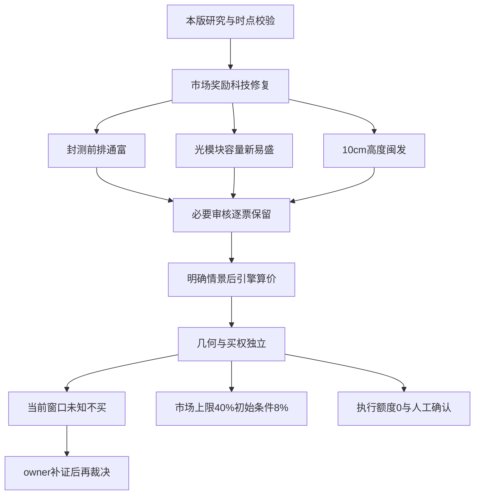

<!-- canghai:explicit-plan-report-assembly:v1 -->
# 显式组装报告（非重新推理）

> 决策来源（JSON）：llm
> 同版 JSON SHA-256（规范化内容）：f565cd8b5a9b23fa1f1787cd53783b1b69708e8bbb04271eea3071775da0c5c8
> 以下散文为调用方提供的模型原文，完整保留、未经重新推理；原文自述不是来源验证，不得覆盖 JSON 禁令、权限或缺口。
> 表格直接复用既有共享 renderer；只读展示，不构成开仓或自动交易授权。

## 模型原文（非重新推理）

---
date: 2026-11-05
agent: D1-main-decision
skill_version: main_decision_v1@2.1
generated_at: 2026-11-05T10:29:11+08:00
confidence: null
degraded: true
input_freshness: partial
input_freshness_note: "主研究主要为11月4日；11月5日当前窗口未知、当日日历绑定缺失；置信度非胜率。"
data_sources:
  - name: R1
    path: data/research/20261105/R1_style.json
    status: stale
    captured_at: 2026-11-05T06:19:00+08:00
    record_count: null
  - name: R2
    path: data/research/20261105/R2_main_sectors.json
    status: stale
    captured_at: 2026-11-05T06:57:43+08:00
    record_count: null
  - name: R3
    path: data/research/20261105/R3_sentiment.json
    status: stale
    captured_at: 2026-11-05T06:40:21+08:00
    record_count: null
  - name: R4
    path: data/research/20261105/R4_news.json
    status: stale
    captured_at: 2026-11-05T06:31:25+08:00
    record_count: null
  - name: R5
    path: data/research/20261105/R5_stock_profiles.json
    status: stale
    captured_at: 2026-11-05T07:21:37+08:00
    record_count: null
  - name: R6
    path: data/research/20261105/R6_devil_advocate.json
    status: stale
    captured_at: 2026-11-05T07:33:16+08:00
    record_count: null
  - name: R7
    path: data/research/20261105/R7_capital_flow_20261105.json
    status: stale
    captured_at: 2026-11-05T06:18:09+08:00
    record_count: null
---

# 2026年11月5日 · D1盘中修订：把候选找回来，不把买权编出来

## 一句话结论
科技修复保留三只优先候选；市场总敞口上限40%，条件初始8%；系统仍零执行额度，未认证此刻可以买。

## 🧭 先把两种“仓位”摆在一起

这不是盘前预测的补写，而是用户发现旧稿错误后，由本轮计划owner作出的完整盘中修订。研究和价格事实主要截至11月4日收盘；没有读取11月5日竞价、实时行情，也没有读取真实或模拟账户、持仓、余额与账本。下列价格是T-1结构上的条件研究价，不是此刻实时报价。

| 层次 | 本轮结论 | 不能被解释成什么 |
|---|---|---|
| 市场建议总仓上限 | 40%，用户本轮认可；总风险敞口 | 不是额外加仓40%，也不要求买满 |
| 条件初始试探 | 8%，只对应通富补齐必要审核及当前窗口确认后的首笔情景 | 不是必须开仓，通富失败不自动转给另一票 |
| 逐票条件总仓目标 | 通富8%、新易盛5%、闽发3%；三票合计16% | 非同时买入指令，不与B重复计仓 |
| 系统执行额度 | 原target/meta/final执行cap均为0；逐票max与入场分配均为0 | 不等于人的市场建议应空仓，更不等于已核用户实际新增为0 |
| 下单边界 | dry_run、禁自主、需人工确认；全部逐票自动交易关闭 | 候选、价位、几何通过均不授买权 |

条件意见本轮研究窗口至11:30；上游原09:30盘前意见已经到期，本轮没有把旧事实改成新事实。只有获授权owner取得新窗口证据、完成必要审核和独立执行授权后，才可能激活具体情景；到期不能自动续用。

## 📌 买卖点总表（T-1条件价；资格另列）

| 对象 | 情景/身份 | 买区 | 确认 | 最高接受 | T+1止损 | 目标 | RR | 条件建议 | 当前能否买 |
|---|---|---|---:|---:|---:|---:|---:|---:|---|
| 通富微电 002156.SZ | 突破/半路续强／执行候选 | [42.12, 42.96] | 42.33 | 42.96 | 40.81 | 47.26 | 2.0 | 8% | 不可：资格/当期窗口未闭环，原零执行额度 |
| 新易盛 300502.SZ | 容量修复突破/半路／执行候选 | [195.52, 199.45] | 196.5 | 199.45 | 183.49 | 231.37 | 2.0 | 5% | 不可：资格/当期窗口未闭环，原零执行额度 |
| 闽发铝业 002578.SZ | 10cm高度突破接力／执行候选 | [4.2, 4.28] | 4.22 | 4.28 | 4.07 | 4.7 | 2.0 | 3% | 不可：资格/当期窗口未闭环，原零执行额度 |
| 长电科技 600584.SH | 突破对照、当前禁做／watch | [51.48, 52.52] | 51.74 | 52.52 | 49.89 | 57.78 | 2.0 | 0% | 不可：资格/当期窗口未闭环，原零执行额度 |
| 北方华创 002371.SZ | 设备容量续强观察／watch | [532.82, 543.53] | 535.5 | 543.53 | 516.35 | 597.89 | 2.0 | 未知 | 不可：资格/当期窗口未闭环，原零执行额度 |
| 博杰股份 002975.SZ | 历史锚突破对照／watch | [76.94, 78.49] | 77.33 | 78.49 | 74.57 | 86.33 | 2.0 | 0% | 不可：资格/当期窗口未闭环，原零执行额度 |
| 沃格光电 603773.SH | 禁买研究参照／watch | [56.86, 58.01] | 57.15 | 58.01 | 55.11 | 63.81 | 2.0 | 0% | 不可：R6硬否决 |
| 云南锗业 002428.SZ | 事件突破、当前板型禁做／watch | [75.0, 76.51] | 75.38 | 76.51 | 73.68 | 82.17 | 2.0 | 0% | 不可：资格/当期窗口未闭环，原零执行额度 |
| 中际旭创 300308.SZ | 容量突破观察／watch | [530.71, 541.38] | 533.38 | 541.38 | 498.07 | 628.0 | 2.0 | 未知 | 不可：资格/当期窗口未闭环，原零执行额度 |
| 华盛昌 002980.SZ | 历史锚突破对照／watch | [70.91, 72.34] | 71.27 | 72.34 | 68.72 | 79.58 | 2.0 | 0% | 不可：资格/当期窗口未闭环，原零执行额度 |
| 永臻股份 603381.SH | 禁买研究参照／watch | [17.05, 17.4] | 17.14 | 17.4 | 16.53 | 19.14 | 2.0 | 0% | 不可：R6硬否决 |
| 阳光电源 300274.SZ | MA50附近回踩/收复观察／watch | [83.92, 85.62] | 83.92 | 85.62 | 78.77 | 99.32 | 2.0 | 未知 | 不可：资格/当期窗口未闭环，原零执行额度 |
| 龙版传媒 605577.SH | 情绪突破禁做对照／watch | [15.65, 15.97] | 15.73 | 15.97 | 15.17 | 17.57 | 2.0 | 0% | 不可：资格/当期窗口未闭环，原零执行额度 |
| 浙文影业 601599.SH | 三板情绪突破观察／watch | [4.18, 4.26] | 4.2 | 4.26 | 4.05 | 4.68 | 2.0 | 未知 | 不可：资格/当期窗口未闭环，原零执行额度 |
| 福莱新材 605488.SH | 趋势突破风险对照／watch | [44.57, 45.46] | 44.79 | 45.46 | 43.19 | 49.5 | 1.78 | 0% | 不可：资格/当期窗口未闭环，原零执行额度 |
| 兆威机电 003021.SZ | 趋势MA50回踩参照／watch | [73.08, 74.55] | 未知 | 未知 | 未知 | 未知 | 未知 | 未知 | 不可：资格/当期窗口未闭环，原零执行额度 |
| 武汉天源 301127.SZ | 合同落地后的突破确认／watch | [15.9, 16.22] | 15.98 | 16.22 | 14.92 | 18.82 | 2.0 | 未知 | 不可：资格/当期窗口未闭环，原零执行额度 |
| 翰宇药业 300199.SZ | 临床许可后的突破确认／watch | [22.6, 23.05] | 22.71 | 23.05 | 21.21 | 26.73 | 2.0 | 未知 | 不可：资格/当期窗口未闭环，原零执行额度 |
| 四川黄金 001337.SZ | 黄金首板续强B情景／watch | [36.99, 37.74] | 37.18 | 37.74 | 36.55 | 40.12 | 2.0 | 未知 | 不可：资格/当期窗口未闭环，原零执行额度 |
| 七匹狼 002029.SZ | 旧名字线禁追锚／watch | [9.25, 9.44] | 9.3 | 9.44 | 8.97 | 10.38 | 2.0 | 0% | 不可：资格/当期窗口未闭环，原零执行额度 |
| 九牧王 601566.SH | 旧情绪兑现锚／watch | [10.9, 11.11] | 10.95 | 11.11 | 10.55 | 12.23 | 2.0 | 0% | 不可：资格/当期窗口未闭环，原零执行额度 |
| 深中华A 000017.SZ | 独立首板突破观察／watch | [6.35, 6.48] | 6.38 | 6.48 | 6.16 | 7.12 | 2.0 | 未知 | 不可：资格/当期窗口未闭环，原零执行额度 |

以下全部价位的数据日为2026-11-04；研究窗口至11:30，但上游意见到期和缺当前窗口的事实不因此解除。兆威区间仅结构参照，完整情景失败。

## ⛔ 不交易条件与当前active项

全局ACCOUNT_BUDGET_UNVERIFIED维持active：原执行授权/预算未核，未知来源保护不能因市场建议40%而撤销。它限制的是系统执行，不是给人的空仓结论。原09:30文字到期也不使账户保护自动失效。

逐票R6必要缺项原样保留：通富模式6未完；闽发模式1/6/7未完；新易盛模式1/2/6/7完成，但11月5日当前价、板块承接、真实报价RR及交易边界仍未核，三个候选均有当前窗口待确认的active限制。沃格、永臻保留真实hard_reject；长电、云南、龙版的多次开板禁止不被专题或人气覆盖。福莱RR=1.78低于1.8，只拦该情景。

生产状态仍为production_ready=false、research_completion_passed=false、reassessment_required=true。空池不是审核通过的替代品，非空候选也不是审核通过证明。合法存量卖出管理不因禁新而停止；持仓和可卖数量未知，本文不写假想清仓数量。

## 🛠️ 这次纠正的究竟是什么

旧稿把22票无条件追加RIGHT_SIDE_CORE_NOT_VERIFIED，随后统一落到watch，混淆了四件事：已经证实的负面、必要审核待补、核心量化输入缺失、买前市场确认。量化core_judge缺20日同窗口板块/指数收益和可比排名，应该写unknown，而不是写“已证无核心”。不为调用函数喂空数组，也不让均线位置替全部打法定生死。

本轮逐票由D1裁决retained/superseded/unresolved，并在meta保留每条旧条件、原来源、具体依据、事实日、作用域和失效窗口。superseded仅作用于D1先前把未知当否定的研究意见，不作用于用户/账户、R6或未知来源硬保护；retained有真实板型、业务、资金或硬风险；unresolved是必要事实仍未核，不是已经证伪。Python只落实这22条明确裁决，不按code批量推导解禁。

## 🌊 市场先于个股：奖励的是修复，不是所有接力

R1同版11月4日全市场5572只中4667只上涨，上涨占比83.76%，成交20518.90亿元，较前日增加19.64%；118涨停、33炸板、炸板率21.85%，不是用11月3日41.46%的旧炸板率定义今天。与此同时，前日48只涨停池在11月4日收盘反馈均值-0.32%、中位-2.34%，高度从6到4再到3。指数修复与旧票接力兑现是并存的不同事实，不能以一边抹掉另一边。

- **大资金意图**: R7与R2同窗资金显示科技链大幅回补，合理假设是降低旧高标敞口、买回容量与新修复前排；这是可推翻的资金行为解释，不是已核机构身份或锁仓目的。
- **为什么走强**: 半导体、CPO板块扩散与容量大阳同日出现，强于单只名字股自说自话；但主要板块五日净额仍负，不能把一天买盘当持续新主升。
- **逻辑够不够硬**: 广度、成交、分档资金是已取得事实；次日续航尚无本轮数据。R1情绪83不是胜率83%，aux高位震荡只定温度。开盘溢价+1.75%与收盘反馈-0.32%来自不同观察窗，不能互相校正成同一个指标。

为何市场建议上限采用40%而不照搬45%或旧稿30%？40%是用户本轮认可的风险总敞口研究上限；本轮仍只准备初始8%，因为广谱修复值得准备，但五日资金与旧接力负反馈不支持直接满仓。不是用未知账户扣仓，不以静态情绪表自动生成比例。今天是否应当“空仓日”？T-1事实不足支持全市场市场性空仓，也不足支持立即成交；系统未授权执行与市场有条件风险敞口应当同时成立。

## 🧩 板块公共判断与四象限叉乘

唯一主模板沿用R2“三格”：比较切换、直接业务核心与补涨，不同时跑首板隔日、总龙锁仓等五套选股模板。各线原formation只表示本次修复观察，round_id、事件起点和真实年龄未知，不把阶段标签充行情轮次。

先进封装是第一公共研究位：19封1炸，封板率95%，单日净入111.50亿元、五日仍净出76.37亿元。通富在直接封测双核心中先封且零开板，长电更晚并四次开板；北方华创是设备容量，不因金额大抢封测身位。公共失效是同线核心和资金共同转弱且无承接，非单票触一条均线就宣告全板块退潮。

CPO/磷化铟链分开材料合同与光模块修复：CPO12封2炸，封板率85.71%，单日净入139.57亿元，五日仍净出295.73亿元。云南是具名材料合同主体，不冒充THS CPO成分；新易盛只是独立容量修复剧本，不借云南合同证明自己新增订单。云南板型失败不能证明所有光模块都失败，也不能为龙二免除自身资格。

光伏/储能修复封板率78.57%；闽发三板、永臻二板和阳光容量代表不同身位。闽发保留高度候选，不把微利非经常占比/CFO负抹去；永臻真实财报硬否决不因低一板解除。阳光收MA20与正五日资金更像容量修复，不假扮10cm情绪总龙。

四象限沿用R6的“经营/事件α硬度×已识别风险”，再与上述主线、地位和窗口交叉，不是新评分或按象限自动买卖：

| 象限 | 同版对象 | D1本轮取舍 |
|---|---|---|
| Q1 相对硬α、尚无已证重大财报风险 | 北方华创 | 设备经营及资金较实，但候补与模式6待核，仍watch；不是安全认证 |
| Q2 相对硬α、已现风险 | 通富、长电、云南、新易盛、中际、阳光、武汉、翰宇、四川黄金 | 选通富/新易盛为不同修复候选；其余按板型、必要缺证、角色与窗口分别观察 |
| Q3 α待证、尚无已证重大风险 | 本批为空 | 不为填格子造票或写成全市场没有这类机会 |
| Q4 α待证、已现风险 | 闽发及其余主题/次线对照 | 闽发真实高度合力支持条件候选；沃格/永臻硬否决；不能用Q4一键清池 |

## 🎯 优先执行候选：身份成立，当前买权不成立

### 通富微电 002156.SZ：封测续强，不是假装主升低吸

- **大资金意图**: 先封、零开板与五日净入相容于直接封测前排回补；不能证明中期机构锁仓。
- **为什么走强**: 13:47首封、换手6.76%、约42亿元成交及板块19家封板共同形成辨识度。R5龙头研究认定过3条，不等于量化core_judge已完成。
- **逻辑够不够硬**: 直接封测业务和当期资金比中京旧锚更实，但Q3非经常收益占比54.98%、有息负债压力与中期下降结构均在。通富是候选，不是全半导体唯一总龙。

**买入理由**：一是封测直接载体与板块同日扩散有真实依据；二是相较长电更早封、零开板及五日正资金。研究半路/突破续强，不研究跌回均线就接飞刀。

**风险点**：模式6必要审核未完成；43.25图像第一压力在引擎目标47.26前方，且当前承接没有本轮事实。MA20/60未收复限制信心，但不再机械消灭所有续强候选。

**止损条件**：研究买区42.12—42.96，确认价42.33，最高接受42.96；止损40.81，目标47.26，以上沿算RR=2.00。新买当天不能卖，40.81是T+1退出参考，不是当日保证止损。盘中触发前先补模式6、当前窗口及权限；未补不买。

**可验证假设**：在后续获授权窗口，通富须在原买区内确认续强，封测核心扩散不塌、个股资金承接为正；若先冲过最高接受价再确认，取消而不是抬价。1—3个交易日内核同线资金续航，不能继续用11月4日净额当新证据。条件总仓建议8%，执行分配0。

### 新易盛 300502.SZ：审核齐的一只，也仍要等自己的容量续强

- **大资金意图**: 五日资金较中际强，可能优先回补光模块人气容量；不是在买云南InP合同的同一收入。
- **为什么走强**: 11月4日+13.35%、5日正净额和R2龙二身份构成修复研究基础；未涨停，板型分类不适用，不编首封时间。龙头过条数上游未核，明确未知。
- **逻辑够不够硬**: 模式1/2/6/7完成是真覆盖优势，但强业绩、弱现金转换和价格深跌都真实；完成覆盖不是低风险或已认证主升。

**买入理由**：一是光模块经营与容量身份可归属；二是相较中际五日净出，本票资金续航及必要审核更完整。选择突破/半路修复，不选择深跌接刀低吸。

**风险点**：30交易日约跌半，当前价格/板块同窗口仍未知；图像压力203.8在引擎目标231.37前，跨源资金偏差与库存、回款反证保留。只凭MA空头否定候选过头，直接宣布可以抄底也同样错误。

**止损条件**：买区195.52—199.45，确认196.50，最高接受199.45；止损183.49、目标231.37，RR=2.00。止损距上沿约-8%，仍有隔夜跳空及无法成交风险，新增仓T+1才可卖。5%是条件总敞口目标，执行0。

**可验证假设**：后续授权窗口需本票和CPO容量自身同向承接，而非仅云南消息热；确认迟到、原区间失效、现金/合规出现新硬风险即取消未买情景。不能用空的R3列表假认其他票模式6完成。

### 闽发铝业 002578.SZ：普通10cm高度研究，不能用空泛“未主升”抹掉

- **大资金意图**: 三板身位、零开板及五日正净额支持资金在光伏成分内选择高度载体；不证明铝加工盈利反转。
- **为什么走强**: 三板本线最高、12.50%换手与约4.23亿元成交，R5研究认定过3条；13:03首封真实，不能把分类器粗时段误当14点后封板。
- **逻辑够不够硬**: 身位硬于纯名字联想，主营利润锚弱于通富；非经常收益、CFO负、20—50亿元流通盘与T+1高位尾险均需折价。

**买入理由**：一是光伏支架/边框映射与本线连板梯队有来源；二是零开板、正五日资金和均线上方结构提供与超跌容量不同的情景。选择突破接力，不是全市场套一个买点。

**风险点**：模式1/6/7未完成，不因3%小仓跳过；三板一字不顶，当前可成交性未知。永臻财报硬否决不能作为“更低位可买”借口。

**止损条件**：买区4.20—4.28，确认4.22，最高接受4.28；止损4.07、目标4.70，RR=2.00。舍入后止损距约-4.91%，来自原始5%公式和报价舍入，不扩大止损求整5%。原始及舍入几何均合规不等于买权，新增仓T+1可卖。

**可验证假设**：本线高度仍被市场认可、同线扩散有承接且非一字无成交；必要补审和当前窗口完成前不激活。3%条件目标只反映高度尾险，不是固定阶段档位，也不是核过账户尾部预算。

## 🐑 10cm情绪核心／名字梗

本轮不是没研究七匹狼，而是同版研究给出了明确负反馈：七匹狼近跌停、净出4.200172亿元，九牧王净出1.684639亿元并冲高回落；榜首人气不等于承接。按2026年四季度交易2027羊年预期理解传播，不因当前马年机械排除；但独立传播原文、监管后资金实际切名与新梯队未核，不能把“狼”字当市场合力。

闽发是本批有真实高度/换手/资金的普通10cm条件候选，不以容量防守票替代情绪研究。龙版四次开板明确不做；浙文三板早封且零开板值得watch，但传媒4封3炸、公告无新重大经营变化和消息后窗口缺失使其不如封测前排优先。不能只因高位否决龙头，再从同名谐音后排找替补。深中华首板有来源，未证与羊狼同轮，仍独立观察。没有额外补选新的名字票。

## 📰 消息催化、产业修复、纯情绪如何比较

采用云南AOI合同事实，同时采用同一公告的许可、取消与退款反证；两段不是两个独立来源。年度18万片、1.944亿美元不是收入已确认，五年90万片不是确定利润。当前云南因板型失败及S3未核只观察，不能因故事最硬强买。

采用武汉天源正式合同这一增量，延后交易：36.4亿元是联合体含税总额，97%并网后付款的条款使份额、垫资及回款尤其重要。11月4日盘中上涨不能验证盘后签约。采用翰宇HY3003周制剂FDA首次临床许可，延后交易；不是药品上市批准、也不是月制剂或口服许可。两者都有真实画像，但必要风险和消息后窗口不足，不靠新消息标签挤进优先池。

再贷款利率降至1%是工具支持，不等于银行借款已全部买入股票；91天逆回购3000亿元相对5000亿元到期为该期限缩量2000亿元，跨工具净额未知，既不能喊全面放水也不能把它扩成全部科技禁买。全面节约方案的正向节能/循环利用与高耗能约束并列，不把方向文件直接当每票订单。

苏达立案只作用原公告实际个人/相关公司，不外推福莱或兆威；天山公司立案、大晟负净资产/退市风险各有精确对象，不能拿未在R2/R5完成画像的新闻提名票现场替换。龙蟠履约与售价反证不转嫁阳光、永臻。三类机会允许重叠，无固定配额；这次优先的是有真实比较基础的修复前排、容量龙二和10cm高度，而不是消息越新越先买。

## 🔀 B计划与买前取消

科技核心共同走弱且资金净出无承接，或候选至少两只不及原竞价预期时，B只进入研究核验，不自动promote。四川黄金是有矿业经营/首板/贵金属合力的竞争方向，但黄金全板块核心排名和模式6/7缺证仍在；与深中华金银加工区分。阳光容量与闽发高度分别核，不互相证明；武汉/翰宇仍等事件后窗口。R7未给已验证强负相关跷跷板，不编20日相关系数。

若B方向也弱，取消对应未买情景，现金是可接受结果。原竞价三/四档数字保留在同版JSON附表，但本轮没有竞价快照，不能倒填已符合/超预期；这些是历史研究阈值，不是现在补下竞价单。突破高开超过7%、一字无成交、超最高接受价、板块联动与资金承接失效、必要审核失败，均先取消未买情景。盘中没有临时加池外票的许可。

## 🧾 专题消费取舍与效果边界

只从R2/R4/R5/R6 JSON的实际knowledge_context及knowledge_adjudications消费。主题锚只采用R2已嵌入的有限对象对照；股性实际读R5内嵌22行，仅解释历史交易属性；同源不重复加权，77.3不是77.3%胜率。旧成长池延后，新成长池仅采用四川增长拆分和翰宇市值退出的有限证据；红利月报的现金覆盖风险与未核153票保留，不把partial变成全局禁买。经营层增持专题无当前22代码精确匹配，不造本票增持利好。复盘显式反馈为空，unknown，不称已学会或已验证效果。

一字专题仅采用目标日匹配的六对象封单、高度、开板属性，拒绝隔夜顶单措辞及预测比例当胜率。R4内嵌旧日历片段仅采用工具与时序边界，没打开历史日历，也不沿previous_report或链接扩读；它不是本日本应绑定的完整日历。逐来源与逐对象最终取舍在meta列source_id、source/evidence refs、用途、影响代码/板块和disposition；上游adopted不自动成为D1采用，传递留证不证明理解充分或有效。

## 🧮 价位推导与识图核对原则

先逐票选情景，真实apply_to_plan在内存执行，load_tech仅适配到同版R5已嵌入技术事实；没有打开行情数据库、raw/latest图缓存或现场补抓。日K高低按每根qfq_close/raw_close同因子变换后取最后20根；来源、复权与数据日保留。引擎原始公式不改，远端20日高改以昨收为pivot的旧距离诊断不被当作当日交易所可达性认证；没取得11月5日实际涨跌停边界。

通富、新易盛、闽发保留各自完整chart_consistency。通富日K压力43.25对引擎47.26、新易盛日K压力203.8对引擎231.37均为conflict，列双方值、人工复核，不替换价格。闽发仅breakout可比项识图确认，数据日11月4日；支撑/止损缺项及周/分钟复权未核仍unknown，绝非三项全通过。识图是非授权诊断，不新增全局禁令，不把支撑观察价当执行止损，也不拿注记充手工偏价依据。

兆威原MA50回踩情景保留73.08—74.55的结构参照，但触发原10%距离诊断，完整入场、止损、目标和RR未生成，不保留旧突破价冒充该情景。并非没行情，不换MA10凑可买。阳光的MA50情景在昨收上方，只能研究收复后回踩，不能把下跌到价当抄底。其余禁做票的数字只用于条件/风险对照，资格与价格分列，不把有价理解成可买。

每个可用情景以下沿/上沿和同情景止损做原始与报价后几何校验，RR用上沿算；触发价不自动等于委托价，最高接受价收紧到买区上沿。实际报价仍须消费者重算RR。以下总表和逐票公式均来自本轮实际引擎结果，非人工补数。

## 🔍 全部22对象的最终取舍与旧条件逐票重判

### 通富微电 002156.SZ · superseded

进 execution（候选·待补证）：封测龙一、先于长电收封且零开板，5日两口径净入；这是低位新修复核心的续强情景，不要求先把MA20/60全部收复才允许形成候选。中期空头仍是风险，绝不改称已认证主升低吸；R6模式6及当前窗口承接未核，仍不得新买。

同版对照：相较长电封板更早且不开板、5日净额由负正分化，保留封测研究第一位；北方华创是设备而非同业务封测，不能凭金额抢位。

专题用途：只采用嵌入股性作历史属性与当下表现对照；相关source_id=stock_character:656397480b1e398ed295c90854a59723790e98ebb28948d9877aa5c8d514335f，source refs=R5#/knowledge_context/sources/0/content/rows、R5#/profiles/0、R2#/main_lines/0/leaders/0、R6#/candidate_reviews/0。原必要审核、硬否决或未知来源保护均保留，未知不冒充通过；新事实反向推翻对应修复/身位假设时由owner重判。

### 长电科技 600584.SH · retained

降级观察：四次开板为本票已证板型失败，且5日净出，保留原禁止；不是核心量化未知导致的拒绝。通富封板更早且零开板，不以本票单日流入更大交换龙一。

同版对照：不选为封测首位，因为通富在封板时序与5日续航上占先；不是因历史股性弱否认当日合力。

专题用途：只采用嵌入股性作历史属性与当下表现对照；相关source_id=stock_character:656397480b1e398ed295c90854a59723790e98ebb28948d9877aa5c8d514335f，source refs=R5#/knowledge_context/sources/0/content/rows、R5#/profiles/1、R2#/main_lines/0/leaders/1、R6#/candidate_reviews/1。原必要审核、硬否决或未知来源保护均保留，未知不冒充通过；新事实反向推翻对应修复/身位假设时由owner重判。

### 北方华创 002371.SZ · superseded

进 watch：5日16.27亿元净入与经营现金支持设备容量核心研究，不因股性26.5或MA20未收复说无核心；但R2本线候补与封测不同业务，暂不升执行，不把金额第一当封测龙一。模式6和当日续航待核。

同版对照：保留设备对照，不替换封测龙一；与通富并非同业务的金额排名赛。股性差只解释历史连板习惯，不作硬排除。

专题用途：只采用嵌入股性作历史属性与当下表现对照；相关source_id=stock_character:656397480b1e398ed295c90854a59723790e98ebb28948d9877aa5c8d514335f，source refs=R5#/knowledge_context/sources/0/content/rows、R5#/profiles/2、R2#/main_lines/0/leaders/2、R6#/candidate_reviews/2。原必要审核、硬否决或未知来源保护均保留，未知不冒充通过；新事实反向推翻对应修复/身位假设时由owner重判。

### 博杰股份 002975.SZ · retained

降级观察：实际业务贡献限制与5日资金较弱是已证反证，不以缺量化输入拒绝。半导体子公司收入占比2.78%、参股InP亏损、耦合设备未有收入，当前不替代通富的直接封测或云南的直接合同；必要审核缺项仍在。

同版对照：不取代通富或云南锗业：前者有直接封测身位，后者有具名AOI合同，博杰当前受益份额与五日资金均更弱。旧8月公告只作仍待新披露更新的业务反证。

专题用途：只采用嵌入股性作历史属性与当下表现对照；相关source_id=stock_character:656397480b1e398ed295c90854a59723790e98ebb28948d9877aa5c8d514335f，source refs=R5#/knowledge_context/sources/0/content/rows、R5#/profiles/3、R2#/main_lines/0/leaders/3、R6#/candidate_reviews/3。原必要审核、硬否决或未知来源保护均保留，未知不冒充通过；新事实反向推翻对应修复/身位假设时由owner重判。

### 沃格光电 603773.SH · retained

拦截：保留R6_M7_04四条财报红旗硬否决，研究窗口到期不解禁；不是由core_judge未知生成的禁买。个人旧案已办结不得扩大成公司当前造假。通富直接业务和资金更强，但不以对照稀释本票硬否决。

同版对照：不选为封测核心：业务收入兑现、5日资金和趋势均不及通富，另有真实治理反证；不是因图像缺口或历史锚排序封禁。

专题用途：只采用嵌入股性作历史属性与当下表现对照；相关source_id=stock_character:656397480b1e398ed295c90854a59723790e98ebb28948d9877aa5c8d514335f，source refs=R5#/knowledge_context/sources/0/content/rows、R5#/profiles/4、R2#/main_lines/0/leaders/4、R6#/candidate_reviews/4。原必要审核、硬否决或未知来源保护均保留，未知不冒充通过；新事实反向推翻对应修复/身位假设时由owner重判。

### 云南锗业 002428.SZ · retained

降级观察：采用AOI年度合同的真实公司级锚，也采用许可、取消与退款条件；本票开板3次命中原板型禁止，必要S3未核。不因题材最硬豁免。新易盛不是材料合同同一受益者，其独立容量情景不继承本票订单。

同版对照：优于新易盛/中际作为本批事件链第一研究对象：有直接合同主体与早盘封板；后两者虽业绩强，当前价格仍深跌，不能把容量反弹称为右侧主升。

专题用途：只采用嵌入股性作历史属性与当下表现对照；相关source_id=stock_character:656397480b1e398ed295c90854a59723790e98ebb28948d9877aa5c8d514335f，source refs=R5#/knowledge_context/sources/0/content/rows、R5#/profiles/5、R2#/main_lines/1/leaders/0、R6#/candidate_reviews/5。原必要审核、硬否决或未知来源保护均保留，未知不冒充通过；新事实反向推翻对应修复/身位假设时由owner重判。

### 新易盛 300502.SZ · superseded

进 execution（候选·当前窗口待确认）：R2光模块龙二、5日正净额、单日13.35%修复、R6模式1/2/6/7真实完成，足以优先准备容量续强情景，不须机械等待MA20/60收复。中期深跌、现金转换弱与资金跨源偏差保留；不是主升低吸，也不是代替云南接材料订单。相较中际5日净出，本票续航及审核更完整，但没有买权。

同版对照：与云南锗业相比缺本轮新增的直接合同催化与封板身位；与中际相比5日资金稍强但跌势更深。不因历史股性低一票否决。

专题用途：只采用嵌入股性作历史属性与当下表现对照；相关source_id=stock_character:656397480b1e398ed295c90854a59723790e98ebb28948d9877aa5c8d514335f，source refs=R5#/knowledge_context/sources/0/content/rows、R5#/profiles/6、R2#/main_lines/1/leaders/1、R6#/candidate_reviews/6。原必要审核、硬否决或未知来源保护均保留，未知不冒充通过；新事实反向推翻对应修复/身位假设时由owner重判。

### 中际旭创 300308.SZ · unresolved

进 watch：盈利兑现硬度仍在，5日大额净出是本票反证；当日续强与必要合规未核，不能称已证无核心。新易盛5日资金和必要审核更完整，因此本轮优先后者；不按价格高低猜底。

同版对照：不选为本轮事件链首位，因为云南是直接材料合同主体，且当前资金方向相反；中际保留容量对照，不能自动继承昔日龙头买权。

专题用途：只采用嵌入股性作历史属性与当下表现对照；相关source_id=stock_character:656397480b1e398ed295c90854a59723790e98ebb28948d9877aa5c8d514335f，source refs=R5#/knowledge_context/sources/0/content/rows、R5#/profiles/7、R2#/main_lines/1/leaders/2、R6#/candidate_reviews/7。原必要审核、硬否决或未知来源保护均保留，未知不冒充通过；新事实反向推翻对应修复/身位假设时由owner重判。

### 华盛昌 002980.SZ · retained

降级观察：应收远快于收入、CFO负、晚封及直接受益份额未核共同使本票不如直接封测/合同主体；R6必要缺项不补齐。不是以CPO名称或core未知统一否决。

同版对照：不选为云南锗业替代：历史锚和涨停次数不是订单主体证明；同样首板，云南有早盘辨识度与正向五日合力。

专题用途：只采用嵌入股性作历史属性与当下表现对照；相关source_id=stock_character:656397480b1e398ed295c90854a59723790e98ebb28948d9877aa5c8d514335f，source refs=R5#/knowledge_context/sources/0/content/rows、R5#/profiles/8、R2#/main_lines/1/leaders/3、R6#/candidate_reviews/8。原必要审核、硬否决或未知来源保护均保留，未知不冒充通过；新事实反向推翻对应修复/身位假设时由owner重判。

### 闽发铝业 002578.SZ · superseded

进 execution（候选·必要审核待补）：本线龙一三板、零开板、5日正资金且MA20/60上方，是与超跌容量不同的真实高度情景；不能把未认证持续主升等同无地位。只准备突破/开板承接，不顶三板一字；微利非经常占比、CFO负、模式1/6/7缺项与极端尾部风险均保留。永臻硬否决不能当低位替补，阳光容量不冒充情绪高度。

同版对照：保留相对永臻的高度前排；不以三板取代通富/云南的直接业务核心。与永臻相比筹码身位占先，但不是风险更小。

专题用途：只采用嵌入股性作历史属性与当下表现对照；相关source_id=stock_character:656397480b1e398ed295c90854a59723790e98ebb28948d9877aa5c8d514335f，source refs=R5#/knowledge_context/sources/0/content/rows、R5#/profiles/9、R2#/main_lines/2/leaders/0、R6#/candidate_reviews/9。原必要审核、硬否决或未知来源保护均保留，未知不冒充通过；新事实反向推翻对应修复/身位假设时由owner重判。

### 永臻股份 603381.SH · retained

拦截：R6_M7_09五项财报红旗硬否决，二板与上升结构不能解除。较闽发身位低且财务现金/负债风险更重，不以低位叙事覆盖R6。

同版对照：不提为本线首位：闽发身位更高且五日资金更强；与阳光电源相比财务现金与负债压力更大。保留真实低位研究，不因缺额清池。

专题用途：只采用嵌入股性作历史属性与当下表现对照；相关source_id=stock_character:656397480b1e398ed295c90854a59723790e98ebb28948d9877aa5c8d514335f，source refs=R5#/knowledge_context/sources/0/content/rows、R5#/profiles/10、R2#/main_lines/2/leaders/1、R6#/candidate_reviews/10。原必要审核、硬否决或未知来源保护均保留，未知不冒充通过；新事实反向推翻对应修复/身位假设时由owner重判。

### 阳光电源 300274.SZ · superseded

进 watch：5日资金正、已收MA20，是比超跌票更进一步的容量修复；MA60未收只定风险，不构成统一禁令。本轮R2候补、营利下滑与模式6待核仍保留；相较永臻经营现金较实，相较闽发不具有10cm高度，暂不换身份。

同版对照：不以资金最大替代闽发连板身位；相比永臻现金与容量证据较强，作为本线经营/容量对照，不自动递补执行。

专题用途：只采用嵌入股性作历史属性与当下表现对照；相关source_id=stock_character:656397480b1e398ed295c90854a59723790e98ebb28948d9877aa5c8d514335f，source refs=R5#/knowledge_context/sources/0/content/rows、R5#/profiles/11、R2#/main_lines/2/leaders/2、R6#/candidate_reviews/11。原必要审核、硬否决或未知来源保护均保留，未知不冒充通过；新事实反向推翻对应修复/身位假设时由owner重判。

### 龙版传媒 605577.SH · retained

降级观察：四次开板是明确板型失败，主营未变/利润下降与财报F5反证保留；不把小额资本化夸大成造假。浙文少开板仍无新业务兑现，本票不靠一字预测再升位。

同版对照：与浙文相比开板反复、板块合力和新业务收入仍弱；不因近期股性极佳或一字预测而主推，更不把AI视频概念当新增营收。

专题用途：只采用嵌入股性作历史属性与当下表现对照；相关source_id=stock_character:656397480b1e398ed295c90854a59723790e98ebb28948d9877aa5c8d514335f，source refs=R5#/knowledge_context/sources/0/content/rows、R5#/profiles/12、R2#/secondary_lines/0/leaders/0、R6#/candidate_reviews/12。原必要审核、硬否决或未知来源保护均保留，未知不冒充通过；新事实反向推翻对应修复/身位假设时由owner重判。

### 浙文影业 601599.SH · unresolved

进 watch：三板早封、零开板与箱体上破有地位证据，原无条件无核心结论不成立；但次线4封3炸弱于封装19封1炸，盘后风险提示后价格/资金交叉未核、CFO负，暂不列优先执行。较龙版板型更好，不代表可绕必要审核或三板一字禁顶。

同版对照：相较龙版开板少但没有新增业务兑现，仍属次线情绪对照；不为凑执行池从次线自动升位。

专题用途：只采用嵌入股性作历史属性与当下表现对照；相关source_id=stock_character:656397480b1e398ed295c90854a59723790e98ebb28948d9877aa5c8d514335f，source refs=R5#/knowledge_context/sources/0/content/rows、R5#/profiles/13、R2#/secondary_lines/0/leaders/1、R6#/candidate_reviews/13。原必要审核、硬否决或未知来源保护均保留，未知不冒充通过；新事实反向推翻对应修复/身位假设时由owner重判。

### 福莱新材 605488.SH · retained

降级观察：柔性传感收入极低、5日净出及前日跌停后反包的高波动是已证负面，本情景RR失败另保留。兆威主营映射较直接但同样未获持续资金确认；不把苏达个人立案移植给本票。

同版对照：与兆威相比题材收入贡献更难确认且当前资金更弱，不凭高历史股性升级为本轮机器人龙头；保留趋势波动对照。

专题用途：只采用嵌入股性作历史属性与当下表现对照；相关source_id=stock_character:656397480b1e398ed295c90854a59723790e98ebb28948d9877aa5c8d514335f，source refs=R5#/knowledge_context/sources/0/content/rows、R5#/profiles/14、R2#/secondary_lines/1/leaders/0、R6#/candidate_reviews/14。原必要审核、硬否决或未知来源保护均保留，未知不冒充通过；新事实反向推翻对应修复/身位假设时由owner重判。

### 兆威机电 003021.SZ · unresolved

进 watch：微传动主营与MA20/60上方结构可研究，不说无核心；5日净出、缩量反包及利润下滑削弱本轮优先级，必要模式1/7未完。较福莱业务更直接；仅保留原MA50回踩研究，远离买区不换MA10凑价，不能把深跌称低吸。

同版对照：相对福莱主营映射更直接，但同处次线且暂无本轮资金回流确认；不越过R2角色门禁或借图像自动提级。

专题用途：只采用嵌入股性作历史属性与当下表现对照；相关source_id=stock_character:656397480b1e398ed295c90854a59723790e98ebb28948d9877aa5c8d514335f，source refs=R5#/knowledge_context/sources/0/content/rows、R5#/profiles/15、R2#/secondary_lines/1/leaders/1、R6#/candidate_reviews/15。原必要审核、硬否决或未知来源保护均保留，未知不冒充通过；新事实反向推翻对应修复/身位假设时由owner重判。

### 武汉天源 301127.SZ · unresolved

进 watch：采用36.4亿元联合体正式签约的增量，延后交易；金额非归属收入且97%并网后付款，份额、垫资、回款及消息后资金窗口待核。阳光仅容量/经营对照，不是同类联合体合同；不能拿11月4日盘中涨幅认证盘后合同已获资金认可。

同版对照：不选为主线首推：虽比纯概念更有事件硬度，但板块扩散、股价及资金承接未形成相同强度；对照阳光电源经营现金与容量后继续研究。

专题用途：只采用嵌入股性作历史属性与当下表现对照；相关source_id=stock_character:656397480b1e398ed295c90854a59723790e98ebb28948d9877aa5c8d514335f，source refs=R5#/knowledge_context/sources/0/content/rows、R5#/profiles/16、R2#/secondary_lines/2/leaders/0、R6#/candidate_reviews/16。原必要审核、硬否决或未知来源保护均保留，未知不冒充通过；新事实反向推翻对应修复/身位假设时由owner重判。

### 翰宇药业 300199.SZ · unresolved

进 watch：采用HY3003周制剂首次临床许可，不等于上市批准；单体控股质押、应收及消息后必要交叉仍待核。四川黄金只是同版成长经营对照、非GLP-1同业；合法同业对照不足，不造另一票。

同版对照：与四川黄金的经营增长对照，两者都不是本轮科技核心；不因成长池总市值出界判业绩恶化，也不因临床许可临时跨线追涨。

专题用途：只采用嵌入股性作历史属性与当下表现对照；相关source_id=stock_character:656397480b1e398ed295c90854a59723790e98ebb28948d9877aa5c8d514335f，source refs=R5#/knowledge_context/sources/0/content/rows、R5#/profiles/17、R2#/secondary_lines/3/leaders/0、R6#/candidate_reviews/17。原必要审核、硬否决或未知来源保护均保留，未知不冒充通过；新事实反向推翻对应修复/身位假设时由owner重判。

### 四川黄金 001337.SZ · superseded

进 watch：金矿盈利现金、首板与贵金属合力是真事实，不因MA空头否认动态进攻属性；模式6/7与全黄金核心排名仍待核，因此B方向而非已审龙头。相较深中华金银加工有更直接矿价敞口，仍须拆金价与产量贡献，不用股性高分抢科技首位。

同版对照：不取代科技主线的直接前排：本轮黄金板块合力与接力位置证据尚不足；比深中华有更直接金矿经营映射，但仍无本轮开仓许可。

专题用途：只采用嵌入股性作历史属性与当下表现对照；相关source_id=stock_character:656397480b1e398ed295c90854a59723790e98ebb28948d9877aa5c8d514335f，source refs=R5#/knowledge_context/sources/0/content/rows、R5#/profiles/18、R2#/secondary_lines/4/leaders/0、R6#/candidate_reviews/18。原必要审核、硬否决或未知来源保护均保留，未知不冒充通过；新事实反向推翻对应修复/身位假设时由owner重判。

### 七匹狼 002029.SZ · retained

降级观察：接近跌停、净出4.200172亿元与亏损为已证亏钱效应；热榜第一不是买盘。研究2027羊年叙事并非因当前马年排除，但独立传播和新承接未核，不接高位老龙。九牧王同步兑现无助攻，深中华无同轮次证据不能递补。

同版对照：不因羊/狼联想选择七匹狼，也不把监管后资金切名当已发生事实；与九牧王一起保留反例，与深中华非同轮次不互相递补。

专题用途：只采用嵌入股性作历史属性与当下表现对照；相关source_id=stock_character:656397480b1e398ed295c90854a59723790e98ebb28948d9877aa5c8d514335f，source refs=R5#/knowledge_context/sources/0/content/rows、R5#/profiles/19、R2#/secondary_lines/5/leaders/0、R6#/candidate_reviews/19。原必要审核、硬否决或未知来源保护均保留，未知不冒充通过；新事实反向推翻对应修复/身位假设时由owner重判。

### 九牧王 601566.SH · retained

降级观察：冲高回落、净出1.684639亿元和亏损支持不接旧线；均线上方或历史股性77.3不能推翻当期兑现。七匹狼也弱，不能选跌得少或价格低的一只充新核心。

同版对照：不因77.3股性分优于科技而选它；与七匹狼相同，缺独立的新催化、板块赚钱效应与当下承接，不拿低价当低位。

专题用途：只采用嵌入股性作历史属性与当下表现对照；相关source_id=stock_character:656397480b1e398ed295c90854a59723790e98ebb28948d9877aa5c8d514335f，source refs=R5#/knowledge_context/sources/0/content/rows、R5#/profiles/20、R2#/secondary_lines/5/leaders/1、R6#/candidate_reviews/20。原必要审核、硬否决或未知来源保护均保留，未知不冒充通过；新事实反向推翻对应修复/身位假设时由owner重判。

### 深中华A 000017.SZ · unresolved

进 watch：首板及历史活跃有研究价值，core未知不等于杂毛；但没有羊狼同轮归属，AI子公司无实质业务且金银加工不等于金矿，模式1/6/7待核。四川黄金的经营映射更直接，不据国晟非控股股东质押推成万胜控股质押。

同版对照：不替代旧名字核心，也不替代四川黄金的金矿经营映射；100%质押的是非控股股东国晟，控制股东万胜自身质押应独立计算。

专题用途：只采用嵌入股性作历史属性与当下表现对照；相关source_id=stock_character:656397480b1e398ed295c90854a59723790e98ebb28948d9877aa5c8d514335f，source refs=R5#/knowledge_context/sources/0/content/rows、R5#/profiles/21、R2#/secondary_lines/5/leaders/2、R6#/candidate_reviews/21。原必要审核、硬否决或未知来源保护均保留，未知不冒充通过；新事实反向推翻对应修复/身位假设时由owner重判。

## 价位推导 · 逐票可复算

以下均非真实委托价；引擎公式中的“今日”是由T-1昨收推演的研究情景，交易所当日边界仍未核。止盈是研究目标而非收益承诺。

### 通富微电 · leader_breakout

买区：pivot=ref_close(远端20日高今日不可达，仅作压力位)=42.33; 买区=[pivot×0.995, pivot×(1+1.5%)]; 溢价上限7%；⚠️20日高58.13距昨收+37.3%，今日不可达，不作买入基准。

止损：止损=买价×(1-5%) → 40.81（三者取最高: 买价×(1-5%)=40.81）；距买区上沿=-5.00%，effective_from=T+1。

止盈：2R目标 = 买42.96 + 2×(买入价-止损2.15) = 47.26。RR=(47.26-42.96)/(42.96-40.81)=2.0；最高接受价取买区上沿42.96，实际报价独立重算。

识图冲突（数据日20261104）：resistance 图=43.25 引擎={'channel': 'leader_breakout', 'trigger_price': 42.33, 'buy_zone': [42.12, 42.96], 'stop_loss': 40.81, 'take_profit': 47.26, 'quote_decimals': 2} 理由=chart_pressure_on_path_before_engine_target；人工复核，不改价/买权。

### 新易盛 · leader_breakout

买区：pivot=ref_close(远端20日高今日不可达，仅作压力位)=196.50; 买区=[pivot×0.995, pivot×(1+1.5%)]; 溢价上限7%；⚠️20日高407.33距昨收+107.3%，今日不可达，不作买入基准。

止损：止损=买价×(1-8%) → 183.49（三者取最高: 买价×(1-8%)=183.49）；距买区上沿=-8.00%，effective_from=T+1。

止盈：2R目标 = 买199.45 + 2×(买入价-止损15.96) = 231.37。RR=(231.37-199.45)/(199.45-183.49)=2.0；最高接受价取买区上沿199.45，实际报价独立重算。

识图冲突（数据日20261104）：resistance 图=203.8 引擎={'channel': 'leader_breakout', 'trigger_price': 196.5, 'buy_zone': [195.52, 199.45], 'stop_loss': 183.49, 'take_profit': 231.37, 'quote_decimals': 2} 理由=chart_pressure_on_path_before_engine_target；人工复核，不改价/买权。

### 闽发铝业 · leader_breakout

买区：pivot=max(昨收,20日高)=4.22; 买区=[pivot×0.995, pivot×(1+1.5%)]; 溢价上限7%。

止损：止损=买价×(1-5%) → 4.07（三者取最高: 买价×(1-5%)=4.07, MA10×0.99=3.47）；距买区上沿=-4.91%，effective_from=T+1。

止盈：2R目标 = 买4.28 + 2×(买入价-止损0.21) = 4.70。RR=(4.70-4.28)/(4.28-4.07)=2.0；最高接受价取买区上沿4.28，实际报价独立重算。

识图确认（仅breakout；数据日20261104）；非交易授权。

### 长电科技 · leader_breakout

买区：pivot=ref_close(远端20日高今日不可达，仅作压力位)=51.74; 买区=[pivot×0.995, pivot×(1+1.5%)]; 溢价上限7%；⚠️20日高66.00距昨收+27.6%，今日不可达，不作买入基准。

止损：止损=买价×(1-5%) → 49.89（三者取最高: 买价×(1-5%)=49.89）；距买区上沿=-5.01%，effective_from=T+1。

止盈：2R目标 = 买52.52 + 2×(买入价-止损2.63) = 57.78。RR=(57.78-52.52)/(52.52-49.89)=2.0；最高接受价取买区上沿52.52，实际报价独立重算。

识图冲突（数据日20261104）：resistance 图=56.1 引擎={'channel': 'leader_breakout', 'trigger_price': 51.74, 'buy_zone': [51.48, 52.52], 'stop_loss': 49.89, 'take_profit': 57.78, 'quote_decimals': 2} 理由=chart_pressure_on_path_before_engine_target；人工复核，不改价/买权。

### 北方华创 · leader_breakout

买区：pivot=ref_close(远端20日高今日不可达，仅作压力位)=535.50; 买区=[pivot×0.995, pivot×(1+1.5%)]; 溢价上限7%；⚠️20日高634.41距昨收+18.5%，今日不可达，不作买入基准。

止损：止损=买价×(1-5%) → 516.35（三者取最高: 买价×(1-5%)=516.35, MA10×0.99=504.80）；距买区上沿=-5.00%，effective_from=T+1。

止盈：2R目标 = 买543.53 + 2×(买入价-止损27.18) = 597.89。RR=(597.89-543.53)/(543.53-516.35)=2.0；最高接受价取买区上沿543.53，实际报价独立重算。

识图冲突（数据日20261104）：resistance 图=548.17 引擎={'channel': 'leader_breakout', 'trigger_price': 535.5, 'buy_zone': [532.82, 543.53], 'stop_loss': 516.35, 'take_profit': 597.89, 'quote_decimals': 2} 理由=chart_pressure_on_path_before_engine_target；人工复核，不改价/买权。

### 博杰股份 · leader_breakout

买区：pivot=ref_close(远端20日高今日不可达，仅作压力位)=77.33; 买区=[pivot×0.995, pivot×(1+1.5%)]; 溢价上限7%；⚠️20日高104.98距昨收+35.8%，今日不可达，不作买入基准。

止损：止损=买价×(1-5%) → 74.57（三者取最高: 买价×(1-5%)=74.57）；距买区上沿=-4.99%，effective_from=T+1。

止盈：2R目标 = 买78.49 + 2×(买入价-止损3.92) = 86.33。RR=(86.33-78.49)/(78.49-74.57)=2.0；最高接受价取买区上沿78.49，实际报价独立重算。

识图冲突（数据日20261104）：resistance 图=84.92 引擎={'channel': 'leader_breakout', 'trigger_price': 77.33, 'buy_zone': [76.94, 78.49], 'stop_loss': 74.57, 'take_profit': 86.33, 'quote_decimals': 2} 理由=chart_pressure_on_path_before_engine_target；人工复核，不改价/买权。

### 沃格光电 · leader_breakout

买区：pivot=ref_close(远端20日高今日不可达，仅作压力位)=57.15; 买区=[pivot×0.995, pivot×(1+1.5%)]; 溢价上限7%；⚠️20日高89.28距昨收+56.2%，今日不可达，不作买入基准。

止损：止损=买价×(1-5%) → 55.11（三者取最高: 买价×(1-5%)=55.11）；距买区上沿=-5.00%，effective_from=T+1。

止盈：2R目标 = 买58.01 + 2×(买入价-止损2.90) = 63.81。RR=(63.81-58.01)/(58.01-55.11)=2.0；最高接受价取买区上沿58.01，实际报价独立重算。

识图unknown：无可比项，不认证突破、支撑或执行止损。。

### 云南锗业 · leader_breakout

买区：pivot=ref_close(远端20日高今日不可达，仅作压力位)=75.38; 买区=[pivot×0.995, pivot×(1+1.5%)]; 溢价上限7%；⚠️20日高91.08距昨收+20.8%，今日不可达，不作买入基准。

止损：止损=MA10×0.99 → 73.68（三者取最高: 买价×(1-5%)=72.68, MA10×0.99=73.68）；距买区上沿=-3.70%，effective_from=T+1。

止盈：2R目标 = 买76.51 + 2×(买入价-止损2.83) = 82.17。RR=(82.17-76.51)/(76.51-73.68)=2.0；最高接受价取买区上沿76.51，实际报价独立重算。

识图冲突（数据日20261104）：breakout 图=76.04 引擎={'channel': 'leader_breakout', 'trigger_price': 75.38, 'buy_zone': [75.0, 76.51], 'stop_loss': 73.68, 'take_profit': 82.17, 'quote_decimals': 2} 理由=engine_trigger_before_chart_breakout; resistance 图=78.25 引擎={'channel': 'leader_breakout', 'trigger_price': 75.38, 'buy_zone': [75.0, 76.51], 'stop_loss': 73.68, 'take_profit': 82.17, 'quote_decimals': 2} 理由=chart_pressure_on_path_before_engine_target；人工复核，不改价/买权。

### 中际旭创 · leader_breakout

买区：pivot=ref_close(远端20日高今日不可达，仅作压力位)=533.38; 买区=[pivot×0.995, pivot×(1+1.5%)]; 溢价上限7%；⚠️20日高833.25距昨收+56.2%，今日不可达，不作买入基准。

止损：止损=买价×(1-8%) → 498.07（三者取最高: 买价×(1-8%)=498.07）；距买区上沿=-8.00%，effective_from=T+1。

止盈：2R目标 = 买541.38 + 2×(买入价-止损43.31) = 628.00。RR=(628.00-541.38)/(541.38-498.07)=2.0；最高接受价取买区上沿541.38，实际报价独立重算。

识图冲突（数据日20261104）：resistance 图=544 引擎={'channel': 'leader_breakout', 'trigger_price': 533.38, 'buy_zone': [530.71, 541.38], 'stop_loss': 498.07, 'take_profit': 628.0, 'quote_decimals': 2} 理由=chart_pressure_on_path_before_engine_target；人工复核，不改价/买权。

### 华盛昌 · leader_breakout

买区：pivot=ref_close(远端20日高今日不可达，仅作压力位)=71.27; 买区=[pivot×0.995, pivot×(1+1.5%)]; 溢价上限7%；⚠️20日高118.56距昨收+66.4%，今日不可达，不作买入基准。

止损：止损=买价×(1-5%) → 68.72（三者取最高: 买价×(1-5%)=68.72）；距买区上沿=-5.00%，effective_from=T+1。

止盈：2R目标 = 买72.34 + 2×(买入价-止损3.62) = 79.58。RR=(79.58-72.34)/(72.34-68.72)=2.0；最高接受价取买区上沿72.34，实际报价独立重算。

识图确认（仅resistance；数据日20261104）；非交易授权。

### 永臻股份 · leader_breakout

买区：pivot=max(昨收,20日高)=17.14; 买区=[pivot×0.995, pivot×(1+1.5%)]; 溢价上限7%。

止损：止损=买价×(1-5%) → 16.53（三者取最高: 买价×(1-5%)=16.53, MA10×0.99=14.39）；距买区上沿=-5.00%，effective_from=T+1。

止盈：2R目标 = 买17.40 + 2×(买入价-止损0.87) = 19.14。RR=(19.14-17.40)/(17.40-16.53)=2.0；最高接受价取买区上沿17.4，实际报价独立重算。

识图冲突（数据日20261104）：breakout 图=17.48 引擎={'channel': 'leader_breakout', 'trigger_price': 17.14, 'buy_zone': [17.05, 17.4], 'stop_loss': 16.53, 'take_profit': 19.14, 'quote_decimals': 2} 理由=chart_breakout_above_engine_buy_zone；人工复核，不改价/买权。

### 阳光电源 · trend_pullback_buy

买区：决策线MA50=84.77, 牛线=84.77; 买区=[min(MA50,牛线)×0.99=83.92, MA50×1.01=85.62]; 最高接受=87.33。

止损：止损=买价×(1-8%) → 78.77（三者取最高: 买价×(1-8%)=78.77, MA10×0.99=70.32）；距买区上沿=-8.00%，effective_from=T+1。

止盈：2R目标 = 买85.62 + 2×(买入价-止损6.85) = 99.32。RR=(99.32-85.62)/(85.62-78.77)=2.0；最高接受价取买区上沿85.62，实际报价独立重算。

识图unknown：无可比项，不认证突破、支撑或执行止损。。

### 龙版传媒 · leader_breakout

买区：pivot=ref_close(远端20日高今日不可达，仅作压力位)=15.73; 买区=[pivot×0.995, pivot×(1+1.5%)]; 溢价上限7%；⚠️20日高21.27距昨收+35.2%，今日不可达，不作买入基准。

止损：止损=买价×(1-5%) → 15.17（三者取最高: 买价×(1-5%)=15.17, MA10×0.99=13.47）；距买区上沿=-5.01%，effective_from=T+1。

止盈：2R目标 = 买15.97 + 2×(买入价-止损0.80) = 17.57。RR=(17.57-15.97)/(15.97-15.17)=2.0；最高接受价取买区上沿15.97，实际报价独立重算。

识图冲突（数据日20261104）：resistance 图=16.51 引擎={'channel': 'leader_breakout', 'trigger_price': 15.73, 'buy_zone': [15.65, 15.97], 'stop_loss': 15.17, 'take_profit': 17.57, 'quote_decimals': 2} 理由=chart_pressure_on_path_before_engine_target；人工复核，不改价/买权。

### 浙文影业 · leader_breakout

买区：pivot=max(昨收,20日高)=4.20; 买区=[pivot×0.995, pivot×(1+1.5%)]; 溢价上限7%。

止损：止损=买价×(1-5%) → 4.05（三者取最高: 买价×(1-5%)=4.05, MA10×0.99=3.37）；距买区上沿=-4.93%，effective_from=T+1。

止盈：2R目标 = 买4.26 + 2×(买入价-止损0.21) = 4.68。RR=(4.68-4.26)/(4.26-4.05)=2.0；最高接受价取买区上沿4.26，实际报价独立重算。

识图unknown：无可比项，不认证突破、支撑或执行止损。。

### 福莱新材 · leader_breakout

买区：pivot=ref_close(远端20日高今日不可达，仅作压力位)=44.79; 买区=[pivot×0.995, pivot×(1+1.5%)]; 溢价上限7%；⚠️20日高49.50距昨收+10.5%，今日不可达，不作买入基准。

止损：止损=买价×(1-5%) → 43.19（三者取最高: 买价×(1-5%)=43.19, MA10×0.99=42.85）；距买区上沿=-4.99%，effective_from=T+1。

止盈：20日高点49.50 低于2R目标50.00 且高于买价5%以上 → 取前高作第一压力位。RR=(49.50-45.46)/(45.46-43.19)=1.78；最高接受价取买区上沿45.46，实际报价独立重算。

识图冲突（数据日20261104）：breakout 图=47.82 引擎={'channel': 'leader_breakout', 'trigger_price': 44.79, 'buy_zone': [44.57, 45.46], 'stop_loss': 43.19, 'take_profit': 49.5, 'quote_decimals': 2} 理由=chart_breakout_above_engine_buy_zone；人工复核，不改价/买权。

### 兆威机电 · trend_pullback_buy

具体失败：unreachable_buy_zone: 原10%距离诊断触发；当日边界未核，不能据此确认不可达；保留原通道，未生成执行价位；已有区间[73.08, 74.55]仅结构参照，未生成触发、止损、止盈与RR，不保留旧情景价，不挪均线凑通过。

识图unknown：无可比项，不认证突破、支撑或执行止损。。

### 武汉天源 · leader_breakout

买区：pivot=max(昨收,20日高)=15.98; 买区=[pivot×0.995, pivot×(1+1.5%)]; 溢价上限7%。

止损：止损=买价×(1-8%) → 14.92（三者取最高: 买价×(1-8%)=14.92, MA10×0.99=13.17）；距买区上沿=-8.01%，effective_from=T+1。

止盈：2R目标 = 买16.22 + 2×(买入价-止损1.30) = 18.82。RR=(18.82-16.22)/(16.22-14.92)=2.0；最高接受价取买区上沿16.22，实际报价独立重算。

识图unknown：无可比项，不认证突破、支撑或执行止损。。

### 翰宇药业 · leader_breakout

买区：pivot=ref_close(远端20日高今日不可达，仅作压力位)=22.71; 买区=[pivot×0.995, pivot×(1+1.5%)]; 溢价上限7%；⚠️20日高27.70距昨收+22.0%，今日不可达，不作买入基准。

止损：止损=买价×(1-8%) → 21.21（三者取最高: 买价×(1-8%)=21.21）；距买区上沿=-7.98%，effective_from=T+1。

止盈：2R目标 = 买23.05 + 2×(买入价-止损1.84) = 26.73。RR=(26.73-23.05)/(23.05-21.21)=2.0；最高接受价取买区上沿23.05，实际报价独立重算。

识图冲突（数据日20261104）：resistance 图=23.2 引擎={'channel': 'leader_breakout', 'trigger_price': 22.71, 'buy_zone': [22.6, 23.05], 'stop_loss': 21.21, 'take_profit': 26.73, 'quote_decimals': 2} 理由=chart_pressure_on_path_before_engine_target；人工复核，不改价/买权。

### 四川黄金 · leader_breakout

买区：pivot=ref_close(远端20日高今日不可达，仅作压力位)=37.18; 买区=[pivot×0.995, pivot×(1+1.5%)]; 溢价上限7%；⚠️20日高47.50距昨收+27.8%，今日不可达，不作买入基准。

止损：止损=MA10×0.99 → 36.55（三者取最高: 买价×(1-5%)=35.85, MA10×0.99=36.55）；距买区上沿=-3.15%，effective_from=T+1。

止盈：2R目标 = 买37.74 + 2×(买入价-止损1.19) = 40.12。RR=(40.12-37.74)/(37.74-36.55)=2.0；最高接受价取买区上沿37.74，实际报价独立重算。

识图确认（仅breakout,resistance；数据日20261104）；非交易授权。

### 七匹狼 · leader_breakout

买区：pivot=ref_close(远端20日高今日不可达，仅作压力位)=9.30; 买区=[pivot×0.995, pivot×(1+1.5%)]; 溢价上限7%；⚠️20日高11.36距昨收+22.2%，今日不可达，不作买入基准。

止损：止损=买价×(1-5%) → 8.97（三者取最高: 买价×(1-5%)=8.97, MA10×0.99=8.48）；距买区上沿=-4.98%，effective_from=T+1。

止盈：2R目标 = 买9.44 + 2×(买入价-止损0.47) = 10.38。RR=(10.38-9.44)/(9.44-8.97)=2.0；最高接受价取买区上沿9.44，实际报价独立重算。

识图冲突（数据日20261104）：resistance 图=10.33 引擎={'channel': 'leader_breakout', 'trigger_price': 9.3, 'buy_zone': [9.25, 9.44], 'stop_loss': 8.97, 'take_profit': 10.38, 'quote_decimals': 2} 理由=chart_pressure_on_path_before_engine_target；人工复核，不改价/买权。

### 九牧王 · leader_breakout

买区：pivot=ref_close(远端20日高今日不可达，仅作压力位)=10.95; 买区=[pivot×0.995, pivot×(1+1.5%)]; 溢价上限7%；⚠️20日高12.71距昨收+16.1%，今日不可达，不作买入基准。

止损：止损=买价×(1-5%) → 10.55（三者取最高: 买价×(1-5%)=10.55, MA10×0.99=10.05）；距买区上沿=-5.04%，effective_from=T+1。

止盈：2R目标 = 买11.11 + 2×(买入价-止损0.56) = 12.23。RR=(12.23-11.11)/(11.11-10.55)=2.0；最高接受价取买区上沿11.11，实际报价独立重算。

识图确认（仅resistance,support；数据日20261104）；非交易授权。

### 深中华A · leader_breakout

买区：pivot=ref_close(远端20日高今日不可达，仅作压力位)=6.38; 买区=[pivot×0.995, pivot×(1+1.5%)]; 溢价上限7%；⚠️20日高7.85距昨收+23.0%，今日不可达，不作买入基准。

止损：止损=买价×(1-5%) → 6.16（三者取最高: 买价×(1-5%)=6.16, MA10×0.99=5.91）；距买区上沿=-4.94%，effective_from=T+1。

止盈：2R目标 = 买6.48 + 2×(买入价-止损0.32) = 7.12。RR=(7.12-6.48)/(6.48-6.16)=2.0；最高接受价取买区上沿6.48，实际报价独立重算。

识图冲突（数据日20261104）：breakout 图=6.507 引擎={'channel': 'leader_breakout', 'trigger_price': 6.38, 'buy_zone': [6.35, 6.48], 'stop_loss': 6.16, 'take_profit': 7.12, 'quote_decimals': 2} 理由=chart_breakout_above_engine_buy_zone；人工复核，不改价/买权。

## 数据源审计

| 源 | 日期 | 状态 | 本轮实际消费与缺口 |
|---|---|:--:|---|
| R1 · data/research/20261105/R1_style.json | 2026-11-04为主 | 🟡 | 市场广度、成交与昨日涨停池反馈；情绪分非胜率，原09:30意见已过期；本批receipt/hash已核，非盘中现取 |
| R2 · data/research/20261105/R2_main_sectors.json | 2026-11-04为主 | 🟡 | 22画像对象及主/次线、锚/专题对照；轮次年龄未知，三格唯一模板；本批receipt/hash已核，非盘中现取 |
| R3 · data/research/20261105/R3_sentiment.json | 2026-11-04为主 | 🟡 | 科技修复热度与旧名字兑现，热榜窗口有限；不替R6补completed；本批receipt/hash已核，非盘中现取 |
| R4 · data/research/20261105/R4_news.json | 2026-11-04为主 | 🟡 | 13事件正反及直接映射；新闻源转载去重，后窗资金未核不视为否定；本批receipt/hash已核，非盘中现取 |
| R5 · data/research/20261105/R5_stock_profiles.json | 2026-11-04为主 | 🟡 | 22画像、财报风险、85根日K及内嵌识图；日K/分钟复权分层；本批receipt/hash已核，非盘中现取 |
| R6 · data/research/20261105/R6_devil_advocate.json | 2026-11-04为主 | 🟡 | 22逐票反证，必要完整仅新易盛；沃格/永臻硬否决保留；本批receipt/hash已核，非盘中现取 |
| R7 · data/research/20261105/R7_capital_flow_20261105.json | 2026-11-04为主 | 🟡 | 资金、ETF/期货与跷跷板审计；北向仅复盘，ETF份额/两融存在日期差；本批receipt/hash已核，非盘中现取 |
| attention_signals（绑定aux） | 2026-11-04 | 🟢 | 使用日11月5日，事实日11月4日；不是当前实时热度 |
| emotion_cycle（绑定aux） | 2026-11-04 | 🟢 | 高位震荡只定温度；溢价指标观察窗原样保留 |
| 本日催化剂日历（绑定aux） | 2026-11-05 | 🔴 | 绑定时缺失、无payload，未有完整正文可读；owner=日历/上游，未来三交易日覆盖未知，不独立禁买 |
| data/user_preferences.yaml | 既有签署政策 | 🟢 | 只读；单票15%、板块40%、总80%、持仓5只，920限制；本轮40%研究上限更低 |
| 专题运输版本 | 2026-11-05 | 🟡 | R2/R4/R5/R6 run/attempt/context_sha256/研究hash已核；未逐份源文件全文阅读 |
| 图表SVG验收依赖 | 本轮交付 | 🔴 | Mermaid 11.4.0两个固定CDN均失败，另经代码依赖TLS请求仍失败；保留源码，未声称渲染成功 |
## 不确定性 / 反证与交付状态

本次修订已解决“核心未知→整池否定”的逻辑错误，但并没有增加11月5日事实。22票没有扩大为全市场重筛：优先候选3只，观察19只（含2只真实硬否决锚）；观察覆盖不足20的原因是授权对象共22且3只进候选，不为配额加票。中京、合锻、成长与红利对照只消费R2已嵌入比较，未扩成新执行对象。旧score逐票继承R5 composite_score，方法为上游未校准研究刻度，不是质量胜率；本轮不制造新分或按板块分冒充个股分。

必要审核完成仍只1只，选择集合中通富、闽发未完成；未把R3窄热榜结果伪造模式6阴性，未改R3/R6研究。量化core_judge、市场总龙输入及匹配真实买入时点的T+1最差5%尾部样本仍缺，不能把条件仓位写成已通过尾部预算。新增仓买入日不能卖，止损触发只可在T+1核真实可卖数量；隔夜跳空、跌停和滑点可能让实际亏损越过研究价，没有保证成交。不是把低比例仓位当作豁免。

Mermaid代码已提供且有12节点，但本轮SVG渲染依赖不可用：两个固定版本CDN的浏览器导入失败，另经TLS请求同样失败。保留源码与明确降级提示，不把旧稿的SVG回执冒充本轮。因图表渲染未完成，报告交付状态为partial；这不改变研究候选与任何执行权限，也不回滚合法核心JSON。

输入版本在启动与交付复核，主研究run=20261105T061038-34166-8710，R2/R4/R5/R6均attempt=1。只复用本版主研究与三类精确aux绑定，缺日历不换日、不重建绑定；未展开错题/观察通配符，未开专题原文件、图缓存或DB，未取行情/账户，未运行其他模型或重跑R1—R7。完整取舍留在本轮正文及meta，不由共享表格生成新判断。

## 与其他 R/D/E 的关系

依赖：同版research_summary与已授权R1—R7，三类辅助只用绑定payload，政策只读。

被消费：execute、P1/P2与复盘只认正式计划及独立授权；候选身份、P1/P2 promote或条件价位都不得自动解禁。后续必要补证由研究owner负责，市场/计划重评由D1负责，runtime交接由外层发布器负责，本轮不写runtime。

## Sub-Agent 元数据

- skill: main_decision_v1（本轮LLM完整计划owner盘中修订）
- artifact: data/plans/20261105/watchlist_plan.json
- model: gpt-6.1-sol
- decision_source: llm
- 本轮不再次启动模型；不是Python规则决策或安全网替代。

## 输入版本与专题绑定留证

| 单元 | run / attempt | context_sha256 | 研究JSON sha256 |
|---|---|---|---|
| R2 | 20261105T061038-34166-8710 / 1 | 9c392e3a2b86a65e2367976589152772138674da4a6987db010e6cf4de2a851c | 762e467599e6ceacf249607c88f9b51cd64ab279857f16e7d9579d9bac515ea9 |
| R4 | 20261105T061038-34166-8710 / 1 | 1c226a1d7f2ffeeb3be558673694decadee16371895bc5342fb7349b995ec740 | f83e24c671cbb0e31d054f554d3f10eb400e7e59621f0dccff7a9abfee3951f8 |
| R5 | 20261105T061038-34166-8710 / 1 | 9d3a787f47dbcbf523e1974e0af079740e455ee1d9701cf3d648acd6dcbc14e9 | d2df3a4a55043e70e8f9d5a27dc4c73f1d3a54d6c77f1c8b025cea177de84386 |
| R6 | 20261105T061038-34166-8710 / 1 | 020ed15dab84e7110bffa81a303de193146b1a2056c018be1d75b68c6633571e | d02ca64511705ea731be37a26331d5dc641c14a717cde228892418067ef94734 |

summary字节摘要：b412150d353184051480b4f797b051dc266b6c81023a5d533c58b35f98c15656。以上证明运输/版本，不证明上游全文阅读、D1全部采用或效果。

## 同版 JSON 共享表格（只读附录）

# 20261105 盘前预案 · 点位表版

> 计划生成时点：2026-11-05T10:29:11+08:00；决策来源：llm

## 板块机会总览

市场背景：11月4日科技修复强于旧名字兑现；盘中仅据已绑定T-1事实形成通富/新易盛/闽发三个优先候选，未认证当前可买。

> 先市场／板块效应，再个股地位；未提供关系证据不推断龙头带动或板块扩散。

| 板块／本轮行情 | 阶段／窗口 | 效应与延续 | 核心与梯队（上游标签） | 共振／分离证据 | 主／反向剧本（名单归属非关系证明） | 确认条件 | 共同失效条件 | 观测时点 |
|---|---|---|---|---|---|---|---|---|
| 先进封装/半导体修复 | formation | 11月4日主线合力已核；11月5日可交易主线尚未竞价确认 | ts_code: 002156.SZ；name: 通富微电；r2_role: 龙一；ts_code: 600584.SH；name: 长电科技；r2_role: 龙二；ts_code: 002371.SZ；name: 北方华创；r2_role: 候补；ts_code: 002975.SZ；name: 博杰股份；r2_role: 候补；ts_code: 603773.SH；name: 沃格光电；r2_role: 候补 | ref: R2#/main_lines/0；logic: 先看市场奖励：半导体行业+10.64%、净入195.890708亿元，先进封装概念净入111.497764亿元；成分股19封板/1炸板，明显强于旧高位接力。；封测直接载体通富先于长电封板；北方华创是设备容量核心，不以流入最大替代封测龙一。存储与设备同属芯片修复支路，不拆成三条重复主线。；五日先进封装仍-76.366001亿元，只确认11月4日修复合力，不宣称完整新主升或旧轮次自然延续。；market_breadth: sector_id: 886009.TI；constituent_count: 212；priced_members: 212；up_members: 209；median_pct_chg: 7.76765；U: 19；Z: 1；seal_rate_pct: 95.0；height: 1；scope: 本轮实时取得THS最新成分与11月4日非ST U/Z交集；非历史成分回放，Z仅收盘未封，不将U中的回封算第二次炸板；fact_at: 2026-11-04T15:00:00+08:00；flow_evidence: name: 先进封装；ts_code: BK1101.DC；content_type: 概念；net_amount_yi: 111.497764；pct_change: 9.58；net_5d_yi: -76.366001；valid_20d: 20；series: trade_date: 20261008；net_amount_yi: -67.960284；trade_date: 20261009；net_amount_yi: -43.854369；trade_date: 20261012；net_amount_yi: -18.976988；trade_date: 20261013；net_amount_yi: 7.390111；trade_date: 20261014；net_amount_yi: -35.672924；trade_date: 20261015；net_amount_yi: -22.009252；trade_date: 20261016；net_amount_yi: 13.695588；trade_date: 20261019；net_amount_yi: 1.099876；trade_date: 20261020；net_amount_yi: -3.687549；trade_date: 20261021；net_amount_yi: 1.735767；trade_date: 20261022；net_amount_yi: -32.209748；trade_date: 20261023；net_amount_yi: 3.702075；trade_date: 20261026；net_amount_yi: -24.249869；trade_date: 20261027；net_amount_yi: -59.838669；trade_date: 20261028；net_amount_yi: 46.994163；trade_date: 20261029；net_amount_yi: -97.91038；trade_date: 20261030；net_amount_yi: -44.084966；trade_date: 20261102；net_amount_yi: 18.742172；trade_date: 20261103；net_amount_yi: -64.610591；trade_date: 20261104；net_amount_yi: 111.497764；source: tushare_pro_sdk.moneyflow_ind_dc / Eastmoney；evidence_ref: data/research/20261105/R7_evidence_20261105.json#/calls/sector_20261104；risks: 先进封装5日净额仍负，单日大涨不证明反转。；本批主板封测首板群体多，通富只是直接封测前排，不称全半导体唯一总龙。；首板隔日承接、原始业务/治理公告与RR由R5/R6/D1逐票核。 | 主剧本／执行；观察 | 只在已发布计划、必要审核与独立权限闭环后，核价在带内+板块扩散+个股资金；未核不写成通过 | 同线核心共同弱、资金净出无承接或直接事件被证伪；先取消未买条件，新增仓退出T+1 | 20261104 |
| 光通信/磷化铟事件链 | formation | 11月4日主线合力已核；11月5日可交易主线尚未竞价确认 | ts_code: 002428.SZ；name: 云南锗业；r2_role: 龙一；ts_code: 300502.SZ；name: 新易盛；r2_role: 龙二；ts_code: 300308.SZ；name: 中际旭创；r2_role: 候补；ts_code: 002980.SZ；name: 华盛昌；r2_role: 候补 | ref: R2#/main_lines/1；logic: CPO热榜第一、12封板/2炸板，东财概念单日净入139.565937亿元；云南锗业首板与双平台人气构成直接材料事件载体。；AOI年度合同和出口许可/退款取消条款来自同一公告，正反不拆成两个独立支持。云南锗业是R4业务映射的上游，不冒充THS CPO成分股。；新易盛与中际旭创属于大跌后的容量修复；新易盛5日虽正但价格仍深度回撤，不能把它们改称已确认右侧趋势股。；market_breadth: sector_id: 886033.TI；constituent_count: 231；priced_members: 231；up_members: 229；median_pct_chg: 7.4454；U: 12；Z: 2；seal_rate_pct: 85.7143；height: 1；scope: 本轮实时取得THS最新成分与11月4日非ST U/Z交集；非历史成分回放，Z仅收盘未封，不将U中的回封算第二次炸板；fact_at: 2026-11-04T15:00:00+08:00；flow_evidence: name: CPO概念；ts_code: BK1128.DC；content_type: 概念；net_amount_yi: 139.565937；pct_change: 7.98；net_5d_yi: -295.726267；valid_20d: 20；series: trade_date: 20261008；net_amount_yi: -173.12417；trade_date: 20261009；net_amount_yi: -75.979937；trade_date: 20261012；net_amount_yi: -95.344684；trade_date: 20261013；net_amount_yi: 17.486387；trade_date: 20261014；net_amount_yi: -109.02369；trade_date: 20261015；net_amount_yi: -124.831734；trade_date: 20261016；net_amount_yi: -8.172836；trade_date: 20261019；net_amount_yi: 17.073108；trade_date: 20261020；net_amount_yi: -9.302781；trade_date: 20261021；net_amount_yi: 24.849859；trade_date: 20261022；net_amount_yi: -127.426778；trade_date: 20261023；net_amount_yi: 2.701852；trade_date: 20261026；net_amount_yi: -99.010092；trade_date: 20261027；net_amount_yi: -51.314568；trade_date: 20261028；net_amount_yi: 103.833859；trade_date: 20261029；net_amount_yi: -205.594028；trade_date: 20261030；net_amount_yi: -87.867392；trade_date: 20261102；net_amount_yi: 15.928637；trade_date: 20261103；net_amount_yi: -157.759421；trade_date: 20261104；net_amount_yi: 139.565937；source: tushare_pro_sdk.moneyflow_ind_dc / Eastmoney；evidence_ref: data/research/20261105/R7_evidence_20261105.json#/calls/sector_20261104；risks: CPO5日主力净额-295.726267亿元；下游缺料也可能抑制交付。；云南锗业长单并非全部当期收入；出口许可未认证完成。；新易盛/中际旭创5日价格回撤明显，不把大阳线当下降趋势风险已解除。 | 主剧本／执行；观察 | 只在已发布计划、必要审核与独立权限闭环后，核价在带内+板块扩散+个股资金；未核不写成通过 | 同线核心共同弱、资金净出无承接或直接事件被证伪；先取消未买条件，新增仓退出T+1 | 20261104 |
| 光伏/储能修复 | formation | 11月4日主线合力已核；11月5日可交易主线尚未竞价确认 | ts_code: 002578.SZ；name: 闽发铝业；r2_role: 龙一；ts_code: 603381.SH；name: 永臻股份；r2_role: 龙二；ts_code: 300274.SZ；name: 阳光电源；r2_role: 候补 | ref: R2#/main_lines/2；logic: 光伏概念单日净入72.420613亿元，成分交集22封板/6炸板；闽发三板、永臻二板，阳光电源作容量，不因20cm自动排除。；闽发光伏支架边框与永臻主营产品由本轮同花顺问财业务查询核实；两票20—50亿仅注明风险不一刀切。；美国选举/IRA/FCC转发尚未官方核实，不作为硬政策已落地。武汉天源正式合同是储能工程独立研究增量，不据36.4亿总合同升它为核心。；market_breadth: sector_id: 885531.TI；constituent_count: 610；priced_members: 604；up_members: 552；median_pct_chg: 3.0137；U: 22；Z: 6；seal_rate_pct: 78.5714；height: 3；scope: 本轮实时取得THS最新成分与11月4日非ST U/Z交集；非历史成分回放，Z仅收盘未封，不将U中的回封算第二次炸板；fact_at: 2026-11-04T15:00:00+08:00；flow_evidence: name: 光伏概念；ts_code: BK0588.DC；content_type: 概念；net_amount_yi: 72.420613；pct_change: 3.47；net_5d_yi: -41.90706；valid_20d: 20；series: trade_date: 20261008；net_amount_yi: -7.007396；trade_date: 20261009；net_amount_yi: -39.158694；trade_date: 20261012；net_amount_yi: -36.666747；trade_date: 20261013；net_amount_yi: -17.593577；trade_date: 20261014；net_amount_yi: -18.192653；trade_date: 20261015；net_amount_yi: -53.548052；trade_date: 20261016；net_amount_yi: -0.509517；trade_date: 20261019；net_amount_yi: -0.840671；trade_date: 20261020；net_amount_yi: -29.633948；trade_date: 20261021；net_amount_yi: -16.121329；trade_date: 20261022；net_amount_yi: -44.157501；trade_date: 20261023；net_amount_yi: -12.768666；trade_date: 20261026；net_amount_yi: -44.664223；trade_date: 20261027；net_amount_yi: -54.482683；trade_date: 20261028；net_amount_yi: 15.849119；trade_date: 20261029；net_amount_yi: -51.748045；trade_date: 20261030；net_amount_yi: -44.744973；trade_date: 20261102；net_amount_yi: 6.7421；trade_date: 20261103；net_amount_yi: -24.576755；trade_date: 20261104；net_amount_yi: 72.420613；source: tushare_pro_sdk.moneyflow_ind_dc / Eastmoney；evidence_ref: data/research/20261105/R7_evidence_20261105.json#/calls/sector_20261104；risks: 光伏概念5日-41.90706亿元，短窗修复不等于产业盈利反转。；永臻东财单日净入0.355372亿、同花顺净出0.108147亿，方向冲突保留，不取平均。；闽发及永臻流通盘20—50亿，历史股性与板数不能消除成交承接风险。 | 主剧本／执行；观察；反向：光伏容量与情绪身位对照；触发 科技分歧而光伏核心仍承接；闽发必要审核与尾部风险仍须闭环 | 只在已发布计划、必要审核与独立权限闭环后，核价在带内+板块扩散+个股资金；未核不写成通过 | 同线核心共同弱、资金净出无承接或直接事件被证伪；先取消未买条件，新增仓退出T+1 | 20261104 |
| 短剧/影视/出版情绪 | ⚠️未给 | 待核 | ts_code: 605577.SH；name: 龙版传媒；r2_role: 候补；ts_code: 601599.SH；name: 浙文影业；r2_role: 候补 | ref: R2#/secondary_lines/0；logic: ⚠️未给；market_breadth: ⚠️未给；flow_evidence: ⚠️未给；risks: ⚠️未给 | 观察 | 只在已发布计划、必要审核与独立权限闭环后，核价在带内+板块扩散+个股资金；未核不写成通过 | 同线核心共同弱、资金净出无承接或直接事件被证伪；先取消未买条件，新增仓退出T+1 | 20261104 |
| 人形机器人/物理AI | ⚠️未给 | 待核 | ts_code: 605488.SH；name: 福莱新材；r2_role: 候补；ts_code: 003021.SZ；name: 兆威机电；r2_role: 候补 | ref: R2#/secondary_lines/1；logic: ⚠️未给；market_breadth: ⚠️未给；flow_evidence: ⚠️未给；risks: ⚠️未给 | 观察 | 只在已发布计划、必要审核与独立权限闭环后，核价在带内+板块扩散+个股资金；未核不写成通过 | 同线核心共同弱、资金净出无承接或直接事件被证伪；先取消未买条件，新增仓退出T+1 | 20261104 |
| 共享储能工程事件 | ⚠️未给 | 待核 | ts_code: 301127.SZ；name: 武汉天源；r2_role: 候补 | ref: R2#/secondary_lines/2；logic: ⚠️未给；market_breadth: ⚠️未给；flow_evidence: ⚠️未给；risks: ⚠️未给 | 观察；反向：正式合同与临床准入新信息观察；触发 直接新消息后的第一段交易与资金验证完成，非用11月4日价格倒证盘后信息 | 只在已发布计划、必要审核与独立权限闭环后，核价在带内+板块扩散+个股资金；未核不写成通过 | 同线核心共同弱、资金净出无承接或直接事件被证伪；先取消未买条件，新增仓退出T+1 | 20261104 |
| 创新药/GLP-1事件 | ⚠️未给 | 待核 | ts_code: 300199.SZ；name: 翰宇药业；r2_role: 候补 | ref: R2#/secondary_lines/3；logic: ⚠️未给；market_breadth: ⚠️未给；flow_evidence: ⚠️未给；risks: ⚠️未给 | 观察；反向：正式合同与临床准入新信息观察；触发 直接新消息后的第一段交易与资金验证完成，非用11月4日价格倒证盘后信息 | 只在已发布计划、必要审核与独立权限闭环后，核价在带内+板块扩散+个股资金；未核不写成通过 | 同线核心共同弱、资金净出无承接或直接事件被证伪；先取消未买条件，新增仓退出T+1 | 20261104 |
| 黄金/资源弹性对照 | ⚠️未给 | 待核 | ts_code: 001337.SZ；name: 四川黄金；r2_role: 候补 | ref: R2#/secondary_lines/4；logic: ⚠️未给；market_breadth: ⚠️未给；flow_evidence: ⚠️未给；risks: ⚠️未给 | 观察；反向：科技失效后的黄金竞争方向；触发 封测两核心不及预期且贵金属自身资金/梯队获新事实确认；不是板块相关系数已证 | 只在已发布计划、必要审核与独立权限闭环后，核价在带内+板块扩散+个股资金；未核不写成通过 | 同线核心共同弱、资金净出无承接或直接事件被证伪；先取消未买条件，新增仓退出T+1 | 20261104 |
| 羊年/狼/名字梗跨年情绪 | ⚠️未给 | 待核 | ts_code: 002029.SZ；name: 七匹狼；r2_role: 候补；ts_code: 601566.SH；name: 九牧王；r2_role: 候补；ts_code: 000017.SZ；name: 深中华A；r2_role: 候补 | ref: R2#/secondary_lines/5；logic: ⚠️未给；market_breadth: ⚠️未给；flow_evidence: ⚠️未给；risks: ⚠️未给 | 观察 | 只在已发布计划、必要审核与独立权限闭环后，核价在带内+板块扩散+个股资金；未核不写成通过 | 同线核心共同弱、资金净出无承接或直接事件被证伪；先取消未买条件，新增仓退出T+1 | 20261104 |

## 全局约束与数据边界

- 模式：dry_run；自动交易：False；需用户确认：True
- 总仓上限：0%；持仓上限：5；每日买单上限：4
- 单票上限：⚠️未给；单板块上限：⚠️未给
- 表格仅展示已给计划，不构成自动下单授权；观察／反向候选不自动晋级。候选数量不等于持仓名额。
- 评分未校准：未批准评分公式，不采用旧 score／默认50／板块分充个股分；原序展示，不另行排名。
- 静态价位非实时；数据日、复权／报价口径、有效期或动态线更新时间未给时均未核验，不以计划生成时间冒充价格时点。
- 新买入当日不可卖（T+1）；底仓是否可卖未核验。触发信号不保证可卖或成交。

### 市场仓位建议（独立于账户与执行权限）

- 市场建议总仓上限：40%
- 初始试探建议：8%
- 依据：本轮用户认可总敞口上限40%；LLM采用83.76%上涨、量能+19.64%及封装19封1炸支持修复研究，不把旧高标负反馈扩成全市场空仓。初始8%只对应通富必要审核与当前窗口确认全部完成后的条件首笔；新易盛5%、闽发3%是后续条件总仓目标，不是此刻可买或必须同时买。昨日涨停池收盘中位-2.34%、高度压缩及五日板块资金负，故不建议直接用满40%。未读/未扣减任何真实或模拟持仓。
- 条件：此为基于T-1的盘中条件研究意见；上游09:30窗口已到期，未认证11月5日行情，必须先由owner核当前窗口且必要审核完成；不是自动续期或盘中实时点位；初始8%不是最低仓位；通富不满足则该情景不激活，不自动把8%转给其他票；通富8%/新易盛5%/闽发3%为逐票条件总风险敞口；当前三对象条件目标合计16%，均受总上限40%和单票15%约束，不在未知已有仓位上额外加这些比例；价格不得迟到确认后追离买区；真实报价RR、当日交易边界、个股与板块资金承接及T+1尾部风险须独立核验；零执行额度、账户/用户/未知来源保护、hard_reject、dry_run、禁自主及人工确认全部独立；建议绝不回填执行字段
- 事实时点：2026-11-04T15:00:00+08:00；有效期至：2026-11-05T11:30:00+08:00
> 账户未知不等于市场建议空仓。以上是总风险敞口建议，不是在未知已有仓位上额外加仓；不读取或扣减真实／模拟持仓，不代表账户可用资金、买入资格或下单授权。

> 上列原总仓上限、持仓和订单限制属于系统执行约束；不得反推市场建议。

### 研究与正式反证状态（仅展示）

> 未完成不等于已审否决；已阅读不等于正式评估；硬否决数仅为已应用清单条数，0不等于反证通过。缺字段显式未知，不从池数量或原因文字推断；本表不改变买卖权限。

| 指标（已有JSON字段） | 状态／数量 |
|---|---|
| 研究是否完成（research_completion_passed） | 未完成 |
| 正式反证是否完成（meta.r6_devil_advocate.formal_review_completed） | 未知（未提供或类型无效） |
| 正式反证是否通过（meta.r6_devil_advocate.review_passed） | 未知（未提供或类型无效） |
| 正式评估数（meta.r6_devil_advocate.candidates_evaluated） | 未知（未提供或类型无效） |
| 已阅读研究对象数（meta.r6_devil_advocate.research_objects_inspected） | 未知（未提供或类型无效） |
| 硬否决数（meta.r6_devil_advocate.hard_rejects_applied） | 2 |
| 生产就绪（production_ready） | 否 |
| 需要重评（reassessment_required） | 是 |

- 强制风控（原字段）：block_prefixes=920；block_st=True；max_orders_per_symbol_per_day=2；kill_switch_file=data/execution/KILL_SWITCH

> 全局禁止开仓（no_trade）；这是系统执行限制，市场建议另列，研究与观察保留。

- 不交易条件 ACCOUNT_BUDGET_UNVERIFIED：触发中／禁止开仓；本轮未授权读取账户且无可核独立执行预算/开仓许可；保留零执行额度、dry_run/禁自主/人工确认。不是市场空仓结论，不声称用户实际新增为0。

## 执行池（3 只）

### 执行池逐票说明

- 通富微电 002156.SZ：进 execution（候选·待补证）：封测龙一、先于长电收封且零开板，5日两口径净入；这是低位新修复核心的续强情景，不要求先把MA20/60全部收复才允许形成候选。中期空头仍是风险，绝不改称已认证主升低吸；R6模式6及当前窗口承接未核，仍不得新买。 同版对照：相较长电封板更早且不开板、5日净额由负正分化，保留封测研究第一位；北方华创是设备而非同业务封测，不能凭金额抢位。；source refs=R5#/profiles/0,R2#/main_lines/0/leaders/0,R6#/candidate_reviews/0；状态 agent_candidate_pool；买入资格受阻／当前禁止新买（非永久否决）；系统执行单票上限 0%；个股条件建议仓位：8%；逐票权限 auto_trade_enabled=False；requires_user_confirmation=True
  - 买入依据：直接封测先封且5日两口径均正，修复资金愿意为低位前排付钱；但收盘仍低于MA20/30，不能把首板当主升低吸。Q3归母利润中54.98%为非经常收益、有息负债超过归母净资产，利润高增不能直接等同封装主业爆发。；D1本轮最终取舍：进 execution（候选·待补证）：封测龙一、先于长电收封且零开板，5日两口径净入；这是低位新修复核心的续强情景，不要求先把MA20/60全部收复才允许形成候选。中期空头仍是风险，绝不改称已认证主升低吸；R6模式6及当前窗口承接未核，仍不得新买。；同版对照：相较长电封板更早且不开板、5日净额由负正分化，保留封测研究第一位；北方华创是设备而非同业务封测，不能凭金额抢位。；专题只用嵌入历史股性作属性反证，不作胜率/买权；source_id=stock_character:656397480b1e398ed295c90854a59723790e98ebb28948d9877aa5c8d514335f；source refs=R5#/knowledge_context/sources/0/content/rows,R5#/profiles/0,R2#/main_lines/0/leaders/0,R6#/candidate_reviews/0
  - T+1博弈（原判断）：消息解读: 直接封测先封且5日两口径均正，修复资金愿意为低位前排付钱；但收盘仍低于MA20/30，不能把首板当主升低吸。Q3归母利润中54.98%为非经常收益、有息负债超过归母净资产，利润高增不能直接等同封装主业爆发。；预期差判断: 检验科技修复能否由一天扩散转为次日接力，不重复定价旧消息；长电四次开板且五日净出；中京电子历史锚82.1不抵消本轮未封板及五日净出，不换龙。；买点结论: 突破/半路续强条件候选；不确认底部，不接中期下跌本身，买前独立核资格；当前零执行分配、不得下单。；短线结构标签: 三格/切换对照；R2原角色=龙一
  - 股性已有字段（非综合质量分）：ts_code: 002156.SZ；name: 通富微电；market: 深主板；涨停次数: 26；炸板次数: 11；炸板率: 0.297；平均连板: 1.15；最高连板: 3；首次涨停时间: 14:47:54；平均封单金额(万): 38317；封单有效样本数: 26；封单原始样本数: 26；封单数据质量: observed；平均成交额(万): 621596；1进2晋级率: 0.087；近期涨停次数(120日): 5；近期炸板率(120日): 0.286；股性综合分: 51.9；股性评级: 中；近期股性评级: 好；题材: 半导体
    - 保真提示：上游缺值／非法值／NaN可能已补0，0不必然是实测零；统计窗口／样本数／数据时点以显式提供值为准，未给部分不可推断；不代表当前策略胜率。
  - 条件建议是个股总风险敞口，互斥场景不重复累加；观察／B计划仍须满足各自条件，不自动晋级。
- 新易盛 300502.SZ：进 execution（候选·当前窗口待确认）：R2光模块龙二、5日正净额、单日13.35%修复、R6模式1/2/6/7真实完成，足以优先准备容量续强情景，不须机械等待MA20/60收复。中期深跌、现金转换弱与资金跨源偏差保留；不是主升低吸，也不是代替云南接材料订单。相较中际5日净出，本票续航及审核更完整，但没有买权。 同版对照：与云南锗业相比缺本轮新增的直接合同催化与封板身位；与中际相比5日资金稍强但跌势更深。不因历史股性低一票否决。；source refs=R5#/profiles/6,R2#/main_lines/1/leaders/1,R6#/candidate_reviews/6；状态 agent_candidate_pool；买入资格受阻／当前禁止新买（非永久否决）；系统执行单票上限 0%；个股条件建议仓位：5%；逐票权限 auto_trade_enabled=False；requires_user_confirmation=True
  - 买入依据：收入与净利增长是真经营证据，但5日净额跨源有偏差，CFO/归母净利很低、存货快速增加；30交易日价格跌幅约一半且未站稳MA5。强业绩不等于当前强趋势，单日大阳不足证明抛压已清。；D1本轮最终取舍：进 execution（候选·当前窗口待确认）：R2光模块龙二、5日正净额、单日13.35%修复、R6模式1/2/6/7真实完成，足以优先准备容量续强情景，不须机械等待MA20/60收复。中期深跌、现金转换弱与资金跨源偏差保留；不是主升低吸，也不是代替云南接材料订单。相较中际5日净出，本票续航及审核更完整，但没有买权。；同版对照：与云南锗业相比缺本轮新增的直接合同催化与封板身位；与中际相比5日资金稍强但跌势更深。不因历史股性低一票否决。；专题只用嵌入历史股性作属性反证，不作胜率/买权；source_id=stock_character:656397480b1e398ed295c90854a59723790e98ebb28948d9877aa5c8d514335f；source refs=R5#/knowledge_context/sources/0/content/rows,R5#/profiles/6,R2#/main_lines/1/leaders/1,R6#/candidate_reviews/6
  - T+1博弈（原判断）：消息解读: 收入与净利增长是真经营证据，但5日净额跨源有偏差，CFO/归母净利很低、存货快速增加；30交易日价格跌幅约一半且未站稳MA5。强业绩不等于当前强趋势，单日大阳不足证明抛压已清。；预期差判断: 检验科技修复能否由一天扩散转为次日接力，不重复定价旧消息；中际同为光模块容量但五日净出、必要合规未齐；两者都不是云南InP合同的同一直接受益。；买点结论: 容量修复突破/半路条件候选；不确认底部，不接中期下跌本身，买前独立核资格；当前零执行分配、不得下单。；短线结构标签: 三格/切换对照；R2原角色=龙二
  - 股性已有字段（非综合质量分）：ts_code: 300502.SZ；name: 新易盛；market: 创业板；涨停次数: 6；炸板次数: 0；炸板率: 0；平均连板: 1；最高连板: 1；首次涨停时间: 10:22:54；平均封单金额(万): 19675；封单有效样本数: 6；封单原始样本数: 6；封单数据质量: observed；平均成交额(万): 607706；1进2晋级率: 0；近期涨停次数(120日): 0；近期炸板率(120日): 0；股性综合分: 34；股性评级: 弱；近期股性评级: 中；题材: 通信设备
    - 保真提示：上游缺值／非法值／NaN可能已补0，0不必然是实测零；统计窗口／样本数／数据时点以显式提供值为准，未给部分不可推断；不代表当前策略胜率。
  - 条件建议是个股总风险敞口，互斥场景不重复累加；观察／B计划仍须满足各自条件，不自动晋级。
- 闽发铝业 002578.SZ：进 execution（候选·必要审核待补）：本线龙一三板、零开板、5日正资金且MA20/60上方，是与超跌容量不同的真实高度情景；不能把未认证持续主升等同无地位。只准备突破/开板承接，不顶三板一字；微利非经常占比、CFO负、模式1/6/7缺项与极端尾部风险均保留。永臻硬否决不能当低位替补，阳光容量不冒充情绪高度。 同版对照：保留相对永臻的高度前排；不以三板取代通富/云南的直接业务核心。与永臻相比筹码身位占先，但不是风险更小。；source refs=R5#/profiles/9,R2#/main_lines/2/leaders/0,R6#/candidate_reviews/9；状态 agent_candidate_pool；买入资格受阻／当前禁止新买（非永久否决）；系统执行单票上限 0%；个股条件建议仓位：3%；逐票权限 auto_trade_enabled=False；requires_user_confirmation=True
  - 买入依据：三板高度、零开板和正五日资金是当日身位证据；但下午首封、从低位三日连续加速，产业与利润锚偏弱。前三季微利主要由非经常项目覆盖，CFO为负，不能把铝加工情绪代理写成光伏行业盈利反转。；D1本轮最终取舍：进 execution（候选·必要审核待补）：本线龙一三板、零开板、5日正资金且MA20/60上方，是与超跌容量不同的真实高度情景；不能把未认证持续主升等同无地位。只准备突破/开板承接，不顶三板一字；微利非经常占比、CFO负、模式1/6/7缺项与极端尾部风险均保留。永臻硬否决不能当低位替补，阳光容量不冒充情绪高度。；同版对照：保留相对永臻的高度前排；不以三板取代通富/云南的直接业务核心。与永臻相比筹码身位占先，但不是风险更小。；专题只用嵌入历史股性作属性反证，不作胜率/买权；source_id=stock_character:656397480b1e398ed295c90854a59723790e98ebb28948d9877aa5c8d514335f；source refs=R5#/knowledge_context/sources/0/content/rows,R5#/profiles/9,R2#/main_lines/2/leaders/0,R6#/candidate_reviews/9
  - T+1博弈（原判断）：消息解读: 三板高度、零开板和正五日资金是当日身位证据；但下午首封、从低位三日连续加速，产业与利润锚偏弱。前三季微利主要由非经常项目覆盖，CFO为负，不能把铝加工情绪代理写成光伏行业盈利反转。；预期差判断: 检验科技修复能否由一天扩散转为次日接力，不重复定价旧消息；永臻低一板且财报硬否决，不能拿它作低位替补；阳光是经营容量对照不是10cm情绪龙。；买点结论: 10cm高度突破接力条件候选；不确认底部，不接中期下跌本身，买前独立核资格；当前零执行分配、不得下单。；短线结构标签: 三格/切换对照；R2原角色=龙一
  - 股性已有字段（非综合质量分）：ts_code: 002578.SZ；name: 闽发铝业；market: 深主板；涨停次数: 29；炸板次数: 8；炸板率: 0.216；平均连板: 1.31；最高连板: 3；首次涨停时间: 14:07:09；平均封单金额(万): 5285；封单有效样本数: 29；封单原始样本数: 29；封单数据质量: observed；平均成交额(万): 38988；1进2晋级率: 0.333；近期涨停次数(120日): 4；近期炸板率(120日): 0；股性综合分: 65.2；股性评级: 好；近期股性评级: 极佳；题材: 铝
    - 保真提示：上游缺值／非法值／NaN可能已补0，0不必然是实测零；统计窗口／样本数／数据时点以显式提供值为准，未给部分不可推断；不代表当前策略胜率。
  - 条件建议是个股总风险敞口，互斥场景不重复累加；观察／B计划仍须满足各自条件，不自动晋级。

### 执行池机会与买入

| 股票／场景键 | 优先级（原计划） | 池／当前状态 | 所属板块／角色 | 质量分／评分时点 | 机会类型与理由 | 时间窗 | 触发价 | 可买区间 | 最高接受价 | 板块／量价确认 | 不做／取消条件 |
|---|---|---|---|---|---|---|---|---|---|---|---|
| 执行池:1:002156.SZ:1 通富微电 | 原序1／⚠️未给 | 执行池／买入资格受阻／当前禁止新买（非永久否决） | 先进封装/半导体修复／leader | 未校准／评分时点未给 | leader_breakout／进 execution（候选·待补证）：封测龙一、先于长电收封且零开板，5日两口径净入；这是低位新修复核心的续强情景，不要求先把MA20/60全部收复才允许形成候选。中期空头仍是风险，绝不改称已认证主升低吸；R6模式6及当前窗口承接未核，仍不得新买。 同版对照：相较长电封板更早且不开板、5日净额由负正分化，保留封测研究第一位；北方华创是设备而非同业务封测，不能凭金额抢位。；source refs=R5#/profiles/0,R2#/main_lines/0/leaders/0,R6#/candidate_reviews/0 | ⚠️未给 | 42.33 | 42.12 ~ 42.96 | 42.96 | 板块：只在已发布计划、必要审核与独立权限闭环后，核价在带内+板块扩散+个股资金；未核不写成通过；量价：突破/半路续强；仅研究情景：半路续强/突破确认，不是当前可买；先通过本票必要审核及右侧核心，再核当日板块扩散与个股资金同窗口成立。高开超过7%、一字无成交、价格离带后才确认均取消；现有禁令不解除。；仅T-1研究，不认证当前价，买前条件失败取消，不抬价补买。；本场景依据：D1选择三格切换研究中的leader_breakout情景；采用原引擎基准，不作手工偏价。技术输入仅同版R5前复权收盘/均线及由逐日复权因子比例变换OHLC后的20日高低，非图像价位替代。[d1_chart_consistency_v1]识图冲突（数据日20261104）：resistance 图=43.25 引擎={'channel': 'leader_breakout', 'trigger_price': 42.33, 'buy_zone': [42.12, 42.96], 'stop_loss': 40.81, 'take_profit': 47.26, 'quote_decimals': 2} 理由=chart_pressure_on_path_before_engine_target；人工复核，不改价/买权[/d1_chart_consistency_v1]；需盘中确认：⚠️未给；系统执行分配：0%（非市场建议）；执行硬门槛（原字段）：max_premium_pct=7% | 同线核心共同弱、资金净出无承接或直接事件被证伪；先取消未买条件，新增仓退出T+1；逐票权限 auto_trade_enabled=False；requires_user_confirmation=True；板块禁入 ；场景禁令 ⚠️未给；个股禁令 code: NECESSARY_REVIEW_INCOMPLETE；source: R6；scope: stock；ts_code: 002156.SZ；active: True；description: [{"mode_id": 6, "missing_evidence": ["R3：本票或R2已声明精确板块、有效观察窗口的distribution_alert已核结果"]}]；code: RIGHT_SIDE_CORE_NOT_VERIFIED；source: D1；scope: stock；ts_code: 002156.SZ；active: False；description: D1盘中重判 superseded：进 execution（候选·待补证）：封测龙一、先于长电收封且零开板，5日两口径净入；这是低位新修复核心的续强情景，不要求先把MA20/60全部收复才允许形成候选。中期空头仍是风险，绝不改称已认证主升低吸；R6模式6及当前窗口承接未核，仍不得新买。；valid_until: 2026-11-05T11:30:00+08:00；code: CURRENT_WINDOW_CONFIRMATION_REQUIRED；source: D1；scope: stock；ts_code: 002156.SZ；active: True；description: T-1事实与上游盘前意见不等于当前可成交确认；缺11月5日当前价格、板块/个股承接和交易边界，当前禁止该对象新买；valid_from: 2026-11-05T10:18:57+08:00；valid_until: 2026-11-05T11:30:00+08:00；观察原因 ⚠️未给；原资格 source: price_levels_engine；scope: stock_buy_only；ts_code: 002156.SZ；status: blocked；reasons: STOCK_NO_TRADE_CONDITION；rr_min: 1.8；risk_reward_ratio: ⚠️未给；buy_price: ⚠️未给；stop_loss: ⚠️未给；take_profit: ⚠️未给；price_source: ⚠️未给；review_required: False；review_reasons: ⚠️未给；利空反证 ⚠️未给；全局禁止开仓 |
| 执行池:2:300502.SZ:1 新易盛 | 原序2／⚠️未给 | 执行池／买入资格受阻／当前禁止新买（非永久否决） | 光通信/磷化铟事件链／core_largecap | 未校准／评分时点未给 | leader_breakout／进 execution（候选·当前窗口待确认）：R2光模块龙二、5日正净额、单日13.35%修复、R6模式1/2/6/7真实完成，足以优先准备容量续强情景，不须机械等待MA20/60收复。中期深跌、现金转换弱与资金跨源偏差保留；不是主升低吸，也不是代替云南接材料订单。相较中际5日净出，本票续航及审核更完整，但没有买权。 同版对照：与云南锗业相比缺本轮新增的直接合同催化与封板身位；与中际相比5日资金稍强但跌势更深。不因历史股性低一票否决。；source refs=R5#/profiles/6,R2#/main_lines/1/leaders/1,R6#/candidate_reviews/6 | ⚠️未给 | 196.50 | 195.52 ~ 199.45 | 199.45 | 板块：只在已发布计划、必要审核与独立权限闭环后，核价在带内+板块扩散+个股资金；未核不写成通过；量价：容量修复突破/半路；仅研究情景：半路续强/突破确认，不是当前可买；先通过本票必要审核及右侧核心，再核当日板块扩散与个股资金同窗口成立。高开超过7%、一字无成交、价格离带后才确认均取消；现有禁令不解除。；仅T-1研究，不认证当前价，买前条件失败取消，不抬价补买。；本场景依据：D1选择三格切换研究中的leader_breakout情景；采用原引擎基准，不作手工偏价。技术输入仅同版R5前复权收盘/均线及由逐日复权因子比例变换OHLC后的20日高低，非图像价位替代。[d1_chart_consistency_v1]识图冲突（数据日20261104）：resistance 图=203.8 引擎={'channel': 'leader_breakout', 'trigger_price': 196.5, 'buy_zone': [195.52, 199.45], 'stop_loss': 183.49, 'take_profit': 231.37, 'quote_decimals': 2} 理由=chart_pressure_on_path_before_engine_target；人工复核，不改价/买权[/d1_chart_consistency_v1]；需盘中确认：⚠️未给；系统执行分配：0%（非市场建议）；执行硬门槛（原字段）：max_premium_pct=7% | 同线核心共同弱、资金净出无承接或直接事件被证伪；先取消未买条件，新增仓退出T+1；逐票权限 auto_trade_enabled=False；requires_user_confirmation=True；板块禁入 ；场景禁令 ⚠️未给；个股禁令 code: RIGHT_SIDE_CORE_NOT_VERIFIED；source: D1；scope: stock；ts_code: 300502.SZ；active: False；description: D1盘中重判 superseded：进 execution（候选·当前窗口待确认）：R2光模块龙二、5日正净额、单日13.35%修复、R6模式1/2/6/7真实完成，足以优先准备容量续强情景，不须机械等待MA20/60收复。中期深跌、现金转换弱与资金跨源偏差保留；不是主升低吸，也不是代替云南接材料订单。相较中际5日净出，本票续航及审核更完整，但没有买权。；valid_until: 2026-11-05T11:30:00+08:00；code: CURRENT_WINDOW_CONFIRMATION_REQUIRED；source: D1；scope: stock；ts_code: 300502.SZ；active: True；description: T-1事实与上游盘前意见不等于当前可成交确认；缺11月5日当前价格、板块/个股承接和交易边界，当前禁止该对象新买；valid_from: 2026-11-05T10:18:57+08:00；valid_until: 2026-11-05T11:30:00+08:00；观察原因 ⚠️未给；原资格 source: price_levels_engine；scope: stock_buy_only；ts_code: 300502.SZ；status: blocked；reasons: STOCK_NO_TRADE_CONDITION；rr_min: 1.8；risk_reward_ratio: ⚠️未给；buy_price: ⚠️未给；stop_loss: ⚠️未给；take_profit: ⚠️未给；price_source: ⚠️未给；review_required: False；review_reasons: ⚠️未给；利空反证 ⚠️未给；全局禁止开仓 |
| 执行池:3:002578.SZ:1 闽发铝业 | 原序3／⚠️未给 | 执行池／买入资格受阻／当前禁止新买（非永久否决） | 光伏/储能修复／leader | 未校准／评分时点未给 | leader_breakout／进 execution（候选·必要审核待补）：本线龙一三板、零开板、5日正资金且MA20/60上方，是与超跌容量不同的真实高度情景；不能把未认证持续主升等同无地位。只准备突破/开板承接，不顶三板一字；微利非经常占比、CFO负、模式1/6/7缺项与极端尾部风险均保留。永臻硬否决不能当低位替补，阳光容量不冒充情绪高度。 同版对照：保留相对永臻的高度前排；不以三板取代通富/云南的直接业务核心。与永臻相比筹码身位占先，但不是风险更小。；source refs=R5#/profiles/9,R2#/main_lines/2/leaders/0,R6#/candidate_reviews/9 | ⚠️未给 | 4.22 | 4.20 ~ 4.28 | 4.28 | 板块：只在已发布计划、必要审核与独立权限闭环后，核价在带内+板块扩散+个股资金；未核不写成通过；量价：10cm高度突破接力；仅研究情景：半路续强/突破确认，不是当前可买；先通过本票必要审核及右侧核心，再核当日板块扩散与个股资金同窗口成立。高开超过7%、一字无成交、价格离带后才确认均取消；现有禁令不解除。；仅T-1研究，不认证当前价，买前条件失败取消，不抬价补买。；本场景依据：D1选择三格切换研究中的leader_breakout情景；采用原引擎基准，不作手工偏价。技术输入仅同版R5前复权收盘/均线及由逐日复权因子比例变换OHLC后的20日高低，非图像价位替代。[d1_chart_consistency_v1]识图确认（仅breakout；数据日20261104）；非交易授权[/d1_chart_consistency_v1]；需盘中确认：⚠️未给；系统执行分配：0%（非市场建议）；执行硬门槛（原字段）：max_premium_pct=7% | 同线核心共同弱、资金净出无承接或直接事件被证伪；先取消未买条件，新增仓退出T+1；逐票权限 auto_trade_enabled=False；requires_user_confirmation=True；板块禁入 ；场景禁令 ⚠️未给；个股禁令 code: NECESSARY_REVIEW_INCOMPLETE；source: R6；scope: stock；ts_code: 002578.SZ；active: True；description: [{"mode_id": 1, "missing_evidence": ["R4本票/明确对象关联消息与可比观察窗口的交叉证据；缺失不代表消息被资金否定"]}, {"mode_id": 6, "missing_evidence": ["R3：本票或R2已声明精确板块、有效观察窗口的distribution_alert已核结果"]}, {"mode_id": 7, "missing_evidence": ["R5：F2：商誉null不是0；未从其他资产倒挤商誉。"]}]；code: RIGHT_SIDE_CORE_NOT_VERIFIED；source: D1；scope: stock；ts_code: 002578.SZ；active: False；description: D1盘中重判 superseded：进 execution（候选·必要审核待补）：本线龙一三板、零开板、5日正资金且MA20/60上方，是与超跌容量不同的真实高度情景；不能把未认证持续主升等同无地位。只准备突破/开板承接，不顶三板一字；微利非经常占比、CFO负、模式1/6/7缺项与极端尾部风险均保留。永臻硬否决不能当低位替补，阳光容量不冒充情绪高度。；valid_until: 2026-11-05T11:30:00+08:00；code: CURRENT_WINDOW_CONFIRMATION_REQUIRED；source: D1；scope: stock；ts_code: 002578.SZ；active: True；description: T-1事实与上游盘前意见不等于当前可成交确认；缺11月5日当前价格、板块/个股承接和交易边界，当前禁止该对象新买；valid_from: 2026-11-05T10:18:57+08:00；valid_until: 2026-11-05T11:30:00+08:00；观察原因 ⚠️未给；原资格 source: price_levels_engine；scope: stock_buy_only；ts_code: 002578.SZ；status: blocked；reasons: STOCK_NO_TRADE_CONDITION；rr_min: 1.8；risk_reward_ratio: ⚠️未给；buy_price: ⚠️未给；stop_loss: ⚠️未给；take_profit: ⚠️未给；price_source: ⚠️未给；review_required: False；review_reasons: ⚠️未给；利空反证 ⚠️未给；全局禁止开仓 |

### 执行池退出与风险

| 股票／对应场景键 | 初始止损／绑定范围 | 止损依据与动作 | 分档止盈价及动作 | 移动止盈／其他退出 | 失效／取消条件 | 可卖限制 | 数据时点与缺口 |
|---|---|---|---|---|---|---|---|
| 执行池:1:002156.SZ:1 通富微电 | 40.81；个股共用 | stop_loss_break @ 40.81；比例 100%；条件 仅对已合法新买且T+1可卖数量，次一交易日集合竞价核止损；跌停无法成交风险不豁免；理由 同一情景原引擎止损；无底仓新仓当日不可卖，持仓未知不编数量；生效 T+1；窗口 ⚠️未给 | 47.26；take_profit_hit @ 47.26；比例 50%；条件 ⚠️未给；理由 2R研究目标，不是承诺收益；T+1有可卖数量才执行；生效 T+1；窗口 ⚠️未给 | sector_switch_exit @ ⚠️未给；比例 100%；条件 本票直接逻辑证伪或所属公共板块失效，按真实可卖数量处理；理由 进出逻辑一致；不借禁新停止合法存量退出；生效 T+1；窗口 ⚠️未给 | 同线核心共同弱、资金净出无承接或直接事件被证伪；先取消未买条件，新增仓退出T+1；逐票权限 auto_trade_enabled=False；requires_user_confirmation=True；板块禁入 ；场景禁令 ⚠️未给；个股禁令 code: NECESSARY_REVIEW_INCOMPLETE；source: R6；scope: stock；ts_code: 002156.SZ；active: True；description: [{"mode_id": 6, "missing_evidence": ["R3：本票或R2已声明精确板块、有效观察窗口的distribution_alert已核结果"]}]；code: RIGHT_SIDE_CORE_NOT_VERIFIED；source: D1；scope: stock；ts_code: 002156.SZ；active: False；description: D1盘中重判 superseded：进 execution（候选·待补证）：封测龙一、先于长电收封且零开板，5日两口径净入；这是低位新修复核心的续强情景，不要求先把MA20/60全部收复才允许形成候选。中期空头仍是风险，绝不改称已认证主升低吸；R6模式6及当前窗口承接未核，仍不得新买。；valid_until: 2026-11-05T11:30:00+08:00；code: CURRENT_WINDOW_CONFIRMATION_REQUIRED；source: D1；scope: stock；ts_code: 002156.SZ；active: True；description: T-1事实与上游盘前意见不等于当前可成交确认；缺11月5日当前价格、板块/个股承接和交易边界，当前禁止该对象新买；valid_from: 2026-11-05T10:18:57+08:00；valid_until: 2026-11-05T11:30:00+08:00；观察原因 ⚠️未给；原资格 source: price_levels_engine；scope: stock_buy_only；ts_code: 002156.SZ；status: blocked；reasons: STOCK_NO_TRADE_CONDITION；rr_min: 1.8；risk_reward_ratio: ⚠️未给；buy_price: ⚠️未给；stop_loss: ⚠️未给；take_profit: ⚠️未给；price_source: ⚠️未给；review_required: False；review_reasons: ⚠️未给；利空反证 ⚠️未给；全局禁止开仓 | T+1：新增仓当日不可卖；底仓可卖数量未给；触价不保证成交 | 昨收 42.33；price_source=bound_R5 technical_readiness.kline_observations[-1].qfq_close；valid_until=2026-11-05T11:30:00+08:00；数据日／有效期未核验；非实时；引擎参考（非场景绑定）：止损 40.81／止盈 47.26；来源 engine |
| 执行池:2:300502.SZ:1 新易盛 | 183.49；个股共用 | stop_loss_break @ 183.49；比例 100%；条件 仅对已合法新买且T+1可卖数量，次一交易日集合竞价核止损；跌停无法成交风险不豁免；理由 同一情景原引擎止损；无底仓新仓当日不可卖，持仓未知不编数量；生效 T+1；窗口 ⚠️未给 | 231.37；take_profit_hit @ 231.37；比例 50%；条件 ⚠️未给；理由 2R研究目标，不是承诺收益；T+1有可卖数量才执行；生效 T+1；窗口 ⚠️未给 | sector_switch_exit @ ⚠️未给；比例 100%；条件 本票直接逻辑证伪或所属公共板块失效，按真实可卖数量处理；理由 进出逻辑一致；不借禁新停止合法存量退出；生效 T+1；窗口 ⚠️未给 | 同线核心共同弱、资金净出无承接或直接事件被证伪；先取消未买条件，新增仓退出T+1；逐票权限 auto_trade_enabled=False；requires_user_confirmation=True；板块禁入 ；场景禁令 ⚠️未给；个股禁令 code: RIGHT_SIDE_CORE_NOT_VERIFIED；source: D1；scope: stock；ts_code: 300502.SZ；active: False；description: D1盘中重判 superseded：进 execution（候选·当前窗口待确认）：R2光模块龙二、5日正净额、单日13.35%修复、R6模式1/2/6/7真实完成，足以优先准备容量续强情景，不须机械等待MA20/60收复。中期深跌、现金转换弱与资金跨源偏差保留；不是主升低吸，也不是代替云南接材料订单。相较中际5日净出，本票续航及审核更完整，但没有买权。；valid_until: 2026-11-05T11:30:00+08:00；code: CURRENT_WINDOW_CONFIRMATION_REQUIRED；source: D1；scope: stock；ts_code: 300502.SZ；active: True；description: T-1事实与上游盘前意见不等于当前可成交确认；缺11月5日当前价格、板块/个股承接和交易边界，当前禁止该对象新买；valid_from: 2026-11-05T10:18:57+08:00；valid_until: 2026-11-05T11:30:00+08:00；观察原因 ⚠️未给；原资格 source: price_levels_engine；scope: stock_buy_only；ts_code: 300502.SZ；status: blocked；reasons: STOCK_NO_TRADE_CONDITION；rr_min: 1.8；risk_reward_ratio: ⚠️未给；buy_price: ⚠️未给；stop_loss: ⚠️未给；take_profit: ⚠️未给；price_source: ⚠️未给；review_required: False；review_reasons: ⚠️未给；利空反证 ⚠️未给；全局禁止开仓 | T+1：新增仓当日不可卖；底仓可卖数量未给；触价不保证成交 | 昨收 196.50；price_source=bound_R5 technical_readiness.kline_observations[-1].qfq_close；valid_until=2026-11-05T11:30:00+08:00；数据日／有效期未核验；非实时；引擎参考（非场景绑定）：止损 183.49／止盈 231.37；来源 engine |
| 执行池:3:002578.SZ:1 闽发铝业 | 4.07；个股共用 | stop_loss_break @ 4.07；比例 100%；条件 仅对已合法新买且T+1可卖数量，次一交易日集合竞价核止损；跌停无法成交风险不豁免；理由 同一情景原引擎止损；无底仓新仓当日不可卖，持仓未知不编数量；生效 T+1；窗口 ⚠️未给 | 4.70；take_profit_hit @ 4.70；比例 50%；条件 ⚠️未给；理由 2R研究目标，不是承诺收益；T+1有可卖数量才执行；生效 T+1；窗口 ⚠️未给 | sector_switch_exit @ ⚠️未给；比例 100%；条件 本票直接逻辑证伪或所属公共板块失效，按真实可卖数量处理；理由 进出逻辑一致；不借禁新停止合法存量退出；生效 T+1；窗口 ⚠️未给 | 同线核心共同弱、资金净出无承接或直接事件被证伪；先取消未买条件，新增仓退出T+1；逐票权限 auto_trade_enabled=False；requires_user_confirmation=True；板块禁入 ；场景禁令 ⚠️未给；个股禁令 code: NECESSARY_REVIEW_INCOMPLETE；source: R6；scope: stock；ts_code: 002578.SZ；active: True；description: [{"mode_id": 1, "missing_evidence": ["R4本票/明确对象关联消息与可比观察窗口的交叉证据；缺失不代表消息被资金否定"]}, {"mode_id": 6, "missing_evidence": ["R3：本票或R2已声明精确板块、有效观察窗口的distribution_alert已核结果"]}, {"mode_id": 7, "missing_evidence": ["R5：F2：商誉null不是0；未从其他资产倒挤商誉。"]}]；code: RIGHT_SIDE_CORE_NOT_VERIFIED；source: D1；scope: stock；ts_code: 002578.SZ；active: False；description: D1盘中重判 superseded：进 execution（候选·必要审核待补）：本线龙一三板、零开板、5日正资金且MA20/60上方，是与超跌容量不同的真实高度情景；不能把未认证持续主升等同无地位。只准备突破/开板承接，不顶三板一字；微利非经常占比、CFO负、模式1/6/7缺项与极端尾部风险均保留。永臻硬否决不能当低位替补，阳光容量不冒充情绪高度。；valid_until: 2026-11-05T11:30:00+08:00；code: CURRENT_WINDOW_CONFIRMATION_REQUIRED；source: D1；scope: stock；ts_code: 002578.SZ；active: True；description: T-1事实与上游盘前意见不等于当前可成交确认；缺11月5日当前价格、板块/个股承接和交易边界，当前禁止该对象新买；valid_from: 2026-11-05T10:18:57+08:00；valid_until: 2026-11-05T11:30:00+08:00；观察原因 ⚠️未给；原资格 source: price_levels_engine；scope: stock_buy_only；ts_code: 002578.SZ；status: blocked；reasons: STOCK_NO_TRADE_CONDITION；rr_min: 1.8；risk_reward_ratio: ⚠️未给；buy_price: ⚠️未给；stop_loss: ⚠️未给；take_profit: ⚠️未给；price_source: ⚠️未给；review_required: False；review_reasons: ⚠️未给；利空反证 ⚠️未给；全局禁止开仓 | T+1：新增仓当日不可卖；底仓可卖数量未给；触价不保证成交 | 昨收 4.14；price_source=bound_R5 technical_readiness.kline_observations[-1].qfq_close；valid_until=2026-11-05T11:30:00+08:00；数据日／有效期未核验；非实时；引擎参考（非场景绑定）：止损 4.07／止盈 4.70；来源 engine |

### 执行池竞价预期（原计划）

| 股票 | 区间／判定／动作 |
|---|---|
| 通富微电 002156.SZ | 昨收 42.33；预期开盘带 41.7；43.18 below_expected：&lt;-1.5%；不及预期：取消未买情景，不接下跌；重新形成计划才能启用；skip_or_weak_to_strong in_expected：-1.5%~+2%；符合预期：仅核原条件，不是已获买权；execute_plan above_expected：+2%~+5%；超预期：不竞价追；在原买区/真实报价RR内等强度确认，未授权仍不买；over_expected_confirm far_above：&gt;5%；高开过度：取消追高，不能抬最高接受价；skip |
| 新易盛 300502.SZ | 昨收 196.50；预期开盘带 192.96；201.22 below_expected：&lt;-1.8%；不及预期：取消未买情景，不接下跌；重新形成计划才能启用；skip_or_weak_to_strong in_expected：-1.8%~+2.4%；符合预期：仅核原条件，不是已获买权；execute_plan above_expected：+2.4%~+6%；超预期：不竞价追；在原买区/真实报价RR内等强度确认，未授权仍不买；over_expected_confirm far_above：&gt;6%；高开过度：取消追高，不能抬最高接受价；skip |
| 闽发铝业 002578.SZ | 昨收 4.14；预期开盘带 4.08；4.22 below_expected：&lt;-1.5%；不及预期：取消未买情景，不接下跌；重新形成计划才能启用；skip_or_weak_to_strong in_expected：-1.5%~+2%；符合预期：仅核原条件，不是已获买权；execute_plan above_expected：+2%~+5%；超预期：不竞价追；在原买区/真实报价RR内等强度确认，未授权仍不买；over_expected_confirm far_above：&gt;5%；高开过度：取消追高，不能抬最高接受价；skip |

## 观察池（19 只）

### 观察池逐票说明

- 长电科技 600584.SH：降级观察：四次开板为本票已证板型失败，且5日净出，保留原禁止；不是核心量化未知导致的拒绝。通富封板更早且零开板，不以本票单日流入更大交换龙一。 同版对照：不选为封测首位，因为通富在封板时序与5日续航上占先；不是因历史股性弱否认当日合力。；source refs=R5#/profiles/1,R2#/main_lines/0/leaders/1,R6#/candidate_reviews/1；状态 watch_pool_only；买入资格受阻／当前禁止新买（非永久否决）；系统执行单票上限 0%；个股条件建议仓位：0%；逐票权限 auto_trade_enabled=False；requires_user_confirmation=True
  - 买入依据：封测容量核心的单日修复真实，但近5日两源仍净流出，14点后首封且开板4次。收入同比仅约8%，存货增速与周转反证提示备货压力，尚不足确认资金从游资接力转为机构持续加仓。；D1本轮最终取舍：降级观察：四次开板为本票已证板型失败，且5日净出，保留原禁止；不是核心量化未知导致的拒绝。通富封板更早且零开板，不以本票单日流入更大交换龙一。；同版对照：不选为封测首位，因为通富在封板时序与5日续航上占先；不是因历史股性弱否认当日合力。；专题只用嵌入历史股性作属性反证，不作胜率/买权；source_id=stock_character:656397480b1e398ed295c90854a59723790e98ebb28948d9877aa5c8d514335f；source refs=R5#/knowledge_context/sources/0/content/rows,R5#/profiles/1,R2#/main_lines/0/leaders/1,R6#/candidate_reviews/1
  - T+1博弈（原判断）：消息解读: 封测容量核心的单日修复真实，但近5日两源仍净流出，14点后首封且开板4次。收入同比仅约8%，存货增速与周转反证提示备货压力，尚不足确认资金从游资接力转为机构持续加仓。；预期差判断: 检验科技修复能否由一天扩散转为次日接力，不重复定价旧消息；通富先封零开板及五日正流入更符合本轮前排；保留容量对照而不买。；买点结论: 半路/突破研究；仅在原价带与同窗口确认成立且全部权限通过后；当前watch不可买。；短线结构标签: 三格/切换对照；R2原角色=龙二
  - 股性已有字段（非综合质量分）：ts_code: 600584.SH；name: 长电科技；market: 沪主板；涨停次数: 12；炸板次数: 4；炸板率: 0.25；平均连板: 1.17；最高连板: 2；首次涨停时间: 09:25:03；平均封单金额(万): 53879；封单有效样本数: 12；封单原始样本数: 12；封单数据质量: observed；平均成交额(万): 1570811；1进2晋级率: 0.2；近期涨停次数(120日): 9；近期炸板率(120日): 0.182；股性综合分: 42.3；股性评级: 弱；近期股性评级: 极佳；题材: 半导体
    - 保真提示：上游缺值／非法值／NaN可能已补0，0不必然是实测零；统计窗口／样本数／数据时点以显式提供值为准，未给部分不可推断；不代表当前策略胜率。
  - 条件建议是个股总风险敞口，互斥场景不重复累加；观察／B计划仍须满足各自条件，不自动晋级。
- 北方华创 002371.SZ：进 watch：5日16.27亿元净入与经营现金支持设备容量核心研究，不因股性26.5或MA20未收复说无核心；但R2本线候补与封测不同业务，暂不升执行，不把金额第一当封测龙一。模式6和当日续航待核。 同版对照：保留设备对照，不替换封测龙一；与通富并非同业务的金额排名赛。股性差只解释历史连板习惯，不作硬排除。；source refs=R5#/profiles/2,R2#/main_lines/0/leaders/2,R6#/candidate_reviews/2；状态 watch_pool_only；买入资格受阻／当前禁止新买（非永久否决）；系统执行单票上限 0%；个股条件建议仓位：未知（未提供有效市场建议）；逐票权限 auto_trade_enabled=False；requires_user_confirmation=True
  - 买入依据：设备容量核心近5日净入更连续，Q3经营现金流和利润均为正，具备独立经营质量；单日涨停仍未收复MA20和MA60，不能以大市值净入推断总龙。；D1本轮最终取舍：进 watch：5日16.27亿元净入与经营现金支持设备容量核心研究，不因股性26.5或MA20未收复说无核心；但R2本线候补与封测不同业务，暂不升执行，不把金额第一当封测龙一。模式6和当日续航待核。；同版对照：保留设备对照，不替换封测龙一；与通富并非同业务的金额排名赛。股性差只解释历史连板习惯，不作硬排除。；专题只用嵌入历史股性作属性反证，不作胜率/买权；source_id=stock_character:656397480b1e398ed295c90854a59723790e98ebb28948d9877aa5c8d514335f；source refs=R5#/knowledge_context/sources/0/content/rows,R5#/profiles/2,R2#/main_lines/0/leaders/2,R6#/candidate_reviews/2
  - T+1博弈（原判断）：消息解读: 设备容量核心近5日净入更连续，Q3经营现金流和利润均为正，具备独立经营质量；单日涨停仍未收复MA20和MA60，不能以大市值净入推断总龙。；预期差判断: 检验科技修复能否由一天扩散转为次日接力，不重复定价旧消息；通富是直接封测前排，北方是设备容量，不能以净额金额替代业务身位。；买点结论: 半路/突破研究；仅在原价带与同窗口确认成立且全部权限通过后；当前watch不可买。；短线结构标签: 三格/切换对照；R2原角色=候补
  - 股性已有字段（非综合质量分）：ts_code: 002371.SZ；name: 北方华创；market: 深主板；涨停次数: 9；炸板次数: 10；炸板率: 0.526；平均连板: 1；最高连板: 1；首次涨停时间: 14:54:15；平均封单金额(万): 41200；封单有效样本数: 9；封单原始样本数: 9；封单数据质量: observed；平均成交额(万): 503247；1进2晋级率: 0；近期涨停次数(120日): 1；近期炸板率(120日): 0.667；股性综合分: 26.5；股性评级: 差；近期股性评级: 差；题材: 半导体
    - 保真提示：上游缺值／非法值／NaN可能已补0，0不必然是实测零；统计窗口／样本数／数据时点以显式提供值为准，未给部分不可推断；不代表当前策略胜率。
  - 条件建议是个股总风险敞口，互斥场景不重复累加；观察／B计划仍须满足各自条件，不自动晋级。
- 博杰股份 002975.SZ：降级观察：实际业务贡献限制与5日资金较弱是已证反证，不以缺量化输入拒绝。半导体子公司收入占比2.78%、参股InP亏损、耦合设备未有收入，当前不替代通富的直接封测或云南的直接合同；必要审核缺项仍在。 同版对照：不取代通富或云南锗业：前者有直接封测身位，后者有具名AOI合同，博杰当前受益份额与五日资金均更弱。旧8月公告只作仍待新披露更新的业务反证。；source refs=R5#/profiles/3,R2#/main_lines/0/leaders/3,R6#/candidate_reviews/3；状态 watch_pool_only；买入资格受阻／当前禁止新买（非永久否决）；系统执行单票上限 0%；个股条件建议仓位：0%；逐票权限 auto_trade_enabled=False；requires_user_confirmation=True
  - 买入依据：首板与历史锚有研究价值，但半导体、InP、机器人等热词的利润贡献被公司风险公告明确限制：2025划片机子公司收入占比2.78%，参股InP企业连续亏损，光模块耦合设备尚未实现收入。不能拿主题映射代替主营兑现。；D1本轮最终取舍：降级观察：实际业务贡献限制与5日资金较弱是已证反证，不以缺量化输入拒绝。半导体子公司收入占比2.78%、参股InP亏损、耦合设备未有收入，当前不替代通富的直接封测或云南的直接合同；必要审核缺项仍在。；同版对照：不取代通富或云南锗业：前者有直接封测身位，后者有具名AOI合同，博杰当前受益份额与五日资金均更弱。旧8月公告只作仍待新披露更新的业务反证。；专题只用嵌入历史股性作属性反证，不作胜率/买权；source_id=stock_character:656397480b1e398ed295c90854a59723790e98ebb28948d9877aa5c8d514335f；source refs=R5#/knowledge_context/sources/0/content/rows,R5#/profiles/3,R2#/main_lines/0/leaders/3,R6#/candidate_reviews/3
  - T+1博弈（原判断）：消息解读: 首板与历史锚有研究价值，但半导体、InP、机器人等热词的利润贡献被公司风险公告明确限制：2025划片机子公司收入占比2.78%，参股InP企业连续亏损，光模块耦合设备尚未实现收入。不能拿主题映射代替主营兑现。；预期差判断: 检验科技修复能否由一天扩散转为次日接力，不重复定价旧消息；通富直接封测、云南合同主体更直接；中京与本票的旧锚分均不证明当期核心。；买点结论: 半路/突破研究；仅在原价带与同窗口确认成立且全部权限通过后；当前watch不可买。；短线结构标签: 三格/切换对照；R2原角色=候补
  - 股性已有字段（非综合质量分）：ts_code: 002975.SZ；name: 博杰股份；market: 深主板；涨停次数: 48；炸板次数: 17；炸板率: 0.262；平均连板: 1.31；最高连板: 4；首次涨停时间: 13:44:18；平均封单金额(万): 8523；封单有效样本数: 48；封单原始样本数: 48；封单数据质量: observed；平均成交额(万): 67187；1进2晋级率: 0.158；近期涨停次数(120日): 14；近期炸板率(120日): 0.222；股性综合分: 60；股性评级: 好；近期股性评级: 极佳；题材: 专用机械
    - 保真提示：上游缺值／非法值／NaN可能已补0，0不必然是实测零；统计窗口／样本数／数据时点以显式提供值为准，未给部分不可推断；不代表当前策略胜率。
  - 条件建议是个股总风险敞口，互斥场景不重复累加；观察／B计划仍须满足各自条件，不自动晋级。
- 沃格光电 603773.SH：拦截：保留R6_M7_04四条财报红旗硬否决，研究窗口到期不解禁；不是由core_judge未知生成的禁买。个人旧案已办结不得扩大成公司当前造假。通富直接业务和资金更强，但不以对照稀释本票硬否决。 同版对照：不选为封测核心：业务收入兑现、5日资金和趋势均不及通富，另有真实治理反证；不是因图像缺口或历史锚排序封禁。；source refs=R5#/profiles/4,R2#/main_lines/0/leaders/4,R6#/candidate_reviews/4；状态 watch_pool_only；仅观察／禁买（不建议开仓）；系统执行单票上限 0%；个股条件建议仓位：0%；逐票权限 auto_trade_enabled=False；requires_user_confirmation=True
  - 买入依据：首板反包不抵消财务和治理：Q3仍亏损、有息负债/净资产高，应收及存货与收入背离；控股股东个人信披案已于8月行政处罚并办结，不能冒充当前公司财务造假或未结案。原始处罚事实完整交R6判断有效范围。；D1本轮最终取舍：拦截：保留R6_M7_04四条财报红旗硬否决，研究窗口到期不解禁；不是由core_judge未知生成的禁买。个人旧案已办结不得扩大成公司当前造假。通富直接业务和资金更强，但不以对照稀释本票硬否决。；同版对照：不选为封测核心：业务收入兑现、5日资金和趋势均不及通富，另有真实治理反证；不是因图像缺口或历史锚排序封禁。；专题只用嵌入历史股性作属性反证，不作胜率/买权；source_id=stock_character:656397480b1e398ed295c90854a59723790e98ebb28948d9877aa5c8d514335f；source refs=R5#/knowledge_context/sources/0/content/rows,R5#/profiles/4,R2#/main_lines/0/leaders/4,R6#/candidate_reviews/4
  - T+1博弈（原判断）：消息解读: 首板反包不抵消财务和治理：Q3仍亏损、有息负债/净资产高，应收及存货与收入背离；控股股东个人信披案已于8月行政处罚并办结，不能冒充当前公司财务造假或未结案。原始处罚事实完整交R6判断有效范围。；预期差判断: 检验科技修复能否由一天扩散转为次日接力，不重复定价旧消息；不取代通富；即使先进封装板块修复也不能绕过本票财务硬否决。；买点结论: 半路/突破研究；仅在原价带与同窗口确认成立且全部权限通过后；当前watch不可买。；短线结构标签: 三格/切换对照；R2原角色=候补
  - 股性已有字段（非综合质量分）：ts_code: 603773.SH；name: 沃格光电；market: 沪主板；涨停次数: 60；炸板次数: 28；炸板率: 0.318；平均连板: 1.2；最高连板: 4；首次涨停时间: 10:01:52；平均封单金额(万): 7713；封单有效样本数: 60；封单原始样本数: 60；封单数据质量: observed；平均成交额(万): 83169；1进2晋级率: 0.096；近期涨停次数(120日): 13；近期炸板率(120日): 0.435；股性综合分: 56.1；股性评级: 中；近期股性评级: 极佳；题材: 元器件
    - 保真提示：上游缺值／非法值／NaN可能已补0，0不必然是实测零；统计窗口／样本数／数据时点以显式提供值为准，未给部分不可推断；不代表当前策略胜率。
  - 条件建议是个股总风险敞口，互斥场景不重复累加；观察／B计划仍须满足各自条件，不自动晋级。
- 云南锗业 002428.SZ：降级观察：采用AOI年度合同的真实公司级锚，也采用许可、取消与退款条件；本票开板3次命中原板型禁止，必要S3未核。不因题材最硬豁免。新易盛不是材料合同同一受益者，其独立容量情景不继承本票订单。 同版对照：优于新易盛/中际作为本批事件链第一研究对象：有直接合同主体与早盘封板；后两者虽业绩强，当前价格仍深跌，不能把容量反弹称为右侧主升。；source refs=R5#/profiles/5,R2#/main_lines/1/leaders/0,R6#/candidate_reviews/5；状态 watch_pool_only；买入资格受阻／当前禁止新买（非永久否决）；系统执行单票上限 0%；个股条件建议仓位：0%；逐票权限 auto_trade_enabled=False；requires_user_confirmation=True
  - 买入依据：年度InP合同提供本批最清晰的公司级事件锚，首板、双平台辨识度和5日正资金共振；但出口许可、采购执行及取消条款未兑现，PE约277倍且仍在MA20下方。做事件兑现研究，不把合同总额当净利润或即时现金。；D1本轮最终取舍：降级观察：采用AOI年度合同的真实公司级锚，也采用许可、取消与退款条件；本票开板3次命中原板型禁止，必要S3未核。不因题材最硬豁免。新易盛不是材料合同同一受益者，其独立容量情景不继承本票订单。；同版对照：优于新易盛/中际作为本批事件链第一研究对象：有直接合同主体与早盘封板；后两者虽业绩强，当前价格仍深跌，不能把容量反弹称为右侧主升。；专题只用嵌入历史股性作属性反证，不作胜率/买权；source_id=stock_character:656397480b1e398ed295c90854a59723790e98ebb28948d9877aa5c8d514335f；source refs=R5#/knowledge_context/sources/0/content/rows,R5#/profiles/5,R2#/main_lines/1/leaders/0,R6#/candidate_reviews/5
  - T+1博弈（原判断）：消息解读: 年度InP合同提供本批最清晰的公司级事件锚，首板、双平台辨识度和5日正资金共振；但出口许可、采购执行及取消条款未兑现，PE约277倍且仍在MA20下方。做事件兑现研究，不把合同总额当净利润或即时现金。；预期差判断: 检验科技修复能否由一天扩散转为次日接力，不重复定价旧消息；比博杰/华盛昌的间接题材映射更直接，但资金/人气领先不豁免板型；不把新易盛自动递补为龙一。；买点结论: 半路/突破研究；仅在原价带与同窗口确认成立且全部权限通过后；当前watch不可买。；短线结构标签: 三格/切换对照；R2原角色=龙一
  - 股性已有字段（非综合质量分）：ts_code: 002428.SZ；name: 云南锗业；market: 深主板；涨停次数: 39；炸板次数: 14；炸板率: 0.264；平均连板: 1.46；最高连板: 4；首次涨停时间: 13:30:45；平均封单金额(万): 21063；封单有效样本数: 39；封单原始样本数: 39；封单数据质量: observed；平均成交额(万): 408642；1进2晋级率: 0.214；近期涨停次数(120日): 10；近期炸板率(120日): 0.231；股性综合分: 62.8；股性评级: 好；近期股性评级: 极佳；题材: 小金属
    - 保真提示：上游缺值／非法值／NaN可能已补0，0不必然是实测零；统计窗口／样本数／数据时点以显式提供值为准，未给部分不可推断；不代表当前策略胜率。
  - 条件建议是个股总风险敞口，互斥场景不重复累加；观察／B计划仍须满足各自条件，不自动晋级。
- 中际旭创 300308.SZ：进 watch：盈利兑现硬度仍在，5日大额净出是本票反证；当日续强与必要合规未核，不能称已证无核心。新易盛5日资金和必要审核更完整，因此本轮优先后者；不按价格高低猜底。 同版对照：不选为本轮事件链首位，因为云南是直接材料合同主体，且当前资金方向相反；中际保留容量对照，不能自动继承昔日龙头买权。；source refs=R5#/profiles/7,R2#/main_lines/1/leaders/2,R6#/candidate_reviews/7；状态 watch_pool_only；买入资格受阻／当前禁止新买（非永久否决）；系统执行单票上限 0%；个股条件建议仓位：未知（未提供有效市场建议）；逐票权限 auto_trade_enabled=False；requires_user_confirmation=True
  - 买入依据：高收入高利润与价格、资金构成显著背离：前三季利润兑现较强，近5日净额仍大幅为负，股价远在MA20和MA60下。CFO/净利偏低需核备货与回款，不由低PE宣告估值底。；D1本轮最终取舍：进 watch：盈利兑现硬度仍在，5日大额净出是本票反证；当日续强与必要合规未核，不能称已证无核心。新易盛5日资金和必要审核更完整，因此本轮优先后者；不按价格高低猜底。；同版对照：不选为本轮事件链首位，因为云南是直接材料合同主体，且当前资金方向相反；中际保留容量对照，不能自动继承昔日龙头买权。；专题只用嵌入历史股性作属性反证，不作胜率/买权；source_id=stock_character:656397480b1e398ed295c90854a59723790e98ebb28948d9877aa5c8d514335f；source refs=R5#/knowledge_context/sources/0/content/rows,R5#/profiles/7,R2#/main_lines/1/leaders/2,R6#/candidate_reviews/7
  - T+1博弈（原判断）：消息解读: 高收入高利润与价格、资金构成显著背离：前三季利润兑现较强，近5日净额仍大幅为负，股价远在MA20和MA60下。CFO/净利偏低需核备货与回款，不由低PE宣告估值底。；预期差判断: 检验科技修复能否由一天扩散转为次日接力，不重复定价旧消息；新易盛必要审核更完整，但同样未恢复右侧；不因本票估值低从反弹中猜底。；买点结论: 半路/突破研究；仅在原价带与同窗口确认成立且全部权限通过后；当前watch不可买。；短线结构标签: 三格/切换对照；R2原角色=候补
  - 股性已有字段（非综合质量分）：ts_code: 300308.SZ；name: 中际旭创；market: 创业板；涨停次数: 4；炸板次数: 1；炸板率: 0.2；平均连板: 1；最高连板: 1；首次涨停时间: 14:55:30；平均封单金额(万): 23551；封单有效样本数: 4；封单原始样本数: 4；封单数据质量: observed；平均成交额(万): 687891；1进2晋级率: 0；近期涨停次数(120日): 0；近期炸板率(120日): 0；股性综合分: 28；股性评级: 差；近期股性评级: 中；题材: 通信设备
    - 保真提示：上游缺值／非法值／NaN可能已补0，0不必然是实测零；统计窗口／样本数／数据时点以显式提供值为准，未给部分不可推断；不代表当前策略胜率。
  - 条件建议是个股总风险敞口，互斥场景不重复累加；观察／B计划仍须满足各自条件，不自动晋级。
- 华盛昌 002980.SZ：降级观察：应收远快于收入、CFO负、晚封及直接受益份额未核共同使本票不如直接封测/合同主体；R6必要缺项不补齐。不是以CPO名称或core未知统一否决。 同版对照：不选为云南锗业替代：历史锚和涨停次数不是订单主体证明；同样首板，云南有早盘辨识度与正向五日合力。；source refs=R5#/profiles/8,R2#/main_lines/1/leaders/3,R6#/candidate_reviews/8；状态 watch_pool_only；买入资格受阻／当前禁止新买（非永久否决）；系统执行单票上限 0%；个股条件建议仓位：0%；逐票权限 auto_trade_enabled=False；requires_user_confirmation=True
  - 买入依据：首板不能解决并购口径与现金质量问题：应收同比远快于收入，应收/收入高，前三季CFO为负。市场给了反抽，但主营与事件链受益份额、核心带动性均未证实。；D1本轮最终取舍：降级观察：应收远快于收入、CFO负、晚封及直接受益份额未核共同使本票不如直接封测/合同主体；R6必要缺项不补齐。不是以CPO名称或core未知统一否决。；同版对照：不选为云南锗业替代：历史锚和涨停次数不是订单主体证明；同样首板，云南有早盘辨识度与正向五日合力。；专题只用嵌入历史股性作属性反证，不作胜率/买权；source_id=stock_character:656397480b1e398ed295c90854a59723790e98ebb28948d9877aa5c8d514335f；source refs=R5#/knowledge_context/sources/0/content/rows,R5#/profiles/8,R2#/main_lines/1/leaders/3,R6#/candidate_reviews/8
  - T+1博弈（原判断）：消息解读: 首板不能解决并购口径与现金质量问题：应收同比远快于收入，应收/收入高，前三季CFO为负。市场给了反抽，但主营与事件链受益份额、核心带动性均未证实。；预期差判断: 检验科技修复能否由一天扩散转为次日接力，不重复定价旧消息；云南直接合同与通富直接封测更清晰；合锻/中京旧锚也未形成当期前排，不据锚排名买。；买点结论: 半路/突破研究；仅在原价带与同窗口确认成立且全部权限通过后；当前watch不可买。；短线结构标签: 三格/切换对照；R2原角色=候补
  - 股性已有字段（非综合质量分）：ts_code: 002980.SZ；name: 华盛昌；market: 深主板；涨停次数: 56；炸板次数: 19；炸板率: 0.253；平均连板: 1.23；最高连板: 3；首次涨停时间: 09:33:18；平均封单金额(万): 6514；封单有效样本数: 56；封单原始样本数: 56；封单数据质量: observed；平均成交额(万): 62927；1进2晋级率: 0.2；近期涨停次数(120日): 15；近期炸板率(120日): 0.348；股性综合分: 60.8；股性评级: 好；近期股性评级: 极佳；题材: 电器仪表
    - 保真提示：上游缺值／非法值／NaN可能已补0，0不必然是实测零；统计窗口／样本数／数据时点以显式提供值为准，未给部分不可推断；不代表当前策略胜率。
  - 条件建议是个股总风险敞口，互斥场景不重复累加；观察／B计划仍须满足各自条件，不自动晋级。
- 永臻股份 603381.SH：拦截：R6_M7_09五项财报红旗硬否决，二板与上升结构不能解除。较闽发身位低且财务现金/负债风险更重，不以低位叙事覆盖R6。 同版对照：不提为本线首位：闽发身位更高且五日资金更强；与阳光电源相比财务现金与负债压力更大。保留真实低位研究，不因缺额清池。；source refs=R5#/profiles/10,R2#/main_lines/2/leaders/1,R6#/candidate_reviews/10；状态 watch_pool_only；仅观察／禁买（不建议开仓）；系统执行单票上限 0%；个股条件建议仓位：0%；逐票权限 auto_trade_enabled=False；requires_user_confirmation=True
  - 买入依据：二板突破与近30日上涨较强，市场愿为光伏修复的低位连板付钱；但Q3累计CFO大幅负且连续两个单季负、归母净利为正，有息负债/净资产高，利润近乎由非经常项目解释。量价强不能消除现金风险。；D1本轮最终取舍：拦截：R6_M7_09五项财报红旗硬否决，二板与上升结构不能解除。较闽发身位低且财务现金/负债风险更重，不以低位叙事覆盖R6。；同版对照：不提为本线首位：闽发身位更高且五日资金更强；与阳光电源相比财务现金与负债压力更大。保留真实低位研究，不因缺额清池。；专题只用嵌入历史股性作属性反证，不作胜率/买权；source_id=stock_character:656397480b1e398ed295c90854a59723790e98ebb28948d9877aa5c8d514335f；source refs=R5#/knowledge_context/sources/0/content/rows,R5#/profiles/10,R2#/main_lines/2/leaders/1,R6#/candidate_reviews/10
  - T+1博弈（原判断）：消息解读: 二板突破与近30日上涨较强，市场愿为光伏修复的低位连板付钱；但Q3累计CFO大幅负且连续两个单季负、归母净利为正，有息负债/净资产高，利润近乎由非经常项目解释。量价强不能消除现金风险。；预期差判断: 检验科技修复能否由一天扩散转为次日接力，不重复定价旧消息；比闽发身位低且现金负债压力更大；不因闽发高位就买本票。；买点结论: 半路/突破研究；仅在原价带与同窗口确认成立且全部权限通过后；当前watch不可买。；短线结构标签: 三格/切换对照；R2原角色=龙二
  - 股性已有字段（非综合质量分）：ts_code: 603381.SH；name: 永臻股份；market: 沪主板；涨停次数: 5；炸板次数: 5；炸板率: 0.5；平均连板: 1；最高连板: 1；首次涨停时间: 14:18:02；平均封单金额(万): 4313；封单有效样本数: 5；封单原始样本数: 5；封单数据质量: observed；平均成交额(万): 53652；1进2晋级率: 0；近期涨停次数(120日): 0；近期炸板率(120日): 1；股性综合分: 23；股性评级: 差；近期股性评级: 差；题材: 电气设备
    - 保真提示：上游缺值／非法值／NaN可能已补0，0不必然是实测零；统计窗口／样本数／数据时点以显式提供值为准，未给部分不可推断；不代表当前策略胜率。
  - 条件建议是个股总风险敞口，互斥场景不重复累加；观察／B计划仍须满足各自条件，不自动晋级。
- 阳光电源 300274.SZ：进 watch：5日资金正、已收MA20，是比超跌票更进一步的容量修复；MA60未收只定风险，不构成统一禁令。本轮R2候补、营利下滑与模式6待核仍保留；相较永臻经营现金较实，相较闽发不具有10cm高度，暂不换身份。 同版对照：不以资金最大替代闽发连板身位；相比永臻现金与容量证据较强，作为本线经营/容量对照，不自动递补执行。；source refs=R5#/profiles/11,R2#/main_lines/2/leaders/2,R6#/candidate_reviews/11；状态 watch_pool_only；买入资格受阻／当前禁止新买（非永久否决）；系统执行单票上限 0%；个股条件建议仓位：未知（未提供有效市场建议）；逐票权限 auto_trade_enabled=False；requires_user_confirmation=True
  - 买入依据：储能逆变器容量修复近5日资金为正，已收复MA20，强于多数超跌容量票；但MA60仍在上方，前三季收入、利润同比均下滑，存货和应收反证仍需解释，不提前认证新主升。；D1本轮最终取舍：进 watch：5日资金正、已收MA20，是比超跌票更进一步的容量修复；MA60未收只定风险，不构成统一禁令。本轮R2候补、营利下滑与模式6待核仍保留；相较永臻经营现金较实，相较闽发不具有10cm高度，暂不换身份。；同版对照：不以资金最大替代闽发连板身位；相比永臻现金与容量证据较强，作为本线经营/容量对照，不自动递补执行。；专题只用嵌入历史股性作属性反证，不作胜率/买权；source_id=stock_character:656397480b1e398ed295c90854a59723790e98ebb28948d9877aa5c8d514335f；source refs=R5#/knowledge_context/sources/0/content/rows,R5#/profiles/11,R2#/main_lines/2/leaders/2,R6#/candidate_reviews/11
  - T+1博弈（原判断）：消息解读: 储能逆变器容量修复近5日资金为正，已收复MA20，强于多数超跌容量票；但MA60仍在上方，前三季收入、利润同比均下滑，存货和应收反证仍需解释，不提前认证新主升。；预期差判断: 检验科技修复能否由一天扩散转为次日接力，不重复定价旧消息；优于永臻的经营现金和容量，但不能替代闽发的10cm高度身份。；买点结论: 半路/突破研究；仅在原价带与同窗口确认成立且全部权限通过后；当前watch不可买。；短线结构标签: 三格/切换对照；R2原角色=候补
  - 股性已有字段（非综合质量分）：ts_code: 300274.SZ；name: 阳光电源；market: 创业板；涨停次数: 1；炸板次数: 0；炸板率: 0；平均连板: 1；最高连板: 1；首次涨停时间: 14:29:54；平均封单金额(万): 36946；封单有效样本数: 1；封单原始样本数: 1；封单数据质量: observed；平均成交额(万): 974207；1进2晋级率: 0；近期涨停次数(120日): 0；近期炸板率(120日): 0；股性综合分: 29；股性评级: 差；近期股性评级: 中；题材: 电气设备
    - 保真提示：上游缺值／非法值／NaN可能已补0，0不必然是实测零；统计窗口／样本数／数据时点以显式提供值为准，未给部分不可推断；不代表当前策略胜率。
  - 条件建议是个股总风险敞口，互斥场景不重复累加；观察／B计划仍须满足各自条件，不自动晋级。
- 龙版传媒 605577.SH：降级观察：四次开板是明确板型失败，主营未变/利润下降与财报F5反证保留；不把小额资本化夸大成造假。浙文少开板仍无新业务兑现，本票不靠一字预测再升位。 同版对照：与浙文相比开板反复、板块合力和新业务收入仍弱；不因近期股性极佳或一字预测而主推，更不把AI视频概念当新增营收。；source refs=R5#/profiles/12,R2#/secondary_lines/0/leaders/0,R6#/candidate_reviews/12；状态 watch_pool_only；买入资格受阻／当前禁止新买（非永久否决）；系统执行单票上限 0%；个股条件建议仓位：0%；逐票权限 auto_trade_enabled=False；requires_user_confirmation=True
  - 买入依据：三板早封有情绪辨识度，但开板4次，最新公告提示主营未变、前三季利润下降。H1研发资本化率超过50%触发F5，但绝对金额较小，应防止把会计红旗夸大成造假结论。；D1本轮最终取舍：降级观察：四次开板是明确板型失败，主营未变/利润下降与财报F5反证保留；不把小额资本化夸大成造假。浙文少开板仍无新业务兑现，本票不靠一字预测再升位。；同版对照：与浙文相比开板反复、板块合力和新业务收入仍弱；不因近期股性极佳或一字预测而主推，更不把AI视频概念当新增营收。；专题只用嵌入历史股性作属性反证，不作胜率/买权；source_id=stock_character:656397480b1e398ed295c90854a59723790e98ebb28948d9877aa5c8d514335f；source refs=R5#/knowledge_context/sources/0/content/rows,R5#/profiles/12,R2#/secondary_lines/0/leaders/0,R6#/candidate_reviews/12
  - T+1博弈（原判断）：消息解读: 三板早封有情绪辨识度，但开板4次，最新公告提示主营未变、前三季利润下降。H1研发资本化率超过50%触发F5，但绝对金额较小，应防止把会计红旗夸大成造假结论。；预期差判断: 检验科技修复能否由一天扩散转为次日接力，不重复定价旧消息；浙文开板少但同样无新业务兑现；不通过继续挖龙字后排延续旧情绪剧本。；买点结论: 半路/突破研究；仅在原价带与同窗口确认成立且全部权限通过后；当前watch不可买。；短线结构标签: 三格/切换对照；R2原角色=候补
  - 条件建议是个股总风险敞口，互斥场景不重复累加；观察／B计划仍须满足各自条件，不自动晋级。
- 浙文影业 601599.SH：进 watch：三板早封、零开板与箱体上破有地位证据，原无条件无核心结论不成立；但次线4封3炸弱于封装19封1炸，盘后风险提示后价格/资金交叉未核、CFO负，暂不列优先执行。较龙版板型更好，不代表可绕必要审核或三板一字禁顶。 同版对照：相较龙版开板少但没有新增业务兑现，仍属次线情绪对照；不为凑执行池从次线自动升位。；source refs=R5#/profiles/13,R2#/secondary_lines/0/leaders/1,R6#/candidate_reviews/13；状态 watch_pool_only；买入资格受阻／当前禁止新买（非永久否决）；系统执行单票上限 0%；个股条件建议仓位：未知（未提供有效市场建议）；逐票权限 auto_trade_enabled=False；requires_user_confirmation=True
  - 买入依据：三板早盘封板和突破箱体表明情绪资金参与，主营未重大变化与高乖离同时提示兑现风险；前三季CFO仍负。不是有影视名称就有短剧订单，更不是一字概率提供胜率。；D1本轮最终取舍：进 watch：三板早封、零开板与箱体上破有地位证据，原无条件无核心结论不成立；但次线4封3炸弱于封装19封1炸，盘后风险提示后价格/资金交叉未核、CFO负，暂不列优先执行。较龙版板型更好，不代表可绕必要审核或三板一字禁顶。；同版对照：相较龙版开板少但没有新增业务兑现，仍属次线情绪对照；不为凑执行池从次线自动升位。；专题只用嵌入历史股性作属性反证，不作胜率/买权；source_id=stock_character:656397480b1e398ed295c90854a59723790e98ebb28948d9877aa5c8d514335f；source refs=R5#/knowledge_context/sources/0/content/rows,R5#/profiles/13,R2#/secondary_lines/0/leaders/1,R6#/candidate_reviews/13
  - T+1博弈（原判断）：消息解读: 三板早盘封板和突破箱体表明情绪资金参与，主营未重大变化与高乖离同时提示兑现风险；前三季CFO仍负。不是有影视名称就有短剧订单，更不是一字概率提供胜率。；预期差判断: 检验科技修复能否由一天扩散转为次日接力，不重复定价旧消息；较龙版少开板，但传媒4封3炸弱于封装19封1炸；不因同为三板强行主推。；买点结论: 半路/突破研究；仅在原价带与同窗口确认成立且全部权限通过后；当前watch不可买。；短线结构标签: 三格/切换对照；R2原角色=候补
  - 条件建议是个股总风险敞口，互斥场景不重复累加；观察／B计划仍须满足各自条件，不自动晋级。
- 福莱新材 605488.SH：降级观察：柔性传感收入极低、5日净出及前日跌停后反包的高波动是已证负面，本情景RR失败另保留。兆威主营映射较直接但同样未获持续资金确认；不把苏达个人立案移植给本票。 同版对照：与兆威相比题材收入贡献更难确认且当前资金更弱，不凭高历史股性升级为本轮机器人龙头；保留趋势波动对照。；source refs=R5#/profiles/14,R2#/secondary_lines/1/leaders/0,R6#/candidate_reviews/14；状态 watch_pool_only；买入资格受阻／当前禁止新买（非永久否决）；系统执行单票上限 0%；个股条件建议仓位：0%；逐票权限 auto_trade_enabled=False；requires_user_confirmation=True
  - 买入依据：日线相对强但近30日涨幅大、五日资金净流出，前日跌停后再涨停说明高位波动而非低位确认。公司明确柔性传感器收入占比极低，PE接近200倍，不能把机器人热度当利润锚。；D1本轮最终取舍：降级观察：柔性传感收入极低、5日净出及前日跌停后反包的高波动是已证负面，本情景RR失败另保留。兆威主营映射较直接但同样未获持续资金确认；不把苏达个人立案移植给本票。；同版对照：与兆威相比题材收入贡献更难确认且当前资金更弱，不凭高历史股性升级为本轮机器人龙头；保留趋势波动对照。；专题只用嵌入历史股性作属性反证，不作胜率/买权；source_id=stock_character:656397480b1e398ed295c90854a59723790e98ebb28948d9877aa5c8d514335f；source refs=R5#/knowledge_context/sources/0/content/rows,R5#/profiles/14,R2#/secondary_lines/1/leaders/0,R6#/candidate_reviews/14
  - T+1博弈（原判断）：消息解读: 日线相对强但近30日涨幅大、五日资金净流出，前日跌停后再涨停说明高位波动而非低位确认。公司明确柔性传感器收入占比极低，PE接近200倍，不能把机器人热度当利润锚。；预期差判断: 检验科技修复能否由一天扩散转为次日接力，不重复定价旧消息；兆威微传动映射更直接，但其资金也弱，两者不因彼此比较就自动取得买权。；买点结论: 半路/突破研究；仅在原价带与同窗口确认成立且全部权限通过后；当前watch不可买。；短线结构标签: 三格/切换对照；R2原角色=候补
  - 条件建议是个股总风险敞口，互斥场景不重复累加；观察／B计划仍须满足各自条件，不自动晋级。
- 兆威机电 003021.SZ：进 watch：微传动主营与MA20/60上方结构可研究，不说无核心；5日净出、缩量反包及利润下滑削弱本轮优先级，必要模式1/7未完。较福莱业务更直接；仅保留原MA50回踩研究，远离买区不换MA10凑价，不能把深跌称低吸。 同版对照：相对福莱主营映射更直接，但同处次线且暂无本轮资金回流确认；不越过R2角色门禁或借图像自动提级。；source refs=R5#/profiles/15,R2#/secondary_lines/1/leaders/1,R6#/candidate_reviews/15；状态 watch_pool_only；买入资格受阻／当前禁止新买（非永久否决）；系统执行单票上限 0%；个股条件建议仓位：未知（未提供有效市场建议）；逐票权限 auto_trade_enabled=False；requires_user_confirmation=True
  - 买入依据：微型传动具业务基础，日线MA20/30/60上方反包提供结构证据；但5日净流出、利润同比下降和高PE削弱兑现能力，缩量涨停也不是新增资金充分承接。；D1本轮最终取舍：进 watch：微传动主营与MA20/60上方结构可研究，不说无核心；5日净出、缩量反包及利润下滑削弱本轮优先级，必要模式1/7未完。较福莱业务更直接；仅保留原MA50回踩研究，远离买区不换MA10凑价，不能把深跌称低吸。；同版对照：相对福莱主营映射更直接，但同处次线且暂无本轮资金回流确认；不越过R2角色门禁或借图像自动提级。；专题只用嵌入历史股性作属性反证，不作胜率/买权；source_id=stock_character:656397480b1e398ed295c90854a59723790e98ebb28948d9877aa5c8d514335f；source refs=R5#/knowledge_context/sources/0/content/rows,R5#/profiles/15,R2#/secondary_lines/1/leaders/1,R6#/candidate_reviews/15
  - T+1博弈（原判断）：消息解读: 微型传动具业务基础，日线MA20/30/60上方反包提供结构证据；但5日净流出、利润同比下降和高PE削弱兑现能力，缩量涨停也不是新增资金充分承接。；预期差判断: 检验科技修复能否由一天扩散转为次日接力，不重复定价旧消息；福莱传感收入贡献更薄、波动更大；本票也未获本轮资金回流确认，不能用相对优越替代绝对资格。；买点结论: 半路/突破研究；仅在原价带与同窗口确认成立且全部权限通过后；当前watch不可买。；短线结构标签: 三格/切换对照；R2原角色=候补
  - 条件建议是个股总风险敞口，互斥场景不重复累加；观察／B计划仍须满足各自条件，不自动晋级。
- 武汉天源 301127.SZ：进 watch：采用36.4亿元联合体正式签约的增量，延后交易；金额非归属收入且97%并网后付款，份额、垫资、回款及消息后资金窗口待核。阳光仅容量/经营对照，不是同类联合体合同；不能拿11月4日盘中涨幅认证盘后合同已获资金认可。 同版对照：不选为主线首推：虽比纯概念更有事件硬度，但板块扩散、股价及资金承接未形成相同强度；对照阳光电源经营现金与容量后继续研究。；source refs=R5#/profiles/16,R2#/secondary_lines/2/leaders/0,R6#/candidate_reviews/16；状态 watch_pool_only；买入资格受阻／当前禁止新买（非永久否决）；系统执行单票上限 0%；个股条件建议仓位：未知（未提供有效市场建议）；逐票权限 auto_trade_enabled=False；requires_user_confirmation=True
  - 买入依据：储能工程从中标进入正式合同是硬进展，但工程合同金额不是当期收入，更不是即时回款。五日资金仍负、价格低于MA20，杠杆和应收占比高，需核合同履约、建设节奏与回款。；D1本轮最终取舍：进 watch：采用36.4亿元联合体正式签约的增量，延后交易；金额非归属收入且97%并网后付款，份额、垫资、回款及消息后资金窗口待核。阳光仅容量/经营对照，不是同类联合体合同；不能拿11月4日盘中涨幅认证盘后合同已获资金认可。；同版对照：不选为主线首推：虽比纯概念更有事件硬度，但板块扩散、股价及资金承接未形成相同强度；对照阳光电源经营现金与容量后继续研究。；专题只用嵌入历史股性作属性反证，不作胜率/买权；source_id=stock_character:656397480b1e398ed295c90854a59723790e98ebb28948d9877aa5c8d514335f；source refs=R5#/knowledge_context/sources/0/content/rows,R5#/profiles/16,R2#/secondary_lines/2/leaders/0,R6#/candidate_reviews/16
  - T+1博弈（原判断）：消息解读: 储能工程从中标进入正式合同是硬进展，但工程合同金额不是当期收入，更不是即时回款。五日资金仍负、价格低于MA20，杠杆和应收占比高，需核合同履约、建设节奏与回款。；预期差判断: 检验科技修复能否由一天扩散转为次日接力，不重复定价旧消息；阳光电源经营现金与容量更可比，但无同类联合体事件；不同商业模式不借题材互相认证。；买点结论: 半路/突破研究；仅在原价带与同窗口确认成立且全部权限通过后；当前watch不可买。；短线结构标签: 三格/切换对照；R2原角色=候补
  - 条件建议是个股总风险敞口，互斥场景不重复累加；观察／B计划仍须满足各自条件，不自动晋级。
- 翰宇药业 300199.SZ：进 watch：采用HY3003周制剂首次临床许可，不等于上市批准；单体控股质押、应收及消息后必要交叉仍待核。四川黄金只是同版成长经营对照、非GLP-1同业；合法同业对照不足，不造另一票。 同版对照：与四川黄金的经营增长对照，两者都不是本轮科技核心；不因成长池总市值出界判业绩恶化，也不因临床许可临时跨线追涨。；source refs=R5#/profiles/17,R2#/secondary_lines/3/leaders/0,R6#/candidate_reviews/17；状态 watch_pool_only；买入资格受阻／当前禁止新买（非永久否决）；系统执行单票上限 0%；个股条件建议仓位：未知（未提供有效市场建议）；逐票权限 auto_trade_enabled=False；requires_user_confirmation=True
  - 买入依据：FDA许可是临床准入，不是药品获批上市或收入确认；前三季增长与CFO改善保留，但应收加速、有息负债较高，控制人曾少贵单体质押超过70%不能用一致行动人合计比例掩盖。；D1本轮最终取舍：进 watch：采用HY3003周制剂首次临床许可，不等于上市批准；单体控股质押、应收及消息后必要交叉仍待核。四川黄金只是同版成长经营对照、非GLP-1同业；合法同业对照不足，不造另一票。；同版对照：与四川黄金的经营增长对照，两者都不是本轮科技核心；不因成长池总市值出界判业绩恶化，也不因临床许可临时跨线追涨。；专题只用嵌入历史股性作属性反证，不作胜率/买权；source_id=stock_character:656397480b1e398ed295c90854a59723790e98ebb28948d9877aa5c8d514335f；source refs=R5#/knowledge_context/sources/0/content/rows,R5#/profiles/17,R2#/secondary_lines/3/leaders/0,R6#/candidate_reviews/17
  - T+1博弈（原判断）：消息解读: FDA许可是临床准入，不是药品获批上市或收入确认；前三季增长与CFO改善保留，但应收加速、有息负债较高，控制人曾少贵单体质押超过70%不能用一致行动人合计比例掩盖。；预期差判断: 检验科技修复能否由一天扩散转为次日接力，不重复定价旧消息；四川黄金是经营增长对照不是GLP-1同业；市值超成长池上限不等于业绩恶化，亦不授予光通信主线位置。；买点结论: 半路/突破研究；仅在原价带与同窗口确认成立且全部权限通过后；当前watch不可买。；短线结构标签: 三格/切换对照；R2原角色=候补
  - 条件建议是个股总风险敞口，互斥场景不重复累加；观察／B计划仍须满足各自条件，不自动晋级。
- 四川黄金 001337.SZ：进 watch：金矿盈利现金、首板与贵金属合力是真事实，不因MA空头否认动态进攻属性；模式6/7与全黄金核心排名仍待核，因此B方向而非已审龙头。相较深中华金银加工有更直接矿价敞口，仍须拆金价与产量贡献，不用股性高分抢科技首位。 同版对照：不取代科技主线的直接前排：本轮黄金板块合力与接力位置证据尚不足；比深中华有更直接金矿经营映射，但仍无本轮开仓许可。；source refs=R5#/profiles/18,R2#/secondary_lines/4/leaders/0,R6#/candidate_reviews/18；状态 watch_pool_only；买入资格受阻／当前禁止新买（非永久否决）；系统执行单票上限 0%；个股条件建议仓位：未知（未提供有效市场建议）；逐票权限 auto_trade_enabled=False；requires_user_confirmation=True
  - 买入依据：金价与采选利润共同作用下盈利和现金较好，股性是历史弹性属性；但存货同比与周转恶化、日线仍空头，单日涨停不能证明稳定内生成长。黄金是市场动态资金对照，不是永久防守标签。；D1本轮最终取舍：进 watch：金矿盈利现金、首板与贵金属合力是真事实，不因MA空头否认动态进攻属性；模式6/7与全黄金核心排名仍待核，因此B方向而非已审龙头。相较深中华金银加工有更直接矿价敞口，仍须拆金价与产量贡献，不用股性高分抢科技首位。；同版对照：不取代科技主线的直接前排：本轮黄金板块合力与接力位置证据尚不足；比深中华有更直接金矿经营映射，但仍无本轮开仓许可。；专题只用嵌入历史股性作属性反证，不作胜率/买权；source_id=stock_character:656397480b1e398ed295c90854a59723790e98ebb28948d9877aa5c8d514335f；source refs=R5#/knowledge_context/sources/0/content/rows,R5#/profiles/18,R2#/secondary_lines/4/leaders/0,R6#/candidate_reviews/18
  - T+1博弈（原判断）：消息解读: 金价与采选利润共同作用下盈利和现金较好，股性是历史弹性属性；但存货同比与周转恶化、日线仍空头，单日涨停不能证明稳定内生成长。黄金是市场动态资金对照，不是永久防守标签。；预期差判断: 检验科技修复能否由一天扩散转为次日接力，不重复定价旧消息；比深中华的金银加工更直接暴露矿价；不因历史股性71.9高于通富就挪为主线。；买点结论: 半路/突破研究；仅在原价带与同窗口确认成立且全部权限通过后；当前watch不可买。；短线结构标签: 三格/切换对照；R2原角色=候补
  - 条件建议是个股总风险敞口，互斥场景不重复累加；观察／B计划仍须满足各自条件，不自动晋级。
- 七匹狼 002029.SZ：降级观察：接近跌停、净出4.200172亿元与亏损为已证亏钱效应；热榜第一不是买盘。研究2027羊年叙事并非因当前马年排除，但独立传播和新承接未核，不接高位老龙。九牧王同步兑现无助攻，深中华无同轮次证据不能递补。 同版对照：不因羊/狼联想选择七匹狼，也不把监管后资金切名当已发生事实；与九牧王一起保留反例，与深中华非同轮次不互相递补。；source refs=R5#/profiles/19,R2#/secondary_lines/5/leaders/0,R6#/candidate_reviews/19；状态 watch_pool_only；买入资格受阻／当前禁止新买（非永久否决）；系统执行单票上限 0%；个股条件建议仓位：0%；逐票权限 auto_trade_enabled=False；requires_user_confirmation=True
  - 买入依据：名字梗传播不等于产业合力；当日接近跌停、主力资金和龙虎榜席位兑现，前三季亏损。历史股性近期极佳不能消除当前亏钱效应。；D1本轮最终取舍：降级观察：接近跌停、净出4.200172亿元与亏损为已证亏钱效应；热榜第一不是买盘。研究2027羊年叙事并非因当前马年排除，但独立传播和新承接未核，不接高位老龙。九牧王同步兑现无助攻，深中华无同轮次证据不能递补。；同版对照：不因羊/狼联想选择七匹狼，也不把监管后资金切名当已发生事实；与九牧王一起保留反例，与深中华非同轮次不互相递补。；专题只用嵌入历史股性作属性反证，不作胜率/买权；source_id=stock_character:656397480b1e398ed295c90854a59723790e98ebb28948d9877aa5c8d514335f；source refs=R5#/knowledge_context/sources/0/content/rows,R5#/profiles/19,R2#/secondary_lines/5/leaders/0,R6#/candidate_reviews/19
  - T+1博弈（原判断）：消息解读: 名字梗传播不等于产业合力；当日接近跌停、主力资金和龙虎榜席位兑现，前三季亏损。历史股性近期极佳不能消除当前亏钱效应。；预期差判断: 检验科技修复能否由一天扩散转为次日接力，不重复定价旧消息；九牧王同步兑现不提供助攻；深中华没有同轮羊狼证据，不能补出新龙。；买点结论: 半路/突破研究；仅在原价带与同窗口确认成立且全部权限通过后；当前watch不可买。；短线结构标签: 三格/切换对照；R2原角色=候补
  - 条件建议是个股总风险敞口，互斥场景不重复累加；观察／B计划仍须满足各自条件，不自动晋级。
- 九牧王 601566.SH：降级观察：冲高回落、净出1.684639亿元和亏损支持不接旧线；均线上方或历史股性77.3不能推翻当期兑现。七匹狼也弱，不能选跌得少或价格低的一只充新核心。 同版对照：不因77.3股性分优于科技而选它；与七匹狼相同，缺独立的新催化、板块赚钱效应与当下承接，不拿低价当低位。；source refs=R5#/profiles/20,R2#/secondary_lines/5/leaders/1,R6#/candidate_reviews/20；状态 watch_pool_only；买入资格受阻／当前禁止新买（非永久否决）；系统执行单票上限 0%；个股条件建议仓位：0%；逐票权限 auto_trade_enabled=False；requires_user_confirmation=True
  - 买入依据：盘中冲高大幅回落与净流出说明先手兑现，前三季亏损；价格仍在部分均线上方不等于还可接力。历史股性第一只证明往日活跃，不证明今天地位。；D1本轮最终取舍：降级观察：冲高回落、净出1.684639亿元和亏损支持不接旧线；均线上方或历史股性77.3不能推翻当期兑现。七匹狼也弱，不能选跌得少或价格低的一只充新核心。；同版对照：不因77.3股性分优于科技而选它；与七匹狼相同，缺独立的新催化、板块赚钱效应与当下承接，不拿低价当低位。；专题只用嵌入历史股性作属性反证，不作胜率/买权；source_id=stock_character:656397480b1e398ed295c90854a59723790e98ebb28948d9877aa5c8d514335f；source refs=R5#/knowledge_context/sources/0/content/rows,R5#/profiles/20,R2#/secondary_lines/5/leaders/1,R6#/candidate_reviews/20
  - T+1博弈（原判断）：消息解读: 盘中冲高大幅回落与净流出说明先手兑现，前三季亏损；价格仍在部分均线上方不等于还可接力。历史股性第一只证明往日活跃，不证明今天地位。；预期差判断: 检验科技修复能否由一天扩散转为次日接力，不重复定价旧消息；七匹狼同样无新承接，二者不是低价者优先；不为羊年叙事强选其一。；买点结论: 半路/突破研究；仅在原价带与同窗口确认成立且全部权限通过后；当前watch不可买。；短线结构标签: 三格/切换对照；R2原角色=候补
  - 条件建议是个股总风险敞口，互斥场景不重复累加；观察／B计划仍须满足各自条件，不自动晋级。
- 深中华A 000017.SZ：进 watch：首板及历史活跃有研究价值，core未知不等于杂毛；但没有羊狼同轮归属，AI子公司无实质业务且金银加工不等于金矿，模式1/6/7待核。四川黄金的经营映射更直接，不据国晟非控股股东质押推成万胜控股质押。 同版对照：不替代旧名字核心，也不替代四川黄金的金矿经营映射；100%质押的是非控股股东国晟，控制股东万胜自身质押应独立计算。；source refs=R5#/profiles/21,R2#/secondary_lines/5/leaders/2,R6#/candidate_reviews/21；状态 watch_pool_only；买入资格受阻／当前禁止新买（非永久否决）；系统执行单票上限 0%；个股条件建议仓位：未知（未提供有效市场建议）；逐票权限 auto_trade_enabled=False；requires_user_confirmation=True
  - 买入依据：首板和历史股性强是真线索，但不存在已核羊狼同轮次归属；公司此前澄清智数公司未开展实质业务，金银设计加工也不等于金矿利润弹性。前三季收入、利润下降，不能用AI经营范围造新故事。；D1本轮最终取舍：进 watch：首板及历史活跃有研究价值，core未知不等于杂毛；但没有羊狼同轮归属，AI子公司无实质业务且金银加工不等于金矿，模式1/6/7待核。四川黄金的经营映射更直接，不据国晟非控股股东质押推成万胜控股质押。；同版对照：不替代旧名字核心，也不替代四川黄金的金矿经营映射；100%质押的是非控股股东国晟，控制股东万胜自身质押应独立计算。；专题只用嵌入历史股性作属性反证，不作胜率/买权；source_id=stock_character:656397480b1e398ed295c90854a59723790e98ebb28948d9877aa5c8d514335f；source refs=R5#/knowledge_context/sources/0/content/rows,R5#/profiles/21,R2#/secondary_lines/5/leaders/2,R6#/candidate_reviews/21
  - T+1博弈（原判断）：消息解读: 首板和历史股性强是真线索，但不存在已核羊狼同轮次归属；公司此前澄清智数公司未开展实质业务，金银设计加工也不等于金矿利润弹性。前三季收入、利润下降，不能用AI经营范围造新故事。；预期差判断: 检验科技修复能否由一天扩散转为次日接力，不重复定价旧消息；四川黄金经营映射更直接；不替七匹狼做羊狼轮次的无证据递补，非控股国晟质押不等于控股万胜质押。；买点结论: 半路/突破研究；仅在原价带与同窗口确认成立且全部权限通过后；当前watch不可买。；短线结构标签: 三格/切换对照；R2原角色=候补
  - 条件建议是个股总风险敞口，互斥场景不重复累加；观察／B计划仍须满足各自条件，不自动晋级。

### 观察池机会与买入

| 股票／场景键 | 优先级（原计划） | 池／当前状态 | 所属板块／角色 | 质量分／评分时点 | 机会类型与理由 | 时间窗 | 触发价 | 可买区间 | 最高接受价 | 板块／量价确认 | 不做／取消条件 |
|---|---|---|---|---|---|---|---|---|---|---|---|
| 观察池:1:600584.SH:1 长电科技 | 原序1／⚠️未给 | 观察池／买入资格受阻／当前禁止新买（非永久否决） | 先进封装/半导体修复／watch | 未校准／评分时点未给 | leader_breakout／降级观察：四次开板为本票已证板型失败，且5日净出，保留原禁止；不是核心量化未知导致的拒绝。通富封板更早且零开板，不以本票单日流入更大交换龙一。 同版对照：不选为封测首位，因为通富在封板时序与5日续航上占先；不是因历史股性弱否认当日合力。；source refs=R5#/profiles/1,R2#/main_lines/0/leaders/1,R6#/candidate_reviews/1 | ⚠️未给 | 51.74 | 51.48 ~ 52.52 | 52.52 | 板块：只在已发布计划、必要审核与独立权限闭环后，核价在带内+板块扩散+个股资金；未核不写成通过；量价：突破对照、当前禁做；仅研究情景：半路续强/突破确认，不是当前可买；先通过本票必要审核及右侧核心，再核当日板块扩散与个股资金同窗口成立。高开超过7%、一字无成交、价格离带后才确认均取消；现有禁令不解除。；仅T-1研究，不认证当前价，买前条件失败取消，不抬价补买。；本场景依据：D1选择三格切换研究中的leader_breakout情景；采用原引擎基准，不作手工偏价。技术输入仅同版R5前复权收盘/均线及由逐日复权因子比例变换OHLC后的20日高低，非图像价位替代。[d1_chart_consistency_v1]识图冲突（数据日20261104）：resistance 图=56.1 引擎={'channel': 'leader_breakout', 'trigger_price': 51.74, 'buy_zone': [51.48, 52.52], 'stop_loss': 49.89, 'take_profit': 57.78, 'quote_decimals': 2} 理由=chart_pressure_on_path_before_engine_target；人工复核，不改价/买权[/d1_chart_consistency_v1]；需盘中确认：⚠️未给；系统执行分配：0%（非市场建议）；执行硬门槛（原字段）：max_premium_pct=7% | 同线核心共同弱、资金净出无承接或直接事件被证伪；先取消未买条件，新增仓退出T+1；逐票权限 auto_trade_enabled=False；requires_user_confirmation=True；板块禁入 ；场景禁令 ⚠️未给；个股禁令 code: NECESSARY_REVIEW_INCOMPLETE；source: R6；scope: stock；ts_code: 600584.SH；active: True；description: [{"mode_id": 6, "missing_evidence": ["R3：本票或R2已声明精确板块、有效观察窗口的distribution_alert已核结果"]}, {"mode_id": 7, "missing_evidence": ["R5：S3：600584.SH已有年度标准审计意见，但本轮未完成可直接证明临近预警状态的原文闭环；名称非ST/盈利不替代S3。仅本票必要风险待R5/R4补核。"]}]；code: TACTICAL_OR_FORBIDDEN_HIT；source: D1_bound_R5_board；scope: stock；ts_code: 600584.SH；active: True；description: late_speculation,repeated_open_board；code: RIGHT_SIDE_CORE_NOT_VERIFIED；source: D1；scope: stock；ts_code: 600584.SH；active: True；description: D1盘中重判 retained：降级观察：四次开板为本票已证板型失败，且5日净出，保留原禁止；不是核心量化未知导致的拒绝。通富封板更早且零开板，不以本票单日流入更大交换龙一。；valid_until: 2026-11-05T11:30:00+08:00；观察原因 grade_gate_dropped；原资格 source: price_levels_engine；scope: stock_buy_only；ts_code: 600584.SH；status: blocked；reasons: STOCK_NO_TRADE_CONDITION；rr_min: 1.8；risk_reward_ratio: ⚠️未给；buy_price: ⚠️未给；stop_loss: ⚠️未给；take_profit: ⚠️未给；price_source: ⚠️未给；review_required: False；review_reasons: ⚠️未给；利空反证 ⚠️未给；全局禁止开仓 |
| 观察池:2:002371.SZ:1 北方华创 | 原序2／⚠️未给 | 观察池／买入资格受阻／当前禁止新买（非永久否决） | 先进封装/半导体修复／watch | 未校准／评分时点未给 | leader_breakout／进 watch：5日16.27亿元净入与经营现金支持设备容量核心研究，不因股性26.5或MA20未收复说无核心；但R2本线候补与封测不同业务，暂不升执行，不把金额第一当封测龙一。模式6和当日续航待核。 同版对照：保留设备对照，不替换封测龙一；与通富并非同业务的金额排名赛。股性差只解释历史连板习惯，不作硬排除。；source refs=R5#/profiles/2,R2#/main_lines/0/leaders/2,R6#/candidate_reviews/2 | ⚠️未给 | 535.50 | 532.82 ~ 543.53 | 543.53 | 板块：只在已发布计划、必要审核与独立权限闭环后，核价在带内+板块扩散+个股资金；未核不写成通过；量价：设备容量续强观察；仅研究情景：半路续强/突破确认，不是当前可买；先通过本票必要审核及右侧核心，再核当日板块扩散与个股资金同窗口成立。高开超过7%、一字无成交、价格离带后才确认均取消；现有禁令不解除。；仅T-1研究，不认证当前价，买前条件失败取消，不抬价补买。；本场景依据：D1选择三格切换研究中的leader_breakout情景；采用原引擎基准，不作手工偏价。技术输入仅同版R5前复权收盘/均线及由逐日复权因子比例变换OHLC后的20日高低，非图像价位替代。[d1_chart_consistency_v1]识图冲突（数据日20261104）：resistance 图=548.17 引擎={'channel': 'leader_breakout', 'trigger_price': 535.5, 'buy_zone': [532.82, 543.53], 'stop_loss': 516.35, 'take_profit': 597.89, 'quote_decimals': 2} 理由=chart_pressure_on_path_before_engine_target；人工复核，不改价/买权[/d1_chart_consistency_v1]；需盘中确认：⚠️未给；系统执行分配：0%（非市场建议）；执行硬门槛（原字段）：max_premium_pct=7% | 同线核心共同弱、资金净出无承接或直接事件被证伪；先取消未买条件，新增仓退出T+1；逐票权限 auto_trade_enabled=False；requires_user_confirmation=True；板块禁入 ；场景禁令 ⚠️未给；个股禁令 code: NECESSARY_REVIEW_INCOMPLETE；source: R6；scope: stock；ts_code: 002371.SZ；active: True；description: [{"mode_id": 6, "missing_evidence": ["R3：本票或R2已声明精确板块、有效观察窗口的distribution_alert已核结果"]}]；code: RIGHT_SIDE_CORE_NOT_VERIFIED；source: D1；scope: stock；ts_code: 002371.SZ；active: False；description: D1盘中重判 superseded：进 watch：5日16.27亿元净入与经营现金支持设备容量核心研究，不因股性26.5或MA20未收复说无核心；但R2本线候补与封测不同业务，暂不升执行，不把金额第一当封测龙一。模式6和当日续航待核。；valid_until: 2026-11-05T11:30:00+08:00；观察原因 grade_gate_dropped；原资格 source: price_levels_engine；scope: stock_buy_only；ts_code: 002371.SZ；status: blocked；reasons: STOCK_NO_TRADE_CONDITION；rr_min: 1.8；risk_reward_ratio: ⚠️未给；buy_price: ⚠️未给；stop_loss: ⚠️未给；take_profit: ⚠️未给；price_source: ⚠️未给；review_required: False；review_reasons: ⚠️未给；利空反证 ⚠️未给；全局禁止开仓 |
| 观察池:3:002975.SZ:1 博杰股份 | 原序3／⚠️未给 | 观察池／买入资格受阻／当前禁止新买（非永久否决） | 先进封装/半导体修复／watch | 未校准／评分时点未给 | leader_breakout／降级观察：实际业务贡献限制与5日资金较弱是已证反证，不以缺量化输入拒绝。半导体子公司收入占比2.78%、参股InP亏损、耦合设备未有收入，当前不替代通富的直接封测或云南的直接合同；必要审核缺项仍在。 同版对照：不取代通富或云南锗业：前者有直接封测身位，后者有具名AOI合同，博杰当前受益份额与五日资金均更弱。旧8月公告只作仍待新披露更新的业务反证。；source refs=R5#/profiles/3,R2#/main_lines/0/leaders/3,R6#/candidate_reviews/3 | ⚠️未给 | 77.33 | 76.94 ~ 78.49 | 78.49 | 板块：只在已发布计划、必要审核与独立权限闭环后，核价在带内+板块扩散+个股资金；未核不写成通过；量价：历史锚突破对照；仅研究情景：半路续强/突破确认，不是当前可买；先通过本票必要审核及右侧核心，再核当日板块扩散与个股资金同窗口成立。高开超过7%、一字无成交、价格离带后才确认均取消；现有禁令不解除。；仅T-1研究，不认证当前价，买前条件失败取消，不抬价补买。；本场景依据：D1选择三格切换研究中的leader_breakout情景；采用原引擎基准，不作手工偏价。技术输入仅同版R5前复权收盘/均线及由逐日复权因子比例变换OHLC后的20日高低，非图像价位替代。[d1_chart_consistency_v1]识图冲突（数据日20261104）：resistance 图=84.92 引擎={'channel': 'leader_breakout', 'trigger_price': 77.33, 'buy_zone': [76.94, 78.49], 'stop_loss': 74.57, 'take_profit': 86.33, 'quote_decimals': 2} 理由=chart_pressure_on_path_before_engine_target；人工复核，不改价/买权[/d1_chart_consistency_v1]；需盘中确认：⚠️未给；系统执行分配：0%（非市场建议）；执行硬门槛（原字段）：max_premium_pct=7% | 同线核心共同弱、资金净出无承接或直接事件被证伪；先取消未买条件，新增仓退出T+1；逐票权限 auto_trade_enabled=False；requires_user_confirmation=True；板块禁入 ；场景禁令 ⚠️未给；个股禁令 code: NECESSARY_REVIEW_INCOMPLETE；source: R6；scope: stock；ts_code: 002975.SZ；active: True；description: [{"mode_id": 1, "missing_evidence": ["R4本票/明确对象关联消息与可比观察窗口的交叉证据；缺失不代表消息被资金否定"]}, {"mode_id": 6, "missing_evidence": ["R3：本票或R2已声明精确板块、有效观察窗口的distribution_alert已核结果"]}, {"mode_id": 7, "missing_evidence": ["R5：S3：002975.SZ已有年度标准审计意见，但本轮未完成可直接证明临近预警状态的原文闭环；名称非ST/盈利不替代S3。仅本票必要风险待R5/R4补核。"]}]；code: RIGHT_SIDE_CORE_NOT_VERIFIED；source: D1；scope: stock；ts_code: 002975.SZ；active: True；description: D1盘中重判 retained：降级观察：实际业务贡献限制与5日资金较弱是已证反证，不以缺量化输入拒绝。半导体子公司收入占比2.78%、参股InP亏损、耦合设备未有收入，当前不替代通富的直接封测或云南的直接合同；必要审核缺项仍在。；valid_until: 2026-11-05T11:30:00+08:00；观察原因 grade_gate_dropped；原资格 source: price_levels_engine；scope: stock_buy_only；ts_code: 002975.SZ；status: blocked；reasons: STOCK_NO_TRADE_CONDITION；rr_min: 1.8；risk_reward_ratio: ⚠️未给；buy_price: ⚠️未给；stop_loss: ⚠️未给；take_profit: ⚠️未给；price_source: ⚠️未给；review_required: False；review_reasons: ⚠️未给；利空反证 ⚠️未给；全局禁止开仓 |
| 观察池:4:603773.SH:1 沃格光电 | 原序4／⚠️未给 | 观察池／仅观察／禁买（不建议开仓） | 先进封装/半导体修复／watch | 未校准／评分时点未给 | leader_breakout／拦截：保留R6_M7_04四条财报红旗硬否决，研究窗口到期不解禁；不是由core_judge未知生成的禁买。个人旧案已办结不得扩大成公司当前造假。通富直接业务和资金更强，但不以对照稀释本票硬否决。 同版对照：不选为封测核心：业务收入兑现、5日资金和趋势均不及通富，另有真实治理反证；不是因图像缺口或历史锚排序封禁。；source refs=R5#/profiles/4,R2#/main_lines/0/leaders/4,R6#/candidate_reviews/4 | ⚠️未给 | 57.15 | 56.86 ~ 58.01 | 58.01 | 板块：只在已发布计划、必要审核与独立权限闭环后，核价在带内+板块扩散+个股资金；未核不写成通过；量价：禁买研究参照；仅研究情景：半路续强/突破确认，不是当前可买；先通过本票必要审核及右侧核心，再核当日板块扩散与个股资金同窗口成立。高开超过7%、一字无成交、价格离带后才确认均取消；现有禁令不解除。；仅T-1研究，不认证当前价，买前条件失败取消，不抬价补买。；本场景依据：D1选择三格切换研究中的leader_breakout情景；采用原引擎基准，不作手工偏价。技术输入仅同版R5前复权收盘/均线及由逐日复权因子比例变换OHLC后的20日高低，非图像价位替代。；需盘中确认：⚠️未给；系统执行分配：0%（非市场建议）；执行硬门槛（原字段）：max_premium_pct=7% | 同线核心共同弱、资金净出无承接或直接事件被证伪；先取消未买条件，新增仓退出T+1；逐票权限 auto_trade_enabled=False；requires_user_confirmation=True；板块禁入 ；场景禁令 ⚠️未给；个股禁令 code: R6_HARD_REJECT；source: R6；scope: stock；ts_code: 603773.SH；active: True；description: 原财报硬否决保留，时窗到期不得自动解禁；code: NECESSARY_REVIEW_INCOMPLETE；source: R6；scope: stock；ts_code: 603773.SH；active: True；description: [{"mode_id": 1, "missing_evidence": ["R4本票/明确对象关联消息与可比观察窗口的交叉证据；缺失不代表消息被资金否定"]}, {"mode_id": 6, "missing_evidence": ["R3：本票或R2已声明精确板块、有效观察窗口的distribution_alert已核结果"]}, {"mode_id": 7, "missing_evidence": ["R5：S3：603773.SH已有年度标准审计意见，但本轮未完成可直接证明临近预警状态的原文闭环；名称非ST/盈利不替代S3。仅本票必要风险待R5/R4补核。"]}]；code: TACTICAL_OR_FORBIDDEN_HIT；source: D1_bound_R5_board；scope: stock；ts_code: 603773.SH；active: True；description: repeated_open_board；code: RIGHT_SIDE_CORE_NOT_VERIFIED；source: D1；scope: stock；ts_code: 603773.SH；active: True；description: D1盘中重判 retained：拦截：保留R6_M7_04四条财报红旗硬否决，研究窗口到期不解禁；不是由core_judge未知生成的禁买。个人旧案已办结不得扩大成公司当前造假。通富直接业务和资金更强，但不以对照稀释本票硬否决。；valid_until: 2026-11-05T11:30:00+08:00；观察原因 distribution_alert；原资格 source: price_levels_engine；scope: stock_buy_only；ts_code: 603773.SH；status: blocked；reasons: STOCK_NO_TRADE_CONDITION；rr_min: 1.8；risk_reward_ratio: ⚠️未给；buy_price: ⚠️未给；stop_loss: ⚠️未给；take_profit: ⚠️未给；price_source: ⚠️未给；review_required: False；review_reasons: ⚠️未给；利空反证 ⚠️未给；全局禁止开仓 |
| 观察池:5:002428.SZ:1 云南锗业 | 原序5／⚠️未给 | 观察池／买入资格受阻／当前禁止新买（非永久否决） | 光通信/磷化铟事件链／watch | 未校准／评分时点未给 | leader_breakout／降级观察：采用AOI年度合同的真实公司级锚，也采用许可、取消与退款条件；本票开板3次命中原板型禁止，必要S3未核。不因题材最硬豁免。新易盛不是材料合同同一受益者，其独立容量情景不继承本票订单。 同版对照：优于新易盛/中际作为本批事件链第一研究对象：有直接合同主体与早盘封板；后两者虽业绩强，当前价格仍深跌，不能把容量反弹称为右侧主升。；source refs=R5#/profiles/5,R2#/main_lines/1/leaders/0,R6#/candidate_reviews/5 | ⚠️未给 | 75.38 | 75.00 ~ 76.51 | 76.51 | 板块：只在已发布计划、必要审核与独立权限闭环后，核价在带内+板块扩散+个股资金；未核不写成通过；量价：事件突破、当前板型禁做；仅研究情景：半路续强/突破确认，不是当前可买；先通过本票必要审核及右侧核心，再核当日板块扩散与个股资金同窗口成立。高开超过7%、一字无成交、价格离带后才确认均取消；现有禁令不解除。；仅T-1研究，不认证当前价，买前条件失败取消，不抬价补买。；本场景依据：D1选择三格切换研究中的leader_breakout情景；采用原引擎基准，不作手工偏价。技术输入仅同版R5前复权收盘/均线及由逐日复权因子比例变换OHLC后的20日高低，非图像价位替代。[d1_chart_consistency_v1]识图冲突（数据日20261104）：breakout 图=76.04 引擎={'channel': 'leader_breakout', 'trigger_price': 75.38, 'buy_zone': [75.0, 76.51], 'stop_loss': 73.68, 'take_profit': 82.17, 'quote_decimals': 2} 理由=engine_trigger_before_chart_breakout; resistance 图=78.25 引擎={'channel': 'leader_breakout', 'trigger_price': 75.38, 'buy_zone': [75.0, 76.51], 'stop_loss': 73.68, 'take_profit': 82.17, 'quote_decimals': 2} 理由=chart_pressure_on_path_before_engine_target；人工复核，不改价/买权[/d1_chart_consistency_v1]；需盘中确认：⚠️未给；系统执行分配：0%（非市场建议）；执行硬门槛（原字段）：max_premium_pct=7% | 同线核心共同弱、资金净出无承接或直接事件被证伪；先取消未买条件，新增仓退出T+1；逐票权限 auto_trade_enabled=False；requires_user_confirmation=True；板块禁入 ；场景禁令 ⚠️未给；个股禁令 code: NECESSARY_REVIEW_INCOMPLETE；source: R6；scope: stock；ts_code: 002428.SZ；active: True；description: [{"mode_id": 7, "missing_evidence": ["R5：F2：商誉null不是0；未从其他资产倒挤商誉。"]}]；code: TACTICAL_OR_FORBIDDEN_HIT；source: D1_bound_R5_board；scope: stock；ts_code: 002428.SZ；active: True；description: repeated_open_board；code: RIGHT_SIDE_CORE_NOT_VERIFIED；source: D1；scope: stock；ts_code: 002428.SZ；active: True；description: D1盘中重判 retained：降级观察：采用AOI年度合同的真实公司级锚，也采用许可、取消与退款条件；本票开板3次命中原板型禁止，必要S3未核。不因题材最硬豁免。新易盛不是材料合同同一受益者，其独立容量情景不继承本票订单。；valid_until: 2026-11-05T11:30:00+08:00；观察原因 grade_gate_dropped；原资格 source: price_levels_engine；scope: stock_buy_only；ts_code: 002428.SZ；status: blocked；reasons: STOCK_NO_TRADE_CONDITION；rr_min: 1.8；risk_reward_ratio: ⚠️未给；buy_price: ⚠️未给；stop_loss: ⚠️未给；take_profit: ⚠️未给；price_source: ⚠️未给；review_required: False；review_reasons: ⚠️未给；利空反证 ⚠️未给；全局禁止开仓 |
| 观察池:6:300308.SZ:1 中际旭创 | 原序6／⚠️未给 | 观察池／买入资格受阻／当前禁止新买（非永久否决） | 光通信/磷化铟事件链／watch | 未校准／评分时点未给 | leader_breakout／进 watch：盈利兑现硬度仍在，5日大额净出是本票反证；当日续强与必要合规未核，不能称已证无核心。新易盛5日资金和必要审核更完整，因此本轮优先后者；不按价格高低猜底。 同版对照：不选为本轮事件链首位，因为云南是直接材料合同主体，且当前资金方向相反；中际保留容量对照，不能自动继承昔日龙头买权。；source refs=R5#/profiles/7,R2#/main_lines/1/leaders/2,R6#/candidate_reviews/7 | ⚠️未给 | 533.38 | 530.71 ~ 541.38 | 541.38 | 板块：只在已发布计划、必要审核与独立权限闭环后，核价在带内+板块扩散+个股资金；未核不写成通过；量价：容量突破观察；仅研究情景：半路续强/突破确认，不是当前可买；先通过本票必要审核及右侧核心，再核当日板块扩散与个股资金同窗口成立。高开超过7%、一字无成交、价格离带后才确认均取消；现有禁令不解除。；仅T-1研究，不认证当前价，买前条件失败取消，不抬价补买。；本场景依据：D1选择三格切换研究中的leader_breakout情景；采用原引擎基准，不作手工偏价。技术输入仅同版R5前复权收盘/均线及由逐日复权因子比例变换OHLC后的20日高低，非图像价位替代。[d1_chart_consistency_v1]识图冲突（数据日20261104）：resistance 图=544 引擎={'channel': 'leader_breakout', 'trigger_price': 533.38, 'buy_zone': [530.71, 541.38], 'stop_loss': 498.07, 'take_profit': 628.0, 'quote_decimals': 2} 理由=chart_pressure_on_path_before_engine_target；人工复核，不改价/买权[/d1_chart_consistency_v1]；需盘中确认：⚠️未给；系统执行分配：0%（非市场建议）；执行硬门槛（原字段）：max_premium_pct=7% | 同线核心共同弱、资金净出无承接或直接事件被证伪；先取消未买条件，新增仓退出T+1；逐票权限 auto_trade_enabled=False；requires_user_confirmation=True；板块禁入 ；场景禁令 ⚠️未给；个股禁令 code: NECESSARY_REVIEW_INCOMPLETE；source: R6；scope: stock；ts_code: 300308.SZ；active: True；description: [{"mode_id": 7, "missing_evidence": ["R5：S3：300308.SZ已有年度标准审计意见，但本轮未完成可直接证明临近预警状态的原文闭环；名称非ST/盈利不替代S3。仅本票必要风险待R5/R4补核。"]}]；code: RIGHT_SIDE_CORE_NOT_VERIFIED；source: D1；scope: stock；ts_code: 300308.SZ；active: True；description: D1盘中重判 unresolved：进 watch：盈利兑现硬度仍在，5日大额净出是本票反证；当日续强与必要合规未核，不能称已证无核心。新易盛5日资金和必要审核更完整，因此本轮优先后者；不按价格高低猜底。；valid_until: 2026-11-05T11:30:00+08:00；观察原因 grade_gate_dropped；原资格 source: price_levels_engine；scope: stock_buy_only；ts_code: 300308.SZ；status: blocked；reasons: STOCK_NO_TRADE_CONDITION；rr_min: 1.8；risk_reward_ratio: ⚠️未给；buy_price: ⚠️未给；stop_loss: ⚠️未给；take_profit: ⚠️未给；price_source: ⚠️未给；review_required: False；review_reasons: ⚠️未给；利空反证 ⚠️未给；全局禁止开仓 |
| 观察池:7:002980.SZ:1 华盛昌 | 原序7／⚠️未给 | 观察池／买入资格受阻／当前禁止新买（非永久否决） | 光通信/磷化铟事件链／watch | 未校准／评分时点未给 | leader_breakout／降级观察：应收远快于收入、CFO负、晚封及直接受益份额未核共同使本票不如直接封测/合同主体；R6必要缺项不补齐。不是以CPO名称或core未知统一否决。 同版对照：不选为云南锗业替代：历史锚和涨停次数不是订单主体证明；同样首板，云南有早盘辨识度与正向五日合力。；source refs=R5#/profiles/8,R2#/main_lines/1/leaders/3,R6#/candidate_reviews/8 | ⚠️未给 | 71.27 | 70.91 ~ 72.34 | 72.34 | 板块：只在已发布计划、必要审核与独立权限闭环后，核价在带内+板块扩散+个股资金；未核不写成通过；量价：历史锚突破对照；仅研究情景：半路续强/突破确认，不是当前可买；先通过本票必要审核及右侧核心，再核当日板块扩散与个股资金同窗口成立。高开超过7%、一字无成交、价格离带后才确认均取消；现有禁令不解除。；仅T-1研究，不认证当前价，买前条件失败取消，不抬价补买。；本场景依据：D1选择三格切换研究中的leader_breakout情景；采用原引擎基准，不作手工偏价。技术输入仅同版R5前复权收盘/均线及由逐日复权因子比例变换OHLC后的20日高低，非图像价位替代。[d1_chart_consistency_v1]识图确认（仅resistance；数据日20261104）；非交易授权[/d1_chart_consistency_v1]；需盘中确认：⚠️未给；系统执行分配：0%（非市场建议）；执行硬门槛（原字段）：max_premium_pct=7% | 同线核心共同弱、资金净出无承接或直接事件被证伪；先取消未买条件，新增仓退出T+1；逐票权限 auto_trade_enabled=False；requires_user_confirmation=True；板块禁入 ；场景禁令 ⚠️未给；个股禁令 code: NECESSARY_REVIEW_INCOMPLETE；source: R6；scope: stock；ts_code: 002980.SZ；active: True；description: [{"mode_id": 1, "missing_evidence": ["R4本票/明确对象关联消息与可比观察窗口的交叉证据；缺失不代表消息被资金否定"]}, {"mode_id": 7, "missing_evidence": ["R5：S3：002980.SZ已有年度标准审计意见，但本轮未完成可直接证明临近预警状态的原文闭环；名称非ST/盈利不替代S3。仅本票必要风险待R5/R4补核。"]}]；code: RIGHT_SIDE_CORE_NOT_VERIFIED；source: D1；scope: stock；ts_code: 002980.SZ；active: True；description: D1盘中重判 retained：降级观察：应收远快于收入、CFO负、晚封及直接受益份额未核共同使本票不如直接封测/合同主体；R6必要缺项不补齐。不是以CPO名称或core未知统一否决。；valid_until: 2026-11-05T11:30:00+08:00；观察原因 grade_gate_dropped；原资格 source: price_levels_engine；scope: stock_buy_only；ts_code: 002980.SZ；status: blocked；reasons: STOCK_NO_TRADE_CONDITION；rr_min: 1.8；risk_reward_ratio: ⚠️未给；buy_price: ⚠️未给；stop_loss: ⚠️未给；take_profit: ⚠️未给；price_source: ⚠️未给；review_required: False；review_reasons: ⚠️未给；利空反证 ⚠️未给；全局禁止开仓 |
| 观察池:8:603381.SH:1 永臻股份 | 原序8／⚠️未给 | 观察池／仅观察／禁买（不建议开仓） | 光伏/储能修复／watch | 未校准／评分时点未给 | leader_breakout／拦截：R6_M7_09五项财报红旗硬否决，二板与上升结构不能解除。较闽发身位低且财务现金/负债风险更重，不以低位叙事覆盖R6。 同版对照：不提为本线首位：闽发身位更高且五日资金更强；与阳光电源相比财务现金与负债压力更大。保留真实低位研究，不因缺额清池。；source refs=R5#/profiles/10,R2#/main_lines/2/leaders/1,R6#/candidate_reviews/10 | ⚠️未给 | 17.14 | 17.05 ~ 17.40 | 17.40 | 板块：只在已发布计划、必要审核与独立权限闭环后，核价在带内+板块扩散+个股资金；未核不写成通过；量价：禁买研究参照；仅研究情景：半路续强/突破确认，不是当前可买；先通过本票必要审核及右侧核心，再核当日板块扩散与个股资金同窗口成立。高开超过7%、一字无成交、价格离带后才确认均取消；现有禁令不解除。；仅T-1研究，不认证当前价，买前条件失败取消，不抬价补买。；本场景依据：D1选择三格切换研究中的leader_breakout情景；采用原引擎基准，不作手工偏价。技术输入仅同版R5前复权收盘/均线及由逐日复权因子比例变换OHLC后的20日高低，非图像价位替代。[d1_chart_consistency_v1]识图冲突（数据日20261104）：breakout 图=17.48 引擎={'channel': 'leader_breakout', 'trigger_price': 17.14, 'buy_zone': [17.05, 17.4], 'stop_loss': 16.53, 'take_profit': 19.14, 'quote_decimals': 2} 理由=chart_breakout_above_engine_buy_zone；人工复核，不改价/买权[/d1_chart_consistency_v1]；需盘中确认：⚠️未给；系统执行分配：0%（非市场建议）；执行硬门槛（原字段）：max_premium_pct=7% | 同线核心共同弱、资金净出无承接或直接事件被证伪；先取消未买条件，新增仓退出T+1；逐票权限 auto_trade_enabled=False；requires_user_confirmation=True；板块禁入 ；场景禁令 ⚠️未给；个股禁令 code: R6_HARD_REJECT；source: R6；scope: stock；ts_code: 603381.SH；active: True；description: 原财报硬否决保留，时窗到期不得自动解禁；code: NECESSARY_REVIEW_INCOMPLETE；source: R6；scope: stock；ts_code: 603381.SH；active: True；description: [{"mode_id": 1, "missing_evidence": ["R4本票/明确对象关联消息与可比观察窗口的交叉证据；缺失不代表消息被资金否定"]}, {"mode_id": 6, "missing_evidence": ["R3：本票或R2已声明精确板块、有效观察窗口的distribution_alert已核结果"]}, {"mode_id": 7, "missing_evidence": ["R5：S3：603381.SH已有年度标准审计意见，但本轮未完成可直接证明临近预警状态的原文闭环；名称非ST/盈利不替代S3。仅本票必要风险待R5/R4补核。"]}]；code: RIGHT_SIDE_CORE_NOT_VERIFIED；source: D1；scope: stock；ts_code: 603381.SH；active: True；description: D1盘中重判 retained：拦截：R6_M7_09五项财报红旗硬否决，二板与上升结构不能解除。较闽发身位低且财务现金/负债风险更重，不以低位叙事覆盖R6。；valid_until: 2026-11-05T11:30:00+08:00；观察原因 distribution_alert；原资格 source: price_levels_engine；scope: stock_buy_only；ts_code: 603381.SH；status: blocked；reasons: STOCK_NO_TRADE_CONDITION；rr_min: 1.8；risk_reward_ratio: ⚠️未给；buy_price: ⚠️未给；stop_loss: ⚠️未给；take_profit: ⚠️未给；price_source: ⚠️未给；review_required: False；review_reasons: ⚠️未给；利空反证 ⚠️未给；全局禁止开仓 |
| 观察池:9:300274.SZ:1 阳光电源 | 原序9／⚠️未给 | 观察池／买入资格受阻／当前禁止新买（非永久否决） | 光伏/储能修复／watch | 未校准／评分时点未给 | trend_pullback_buy／进 watch：5日资金正、已收MA20，是比超跌票更进一步的容量修复；MA60未收只定风险，不构成统一禁令。本轮R2候补、营利下滑与模式6待核仍保留；相较永臻经营现金较实，相较闽发不具有10cm高度，暂不换身份。 同版对照：不以资金最大替代闽发连板身位；相比永臻现金与容量证据较强，作为本线经营/容量对照，不自动递补执行。；source refs=R5#/profiles/11,R2#/main_lines/2/leaders/2,R6#/candidate_reviews/11 | ⚠️未给 | 83.92 | 83.92 ~ 85.62 | 85.62 | 板块：只在已发布计划、必要审核与独立权限闭环后，核价在带内+板块扩散+个股资金；未核不写成通过；量价：规则引擎: 需上破 +3.4% 站上买区才成立（不是现在能买）；RR=2.0 (pass)；本场景依据：stop: 止损=买价×(1-8%) → 78.77（三者取最高: 买价×(1-8%)=78.77, MA10×0.99=70.32）；buy: 决策线MA50=84.77, 牛线=84.77; 买区=[min(MA50,牛线)×0.99=83.92, MA50×1.01=85.62]; 最高接受=87.33；take: 2R目标 = 买85.62 + 2×(买入价-止损6.85) = 99.32；rr: RR=(99.32-85.62)/(85.62-78.77)=2.0；需盘中确认：⚠️未给；系统执行分配：0%（非市场建议） | 同线核心共同弱、资金净出无承接或直接事件被证伪；先取消未买条件，新增仓退出T+1；逐票权限 auto_trade_enabled=False；requires_user_confirmation=True；板块禁入 ；场景禁令 ⚠️未给；个股禁令 code: NECESSARY_REVIEW_INCOMPLETE；source: R6；scope: stock；ts_code: 300274.SZ；active: True；description: [{"mode_id": 6, "missing_evidence": ["R3：本票或R2已声明精确板块、有效观察窗口的distribution_alert已核结果"]}]；code: RIGHT_SIDE_CORE_NOT_VERIFIED；source: D1；scope: stock；ts_code: 300274.SZ；active: False；description: D1盘中重判 superseded：进 watch：5日资金正、已收MA20，是比超跌票更进一步的容量修复；MA60未收只定风险，不构成统一禁令。本轮R2候补、营利下滑与模式6待核仍保留；相较永臻经营现金较实，相较闽发不具有10cm高度，暂不换身份。；valid_until: 2026-11-05T11:30:00+08:00；观察原因 grade_gate_dropped；原资格 source: price_levels_engine；scope: stock_buy_only；ts_code: 300274.SZ；status: blocked；reasons: STOCK_NO_TRADE_CONDITION；rr_min: 1.8；risk_reward_ratio: ⚠️未给；buy_price: ⚠️未给；stop_loss: ⚠️未给；take_profit: ⚠️未给；price_source: ⚠️未给；review_required: False；review_reasons: ⚠️未给；利空反证 ⚠️未给；全局禁止开仓 |
| 观察池:10:605577.SH:1 龙版传媒 | 原序10／⚠️未给 | 观察池／买入资格受阻／当前禁止新买（非永久否决） | 短剧/影视/出版情绪／watch | 未校准／评分时点未给 | leader_breakout／降级观察：四次开板是明确板型失败，主营未变/利润下降与财报F5反证保留；不把小额资本化夸大成造假。浙文少开板仍无新业务兑现，本票不靠一字预测再升位。 同版对照：与浙文相比开板反复、板块合力和新业务收入仍弱；不因近期股性极佳或一字预测而主推，更不把AI视频概念当新增营收。；source refs=R5#/profiles/12,R2#/secondary_lines/0/leaders/0,R6#/candidate_reviews/12 | ⚠️未给 | 15.73 | 15.65 ~ 15.97 | 15.97 | 板块：只在已发布计划、必要审核与独立权限闭环后，核价在带内+板块扩散+个股资金；未核不写成通过；量价：情绪突破禁做对照；仅研究情景：半路续强/突破确认，不是当前可买；先通过本票必要审核及右侧核心，再核当日板块扩散与个股资金同窗口成立。高开超过7%、一字无成交、价格离带后才确认均取消；现有禁令不解除。；仅T-1研究，不认证当前价，买前条件失败取消，不抬价补买。；本场景依据：D1选择三格切换研究中的leader_breakout情景；采用原引擎基准，不作手工偏价。技术输入仅同版R5前复权收盘/均线及由逐日复权因子比例变换OHLC后的20日高低，非图像价位替代。[d1_chart_consistency_v1]识图冲突（数据日20261104）：resistance 图=16.51 引擎={'channel': 'leader_breakout', 'trigger_price': 15.73, 'buy_zone': [15.65, 15.97], 'stop_loss': 15.17, 'take_profit': 17.57, 'quote_decimals': 2} 理由=chart_pressure_on_path_before_engine_target；人工复核，不改价/买权[/d1_chart_consistency_v1]；需盘中确认：⚠️未给；系统执行分配：0%（非市场建议）；执行硬门槛（原字段）：max_premium_pct=7% | 同线核心共同弱、资金净出无承接或直接事件被证伪；先取消未买条件，新增仓退出T+1；逐票权限 auto_trade_enabled=False；requires_user_confirmation=True；板块禁入 ；场景禁令 ⚠️未给；个股禁令 code: NECESSARY_REVIEW_INCOMPLETE；source: R6；scope: stock；ts_code: 605577.SH；active: True；description: [{"mode_id": 1, "missing_evidence": ["消息披露后有效窗口的本票可比价格/资金，不能用11月4日收盘解释盘后消息"]}, {"mode_id": 7, "missing_evidence": ["R5：F1：核同口径数据按原阈值计算；并非财务安全认证", "R5：F2：商誉null不是0；未从其他资产倒挤商誉。", "R5：S3：605577.SH已有年度标准审计意见，但本轮未完成可直接证明临近预警状态的原文闭环；名称非ST/盈利不替代S3。仅本票必要风险待R5/R4补核。"]}]；code: TACTICAL_OR_FORBIDDEN_HIT；source: D1_bound_R5_board；scope: stock；ts_code: 605577.SH；active: True；description: repeated_open_board；code: RIGHT_SIDE_CORE_NOT_VERIFIED；source: D1；scope: stock；ts_code: 605577.SH；active: True；description: D1盘中重判 retained：降级观察：四次开板是明确板型失败，主营未变/利润下降与财报F5反证保留；不把小额资本化夸大成造假。浙文少开板仍无新业务兑现，本票不靠一字预测再升位。；valid_until: 2026-11-05T11:30:00+08:00；观察原因 grade_gate_dropped；原资格 source: price_levels_engine；scope: stock_buy_only；ts_code: 605577.SH；status: blocked；reasons: STOCK_NO_TRADE_CONDITION；rr_min: 1.8；risk_reward_ratio: ⚠️未给；buy_price: ⚠️未给；stop_loss: ⚠️未给；take_profit: ⚠️未给；price_source: ⚠️未给；review_required: False；review_reasons: ⚠️未给；利空反证 ⚠️未给；全局禁止开仓 |
| 观察池:11:601599.SH:1 浙文影业 | 原序11／⚠️未给 | 观察池／买入资格受阻／当前禁止新买（非永久否决） | 短剧/影视/出版情绪／watch | 未校准／评分时点未给 | leader_breakout／进 watch：三板早封、零开板与箱体上破有地位证据，原无条件无核心结论不成立；但次线4封3炸弱于封装19封1炸，盘后风险提示后价格/资金交叉未核、CFO负，暂不列优先执行。较龙版板型更好，不代表可绕必要审核或三板一字禁顶。 同版对照：相较龙版开板少但没有新增业务兑现，仍属次线情绪对照；不为凑执行池从次线自动升位。；source refs=R5#/profiles/13,R2#/secondary_lines/0/leaders/1,R6#/candidate_reviews/13 | ⚠️未给 | 4.20 | 4.18 ~ 4.26 | 4.26 | 板块：只在已发布计划、必要审核与独立权限闭环后，核价在带内+板块扩散+个股资金；未核不写成通过；量价：三板情绪突破观察；仅研究情景：半路续强/突破确认，不是当前可买；先通过本票必要审核及右侧核心，再核当日板块扩散与个股资金同窗口成立。高开超过7%、一字无成交、价格离带后才确认均取消；现有禁令不解除。；仅T-1研究，不认证当前价，买前条件失败取消，不抬价补买。；本场景依据：D1选择三格切换研究中的leader_breakout情景；采用原引擎基准，不作手工偏价。技术输入仅同版R5前复权收盘/均线及由逐日复权因子比例变换OHLC后的20日高低，非图像价位替代。；需盘中确认：⚠️未给；系统执行分配：0%（非市场建议）；执行硬门槛（原字段）：max_premium_pct=7% | 同线核心共同弱、资金净出无承接或直接事件被证伪；先取消未买条件，新增仓退出T+1；逐票权限 auto_trade_enabled=False；requires_user_confirmation=True；板块禁入 ；场景禁令 ⚠️未给；个股禁令 code: NECESSARY_REVIEW_INCOMPLETE；source: R6；scope: stock；ts_code: 601599.SH；active: True；description: [{"mode_id": 1, "missing_evidence": ["消息披露后有效窗口的本票可比价格/资金，不能用11月4日收盘解释盘后消息"]}, {"mode_id": 7, "missing_evidence": ["R5：F2：Q3 API null保留；H1商誉已全额减值净额0另列有据历史阴性，不能移花为Q3数值0。", "R5：S3：601599.SH已有年度标准审计意见，但本轮未完成可直接证明临近预警状态的原文闭环；名称非ST/盈利不替代S3。仅本票必要风险待R5/R4补核。"]}]；code: RIGHT_SIDE_CORE_NOT_VERIFIED；source: D1；scope: stock；ts_code: 601599.SH；active: True；description: D1盘中重判 unresolved：进 watch：三板早封、零开板与箱体上破有地位证据，原无条件无核心结论不成立；但次线4封3炸弱于封装19封1炸，盘后风险提示后价格/资金交叉未核、CFO负，暂不列优先执行。较龙版板型更好，不代表可绕必要审核或三板一字禁顶。；valid_until: 2026-11-05T11:30:00+08:00；观察原因 grade_gate_dropped；原资格 source: price_levels_engine；scope: stock_buy_only；ts_code: 601599.SH；status: blocked；reasons: STOCK_NO_TRADE_CONDITION；rr_min: 1.8；risk_reward_ratio: ⚠️未给；buy_price: ⚠️未给；stop_loss: ⚠️未给；take_profit: ⚠️未给；price_source: ⚠️未给；review_required: False；review_reasons: ⚠️未给；利空反证 ⚠️未给；全局禁止开仓 |
| 观察池:12:605488.SH:1 福莱新材 | 原序12／⚠️未给 | 观察池／买入资格受阻／当前禁止新买（非永久否决） | 人形机器人/物理AI／watch | 未校准／评分时点未给 | leader_breakout／降级观察：柔性传感收入极低、5日净出及前日跌停后反包的高波动是已证负面，本情景RR失败另保留。兆威主营映射较直接但同样未获持续资金确认；不把苏达个人立案移植给本票。 同版对照：与兆威相比题材收入贡献更难确认且当前资金更弱，不凭高历史股性升级为本轮机器人龙头；保留趋势波动对照。；source refs=R5#/profiles/14,R2#/secondary_lines/1/leaders/0,R6#/candidate_reviews/14 | ⚠️未给 | 44.79 | 44.57 ~ 45.46 | 45.46 | 板块：只在已发布计划、必要审核与独立权限闭环后，核价在带内+板块扩散+个股资金；未核不写成通过；量价：趋势突破风险对照；仅研究情景：半路续强/突破确认，不是当前可买；先通过本票必要审核及右侧核心，再核当日板块扩散与个股资金同窗口成立。高开超过7%、一字无成交、价格离带后才确认均取消；现有禁令不解除。；仅T-1研究，不认证当前价，买前条件失败取消，不抬价补买。；本场景依据：D1选择三格切换研究中的leader_breakout情景；采用原引擎基准，不作手工偏价。技术输入仅同版R5前复权收盘/均线及由逐日复权因子比例变换OHLC后的20日高低，非图像价位替代。[d1_chart_consistency_v1]识图冲突（数据日20261104）：breakout 图=47.82 引擎={'channel': 'leader_breakout', 'trigger_price': 44.79, 'buy_zone': [44.57, 45.46], 'stop_loss': 43.19, 'take_profit': 49.5, 'quote_decimals': 2} 理由=chart_breakout_above_engine_buy_zone；人工复核，不改价/买权[/d1_chart_consistency_v1]；需盘中确认：⚠️未给；系统执行分配：0%（非市场建议）；执行硬门槛（原字段）：max_premium_pct=7% | 同线核心共同弱、资金净出无承接或直接事件被证伪；先取消未买条件，新增仓退出T+1；逐票权限 auto_trade_enabled=False；requires_user_confirmation=True；板块禁入 ；场景禁令 ⚠️未给；个股禁令 code: NECESSARY_REVIEW_INCOMPLETE；source: R6；scope: stock；ts_code: 605488.SH；active: True；description: [{"mode_id": 1, "missing_evidence": ["R4本票/明确对象关联消息与可比观察窗口的交叉证据；缺失不代表消息被资金否定"]}, {"mode_id": 7, "missing_evidence": ["R5：F2：商誉null不是0；未从其他资产倒挤商誉。", "R5：S3：605488.SH已有年度标准审计意见，但本轮未完成可直接证明临近预警状态的原文闭环；名称非ST/盈利不替代S3。仅本票必要风险待R5/R4补核。"]}]；code: TACTICAL_OR_FORBIDDEN_HIT；source: D1_bound_R5_board；scope: stock；ts_code: 605488.SH；active: True；description: repeated_open_board；code: RIGHT_SIDE_CORE_NOT_VERIFIED；source: D1；scope: stock；ts_code: 605488.SH；active: True；description: D1盘中重判 retained：降级观察：柔性传感收入极低、5日净出及前日跌停后反包的高波动是已证负面，本情景RR失败另保留。兆威主营映射较直接但同样未获持续资金确认；不把苏达个人立案移植给本票。；valid_until: 2026-11-05T11:30:00+08:00；观察原因 grade_gate_dropped；原资格 source: price_levels_engine；scope: stock_buy_only；ts_code: 605488.SH；status: blocked；reasons: STOCK_NO_TRADE_CONDITION；rr_min: 1.8；risk_reward_ratio: ⚠️未给；buy_price: ⚠️未给；stop_loss: ⚠️未给；take_profit: ⚠️未给；price_source: ⚠️未给；review_required: False；review_reasons: ⚠️未给；利空反证 ⚠️未给；全局禁止开仓 |
| 观察池:13:003021.SZ:1 兆威机电 | 原序13／⚠️未给 | 观察池／买入资格受阻／当前禁止新买（非永久否决） | 人形机器人/物理AI／watch | 未校准／评分时点未给 | trend_pullback_buy／进 watch：微传动主营与MA20/60上方结构可研究，不说无核心；5日净出、缩量反包及利润下滑削弱本轮优先级，必要模式1/7未完。较福莱业务更直接；仅保留原MA50回踩研究，远离买区不换MA10凑价，不能把深跌称低吸。 同版对照：相对福莱主营映射更直接，但同处次线且暂无本轮资金回流确认；不越过R2角色门禁或借图像自动提级。；source refs=R5#/profiles/15,R2#/secondary_lines/1/leaders/1,R6#/candidate_reviews/15 | ⚠️未给 | ⚠️未给 | 73.08 ~ 74.55 | ⚠️未给 | 板块：只在已发布计划、必要审核与独立权限闭环后，核价在带内+板块扩散+个股资金；未核不写成通过；量价：趋势MA50回踩参照；趋势MA50回踩参照；需原MA50情景自身成立及资金、板块与全部资格通过；不是从当前跌到该价就低吸，远离/几何失败不换均线凑买点；仅T-1研究，不认证当前价，买前条件失败取消，不抬价补买。；本场景依据：本轮LLM根据R5已收MA20的容量修复（阳光）或均线上方趋势结构（兆威）选择原MA50回踩/收复情景；未用MA10替换，不手工偏价。；需盘中确认：⚠️未给；系统执行分配：0%（非市场建议）；执行硬门槛（原字段）：max_premium_pct=7% | 同线核心共同弱、资金净出无承接或直接事件被证伪；先取消未买条件，新增仓退出T+1；逐票权限 auto_trade_enabled=False；requires_user_confirmation=True；板块禁入 ；场景禁令 ⚠️未给；个股禁令 code: NECESSARY_REVIEW_INCOMPLETE；source: R6；scope: stock；ts_code: 003021.SZ；active: True；description: [{"mode_id": 1, "missing_evidence": ["R4本票/明确对象关联消息与可比观察窗口的交叉证据；缺失不代表消息被资金否定"]}, {"mode_id": 7, "missing_evidence": ["R5：F2：商誉null不是0；未从其他资产倒挤商誉。"]}]；code: TACTICAL_OR_FORBIDDEN_HIT；source: D1_bound_R5_board；scope: stock；ts_code: 003021.SZ；active: True；description: repeated_open_board；code: RIGHT_SIDE_CORE_NOT_VERIFIED；source: D1；scope: stock；ts_code: 003021.SZ；active: True；description: D1盘中重判 unresolved：进 watch：微传动主营与MA20/60上方结构可研究，不说无核心；5日净出、缩量反包及利润下滑削弱本轮优先级，必要模式1/7未完。较福莱业务更直接；仅保留原MA50回踩研究，远离买区不换MA10凑价，不能把深跌称低吸。；valid_until: 2026-11-05T11:30:00+08:00；观察原因 grade_gate_dropped；原资格 source: price_levels_engine；scope: stock_buy_only；ts_code: 003021.SZ；status: blocked；reasons: STOCK_NO_TRADE_CONDITION；rr_min: 1.8；risk_reward_ratio: ⚠️未给；buy_price: ⚠️未给；stop_loss: ⚠️未给；take_profit: ⚠️未给；price_source: ⚠️未给；review_required: False；review_reasons: ⚠️未给；利空反证 ⚠️未给；全局禁止开仓 |
| 观察池:14:301127.SZ:1 武汉天源 | 原序14／⚠️未给 | 观察池／买入资格受阻／当前禁止新买（非永久否决） | 共享储能工程事件／watch | 未校准／评分时点未给 | leader_breakout／进 watch：采用36.4亿元联合体正式签约的增量，延后交易；金额非归属收入且97%并网后付款，份额、垫资、回款及消息后资金窗口待核。阳光仅容量/经营对照，不是同类联合体合同；不能拿11月4日盘中涨幅认证盘后合同已获资金认可。 同版对照：不选为主线首推：虽比纯概念更有事件硬度，但板块扩散、股价及资金承接未形成相同强度；对照阳光电源经营现金与容量后继续研究。；source refs=R5#/profiles/16,R2#/secondary_lines/2/leaders/0,R6#/candidate_reviews/16 | ⚠️未给 | 15.98 | 15.90 ~ 16.22 | 16.22 | 板块：只在已发布计划、必要审核与独立权限闭环后，核价在带内+板块扩散+个股资金；未核不写成通过；量价：合同落地后的突破确认；仅研究情景：半路续强/突破确认，不是当前可买；先通过本票必要审核及右侧核心，再核当日板块扩散与个股资金同窗口成立。高开超过7%、一字无成交、价格离带后才确认均取消；现有禁令不解除。；仅T-1研究，不认证当前价，买前条件失败取消，不抬价补买。；本场景依据：D1选择三格切换研究中的leader_breakout情景；采用原引擎基准，不作手工偏价。技术输入仅同版R5前复权收盘/均线及由逐日复权因子比例变换OHLC后的20日高低，非图像价位替代。；需盘中确认：⚠️未给；系统执行分配：0%（非市场建议）；执行硬门槛（原字段）：max_premium_pct=7% | 同线核心共同弱、资金净出无承接或直接事件被证伪；先取消未买条件，新增仓退出T+1；逐票权限 auto_trade_enabled=False；requires_user_confirmation=True；板块禁入 ；场景禁令 ⚠️未给；个股禁令 code: NECESSARY_REVIEW_INCOMPLETE；source: R6；scope: stock；ts_code: 301127.SZ；active: True；description: [{"mode_id": 1, "missing_evidence": ["消息披露后有效窗口的本票可比价格/资金，不能用11月4日收盘解释盘后消息"]}, {"mode_id": 6, "missing_evidence": ["R3：本票或R2已声明精确板块、有效观察窗口的distribution_alert已核结果"]}, {"mode_id": 7, "missing_evidence": ["R5：S3：301127.SZ已有年度标准审计意见，但本轮未完成可直接证明临近预警状态的原文闭环；名称非ST/盈利不替代S3。仅本票必要风险待R5/R4补核。"]}]；code: RIGHT_SIDE_CORE_NOT_VERIFIED；source: D1；scope: stock；ts_code: 301127.SZ；active: True；description: D1盘中重判 unresolved：进 watch：采用36.4亿元联合体正式签约的增量，延后交易；金额非归属收入且97%并网后付款，份额、垫资、回款及消息后资金窗口待核。阳光仅容量/经营对照，不是同类联合体合同；不能拿11月4日盘中涨幅认证盘后合同已获资金认可。；valid_until: 2026-11-05T11:30:00+08:00；观察原因 grade_gate_dropped；原资格 source: price_levels_engine；scope: stock_buy_only；ts_code: 301127.SZ；status: blocked；reasons: STOCK_NO_TRADE_CONDITION；rr_min: 1.8；risk_reward_ratio: ⚠️未给；buy_price: ⚠️未给；stop_loss: ⚠️未给；take_profit: ⚠️未给；price_source: ⚠️未给；review_required: False；review_reasons: ⚠️未给；利空反证 ⚠️未给；全局禁止开仓 |
| 观察池:15:300199.SZ:1 翰宇药业 | 原序15／⚠️未给 | 观察池／买入资格受阻／当前禁止新买（非永久否决） | 创新药/GLP-1事件／watch | 未校准／评分时点未给 | leader_breakout／进 watch：采用HY3003周制剂首次临床许可，不等于上市批准；单体控股质押、应收及消息后必要交叉仍待核。四川黄金只是同版成长经营对照、非GLP-1同业；合法同业对照不足，不造另一票。 同版对照：与四川黄金的经营增长对照，两者都不是本轮科技核心；不因成长池总市值出界判业绩恶化，也不因临床许可临时跨线追涨。；source refs=R5#/profiles/17,R2#/secondary_lines/3/leaders/0,R6#/candidate_reviews/17 | ⚠️未给 | 22.71 | 22.60 ~ 23.05 | 23.05 | 板块：只在已发布计划、必要审核与独立权限闭环后，核价在带内+板块扩散+个股资金；未核不写成通过；量价：临床许可后的突破确认；仅研究情景：半路续强/突破确认，不是当前可买；先通过本票必要审核及右侧核心，再核当日板块扩散与个股资金同窗口成立。高开超过7%、一字无成交、价格离带后才确认均取消；现有禁令不解除。；仅T-1研究，不认证当前价，买前条件失败取消，不抬价补买。；本场景依据：D1选择三格切换研究中的leader_breakout情景；采用原引擎基准，不作手工偏价。技术输入仅同版R5前复权收盘/均线及由逐日复权因子比例变换OHLC后的20日高低，非图像价位替代。[d1_chart_consistency_v1]识图冲突（数据日20261104）：resistance 图=23.2 引擎={'channel': 'leader_breakout', 'trigger_price': 22.71, 'buy_zone': [22.6, 23.05], 'stop_loss': 21.21, 'take_profit': 26.73, 'quote_decimals': 2} 理由=chart_pressure_on_path_before_engine_target；人工复核，不改价/买权[/d1_chart_consistency_v1]；需盘中确认：⚠️未给；系统执行分配：0%（非市场建议）；执行硬门槛（原字段）：max_premium_pct=7% | 同线核心共同弱、资金净出无承接或直接事件被证伪；先取消未买条件，新增仓退出T+1；逐票权限 auto_trade_enabled=False；requires_user_confirmation=True；板块禁入 ；场景禁令 ⚠️未给；个股禁令 code: NECESSARY_REVIEW_INCOMPLETE；source: R6；scope: stock；ts_code: 300199.SZ；active: True；description: [{"mode_id": 1, "missing_evidence": ["消息披露后有效窗口的本票可比价格/资金，不能用11月4日收盘解释盘后消息"]}, {"mode_id": 7, "missing_evidence": ["R5：F2：Q3 API null保留；H1商誉已全额减值净额0另列有据历史阴性，不能移花为Q3数值0。", "R5：S3：300199.SZ已有年度标准审计意见，但本轮未完成可直接证明临近预警状态的原文闭环；名称非ST/盈利不替代S3。仅本票必要风险待R5/R4补核。"]}]；code: RIGHT_SIDE_CORE_NOT_VERIFIED；source: D1；scope: stock；ts_code: 300199.SZ；active: True；description: D1盘中重判 unresolved：进 watch：采用HY3003周制剂首次临床许可，不等于上市批准；单体控股质押、应收及消息后必要交叉仍待核。四川黄金只是同版成长经营对照、非GLP-1同业；合法同业对照不足，不造另一票。；valid_until: 2026-11-05T11:30:00+08:00；观察原因 grade_gate_dropped；原资格 source: price_levels_engine；scope: stock_buy_only；ts_code: 300199.SZ；status: blocked；reasons: STOCK_NO_TRADE_CONDITION；rr_min: 1.8；risk_reward_ratio: ⚠️未给；buy_price: ⚠️未给；stop_loss: ⚠️未给；take_profit: ⚠️未给；price_source: ⚠️未给；review_required: False；review_reasons: ⚠️未给；利空反证 ⚠️未给；全局禁止开仓 |
| 观察池:16:001337.SZ:1 四川黄金 | 原序16／⚠️未给 | 观察池／买入资格受阻／当前禁止新买（非永久否决） | 黄金/资源弹性对照／watch | 未校准／评分时点未给 | leader_breakout／进 watch：金矿盈利现金、首板与贵金属合力是真事实，不因MA空头否认动态进攻属性；模式6/7与全黄金核心排名仍待核，因此B方向而非已审龙头。相较深中华金银加工有更直接矿价敞口，仍须拆金价与产量贡献，不用股性高分抢科技首位。 同版对照：不取代科技主线的直接前排：本轮黄金板块合力与接力位置证据尚不足；比深中华有更直接金矿经营映射，但仍无本轮开仓许可。；source refs=R5#/profiles/18,R2#/secondary_lines/4/leaders/0,R6#/candidate_reviews/18 | ⚠️未给 | 37.18 | 36.99 ~ 37.74 | 37.74 | 板块：只在已发布计划、必要审核与独立权限闭环后，核价在带内+板块扩散+个股资金；未核不写成通过；量价：黄金首板续强B情景；仅研究情景：半路续强/突破确认，不是当前可买；先通过本票必要审核及右侧核心，再核当日板块扩散与个股资金同窗口成立。高开超过7%、一字无成交、价格离带后才确认均取消；现有禁令不解除。；仅T-1研究，不认证当前价，买前条件失败取消，不抬价补买。；本场景依据：D1选择三格切换研究中的leader_breakout情景；采用原引擎基准，不作手工偏价。技术输入仅同版R5前复权收盘/均线及由逐日复权因子比例变换OHLC后的20日高低，非图像价位替代。[d1_chart_consistency_v1]识图确认（仅breakout,resistance；数据日20261104）；非交易授权[/d1_chart_consistency_v1]；需盘中确认：⚠️未给；系统执行分配：0%（非市场建议）；执行硬门槛（原字段）：max_premium_pct=7% | 同线核心共同弱、资金净出无承接或直接事件被证伪；先取消未买条件，新增仓退出T+1；逐票权限 auto_trade_enabled=False；requires_user_confirmation=True；板块禁入 ；场景禁令 ⚠️未给；个股禁令 code: NECESSARY_REVIEW_INCOMPLETE；source: R6；scope: stock；ts_code: 001337.SZ；active: True；description: [{"mode_id": 6, "missing_evidence": ["R3：本票或R2已声明精确板块、有效观察窗口的distribution_alert已核结果"]}, {"mode_id": 7, "missing_evidence": ["R5：F1：核同口径数据按原阈值计算；并非财务安全认证"]}]；code: RIGHT_SIDE_CORE_NOT_VERIFIED；source: D1；scope: stock；ts_code: 001337.SZ；active: False；description: D1盘中重判 superseded：进 watch：金矿盈利现金、首板与贵金属合力是真事实，不因MA空头否认动态进攻属性；模式6/7与全黄金核心排名仍待核，因此B方向而非已审龙头。相较深中华金银加工有更直接矿价敞口，仍须拆金价与产量贡献，不用股性高分抢科技首位。；valid_until: 2026-11-05T11:30:00+08:00；观察原因 grade_gate_dropped；原资格 source: price_levels_engine；scope: stock_buy_only；ts_code: 001337.SZ；status: blocked；reasons: STOCK_NO_TRADE_CONDITION；rr_min: 1.8；risk_reward_ratio: ⚠️未给；buy_price: ⚠️未给；stop_loss: ⚠️未给；take_profit: ⚠️未给；price_source: ⚠️未给；review_required: False；review_reasons: ⚠️未给；利空反证 ⚠️未给；全局禁止开仓 |
| 观察池:17:002029.SZ:1 七匹狼 | 原序17／⚠️未给 | 观察池／买入资格受阻／当前禁止新买（非永久否决） | 羊年/狼/名字梗跨年情绪／watch | 未校准／评分时点未给 | leader_breakout／降级观察：接近跌停、净出4.200172亿元与亏损为已证亏钱效应；热榜第一不是买盘。研究2027羊年叙事并非因当前马年排除，但独立传播和新承接未核，不接高位老龙。九牧王同步兑现无助攻，深中华无同轮次证据不能递补。 同版对照：不因羊/狼联想选择七匹狼，也不把监管后资金切名当已发生事实；与九牧王一起保留反例，与深中华非同轮次不互相递补。；source refs=R5#/profiles/19,R2#/secondary_lines/5/leaders/0,R6#/candidate_reviews/19 | ⚠️未给 | 9.30 | 9.25 ~ 9.44 | 9.44 | 板块：只在已发布计划、必要审核与独立权限闭环后，核价在带内+板块扩散+个股资金；未核不写成通过；量价：旧名字线禁追锚；仅研究情景：半路续强/突破确认，不是当前可买；先通过本票必要审核及右侧核心，再核当日板块扩散与个股资金同窗口成立。高开超过7%、一字无成交、价格离带后才确认均取消；现有禁令不解除。；仅T-1研究，不认证当前价，买前条件失败取消，不抬价补买。；本场景依据：D1选择三格切换研究中的leader_breakout情景；采用原引擎基准，不作手工偏价。技术输入仅同版R5前复权收盘/均线及由逐日复权因子比例变换OHLC后的20日高低，非图像价位替代。[d1_chart_consistency_v1]识图冲突（数据日20261104）：resistance 图=10.33 引擎={'channel': 'leader_breakout', 'trigger_price': 9.3, 'buy_zone': [9.25, 9.44], 'stop_loss': 8.97, 'take_profit': 10.38, 'quote_decimals': 2} 理由=chart_pressure_on_path_before_engine_target；人工复核，不改价/买权[/d1_chart_consistency_v1]；需盘中确认：⚠️未给；系统执行分配：0%（非市场建议）；执行硬门槛（原字段）：max_premium_pct=7% | 同线核心共同弱、资金净出无承接或直接事件被证伪；先取消未买条件，新增仓退出T+1；逐票权限 auto_trade_enabled=False；requires_user_confirmation=True；板块禁入 ；场景禁令 ⚠️未给；个股禁令 code: NECESSARY_REVIEW_INCOMPLETE；source: R6；scope: stock；ts_code: 002029.SZ；active: True；description: [{"mode_id": 1, "missing_evidence": ["R4本票/明确对象关联消息与可比观察窗口的交叉证据；缺失不代表消息被资金否定"]}, {"mode_id": 7, "missing_evidence": ["R5：F2：商誉null不是0；未从其他资产倒挤商誉。"]}]；code: RIGHT_SIDE_CORE_NOT_VERIFIED；source: D1；scope: stock；ts_code: 002029.SZ；active: True；description: D1盘中重判 retained：降级观察：接近跌停、净出4.200172亿元与亏损为已证亏钱效应；热榜第一不是买盘。研究2027羊年叙事并非因当前马年排除，但独立传播和新承接未核，不接高位老龙。九牧王同步兑现无助攻，深中华无同轮次证据不能递补。；valid_until: 2026-11-05T11:30:00+08:00；观察原因 grade_gate_dropped；原资格 source: price_levels_engine；scope: stock_buy_only；ts_code: 002029.SZ；status: blocked；reasons: STOCK_NO_TRADE_CONDITION；rr_min: 1.8；risk_reward_ratio: ⚠️未给；buy_price: ⚠️未给；stop_loss: ⚠️未给；take_profit: ⚠️未给；price_source: ⚠️未给；review_required: False；review_reasons: ⚠️未给；利空反证 ⚠️未给；全局禁止开仓 |
| 观察池:18:601566.SH:1 九牧王 | 原序18／⚠️未给 | 观察池／买入资格受阻／当前禁止新买（非永久否决） | 羊年/狼/名字梗跨年情绪／watch | 未校准／评分时点未给 | leader_breakout／降级观察：冲高回落、净出1.684639亿元和亏损支持不接旧线；均线上方或历史股性77.3不能推翻当期兑现。七匹狼也弱，不能选跌得少或价格低的一只充新核心。 同版对照：不因77.3股性分优于科技而选它；与七匹狼相同，缺独立的新催化、板块赚钱效应与当下承接，不拿低价当低位。；source refs=R5#/profiles/20,R2#/secondary_lines/5/leaders/1,R6#/candidate_reviews/20 | ⚠️未给 | 10.95 | 10.90 ~ 11.11 | 11.11 | 板块：只在已发布计划、必要审核与独立权限闭环后，核价在带内+板块扩散+个股资金；未核不写成通过；量价：旧情绪兑现锚；仅研究情景：半路续强/突破确认，不是当前可买；先通过本票必要审核及右侧核心，再核当日板块扩散与个股资金同窗口成立。高开超过7%、一字无成交、价格离带后才确认均取消；现有禁令不解除。；仅T-1研究，不认证当前价，买前条件失败取消，不抬价补买。；本场景依据：D1选择三格切换研究中的leader_breakout情景；采用原引擎基准，不作手工偏价。技术输入仅同版R5前复权收盘/均线及由逐日复权因子比例变换OHLC后的20日高低，非图像价位替代。[d1_chart_consistency_v1]识图确认（仅resistance,support；数据日20261104）；非交易授权[/d1_chart_consistency_v1]；需盘中确认：⚠️未给；系统执行分配：0%（非市场建议）；执行硬门槛（原字段）：max_premium_pct=7% | 同线核心共同弱、资金净出无承接或直接事件被证伪；先取消未买条件，新增仓退出T+1；逐票权限 auto_trade_enabled=False；requires_user_confirmation=True；板块禁入 ；场景禁令 ⚠️未给；个股禁令 code: NECESSARY_REVIEW_INCOMPLETE；source: R6；scope: stock；ts_code: 601566.SH；active: True；description: [{"mode_id": 1, "missing_evidence": ["R4本票/明确对象关联消息与可比观察窗口的交叉证据；缺失不代表消息被资金否定"]}, {"mode_id": 7, "missing_evidence": ["R5：F2：Q3 API null保留；H1商誉已全额减值净额0另列有据历史阴性，不能移花为Q3数值0。", "R5：S3：601566.SH已有年度标准审计意见，但本轮未完成可直接证明临近预警状态的原文闭环；名称非ST/盈利不替代S3。仅本票必要风险待R5/R4补核。"]}]；code: RIGHT_SIDE_CORE_NOT_VERIFIED；source: D1；scope: stock；ts_code: 601566.SH；active: True；description: D1盘中重判 retained：降级观察：冲高回落、净出1.684639亿元和亏损支持不接旧线；均线上方或历史股性77.3不能推翻当期兑现。七匹狼也弱，不能选跌得少或价格低的一只充新核心。；valid_until: 2026-11-05T11:30:00+08:00；观察原因 grade_gate_dropped；原资格 source: price_levels_engine；scope: stock_buy_only；ts_code: 601566.SH；status: blocked；reasons: STOCK_NO_TRADE_CONDITION；rr_min: 1.8；risk_reward_ratio: ⚠️未给；buy_price: ⚠️未给；stop_loss: ⚠️未给；take_profit: ⚠️未给；price_source: ⚠️未给；review_required: False；review_reasons: ⚠️未给；利空反证 ⚠️未给；全局禁止开仓 |
| 观察池:19:000017.SZ:1 深中华A | 原序19／⚠️未给 | 观察池／买入资格受阻／当前禁止新买（非永久否决） | 羊年/狼/名字梗跨年情绪／watch | 未校准／评分时点未给 | leader_breakout／进 watch：首板及历史活跃有研究价值，core未知不等于杂毛；但没有羊狼同轮归属，AI子公司无实质业务且金银加工不等于金矿，模式1/6/7待核。四川黄金的经营映射更直接，不据国晟非控股股东质押推成万胜控股质押。 同版对照：不替代旧名字核心，也不替代四川黄金的金矿经营映射；100%质押的是非控股股东国晟，控制股东万胜自身质押应独立计算。；source refs=R5#/profiles/21,R2#/secondary_lines/5/leaders/2,R6#/candidate_reviews/21 | ⚠️未给 | 6.38 | 6.35 ~ 6.48 | 6.48 | 板块：只在已发布计划、必要审核与独立权限闭环后，核价在带内+板块扩散+个股资金；未核不写成通过；量价：独立首板突破观察；仅研究情景：半路续强/突破确认，不是当前可买；先通过本票必要审核及右侧核心，再核当日板块扩散与个股资金同窗口成立。高开超过7%、一字无成交、价格离带后才确认均取消；现有禁令不解除。；仅T-1研究，不认证当前价，买前条件失败取消，不抬价补买。；本场景依据：D1选择三格切换研究中的leader_breakout情景；采用原引擎基准，不作手工偏价。技术输入仅同版R5前复权收盘/均线及由逐日复权因子比例变换OHLC后的20日高低，非图像价位替代。[d1_chart_consistency_v1]识图冲突（数据日20261104）：breakout 图=6.507 引擎={'channel': 'leader_breakout', 'trigger_price': 6.38, 'buy_zone': [6.35, 6.48], 'stop_loss': 6.16, 'take_profit': 7.12, 'quote_decimals': 2} 理由=chart_breakout_above_engine_buy_zone；人工复核，不改价/买权[/d1_chart_consistency_v1]；需盘中确认：⚠️未给；系统执行分配：0%（非市场建议）；执行硬门槛（原字段）：max_premium_pct=7% | 同线核心共同弱、资金净出无承接或直接事件被证伪；先取消未买条件，新增仓退出T+1；逐票权限 auto_trade_enabled=False；requires_user_confirmation=True；板块禁入 ；场景禁令 ⚠️未给；个股禁令 code: NECESSARY_REVIEW_INCOMPLETE；source: R6；scope: stock；ts_code: 000017.SZ；active: True；description: [{"mode_id": 1, "missing_evidence": ["R4本票/明确对象关联消息与可比观察窗口的交叉证据；缺失不代表消息被资金否定"]}, {"mode_id": 6, "missing_evidence": ["R3：本票或R2已声明精确板块、有效观察窗口的distribution_alert已核结果"]}, {"mode_id": 7, "missing_evidence": ["R5：F2：商誉null不是0；未从其他资产倒挤商誉。"]}]；code: RIGHT_SIDE_CORE_NOT_VERIFIED；source: D1；scope: stock；ts_code: 000017.SZ；active: True；description: D1盘中重判 unresolved：进 watch：首板及历史活跃有研究价值，core未知不等于杂毛；但没有羊狼同轮归属，AI子公司无实质业务且金银加工不等于金矿，模式1/6/7待核。四川黄金的经营映射更直接，不据国晟非控股股东质押推成万胜控股质押。；valid_until: 2026-11-05T11:30:00+08:00；观察原因 grade_gate_dropped；原资格 source: price_levels_engine；scope: stock_buy_only；ts_code: 000017.SZ；status: blocked；reasons: STOCK_NO_TRADE_CONDITION；rr_min: 1.8；risk_reward_ratio: ⚠️未给；buy_price: ⚠️未给；stop_loss: ⚠️未给；take_profit: ⚠️未给；price_source: ⚠️未给；review_required: False；review_reasons: ⚠️未给；利空反证 ⚠️未给；全局禁止开仓 |

### 观察池退出与风险

| 股票／对应场景键 | 初始止损／绑定范围 | 止损依据与动作 | 分档止盈价及动作 | 移动止盈／其他退出 | 失效／取消条件 | 可卖限制 | 数据时点与缺口 |
|---|---|---|---|---|---|---|---|
| 观察池:1:600584.SH:1 长电科技 | 49.89；个股共用 | stop_loss_break @ 49.89；比例 100%；条件 仅对已合法新买且T+1可卖数量，次一交易日集合竞价核止损；跌停无法成交风险不豁免；理由 同一情景原引擎止损；无底仓新仓当日不可卖，持仓未知不编数量；生效 T+1；窗口 ⚠️未给 | 57.78；take_profit_hit @ 57.78；比例 50%；条件 ⚠️未给；理由 2R研究目标，不是承诺收益；T+1有可卖数量才执行；生效 T+1；窗口 ⚠️未给 | sector_switch_exit @ ⚠️未给；比例 100%；条件 本票直接逻辑证伪或所属公共板块失效，按真实可卖数量处理；理由 进出逻辑一致；不借禁新停止合法存量退出；生效 T+1；窗口 ⚠️未给 | 同线核心共同弱、资金净出无承接或直接事件被证伪；先取消未买条件，新增仓退出T+1；逐票权限 auto_trade_enabled=False；requires_user_confirmation=True；板块禁入 ；场景禁令 ⚠️未给；个股禁令 code: NECESSARY_REVIEW_INCOMPLETE；source: R6；scope: stock；ts_code: 600584.SH；active: True；description: [{"mode_id": 6, "missing_evidence": ["R3：本票或R2已声明精确板块、有效观察窗口的distribution_alert已核结果"]}, {"mode_id": 7, "missing_evidence": ["R5：S3：600584.SH已有年度标准审计意见，但本轮未完成可直接证明临近预警状态的原文闭环；名称非ST/盈利不替代S3。仅本票必要风险待R5/R4补核。"]}]；code: TACTICAL_OR_FORBIDDEN_HIT；source: D1_bound_R5_board；scope: stock；ts_code: 600584.SH；active: True；description: late_speculation,repeated_open_board；code: RIGHT_SIDE_CORE_NOT_VERIFIED；source: D1；scope: stock；ts_code: 600584.SH；active: True；description: D1盘中重判 retained：降级观察：四次开板为本票已证板型失败，且5日净出，保留原禁止；不是核心量化未知导致的拒绝。通富封板更早且零开板，不以本票单日流入更大交换龙一。；valid_until: 2026-11-05T11:30:00+08:00；观察原因 grade_gate_dropped；原资格 source: price_levels_engine；scope: stock_buy_only；ts_code: 600584.SH；status: blocked；reasons: STOCK_NO_TRADE_CONDITION；rr_min: 1.8；risk_reward_ratio: ⚠️未给；buy_price: ⚠️未给；stop_loss: ⚠️未给；take_profit: ⚠️未给；price_source: ⚠️未给；review_required: False；review_reasons: ⚠️未给；利空反证 ⚠️未给；全局禁止开仓 | T+1：新增仓当日不可卖；底仓可卖数量未给；触价不保证成交 | 昨收 51.74；price_source=bound_R5 technical_readiness.kline_observations[-1].qfq_close；valid_until=2026-11-05T11:30:00+08:00；数据日／有效期未核验；非实时；引擎参考（非场景绑定）：止损 49.89／止盈 57.78；来源 engine |
| 观察池:2:002371.SZ:1 北方华创 | 516.35；个股共用 | stop_loss_break @ 516.35；比例 100%；条件 仅对已合法新买且T+1可卖数量，次一交易日集合竞价核止损；跌停无法成交风险不豁免；理由 同一情景原引擎止损；无底仓新仓当日不可卖，持仓未知不编数量；生效 T+1；窗口 ⚠️未给 | 597.89；take_profit_hit @ 597.89；比例 50%；条件 ⚠️未给；理由 2R研究目标，不是承诺收益；T+1有可卖数量才执行；生效 T+1；窗口 ⚠️未给 | sector_switch_exit @ ⚠️未给；比例 100%；条件 本票直接逻辑证伪或所属公共板块失效，按真实可卖数量处理；理由 进出逻辑一致；不借禁新停止合法存量退出；生效 T+1；窗口 ⚠️未给 | 同线核心共同弱、资金净出无承接或直接事件被证伪；先取消未买条件，新增仓退出T+1；逐票权限 auto_trade_enabled=False；requires_user_confirmation=True；板块禁入 ；场景禁令 ⚠️未给；个股禁令 code: NECESSARY_REVIEW_INCOMPLETE；source: R6；scope: stock；ts_code: 002371.SZ；active: True；description: [{"mode_id": 6, "missing_evidence": ["R3：本票或R2已声明精确板块、有效观察窗口的distribution_alert已核结果"]}]；code: RIGHT_SIDE_CORE_NOT_VERIFIED；source: D1；scope: stock；ts_code: 002371.SZ；active: False；description: D1盘中重判 superseded：进 watch：5日16.27亿元净入与经营现金支持设备容量核心研究，不因股性26.5或MA20未收复说无核心；但R2本线候补与封测不同业务，暂不升执行，不把金额第一当封测龙一。模式6和当日续航待核。；valid_until: 2026-11-05T11:30:00+08:00；观察原因 grade_gate_dropped；原资格 source: price_levels_engine；scope: stock_buy_only；ts_code: 002371.SZ；status: blocked；reasons: STOCK_NO_TRADE_CONDITION；rr_min: 1.8；risk_reward_ratio: ⚠️未给；buy_price: ⚠️未给；stop_loss: ⚠️未给；take_profit: ⚠️未给；price_source: ⚠️未给；review_required: False；review_reasons: ⚠️未给；利空反证 ⚠️未给；全局禁止开仓 | T+1：新增仓当日不可卖；底仓可卖数量未给；触价不保证成交 | 昨收 535.50；price_source=bound_R5 technical_readiness.kline_observations[-1].qfq_close；valid_until=2026-11-05T11:30:00+08:00；数据日／有效期未核验；非实时；引擎参考（非场景绑定）：止损 516.35／止盈 597.89；来源 engine |
| 观察池:3:002975.SZ:1 博杰股份 | 74.57；个股共用 | stop_loss_break @ 74.57；比例 100%；条件 仅对已合法新买且T+1可卖数量，次一交易日集合竞价核止损；跌停无法成交风险不豁免；理由 同一情景原引擎止损；无底仓新仓当日不可卖，持仓未知不编数量；生效 T+1；窗口 ⚠️未给 | 86.33；take_profit_hit @ 86.33；比例 50%；条件 ⚠️未给；理由 2R研究目标，不是承诺收益；T+1有可卖数量才执行；生效 T+1；窗口 ⚠️未给 | sector_switch_exit @ ⚠️未给；比例 100%；条件 本票直接逻辑证伪或所属公共板块失效，按真实可卖数量处理；理由 进出逻辑一致；不借禁新停止合法存量退出；生效 T+1；窗口 ⚠️未给 | 同线核心共同弱、资金净出无承接或直接事件被证伪；先取消未买条件，新增仓退出T+1；逐票权限 auto_trade_enabled=False；requires_user_confirmation=True；板块禁入 ；场景禁令 ⚠️未给；个股禁令 code: NECESSARY_REVIEW_INCOMPLETE；source: R6；scope: stock；ts_code: 002975.SZ；active: True；description: [{"mode_id": 1, "missing_evidence": ["R4本票/明确对象关联消息与可比观察窗口的交叉证据；缺失不代表消息被资金否定"]}, {"mode_id": 6, "missing_evidence": ["R3：本票或R2已声明精确板块、有效观察窗口的distribution_alert已核结果"]}, {"mode_id": 7, "missing_evidence": ["R5：S3：002975.SZ已有年度标准审计意见，但本轮未完成可直接证明临近预警状态的原文闭环；名称非ST/盈利不替代S3。仅本票必要风险待R5/R4补核。"]}]；code: RIGHT_SIDE_CORE_NOT_VERIFIED；source: D1；scope: stock；ts_code: 002975.SZ；active: True；description: D1盘中重判 retained：降级观察：实际业务贡献限制与5日资金较弱是已证反证，不以缺量化输入拒绝。半导体子公司收入占比2.78%、参股InP亏损、耦合设备未有收入，当前不替代通富的直接封测或云南的直接合同；必要审核缺项仍在。；valid_until: 2026-11-05T11:30:00+08:00；观察原因 grade_gate_dropped；原资格 source: price_levels_engine；scope: stock_buy_only；ts_code: 002975.SZ；status: blocked；reasons: STOCK_NO_TRADE_CONDITION；rr_min: 1.8；risk_reward_ratio: ⚠️未给；buy_price: ⚠️未给；stop_loss: ⚠️未给；take_profit: ⚠️未给；price_source: ⚠️未给；review_required: False；review_reasons: ⚠️未给；利空反证 ⚠️未给；全局禁止开仓 | T+1：新增仓当日不可卖；底仓可卖数量未给；触价不保证成交 | 昨收 77.33；price_source=bound_R5 technical_readiness.kline_observations[-1].qfq_close；valid_until=2026-11-05T11:30:00+08:00；数据日／有效期未核验；非实时；引擎参考（非场景绑定）：止损 74.57／止盈 86.33；来源 engine |
| 观察池:4:603773.SH:1 沃格光电 | 55.11；个股共用 | stop_loss_break @ 55.11；比例 100%；条件 仅对已合法新买且T+1可卖数量，次一交易日集合竞价核止损；跌停无法成交风险不豁免；理由 同一情景原引擎止损；无底仓新仓当日不可卖，持仓未知不编数量；生效 T+1；窗口 ⚠️未给 | 63.81；take_profit_hit @ 63.81；比例 50%；条件 ⚠️未给；理由 2R研究目标，不是承诺收益；T+1有可卖数量才执行；生效 T+1；窗口 ⚠️未给 | sector_switch_exit @ ⚠️未给；比例 100%；条件 本票直接逻辑证伪或所属公共板块失效，按真实可卖数量处理；理由 进出逻辑一致；不借禁新停止合法存量退出；生效 T+1；窗口 ⚠️未给 | 同线核心共同弱、资金净出无承接或直接事件被证伪；先取消未买条件，新增仓退出T+1；逐票权限 auto_trade_enabled=False；requires_user_confirmation=True；板块禁入 ；场景禁令 ⚠️未给；个股禁令 code: R6_HARD_REJECT；source: R6；scope: stock；ts_code: 603773.SH；active: True；description: 原财报硬否决保留，时窗到期不得自动解禁；code: NECESSARY_REVIEW_INCOMPLETE；source: R6；scope: stock；ts_code: 603773.SH；active: True；description: [{"mode_id": 1, "missing_evidence": ["R4本票/明确对象关联消息与可比观察窗口的交叉证据；缺失不代表消息被资金否定"]}, {"mode_id": 6, "missing_evidence": ["R3：本票或R2已声明精确板块、有效观察窗口的distribution_alert已核结果"]}, {"mode_id": 7, "missing_evidence": ["R5：S3：603773.SH已有年度标准审计意见，但本轮未完成可直接证明临近预警状态的原文闭环；名称非ST/盈利不替代S3。仅本票必要风险待R5/R4补核。"]}]；code: TACTICAL_OR_FORBIDDEN_HIT；source: D1_bound_R5_board；scope: stock；ts_code: 603773.SH；active: True；description: repeated_open_board；code: RIGHT_SIDE_CORE_NOT_VERIFIED；source: D1；scope: stock；ts_code: 603773.SH；active: True；description: D1盘中重判 retained：拦截：保留R6_M7_04四条财报红旗硬否决，研究窗口到期不解禁；不是由core_judge未知生成的禁买。个人旧案已办结不得扩大成公司当前造假。通富直接业务和资金更强，但不以对照稀释本票硬否决。；valid_until: 2026-11-05T11:30:00+08:00；观察原因 distribution_alert；原资格 source: price_levels_engine；scope: stock_buy_only；ts_code: 603773.SH；status: blocked；reasons: STOCK_NO_TRADE_CONDITION；rr_min: 1.8；risk_reward_ratio: ⚠️未给；buy_price: ⚠️未给；stop_loss: ⚠️未给；take_profit: ⚠️未给；price_source: ⚠️未给；review_required: False；review_reasons: ⚠️未给；利空反证 ⚠️未给；全局禁止开仓 | T+1：新增仓当日不可卖；底仓可卖数量未给；触价不保证成交 | 昨收 57.15；price_source=bound_R5 technical_readiness.kline_observations[-1].qfq_close；valid_until=2026-11-05T11:30:00+08:00；数据日／有效期未核验；非实时；引擎参考（非场景绑定）：止损 55.11／止盈 63.81；来源 engine |
| 观察池:5:002428.SZ:1 云南锗业 | 73.68；个股共用 | stop_loss_break @ 73.68；比例 100%；条件 仅对已合法新买且T+1可卖数量，次一交易日集合竞价核止损；跌停无法成交风险不豁免；理由 同一情景原引擎止损；无底仓新仓当日不可卖，持仓未知不编数量；生效 T+1；窗口 ⚠️未给 | 82.17；take_profit_hit @ 82.17；比例 50%；条件 ⚠️未给；理由 2R研究目标，不是承诺收益；T+1有可卖数量才执行；生效 T+1；窗口 ⚠️未给 | sector_switch_exit @ ⚠️未给；比例 100%；条件 本票直接逻辑证伪或所属公共板块失效，按真实可卖数量处理；理由 进出逻辑一致；不借禁新停止合法存量退出；生效 T+1；窗口 ⚠️未给 | 同线核心共同弱、资金净出无承接或直接事件被证伪；先取消未买条件，新增仓退出T+1；逐票权限 auto_trade_enabled=False；requires_user_confirmation=True；板块禁入 ；场景禁令 ⚠️未给；个股禁令 code: NECESSARY_REVIEW_INCOMPLETE；source: R6；scope: stock；ts_code: 002428.SZ；active: True；description: [{"mode_id": 7, "missing_evidence": ["R5：F2：商誉null不是0；未从其他资产倒挤商誉。"]}]；code: TACTICAL_OR_FORBIDDEN_HIT；source: D1_bound_R5_board；scope: stock；ts_code: 002428.SZ；active: True；description: repeated_open_board；code: RIGHT_SIDE_CORE_NOT_VERIFIED；source: D1；scope: stock；ts_code: 002428.SZ；active: True；description: D1盘中重判 retained：降级观察：采用AOI年度合同的真实公司级锚，也采用许可、取消与退款条件；本票开板3次命中原板型禁止，必要S3未核。不因题材最硬豁免。新易盛不是材料合同同一受益者，其独立容量情景不继承本票订单。；valid_until: 2026-11-05T11:30:00+08:00；观察原因 grade_gate_dropped；原资格 source: price_levels_engine；scope: stock_buy_only；ts_code: 002428.SZ；status: blocked；reasons: STOCK_NO_TRADE_CONDITION；rr_min: 1.8；risk_reward_ratio: ⚠️未给；buy_price: ⚠️未给；stop_loss: ⚠️未给；take_profit: ⚠️未给；price_source: ⚠️未给；review_required: False；review_reasons: ⚠️未给；利空反证 ⚠️未给；全局禁止开仓 | T+1：新增仓当日不可卖；底仓可卖数量未给；触价不保证成交 | 昨收 75.38；price_source=bound_R5 technical_readiness.kline_observations[-1].qfq_close；valid_until=2026-11-05T11:30:00+08:00；数据日／有效期未核验；非实时；引擎参考（非场景绑定）：止损 73.68／止盈 82.17；来源 engine |
| 观察池:6:300308.SZ:1 中际旭创 | 498.07；个股共用 | stop_loss_break @ 498.07；比例 100%；条件 仅对已合法新买且T+1可卖数量，次一交易日集合竞价核止损；跌停无法成交风险不豁免；理由 同一情景原引擎止损；无底仓新仓当日不可卖，持仓未知不编数量；生效 T+1；窗口 ⚠️未给 | 628.00；take_profit_hit @ 628.00；比例 50%；条件 ⚠️未给；理由 2R研究目标，不是承诺收益；T+1有可卖数量才执行；生效 T+1；窗口 ⚠️未给 | sector_switch_exit @ ⚠️未给；比例 100%；条件 本票直接逻辑证伪或所属公共板块失效，按真实可卖数量处理；理由 进出逻辑一致；不借禁新停止合法存量退出；生效 T+1；窗口 ⚠️未给 | 同线核心共同弱、资金净出无承接或直接事件被证伪；先取消未买条件，新增仓退出T+1；逐票权限 auto_trade_enabled=False；requires_user_confirmation=True；板块禁入 ；场景禁令 ⚠️未给；个股禁令 code: NECESSARY_REVIEW_INCOMPLETE；source: R6；scope: stock；ts_code: 300308.SZ；active: True；description: [{"mode_id": 7, "missing_evidence": ["R5：S3：300308.SZ已有年度标准审计意见，但本轮未完成可直接证明临近预警状态的原文闭环；名称非ST/盈利不替代S3。仅本票必要风险待R5/R4补核。"]}]；code: RIGHT_SIDE_CORE_NOT_VERIFIED；source: D1；scope: stock；ts_code: 300308.SZ；active: True；description: D1盘中重判 unresolved：进 watch：盈利兑现硬度仍在，5日大额净出是本票反证；当日续强与必要合规未核，不能称已证无核心。新易盛5日资金和必要审核更完整，因此本轮优先后者；不按价格高低猜底。；valid_until: 2026-11-05T11:30:00+08:00；观察原因 grade_gate_dropped；原资格 source: price_levels_engine；scope: stock_buy_only；ts_code: 300308.SZ；status: blocked；reasons: STOCK_NO_TRADE_CONDITION；rr_min: 1.8；risk_reward_ratio: ⚠️未给；buy_price: ⚠️未给；stop_loss: ⚠️未给；take_profit: ⚠️未给；price_source: ⚠️未给；review_required: False；review_reasons: ⚠️未给；利空反证 ⚠️未给；全局禁止开仓 | T+1：新增仓当日不可卖；底仓可卖数量未给；触价不保证成交 | 昨收 533.38；price_source=bound_R5 technical_readiness.kline_observations[-1].qfq_close；valid_until=2026-11-05T11:30:00+08:00；数据日／有效期未核验；非实时；引擎参考（非场景绑定）：止损 498.07／止盈 628.00；来源 engine |
| 观察池:7:002980.SZ:1 华盛昌 | 68.72；个股共用 | stop_loss_break @ 68.72；比例 100%；条件 仅对已合法新买且T+1可卖数量，次一交易日集合竞价核止损；跌停无法成交风险不豁免；理由 同一情景原引擎止损；无底仓新仓当日不可卖，持仓未知不编数量；生效 T+1；窗口 ⚠️未给 | 79.58；take_profit_hit @ 79.58；比例 50%；条件 ⚠️未给；理由 2R研究目标，不是承诺收益；T+1有可卖数量才执行；生效 T+1；窗口 ⚠️未给 | sector_switch_exit @ ⚠️未给；比例 100%；条件 本票直接逻辑证伪或所属公共板块失效，按真实可卖数量处理；理由 进出逻辑一致；不借禁新停止合法存量退出；生效 T+1；窗口 ⚠️未给 | 同线核心共同弱、资金净出无承接或直接事件被证伪；先取消未买条件，新增仓退出T+1；逐票权限 auto_trade_enabled=False；requires_user_confirmation=True；板块禁入 ；场景禁令 ⚠️未给；个股禁令 code: NECESSARY_REVIEW_INCOMPLETE；source: R6；scope: stock；ts_code: 002980.SZ；active: True；description: [{"mode_id": 1, "missing_evidence": ["R4本票/明确对象关联消息与可比观察窗口的交叉证据；缺失不代表消息被资金否定"]}, {"mode_id": 7, "missing_evidence": ["R5：S3：002980.SZ已有年度标准审计意见，但本轮未完成可直接证明临近预警状态的原文闭环；名称非ST/盈利不替代S3。仅本票必要风险待R5/R4补核。"]}]；code: RIGHT_SIDE_CORE_NOT_VERIFIED；source: D1；scope: stock；ts_code: 002980.SZ；active: True；description: D1盘中重判 retained：降级观察：应收远快于收入、CFO负、晚封及直接受益份额未核共同使本票不如直接封测/合同主体；R6必要缺项不补齐。不是以CPO名称或core未知统一否决。；valid_until: 2026-11-05T11:30:00+08:00；观察原因 grade_gate_dropped；原资格 source: price_levels_engine；scope: stock_buy_only；ts_code: 002980.SZ；status: blocked；reasons: STOCK_NO_TRADE_CONDITION；rr_min: 1.8；risk_reward_ratio: ⚠️未给；buy_price: ⚠️未给；stop_loss: ⚠️未给；take_profit: ⚠️未给；price_source: ⚠️未给；review_required: False；review_reasons: ⚠️未给；利空反证 ⚠️未给；全局禁止开仓 | T+1：新增仓当日不可卖；底仓可卖数量未给；触价不保证成交 | 昨收 71.27；price_source=bound_R5 technical_readiness.kline_observations[-1].qfq_close；valid_until=2026-11-05T11:30:00+08:00；数据日／有效期未核验；非实时；引擎参考（非场景绑定）：止损 68.72／止盈 79.58；来源 engine |
| 观察池:8:603381.SH:1 永臻股份 | 16.53；个股共用 | stop_loss_break @ 16.53；比例 100%；条件 仅对已合法新买且T+1可卖数量，次一交易日集合竞价核止损；跌停无法成交风险不豁免；理由 同一情景原引擎止损；无底仓新仓当日不可卖，持仓未知不编数量；生效 T+1；窗口 ⚠️未给 | 19.14；take_profit_hit @ 19.14；比例 50%；条件 ⚠️未给；理由 2R研究目标，不是承诺收益；T+1有可卖数量才执行；生效 T+1；窗口 ⚠️未给 | sector_switch_exit @ ⚠️未给；比例 100%；条件 本票直接逻辑证伪或所属公共板块失效，按真实可卖数量处理；理由 进出逻辑一致；不借禁新停止合法存量退出；生效 T+1；窗口 ⚠️未给 | 同线核心共同弱、资金净出无承接或直接事件被证伪；先取消未买条件，新增仓退出T+1；逐票权限 auto_trade_enabled=False；requires_user_confirmation=True；板块禁入 ；场景禁令 ⚠️未给；个股禁令 code: R6_HARD_REJECT；source: R6；scope: stock；ts_code: 603381.SH；active: True；description: 原财报硬否决保留，时窗到期不得自动解禁；code: NECESSARY_REVIEW_INCOMPLETE；source: R6；scope: stock；ts_code: 603381.SH；active: True；description: [{"mode_id": 1, "missing_evidence": ["R4本票/明确对象关联消息与可比观察窗口的交叉证据；缺失不代表消息被资金否定"]}, {"mode_id": 6, "missing_evidence": ["R3：本票或R2已声明精确板块、有效观察窗口的distribution_alert已核结果"]}, {"mode_id": 7, "missing_evidence": ["R5：S3：603381.SH已有年度标准审计意见，但本轮未完成可直接证明临近预警状态的原文闭环；名称非ST/盈利不替代S3。仅本票必要风险待R5/R4补核。"]}]；code: RIGHT_SIDE_CORE_NOT_VERIFIED；source: D1；scope: stock；ts_code: 603381.SH；active: True；description: D1盘中重判 retained：拦截：R6_M7_09五项财报红旗硬否决，二板与上升结构不能解除。较闽发身位低且财务现金/负债风险更重，不以低位叙事覆盖R6。；valid_until: 2026-11-05T11:30:00+08:00；观察原因 distribution_alert；原资格 source: price_levels_engine；scope: stock_buy_only；ts_code: 603381.SH；status: blocked；reasons: STOCK_NO_TRADE_CONDITION；rr_min: 1.8；risk_reward_ratio: ⚠️未给；buy_price: ⚠️未给；stop_loss: ⚠️未给；take_profit: ⚠️未给；price_source: ⚠️未给；review_required: False；review_reasons: ⚠️未给；利空反证 ⚠️未给；全局禁止开仓 | T+1：新增仓当日不可卖；底仓可卖数量未给；触价不保证成交 | 昨收 17.14；price_source=bound_R5 technical_readiness.kline_observations[-1].qfq_close；valid_until=2026-11-05T11:30:00+08:00；数据日／有效期未核验；非实时；引擎参考（非场景绑定）：止损 16.53／止盈 19.14；来源 engine |
| 观察池:9:300274.SZ:1 阳光电源 | 78.77；个股共用 | stop_loss_break @ 78.77；比例 100%；条件 仅对已合法新买且T+1可卖数量，次一交易日集合竞价核止损；跌停无法成交风险不豁免；理由 同一情景原引擎止损；无底仓新仓当日不可卖，持仓未知不编数量；生效 T+1；窗口 ⚠️未给 | 99.32；take_profit_hit @ 99.32；比例 50%；条件 ⚠️未给；理由 2R研究目标，不是承诺收益；T+1有可卖数量才执行；生效 T+1；窗口 ⚠️未给 | sector_switch_exit @ ⚠️未给；比例 100%；条件 本票直接逻辑证伪或所属公共板块失效，按真实可卖数量处理；理由 进出逻辑一致；不借禁新停止合法存量退出；生效 T+1；窗口 ⚠️未给 | 同线核心共同弱、资金净出无承接或直接事件被证伪；先取消未买条件，新增仓退出T+1；逐票权限 auto_trade_enabled=False；requires_user_confirmation=True；板块禁入 ；场景禁令 ⚠️未给；个股禁令 code: NECESSARY_REVIEW_INCOMPLETE；source: R6；scope: stock；ts_code: 300274.SZ；active: True；description: [{"mode_id": 6, "missing_evidence": ["R3：本票或R2已声明精确板块、有效观察窗口的distribution_alert已核结果"]}]；code: RIGHT_SIDE_CORE_NOT_VERIFIED；source: D1；scope: stock；ts_code: 300274.SZ；active: False；description: D1盘中重判 superseded：进 watch：5日资金正、已收MA20，是比超跌票更进一步的容量修复；MA60未收只定风险，不构成统一禁令。本轮R2候补、营利下滑与模式6待核仍保留；相较永臻经营现金较实，相较闽发不具有10cm高度，暂不换身份。；valid_until: 2026-11-05T11:30:00+08:00；观察原因 grade_gate_dropped；原资格 source: price_levels_engine；scope: stock_buy_only；ts_code: 300274.SZ；status: blocked；reasons: STOCK_NO_TRADE_CONDITION；rr_min: 1.8；risk_reward_ratio: ⚠️未给；buy_price: ⚠️未给；stop_loss: ⚠️未给；take_profit: ⚠️未给；price_source: ⚠️未给；review_required: False；review_reasons: ⚠️未给；利空反证 ⚠️未给；全局禁止开仓 | T+1：新增仓当日不可卖；底仓可卖数量未给；触价不保证成交 | 昨收 81.17；price_source=bound_R5 technical_readiness.kline_observations[-1].qfq_close；price_src=engine；valid_until=2026-11-05T11:30:00+08:00；数据日／有效期未核验；非实时；引擎参考（非场景绑定）：止损 ⚠️未给／止盈 ⚠️未给；来源 engine |
| 观察池:10:605577.SH:1 龙版传媒 | 15.17；个股共用 | stop_loss_break @ 15.17；比例 100%；条件 仅对已合法新买且T+1可卖数量，次一交易日集合竞价核止损；跌停无法成交风险不豁免；理由 同一情景原引擎止损；无底仓新仓当日不可卖，持仓未知不编数量；生效 T+1；窗口 ⚠️未给 | 17.57；take_profit_hit @ 17.57；比例 50%；条件 ⚠️未给；理由 2R研究目标，不是承诺收益；T+1有可卖数量才执行；生效 T+1；窗口 ⚠️未给 | sector_switch_exit @ ⚠️未给；比例 100%；条件 本票直接逻辑证伪或所属公共板块失效，按真实可卖数量处理；理由 进出逻辑一致；不借禁新停止合法存量退出；生效 T+1；窗口 ⚠️未给 | 同线核心共同弱、资金净出无承接或直接事件被证伪；先取消未买条件，新增仓退出T+1；逐票权限 auto_trade_enabled=False；requires_user_confirmation=True；板块禁入 ；场景禁令 ⚠️未给；个股禁令 code: NECESSARY_REVIEW_INCOMPLETE；source: R6；scope: stock；ts_code: 605577.SH；active: True；description: [{"mode_id": 1, "missing_evidence": ["消息披露后有效窗口的本票可比价格/资金，不能用11月4日收盘解释盘后消息"]}, {"mode_id": 7, "missing_evidence": ["R5：F1：核同口径数据按原阈值计算；并非财务安全认证", "R5：F2：商誉null不是0；未从其他资产倒挤商誉。", "R5：S3：605577.SH已有年度标准审计意见，但本轮未完成可直接证明临近预警状态的原文闭环；名称非ST/盈利不替代S3。仅本票必要风险待R5/R4补核。"]}]；code: TACTICAL_OR_FORBIDDEN_HIT；source: D1_bound_R5_board；scope: stock；ts_code: 605577.SH；active: True；description: repeated_open_board；code: RIGHT_SIDE_CORE_NOT_VERIFIED；source: D1；scope: stock；ts_code: 605577.SH；active: True；description: D1盘中重判 retained：降级观察：四次开板是明确板型失败，主营未变/利润下降与财报F5反证保留；不把小额资本化夸大成造假。浙文少开板仍无新业务兑现，本票不靠一字预测再升位。；valid_until: 2026-11-05T11:30:00+08:00；观察原因 grade_gate_dropped；原资格 source: price_levels_engine；scope: stock_buy_only；ts_code: 605577.SH；status: blocked；reasons: STOCK_NO_TRADE_CONDITION；rr_min: 1.8；risk_reward_ratio: ⚠️未给；buy_price: ⚠️未给；stop_loss: ⚠️未给；take_profit: ⚠️未给；price_source: ⚠️未给；review_required: False；review_reasons: ⚠️未给；利空反证 ⚠️未给；全局禁止开仓 | T+1：新增仓当日不可卖；底仓可卖数量未给；触价不保证成交 | 昨收 15.73；price_source=bound_R5 technical_readiness.kline_observations[-1].qfq_close；valid_until=2026-11-05T11:30:00+08:00；数据日／有效期未核验；非实时；引擎参考（非场景绑定）：止损 15.17／止盈 17.57；来源 engine |
| 观察池:11:601599.SH:1 浙文影业 | 4.05；个股共用 | stop_loss_break @ 4.05；比例 100%；条件 仅对已合法新买且T+1可卖数量，次一交易日集合竞价核止损；跌停无法成交风险不豁免；理由 同一情景原引擎止损；无底仓新仓当日不可卖，持仓未知不编数量；生效 T+1；窗口 ⚠️未给 | 4.68；take_profit_hit @ 4.68；比例 50%；条件 ⚠️未给；理由 2R研究目标，不是承诺收益；T+1有可卖数量才执行；生效 T+1；窗口 ⚠️未给 | sector_switch_exit @ ⚠️未给；比例 100%；条件 本票直接逻辑证伪或所属公共板块失效，按真实可卖数量处理；理由 进出逻辑一致；不借禁新停止合法存量退出；生效 T+1；窗口 ⚠️未给 | 同线核心共同弱、资金净出无承接或直接事件被证伪；先取消未买条件，新增仓退出T+1；逐票权限 auto_trade_enabled=False；requires_user_confirmation=True；板块禁入 ；场景禁令 ⚠️未给；个股禁令 code: NECESSARY_REVIEW_INCOMPLETE；source: R6；scope: stock；ts_code: 601599.SH；active: True；description: [{"mode_id": 1, "missing_evidence": ["消息披露后有效窗口的本票可比价格/资金，不能用11月4日收盘解释盘后消息"]}, {"mode_id": 7, "missing_evidence": ["R5：F2：Q3 API null保留；H1商誉已全额减值净额0另列有据历史阴性，不能移花为Q3数值0。", "R5：S3：601599.SH已有年度标准审计意见，但本轮未完成可直接证明临近预警状态的原文闭环；名称非ST/盈利不替代S3。仅本票必要风险待R5/R4补核。"]}]；code: RIGHT_SIDE_CORE_NOT_VERIFIED；source: D1；scope: stock；ts_code: 601599.SH；active: True；description: D1盘中重判 unresolved：进 watch：三板早封、零开板与箱体上破有地位证据，原无条件无核心结论不成立；但次线4封3炸弱于封装19封1炸，盘后风险提示后价格/资金交叉未核、CFO负，暂不列优先执行。较龙版板型更好，不代表可绕必要审核或三板一字禁顶。；valid_until: 2026-11-05T11:30:00+08:00；观察原因 grade_gate_dropped；原资格 source: price_levels_engine；scope: stock_buy_only；ts_code: 601599.SH；status: blocked；reasons: STOCK_NO_TRADE_CONDITION；rr_min: 1.8；risk_reward_ratio: ⚠️未给；buy_price: ⚠️未给；stop_loss: ⚠️未给；take_profit: ⚠️未给；price_source: ⚠️未给；review_required: False；review_reasons: ⚠️未给；利空反证 ⚠️未给；全局禁止开仓 | T+1：新增仓当日不可卖；底仓可卖数量未给；触价不保证成交 | 昨收 4.20；price_source=bound_R5 technical_readiness.kline_observations[-1].qfq_close；valid_until=2026-11-05T11:30:00+08:00；数据日／有效期未核验；非实时；引擎参考（非场景绑定）：止损 4.05／止盈 4.68；来源 engine |
| 观察池:12:605488.SH:1 福莱新材 | 43.19；个股共用 | stop_loss_break @ 43.19；比例 100%；条件 仅对已合法新买且T+1可卖数量，次一交易日集合竞价核止损；跌停无法成交风险不豁免；理由 同一情景原引擎止损；无底仓新仓当日不可卖，持仓未知不编数量；生效 T+1；窗口 ⚠️未给 | 49.50；take_profit_hit @ 49.50；比例 50%；条件 ⚠️未给；理由 2R研究目标，不是承诺收益；T+1有可卖数量才执行；生效 T+1；窗口 ⚠️未给 | sector_switch_exit @ ⚠️未给；比例 100%；条件 本票直接逻辑证伪或所属公共板块失效，按真实可卖数量处理；理由 进出逻辑一致；不借禁新停止合法存量退出；生效 T+1；窗口 ⚠️未给 | 同线核心共同弱、资金净出无承接或直接事件被证伪；先取消未买条件，新增仓退出T+1；逐票权限 auto_trade_enabled=False；requires_user_confirmation=True；板块禁入 ；场景禁令 ⚠️未给；个股禁令 code: NECESSARY_REVIEW_INCOMPLETE；source: R6；scope: stock；ts_code: 605488.SH；active: True；description: [{"mode_id": 1, "missing_evidence": ["R4本票/明确对象关联消息与可比观察窗口的交叉证据；缺失不代表消息被资金否定"]}, {"mode_id": 7, "missing_evidence": ["R5：F2：商誉null不是0；未从其他资产倒挤商誉。", "R5：S3：605488.SH已有年度标准审计意见，但本轮未完成可直接证明临近预警状态的原文闭环；名称非ST/盈利不替代S3。仅本票必要风险待R5/R4补核。"]}]；code: TACTICAL_OR_FORBIDDEN_HIT；source: D1_bound_R5_board；scope: stock；ts_code: 605488.SH；active: True；description: repeated_open_board；code: RIGHT_SIDE_CORE_NOT_VERIFIED；source: D1；scope: stock；ts_code: 605488.SH；active: True；description: D1盘中重判 retained：降级观察：柔性传感收入极低、5日净出及前日跌停后反包的高波动是已证负面，本情景RR失败另保留。兆威主营映射较直接但同样未获持续资金确认；不把苏达个人立案移植给本票。；valid_until: 2026-11-05T11:30:00+08:00；观察原因 grade_gate_dropped；原资格 source: price_levels_engine；scope: stock_buy_only；ts_code: 605488.SH；status: blocked；reasons: STOCK_NO_TRADE_CONDITION；rr_min: 1.8；risk_reward_ratio: ⚠️未给；buy_price: ⚠️未给；stop_loss: ⚠️未给；take_profit: ⚠️未给；price_source: ⚠️未给；review_required: False；review_reasons: ⚠️未给；利空反证 ⚠️未给；全局禁止开仓 | T+1：新增仓当日不可卖；底仓可卖数量未给；触价不保证成交 | 昨收 44.79；price_source=bound_R5 technical_readiness.kline_observations[-1].qfq_close；valid_until=2026-11-05T11:30:00+08:00；数据日／有效期未核验；非实时；引擎参考（非场景绑定）：止损 43.19／止盈 49.50；来源 engine |
| 观察池:13:003021.SZ:1 兆威机电 | ⚠️未给；个股共用 | stop_loss_break @ ⚠️未给；比例 100%；条件 仅对已合法新买且T+1可卖数量，次一交易日集合竞价核止损；跌停无法成交风险不豁免；理由 原情景未能产生完整退出节点，禁止新买；不保留旧突破情景价冒充当前MA50情景；生效 T+1；窗口 ⚠️未给 | ⚠️未给；take_profit_hit @ ⚠️未给；比例 50%；条件 ⚠️未给；理由 原情景未能产生完整退出节点，禁止新买；不保留旧突破情景价冒充当前MA50情景；生效 T+1；窗口 ⚠️未给 | sector_switch_exit @ ⚠️未给；比例 100%；条件 本票直接逻辑证伪或所属公共板块失效，按真实可卖数量处理；理由 进出逻辑一致；不借禁新停止合法存量退出；生效 T+1；窗口 ⚠️未给 | 同线核心共同弱、资金净出无承接或直接事件被证伪；先取消未买条件，新增仓退出T+1；逐票权限 auto_trade_enabled=False；requires_user_confirmation=True；板块禁入 ；场景禁令 ⚠️未给；个股禁令 code: NECESSARY_REVIEW_INCOMPLETE；source: R6；scope: stock；ts_code: 003021.SZ；active: True；description: [{"mode_id": 1, "missing_evidence": ["R4本票/明确对象关联消息与可比观察窗口的交叉证据；缺失不代表消息被资金否定"]}, {"mode_id": 7, "missing_evidence": ["R5：F2：商誉null不是0；未从其他资产倒挤商誉。"]}]；code: TACTICAL_OR_FORBIDDEN_HIT；source: D1_bound_R5_board；scope: stock；ts_code: 003021.SZ；active: True；description: repeated_open_board；code: RIGHT_SIDE_CORE_NOT_VERIFIED；source: D1；scope: stock；ts_code: 003021.SZ；active: True；description: D1盘中重判 unresolved：进 watch：微传动主营与MA20/60上方结构可研究，不说无核心；5日净出、缩量反包及利润下滑削弱本轮优先级，必要模式1/7未完。较福莱业务更直接；仅保留原MA50回踩研究，远离买区不换MA10凑价，不能把深跌称低吸。；valid_until: 2026-11-05T11:30:00+08:00；观察原因 grade_gate_dropped；原资格 source: price_levels_engine；scope: stock_buy_only；ts_code: 003021.SZ；status: blocked；reasons: STOCK_NO_TRADE_CONDITION；rr_min: 1.8；risk_reward_ratio: ⚠️未给；buy_price: ⚠️未给；stop_loss: ⚠️未给；take_profit: ⚠️未给；price_source: ⚠️未给；review_required: False；review_reasons: ⚠️未给；利空反证 ⚠️未给；全局禁止开仓 | T+1：新增仓当日不可卖；底仓可卖数量未给；触价不保证成交 | 昨收 92.90；price_source=bound_R5 technical_readiness.kline_observations[-1].qfq_close；valid_until=2026-11-05T11:30:00+08:00；数据日／有效期未核验；非实时；引擎参考（非场景绑定）：止损 ⚠️未给／止盈 ⚠️未给；来源 engine |
| 观察池:14:301127.SZ:1 武汉天源 | 14.92；个股共用 | stop_loss_break @ 14.92；比例 100%；条件 仅对已合法新买且T+1可卖数量，次一交易日集合竞价核止损；跌停无法成交风险不豁免；理由 同一情景原引擎止损；无底仓新仓当日不可卖，持仓未知不编数量；生效 T+1；窗口 ⚠️未给 | 18.82；take_profit_hit @ 18.82；比例 50%；条件 ⚠️未给；理由 2R研究目标，不是承诺收益；T+1有可卖数量才执行；生效 T+1；窗口 ⚠️未给 | sector_switch_exit @ ⚠️未给；比例 100%；条件 本票直接逻辑证伪或所属公共板块失效，按真实可卖数量处理；理由 进出逻辑一致；不借禁新停止合法存量退出；生效 T+1；窗口 ⚠️未给 | 同线核心共同弱、资金净出无承接或直接事件被证伪；先取消未买条件，新增仓退出T+1；逐票权限 auto_trade_enabled=False；requires_user_confirmation=True；板块禁入 ；场景禁令 ⚠️未给；个股禁令 code: NECESSARY_REVIEW_INCOMPLETE；source: R6；scope: stock；ts_code: 301127.SZ；active: True；description: [{"mode_id": 1, "missing_evidence": ["消息披露后有效窗口的本票可比价格/资金，不能用11月4日收盘解释盘后消息"]}, {"mode_id": 6, "missing_evidence": ["R3：本票或R2已声明精确板块、有效观察窗口的distribution_alert已核结果"]}, {"mode_id": 7, "missing_evidence": ["R5：S3：301127.SZ已有年度标准审计意见，但本轮未完成可直接证明临近预警状态的原文闭环；名称非ST/盈利不替代S3。仅本票必要风险待R5/R4补核。"]}]；code: RIGHT_SIDE_CORE_NOT_VERIFIED；source: D1；scope: stock；ts_code: 301127.SZ；active: True；description: D1盘中重判 unresolved：进 watch：采用36.4亿元联合体正式签约的增量，延后交易；金额非归属收入且97%并网后付款，份额、垫资、回款及消息后资金窗口待核。阳光仅容量/经营对照，不是同类联合体合同；不能拿11月4日盘中涨幅认证盘后合同已获资金认可。；valid_until: 2026-11-05T11:30:00+08:00；观察原因 grade_gate_dropped；原资格 source: price_levels_engine；scope: stock_buy_only；ts_code: 301127.SZ；status: blocked；reasons: STOCK_NO_TRADE_CONDITION；rr_min: 1.8；risk_reward_ratio: ⚠️未给；buy_price: ⚠️未给；stop_loss: ⚠️未给；take_profit: ⚠️未给；price_source: ⚠️未给；review_required: False；review_reasons: ⚠️未给；利空反证 ⚠️未给；全局禁止开仓 | T+1：新增仓当日不可卖；底仓可卖数量未给；触价不保证成交 | 昨收 13.61；price_source=bound_R5 technical_readiness.kline_observations[-1].qfq_close；valid_until=2026-11-05T11:30:00+08:00；数据日／有效期未核验；非实时；引擎参考（非场景绑定）：止损 14.92／止盈 18.82；来源 engine |
| 观察池:15:300199.SZ:1 翰宇药业 | 21.21；个股共用 | stop_loss_break @ 21.21；比例 100%；条件 仅对已合法新买且T+1可卖数量，次一交易日集合竞价核止损；跌停无法成交风险不豁免；理由 同一情景原引擎止损；无底仓新仓当日不可卖，持仓未知不编数量；生效 T+1；窗口 ⚠️未给 | 26.73；take_profit_hit @ 26.73；比例 50%；条件 ⚠️未给；理由 2R研究目标，不是承诺收益；T+1有可卖数量才执行；生效 T+1；窗口 ⚠️未给 | sector_switch_exit @ ⚠️未给；比例 100%；条件 本票直接逻辑证伪或所属公共板块失效，按真实可卖数量处理；理由 进出逻辑一致；不借禁新停止合法存量退出；生效 T+1；窗口 ⚠️未给 | 同线核心共同弱、资金净出无承接或直接事件被证伪；先取消未买条件，新增仓退出T+1；逐票权限 auto_trade_enabled=False；requires_user_confirmation=True；板块禁入 ；场景禁令 ⚠️未给；个股禁令 code: NECESSARY_REVIEW_INCOMPLETE；source: R6；scope: stock；ts_code: 300199.SZ；active: True；description: [{"mode_id": 1, "missing_evidence": ["消息披露后有效窗口的本票可比价格/资金，不能用11月4日收盘解释盘后消息"]}, {"mode_id": 7, "missing_evidence": ["R5：F2：Q3 API null保留；H1商誉已全额减值净额0另列有据历史阴性，不能移花为Q3数值0。", "R5：S3：300199.SZ已有年度标准审计意见，但本轮未完成可直接证明临近预警状态的原文闭环；名称非ST/盈利不替代S3。仅本票必要风险待R5/R4补核。"]}]；code: RIGHT_SIDE_CORE_NOT_VERIFIED；source: D1；scope: stock；ts_code: 300199.SZ；active: True；description: D1盘中重判 unresolved：进 watch：采用HY3003周制剂首次临床许可，不等于上市批准；单体控股质押、应收及消息后必要交叉仍待核。四川黄金只是同版成长经营对照、非GLP-1同业；合法同业对照不足，不造另一票。；valid_until: 2026-11-05T11:30:00+08:00；观察原因 grade_gate_dropped；原资格 source: price_levels_engine；scope: stock_buy_only；ts_code: 300199.SZ；status: blocked；reasons: STOCK_NO_TRADE_CONDITION；rr_min: 1.8；risk_reward_ratio: ⚠️未给；buy_price: ⚠️未给；stop_loss: ⚠️未给；take_profit: ⚠️未给；price_source: ⚠️未给；review_required: False；review_reasons: ⚠️未给；利空反证 ⚠️未给；全局禁止开仓 | T+1：新增仓当日不可卖；底仓可卖数量未给；触价不保证成交 | 昨收 22.71；price_source=bound_R5 technical_readiness.kline_observations[-1].qfq_close；valid_until=2026-11-05T11:30:00+08:00；数据日／有效期未核验；非实时；引擎参考（非场景绑定）：止损 21.21／止盈 26.73；来源 engine |
| 观察池:16:001337.SZ:1 四川黄金 | 36.55；个股共用 | stop_loss_break @ 36.55；比例 100%；条件 仅对已合法新买且T+1可卖数量，次一交易日集合竞价核止损；跌停无法成交风险不豁免；理由 同一情景原引擎止损；无底仓新仓当日不可卖，持仓未知不编数量；生效 T+1；窗口 ⚠️未给 | 40.12；take_profit_hit @ 40.12；比例 50%；条件 ⚠️未给；理由 2R研究目标，不是承诺收益；T+1有可卖数量才执行；生效 T+1；窗口 ⚠️未给 | sector_switch_exit @ ⚠️未给；比例 100%；条件 本票直接逻辑证伪或所属公共板块失效，按真实可卖数量处理；理由 进出逻辑一致；不借禁新停止合法存量退出；生效 T+1；窗口 ⚠️未给 | 同线核心共同弱、资金净出无承接或直接事件被证伪；先取消未买条件，新增仓退出T+1；逐票权限 auto_trade_enabled=False；requires_user_confirmation=True；板块禁入 ；场景禁令 ⚠️未给；个股禁令 code: NECESSARY_REVIEW_INCOMPLETE；source: R6；scope: stock；ts_code: 001337.SZ；active: True；description: [{"mode_id": 6, "missing_evidence": ["R3：本票或R2已声明精确板块、有效观察窗口的distribution_alert已核结果"]}, {"mode_id": 7, "missing_evidence": ["R5：F1：核同口径数据按原阈值计算；并非财务安全认证"]}]；code: RIGHT_SIDE_CORE_NOT_VERIFIED；source: D1；scope: stock；ts_code: 001337.SZ；active: False；description: D1盘中重判 superseded：进 watch：金矿盈利现金、首板与贵金属合力是真事实，不因MA空头否认动态进攻属性；模式6/7与全黄金核心排名仍待核，因此B方向而非已审龙头。相较深中华金银加工有更直接矿价敞口，仍须拆金价与产量贡献，不用股性高分抢科技首位。；valid_until: 2026-11-05T11:30:00+08:00；观察原因 grade_gate_dropped；原资格 source: price_levels_engine；scope: stock_buy_only；ts_code: 001337.SZ；status: blocked；reasons: STOCK_NO_TRADE_CONDITION；rr_min: 1.8；risk_reward_ratio: ⚠️未给；buy_price: ⚠️未给；stop_loss: ⚠️未给；take_profit: ⚠️未给；price_source: ⚠️未给；review_required: False；review_reasons: ⚠️未给；利空反证 ⚠️未给；全局禁止开仓 | T+1：新增仓当日不可卖；底仓可卖数量未给；触价不保证成交 | 昨收 37.18；price_source=bound_R5 technical_readiness.kline_observations[-1].qfq_close；valid_until=2026-11-05T11:30:00+08:00；数据日／有效期未核验；非实时；引擎参考（非场景绑定）：止损 36.55／止盈 40.12；来源 engine |
| 观察池:17:002029.SZ:1 七匹狼 | 8.97；个股共用 | stop_loss_break @ 8.97；比例 100%；条件 仅对已合法新买且T+1可卖数量，次一交易日集合竞价核止损；跌停无法成交风险不豁免；理由 同一情景原引擎止损；无底仓新仓当日不可卖，持仓未知不编数量；生效 T+1；窗口 ⚠️未给 | 10.38；take_profit_hit @ 10.38；比例 50%；条件 ⚠️未给；理由 2R研究目标，不是承诺收益；T+1有可卖数量才执行；生效 T+1；窗口 ⚠️未给 | sector_switch_exit @ ⚠️未给；比例 100%；条件 本票直接逻辑证伪或所属公共板块失效，按真实可卖数量处理；理由 进出逻辑一致；不借禁新停止合法存量退出；生效 T+1；窗口 ⚠️未给 | 同线核心共同弱、资金净出无承接或直接事件被证伪；先取消未买条件，新增仓退出T+1；逐票权限 auto_trade_enabled=False；requires_user_confirmation=True；板块禁入 ；场景禁令 ⚠️未给；个股禁令 code: NECESSARY_REVIEW_INCOMPLETE；source: R6；scope: stock；ts_code: 002029.SZ；active: True；description: [{"mode_id": 1, "missing_evidence": ["R4本票/明确对象关联消息与可比观察窗口的交叉证据；缺失不代表消息被资金否定"]}, {"mode_id": 7, "missing_evidence": ["R5：F2：商誉null不是0；未从其他资产倒挤商誉。"]}]；code: RIGHT_SIDE_CORE_NOT_VERIFIED；source: D1；scope: stock；ts_code: 002029.SZ；active: True；description: D1盘中重判 retained：降级观察：接近跌停、净出4.200172亿元与亏损为已证亏钱效应；热榜第一不是买盘。研究2027羊年叙事并非因当前马年排除，但独立传播和新承接未核，不接高位老龙。九牧王同步兑现无助攻，深中华无同轮次证据不能递补。；valid_until: 2026-11-05T11:30:00+08:00；观察原因 grade_gate_dropped；原资格 source: price_levels_engine；scope: stock_buy_only；ts_code: 002029.SZ；status: blocked；reasons: STOCK_NO_TRADE_CONDITION；rr_min: 1.8；risk_reward_ratio: ⚠️未给；buy_price: ⚠️未给；stop_loss: ⚠️未给；take_profit: ⚠️未给；price_source: ⚠️未给；review_required: False；review_reasons: ⚠️未给；利空反证 ⚠️未给；全局禁止开仓 | T+1：新增仓当日不可卖；底仓可卖数量未给；触价不保证成交 | 昨收 9.30；price_source=bound_R5 technical_readiness.kline_observations[-1].qfq_close；valid_until=2026-11-05T11:30:00+08:00；数据日／有效期未核验；非实时；引擎参考（非场景绑定）：止损 8.97／止盈 10.38；来源 engine |
| 观察池:18:601566.SH:1 九牧王 | 10.55；个股共用 | stop_loss_break @ 10.55；比例 100%；条件 仅对已合法新买且T+1可卖数量，次一交易日集合竞价核止损；跌停无法成交风险不豁免；理由 同一情景原引擎止损；无底仓新仓当日不可卖，持仓未知不编数量；生效 T+1；窗口 ⚠️未给 | 12.23；take_profit_hit @ 12.23；比例 50%；条件 ⚠️未给；理由 2R研究目标，不是承诺收益；T+1有可卖数量才执行；生效 T+1；窗口 ⚠️未给 | sector_switch_exit @ ⚠️未给；比例 100%；条件 本票直接逻辑证伪或所属公共板块失效，按真实可卖数量处理；理由 进出逻辑一致；不借禁新停止合法存量退出；生效 T+1；窗口 ⚠️未给 | 同线核心共同弱、资金净出无承接或直接事件被证伪；先取消未买条件，新增仓退出T+1；逐票权限 auto_trade_enabled=False；requires_user_confirmation=True；板块禁入 ；场景禁令 ⚠️未给；个股禁令 code: NECESSARY_REVIEW_INCOMPLETE；source: R6；scope: stock；ts_code: 601566.SH；active: True；description: [{"mode_id": 1, "missing_evidence": ["R4本票/明确对象关联消息与可比观察窗口的交叉证据；缺失不代表消息被资金否定"]}, {"mode_id": 7, "missing_evidence": ["R5：F2：Q3 API null保留；H1商誉已全额减值净额0另列有据历史阴性，不能移花为Q3数值0。", "R5：S3：601566.SH已有年度标准审计意见，但本轮未完成可直接证明临近预警状态的原文闭环；名称非ST/盈利不替代S3。仅本票必要风险待R5/R4补核。"]}]；code: RIGHT_SIDE_CORE_NOT_VERIFIED；source: D1；scope: stock；ts_code: 601566.SH；active: True；description: D1盘中重判 retained：降级观察：冲高回落、净出1.684639亿元和亏损支持不接旧线；均线上方或历史股性77.3不能推翻当期兑现。七匹狼也弱，不能选跌得少或价格低的一只充新核心。；valid_until: 2026-11-05T11:30:00+08:00；观察原因 grade_gate_dropped；原资格 source: price_levels_engine；scope: stock_buy_only；ts_code: 601566.SH；status: blocked；reasons: STOCK_NO_TRADE_CONDITION；rr_min: 1.8；risk_reward_ratio: ⚠️未给；buy_price: ⚠️未给；stop_loss: ⚠️未给；take_profit: ⚠️未给；price_source: ⚠️未给；review_required: False；review_reasons: ⚠️未给；利空反证 ⚠️未给；全局禁止开仓 | T+1：新增仓当日不可卖；底仓可卖数量未给；触价不保证成交 | 昨收 10.95；price_source=bound_R5 technical_readiness.kline_observations[-1].qfq_close；valid_until=2026-11-05T11:30:00+08:00；数据日／有效期未核验；非实时；引擎参考（非场景绑定）：止损 10.55／止盈 12.23；来源 engine |
| 观察池:19:000017.SZ:1 深中华A | 6.16；个股共用 | stop_loss_break @ 6.16；比例 100%；条件 仅对已合法新买且T+1可卖数量，次一交易日集合竞价核止损；跌停无法成交风险不豁免；理由 同一情景原引擎止损；无底仓新仓当日不可卖，持仓未知不编数量；生效 T+1；窗口 ⚠️未给 | 7.12；take_profit_hit @ 7.12；比例 50%；条件 ⚠️未给；理由 2R研究目标，不是承诺收益；T+1有可卖数量才执行；生效 T+1；窗口 ⚠️未给 | sector_switch_exit @ ⚠️未给；比例 100%；条件 本票直接逻辑证伪或所属公共板块失效，按真实可卖数量处理；理由 进出逻辑一致；不借禁新停止合法存量退出；生效 T+1；窗口 ⚠️未给 | 同线核心共同弱、资金净出无承接或直接事件被证伪；先取消未买条件，新增仓退出T+1；逐票权限 auto_trade_enabled=False；requires_user_confirmation=True；板块禁入 ；场景禁令 ⚠️未给；个股禁令 code: NECESSARY_REVIEW_INCOMPLETE；source: R6；scope: stock；ts_code: 000017.SZ；active: True；description: [{"mode_id": 1, "missing_evidence": ["R4本票/明确对象关联消息与可比观察窗口的交叉证据；缺失不代表消息被资金否定"]}, {"mode_id": 6, "missing_evidence": ["R3：本票或R2已声明精确板块、有效观察窗口的distribution_alert已核结果"]}, {"mode_id": 7, "missing_evidence": ["R5：F2：商誉null不是0；未从其他资产倒挤商誉。"]}]；code: RIGHT_SIDE_CORE_NOT_VERIFIED；source: D1；scope: stock；ts_code: 000017.SZ；active: True；description: D1盘中重判 unresolved：进 watch：首板及历史活跃有研究价值，core未知不等于杂毛；但没有羊狼同轮归属，AI子公司无实质业务且金银加工不等于金矿，模式1/6/7待核。四川黄金的经营映射更直接，不据国晟非控股股东质押推成万胜控股质押。；valid_until: 2026-11-05T11:30:00+08:00；观察原因 grade_gate_dropped；原资格 source: price_levels_engine；scope: stock_buy_only；ts_code: 000017.SZ；status: blocked；reasons: STOCK_NO_TRADE_CONDITION；rr_min: 1.8；risk_reward_ratio: ⚠️未给；buy_price: ⚠️未给；stop_loss: ⚠️未给；take_profit: ⚠️未给；price_source: ⚠️未给；review_required: False；review_reasons: ⚠️未给；利空反证 ⚠️未给；全局禁止开仓 | T+1：新增仓当日不可卖；底仓可卖数量未给；触价不保证成交 | 昨收 6.38；price_source=bound_R5 technical_readiness.kline_observations[-1].qfq_close；valid_until=2026-11-05T11:30:00+08:00；数据日／有效期未核验；非实时；引擎参考（非场景绑定）：止损 6.16／止盈 7.12；来源 engine |

### 观察池竞价预期（原计划）

| 股票 | 区间／判定／动作 |
|---|---|
| 长电科技 600584.SH | 昨收 51.74；预期开盘带 50.96；52.77 below_expected：&lt;-1.5%；不及预期：取消未买情景，不接下跌；重新形成计划才能启用；skip_or_weak_to_strong in_expected：-1.5%~+2%；符合预期：仅核原条件，不是已获买权；execute_plan above_expected：+2%~+5%；超预期：不竞价追；在原买区/真实报价RR内等强度确认，未授权仍不买；over_expected_confirm far_above：&gt;5%；高开过度：取消追高，不能抬最高接受价；skip |
| 北方华创 002371.SZ | 昨收 535.50；预期开盘带 527.47；546.21 below_expected：&lt;-1.5%；不及预期：取消未买情景，不接下跌；重新形成计划才能启用；skip_or_weak_to_strong in_expected：-1.5%~+2%；符合预期：仅核原条件，不是已获买权；execute_plan above_expected：+2%~+5%；超预期：不竞价追；在原买区/真实报价RR内等强度确认，未授权仍不买；over_expected_confirm far_above：&gt;5%；高开过度：取消追高，不能抬最高接受价；skip |
| 博杰股份 002975.SZ | 昨收 77.33；预期开盘带 76.17；78.88 below_expected：&lt;-1.5%；不及预期：取消未买情景，不接下跌；重新形成计划才能启用；skip_or_weak_to_strong in_expected：-1.5%~+2%；符合预期：仅核原条件，不是已获买权；execute_plan above_expected：+2%~+5%；超预期：不竞价追；在原买区/真实报价RR内等强度确认，未授权仍不买；over_expected_confirm far_above：&gt;5%；高开过度：取消追高，不能抬最高接受价；skip |
| 沃格光电 603773.SH | 昨收 57.15；预期开盘带 56.29；58.29 below_expected：&lt;-1.5%；不及预期：取消未买情景，不接下跌；重新形成计划才能启用；skip_or_weak_to_strong in_expected：-1.5%~+2%；符合预期：仅核原条件，不是已获买权；execute_plan above_expected：+2%~+5%；超预期：不竞价追；在原买区/真实报价RR内等强度确认，未授权仍不买；over_expected_confirm far_above：&gt;5%；高开过度：取消追高，不能抬最高接受价；skip |
| 云南锗业 002428.SZ | 昨收 75.38；预期开盘带 74.25；76.89 below_expected：&lt;-1.5%；不及预期：取消未买情景，不接下跌；重新形成计划才能启用；skip_or_weak_to_strong in_expected：-1.5%~+2%；符合预期：仅核原条件，不是已获买权；execute_plan above_expected：+2%~+5%；超预期：不竞价追；在原买区/真实报价RR内等强度确认，未授权仍不买；over_expected_confirm far_above：&gt;5%；高开过度：取消追高，不能抬最高接受价；skip |
| 中际旭创 300308.SZ | 昨收 533.38；预期开盘带 523.78；546.18 below_expected：&lt;-1.8%；不及预期：取消未买情景，不接下跌；重新形成计划才能启用；skip_or_weak_to_strong in_expected：-1.8%~+2.4%；符合预期：仅核原条件，不是已获买权；execute_plan above_expected：+2.4%~+6%；超预期：不竞价追；在原买区/真实报价RR内等强度确认，未授权仍不买；over_expected_confirm far_above：&gt;6%；高开过度：取消追高，不能抬最高接受价；skip |
| 华盛昌 002980.SZ | 昨收 71.27；预期开盘带 70.2；72.7 below_expected：&lt;-1.5%；不及预期：取消未买情景，不接下跌；重新形成计划才能启用；skip_or_weak_to_strong in_expected：-1.5%~+2%；符合预期：仅核原条件，不是已获买权；execute_plan above_expected：+2%~+5%；超预期：不竞价追；在原买区/真实报价RR内等强度确认，未授权仍不买；over_expected_confirm far_above：&gt;5%；高开过度：取消追高，不能抬最高接受价；skip |
| 永臻股份 603381.SH | 昨收 17.14；预期开盘带 16.88；17.48 below_expected：&lt;-1.5%；不及预期：取消未买情景，不接下跌；重新形成计划才能启用；skip_or_weak_to_strong in_expected：-1.5%~+2%；符合预期：仅核原条件，不是已获买权；execute_plan above_expected：+2%~+5%；超预期：不竞价追；在原买区/真实报价RR内等强度确认，未授权仍不买；over_expected_confirm far_above：&gt;5%；高开过度：取消追高，不能抬最高接受价；skip |
| 阳光电源 300274.SZ | 昨收 81.17；预期开盘带 79.71；83.12 below_expected：&lt;-1.8%；不及预期：取消未买情景，不接下跌；重新形成计划才能启用；skip_or_weak_to_strong in_expected：-1.8%~+2.4%；符合预期：仅核原条件，不是已获买权；execute_plan above_expected：+2.4%~+6%；超预期：不竞价追；在原买区/真实报价RR内等强度确认，未授权仍不买；over_expected_confirm far_above：&gt;6%；高开过度：取消追高，不能抬最高接受价；skip |
| 龙版传媒 605577.SH | 昨收 15.73；预期开盘带 15.49；16.04 below_expected：&lt;-1.5%；不及预期：取消未买情景，不接下跌；重新形成计划才能启用；skip_or_weak_to_strong in_expected：-1.5%~+2%；符合预期：仅核原条件，不是已获买权；execute_plan above_expected：+2%~+5%；超预期：不竞价追；在原买区/真实报价RR内等强度确认，未授权仍不买；over_expected_confirm far_above：&gt;5%；高开过度：取消追高，不能抬最高接受价；skip |
| 浙文影业 601599.SH | 昨收 4.20；预期开盘带 4.14；4.28 below_expected：&lt;-1.5%；不及预期：取消未买情景，不接下跌；重新形成计划才能启用；skip_or_weak_to_strong in_expected：-1.5%~+2%；符合预期：仅核原条件，不是已获买权；execute_plan above_expected：+2%~+5%；超预期：不竞价追；在原买区/真实报价RR内等强度确认，未授权仍不买；over_expected_confirm far_above：&gt;5%；高开过度：取消追高，不能抬最高接受价；skip |
| 福莱新材 605488.SH | 昨收 44.79；预期开盘带 44.12；45.69 below_expected：&lt;-1.5%；不及预期：取消未买情景，不接下跌；重新形成计划才能启用；skip_or_weak_to_strong in_expected：-1.5%~+2%；符合预期：仅核原条件，不是已获买权；execute_plan above_expected：+2%~+5%；超预期：不竞价追；在原买区/真实报价RR内等强度确认，未授权仍不买；over_expected_confirm far_above：&gt;5%；高开过度：取消追高，不能抬最高接受价；skip |
| 兆威机电 003021.SZ | 昨收 92.90；预期开盘带 91.51；94.76 below_expected：&lt;-1.5%；不及预期：取消未买情景，不接下跌；重新形成计划才能启用；skip_or_weak_to_strong in_expected：-1.5%~+2%；符合预期：仅核原条件，不是已获买权；execute_plan above_expected：+2%~+5%；超预期：不竞价追；在原买区/真实报价RR内等强度确认，未授权仍不买；over_expected_confirm far_above：&gt;5%；高开过度：取消追高，不能抬最高接受价；skip |
| 武汉天源 301127.SZ | 昨收 13.61；预期开盘带 13.37；13.94 below_expected：&lt;-1.8%；不及预期：取消未买情景，不接下跌；重新形成计划才能启用；skip_or_weak_to_strong in_expected：-1.8%~+2.4%；符合预期：仅核原条件，不是已获买权；execute_plan above_expected：+2.4%~+6%；超预期：不竞价追；在原买区/真实报价RR内等强度确认，未授权仍不买；over_expected_confirm far_above：&gt;6%；高开过度：取消追高，不能抬最高接受价；skip |
| 翰宇药业 300199.SZ | 昨收 22.71；预期开盘带 22.3；23.26 below_expected：&lt;-1.8%；不及预期：取消未买情景，不接下跌；重新形成计划才能启用；skip_or_weak_to_strong in_expected：-1.8%~+2.4%；符合预期：仅核原条件，不是已获买权；execute_plan above_expected：+2.4%~+6%；超预期：不竞价追；在原买区/真实报价RR内等强度确认，未授权仍不买；over_expected_confirm far_above：&gt;6%；高开过度：取消追高，不能抬最高接受价；skip |
| 四川黄金 001337.SZ | 昨收 37.18；预期开盘带 36.62；37.92 below_expected：&lt;-1.5%；不及预期：取消未买情景，不接下跌；重新形成计划才能启用；skip_or_weak_to_strong in_expected：-1.5%~+2%；符合预期：仅核原条件，不是已获买权；execute_plan above_expected：+2%~+5%；超预期：不竞价追；在原买区/真实报价RR内等强度确认，未授权仍不买；over_expected_confirm far_above：&gt;5%；高开过度：取消追高，不能抬最高接受价；skip |
| 七匹狼 002029.SZ | 昨收 9.30；预期开盘带 9.16；9.49 below_expected：&lt;-1.5%；不及预期：取消未买情景，不接下跌；重新形成计划才能启用；skip_or_weak_to_strong in_expected：-1.5%~+2%；符合预期：仅核原条件，不是已获买权；execute_plan above_expected：+2%~+5%；超预期：不竞价追；在原买区/真实报价RR内等强度确认，未授权仍不买；over_expected_confirm far_above：&gt;5%；高开过度：取消追高，不能抬最高接受价；skip |
| 九牧王 601566.SH | 昨收 10.95；预期开盘带 10.79；11.17 below_expected：&lt;-1.5%；不及预期：取消未买情景，不接下跌；重新形成计划才能启用；skip_or_weak_to_strong in_expected：-1.5%~+2%；符合预期：仅核原条件，不是已获买权；execute_plan above_expected：+2%~+5%；超预期：不竞价追；在原买区/真实报价RR内等强度确认，未授权仍不买；over_expected_confirm far_above：&gt;5%；高开过度：取消追高，不能抬最高接受价；skip |
| 深中华A 000017.SZ | 昨收 6.38；预期开盘带 6.28；6.51 below_expected：&lt;-1.5%；不及预期：取消未买情景，不接下跌；重新形成计划才能启用；skip_or_weak_to_strong in_expected：-1.5%~+2%；符合预期：仅核原条件，不是已获买权；execute_plan above_expected：+2%~+5%；超预期：不竞价追；在原买区/真实报价RR内等强度确认，未授权仍不买；over_expected_confirm far_above：&gt;5%；高开过度：取消追高，不能抬最高接受价；skip |

## 反向剧本／B计划

总触发：封测双核心竞价均低于预期下沿，或板块资金回流失败；主线龙头断板且炸板/负反馈扩散，须同日新证据判定
互斥／共同失效：R7配对为空，以下只是R2同版竞争方向假设，不是已验证负相关；B也弱则不启用新情景。现有禁令与权限不因触发解除。
关系：仅展示原剧本，不推断主／反向可同时买入；不得跨池借用未绑定场景价位。

方向：科技失效后的黄金竞争方向；触发：封测两核心不及预期且贵金属自身资金/梯队获新事实确认；不是板块相关系数已证；证据：R2同版次线/主线对照 + R4已核直接事件；R7 seesaw_pairs=[]不冒称负相关

### B计划1逐票说明

- 四川黄金 001337.SZ：进 watch：金矿盈利现金、首板与贵金属合力是真事实，不因MA空头否认动态进攻属性；模式6/7与全黄金核心排名仍待核，因此B方向而非已审龙头。相较深中华金银加工有更直接矿价敞口，仍须拆金价与产量贡献，不用股性高分抢科技首位。 同版对照：不取代科技主线的直接前排：本轮黄金板块合力与接力位置证据尚不足；比深中华有更直接金矿经营映射，但仍无本轮开仓许可。；source refs=R5#/profiles/18,secondary_lines/4/leaders/0,R6#/candidate_reviews/18；状态 watch_pool_only；买入资格受阻／当前禁止新买（非永久否决）；系统执行单票上限 0%；个股条件建议仓位：未知（未提供有效市场建议）；逐票权限 auto_trade_enabled=False；requires_user_confirmation=True
  - 买入依据：金价与采选利润共同作用下盈利和现金较好，股性是历史弹性属性；但存货同比与周转恶化、日线仍空头，单日涨停不能证明稳定内生成长。黄金是市场动态资金对照，不是永久防守标签。；D1本轮最终取舍：进 watch：金矿盈利现金、首板与贵金属合力是真事实，不因MA空头否认动态进攻属性；模式6/7与全黄金核心排名仍待核，因此B方向而非已审龙头。相较深中华金银加工有更直接矿价敞口，仍须拆金价与产量贡献，不用股性高分抢科技首位。；同版对照：不取代科技主线的直接前排：本轮黄金板块合力与接力位置证据尚不足；比深中华有更直接金矿经营映射，但仍无本轮开仓许可。；专题只用嵌入历史股性作属性反证，不作胜率/买权；source_id=stock_character:656397480b1e398ed295c90854a59723790e98ebb28948d9877aa5c8d514335f；source refs=R5#/knowledge_context/sources/0/content/rows,R5#/profiles/18,secondary_lines/4/leaders/0,R6#/candidate_reviews/18
  - T+1博弈（原判断）：消息解读: 金价与采选利润共同作用下盈利和现金较好，股性是历史弹性属性；但存货同比与周转恶化、日线仍空头，单日涨停不能证明稳定内生成长。黄金是市场动态资金对照，不是永久防守标签。；预期差判断: 检验科技修复能否由一天扩散转为次日接力，不重复定价旧消息；比深中华的金银加工更直接暴露矿价；不因历史股性71.9高于通富就挪为主线。；买点结论: 半路/突破研究；仅在原价带与同窗口确认成立且全部权限通过后；当前watch不可买。；短线结构标签: 三格/切换对照；R2原角色=候补
  - 条件建议是个股总风险敞口，互斥场景不重复累加；观察／B计划仍须满足各自条件，不自动晋级。

### B计划1机会与买入

| 股票／场景键 | 优先级（原计划） | 池／当前状态 | 所属板块／角色 | 质量分／评分时点 | 机会类型与理由 | 时间窗 | 触发价 | 可买区间 | 最高接受价 | 板块／量价确认 | 不做／取消条件 |
|---|---|---|---|---|---|---|---|---|---|---|---|
| B计划1:1:001337.SZ:1 四川黄金 | 原序1／⚠️未给 | B计划1／买入资格受阻／当前禁止新买（非永久否决） | 黄金/资源弹性对照／watch | 未校准／评分时点未给 | leader_breakout／进 watch：金矿盈利现金、首板与贵金属合力是真事实，不因MA空头否认动态进攻属性；模式6/7与全黄金核心排名仍待核，因此B方向而非已审龙头。相较深中华金银加工有更直接矿价敞口，仍须拆金价与产量贡献，不用股性高分抢科技首位。 同版对照：不取代科技主线的直接前排：本轮黄金板块合力与接力位置证据尚不足；比深中华有更直接金矿经营映射，但仍无本轮开仓许可。；source refs=R5#/profiles/18,secondary_lines/4/leaders/0,R6#/candidate_reviews/18 | ⚠️未给 | 37.18 | 36.99 ~ 37.74 | 37.74 | 板块：只在已发布计划、必要审核与独立权限闭环后，核价在带内+板块扩散+个股资金；未核不写成通过；量价：黄金首板续强B情景；仅研究情景：半路续强/突破确认，不是当前可买；先通过本票必要审核及右侧核心，再核当日板块扩散与个股资金同窗口成立。高开超过7%、一字无成交、价格离带后才确认均取消；现有禁令不解除。；仅T-1研究，不认证当前价，买前条件失败取消，不抬价补买。；反向触发：封测两核心不及预期且贵金属自身资金/梯队获新事实确认；不是板块相关系数已证；本场景依据：D1选择三格切换研究中的leader_breakout情景；采用原引擎基准，不作手工偏价。技术输入仅同版R5前复权收盘/均线及由逐日复权因子比例变换OHLC后的20日高低，非图像价位替代。[d1_chart_consistency_v1]识图确认（仅breakout,resistance；数据日20261104）；非交易授权[/d1_chart_consistency_v1]；需盘中确认：⚠️未给；系统执行分配：0%（非市场建议）；执行硬门槛（原字段）：max_premium_pct=7% | 同线核心共同弱、资金净出无承接或直接事件被证伪；先取消未买条件，新增仓退出T+1；逐票权限 auto_trade_enabled=False；requires_user_confirmation=True；板块禁入 ；场景禁令 ⚠️未给；个股禁令 code: NECESSARY_REVIEW_INCOMPLETE；source: R6；scope: stock；ts_code: 001337.SZ；active: True；description: [{"mode_id": 6, "missing_evidence": ["R3：本票或R2已声明精确板块、有效观察窗口的distribution_alert已核结果"]}, {"mode_id": 7, "missing_evidence": ["R5：F1：核同口径数据按原阈值计算；并非财务安全认证"]}]；code: RIGHT_SIDE_CORE_NOT_VERIFIED；source: D1；scope: stock；ts_code: 001337.SZ；active: False；description: D1盘中重判 superseded：进 watch：金矿盈利现金、首板与贵金属合力是真事实，不因MA空头否认动态进攻属性；模式6/7与全黄金核心排名仍待核，因此B方向而非已审龙头。相较深中华金银加工有更直接矿价敞口，仍须拆金价与产量贡献，不用股性高分抢科技首位。；valid_until: 2026-11-05T11:30:00+08:00；观察原因 grade_gate_dropped；原资格 source: price_levels_engine；scope: stock_buy_only；ts_code: 001337.SZ；status: blocked；reasons: STOCK_NO_TRADE_CONDITION；rr_min: 1.8；risk_reward_ratio: ⚠️未给；buy_price: ⚠️未给；stop_loss: ⚠️未给；take_profit: ⚠️未给；price_source: ⚠️未给；review_required: False；review_reasons: ⚠️未给；利空反证 ⚠️未给；全局禁止开仓 |

### B计划1退出与风险

| 股票／对应场景键 | 初始止损／绑定范围 | 止损依据与动作 | 分档止盈价及动作 | 移动止盈／其他退出 | 失效／取消条件 | 可卖限制 | 数据时点与缺口 |
|---|---|---|---|---|---|---|---|
| B计划1:1:001337.SZ:1 四川黄金 | 36.55；个股共用 | stop_loss_break @ 36.55；比例 100%；条件 仅对已合法新买且T+1可卖数量，次一交易日集合竞价核止损；跌停无法成交风险不豁免；理由 同一情景原引擎止损；无底仓新仓当日不可卖，持仓未知不编数量；生效 T+1；窗口 ⚠️未给 | 40.12；take_profit_hit @ 40.12；比例 50%；条件 ⚠️未给；理由 2R研究目标，不是承诺收益；T+1有可卖数量才执行；生效 T+1；窗口 ⚠️未给 | sector_switch_exit @ ⚠️未给；比例 100%；条件 本票直接逻辑证伪或所属公共板块失效，按真实可卖数量处理；理由 进出逻辑一致；不借禁新停止合法存量退出；生效 T+1；窗口 ⚠️未给 | 同线核心共同弱、资金净出无承接或直接事件被证伪；先取消未买条件，新增仓退出T+1；逐票权限 auto_trade_enabled=False；requires_user_confirmation=True；板块禁入 ；场景禁令 ⚠️未给；个股禁令 code: NECESSARY_REVIEW_INCOMPLETE；source: R6；scope: stock；ts_code: 001337.SZ；active: True；description: [{"mode_id": 6, "missing_evidence": ["R3：本票或R2已声明精确板块、有效观察窗口的distribution_alert已核结果"]}, {"mode_id": 7, "missing_evidence": ["R5：F1：核同口径数据按原阈值计算；并非财务安全认证"]}]；code: RIGHT_SIDE_CORE_NOT_VERIFIED；source: D1；scope: stock；ts_code: 001337.SZ；active: False；description: D1盘中重判 superseded：进 watch：金矿盈利现金、首板与贵金属合力是真事实，不因MA空头否认动态进攻属性；模式6/7与全黄金核心排名仍待核，因此B方向而非已审龙头。相较深中华金银加工有更直接矿价敞口，仍须拆金价与产量贡献，不用股性高分抢科技首位。；valid_until: 2026-11-05T11:30:00+08:00；观察原因 grade_gate_dropped；原资格 source: price_levels_engine；scope: stock_buy_only；ts_code: 001337.SZ；status: blocked；reasons: STOCK_NO_TRADE_CONDITION；rr_min: 1.8；risk_reward_ratio: ⚠️未给；buy_price: ⚠️未给；stop_loss: ⚠️未给；take_profit: ⚠️未给；price_source: ⚠️未给；review_required: False；review_reasons: ⚠️未给；利空反证 ⚠️未给；全局禁止开仓 | T+1：新增仓当日不可卖；底仓可卖数量未给；触价不保证成交 | 昨收 37.18；price_source=bound_R5 technical_readiness.kline_observations[-1].qfq_close；valid_until=2026-11-05T11:30:00+08:00；数据日／有效期未核验；非实时；引擎参考（非场景绑定）：止损 36.55／止盈 40.12；来源 engine |

方向：光伏容量与情绪身位对照；触发：科技分歧而光伏核心仍承接；闽发必要审核与尾部风险仍须闭环；证据：R2同版次线/主线对照 + R4已核直接事件；R7 seesaw_pairs=[]不冒称负相关

### B计划2逐票说明

- 闽发铝业 002578.SZ：进 execution（候选·必要审核待补）：本线龙一三板、零开板、5日正资金且MA20/60上方，是与超跌容量不同的真实高度情景；不能把未认证持续主升等同无地位。只准备突破/开板承接，不顶三板一字；微利非经常占比、CFO负、模式1/6/7缺项与极端尾部风险均保留。永臻硬否决不能当低位替补，阳光容量不冒充情绪高度。 同版对照：保留相对永臻的高度前排；不以三板取代通富/云南的直接业务核心。与永臻相比筹码身位占先，但不是风险更小。；source refs=R5#/profiles/9,main_lines/2/leaders/0,R6#/candidate_reviews/9；状态 agent_candidate_pool；买入资格受阻／当前禁止新买（非永久否决）；系统执行单票上限 0%；个股条件建议仓位：3%；逐票权限 auto_trade_enabled=False；requires_user_confirmation=True
  - 买入依据：三板高度、零开板和正五日资金是当日身位证据；但下午首封、从低位三日连续加速，产业与利润锚偏弱。前三季微利主要由非经常项目覆盖，CFO为负，不能把铝加工情绪代理写成光伏行业盈利反转。；D1本轮最终取舍：进 execution（候选·必要审核待补）：本线龙一三板、零开板、5日正资金且MA20/60上方，是与超跌容量不同的真实高度情景；不能把未认证持续主升等同无地位。只准备突破/开板承接，不顶三板一字；微利非经常占比、CFO负、模式1/6/7缺项与极端尾部风险均保留。永臻硬否决不能当低位替补，阳光容量不冒充情绪高度。；同版对照：保留相对永臻的高度前排；不以三板取代通富/云南的直接业务核心。与永臻相比筹码身位占先，但不是风险更小。；专题只用嵌入历史股性作属性反证，不作胜率/买权；source_id=stock_character:656397480b1e398ed295c90854a59723790e98ebb28948d9877aa5c8d514335f；source refs=R5#/knowledge_context/sources/0/content/rows,R5#/profiles/9,main_lines/2/leaders/0,R6#/candidate_reviews/9
  - T+1博弈（原判断）：消息解读: 三板高度、零开板和正五日资金是当日身位证据；但下午首封、从低位三日连续加速，产业与利润锚偏弱。前三季微利主要由非经常项目覆盖，CFO为负，不能把铝加工情绪代理写成光伏行业盈利反转。；预期差判断: 检验科技修复能否由一天扩散转为次日接力，不重复定价旧消息；永臻低一板且财报硬否决，不能拿它作低位替补；阳光是经营容量对照不是10cm情绪龙。；买点结论: 10cm高度突破接力条件候选；不确认底部，不接中期下跌本身，买前独立核资格；当前零执行分配、不得下单。；短线结构标签: 三格/切换对照；R2原角色=龙一
  - 股性已有字段（非综合质量分）：ts_code: 002578.SZ；name: 闽发铝业；market: 深主板；涨停次数: 29；炸板次数: 8；炸板率: 0.216；平均连板: 1.31；最高连板: 3；首次涨停时间: 14:07:09；平均封单金额(万): 5285；封单有效样本数: 29；封单原始样本数: 29；封单数据质量: observed；平均成交额(万): 38988；1进2晋级率: 0.333；近期涨停次数(120日): 4；近期炸板率(120日): 0；股性综合分: 65.2；股性评级: 好；近期股性评级: 极佳；题材: 铝
    - 保真提示：上游缺值／非法值／NaN可能已补0，0不必然是实测零；统计窗口／样本数／数据时点以显式提供值为准，未给部分不可推断；不代表当前策略胜率。
  - 条件建议是个股总风险敞口，互斥场景不重复累加；观察／B计划仍须满足各自条件，不自动晋级。
- 阳光电源 300274.SZ：进 watch：5日资金正、已收MA20，是比超跌票更进一步的容量修复；MA60未收只定风险，不构成统一禁令。本轮R2候补、营利下滑与模式6待核仍保留；相较永臻经营现金较实，相较闽发不具有10cm高度，暂不换身份。 同版对照：不以资金最大替代闽发连板身位；相比永臻现金与容量证据较强，作为本线经营/容量对照，不自动递补执行。；source refs=R5#/profiles/11,main_lines/2/leaders/2,R6#/candidate_reviews/11；状态 watch_pool_only；买入资格受阻／当前禁止新买（非永久否决）；系统执行单票上限 0%；个股条件建议仓位：未知（未提供有效市场建议）；逐票权限 auto_trade_enabled=False；requires_user_confirmation=True
  - 买入依据：储能逆变器容量修复近5日资金为正，已收复MA20，强于多数超跌容量票；但MA60仍在上方，前三季收入、利润同比均下滑，存货和应收反证仍需解释，不提前认证新主升。；D1本轮最终取舍：进 watch：5日资金正、已收MA20，是比超跌票更进一步的容量修复；MA60未收只定风险，不构成统一禁令。本轮R2候补、营利下滑与模式6待核仍保留；相较永臻经营现金较实，相较闽发不具有10cm高度，暂不换身份。；同版对照：不以资金最大替代闽发连板身位；相比永臻现金与容量证据较强，作为本线经营/容量对照，不自动递补执行。；专题只用嵌入历史股性作属性反证，不作胜率/买权；source_id=stock_character:656397480b1e398ed295c90854a59723790e98ebb28948d9877aa5c8d514335f；source refs=R5#/knowledge_context/sources/0/content/rows,R5#/profiles/11,main_lines/2/leaders/2,R6#/candidate_reviews/11
  - T+1博弈（原判断）：消息解读: 储能逆变器容量修复近5日资金为正，已收复MA20，强于多数超跌容量票；但MA60仍在上方，前三季收入、利润同比均下滑，存货和应收反证仍需解释，不提前认证新主升。；预期差判断: 检验科技修复能否由一天扩散转为次日接力，不重复定价旧消息；优于永臻的经营现金和容量，但不能替代闽发的10cm高度身份。；买点结论: 半路/突破研究；仅在原价带与同窗口确认成立且全部权限通过后；当前watch不可买。；短线结构标签: 三格/切换对照；R2原角色=候补
  - 股性已有字段（非综合质量分）：ts_code: 300274.SZ；name: 阳光电源；market: 创业板；涨停次数: 1；炸板次数: 0；炸板率: 0；平均连板: 1；最高连板: 1；首次涨停时间: 14:29:54；平均封单金额(万): 36946；封单有效样本数: 1；封单原始样本数: 1；封单数据质量: observed；平均成交额(万): 974207；1进2晋级率: 0；近期涨停次数(120日): 0；近期炸板率(120日): 0；股性综合分: 29；股性评级: 差；近期股性评级: 中；题材: 电气设备
    - 保真提示：上游缺值／非法值／NaN可能已补0，0不必然是实测零；统计窗口／样本数／数据时点以显式提供值为准，未给部分不可推断；不代表当前策略胜率。
  - 条件建议是个股总风险敞口，互斥场景不重复累加；观察／B计划仍须满足各自条件，不自动晋级。

### B计划2机会与买入

| 股票／场景键 | 优先级（原计划） | 池／当前状态 | 所属板块／角色 | 质量分／评分时点 | 机会类型与理由 | 时间窗 | 触发价 | 可买区间 | 最高接受价 | 板块／量价确认 | 不做／取消条件 |
|---|---|---|---|---|---|---|---|---|---|---|---|
| B计划2:1:002578.SZ:1 闽发铝业 | 原序1／⚠️未给 | B计划2／买入资格受阻／当前禁止新买（非永久否决） | 光伏/储能修复／leader | 未校准／评分时点未给 | leader_breakout／进 execution（候选·必要审核待补）：本线龙一三板、零开板、5日正资金且MA20/60上方，是与超跌容量不同的真实高度情景；不能把未认证持续主升等同无地位。只准备突破/开板承接，不顶三板一字；微利非经常占比、CFO负、模式1/6/7缺项与极端尾部风险均保留。永臻硬否决不能当低位替补，阳光容量不冒充情绪高度。 同版对照：保留相对永臻的高度前排；不以三板取代通富/云南的直接业务核心。与永臻相比筹码身位占先，但不是风险更小。；source refs=R5#/profiles/9,main_lines/2/leaders/0,R6#/candidate_reviews/9 | ⚠️未给 | 4.22 | 4.20 ~ 4.28 | 4.28 | 板块：只在已发布计划、必要审核与独立权限闭环后，核价在带内+板块扩散+个股资金；未核不写成通过；量价：10cm高度突破接力；仅研究情景：半路续强/突破确认，不是当前可买；先通过本票必要审核及右侧核心，再核当日板块扩散与个股资金同窗口成立。高开超过7%、一字无成交、价格离带后才确认均取消；现有禁令不解除。；仅T-1研究，不认证当前价，买前条件失败取消，不抬价补买。；反向触发：科技分歧而光伏核心仍承接；闽发必要审核与尾部风险仍须闭环；本场景依据：D1选择三格切换研究中的leader_breakout情景；采用原引擎基准，不作手工偏价。技术输入仅同版R5前复权收盘/均线及由逐日复权因子比例变换OHLC后的20日高低，非图像价位替代。[d1_chart_consistency_v1]识图确认（仅breakout；数据日20261104）；非交易授权[/d1_chart_consistency_v1]；需盘中确认：⚠️未给；系统执行分配：0%（非市场建议）；执行硬门槛（原字段）：max_premium_pct=7% | 同线核心共同弱、资金净出无承接或直接事件被证伪；先取消未买条件，新增仓退出T+1；逐票权限 auto_trade_enabled=False；requires_user_confirmation=True；板块禁入 ；场景禁令 ⚠️未给；个股禁令 code: NECESSARY_REVIEW_INCOMPLETE；source: R6；scope: stock；ts_code: 002578.SZ；active: True；description: [{"mode_id": 1, "missing_evidence": ["R4本票/明确对象关联消息与可比观察窗口的交叉证据；缺失不代表消息被资金否定"]}, {"mode_id": 6, "missing_evidence": ["R3：本票或R2已声明精确板块、有效观察窗口的distribution_alert已核结果"]}, {"mode_id": 7, "missing_evidence": ["R5：F2：商誉null不是0；未从其他资产倒挤商誉。"]}]；code: RIGHT_SIDE_CORE_NOT_VERIFIED；source: D1；scope: stock；ts_code: 002578.SZ；active: False；description: D1盘中重判 superseded：进 execution（候选·必要审核待补）：本线龙一三板、零开板、5日正资金且MA20/60上方，是与超跌容量不同的真实高度情景；不能把未认证持续主升等同无地位。只准备突破/开板承接，不顶三板一字；微利非经常占比、CFO负、模式1/6/7缺项与极端尾部风险均保留。永臻硬否决不能当低位替补，阳光容量不冒充情绪高度。；valid_until: 2026-11-05T11:30:00+08:00；code: CURRENT_WINDOW_CONFIRMATION_REQUIRED；source: D1；scope: stock；ts_code: 002578.SZ；active: True；description: T-1事实与上游盘前意见不等于当前可成交确认；缺11月5日当前价格、板块/个股承接和交易边界，当前禁止该对象新买；valid_from: 2026-11-05T10:18:57+08:00；valid_until: 2026-11-05T11:30:00+08:00；观察原因 ⚠️未给；原资格 source: price_levels_engine；scope: stock_buy_only；ts_code: 002578.SZ；status: blocked；reasons: STOCK_NO_TRADE_CONDITION；rr_min: 1.8；risk_reward_ratio: ⚠️未给；buy_price: ⚠️未给；stop_loss: ⚠️未给；take_profit: ⚠️未给；price_source: ⚠️未给；review_required: False；review_reasons: ⚠️未给；利空反证 ⚠️未给；全局禁止开仓 |
| B计划2:2:300274.SZ:1 阳光电源 | 原序2／⚠️未给 | B计划2／买入资格受阻／当前禁止新买（非永久否决） | 光伏/储能修复／watch | 未校准／评分时点未给 | trend_pullback_buy／进 watch：5日资金正、已收MA20，是比超跌票更进一步的容量修复；MA60未收只定风险，不构成统一禁令。本轮R2候补、营利下滑与模式6待核仍保留；相较永臻经营现金较实，相较闽发不具有10cm高度，暂不换身份。 同版对照：不以资金最大替代闽发连板身位；相比永臻现金与容量证据较强，作为本线经营/容量对照，不自动递补执行。；source refs=R5#/profiles/11,main_lines/2/leaders/2,R6#/candidate_reviews/11 | ⚠️未给 | 83.92 | 83.92 ~ 85.62 | 85.62 | 板块：只在已发布计划、必要审核与独立权限闭环后，核价在带内+板块扩散+个股资金；未核不写成通过；量价：MA50附近回踩/收复观察；MA50附近回踩/收复观察；需原MA50情景自身成立及资金、板块与全部资格通过；不是从当前跌到该价就低吸，远离/几何失败不换均线凑买点；仅T-1研究，不认证当前价，买前条件失败取消，不抬价补买。；反向触发：科技分歧而光伏核心仍承接；闽发必要审核与尾部风险仍须闭环；本场景依据：本轮LLM根据R5已收MA20的容量修复（阳光）或均线上方趋势结构（兆威）选择原MA50回踩/收复情景；未用MA10替换，不手工偏价。[d1_chart_consistency_v1]识图冲突（数据日20261104）：resistance 图=89.7 引擎={'channel': 'trend_pullback_buy', 'trigger_price': 83.92, 'buy_zone': [83.92, 85.62], 'stop_loss': 78.77, 'take_profit': 99.32, 'quote_decimals': 2} 理由=chart_pressure_on_path_before_engine_target；人工复核，不改价/买权[/d1_chart_consistency_v1]；需盘中确认：⚠️未给；系统执行分配：0%（非市场建议）；执行硬门槛（原字段）：max_premium_pct=7% | 同线核心共同弱、资金净出无承接或直接事件被证伪；先取消未买条件，新增仓退出T+1；逐票权限 auto_trade_enabled=False；requires_user_confirmation=True；板块禁入 ；场景禁令 ⚠️未给；个股禁令 code: NECESSARY_REVIEW_INCOMPLETE；source: R6；scope: stock；ts_code: 300274.SZ；active: True；description: [{"mode_id": 6, "missing_evidence": ["R3：本票或R2已声明精确板块、有效观察窗口的distribution_alert已核结果"]}]；code: RIGHT_SIDE_CORE_NOT_VERIFIED；source: D1；scope: stock；ts_code: 300274.SZ；active: False；description: D1盘中重判 superseded：进 watch：5日资金正、已收MA20，是比超跌票更进一步的容量修复；MA60未收只定风险，不构成统一禁令。本轮R2候补、营利下滑与模式6待核仍保留；相较永臻经营现金较实，相较闽发不具有10cm高度，暂不换身份。；valid_until: 2026-11-05T11:30:00+08:00；观察原因 grade_gate_dropped；原资格 source: price_levels_engine；scope: stock_buy_only；ts_code: 300274.SZ；status: blocked；reasons: STOCK_NO_TRADE_CONDITION；rr_min: 1.8；risk_reward_ratio: ⚠️未给；buy_price: ⚠️未给；stop_loss: ⚠️未给；take_profit: ⚠️未给；price_source: ⚠️未给；review_required: False；review_reasons: ⚠️未给；利空反证 ⚠️未给；全局禁止开仓 |

### B计划2退出与风险

| 股票／对应场景键 | 初始止损／绑定范围 | 止损依据与动作 | 分档止盈价及动作 | 移动止盈／其他退出 | 失效／取消条件 | 可卖限制 | 数据时点与缺口 |
|---|---|---|---|---|---|---|---|
| B计划2:1:002578.SZ:1 闽发铝业 | 4.07；个股共用 | stop_loss_break @ 4.07；比例 100%；条件 仅对已合法新买且T+1可卖数量，次一交易日集合竞价核止损；跌停无法成交风险不豁免；理由 同一情景原引擎止损；无底仓新仓当日不可卖，持仓未知不编数量；生效 T+1；窗口 ⚠️未给 | 4.70；take_profit_hit @ 4.70；比例 50%；条件 ⚠️未给；理由 2R研究目标，不是承诺收益；T+1有可卖数量才执行；生效 T+1；窗口 ⚠️未给 | sector_switch_exit @ ⚠️未给；比例 100%；条件 本票直接逻辑证伪或所属公共板块失效，按真实可卖数量处理；理由 进出逻辑一致；不借禁新停止合法存量退出；生效 T+1；窗口 ⚠️未给 | 同线核心共同弱、资金净出无承接或直接事件被证伪；先取消未买条件，新增仓退出T+1；逐票权限 auto_trade_enabled=False；requires_user_confirmation=True；板块禁入 ；场景禁令 ⚠️未给；个股禁令 code: NECESSARY_REVIEW_INCOMPLETE；source: R6；scope: stock；ts_code: 002578.SZ；active: True；description: [{"mode_id": 1, "missing_evidence": ["R4本票/明确对象关联消息与可比观察窗口的交叉证据；缺失不代表消息被资金否定"]}, {"mode_id": 6, "missing_evidence": ["R3：本票或R2已声明精确板块、有效观察窗口的distribution_alert已核结果"]}, {"mode_id": 7, "missing_evidence": ["R5：F2：商誉null不是0；未从其他资产倒挤商誉。"]}]；code: RIGHT_SIDE_CORE_NOT_VERIFIED；source: D1；scope: stock；ts_code: 002578.SZ；active: False；description: D1盘中重判 superseded：进 execution（候选·必要审核待补）：本线龙一三板、零开板、5日正资金且MA20/60上方，是与超跌容量不同的真实高度情景；不能把未认证持续主升等同无地位。只准备突破/开板承接，不顶三板一字；微利非经常占比、CFO负、模式1/6/7缺项与极端尾部风险均保留。永臻硬否决不能当低位替补，阳光容量不冒充情绪高度。；valid_until: 2026-11-05T11:30:00+08:00；code: CURRENT_WINDOW_CONFIRMATION_REQUIRED；source: D1；scope: stock；ts_code: 002578.SZ；active: True；description: T-1事实与上游盘前意见不等于当前可成交确认；缺11月5日当前价格、板块/个股承接和交易边界，当前禁止该对象新买；valid_from: 2026-11-05T10:18:57+08:00；valid_until: 2026-11-05T11:30:00+08:00；观察原因 ⚠️未给；原资格 source: price_levels_engine；scope: stock_buy_only；ts_code: 002578.SZ；status: blocked；reasons: STOCK_NO_TRADE_CONDITION；rr_min: 1.8；risk_reward_ratio: ⚠️未给；buy_price: ⚠️未给；stop_loss: ⚠️未给；take_profit: ⚠️未给；price_source: ⚠️未给；review_required: False；review_reasons: ⚠️未给；利空反证 ⚠️未给；全局禁止开仓 | T+1：新增仓当日不可卖；底仓可卖数量未给；触价不保证成交 | 昨收 4.14；price_source=bound_R5 technical_readiness.kline_observations[-1].qfq_close；valid_until=2026-11-05T11:30:00+08:00；数据日／有效期未核验；非实时；引擎参考（非场景绑定）：止损 4.07／止盈 4.70；来源 engine |
| B计划2:2:300274.SZ:1 阳光电源 | 78.77；个股共用 | stop_loss_break @ 78.77；比例 100%；条件 仅对已合法新买且T+1可卖数量，次一交易日集合竞价核止损；跌停无法成交风险不豁免；理由 同一情景原引擎止损；无底仓新仓当日不可卖，持仓未知不编数量；生效 T+1；窗口 ⚠️未给 | 99.32；take_profit_hit @ 99.32；比例 50%；条件 ⚠️未给；理由 2R研究目标，不是承诺收益；T+1有可卖数量才执行；生效 T+1；窗口 ⚠️未给 | sector_switch_exit @ ⚠️未给；比例 100%；条件 本票直接逻辑证伪或所属公共板块失效，按真实可卖数量处理；理由 进出逻辑一致；不借禁新停止合法存量退出；生效 T+1；窗口 ⚠️未给 | 同线核心共同弱、资金净出无承接或直接事件被证伪；先取消未买条件，新增仓退出T+1；逐票权限 auto_trade_enabled=False；requires_user_confirmation=True；板块禁入 ；场景禁令 ⚠️未给；个股禁令 code: NECESSARY_REVIEW_INCOMPLETE；source: R6；scope: stock；ts_code: 300274.SZ；active: True；description: [{"mode_id": 6, "missing_evidence": ["R3：本票或R2已声明精确板块、有效观察窗口的distribution_alert已核结果"]}]；code: RIGHT_SIDE_CORE_NOT_VERIFIED；source: D1；scope: stock；ts_code: 300274.SZ；active: False；description: D1盘中重判 superseded：进 watch：5日资金正、已收MA20，是比超跌票更进一步的容量修复；MA60未收只定风险，不构成统一禁令。本轮R2候补、营利下滑与模式6待核仍保留；相较永臻经营现金较实，相较闽发不具有10cm高度，暂不换身份。；valid_until: 2026-11-05T11:30:00+08:00；观察原因 grade_gate_dropped；原资格 source: price_levels_engine；scope: stock_buy_only；ts_code: 300274.SZ；status: blocked；reasons: STOCK_NO_TRADE_CONDITION；rr_min: 1.8；risk_reward_ratio: ⚠️未给；buy_price: ⚠️未给；stop_loss: ⚠️未给；take_profit: ⚠️未给；price_source: ⚠️未给；review_required: False；review_reasons: ⚠️未给；利空反证 ⚠️未给；全局禁止开仓 | T+1：新增仓当日不可卖；底仓可卖数量未给；触价不保证成交 | 昨收 81.17；price_source=bound_R5 technical_readiness.kline_observations[-1].qfq_close；price_src=engine；valid_until=2026-11-05T11:30:00+08:00；数据日／有效期未核验；非实时；引擎参考（非场景绑定）：止损 78.77／止盈 99.32；来源 engine |

方向：正式合同与临床准入新信息观察；触发：直接新消息后的第一段交易与资金验证完成，非用11月4日价格倒证盘后信息；证据：R2同版次线/主线对照 + R4已核直接事件；R7 seesaw_pairs=[]不冒称负相关

### B计划3逐票说明

- 武汉天源 301127.SZ：进 watch：采用36.4亿元联合体正式签约的增量，延后交易；金额非归属收入且97%并网后付款，份额、垫资、回款及消息后资金窗口待核。阳光仅容量/经营对照，不是同类联合体合同；不能拿11月4日盘中涨幅认证盘后合同已获资金认可。 同版对照：不选为主线首推：虽比纯概念更有事件硬度，但板块扩散、股价及资金承接未形成相同强度；对照阳光电源经营现金与容量后继续研究。；source refs=R5#/profiles/16,secondary_lines/2/leaders/0,R6#/candidate_reviews/16；状态 watch_pool_only；买入资格受阻／当前禁止新买（非永久否决）；系统执行单票上限 0%；个股条件建议仓位：未知（未提供有效市场建议）；逐票权限 auto_trade_enabled=False；requires_user_confirmation=True
  - 买入依据：储能工程从中标进入正式合同是硬进展，但工程合同金额不是当期收入，更不是即时回款。五日资金仍负、价格低于MA20，杠杆和应收占比高，需核合同履约、建设节奏与回款。；D1本轮最终取舍：进 watch：采用36.4亿元联合体正式签约的增量，延后交易；金额非归属收入且97%并网后付款，份额、垫资、回款及消息后资金窗口待核。阳光仅容量/经营对照，不是同类联合体合同；不能拿11月4日盘中涨幅认证盘后合同已获资金认可。；同版对照：不选为主线首推：虽比纯概念更有事件硬度，但板块扩散、股价及资金承接未形成相同强度；对照阳光电源经营现金与容量后继续研究。；专题只用嵌入历史股性作属性反证，不作胜率/买权；source_id=stock_character:656397480b1e398ed295c90854a59723790e98ebb28948d9877aa5c8d514335f；source refs=R5#/knowledge_context/sources/0/content/rows,R5#/profiles/16,secondary_lines/2/leaders/0,R6#/candidate_reviews/16
  - T+1博弈（原判断）：消息解读: 储能工程从中标进入正式合同是硬进展，但工程合同金额不是当期收入，更不是即时回款。五日资金仍负、价格低于MA20，杠杆和应收占比高，需核合同履约、建设节奏与回款。；预期差判断: 检验科技修复能否由一天扩散转为次日接力，不重复定价旧消息；阳光电源经营现金与容量更可比，但无同类联合体事件；不同商业模式不借题材互相认证。；买点结论: 半路/突破研究；仅在原价带与同窗口确认成立且全部权限通过后；当前watch不可买。；短线结构标签: 三格/切换对照；R2原角色=候补
  - 条件建议是个股总风险敞口，互斥场景不重复累加；观察／B计划仍须满足各自条件，不自动晋级。
- 翰宇药业 300199.SZ：进 watch：采用HY3003周制剂首次临床许可，不等于上市批准；单体控股质押、应收及消息后必要交叉仍待核。四川黄金只是同版成长经营对照、非GLP-1同业；合法同业对照不足，不造另一票。 同版对照：与四川黄金的经营增长对照，两者都不是本轮科技核心；不因成长池总市值出界判业绩恶化，也不因临床许可临时跨线追涨。；source refs=R5#/profiles/17,secondary_lines/3/leaders/0,R6#/candidate_reviews/17；状态 watch_pool_only；买入资格受阻／当前禁止新买（非永久否决）；系统执行单票上限 0%；个股条件建议仓位：未知（未提供有效市场建议）；逐票权限 auto_trade_enabled=False；requires_user_confirmation=True
  - 买入依据：FDA许可是临床准入，不是药品获批上市或收入确认；前三季增长与CFO改善保留，但应收加速、有息负债较高，控制人曾少贵单体质押超过70%不能用一致行动人合计比例掩盖。；D1本轮最终取舍：进 watch：采用HY3003周制剂首次临床许可，不等于上市批准；单体控股质押、应收及消息后必要交叉仍待核。四川黄金只是同版成长经营对照、非GLP-1同业；合法同业对照不足，不造另一票。；同版对照：与四川黄金的经营增长对照，两者都不是本轮科技核心；不因成长池总市值出界判业绩恶化，也不因临床许可临时跨线追涨。；专题只用嵌入历史股性作属性反证，不作胜率/买权；source_id=stock_character:656397480b1e398ed295c90854a59723790e98ebb28948d9877aa5c8d514335f；source refs=R5#/knowledge_context/sources/0/content/rows,R5#/profiles/17,secondary_lines/3/leaders/0,R6#/candidate_reviews/17
  - T+1博弈（原判断）：消息解读: FDA许可是临床准入，不是药品获批上市或收入确认；前三季增长与CFO改善保留，但应收加速、有息负债较高，控制人曾少贵单体质押超过70%不能用一致行动人合计比例掩盖。；预期差判断: 检验科技修复能否由一天扩散转为次日接力，不重复定价旧消息；四川黄金是经营增长对照不是GLP-1同业；市值超成长池上限不等于业绩恶化，亦不授予光通信主线位置。；买点结论: 半路/突破研究；仅在原价带与同窗口确认成立且全部权限通过后；当前watch不可买。；短线结构标签: 三格/切换对照；R2原角色=候补
  - 条件建议是个股总风险敞口，互斥场景不重复累加；观察／B计划仍须满足各自条件，不自动晋级。

### B计划3机会与买入

| 股票／场景键 | 优先级（原计划） | 池／当前状态 | 所属板块／角色 | 质量分／评分时点 | 机会类型与理由 | 时间窗 | 触发价 | 可买区间 | 最高接受价 | 板块／量价确认 | 不做／取消条件 |
|---|---|---|---|---|---|---|---|---|---|---|---|
| B计划3:1:301127.SZ:1 武汉天源 | 原序1／⚠️未给 | B计划3／买入资格受阻／当前禁止新买（非永久否决） | 共享储能工程事件／watch | 未校准／评分时点未给 | leader_breakout／进 watch：采用36.4亿元联合体正式签约的增量，延后交易；金额非归属收入且97%并网后付款，份额、垫资、回款及消息后资金窗口待核。阳光仅容量/经营对照，不是同类联合体合同；不能拿11月4日盘中涨幅认证盘后合同已获资金认可。 同版对照：不选为主线首推：虽比纯概念更有事件硬度，但板块扩散、股价及资金承接未形成相同强度；对照阳光电源经营现金与容量后继续研究。；source refs=R5#/profiles/16,secondary_lines/2/leaders/0,R6#/candidate_reviews/16 | ⚠️未给 | 15.98 | 15.90 ~ 16.22 | 16.22 | 板块：只在已发布计划、必要审核与独立权限闭环后，核价在带内+板块扩散+个股资金；未核不写成通过；量价：合同落地后的突破确认；仅研究情景：半路续强/突破确认，不是当前可买；先通过本票必要审核及右侧核心，再核当日板块扩散与个股资金同窗口成立。高开超过7%、一字无成交、价格离带后才确认均取消；现有禁令不解除。；仅T-1研究，不认证当前价，买前条件失败取消，不抬价补买。；反向触发：直接新消息后的第一段交易与资金验证完成，非用11月4日价格倒证盘后信息；本场景依据：D1选择三格切换研究中的leader_breakout情景；采用原引擎基准，不作手工偏价。技术输入仅同版R5前复权收盘/均线及由逐日复权因子比例变换OHLC后的20日高低，非图像价位替代。；需盘中确认：⚠️未给；系统执行分配：0%（非市场建议）；执行硬门槛（原字段）：max_premium_pct=7% | 同线核心共同弱、资金净出无承接或直接事件被证伪；先取消未买条件，新增仓退出T+1；逐票权限 auto_trade_enabled=False；requires_user_confirmation=True；板块禁入 ；场景禁令 ⚠️未给；个股禁令 code: NECESSARY_REVIEW_INCOMPLETE；source: R6；scope: stock；ts_code: 301127.SZ；active: True；description: [{"mode_id": 1, "missing_evidence": ["消息披露后有效窗口的本票可比价格/资金，不能用11月4日收盘解释盘后消息"]}, {"mode_id": 6, "missing_evidence": ["R3：本票或R2已声明精确板块、有效观察窗口的distribution_alert已核结果"]}, {"mode_id": 7, "missing_evidence": ["R5：S3：301127.SZ已有年度标准审计意见，但本轮未完成可直接证明临近预警状态的原文闭环；名称非ST/盈利不替代S3。仅本票必要风险待R5/R4补核。"]}]；code: RIGHT_SIDE_CORE_NOT_VERIFIED；source: D1；scope: stock；ts_code: 301127.SZ；active: True；description: D1盘中重判 unresolved：进 watch：采用36.4亿元联合体正式签约的增量，延后交易；金额非归属收入且97%并网后付款，份额、垫资、回款及消息后资金窗口待核。阳光仅容量/经营对照，不是同类联合体合同；不能拿11月4日盘中涨幅认证盘后合同已获资金认可。；valid_until: 2026-11-05T11:30:00+08:00；观察原因 grade_gate_dropped；原资格 source: price_levels_engine；scope: stock_buy_only；ts_code: 301127.SZ；status: blocked；reasons: STOCK_NO_TRADE_CONDITION；rr_min: 1.8；risk_reward_ratio: ⚠️未给；buy_price: ⚠️未给；stop_loss: ⚠️未给；take_profit: ⚠️未给；price_source: ⚠️未给；review_required: False；review_reasons: ⚠️未给；利空反证 ⚠️未给；全局禁止开仓 |
| B计划3:2:300199.SZ:1 翰宇药业 | 原序2／⚠️未给 | B计划3／买入资格受阻／当前禁止新买（非永久否决） | 创新药/GLP-1事件／watch | 未校准／评分时点未给 | leader_breakout／进 watch：采用HY3003周制剂首次临床许可，不等于上市批准；单体控股质押、应收及消息后必要交叉仍待核。四川黄金只是同版成长经营对照、非GLP-1同业；合法同业对照不足，不造另一票。 同版对照：与四川黄金的经营增长对照，两者都不是本轮科技核心；不因成长池总市值出界判业绩恶化，也不因临床许可临时跨线追涨。；source refs=R5#/profiles/17,secondary_lines/3/leaders/0,R6#/candidate_reviews/17 | ⚠️未给 | 22.71 | 22.60 ~ 23.05 | 23.05 | 板块：只在已发布计划、必要审核与独立权限闭环后，核价在带内+板块扩散+个股资金；未核不写成通过；量价：临床许可后的突破确认；仅研究情景：半路续强/突破确认，不是当前可买；先通过本票必要审核及右侧核心，再核当日板块扩散与个股资金同窗口成立。高开超过7%、一字无成交、价格离带后才确认均取消；现有禁令不解除。；仅T-1研究，不认证当前价，买前条件失败取消，不抬价补买。；反向触发：直接新消息后的第一段交易与资金验证完成，非用11月4日价格倒证盘后信息；本场景依据：D1选择三格切换研究中的leader_breakout情景；采用原引擎基准，不作手工偏价。技术输入仅同版R5前复权收盘/均线及由逐日复权因子比例变换OHLC后的20日高低，非图像价位替代。[d1_chart_consistency_v1]识图冲突（数据日20261104）：resistance 图=23.2 引擎={'channel': 'leader_breakout', 'trigger_price': 22.71, 'buy_zone': [22.6, 23.05], 'stop_loss': 21.21, 'take_profit': 26.73, 'quote_decimals': 2} 理由=chart_pressure_on_path_before_engine_target；人工复核，不改价/买权[/d1_chart_consistency_v1]；需盘中确认：⚠️未给；系统执行分配：0%（非市场建议）；执行硬门槛（原字段）：max_premium_pct=7% | 同线核心共同弱、资金净出无承接或直接事件被证伪；先取消未买条件，新增仓退出T+1；逐票权限 auto_trade_enabled=False；requires_user_confirmation=True；板块禁入 ；场景禁令 ⚠️未给；个股禁令 code: NECESSARY_REVIEW_INCOMPLETE；source: R6；scope: stock；ts_code: 300199.SZ；active: True；description: [{"mode_id": 1, "missing_evidence": ["消息披露后有效窗口的本票可比价格/资金，不能用11月4日收盘解释盘后消息"]}, {"mode_id": 7, "missing_evidence": ["R5：F2：Q3 API null保留；H1商誉已全额减值净额0另列有据历史阴性，不能移花为Q3数值0。", "R5：S3：300199.SZ已有年度标准审计意见，但本轮未完成可直接证明临近预警状态的原文闭环；名称非ST/盈利不替代S3。仅本票必要风险待R5/R4补核。"]}]；code: RIGHT_SIDE_CORE_NOT_VERIFIED；source: D1；scope: stock；ts_code: 300199.SZ；active: True；description: D1盘中重判 unresolved：进 watch：采用HY3003周制剂首次临床许可，不等于上市批准；单体控股质押、应收及消息后必要交叉仍待核。四川黄金只是同版成长经营对照、非GLP-1同业；合法同业对照不足，不造另一票。；valid_until: 2026-11-05T11:30:00+08:00；观察原因 grade_gate_dropped；原资格 source: price_levels_engine；scope: stock_buy_only；ts_code: 300199.SZ；status: blocked；reasons: STOCK_NO_TRADE_CONDITION；rr_min: 1.8；risk_reward_ratio: ⚠️未给；buy_price: ⚠️未给；stop_loss: ⚠️未给；take_profit: ⚠️未给；price_source: ⚠️未给；review_required: False；review_reasons: ⚠️未给；利空反证 ⚠️未给；全局禁止开仓 |

### B计划3退出与风险

| 股票／对应场景键 | 初始止损／绑定范围 | 止损依据与动作 | 分档止盈价及动作 | 移动止盈／其他退出 | 失效／取消条件 | 可卖限制 | 数据时点与缺口 |
|---|---|---|---|---|---|---|---|
| B计划3:1:301127.SZ:1 武汉天源 | 14.92；个股共用 | stop_loss_break @ 14.92；比例 100%；条件 仅对已合法新买且T+1可卖数量，次一交易日集合竞价核止损；跌停无法成交风险不豁免；理由 同一情景原引擎止损；无底仓新仓当日不可卖，持仓未知不编数量；生效 T+1；窗口 ⚠️未给 | 18.82；take_profit_hit @ 18.82；比例 50%；条件 ⚠️未给；理由 2R研究目标，不是承诺收益；T+1有可卖数量才执行；生效 T+1；窗口 ⚠️未给 | sector_switch_exit @ ⚠️未给；比例 100%；条件 本票直接逻辑证伪或所属公共板块失效，按真实可卖数量处理；理由 进出逻辑一致；不借禁新停止合法存量退出；生效 T+1；窗口 ⚠️未给 | 同线核心共同弱、资金净出无承接或直接事件被证伪；先取消未买条件，新增仓退出T+1；逐票权限 auto_trade_enabled=False；requires_user_confirmation=True；板块禁入 ；场景禁令 ⚠️未给；个股禁令 code: NECESSARY_REVIEW_INCOMPLETE；source: R6；scope: stock；ts_code: 301127.SZ；active: True；description: [{"mode_id": 1, "missing_evidence": ["消息披露后有效窗口的本票可比价格/资金，不能用11月4日收盘解释盘后消息"]}, {"mode_id": 6, "missing_evidence": ["R3：本票或R2已声明精确板块、有效观察窗口的distribution_alert已核结果"]}, {"mode_id": 7, "missing_evidence": ["R5：S3：301127.SZ已有年度标准审计意见，但本轮未完成可直接证明临近预警状态的原文闭环；名称非ST/盈利不替代S3。仅本票必要风险待R5/R4补核。"]}]；code: RIGHT_SIDE_CORE_NOT_VERIFIED；source: D1；scope: stock；ts_code: 301127.SZ；active: True；description: D1盘中重判 unresolved：进 watch：采用36.4亿元联合体正式签约的增量，延后交易；金额非归属收入且97%并网后付款，份额、垫资、回款及消息后资金窗口待核。阳光仅容量/经营对照，不是同类联合体合同；不能拿11月4日盘中涨幅认证盘后合同已获资金认可。；valid_until: 2026-11-05T11:30:00+08:00；观察原因 grade_gate_dropped；原资格 source: price_levels_engine；scope: stock_buy_only；ts_code: 301127.SZ；status: blocked；reasons: STOCK_NO_TRADE_CONDITION；rr_min: 1.8；risk_reward_ratio: ⚠️未给；buy_price: ⚠️未给；stop_loss: ⚠️未给；take_profit: ⚠️未给；price_source: ⚠️未给；review_required: False；review_reasons: ⚠️未给；利空反证 ⚠️未给；全局禁止开仓 | T+1：新增仓当日不可卖；底仓可卖数量未给；触价不保证成交 | 昨收 13.61；price_source=bound_R5 technical_readiness.kline_observations[-1].qfq_close；valid_until=2026-11-05T11:30:00+08:00；数据日／有效期未核验；非实时；引擎参考（非场景绑定）：止损 14.92／止盈 18.82；来源 engine |
| B计划3:2:300199.SZ:1 翰宇药业 | 21.21；个股共用 | stop_loss_break @ 21.21；比例 100%；条件 仅对已合法新买且T+1可卖数量，次一交易日集合竞价核止损；跌停无法成交风险不豁免；理由 同一情景原引擎止损；无底仓新仓当日不可卖，持仓未知不编数量；生效 T+1；窗口 ⚠️未给 | 26.73；take_profit_hit @ 26.73；比例 50%；条件 ⚠️未给；理由 2R研究目标，不是承诺收益；T+1有可卖数量才执行；生效 T+1；窗口 ⚠️未给 | sector_switch_exit @ ⚠️未给；比例 100%；条件 本票直接逻辑证伪或所属公共板块失效，按真实可卖数量处理；理由 进出逻辑一致；不借禁新停止合法存量退出；生效 T+1；窗口 ⚠️未给 | 同线核心共同弱、资金净出无承接或直接事件被证伪；先取消未买条件，新增仓退出T+1；逐票权限 auto_trade_enabled=False；requires_user_confirmation=True；板块禁入 ；场景禁令 ⚠️未给；个股禁令 code: NECESSARY_REVIEW_INCOMPLETE；source: R6；scope: stock；ts_code: 300199.SZ；active: True；description: [{"mode_id": 1, "missing_evidence": ["消息披露后有效窗口的本票可比价格/资金，不能用11月4日收盘解释盘后消息"]}, {"mode_id": 7, "missing_evidence": ["R5：F2：Q3 API null保留；H1商誉已全额减值净额0另列有据历史阴性，不能移花为Q3数值0。", "R5：S3：300199.SZ已有年度标准审计意见，但本轮未完成可直接证明临近预警状态的原文闭环；名称非ST/盈利不替代S3。仅本票必要风险待R5/R4补核。"]}]；code: RIGHT_SIDE_CORE_NOT_VERIFIED；source: D1；scope: stock；ts_code: 300199.SZ；active: True；description: D1盘中重判 unresolved：进 watch：采用HY3003周制剂首次临床许可，不等于上市批准；单体控股质押、应收及消息后必要交叉仍待核。四川黄金只是同版成长经营对照、非GLP-1同业；合法同业对照不足，不造另一票。；valid_until: 2026-11-05T11:30:00+08:00；观察原因 grade_gate_dropped；原资格 source: price_levels_engine；scope: stock_buy_only；ts_code: 300199.SZ；status: blocked；reasons: STOCK_NO_TRADE_CONDITION；rr_min: 1.8；risk_reward_ratio: ⚠️未给；buy_price: ⚠️未给；stop_loss: ⚠️未给；take_profit: ⚠️未给；price_source: ⚠️未给；review_required: False；review_reasons: ⚠️未给；利空反证 ⚠️未给；全局禁止开仓 | T+1：新增仓当日不可卖；底仓可卖数量未给；触价不保证成交 | 昨收 22.71；price_source=bound_R5 technical_readiness.kline_observations[-1].qfq_close；valid_until=2026-11-05T11:30:00+08:00；数据日／有效期未核验；非实时；引擎参考（非场景绑定）：止损 21.21／止盈 26.73；来源 engine |

## 禁入／否决名单

- 沃格光电 603773.SH：模式7：F3,F4,F9,F10，达到原≥4条财报红旗阈值
- 永臻股份 603381.SH：模式7：F3,F6,F8,F9,F10，达到原≥4条财报红旗阈值
