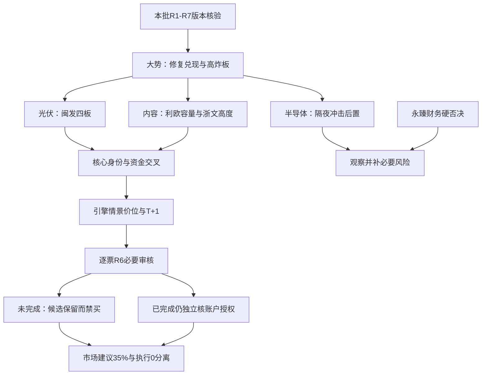

<!-- canghai:explicit-plan-report-assembly:v1 -->
# 显式组装报告（非重新推理）

> 决策来源（JSON）：llm
> 同版 JSON SHA-256（规范化内容）：fca8d7342a7284b386e2658362852e6b0ba62fb0993e5e5faf1f56f8698d1305
> 以下散文为调用方提供的模型原文，完整保留、未经重新推理；原文自述不是来源验证，不得覆盖 JSON 禁令、权限或缺口。
> 表格直接复用既有共享 renderer；只读展示，不构成开仓或自动交易授权。

## 模型原文（非重新推理）

---
date: 2026-11-06
agent: D1-main-decision
skill_version: main_decision_v1@2.1
generated_at: 2026-11-06T07:36+08:00
confidence: null
degraded: true
data_sources:
  - name: research_summary_current_run
    path: data/research/20261106/research_summary.json
    status: ok
    captured_at: 2026-11-06T07:26+08:00
    record_count: 7
  - name: bound_auxiliary_inputs
    path: input_manifest.bound_auxiliary_inputs
    status: partial
    captured_at: null
    record_count: 2
input_freshness: partial
input_freshness_note: 主研究同版绑定通过不等于必要审核完成；当日日历缺失，图像复核unknown，行情事实主要截至11月5日。
---

# 2026年11月6日 · 主决策 / D1 盘前预案

## 🧭 一句话结论

**修复有赚钱效应，但封板变脆。保留内容与光伏核心候选，半导体后置；市场建议35%，系统不授权新买。**

这不是规则兜底版。决策来源为本轮LLM，主模板仅“树干”；Python只核版本、做价位几何和执行保护。本轮没有调用另一个模型、没有启动Hermes子会话、没有读取真实或模拟账户。下文的“执行候选”是本轮优先研究及条件剧本，不是已经通过审核或可下单名单。

## 🚦 仓位双轨与不交易条件先读

|轨道|本轮结论|成立边界|
|---|---|---|
|市场建议总风险敞口上限|**35%**|概念基准为账户净资产100%；不是在未知底仓上再加35%|
|本轮初始条件试探|**10%**|利欧6%、闽发2%、浙文2%；条件未满足不实施，不自动把空出份额挪给后排|
|逐票条件建议|利欧6%；闽发2%；浙文2%；有研0%；永臻0%；先导及其余观察对象未知|有研0因已证板型不适合本轮入场；永臻0因硬否决；未知不补默认数|
|系统执行额度|**0**|预算与权限未取得验证；不是已查到用户账户可用资金为0|
|执行环境|**dry_run、禁自主、必须人工确认**|正的市场建议、候选身份、价位和P1/P2触发均不增加买权|
|研究与正式审核|安全临时版，production_ready=false；research_completion_passed=false|三只选中对象R6必要审核均未完成，必须补证重评|

为什么是35%而不是复制R1的50%，也不是把执行0写成市场空仓？11月5日上涨4869家、下跌625家，上涨占比87.40%；前日118只涨停股在11月5日收盘反馈均值+4.49%、中位数+4.26%，开盘至收盘均值+2.56%。这支持继续研究进攻，而不是仅因资料质量分低就认定无机会。另一面，涨停从118降至84、未封炸板增加至48，炸板率36.36%，核心中又有两只四板一字；隔夜科技链冲击晚于这些A股资金事实，不能用昨天的强解释今天已经消化风险。因此我不使用50%研究上限，而把总风险敞口建议降为35%，初始只给10%的条件试探，剩余是风险容纳空间，不是预置加仓指令。这是本轮市场与对象证据的取舍，不是high_chop固定仓位表。

建议事实基准为11月5日收盘，叠加本批截至11月6日盘前的已交付新闻；建议窗口最迟至**11月6日09:30**，当日竞价、资金与冲击传导出现新证据时提前重评。价位研究窗口为当日，发生关键公告、复权变化、剧本失效或新版本发布须重新核验，不能把建议到期当自动放行。

当前active限制必须分层看：

1. **全局执行保护**：ACCOUNT_BUDGET_UNVERIFIED，来源为D1执行保护；本轮无账户读取许可、无live授权，执行额度保持0。解除只归权限owner独立核预算、真实停买及人工授权，不由市场看多解除。
2. **逐票必要待核**：六只R5画像对象均缺当前重大合规完整性及S2/S3当前事件状态；先导、有研另有模式6热榜alert必要结果缺口。交R5/R4补原证据、R3/R6完成合法逐票复审。它们限制对应对象，不是辅助资料缺项导致全市场停买。
3. **已证硬失败**：永臻股份R6财务硬否决；有研新材多次回封板型禁入。两种理由分别保留，不用一个unknown标签遮盖。
4. **情景条件**：闽发、浙文不顶四进五一字；半导体/算力对象等隔夜事件后的A股真实承接；高开超买区、实际委托价RR不足、主线失效均取消原买入等待。
5. **非全局禁令**：fetch_global_severity=2，不是3；日历缺失、图像unknown、R3/R7低置信度均不单独激活全市场禁买。没有继承旧计划的市场性零仓或停买建议。

**今天是不是市场意义上的空仓日？本批事实不支持直接定为全市场空仓日。** 主跌未获证、炸板36.36%尚未超过40%，广度与兑现改善；但系统本次确实不授权执行。市场结论和系统权限不能混成一句“今天只能空仓”。没有账户资料，更不能声称用户实际新增为0或已经有多少底仓。

## 💰 条件买卖点总表：价位不等于资格

金额单位元。下表买区上沿是计划RR的拟买基准，触发价只是确认条件。止盈是确定性2R几何目标，不是已核未来卖盘愿意支付的价格。新买仓的止损/止盈均从T+1可卖日生效，买入当日没有可执行卖出止损。

|对象与本轮身份|条件买区|确认/触发|引擎报价上限|T+1止损|2R目标|计划RR|当前能否买|
|---|---:|---:|---:|---:|---:|---:|---|
|利欧股份 002131.SZ · 执行候选|4.37—4.46|4.39|4.70|4.24|4.90|2.00|不能；必要审核与授权未齐|
|闽发铝业 002578.SZ · 执行候选|4.53—4.62|无有效竞价trigger；4.55仅突破基准|4.87|4.39|5.08|2.00|不能；一字剧本无成交触发、必要审核未齐|
|浙文影业 601599.SH · 执行候选|4.60—4.69|无有效竞价trigger；4.62仅突破基准|4.94|4.46|5.15|2.00|不能；一字及必要审核待核|
|永臻股份 603381.SH · 禁买观察锚|18.76—19.13|无有效一字trigger|20.17|18.17|21.05|2.00|不能；R6硬否决不因数字漂亮而解除|
|先导基电 600641.SH · 观察|30.86—31.49|31.02，修复参照而非收复20日高|33.19|29.92|34.63|2.00|不能；合规/alert未完、行业冲击后置|
|有研新材 600206.SH · 观察|38.20—38.97|38.39，修复参照|41.08|37.02|42.87|2.00|不能；多次回封及必要风险未齐|
|天赐材料 002709.SZ · 观察/B|28.86—29.45|29.01，仅昨收回退参考|31.04|27.98|32.39|2.00|不能；缺20日技术窗口、画像与R6|
|海创药业 688302.SH · 观察/B|35.31—36.02|35.49，仅昨收回退参考|37.97|33.14|41.78|2.00|不能；同上，许可现金到账未核|
|翰宇药业 300199.SZ · 观察/B|24.75—25.24|24.87，仅昨收回退参考|26.61|23.22|29.28|2.00|不能；临床许可不是上市批准，必要审核未做|
|宏盛华源 601096.SH · 观察/B|3.77—3.85|3.79，仅昨收回退参考|4.06|3.66|4.23|2.00|不能；核心扩散、20日窗口与必要审核未核|
|金刚光伏 300093.SZ · 观察|18.57—18.94|18.66，仅昨收回退参考|19.97|17.42|21.98|2.00|不能；合同融资风险、技术窗口与必要审核待核|

**“引擎报价上限”绝不是可以照价追买的最高合格价。** 例如利欧若按4.70买，沿用止损4.24和目标4.90，RR=(4.90−4.70)/(4.70−4.24)=0.43，已低于1，更低于原1.8门槛。闽发4.87、浙文4.94对应也仅约0.44。本轮保留引擎原报价上限，不为凑RR擅改止损、目标或上限；真正拟委托仍须落在原买区、独立重算RR与追高边界，并先取得全部必要审核与授权。符合竞价预期也不代表符合计划买价。

五只直接事件观察对象只取得R2内嵌的11月5日前复权单日截面，**没有20日高和均线**。引擎允许以昨收回退产生基准，本轮明确只展示受限参考，不说“已完成20日突破”。每票保留TECHNICAL_WINDOW_UNVERIFIED及NECESSARY_PROFILE_REVIEW_MISSING，交R2/R5/R6补证。不能因为价位能算出而认证必要价格研究完成。

另两只纯容量温度计不生成买入情景：阳光电源300274.SZ，11月5日低/高为80.13/91.30，收85.14；中微公司688012.SH为235.00/265.00，收254.00。它们是**昨日观察参照，不是执行止损或今日买区**，原始JSON省略不适用的stop_loss字段，不生成零元卖出规则。没有因空通道声称“没有行情”。

## 🌊 先看市场奖励，再看板块合力

R1与R3均给76分，情绪为高位震荡，事实主要来自11月5日。R1置信度0.544来自0.85×0.8×0.8，R2/R3/R4/R5/R6/R7原值分别为0.448/0.364/0.64/0.69/0.78/0.2625；这些是资料与判断可信度，不是上涨概率。没有调分过线，也没有用confidence<0.4冻结全市场研究。

已绑定emotion_cycle中的premium=-0.5%是缺数后的默认值，不是实测。我采用其炸板84/48与high_chop温度描述，不采用默认溢价，也不照抄“龙头不死做低位补涨”的固定打法。R1真实全池的开盘溢价均值+1.94%和收盘反馈+4.49%是不同窗口，不与默认值平均，更不把收盘反馈充当今早竞价。

**板块公共判断一：光伏/光储修复。** R2同版概念口径22家涨停，最高四板闽发、三板永臻；R4问财23家是另一范围，不强行揉成一致。R7光伏设备当日+32.36亿元、五日+60.71亿元是行业代理，不等于885531概念精确净额；不能再与电力设备父级相加。R3热度8→1支持传播，R4没有已核光伏行业新增正面硬催化。永臻被财务硬否决后，不用其他低位票凑数替补。

- **大资金意图**: 更合理的假设是交易新能源修复与前排身位，而不是已经认证主营盈利全面反转。连续一字获利筹码是开板新买盘的对手盘。
- **为什么走强**: 热度、行业资金回流及4/3板梯队同窗存在；闽发五日资金方向可核。分支关系成立，不意味着每个成分都流入。
- **逻辑够不够硬**: 市场效应较硬，行业新订单不硬。闽发业务标签混有液冷/机器人，不能包装为纯光伏总龙。起点与轮次未知，不以概念同名认证同轮延续。

**板块公共判断二：AI内容应用/短剧。** R3短剧9→5与应用11→2合并一族，不当两条独立共识。R2应用17家涨停，浙文四板管高度、利欧首板管容量；R7传媒当日+34.92亿元与广告营销子级+20.07亿元不可累加。R4引力传媒AI短剧收入不足0.1%及芒果同业承诺延期是各自主体事实，不外推浙文或利欧相同收入占比/合规风险。

- **大资金意图**: 本轮可能在交易从硬件拥挤向内容应用的资金分流；利欧可成交换手比高位一字更容易检验。这是待验证假设，不是已证机构迁移。
- **为什么走强**: 题材传播、容量首板与四板高度形成互相参照，21.48亿元成交比封死一字更能显示真实买卖博弈。
- **逻辑够不够硬**: 流动性与地位有实证，盈利兑现不硬。利欧Q3双亏、机构席位偏卖；浙文资金口径有方向冲突，不能写机构游资双买或无抛压锁筹。

**板块公共判断三：半导体自主可控。** R2设备/材料13家涨停、先导早封二板与有研二板保留研究身位；R7半导体当日+61.04亿元、五日+115.43亿元为11月5日事实，而20日仍净出。R4隔夜纳指约跌5.5%、费半约跌12%的报道晚于这些A股数据。R7美股个股旧至11月4日，不能被“实时调用”四字洗成最新隔夜。两种证据层次分开。

- **大资金意图**: 11月5日回补设备材料与自主可控存在证据，但不能推定它已经对隔夜大跌免疫。
- **为什么走强**: 二板与细分扩散可核；先导增持完成是旧行为更新，有研材料身份和人气可核。当天继续走强尚未发生。
- **逻辑够不够硬**: 地位与数值行情较硬，增持不等于新订单，相关监管性质未核。两只均不借“国产替代”叙事越过事件后置与必要风险。

三条线均没有可靠首次启动日、round_id及单板块完整炸板分母。sector_core_watchlist保留R2原始身份、证据、窗口与共同触发/失效条件，不把stage_name填成新的生命周期结论。R7没有已核seesaw_pairs，不编负相关系数、不按检测器档位自动罚仓。

## 🎯 三只优先执行候选：有地位，不等于有买权

### 1. 利欧股份 002131.SZ：容量右侧修复，不冒称主升低吸

- **大资金意图**: 容量资金可能承接内容族外溢，真正对手盘包括前期套牢盘与首板兑现盘；龙虎榜净买约3.30亿元不能抹去机构专用席位偏卖。
- **为什么走强**: 11月5日首板、成交21.48亿元，分档自算与DC当日约9.14亿元同向，五日约8.90亿元；R2明确原角色龙二/容量核心，人气东财第1、同花顺第21。
- **逻辑够不够硬**: 市场容量与成交证据成立，盈利与中期趋势不硬。MA5=3.948低于MA10=4.025，MA60=4.518仍在上方，因此只选择leader_breakout半路右侧研究，不给“确认主升低吸”的称号。

**买入理由**：第一，内容族17家扩散及首板容量能形成可检验的合力；第二，真实换手比继续封死的一字有更明确成交验证窗口。与浙文比较，我把它放在候选首位是因可检验性，不是低位天然更优；与欢瑞、天娱等R2同版对照，后者缺本轮涨停身位与优先画像/审核证据，不临场替换。

**风险点**：第一，Q3归母与扣非双亏，减值和股东户数增加反驳“筹码全锁住”；第二，MA60压力4.518早于4.90几何目标，能否穿越需验证，不能把2R设价叫已核上涨空间。R6_M3_14盈利反证保留。D1只显式覆盖“只能留watch”的展示身份，保留为执行候选；不覆盖任何必要风险、预算或权限。

**止损条件**：研究买区4.37—4.46、确认4.39，按4.46基准止损4.24，舍入后止损距约-4.93%，原始公式为-5%，不是人为放宽；目标4.90，RR=2.00。当前不能买。若未来取得授权，新仓买入当日跌破只记录，下一可卖日集合竞价/开盘处理，跳空可能超计划损失。无底仓信息，不编可卖数量。

**可验证假设**：11月6日先核首板溢价与内容梯队是否仍有不少于3家有效扩散，并检验站回4.39、成交可得性与资金方向；若核心无法维持承接且内容扩散衰退则取消。次一可卖日核兑现，不把“今日买、今日止损”写成可执行方案。必要合规与完整资格未完成时，价格成立也只是条件，不出单。

龙头认定采用上游3条结构信号，身份为容量核心而非连板总龙；完整真龙资格未认证。板型实跑为一次开板回封，非多次回封硬失败。禁止清单本阶段可计算项无命中，但完整14项、7项开仓资格仍有未知，不能将空hit_rules写成全项通过。core_judge精确20日板块/指数数组缺失，保持unknown；不整池追加“已证无核心”。

### 2. 闽发铝业 002578.SZ：四板身位保留，不顶四进五一字

- **大资金意图**: 交易光伏修复和四板辨识度，开板时连续涨停的先手有兑现动力。五日约1.876/1.872亿元是两种分类代理，不是两批独立机构持仓。
- **为什么走强**: 四板高度、同族22家扩散与热度抬升。39.18亿元流通市值属于20—50亿元风险带，可研究但必须提示，不因小盘额外加分。
- **逻辑够不够硬**: 身位与资金方向有依据，Q3扣非仍亏、经营未重大变化与高PB说明业务兑现并未同步证实；昨日一字不证明今日开板后的承接。

**买入理由**：第一，真正的前排高度不能因一字难买就被低位后排替掉；第二，资金方向和行业扩散支持把它列为优先检验对象。永臻虽是同链三板，但已被R6硬否决，不构成可买对照，更不能因它被否改推另一只杂毛。

**风险点**：第一，11月5日量只有五日均量约32%，成交受限；第二，扣非亏损、质押与历史PB高分位削弱盈利安全边际。另一个真实分歧是R2问财单日资金约-0.259亿元，而R5分档/DC为正，两套口径不相互覆盖，本轮不把其中任一来源解释成绝对资金身份。

**止损条件**：情景基准4.55，买区4.53—4.62、止损4.39、目标5.08、RR2.00，舍入止损距约-4.98%。因一字预案，实际trigger保留null，**4.55不是竞价挂单许可**。不开板不买；开板后若要启用，计划owner必须核承接并合法重评。新仓退出T+1，不能承诺当日跌破马上卖。

**可验证假设**：11月6日观察开板后的真实成交、能否回封及光伏前排是否继续至少3家扩散；只有封单而没有成交不认证承接。买区失守、行业退潮或必要风险出现则取消。当前条件建议2%，不是象征性执行单；未满足条件就是不实施。

龙头认定上游过2条结构规则，业务传导与完整资格未闭环。板型原文为缩量一字四板；确定性分类器返回秒拉/竞价时间类，不以这个较粗分类抹去原日线O=H=L=C的一字事实。禁止清单可算项无命中，必要合规、当日可得性及量化核心复核仍待核。

### 3. 浙文影业 601599.SH：内容高度，不拿同字后排维持旧剧本

- **大资金意图**: 内容应用四板高度与获利筹码兑现博弈；不要把连续风险公告当没关系，也不要仅因高位就否认市场地位。
- **为什么走强**: R2确认应用真实成分最高四板，日线均线抬升；原月表旧纺织行业标签不能让它从内容研究中消失。
- **逻辑够不够硬**: 身位硬，盈利与资金一致性不够硬。11月4日分档净入0.034657亿元、DC净出0.207069亿元方向相反，11月5日金额差异也保留，不选好看的源。

**买入理由**：第一，四板与内容17家扩散提供真实优先核验价值；第二，Q2/Q3单季经营现金流改善有原证据，不能因累计负值误判连续恶化。和利欧相比它负责高度而非容量；和R2旧心智锚比较，当前四板身份更直接，但不自动授买权。

**风险点**：第一，连续异动/风险提示已明确经营未发生重大变化，先手兑现压力高；第二，资金两口径方向/金额冲突与短剧盈利未核同时存在。引力不足0.1%的收入占比只属于引力，不能移植成浙文财务结论。

**止损条件**：基准4.62，买区4.60—4.69，止损4.46，目标5.15，RR2.00，舍入止损距约-4.90%。一字trigger为null，不挂四进五一字单；开板且换手成立后仍须owner重评。所有新仓卖出从T+1开始。

**可验证假设**：11月6日比较自身开板承接、利欧容量与内容低位梯队，不以新“字辈”替代真扩散；若开板不能恢复承接且同族衰弱则取消。现条件建议2%，没有实际账户增仓含义。

龙头认定上游2条，未认证完整真龙。原数值日线说明11月4日不是一字，不能采纳快照“11月3—5日均一字”的文字。当前必要合规未核；D1仅覆盖R6_M1_07/M9_08的展示降级，不覆盖其反证与禁买保护。

## 🔍 观察池顶部：反证保留到对象，不搞全池一刀切

### 先导基电 600641.SH：早封二板不等于主升

- **大资金意图**: 设备自主可控的信心修复假设，增持完成已兑现，不是今天新增持续买盘。
- **为什么走强**: 二板早封与半导体13家扩散并存；R5五日净额约1.50亿元能补R7个股覆盖不足，但问财另一窗口净额偏负，口径与窗口不相混。
- **逻辑够不够硬**: 增持原公告较硬，中期趋势、关联依赖和旧警示函性质未闭环。

**买入理由**仅是研究理由：设备龙一早封身位和管理层实际增持值得保留，不因缺R7某字段就清票。**风险点**包括20日跌约31.55%、收盘31.02低于MA10/20/60，扣非亏损与控股股东质押50.47%；旧警示函未取得重大违法属性判断，不能自动hard_reject，也不能当阴性。

**止损条件**仅为受限修复情景：买区30.86—31.49、止损29.92、目标34.63、RR2.00；远端20日高46.75作压力参照，不声称当日交易所边界已核。**可验证假设**是隔夜冲击后设备扩散与自身右侧修复是否有新证据；缺模式6/7必要结果及真实承接时不晋级。条件建议保留未知，不从系统零额度借0，也不从身位借正数。与中微公司容量锚比较，前者有二板身位，后者容量大但R7净额口径冲突，同样不是避险替补单。

### 有研新材 600206.SH：地位存在，板型明确失败

- **大资金意图**: 材料弹性回补与高人气，但多次开板说明抛压与新增买盘仍在竞争。
- **为什么走强**: 二板、材料分支及人气跃升均有证据，11月5日分档7.11亿元/DC7.87亿元同向却金额差约9.6%，同向不等于无冲突。
- **逻辑够不够硬**: 业务身份与季度现金流改善较硬，订单新催化、主升与稳定强封未证。不是因为core_judge unknown才降级。

**买入理由**仅保留材料核心研究与Q3扣非改善两条；**风险点**是Tushare开板6次/问财3次，两者均满足≥2的多次回封禁入，还有高估值、中期套牢盘和隔夜行业冲击。禁止项显式命中multiple_reseal_board，条件建议0%。不因低位或弱转强词汇豁免。

**止损条件**仅供受限研究：买区38.20—38.97、止损37.02、目标42.87、RR2.00；远端高49.00不是今日已核可达位。**可验证假设**是在未来1—3个交易日出现新、可核的换手结构与材料扩散后由owner另行重评；本次不据“明天可能弱转强”提前撤销板型限制。与先导比较，不以利润更好覆盖已命中交易纪律，也不以先导治理缺证证明有研全部安全。

### 永臻股份 603381.SH：R6硬否决，不接受替代叙事

- **大资金意图**: 光伏边框三板、小流通盘的接力交易解释不能替代财务偿付能力。
- **为什么走强**: 同族扩散、三板早封与资金净入存在；涨停不证明现金兑现。
- **逻辑够不够硬**: 接力身份有证据，财务反证更硬。F6非经常收益占比约99.87%，F8连续两季净利正而经营现金负，F9应收/累计收入约41.16%，F10有息债务/权益约252.41%。

**买入理由**不成立于本轮权限：保留观察仅为光伏三板温度与反证追踪，不是一张备用买单。**风险点**即R6_M7_05四条已核红旗；F3在营收下降时不称应收暴增，即使剔除它也已有四条，不靠错误叙述凑阈值。

**止损条件**18.17、买区18.76—19.13、目标21.05只保留同一几何参照，不能解除硬否决；一字无trigger。**可验证假设**是后续有效财务证据是否纠错或现金流/债务实质变化，不能在三天内用盘口转强“证明财务风险消失”。D1无hard_reject覆盖权；到15:00也不自动解禁。

## 📰 三类机会并行比较与B计划

消息催化、产业趋势与纯情绪没有固定配额。与上述旧情绪核心对照，**天赐材料45万吨电解液框架**是本批更直接的主营催化，我采用其研究价值，不把框架数量等同未来利润；R2尚缺电解液分支完整梯队，R5/R6本版未覆盖，因此延后进watch/B，而非为了固定三条线排斥新题材。海创HP570首付款现金2000万美元与权证1000万美元分别看，里程碑不保收入；翰宇是临床许可，不能说上市批准。宏盛7.25亿元中标约占上一年营收7.57%，中标尚非全部已签合同，R2同日反应偏弱。它们都比无硬消息的同名后排更值得补证，但不因此取得买权。

金刚光伏必须同时采用合同上限与融资、可解除后续批次的反面：11月5日20cm涨停早于18:38报道，不能把收盘后合同倒用作当日上涨原因；它是算力云服务，不是光伏订单。算力受隔夜冲击，本轮降级观察而非拿合同上限强行进执行。20cm代码本身不排除机会，920限制则沿用实际只读政策，不按历史文案擅自解禁。

B计划触发为：三个优先候选中至少两票竞价不及预期，或光伏/内容核心失去承接且分支扩散消退，或龙头断板并伴炸板进一步恶化。**只切研究优先级，不自动切买权**：

|备选方向|盘前点名对象|确认与取消|
|---|---|---|
|主营订单的锂电材料|天赐材料002709.SZ|电池链与该票同窗资金/成交承接确认；先补画像、20日事实、核心与R6；框架解除则证伪|
|创新药许可差异|海创药业688302.SH、翰宇药业300199.SZ|核同族扩散，分别核到账和临床层级；不把两条消息相加为确定主升|
|电网直接订单|宏盛华源601096.SH|核电网细分梯队而非电力设备父级大数；缺前排合力则继续观察|

B对象与watch重复，不重复累加仓位建议；本轮均为null而非默认正仓位。R7无可靠负相关配对，这些只是同版次线备用，不宣称已证明跷跷板。A/B均弱则不临时从全市场抓新票，不停止合法卖出管理。

## 🐑 10cm情绪核心／名字梗与一字板预判

本轮真正有画像的10cm情绪核心是闽发、浙文与利欧，不能用阳光电源、中微公司等容量温度计替代情绪研究。名字梗采用**2026年四季度交易2027羊年预期**的解释，不能因当年马年机械过滤；但名字相近也不构成合力。七匹狼002029.SZ在同版R2已核11月5日跌4.73%、主力代理净出约0.52亿元，未核本轮实际传播、梯队与资金持续性，**不纳入本批核心**。这是当前证据取舍，不是永久黑名单。深中华不能仅凭名字强拼羊/狼家族；其他热榜“洋/阳”线索无本批充分画像，不现场补选。

已运输的一字预测目标日确为11月6日，但包含三板/四板对象及“可重点排隔夜单”等文字。它是证据，不是指令。本轮**不顶三板以上一字，不采用其概率、回测命中率或隔夜单建议**。二板金螳螂只有线索、没有本批R5/R6，不升级执行；先导虽二板，仍受行业冲击后置与合规/alert缺证保护。没有为了凑一字Top10制造候选，也没有另写一字产物。

## ✖️ 四象限叉乘：先核事件时序，再谈预期差

四象限定义为**利好涨／利好不涨／利空跌／利空不跌**，要求同一事件披露后的价格与资金响应，不能用不同窗口硬塞。R6六对象的当前新事件反应均为unknown，本轮保留；unknown不等于没有利空，也不等于“利空不跌”。

|象限|本轮成立的证据边界|接下来怎样判，不是什么买权|
|---|---|---|
|利好涨|五事件主体有硬消息/昨日价格记录，但没有完整披露后同窗验证，当前不认证入象限|补精确披露时间、之后价格/资金；若涨幅已兑现且RR坏，不追|
|利好不涨|不能拿宏盛昨日仅+0.80%证明收盘后中标已被市场否定|消息后的可交易窗口到来再核；低价不自动是预期差|
|利空跌|隔夜科技下跌报道属海外市场事实，A股11月6日反应尚未发生|核半导体/算力当日传导，不能移植国外跌幅为个股实际跌幅|
|利空不跌|昨日半导体二板/净流入早于隔夜风险，不构成利空不跌|只有新窗口仍有真实承接才重评强度，不因标签自动解除必要审核|

R4行业级成本冲击限航空/炼化/化工下游，本批没有相关优先对象，不扩大为三条主线禁令。引力、芒果、富春、倍轻松、天山、泰坦、天力、红四方的个股公告保持适用主体，不把同业风险当候选立案或财务造假。亚玛顿继续停牌只影响其主体，不能连带闽发/永臻。三类机会的比较不必每票有新公告，更不把无公告理解为无合力。

## 🧮 价位推导：原公式、数据窗口与资格分别留证

主路径实际调用consume_authorized_inputs、chart_evidence_from_profiles和apply_to_plan。现有引擎的load_tech默认读kb/research.db，超出本轮许可，因此本轮**仅在调用作用域内用内存适配器提供已授权payload**，没有修改仓库代码、查数据库、读raw/latest或另取价格。

六只画像使用R5已内嵌63根日线与复权因子，20日窗口按同版R7真实日历核为10月9日至11月5日，OHLC以adj_t/adj_11月5日换到前复权，均线采用R5现值；牛/熊线缺失保持null。五事件对象只有单日截面，回退限制已逐票写出。报价两位小数沿用现有表示，不认证所有证券最小报价单位。

突破情景一般取pivot=max(昨收,20日高)，买区[pivot×0.995,pivot×1.015]；买区上沿B，候选止损为B×0.95（20cm为B×0.92）、MA10×0.99、熊线×0.99中满足原几何条件的最高项；目标B+2×(B−S)。原始和舍入后止损都须在买区下沿之下。本轮不换均线凑价、不放宽止损求通过。

|对象|pivot/技术事实|拟买B与止损S|目标与RR公式|
|---|---|---|---|
|利欧|20日高=昨收4.39；MA10=4.025，MA60=4.518为近压力|B4.46；max(4.237,3.98475)舍入4.24|T4.90；(4.90−4.46)/(4.46−4.24)=2.00|
|闽发|20日高=昨收4.55；MA10=3.595|B4.62；max(4.389,3.55905)舍入4.39|T5.08；(5.08−4.62)/(4.62−4.39)=2.00|
|浙文|20日高=昨收4.62；MA10=3.547|B4.69；max(4.4555,3.51153)舍入4.46|T5.15；(5.15−4.69)/(4.69−4.46)=2.00|
|永臻|20日高18.85；MA10=15.047|B19.13；基础18.1735高于MA10×0.99，舍入18.17|T21.05；(21.05−19.13)/(19.13−18.17)=2.00，不解除硬否决|
|先导|20日高46.75为远端压力；引擎按原10%距离诊断回退昨收31.02，非交易所可达性认证|B31.49；基础29.9155舍入29.92；MA10×0.99高于买区下沿不作合法结构止损|T34.63；(34.63−31.49)/(31.49−29.92)=2.00|
|有研|20日高49.00为远端压力；引擎回退昨收38.39，不能称20日突破|B38.97；max(37.0215,35.36181)舍入37.02|T42.87；(42.87−38.97)/(38.97−37.02)=2.00|
|天赐|20日高/MA未知；仅昨收回退29.01|B29.45；29.45×0.95→27.98|T32.39；(32.39−29.45)/(29.45−27.98)=2.00，仅参考|
|海创|20日高/MA未知；仅昨收35.49|B36.02；36.02×0.92→33.14|T41.78；(41.78−36.02)/(36.02−33.14)=2.00，仅参考|
|翰宇|20日高/MA未知；仅昨收24.87|B25.24；25.24×0.92→23.22|T29.28；(29.28−25.24)/(25.24−23.22)=2.00，仅参考|
|宏盛|20日高/MA未知；仅昨收3.79|B3.85；3.85×0.95→3.66|T4.23；(4.23−3.85)/(3.85−3.66)=2.00，仅参考|
|金刚|20日高/MA未知；仅昨收18.66|B18.94；18.94×0.92→17.42|T21.98；(21.98−18.94)/(18.94−17.42)=2.00，仅参考|

所有数字价位已绑定顶层stop_loss/take_profit与同一条entry及exit；不是引擎返回有数就算消费者字段齐全。纯温度计无退出情景，省略不适用价格而不是写零元止损。本轮node_invalid_count=0只是几何诊断，不认证必要风险、当日可达、成交或买权。

## 🖼️ 识图复核：本轮没有任何一票认证“识图确认”

仅将R5逐票内嵌的chart_vision快照副本交给chart_consistency；没有读取PNG、raw/latest或图数据库。三只执行候选与永臻均因周线标为11月6日、但缺未闭合聚合可用时点和逐周期复权认证，chart_evidence为unknown（unclosed_aggregate_without_availability:1w）。先导、有研原模型调用失败，原因chart_error，应称上游call_failed，不称整个图源source_down。

因此三执行票chart_consistency.status=unknown，confirmed_items为空；reason_annotation为null，没有制造“突破/支撑/压力三项全通过”。conflict.manual_review_required=false仅表示没有形成可比项冲突，**不是人工复核已完成**。本轮保留真实手工情景理由的原类型和文本，不用图像注记充当缺失的偏价依据。图像里“均线全多头”或“连续全是一字”的文字与R5数值解释不一致时，不以文字替换价位或认证冲突值已可比；原数值与限制留证。

这项辅助诊断不改变名单、仓位、entry/exit数值、buy_eligibility或权限。三个候选本来就因必要审核及执行保护不可买，不是新增图像全局禁令。下一步图像补证归研究owner，D1不现场补图。

## 🧩 专题证据：采用内容，不照抄上游的“已采用”声明

topic_knowledge的R2/R4/R5/R6 run、attempt、context_sha256及各研究版本已随consume_authorized_inputs核验；这证明运输身份没有漂移，不自认证模型理解或效果。D1只读这些JSON内嵌knowledge_context与knowledge_adjudications，没有沿source path打开专题原件。正式JSON在meta.knowledge_adjudications保留九个精确source_id、逐项引用、对象、处分与理由；源哈希不同的新旧成长池分开，不把同一底层来源转述当多个独立支持。

|来源身份简称|D1最终取舍|用途与和上游声明的区别|
|---|---|---|
|theme_anchors:c834…|adopted，限发现/对照索引|三主题目录与R2已核欢瑞/天娱对照，不声称阅读597主题全部研究或打开latest|
|stock_character:6563…|adopted，限历史行为风险|利欧旧好近期差、浙文近期弱、永臻少样本，不把月表分当当前胜率/核心排序|
|growth_pool:37c7…|deferred|采用旧截取作为路维/中微半导/四川黄金的比较线索，但不因R2宣称adopted就进入D1执行；缺当前前排与必要审核|
|growth_pool:838a…|deferred|新截取严格条件仍未完成；规模退出不等于经营恶化，未扩大到运输只提及的其他代码|
|dividend_pool:6ebb…|rejected，本轮入池用途|R2已核炬华/中远当下波动和合力弱，不拿旧息率替进攻；非长期否定红利|
|yizi_prediction:f5b3…|adopted，仅可得性线索|拒绝概率/命中率与隔夜顶单措辞；三板以上不顶，缺画像对象不补位|
|review_feedback:0c64…|unknown|显式反馈原文为空，不造已读、采纳或效果证明|
|catalyst_calendar:9d8f…|adopted，仅旧节选亚玛顿线索|实际停牌风险靠R4 E015；旧节选不替代缺失的当日完整日历，不采旧会期作本日事实|
|holder_trade:7053…|adopted，限先导历史行为边界|600.6197万包含在1619.2999万中，不相加、不当今日流入；上游采纳不解除治理风险|

每票reason/alpha_logic同时保留本轮采纳/延后或否决原因与相关source refs；没有合法画像或对照时明确缺口，不造股票、不造方向、不设新评分。传递留证不是效果证明。

## 🕘 竞价预期与T+1可执行性

|对象|不及预期|符合预期|超预期|过度高开|
|---|---|---|---|---|
|利欧|低于4.32|4.32—4.48|4.48—4.61|高于4.61不追|
|闽发|低于4.48|4.48—4.64|4.64—4.78|高于4.78不追；一字无竞价单|
|浙文|低于4.55|4.55—4.71|4.71—4.85|高于4.85不追；一字无竞价单|

主板事前中枢为昨收-1.5%至+2%，超预期至+5%；20cm观察对象按1.2倍放宽，逐票数字与动作在JSON及同版附表。所有区间是D1情景定义，非已观察报价。舍入边界相接处由P1按原始百分比比较，不凭显示数值重叠重复触发。低开先取消原单等待；符合预期只保留剧本；超预期仍核最高接受、实际RR与先手兑现，不能覆盖更窄买区。没有假装09:27数据已到。

本轮不读取账户，因此有无底仓未知，不能写底仓T+0数量。统一把假设新开仓退出标T+1，下一可卖交易日集合竞价/开盘按原逻辑处理，若冲击跳空则可能比计划止损差。没有本处境匹配的“今日开盘买、次日卖”历史最差5%样本与账户风险预算，不假算风险预算除尾部亏损的安全仓位；本轮条件建议不是尾部损失保证。open_position实际执行列表为空，add_on_pullback与stop_loss_only不编持仓；这不反向推导市场建议0。

## 数据源审计

**以下底层审计是消费同版R1—R7中的真实回执与声明，不是D1重新抓取raw或现场调用数据源。** 主研究七份文件均通过本轮run/attempt/receipt/hash校验，主研究partial不等于失败，也不等于必要研究已完成。

|源/输入|事实日期或覆盖|状态|本轮采用与限制|
|---|---|:--:|---|
|research_summary / R1—R7七主产物|2026-11-06本轮交付|🟢|绑定通过；R7只认artifacts中的带日期主文件，不读同日旧默认路径|
|R1国内daily/limit/index/风格反馈|2026-11-05及30交易日窗口|🟡|广度、兑现、84/48与高位震荡采用；三日部分风格、最新外盘缺项原样保留|
|R2 Tushare与官方问财|2026-11-05|🟡|六核心、三主线及25对象对照采用；生命周期起点/分支封板率未知|
|R3双热榜与匿名群观点|2026-11-04至2026-11-05|🟡|四观察主题仅三叙事家族；与R4/R2复用同源不重复计票|
|R4全部18事件|2026-11-05至2026-11-06已取得披露|🟡|主体、来源和披露后反应分开；事件数量不等于18独立新利好|
|R5六画像/财务/63根日线|行情截至2026-11-05，财务以2026-09-30等已披露期为准|🟡|内嵌价格与财务采用；当前合规终核缺口保留；不打开其旁路证据文件|
|R6必要审核矩阵|2026-11-06本版|🟡|六票均有实质局部审核、必要完成0；一票硬否决，未完成不当通过|
|R7主力/龙虎榜/期货|2026-11-05|🟡|适用资金保留；行业父子/同源转述不叠加；ETF真实一级净流未知|
|政策user_preferences.yaml|本轮读取版本|🟢|单票≤15%、板块≤40%、总仓≤80%、最多5持仓；920前缀限制保留|
|aux attention_signals|事实2026-11-05，使用日2026-11-06|🟢|绑定payload采用，不冒充今日实时人气；新热榜对象不获旁路候选资格|
|aux emotion_cycle|指标2026-11-05|🟡|high_chop温度采用；premium默认-0.5%拒作事实|
|aux catalyst_calendar精确20261106.md|2026-11-06|🟡|本批绑定unavailable，未取得完整MD；不补读其他日历、不作全市场禁买|
|公众号主文件与RSS镜像|2026-11-05至2026-11-06|🟡|90篇、15个有更新号；镜像只计一次，07点更新未到不宣称已读|
|匿名群文本|本批482条/5群|🟡|图片、文件、链接未展开；不把口播当公告独立确认|
|news_cls文件实际新浪/同花顺|2026-11-03至2026-11-06|🟡|2975条索引/正文样本，不是CLS专源，单次上限使完整性未知|
|news_major|2026-11-05至2026-11-06|🟡|800条正文空，仅标题级；不声称长文全读|
|业绩预告|2026Q3第一页500条|🟡|非全量、非H1，未命中不证明没有预告|
|公告窗口索引/巨潮重点原文|2026-11-05至2026-11-06|🟢|1793条/994公司目录，选中原文由R4/R5读；不等于全部语义审阅|
|官方主营查询/公告搜索|本批查询|🟡|报告期缺失或分类收入冲突不采比例；搜索200不证明结果时序正确|
|Tushare moneyflow_dc / 行业 / 市场|2026-11-05|🟢|12462/9920/20条为R7取数记录，非独立资金账户数|
|Tushare daily / daily_basic|2026-11-05|🟢|R7记录5971/400条为相应查询覆盖，不当全市场唯一股票数|
|Tushare top_list / top_inst / hm_detail|2026-11-05及其回看窗口|🟢|421/4210/1384条；跨side镜像及多日窗口不累加为机构共识|
|Tushare block_trade|2026-11-05及回看窗口|🟢|140条查询记录，未核溢价不补0|
|Tushare limit_list_d / limit_step|2026-11-05|🟢|132条涨停/炸板池、22梯队记录；ST范围差异不混分母|
|Tushare index_daily / trade_cal|2026-11-05及日历窗口|🟢|20/98条，R1/R7已确认11月6日开市；非现场另查日历|
|Tushare fund_daily / fut_daily|2026-11-05|🟢|80/20条；ETF成交量不当一级净流入|
|Tushare fund_share / margin_detail|2026-11-04|🟡|76/380条旧一档；辅助缺口不让R7整体失效|
|Tushare us_daily / overseas_snapshot|美股个股2026-11-04；部分指数2026-11-05|🟡|个股旧一日；SOX数值缺失与R4报道分层，不冒充精确最新同步报价|
|XTick资金/市场情绪|2026-11-05|🟢|60资金样本与1情绪记录；分单阈值、统计范围与Tushare不同|
|XTick hot_bk|本批返回成分|🟡|只有成分、无板块金额，是字段覆盖不满足，不称整源down|
|DataPro|本批实测4013|🔴|订阅失效/席位未分配，调用错误有实证；不伪造第二独立板块资金源|
|R5内嵌图像快照|快照使用日2026-11-06，日线事实2026-11-05|🟡|四票周线可用性/复权unknown，两票call_failed；未另抓图|
|WeFlow|既有停用状态|🟡|未调用，不把历史停用当本次新故障或全市场禁买|
|manifest / mcp_health审计|2026-11-06|🟡|只消费主产物内嵌元信息，severity2保留；D1未另读raw原件|

R4在形成时R3/R7未落盘，应解释为**not_yet_landed**，本轮D1已核并消费两份绑定主产物，不能照抄为现在“源不可用”。XTick缺金额是字段覆盖问题；图像失败是call_failed；DataPro有4013实测授权错误，也不泛化为全数据基础设施source_down。北向仅复盘参考，不参与本轮置信度分子/分母、机械仓位或买权。

## ⚠️ 不确定性、下一证据与不交易失效剧本

最重要的反证是：11月5日广度修复可能在隔夜冲击后逆转，尤其最高标封死时，新买盘无法验证接力质量。本轮对可成交换手的利欧优先，是可检验性选择，不是认证其主升；两只四板候选只保留研究身份，绝不为每天出票凑单。三者必要审核未齐，当前“不能买”是对象级真实缺证加独立执行保护的结果，不是信心不足的空话。

下一步责任明确：R5/R4补六票当前重大合规和先导警示函原决定；R3/R6补半导体两票模式6对象/窗口/结果；R2/R5/R6完成五只事件观察对象的核心、20日价格事实及必要审核；calendar owner补当日精确路径日历后须由合法新版本绑定，不现场重建；D1取得新证据后独立重评。辅助缺项不阻止有证据的研究比较，但不能把缺必要判断的对象认证通过。

出现以下事实，原买入等待取消：新重大风险/硬否决、竞价不及预期、开盘>7%追价、实际拟价RR不达标、原主线失去核心和扩散、持续一字无成交。不得通过挪价、放宽止损、删除限制、加默认预算或拿低位后排修复计划外买权。日历坏/缺失不是新的全市场事件命中；已核行业冲击和逐票风险也不因缺日历而消失。

旧score字段透明度单独说明：六画像票继承R5.sector_linkage.r2_score，实际是R2板块研究分，不能叫个股质量分或胜率；其余观察票的50为本轮LLM未校准解释值，仅表示观察与缺证，不是规则自动占位来源的断言。没有完整可复算个股质量方法，保持“不可完整评分／未校准”，不用资料完整度冒充赚钱概率。

## 🔗 与其他R/D/E的关系及交付元数据

依赖仅为本轮research_summary指向的R1—R7、既有只读政策以及已绑定aux3返回内容。专题只从主产物内嵌消费，没有follow source paths。消费者是execute、P1/P2及用户；本轮仅写核心JSON与这一份KG主MD，不写runtime、点位表、价位推导伴随MD或其他目录。历史spec要求多份MD与当前白名单冲突的部分不执行。

- skill：main_decision_v1；决策模型：gpt-6.1-sol；decision_source：llm。
- 本轮run_id：20261106T061043-60342-20509；R1—R7当前attempt与receipt详见JSON的input_manifest。
- 主输入summary文件SHA-256：c3bb7f39f5a834296a816ffcae370a6ad9a3945d381663634affa91590c9456e。主报告外层另列规范化plan_sha256，二者不是同一种摘要。
- 行情主要截至11月5日，实际生成在11月6日盘前，不是回放，不读取后到研究冒充本批。
- Mermaid使用阅读端11.4.0实际解析并渲染SVG，13节点、多层结构；不是只检查围栏。
- 5000万token是连续任务努力目标，非硬限、非每天重置额度；用量coverage不足保持unknown，不报0，不保证低于目标。08:30只是观察型交付目标，不自动撤单、清池或认证成功。
- 研究状态仍partial/待重评；文件与展示完成不等于必要审核或可交易完成。退出管理不因禁新停止，但本轮未取得持仓，不编具体卖出数量。

## 同版 JSON 共享表格（只读附录）

# 20261106 盘前预案 · 点位表版

> 计划生成时点：2026-11-06T07:36+08:00；决策来源：llm

## 板块机会总览

市场背景：广谱修复但封板质量弱；光伏/内容前排保留，半导体隔夜利空后置确认。

> 先市场／板块效应，再个股地位；未提供关系证据不推断龙头带动或板块扩散。

| 板块／本轮行情 | 阶段／窗口 | 效应与延续 | 核心与梯队（上游标签） | 共振／分离证据 | 主／反向剧本（名单归属非关系证明） | 确认条件 | 共同失效条件 | 观测时点 |
|---|---|---|---|---|---|---|---|---|
| 光伏/光储修复 | ⚠️未给 | 扩散后分歧窗口（生命周期定量未知） | ts_code: 002578.SZ；name: 闽发铝业；r2_role: 龙一；ts_code: 603381.SH；name: 永臻股份；r2_role: 龙二 | R2#/main_lines/0；R3.resonance_top_themes[0]光伏榜8→1，L1+L2；光储同族不重复计票。；R7.main_force.sector_flows.BK1031.DC光伏设备+32.359598亿、5日+60.711637亿；行业到概念是限定映射，不是885531精确金额。；R4全18项无光伏行业已核正催化；金刚是算力合同，不冒充光伏订单；亚玛顿继续停牌仅影响主体。 | 主剧本／执行；观察 | 竞价后同一窗口核心承接与分支扩散共同确认；T-1数量不是当日已满足 | 核心失去可成交承接且同族扩散衰退则重评；未核不补0，不自动授权B。 | 2026-11-06T06:53+08:00 |
| AI内容应用/短剧 | ⚠️未给 | 扩散后分歧窗口（生命周期定量未知） | ts_code: 601599.SH；name: 浙文影业；r2_role: 龙一；ts_code: 002131.SZ；name: 利欧股份；r2_role: 龙二 | R2#/main_lines/1；R3短剧游戏与AI应用共属AI内容应用，合并为一族；榜9→5、11→2。；R7 BK0486.DC传媒+34.921500亿，BK1220.DC广告营销+20.069908亿为子级不相加；不认定每个成员均流入。；R4 E007引力AI短剧收入不足0.1%、E011芒果同业承诺延期为反证；本轮无该家族正面硬公告，不能把题材热度当盈利。 | 主剧本／执行 | 竞价后同一窗口核心承接与分支扩散共同确认；T-1数量不是当日已满足 | 核心失去可成交承接且同族扩散衰退则重评；未核不补0，不自动授权B。 | 2026-11-06T06:53+08:00 |
| 半导体自主可控 | ⚠️未给 | 扩散后分歧窗口（生命周期定量未知） | ts_code: 600641.SH；name: 先导基电；r2_role: 龙一；ts_code: 600206.SH；name: 有研新材；r2_role: 龙二 | R2#/main_lines/2；R3 top4主题不含半导体，但有研榜34→3、通富24→10；主题共振未覆盖不判阴性。；R7半导体+61.037509亿、设备+54.323899亿、材料+21.087650亿；父子不可求和；设备5日+108.222039亿。；R4 E001隔夜科技跌幅冲击半导体；未核到本轮正面行业催化。 | 观察 | 竞价后同一窗口核心承接与分支扩散共同确认；T-1数量不是当日已满足 | 核心失去可成交承接且同族扩散衰退则重评；未核不补0，不自动授权B。 | 2026-11-06T06:53+08:00 |
| 锂电材料/电解液 | ⚠️未给 | ⚠️未给 | ⚠️未给 | 关系证据未给（概念归属不证明联动） | 观察；反向：锂电材料主营订单验证；触发 内容/光伏核心不及预期，电池链资金和天赐自身价格承接同时确认；先补核心画像与R6，不能仅凭消息轮动。 | ⚠️未给 | ⚠️未给 | ⚠️未给 |
| 创新药 | ⚠️未给 | ⚠️未给 | ⚠️未给 | 关系证据未给（概念归属不证明联动） | 观察；反向：创新药许可差异验证；触发 主线不及预期且医药扩散、个股成交和许可后反应有新证据；海创现金到账/翰宇临床层级分别核，不能把双消息当主升。 | ⚠️未给 | ⚠️未给 | ⚠️未给 |
| 电网设备/特高压 | ⚠️未给 | ⚠️未给 | ⚠️未给 | 关系证据未给（概念归属不证明联动） | 观察；反向：电网直接订单观察；触发 电网扩散而非电力设备父级泛流入；补齐领涨身位/画像/R6才讨论晋级。 | ⚠️未给 | ⚠️未给 | ⚠️未给 |
| 算力租赁 | ⚠️未给 | ⚠️未给 | ⚠️未给 | 关系证据未给（概念归属不证明联动） | 观察 | ⚠️未给 | ⚠️未给 | ⚠️未给 |

## 全局约束与数据边界

- 模式：dry_run；自动交易：False；需用户确认：True
- 总仓上限：0%；持仓上限：5；每日买单上限：4
- 单票上限：⚠️未给；单板块上限：⚠️未给
- 表格仅展示已给计划，不构成自动下单授权；观察／反向候选不自动晋级。候选数量不等于持仓名额。
- 评分未校准：未批准评分公式，不采用旧 score／默认50／板块分充个股分；原序展示，不另行排名。
- 静态价位非实时；数据日、复权／报价口径、有效期或动态线更新时间未给时均未核验，不以计划生成时间冒充价格时点。
- 新买入当日不可卖（T+1）；底仓是否可卖未核验。触发信号不保证可卖或成交。

### 市场仓位建议（独立于账户与执行权限）

- 市场建议总仓上限：35%
- 初始试探建议：10%
- 依据：广度87.40%、昨日涨停全池兑现+4.49%支持非零条件总敞口；炸板36.36%、一字核心可得性及隔夜科技冲击使D1不取R1的50%上限，独立选择35%总风险敞口、10%初始条件试探。不是按阶段套固定比例，不读取账户、不表示额外加仓。
- 条件：仅作11/6开盘前假设，09:30到期须owner重评；最新资金/冲击传导改变则提前失效；初始建议利欧6%、闽发2%、浙文2%；未补必要审核/当日承接前不构成可下单额度；一字无可成交买点则对应条件建议不实施、不自动挪给后排；B计划重复对象不累计；总敞口含已有风险概念，不知道账户已有仓位，不声称实际新增为0；账户硬停买/有效零预算独立优先
- 事实时点：2026-11-05T15:00+08:00；有效期至：2026-11-06T09:30+08:00
> 账户未知不等于市场建议空仓。以上是总风险敞口建议，不是在未知已有仓位上额外加仓；不读取或扣减真实／模拟持仓，不代表账户可用资金、买入资格或下单授权。

> 上列原总仓上限、持仓和订单限制属于系统执行约束；不得反推市场建议。

### 研究与正式反证状态（仅展示）

> 未完成不等于已审否决；已阅读不等于正式评估；硬否决数仅为已应用清单条数，0不等于反证通过。缺字段显式未知，不从池数量或原因文字推断；本表不改变买卖权限。

| 指标（已有JSON字段） | 状态／数量 |
|---|---|
| 研究是否完成（research_completion_passed） | 未完成 |
| 正式反证是否完成（meta.r6_devil_advocate.formal_review_completed） | 未知（未提供或类型无效） |
| 正式反证是否通过（meta.r6_devil_advocate.review_passed） | 未知（未提供或类型无效） |
| 正式评估数（meta.r6_devil_advocate.candidates_evaluated） | 未知（未提供或类型无效） |
| 已阅读研究对象数（meta.r6_devil_advocate.research_objects_inspected） | 未知（未提供或类型无效） |
| 硬否决数（meta.r6_devil_advocate.hard_rejects_applied） | 1 |
| 生产就绪（production_ready） | 否 |
| 需要重评（reassessment_required） | 是 |

- 强制风控（原字段）：block_prefixes=920；block_st=True；max_orders_per_symbol_per_day=2

> 全局禁止开仓（no_trade）；这是系统执行限制，市场建议另列，研究与观察保留。

- 不交易条件 ACCOUNT_BUDGET_UNVERIFIED：触发中／禁止开仓；本轮不读取账户，未取得执行预算或live授权；执行额度保留0，非账户余额为0或用户实际新增为0的结论。
- 不交易条件 R6_NECESSARY_REVIEW_INCOMPLETE：触发中／禁止开仓；必要模式未完成：[7]；详见同版R6必要检查。
- 不交易条件 R6_NECESSARY_REVIEW_INCOMPLETE：触发中／禁止开仓；必要模式未完成：[7]；详见同版R6必要检查。
- 不交易条件 ONE_WORD_NO_EXECUTABLE_ENTRY：触发中／禁止开仓；⚠️未给
- 不交易条件 R6_NECESSARY_REVIEW_INCOMPLETE：触发中／禁止开仓；必要模式未完成：[7]；详见同版R6必要检查。
- 不交易条件 ONE_WORD_NO_EXECUTABLE_ENTRY：触发中／禁止开仓；⚠️未给
- 不交易条件 R6_NECESSARY_REVIEW_INCOMPLETE：触发中／禁止开仓；必要模式未完成：[7]；详见同版R6必要检查。
- 不交易条件 R6_HARD_REJECT：触发中／禁止开仓；F6/F8/F9/F10四红旗硬否决
- 不交易条件 ONE_WORD_NO_EXECUTABLE_ENTRY：触发中／禁止开仓；⚠️未给
- 不交易条件 R6_NECESSARY_REVIEW_INCOMPLETE：触发中／禁止开仓；必要模式未完成：[6, 7]；详见同版R6必要检查。
- 不交易条件 POST_EVENT_CONFIRMATION_REQUIRED：触发中／禁止开仓；隔夜半导体跌幅冲击已报道，11/6 A股反应未知；后置等owner核新证据
- 不交易条件 R6_NECESSARY_REVIEW_INCOMPLETE：触发中／禁止开仓；必要模式未完成：[6, 7]；详见同版R6必要检查。
- 不交易条件 MULTIPLE_RESEAL_BOARD：触发中／禁止开仓；本版昨日Tushare开板6/问财3，均≥2，不以低位或人气放行原板型
- 不交易条件 POST_EVENT_CONFIRMATION_REQUIRED：触发中／禁止开仓；隔夜半导体跌幅冲击已报道，11/6 A股反应未知；后置等owner核新证据
- 不交易条件 NECESSARY_PROFILE_REVIEW_MISSING：触发中／禁止开仓；本批R5/R6未覆盖本对象，交R5/R6；有旧资料不读取替代。
- 不交易条件 TECHNICAL_WINDOW_UNVERIFIED：触发中／禁止开仓；同版只有单日行情，无20日高与均线；引擎昨收回退为受限情景基准，不作已确认突破。
- 不交易条件 NECESSARY_PROFILE_REVIEW_MISSING：触发中／禁止开仓；本批R5/R6未覆盖本对象，交R5/R6；有旧资料不读取替代。
- 不交易条件 TECHNICAL_WINDOW_UNVERIFIED：触发中／禁止开仓；同版只有单日行情，无20日高与均线；引擎昨收回退为受限情景基准，不作已确认突破。
- 不交易条件 NECESSARY_PROFILE_REVIEW_MISSING：触发中／禁止开仓；本批R5/R6未覆盖本对象，交R5/R6；有旧资料不读取替代。
- 不交易条件 TECHNICAL_WINDOW_UNVERIFIED：触发中／禁止开仓；同版只有单日行情，无20日高与均线；引擎昨收回退为受限情景基准，不作已确认突破。
- 不交易条件 NECESSARY_PROFILE_REVIEW_MISSING：触发中／禁止开仓；本批R5/R6未覆盖本对象，交R5/R6；有旧资料不读取替代。
- 不交易条件 TECHNICAL_WINDOW_UNVERIFIED：触发中／禁止开仓；同版只有单日行情，无20日高与均线；引擎昨收回退为受限情景基准，不作已确认突破。
- 不交易条件 NECESSARY_PROFILE_REVIEW_MISSING：触发中／禁止开仓；本批R5/R6未覆盖本对象，交R5/R6；有旧资料不读取替代。
- 不交易条件 TECHNICAL_WINDOW_UNVERIFIED：触发中／禁止开仓；同版只有单日行情，无20日高与均线；引擎昨收回退为受限情景基准，不作已确认突破。
- 不交易条件 NECESSARY_PROFILE_REVIEW_MISSING：触发中／禁止开仓；本批R5/R6未覆盖本对象，交R5/R6；有旧资料不读取替代。
- 不交易条件 NECESSARY_PROFILE_REVIEW_MISSING：触发中／禁止开仓；本批R5/R6未覆盖本对象，交R5/R6；有旧资料不读取替代。
- 不交易条件 GLOBAL_SEVERITY_3：未触发；本版fetch_global_severity=2，未命中；辅助缺口不转全市场禁买。
- 不交易条件 EMOTION_EXTREME_GREED：未触发；本版有三条研究主线、high_chop而非无主线狂热；不命中。

## 执行池（3 只）

### 执行池逐票说明

- 利欧股份 002131.SZ：进 execution（执行候选·待补证，非买权）。内容族首板容量核心，11/5成交21.48亿、资金约9.14亿同向，优于无画像的同族后排；选半路右侧突破，不在MA60下方冒称主升低吸。R6_M3_14盈利风险保留，当前合规待R5/R4补证。；状态 agent_candidate_pool；买入资格受阻／当前禁止新买（非永久否决）；系统执行单票上限 0%；个股条件建议仓位：6%；逐票权限 auto_trade_enabled=False；requires_user_confirmation=True
  - 买入依据：资金偏好有容量和可成交换手的应用首板，可能承接内容族外溢，也可能是亏损背景的短线情绪修复。；交易流动性比一字高位可检验，盈利与中期趋势不硬；龙虎榜总净买和机构净卖须同时呈现。；公共板块判断见sector_core_watchlist[1]；R2原角色龙二，最终身份不改写上游原角色。；D1专题取舍见meta.knowledge_adjudications；来源引用：stock_character:656397480b1e398ed295c90854a59723790e98ebb28948d9877aa5c8d514335f
  - T+1博弈（原判断）：消息解读: 数字营销/AI应用来自R2业务与题材归因；Q3亏损和减值原公告为反证。11月6日期权注销完成不是新增订单、回购或经营改善。；预期差判断: 资金偏好有容量和可成交换手的应用首板，可能承接内容族外溢，也可能是亏损背景的短线情绪修复。；买点结论: 半路右侧突破研究，不把下降修复称为主升低吸；高开兑现/超最高价取消。；短线结构标签: 容量联动与分离待验证
  - 条件建议是个股总风险敞口，互斥场景不重复累加；观察／B计划仍须满足各自条件，不自动晋级。
- 闽发铝业 002578.SZ：进 execution（执行候选·暂不开仓）。光伏四板身位与22家扩散优先，R5五日两口径净入约1.88亿；不因一字或低预算清候选。不顶四进五一字，开板后确认才可重评，当前可得性和必要合规未通过。；状态 agent_candidate_pool；买入资格受阻／当前禁止新买（非永久否决）；系统执行单票上限 0%；个股条件建议仓位：2%；逐票权限 auto_trade_enabled=False；requires_user_confirmation=True
  - 买入依据：资金在交易光伏修复叠加四板辨识度，主要假设是短线接力而非已兑现盈利上修；对手盘是连续涨停获利筹码。；价格和板块效应较硬，盈利催化不硬；同一Tushare SDK/MCP不重复计源，异动自查也不等于监管全面排雷。；公共板块判断见sector_core_watchlist[0]；R2原角色龙一，最终身份不改写上游原角色。；D1专题取舍见meta.knowledge_adjudications；来源引用：stock_character:656397480b1e398ed295c90854a59723790e98ebb28948d9877aa5c8d514335f；yizi_prediction:f5b3512e220afb39f12f5be700631fa1d384123e13dc11109c15801dcc7506ae
  - T+1博弈（原判断）：消息解读: 11月4日异动公告确认经营环境未重大变化、无应披露未披露事项；Q3扭亏主要并不等于主营利润修复，不能将液冷/机器人标签当新订单。；预期差判断: 资金在交易光伏修复叠加四板辨识度，主要假设是短线接力而非已兑现盈利上修；对手盘是连续涨停获利筹码。；买点结论: 不做竞价顶一字；只有开板换手后右侧确认才重评，当前无有效竞价单。；短线结构标签: 身位联动/开板承接待验证
  - 条件建议是个股总风险敞口，互斥场景不重复累加；观察／B计划仍须满足各自条件，不自动晋级。
- 浙文影业 601599.SH：进 execution（执行候选·暂不开仓）。内容四板高度保留而非换同名后排；均线结构较利欧顺，但11/4双源资金反向及连续风险公告削弱承接。不开一字竞价单，等待真换手；当前合规待补。；状态 agent_candidate_pool；买入资格受阻／当前禁止新买（非永久否决）；系统执行单票上限 0%；个股条件建议仓位：2%；逐票权限 auto_trade_enabled=False；requires_user_confirmation=True
  - 买入依据：资金交易内容应用族的四板高度，盈利兑现与题材想象分开；多日先手筹码与开板新增买盘博弈。；身位与日线硬，短剧业绩和当日承接未证；资金数量冲突降证据置信度，但不伪造成资金净出。；公共板块判断见sector_core_watchlist[1]；R2原角色龙一，最终身份不改写上游原角色。；D1专题取舍见meta.knowledge_adjudications；来源引用：stock_character:656397480b1e398ed295c90854a59723790e98ebb28948d9877aa5c8d514335f；yizi_prediction:f5b3512e220afb39f12f5be700631fa1d384123e13dc11109c15801dcc7506ae
  - T+1博弈（原判断）：消息解读: 11月4—6日连续异动/风险提示，11月6日原文称四日累计涨幅46.67%、经营未重大变化；没有新增AI短剧收入业绩认证。；预期差判断: 资金交易内容应用族的四板高度，盈利兑现与题材想象分开；多日先手筹码与开板新增买盘博弈。；买点结论: 不做竞价顶一字；只有开板换手后右侧确认才重评，当前无有效竞价单。；短线结构标签: 身位联动/开板承接待验证
  - 条件建议是个股总风险敞口，互斥场景不重复累加；观察／B计划仍须满足各自条件，不自动晋级。

### 执行池机会与买入

| 股票／场景键 | 优先级（原计划） | 池／当前状态 | 所属板块／角色 | 质量分／评分时点 | 机会类型与理由 | 时间窗 | 触发价 | 可买区间 | 最高接受价 | 板块／量价确认 | 不做／取消条件 |
|---|---|---|---|---|---|---|---|---|---|---|---|
| 执行池:1:002131.SZ:1 利欧股份 | 原序1／⚠️未给 | 执行池／买入资格受阻／当前禁止新买（非永久否决） | AI内容应用/短剧／core_largecap | 未校准／评分时点未给 | leader_breakout／进 execution（执行候选·待补证，非买权）。内容族首板容量核心，11/5成交21.48亿、资金约9.14亿同向，优于无画像的同族后排；选半路右侧突破，不在MA60下方冒称主升低吸。R6_M3_14盈利风险保留，当前合规待R5/R4补证。 | ⚠️未给 | 4.39 | 4.37 ~ 4.46 | 4.70 | 板块：竞价后同一窗口核心承接与分支扩散共同确认；T-1数量不是当日已满足；量价：半路右侧确认；开盘&gt;7%不追；非一字且可成交换手、同族合力和必要审核完成后仍须独立授权。；本场景依据：D1选择树干模板的右侧突破情景：复用同版R5前复权昨收、20日高及MA10，未手工偏移引擎价位。；需盘中确认：⚠️未给；系统执行分配：0%（非市场建议）；执行硬门槛（原字段）：max_premium_pct=7%；one_word_no_chase=False | 核心失去可成交承接且同族扩散衰退则重评；未核不补0，不自动授权B。；逐票权限 auto_trade_enabled=False；requires_user_confirmation=True；板块禁入 ；场景禁令 ⚠️未给；个股禁令 code: R6_NECESSARY_REVIEW_INCOMPLETE；source: R6；scope: stock；ts_code: 002131.SZ；active: True；description: 必要模式未完成：[7]；详见同版R6必要检查。；fact_at: 2026-11-06T07:25+08:00；valid_until: 2026-11-06T15:00+08:00；invalidate_if: R5/R4真实补证、R6合法逐票重审及D1发布；时钟到期不自动解除；观察原因 ⚠️未给；原资格 source: price_levels_engine；scope: stock_buy_only；ts_code: 002131.SZ；status: blocked；reasons: STOCK_NO_TRADE_CONDITION；rr_min: 1.8；risk_reward_ratio: ⚠️未给；buy_price: ⚠️未给；stop_loss: ⚠️未给；take_profit: ⚠️未给；price_source: ⚠️未给；review_required: False；review_reasons: ⚠️未给；利空反证 ⚠️未给；全局禁止开仓 |
| 执行池:2:002578.SZ:1 闽发铝业 | 原序2／⚠️未给 | 执行池／买入资格受阻／当前禁止新买（非永久否决） | 光伏/光储修复／leader | 未校准／评分时点未给 | leader_breakout／进 execution（执行候选·暂不开仓）。光伏四板身位与22家扩散优先，R5五日两口径净入约1.88亿；不因一字或低预算清候选。不顶四进五一字，开板后确认才可重评，当前可得性和必要合规未通过。 | ⚠️未给 | ⚠️未给 | 4.53 ~ 4.62 | 4.87 | 板块：竞价后同一窗口核心承接与分支扩散共同确认；T-1数量不是当日已满足；量价：半路右侧确认；开盘&gt;7%不追；非一字且可成交换手、同族合力和必要审核完成后仍须独立授权。；本场景依据：D1选择树干模板的右侧突破情景：复用同版R5前复权昨收、20日高及MA10，未手工偏移引擎价位。；需盘中确认：⚠️未给；系统执行分配：0%（非市场建议）；执行硬门槛（原字段）：max_premium_pct=7%；one_word_no_chase=True | 核心失去可成交承接且同族扩散衰退则重评；未核不补0，不自动授权B。；逐票权限 auto_trade_enabled=False；requires_user_confirmation=True；板块禁入 ；场景禁令 ⚠️未给；个股禁令 code: R6_NECESSARY_REVIEW_INCOMPLETE；source: R6；scope: stock；ts_code: 002578.SZ；active: True；description: 必要模式未完成：[7]；详见同版R6必要检查。；fact_at: 2026-11-06T07:25+08:00；valid_until: 2026-11-06T15:00+08:00；invalidate_if: R5/R4真实补证、R6合法逐票重审及D1发布；时钟到期不自动解除；source: price_levels_engine；code: ONE_WORD_NO_EXECUTABLE_ENTRY；active: True；scope: stock；ts_code: 002578.SZ；观察原因 ⚠️未给；原资格 source: price_levels_engine；scope: stock_buy_only；ts_code: 002578.SZ；status: blocked；reasons: STOCK_NO_TRADE_CONDITION；ONE_WORD_NO_EXECUTABLE_ENTRY；rr_min: 1.8；risk_reward_ratio: ⚠️未给；buy_price: ⚠️未给；stop_loss: ⚠️未给；take_profit: ⚠️未给；price_source: ⚠️未给；review_required: False；review_reasons: ⚠️未给；利空反证 ⚠️未给；一字不追，等开板承接；全局禁止开仓 |
| 执行池:3:601599.SH:1 浙文影业 | 原序3／⚠️未给 | 执行池／买入资格受阻／当前禁止新买（非永久否决） | AI内容应用/短剧／leader | 未校准／评分时点未给 | leader_breakout／进 execution（执行候选·暂不开仓）。内容四板高度保留而非换同名后排；均线结构较利欧顺，但11/4双源资金反向及连续风险公告削弱承接。不开一字竞价单，等待真换手；当前合规待补。 | ⚠️未给 | ⚠️未给 | 4.60 ~ 4.69 | 4.94 | 板块：竞价后同一窗口核心承接与分支扩散共同确认；T-1数量不是当日已满足；量价：半路右侧确认；开盘&gt;7%不追；非一字且可成交换手、同族合力和必要审核完成后仍须独立授权。；本场景依据：D1选择树干模板的右侧突破情景：复用同版R5前复权昨收、20日高及MA10，未手工偏移引擎价位。；需盘中确认：⚠️未给；系统执行分配：0%（非市场建议）；执行硬门槛（原字段）：max_premium_pct=7%；one_word_no_chase=True | 核心失去可成交承接且同族扩散衰退则重评；未核不补0，不自动授权B。；逐票权限 auto_trade_enabled=False；requires_user_confirmation=True；板块禁入 ；场景禁令 ⚠️未给；个股禁令 code: R6_NECESSARY_REVIEW_INCOMPLETE；source: R6；scope: stock；ts_code: 601599.SH；active: True；description: 必要模式未完成：[7]；详见同版R6必要检查。；fact_at: 2026-11-06T07:25+08:00；valid_until: 2026-11-06T15:00+08:00；invalidate_if: R5/R4真实补证、R6合法逐票重审及D1发布；时钟到期不自动解除；source: price_levels_engine；code: ONE_WORD_NO_EXECUTABLE_ENTRY；active: True；scope: stock；ts_code: 601599.SH；观察原因 ⚠️未给；原资格 source: price_levels_engine；scope: stock_buy_only；ts_code: 601599.SH；status: blocked；reasons: STOCK_NO_TRADE_CONDITION；ONE_WORD_NO_EXECUTABLE_ENTRY；rr_min: 1.8；risk_reward_ratio: ⚠️未给；buy_price: ⚠️未给；stop_loss: ⚠️未给；take_profit: ⚠️未给；price_source: ⚠️未给；review_required: False；review_reasons: ⚠️未给；利空反证 ⚠️未给；一字不追，等开板承接；全局禁止开仓 |

### 执行池退出与风险

| 股票／对应场景键 | 初始止损／绑定范围 | 止损依据与动作 | 分档止盈价及动作 | 移动止盈／其他退出 | 失效／取消条件 | 可卖限制 | 数据时点与缺口 |
|---|---|---|---|---|---|---|---|
| 执行池:1:002131.SZ:1 利欧股份 | 4.24；个股共用 | stop_loss_break @ 4.24；比例 100%；条件 仅假设新仓：下一可卖交易日集合竞价/开盘核卖出；买入当日触及只作风险记录，不可卖新仓。；理由 以同情景买区上沿为拟买基准；实际成交价须重算，不承诺跳空可原价成交。；生效 T+1；窗口 ⚠️未给 | 4.90；take_profit_hit @ 4.90；比例 50%；条件 ⚠️未给；理由 2R条件目标非预测；下一个可卖交易日才可卖新仓。；生效 T+1；窗口 ⚠️未给 | sector_switch_exit @ ⚠️未给；比例 100%；条件 原主线扩散失效且核心失去承接，下一可卖日按流动性退出，owner核实。；理由 ⚠️未给；生效 T+1；窗口 ⚠️未给 | 核心失去可成交承接且同族扩散衰退则重评；未核不补0，不自动授权B。；逐票权限 auto_trade_enabled=False；requires_user_confirmation=True；板块禁入 ；场景禁令 ⚠️未给；个股禁令 code: R6_NECESSARY_REVIEW_INCOMPLETE；source: R6；scope: stock；ts_code: 002131.SZ；active: True；description: 必要模式未完成：[7]；详见同版R6必要检查。；fact_at: 2026-11-06T07:25+08:00；valid_until: 2026-11-06T15:00+08:00；invalidate_if: R5/R4真实补证、R6合法逐票重审及D1发布；时钟到期不自动解除；观察原因 ⚠️未给；原资格 source: price_levels_engine；scope: stock_buy_only；ts_code: 002131.SZ；status: blocked；reasons: STOCK_NO_TRADE_CONDITION；rr_min: 1.8；risk_reward_ratio: ⚠️未给；buy_price: ⚠️未给；stop_loss: ⚠️未给；take_profit: ⚠️未给；price_source: ⚠️未给；review_required: False；review_reasons: ⚠️未给；利空反证 ⚠️未给；全局禁止开仓 | T+1：新增仓当日不可卖；底仓可卖数量未给；触价不保证成交 | 昨收 4.39；price_src=d1；数据日／有效期未核验；非实时；引擎参考（非场景绑定）：止损 4.24／止盈 4.90；来源 engine |
| 执行池:2:002578.SZ:1 闽发铝业 | 4.39；个股共用 | stop_loss_break @ 4.39；比例 100%；条件 仅假设新仓：下一可卖交易日集合竞价/开盘核卖出；买入当日触及只作风险记录，不可卖新仓。；理由 以同情景买区上沿为拟买基准；实际成交价须重算，不承诺跳空可原价成交。；生效 T+1；窗口 ⚠️未给 | 5.08；take_profit_hit @ 5.08；比例 50%；条件 ⚠️未给；理由 2R条件目标非预测；下一个可卖交易日才可卖新仓。；生效 T+1；窗口 ⚠️未给 | sector_switch_exit @ ⚠️未给；比例 100%；条件 原主线扩散失效且核心失去承接，下一可卖日按流动性退出，owner核实。；理由 ⚠️未给；生效 T+1；窗口 ⚠️未给 | 核心失去可成交承接且同族扩散衰退则重评；未核不补0，不自动授权B。；逐票权限 auto_trade_enabled=False；requires_user_confirmation=True；板块禁入 ；场景禁令 ⚠️未给；个股禁令 code: R6_NECESSARY_REVIEW_INCOMPLETE；source: R6；scope: stock；ts_code: 002578.SZ；active: True；description: 必要模式未完成：[7]；详见同版R6必要检查。；fact_at: 2026-11-06T07:25+08:00；valid_until: 2026-11-06T15:00+08:00；invalidate_if: R5/R4真实补证、R6合法逐票重审及D1发布；时钟到期不自动解除；source: price_levels_engine；code: ONE_WORD_NO_EXECUTABLE_ENTRY；active: True；scope: stock；ts_code: 002578.SZ；观察原因 ⚠️未给；原资格 source: price_levels_engine；scope: stock_buy_only；ts_code: 002578.SZ；status: blocked；reasons: STOCK_NO_TRADE_CONDITION；ONE_WORD_NO_EXECUTABLE_ENTRY；rr_min: 1.8；risk_reward_ratio: ⚠️未给；buy_price: ⚠️未给；stop_loss: ⚠️未给；take_profit: ⚠️未给；price_source: ⚠️未给；review_required: False；review_reasons: ⚠️未给；利空反证 ⚠️未给；一字不追，等开板承接；全局禁止开仓 | T+1：新增仓当日不可卖；底仓可卖数量未给；触价不保证成交 | 昨收 4.55；price_src=d1；数据日／有效期未核验；非实时；引擎参考（非场景绑定）：止损 4.39／止盈 5.08；来源 engine |
| 执行池:3:601599.SH:1 浙文影业 | 4.46；个股共用 | stop_loss_break @ 4.46；比例 100%；条件 仅假设新仓：下一可卖交易日集合竞价/开盘核卖出；买入当日触及只作风险记录，不可卖新仓。；理由 以同情景买区上沿为拟买基准；实际成交价须重算，不承诺跳空可原价成交。；生效 T+1；窗口 ⚠️未给 | 5.15；take_profit_hit @ 5.15；比例 50%；条件 ⚠️未给；理由 2R条件目标非预测；下一个可卖交易日才可卖新仓。；生效 T+1；窗口 ⚠️未给 | sector_switch_exit @ ⚠️未给；比例 100%；条件 原主线扩散失效且核心失去承接，下一可卖日按流动性退出，owner核实。；理由 ⚠️未给；生效 T+1；窗口 ⚠️未给 | 核心失去可成交承接且同族扩散衰退则重评；未核不补0，不自动授权B。；逐票权限 auto_trade_enabled=False；requires_user_confirmation=True；板块禁入 ；场景禁令 ⚠️未给；个股禁令 code: R6_NECESSARY_REVIEW_INCOMPLETE；source: R6；scope: stock；ts_code: 601599.SH；active: True；description: 必要模式未完成：[7]；详见同版R6必要检查。；fact_at: 2026-11-06T07:25+08:00；valid_until: 2026-11-06T15:00+08:00；invalidate_if: R5/R4真实补证、R6合法逐票重审及D1发布；时钟到期不自动解除；source: price_levels_engine；code: ONE_WORD_NO_EXECUTABLE_ENTRY；active: True；scope: stock；ts_code: 601599.SH；观察原因 ⚠️未给；原资格 source: price_levels_engine；scope: stock_buy_only；ts_code: 601599.SH；status: blocked；reasons: STOCK_NO_TRADE_CONDITION；ONE_WORD_NO_EXECUTABLE_ENTRY；rr_min: 1.8；risk_reward_ratio: ⚠️未给；buy_price: ⚠️未给；stop_loss: ⚠️未给；take_profit: ⚠️未给；price_source: ⚠️未给；review_required: False；review_reasons: ⚠️未给；利空反证 ⚠️未给；一字不追，等开板承接；全局禁止开仓 | T+1：新增仓当日不可卖；底仓可卖数量未给；触价不保证成交 | 昨收 4.62；price_src=d1；数据日／有效期未核验；非实时；引擎参考（非场景绑定）：止损 4.46／止盈 5.15；来源 engine |

### 执行池竞价预期（原计划）

| 股票 | 区间／判定／动作 |
|---|---|
| 利欧股份 002131.SZ | 昨收 4.39；预期开盘带 4.32；4.48 below_expected：&lt;-1.5%；不及预期：取消原买入等待，不接下跌；弱转强须owner核新证据，不自动放行。；skip_or_weak_to_strong in_expected：-1.5%~2.0%；符合预期：仅保留原条件价位；必要审核、成交性和授权未齐仍禁买。；execute_plan above_expected：2.0%~5.0%；超预期：先核先手兑现/量价；不超买区上沿与自身实际RR，不把高开当自动买点。；over_expected_confirm far_above：&gt;5.0%；过度高开不追；一字只等开板且重新确认，开盘&gt;7%禁止追。；skip |
| 闽发铝业 002578.SZ | 昨收 4.55；预期开盘带 4.48；4.64 below_expected：&lt;-1.5%；不及预期：取消原买入等待，不接下跌；弱转强须owner核新证据，不自动放行。；skip_or_weak_to_strong in_expected：-1.5%~2.0%；符合预期：仅保留原条件价位；必要审核、成交性和授权未齐仍禁买。；execute_plan above_expected：2.0%~5.0%；超预期：先核先手兑现/量价；不超买区上沿与自身实际RR，不把高开当自动买点。；over_expected_confirm far_above：&gt;5.0%；过度高开不追；一字只等开板且重新确认，开盘&gt;7%禁止追。；skip |
| 浙文影业 601599.SH | 昨收 4.62；预期开盘带 4.55；4.71 below_expected：&lt;-1.5%；不及预期：取消原买入等待，不接下跌；弱转强须owner核新证据，不自动放行。；skip_or_weak_to_strong in_expected：-1.5%~2.0%；符合预期：仅保留原条件价位；必要审核、成交性和授权未齐仍禁买。；execute_plan above_expected：2.0%~5.0%；超预期：先核先手兑现/量价；不超买区上沿与自身实际RR，不把高开当自动买点。；over_expected_confirm far_above：&gt;5.0%；过度高开不追；一字只等开板且重新确认，开盘&gt;7%禁止追。；skip |

## 观察池（10 只）

### 观察池逐票说明

- 永臻股份 603381.SH：拦截 execution，留禁买观察锚。R6_M7_05确认F6/F8/F9/F10四红旗，即使不计F3也达到硬否决；不以光伏强或一字预测覆盖，不把同业后排递补。；状态 watch_pool_only；仅观察／禁买（不建议开仓）；系统执行单票上限 0%；个股条件建议仓位：0%；逐票权限 auto_trade_enabled=False；requires_user_confirmation=True
  - 买入依据：资金交易光伏边框链三板身位与小流通盘弹性，不足证明资金认可盈利质量；开板时先手有兑现动机。；身位硬、财务承受力弱；F8/F10及F6实算命中，属于交R6审查的真实反证，不由R5擅设hard_reject。；公共板块判断见sector_core_watchlist[0]；R2原角色龙二，最终身份不改写上游原角色。；D1专题取舍见meta.knowledge_adjudications；来源引用：stock_character:656397480b1e398ed295c90854a59723790e98ebb28948d9877aa5c8d514335f；yizi_prediction:f5b3512e220afb39f12f5be700631fa1d384123e13dc11109c15801dcc7506ae
  - T+1博弈（原判断）：消息解读: 11月5日异动公告称经营环境未重大变化、无未披露重大事项；储能投资、员工持股计划属于不同事项，不将其当新增锁定利润订单。；预期差判断: 资金交易光伏边框链三板身位与小流通盘弹性，不足证明资金认可盈利质量；开板时先手有兑现动机。；买点结论: 不做竞价顶一字；只有开板换手后右侧确认才重评，当前无有效竞价单。；短线结构标签: 身位联动/开板承接待验证
  - 条件建议是个股总风险敞口，互斥场景不重复累加；观察／B计划仍须满足各自条件，不自动晋级。
- 先导基电 600641.SH：降级观察。设备二板早封和增持完成是真实支持，但20日跌约31.55%、低于MA10/20/60；旧警示函性质和当前合规、模式6缺证，隔夜半导体冲击后的价格未发生。不能把修复当主升低吸。；状态 watch_pool_only；买入资格受阻／当前禁止新买（非永久否决）；系统执行单票上限 0%；个股条件建议仓位：未知（未提供有效市场建议）；逐票权限 auto_trade_enabled=False；requires_user_confirmation=True
  - 买入依据：资金在设备自主可控中寻找二板早封身位，同时借增持完成修复信心；是否能摆脱旧高位套牢盘仍待真实成交确认。；增持金额与计划完成硬，盈利质量、关联依赖和监管事件定性未闭环；原警示函不自动等于财务造假，也不能省略。；公共板块判断见sector_core_watchlist[2]；R2原角色龙一，最终身份不改写上游原角色。；D1专题取舍见meta.knowledge_adjudications；来源引用：stock_character:656397480b1e398ed295c90854a59723790e98ebb28948d9877aa5c8d514335f；yizi_prediction:f5b3512e220afb39f12f5be700631fa1d384123e13dc11109c15801dcc7506ae；holder_trade:705335f9aeb3b666c2336c6cf9efb559d9d510a0362dbde676c9d32436846524
  - T+1博弈（原判断）：消息解读: 11月4日原公告确认4名增持主体合计1619.2999万元计划完成，10月24日三人600.6197万元是子集而非另笔加总。关联资产交易未完成条件、控股股东质押50.47%及旧警示函并列。；预期差判断: 资金在设备自主可控中寻找二板早封身位，同时借增持完成修复信心；是否能摆脱旧高位套牢盘仍待真实成交确认。；买点结论: 半路右侧突破研究，不把下降修复称为主升低吸；高开兑现/超最高价取消。；短线结构标签: 身位联动/开板承接待验证
  - 条件建议是个股总风险敞口，互斥场景不重复累加；观察／B计划仍须满足各自条件，不自动晋级。
- 有研新材 600206.SH：降级观察。材料二板和资金回流有辨识度，不是已证无核心；Tushare六次/问财三次开板均≥2，命中多次回封禁入，叠加隔夜行业风险及必要合规/模式6待核。；状态 watch_pool_only；买入资格受阻／当前禁止新买（非永久否决）；系统执行单票上限 0%；个股条件建议仓位：0%；逐票权限 auto_trade_enabled=False；requires_user_confirmation=True
  - 买入依据：资金回补材料弹性与高人气，但反复开板说明先手抛压和新增买盘竞争，不足证明有组织锁仓。；半导体材料身份与行情硬，新增订单、资金身份与日内强封不硬；图像失败不额外调档，数值分歧已足够保留watch。；公共板块判断见sector_core_watchlist[2]；R2原角色龙二，最终身份不改写上游原角色。；D1专题取舍见meta.knowledge_adjudications；来源引用：stock_character:656397480b1e398ed295c90854a59723790e98ebb28948d9877aa5c8d514335f
  - T+1博弈（原判断）：消息解读: 自主可控材料业务与R2/R3人气证据并列；本轮没有新硬订单公告。Q3利润/扣非及减值公告均已取得，外盘科技冲击仅作为R4隔夜风险背景。；预期差判断: 资金回补材料弹性与高人气，但反复开板说明先手抛压和新增买盘竞争，不足证明有组织锁仓。；买点结论: 半路右侧突破研究，不把下降修复称为主升低吸；高开兑现/超最高价取消。；短线结构标签: 身位联动/开板承接待验证
  - 条件建议是个股总风险敞口，互斥场景不重复累加；观察／B计划仍须满足各自条件，不自动晋级。
- 天赐材料 002709.SZ：进 watch；采用E20261106_002主营框架直催化与11/5+5.45%/净入1.66亿。对照利欧有消息硬度但缺分支核心梯队、R5画像与R6必要审核，不提升执行。45万吨非确定利润。；状态 watch_pool_only；买入资格受阻／当前禁止新买（非永久否决）；系统执行单票上限 0%；个股条件建议仓位：未知（未提供有效市场建议）；逐票权限 auto_trade_enabled=False；requires_user_confirmation=True
  - 买入依据：消息、资金截面与核心身份分别核；本轮缺必要审核，未知不当阴性。；相关来源：R2#candidate_comparison；R4#top_events（直催化对象）；板块公共判断见sector_core_watchlist及次线说明。
  - 条件建议是个股总风险敞口，互斥场景不重复累加；观察／B计划仍须满足各自条件，不自动晋级。
- 海创药业 688302.SH：进 watch；采用E20261106_016许可条款，现金2000万美元与权证1000万美元分开；11/5+7.29%/净入0.16亿，但现金到账和同族领涨未知。对照天赐为早期研发而非产能订单，不因20cm排除。；状态 watch_pool_only；买入资格受阻／当前禁止新买（非永久否决）；系统执行单票上限 0%；个股条件建议仓位：未知（未提供有效市场建议）；逐票权限 auto_trade_enabled=False；requires_user_confirmation=True
  - 买入依据：消息、资金截面与核心身份分别核；本轮缺必要审核，未知不当阴性。；相关来源：R2#candidate_comparison；R4#top_events（直催化对象）；板块公共判断见sector_core_watchlist及次线说明。
  - 条件建议是个股总风险敞口，互斥场景不重复累加；观察／B计划仍须满足各自条件，不自动晋级。
- 翰宇药业 300199.SZ：进 watch；E20261106_017是FDA临床许可非上市批准；11/5+9.51%/净入2.80亿值得与海创比较，缺本轮画像与R6，不用旧成长池规模退出解释成业绩恶化。；状态 watch_pool_only；买入资格受阻／当前禁止新买（非永久否决）；系统执行单票上限 0%；个股条件建议仓位：未知（未提供有效市场建议）；逐票权限 auto_trade_enabled=False；requires_user_confirmation=True
  - 买入依据：消息、资金截面与核心身份分别核；本轮缺必要审核，未知不当阴性。；相关来源：R2#candidate_comparison；R4#top_events（直催化对象）；板块公共判断见sector_core_watchlist及次线说明。
  - 条件建议是个股总风险敞口，互斥场景不重复累加；观察／B计划仍须满足各自条件，不自动晋级。
- 宏盛华源 601096.SH：进 watch；E20261106_005约7.25亿中标采用为主营证据，11/5仅+0.80%、净入约0.008亿，扩散未核，不把电力设备父级流入认成该票资金。；状态 watch_pool_only；买入资格受阻／当前禁止新买（非永久否决）；系统执行单票上限 0%；个股条件建议仓位：未知（未提供有效市场建议）；逐票权限 auto_trade_enabled=False；requires_user_confirmation=True
  - 买入依据：消息、资金截面与核心身份分别核；本轮缺必要审核，未知不当阴性。；相关来源：R2#candidate_comparison；R4#top_events（直催化对象）；板块公共判断见sector_core_watchlist及次线说明。
  - 条件建议是个股总风险敞口，互斥场景不重复累加；观察／B计划仍须满足各自条件，不自动晋级。
- 金刚光伏 300093.SZ：降级观察；E20261106_003合同上限与E004融资/可解除风险同时采用，合同晚于11/5涨停，不能倒因果。负资金代理与20cm涨停冲突留证，不给光伏新增订单叙事。；状态 watch_pool_only；买入资格受阻／当前禁止新买（非永久否决）；系统执行单票上限 0%；个股条件建议仓位：未知（未提供有效市场建议）；逐票权限 auto_trade_enabled=False；requires_user_confirmation=True
  - 买入依据：消息、资金截面与核心身份分别核；本轮缺必要审核，未知不当阴性。；相关来源：R2#candidate_comparison；R4#top_events（直催化对象）；板块公共判断见sector_core_watchlist及次线说明。
  - 条件建议是个股总风险敞口，互斥场景不重复累加；观察／B计划仍须满足各自条件，不自动晋级。
- 阳光电源 300274.SZ：进 watch·容量温度计；R2明确容量核心，双榜第8且R7资金正。与闽发身位互证而非取代，不因20cm拒绝；本轮无完整R5/R6，不生成买入情景。；状态 watch_pool_only；买入资格受阻／当前禁止新买（非永久否决）；系统执行单票上限 0%；个股条件建议仓位：未知（未提供有效市场建议）；逐票权限 auto_trade_enabled=False；requires_user_confirmation=True
  - 买入依据：消息、资金截面与核心身份分别核；本轮缺必要审核，未知不当阴性。；相关来源：R2#candidate_comparison；R4#top_events（直催化对象）；板块公共判断见sector_core_watchlist及次线说明。
  - 条件建议是个股总风险敞口，互斥场景不重复累加；观察／B计划仍须满足各自条件，不自动晋级。
- 中微公司 688012.SH：进 watch·容量温度计；R2设备容量核心、11/5+5.83%，R7同日资金口径有分歧，隔夜半导体利空后置确认。不能与688380中微半导混同；未取得本轮画像/R6，不给买入情景。；状态 watch_pool_only；买入资格受阻／当前禁止新买（非永久否决）；系统执行单票上限 0%；个股条件建议仓位：未知（未提供有效市场建议）；逐票权限 auto_trade_enabled=False；requires_user_confirmation=True
  - 买入依据：消息、资金截面与核心身份分别核；本轮缺必要审核，未知不当阴性。；相关来源：R2#candidate_comparison；R4#top_events（直催化对象）；板块公共判断见sector_core_watchlist及次线说明。
  - 条件建议是个股总风险敞口，互斥场景不重复累加；观察／B计划仍须满足各自条件，不自动晋级。

### 观察池机会与买入

| 股票／场景键 | 优先级（原计划） | 池／当前状态 | 所属板块／角色 | 质量分／评分时点 | 机会类型与理由 | 时间窗 | 触发价 | 可买区间 | 最高接受价 | 板块／量价确认 | 不做／取消条件 |
|---|---|---|---|---|---|---|---|---|---|---|---|
| 观察池:1:603381.SH:1 永臻股份 | 原序1／⚠️未给 | 观察池／仅观察／禁买（不建议开仓） | 光伏/光储修复／watch | 未校准／评分时点未给 | leader_breakout／拦截 execution，留禁买观察锚。R6_M7_05确认F6/F8/F9/F10四红旗，即使不计F3也达到硬否决；不以光伏强或一字预测覆盖，不把同业后排递补。 | ⚠️未给 | ⚠️未给 | 18.76 ~ 19.13 | 20.17 | 板块：竞价后同一窗口核心承接与分支扩散共同确认；T-1数量不是当日已满足；量价：规则引擎: 买区覆盖现价，按盘中承接执行；RR=2.0 (pass)；本场景依据：D1明确选择leader_breakout情景，价格逐项等于本轮引擎基准；无手工偏价。；需盘中确认：⚠️未给；系统执行分配：0%（非市场建议） | 核心失去可成交承接且同族扩散衰退则重评；未核不补0，不自动授权B。；逐票权限 auto_trade_enabled=False；requires_user_confirmation=True；板块禁入 ；场景禁令 ⚠️未给；个股禁令 code: R6_NECESSARY_REVIEW_INCOMPLETE；source: R6；scope: stock；ts_code: 603381.SH；active: True；description: 必要模式未完成：[7]；详见同版R6必要检查。；fact_at: 2026-11-06T07:25+08:00；valid_until: 2026-11-06T15:00+08:00；invalidate_if: R5/R4真实补证、R6合法逐票重审及D1发布；时钟到期不自动解除；code: R6_HARD_REJECT；source: R6_M7_05；scope: stock；ts_code: 603381.SH；active: True；description: F6/F8/F9/F10四红旗硬否决；source: price_levels_engine；code: ONE_WORD_NO_EXECUTABLE_ENTRY；active: True；scope: stock；ts_code: 603381.SH；观察原因 distribution_alert；原资格 source: price_levels_engine；scope: stock_buy_only；ts_code: 603381.SH；status: blocked；reasons: STOCK_NO_TRADE_CONDITION；ONE_WORD_NO_EXECUTABLE_ENTRY；rr_min: 1.8；risk_reward_ratio: ⚠️未给；buy_price: ⚠️未给；stop_loss: ⚠️未给；take_profit: ⚠️未给；price_source: ⚠️未给；review_required: False；review_reasons: ⚠️未给；利空反证 ⚠️未给；全局禁止开仓 |
| 观察池:2:600641.SH:1 先导基电 | 原序2／⚠️未给 | 观察池／买入资格受阻／当前禁止新买（非永久否决） | 半导体自主可控／watch | 未校准／评分时点未给 | leader_breakout／降级观察。设备二板早封和增持完成是真实支持，但20日跌约31.55%、低于MA10/20/60；旧警示函性质和当前合规、模式6缺证，隔夜半导体冲击后的价格未发生。不能把修复当主升低吸。 | ⚠️未给 | 31.02 | 30.86 ~ 31.49 | 33.19 | 板块：竞价后同一窗口核心承接与分支扩散共同确认；T-1数量不是当日已满足；量价：规则引擎: 买区覆盖现价，按盘中承接执行；RR=2.0 (pass)；本场景依据：D1明确选择leader_breakout情景，价格逐项等于本轮引擎基准；无手工偏价。；需盘中确认：⚠️未给；系统执行分配：0%（非市场建议） | 核心失去可成交承接且同族扩散衰退则重评；未核不补0，不自动授权B。；逐票权限 auto_trade_enabled=False；requires_user_confirmation=True；板块禁入 ；场景禁令 ⚠️未给；个股禁令 code: R6_NECESSARY_REVIEW_INCOMPLETE；source: R6；scope: stock；ts_code: 600641.SH；active: True；description: 必要模式未完成：[6, 7]；详见同版R6必要检查。；fact_at: 2026-11-06T07:25+08:00；valid_until: 2026-11-06T15:00+08:00；invalidate_if: R5/R4真实补证、R6合法逐票重审及D1发布；时钟到期不自动解除；code: POST_EVENT_CONFIRMATION_REQUIRED；source: R4.E20261106_001；scope: stock；ts_code: 600641.SH；active: True；description: 隔夜半导体跌幅冲击已报道，11/6 A股反应未知；后置等owner核新证据；观察原因 ⚠️未给；原资格 source: price_levels_engine；scope: stock_buy_only；ts_code: 600641.SH；status: blocked；reasons: STOCK_NO_TRADE_CONDITION；rr_min: 1.8；risk_reward_ratio: ⚠️未给；buy_price: ⚠️未给；stop_loss: ⚠️未给；take_profit: ⚠️未给；price_source: ⚠️未给；review_required: False；review_reasons: ⚠️未给；利空反证 ⚠️未给；全局禁止开仓 |
| 观察池:3:600206.SH:1 有研新材 | 原序3／⚠️未给 | 观察池／买入资格受阻／当前禁止新买（非永久否决） | 半导体自主可控／watch | 未校准／评分时点未给 | leader_breakout／降级观察。材料二板和资金回流有辨识度，不是已证无核心；Tushare六次/问财三次开板均≥2，命中多次回封禁入，叠加隔夜行业风险及必要合规/模式6待核。 | ⚠️未给 | 38.39 | 38.20 ~ 38.97 | 41.08 | 板块：竞价后同一窗口核心承接与分支扩散共同确认；T-1数量不是当日已满足；量价：规则引擎: 买区覆盖现价，按盘中承接执行；RR=2.0 (pass)；本场景依据：D1明确选择leader_breakout情景，价格逐项等于本轮引擎基准；无手工偏价。；需盘中确认：⚠️未给；系统执行分配：0%（非市场建议） | 核心失去可成交承接且同族扩散衰退则重评；未核不补0，不自动授权B。；逐票权限 auto_trade_enabled=False；requires_user_confirmation=True；板块禁入 ；场景禁令 ⚠️未给；个股禁令 code: R6_NECESSARY_REVIEW_INCOMPLETE；source: R6；scope: stock；ts_code: 600206.SH；active: True；description: 必要模式未完成：[6, 7]；详见同版R6必要检查。；fact_at: 2026-11-06T07:25+08:00；valid_until: 2026-11-06T15:00+08:00；invalidate_if: R5/R4真实补证、R6合法逐票重审及D1发布；时钟到期不自动解除；code: MULTIPLE_RESEAL_BOARD；source: D1.tactical_signal；scope: stock；ts_code: 600206.SH；active: True；description: 本版昨日Tushare开板6/问财3，均≥2，不以低位或人气放行原板型；code: POST_EVENT_CONFIRMATION_REQUIRED；source: R4.E20261106_001；scope: stock；ts_code: 600206.SH；active: True；description: 隔夜半导体跌幅冲击已报道，11/6 A股反应未知；后置等owner核新证据；观察原因 ⚠️未给；原资格 source: price_levels_engine；scope: stock_buy_only；ts_code: 600206.SH；status: blocked；reasons: STOCK_NO_TRADE_CONDITION；rr_min: 1.8；risk_reward_ratio: ⚠️未给；buy_price: ⚠️未给；stop_loss: ⚠️未给；take_profit: ⚠️未给；price_source: ⚠️未给；review_required: False；review_reasons: ⚠️未给；利空反证 ⚠️未给；全局禁止开仓 |
| 观察池:4:002709.SZ:1 天赐材料 | 原序4／⚠️未给 | 观察池／买入资格受阻／当前禁止新买（非永久否决） | 锂电材料/电解液／watch | 未校准／评分时点未给 | leader_breakout／进 watch；采用E20261106_002主营框架直催化与11/5+5.45%/净入1.66亿。对照利欧有消息硬度但缺分支核心梯队、R5画像与R6必要审核，不提升执行。45万吨非确定利润。 | ⚠️未给 | 29.01 | 28.86 ~ 29.45 | 31.04 | 板块：⚠️未给；量价：规则引擎: 买区覆盖现价，按盘中承接执行；RR=2.0 (pass)；本场景依据：D1选择右侧突破观察情景；仅有同版单日截面，20日高及均线缺失，引擎昨收回退仅参考，不认证技术突破。；需盘中确认：⚠️未给；系统执行分配：0%（非市场建议） | ⚠️未给；逐票权限 auto_trade_enabled=False；requires_user_confirmation=True；板块禁入 ；场景禁令 ⚠️未给；个股禁令 code: NECESSARY_PROFILE_REVIEW_MISSING；source: R2/R4 coverage；scope: stock；ts_code: 002709.SZ；active: True；description: 本批R5/R6未覆盖本对象，交R5/R6；有旧资料不读取替代。；code: TECHNICAL_WINDOW_UNVERIFIED；source: D1.price_input_scope；scope: stock；ts_code: 002709.SZ；active: True；description: 同版只有单日行情，无20日高与均线；引擎昨收回退为受限情景基准，不作已确认突破。；观察原因 coverage_gap；原资格 source: price_levels_engine；scope: stock_buy_only；ts_code: 002709.SZ；status: blocked；reasons: STOCK_NO_TRADE_CONDITION；rr_min: 1.8；risk_reward_ratio: ⚠️未给；buy_price: ⚠️未给；stop_loss: ⚠️未给；take_profit: ⚠️未给；price_source: ⚠️未给；review_required: False；review_reasons: ⚠️未给；利空反证 ⚠️未给；全局禁止开仓 |
| 观察池:5:688302.SH:1 海创药业 | 原序5／⚠️未给 | 观察池／买入资格受阻／当前禁止新买（非永久否决） | 创新药／watch_elastic | 未校准／评分时点未给 | leader_breakout／进 watch；采用E20261106_016许可条款，现金2000万美元与权证1000万美元分开；11/5+7.29%/净入0.16亿，但现金到账和同族领涨未知。对照天赐为早期研发而非产能订单，不因20cm排除。 | ⚠️未给 | 35.49 | 35.31 ~ 36.02 | 37.97 | 板块：⚠️未给；量价：规则引擎: 买区覆盖现价，按盘中承接执行；RR=2.0 (pass)；本场景依据：D1选择右侧突破观察情景；仅有同版单日截面，20日高及均线缺失，引擎昨收回退仅参考，不认证技术突破。；需盘中确认：⚠️未给；系统执行分配：0%（非市场建议） | ⚠️未给；逐票权限 auto_trade_enabled=False；requires_user_confirmation=True；板块禁入 ；场景禁令 ⚠️未给；个股禁令 code: NECESSARY_PROFILE_REVIEW_MISSING；source: R2/R4 coverage；scope: stock；ts_code: 688302.SH；active: True；description: 本批R5/R6未覆盖本对象，交R5/R6；有旧资料不读取替代。；code: TECHNICAL_WINDOW_UNVERIFIED；source: D1.price_input_scope；scope: stock；ts_code: 688302.SH；active: True；description: 同版只有单日行情，无20日高与均线；引擎昨收回退为受限情景基准，不作已确认突破。；观察原因 coverage_gap；原资格 source: price_levels_engine；scope: stock_buy_only；ts_code: 688302.SH；status: blocked；reasons: STOCK_NO_TRADE_CONDITION；rr_min: 1.8；risk_reward_ratio: ⚠️未给；buy_price: ⚠️未给；stop_loss: ⚠️未给；take_profit: ⚠️未给；price_source: ⚠️未给；review_required: False；review_reasons: ⚠️未给；利空反证 ⚠️未给；全局禁止开仓 |
| 观察池:6:300199.SZ:1 翰宇药业 | 原序6／⚠️未给 | 观察池／买入资格受阻／当前禁止新买（非永久否决） | 创新药／watch_elastic | 未校准／评分时点未给 | leader_breakout／进 watch；E20261106_017是FDA临床许可非上市批准；11/5+9.51%/净入2.80亿值得与海创比较，缺本轮画像与R6，不用旧成长池规模退出解释成业绩恶化。 | ⚠️未给 | 24.87 | 24.75 ~ 25.24 | 26.61 | 板块：⚠️未给；量价：规则引擎: 买区覆盖现价，按盘中承接执行；RR=2.0 (pass)；本场景依据：D1选择右侧突破观察情景；仅有同版单日截面，20日高及均线缺失，引擎昨收回退仅参考，不认证技术突破。；需盘中确认：⚠️未给；系统执行分配：0%（非市场建议） | ⚠️未给；逐票权限 auto_trade_enabled=False；requires_user_confirmation=True；板块禁入 ；场景禁令 ⚠️未给；个股禁令 code: NECESSARY_PROFILE_REVIEW_MISSING；source: R2/R4 coverage；scope: stock；ts_code: 300199.SZ；active: True；description: 本批R5/R6未覆盖本对象，交R5/R6；有旧资料不读取替代。；code: TECHNICAL_WINDOW_UNVERIFIED；source: D1.price_input_scope；scope: stock；ts_code: 300199.SZ；active: True；description: 同版只有单日行情，无20日高与均线；引擎昨收回退为受限情景基准，不作已确认突破。；观察原因 coverage_gap；原资格 source: price_levels_engine；scope: stock_buy_only；ts_code: 300199.SZ；status: blocked；reasons: STOCK_NO_TRADE_CONDITION；rr_min: 1.8；risk_reward_ratio: ⚠️未给；buy_price: ⚠️未给；stop_loss: ⚠️未给；take_profit: ⚠️未给；price_source: ⚠️未给；review_required: False；review_reasons: ⚠️未给；利空反证 ⚠️未给；全局禁止开仓 |
| 观察池:7:601096.SH:1 宏盛华源 | 原序7／⚠️未给 | 观察池／买入资格受阻／当前禁止新买（非永久否决） | 电网设备/特高压／watch | 未校准／评分时点未给 | leader_breakout／进 watch；E20261106_005约7.25亿中标采用为主营证据，11/5仅+0.80%、净入约0.008亿，扩散未核，不把电力设备父级流入认成该票资金。 | ⚠️未给 | 3.79 | 3.77 ~ 3.85 | 4.06 | 板块：⚠️未给；量价：规则引擎: 买区覆盖现价，按盘中承接执行；RR=2.0 (pass)；本场景依据：D1选择右侧突破观察情景；仅有同版单日截面，20日高及均线缺失，引擎昨收回退仅参考，不认证技术突破。；需盘中确认：⚠️未给；系统执行分配：0%（非市场建议） | ⚠️未给；逐票权限 auto_trade_enabled=False；requires_user_confirmation=True；板块禁入 ；场景禁令 ⚠️未给；个股禁令 code: NECESSARY_PROFILE_REVIEW_MISSING；source: R2/R4 coverage；scope: stock；ts_code: 601096.SH；active: True；description: 本批R5/R6未覆盖本对象，交R5/R6；有旧资料不读取替代。；code: TECHNICAL_WINDOW_UNVERIFIED；source: D1.price_input_scope；scope: stock；ts_code: 601096.SH；active: True；description: 同版只有单日行情，无20日高与均线；引擎昨收回退为受限情景基准，不作已确认突破。；观察原因 coverage_gap；原资格 source: price_levels_engine；scope: stock_buy_only；ts_code: 601096.SH；status: blocked；reasons: STOCK_NO_TRADE_CONDITION；rr_min: 1.8；risk_reward_ratio: ⚠️未给；buy_price: ⚠️未给；stop_loss: ⚠️未给；take_profit: ⚠️未给；price_source: ⚠️未给；review_required: False；review_reasons: ⚠️未给；利空反证 ⚠️未给；全局禁止开仓 |
| 观察池:8:300093.SZ:1 金刚光伏 | 原序8／⚠️未给 | 观察池／买入资格受阻／当前禁止新买（非永久否决） | 算力租赁／watch_elastic | 未校准／评分时点未给 | leader_breakout／降级观察；E20261106_003合同上限与E004融资/可解除风险同时采用，合同晚于11/5涨停，不能倒因果。负资金代理与20cm涨停冲突留证，不给光伏新增订单叙事。 | ⚠️未给 | 18.66 | 18.57 ~ 18.94 | 19.97 | 板块：⚠️未给；量价：规则引擎: 买区覆盖现价，按盘中承接执行；RR=2.0 (pass)；本场景依据：D1选择右侧突破观察情景；仅有同版单日截面，20日高及均线缺失，引擎昨收回退仅参考，不认证技术突破。；需盘中确认：⚠️未给；系统执行分配：0%（非市场建议） | ⚠️未给；逐票权限 auto_trade_enabled=False；requires_user_confirmation=True；板块禁入 ；场景禁令 ⚠️未给；个股禁令 code: NECESSARY_PROFILE_REVIEW_MISSING；source: R2/R4 coverage；scope: stock；ts_code: 300093.SZ；active: True；description: 本批R5/R6未覆盖本对象，交R5/R6；有旧资料不读取替代。；code: TECHNICAL_WINDOW_UNVERIFIED；source: D1.price_input_scope；scope: stock；ts_code: 300093.SZ；active: True；description: 同版只有单日行情，无20日高与均线；引擎昨收回退为受限情景基准，不作已确认突破。；观察原因 coverage_gap；原资格 source: price_levels_engine；scope: stock_buy_only；ts_code: 300093.SZ；status: blocked；reasons: STOCK_NO_TRADE_CONDITION；rr_min: 1.8；risk_reward_ratio: ⚠️未给；buy_price: ⚠️未给；stop_loss: ⚠️未给；take_profit: ⚠️未给；price_source: ⚠️未给；review_required: False；review_reasons: ⚠️未给；利空反证 ⚠️未给；全局禁止开仓 |
| 观察池:9:300274.SZ:1 阳光电源 | 原序9／⚠️未给 | 观察池／买入资格受阻／当前禁止新买（非永久否决） | 光伏/光储修复／watch_elastic | 未校准／评分时点未给 | ⚠️未给／进 watch·容量温度计；R2明确容量核心，双榜第8且R7资金正。与闽发身位互证而非取代，不因20cm拒绝；本轮无完整R5/R6，不生成买入情景。 | ⚠️未给 | ⚠️未给 | ⚠️未给 | ⚠️未给 | 板块：竞价后同一窗口核心承接与分支扩散共同确认；T-1数量不是当日已满足；量价：⚠️未给；本场景依据：⚠️未给；需盘中确认：⚠️未给；系统执行分配：⚠️未给（非市场建议） | 核心失去可成交承接且同族扩散衰退则重评；未核不补0，不自动授权B。；逐票权限 auto_trade_enabled=False；requires_user_confirmation=True；板块禁入 ；场景禁令 ⚠️未给；个股禁令 code: NECESSARY_PROFILE_REVIEW_MISSING；source: R2/R4 coverage；scope: stock；ts_code: 300274.SZ；active: True；description: 本批R5/R6未覆盖本对象，交R5/R6；有旧资料不读取替代。；观察原因 coverage_gap；原资格 source: price_levels_engine；scope: stock_buy_only；ts_code: 300274.SZ；status: blocked；reasons: STOCK_NO_TRADE_CONDITION；rr_min: 1.8；risk_reward_ratio: ⚠️未给；buy_price: ⚠️未给；stop_loss: ⚠️未给；take_profit: ⚠️未给；price_source: ⚠️未给；review_required: False；review_reasons: ⚠️未给；利空反证 ⚠️未给；全局禁止开仓 |
| 观察池:10:688012.SH:1 中微公司 | 原序10／⚠️未给 | 观察池／买入资格受阻／当前禁止新买（非永久否决） | 半导体自主可控／watch_elastic | 未校准／评分时点未给 | ⚠️未给／进 watch·容量温度计；R2设备容量核心、11/5+5.83%，R7同日资金口径有分歧，隔夜半导体利空后置确认。不能与688380中微半导混同；未取得本轮画像/R6，不给买入情景。 | ⚠️未给 | ⚠️未给 | ⚠️未给 | ⚠️未给 | 板块：竞价后同一窗口核心承接与分支扩散共同确认；T-1数量不是当日已满足；量价：⚠️未给；本场景依据：⚠️未给；需盘中确认：⚠️未给；系统执行分配：⚠️未给（非市场建议） | 核心失去可成交承接且同族扩散衰退则重评；未核不补0，不自动授权B。；逐票权限 auto_trade_enabled=False；requires_user_confirmation=True；板块禁入 ；场景禁令 ⚠️未给；个股禁令 code: NECESSARY_PROFILE_REVIEW_MISSING；source: R2/R4 coverage；scope: stock；ts_code: 688012.SH；active: True；description: 本批R5/R6未覆盖本对象，交R5/R6；有旧资料不读取替代。；观察原因 coverage_gap；原资格 source: price_levels_engine；scope: stock_buy_only；ts_code: 688012.SH；status: blocked；reasons: STOCK_NO_TRADE_CONDITION；rr_min: 1.8；risk_reward_ratio: ⚠️未给；buy_price: ⚠️未给；stop_loss: ⚠️未给；take_profit: ⚠️未给；price_source: ⚠️未给；review_required: False；review_reasons: ⚠️未给；利空反证 ⚠️未给；全局禁止开仓 |

### 观察池退出与风险

| 股票／对应场景键 | 初始止损／绑定范围 | 止损依据与动作 | 分档止盈价及动作 | 移动止盈／其他退出 | 失效／取消条件 | 可卖限制 | 数据时点与缺口 |
|---|---|---|---|---|---|---|---|
| 观察池:1:603381.SH:1 永臻股份 | 18.17；个股共用 | stop_loss_break @ 18.17；比例 100%；条件 仅假设新仓：下一可卖交易日集合竞价/开盘核卖出；买入当日触及只作风险记录，不可卖新仓。；理由 以同情景买区上沿为拟买基准；实际成交价须重算，不承诺跳空可原价成交。；生效 T+1；窗口 ⚠️未给 | 21.05；take_profit_hit @ 21.05；比例 50%；条件 ⚠️未给；理由 2R条件目标非预测；下一个可卖交易日才可卖新仓。；生效 T+1；窗口 ⚠️未给 | sector_switch_exit @ ⚠️未给；比例 100%；条件 原主线扩散失效且核心失去承接，下一可卖日按流动性退出，owner核实。；理由 ⚠️未给；生效 T+1；窗口 ⚠️未给 | 核心失去可成交承接且同族扩散衰退则重评；未核不补0，不自动授权B。；逐票权限 auto_trade_enabled=False；requires_user_confirmation=True；板块禁入 ；场景禁令 ⚠️未给；个股禁令 code: R6_NECESSARY_REVIEW_INCOMPLETE；source: R6；scope: stock；ts_code: 603381.SH；active: True；description: 必要模式未完成：[7]；详见同版R6必要检查。；fact_at: 2026-11-06T07:25+08:00；valid_until: 2026-11-06T15:00+08:00；invalidate_if: R5/R4真实补证、R6合法逐票重审及D1发布；时钟到期不自动解除；code: R6_HARD_REJECT；source: R6_M7_05；scope: stock；ts_code: 603381.SH；active: True；description: F6/F8/F9/F10四红旗硬否决；source: price_levels_engine；code: ONE_WORD_NO_EXECUTABLE_ENTRY；active: True；scope: stock；ts_code: 603381.SH；观察原因 distribution_alert；原资格 source: price_levels_engine；scope: stock_buy_only；ts_code: 603381.SH；status: blocked；reasons: STOCK_NO_TRADE_CONDITION；ONE_WORD_NO_EXECUTABLE_ENTRY；rr_min: 1.8；risk_reward_ratio: ⚠️未给；buy_price: ⚠️未给；stop_loss: ⚠️未给；take_profit: ⚠️未给；price_source: ⚠️未给；review_required: False；review_reasons: ⚠️未给；利空反证 ⚠️未给；全局禁止开仓 | T+1：新增仓当日不可卖；底仓可卖数量未给；触价不保证成交 | 昨收 18.85；price_src=d1；数据日／有效期未核验；非实时；引擎参考（非场景绑定）：止损 18.17／止盈 21.05；来源 engine |
| 观察池:2:600641.SH:1 先导基电 | 29.92；个股共用 | stop_loss_break @ 29.92；比例 100%；条件 仅假设新仓：下一可卖交易日集合竞价/开盘核卖出；买入当日触及只作风险记录，不可卖新仓。；理由 以同情景买区上沿为拟买基准；实际成交价须重算，不承诺跳空可原价成交。；生效 T+1；窗口 ⚠️未给 | 34.63；take_profit_hit @ 34.63；比例 50%；条件 ⚠️未给；理由 2R条件目标非预测；下一个可卖交易日才可卖新仓。；生效 T+1；窗口 ⚠️未给 | sector_switch_exit @ ⚠️未给；比例 100%；条件 原主线扩散失效且核心失去承接，下一可卖日按流动性退出，owner核实。；理由 ⚠️未给；生效 T+1；窗口 ⚠️未给 | 核心失去可成交承接且同族扩散衰退则重评；未核不补0，不自动授权B。；逐票权限 auto_trade_enabled=False；requires_user_confirmation=True；板块禁入 ；场景禁令 ⚠️未给；个股禁令 code: R6_NECESSARY_REVIEW_INCOMPLETE；source: R6；scope: stock；ts_code: 600641.SH；active: True；description: 必要模式未完成：[6, 7]；详见同版R6必要检查。；fact_at: 2026-11-06T07:25+08:00；valid_until: 2026-11-06T15:00+08:00；invalidate_if: R5/R4真实补证、R6合法逐票重审及D1发布；时钟到期不自动解除；code: POST_EVENT_CONFIRMATION_REQUIRED；source: R4.E20261106_001；scope: stock；ts_code: 600641.SH；active: True；description: 隔夜半导体跌幅冲击已报道，11/6 A股反应未知；后置等owner核新证据；观察原因 ⚠️未给；原资格 source: price_levels_engine；scope: stock_buy_only；ts_code: 600641.SH；status: blocked；reasons: STOCK_NO_TRADE_CONDITION；rr_min: 1.8；risk_reward_ratio: ⚠️未给；buy_price: ⚠️未给；stop_loss: ⚠️未给；take_profit: ⚠️未给；price_source: ⚠️未给；review_required: False；review_reasons: ⚠️未给；利空反证 ⚠️未给；全局禁止开仓 | T+1：新增仓当日不可卖；底仓可卖数量未给；触价不保证成交 | 昨收 31.02；price_src=d1；数据日／有效期未核验；非实时；引擎参考（非场景绑定）：止损 29.92／止盈 34.63；来源 engine |
| 观察池:3:600206.SH:1 有研新材 | 37.02；个股共用 | stop_loss_break @ 37.02；比例 100%；条件 仅假设新仓：下一可卖交易日集合竞价/开盘核卖出；买入当日触及只作风险记录，不可卖新仓。；理由 以同情景买区上沿为拟买基准；实际成交价须重算，不承诺跳空可原价成交。；生效 T+1；窗口 ⚠️未给 | 42.87；take_profit_hit @ 42.87；比例 50%；条件 ⚠️未给；理由 2R条件目标非预测；下一个可卖交易日才可卖新仓。；生效 T+1；窗口 ⚠️未给 | sector_switch_exit @ ⚠️未给；比例 100%；条件 原主线扩散失效且核心失去承接，下一可卖日按流动性退出，owner核实。；理由 ⚠️未给；生效 T+1；窗口 ⚠️未给 | 核心失去可成交承接且同族扩散衰退则重评；未核不补0，不自动授权B。；逐票权限 auto_trade_enabled=False；requires_user_confirmation=True；板块禁入 ；场景禁令 ⚠️未给；个股禁令 code: R6_NECESSARY_REVIEW_INCOMPLETE；source: R6；scope: stock；ts_code: 600206.SH；active: True；description: 必要模式未完成：[6, 7]；详见同版R6必要检查。；fact_at: 2026-11-06T07:25+08:00；valid_until: 2026-11-06T15:00+08:00；invalidate_if: R5/R4真实补证、R6合法逐票重审及D1发布；时钟到期不自动解除；code: MULTIPLE_RESEAL_BOARD；source: D1.tactical_signal；scope: stock；ts_code: 600206.SH；active: True；description: 本版昨日Tushare开板6/问财3，均≥2，不以低位或人气放行原板型；code: POST_EVENT_CONFIRMATION_REQUIRED；source: R4.E20261106_001；scope: stock；ts_code: 600206.SH；active: True；description: 隔夜半导体跌幅冲击已报道，11/6 A股反应未知；后置等owner核新证据；观察原因 ⚠️未给；原资格 source: price_levels_engine；scope: stock_buy_only；ts_code: 600206.SH；status: blocked；reasons: STOCK_NO_TRADE_CONDITION；rr_min: 1.8；risk_reward_ratio: ⚠️未给；buy_price: ⚠️未给；stop_loss: ⚠️未给；take_profit: ⚠️未给；price_source: ⚠️未给；review_required: False；review_reasons: ⚠️未给；利空反证 ⚠️未给；全局禁止开仓 | T+1：新增仓当日不可卖；底仓可卖数量未给；触价不保证成交 | 昨收 38.39；price_src=d1；数据日／有效期未核验；非实时；引擎参考（非场景绑定）：止损 37.02／止盈 42.87；来源 engine |
| 观察池:4:002709.SZ:1 天赐材料 | 27.98；个股共用 | stop_loss_break @ 27.98；比例 100%；条件 仅假设新仓：下一可卖交易日集合竞价/开盘核卖出；买入当日触及只作风险记录，不可卖新仓。；理由 以同情景买区上沿为拟买基准；实际成交价须重算，不承诺跳空可原价成交。；生效 T+1；窗口 ⚠️未给 | 32.39；take_profit_hit @ 32.39；比例 50%；条件 ⚠️未给；理由 2R条件目标非预测；下一个可卖交易日才可卖新仓。；生效 T+1；窗口 ⚠️未给 | sector_switch_exit @ ⚠️未给；比例 100%；条件 原主线扩散失效且核心失去承接，下一可卖日按流动性退出，owner核实。；理由 ⚠️未给；生效 T+1；窗口 ⚠️未给 | ⚠️未给；逐票权限 auto_trade_enabled=False；requires_user_confirmation=True；板块禁入 ；场景禁令 ⚠️未给；个股禁令 code: NECESSARY_PROFILE_REVIEW_MISSING；source: R2/R4 coverage；scope: stock；ts_code: 002709.SZ；active: True；description: 本批R5/R6未覆盖本对象，交R5/R6；有旧资料不读取替代。；code: TECHNICAL_WINDOW_UNVERIFIED；source: D1.price_input_scope；scope: stock；ts_code: 002709.SZ；active: True；description: 同版只有单日行情，无20日高与均线；引擎昨收回退为受限情景基准，不作已确认突破。；观察原因 coverage_gap；原资格 source: price_levels_engine；scope: stock_buy_only；ts_code: 002709.SZ；status: blocked；reasons: STOCK_NO_TRADE_CONDITION；rr_min: 1.8；risk_reward_ratio: ⚠️未给；buy_price: ⚠️未给；stop_loss: ⚠️未给；take_profit: ⚠️未给；price_source: ⚠️未给；review_required: False；review_reasons: ⚠️未给；利空反证 ⚠️未给；全局禁止开仓 | T+1：新增仓当日不可卖；底仓可卖数量未给；触价不保证成交 | 昨收 29.01；price_src=d1；数据日／有效期未核验；非实时；引擎参考（非场景绑定）：止损 27.98／止盈 32.39；来源 engine |
| 观察池:5:688302.SH:1 海创药业 | 33.14；个股共用 | stop_loss_break @ 33.14；比例 100%；条件 仅假设新仓：下一可卖交易日集合竞价/开盘核卖出；买入当日触及只作风险记录，不可卖新仓。；理由 以同情景买区上沿为拟买基准；实际成交价须重算，不承诺跳空可原价成交。；生效 T+1；窗口 ⚠️未给 | 41.78；take_profit_hit @ 41.78；比例 50%；条件 ⚠️未给；理由 2R条件目标非预测；下一个可卖交易日才可卖新仓。；生效 T+1；窗口 ⚠️未给 | sector_switch_exit @ ⚠️未给；比例 100%；条件 原主线扩散失效且核心失去承接，下一可卖日按流动性退出，owner核实。；理由 ⚠️未给；生效 T+1；窗口 ⚠️未给 | ⚠️未给；逐票权限 auto_trade_enabled=False；requires_user_confirmation=True；板块禁入 ；场景禁令 ⚠️未给；个股禁令 code: NECESSARY_PROFILE_REVIEW_MISSING；source: R2/R4 coverage；scope: stock；ts_code: 688302.SH；active: True；description: 本批R5/R6未覆盖本对象，交R5/R6；有旧资料不读取替代。；code: TECHNICAL_WINDOW_UNVERIFIED；source: D1.price_input_scope；scope: stock；ts_code: 688302.SH；active: True；description: 同版只有单日行情，无20日高与均线；引擎昨收回退为受限情景基准，不作已确认突破。；观察原因 coverage_gap；原资格 source: price_levels_engine；scope: stock_buy_only；ts_code: 688302.SH；status: blocked；reasons: STOCK_NO_TRADE_CONDITION；rr_min: 1.8；risk_reward_ratio: ⚠️未给；buy_price: ⚠️未给；stop_loss: ⚠️未给；take_profit: ⚠️未给；price_source: ⚠️未给；review_required: False；review_reasons: ⚠️未给；利空反证 ⚠️未给；全局禁止开仓 | T+1：新增仓当日不可卖；底仓可卖数量未给；触价不保证成交 | 昨收 35.49；price_src=d1；数据日／有效期未核验；非实时；引擎参考（非场景绑定）：止损 33.14／止盈 41.78；来源 engine |
| 观察池:6:300199.SZ:1 翰宇药业 | 23.22；个股共用 | stop_loss_break @ 23.22；比例 100%；条件 仅假设新仓：下一可卖交易日集合竞价/开盘核卖出；买入当日触及只作风险记录，不可卖新仓。；理由 以同情景买区上沿为拟买基准；实际成交价须重算，不承诺跳空可原价成交。；生效 T+1；窗口 ⚠️未给 | 29.28；take_profit_hit @ 29.28；比例 50%；条件 ⚠️未给；理由 2R条件目标非预测；下一个可卖交易日才可卖新仓。；生效 T+1；窗口 ⚠️未给 | sector_switch_exit @ ⚠️未给；比例 100%；条件 原主线扩散失效且核心失去承接，下一可卖日按流动性退出，owner核实。；理由 ⚠️未给；生效 T+1；窗口 ⚠️未给 | ⚠️未给；逐票权限 auto_trade_enabled=False；requires_user_confirmation=True；板块禁入 ；场景禁令 ⚠️未给；个股禁令 code: NECESSARY_PROFILE_REVIEW_MISSING；source: R2/R4 coverage；scope: stock；ts_code: 300199.SZ；active: True；description: 本批R5/R6未覆盖本对象，交R5/R6；有旧资料不读取替代。；code: TECHNICAL_WINDOW_UNVERIFIED；source: D1.price_input_scope；scope: stock；ts_code: 300199.SZ；active: True；description: 同版只有单日行情，无20日高与均线；引擎昨收回退为受限情景基准，不作已确认突破。；观察原因 coverage_gap；原资格 source: price_levels_engine；scope: stock_buy_only；ts_code: 300199.SZ；status: blocked；reasons: STOCK_NO_TRADE_CONDITION；rr_min: 1.8；risk_reward_ratio: ⚠️未给；buy_price: ⚠️未给；stop_loss: ⚠️未给；take_profit: ⚠️未给；price_source: ⚠️未给；review_required: False；review_reasons: ⚠️未给；利空反证 ⚠️未给；全局禁止开仓 | T+1：新增仓当日不可卖；底仓可卖数量未给；触价不保证成交 | 昨收 24.87；price_src=d1；数据日／有效期未核验；非实时；引擎参考（非场景绑定）：止损 23.22／止盈 29.28；来源 engine |
| 观察池:7:601096.SH:1 宏盛华源 | 3.66；个股共用 | stop_loss_break @ 3.66；比例 100%；条件 仅假设新仓：下一可卖交易日集合竞价/开盘核卖出；买入当日触及只作风险记录，不可卖新仓。；理由 以同情景买区上沿为拟买基准；实际成交价须重算，不承诺跳空可原价成交。；生效 T+1；窗口 ⚠️未给 | 4.23；take_profit_hit @ 4.23；比例 50%；条件 ⚠️未给；理由 2R条件目标非预测；下一个可卖交易日才可卖新仓。；生效 T+1；窗口 ⚠️未给 | sector_switch_exit @ ⚠️未给；比例 100%；条件 原主线扩散失效且核心失去承接，下一可卖日按流动性退出，owner核实。；理由 ⚠️未给；生效 T+1；窗口 ⚠️未给 | ⚠️未给；逐票权限 auto_trade_enabled=False；requires_user_confirmation=True；板块禁入 ；场景禁令 ⚠️未给；个股禁令 code: NECESSARY_PROFILE_REVIEW_MISSING；source: R2/R4 coverage；scope: stock；ts_code: 601096.SH；active: True；description: 本批R5/R6未覆盖本对象，交R5/R6；有旧资料不读取替代。；code: TECHNICAL_WINDOW_UNVERIFIED；source: D1.price_input_scope；scope: stock；ts_code: 601096.SH；active: True；description: 同版只有单日行情，无20日高与均线；引擎昨收回退为受限情景基准，不作已确认突破。；观察原因 coverage_gap；原资格 source: price_levels_engine；scope: stock_buy_only；ts_code: 601096.SH；status: blocked；reasons: STOCK_NO_TRADE_CONDITION；rr_min: 1.8；risk_reward_ratio: ⚠️未给；buy_price: ⚠️未给；stop_loss: ⚠️未给；take_profit: ⚠️未给；price_source: ⚠️未给；review_required: False；review_reasons: ⚠️未给；利空反证 ⚠️未给；全局禁止开仓 | T+1：新增仓当日不可卖；底仓可卖数量未给；触价不保证成交 | 昨收 3.79；price_src=d1；数据日／有效期未核验；非实时；引擎参考（非场景绑定）：止损 3.66／止盈 4.23；来源 engine |
| 观察池:8:300093.SZ:1 金刚光伏 | 17.42；个股共用 | stop_loss_break @ 17.42；比例 100%；条件 仅假设新仓：下一可卖交易日集合竞价/开盘核卖出；买入当日触及只作风险记录，不可卖新仓。；理由 以同情景买区上沿为拟买基准；实际成交价须重算，不承诺跳空可原价成交。；生效 T+1；窗口 ⚠️未给 | 21.98；take_profit_hit @ 21.98；比例 50%；条件 ⚠️未给；理由 2R条件目标非预测；下一个可卖交易日才可卖新仓。；生效 T+1；窗口 ⚠️未给 | sector_switch_exit @ ⚠️未给；比例 100%；条件 原主线扩散失效且核心失去承接，下一可卖日按流动性退出，owner核实。；理由 ⚠️未给；生效 T+1；窗口 ⚠️未给 | ⚠️未给；逐票权限 auto_trade_enabled=False；requires_user_confirmation=True；板块禁入 ；场景禁令 ⚠️未给；个股禁令 code: NECESSARY_PROFILE_REVIEW_MISSING；source: R2/R4 coverage；scope: stock；ts_code: 300093.SZ；active: True；description: 本批R5/R6未覆盖本对象，交R5/R6；有旧资料不读取替代。；code: TECHNICAL_WINDOW_UNVERIFIED；source: D1.price_input_scope；scope: stock；ts_code: 300093.SZ；active: True；description: 同版只有单日行情，无20日高与均线；引擎昨收回退为受限情景基准，不作已确认突破。；观察原因 coverage_gap；原资格 source: price_levels_engine；scope: stock_buy_only；ts_code: 300093.SZ；status: blocked；reasons: STOCK_NO_TRADE_CONDITION；rr_min: 1.8；risk_reward_ratio: ⚠️未给；buy_price: ⚠️未给；stop_loss: ⚠️未给；take_profit: ⚠️未给；price_source: ⚠️未给；review_required: False；review_reasons: ⚠️未给；利空反证 ⚠️未给；全局禁止开仓 | T+1：新增仓当日不可卖；底仓可卖数量未给；触价不保证成交 | 昨收 18.66；price_src=d1；数据日／有效期未核验；非实时；引擎参考（非场景绑定）：止损 17.42／止盈 21.98；来源 engine |
| 观察池:9:300274.SZ:1 阳光电源 | ⚠️未给；个股共用 | ⚠️未给 | ⚠️未给；⚠️未给 | 移动止盈／其他退出未给 | 核心失去可成交承接且同族扩散衰退则重评；未核不补0，不自动授权B。；逐票权限 auto_trade_enabled=False；requires_user_confirmation=True；板块禁入 ；场景禁令 ⚠️未给；个股禁令 code: NECESSARY_PROFILE_REVIEW_MISSING；source: R2/R4 coverage；scope: stock；ts_code: 300274.SZ；active: True；description: 本批R5/R6未覆盖本对象，交R5/R6；有旧资料不读取替代。；观察原因 coverage_gap；原资格 source: price_levels_engine；scope: stock_buy_only；ts_code: 300274.SZ；status: blocked；reasons: STOCK_NO_TRADE_CONDITION；rr_min: 1.8；risk_reward_ratio: ⚠️未给；buy_price: ⚠️未给；stop_loss: ⚠️未给；take_profit: ⚠️未给；price_source: ⚠️未给；review_required: False；review_reasons: ⚠️未给；利空反证 ⚠️未给；全局禁止开仓 | T+1：新增仓当日不可卖；底仓可卖数量未给；触价不保证成交 | 昨收 85.14；数据日／有效期未核验；非实时；引擎参考（非场景绑定）：止损 ⚠️未给／止盈 ⚠️未给；来源 engine |
| 观察池:10:688012.SH:1 中微公司 | ⚠️未给；个股共用 | ⚠️未给 | ⚠️未给；⚠️未给 | 移动止盈／其他退出未给 | 核心失去可成交承接且同族扩散衰退则重评；未核不补0，不自动授权B。；逐票权限 auto_trade_enabled=False；requires_user_confirmation=True；板块禁入 ；场景禁令 ⚠️未给；个股禁令 code: NECESSARY_PROFILE_REVIEW_MISSING；source: R2/R4 coverage；scope: stock；ts_code: 688012.SH；active: True；description: 本批R5/R6未覆盖本对象，交R5/R6；有旧资料不读取替代。；观察原因 coverage_gap；原资格 source: price_levels_engine；scope: stock_buy_only；ts_code: 688012.SH；status: blocked；reasons: STOCK_NO_TRADE_CONDITION；rr_min: 1.8；risk_reward_ratio: ⚠️未给；buy_price: ⚠️未给；stop_loss: ⚠️未给；take_profit: ⚠️未给；price_source: ⚠️未给；review_required: False；review_reasons: ⚠️未给；利空反证 ⚠️未给；全局禁止开仓 | T+1：新增仓当日不可卖；底仓可卖数量未给；触价不保证成交 | 昨收 254.00；数据日／有效期未核验；非实时；引擎参考（非场景绑定）：止损 ⚠️未给／止盈 ⚠️未给；来源 engine |

### 观察池竞价预期（原计划）

| 股票 | 区间／判定／动作 |
|---|---|
| 永臻股份 603381.SH | 昨收 18.85；预期开盘带 18.57；19.23 below_expected：&lt;-1.5%；不及预期：取消原买入等待，不接下跌；弱转强须owner核新证据，不自动放行。；skip_or_weak_to_strong in_expected：-1.5%~2.0%；符合预期：仅保留原条件价位；必要审核、成交性和授权未齐仍禁买。；execute_plan above_expected：2.0%~5.0%；超预期：先核先手兑现/量价；不超买区上沿与自身实际RR，不把高开当自动买点。；over_expected_confirm far_above：&gt;5.0%；过度高开不追；一字只等开板且重新确认，开盘&gt;7%禁止追。；skip |
| 先导基电 600641.SH | 昨收 31.02；预期开盘带 30.55；31.64 below_expected：&lt;-1.5%；不及预期：取消原买入等待，不接下跌；弱转强须owner核新证据，不自动放行。；skip_or_weak_to_strong in_expected：-1.5%~2.0%；符合预期：仅保留原条件价位；必要审核、成交性和授权未齐仍禁买。；execute_plan above_expected：2.0%~5.0%；超预期：先核先手兑现/量价；不超买区上沿与自身实际RR，不把高开当自动买点。；over_expected_confirm far_above：&gt;5.0%；过度高开不追；一字只等开板且重新确认，开盘&gt;7%禁止追。；skip |
| 有研新材 600206.SH | 昨收 38.39；预期开盘带 37.81；39.16 below_expected：&lt;-1.5%；不及预期：取消原买入等待，不接下跌；弱转强须owner核新证据，不自动放行。；skip_or_weak_to_strong in_expected：-1.5%~2.0%；符合预期：仅保留原条件价位；必要审核、成交性和授权未齐仍禁买。；execute_plan above_expected：2.0%~5.0%；超预期：先核先手兑现/量价；不超买区上沿与自身实际RR，不把高开当自动买点。；over_expected_confirm far_above：&gt;5.0%；过度高开不追；一字只等开板且重新确认，开盘&gt;7%禁止追。；skip |
| 天赐材料 002709.SZ | 昨收 29.01；预期开盘带 28.57；29.59 below_expected：&lt;-1.5%；不及预期：取消原买入等待，不接下跌；弱转强须owner核新证据，不自动放行。；skip_or_weak_to_strong in_expected：-1.5%~2.0%；符合预期：仅保留原条件价位；必要审核、成交性和授权未齐仍禁买。；execute_plan above_expected：2.0%~5.0%；超预期：先核先手兑现/量价；不超买区上沿与自身实际RR，不把高开当自动买点。；over_expected_confirm far_above：&gt;5.0%；过度高开不追；一字只等开板且重新确认，开盘&gt;7%禁止追。；skip |
| 海创药业 688302.SH | 昨收 35.49；预期开盘带 34.85；36.34 below_expected：&lt;-1.8%；不及预期：取消原买入等待，不接下跌；弱转强须owner核新证据，不自动放行。；skip_or_weak_to_strong in_expected：-1.8%~2.4%；符合预期：仅保留原条件价位；必要审核、成交性和授权未齐仍禁买。；execute_plan above_expected：2.4%~6.0%；超预期：先核先手兑现/量价；不超买区上沿与自身实际RR，不把高开当自动买点。；over_expected_confirm far_above：&gt;6.0%；过度高开不追；一字只等开板且重新确认，开盘&gt;7%禁止追。；skip |
| 翰宇药业 300199.SZ | 昨收 24.87；预期开盘带 24.42；25.47 below_expected：&lt;-1.8%；不及预期：取消原买入等待，不接下跌；弱转强须owner核新证据，不自动放行。；skip_or_weak_to_strong in_expected：-1.8%~2.4%；符合预期：仅保留原条件价位；必要审核、成交性和授权未齐仍禁买。；execute_plan above_expected：2.4%~6.0%；超预期：先核先手兑现/量价；不超买区上沿与自身实际RR，不把高开当自动买点。；over_expected_confirm far_above：&gt;6.0%；过度高开不追；一字只等开板且重新确认，开盘&gt;7%禁止追。；skip |
| 宏盛华源 601096.SH | 昨收 3.79；预期开盘带 3.73；3.87 below_expected：&lt;-1.5%；不及预期：取消原买入等待，不接下跌；弱转强须owner核新证据，不自动放行。；skip_or_weak_to_strong in_expected：-1.5%~2.0%；符合预期：仅保留原条件价位；必要审核、成交性和授权未齐仍禁买。；execute_plan above_expected：2.0%~5.0%；超预期：先核先手兑现/量价；不超买区上沿与自身实际RR，不把高开当自动买点。；over_expected_confirm far_above：&gt;5.0%；过度高开不追；一字只等开板且重新确认，开盘&gt;7%禁止追。；skip |
| 金刚光伏 300093.SZ | 昨收 18.66；预期开盘带 18.32；19.11 below_expected：&lt;-1.8%；不及预期：取消原买入等待，不接下跌；弱转强须owner核新证据，不自动放行。；skip_or_weak_to_strong in_expected：-1.8%~2.4%；符合预期：仅保留原条件价位；必要审核、成交性和授权未齐仍禁买。；execute_plan above_expected：2.4%~6.0%；超预期：先核先手兑现/量价；不超买区上沿与自身实际RR，不把高开当自动买点。；over_expected_confirm far_above：&gt;6.0%；过度高开不追；一字只等开板且重新确认，开盘&gt;7%禁止追。；skip |
| 阳光电源 300274.SZ | 昨收 85.14；预期开盘带 83.61；87.18 below_expected：&lt;-1.8%；不及预期：取消原买入等待，不接下跌；弱转强须owner核新证据，不自动放行。；skip_or_weak_to_strong in_expected：-1.8%~2.4%；符合预期：仅保留原条件价位；必要审核、成交性和授权未齐仍禁买。；execute_plan above_expected：2.4%~6.0%；超预期：先核先手兑现/量价；不超买区上沿与自身实际RR，不把高开当自动买点。；over_expected_confirm far_above：&gt;6.0%；过度高开不追；一字只等开板且重新确认，开盘&gt;7%禁止追。；skip |
| 中微公司 688012.SH | 昨收 254.00；预期开盘带 249.43；260.1 below_expected：&lt;-1.8%；不及预期：取消原买入等待，不接下跌；弱转强须owner核新证据，不自动放行。；skip_or_weak_to_strong in_expected：-1.8%~2.4%；符合预期：仅保留原条件价位；必要审核、成交性和授权未齐仍禁买。；execute_plan above_expected：2.4%~6.0%；超预期：先核先手兑现/量价；不超买区上沿与自身实际RR，不把高开当自动买点。；over_expected_confirm far_above：&gt;6.0%；过度高开不追；一字只等开板且重新确认，开盘&gt;7%禁止追。；skip |

## 反向剧本／B计划

总触发：三个执行候选中至少两票竞价不及预期；光伏或内容核心开板失去承接并且同族扩散衰减；龙头断板且市场炸板率扩大至40%以上，先降低风险再由owner重评
互斥／共同失效：R7 seesaw_pairs为空；以下是条件备选而非已证负相关对。B亦弱则不切杂毛，保留执行禁令，研究重评。
关系：仅展示原剧本，不推断主／反向可同时买入；不得跨池借用未绑定场景价位。

方向：锂电材料主营订单验证；触发：内容/光伏核心不及预期，电池链资金和天赐自身价格承接同时确认；先补核心画像与R6，不能仅凭消息轮动。；证据：R2#/secondary_lines/0; R4 E20261106_002; R7电池资金

### B计划1逐票说明

- 天赐材料 002709.SZ：进 watch；采用E20261106_002主营框架直催化与11/5+5.45%/净入1.66亿。对照利欧有消息硬度但缺分支核心梯队、R5画像与R6必要审核，不提升执行。45万吨非确定利润。；状态 watch_pool_only；买入资格受阻／当前禁止新买（非永久否决）；系统执行单票上限 0%；个股条件建议仓位：未知（未提供有效市场建议）；逐票权限 auto_trade_enabled=False；requires_user_confirmation=True
  - 买入依据：消息、资金截面与核心身份分别核；本轮缺必要审核，未知不当阴性。；相关来源：R2#candidate_comparison；R4#top_events（直催化对象）；板块公共判断见sector_core_watchlist及次线说明。
  - 条件建议是个股总风险敞口，互斥场景不重复累加；观察／B计划仍须满足各自条件，不自动晋级。

### B计划1机会与买入

| 股票／场景键 | 优先级（原计划） | 池／当前状态 | 所属板块／角色 | 质量分／评分时点 | 机会类型与理由 | 时间窗 | 触发价 | 可买区间 | 最高接受价 | 板块／量价确认 | 不做／取消条件 |
|---|---|---|---|---|---|---|---|---|---|---|---|
| B计划1:1:002709.SZ:1 天赐材料 | 原序1／⚠️未给 | B计划1／买入资格受阻／当前禁止新买（非永久否决） | 锂电材料/电解液／watch | 未校准／评分时点未给 | leader_breakout／进 watch；采用E20261106_002主营框架直催化与11/5+5.45%/净入1.66亿。对照利欧有消息硬度但缺分支核心梯队、R5画像与R6必要审核，不提升执行。45万吨非确定利润。 | ⚠️未给 | 29.01 | 28.86 ~ 29.45 | 31.04 | 板块：⚠️未给；量价：规则引擎: 买区覆盖现价，按盘中承接执行；RR=2.0 (pass)；反向触发：内容/光伏核心不及预期，电池链资金和天赐自身价格承接同时确认；先补核心画像与R6，不能仅凭消息轮动。；本场景依据：D1选择右侧突破观察情景；仅有同版单日截面，20日高及均线缺失，引擎昨收回退仅参考，不认证技术突破。；需盘中确认：⚠️未给；系统执行分配：0%（非市场建议） | ⚠️未给；逐票权限 auto_trade_enabled=False；requires_user_confirmation=True；板块禁入 ；场景禁令 ⚠️未给；个股禁令 code: NECESSARY_PROFILE_REVIEW_MISSING；source: R2/R4 coverage；scope: stock；ts_code: 002709.SZ；active: True；description: 本批R5/R6未覆盖本对象，交R5/R6；有旧资料不读取替代。；code: TECHNICAL_WINDOW_UNVERIFIED；source: D1.price_input_scope；scope: stock；ts_code: 002709.SZ；active: True；description: 同版只有单日行情，无20日高与均线；引擎昨收回退为受限情景基准，不作已确认突破。；观察原因 coverage_gap；原资格 source: price_levels_engine；scope: stock_buy_only；ts_code: 002709.SZ；status: blocked；reasons: STOCK_NO_TRADE_CONDITION；rr_min: 1.8；risk_reward_ratio: ⚠️未给；buy_price: ⚠️未给；stop_loss: ⚠️未给；take_profit: ⚠️未给；price_source: ⚠️未给；review_required: False；review_reasons: ⚠️未给；利空反证 ⚠️未给；全局禁止开仓 |

### B计划1退出与风险

| 股票／对应场景键 | 初始止损／绑定范围 | 止损依据与动作 | 分档止盈价及动作 | 移动止盈／其他退出 | 失效／取消条件 | 可卖限制 | 数据时点与缺口 |
|---|---|---|---|---|---|---|---|
| B计划1:1:002709.SZ:1 天赐材料 | 27.98；个股共用 | stop_loss_break @ 27.98；比例 100%；条件 仅假设新仓：下一可卖交易日集合竞价/开盘核卖出；买入当日触及只作风险记录，不可卖新仓。；理由 以同情景买区上沿为拟买基准；实际成交价须重算，不承诺跳空可原价成交。；生效 T+1；窗口 ⚠️未给 | 32.39；take_profit_hit @ 32.39；比例 50%；条件 ⚠️未给；理由 2R条件目标非预测；下一个可卖交易日才可卖新仓。；生效 T+1；窗口 ⚠️未给 | sector_switch_exit @ ⚠️未给；比例 100%；条件 原主线扩散失效且核心失去承接，下一可卖日按流动性退出，owner核实。；理由 ⚠️未给；生效 T+1；窗口 ⚠️未给 | ⚠️未给；逐票权限 auto_trade_enabled=False；requires_user_confirmation=True；板块禁入 ；场景禁令 ⚠️未给；个股禁令 code: NECESSARY_PROFILE_REVIEW_MISSING；source: R2/R4 coverage；scope: stock；ts_code: 002709.SZ；active: True；description: 本批R5/R6未覆盖本对象，交R5/R6；有旧资料不读取替代。；code: TECHNICAL_WINDOW_UNVERIFIED；source: D1.price_input_scope；scope: stock；ts_code: 002709.SZ；active: True；description: 同版只有单日行情，无20日高与均线；引擎昨收回退为受限情景基准，不作已确认突破。；观察原因 coverage_gap；原资格 source: price_levels_engine；scope: stock_buy_only；ts_code: 002709.SZ；status: blocked；reasons: STOCK_NO_TRADE_CONDITION；rr_min: 1.8；risk_reward_ratio: ⚠️未给；buy_price: ⚠️未给；stop_loss: ⚠️未给；take_profit: ⚠️未给；price_source: ⚠️未给；review_required: False；review_reasons: ⚠️未给；利空反证 ⚠️未给；全局禁止开仓 | T+1：新增仓当日不可卖；底仓可卖数量未给；触价不保证成交 | 昨收 29.01；price_src=d1；数据日／有效期未核验；非实时；引擎参考（非场景绑定）：止损 27.98／止盈 32.39；来源 engine |

方向：创新药许可差异验证；触发：主线不及预期且医药扩散、个股成交和许可后反应有新证据；海创现金到账/翰宇临床层级分别核，不能把双消息当主升。；证据：R2#/secondary_lines/2; R4 E20261106_016/E20261106_017

### B计划2逐票说明

- 海创药业 688302.SH：进 watch；采用E20261106_016许可条款，现金2000万美元与权证1000万美元分开；11/5+7.29%/净入0.16亿，但现金到账和同族领涨未知。对照天赐为早期研发而非产能订单，不因20cm排除。；状态 watch_pool_only；买入资格受阻／当前禁止新买（非永久否决）；系统执行单票上限 0%；个股条件建议仓位：未知（未提供有效市场建议）；逐票权限 auto_trade_enabled=False；requires_user_confirmation=True
  - 买入依据：消息、资金截面与核心身份分别核；本轮缺必要审核，未知不当阴性。；相关来源：R2#candidate_comparison；R4#top_events（直催化对象）；板块公共判断见sector_core_watchlist及次线说明。
  - 条件建议是个股总风险敞口，互斥场景不重复累加；观察／B计划仍须满足各自条件，不自动晋级。
- 翰宇药业 300199.SZ：进 watch；E20261106_017是FDA临床许可非上市批准；11/5+9.51%/净入2.80亿值得与海创比较，缺本轮画像与R6，不用旧成长池规模退出解释成业绩恶化。；状态 watch_pool_only；买入资格受阻／当前禁止新买（非永久否决）；系统执行单票上限 0%；个股条件建议仓位：未知（未提供有效市场建议）；逐票权限 auto_trade_enabled=False；requires_user_confirmation=True
  - 买入依据：消息、资金截面与核心身份分别核；本轮缺必要审核，未知不当阴性。；相关来源：R2#candidate_comparison；R4#top_events（直催化对象）；板块公共判断见sector_core_watchlist及次线说明。
  - 条件建议是个股总风险敞口，互斥场景不重复累加；观察／B计划仍须满足各自条件，不自动晋级。

### B计划2机会与买入

| 股票／场景键 | 优先级（原计划） | 池／当前状态 | 所属板块／角色 | 质量分／评分时点 | 机会类型与理由 | 时间窗 | 触发价 | 可买区间 | 最高接受价 | 板块／量价确认 | 不做／取消条件 |
|---|---|---|---|---|---|---|---|---|---|---|---|
| B计划2:1:688302.SH:1 海创药业 | 原序1／⚠️未给 | B计划2／买入资格受阻／当前禁止新买（非永久否决） | 创新药／watch_elastic | 未校准／评分时点未给 | leader_breakout／进 watch；采用E20261106_016许可条款，现金2000万美元与权证1000万美元分开；11/5+7.29%/净入0.16亿，但现金到账和同族领涨未知。对照天赐为早期研发而非产能订单，不因20cm排除。 | ⚠️未给 | 35.49 | 35.31 ~ 36.02 | 37.97 | 板块：⚠️未给；量价：规则引擎: 买区覆盖现价，按盘中承接执行；RR=2.0 (pass)；反向触发：主线不及预期且医药扩散、个股成交和许可后反应有新证据；海创现金到账/翰宇临床层级分别核，不能把双消息当主升。；本场景依据：D1选择右侧突破观察情景；仅有同版单日截面，20日高及均线缺失，引擎昨收回退仅参考，不认证技术突破。；需盘中确认：⚠️未给；系统执行分配：0%（非市场建议） | ⚠️未给；逐票权限 auto_trade_enabled=False；requires_user_confirmation=True；板块禁入 ；场景禁令 ⚠️未给；个股禁令 code: NECESSARY_PROFILE_REVIEW_MISSING；source: R2/R4 coverage；scope: stock；ts_code: 688302.SH；active: True；description: 本批R5/R6未覆盖本对象，交R5/R6；有旧资料不读取替代。；code: TECHNICAL_WINDOW_UNVERIFIED；source: D1.price_input_scope；scope: stock；ts_code: 688302.SH；active: True；description: 同版只有单日行情，无20日高与均线；引擎昨收回退为受限情景基准，不作已确认突破。；观察原因 coverage_gap；原资格 source: price_levels_engine；scope: stock_buy_only；ts_code: 688302.SH；status: blocked；reasons: STOCK_NO_TRADE_CONDITION；rr_min: 1.8；risk_reward_ratio: ⚠️未给；buy_price: ⚠️未给；stop_loss: ⚠️未给；take_profit: ⚠️未给；price_source: ⚠️未给；review_required: False；review_reasons: ⚠️未给；利空反证 ⚠️未给；全局禁止开仓 |
| B计划2:2:300199.SZ:1 翰宇药业 | 原序2／⚠️未给 | B计划2／买入资格受阻／当前禁止新买（非永久否决） | 创新药／watch_elastic | 未校准／评分时点未给 | leader_breakout／进 watch；E20261106_017是FDA临床许可非上市批准；11/5+9.51%/净入2.80亿值得与海创比较，缺本轮画像与R6，不用旧成长池规模退出解释成业绩恶化。 | ⚠️未给 | 24.87 | 24.75 ~ 25.24 | 26.61 | 板块：⚠️未给；量价：规则引擎: 买区覆盖现价，按盘中承接执行；RR=2.0 (pass)；反向触发：主线不及预期且医药扩散、个股成交和许可后反应有新证据；海创现金到账/翰宇临床层级分别核，不能把双消息当主升。；本场景依据：D1选择右侧突破观察情景；仅有同版单日截面，20日高及均线缺失，引擎昨收回退仅参考，不认证技术突破。；需盘中确认：⚠️未给；系统执行分配：0%（非市场建议） | ⚠️未给；逐票权限 auto_trade_enabled=False；requires_user_confirmation=True；板块禁入 ；场景禁令 ⚠️未给；个股禁令 code: NECESSARY_PROFILE_REVIEW_MISSING；source: R2/R4 coverage；scope: stock；ts_code: 300199.SZ；active: True；description: 本批R5/R6未覆盖本对象，交R5/R6；有旧资料不读取替代。；code: TECHNICAL_WINDOW_UNVERIFIED；source: D1.price_input_scope；scope: stock；ts_code: 300199.SZ；active: True；description: 同版只有单日行情，无20日高与均线；引擎昨收回退为受限情景基准，不作已确认突破。；观察原因 coverage_gap；原资格 source: price_levels_engine；scope: stock_buy_only；ts_code: 300199.SZ；status: blocked；reasons: STOCK_NO_TRADE_CONDITION；rr_min: 1.8；risk_reward_ratio: ⚠️未给；buy_price: ⚠️未给；stop_loss: ⚠️未给；take_profit: ⚠️未给；price_source: ⚠️未给；review_required: False；review_reasons: ⚠️未给；利空反证 ⚠️未给；全局禁止开仓 |

### B计划2退出与风险

| 股票／对应场景键 | 初始止损／绑定范围 | 止损依据与动作 | 分档止盈价及动作 | 移动止盈／其他退出 | 失效／取消条件 | 可卖限制 | 数据时点与缺口 |
|---|---|---|---|---|---|---|---|
| B计划2:1:688302.SH:1 海创药业 | 33.14；个股共用 | stop_loss_break @ 33.14；比例 100%；条件 仅假设新仓：下一可卖交易日集合竞价/开盘核卖出；买入当日触及只作风险记录，不可卖新仓。；理由 以同情景买区上沿为拟买基准；实际成交价须重算，不承诺跳空可原价成交。；生效 T+1；窗口 ⚠️未给 | 41.78；take_profit_hit @ 41.78；比例 50%；条件 ⚠️未给；理由 2R条件目标非预测；下一个可卖交易日才可卖新仓。；生效 T+1；窗口 ⚠️未给 | sector_switch_exit @ ⚠️未给；比例 100%；条件 原主线扩散失效且核心失去承接，下一可卖日按流动性退出，owner核实。；理由 ⚠️未给；生效 T+1；窗口 ⚠️未给 | ⚠️未给；逐票权限 auto_trade_enabled=False；requires_user_confirmation=True；板块禁入 ；场景禁令 ⚠️未给；个股禁令 code: NECESSARY_PROFILE_REVIEW_MISSING；source: R2/R4 coverage；scope: stock；ts_code: 688302.SH；active: True；description: 本批R5/R6未覆盖本对象，交R5/R6；有旧资料不读取替代。；code: TECHNICAL_WINDOW_UNVERIFIED；source: D1.price_input_scope；scope: stock；ts_code: 688302.SH；active: True；description: 同版只有单日行情，无20日高与均线；引擎昨收回退为受限情景基准，不作已确认突破。；观察原因 coverage_gap；原资格 source: price_levels_engine；scope: stock_buy_only；ts_code: 688302.SH；status: blocked；reasons: STOCK_NO_TRADE_CONDITION；rr_min: 1.8；risk_reward_ratio: ⚠️未给；buy_price: ⚠️未给；stop_loss: ⚠️未给；take_profit: ⚠️未给；price_source: ⚠️未给；review_required: False；review_reasons: ⚠️未给；利空反证 ⚠️未给；全局禁止开仓 | T+1：新增仓当日不可卖；底仓可卖数量未给；触价不保证成交 | 昨收 35.49；price_src=d1；数据日／有效期未核验；非实时；引擎参考（非场景绑定）：止损 33.14／止盈 41.78；来源 engine |
| B计划2:2:300199.SZ:1 翰宇药业 | 23.22；个股共用 | stop_loss_break @ 23.22；比例 100%；条件 仅假设新仓：下一可卖交易日集合竞价/开盘核卖出；买入当日触及只作风险记录，不可卖新仓。；理由 以同情景买区上沿为拟买基准；实际成交价须重算，不承诺跳空可原价成交。；生效 T+1；窗口 ⚠️未给 | 29.28；take_profit_hit @ 29.28；比例 50%；条件 ⚠️未给；理由 2R条件目标非预测；下一个可卖交易日才可卖新仓。；生效 T+1；窗口 ⚠️未给 | sector_switch_exit @ ⚠️未给；比例 100%；条件 原主线扩散失效且核心失去承接，下一可卖日按流动性退出，owner核实。；理由 ⚠️未给；生效 T+1；窗口 ⚠️未给 | ⚠️未给；逐票权限 auto_trade_enabled=False；requires_user_confirmation=True；板块禁入 ；场景禁令 ⚠️未给；个股禁令 code: NECESSARY_PROFILE_REVIEW_MISSING；source: R2/R4 coverage；scope: stock；ts_code: 300199.SZ；active: True；description: 本批R5/R6未覆盖本对象，交R5/R6；有旧资料不读取替代。；code: TECHNICAL_WINDOW_UNVERIFIED；source: D1.price_input_scope；scope: stock；ts_code: 300199.SZ；active: True；description: 同版只有单日行情，无20日高与均线；引擎昨收回退为受限情景基准，不作已确认突破。；观察原因 coverage_gap；原资格 source: price_levels_engine；scope: stock_buy_only；ts_code: 300199.SZ；status: blocked；reasons: STOCK_NO_TRADE_CONDITION；rr_min: 1.8；risk_reward_ratio: ⚠️未给；buy_price: ⚠️未给；stop_loss: ⚠️未给；take_profit: ⚠️未给；price_source: ⚠️未给；review_required: False；review_reasons: ⚠️未给；利空反证 ⚠️未给；全局禁止开仓 | T+1：新增仓当日不可卖；底仓可卖数量未给；触价不保证成交 | 昨收 24.87；price_src=d1；数据日／有效期未核验；非实时；引擎参考（非场景绑定）：止损 23.22／止盈 29.28；来源 engine |

方向：电网直接订单观察；触发：电网扩散而非电力设备父级泛流入；补齐领涨身位/画像/R6才讨论晋级。；证据：R2#/secondary_lines/1; R4 E20261106_005

### B计划3逐票说明

- 宏盛华源 601096.SH：进 watch；E20261106_005约7.25亿中标采用为主营证据，11/5仅+0.80%、净入约0.008亿，扩散未核，不把电力设备父级流入认成该票资金。；状态 watch_pool_only；买入资格受阻／当前禁止新买（非永久否决）；系统执行单票上限 0%；个股条件建议仓位：未知（未提供有效市场建议）；逐票权限 auto_trade_enabled=False；requires_user_confirmation=True
  - 买入依据：消息、资金截面与核心身份分别核；本轮缺必要审核，未知不当阴性。；相关来源：R2#candidate_comparison；R4#top_events（直催化对象）；板块公共判断见sector_core_watchlist及次线说明。
  - 条件建议是个股总风险敞口，互斥场景不重复累加；观察／B计划仍须满足各自条件，不自动晋级。

### B计划3机会与买入

| 股票／场景键 | 优先级（原计划） | 池／当前状态 | 所属板块／角色 | 质量分／评分时点 | 机会类型与理由 | 时间窗 | 触发价 | 可买区间 | 最高接受价 | 板块／量价确认 | 不做／取消条件 |
|---|---|---|---|---|---|---|---|---|---|---|---|
| B计划3:1:601096.SH:1 宏盛华源 | 原序1／⚠️未给 | B计划3／买入资格受阻／当前禁止新买（非永久否决） | 电网设备/特高压／watch | 未校准／评分时点未给 | leader_breakout／进 watch；E20261106_005约7.25亿中标采用为主营证据，11/5仅+0.80%、净入约0.008亿，扩散未核，不把电力设备父级流入认成该票资金。 | ⚠️未给 | 3.79 | 3.77 ~ 3.85 | 4.06 | 板块：⚠️未给；量价：规则引擎: 买区覆盖现价，按盘中承接执行；RR=2.0 (pass)；反向触发：电网扩散而非电力设备父级泛流入；补齐领涨身位/画像/R6才讨论晋级。；本场景依据：D1选择右侧突破观察情景；仅有同版单日截面，20日高及均线缺失，引擎昨收回退仅参考，不认证技术突破。；需盘中确认：⚠️未给；系统执行分配：0%（非市场建议） | ⚠️未给；逐票权限 auto_trade_enabled=False；requires_user_confirmation=True；板块禁入 ；场景禁令 ⚠️未给；个股禁令 code: NECESSARY_PROFILE_REVIEW_MISSING；source: R2/R4 coverage；scope: stock；ts_code: 601096.SH；active: True；description: 本批R5/R6未覆盖本对象，交R5/R6；有旧资料不读取替代。；code: TECHNICAL_WINDOW_UNVERIFIED；source: D1.price_input_scope；scope: stock；ts_code: 601096.SH；active: True；description: 同版只有单日行情，无20日高与均线；引擎昨收回退为受限情景基准，不作已确认突破。；观察原因 coverage_gap；原资格 source: price_levels_engine；scope: stock_buy_only；ts_code: 601096.SH；status: blocked；reasons: STOCK_NO_TRADE_CONDITION；rr_min: 1.8；risk_reward_ratio: ⚠️未给；buy_price: ⚠️未给；stop_loss: ⚠️未给；take_profit: ⚠️未给；price_source: ⚠️未给；review_required: False；review_reasons: ⚠️未给；利空反证 ⚠️未给；全局禁止开仓 |

### B计划3退出与风险

| 股票／对应场景键 | 初始止损／绑定范围 | 止损依据与动作 | 分档止盈价及动作 | 移动止盈／其他退出 | 失效／取消条件 | 可卖限制 | 数据时点与缺口 |
|---|---|---|---|---|---|---|---|
| B计划3:1:601096.SH:1 宏盛华源 | 3.66；个股共用 | stop_loss_break @ 3.66；比例 100%；条件 仅假设新仓：下一可卖交易日集合竞价/开盘核卖出；买入当日触及只作风险记录，不可卖新仓。；理由 以同情景买区上沿为拟买基准；实际成交价须重算，不承诺跳空可原价成交。；生效 T+1；窗口 ⚠️未给 | 4.23；take_profit_hit @ 4.23；比例 50%；条件 ⚠️未给；理由 2R条件目标非预测；下一个可卖交易日才可卖新仓。；生效 T+1；窗口 ⚠️未给 | sector_switch_exit @ ⚠️未给；比例 100%；条件 原主线扩散失效且核心失去承接，下一可卖日按流动性退出，owner核实。；理由 ⚠️未给；生效 T+1；窗口 ⚠️未给 | ⚠️未给；逐票权限 auto_trade_enabled=False；requires_user_confirmation=True；板块禁入 ；场景禁令 ⚠️未给；个股禁令 code: NECESSARY_PROFILE_REVIEW_MISSING；source: R2/R4 coverage；scope: stock；ts_code: 601096.SH；active: True；description: 本批R5/R6未覆盖本对象，交R5/R6；有旧资料不读取替代。；code: TECHNICAL_WINDOW_UNVERIFIED；source: D1.price_input_scope；scope: stock；ts_code: 601096.SH；active: True；description: 同版只有单日行情，无20日高与均线；引擎昨收回退为受限情景基准，不作已确认突破。；观察原因 coverage_gap；原资格 source: price_levels_engine；scope: stock_buy_only；ts_code: 601096.SH；status: blocked；reasons: STOCK_NO_TRADE_CONDITION；rr_min: 1.8；risk_reward_ratio: ⚠️未给；buy_price: ⚠️未给；stop_loss: ⚠️未给；take_profit: ⚠️未给；price_source: ⚠️未给；review_required: False；review_reasons: ⚠️未给；利空反证 ⚠️未给；全局禁止开仓 | T+1：新增仓当日不可卖；底仓可卖数量未给；触价不保证成交 | 昨收 3.79；price_src=d1；数据日／有效期未核验；非实时；引擎参考（非场景绑定）：止损 3.66／止盈 4.23；来源 engine |

## 禁入／否决名单

- 永臻股份 603381.SH：模式7：F6/F8/F9/F10四条已核财务红旗（F3另保留），按原≥4条规则硬否决
