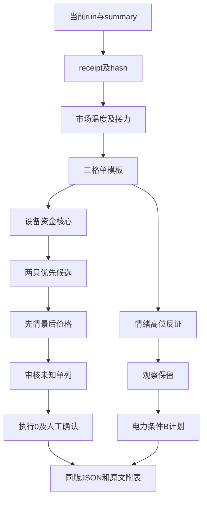

<!-- canghai:explicit-plan-report-assembly:v1 -->
# 盘中补交（非开盘前交付） · 显式组装报告（非重新推理）

> 决策来源（JSON）：llm
> 同版 JSON SHA-256（规范化内容）：a70c4ace49f71a44648d82b02ba0d7096278febb3888ee51dde9c1b734b2721a
> 以下散文为调用方提供的模型原文，完整保留、未经重新推理；原文自述不是来源验证，不得覆盖 JSON 禁令、权限或缺口。
> 表格直接复用既有共享 renderer；只读展示，不构成开仓或自动交易授权。

## 模型原文（非重新推理）

---
date: 2026-11-09
agent: D1-main-decision
skill_version: main_decision_v1@2.1
generated_at: 2026-11-09T09:49:18+08:00
confidence: null
degraded: true
data_sources:
  - name: current_bound_R1_R2_R3_R4_R6_R7
    path: data/research/20261109/research_summary.json
    status: ok
    captured_at: null
    record_count: 6
  - name: R5
    path: data/research/20261109/R5_stock_profiles.json
    status: error
    captured_at: null
    record_count: null
  - name: catalyst_calendar
    path: chzl_kg/投研交易/催化剂/20261109.md
    status: error
    captured_at: null
    record_count: null
input_freshness: partial
input_freshness_note: 事实主要11月6日；R5缺席，完整日历绑定非法，无实时盘中数据。
---

# 2026年11月9日 · 盘中补交（非开盘前交付）

> 真实生成时间：2026-11-09T09:49:18+08:00；没有消费11月9日竞价或盘中实时行情，不冒充08:00预案。以下为本版研究支持的条件情景，当前是否满足未知。decision_source=llm，程序不替代决策。

## 一句话结论
弱市不抢情绪加速；设备容量核心两只进执行候选，买权未授，保留电力切换剧本。

## 建议仓位与系统执行限制并列
市场建议总风险敞口上限20%，本轮条件初试合计5%；中微与北方逐票条件建议各5%，先择一，不是同时加10%。以净资产100%为概念基准，表示总风险敞口，不是在未知持仓上额外加仓。未读取、扣减真实/模拟持仓，不能声称用户实际新增为0。

系统执行上限0%，逐票max_position_pct及entry_rules.position_pct=0。active清单：ACCOUNT_BUDGET_UNVERIFIED、MANUAL_CONFIRMATION_REQUIRED；dry_run、禁自主、需人工确认。执行0不是人的建议0，研究候选/价格/正建议均不是买权。真实用户/账户停买、有效零预算和未知来源保护保留，不能自造正预算。单票15%、板块40%、总仓80%、持仓5只的硬线保持。

本建议事实锚11月6日收盘、情景到期11:35。R1原20%意见09:30届窗，D1不自动延期它，而是基于普跌、接力亏损与局部资金核心独立提出同样上限的条件情景，非阶段固定公式。只有新窗口价格、板块与核心资金确认后才适用，当前条件是否满足未知；普跌延续/核心无承接或窗口到期则失效并交计划owner重评。

## 先市场，再板块与核心
11月6日758涨、4741跌，八宽基同跌；32只涨停、15只跌停、14只炸板，炸板率30.4348%。昨日涨停池收盘反馈中位数-1.7449%，不能当开盘溢价或今日胜率。辅助high_chop仅定温度，其premium=-0.5%为降级填值，不能冒充实测或用来自动压仓。海外最新完成交易日11月6日对应北京时间11月7日，海外篮子反弹不证明今日A股已修复。

只跑R2“三格”一套主模板，不混五套。光伏9U/6Z封板60%、至少5日活跃，闽发5板/永臻4板有身位；概念单日负、5日正是分歧而非持续流出已证明。保留主线研究，不把高度当买权，也不以旧股性最高板否认本轮高度。R2公共板块判断原窗口09:25结束，当前只保留历史事实和条件，不认证同轮盘中共振。

设备容量资金值得先推演：中微/北方同口径5日资金第1/2，比拓荆第3更符合核心优先。但行业资金正而价格弱，必须等资金转成价格，不把净额估算当收益。电力修复保留B方向，不以防守标签排除；没有本批合格负相关配对，故叫条件切换，不说统计跷跷板已确认。A失败且B也弱，取消新增情景，不临场造票。

## 买卖点总表：条件价位不是当前买权
| 对象 | 买区/触发 | 最高接受 | T+1止损/参考止盈 | RR | 当前能否买 |
|---|---|---|---|---|---|
| 中微公司 688012.SH | [252.73, 257.81] / 254.0 | 271.78 | 237.19 / 299.05 | 2.0 | 系统未授权，静态事实及当日确认未知 |
| 北方华创 002371.SZ | [557.2, 568.4] / 560.0 | 599.2 | 539.98 / 625.24 | 2.0 | 系统未授权，静态事实及当日确认未知 |

价位来自本版R7实际昨收和原引擎参考站上公式，未读取技术数据库；缺MA10/MA50/前高/牛熊线/复权/当日交易边界，不能说已核20日新高或现价可成交。计划RR以买区上沿算，最高接受价不是这个拟买价，实际委托必须独立重算RR，不能借表中2R放行。无必要静态价者逐票未知，不因禁新删情景规则，也不造数字。

## 执行候选：研究优先不等于可开仓

### 中微公司 688012.SH

进 execution（优先执行候选，未授买权）：27只设备成分5日东财+32.981064亿第1、T-1平收，容量资金地位优于拓荆第3且当日净流出；北方为同线龙二，不当两个独立分散方向。接受R6_M1_03资金不等于赚钱效应的限定，条件为价格/板块/资金同窗转强，不伪写已主升。

**大资金意图**：估算净额支持容量承接研究，不能证明真实建仓成本或未来必涨。**为什么走强**：当前准确说相对抗跌，新窗口上攻未核。**逻辑够不够硬**：排序足够列优先情景，不足以认证主升或完整核心。core_judge unknown不是已证无核心。

**买入理由**：仅在参考位站上且设备价格/资金/扩散同窗口共振研究半路确认，不接飞刀。**风险点**：资金价格背离、前高及复权未知、未消费实时行情。完整板型与总龙停牌序列不足，均unknown，不传空数组/默认0造通过。

**止损条件**：新仓只从T+1生效，跳空或跌停可能不能按止损价成交；底仓及可卖量未知，不写当日跌破无条件卖。**可验证假设**：下一交易日仍有板块接力；若资金不转成价格且扩散失败，按合法T+1退出，不讲故事。

龙头认定：R2研究排序保留，完整三项认证各实际过0条，不等于没有核心地位。板型未核；禁止清单仅可核子集，无命中不等于14项全通过。识图unknown、confirmed_items为空，R5缺席无chart_vision，不冒称识图确认。

### 北方华创 002371.SZ

进 execution（优先执行候选，未授买权）：5日东财+23.795447亿第2，单日+6.104843亿、价格-0.18%，有容量承接研究价值；中微第1优先，拓荆单日负净额不递补。接受R6_M1_04，抗跌不是已突破，先右侧情景后判资格。

**大资金意图**：估算净额支持容量承接研究，不能证明真实建仓成本或未来必涨。**为什么走强**：当前准确说相对抗跌，新窗口上攻未核。**逻辑够不够硬**：排序足够列优先情景，不足以认证主升或完整核心。core_judge unknown不是已证无核心。

**买入理由**：仅在参考位站上且设备价格/资金/扩散同窗口共振研究半路确认，不接飞刀。**风险点**：资金价格背离、前高及复权未知、未消费实时行情。完整板型与总龙停牌序列不足，均unknown，不传空数组/默认0造通过。

**止损条件**：新仓只从T+1生效，跳空或跌停可能不能按止损价成交；底仓及可卖量未知，不写当日跌破无条件卖。**可验证假设**：下一交易日仍有板块接力；若资金不转成价格且扩散失败，按合法T+1退出，不讲故事。

龙头认定：R2研究排序保留，完整三项认证各实际过0条，不等于没有核心地位。板型未核；禁止清单仅可核子集，无命中不等于14项全通过。识图unknown、confirmed_items为空，R5缺席无chart_vision，不冒称识图确认。

## 10cm情绪核心／名字梗与一字板
闽发5板、永臻4板、浙文5板有真实辨识度，不能用设备中军代替情绪研究交代。D1分别降级观察：单日卖压叠加工费风险、一字难成交与开板兑现、资金方向冲突叠加真实治理。不是高位全否后递补低位杂毛。日出东方首板资金积极但原龙三、霸榜仅警报；新亚三板及历史氟化工锚不认证新主线。

七匹狼已在同版R2比较；2026四季度炒2027羊年并非时钟错误，名字梗不需先有产业利润才可研究。但独立传播及跟风梯队未确认，5日资金负且双源相反，本轮进watch。合法同类名字梗对照缺口明确，不现场编羊/狼票。预测素材6票均三板及以上，本轮不顶一字；预测概率非验证胜率。贝特利16.100706亿<20亿硬线拦截，永臻只保留开板后研究，不给竞价假挂单价。

## 三类机会与四象限叉乘
行业正面：稳市/六张网方向不等于公司新增订单或到账；精品扶持不能抵销同源治理。行业负面：OFF:nrta治理只影响相关传媒情景，不扩成全局禁令；旧代租赁媒体报道非全部国内算力需求崩塌，制裁名单未核不能泛化全科技。

个股正面：杰创已签、上纬下线、光智意向、精智达旧合同交付的确定层级不同。个股负面：前置融资验收、机器人收入低占比、最终协议和出口许可、旧合同非新订单分别保留。正反同一公告只计一源，不靠转载重复确认。R4直接8候选全部裁决：杰创/光智/上纬/精智达延后观察；世运采用董事会回购方案但不当已买盘；泰和采用申请人/程序但不抢征税利润；天安资金占用未清、华新亏损标的/融资审批，降级观察。具体不买是证据取舍，不是缺R5的机械否决。

## 观察池逐票处置及同版对照

### 闽发铝业 002578.SZ

降级观察：5板身位成立，但单日东财-0.702405亿/同花顺-1.6478亿且加工费竞争风险，接受R6_M1_01，不用封单覆盖卖压；永臻一字非更好的成交替代，日出东方龙三不递补。

专题source refs=stock_character:656397480b1e398ed295c90854a59723790e98ebb28948d9877aa5c8d514335f；只用嵌入历史投影，不认证当前核心。

价位例外：右侧情景已选，但本版无可核昨收/必要静态价，买区、触发、最高接受、止损止盈和RR未知，数据日未核。不旁路读库或补造委托；只影响此对象，不全局禁买。

### 永臻股份 603381.SH

降级观察：4板一字、流通29.4794亿，不能成交及开板兑现风险比旧股性差评级更重要，接受R6_M9_01；闽发5板有单日卖压，不因龙一风险递补龙二，只研究开板后承接。

专题source refs=stock_character:656397480b1e398ed295c90854a59723790e98ebb28948d9877aa5c8d514335f；只用嵌入历史投影，不认证当前核心。

价位例外：右侧情景已选，但本版无可核昨收/必要静态价，买区、触发、最高接受、止损止盈和RR未知，数据日未核。不旁路读库或补造委托；只影响此对象，不全局禁买。

### 日出东方 603366.SH

进 watch：首板/单日东财+1.556025亿积极，但R2原龙三；采纳R6_M6_01霸榜警报，不升级成已证出货，也不越过闽发/永臻的本轮身位。

专题source refs=stock_character:656397480b1e398ed295c90854a59723790e98ebb28948d9877aa5c8d514335f；只用嵌入历史投影，不认证当前核心。

价位例外：右侧情景已选，但本版无可核昨收/必要静态价，买区、触发、最高接受、止损止盈和RR未知，数据日未核。不旁路读库或补造委托；只影响此对象，不全局禁买。

### 新亚制程 002388.SZ

进 watch：3板、5日+1.183845亿及氟化工旧锚有辨识度；光伏成分重叠非纯度，尚不认证独立氟化工主线；比较5板闽发/4板永臻后保留候补，不因低位递补。

专题source refs=stock_character:656397480b1e398ed295c90854a59723790e98ebb28948d9877aa5c8d514335f；只用嵌入历史投影，不认证当前核心。

价位例外：右侧情景已选，但本版无可核昨收/必要静态价，买区、触发、最高接受、止损止盈和RR未知，数据日未核。不旁路读库或补造委托；只影响此对象，不全局禁买。

### 安彩高科 600207.SH

进 watch：首板/单日+0.754258亿为扩散样本；与闽发5板辨识度不同，不凭便宜/低板位取代核心。

专题source refs=stock_character:656397480b1e398ed295c90854a59723790e98ebb28948d9877aa5c8d514335f；只用嵌入历史投影，不认证当前核心。

价位例外：右侧情景已选，但本版无可核昨收/必要静态价，买区、触发、最高接受、止损止盈和RR未知，数据日未核。不旁路读库或补造委托；只影响此对象，不全局禁买。

### 拓荆科技 688072.SH

进 watch：5日+12.514559亿第3、单日-0.354973亿，相较中微/北方资金地位和当日反馈不占优；回购完成不再算未来待买资金，不自动递补。

来源：本批R2/R4对象及meta逐来源裁决；无画像不造已读取。

参考价位在后文及附表，复权/技术窗口未知，不认证当前可成交。

### 精智达 688627.SH

进 watch：OFF:jzd交付及SoC推出真实，订单为此前披露；晚间公告前-7.4762%不是消息已被否定。比较中微/北方缺同等容量排序，不因新品标题递补。

来源：本批R2/R4对象及meta逐来源裁决；无画像不造已读取。

价位例外：右侧情景已选，但本版无可核昨收/必要静态价，买区、触发、最高接受、止损止盈和RR未知，数据日未核。不旁路读库或补造委托；只影响此对象，不全局禁买。

### 新能股份 000595.SZ

进 watch/B方向：电力修复是另一假设，旧光伏锚不能替当前核心；R2光伏5日资金第116/首板较5板低至少3板的反证仅限该排序。对照立新能源保留资金/扩散待核，不认证电力龙一。

专题source refs=stock_character:656397480b1e398ed295c90854a59723790e98ebb28948d9877aa5c8d514335f；只用嵌入历史投影，不认证当前核心。

价位例外：右侧情景已选，但本版无可核昨收/必要静态价，买区、触发、最高接受、止损止盈和RR未知，数据日未核。不旁路读库或补造委托；只影响此对象，不全局禁买。

### 立新能源 001258.SZ

进 watch/B方向：旧13板与近期股性说明曾有弹性，非当前高度；对照新能股份不能按旧股性分选股，须电力独立核心、资金和扩散，不静态排斥防守。

专题source refs=stock_character:656397480b1e398ed295c90854a59723790e98ebb28948d9877aa5c8d514335f；只用嵌入历史投影，不认证当前核心。

价位例外：右侧情景已选，但本版无可核昨收/必要静态价，买区、触发、最高接受、止损止盈和RR未知，数据日未核。不旁路读库或补造委托；只影响此对象，不全局禁买。

### 东方新能 002310.SZ

进 watch：行情名东方新能与旧股性东方园林按代码对齐；政策非公司新订单。相较新能/立新能源，本轮前二地位未确认，保留对照不复制政策受益。

专题source refs=stock_character:656397480b1e398ed295c90854a59723790e98ebb28948d9877aa5c8d514335f；只用嵌入历史投影，不认证当前核心。

价位例外：右侧情景已选，但本版无可核昨收/必要静态价，买区、触发、最高接受、止损止盈和RR未知，数据日未核。不旁路读库或补造委托；只影响此对象，不全局禁买。

### 浙文影业 601599.SH

降级观察：5板不抵销东财+1.089824亿/同花顺-7.6126亿冲突；接受R6_M1_02，OFF:nrta治理与工作函媒体线索保留。思美/城市低位也受治理，不把工作函夸成处罚。

专题source refs=stock_character:656397480b1e398ed295c90854a59723790e98ebb28948d9877aa5c8d514335f；只用嵌入历史投影，不认证当前核心。

价位例外：右侧情景已选，但本版无可核昨收/必要静态价，买区、触发、最高接受、止损止盈和RR未知，数据日未核。不旁路读库或补造委托；只影响此对象，不全局禁买。

### 思美传媒 002712.SZ

进 watch：传媒候补不是治理豁免票，相较浙文5板辨识度不足；OFF:nrta真实行业约束保留，不由高位风险推导低位安全。

专题source refs=stock_character:656397480b1e398ed295c90854a59723790e98ebb28948d9877aa5c8d514335f；只用嵌入历史投影，不认证当前核心。

价位例外：右侧情景已选，但本版无可核昨收/必要静态价，买区、触发、最高接受、止损止盈和RR未知，数据日未核。不旁路读库或补造委托；只影响此对象，不全局禁买。

### 城市传媒 600229.SH

进 watch：人气首进榜是传播线索非接力认证；相较浙文/思美缺独立主线实证且同受治理，不按首进榜自动升级。

专题source refs=stock_character:656397480b1e398ed295c90854a59723790e98ebb28948d9877aa5c8d514335f；只用嵌入历史投影，不认证当前核心。

价位例外：右侧情景已选，但本版无可核昨收/必要静态价，买区、触发、最高接受、止损止盈和RR未知，数据日未核。不旁路读库或补造委托；只影响此对象，不全局禁买。

### 上纬新材 688585.SH

降级观察：ANN:1225662738确认1万台下线非销售及利润，接受R6_M1_07；比泛机器人名单直接，但与春光等传导关系未核，不造补涨映射。

来源：本批R2/R4对象及meta逐来源裁决；无画像不造已读取。

价位例外：右侧情景已选，但本版无可核昨收/必要静态价，买区、触发、最高接受、止损止盈和RR未知，数据日未核。不旁路读库或补造委托；只影响此对象，不全局禁买。

### 杰创智能 301248.SZ

降级观察：OFF:jczn已签暂定含税49.152亿比通宇仅设平台实，但每批60个月/浮价、融资和验收风险，接受R6_M1_08；T-1负净额不能说盘后合同已被拒。

专题source refs=stock_character:656397480b1e398ed295c90854a59723790e98ebb28948d9877aa5c8d514335f；只用嵌入历史投影，不认证当前核心。

价位例外：右侧情景已选，但本版无可核昨收/必要静态价，买区、触发、最高接受、止损止盈和RR未知，数据日未核。不旁路读库或补造委托；只影响此对象，不全局禁买。

### 光智科技 300489.SZ

降级观察：OFF:gzkj有客户/产品/供应期及5日正资金，仍为6.01亿美元意向，最终协议/出口许可/后续订单分列，接受R6_M1_09；比长光华芯仅回购提议直接，不因此授买权。

专题source refs=stock_character:656397480b1e398ed295c90854a59723790e98ebb28948d9877aa5c8d514335f；只用嵌入历史投影，不认证当前核心。

价位例外：右侧情景已选，但本版无可核昨收/必要静态价，买区、触发、最高接受、止损止盈和RR未知，数据日未核。不旁路读库或补造委托；只影响此对象，不全局禁买。

### 世运电路 603920.SH

进 watch：ANN:1225662768董事会通过2—3亿回购，采用方案非成交资金。比较沪电提议与深南分红提议须区分层级；本轮缺资金向价格转换的实证，不选执行优先，非以R5缺席否决。

来源：本批R2/R4对象及meta逐来源裁决；无画像不造已读取；同版对照：002463.SZ 沪电股份与002916.SZ 深南电路；前者在专题仅回购提议；后者原文为分红提议且未决，不混为已实施回购；均不因此被认定公司较差。

价位例外：右侧情景已选，但本版无可核昨收/必要静态价，买区、触发、最高接受、止损止盈和RR未知，数据日未核。不旁路读库或补造委托；只影响此对象，不全局禁买。

### 泰和新材 002254.SZ

进 watch：OFF:aramid明确申请人胜于ENB无上市股权映射，立案非征税/利润兑现；同窗口接力实证未见，不抢程序预期兑现。

来源：本批R2/R4对象及meta逐来源裁决；无画像不造已读取；同版对照：ENB泛化工替代名单；仅核恒河材料申请人，未核上市股权关系，不造上市受益股。

价位例外：右侧情景已选，但本版无可核昨收/必要静态价，买区、触发、最高接受、止损止盈和RR未知，数据日未核。不旁路读库或补造委托；只影响此对象，不全局禁买。

### 天安新材 603725.SH

降级观察：R4收购意向、资金占用未清/未审财务为具体反证；相较精智达自身设备交付，跨界光通信尚有整合风险，不买标题。

来源：本批R2/R4对象及meta逐来源裁决；无画像不造已读取；同版对照：688627.SH 精智达；对照对象有自身设备经营与交付，天安跨界未完成审计，不能只凭光通信标题替代。

价位例外：右侧情景已选，但本版无可核昨收/必要静态价，买区、触发、最高接受、止损止盈和RR未知，数据日未核。不旁路读库或补造委托；只影响此对象，不全局禁买。

### 华新建材 600801.SH

降级观察：R4签约与标的亏损、融资汇率审批风险同时保留；其他水泥票无已核直接权益/订单，不造板块受益。

来源：本批R2/R4对象及meta逐来源裁决；无画像不造已读取；同版对照：水泥板块其他股票；未核本次交易直接权益或订单，不把个股出海交易扩成全行业利好。

价位例外：右侧情景已选，但本版无可核昨收/必要静态价，买区、触发、最高接受、止损止盈和RR未知，数据日未核。不旁路读库或补造委托；只影响此对象，不全局禁买。

### 春光科技 603657.SH

进 watch：R2已比较3板/45.8024亿，但家电向新机器人催化传导未证；相较上纬直接公告不占证据优势，不因永臻买不到递补。

来源：本批R2/R4对象及meta逐来源裁决；无画像不造已读取。

价位例外：右侧情景已选，但本版无可核昨收/必要静态价，买区、触发、最高接受、止损止盈和RR未知，数据日未核。不旁路读库或补造委托；只影响此对象，不全局禁买。

### 七匹狼 002029.SZ

进 watch：四季度可交易2027羊年预期，但本批七匹狼独立传播/梯队未见，5日东财-3.543595亿且日内双源相反；比已有5板情绪核心缺市场选择实证，不以无产业业绩否定名字梗。

来源：本批R2/R4对象及meta逐来源裁决；无画像不造已读取。

价位例外：右侧情景已选，但本版无可核昨收/必要静态价，买区、触发、最高接受、止损止盈和RR未知，数据日未核。不旁路读库或补造委托；只影响此对象，不全局禁买。

## 专题裁决：留证不是理解或效果证明
只读本版R2/R4/R6实际嵌入内容，R5缺席没有专题可读。核run/attempt/context_sha256/主产物及receipt；来源路径只作引用，不打开raw/cache/历史日历/工作簿。上游adopted不等于D1采纳；R6对非其18票对象not_applicable也不是D1不能消费R4合法对象的禁令。下列逐来源裁决与meta一致，未读正文者明确不造已读。

- theme_anchors:c83488391cfd8596845d99792839ada63ea1f0e443e322c85cd27545e5ae0817：adopted。采用7题材内嵌锚对照；旧新能/杭电/顺钠锚不覆盖当前身位，不声称研究597题材全文。。refs=[{"source": "R2", "json_pointer": "/knowledge_context/sources/0/content"}]
- stock_character:656397480b1e398ed295c90854a59723790e98ebb28948d9877aa5c8d514335f：adopted。采用17条精确代码历史股性；永臻旧1板/本轮4板与闽发旧3板/本轮5板按不同窗口解释，历史首封时间不充T-1板型。。refs=[{"source": "R2", "json_pointer": "/knowledge_context/sources/1/content"}]
- growth_pool:2775419c7ce4c07d3fc6b67d591ad42eccf0d05d6d1023c8371ad14047da9b98：deferred。已读必要摘录：研究12家/完整通过0家是覆盖，不证明全市场不合格；本轮不拿质量名单替代容量/接力证据，未读12家完整画像。。refs=[{"source": "R2", "json_pointer": "/knowledge_context/sources/2/content"}]
- dividend_pool:b71b40752ddc54d79e53f313622334f45565ff98cdb992dffa742930eac73277：deferred。已读月度partial、10/30估值、16家覆盖/10家双检与银行豁免限定；月度息率非11/9买盘，不否定防守可成为主线。。refs=[{"source": "R2", "json_pointer": "/knowledge_context/sources/3/content"}]
- yizi_prediction:61f56064c4253d06bbacf98a7435298aa521a18862f7632e26de74e2456f019c：adopted。只采目标日匹配及流动性风险；六只均三板以上，本轮不顶一字，概率非实证胜率；贝特利按真实20亿硬线拦截。。refs=[{"source": "R2", "json_pointer": "/knowledge_context/sources/4/content"}]
- review_feedback:4e4ec257ea224838446801396ed2c298f95f119979a101a2cd635e1d0bd66616：unknown。实际反馈text为空，未读复盘全文，不宣称学习或效果。。refs=[{"source": "R2", "json_pointer": "/knowledge_context/sources/5/content"}]
- catalyst_calendar:dbc94e0c9adf47fb1704e9c2cd6793cbf6ba6a69afd4c5c6e2a04d03f652f424：adopted。仅采用R4内嵌11/7前缀回购流程分层及治理限定；非11/9完整日历，不认证未来三交易日，不跟previous_report或外部路径。。refs=[{"source": "R4", "json_pointer": "/knowledge_context/sources/0/content"}]
- ANN:1225662738：adopted。采用下线数与收入低占比/商业化风险，未读外部附件。refs=[{"source": "R4", "json_pointer": "/evidence_registry/ANN:1225662738"}]
- ANN:1225662768：adopted。董事会方案非已成交资金。refs=[{"source": "R4", "json_pointer": "/evidence_registry/ANN:1225662768"}]
- ANN:1225662733：adopted。只采R4摘要收购意向/资金占用/未审财务，长全文未完整阅读。refs=[{"source": "R4", "json_pointer": "/evidence_registry/ANN:1225662733"}]
- ANN:1225662767：adopted。只采R4候选及事件摘要签约/标的亏损/融资审批风险，未完整读长全文。refs=[{"source": "R4", "json_pointer": "/evidence_registry/ANN:1225662767"}]
- ANN:1225662730：deferred。仅核交付声明/索引，未逐项阅读采用正文，不继承上游adopted，不从提名授买权。refs=[{"source": "R4", "json_pointer": "/evidence_registry/ANN:1225662730"}]
- ANN:1225661063：deferred。仅核交付声明/索引，未逐项阅读采用正文，不继承上游adopted，不从提名授买权。refs=[{"source": "R4", "json_pointer": "/evidence_registry/ANN:1225661063"}]
- ANN:1225662759：deferred。仅核交付声明/索引，未逐项阅读采用正文，不继承上游adopted，不从提名授买权。refs=[{"source": "R4", "json_pointer": "/evidence_registry/ANN:1225662759"}]
- ANN:1225662504：deferred。仅核交付声明/索引，未逐项阅读采用正文，不继承上游adopted，不从提名授买权。refs=[{"source": "R4", "json_pointer": "/evidence_registry/ANN:1225662504"}]
- ANN:1225662721：deferred。仅核交付声明/索引，未逐项阅读采用正文，不继承上游adopted，不从提名授买权。refs=[{"source": "R4", "json_pointer": "/evidence_registry/ANN:1225662721"}]
- ANN:1225661968：deferred。仅核交付声明/索引，未逐项阅读采用正文，不继承上游adopted，不从提名授买权。refs=[{"source": "R4", "json_pointer": "/evidence_registry/ANN:1225661968"}]
- ANN:1225662741：deferred。仅核交付声明/索引，未逐项阅读采用正文，不继承上游adopted，不从提名授买权。refs=[{"source": "R4", "json_pointer": "/evidence_registry/ANN:1225662741"}]
- ANN:1225662770：deferred。仅核交付声明/索引，未逐项阅读采用正文，不继承上游adopted，不从提名授买权。refs=[{"source": "R4", "json_pointer": "/evidence_registry/ANN:1225662770"}]
- OFF:jczn：adopted。已签/暂价/60个月/融资验收风险。refs=[{"source": "R4", "json_pointer": "/evidence_registry/OFF:jczn"}]
- OFF:gzkj：adopted。意向/最终协议/许可条件，不把待许可改写违法。refs=[{"source": "R4", "json_pointer": "/evidence_registry/OFF:gzkj"}]
- OFF:jzd：adopted。旧订单交付与新品推出，不移给中微北方当公司订单。refs=[{"source": "R4", "json_pointer": "/evidence_registry/OFF:jzd"}]
- OFF:nrta：adopted。治理/扶持同一官方原文，不断言具体公司违法。refs=[{"source": "R4", "json_pointer": "/evidence_registry/OFF:nrta"}]
- OFF:aramid：adopted。申请人及立案程序，非征税利润。refs=[{"source": "R4", "json_pointer": "/evidence_registry/OFF:aramid"}]
- OFF:enb：deferred。仅核交付声明/索引，未逐项阅读采用正文，不继承上游adopted，不从提名授买权。refs=[{"source": "R4", "json_pointer": "/evidence_registry/OFF:enb"}]
- CLS:policy：deferred。仅核交付声明/索引，未逐项阅读采用正文，不继承上游adopted，不从提名授买权。refs=[{"source": "R4", "json_pointer": "/evidence_registry/CLS:policy"}]
- CLS:nets：deferred。仅核交付声明/索引，未逐项阅读采用正文，不继承上游adopted，不从提名授买权。refs=[{"source": "R4", "json_pointer": "/evidence_registry/CLS:nets"}]
- CCTV:20261106：deferred。仅核交付声明/索引，未逐项阅读采用正文，不继承上游adopted，不从提名授买权。refs=[{"source": "R4", "json_pointer": "/evidence_registry/CCTV:20261106"}]
- CLS:oracle：deferred。仅核交付声明/索引，未逐项阅读采用正文，不继承上游adopted，不从提名授买权。refs=[{"source": "R4", "json_pointer": "/evidence_registry/CLS:oracle"}]
- CLS:oracle_price：deferred。仅核交付声明/索引，未逐项阅读采用正文，不继承上游adopted，不从提名授买权。refs=[{"source": "R4", "json_pointer": "/evidence_registry/CLS:oracle_price"}]
- CLS:openai：deferred。仅核交付声明/索引，未逐项阅读采用正文，不继承上游adopted，不从提名授买权。refs=[{"source": "R4", "json_pointer": "/evidence_registry/CLS:openai"}]
- CLS:derivative：deferred。仅核交付声明/索引，未逐项阅读采用正文，不继承上游adopted，不从提名授买权。refs=[{"source": "R4", "json_pointer": "/evidence_registry/CLS:derivative"}]
- CLS:runjian：deferred。仅核交付声明/索引，未逐项阅读采用正文，不继承上游adopted，不从提名授买权。refs=[{"source": "R4", "json_pointer": "/evidence_registry/CLS:runjian"}]
- CLS:minfa：adopted。加工费风险媒体摘录，非官方全文。refs=[{"source": "R4", "json_pointer": "/evidence_registry/CLS:minfa"}]
- CLS:dongfang：deferred。仅核交付声明/索引，未逐项阅读采用正文，不继承上游adopted，不从提名授买权。refs=[{"source": "R4", "json_pointer": "/evidence_registry/CLS:dongfang"}]
- CLS:zhewen：adopted。工作函媒体线索，非行政处罚。refs=[{"source": "R4", "json_pointer": "/evidence_registry/CLS:zhewen"}]
- SNAP:news_cls:302：deferred。仅核交付声明/索引，未逐项阅读采用正文，不继承上游adopted，不从提名授买权。refs=[{"source": "R4", "json_pointer": "/evidence_registry/SNAP:news_cls:302"}]
- SNAP:news_cls:277：deferred。仅核交付声明/索引，未逐项阅读采用正文，不继承上游adopted，不从提名授买权。refs=[{"source": "R4", "json_pointer": "/evidence_registry/SNAP:news_cls:277"}]
- SNAP:news_cls:279：deferred。仅核交付声明/索引，未逐项阅读采用正文，不继承上游adopted，不从提名授买权。refs=[{"source": "R4", "json_pointer": "/evidence_registry/SNAP:news_cls:279"}]
- SNAP:news_cls:246：deferred。仅核交付声明/索引，未逐项阅读采用正文，不继承上游adopted，不从提名授买权。refs=[{"source": "R4", "json_pointer": "/evidence_registry/SNAP:news_cls:246"}]
- SNAP:news_cls:267：deferred。仅核交付声明/索引，未逐项阅读采用正文，不继承上游adopted，不从提名授买权。refs=[{"source": "R4", "json_pointer": "/evidence_registry/SNAP:news_cls:267"}]
- SNAP:news_cls:271：deferred。仅核交付声明/索引，未逐项阅读采用正文，不继承上游adopted，不从提名授买权。refs=[{"source": "R4", "json_pointer": "/evidence_registry/SNAP:news_cls:271"}]
- SNAP:news_cls:264：deferred。仅核交付声明/索引，未逐项阅读采用正文，不继承上游adopted，不从提名授买权。refs=[{"source": "R4", "json_pointer": "/evidence_registry/SNAP:news_cls:264"}]
- SNAP:news_cls:28：deferred。仅核交付声明/索引，未逐项阅读采用正文，不继承上游adopted，不从提名授买权。refs=[{"source": "R4", "json_pointer": "/evidence_registry/SNAP:news_cls:28"}]
- SNAP:news_cls:29：deferred。仅核交付声明/索引，未逐项阅读采用正文，不继承上游adopted，不从提名授买权。refs=[{"source": "R4", "json_pointer": "/evidence_registry/SNAP:news_cls:29"}]
- SNAP:news_cls:39：deferred。仅核交付声明/索引，未逐项阅读采用正文，不继承上游adopted，不从提名授买权。refs=[{"source": "R4", "json_pointer": "/evidence_registry/SNAP:news_cls:39"}]
- SNAP:news_cls:22：deferred。仅核交付声明/索引，未逐项阅读采用正文，不继承上游adopted，不从提名授买权。refs=[{"source": "R4", "json_pointer": "/evidence_registry/SNAP:news_cls:22"}]
- SNAP:news_cls:824：deferred。仅核交付声明/索引，未逐项阅读采用正文，不继承上游adopted，不从提名授买权。refs=[{"source": "R4", "json_pointer": "/evidence_registry/SNAP:news_cls:824"}]
- SNAP:news_cls:1560：deferred。仅核交付声明/索引，未逐项阅读采用正文，不继承上游adopted，不从提名授买权。refs=[{"source": "R4", "json_pointer": "/evidence_registry/SNAP:news_cls:1560"}]
- CLS:robot：deferred。仅核交付声明/索引，未逐项阅读采用正文，不继承上游adopted，不从提名授买权。refs=[{"source": "R4", "json_pointer": "/evidence_registry/CLS:robot"}]
- CLS:huaxin：deferred。仅核交付声明/索引，未逐项阅读采用正文，不继承上游adopted，不从提名授买权。refs=[{"source": "R4", "json_pointer": "/evidence_registry/CLS:huaxin"}]
- CLS:shiyun：deferred。仅核交付声明/索引，未逐项阅读采用正文，不继承上游adopted，不从提名授买权。refs=[{"source": "R4", "json_pointer": "/evidence_registry/CLS:shiyun"}]
- SNAP:news_cls:1856：deferred。仅核交付声明/索引，未逐项阅读采用正文，不继承上游adopted，不从提名授买权。refs=[{"source": "R4", "json_pointer": "/evidence_registry/SNAP:news_cls:1856"}]
- SNAP:news_cls:2050：deferred。仅核交付声明/索引，未逐项阅读采用正文，不继承上游adopted，不从提名授买权。refs=[{"source": "R4", "json_pointer": "/evidence_registry/SNAP:news_cls:2050"}]
- SNAP:news_cls:1549：deferred。仅核交付声明/索引，未逐项阅读采用正文，不继承上游adopted，不从提名授买权。refs=[{"source": "R4", "json_pointer": "/evidence_registry/SNAP:news_cls:1549"}]
- SNAP:news_cls:1561：deferred。仅核交付声明/索引，未逐项阅读采用正文，不继承上游adopted，不从提名授买权。refs=[{"source": "R4", "json_pointer": "/evidence_registry/SNAP:news_cls:1561"}]
- SNAP:news_cls:1553：deferred。仅核交付声明/索引，未逐项阅读采用正文，不继承上游adopted，不从提名授买权。refs=[{"source": "R4", "json_pointer": "/evidence_registry/SNAP:news_cls:1553"}]
- CLS:sanctions：deferred。仅核交付声明/索引，未逐项阅读采用正文，不继承上游adopted，不从提名授买权。refs=[{"source": "R4", "json_pointer": "/evidence_registry/CLS:sanctions"}]
- CLS:tongyu：deferred。仅核交付声明/索引，未逐项阅读采用正文，不继承上游adopted，不从提名授买权。refs=[{"source": "R4", "json_pointer": "/evidence_registry/CLS:tongyu"}]

## 价位推导与资格独立
显式执行consume_authorized_inputs与apply_to_plan，R5不存在则chart_evidence=None。为守输入边界，load_tech本轮只在内存适配为R7已嵌实际close，不读kb/research.db。缺字段原样缺失，不造MA/前高；突破采用引擎原有昨收退回口径，只是参考站上情景，不是认证20日新高。价格几何不是必要审核、复权或可成交检查，实际最高接受价须另算RR。

- 中微公司 688012.SH：{'stop': '止损=买价×(1-8%) → 237.19（三者取最高: 买价×(1-8%)=237.19）', 'buy': 'pivot=max(昨收,20日高)=254.00; 买区=[pivot×0.995, pivot×(1+1.5%)]; 溢价上限7%', 'take': '2R目标 = 买257.81 + 2×(买入价-止损20.62) = 299.05', 'rr': 'RR=(299.05-257.81)/(257.81-237.19)=2.0'}；买区=[252.73, 257.81]、触发=254.0、止损=237.19、止盈=299.05、RR=2.0。识图unknown，无确认可比项。
- 北方华创 002371.SZ：{'stop': '止损=买价×(1-5%) → 539.98（三者取最高: 买价×(1-5%)=539.98）', 'buy': 'pivot=max(昨收,20日高)=560.00; 买区=[pivot×0.995, pivot×(1+1.5%)]; 溢价上限7%', 'take': '2R目标 = 买568.40 + 2×(买入价-止损28.42) = 625.24', 'rr': 'RR=(625.24-568.40)/(568.40-539.98)=2.0'}；买区=[557.2, 568.4]、触发=560.0、止损=539.98、止盈=625.24、RR=2.0。识图unknown，无确认可比项。
- 闽发铝业 002578.SZ：无价格数据；情景已选，本版必要价格不足，未扩读技术源。识图unknown，无确认可比项。
- 永臻股份 603381.SH：无价格数据；情景已选，本版必要价格不足，未扩读技术源。识图unknown，无确认可比项。
- 日出东方 603366.SH：无价格数据；情景已选，本版必要价格不足，未扩读技术源。识图unknown，无确认可比项。
- 新亚制程 002388.SZ：无价格数据；情景已选，本版必要价格不足，未扩读技术源。识图unknown，无确认可比项。
- 安彩高科 600207.SH：无价格数据；情景已选，本版必要价格不足，未扩读技术源。识图unknown，无确认可比项。
- 拓荆科技 688072.SH：{'stop': '止损=买价×(1-8%) → 464.09（三者取最高: 买价×(1-8%)=464.09）', 'buy': 'pivot=max(昨收,20日高)=497.00; 买区=[pivot×0.995, pivot×(1+1.5%)]; 溢价上限7%', 'take': '2R目标 = 买504.45 + 2×(买入价-止损40.36) = 585.17', 'rr': 'RR=(585.17-504.45)/(504.45-464.09)=2.0'}；买区=[494.51, 504.45]、触发=497.0、止损=464.09、止盈=585.17、RR=2.0。识图unknown，无确认可比项。
- 精智达 688627.SH：无价格数据；情景已选，本版必要价格不足，未扩读技术源。识图unknown，无确认可比项。
- 新能股份 000595.SZ：无价格数据；情景已选，本版必要价格不足，未扩读技术源。识图unknown，无确认可比项。
- 立新能源 001258.SZ：无价格数据；情景已选，本版必要价格不足，未扩读技术源。识图unknown，无确认可比项。
- 东方新能 002310.SZ：无价格数据；情景已选，本版必要价格不足，未扩读技术源。识图unknown，无确认可比项。
- 浙文影业 601599.SH：无价格数据；情景已选，本版必要价格不足，未扩读技术源。识图unknown，无确认可比项。
- 思美传媒 002712.SZ：无价格数据；情景已选，本版必要价格不足，未扩读技术源。识图unknown，无确认可比项。
- 城市传媒 600229.SH：无价格数据；情景已选，本版必要价格不足，未扩读技术源。识图unknown，无确认可比项。
- 上纬新材 688585.SH：无价格数据；情景已选，本版必要价格不足，未扩读技术源。识图unknown，无确认可比项。
- 杰创智能 301248.SZ：无价格数据；情景已选，本版必要价格不足，未扩读技术源。识图unknown，无确认可比项。
- 光智科技 300489.SZ：无价格数据；情景已选，本版必要价格不足，未扩读技术源。识图unknown，无确认可比项。
- 世运电路 603920.SH：无价格数据；情景已选，本版必要价格不足，未扩读技术源。识图unknown，无确认可比项。
- 泰和新材 002254.SZ：无价格数据；情景已选，本版必要价格不足，未扩读技术源。识图unknown，无确认可比项。
- 天安新材 603725.SH：无价格数据；情景已选，本版必要价格不足，未扩读技术源。识图unknown，无确认可比项。
- 华新建材 600801.SH：无价格数据；情景已选，本版必要价格不足，未扩读技术源。识图unknown，无确认可比项。
- 春光科技 603657.SH：无价格数据；情景已选，本版必要价格不足，未扩读技术源。识图unknown，无确认可比项。
- 七匹狼 002029.SZ：无价格数据；情景已选，本版必要价格不足，未扩读技术源。识图unknown，无确认可比项。

core_judge、板型、总龙函数均可加载，但输入缺失不硬跑伪数据；量化部分unknown，非已证失败。禁止清单在plan_formation只跑可核子集，不以旧计划缺席阻止首次形成；完整资格仍unknown。R6研究覆盖真实false保留，缺席不追加active禁买或整池RIGHT_SIDE_CORE_NOT_VERIFIED，不清候选/entry_rules。有据hard_reject本批为空不认证安全；未来真实硬否决仍须移出执行。新仓退出T+1，未读账户不造数量或一把清仓计划。

## 数据源审计
| 源 | 状态 | 事实日期 | 采用与局限 |
|---|---|---|---|
| R1 | 🟡 degraded | 11月6日/海外另窗 | 广度、接力、指数，原cap窗口不自动续 |
| R2 | 🟡 partial | 11月6日 | 主次线/核心/同版对照，09:25后非实时 |
| R3 | 🟡 partial | 原榜单窗 | 情绪48，五群失联，空共振非阴性 |
| R4 | 🟡 partial | 各原文日 | 28事件正反，去同源，不声称关联附件已读 |
| R5 | 🔴 failed/缺席 | 未提供 | 无画像/图证，不投反对票 |
| R6 | 🟡 partial | 原研究窗口 | 11反证，完整审核false，空硬否决非安全 |
| R7 | 🟡 partial | 11月6日 | 资金/嵌入昨收，东财重叠不双算，北向仅复盘 |
| 人气辅助 | 🟡 available | 11月6日 | 使用日11月9日不是实时事实日 |
| 情绪辅助 | 🟡 available | 11月6日 | high_chop仅温度，premium为降级填值 |
| 完整本日日历 | 🔴 unavailable | 未核 | generated_at含时区校验失败，无payload，不能读正文 |

R5缺席不称source_down；日历是绑定无效不称已全文阅读。summary.fetch_global_severity=null与manifest_error提3有缺口，不打开raw解释。各R confidence原值保留在本版研究，不把资料可靠性当胜率，不另造综合分。日历缺口交日历/研究owner，不旁路、不换日期、不现场建绑定，不以辅助缺口全局禁买。读到R4历史前缀不等于读到本日完整Markdown。

## 不确定性、不交易条件与交付
今天是否空仓日？本版能说普跌中接力不划算，不能证明今日已主跌或修复。D1有条件研究建议不强迫持仓，系统未获执行权不新买；价格资金确认失败、实际委托RR失败及真实硬禁令按对象阻断。未知不通过，缺研究不投否决；真实限制不按code批量撤销。A/B均不成立则取消新增，不造票。

启动与交付复核同一主研究/三类辅助版本，只交核心JSON与此KG主MD，不写runtime或其他MD，不读账户。共享附表只展示同版定稿，不补价、不新增判断。production_ready仅表示本批交付，不等于审核完整或获买权。

## 决策路径

## 与其他R/D/E的关系及Sub-Agent元数据
依赖本版R1/R2/R3/R4/R6/R7及原三类辅助，R5缺席；下游P1/P2/execute/E1，本轮不写runtime，不宣称实盘已消费或成交。skill=main_decision_v1，model=gpt-6.1-sol，decision_source=llm。原文由本轮模型形成，JSON候选/理由/价格/资格/禁令/T+1/仓位双轨逐项核对，散文不是模板代推理。完整原文保留，附表确定性展示。

## 同版 JSON 共享表格（只读附录）

# 20261109 盘前预案 · 点位表版

> 计划生成时点：2026-11-09T09:49:18+08:00；决策来源：llm

## 板块机会总览

市场背景：T-1广谱亏损与局部容量承接；非11月9日实时判断

> 先市场／板块效应，再个股地位；未提供关系证据不推断龙头带动或板块扩散。

| 板块／本轮行情 | 阶段／窗口 | 效应与延续 | 核心与梯队（上游标签） | 共振／分离证据 | 主／反向剧本（名单归属非关系证明） | 确认条件 | 共同失效条件 | 观测时点 |
|---|---|---|---|---|---|---|---|---|
| 光伏概念 | climax | ⚠️未给 | 002578.SZ；603381.SH；603366.SH；002388.SZ；600207.SH | R2同名板块公共判断；原09:25窗口结束，不认证当前共振 | 观察 | ⚠️未给 | 新窗口价格/资金否定假设，交owner重评，不按阶段自动开关 | ⚠️未给 |
| 半导体设备 | ⚠️未给 | ⚠️未给 | 688012.SH；002371.SZ；688072.SH；688627.SH | R2同名板块公共判断；原09:25窗口结束，不认证当前共振 | 主剧本／执行；观察 | ⚠️未给 | 新窗口价格/资金否定假设，交owner重评，不按阶段自动开关 | ⚠️未给 |
| 电力/绿色电力 | ⚠️未给 | ⚠️未给 | 000595.SZ；001258.SZ；002310.SZ | R2同名板块公共判断；原09:25窗口结束，不认证当前共振 | 观察；反向：电力/绿色电力条件切换；未认证统计负相关；触发 A失效且B同窗确认；不自动promote或解禁 | ⚠️未给 | 新窗口价格/资金否定假设，交owner重评，不按阶段自动开关 | ⚠️未给 |
| 短剧游戏/传媒情绪 | climax | ⚠️未给 | 601599.SH；002712.SZ；600229.SH | R2同名板块公共判断；原09:25窗口结束，不认证当前共振 | 观察 | ⚠️未给 | 新窗口价格/资金否定假设，交owner重评，不按阶段自动开关 | ⚠️未给 |
| 商业航天 | ⚠️未给 | ⚠️未给 | ⚠️未给 | R2同名板块公共判断；原09:25窗口结束，不认证当前共振 | ⚠️未给 | ⚠️未给 | 新窗口价格/资金否定假设，交owner重评，不按阶段自动开关 | ⚠️未给 |
| 机器人/消费级具身智能 | ⚠️未给 | ⚠️未给 | 688585.SH | R2同名板块公共判断；原09:25窗口结束，不认证当前共振 | 观察 | ⚠️未给 | 新窗口价格/资金否定假设，交owner重评，不按阶段自动开关 | ⚠️未给 |
| 算力服务/磷化铟事件对照 | ⚠️未给 | ⚠️未给 | 301248.SZ；300489.SZ | R2同名板块公共判断；原09:25窗口结束，不认证当前共振 | 观察 | ⚠️未给 | 新窗口价格/资金否定假设，交owner重评，不按阶段自动开关 | ⚠️未给 |
| 生肖/名字梗观察 | ⚠️未给 | ⚠️未给 | ⚠️未给 | R2同名板块公共判断；原09:25窗口结束，不认证当前共振 | ⚠️未给 | ⚠️未给 | 新窗口价格/资金否定假设，交owner重评，不按阶段自动开关 | ⚠️未给 |
| PCB回购事件 | ⚠️未给 | ⚠️未给 | ⚠️未给 | 关系证据未给（概念归属不证明联动） | 观察 | ⚠️未给 | ⚠️未给 | ⚠️未给 |
| 芳纶贸易救济 | ⚠️未给 | ⚠️未给 | ⚠️未给 | 关系证据未给（概念归属不证明联动） | 观察 | ⚠️未给 | ⚠️未给 | ⚠️未给 |
| 光通信并购 | ⚠️未给 | ⚠️未给 | ⚠️未给 | 关系证据未给（概念归属不证明联动） | 观察 | ⚠️未给 | ⚠️未给 | ⚠️未给 |
| 水泥出海并购 | ⚠️未给 | ⚠️未给 | ⚠️未给 | 关系证据未给（概念归属不证明联动） | 观察 | ⚠️未给 | ⚠️未给 | ⚠️未给 |
| 机器人传导待核 | ⚠️未给 | ⚠️未给 | ⚠️未给 | 关系证据未给（概念归属不证明联动） | 观察 | ⚠️未给 | ⚠️未给 | ⚠️未给 |
| 名字梗观察 | ⚠️未给 | ⚠️未给 | ⚠️未给 | 关系证据未给（概念归属不证明联动） | 观察 | ⚠️未给 | ⚠️未给 | ⚠️未给 |

## 全局约束与数据边界

- 模式：dry_run；自动交易：False；需用户确认：True
- 总仓上限：0%；持仓上限：5；每日买单上限：4
- 单票上限：⚠️未给；单板块上限：⚠️未给
- 表格仅展示已给计划，不构成自动下单授权；观察／反向候选不自动晋级。候选数量不等于持仓名额。
- 评分未校准：未批准评分公式，不采用旧 score／默认50／板块分充个股分；原序展示，不另行排名。
- 静态价位非实时；数据日、复权／报价口径、有效期或动态线更新时间未给时均未核验，不以计划生成时间冒充价格时点。
- 新买入当日不可卖（T+1）；底仓是否可卖未核验。触发信号不保证可卖或成交。

### 市场仓位建议（独立于账户与执行权限）

- 市场建议总仓上限：20%
- 初始试探建议：5%
- 依据：D1独立条件情景：758涨/4741跌、接力中位反馈-1.7449%与八宽基同跌不支持全面扩仓；32只涨停、5板及设备资金核心保留局部价值，20%总敞口/5%初试是本轮取舍而非阶段公式。R1原20%意见09:30届窗，此为D1基于旧事实的新条件情景，不是自动延长或已确认盘中修复。未读账户及模拟持仓。
- 条件：须新窗口价格、板块及核心资金确认，当前满足与否未知；总风险敞口不是额外加仓；两只各5%条件建议，初试合计5%先择一，同线不当独立分散；不回填任何执行字段；单票15%/板块40%/总仓80%硬上限保持；普跌延续/核心无承接则情景失效，交owner重评；11:35到期，不自动延期
- 事实时点：2026-11-06T15:00:00+08:00；有效期至：2026-11-09T11:35:00+08:00
> 账户未知不等于市场建议空仓。以上是总风险敞口建议，不是在未知已有仓位上额外加仓；不读取或扣减真实／模拟持仓，不代表账户可用资金、买入资格或下单授权。

> 上列原总仓上限、持仓和订单限制属于系统执行约束；不得反推市场建议。

### 研究与正式反证状态（仅展示）

> 未完成不等于已审否决；已阅读不等于正式评估；硬否决数仅为已应用清单条数，0不等于反证通过。缺字段显式未知，不从池数量或原因文字推断；本表不改变买卖权限。

| 指标（已有JSON字段） | 状态／数量 |
|---|---|
| 研究是否完成（research_completion_passed） | 未知（未提供或类型无效） |
| 正式反证是否完成（meta.r6_devil_advocate.formal_review_completed） | 未知（未提供或类型无效） |
| 正式反证是否通过（meta.r6_devil_advocate.review_passed） | 未知（未提供或类型无效） |
| 正式评估数（meta.r6_devil_advocate.candidates_evaluated） | 未知（未提供或类型无效） |
| 已阅读研究对象数（meta.r6_devil_advocate.research_objects_inspected） | 未知（未提供或类型无效） |
| 硬否决数（meta.r6_devil_advocate.hard_rejects_applied） | 0 |
| 生产就绪（production_ready） | 未知（未提供或类型无效） |
| 需要重评（reassessment_required） | 未知（未提供或类型无效） |

- 强制风控（原字段）：block_prefixes=920；block_st=True；max_orders_per_symbol_per_day=2

> 全局禁止开仓（no_trade）；这是系统执行限制，市场建议另列，研究与观察保留。

- 不交易条件 ACCOUNT_BUDGET_UNVERIFIED：触发中／禁止开仓；未消费账户/执行授权，系统无正执行额度；执行0不是人的市场建议0，不声称用户实际新增0
- 不交易条件 MANUAL_CONFIRMATION_REQUIRED：触发中／禁止开仓；dry_run、禁自主及人工确认；研究候选/价位/建议不授买权

## 执行池（2 只）

### 执行池状态分层（只读，不改变资格）

> 机会身份、研究必要待核、场景触发与系统自动执行分别展示；待核不等于审核通过，等待不等于可买，硬否决优先。未给结构化通过结论时明确待核，不从原因散文推断。

| 股票 | 机会身份（原池／原状态） | 研究必要待核 | 场景触发（未确认） | 系统自动执行（非市场建议） |
|---|---|---|---|---|
| 中微公司 688012.SH | 执行池／agent_candidate_pool | 研究状态待核（未给结构化通过结论） | 场景1：触发价 254.00；实时触发未核验 | 原买入资格 source: price_levels_engine；scope: stock_buy_only；ts_code: 688012.SH；status: unknown；reasons: MISSING_OR_INVALID_PLANNED_BUY_PRICE；rr_min: 1.8；risk_reward_ratio: ⚠️未给；buy_price: ⚠️未给；stop_loss: ⚠️未给；take_profit: ⚠️未给；price_source: ⚠️未给；review_required: False；review_reasons: ⚠️未给；necessary_static_facts_status: unknown:复权/前高/当日边界未认证；几何通过不是审核通过；auto_trade_enabled=False；requires_user_confirmation=True；mode=dry_run；no_trade=True；autonomous_trading_enabled=False；requires_user_confirmation=True；全局系统条件 code: ACCOUNT_BUDGET_UNVERIFIED；source: D1_execution_authorization；scope: global；active: True；description: 未消费账户/执行授权，系统无正执行额度；执行0不是人的市场建议0，不声称用户实际新增0；valid_from: 2026-11-09T09:49:18+08:00；valid_until: 2026-11-09T15:00:00+08:00；code: MANUAL_CONFIRMATION_REQUIRED；source: D1_execution_policy；scope: global；active: True；description: dry_run、禁自主及人工确认；研究候选/价位/建议不授买权 |
| 北方华创 002371.SZ | 执行池／agent_candidate_pool | 研究状态待核（未给结构化通过结论） | 场景1：触发价 560.00；实时触发未核验 | 原买入资格 source: price_levels_engine；scope: stock_buy_only；ts_code: 002371.SZ；status: unknown；reasons: MISSING_OR_INVALID_PLANNED_BUY_PRICE；rr_min: 1.8；risk_reward_ratio: ⚠️未给；buy_price: ⚠️未给；stop_loss: ⚠️未给；take_profit: ⚠️未给；price_source: ⚠️未给；review_required: False；review_reasons: ⚠️未给；necessary_static_facts_status: unknown:复权/前高/当日边界未认证；几何通过不是审核通过；auto_trade_enabled=False；requires_user_confirmation=True；mode=dry_run；no_trade=True；autonomous_trading_enabled=False；requires_user_confirmation=True；全局系统条件 code: ACCOUNT_BUDGET_UNVERIFIED；source: D1_execution_authorization；scope: global；active: True；description: 未消费账户/执行授权，系统无正执行额度；执行0不是人的市场建议0，不声称用户实际新增0；valid_from: 2026-11-09T09:49:18+08:00；valid_until: 2026-11-09T15:00:00+08:00；code: MANUAL_CONFIRMATION_REQUIRED；source: D1_execution_policy；scope: global；active: True；description: dry_run、禁自主及人工确认；研究候选/价位/建议不授买权 |

### 执行池逐票说明

- 中微公司 688012.SH：进 execution（优先执行候选，未授买权）：27只设备成分5日东财+32.981064亿第1、T-1平收，容量资金地位优于拓荆第3且当日净流出；北方为同线龙二，不当两个独立分散方向。接受R6_M1_03资金不等于赚钱效应的限定，条件为价格/板块/资金同窗转强，不伪写已主升。；状态 agent_candidate_pool；买入资格未知／待复核（非已审否决）；系统执行单票上限 0%；个股条件建议仓位：5%；逐票权限 auto_trade_enabled=False；requires_user_confirmation=True
  - 买入依据：来源：本批R2/R4对象及meta逐来源裁决；无画像不造已读取
  - T+1博弈（原判断）：消息解读: 进 execution（优先执行候选，未授买权）：27只设备成分5日东财+32.981064亿第1、T-1平收，容量资金地位优于拓荆第3且当日净流出；北方为同线龙二，不当两个独立分散方向。接受R6_M1_03资金不等于赚钱效应的限定，条件为价格/板块/资金同窗转强，不伪写已主升。；预期差判断: T-1资金与盘后消息分时点；次日接力须新增资金而非统计净额；买点结论: 右侧半路/突破确认，非竞价顶一字，不授买权；新仓退出T+1；短线结构标签: 容量联动/切换待确认
  - 条件建议是个股总风险敞口，互斥场景不重复累加；观察／B计划仍须满足各自条件，不自动晋级。
- 北方华创 002371.SZ：进 execution（优先执行候选，未授买权）：5日东财+23.795447亿第2，单日+6.104843亿、价格-0.18%，有容量承接研究价值；中微第1优先，拓荆单日负净额不递补。接受R6_M1_04，抗跌不是已突破，先右侧情景后判资格。；状态 agent_candidate_pool；买入资格未知／待复核（非已审否决）；系统执行单票上限 0%；个股条件建议仓位：5%；逐票权限 auto_trade_enabled=False；requires_user_confirmation=True
  - 买入依据：专题source refs=stock_character:656397480b1e398ed295c90854a59723790e98ebb28948d9877aa5c8d514335f；只用嵌入历史投影，不认证当前核心
  - T+1博弈（原判断）：消息解读: 进 execution（优先执行候选，未授买权）：5日东财+23.795447亿第2，单日+6.104843亿、价格-0.18%，有容量承接研究价值；中微第1优先，拓荆单日负净额不递补。接受R6_M1_04，抗跌不是已突破，先右侧情景后判资格。；预期差判断: T-1资金与盘后消息分时点；次日接力须新增资金而非统计净额；买点结论: 右侧半路/突破确认，非竞价顶一字，不授买权；新仓退出T+1；短线结构标签: 容量联动/切换待确认
  - 条件建议是个股总风险敞口，互斥场景不重复累加；观察／B计划仍须满足各自条件，不自动晋级。

### 执行池机会与买入

| 股票／场景键 | 优先级（原计划） | 池／当前状态 | 所属板块／角色 | 质量分／评分时点 | 机会类型与理由 | 时间窗 | 触发价 | 可买区间 | 最高接受价 | 板块／量价确认 | 不做／取消条件 |
|---|---|---|---|---|---|---|---|---|---|---|---|
| 执行池:1:688012.SH:1 中微公司 | 原序1／⚠️未给 | 执行池／买入资格未知／待复核（非已审否决） | 半导体设备／core_largecap | 未校准／评分时点未给 | leader_breakout／进 execution（优先执行候选，未授买权）：27只设备成分5日东财+32.981064亿第1、T-1平收，容量资金地位优于拓荆第3且当日净流出；北方为同线龙二，不当两个独立分散方向。接受R6_M1_03资金不等于赚钱效应的限定，条件为价格/板块/资金同窗转强，不伪写已主升。 | ⚠️未给 | 254.00 | 252.73 ~ 257.81 | 271.78 | 板块：⚠️未给；量价：半路右侧：站上参考价且板块资金/价格共振；缺前高/趋势/复权未知不通过。高开&gt;7%不追，一字不顶，失败取消；新仓T+1；本场景依据：本轮D1选择站上确认而非抄底；无授权技术源不读库，不挪价凑RR。；需盘中确认：⚠️未给；系统执行分配：0%（非市场建议）；执行硬门槛（原字段）：max_premium_pct=7% | 新窗口价格/资金否定假设，交owner重评，不按阶段自动开关；逐票权限 auto_trade_enabled=False；requires_user_confirmation=True；板块禁入 ；场景禁令 ⚠️未给；个股禁令 ⚠️未给；观察原因 ⚠️未给；原资格 source: price_levels_engine；scope: stock_buy_only；ts_code: 688012.SH；status: unknown；reasons: MISSING_OR_INVALID_PLANNED_BUY_PRICE；rr_min: 1.8；risk_reward_ratio: ⚠️未给；buy_price: ⚠️未给；stop_loss: ⚠️未给；take_profit: ⚠️未给；price_source: ⚠️未给；review_required: False；review_reasons: ⚠️未给；necessary_static_facts_status: unknown:复权/前高/当日边界未认证；几何通过不是审核通过；利空反证 ⚠️未给；全局禁止开仓（系统执行限制，非市场建议） |
| 执行池:2:002371.SZ:1 北方华创 | 原序2／⚠️未给 | 执行池／买入资格未知／待复核（非已审否决） | 半导体设备／core_largecap | 未校准／评分时点未给 | leader_breakout／进 execution（优先执行候选，未授买权）：5日东财+23.795447亿第2，单日+6.104843亿、价格-0.18%，有容量承接研究价值；中微第1优先，拓荆单日负净额不递补。接受R6_M1_04，抗跌不是已突破，先右侧情景后判资格。 | ⚠️未给 | 560.00 | 557.20 ~ 568.40 | 599.20 | 板块：⚠️未给；量价：半路右侧：站上参考价且板块资金/价格共振；缺前高/趋势/复权未知不通过。高开&gt;7%不追，一字不顶，失败取消；新仓T+1；本场景依据：本轮D1选择站上确认而非抄底；无授权技术源不读库，不挪价凑RR。；需盘中确认：⚠️未给；系统执行分配：0%（非市场建议）；执行硬门槛（原字段）：max_premium_pct=7% | 新窗口价格/资金否定假设，交owner重评，不按阶段自动开关；逐票权限 auto_trade_enabled=False；requires_user_confirmation=True；板块禁入 ；场景禁令 ⚠️未给；个股禁令 ⚠️未给；观察原因 ⚠️未给；原资格 source: price_levels_engine；scope: stock_buy_only；ts_code: 002371.SZ；status: unknown；reasons: MISSING_OR_INVALID_PLANNED_BUY_PRICE；rr_min: 1.8；risk_reward_ratio: ⚠️未给；buy_price: ⚠️未给；stop_loss: ⚠️未给；take_profit: ⚠️未给；price_source: ⚠️未给；review_required: False；review_reasons: ⚠️未给；necessary_static_facts_status: unknown:复权/前高/当日边界未认证；几何通过不是审核通过；利空反证 ⚠️未给；全局禁止开仓（系统执行限制，非市场建议） |

### 执行池退出与风险

| 股票／对应场景键 | 初始止损／绑定范围 | 止损依据与动作 | 分档止盈价及动作 | 移动止盈／其他退出 | 失效／取消条件 | 可卖限制 | 数据时点与缺口 |
|---|---|---|---|---|---|---|---|
| 执行池:1:688012.SH:1 中微公司 | 237.19；个股共用 | stop_loss_break @ 237.19；比例 100%；条件 无已核底仓：新仓下一交易日才可卖，真实买价重算止损，跳空/跌停不保证成交；理由 未知可卖量，不造当日无条件止损；生效 T+1；窗口 ⚠️未给 | 299.05；take_profit_hit @ 299.05；比例 50%；条件 ⚠️未给；理由 2R参考非必达；实际委托重算RR；生效 T+1；窗口 ⚠️未给 | 移动止盈／其他退出未给 | 新窗口价格/资金否定假设，交owner重评，不按阶段自动开关；逐票权限 auto_trade_enabled=False；requires_user_confirmation=True；板块禁入 ；场景禁令 ⚠️未给；个股禁令 ⚠️未给；观察原因 ⚠️未给；原资格 source: price_levels_engine；scope: stock_buy_only；ts_code: 688012.SH；status: unknown；reasons: MISSING_OR_INVALID_PLANNED_BUY_PRICE；rr_min: 1.8；risk_reward_ratio: ⚠️未给；buy_price: ⚠️未给；stop_loss: ⚠️未给；take_profit: ⚠️未给；price_source: ⚠️未给；review_required: False；review_reasons: ⚠️未给；necessary_static_facts_status: unknown:复权/前高/当日边界未认证；几何通过不是审核通过；利空反证 ⚠️未给；全局禁止开仓（系统执行限制，非市场建议） | T+1：新增仓当日不可卖；底仓可卖数量未给；触价不保证成交 | 昨收 254.00；valid_until=2026-11-09T11:35:00+08:00；数据日／有效期未核验；非实时；引擎参考（非场景绑定）：止损 237.19／止盈 299.05；来源 engine |
| 执行池:2:002371.SZ:1 北方华创 | 539.98；个股共用 | stop_loss_break @ 539.98；比例 100%；条件 无已核底仓：新仓下一交易日才可卖，真实买价重算止损，跳空/跌停不保证成交；理由 未知可卖量，不造当日无条件止损；生效 T+1；窗口 ⚠️未给 | 625.24；take_profit_hit @ 625.24；比例 50%；条件 ⚠️未给；理由 2R参考非必达；实际委托重算RR；生效 T+1；窗口 ⚠️未给 | 移动止盈／其他退出未给 | 新窗口价格/资金否定假设，交owner重评，不按阶段自动开关；逐票权限 auto_trade_enabled=False；requires_user_confirmation=True；板块禁入 ；场景禁令 ⚠️未给；个股禁令 ⚠️未给；观察原因 ⚠️未给；原资格 source: price_levels_engine；scope: stock_buy_only；ts_code: 002371.SZ；status: unknown；reasons: MISSING_OR_INVALID_PLANNED_BUY_PRICE；rr_min: 1.8；risk_reward_ratio: ⚠️未给；buy_price: ⚠️未给；stop_loss: ⚠️未给；take_profit: ⚠️未给；price_source: ⚠️未给；review_required: False；review_reasons: ⚠️未给；necessary_static_facts_status: unknown:复权/前高/当日边界未认证；几何通过不是审核通过；利空反证 ⚠️未给；全局禁止开仓（系统执行限制，非市场建议） | T+1：新增仓当日不可卖；底仓可卖数量未给；触价不保证成交 | 昨收 560.00；valid_until=2026-11-09T11:35:00+08:00；数据日／有效期未核验；非实时；引擎参考（非场景绑定）：止损 539.98／止盈 625.24；来源 engine |

### 执行池竞价预期（原计划）

| 股票 | 区间／判定／动作 |
|---|---|
| 中微公司 688012.SH | 昨收 254.00；预期开盘带 250.19；259.08 below_expected：&lt;-1.5%；取消追强，不接飞刀；skip_or_weak_to_strong in_expected：-1.5%~+2%；仍须全部原门禁及买权；execute_plan above_expected：+2%~+5%；确认后重算实际RR，未授权不买；over_expected_confirm far_above：&gt;+5%；不追，等待新证据；skip |
| 北方华创 002371.SZ | 昨收 560.00；预期开盘带 551.6；571.2 below_expected：&lt;-1.5%；取消追强，不接飞刀；skip_or_weak_to_strong in_expected：-1.5%~+2%；仍须全部原门禁及买权；execute_plan above_expected：+2%~+5%；确认后重算实际RR，未授权不买；over_expected_confirm far_above：&gt;+5%；不追，等待新证据；skip |

## 观察池（22 只）

### 观察池状态分层（只读，不改变资格）

> 机会身份、研究必要待核、场景触发与系统自动执行分别展示；待核不等于审核通过，等待不等于可买，硬否决优先。未给结构化通过结论时明确待核，不从原因散文推断。

| 股票 | 机会身份（原池／原状态） | 研究必要待核 | 场景触发（未确认） | 系统自动执行（非市场建议） |
|---|---|---|---|---|
| 闽发铝业 002578.SZ | 观察池／watch_pool_wait_for_entry | 研究状态待核（未给结构化通过结论） | 场景1：触发价 ⚠️未给；实时触发未核验 | 原买入资格 source: price_levels_engine；scope: stock_buy_only；ts_code: 002578.SZ；status: unknown；reasons: ENGINE_LEVELS_UNVERIFIED；rr_min: 1.8；risk_reward_ratio: ⚠️未给；buy_price: ⚠️未给；stop_loss: ⚠️未给；take_profit: ⚠️未给；price_source: ⚠️未给；review_required: False；review_reasons: ⚠️未给；necessary_static_facts_status: unknown:复权/前高/当日边界未认证；几何通过不是审核通过；auto_trade_enabled=False；requires_user_confirmation=True；mode=dry_run；no_trade=True；autonomous_trading_enabled=False；requires_user_confirmation=True；全局系统条件 code: ACCOUNT_BUDGET_UNVERIFIED；source: D1_execution_authorization；scope: global；active: True；description: 未消费账户/执行授权，系统无正执行额度；执行0不是人的市场建议0，不声称用户实际新增0；valid_from: 2026-11-09T09:49:18+08:00；valid_until: 2026-11-09T15:00:00+08:00；code: MANUAL_CONFIRMATION_REQUIRED；source: D1_execution_policy；scope: global；active: True；description: dry_run、禁自主及人工确认；研究候选/价位/建议不授买权 |
| 永臻股份 603381.SH | 观察池／watch_pool_wait_for_entry | 研究状态待核（未给结构化通过结论） | 场景1：触发价 ⚠️未给；实时触发未核验 | 原买入资格 source: price_levels_engine；scope: stock_buy_only；ts_code: 603381.SH；status: unknown；reasons: ENGINE_LEVELS_UNVERIFIED；rr_min: 1.8；risk_reward_ratio: ⚠️未给；buy_price: ⚠️未给；stop_loss: ⚠️未给；take_profit: ⚠️未给；price_source: ⚠️未给；review_required: False；review_reasons: ⚠️未给；necessary_static_facts_status: unknown:复权/前高/当日边界未认证；几何通过不是审核通过；auto_trade_enabled=False；requires_user_confirmation=True；mode=dry_run；no_trade=True；autonomous_trading_enabled=False；requires_user_confirmation=True；全局系统条件 code: ACCOUNT_BUDGET_UNVERIFIED；source: D1_execution_authorization；scope: global；active: True；description: 未消费账户/执行授权，系统无正执行额度；执行0不是人的市场建议0，不声称用户实际新增0；valid_from: 2026-11-09T09:49:18+08:00；valid_until: 2026-11-09T15:00:00+08:00；code: MANUAL_CONFIRMATION_REQUIRED；source: D1_execution_policy；scope: global；active: True；description: dry_run、禁自主及人工确认；研究候选/价位/建议不授买权 |
| 日出东方 603366.SH | 观察池／watch_pool_wait_for_entry | 研究状态待核（未给结构化通过结论） | 场景1：触发价 ⚠️未给；实时触发未核验 | 原买入资格 source: price_levels_engine；scope: stock_buy_only；ts_code: 603366.SH；status: unknown；reasons: ENGINE_LEVELS_UNVERIFIED；rr_min: 1.8；risk_reward_ratio: ⚠️未给；buy_price: ⚠️未给；stop_loss: ⚠️未给；take_profit: ⚠️未给；price_source: ⚠️未给；review_required: False；review_reasons: ⚠️未给；necessary_static_facts_status: unknown:复权/前高/当日边界未认证；几何通过不是审核通过；auto_trade_enabled=False；requires_user_confirmation=True；mode=dry_run；no_trade=True；autonomous_trading_enabled=False；requires_user_confirmation=True；全局系统条件 code: ACCOUNT_BUDGET_UNVERIFIED；source: D1_execution_authorization；scope: global；active: True；description: 未消费账户/执行授权，系统无正执行额度；执行0不是人的市场建议0，不声称用户实际新增0；valid_from: 2026-11-09T09:49:18+08:00；valid_until: 2026-11-09T15:00:00+08:00；code: MANUAL_CONFIRMATION_REQUIRED；source: D1_execution_policy；scope: global；active: True；description: dry_run、禁自主及人工确认；研究候选/价位/建议不授买权 |
| 新亚制程 002388.SZ | 观察池／watch_pool_wait_for_entry | 研究状态待核（未给结构化通过结论） | 场景1：触发价 ⚠️未给；实时触发未核验 | 原买入资格 source: price_levels_engine；scope: stock_buy_only；ts_code: 002388.SZ；status: unknown；reasons: ENGINE_LEVELS_UNVERIFIED；rr_min: 1.8；risk_reward_ratio: ⚠️未给；buy_price: ⚠️未给；stop_loss: ⚠️未给；take_profit: ⚠️未给；price_source: ⚠️未给；review_required: False；review_reasons: ⚠️未给；necessary_static_facts_status: unknown:复权/前高/当日边界未认证；几何通过不是审核通过；auto_trade_enabled=False；requires_user_confirmation=True；mode=dry_run；no_trade=True；autonomous_trading_enabled=False；requires_user_confirmation=True；全局系统条件 code: ACCOUNT_BUDGET_UNVERIFIED；source: D1_execution_authorization；scope: global；active: True；description: 未消费账户/执行授权，系统无正执行额度；执行0不是人的市场建议0，不声称用户实际新增0；valid_from: 2026-11-09T09:49:18+08:00；valid_until: 2026-11-09T15:00:00+08:00；code: MANUAL_CONFIRMATION_REQUIRED；source: D1_execution_policy；scope: global；active: True；description: dry_run、禁自主及人工确认；研究候选/价位/建议不授买权 |
| 安彩高科 600207.SH | 观察池／watch_pool_wait_for_entry | 研究状态待核（未给结构化通过结论） | 场景1：触发价 ⚠️未给；实时触发未核验 | 原买入资格 source: price_levels_engine；scope: stock_buy_only；ts_code: 600207.SH；status: unknown；reasons: ENGINE_LEVELS_UNVERIFIED；rr_min: 1.8；risk_reward_ratio: ⚠️未给；buy_price: ⚠️未给；stop_loss: ⚠️未给；take_profit: ⚠️未给；price_source: ⚠️未给；review_required: False；review_reasons: ⚠️未给；necessary_static_facts_status: unknown:复权/前高/当日边界未认证；几何通过不是审核通过；auto_trade_enabled=False；requires_user_confirmation=True；mode=dry_run；no_trade=True；autonomous_trading_enabled=False；requires_user_confirmation=True；全局系统条件 code: ACCOUNT_BUDGET_UNVERIFIED；source: D1_execution_authorization；scope: global；active: True；description: 未消费账户/执行授权，系统无正执行额度；执行0不是人的市场建议0，不声称用户实际新增0；valid_from: 2026-11-09T09:49:18+08:00；valid_until: 2026-11-09T15:00:00+08:00；code: MANUAL_CONFIRMATION_REQUIRED；source: D1_execution_policy；scope: global；active: True；description: dry_run、禁自主及人工确认；研究候选/价位/建议不授买权 |
| 拓荆科技 688072.SH | 观察池／watch_pool_wait_for_entry | 研究状态待核（未给结构化通过结论） | 场景1：触发价 497.00；实时触发未核验 | 原买入资格 source: price_levels_engine；scope: stock_buy_only；ts_code: 688072.SH；status: unknown；reasons: MISSING_OR_INVALID_RR_PRICES；rr_min: 1.8；risk_reward_ratio: ⚠️未给；buy_price: 504.45；stop_loss: ⚠️未给；take_profit: ⚠️未给；price_source: engine；review_required: False；review_reasons: ⚠️未给；risk_price_source: D1_exits；price_comparison: selected: buy_zone: 494.51；504.45；buy_price: 504.45；stop_loss: ⚠️未给；take_profit: ⚠️未给；engine: buy_zone: 494.51；504.45；buy_price: 504.45；stop_loss: 464.09；take_profit: 585.17；differs: True；buy_high_deviation_pct: 0.0；necessary_static_facts_status: unknown:复权/前高/当日边界未认证；几何通过不是审核通过；auto_trade_enabled=False；requires_user_confirmation=True；mode=dry_run；no_trade=True；autonomous_trading_enabled=False；requires_user_confirmation=True；全局系统条件 code: ACCOUNT_BUDGET_UNVERIFIED；source: D1_execution_authorization；scope: global；active: True；description: 未消费账户/执行授权，系统无正执行额度；执行0不是人的市场建议0，不声称用户实际新增0；valid_from: 2026-11-09T09:49:18+08:00；valid_until: 2026-11-09T15:00:00+08:00；code: MANUAL_CONFIRMATION_REQUIRED；source: D1_execution_policy；scope: global；active: True；description: dry_run、禁自主及人工确认；研究候选/价位/建议不授买权 |
| 精智达 688627.SH | 观察池／watch_pool_wait_for_entry | 研究状态待核（未给结构化通过结论） | 场景1：触发价 ⚠️未给；实时触发未核验 | 原买入资格 source: price_levels_engine；scope: stock_buy_only；ts_code: 688627.SH；status: unknown；reasons: ENGINE_LEVELS_UNVERIFIED；rr_min: 1.8；risk_reward_ratio: ⚠️未给；buy_price: ⚠️未给；stop_loss: ⚠️未给；take_profit: ⚠️未给；price_source: ⚠️未给；review_required: False；review_reasons: ⚠️未给；necessary_static_facts_status: unknown:复权/前高/当日边界未认证；几何通过不是审核通过；auto_trade_enabled=False；requires_user_confirmation=True；mode=dry_run；no_trade=True；autonomous_trading_enabled=False；requires_user_confirmation=True；全局系统条件 code: ACCOUNT_BUDGET_UNVERIFIED；source: D1_execution_authorization；scope: global；active: True；description: 未消费账户/执行授权，系统无正执行额度；执行0不是人的市场建议0，不声称用户实际新增0；valid_from: 2026-11-09T09:49:18+08:00；valid_until: 2026-11-09T15:00:00+08:00；code: MANUAL_CONFIRMATION_REQUIRED；source: D1_execution_policy；scope: global；active: True；description: dry_run、禁自主及人工确认；研究候选/价位/建议不授买权 |
| 新能股份 000595.SZ | 观察池／watch_pool_wait_for_entry | 研究状态待核（未给结构化通过结论） | 场景1：触发价 ⚠️未给；实时触发未核验 | 原买入资格 source: price_levels_engine；scope: stock_buy_only；ts_code: 000595.SZ；status: unknown；reasons: ENGINE_LEVELS_UNVERIFIED；rr_min: 1.8；risk_reward_ratio: ⚠️未给；buy_price: ⚠️未给；stop_loss: ⚠️未给；take_profit: ⚠️未给；price_source: ⚠️未给；review_required: False；review_reasons: ⚠️未给；necessary_static_facts_status: unknown:复权/前高/当日边界未认证；几何通过不是审核通过；auto_trade_enabled=False；requires_user_confirmation=True；mode=dry_run；no_trade=True；autonomous_trading_enabled=False；requires_user_confirmation=True；全局系统条件 code: ACCOUNT_BUDGET_UNVERIFIED；source: D1_execution_authorization；scope: global；active: True；description: 未消费账户/执行授权，系统无正执行额度；执行0不是人的市场建议0，不声称用户实际新增0；valid_from: 2026-11-09T09:49:18+08:00；valid_until: 2026-11-09T15:00:00+08:00；code: MANUAL_CONFIRMATION_REQUIRED；source: D1_execution_policy；scope: global；active: True；description: dry_run、禁自主及人工确认；研究候选/价位/建议不授买权 |
| 立新能源 001258.SZ | 观察池／watch_pool_wait_for_entry | 研究状态待核（未给结构化通过结论） | 场景1：触发价 ⚠️未给；实时触发未核验 | 原买入资格 source: price_levels_engine；scope: stock_buy_only；ts_code: 001258.SZ；status: unknown；reasons: ENGINE_LEVELS_UNVERIFIED；rr_min: 1.8；risk_reward_ratio: ⚠️未给；buy_price: ⚠️未给；stop_loss: ⚠️未给；take_profit: ⚠️未给；price_source: ⚠️未给；review_required: False；review_reasons: ⚠️未给；necessary_static_facts_status: unknown:复权/前高/当日边界未认证；几何通过不是审核通过；auto_trade_enabled=False；requires_user_confirmation=True；mode=dry_run；no_trade=True；autonomous_trading_enabled=False；requires_user_confirmation=True；全局系统条件 code: ACCOUNT_BUDGET_UNVERIFIED；source: D1_execution_authorization；scope: global；active: True；description: 未消费账户/执行授权，系统无正执行额度；执行0不是人的市场建议0，不声称用户实际新增0；valid_from: 2026-11-09T09:49:18+08:00；valid_until: 2026-11-09T15:00:00+08:00；code: MANUAL_CONFIRMATION_REQUIRED；source: D1_execution_policy；scope: global；active: True；description: dry_run、禁自主及人工确认；研究候选/价位/建议不授买权 |
| 东方新能 002310.SZ | 观察池／watch_pool_wait_for_entry | 研究状态待核（未给结构化通过结论） | 场景1：触发价 ⚠️未给；实时触发未核验 | 原买入资格 source: price_levels_engine；scope: stock_buy_only；ts_code: 002310.SZ；status: unknown；reasons: ENGINE_LEVELS_UNVERIFIED；rr_min: 1.8；risk_reward_ratio: ⚠️未给；buy_price: ⚠️未给；stop_loss: ⚠️未给；take_profit: ⚠️未给；price_source: ⚠️未给；review_required: False；review_reasons: ⚠️未给；necessary_static_facts_status: unknown:复权/前高/当日边界未认证；几何通过不是审核通过；auto_trade_enabled=False；requires_user_confirmation=True；mode=dry_run；no_trade=True；autonomous_trading_enabled=False；requires_user_confirmation=True；全局系统条件 code: ACCOUNT_BUDGET_UNVERIFIED；source: D1_execution_authorization；scope: global；active: True；description: 未消费账户/执行授权，系统无正执行额度；执行0不是人的市场建议0，不声称用户实际新增0；valid_from: 2026-11-09T09:49:18+08:00；valid_until: 2026-11-09T15:00:00+08:00；code: MANUAL_CONFIRMATION_REQUIRED；source: D1_execution_policy；scope: global；active: True；description: dry_run、禁自主及人工确认；研究候选/价位/建议不授买权 |
| 浙文影业 601599.SH | 观察池／watch_pool_wait_for_entry | 研究状态待核（未给结构化通过结论） | 场景1：触发价 ⚠️未给；实时触发未核验 | 原买入资格 source: price_levels_engine；scope: stock_buy_only；ts_code: 601599.SH；status: unknown；reasons: ENGINE_LEVELS_UNVERIFIED；rr_min: 1.8；risk_reward_ratio: ⚠️未给；buy_price: ⚠️未给；stop_loss: ⚠️未给；take_profit: ⚠️未给；price_source: ⚠️未给；review_required: False；review_reasons: ⚠️未给；necessary_static_facts_status: unknown:复权/前高/当日边界未认证；几何通过不是审核通过；auto_trade_enabled=False；requires_user_confirmation=True；mode=dry_run；no_trade=True；autonomous_trading_enabled=False；requires_user_confirmation=True；全局系统条件 code: ACCOUNT_BUDGET_UNVERIFIED；source: D1_execution_authorization；scope: global；active: True；description: 未消费账户/执行授权，系统无正执行额度；执行0不是人的市场建议0，不声称用户实际新增0；valid_from: 2026-11-09T09:49:18+08:00；valid_until: 2026-11-09T15:00:00+08:00；code: MANUAL_CONFIRMATION_REQUIRED；source: D1_execution_policy；scope: global；active: True；description: dry_run、禁自主及人工确认；研究候选/价位/建议不授买权 |
| 思美传媒 002712.SZ | 观察池／watch_pool_wait_for_entry | 研究状态待核（未给结构化通过结论） | 场景1：触发价 ⚠️未给；实时触发未核验 | 原买入资格 source: price_levels_engine；scope: stock_buy_only；ts_code: 002712.SZ；status: unknown；reasons: ENGINE_LEVELS_UNVERIFIED；rr_min: 1.8；risk_reward_ratio: ⚠️未给；buy_price: ⚠️未给；stop_loss: ⚠️未给；take_profit: ⚠️未给；price_source: ⚠️未给；review_required: False；review_reasons: ⚠️未给；necessary_static_facts_status: unknown:复权/前高/当日边界未认证；几何通过不是审核通过；auto_trade_enabled=False；requires_user_confirmation=True；mode=dry_run；no_trade=True；autonomous_trading_enabled=False；requires_user_confirmation=True；全局系统条件 code: ACCOUNT_BUDGET_UNVERIFIED；source: D1_execution_authorization；scope: global；active: True；description: 未消费账户/执行授权，系统无正执行额度；执行0不是人的市场建议0，不声称用户实际新增0；valid_from: 2026-11-09T09:49:18+08:00；valid_until: 2026-11-09T15:00:00+08:00；code: MANUAL_CONFIRMATION_REQUIRED；source: D1_execution_policy；scope: global；active: True；description: dry_run、禁自主及人工确认；研究候选/价位/建议不授买权 |
| 城市传媒 600229.SH | 观察池／watch_pool_wait_for_entry | 研究状态待核（未给结构化通过结论） | 场景1：触发价 ⚠️未给；实时触发未核验 | 原买入资格 source: price_levels_engine；scope: stock_buy_only；ts_code: 600229.SH；status: unknown；reasons: ENGINE_LEVELS_UNVERIFIED；rr_min: 1.8；risk_reward_ratio: ⚠️未给；buy_price: ⚠️未给；stop_loss: ⚠️未给；take_profit: ⚠️未给；price_source: ⚠️未给；review_required: False；review_reasons: ⚠️未给；necessary_static_facts_status: unknown:复权/前高/当日边界未认证；几何通过不是审核通过；auto_trade_enabled=False；requires_user_confirmation=True；mode=dry_run；no_trade=True；autonomous_trading_enabled=False；requires_user_confirmation=True；全局系统条件 code: ACCOUNT_BUDGET_UNVERIFIED；source: D1_execution_authorization；scope: global；active: True；description: 未消费账户/执行授权，系统无正执行额度；执行0不是人的市场建议0，不声称用户实际新增0；valid_from: 2026-11-09T09:49:18+08:00；valid_until: 2026-11-09T15:00:00+08:00；code: MANUAL_CONFIRMATION_REQUIRED；source: D1_execution_policy；scope: global；active: True；description: dry_run、禁自主及人工确认；研究候选/价位/建议不授买权 |
| 上纬新材 688585.SH | 观察池／watch_pool_wait_for_entry | 研究状态待核（未给结构化通过结论） | 场景1：触发价 ⚠️未给；实时触发未核验 | 原买入资格 source: price_levels_engine；scope: stock_buy_only；ts_code: 688585.SH；status: unknown；reasons: ENGINE_LEVELS_UNVERIFIED；rr_min: 1.8；risk_reward_ratio: ⚠️未给；buy_price: ⚠️未给；stop_loss: ⚠️未给；take_profit: ⚠️未给；price_source: ⚠️未给；review_required: False；review_reasons: ⚠️未给；necessary_static_facts_status: unknown:复权/前高/当日边界未认证；几何通过不是审核通过；auto_trade_enabled=False；requires_user_confirmation=True；mode=dry_run；no_trade=True；autonomous_trading_enabled=False；requires_user_confirmation=True；全局系统条件 code: ACCOUNT_BUDGET_UNVERIFIED；source: D1_execution_authorization；scope: global；active: True；description: 未消费账户/执行授权，系统无正执行额度；执行0不是人的市场建议0，不声称用户实际新增0；valid_from: 2026-11-09T09:49:18+08:00；valid_until: 2026-11-09T15:00:00+08:00；code: MANUAL_CONFIRMATION_REQUIRED；source: D1_execution_policy；scope: global；active: True；description: dry_run、禁自主及人工确认；研究候选/价位/建议不授买权 |
| 杰创智能 301248.SZ | 观察池／watch_pool_wait_for_entry | 研究状态待核（未给结构化通过结论） | 场景1：触发价 ⚠️未给；实时触发未核验 | 原买入资格 source: price_levels_engine；scope: stock_buy_only；ts_code: 301248.SZ；status: unknown；reasons: ENGINE_LEVELS_UNVERIFIED；rr_min: 1.8；risk_reward_ratio: ⚠️未给；buy_price: ⚠️未给；stop_loss: ⚠️未给；take_profit: ⚠️未给；price_source: ⚠️未给；review_required: False；review_reasons: ⚠️未给；necessary_static_facts_status: unknown:复权/前高/当日边界未认证；几何通过不是审核通过；auto_trade_enabled=False；requires_user_confirmation=True；mode=dry_run；no_trade=True；autonomous_trading_enabled=False；requires_user_confirmation=True；全局系统条件 code: ACCOUNT_BUDGET_UNVERIFIED；source: D1_execution_authorization；scope: global；active: True；description: 未消费账户/执行授权，系统无正执行额度；执行0不是人的市场建议0，不声称用户实际新增0；valid_from: 2026-11-09T09:49:18+08:00；valid_until: 2026-11-09T15:00:00+08:00；code: MANUAL_CONFIRMATION_REQUIRED；source: D1_execution_policy；scope: global；active: True；description: dry_run、禁自主及人工确认；研究候选/价位/建议不授买权 |
| 光智科技 300489.SZ | 观察池／watch_pool_wait_for_entry | 研究状态待核（未给结构化通过结论） | 场景1：触发价 ⚠️未给；实时触发未核验 | 原买入资格 source: price_levels_engine；scope: stock_buy_only；ts_code: 300489.SZ；status: unknown；reasons: ENGINE_LEVELS_UNVERIFIED；rr_min: 1.8；risk_reward_ratio: ⚠️未给；buy_price: ⚠️未给；stop_loss: ⚠️未给；take_profit: ⚠️未给；price_source: ⚠️未给；review_required: False；review_reasons: ⚠️未给；necessary_static_facts_status: unknown:复权/前高/当日边界未认证；几何通过不是审核通过；auto_trade_enabled=False；requires_user_confirmation=True；mode=dry_run；no_trade=True；autonomous_trading_enabled=False；requires_user_confirmation=True；全局系统条件 code: ACCOUNT_BUDGET_UNVERIFIED；source: D1_execution_authorization；scope: global；active: True；description: 未消费账户/执行授权，系统无正执行额度；执行0不是人的市场建议0，不声称用户实际新增0；valid_from: 2026-11-09T09:49:18+08:00；valid_until: 2026-11-09T15:00:00+08:00；code: MANUAL_CONFIRMATION_REQUIRED；source: D1_execution_policy；scope: global；active: True；description: dry_run、禁自主及人工确认；研究候选/价位/建议不授买权 |
| 世运电路 603920.SH | 观察池／watch_pool_wait_for_entry | 研究状态待核（未给结构化通过结论） | 场景1：触发价 ⚠️未给；实时触发未核验 | 原买入资格 source: price_levels_engine；scope: stock_buy_only；ts_code: 603920.SH；status: unknown；reasons: ENGINE_LEVELS_UNVERIFIED；rr_min: 1.8；risk_reward_ratio: ⚠️未给；buy_price: ⚠️未给；stop_loss: ⚠️未给；take_profit: ⚠️未给；price_source: ⚠️未给；review_required: False；review_reasons: ⚠️未给；necessary_static_facts_status: unknown:复权/前高/当日边界未认证；几何通过不是审核通过；auto_trade_enabled=False；requires_user_confirmation=True；mode=dry_run；no_trade=True；autonomous_trading_enabled=False；requires_user_confirmation=True；全局系统条件 code: ACCOUNT_BUDGET_UNVERIFIED；source: D1_execution_authorization；scope: global；active: True；description: 未消费账户/执行授权，系统无正执行额度；执行0不是人的市场建议0，不声称用户实际新增0；valid_from: 2026-11-09T09:49:18+08:00；valid_until: 2026-11-09T15:00:00+08:00；code: MANUAL_CONFIRMATION_REQUIRED；source: D1_execution_policy；scope: global；active: True；description: dry_run、禁自主及人工确认；研究候选/价位/建议不授买权 |
| 泰和新材 002254.SZ | 观察池／watch_pool_wait_for_entry | 研究状态待核（未给结构化通过结论） | 场景1：触发价 ⚠️未给；实时触发未核验 | 原买入资格 source: price_levels_engine；scope: stock_buy_only；ts_code: 002254.SZ；status: unknown；reasons: ENGINE_LEVELS_UNVERIFIED；rr_min: 1.8；risk_reward_ratio: ⚠️未给；buy_price: ⚠️未给；stop_loss: ⚠️未给；take_profit: ⚠️未给；price_source: ⚠️未给；review_required: False；review_reasons: ⚠️未给；necessary_static_facts_status: unknown:复权/前高/当日边界未认证；几何通过不是审核通过；auto_trade_enabled=False；requires_user_confirmation=True；mode=dry_run；no_trade=True；autonomous_trading_enabled=False；requires_user_confirmation=True；全局系统条件 code: ACCOUNT_BUDGET_UNVERIFIED；source: D1_execution_authorization；scope: global；active: True；description: 未消费账户/执行授权，系统无正执行额度；执行0不是人的市场建议0，不声称用户实际新增0；valid_from: 2026-11-09T09:49:18+08:00；valid_until: 2026-11-09T15:00:00+08:00；code: MANUAL_CONFIRMATION_REQUIRED；source: D1_execution_policy；scope: global；active: True；description: dry_run、禁自主及人工确认；研究候选/价位/建议不授买权 |
| 天安新材 603725.SH | 观察池／watch_pool_wait_for_entry | 研究状态待核（未给结构化通过结论） | 场景1：触发价 ⚠️未给；实时触发未核验 | 原买入资格 source: price_levels_engine；scope: stock_buy_only；ts_code: 603725.SH；status: unknown；reasons: ENGINE_LEVELS_UNVERIFIED；rr_min: 1.8；risk_reward_ratio: ⚠️未给；buy_price: ⚠️未给；stop_loss: ⚠️未给；take_profit: ⚠️未给；price_source: ⚠️未给；review_required: False；review_reasons: ⚠️未给；necessary_static_facts_status: unknown:复权/前高/当日边界未认证；几何通过不是审核通过；auto_trade_enabled=False；requires_user_confirmation=True；mode=dry_run；no_trade=True；autonomous_trading_enabled=False；requires_user_confirmation=True；全局系统条件 code: ACCOUNT_BUDGET_UNVERIFIED；source: D1_execution_authorization；scope: global；active: True；description: 未消费账户/执行授权，系统无正执行额度；执行0不是人的市场建议0，不声称用户实际新增0；valid_from: 2026-11-09T09:49:18+08:00；valid_until: 2026-11-09T15:00:00+08:00；code: MANUAL_CONFIRMATION_REQUIRED；source: D1_execution_policy；scope: global；active: True；description: dry_run、禁自主及人工确认；研究候选/价位/建议不授买权 |
| 华新建材 600801.SH | 观察池／watch_pool_wait_for_entry | 研究状态待核（未给结构化通过结论） | 场景1：触发价 ⚠️未给；实时触发未核验 | 原买入资格 source: price_levels_engine；scope: stock_buy_only；ts_code: 600801.SH；status: unknown；reasons: ENGINE_LEVELS_UNVERIFIED；rr_min: 1.8；risk_reward_ratio: ⚠️未给；buy_price: ⚠️未给；stop_loss: ⚠️未给；take_profit: ⚠️未给；price_source: ⚠️未给；review_required: False；review_reasons: ⚠️未给；necessary_static_facts_status: unknown:复权/前高/当日边界未认证；几何通过不是审核通过；auto_trade_enabled=False；requires_user_confirmation=True；mode=dry_run；no_trade=True；autonomous_trading_enabled=False；requires_user_confirmation=True；全局系统条件 code: ACCOUNT_BUDGET_UNVERIFIED；source: D1_execution_authorization；scope: global；active: True；description: 未消费账户/执行授权，系统无正执行额度；执行0不是人的市场建议0，不声称用户实际新增0；valid_from: 2026-11-09T09:49:18+08:00；valid_until: 2026-11-09T15:00:00+08:00；code: MANUAL_CONFIRMATION_REQUIRED；source: D1_execution_policy；scope: global；active: True；description: dry_run、禁自主及人工确认；研究候选/价位/建议不授买权 |
| 春光科技 603657.SH | 观察池／watch_pool_wait_for_entry | 研究状态待核（未给结构化通过结论） | 场景1：触发价 ⚠️未给；实时触发未核验 | 原买入资格 source: price_levels_engine；scope: stock_buy_only；ts_code: 603657.SH；status: unknown；reasons: ENGINE_LEVELS_UNVERIFIED；rr_min: 1.8；risk_reward_ratio: ⚠️未给；buy_price: ⚠️未给；stop_loss: ⚠️未给；take_profit: ⚠️未给；price_source: ⚠️未给；review_required: False；review_reasons: ⚠️未给；necessary_static_facts_status: unknown:复权/前高/当日边界未认证；几何通过不是审核通过；auto_trade_enabled=False；requires_user_confirmation=True；mode=dry_run；no_trade=True；autonomous_trading_enabled=False；requires_user_confirmation=True；全局系统条件 code: ACCOUNT_BUDGET_UNVERIFIED；source: D1_execution_authorization；scope: global；active: True；description: 未消费账户/执行授权，系统无正执行额度；执行0不是人的市场建议0，不声称用户实际新增0；valid_from: 2026-11-09T09:49:18+08:00；valid_until: 2026-11-09T15:00:00+08:00；code: MANUAL_CONFIRMATION_REQUIRED；source: D1_execution_policy；scope: global；active: True；description: dry_run、禁自主及人工确认；研究候选/价位/建议不授买权 |
| 七匹狼 002029.SZ | 观察池／watch_pool_wait_for_entry | 研究状态待核（未给结构化通过结论） | 场景1：触发价 ⚠️未给；实时触发未核验 | 原买入资格 source: price_levels_engine；scope: stock_buy_only；ts_code: 002029.SZ；status: unknown；reasons: ENGINE_LEVELS_UNVERIFIED；rr_min: 1.8；risk_reward_ratio: ⚠️未给；buy_price: ⚠️未给；stop_loss: ⚠️未给；take_profit: ⚠️未给；price_source: ⚠️未给；review_required: False；review_reasons: ⚠️未给；necessary_static_facts_status: unknown:复权/前高/当日边界未认证；几何通过不是审核通过；auto_trade_enabled=False；requires_user_confirmation=True；mode=dry_run；no_trade=True；autonomous_trading_enabled=False；requires_user_confirmation=True；全局系统条件 code: ACCOUNT_BUDGET_UNVERIFIED；source: D1_execution_authorization；scope: global；active: True；description: 未消费账户/执行授权，系统无正执行额度；执行0不是人的市场建议0，不声称用户实际新增0；valid_from: 2026-11-09T09:49:18+08:00；valid_until: 2026-11-09T15:00:00+08:00；code: MANUAL_CONFIRMATION_REQUIRED；source: D1_execution_policy；scope: global；active: True；description: dry_run、禁自主及人工确认；研究候选/价位/建议不授买权 |

### 观察池逐票说明

- 闽发铝业 002578.SZ：降级观察：5板身位成立，但单日东财-0.702405亿/同花顺-1.6478亿且加工费竞争风险，接受R6_M1_01，不用封单覆盖卖压；永臻一字非更好的成交替代，日出东方龙三不递补。；状态 watch_pool_wait_for_entry；买入资格未知／待复核（非已审否决）；系统执行单票上限 0%；个股条件建议仓位：未知（未提供有效市场建议）；逐票权限 auto_trade_enabled=False；requires_user_confirmation=True
  - 买入依据：专题source refs=stock_character:656397480b1e398ed295c90854a59723790e98ebb28948d9877aa5c8d514335f；只用嵌入历史投影，不认证当前核心
  - T+1博弈（原判断）：消息解读: 降级观察：5板身位成立，但单日东财-0.702405亿/同花顺-1.6478亿且加工费竞争风险，接受R6_M1_01，不用封单覆盖卖压；永臻一字非更好的成交替代，日出东方龙三不递补。；预期差判断: T-1资金与盘后消息分时点；次日接力须新增资金而非统计净额；买点结论: 右侧半路/突破确认，非竞价顶一字，不授买权；新仓退出T+1；短线结构标签: 研究对照；联动/补涨待确认
  - 条件建议是个股总风险敞口，互斥场景不重复累加；观察／B计划仍须满足各自条件，不自动晋级。
- 永臻股份 603381.SH：降级观察：4板一字、流通29.4794亿，不能成交及开板兑现风险比旧股性差评级更重要，接受R6_M9_01；闽发5板有单日卖压，不因龙一风险递补龙二，只研究开板后承接。；状态 watch_pool_wait_for_entry；买入资格未知／待复核（非已审否决）；系统执行单票上限 0%；个股条件建议仓位：未知（未提供有效市场建议）；逐票权限 auto_trade_enabled=False；requires_user_confirmation=True
  - 买入依据：专题source refs=stock_character:656397480b1e398ed295c90854a59723790e98ebb28948d9877aa5c8d514335f；只用嵌入历史投影，不认证当前核心
  - T+1博弈（原判断）：消息解读: 降级观察：4板一字、流通29.4794亿，不能成交及开板兑现风险比旧股性差评级更重要，接受R6_M9_01；闽发5板有单日卖压，不因龙一风险递补龙二，只研究开板后承接。；预期差判断: T-1资金与盘后消息分时点；次日接力须新增资金而非统计净额；买点结论: 右侧半路/突破确认，非竞价顶一字，不授买权；新仓退出T+1；短线结构标签: 研究对照；联动/补涨待确认
  - 条件建议是个股总风险敞口，互斥场景不重复累加；观察／B计划仍须满足各自条件，不自动晋级。
- 日出东方 603366.SH：进 watch：首板/单日东财+1.556025亿积极，但R2原龙三；采纳R6_M6_01霸榜警报，不升级成已证出货，也不越过闽发/永臻的本轮身位。；状态 watch_pool_wait_for_entry；买入资格未知／待复核（非已审否决）；系统执行单票上限 0%；个股条件建议仓位：未知（未提供有效市场建议）；逐票权限 auto_trade_enabled=False；requires_user_confirmation=True
  - 买入依据：专题source refs=stock_character:656397480b1e398ed295c90854a59723790e98ebb28948d9877aa5c8d514335f；只用嵌入历史投影，不认证当前核心
  - T+1博弈（原判断）：消息解读: 进 watch：首板/单日东财+1.556025亿积极，但R2原龙三；采纳R6_M6_01霸榜警报，不升级成已证出货，也不越过闽发/永臻的本轮身位。；预期差判断: T-1资金与盘后消息分时点；次日接力须新增资金而非统计净额；买点结论: 右侧半路/突破确认，非竞价顶一字，不授买权；新仓退出T+1；短线结构标签: 研究对照；联动/补涨待确认
  - 条件建议是个股总风险敞口，互斥场景不重复累加；观察／B计划仍须满足各自条件，不自动晋级。
- 新亚制程 002388.SZ：进 watch：3板、5日+1.183845亿及氟化工旧锚有辨识度；光伏成分重叠非纯度，尚不认证独立氟化工主线；比较5板闽发/4板永臻后保留候补，不因低位递补。；状态 watch_pool_wait_for_entry；买入资格未知／待复核（非已审否决）；系统执行单票上限 0%；个股条件建议仓位：未知（未提供有效市场建议）；逐票权限 auto_trade_enabled=False；requires_user_confirmation=True
  - 买入依据：专题source refs=stock_character:656397480b1e398ed295c90854a59723790e98ebb28948d9877aa5c8d514335f；只用嵌入历史投影，不认证当前核心
  - T+1博弈（原判断）：消息解读: 进 watch：3板、5日+1.183845亿及氟化工旧锚有辨识度；光伏成分重叠非纯度，尚不认证独立氟化工主线；比较5板闽发/4板永臻后保留候补，不因低位递补。；预期差判断: T-1资金与盘后消息分时点；次日接力须新增资金而非统计净额；买点结论: 右侧半路/突破确认，非竞价顶一字，不授买权；新仓退出T+1；短线结构标签: 研究对照；联动/补涨待确认
  - 条件建议是个股总风险敞口，互斥场景不重复累加；观察／B计划仍须满足各自条件，不自动晋级。
- 安彩高科 600207.SH：进 watch：首板/单日+0.754258亿为扩散样本；与闽发5板辨识度不同，不凭便宜/低板位取代核心。；状态 watch_pool_wait_for_entry；买入资格未知／待复核（非已审否决）；系统执行单票上限 0%；个股条件建议仓位：未知（未提供有效市场建议）；逐票权限 auto_trade_enabled=False；requires_user_confirmation=True
  - 买入依据：专题source refs=stock_character:656397480b1e398ed295c90854a59723790e98ebb28948d9877aa5c8d514335f；只用嵌入历史投影，不认证当前核心
  - T+1博弈（原判断）：消息解读: 进 watch：首板/单日+0.754258亿为扩散样本；与闽发5板辨识度不同，不凭便宜/低板位取代核心。；预期差判断: T-1资金与盘后消息分时点；次日接力须新增资金而非统计净额；买点结论: 右侧半路/突破确认，非竞价顶一字，不授买权；新仓退出T+1；短线结构标签: 研究对照；联动/补涨待确认
  - 条件建议是个股总风险敞口，互斥场景不重复累加；观察／B计划仍须满足各自条件，不自动晋级。
- 拓荆科技 688072.SH：进 watch：5日+12.514559亿第3、单日-0.354973亿，相较中微/北方资金地位和当日反馈不占优；回购完成不再算未来待买资金，不自动递补。；状态 watch_pool_wait_for_entry；买入资格未知／待复核（非已审否决）；系统执行单票上限 0%；个股条件建议仓位：未知（未提供有效市场建议）；逐票权限 auto_trade_enabled=False；requires_user_confirmation=True
  - 买入依据：来源：本批R2/R4对象及meta逐来源裁决；无画像不造已读取
  - T+1博弈（原判断）：消息解读: 进 watch：5日+12.514559亿第3、单日-0.354973亿，相较中微/北方资金地位和当日反馈不占优；回购完成不再算未来待买资金，不自动递补。；预期差判断: T-1资金与盘后消息分时点；次日接力须新增资金而非统计净额；买点结论: 右侧半路/突破确认，非竞价顶一字，不授买权；新仓退出T+1；短线结构标签: 研究对照；联动/补涨待确认
  - 条件建议是个股总风险敞口，互斥场景不重复累加；观察／B计划仍须满足各自条件，不自动晋级。
- 精智达 688627.SH：进 watch：OFF:jzd交付及SoC推出真实，订单为此前披露；晚间公告前-7.4762%不是消息已被否定。比较中微/北方缺同等容量排序，不因新品标题递补。；状态 watch_pool_wait_for_entry；买入资格未知／待复核（非已审否决）；系统执行单票上限 0%；个股条件建议仓位：未知（未提供有效市场建议）；逐票权限 auto_trade_enabled=False；requires_user_confirmation=True
  - 买入依据：来源：本批R2/R4对象及meta逐来源裁决；无画像不造已读取
  - T+1博弈（原判断）：消息解读: 进 watch：OFF:jzd交付及SoC推出真实，订单为此前披露；晚间公告前-7.4762%不是消息已被否定。比较中微/北方缺同等容量排序，不因新品标题递补。；预期差判断: T-1资金与盘后消息分时点；次日接力须新增资金而非统计净额；买点结论: 右侧半路/突破确认，非竞价顶一字，不授买权；新仓退出T+1；短线结构标签: 研究对照；联动/补涨待确认
  - 条件建议是个股总风险敞口，互斥场景不重复累加；观察／B计划仍须满足各自条件，不自动晋级。
- 新能股份 000595.SZ：进 watch/B方向：电力修复是另一假设，旧光伏锚不能替当前核心；R2光伏5日资金第116/首板较5板低至少3板的反证仅限该排序。对照立新能源保留资金/扩散待核，不认证电力龙一。；状态 watch_pool_wait_for_entry；买入资格未知／待复核（非已审否决）；系统执行单票上限 0%；个股条件建议仓位：未知（未提供有效市场建议）；逐票权限 auto_trade_enabled=False；requires_user_confirmation=True
  - 买入依据：专题source refs=stock_character:656397480b1e398ed295c90854a59723790e98ebb28948d9877aa5c8d514335f；只用嵌入历史投影，不认证当前核心
  - T+1博弈（原判断）：消息解读: 进 watch/B方向：电力修复是另一假设，旧光伏锚不能替当前核心；R2光伏5日资金第116/首板较5板低至少3板的反证仅限该排序。对照立新能源保留资金/扩散待核，不认证电力龙一。；预期差判断: T-1资金与盘后消息分时点；次日接力须新增资金而非统计净额；买点结论: 右侧半路/突破确认，非竞价顶一字，不授买权；新仓退出T+1；短线结构标签: 研究对照；联动/补涨待确认
  - 条件建议是个股总风险敞口，互斥场景不重复累加；观察／B计划仍须满足各自条件，不自动晋级。
- 立新能源 001258.SZ：进 watch/B方向：旧13板与近期股性说明曾有弹性，非当前高度；对照新能股份不能按旧股性分选股，须电力独立核心、资金和扩散，不静态排斥防守。；状态 watch_pool_wait_for_entry；买入资格未知／待复核（非已审否决）；系统执行单票上限 0%；个股条件建议仓位：未知（未提供有效市场建议）；逐票权限 auto_trade_enabled=False；requires_user_confirmation=True
  - 买入依据：专题source refs=stock_character:656397480b1e398ed295c90854a59723790e98ebb28948d9877aa5c8d514335f；只用嵌入历史投影，不认证当前核心
  - T+1博弈（原判断）：消息解读: 进 watch/B方向：旧13板与近期股性说明曾有弹性，非当前高度；对照新能股份不能按旧股性分选股，须电力独立核心、资金和扩散，不静态排斥防守。；预期差判断: T-1资金与盘后消息分时点；次日接力须新增资金而非统计净额；买点结论: 右侧半路/突破确认，非竞价顶一字，不授买权；新仓退出T+1；短线结构标签: 研究对照；联动/补涨待确认
  - 条件建议是个股总风险敞口，互斥场景不重复累加；观察／B计划仍须满足各自条件，不自动晋级。
- 东方新能 002310.SZ：进 watch：行情名东方新能与旧股性东方园林按代码对齐；政策非公司新订单。相较新能/立新能源，本轮前二地位未确认，保留对照不复制政策受益。；状态 watch_pool_wait_for_entry；买入资格未知／待复核（非已审否决）；系统执行单票上限 0%；个股条件建议仓位：未知（未提供有效市场建议）；逐票权限 auto_trade_enabled=False；requires_user_confirmation=True
  - 买入依据：专题source refs=stock_character:656397480b1e398ed295c90854a59723790e98ebb28948d9877aa5c8d514335f；只用嵌入历史投影，不认证当前核心
  - T+1博弈（原判断）：消息解读: 进 watch：行情名东方新能与旧股性东方园林按代码对齐；政策非公司新订单。相较新能/立新能源，本轮前二地位未确认，保留对照不复制政策受益。；预期差判断: T-1资金与盘后消息分时点；次日接力须新增资金而非统计净额；买点结论: 右侧半路/突破确认，非竞价顶一字，不授买权；新仓退出T+1；短线结构标签: 研究对照；联动/补涨待确认
  - 条件建议是个股总风险敞口，互斥场景不重复累加；观察／B计划仍须满足各自条件，不自动晋级。
- 浙文影业 601599.SH：降级观察：5板不抵销东财+1.089824亿/同花顺-7.6126亿冲突；接受R6_M1_02，OFF:nrta治理与工作函媒体线索保留。思美/城市低位也受治理，不把工作函夸成处罚。；状态 watch_pool_wait_for_entry；买入资格未知／待复核（非已审否决）；系统执行单票上限 0%；个股条件建议仓位：未知（未提供有效市场建议）；逐票权限 auto_trade_enabled=False；requires_user_confirmation=True
  - 买入依据：专题source refs=stock_character:656397480b1e398ed295c90854a59723790e98ebb28948d9877aa5c8d514335f；只用嵌入历史投影，不认证当前核心
  - T+1博弈（原判断）：消息解读: 降级观察：5板不抵销东财+1.089824亿/同花顺-7.6126亿冲突；接受R6_M1_02，OFF:nrta治理与工作函媒体线索保留。思美/城市低位也受治理，不把工作函夸成处罚。；预期差判断: T-1资金与盘后消息分时点；次日接力须新增资金而非统计净额；买点结论: 右侧半路/突破确认，非竞价顶一字，不授买权；新仓退出T+1；短线结构标签: 研究对照；联动/补涨待确认
  - 条件建议是个股总风险敞口，互斥场景不重复累加；观察／B计划仍须满足各自条件，不自动晋级。
- 思美传媒 002712.SZ：进 watch：传媒候补不是治理豁免票，相较浙文5板辨识度不足；OFF:nrta真实行业约束保留，不由高位风险推导低位安全。；状态 watch_pool_wait_for_entry；买入资格未知／待复核（非已审否决）；系统执行单票上限 0%；个股条件建议仓位：未知（未提供有效市场建议）；逐票权限 auto_trade_enabled=False；requires_user_confirmation=True
  - 买入依据：专题source refs=stock_character:656397480b1e398ed295c90854a59723790e98ebb28948d9877aa5c8d514335f；只用嵌入历史投影，不认证当前核心
  - T+1博弈（原判断）：消息解读: 进 watch：传媒候补不是治理豁免票，相较浙文5板辨识度不足；OFF:nrta真实行业约束保留，不由高位风险推导低位安全。；预期差判断: T-1资金与盘后消息分时点；次日接力须新增资金而非统计净额；买点结论: 右侧半路/突破确认，非竞价顶一字，不授买权；新仓退出T+1；短线结构标签: 研究对照；联动/补涨待确认
  - 条件建议是个股总风险敞口，互斥场景不重复累加；观察／B计划仍须满足各自条件，不自动晋级。
- 城市传媒 600229.SH：进 watch：人气首进榜是传播线索非接力认证；相较浙文/思美缺独立主线实证且同受治理，不按首进榜自动升级。；状态 watch_pool_wait_for_entry；买入资格未知／待复核（非已审否决）；系统执行单票上限 0%；个股条件建议仓位：未知（未提供有效市场建议）；逐票权限 auto_trade_enabled=False；requires_user_confirmation=True
  - 买入依据：专题source refs=stock_character:656397480b1e398ed295c90854a59723790e98ebb28948d9877aa5c8d514335f；只用嵌入历史投影，不认证当前核心
  - T+1博弈（原判断）：消息解读: 进 watch：人气首进榜是传播线索非接力认证；相较浙文/思美缺独立主线实证且同受治理，不按首进榜自动升级。；预期差判断: T-1资金与盘后消息分时点；次日接力须新增资金而非统计净额；买点结论: 右侧半路/突破确认，非竞价顶一字，不授买权；新仓退出T+1；短线结构标签: 研究对照；联动/补涨待确认
  - 条件建议是个股总风险敞口，互斥场景不重复累加；观察／B计划仍须满足各自条件，不自动晋级。
- 上纬新材 688585.SH：降级观察：ANN:1225662738确认1万台下线非销售及利润，接受R6_M1_07；比泛机器人名单直接，但与春光等传导关系未核，不造补涨映射。；状态 watch_pool_wait_for_entry；买入资格未知／待复核（非已审否决）；系统执行单票上限 0%；个股条件建议仓位：未知（未提供有效市场建议）；逐票权限 auto_trade_enabled=False；requires_user_confirmation=True
  - 买入依据：来源：本批R2/R4对象及meta逐来源裁决；无画像不造已读取
  - T+1博弈（原判断）：消息解读: 降级观察：ANN:1225662738确认1万台下线非销售及利润，接受R6_M1_07；比泛机器人名单直接，但与春光等传导关系未核，不造补涨映射。；预期差判断: T-1资金与盘后消息分时点；次日接力须新增资金而非统计净额；买点结论: 右侧半路/突破确认，非竞价顶一字，不授买权；新仓退出T+1；短线结构标签: 研究对照；联动/补涨待确认
  - 条件建议是个股总风险敞口，互斥场景不重复累加；观察／B计划仍须满足各自条件，不自动晋级。
- 杰创智能 301248.SZ：降级观察：OFF:jczn已签暂定含税49.152亿比通宇仅设平台实，但每批60个月/浮价、融资和验收风险，接受R6_M1_08；T-1负净额不能说盘后合同已被拒。；状态 watch_pool_wait_for_entry；买入资格未知／待复核（非已审否决）；系统执行单票上限 0%；个股条件建议仓位：未知（未提供有效市场建议）；逐票权限 auto_trade_enabled=False；requires_user_confirmation=True
  - 买入依据：专题source refs=stock_character:656397480b1e398ed295c90854a59723790e98ebb28948d9877aa5c8d514335f；只用嵌入历史投影，不认证当前核心
  - T+1博弈（原判断）：消息解读: 降级观察：OFF:jczn已签暂定含税49.152亿比通宇仅设平台实，但每批60个月/浮价、融资和验收风险，接受R6_M1_08；T-1负净额不能说盘后合同已被拒。；预期差判断: T-1资金与盘后消息分时点；次日接力须新增资金而非统计净额；买点结论: 右侧半路/突破确认，非竞价顶一字，不授买权；新仓退出T+1；短线结构标签: 研究对照；联动/补涨待确认
  - 条件建议是个股总风险敞口，互斥场景不重复累加；观察／B计划仍须满足各自条件，不自动晋级。
- 光智科技 300489.SZ：降级观察：OFF:gzkj有客户/产品/供应期及5日正资金，仍为6.01亿美元意向，最终协议/出口许可/后续订单分列，接受R6_M1_09；比长光华芯仅回购提议直接，不因此授买权。；状态 watch_pool_wait_for_entry；买入资格未知／待复核（非已审否决）；系统执行单票上限 0%；个股条件建议仓位：未知（未提供有效市场建议）；逐票权限 auto_trade_enabled=False；requires_user_confirmation=True
  - 买入依据：专题source refs=stock_character:656397480b1e398ed295c90854a59723790e98ebb28948d9877aa5c8d514335f；只用嵌入历史投影，不认证当前核心
  - T+1博弈（原判断）：消息解读: 降级观察：OFF:gzkj有客户/产品/供应期及5日正资金，仍为6.01亿美元意向，最终协议/出口许可/后续订单分列，接受R6_M1_09；比长光华芯仅回购提议直接，不因此授买权。；预期差判断: T-1资金与盘后消息分时点；次日接力须新增资金而非统计净额；买点结论: 右侧半路/突破确认，非竞价顶一字，不授买权；新仓退出T+1；短线结构标签: 研究对照；联动/补涨待确认
  - 条件建议是个股总风险敞口，互斥场景不重复累加；观察／B计划仍须满足各自条件，不自动晋级。
- 世运电路 603920.SH：进 watch：ANN:1225662768董事会通过2—3亿回购，采用方案非成交资金。比较沪电提议与深南分红提议须区分层级；本轮缺资金向价格转换的实证，不选执行优先，非以R5缺席否决。；状态 watch_pool_wait_for_entry；买入资格未知／待复核（非已审否决）；系统执行单票上限 0%；个股条件建议仓位：未知（未提供有效市场建议）；逐票权限 auto_trade_enabled=False；requires_user_confirmation=True
  - 买入依据：来源：本批R2/R4对象及meta逐来源裁决；无画像不造已读取；同版对照：002463.SZ 沪电股份与002916.SZ 深南电路；前者在专题仅回购提议；后者原文为分红提议且未决，不混为已实施回购；均不因此被认定公司较差
  - T+1博弈（原判断）：消息解读: 进 watch：ANN:1225662768董事会通过2—3亿回购，采用方案非成交资金。比较沪电提议与深南分红提议须区分层级；本轮缺资金向价格转换的实证，不选执行优先，非以R5缺席否决。；预期差判断: T-1资金与盘后消息分时点；次日接力须新增资金而非统计净额；买点结论: 右侧半路/突破确认，非竞价顶一字，不授买权；新仓退出T+1；短线结构标签: 研究对照；联动/补涨待确认
  - 条件建议是个股总风险敞口，互斥场景不重复累加；观察／B计划仍须满足各自条件，不自动晋级。
- 泰和新材 002254.SZ：进 watch：OFF:aramid明确申请人胜于ENB无上市股权映射，立案非征税/利润兑现；同窗口接力实证未见，不抢程序预期兑现。；状态 watch_pool_wait_for_entry；买入资格未知／待复核（非已审否决）；系统执行单票上限 0%；个股条件建议仓位：未知（未提供有效市场建议）；逐票权限 auto_trade_enabled=False；requires_user_confirmation=True
  - 买入依据：来源：本批R2/R4对象及meta逐来源裁决；无画像不造已读取；同版对照：ENB泛化工替代名单；仅核恒河材料申请人，未核上市股权关系，不造上市受益股
  - T+1博弈（原判断）：消息解读: 进 watch：OFF:aramid明确申请人胜于ENB无上市股权映射，立案非征税/利润兑现；同窗口接力实证未见，不抢程序预期兑现。；预期差判断: T-1资金与盘后消息分时点；次日接力须新增资金而非统计净额；买点结论: 右侧半路/突破确认，非竞价顶一字，不授买权；新仓退出T+1；短线结构标签: 研究对照；联动/补涨待确认
  - 条件建议是个股总风险敞口，互斥场景不重复累加；观察／B计划仍须满足各自条件，不自动晋级。
- 天安新材 603725.SH：降级观察：R4收购意向、资金占用未清/未审财务为具体反证；相较精智达自身设备交付，跨界光通信尚有整合风险，不买标题。；状态 watch_pool_wait_for_entry；买入资格未知／待复核（非已审否决）；系统执行单票上限 0%；个股条件建议仓位：未知（未提供有效市场建议）；逐票权限 auto_trade_enabled=False；requires_user_confirmation=True
  - 买入依据：来源：本批R2/R4对象及meta逐来源裁决；无画像不造已读取；同版对照：688627.SH 精智达；对照对象有自身设备经营与交付，天安跨界未完成审计，不能只凭光通信标题替代
  - T+1博弈（原判断）：消息解读: 降级观察：R4收购意向、资金占用未清/未审财务为具体反证；相较精智达自身设备交付，跨界光通信尚有整合风险，不买标题。；预期差判断: T-1资金与盘后消息分时点；次日接力须新增资金而非统计净额；买点结论: 右侧半路/突破确认，非竞价顶一字，不授买权；新仓退出T+1；短线结构标签: 研究对照；联动/补涨待确认
  - 条件建议是个股总风险敞口，互斥场景不重复累加；观察／B计划仍须满足各自条件，不自动晋级。
- 华新建材 600801.SH：降级观察：R4签约与标的亏损、融资汇率审批风险同时保留；其他水泥票无已核直接权益/订单，不造板块受益。；状态 watch_pool_wait_for_entry；买入资格未知／待复核（非已审否决）；系统执行单票上限 0%；个股条件建议仓位：未知（未提供有效市场建议）；逐票权限 auto_trade_enabled=False；requires_user_confirmation=True
  - 买入依据：来源：本批R2/R4对象及meta逐来源裁决；无画像不造已读取；同版对照：水泥板块其他股票；未核本次交易直接权益或订单，不把个股出海交易扩成全行业利好
  - T+1博弈（原判断）：消息解读: 降级观察：R4签约与标的亏损、融资汇率审批风险同时保留；其他水泥票无已核直接权益/订单，不造板块受益。；预期差判断: T-1资金与盘后消息分时点；次日接力须新增资金而非统计净额；买点结论: 右侧半路/突破确认，非竞价顶一字，不授买权；新仓退出T+1；短线结构标签: 研究对照；联动/补涨待确认
  - 条件建议是个股总风险敞口，互斥场景不重复累加；观察／B计划仍须满足各自条件，不自动晋级。
- 春光科技 603657.SH：进 watch：R2已比较3板/45.8024亿，但家电向新机器人催化传导未证；相较上纬直接公告不占证据优势，不因永臻买不到递补。；状态 watch_pool_wait_for_entry；买入资格未知／待复核（非已审否决）；系统执行单票上限 0%；个股条件建议仓位：未知（未提供有效市场建议）；逐票权限 auto_trade_enabled=False；requires_user_confirmation=True
  - 买入依据：来源：本批R2/R4对象及meta逐来源裁决；无画像不造已读取
  - T+1博弈（原判断）：消息解读: 进 watch：R2已比较3板/45.8024亿，但家电向新机器人催化传导未证；相较上纬直接公告不占证据优势，不因永臻买不到递补。；预期差判断: T-1资金与盘后消息分时点；次日接力须新增资金而非统计净额；买点结论: 右侧半路/突破确认，非竞价顶一字，不授买权；新仓退出T+1；短线结构标签: 研究对照；联动/补涨待确认
  - 条件建议是个股总风险敞口，互斥场景不重复累加；观察／B计划仍须满足各自条件，不自动晋级。
- 七匹狼 002029.SZ：进 watch：四季度可交易2027羊年预期，但本批七匹狼独立传播/梯队未见，5日东财-3.543595亿且日内双源相反；比已有5板情绪核心缺市场选择实证，不以无产业业绩否定名字梗。；状态 watch_pool_wait_for_entry；买入资格未知／待复核（非已审否决）；系统执行单票上限 0%；个股条件建议仓位：未知（未提供有效市场建议）；逐票权限 auto_trade_enabled=False；requires_user_confirmation=True
  - 买入依据：来源：本批R2/R4对象及meta逐来源裁决；无画像不造已读取
  - T+1博弈（原判断）：消息解读: 进 watch：四季度可交易2027羊年预期，但本批七匹狼独立传播/梯队未见，5日东财-3.543595亿且日内双源相反；比已有5板情绪核心缺市场选择实证，不以无产业业绩否定名字梗。；预期差判断: T-1资金与盘后消息分时点；次日接力须新增资金而非统计净额；买点结论: 右侧半路/突破确认，非竞价顶一字，不授买权；新仓退出T+1；短线结构标签: 研究对照；联动/补涨待确认
  - 条件建议是个股总风险敞口，互斥场景不重复累加；观察／B计划仍须满足各自条件，不自动晋级。

### 观察池机会与买入

| 股票／场景键 | 优先级（原计划） | 池／当前状态 | 所属板块／角色 | 质量分／评分时点 | 机会类型与理由 | 时间窗 | 触发价 | 可买区间 | 最高接受价 | 板块／量价确认 | 不做／取消条件 |
|---|---|---|---|---|---|---|---|---|---|---|---|
| 观察池:1:002578.SZ:1 闽发铝业 | 原序1／⚠️未给 | 观察池／买入资格未知／待复核（非已审否决） | 光伏概念／watch | 未校准／评分时点未给 | leader_breakout／降级观察：5板身位成立，但单日东财-0.702405亿/同花顺-1.6478亿且加工费竞争风险，接受R6_M1_01，不用封单覆盖卖压；永臻一字非更好的成交替代，日出东方龙三不递补。 | ⚠️未给 | ⚠️未给 | ⚠️未给 | ⚠️未给 | 板块：⚠️未给；量价：半路右侧：站上参考价且板块资金/价格共振；缺前高/趋势/复权未知不通过。高开&gt;7%不追，一字不顶，失败取消；新仓T+1；本场景依据：本轮D1选择站上确认而非抄底；无授权技术源不读库，不挪价凑RR。；需盘中确认：⚠️未给；系统执行分配：0%（非市场建议）；执行硬门槛（原字段）：max_premium_pct=7% | 新窗口价格/资金否定假设，交owner重评，不按阶段自动开关；逐票权限 auto_trade_enabled=False；requires_user_confirmation=True；板块禁入 ；场景禁令 ⚠️未给；个股禁令 ⚠️未给；观察原因 ⚠️未给；原资格 source: price_levels_engine；scope: stock_buy_only；ts_code: 002578.SZ；status: unknown；reasons: ENGINE_LEVELS_UNVERIFIED；rr_min: 1.8；risk_reward_ratio: ⚠️未给；buy_price: ⚠️未给；stop_loss: ⚠️未给；take_profit: ⚠️未给；price_source: ⚠️未给；review_required: False；review_reasons: ⚠️未给；necessary_static_facts_status: unknown:复权/前高/当日边界未认证；几何通过不是审核通过；利空反证 ⚠️未给；全局禁止开仓（系统执行限制，非市场建议） |
| 观察池:2:603381.SH:1 永臻股份 | 原序2／⚠️未给 | 观察池／买入资格未知／待复核（非已审否决） | 光伏概念／watch | 未校准／评分时点未给 | leader_breakout／降级观察：4板一字、流通29.4794亿，不能成交及开板兑现风险比旧股性差评级更重要，接受R6_M9_01；闽发5板有单日卖压，不因龙一风险递补龙二，只研究开板后承接。 | ⚠️未给 | ⚠️未给 | ⚠️未给 | ⚠️未给 | 板块：⚠️未给；量价：半路右侧：站上参考价且板块资金/价格共振；缺前高/趋势/复权未知不通过。高开&gt;7%不追，一字不顶，失败取消；新仓T+1；本场景依据：本轮D1选择站上确认而非抄底；无授权技术源不读库，不挪价凑RR。；需盘中确认：⚠️未给；系统执行分配：0%（非市场建议）；执行硬门槛（原字段）：max_premium_pct=7% | 新窗口价格/资金否定假设，交owner重评，不按阶段自动开关；逐票权限 auto_trade_enabled=False；requires_user_confirmation=True；板块禁入 ；场景禁令 ⚠️未给；个股禁令 ⚠️未给；观察原因 ⚠️未给；原资格 source: price_levels_engine；scope: stock_buy_only；ts_code: 603381.SH；status: unknown；reasons: ENGINE_LEVELS_UNVERIFIED；rr_min: 1.8；risk_reward_ratio: ⚠️未给；buy_price: ⚠️未给；stop_loss: ⚠️未给；take_profit: ⚠️未给；price_source: ⚠️未给；review_required: False；review_reasons: ⚠️未给；necessary_static_facts_status: unknown:复权/前高/当日边界未认证；几何通过不是审核通过；利空反证 ⚠️未给；全局禁止开仓（系统执行限制，非市场建议） |
| 观察池:3:603366.SH:1 日出东方 | 原序3／⚠️未给 | 观察池／买入资格未知／待复核（非已审否决） | 光伏概念／watch | 未校准／评分时点未给 | leader_breakout／进 watch：首板/单日东财+1.556025亿积极，但R2原龙三；采纳R6_M6_01霸榜警报，不升级成已证出货，也不越过闽发/永臻的本轮身位。 | ⚠️未给 | ⚠️未给 | ⚠️未给 | ⚠️未给 | 板块：⚠️未给；量价：半路右侧：站上参考价且板块资金/价格共振；缺前高/趋势/复权未知不通过。高开&gt;7%不追，一字不顶，失败取消；新仓T+1；本场景依据：本轮D1选择站上确认而非抄底；无授权技术源不读库，不挪价凑RR。；需盘中确认：⚠️未给；系统执行分配：0%（非市场建议）；执行硬门槛（原字段）：max_premium_pct=7% | 新窗口价格/资金否定假设，交owner重评，不按阶段自动开关；逐票权限 auto_trade_enabled=False；requires_user_confirmation=True；板块禁入 ；场景禁令 ⚠️未给；个股禁令 ⚠️未给；观察原因 ⚠️未给；原资格 source: price_levels_engine；scope: stock_buy_only；ts_code: 603366.SH；status: unknown；reasons: ENGINE_LEVELS_UNVERIFIED；rr_min: 1.8；risk_reward_ratio: ⚠️未给；buy_price: ⚠️未给；stop_loss: ⚠️未给；take_profit: ⚠️未给；price_source: ⚠️未给；review_required: False；review_reasons: ⚠️未给；necessary_static_facts_status: unknown:复权/前高/当日边界未认证；几何通过不是审核通过；利空反证 ⚠️未给；全局禁止开仓（系统执行限制，非市场建议） |
| 观察池:4:002388.SZ:1 新亚制程 | 原序4／⚠️未给 | 观察池／买入资格未知／待复核（非已审否决） | 光伏概念／watch | 未校准／评分时点未给 | leader_breakout／进 watch：3板、5日+1.183845亿及氟化工旧锚有辨识度；光伏成分重叠非纯度，尚不认证独立氟化工主线；比较5板闽发/4板永臻后保留候补，不因低位递补。 | ⚠️未给 | ⚠️未给 | ⚠️未给 | ⚠️未给 | 板块：⚠️未给；量价：半路右侧：站上参考价且板块资金/价格共振；缺前高/趋势/复权未知不通过。高开&gt;7%不追，一字不顶，失败取消；新仓T+1；本场景依据：本轮D1选择站上确认而非抄底；无授权技术源不读库，不挪价凑RR。；需盘中确认：⚠️未给；系统执行分配：0%（非市场建议）；执行硬门槛（原字段）：max_premium_pct=7% | 新窗口价格/资金否定假设，交owner重评，不按阶段自动开关；逐票权限 auto_trade_enabled=False；requires_user_confirmation=True；板块禁入 ；场景禁令 ⚠️未给；个股禁令 ⚠️未给；观察原因 ⚠️未给；原资格 source: price_levels_engine；scope: stock_buy_only；ts_code: 002388.SZ；status: unknown；reasons: ENGINE_LEVELS_UNVERIFIED；rr_min: 1.8；risk_reward_ratio: ⚠️未给；buy_price: ⚠️未给；stop_loss: ⚠️未给；take_profit: ⚠️未给；price_source: ⚠️未给；review_required: False；review_reasons: ⚠️未给；necessary_static_facts_status: unknown:复权/前高/当日边界未认证；几何通过不是审核通过；利空反证 ⚠️未给；全局禁止开仓（系统执行限制，非市场建议） |
| 观察池:5:600207.SH:1 安彩高科 | 原序5／⚠️未给 | 观察池／买入资格未知／待复核（非已审否决） | 光伏概念／watch | 未校准／评分时点未给 | leader_breakout／进 watch：首板/单日+0.754258亿为扩散样本；与闽发5板辨识度不同，不凭便宜/低板位取代核心。 | ⚠️未给 | ⚠️未给 | ⚠️未给 | ⚠️未给 | 板块：⚠️未给；量价：半路右侧：站上参考价且板块资金/价格共振；缺前高/趋势/复权未知不通过。高开&gt;7%不追，一字不顶，失败取消；新仓T+1；本场景依据：本轮D1选择站上确认而非抄底；无授权技术源不读库，不挪价凑RR。；需盘中确认：⚠️未给；系统执行分配：0%（非市场建议）；执行硬门槛（原字段）：max_premium_pct=7% | 新窗口价格/资金否定假设，交owner重评，不按阶段自动开关；逐票权限 auto_trade_enabled=False；requires_user_confirmation=True；板块禁入 ；场景禁令 ⚠️未给；个股禁令 ⚠️未给；观察原因 ⚠️未给；原资格 source: price_levels_engine；scope: stock_buy_only；ts_code: 600207.SH；status: unknown；reasons: ENGINE_LEVELS_UNVERIFIED；rr_min: 1.8；risk_reward_ratio: ⚠️未给；buy_price: ⚠️未给；stop_loss: ⚠️未给；take_profit: ⚠️未给；price_source: ⚠️未给；review_required: False；review_reasons: ⚠️未给；necessary_static_facts_status: unknown:复权/前高/当日边界未认证；几何通过不是审核通过；利空反证 ⚠️未给；全局禁止开仓（系统执行限制，非市场建议） |
| 观察池:6:688072.SH:1 拓荆科技 | 原序6／⚠️未给 | 观察池／买入资格未知／待复核（非已审否决） | 半导体设备／watch | 未校准／评分时点未给 | leader_breakout／进 watch：5日+12.514559亿第3、单日-0.354973亿，相较中微/北方资金地位和当日反馈不占优；回购完成不再算未来待买资金，不自动递补。 | ⚠️未给 | 497.00 | 494.51 ~ 504.45 | 531.79 | 板块：⚠️未给；量价：规则引擎: 买区覆盖现价，按盘中承接执行；RR=2.0 (pass)；本场景依据：stop: 止损=买价×(1-8%) → 464.09（三者取最高: 买价×(1-8%)=464.09）；buy: pivot=max(昨收,20日高)=497.00; 买区=[pivot×0.995, pivot×(1+1.5%)]; 溢价上限7%；take: 2R目标 = 买504.45 + 2×(买入价-止损40.36) = 585.17；rr: RR=(585.17-504.45)/(504.45-464.09)=2.0；需盘中确认：⚠️未给；系统执行分配：0%（非市场建议） | 新窗口价格/资金否定假设，交owner重评，不按阶段自动开关；逐票权限 auto_trade_enabled=False；requires_user_confirmation=True；板块禁入 ；场景禁令 ⚠️未给；个股禁令 ⚠️未给；观察原因 ⚠️未给；原资格 source: price_levels_engine；scope: stock_buy_only；ts_code: 688072.SH；status: unknown；reasons: MISSING_OR_INVALID_RR_PRICES；rr_min: 1.8；risk_reward_ratio: ⚠️未给；buy_price: 504.45；stop_loss: ⚠️未给；take_profit: ⚠️未给；price_source: engine；review_required: False；review_reasons: ⚠️未给；risk_price_source: D1_exits；price_comparison: selected: buy_zone: 494.51；504.45；buy_price: 504.45；stop_loss: ⚠️未给；take_profit: ⚠️未给；engine: buy_zone: 494.51；504.45；buy_price: 504.45；stop_loss: 464.09；take_profit: 585.17；differs: True；buy_high_deviation_pct: 0.0；necessary_static_facts_status: unknown:复权/前高/当日边界未认证；几何通过不是审核通过；利空反证 ⚠️未给；全局禁止开仓（系统执行限制，非市场建议） |
| 观察池:7:688627.SH:1 精智达 | 原序7／⚠️未给 | 观察池／买入资格未知／待复核（非已审否决） | 半导体设备／watch | 未校准／评分时点未给 | leader_breakout／进 watch：OFF:jzd交付及SoC推出真实，订单为此前披露；晚间公告前-7.4762%不是消息已被否定。比较中微/北方缺同等容量排序，不因新品标题递补。 | ⚠️未给 | ⚠️未给 | ⚠️未给 | ⚠️未给 | 板块：⚠️未给；量价：半路右侧：站上参考价且板块资金/价格共振；缺前高/趋势/复权未知不通过。高开&gt;7%不追，一字不顶，失败取消；新仓T+1；本场景依据：本轮D1选择站上确认而非抄底；无授权技术源不读库，不挪价凑RR。；需盘中确认：⚠️未给；系统执行分配：0%（非市场建议）；执行硬门槛（原字段）：max_premium_pct=7% | 新窗口价格/资金否定假设，交owner重评，不按阶段自动开关；逐票权限 auto_trade_enabled=False；requires_user_confirmation=True；板块禁入 ；场景禁令 ⚠️未给；个股禁令 ⚠️未给；观察原因 ⚠️未给；原资格 source: price_levels_engine；scope: stock_buy_only；ts_code: 688627.SH；status: unknown；reasons: ENGINE_LEVELS_UNVERIFIED；rr_min: 1.8；risk_reward_ratio: ⚠️未给；buy_price: ⚠️未给；stop_loss: ⚠️未给；take_profit: ⚠️未给；price_source: ⚠️未给；review_required: False；review_reasons: ⚠️未给；necessary_static_facts_status: unknown:复权/前高/当日边界未认证；几何通过不是审核通过；利空反证 ⚠️未给；全局禁止开仓（系统执行限制，非市场建议） |
| 观察池:8:000595.SZ:1 新能股份 | 原序8／⚠️未给 | 观察池／买入资格未知／待复核（非已审否决） | 电力/绿色电力／watch | 未校准／评分时点未给 | leader_breakout／进 watch/B方向：电力修复是另一假设，旧光伏锚不能替当前核心；R2光伏5日资金第116/首板较5板低至少3板的反证仅限该排序。对照立新能源保留资金/扩散待核，不认证电力龙一。 | ⚠️未给 | ⚠️未给 | ⚠️未给 | ⚠️未给 | 板块：⚠️未给；量价：半路右侧：站上参考价且板块资金/价格共振；缺前高/趋势/复权未知不通过。高开&gt;7%不追，一字不顶，失败取消；新仓T+1；本场景依据：本轮D1选择站上确认而非抄底；无授权技术源不读库，不挪价凑RR。；需盘中确认：⚠️未给；系统执行分配：0%（非市场建议）；执行硬门槛（原字段）：max_premium_pct=7% | 新窗口价格/资金否定假设，交owner重评，不按阶段自动开关；逐票权限 auto_trade_enabled=False；requires_user_confirmation=True；板块禁入 ；场景禁令 ⚠️未给；个股禁令 ⚠️未给；观察原因 ⚠️未给；原资格 source: price_levels_engine；scope: stock_buy_only；ts_code: 000595.SZ；status: unknown；reasons: ENGINE_LEVELS_UNVERIFIED；rr_min: 1.8；risk_reward_ratio: ⚠️未给；buy_price: ⚠️未给；stop_loss: ⚠️未给；take_profit: ⚠️未给；price_source: ⚠️未给；review_required: False；review_reasons: ⚠️未给；necessary_static_facts_status: unknown:复权/前高/当日边界未认证；几何通过不是审核通过；利空反证 ⚠️未给；全局禁止开仓（系统执行限制，非市场建议） |
| 观察池:9:001258.SZ:1 立新能源 | 原序9／⚠️未给 | 观察池／买入资格未知／待复核（非已审否决） | 电力/绿色电力／watch | 未校准／评分时点未给 | leader_breakout／进 watch/B方向：旧13板与近期股性说明曾有弹性，非当前高度；对照新能股份不能按旧股性分选股，须电力独立核心、资金和扩散，不静态排斥防守。 | ⚠️未给 | ⚠️未给 | ⚠️未给 | ⚠️未给 | 板块：⚠️未给；量价：半路右侧：站上参考价且板块资金/价格共振；缺前高/趋势/复权未知不通过。高开&gt;7%不追，一字不顶，失败取消；新仓T+1；本场景依据：本轮D1选择站上确认而非抄底；无授权技术源不读库，不挪价凑RR。；需盘中确认：⚠️未给；系统执行分配：0%（非市场建议）；执行硬门槛（原字段）：max_premium_pct=7% | 新窗口价格/资金否定假设，交owner重评，不按阶段自动开关；逐票权限 auto_trade_enabled=False；requires_user_confirmation=True；板块禁入 ；场景禁令 ⚠️未给；个股禁令 ⚠️未给；观察原因 ⚠️未给；原资格 source: price_levels_engine；scope: stock_buy_only；ts_code: 001258.SZ；status: unknown；reasons: ENGINE_LEVELS_UNVERIFIED；rr_min: 1.8；risk_reward_ratio: ⚠️未给；buy_price: ⚠️未给；stop_loss: ⚠️未给；take_profit: ⚠️未给；price_source: ⚠️未给；review_required: False；review_reasons: ⚠️未给；necessary_static_facts_status: unknown:复权/前高/当日边界未认证；几何通过不是审核通过；利空反证 ⚠️未给；全局禁止开仓（系统执行限制，非市场建议） |
| 观察池:10:002310.SZ:1 东方新能 | 原序10／⚠️未给 | 观察池／买入资格未知／待复核（非已审否决） | 电力/绿色电力／watch | 未校准／评分时点未给 | leader_breakout／进 watch：行情名东方新能与旧股性东方园林按代码对齐；政策非公司新订单。相较新能/立新能源，本轮前二地位未确认，保留对照不复制政策受益。 | ⚠️未给 | ⚠️未给 | ⚠️未给 | ⚠️未给 | 板块：⚠️未给；量价：半路右侧：站上参考价且板块资金/价格共振；缺前高/趋势/复权未知不通过。高开&gt;7%不追，一字不顶，失败取消；新仓T+1；本场景依据：本轮D1选择站上确认而非抄底；无授权技术源不读库，不挪价凑RR。；需盘中确认：⚠️未给；系统执行分配：0%（非市场建议）；执行硬门槛（原字段）：max_premium_pct=7% | 新窗口价格/资金否定假设，交owner重评，不按阶段自动开关；逐票权限 auto_trade_enabled=False；requires_user_confirmation=True；板块禁入 ；场景禁令 ⚠️未给；个股禁令 ⚠️未给；观察原因 ⚠️未给；原资格 source: price_levels_engine；scope: stock_buy_only；ts_code: 002310.SZ；status: unknown；reasons: ENGINE_LEVELS_UNVERIFIED；rr_min: 1.8；risk_reward_ratio: ⚠️未给；buy_price: ⚠️未给；stop_loss: ⚠️未给；take_profit: ⚠️未给；price_source: ⚠️未给；review_required: False；review_reasons: ⚠️未给；necessary_static_facts_status: unknown:复权/前高/当日边界未认证；几何通过不是审核通过；利空反证 ⚠️未给；全局禁止开仓（系统执行限制，非市场建议） |
| 观察池:11:601599.SH:1 浙文影业 | 原序11／⚠️未给 | 观察池／买入资格未知／待复核（非已审否决） | 短剧游戏/传媒情绪／watch | 未校准／评分时点未给 | leader_breakout／降级观察：5板不抵销东财+1.089824亿/同花顺-7.6126亿冲突；接受R6_M1_02，OFF:nrta治理与工作函媒体线索保留。思美/城市低位也受治理，不把工作函夸成处罚。 | ⚠️未给 | ⚠️未给 | ⚠️未给 | ⚠️未给 | 板块：⚠️未给；量价：半路右侧：站上参考价且板块资金/价格共振；缺前高/趋势/复权未知不通过。高开&gt;7%不追，一字不顶，失败取消；新仓T+1；本场景依据：本轮D1选择站上确认而非抄底；无授权技术源不读库，不挪价凑RR。；需盘中确认：⚠️未给；系统执行分配：0%（非市场建议）；执行硬门槛（原字段）：max_premium_pct=7% | 新窗口价格/资金否定假设，交owner重评，不按阶段自动开关；逐票权限 auto_trade_enabled=False；requires_user_confirmation=True；板块禁入 ；场景禁令 ⚠️未给；个股禁令 ⚠️未给；观察原因 ⚠️未给；原资格 source: price_levels_engine；scope: stock_buy_only；ts_code: 601599.SH；status: unknown；reasons: ENGINE_LEVELS_UNVERIFIED；rr_min: 1.8；risk_reward_ratio: ⚠️未给；buy_price: ⚠️未给；stop_loss: ⚠️未给；take_profit: ⚠️未给；price_source: ⚠️未给；review_required: False；review_reasons: ⚠️未给；necessary_static_facts_status: unknown:复权/前高/当日边界未认证；几何通过不是审核通过；利空反证 ⚠️未给；全局禁止开仓（系统执行限制，非市场建议） |
| 观察池:12:002712.SZ:1 思美传媒 | 原序12／⚠️未给 | 观察池／买入资格未知／待复核（非已审否决） | 短剧游戏/传媒情绪／watch | 未校准／评分时点未给 | leader_breakout／进 watch：传媒候补不是治理豁免票，相较浙文5板辨识度不足；OFF:nrta真实行业约束保留，不由高位风险推导低位安全。 | ⚠️未给 | ⚠️未给 | ⚠️未给 | ⚠️未给 | 板块：⚠️未给；量价：半路右侧：站上参考价且板块资金/价格共振；缺前高/趋势/复权未知不通过。高开&gt;7%不追，一字不顶，失败取消；新仓T+1；本场景依据：本轮D1选择站上确认而非抄底；无授权技术源不读库，不挪价凑RR。；需盘中确认：⚠️未给；系统执行分配：0%（非市场建议）；执行硬门槛（原字段）：max_premium_pct=7% | 新窗口价格/资金否定假设，交owner重评，不按阶段自动开关；逐票权限 auto_trade_enabled=False；requires_user_confirmation=True；板块禁入 ；场景禁令 ⚠️未给；个股禁令 ⚠️未给；观察原因 ⚠️未给；原资格 source: price_levels_engine；scope: stock_buy_only；ts_code: 002712.SZ；status: unknown；reasons: ENGINE_LEVELS_UNVERIFIED；rr_min: 1.8；risk_reward_ratio: ⚠️未给；buy_price: ⚠️未给；stop_loss: ⚠️未给；take_profit: ⚠️未给；price_source: ⚠️未给；review_required: False；review_reasons: ⚠️未给；necessary_static_facts_status: unknown:复权/前高/当日边界未认证；几何通过不是审核通过；利空反证 ⚠️未给；全局禁止开仓（系统执行限制，非市场建议） |
| 观察池:13:600229.SH:1 城市传媒 | 原序13／⚠️未给 | 观察池／买入资格未知／待复核（非已审否决） | 短剧游戏/传媒情绪／watch | 未校准／评分时点未给 | leader_breakout／进 watch：人气首进榜是传播线索非接力认证；相较浙文/思美缺独立主线实证且同受治理，不按首进榜自动升级。 | ⚠️未给 | ⚠️未给 | ⚠️未给 | ⚠️未给 | 板块：⚠️未给；量价：半路右侧：站上参考价且板块资金/价格共振；缺前高/趋势/复权未知不通过。高开&gt;7%不追，一字不顶，失败取消；新仓T+1；本场景依据：本轮D1选择站上确认而非抄底；无授权技术源不读库，不挪价凑RR。；需盘中确认：⚠️未给；系统执行分配：0%（非市场建议）；执行硬门槛（原字段）：max_premium_pct=7% | 新窗口价格/资金否定假设，交owner重评，不按阶段自动开关；逐票权限 auto_trade_enabled=False；requires_user_confirmation=True；板块禁入 ；场景禁令 ⚠️未给；个股禁令 ⚠️未给；观察原因 ⚠️未给；原资格 source: price_levels_engine；scope: stock_buy_only；ts_code: 600229.SH；status: unknown；reasons: ENGINE_LEVELS_UNVERIFIED；rr_min: 1.8；risk_reward_ratio: ⚠️未给；buy_price: ⚠️未给；stop_loss: ⚠️未给；take_profit: ⚠️未给；price_source: ⚠️未给；review_required: False；review_reasons: ⚠️未给；necessary_static_facts_status: unknown:复权/前高/当日边界未认证；几何通过不是审核通过；利空反证 ⚠️未给；全局禁止开仓（系统执行限制，非市场建议） |
| 观察池:14:688585.SH:1 上纬新材 | 原序14／⚠️未给 | 观察池／买入资格未知／待复核（非已审否决） | 机器人/消费级具身智能／watch | 未校准／评分时点未给 | leader_breakout／降级观察：ANN:1225662738确认1万台下线非销售及利润，接受R6_M1_07；比泛机器人名单直接，但与春光等传导关系未核，不造补涨映射。 | ⚠️未给 | ⚠️未给 | ⚠️未给 | ⚠️未给 | 板块：⚠️未给；量价：半路右侧：站上参考价且板块资金/价格共振；缺前高/趋势/复权未知不通过。高开&gt;7%不追，一字不顶，失败取消；新仓T+1；本场景依据：本轮D1选择站上确认而非抄底；无授权技术源不读库，不挪价凑RR。；需盘中确认：⚠️未给；系统执行分配：0%（非市场建议）；执行硬门槛（原字段）：max_premium_pct=7% | 新窗口价格/资金否定假设，交owner重评，不按阶段自动开关；逐票权限 auto_trade_enabled=False；requires_user_confirmation=True；板块禁入 ；场景禁令 ⚠️未给；个股禁令 ⚠️未给；观察原因 ⚠️未给；原资格 source: price_levels_engine；scope: stock_buy_only；ts_code: 688585.SH；status: unknown；reasons: ENGINE_LEVELS_UNVERIFIED；rr_min: 1.8；risk_reward_ratio: ⚠️未给；buy_price: ⚠️未给；stop_loss: ⚠️未给；take_profit: ⚠️未给；price_source: ⚠️未给；review_required: False；review_reasons: ⚠️未给；necessary_static_facts_status: unknown:复权/前高/当日边界未认证；几何通过不是审核通过；利空反证 ⚠️未给；全局禁止开仓（系统执行限制，非市场建议） |
| 观察池:15:301248.SZ:1 杰创智能 | 原序15／⚠️未给 | 观察池／买入资格未知／待复核（非已审否决） | 算力服务/磷化铟事件对照／watch | 未校准／评分时点未给 | leader_breakout／降级观察：OFF:jczn已签暂定含税49.152亿比通宇仅设平台实，但每批60个月/浮价、融资和验收风险，接受R6_M1_08；T-1负净额不能说盘后合同已被拒。 | ⚠️未给 | ⚠️未给 | ⚠️未给 | ⚠️未给 | 板块：⚠️未给；量价：半路右侧：站上参考价且板块资金/价格共振；缺前高/趋势/复权未知不通过。高开&gt;7%不追，一字不顶，失败取消；新仓T+1；本场景依据：本轮D1选择站上确认而非抄底；无授权技术源不读库，不挪价凑RR。；需盘中确认：⚠️未给；系统执行分配：0%（非市场建议）；执行硬门槛（原字段）：max_premium_pct=7% | 新窗口价格/资金否定假设，交owner重评，不按阶段自动开关；逐票权限 auto_trade_enabled=False；requires_user_confirmation=True；板块禁入 ；场景禁令 ⚠️未给；个股禁令 ⚠️未给；观察原因 ⚠️未给；原资格 source: price_levels_engine；scope: stock_buy_only；ts_code: 301248.SZ；status: unknown；reasons: ENGINE_LEVELS_UNVERIFIED；rr_min: 1.8；risk_reward_ratio: ⚠️未给；buy_price: ⚠️未给；stop_loss: ⚠️未给；take_profit: ⚠️未给；price_source: ⚠️未给；review_required: False；review_reasons: ⚠️未给；necessary_static_facts_status: unknown:复权/前高/当日边界未认证；几何通过不是审核通过；利空反证 ⚠️未给；全局禁止开仓（系统执行限制，非市场建议） |
| 观察池:16:300489.SZ:1 光智科技 | 原序16／⚠️未给 | 观察池／买入资格未知／待复核（非已审否决） | 算力服务/磷化铟事件对照／watch | 未校准／评分时点未给 | leader_breakout／降级观察：OFF:gzkj有客户/产品/供应期及5日正资金，仍为6.01亿美元意向，最终协议/出口许可/后续订单分列，接受R6_M1_09；比长光华芯仅回购提议直接，不因此授买权。 | ⚠️未给 | ⚠️未给 | ⚠️未给 | ⚠️未给 | 板块：⚠️未给；量价：半路右侧：站上参考价且板块资金/价格共振；缺前高/趋势/复权未知不通过。高开&gt;7%不追，一字不顶，失败取消；新仓T+1；本场景依据：本轮D1选择站上确认而非抄底；无授权技术源不读库，不挪价凑RR。；需盘中确认：⚠️未给；系统执行分配：0%（非市场建议）；执行硬门槛（原字段）：max_premium_pct=7% | 新窗口价格/资金否定假设，交owner重评，不按阶段自动开关；逐票权限 auto_trade_enabled=False；requires_user_confirmation=True；板块禁入 ；场景禁令 ⚠️未给；个股禁令 ⚠️未给；观察原因 ⚠️未给；原资格 source: price_levels_engine；scope: stock_buy_only；ts_code: 300489.SZ；status: unknown；reasons: ENGINE_LEVELS_UNVERIFIED；rr_min: 1.8；risk_reward_ratio: ⚠️未给；buy_price: ⚠️未给；stop_loss: ⚠️未给；take_profit: ⚠️未给；price_source: ⚠️未给；review_required: False；review_reasons: ⚠️未给；necessary_static_facts_status: unknown:复权/前高/当日边界未认证；几何通过不是审核通过；利空反证 ⚠️未给；全局禁止开仓（系统执行限制，非市场建议） |
| 观察池:17:603920.SH:1 世运电路 | 原序17／⚠️未给 | 观察池／买入资格未知／待复核（非已审否决） | PCB回购事件／watch | 未校准／评分时点未给 | leader_breakout／进 watch：ANN:1225662768董事会通过2—3亿回购，采用方案非成交资金。比较沪电提议与深南分红提议须区分层级；本轮缺资金向价格转换的实证，不选执行优先，非以R5缺席否决。 | ⚠️未给 | ⚠️未给 | ⚠️未给 | ⚠️未给 | 板块：⚠️未给；量价：半路右侧：站上参考价且板块资金/价格共振；缺前高/趋势/复权未知不通过。高开&gt;7%不追，一字不顶，失败取消；新仓T+1；本场景依据：本轮D1选择站上确认而非抄底；无授权技术源不读库，不挪价凑RR。；需盘中确认：⚠️未给；系统执行分配：0%（非市场建议）；执行硬门槛（原字段）：max_premium_pct=7% | ⚠️未给；逐票权限 auto_trade_enabled=False；requires_user_confirmation=True；板块禁入 ；场景禁令 ⚠️未给；个股禁令 ⚠️未给；观察原因 ⚠️未给；原资格 source: price_levels_engine；scope: stock_buy_only；ts_code: 603920.SH；status: unknown；reasons: ENGINE_LEVELS_UNVERIFIED；rr_min: 1.8；risk_reward_ratio: ⚠️未给；buy_price: ⚠️未给；stop_loss: ⚠️未给；take_profit: ⚠️未给；price_source: ⚠️未给；review_required: False；review_reasons: ⚠️未给；necessary_static_facts_status: unknown:复权/前高/当日边界未认证；几何通过不是审核通过；利空反证 ⚠️未给；全局禁止开仓（系统执行限制，非市场建议） |
| 观察池:18:002254.SZ:1 泰和新材 | 原序18／⚠️未给 | 观察池／买入资格未知／待复核（非已审否决） | 芳纶贸易救济／watch | 未校准／评分时点未给 | leader_breakout／进 watch：OFF:aramid明确申请人胜于ENB无上市股权映射，立案非征税/利润兑现；同窗口接力实证未见，不抢程序预期兑现。 | ⚠️未给 | ⚠️未给 | ⚠️未给 | ⚠️未给 | 板块：⚠️未给；量价：半路右侧：站上参考价且板块资金/价格共振；缺前高/趋势/复权未知不通过。高开&gt;7%不追，一字不顶，失败取消；新仓T+1；本场景依据：本轮D1选择站上确认而非抄底；无授权技术源不读库，不挪价凑RR。；需盘中确认：⚠️未给；系统执行分配：0%（非市场建议）；执行硬门槛（原字段）：max_premium_pct=7% | ⚠️未给；逐票权限 auto_trade_enabled=False；requires_user_confirmation=True；板块禁入 ；场景禁令 ⚠️未给；个股禁令 ⚠️未给；观察原因 ⚠️未给；原资格 source: price_levels_engine；scope: stock_buy_only；ts_code: 002254.SZ；status: unknown；reasons: ENGINE_LEVELS_UNVERIFIED；rr_min: 1.8；risk_reward_ratio: ⚠️未给；buy_price: ⚠️未给；stop_loss: ⚠️未给；take_profit: ⚠️未给；price_source: ⚠️未给；review_required: False；review_reasons: ⚠️未给；necessary_static_facts_status: unknown:复权/前高/当日边界未认证；几何通过不是审核通过；利空反证 ⚠️未给；全局禁止开仓（系统执行限制，非市场建议） |
| 观察池:19:603725.SH:1 天安新材 | 原序19／⚠️未给 | 观察池／买入资格未知／待复核（非已审否决） | 光通信并购／watch | 未校准／评分时点未给 | leader_breakout／降级观察：R4收购意向、资金占用未清/未审财务为具体反证；相较精智达自身设备交付，跨界光通信尚有整合风险，不买标题。 | ⚠️未给 | ⚠️未给 | ⚠️未给 | ⚠️未给 | 板块：⚠️未给；量价：半路右侧：站上参考价且板块资金/价格共振；缺前高/趋势/复权未知不通过。高开&gt;7%不追，一字不顶，失败取消；新仓T+1；本场景依据：本轮D1选择站上确认而非抄底；无授权技术源不读库，不挪价凑RR。；需盘中确认：⚠️未给；系统执行分配：0%（非市场建议）；执行硬门槛（原字段）：max_premium_pct=7% | ⚠️未给；逐票权限 auto_trade_enabled=False；requires_user_confirmation=True；板块禁入 ；场景禁令 ⚠️未给；个股禁令 ⚠️未给；观察原因 ⚠️未给；原资格 source: price_levels_engine；scope: stock_buy_only；ts_code: 603725.SH；status: unknown；reasons: ENGINE_LEVELS_UNVERIFIED；rr_min: 1.8；risk_reward_ratio: ⚠️未给；buy_price: ⚠️未给；stop_loss: ⚠️未给；take_profit: ⚠️未给；price_source: ⚠️未给；review_required: False；review_reasons: ⚠️未给；necessary_static_facts_status: unknown:复权/前高/当日边界未认证；几何通过不是审核通过；利空反证 ⚠️未给；全局禁止开仓（系统执行限制，非市场建议） |
| 观察池:20:600801.SH:1 华新建材 | 原序20／⚠️未给 | 观察池／买入资格未知／待复核（非已审否决） | 水泥出海并购／watch | 未校准／评分时点未给 | leader_breakout／降级观察：R4签约与标的亏损、融资汇率审批风险同时保留；其他水泥票无已核直接权益/订单，不造板块受益。 | ⚠️未给 | ⚠️未给 | ⚠️未给 | ⚠️未给 | 板块：⚠️未给；量价：半路右侧：站上参考价且板块资金/价格共振；缺前高/趋势/复权未知不通过。高开&gt;7%不追，一字不顶，失败取消；新仓T+1；本场景依据：本轮D1选择站上确认而非抄底；无授权技术源不读库，不挪价凑RR。；需盘中确认：⚠️未给；系统执行分配：0%（非市场建议）；执行硬门槛（原字段）：max_premium_pct=7% | ⚠️未给；逐票权限 auto_trade_enabled=False；requires_user_confirmation=True；板块禁入 ；场景禁令 ⚠️未给；个股禁令 ⚠️未给；观察原因 ⚠️未给；原资格 source: price_levels_engine；scope: stock_buy_only；ts_code: 600801.SH；status: unknown；reasons: ENGINE_LEVELS_UNVERIFIED；rr_min: 1.8；risk_reward_ratio: ⚠️未给；buy_price: ⚠️未给；stop_loss: ⚠️未给；take_profit: ⚠️未给；price_source: ⚠️未给；review_required: False；review_reasons: ⚠️未给；necessary_static_facts_status: unknown:复权/前高/当日边界未认证；几何通过不是审核通过；利空反证 ⚠️未给；全局禁止开仓（系统执行限制，非市场建议） |
| 观察池:21:603657.SH:1 春光科技 | 原序21／⚠️未给 | 观察池／买入资格未知／待复核（非已审否决） | 机器人传导待核／watch | 未校准／评分时点未给 | leader_breakout／进 watch：R2已比较3板/45.8024亿，但家电向新机器人催化传导未证；相较上纬直接公告不占证据优势，不因永臻买不到递补。 | ⚠️未给 | ⚠️未给 | ⚠️未给 | ⚠️未给 | 板块：⚠️未给；量价：半路右侧：站上参考价且板块资金/价格共振；缺前高/趋势/复权未知不通过。高开&gt;7%不追，一字不顶，失败取消；新仓T+1；本场景依据：本轮D1选择站上确认而非抄底；无授权技术源不读库，不挪价凑RR。；需盘中确认：⚠️未给；系统执行分配：0%（非市场建议）；执行硬门槛（原字段）：max_premium_pct=7% | ⚠️未给；逐票权限 auto_trade_enabled=False；requires_user_confirmation=True；板块禁入 ；场景禁令 ⚠️未给；个股禁令 ⚠️未给；观察原因 ⚠️未给；原资格 source: price_levels_engine；scope: stock_buy_only；ts_code: 603657.SH；status: unknown；reasons: ENGINE_LEVELS_UNVERIFIED；rr_min: 1.8；risk_reward_ratio: ⚠️未给；buy_price: ⚠️未给；stop_loss: ⚠️未给；take_profit: ⚠️未给；price_source: ⚠️未给；review_required: False；review_reasons: ⚠️未给；necessary_static_facts_status: unknown:复权/前高/当日边界未认证；几何通过不是审核通过；利空反证 ⚠️未给；全局禁止开仓（系统执行限制，非市场建议） |
| 观察池:22:002029.SZ:1 七匹狼 | 原序22／⚠️未给 | 观察池／买入资格未知／待复核（非已审否决） | 名字梗观察／watch | 未校准／评分时点未给 | leader_breakout／进 watch：四季度可交易2027羊年预期，但本批七匹狼独立传播/梯队未见，5日东财-3.543595亿且日内双源相反；比已有5板情绪核心缺市场选择实证，不以无产业业绩否定名字梗。 | ⚠️未给 | ⚠️未给 | ⚠️未给 | ⚠️未给 | 板块：⚠️未给；量价：半路右侧：站上参考价且板块资金/价格共振；缺前高/趋势/复权未知不通过。高开&gt;7%不追，一字不顶，失败取消；新仓T+1；本场景依据：本轮D1选择站上确认而非抄底；无授权技术源不读库，不挪价凑RR。；需盘中确认：⚠️未给；系统执行分配：0%（非市场建议）；执行硬门槛（原字段）：max_premium_pct=7% | ⚠️未给；逐票权限 auto_trade_enabled=False；requires_user_confirmation=True；板块禁入 ；场景禁令 ⚠️未给；个股禁令 ⚠️未给；观察原因 ⚠️未给；原资格 source: price_levels_engine；scope: stock_buy_only；ts_code: 002029.SZ；status: unknown；reasons: ENGINE_LEVELS_UNVERIFIED；rr_min: 1.8；risk_reward_ratio: ⚠️未给；buy_price: ⚠️未给；stop_loss: ⚠️未给；take_profit: ⚠️未给；price_source: ⚠️未给；review_required: False；review_reasons: ⚠️未给；necessary_static_facts_status: unknown:复权/前高/当日边界未认证；几何通过不是审核通过；利空反证 ⚠️未给；全局禁止开仓（系统执行限制，非市场建议） |

### 观察池退出与风险

| 股票／对应场景键 | 初始止损／绑定范围 | 止损依据与动作 | 分档止盈价及动作 | 移动止盈／其他退出 | 失效／取消条件 | 可卖限制 | 数据时点与缺口 |
|---|---|---|---|---|---|---|---|
| 观察池:1:002578.SZ:1 闽发铝业 | ⚠️未给；个股共用 | stop_loss_break @ ⚠️未给；比例 100%；条件 无已核底仓：新仓下一交易日才可卖，真实买价重算止损，跳空/跌停不保证成交；理由 未知可卖量，不造当日无条件止损；生效 T+1；窗口 ⚠️未给 | ⚠️未给；⚠️未给 | 移动止盈／其他退出未给 | 新窗口价格/资金否定假设，交owner重评，不按阶段自动开关；逐票权限 auto_trade_enabled=False；requires_user_confirmation=True；板块禁入 ；场景禁令 ⚠️未给；个股禁令 ⚠️未给；观察原因 ⚠️未给；原资格 source: price_levels_engine；scope: stock_buy_only；ts_code: 002578.SZ；status: unknown；reasons: ENGINE_LEVELS_UNVERIFIED；rr_min: 1.8；risk_reward_ratio: ⚠️未给；buy_price: ⚠️未给；stop_loss: ⚠️未给；take_profit: ⚠️未给；price_source: ⚠️未给；review_required: False；review_reasons: ⚠️未给；necessary_static_facts_status: unknown:复权/前高/当日边界未认证；几何通过不是审核通过；利空反证 ⚠️未给；全局禁止开仓（系统执行限制，非市场建议） | T+1：新增仓当日不可卖；底仓可卖数量未给；触价不保证成交 | 昨收 ⚠️未给；valid_until=2026-11-09T11:35:00+08:00；数据日／有效期未核验；非实时；引擎参考（非场景绑定）：止损 ⚠️未给／止盈 ⚠️未给；来源 engine |
| 观察池:2:603381.SH:1 永臻股份 | ⚠️未给；个股共用 | stop_loss_break @ ⚠️未给；比例 100%；条件 无已核底仓：新仓下一交易日才可卖，真实买价重算止损，跳空/跌停不保证成交；理由 未知可卖量，不造当日无条件止损；生效 T+1；窗口 ⚠️未给 | ⚠️未给；⚠️未给 | 移动止盈／其他退出未给 | 新窗口价格/资金否定假设，交owner重评，不按阶段自动开关；逐票权限 auto_trade_enabled=False；requires_user_confirmation=True；板块禁入 ；场景禁令 ⚠️未给；个股禁令 ⚠️未给；观察原因 ⚠️未给；原资格 source: price_levels_engine；scope: stock_buy_only；ts_code: 603381.SH；status: unknown；reasons: ENGINE_LEVELS_UNVERIFIED；rr_min: 1.8；risk_reward_ratio: ⚠️未给；buy_price: ⚠️未给；stop_loss: ⚠️未给；take_profit: ⚠️未给；price_source: ⚠️未给；review_required: False；review_reasons: ⚠️未给；necessary_static_facts_status: unknown:复权/前高/当日边界未认证；几何通过不是审核通过；利空反证 ⚠️未给；全局禁止开仓（系统执行限制，非市场建议） | T+1：新增仓当日不可卖；底仓可卖数量未给；触价不保证成交 | 昨收 ⚠️未给；valid_until=2026-11-09T11:35:00+08:00；数据日／有效期未核验；非实时；引擎参考（非场景绑定）：止损 ⚠️未给／止盈 ⚠️未给；来源 engine |
| 观察池:3:603366.SH:1 日出东方 | ⚠️未给；个股共用 | stop_loss_break @ ⚠️未给；比例 100%；条件 无已核底仓：新仓下一交易日才可卖，真实买价重算止损，跳空/跌停不保证成交；理由 未知可卖量，不造当日无条件止损；生效 T+1；窗口 ⚠️未给 | ⚠️未给；⚠️未给 | 移动止盈／其他退出未给 | 新窗口价格/资金否定假设，交owner重评，不按阶段自动开关；逐票权限 auto_trade_enabled=False；requires_user_confirmation=True；板块禁入 ；场景禁令 ⚠️未给；个股禁令 ⚠️未给；观察原因 ⚠️未给；原资格 source: price_levels_engine；scope: stock_buy_only；ts_code: 603366.SH；status: unknown；reasons: ENGINE_LEVELS_UNVERIFIED；rr_min: 1.8；risk_reward_ratio: ⚠️未给；buy_price: ⚠️未给；stop_loss: ⚠️未给；take_profit: ⚠️未给；price_source: ⚠️未给；review_required: False；review_reasons: ⚠️未给；necessary_static_facts_status: unknown:复权/前高/当日边界未认证；几何通过不是审核通过；利空反证 ⚠️未给；全局禁止开仓（系统执行限制，非市场建议） | T+1：新增仓当日不可卖；底仓可卖数量未给；触价不保证成交 | 昨收 ⚠️未给；valid_until=2026-11-09T11:35:00+08:00；数据日／有效期未核验；非实时；引擎参考（非场景绑定）：止损 ⚠️未给／止盈 ⚠️未给；来源 engine |
| 观察池:4:002388.SZ:1 新亚制程 | ⚠️未给；个股共用 | stop_loss_break @ ⚠️未给；比例 100%；条件 无已核底仓：新仓下一交易日才可卖，真实买价重算止损，跳空/跌停不保证成交；理由 未知可卖量，不造当日无条件止损；生效 T+1；窗口 ⚠️未给 | ⚠️未给；⚠️未给 | 移动止盈／其他退出未给 | 新窗口价格/资金否定假设，交owner重评，不按阶段自动开关；逐票权限 auto_trade_enabled=False；requires_user_confirmation=True；板块禁入 ；场景禁令 ⚠️未给；个股禁令 ⚠️未给；观察原因 ⚠️未给；原资格 source: price_levels_engine；scope: stock_buy_only；ts_code: 002388.SZ；status: unknown；reasons: ENGINE_LEVELS_UNVERIFIED；rr_min: 1.8；risk_reward_ratio: ⚠️未给；buy_price: ⚠️未给；stop_loss: ⚠️未给；take_profit: ⚠️未给；price_source: ⚠️未给；review_required: False；review_reasons: ⚠️未给；necessary_static_facts_status: unknown:复权/前高/当日边界未认证；几何通过不是审核通过；利空反证 ⚠️未给；全局禁止开仓（系统执行限制，非市场建议） | T+1：新增仓当日不可卖；底仓可卖数量未给；触价不保证成交 | 昨收 ⚠️未给；valid_until=2026-11-09T11:35:00+08:00；数据日／有效期未核验；非实时；引擎参考（非场景绑定）：止损 ⚠️未给／止盈 ⚠️未给；来源 engine |
| 观察池:5:600207.SH:1 安彩高科 | ⚠️未给；个股共用 | stop_loss_break @ ⚠️未给；比例 100%；条件 无已核底仓：新仓下一交易日才可卖，真实买价重算止损，跳空/跌停不保证成交；理由 未知可卖量，不造当日无条件止损；生效 T+1；窗口 ⚠️未给 | ⚠️未给；⚠️未给 | 移动止盈／其他退出未给 | 新窗口价格/资金否定假设，交owner重评，不按阶段自动开关；逐票权限 auto_trade_enabled=False；requires_user_confirmation=True；板块禁入 ；场景禁令 ⚠️未给；个股禁令 ⚠️未给；观察原因 ⚠️未给；原资格 source: price_levels_engine；scope: stock_buy_only；ts_code: 600207.SH；status: unknown；reasons: ENGINE_LEVELS_UNVERIFIED；rr_min: 1.8；risk_reward_ratio: ⚠️未给；buy_price: ⚠️未给；stop_loss: ⚠️未给；take_profit: ⚠️未给；price_source: ⚠️未给；review_required: False；review_reasons: ⚠️未给；necessary_static_facts_status: unknown:复权/前高/当日边界未认证；几何通过不是审核通过；利空反证 ⚠️未给；全局禁止开仓（系统执行限制，非市场建议） | T+1：新增仓当日不可卖；底仓可卖数量未给；触价不保证成交 | 昨收 ⚠️未给；valid_until=2026-11-09T11:35:00+08:00；数据日／有效期未核验；非实时；引擎参考（非场景绑定）：止损 ⚠️未给／止盈 ⚠️未给；来源 engine |
| 观察池:6:688072.SH:1 拓荆科技 | 464.09；个股共用 | stop_loss_break @ 464.09；比例 100%；条件 无已核底仓：新仓下一交易日才可卖，真实买价重算止损，跳空/跌停不保证成交；理由 未知可卖量，不造当日无条件止损；生效 T+1；窗口 ⚠️未给 | 585.17；take_profit_hit @ 585.17；比例 50%；条件 ⚠️未给；理由 2R参考非必达；实际委托重算RR；生效 T+1；窗口 ⚠️未给 | 移动止盈／其他退出未给 | 新窗口价格/资金否定假设，交owner重评，不按阶段自动开关；逐票权限 auto_trade_enabled=False；requires_user_confirmation=True；板块禁入 ；场景禁令 ⚠️未给；个股禁令 ⚠️未给；观察原因 ⚠️未给；原资格 source: price_levels_engine；scope: stock_buy_only；ts_code: 688072.SH；status: unknown；reasons: MISSING_OR_INVALID_RR_PRICES；rr_min: 1.8；risk_reward_ratio: ⚠️未给；buy_price: 504.45；stop_loss: ⚠️未给；take_profit: ⚠️未给；price_source: engine；review_required: False；review_reasons: ⚠️未给；risk_price_source: D1_exits；price_comparison: selected: buy_zone: 494.51；504.45；buy_price: 504.45；stop_loss: ⚠️未给；take_profit: ⚠️未给；engine: buy_zone: 494.51；504.45；buy_price: 504.45；stop_loss: 464.09；take_profit: 585.17；differs: True；buy_high_deviation_pct: 0.0；necessary_static_facts_status: unknown:复权/前高/当日边界未认证；几何通过不是审核通过；利空反证 ⚠️未给；全局禁止开仓（系统执行限制，非市场建议） | T+1：新增仓当日不可卖；底仓可卖数量未给；触价不保证成交 | 昨收 497.00；price_src=engine；valid_until=2026-11-09T11:35:00+08:00；数据日／有效期未核验；非实时；引擎参考（非场景绑定）：止损 464.09／止盈 585.17；来源 engine |
| 观察池:7:688627.SH:1 精智达 | ⚠️未给；个股共用 | stop_loss_break @ ⚠️未给；比例 100%；条件 无已核底仓：新仓下一交易日才可卖，真实买价重算止损，跳空/跌停不保证成交；理由 未知可卖量，不造当日无条件止损；生效 T+1；窗口 ⚠️未给 | ⚠️未给；⚠️未给 | 移动止盈／其他退出未给 | 新窗口价格/资金否定假设，交owner重评，不按阶段自动开关；逐票权限 auto_trade_enabled=False；requires_user_confirmation=True；板块禁入 ；场景禁令 ⚠️未给；个股禁令 ⚠️未给；观察原因 ⚠️未给；原资格 source: price_levels_engine；scope: stock_buy_only；ts_code: 688627.SH；status: unknown；reasons: ENGINE_LEVELS_UNVERIFIED；rr_min: 1.8；risk_reward_ratio: ⚠️未给；buy_price: ⚠️未给；stop_loss: ⚠️未给；take_profit: ⚠️未给；price_source: ⚠️未给；review_required: False；review_reasons: ⚠️未给；necessary_static_facts_status: unknown:复权/前高/当日边界未认证；几何通过不是审核通过；利空反证 ⚠️未给；全局禁止开仓（系统执行限制，非市场建议） | T+1：新增仓当日不可卖；底仓可卖数量未给；触价不保证成交 | 昨收 ⚠️未给；valid_until=2026-11-09T11:35:00+08:00；数据日／有效期未核验；非实时；引擎参考（非场景绑定）：止损 ⚠️未给／止盈 ⚠️未给；来源 engine |
| 观察池:8:000595.SZ:1 新能股份 | ⚠️未给；个股共用 | stop_loss_break @ ⚠️未给；比例 100%；条件 无已核底仓：新仓下一交易日才可卖，真实买价重算止损，跳空/跌停不保证成交；理由 未知可卖量，不造当日无条件止损；生效 T+1；窗口 ⚠️未给 | ⚠️未给；⚠️未给 | 移动止盈／其他退出未给 | 新窗口价格/资金否定假设，交owner重评，不按阶段自动开关；逐票权限 auto_trade_enabled=False；requires_user_confirmation=True；板块禁入 ；场景禁令 ⚠️未给；个股禁令 ⚠️未给；观察原因 ⚠️未给；原资格 source: price_levels_engine；scope: stock_buy_only；ts_code: 000595.SZ；status: unknown；reasons: ENGINE_LEVELS_UNVERIFIED；rr_min: 1.8；risk_reward_ratio: ⚠️未给；buy_price: ⚠️未给；stop_loss: ⚠️未给；take_profit: ⚠️未给；price_source: ⚠️未给；review_required: False；review_reasons: ⚠️未给；necessary_static_facts_status: unknown:复权/前高/当日边界未认证；几何通过不是审核通过；利空反证 ⚠️未给；全局禁止开仓（系统执行限制，非市场建议） | T+1：新增仓当日不可卖；底仓可卖数量未给；触价不保证成交 | 昨收 ⚠️未给；valid_until=2026-11-09T11:35:00+08:00；数据日／有效期未核验；非实时；引擎参考（非场景绑定）：止损 ⚠️未给／止盈 ⚠️未给；来源 engine |
| 观察池:9:001258.SZ:1 立新能源 | ⚠️未给；个股共用 | stop_loss_break @ ⚠️未给；比例 100%；条件 无已核底仓：新仓下一交易日才可卖，真实买价重算止损，跳空/跌停不保证成交；理由 未知可卖量，不造当日无条件止损；生效 T+1；窗口 ⚠️未给 | ⚠️未给；⚠️未给 | 移动止盈／其他退出未给 | 新窗口价格/资金否定假设，交owner重评，不按阶段自动开关；逐票权限 auto_trade_enabled=False；requires_user_confirmation=True；板块禁入 ；场景禁令 ⚠️未给；个股禁令 ⚠️未给；观察原因 ⚠️未给；原资格 source: price_levels_engine；scope: stock_buy_only；ts_code: 001258.SZ；status: unknown；reasons: ENGINE_LEVELS_UNVERIFIED；rr_min: 1.8；risk_reward_ratio: ⚠️未给；buy_price: ⚠️未给；stop_loss: ⚠️未给；take_profit: ⚠️未给；price_source: ⚠️未给；review_required: False；review_reasons: ⚠️未给；necessary_static_facts_status: unknown:复权/前高/当日边界未认证；几何通过不是审核通过；利空反证 ⚠️未给；全局禁止开仓（系统执行限制，非市场建议） | T+1：新增仓当日不可卖；底仓可卖数量未给；触价不保证成交 | 昨收 ⚠️未给；valid_until=2026-11-09T11:35:00+08:00；数据日／有效期未核验；非实时；引擎参考（非场景绑定）：止损 ⚠️未给／止盈 ⚠️未给；来源 engine |
| 观察池:10:002310.SZ:1 东方新能 | ⚠️未给；个股共用 | stop_loss_break @ ⚠️未给；比例 100%；条件 无已核底仓：新仓下一交易日才可卖，真实买价重算止损，跳空/跌停不保证成交；理由 未知可卖量，不造当日无条件止损；生效 T+1；窗口 ⚠️未给 | ⚠️未给；⚠️未给 | 移动止盈／其他退出未给 | 新窗口价格/资金否定假设，交owner重评，不按阶段自动开关；逐票权限 auto_trade_enabled=False；requires_user_confirmation=True；板块禁入 ；场景禁令 ⚠️未给；个股禁令 ⚠️未给；观察原因 ⚠️未给；原资格 source: price_levels_engine；scope: stock_buy_only；ts_code: 002310.SZ；status: unknown；reasons: ENGINE_LEVELS_UNVERIFIED；rr_min: 1.8；risk_reward_ratio: ⚠️未给；buy_price: ⚠️未给；stop_loss: ⚠️未给；take_profit: ⚠️未给；price_source: ⚠️未给；review_required: False；review_reasons: ⚠️未给；necessary_static_facts_status: unknown:复权/前高/当日边界未认证；几何通过不是审核通过；利空反证 ⚠️未给；全局禁止开仓（系统执行限制，非市场建议） | T+1：新增仓当日不可卖；底仓可卖数量未给；触价不保证成交 | 昨收 ⚠️未给；valid_until=2026-11-09T11:35:00+08:00；数据日／有效期未核验；非实时；引擎参考（非场景绑定）：止损 ⚠️未给／止盈 ⚠️未给；来源 engine |
| 观察池:11:601599.SH:1 浙文影业 | ⚠️未给；个股共用 | stop_loss_break @ ⚠️未给；比例 100%；条件 无已核底仓：新仓下一交易日才可卖，真实买价重算止损，跳空/跌停不保证成交；理由 未知可卖量，不造当日无条件止损；生效 T+1；窗口 ⚠️未给 | ⚠️未给；⚠️未给 | 移动止盈／其他退出未给 | 新窗口价格/资金否定假设，交owner重评，不按阶段自动开关；逐票权限 auto_trade_enabled=False；requires_user_confirmation=True；板块禁入 ；场景禁令 ⚠️未给；个股禁令 ⚠️未给；观察原因 ⚠️未给；原资格 source: price_levels_engine；scope: stock_buy_only；ts_code: 601599.SH；status: unknown；reasons: ENGINE_LEVELS_UNVERIFIED；rr_min: 1.8；risk_reward_ratio: ⚠️未给；buy_price: ⚠️未给；stop_loss: ⚠️未给；take_profit: ⚠️未给；price_source: ⚠️未给；review_required: False；review_reasons: ⚠️未给；necessary_static_facts_status: unknown:复权/前高/当日边界未认证；几何通过不是审核通过；利空反证 ⚠️未给；全局禁止开仓（系统执行限制，非市场建议） | T+1：新增仓当日不可卖；底仓可卖数量未给；触价不保证成交 | 昨收 ⚠️未给；valid_until=2026-11-09T11:35:00+08:00；数据日／有效期未核验；非实时；引擎参考（非场景绑定）：止损 ⚠️未给／止盈 ⚠️未给；来源 engine |
| 观察池:12:002712.SZ:1 思美传媒 | ⚠️未给；个股共用 | stop_loss_break @ ⚠️未给；比例 100%；条件 无已核底仓：新仓下一交易日才可卖，真实买价重算止损，跳空/跌停不保证成交；理由 未知可卖量，不造当日无条件止损；生效 T+1；窗口 ⚠️未给 | ⚠️未给；⚠️未给 | 移动止盈／其他退出未给 | 新窗口价格/资金否定假设，交owner重评，不按阶段自动开关；逐票权限 auto_trade_enabled=False；requires_user_confirmation=True；板块禁入 ；场景禁令 ⚠️未给；个股禁令 ⚠️未给；观察原因 ⚠️未给；原资格 source: price_levels_engine；scope: stock_buy_only；ts_code: 002712.SZ；status: unknown；reasons: ENGINE_LEVELS_UNVERIFIED；rr_min: 1.8；risk_reward_ratio: ⚠️未给；buy_price: ⚠️未给；stop_loss: ⚠️未给；take_profit: ⚠️未给；price_source: ⚠️未给；review_required: False；review_reasons: ⚠️未给；necessary_static_facts_status: unknown:复权/前高/当日边界未认证；几何通过不是审核通过；利空反证 ⚠️未给；全局禁止开仓（系统执行限制，非市场建议） | T+1：新增仓当日不可卖；底仓可卖数量未给；触价不保证成交 | 昨收 ⚠️未给；valid_until=2026-11-09T11:35:00+08:00；数据日／有效期未核验；非实时；引擎参考（非场景绑定）：止损 ⚠️未给／止盈 ⚠️未给；来源 engine |
| 观察池:13:600229.SH:1 城市传媒 | ⚠️未给；个股共用 | stop_loss_break @ ⚠️未给；比例 100%；条件 无已核底仓：新仓下一交易日才可卖，真实买价重算止损，跳空/跌停不保证成交；理由 未知可卖量，不造当日无条件止损；生效 T+1；窗口 ⚠️未给 | ⚠️未给；⚠️未给 | 移动止盈／其他退出未给 | 新窗口价格/资金否定假设，交owner重评，不按阶段自动开关；逐票权限 auto_trade_enabled=False；requires_user_confirmation=True；板块禁入 ；场景禁令 ⚠️未给；个股禁令 ⚠️未给；观察原因 ⚠️未给；原资格 source: price_levels_engine；scope: stock_buy_only；ts_code: 600229.SH；status: unknown；reasons: ENGINE_LEVELS_UNVERIFIED；rr_min: 1.8；risk_reward_ratio: ⚠️未给；buy_price: ⚠️未给；stop_loss: ⚠️未给；take_profit: ⚠️未给；price_source: ⚠️未给；review_required: False；review_reasons: ⚠️未给；necessary_static_facts_status: unknown:复权/前高/当日边界未认证；几何通过不是审核通过；利空反证 ⚠️未给；全局禁止开仓（系统执行限制，非市场建议） | T+1：新增仓当日不可卖；底仓可卖数量未给；触价不保证成交 | 昨收 ⚠️未给；valid_until=2026-11-09T11:35:00+08:00；数据日／有效期未核验；非实时；引擎参考（非场景绑定）：止损 ⚠️未给／止盈 ⚠️未给；来源 engine |
| 观察池:14:688585.SH:1 上纬新材 | ⚠️未给；个股共用 | stop_loss_break @ ⚠️未给；比例 100%；条件 无已核底仓：新仓下一交易日才可卖，真实买价重算止损，跳空/跌停不保证成交；理由 未知可卖量，不造当日无条件止损；生效 T+1；窗口 ⚠️未给 | ⚠️未给；⚠️未给 | 移动止盈／其他退出未给 | 新窗口价格/资金否定假设，交owner重评，不按阶段自动开关；逐票权限 auto_trade_enabled=False；requires_user_confirmation=True；板块禁入 ；场景禁令 ⚠️未给；个股禁令 ⚠️未给；观察原因 ⚠️未给；原资格 source: price_levels_engine；scope: stock_buy_only；ts_code: 688585.SH；status: unknown；reasons: ENGINE_LEVELS_UNVERIFIED；rr_min: 1.8；risk_reward_ratio: ⚠️未给；buy_price: ⚠️未给；stop_loss: ⚠️未给；take_profit: ⚠️未给；price_source: ⚠️未给；review_required: False；review_reasons: ⚠️未给；necessary_static_facts_status: unknown:复权/前高/当日边界未认证；几何通过不是审核通过；利空反证 ⚠️未给；全局禁止开仓（系统执行限制，非市场建议） | T+1：新增仓当日不可卖；底仓可卖数量未给；触价不保证成交 | 昨收 ⚠️未给；valid_until=2026-11-09T11:35:00+08:00；数据日／有效期未核验；非实时；引擎参考（非场景绑定）：止损 ⚠️未给／止盈 ⚠️未给；来源 engine |
| 观察池:15:301248.SZ:1 杰创智能 | ⚠️未给；个股共用 | stop_loss_break @ ⚠️未给；比例 100%；条件 无已核底仓：新仓下一交易日才可卖，真实买价重算止损，跳空/跌停不保证成交；理由 未知可卖量，不造当日无条件止损；生效 T+1；窗口 ⚠️未给 | ⚠️未给；⚠️未给 | 移动止盈／其他退出未给 | 新窗口价格/资金否定假设，交owner重评，不按阶段自动开关；逐票权限 auto_trade_enabled=False；requires_user_confirmation=True；板块禁入 ；场景禁令 ⚠️未给；个股禁令 ⚠️未给；观察原因 ⚠️未给；原资格 source: price_levels_engine；scope: stock_buy_only；ts_code: 301248.SZ；status: unknown；reasons: ENGINE_LEVELS_UNVERIFIED；rr_min: 1.8；risk_reward_ratio: ⚠️未给；buy_price: ⚠️未给；stop_loss: ⚠️未给；take_profit: ⚠️未给；price_source: ⚠️未给；review_required: False；review_reasons: ⚠️未给；necessary_static_facts_status: unknown:复权/前高/当日边界未认证；几何通过不是审核通过；利空反证 ⚠️未给；全局禁止开仓（系统执行限制，非市场建议） | T+1：新增仓当日不可卖；底仓可卖数量未给；触价不保证成交 | 昨收 ⚠️未给；valid_until=2026-11-09T11:35:00+08:00；数据日／有效期未核验；非实时；引擎参考（非场景绑定）：止损 ⚠️未给／止盈 ⚠️未给；来源 engine |
| 观察池:16:300489.SZ:1 光智科技 | ⚠️未给；个股共用 | stop_loss_break @ ⚠️未给；比例 100%；条件 无已核底仓：新仓下一交易日才可卖，真实买价重算止损，跳空/跌停不保证成交；理由 未知可卖量，不造当日无条件止损；生效 T+1；窗口 ⚠️未给 | ⚠️未给；⚠️未给 | 移动止盈／其他退出未给 | 新窗口价格/资金否定假设，交owner重评，不按阶段自动开关；逐票权限 auto_trade_enabled=False；requires_user_confirmation=True；板块禁入 ；场景禁令 ⚠️未给；个股禁令 ⚠️未给；观察原因 ⚠️未给；原资格 source: price_levels_engine；scope: stock_buy_only；ts_code: 300489.SZ；status: unknown；reasons: ENGINE_LEVELS_UNVERIFIED；rr_min: 1.8；risk_reward_ratio: ⚠️未给；buy_price: ⚠️未给；stop_loss: ⚠️未给；take_profit: ⚠️未给；price_source: ⚠️未给；review_required: False；review_reasons: ⚠️未给；necessary_static_facts_status: unknown:复权/前高/当日边界未认证；几何通过不是审核通过；利空反证 ⚠️未给；全局禁止开仓（系统执行限制，非市场建议） | T+1：新增仓当日不可卖；底仓可卖数量未给；触价不保证成交 | 昨收 ⚠️未给；valid_until=2026-11-09T11:35:00+08:00；数据日／有效期未核验；非实时；引擎参考（非场景绑定）：止损 ⚠️未给／止盈 ⚠️未给；来源 engine |
| 观察池:17:603920.SH:1 世运电路 | ⚠️未给；个股共用 | stop_loss_break @ ⚠️未给；比例 100%；条件 无已核底仓：新仓下一交易日才可卖，真实买价重算止损，跳空/跌停不保证成交；理由 未知可卖量，不造当日无条件止损；生效 T+1；窗口 ⚠️未给 | ⚠️未给；⚠️未给 | 移动止盈／其他退出未给 | ⚠️未给；逐票权限 auto_trade_enabled=False；requires_user_confirmation=True；板块禁入 ；场景禁令 ⚠️未给；个股禁令 ⚠️未给；观察原因 ⚠️未给；原资格 source: price_levels_engine；scope: stock_buy_only；ts_code: 603920.SH；status: unknown；reasons: ENGINE_LEVELS_UNVERIFIED；rr_min: 1.8；risk_reward_ratio: ⚠️未给；buy_price: ⚠️未给；stop_loss: ⚠️未给；take_profit: ⚠️未给；price_source: ⚠️未给；review_required: False；review_reasons: ⚠️未给；necessary_static_facts_status: unknown:复权/前高/当日边界未认证；几何通过不是审核通过；利空反证 ⚠️未给；全局禁止开仓（系统执行限制，非市场建议） | T+1：新增仓当日不可卖；底仓可卖数量未给；触价不保证成交 | 昨收 ⚠️未给；valid_until=2026-11-09T11:35:00+08:00；数据日／有效期未核验；非实时；引擎参考（非场景绑定）：止损 ⚠️未给／止盈 ⚠️未给；来源 engine |
| 观察池:18:002254.SZ:1 泰和新材 | ⚠️未给；个股共用 | stop_loss_break @ ⚠️未给；比例 100%；条件 无已核底仓：新仓下一交易日才可卖，真实买价重算止损，跳空/跌停不保证成交；理由 未知可卖量，不造当日无条件止损；生效 T+1；窗口 ⚠️未给 | ⚠️未给；⚠️未给 | 移动止盈／其他退出未给 | ⚠️未给；逐票权限 auto_trade_enabled=False；requires_user_confirmation=True；板块禁入 ；场景禁令 ⚠️未给；个股禁令 ⚠️未给；观察原因 ⚠️未给；原资格 source: price_levels_engine；scope: stock_buy_only；ts_code: 002254.SZ；status: unknown；reasons: ENGINE_LEVELS_UNVERIFIED；rr_min: 1.8；risk_reward_ratio: ⚠️未给；buy_price: ⚠️未给；stop_loss: ⚠️未给；take_profit: ⚠️未给；price_source: ⚠️未给；review_required: False；review_reasons: ⚠️未给；necessary_static_facts_status: unknown:复权/前高/当日边界未认证；几何通过不是审核通过；利空反证 ⚠️未给；全局禁止开仓（系统执行限制，非市场建议） | T+1：新增仓当日不可卖；底仓可卖数量未给；触价不保证成交 | 昨收 ⚠️未给；valid_until=2026-11-09T11:35:00+08:00；数据日／有效期未核验；非实时；引擎参考（非场景绑定）：止损 ⚠️未给／止盈 ⚠️未给；来源 engine |
| 观察池:19:603725.SH:1 天安新材 | ⚠️未给；个股共用 | stop_loss_break @ ⚠️未给；比例 100%；条件 无已核底仓：新仓下一交易日才可卖，真实买价重算止损，跳空/跌停不保证成交；理由 未知可卖量，不造当日无条件止损；生效 T+1；窗口 ⚠️未给 | ⚠️未给；⚠️未给 | 移动止盈／其他退出未给 | ⚠️未给；逐票权限 auto_trade_enabled=False；requires_user_confirmation=True；板块禁入 ；场景禁令 ⚠️未给；个股禁令 ⚠️未给；观察原因 ⚠️未给；原资格 source: price_levels_engine；scope: stock_buy_only；ts_code: 603725.SH；status: unknown；reasons: ENGINE_LEVELS_UNVERIFIED；rr_min: 1.8；risk_reward_ratio: ⚠️未给；buy_price: ⚠️未给；stop_loss: ⚠️未给；take_profit: ⚠️未给；price_source: ⚠️未给；review_required: False；review_reasons: ⚠️未给；necessary_static_facts_status: unknown:复权/前高/当日边界未认证；几何通过不是审核通过；利空反证 ⚠️未给；全局禁止开仓（系统执行限制，非市场建议） | T+1：新增仓当日不可卖；底仓可卖数量未给；触价不保证成交 | 昨收 ⚠️未给；valid_until=2026-11-09T11:35:00+08:00；数据日／有效期未核验；非实时；引擎参考（非场景绑定）：止损 ⚠️未给／止盈 ⚠️未给；来源 engine |
| 观察池:20:600801.SH:1 华新建材 | ⚠️未给；个股共用 | stop_loss_break @ ⚠️未给；比例 100%；条件 无已核底仓：新仓下一交易日才可卖，真实买价重算止损，跳空/跌停不保证成交；理由 未知可卖量，不造当日无条件止损；生效 T+1；窗口 ⚠️未给 | ⚠️未给；⚠️未给 | 移动止盈／其他退出未给 | ⚠️未给；逐票权限 auto_trade_enabled=False；requires_user_confirmation=True；板块禁入 ；场景禁令 ⚠️未给；个股禁令 ⚠️未给；观察原因 ⚠️未给；原资格 source: price_levels_engine；scope: stock_buy_only；ts_code: 600801.SH；status: unknown；reasons: ENGINE_LEVELS_UNVERIFIED；rr_min: 1.8；risk_reward_ratio: ⚠️未给；buy_price: ⚠️未给；stop_loss: ⚠️未给；take_profit: ⚠️未给；price_source: ⚠️未给；review_required: False；review_reasons: ⚠️未给；necessary_static_facts_status: unknown:复权/前高/当日边界未认证；几何通过不是审核通过；利空反证 ⚠️未给；全局禁止开仓（系统执行限制，非市场建议） | T+1：新增仓当日不可卖；底仓可卖数量未给；触价不保证成交 | 昨收 ⚠️未给；valid_until=2026-11-09T11:35:00+08:00；数据日／有效期未核验；非实时；引擎参考（非场景绑定）：止损 ⚠️未给／止盈 ⚠️未给；来源 engine |
| 观察池:21:603657.SH:1 春光科技 | ⚠️未给；个股共用 | stop_loss_break @ ⚠️未给；比例 100%；条件 无已核底仓：新仓下一交易日才可卖，真实买价重算止损，跳空/跌停不保证成交；理由 未知可卖量，不造当日无条件止损；生效 T+1；窗口 ⚠️未给 | ⚠️未给；⚠️未给 | 移动止盈／其他退出未给 | ⚠️未给；逐票权限 auto_trade_enabled=False；requires_user_confirmation=True；板块禁入 ；场景禁令 ⚠️未给；个股禁令 ⚠️未给；观察原因 ⚠️未给；原资格 source: price_levels_engine；scope: stock_buy_only；ts_code: 603657.SH；status: unknown；reasons: ENGINE_LEVELS_UNVERIFIED；rr_min: 1.8；risk_reward_ratio: ⚠️未给；buy_price: ⚠️未给；stop_loss: ⚠️未给；take_profit: ⚠️未给；price_source: ⚠️未给；review_required: False；review_reasons: ⚠️未给；necessary_static_facts_status: unknown:复权/前高/当日边界未认证；几何通过不是审核通过；利空反证 ⚠️未给；全局禁止开仓（系统执行限制，非市场建议） | T+1：新增仓当日不可卖；底仓可卖数量未给；触价不保证成交 | 昨收 ⚠️未给；valid_until=2026-11-09T11:35:00+08:00；数据日／有效期未核验；非实时；引擎参考（非场景绑定）：止损 ⚠️未给／止盈 ⚠️未给；来源 engine |
| 观察池:22:002029.SZ:1 七匹狼 | ⚠️未给；个股共用 | stop_loss_break @ ⚠️未给；比例 100%；条件 无已核底仓：新仓下一交易日才可卖，真实买价重算止损，跳空/跌停不保证成交；理由 未知可卖量，不造当日无条件止损；生效 T+1；窗口 ⚠️未给 | ⚠️未给；⚠️未给 | 移动止盈／其他退出未给 | ⚠️未给；逐票权限 auto_trade_enabled=False；requires_user_confirmation=True；板块禁入 ；场景禁令 ⚠️未给；个股禁令 ⚠️未给；观察原因 ⚠️未给；原资格 source: price_levels_engine；scope: stock_buy_only；ts_code: 002029.SZ；status: unknown；reasons: ENGINE_LEVELS_UNVERIFIED；rr_min: 1.8；risk_reward_ratio: ⚠️未给；buy_price: ⚠️未给；stop_loss: ⚠️未给；take_profit: ⚠️未给；price_source: ⚠️未给；review_required: False；review_reasons: ⚠️未给；necessary_static_facts_status: unknown:复权/前高/当日边界未认证；几何通过不是审核通过；利空反证 ⚠️未给；全局禁止开仓（系统执行限制，非市场建议） | T+1：新增仓当日不可卖；底仓可卖数量未给；触价不保证成交 | 昨收 ⚠️未给；valid_until=2026-11-09T11:35:00+08:00；数据日／有效期未核验；非实时；引擎参考（非场景绑定）：止损 ⚠️未给／止盈 ⚠️未给；来源 engine |

### 观察池竞价预期（原计划）

| 股票 | 区间／判定／动作 |
|---|---|
| 闽发铝业 002578.SZ | 昨收 ⚠️未给；预期开盘带 ⚠️未给 below_expected：&lt;-1.5%；取消追强，不接飞刀；skip_or_weak_to_strong in_expected：-1.5%~+2%；仍须全部原门禁及买权；execute_plan above_expected：+2%~+5%；确认后重算实际RR，未授权不买；over_expected_confirm far_above：&gt;+5%；不追，等待新证据；skip |
| 永臻股份 603381.SH | 昨收 ⚠️未给；预期开盘带 ⚠️未给 below_expected：&lt;-1.5%；取消追强，不接飞刀；skip_or_weak_to_strong in_expected：-1.5%~+2%；仍须全部原门禁及买权；execute_plan above_expected：+2%~+5%；确认后重算实际RR，未授权不买；over_expected_confirm far_above：&gt;+5%；不追，等待新证据；skip |
| 日出东方 603366.SH | 昨收 ⚠️未给；预期开盘带 ⚠️未给 below_expected：&lt;-1.5%；取消追强，不接飞刀；skip_or_weak_to_strong in_expected：-1.5%~+2%；仍须全部原门禁及买权；execute_plan above_expected：+2%~+5%；确认后重算实际RR，未授权不买；over_expected_confirm far_above：&gt;+5%；不追，等待新证据；skip |
| 新亚制程 002388.SZ | 昨收 ⚠️未给；预期开盘带 ⚠️未给 below_expected：&lt;-1.5%；取消追强，不接飞刀；skip_or_weak_to_strong in_expected：-1.5%~+2%；仍须全部原门禁及买权；execute_plan above_expected：+2%~+5%；确认后重算实际RR，未授权不买；over_expected_confirm far_above：&gt;+5%；不追，等待新证据；skip |
| 安彩高科 600207.SH | 昨收 ⚠️未给；预期开盘带 ⚠️未给 below_expected：&lt;-1.5%；取消追强，不接飞刀；skip_or_weak_to_strong in_expected：-1.5%~+2%；仍须全部原门禁及买权；execute_plan above_expected：+2%~+5%；确认后重算实际RR，未授权不买；over_expected_confirm far_above：&gt;+5%；不追，等待新证据；skip |
| 拓荆科技 688072.SH | 昨收 497.00；预期开盘带 489.55；506.94 below_expected：&lt;-1.5%；取消追强，不接飞刀；skip_or_weak_to_strong in_expected：-1.5%~+2%；仍须全部原门禁及买权；execute_plan above_expected：+2%~+5%；确认后重算实际RR，未授权不买；over_expected_confirm far_above：&gt;+5%；不追，等待新证据；skip |
| 精智达 688627.SH | 昨收 ⚠️未给；预期开盘带 ⚠️未给 below_expected：&lt;-1.5%；取消追强，不接飞刀；skip_or_weak_to_strong in_expected：-1.5%~+2%；仍须全部原门禁及买权；execute_plan above_expected：+2%~+5%；确认后重算实际RR，未授权不买；over_expected_confirm far_above：&gt;+5%；不追，等待新证据；skip |
| 新能股份 000595.SZ | 昨收 ⚠️未给；预期开盘带 ⚠️未给 below_expected：&lt;-1.5%；取消追强，不接飞刀；skip_or_weak_to_strong in_expected：-1.5%~+2%；仍须全部原门禁及买权；execute_plan above_expected：+2%~+5%；确认后重算实际RR，未授权不买；over_expected_confirm far_above：&gt;+5%；不追，等待新证据；skip |
| 立新能源 001258.SZ | 昨收 ⚠️未给；预期开盘带 ⚠️未给 below_expected：&lt;-1.5%；取消追强，不接飞刀；skip_or_weak_to_strong in_expected：-1.5%~+2%；仍须全部原门禁及买权；execute_plan above_expected：+2%~+5%；确认后重算实际RR，未授权不买；over_expected_confirm far_above：&gt;+5%；不追，等待新证据；skip |
| 东方新能 002310.SZ | 昨收 ⚠️未给；预期开盘带 ⚠️未给 below_expected：&lt;-1.5%；取消追强，不接飞刀；skip_or_weak_to_strong in_expected：-1.5%~+2%；仍须全部原门禁及买权；execute_plan above_expected：+2%~+5%；确认后重算实际RR，未授权不买；over_expected_confirm far_above：&gt;+5%；不追，等待新证据；skip |
| 浙文影业 601599.SH | 昨收 ⚠️未给；预期开盘带 ⚠️未给 below_expected：&lt;-1.5%；取消追强，不接飞刀；skip_or_weak_to_strong in_expected：-1.5%~+2%；仍须全部原门禁及买权；execute_plan above_expected：+2%~+5%；确认后重算实际RR，未授权不买；over_expected_confirm far_above：&gt;+5%；不追，等待新证据；skip |
| 思美传媒 002712.SZ | 昨收 ⚠️未给；预期开盘带 ⚠️未给 below_expected：&lt;-1.5%；取消追强，不接飞刀；skip_or_weak_to_strong in_expected：-1.5%~+2%；仍须全部原门禁及买权；execute_plan above_expected：+2%~+5%；确认后重算实际RR，未授权不买；over_expected_confirm far_above：&gt;+5%；不追，等待新证据；skip |
| 城市传媒 600229.SH | 昨收 ⚠️未给；预期开盘带 ⚠️未给 below_expected：&lt;-1.5%；取消追强，不接飞刀；skip_or_weak_to_strong in_expected：-1.5%~+2%；仍须全部原门禁及买权；execute_plan above_expected：+2%~+5%；确认后重算实际RR，未授权不买；over_expected_confirm far_above：&gt;+5%；不追，等待新证据；skip |
| 上纬新材 688585.SH | 昨收 ⚠️未给；预期开盘带 ⚠️未给 below_expected：&lt;-1.5%；取消追强，不接飞刀；skip_or_weak_to_strong in_expected：-1.5%~+2%；仍须全部原门禁及买权；execute_plan above_expected：+2%~+5%；确认后重算实际RR，未授权不买；over_expected_confirm far_above：&gt;+5%；不追，等待新证据；skip |
| 杰创智能 301248.SZ | 昨收 ⚠️未给；预期开盘带 ⚠️未给 below_expected：&lt;-1.5%；取消追强，不接飞刀；skip_or_weak_to_strong in_expected：-1.5%~+2%；仍须全部原门禁及买权；execute_plan above_expected：+2%~+5%；确认后重算实际RR，未授权不买；over_expected_confirm far_above：&gt;+5%；不追，等待新证据；skip |
| 光智科技 300489.SZ | 昨收 ⚠️未给；预期开盘带 ⚠️未给 below_expected：&lt;-1.5%；取消追强，不接飞刀；skip_or_weak_to_strong in_expected：-1.5%~+2%；仍须全部原门禁及买权；execute_plan above_expected：+2%~+5%；确认后重算实际RR，未授权不买；over_expected_confirm far_above：&gt;+5%；不追，等待新证据；skip |
| 世运电路 603920.SH | 昨收 ⚠️未给；预期开盘带 ⚠️未给 below_expected：&lt;-1.5%；取消追强，不接飞刀；skip_or_weak_to_strong in_expected：-1.5%~+2%；仍须全部原门禁及买权；execute_plan above_expected：+2%~+5%；确认后重算实际RR，未授权不买；over_expected_confirm far_above：&gt;+5%；不追，等待新证据；skip |
| 泰和新材 002254.SZ | 昨收 ⚠️未给；预期开盘带 ⚠️未给 below_expected：&lt;-1.5%；取消追强，不接飞刀；skip_or_weak_to_strong in_expected：-1.5%~+2%；仍须全部原门禁及买权；execute_plan above_expected：+2%~+5%；确认后重算实际RR，未授权不买；over_expected_confirm far_above：&gt;+5%；不追，等待新证据；skip |
| 天安新材 603725.SH | 昨收 ⚠️未给；预期开盘带 ⚠️未给 below_expected：&lt;-1.5%；取消追强，不接飞刀；skip_or_weak_to_strong in_expected：-1.5%~+2%；仍须全部原门禁及买权；execute_plan above_expected：+2%~+5%；确认后重算实际RR，未授权不买；over_expected_confirm far_above：&gt;+5%；不追，等待新证据；skip |
| 华新建材 600801.SH | 昨收 ⚠️未给；预期开盘带 ⚠️未给 below_expected：&lt;-1.5%；取消追强，不接飞刀；skip_or_weak_to_strong in_expected：-1.5%~+2%；仍须全部原门禁及买权；execute_plan above_expected：+2%~+5%；确认后重算实际RR，未授权不买；over_expected_confirm far_above：&gt;+5%；不追，等待新证据；skip |
| 春光科技 603657.SH | 昨收 ⚠️未给；预期开盘带 ⚠️未给 below_expected：&lt;-1.5%；取消追强，不接飞刀；skip_or_weak_to_strong in_expected：-1.5%~+2%；仍须全部原门禁及买权；execute_plan above_expected：+2%~+5%；确认后重算实际RR，未授权不买；over_expected_confirm far_above：&gt;+5%；不追，等待新证据；skip |
| 七匹狼 002029.SZ | 昨收 ⚠️未给；预期开盘带 ⚠️未给 below_expected：&lt;-1.5%；取消追强，不接飞刀；skip_or_weak_to_strong in_expected：-1.5%~+2%；仍须全部原门禁及买权；execute_plan above_expected：+2%~+5%；确认后重算实际RR，未授权不买；over_expected_confirm far_above：&gt;+5%；不追，等待新证据；skip |

## 反向剧本／B计划

总触发：光伏核心断板无承接；设备资金不能转成价格；A失败且电力独立核心/资金/扩散确认
互斥／共同失效：B亦无承接则取消新增情景，不临场造票
关系：仅展示原剧本，不推断主／反向可同时买入；不得跨池借用未绑定场景价位。

方向：电力/绿色电力条件切换；未认证统计负相关；触发：A失效且B同窗确认；不自动promote或解禁；证据：R2本批次线对象

### B计划1状态分层（只读，不改变资格）

> 机会身份、研究必要待核、场景触发与系统自动执行分别展示；待核不等于审核通过，等待不等于可买，硬否决优先。未给结构化通过结论时明确待核，不从原因散文推断。

| 股票 | 机会身份（原池／原状态） | 研究必要待核 | 场景触发（未确认） | 系统自动执行（非市场建议） |
|---|---|---|---|---|
| 新能股份 000595.SZ | B计划1／watch_pool_wait_for_entry | 研究状态待核（未给结构化通过结论） | 场景1：触发价 ⚠️未给；实时触发未核验 | 原买入资格 source: price_levels_engine；scope: stock_buy_only；ts_code: 000595.SZ；status: unknown；reasons: ENGINE_LEVELS_UNVERIFIED；rr_min: 1.8；risk_reward_ratio: ⚠️未给；buy_price: ⚠️未给；stop_loss: ⚠️未给；take_profit: ⚠️未给；price_source: ⚠️未给；review_required: False；review_reasons: ⚠️未给；necessary_static_facts_status: unknown:复权/前高/当日边界未认证；几何通过不是审核通过；auto_trade_enabled=False；requires_user_confirmation=True；mode=dry_run；no_trade=True；autonomous_trading_enabled=False；requires_user_confirmation=True；全局系统条件 code: ACCOUNT_BUDGET_UNVERIFIED；source: D1_execution_authorization；scope: global；active: True；description: 未消费账户/执行授权，系统无正执行额度；执行0不是人的市场建议0，不声称用户实际新增0；valid_from: 2026-11-09T09:49:18+08:00；valid_until: 2026-11-09T15:00:00+08:00；code: MANUAL_CONFIRMATION_REQUIRED；source: D1_execution_policy；scope: global；active: True；description: dry_run、禁自主及人工确认；研究候选/价位/建议不授买权 |
| 立新能源 001258.SZ | B计划1／watch_pool_wait_for_entry | 研究状态待核（未给结构化通过结论） | 场景1：触发价 ⚠️未给；实时触发未核验 | 原买入资格 source: price_levels_engine；scope: stock_buy_only；ts_code: 001258.SZ；status: unknown；reasons: ENGINE_LEVELS_UNVERIFIED；rr_min: 1.8；risk_reward_ratio: ⚠️未给；buy_price: ⚠️未给；stop_loss: ⚠️未给；take_profit: ⚠️未给；price_source: ⚠️未给；review_required: False；review_reasons: ⚠️未给；necessary_static_facts_status: unknown:复权/前高/当日边界未认证；几何通过不是审核通过；auto_trade_enabled=False；requires_user_confirmation=True；mode=dry_run；no_trade=True；autonomous_trading_enabled=False；requires_user_confirmation=True；全局系统条件 code: ACCOUNT_BUDGET_UNVERIFIED；source: D1_execution_authorization；scope: global；active: True；description: 未消费账户/执行授权，系统无正执行额度；执行0不是人的市场建议0，不声称用户实际新增0；valid_from: 2026-11-09T09:49:18+08:00；valid_until: 2026-11-09T15:00:00+08:00；code: MANUAL_CONFIRMATION_REQUIRED；source: D1_execution_policy；scope: global；active: True；description: dry_run、禁自主及人工确认；研究候选/价位/建议不授买权 |

### B计划1逐票说明

- 新能股份 000595.SZ：进 watch/B方向：电力修复是另一假设，旧光伏锚不能替当前核心；R2光伏5日资金第116/首板较5板低至少3板的反证仅限该排序。对照立新能源保留资金/扩散待核，不认证电力龙一。；状态 watch_pool_wait_for_entry；买入资格未知／待复核（非已审否决）；系统执行单票上限 0%；个股条件建议仓位：未知（未提供有效市场建议）；逐票权限 auto_trade_enabled=False；requires_user_confirmation=True
  - 买入依据：专题source refs=stock_character:656397480b1e398ed295c90854a59723790e98ebb28948d9877aa5c8d514335f；只用嵌入历史投影，不认证当前核心
  - T+1博弈（原判断）：消息解读: 进 watch/B方向：电力修复是另一假设，旧光伏锚不能替当前核心；R2光伏5日资金第116/首板较5板低至少3板的反证仅限该排序。对照立新能源保留资金/扩散待核，不认证电力龙一。；预期差判断: T-1资金与盘后消息分时点；次日接力须新增资金而非统计净额；买点结论: 右侧半路/突破确认，非竞价顶一字，不授买权；新仓退出T+1；短线结构标签: 研究对照；联动/补涨待确认
  - 条件建议是个股总风险敞口，互斥场景不重复累加；观察／B计划仍须满足各自条件，不自动晋级。
- 立新能源 001258.SZ：进 watch/B方向：旧13板与近期股性说明曾有弹性，非当前高度；对照新能股份不能按旧股性分选股，须电力独立核心、资金和扩散，不静态排斥防守。；状态 watch_pool_wait_for_entry；买入资格未知／待复核（非已审否决）；系统执行单票上限 0%；个股条件建议仓位：未知（未提供有效市场建议）；逐票权限 auto_trade_enabled=False；requires_user_confirmation=True
  - 买入依据：专题source refs=stock_character:656397480b1e398ed295c90854a59723790e98ebb28948d9877aa5c8d514335f；只用嵌入历史投影，不认证当前核心
  - T+1博弈（原判断）：消息解读: 进 watch/B方向：旧13板与近期股性说明曾有弹性，非当前高度；对照新能股份不能按旧股性分选股，须电力独立核心、资金和扩散，不静态排斥防守。；预期差判断: T-1资金与盘后消息分时点；次日接力须新增资金而非统计净额；买点结论: 右侧半路/突破确认，非竞价顶一字，不授买权；新仓退出T+1；短线结构标签: 研究对照；联动/补涨待确认
  - 条件建议是个股总风险敞口，互斥场景不重复累加；观察／B计划仍须满足各自条件，不自动晋级。

### B计划1机会与买入

| 股票／场景键 | 优先级（原计划） | 池／当前状态 | 所属板块／角色 | 质量分／评分时点 | 机会类型与理由 | 时间窗 | 触发价 | 可买区间 | 最高接受价 | 板块／量价确认 | 不做／取消条件 |
|---|---|---|---|---|---|---|---|---|---|---|---|
| B计划1:1:000595.SZ:1 新能股份 | 原序1／⚠️未给 | B计划1／买入资格未知／待复核（非已审否决） | 电力/绿色电力／watch | 未校准／评分时点未给 | leader_breakout／进 watch/B方向：电力修复是另一假设，旧光伏锚不能替当前核心；R2光伏5日资金第116/首板较5板低至少3板的反证仅限该排序。对照立新能源保留资金/扩散待核，不认证电力龙一。 | ⚠️未给 | ⚠️未给 | ⚠️未给 | ⚠️未给 | 板块：⚠️未给；量价：半路右侧：站上参考价且板块资金/价格共振；缺前高/趋势/复权未知不通过。高开&gt;7%不追，一字不顶，失败取消；新仓T+1；反向触发：A失效且B同窗确认；不自动promote或解禁；本场景依据：本轮D1选择站上确认而非抄底；无授权技术源不读库，不挪价凑RR。；需盘中确认：⚠️未给；系统执行分配：0%（非市场建议）；执行硬门槛（原字段）：max_premium_pct=7% | 新窗口价格/资金否定假设，交owner重评，不按阶段自动开关；逐票权限 auto_trade_enabled=False；requires_user_confirmation=True；板块禁入 ；场景禁令 ⚠️未给；个股禁令 ⚠️未给；观察原因 ⚠️未给；原资格 source: price_levels_engine；scope: stock_buy_only；ts_code: 000595.SZ；status: unknown；reasons: ENGINE_LEVELS_UNVERIFIED；rr_min: 1.8；risk_reward_ratio: ⚠️未给；buy_price: ⚠️未给；stop_loss: ⚠️未给；take_profit: ⚠️未给；price_source: ⚠️未给；review_required: False；review_reasons: ⚠️未给；necessary_static_facts_status: unknown:复权/前高/当日边界未认证；几何通过不是审核通过；利空反证 ⚠️未给；全局禁止开仓（系统执行限制，非市场建议） |
| B计划1:2:001258.SZ:1 立新能源 | 原序2／⚠️未给 | B计划1／买入资格未知／待复核（非已审否决） | 电力/绿色电力／watch | 未校准／评分时点未给 | leader_breakout／进 watch/B方向：旧13板与近期股性说明曾有弹性，非当前高度；对照新能股份不能按旧股性分选股，须电力独立核心、资金和扩散，不静态排斥防守。 | ⚠️未给 | ⚠️未给 | ⚠️未给 | ⚠️未给 | 板块：⚠️未给；量价：半路右侧：站上参考价且板块资金/价格共振；缺前高/趋势/复权未知不通过。高开&gt;7%不追，一字不顶，失败取消；新仓T+1；反向触发：A失效且B同窗确认；不自动promote或解禁；本场景依据：本轮D1选择站上确认而非抄底；无授权技术源不读库，不挪价凑RR。；需盘中确认：⚠️未给；系统执行分配：0%（非市场建议）；执行硬门槛（原字段）：max_premium_pct=7% | 新窗口价格/资金否定假设，交owner重评，不按阶段自动开关；逐票权限 auto_trade_enabled=False；requires_user_confirmation=True；板块禁入 ；场景禁令 ⚠️未给；个股禁令 ⚠️未给；观察原因 ⚠️未给；原资格 source: price_levels_engine；scope: stock_buy_only；ts_code: 001258.SZ；status: unknown；reasons: ENGINE_LEVELS_UNVERIFIED；rr_min: 1.8；risk_reward_ratio: ⚠️未给；buy_price: ⚠️未给；stop_loss: ⚠️未给；take_profit: ⚠️未给；price_source: ⚠️未给；review_required: False；review_reasons: ⚠️未给；necessary_static_facts_status: unknown:复权/前高/当日边界未认证；几何通过不是审核通过；利空反证 ⚠️未给；全局禁止开仓（系统执行限制，非市场建议） |

### B计划1退出与风险

| 股票／对应场景键 | 初始止损／绑定范围 | 止损依据与动作 | 分档止盈价及动作 | 移动止盈／其他退出 | 失效／取消条件 | 可卖限制 | 数据时点与缺口 |
|---|---|---|---|---|---|---|---|
| B计划1:1:000595.SZ:1 新能股份 | ⚠️未给；个股共用 | stop_loss_break @ ⚠️未给；比例 100%；条件 无已核底仓：新仓下一交易日才可卖，真实买价重算止损，跳空/跌停不保证成交；理由 未知可卖量，不造当日无条件止损；生效 T+1；窗口 ⚠️未给 | ⚠️未给；⚠️未给 | 移动止盈／其他退出未给 | 新窗口价格/资金否定假设，交owner重评，不按阶段自动开关；逐票权限 auto_trade_enabled=False；requires_user_confirmation=True；板块禁入 ；场景禁令 ⚠️未给；个股禁令 ⚠️未给；观察原因 ⚠️未给；原资格 source: price_levels_engine；scope: stock_buy_only；ts_code: 000595.SZ；status: unknown；reasons: ENGINE_LEVELS_UNVERIFIED；rr_min: 1.8；risk_reward_ratio: ⚠️未给；buy_price: ⚠️未给；stop_loss: ⚠️未给；take_profit: ⚠️未给；price_source: ⚠️未给；review_required: False；review_reasons: ⚠️未给；necessary_static_facts_status: unknown:复权/前高/当日边界未认证；几何通过不是审核通过；利空反证 ⚠️未给；全局禁止开仓（系统执行限制，非市场建议） | T+1：新增仓当日不可卖；底仓可卖数量未给；触价不保证成交 | 昨收 ⚠️未给；valid_until=2026-11-09T11:35:00+08:00；数据日／有效期未核验；非实时；引擎参考（非场景绑定）：止损 ⚠️未给／止盈 ⚠️未给；来源 engine |
| B计划1:2:001258.SZ:1 立新能源 | ⚠️未给；个股共用 | stop_loss_break @ ⚠️未给；比例 100%；条件 无已核底仓：新仓下一交易日才可卖，真实买价重算止损，跳空/跌停不保证成交；理由 未知可卖量，不造当日无条件止损；生效 T+1；窗口 ⚠️未给 | ⚠️未给；⚠️未给 | 移动止盈／其他退出未给 | 新窗口价格/资金否定假设，交owner重评，不按阶段自动开关；逐票权限 auto_trade_enabled=False；requires_user_confirmation=True；板块禁入 ；场景禁令 ⚠️未给；个股禁令 ⚠️未给；观察原因 ⚠️未给；原资格 source: price_levels_engine；scope: stock_buy_only；ts_code: 001258.SZ；status: unknown；reasons: ENGINE_LEVELS_UNVERIFIED；rr_min: 1.8；risk_reward_ratio: ⚠️未给；buy_price: ⚠️未给；stop_loss: ⚠️未给；take_profit: ⚠️未给；price_source: ⚠️未给；review_required: False；review_reasons: ⚠️未给；necessary_static_facts_status: unknown:复权/前高/当日边界未认证；几何通过不是审核通过；利空反证 ⚠️未给；全局禁止开仓（系统执行限制，非市场建议） | T+1：新增仓当日不可卖；底仓可卖数量未给；触价不保证成交 | 昨收 ⚠️未给；valid_until=2026-11-09T11:35:00+08:00；数据日／有效期未核验；非实时；引擎参考（非场景绑定）：止损 ⚠️未给／止盈 ⚠️未给；来源 engine |

## 禁入／否决名单

- 贝特利 301697.SZ：R2同版实际流通16.100706亿&lt;已签20亿硬线，拦截；非20cm前缀否决
