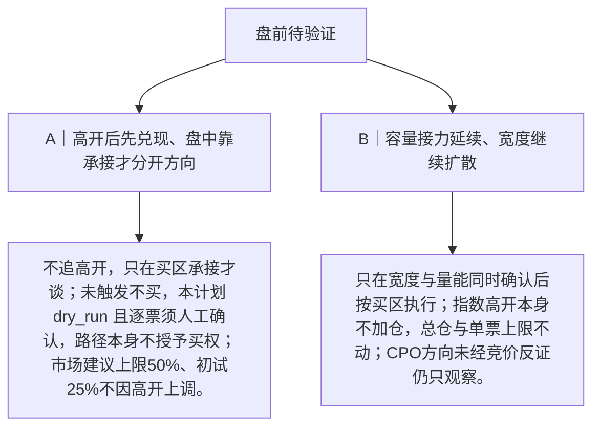

<!-- canghai:explicit-plan-report-assembly:v1 -->
# 2026-11-24 盘前预案

> 价位、仓位与限制均来自本轮定稿计划；条件剧本不等于当前可买。

## 市场判断

## 一句话结论

今天只买容量、不买高度：市场建议总风险敞口上限50%、盘前初试25%（三只有条件候选合计12+8+5＝25%），系统执行额度30%、单票12%、板块28%，但本轮按 dry_run 交付——不启用自主下单、逐票须人工确认，额度不等于买权；时机上首选"高开先兑现、盘中靠承接分开方向"（降温），备选才是容量延续维持高潮——不追隔夜外溢的高开，只在买区里成交。

## 详细分析

昨天的担心是"跌完还能不能修复"，今天的新事实把这个担心换成另一个担心：修复已经发生，但发生得太快、太高、太靠首板。11月20日全A 313涨/5236跌、个股中位-5.08%、跌停58家多于涨停28家；11月23日反过来是4658涨/783跌、个股中位+2.41%、涨停146/跌停3、炸板率从20%降到14.12%、两市成交1.55万亿（R1口径+1307亿）、昨涨停池28只里26只收红、16只晋级、收盘中位+9.99%。这是一次标准的超跌强修复，而且低位扩散得极广——130只首板、13只二板。但高度是断的：2只五板、1只三板、0只四板。两只五板还都带着资金背离：盛剑科技13:03才首封、量3.40倍，真视通09:25封后一直开板到14:54共6次、换手约60%、量7.14倍，两者T-1在大单/东财两个口径上都是净出。换句话说，钱在容量票和首板上，不在高度票上——这是今天所有取舍的起点。

情绪上，我用的基线是本轮已绑定快照的原生六态：阶段=高潮、事实日2026-11-23、连板网匿名公开口径、盘中估计身份缺失（intraday_status=missing）。展示先验是高潮36%/降温33%/退潮15%/冰点11%/升温3%/修复1%（页面取整频率、合计99%，不归一不补余量）；同景样本是"高潮第1天"96例，其后次日沪指均值仅+0.12%、上涨占比54%、平均温度变化-33.1°。展示行把高潮放第一位（36%对33%），但同景给出的常态是"温度掉下来"而不是"温度再上去"。所以我把首选写成降温、备选写成高潮——这是有意偏离展示首位，理由是同景温度变化幅度，而不是把36%/33%当成概率。更强的反证是隔夜：纳指收+6.52%（盘中一度+7.19%）、R7快讯记半导体指数约+14%，确实给了科技容量新的实价信号；但同一晚R4记下英伟达成立国家安全及出口管制委员会、调查报道并未消失（E20261124_NVREG，行业级，打击面写明含光通信/CPO、存储、半导体设备、海外AI硬件）。两条隔夜信息方向相反，且开盘就可能把前者一次性定价——这正是"高开先兑现"的依据。

资金四象限里，我只认已核数：11/23电子行业+69.21亿、通信设备+69.15亿、元件行业当日居前（R7东财口径），但计算机5日-88.20亿、机器人概念五日仍是-224.16亿（当日+93.62亿不等于五日反转，R2原文如此）。个股层更看得出结构：沪电+22.65亿（东财+22.51亿）、新易盛+36.32亿（东财+35.90亿）、中际旭创+32.59亿，而两只五板当日净出、中京虽五日+8.59亿但三板换手约30%、回封6次。基本面这一格不能当全局否决：中京四项红旗（应收+22.08%、存货+37.31%且周转3.15→2.79、应收占累计收入44.69%、有息债/权益95.45%）、科森非经常损益241%且2024/2025连亏、襄阳减速器收入占比约0.018%、盛剑主营不含光刻胶且该材料线2025年毛利-2.26%——这些都是逐票证据，不是"今天不能做"的理由。结构这一格才是决定性的：机器人早板（锋龙09:33首封、科森09:42首封）先于13:44才封的宇树，说明宇树是晚到的跟随者而非推手，而R2这条线里没有任何一只被认定为龙一；CPO两只容量票距20日高约-30%、距MA50约-40%，是修复不是趋势。

所以执行池只放三只，全部是"容量或低位"、且买区压在昨收附近：沪电股份（PCB容量核心，突破跟随，买区82.29~83.94、触发82.70、止损80.73、止盈90.36、RR=2.0、建议仓12%）；生益科技（PCB材料容量，60.45~61.66、触发60.75、止损58.58、止盈67.82、RR=2.0、8%）；浙文影业（短剧次线首板低位，决策线回踩3.64~3.71、触发3.64、止损3.52、止盈4.09、RR=2.0、5%）。三只的止损距分别是-3.8%、-4.99%、-5.12%：沪电的止损用的是MA10×0.99而不是买价×0.95，属于"有技术依据的更紧止损"，不是放宽也不是挪价。引擎另给三只算了溢价容忍上限（沪电88.49、生益65.00、浙文3.78，约+7%），那是执行端的容忍记录，不是追高价——买区上沿仍是83.94、61.66、3.71，超出买区不成交。

不选的对象我要写清楚为什么，因为同一批研究里它们看起来更热：中京电子是PCB高度锚（3连板、东财人气第3），但11/23首封09:30、11:07回封、open_times=6，按关4"回封板（多次开板≥2）不碰"直接拒绝，叠加R6四项红旗与强提示，今天只作温度计；盛剑科技5板但13:03首封且T-1净出、监管工作函加主营澄清；真视通同样是回封6次、五日靠单日撑；襄阳轴承14:30:45才首封＝尾盘投机板，外加业务体量澄清。CPO三只（新易盛、中际旭创、华盛昌）是本批资金最实的容量票，但都落在NVREG这条行业级负面的射程内，按关2.5默认剔出执行池——我把它们放进观察与B计划，写明"需竞价反证＋用户显式签核才可重评"，而不是硬塞进执行池再解释。机器人的锋龙、科森有早板优势，但五日分别-1.49亿、-1.72亿净出，且这条线没有R2认定的龙一，候补顶替＝中位跟风，只留观察。宇树科技人气第1（东财人气榜首、90日107天在榜），可本库缺688836的技术序列（无前复权收盘/MA10/MA50），价位引擎返回"无价格数据"，我不给它编买区——没有价位就写未知，这是硬规矩，而不是找个数凑表格。宝鼎科技无板、五日+0.38亿最弱，只作线内强弱参照。

竞价怎么应对，已经在JSON里按三档写死区间，这里只点要点：沪电预期带81.46~84.35，低于-1.5%放弃（除非快速收回82.70并放量重评），+2%~+5%只等回踩83.94以内、超+5%放弃；生益59.84~61.97；浙文3.60~3.72，低价首板低开破位不接。新增仓当日T+1不可卖，所以止损位是"次日开盘执行参考"，止盈到2R先减半、余仓走量价与板块退出——当日跌破止损只是观察信号，不是当日能卖的依据。

B计划三个方向：一是"容量接力"，PCB不及预期而CPO双容量独立走强时用新易盛（回踩166.85~175.92、止损161.85、止盈204.06）与中际旭创（383.82~404.68、372.31、469.42），但必须先有NVREG被竞价/量价反证的证据；二是"机器人扩散"，锋龙突破42.25~43.10、科森23.72~24.20且板块≥3家封板才成立；三是"防守反向（券商/农业）"，本轮R2/R5没有给出合资格候选，我只写方向与触发，不造票。共同作废条件是：三条线同时走弱、涨面<50%、炸板率>25%——那就全市场降档，执行池整体后置。

R6这一轮没有已证硬否决（hard_rejects为空），但给了44条逐票反证，其中6只带强提示：襄阳、盛剑、中京、真视通、华盛昌、科森——我全部按"降级观察、不给买点"处理，并在meta里逐条记了拒绝/采纳与理由；对沪电、生益、浙文只留下估值与资金口径的软反证，不按条数机械减仓。连板参考（lianban:today/mainline/qingxu）我采纳了：146/3的宽度、双五板缺四板、机器人概念68家封板（同花顺口径，R2 data_snapshot）、算力租赁只排次线（score 59）——这些直接改了我的主线与池子排序；唯一分歧是展示行把高潮放首位，我按同景降温先验把它翻成备选，并在meta.knowledge_adjudications里留了这个取舍。题材锚、股性表、成长池/分红池按上游裁决分别采纳、未知、拒绝，没有把人家"传递过"当"已采纳"，也没有因为某专题缺席就说今天没机会。

数据源审计如实写：本批R1–R7七份主研究同版校验通过（run_id 20261124T061008-32823-13549，input_manifest与artifacts一致），但内容是partial/degraded——R1 degraded、R2 degraded、R3 partial（confidence 0.364）、R4 partial、R5 partial、R6 partial、R7 partial（confidence 0.35），fetch_global_severity=2；R7的ETF份额与两融止于11/20、DataPro返回4013、SOX只有快讯没有结构化收盘，北向不参与本轮仓位推导。辅助输入里attention（事实日11/23、使用日11/24）与emotion_cycle可用，本日催化剂日历chzl_kg/投研交易/催化剂/20261124.md在绑定时不存在——这是真缺口，我用R4内嵌的K1–K5节选只处理"11/30两融保证金生效属未来条款、个别主体核验线索"，不把它当全日历、也不因此全局禁买。错题本与观察跟踪、账户本轮都无读取授权，我没有展开通配符，也不声称"没有同类错误"。R6的formal_review_completed=false，18个对象逐票反证已评估但认证未完成，这是覆盖披露，不是买入闸门。

识图复核只作辅助诊断、不改价不改资格：沪电与浙文被标出conflict并需人工复核——沪电的买区上沿83.94正好压在日MA20 84.11与11/20高83.09、11/23高83.87这条第一压力带上，浙文的3.71压在日MA5 3.862与60分MA20 3.702上；两处我都保留了双方值与原引擎价，只把执行口径收紧为"优先在压力带下方成交、放量站上才接受上半区"。生益、锋龙、科森、华盛昌、襄阳没有可比快照，写unknown；中京、宇树、盛剑、真视通、宝鼎引擎本身没给价位，也写unknown。没有把支撑观察位当执行止损，也没有把"一项一致"写成三项全通过。

盯盘顺序已写进同版JSON的 daily_focus 五只，顺序即优先级：沪电、生益、浙文三只有条件候选在前（触发才买、未触发不买），中京电子、宇树科技两只只作温度计、建议仓位显式0。它不是新的候选池，不挪池、不给买点，只是把"今天先看谁"钉在同一份计划里。

剩下的不确定性摆在台面：一是高潮第1天的次日通常降温（同景-33.1°），若开盘高开后昨板溢价快速回吐、涨面收缩，本建议应降级而不是硬撑；二是PCB容量票距MA50仍远，本质是超跌修复里的容量接力，一旦中京断板且沪电/生益同步转弱，整条线当日就要放弃；三是隔夜外溢已被开盘定价的可能很高，所以买区一律压在昨收附近、不在竞价里加溢价；四是账户可用额度、可卖量与真实报价本轮未核，25%初试是市场风险敞口，不是账户额度，也不证明成交条件成立。执行权限上，市场裁决之后我单独判了执行权限：本轮保留 dry_run、关闭自主交易、逐票须人工确认，risk_limits 的30%/单票12%/板块28%只是系统执行额度上限，三只条件候选的12%/8%/5%是"条件成立时的建议仓位"，不是已授权订单。

与其他角色的关系：R1给风格（主线扩散型、情绪分88、建议65%——我只当输入，最终市场建议是我独立的50%/25%）；R2给三条主线与三次线、以及候选角色（我沿用了它的板块判断和"候补非龙一"的标注）；R3给群聊情绪与主题（只作传播证据，不做资金替代）；R4给41条事件与首板候选（NVREG/ZJ/SS/XY/CH直接决定了我剔除谁、保留谁）；R5给六维画像与逐票资金（22只已评估、14只入本轮范围）；R6给44条反证与0条硬否决；R7给板块与个股资金（部分维度滞后）。下游P1竞价校准与P2午盘修订沿用本版价位与取消条件，不重新选票。

## 盘前路径图

- 六态基线：事实日=2026-11-23；阶段=高潮
- 目标日判断：首选=降温；备选=高潮

### A｜高开后先兑现、盘中靠承接才分开方向

- 依据：11/23原生六态为高潮第1天，同景96例次日均温变化-33.1°、沪指均值+0.12%/上涨占比54%；昨涨停池开盘溢价中位仅+0.29%而收盘中位+9.99%，说明当日收益主要在开盘之后；隔夜纳指+6.51%已经把高开理由给足，而E20261124_NVREG（行业级：海外AI硬件/光通信CPO/存储/半导体设备）并未消失。
- 仓位态度：不追高开，只在买区承接才谈；未触发不买，本计划 dry_run 且逐票须人工确认，路径本身不授予买权；市场建议上限50%、初试25%不因高开上调。
- 观察方向/票：沪电股份(002463.SZ)、生益科技(600183.SH) 为容量主看；浙文影业(601599.SH) 为低位次线辅看；中京电子(002579.SZ)、宇树科技(688836.SH) 只读温度，不做买入卡。
- 价位：沪电 买区82.29~83.94／触发82.70／T+1风险参考80.73／引擎溢价容忍88.49不作追高价；生益 60.45~61.66／60.75／58.58／容忍65.00；浙文 3.64~3.71／3.64／3.52／容忍3.78。
- 取消：竞价跌破各自预期带下沿（沪电81.46、生益59.84、浙文3.60），或涨面<50%且昨涨停池溢价转负、PCB同伴（生益/中京）同步转弱——整组当日不进，不换票递补。

### B｜容量接力延续、宽度继续扩散

- 依据：11/23的宽度是实打实的（涨停146/跌停3、炸板率14.12%、77只回封、电子+69.21亿与通信设备+69.15亿当日净入），若开盘后昨涨停池溢价转正、PCB再有≥1家封板且量能放大，修复可延续为第二段。
- 仓位态度：只在宽度与量能同时确认后按买区执行；指数高开本身不加仓，总仓与单票上限不动；CPO方向未经竞价反证仍只观察。
- 观察方向/票：先确认沪电、生益的承接延续；中京电子(002579.SZ) 封单与开板次数是PCB温度读数；Plan B 的 CPO 双容量（新易盛/中际旭创）需 NVREG 被竞价或量价反证后才启用。
- 价位：沪电82.29~83.94、生益60.45~61.66、浙文3.64~3.71 原值不变；Plan B 参考位 新易盛166.85~175.92（风险参考161.85）、中际旭创383.82~404.68（风险参考372.31），未反证前不当作买区。
- 取消：指数放量而涨面不扩（<50%）、或PCB容量冲高回落无承接、或炸板率升破25%——本支作废，回到A；A与B互斥，不叠加仓位。

交易日：20261124；事实时点：2026-11-23T15:00:00+08:00；有效期至：2026-11-24T10:00:00+08:00。到期或条件取消须重评；分支仅供观察，不授予买权。

## 同版计划速览

> 原序、原池展示；观察／Plan B 不自动晋级，场景互斥不累加仓位。新增仓 T+1 当日不可卖；底仓可卖量未知，触价不保证成交。静态价位非实时，未知不作零。最高接受价不放宽买区，实际买价须另核盈亏比。

### 市场建议（不扣减未知账户持仓，非执行额度）

**盘前市场决定：有条件开仓候选，未触发不买。** 11/23事实日（R1/R7同窗）：全A 4658涨/783跌、中位+2.41%、涨停146/跌停3、炸板率14.12%、两市成交1.55万亿（+1307亿）、昨涨停池28只中26只红盘且16只晋级，但开盘溢价中位仅+0.29%、收盘中位+9.99%——收益在开盘之后，不在竞价里；原生六态=高潮第1天（emotion_cycle fact_date 2026-11-23），同景96例次日均温-33.1°、沪指均值+0.12%/上涨占比54%。R2 14只已核候选逐票比较后，只有三只同时满足：不落在R4行业级负面射程（E20261124_NVREG 只打海外AI硬件/光通信CPO/存储/半导体设备，PCB与AI应用短剧不在内）、板型过关（无回封6次、无14:30后尾盘封板）、有已核五日正资金、买区压在昨收附近且RR=2.0。被排除的逐票有据：中京电子 open_times=6 按关4回封板剔除且四项财务红旗；盛剑科技13:03午后首封5板、当日净出-0.12亿、监管工作函与主营澄清；真视通6次开板/60.4%换手/当日净出；襄阳轴承14:30:45尾盘投机板且减速器收入占比约0.018%；CPO三票虽有最实资金（新易盛五日+35.90亿、中际+30.49亿）但处行业级负面射程且距MA50约-40%属修复不是趋势；机器人候补锋龙/科森五日-1.49/-1.72亿净出且该线无R2认定龙一；宇树无技术序列、引擎无价不编买区。故 outcome=conditional_entries，candidate_codes 为三只条件候选：触发才买、未触发不买，账户额度与执行权限不由此推定。

| 市场总仓上限建议 | 初始试探建议 | 依据与条件 |
|---|---|---|
| 50% | 25% | 依据：11/23事实日：全A 4658涨/783跌（中位+2.41%）、涨停146/跌停3、炸板率14.12%、两市成交1.55万亿（+1307亿）、昨涨停池28只中26红且16只晋级（收盘中位+9.99%）。给50%上限而不是R1的65%：①情绪阶段＝高潮第1天（事实日11/23，连板网原生六态），同景样本96例次日均温变化-33.1°、沪指均值仅+0.12%/上涨占比54%，这一格局的常态是次日降温而非继续升温；②高度断层：2只5板（盛剑13:03首封、真视通09:25后开6次）T-1双口径净出，仅1只3板、0只4板，梯队靠130只首板撑着；③隔夜美股科技强（纳指收+6.52%、SOX快讯约+14%），但同一晚R4记录英伟达国家安全及出口管制委员会成立、调查报道未消失（行业级，直击光通信/CPO/存储/半导体设备），盘前高开可能提前支付催化；④昨涨停池开盘溢价中位仅+0.29%，当日收益主要来自开盘之后——买点应是承接确认，不是竞价追高。初始25%＝三只有条件候选建议仓合计（12+8+5），是风险敞口不是账户额度。；条件：09:25竞价：沪深上涨家数&gt;50%、昨涨停池溢价中位转正、PCB/CPO容量票高开≤+2%，才在50%内谈承接；09:30-10:00：买区触发需板块同伴同向且量能放大；容量冲高回落且无分歧承接则本建议降级；账户可用现金/可卖量/真实报价未核：本建议是市场风险敞口，不是账户额度，也不证明成交条件成立；事实时点：2026-11-23T15:00:00+08:00；有效期：2026-11-24T10:00:00+08:00 |

- 仓位对账：已分配 25%；未分配 25%；预算利用率 50%
- 保留现金原因：市场建议50%中保留25%未分配：①首选路径是降温，容量票只在买区承接才买，触发前不预支；②两只5板与两只回封板按纪律不进池，可用标的只有3只、合计25%；③CPO三票处在行业级负面射程内，等竞价反证/用户签核；不为用满预算临时起意、不递补杂毛。
- 对账生成时点：2026-11-24T08:59:48+08:00

### 执行池｜今日重点

| 顺序 | 代码／名称 | 安排 | 建议仓位 | 为什么盯 | 竞价／承接看什么 | 什么情况放弃 |
|---|---|---|---|---|---|---|
| 1 | 002463.SZ 沪电股份 | 条件成立才参与 | 12% | PCB容量核心：五日大单+超大单+22.65亿（东财+22.51亿）为PCB已核对象第一，11/23 +2.96%无板收82.70，买区压在昨收附近、RR=2.0，是今天唯一「有已核五日正资金＋有盈亏比」的容量位。 | 竞价81.46~84.35（昨收-1.5%~+2%）为可用起点，+2%~+5%只在回踩83.94以内成交、&gt;+5%不追；开盘后必须放量站上82.70，且生益/中京至少1只同向收红、PCB再有≥1家封板，才按82.29~83.94承接；冲高回落无承接则不接。 | 竞价低于81.46，或开盘失守80.73（MA10×0.99），或PCB同伴同步转弱、通信设备资金转负——当日不进；不因隔夜纳指+6.51%的外溢把买区或最高接受价上移。 |
| 2 | 600183.SH 生益科技 | 条件成立才参与 | 8% | PCB材料容量：五日+5.71亿（东财+6.56亿）、11/23 +4.08%收60.75、距20日高约-41%，做沪电的辅助仓，不是第二个高度押注；R6只有估值与资金口径的软反证，无个股硬否决。 | 竞价59.84~61.97（-1.5%~+2%）为预期带；沪电不弱时按60.45~61.66承接，量能需达11/23的1.2倍水平；若只是跟着沪电高开而自身缩量，只观察不下手。 | 竞价低于59.84或跌破58.58；沪电先破位——两票一起放弃，不做「换一只PCB」的递补。 |
| 3 | 601599.SH 浙文影业 | 条件成立才参与 | 5% | 短剧次线首板：11/23 09:43首封、open_times=1（非回封板）、收+9.94%；五日+1.65亿（东财+1.73亿）为短剧成分第一、同花顺热股第9；3.65元低位、MA50 3.68就在脚下，是低位右侧位而非追高。 | 竞价3.60~3.72（-1.5%~+2%）；回踩3.64~3.71低吸，且同线不能只剩它一只——文投控股/慈文等同向≥2只才做；首板次日低开破位不接。 | 竞价低于3.60或跌破3.52；次线只剩它一只、或前排炸板，则扩散不成立，放弃。 |
| 4 | 002579.SZ 中京电子 | 仅盯盘 | 0% | PCB高度锚：唯一3连板龙一、东财人气第3、五日+8.55亿，但open_times=6按关4「回封板不碰」剔出执行，叠加R6四项财务红旗；它是这条线的温度计，不是买入卡。 | 竞价不破14.51（昨收14.73的-1.5%）；开盘后看封单能否守住约1亿、开板次数是否收敛、并对沪电/生益有助攻（而非独自强）；它稳住才提高PCB容量票的承接可信度。 | 竞价低于14.51或开盘断板加速→PCB全组降级，执行池两只PCB当日一并放弃。 |
| 5 | 688836.SH 宇树科技 | 仅盯盘 | 0% | 机器人唯一20cm人气第1（东财人气榜首、90日中107天在榜），但13:44才封＝晚到跟随者、五日资金-0.66亿，且本库缺688836技术序列（无前复权收盘与均线）、引擎无价——只作情绪温度计，不编买区。 | 竞价观察带686.8~729.2（昨收708元的±3%，仅观察阈值、不是买点）；开盘后看开板是否有承接、机器人是否≥3家封板并与锋龙/科森同步。 | 开板即跳水且机器人封板数不增→机器人扩散失败，B2方向作废；高开越过729.2而不放量按纯情绪透支处理，不追。 |

### 执行约束（不是市场看空判断）

- 模式：dry_run；禁止新开仓：否；允许自主交易：否；须用户确认：是
- 持仓数上限：3；每日买单上限：3；单票每日订单上限：2；禁入代码前缀：920；禁止ST：是；熔断开关：data/runtime/KILL_SWITCH
- 执行总仓上限：30%
- 不交易条件：本交易日催化剂日历 chzl_kg/投研交易/催化剂/20261124.md 在绑定时不存在，事件窗口未知；只记缺口，不全局禁买；未触发
- 不交易条件：R6 formal_review_completed=false：逐票反证已消费但认证未完成；研究覆盖披露，不是禁买；未触发
- 不交易条件：本轮无错题本/观察跟踪读取授权，不声称无同类错误、也不据此禁买；未触发
- 不交易条件：ETF份额与两融止于11/20、DataPro 4013、SOX无结构化收盘；资金面部分维度未核，不全局禁买；未触发
- 板块 机器人概念／人形执行器：确认：板块≥3家封板且宇树开板后仍有承接、早板助攻同步；共同失效：早板助攻先散、容量不同步、机器人五日资金继续净出
- 板块 PCB／元件：确认：中京断板后仍有≥2家回封、沪电/生益量价同向；共同失效：中京断板且沪电/生益同步转弱、行业资金转负
- 板块 CPO／光互连：确认：两票同向且出口管制负面被竞价/量价反证；共同失效：两票同步回吐、成交放大而涨幅不保；NVREG后续升级

### 机器执行明细

| 代码／名称 | 通道 | 买区 | 确认条件／价格锚 | T+1风险参考 | 目标价 | 条件建议仓位 |
|---|---|---|---|---|---|---|
| 002463.SZ 沪电股份 | 突破跟随 | 82.29 ~ 83.94 | 量价：买区覆盖现价：82.70~83.50优先承接，83.87/84.11压力带需放量站上才接受上半区；RR=2.0（买区上沿口径，实际委托价须另算）；窗口：09:30-10:30；触发价 82.70；最高接受价 88.49 | 风险位 80.73 | 90.36 | 12% |
| 600183.SH 生益科技 | 突破跟随 | 60.45 ~ 61.66 | 量价：买区覆盖现价：60.45~61.66承接，须放量；RR=2.0（买区上沿口径，实际委托价须另算）；窗口：09:30-10:30；触发价 60.75；最高接受价 65.00 | 风险位 58.58 | 67.82 | 8% |
| 601599.SH 浙文影业 | 决策线回踩 | 3.64 ~ 3.71 | 量价：决策线回踩：3.64~3.68优先低吸，3.70放量站上才接受上半区；RR=2.0（买区上沿口径，实际委托价须另算）；窗口：09:30-10:30；触发价 3.64；最高接受价 3.78 | 风险位 3.52 | 4.09 | 5% |

- **002463.SZ 沪电股份**：理由：PCB容量核心：11/23 +2.96%（振幅77.64~83.87、收82.70）无板，但R5近5日大单+超大单+22.65亿（东财+22.51亿）为PCB已核对象首席，R7通信设备/元件行业当日净流入领先；PCB/元件概念（885959.TI）244只成分；11/23无板但五日净额居该线第一。买的是容量修复，高度锚在中京（其回封6次已按关4剔出执行）。止损80.73(MA10×0.99)距买区上沿-3.8%：技术位更紧，属允许的更紧止损，不是放宽。失效：跌破80.73、或PCB同伴(生益/中京)同步转弱、或通信设备资金转负。；逻辑：PCB 11封1炸、230/240上涨＝线还在，容量票是这轮修复的资金载体；五日+22.65亿是已核对象里最实的一笔钱，不是单日噱头；买点压在昨收附近，不加溢价追高；T+1判断：未知；原状态：watch_pool_wait_for_entry；允许自动交易：否；须用户确认：是；买入资格：原资格通过（非下单授权）；资格依据：RR_PASS_NOT_TRADE_AUTHORIZATION；资格须复核：否；系统单票上限：12%；场景1执行限制：须盘中确认：是；一字不追：否；最高溢价：1.5%；系统执行分配：12%；个股共用退出：stop_loss_break；价 80.73；条件：次日开盘跌破80.73即离场；当日买入T+1不可卖，当日跌破只记次日执行参考；依据：规则引擎止损：买价×0.95/MA10×0.99/熊线×0.99 三者取最高；无底仓新增仓当日不可卖，当日跌破仅作次日执行参考；生效：T+1；数量 100%；个股共用退出：take_profit_hit；价 90.36；条件：盘中触及2R目标先减半，余仓走量价/板块退出；依据：2R目标；不设长目标；生效：T+1；数量 50%；个股共用退出：sector_switch_exit；价 未知；条件：PCB线资金转负或沪电/生益/中京集体转弱→无条件退出；依据：板块/主线失效退出，不需价格触发；数量 100%
- **600183.SH 生益科技**：理由：PCB材料容量：近5日大单+超大单+5.71亿（东财+6.56亿）、11/23 +4.08%、低见56.66收60.75、量能1.22倍，在PCB线里是容量而非高度。R6只有估值/资金软反证，无个股硬否决。止损58.58＝买区上沿×0.95，距-4.99%；失效：跌破58.58或沪电/中京同向转弱、上游材料相对强度消失。；逻辑：材料端在本轮PCB扩散里有独立成交与正净额；低位（距20日高-41%）修复，T+1博弈的是次日承接不是连板；同为容量而非高度，与沪电形成一主一辅，不重复押高度；T+1判断：未知；原状态：watch_pool_wait_for_entry；允许自动交易：否；须用户确认：是；买入资格：原资格通过（非下单授权）；资格依据：RR_PASS_NOT_TRADE_AUTHORIZATION；资格须复核：否；系统单票上限：10%；场景1执行限制：须盘中确认：是；一字不追：否；最高溢价：1.5%；系统执行分配：8%；个股共用退出：stop_loss_break；价 58.58；条件：次日开盘跌破58.58即离场；当日买入T+1不可卖，当日跌破只记次日执行参考；依据：规则引擎止损：买价×0.95/MA10×0.99/熊线×0.99 三者取最高；无底仓新增仓当日不可卖，当日跌破仅作次日执行参考；生效：T+1；数量 100%；个股共用退出：take_profit_hit；价 67.82；条件：盘中触及2R目标先减半，余仓走量价/板块退出；依据：2R目标；不设长目标；生效：T+1；数量 50%；个股共用退出：sector_switch_exit；价 未知；条件：PCB线资金转负或沪电/生益/中京集体转弱→无条件退出；依据：板块/主线失效退出，不需价格触发；数量 100%
- **601599.SH 浙文影业**：理由：AI应用/短剧次线首板：11/23 09:43首封10:19回封（open_times=1，非回封板）、收+9.94%，R2次线score 63且为短剧五日资金首位，R5近5日+1.65亿（东财+1.73亿），同花顺热榜第9，3.65元低位、MA50(3.676)就在脚下。止损3.52＝买价×0.95，距-5.12%；失效：跌破3.52或短剧只剩它一只、次线不能扩散。；逻辑：次线首板+低位，符合「只做龙头或低位」的右侧补涨位；短剧是AI应用里唯一有五日资金首位的分支；3.65元低价+1次开板，比13:12才封的慈文更早，具辨识度；T+1判断：未知；原状态：watch_pool_wait_for_entry；允许自动交易：否；须用户确认：是；买入资格：原资格通过（非下单授权）；资格依据：RR_PASS_NOT_TRADE_AUTHORIZATION；资格须复核：否；系统单票上限：8%；场景1执行限制：须盘中确认：是；一字不追：否；最高溢价：1.5%；系统执行分配：5%；个股共用退出：stop_loss_break；价 3.52；条件：次日开盘跌破3.52即离场；当日买入T+1不可卖，当日跌破只记次日执行参考；依据：规则引擎止损：买价×0.95/MA10×0.99/熊线×0.99 三者取最高；无底仓新增仓当日不可卖，当日跌破仅作次日执行参考；生效：T+1；数量 100%；个股共用退出：take_profit_hit；价 4.09；条件：盘中触及2R目标先减半，余仓走量价/板块退出；依据：2R目标；不设长目标；生效：T+1；数量 50%；个股共用退出：sector_switch_exit；价 未知；条件：AI应用／视频短剧线资金转负，或浙文影业与同线前排（文投控股/慈文传媒）集体转弱→无条件退出；依据：板块/次线失效退出，不需价格触发；数量 100%

### 观察候选（保留全部原身份）

| 代码／名称 | 理由／风险／当前限定 | 观察条件与价位 | 条件建议仓位 |
|---|---|---|---|
| 002579.SZ 中京电子 | 理由：PCB高度锚（3连板）但战术层拒绝：11/23 09:30首封、11:07最后回封、open_times=6 → 板型=回封板(≥2次开板)，按关4不碰；R5五日+8.59亿虽正，三板换手约30%、封单约1.02亿、量3.41倍；R6模式7四项红旗实算（F3应收+22.08%、F4存货+37.31%且周转3.15→2.79、F9应收占累计收入44.69%、F10有息债/权益95.45%）。只作高度与分歧温度计：它继续封=PCB还有余温，它断板=全组降级。不建议新开仓。；反证：R6_M7_04 基本面红旗：四项实算，非现行执行对象；原状态：仅观察；允许自动交易：否；须用户确认：是；观察限定：board_pattern_rejected；买入资格：未知／待复核（非已审否决）；资格依据：ENGINE_LEVELS_UNVERIFIED；资格须复核：否；系统单票上限：0% | 买区 未知；触发价 未知；风险位 未知；目标 未知 | 0% |
| 688836.SH 宇树科技 | 理由：20cm首板13:44封（午后首封、0开板），东财人气第1、飙升名次+52、90日持续在榜107天；但近5日大单+超大单-0.66亿（东财-0.66亿）与当日热度背离，R2明确机器人早盘推手是锋龙/科森而非它，13:44封板=晚于助攻。本库缺688836 stock_tech_daily（无前复权收盘/MA10/MA50），价位引擎返回无价格数据 → 不给买区、止损、止盈，只作情绪与高度参照。；原状态：仅观察；允许自动交易：否；须用户确认：是；观察限定：price_missing；买入资格：未知／待复核（非已审否决）；资格依据：ENGINE_LEVELS_UNVERIFIED；资格须复核：否；系统单票上限：0% | 买区 未知；触发价 未知；风险位 未知；目标 未知 | 0% |
| 300502.SZ 新易盛 | 理由：CPO容量首位：近5日大单+超大单+36.32亿（东财+35.90亿、R7个股+35.9亿/1日+22.9亿），11/23+9.92%无板。两件事压住它：①R4 E20261124_NVREG 为行业级负面（英伟达成立国家安全及出口管制委员会、调查报道未消失），打击面明确含光通信/CPO，按关2.5默认剔出 execution_pool；②自身距20日高-30%、距MA50-40%，11/23是资金集中修复而非趋势反转（R5原文）。只作容量标尺与B计划候选，今日不给执行资格。；利空反证：默认剔出执行；需竞价反证+用户显式签核才可重评；原状态：仅观察；允许自动交易：否；须用户确认：是；观察限定：industry_gate；买入资格：原资格通过（非下单授权）；资格依据：RR_PASS_NOT_TRADE_AUTHORIZATION；资格须复核：否；系统单票上限：0%；场景1执行限制：须盘中确认：是；最高溢价：1.5%；系统执行分配：0%；个股共用退出：stop_loss_break；价 161.85；条件：观察用风险位；依据：规则引擎止损：买价×0.95/MA10×0.99/熊线×0.99 三者取最高；无底仓新增仓当日不可卖，当日跌破仅作次日执行参考；生效：T+1；数量 100%；个股共用退出：take_profit_hit；价 204.06；条件：盘中触及2R目标先减半，余仓走量价/板块退出；依据：2R目标；不设长目标；生效：T+1；数量 50%；个股共用退出：sector_switch_exit；价 未知；条件：板块失效退出；依据：板块/主线失效退出，不需价格触发；数量 100% | divergence_pullback；买区 166.85 ~ 175.92；量价：回踩 3.0% 到买区才触发；RR=2.0；窗口：09:30-10:30；触发价 175.92；最高接受价 180.45；风险位 161.85；目标 204.06 | 0% |
| 300308.SZ 中际旭创 | 理由：CPO容量交叉对照：近5日+32.59亿（东财+30.49亿）、东财人气12/同花顺5，横跨双榜。R4 E20261124_ZJ 20~40亿回购方案是正面事实，但方案未实施、上限不是成交；同一晚出口管制行业级负面同样覆盖它。与同一线同属关2.5默认剔出范围，只作容量对照与B计划候选。；反证：R6软反证：低开或冲高回吐且同伴走弱即否定消息净增承接；利空反证：默认剔出执行；需竞价反证+用户显式签核才可重评；原状态：仅观察；允许自动交易：否；须用户确认：是；观察限定：industry_gate；买入资格：原资格通过（非下单授权）；资格依据：RR_PASS_NOT_TRADE_AUTHORIZATION；资格须复核：否；系统单票上限：0%；场景1执行限制：须盘中确认：是；最高溢价：1.5%；系统执行分配：0%；个股共用退出：stop_loss_break；价 372.31；条件：观察用风险位；依据：规则引擎止损：买价×0.95/MA10×0.99/熊线×0.99 三者取最高；无底仓新增仓当日不可卖，当日跌破仅作次日执行参考；生效：T+1；数量 100%；个股共用退出：take_profit_hit；价 469.42；条件：盘中触及2R目标先减半，余仓走量价/板块退出；依据：2R目标；不设长目标；生效：T+1；数量 50%；个股共用退出：sector_switch_exit；价 未知；条件：板块失效退出；依据：板块/主线失效退出，不需价格触发；数量 100% | divergence_pullback；买区 383.82 ~ 404.68；量价：回踩 3.0% 到买区才触发；RR=2.0；窗口：09:30-10:30；触发价 404.68；最高接受价 415.11；风险位 372.31；目标 469.42 | 0% |
| 002931.SZ 锋龙股份 | 理由：机器人早盘前排锚：09:33首封09:34回封（1次开板，非回封板），但近5日大单-1.46亿净出、量能仅0.37倍；R2把它与科森定位为早板助攻/先后对照，本线无R2认定龙一，候补不顶替。属「中位跟风」风险区，只作扩散标尺。；原状态：仅观察；允许自动交易：否；须用户确认：是；观察限定：role_below_leader；买入资格：原资格通过（非下单授权）；资格依据：RR_PASS_NOT_TRADE_AUTHORIZATION；资格须复核：否；系统单票上限：0%；场景1执行限制：须盘中确认：是；最高溢价：1.5%；系统执行分配：0%；个股共用退出：stop_loss_break；价 40.95；条件：观察用风险位；依据：规则引擎止损：买价×0.95/MA10×0.99/熊线×0.99 三者取最高；无底仓新增仓当日不可卖，当日跌破仅作次日执行参考；生效：T+1；数量 100%；个股共用退出：take_profit_hit；价 47.40；条件：盘中触及2R目标先减半，余仓走量价/板块退出；依据：2R目标；不设长目标；生效：T+1；数量 50%；个股共用退出：sector_switch_exit；价 未知；条件：板块失效退出；依据：板块/主线失效退出，不需价格触发；数量 100% | 突破跟随；买区 42.25 ~ 43.10；量价：买区覆盖现价，按盘中承接执行；RR=2.0；窗口：09:30-10:30；触发价 42.46；最高接受价 45.43；风险位 40.95；目标 47.40 | 0% |
| 603626.SH 科森科技 | 理由：机器人早盘助攻：09:42首封10:52回封（1次开板），但近5日-1.72亿净出；R6模式7命中F6(非经常损益/正归母241.45%、扣非为负)、F9(应收/累计收入50.83%)及2024/2025归母连亏-4.77/-3.51亿，R6给出强提示要求降级。它不替代本体，只作早板助攻温度计。；反证：R6_M7_12：非经常损益241.45%+连亏；降级为题材反包对照，不抬位；原状态：仅观察；允许自动交易：否；须用户确认：是；观察限定：r6_strong_suggest；买入资格：原资格通过（非下单授权）；资格依据：RR_PASS_NOT_TRADE_AUTHORIZATION；资格须复核：否；系统单票上限：0%；场景1执行限制：须盘中确认：是；最高溢价：1.5%；系统执行分配：0%；个股共用退出：stop_loss_break；价 22.99；条件：观察用风险位；依据：规则引擎止损：买价×0.95/MA10×0.99/熊线×0.99 三者取最高；无底仓新增仓当日不可卖，当日跌破仅作次日执行参考；生效：T+1；数量 100%；个股共用退出：take_profit_hit；价 26.62；条件：盘中触及2R目标先减半，余仓走量价/板块退出；依据：2R目标；不设长目标；生效：T+1；数量 50%；个股共用退出：sector_switch_exit；价 未知；条件：板块失效退出；依据：板块/主线失效退出，不需价格触发；数量 100% | 突破跟随；买区 23.72 ~ 24.20；量价：买区覆盖现价，按盘中承接执行；RR=2.0；窗口：09:30-10:30；触发价 23.84；最高接受价 25.51；风险位 22.99；目标 26.62 | 0% |
| 603324.SH 盛剑科技 | 理由：光刻胶5板但高位风险锚：11/23 13:03首封（0开板、量3.40倍），T-1双口径净出（大单-0.146亿/东财-0.123亿）；R4 E20261124_SS 监管工作函+公司澄清（材料不含光刻胶，该材料线2025年份额4.41%、毛利-2.26%），R6 M1/M9双强提示要求降级。它是退潮标尺而非买入卡。；反证：R6_M1_16/M9_01：监管函+业务澄清，降级为高位风险锚；原状态：仅观察；允许自动交易：否；须用户确认：是；观察限定：高度参照／不交易；买入资格：未知／待复核（非已审否决）；资格依据：ENGINE_LEVELS_UNVERIFIED；资格须复核：否；系统单票上限：0% | 买区 未知；触发价 未知；风险位 未知；目标 未知 | 0% |
| 002771.SZ 真视通 | 理由：算力租赁5板：09:25首封但此后开板6次至14:54、换手约60%、量7.14倍、T-1双口径净出 → 板型=回封板按关4拒绝。R2明确算力宽度收缩（6家对11/18的22家）。只作高度温度计，不给买点。；反证：R6_M9_02：薄梯队+高换手，降级为高度温度计；原状态：仅观察；允许自动交易：否；须用户确认：是；观察限定：board_pattern_rejected；买入资格：未知／待复核（非已审否决）；资格依据：ENGINE_LEVELS_UNVERIFIED；资格须复核：否；系统单票上限：0% | 买区 未知；触发价 未知；风险位 未知；目标 未知 | 0% |
| 002980.SZ 华盛昌 | 理由：CPO概念侧第3锚，无板、缺乏独立带动；近5日+0.31亿。R6模式7命中F3(应收同比+326.33%)与F9(应收/累计收入71.50%)。且同受NVREG行业级负面覆盖，只作CPO宽度对照。；利空反证：默认剔出执行；无独立承接前不参与；原状态：仅观察；允许自动交易：否；须用户确认：是；观察限定：industry_gate；买入资格：未知／待复核（非已审否决）；资格依据：ENGINE_LEVELS_UNVERIFIED；资格须复核：否；系统单票上限：0% | 买区 未知；触发价 未知；风险位 未知；目标 未知 | 0% |
| 002552.SZ 宝鼎科技 | 理由：PCB弹性对照：11/23无板，近5日+0.38亿为板块最弱之一，R2判为「无板无独立带动」。它上涨不等于PCB分歧转强，只作线内强弱温度计。；原状态：仅观察；允许自动交易：否；须用户确认：是；观察限定：role_below_leader；买入资格：未知／待复核（非已审否决）；资格依据：ENGINE_LEVELS_UNVERIFIED；资格须复核：否；系统单票上限：0% | 买区 未知；触发价 未知；风险位 未知；目标 未知 | 0% |
| 000678.SZ 襄阳轴承 | 理由：14:30:45首封 → 板型=尾盘投机板，按关4拒绝；R4 E20261124_XY 澄清减速器相关仅20.52万元、占营收约0.018%、尚未盈利；R6 M1+M7 双强提示（另命中F3/F4/F10与2024/2025连亏）。3天2板是反包对照，不是接力对象。；反证：R6_M1_01/M7_01：业务体量证伪订单外推，降级为题材反包对照；原状态：仅观察；允许自动交易：否；须用户确认：是；观察限定：board_pattern_rejected；买入资格：未知／待复核（非已审否决）；资格依据：ENGINE_LEVELS_UNVERIFIED；资格须复核：否；系统单票上限：0% | 买区 未知；触发价 未知；风险位 未知；目标 未知 | 0% |

### 竞价剧本（原计划，不代表已确认）

| 候选／场景 | 预期档位 | 数值区间／条件 | 动作 |
|---|---|---|---|
| 002463.SZ 沪电股份 | 预期开盘 | 昨收 82.70；预期带 81.46 ~ 84.35 | 昨收82.70；10cm主板按-1.5%~+2%定预期带；容量票不做20cm放宽 |
| 002463.SZ 沪电股份 | 不及预期 | 竞价幅度：&lt;-1.5% | 动作：低开破位→放弃，当日不进；除非快速收回82.70并放量才按原买区重评；动作类别：放弃或等待弱转强 |
| 002463.SZ 沪电股份 | 符合预期 | 竞价幅度：-1.5%~+2% | 动作：按预案：82.29~83.94承接，需生益/中京至少1只同向收红；动作类别：按原预案 |
| 002463.SZ 沪电股份 | 超预期 | 竞价幅度：+2%~+5% | 动作：超预期不追：只在回踩83.94以内成交，否则放弃；动作类别：超预期后确认 |
| 002463.SZ 沪电股份 | 高开过度 | 竞价幅度：&gt;+5% | 动作：高开过度=兑现，不追，等回踩或放弃；动作类别：放弃 |
| 600183.SH 生益科技 | 预期开盘 | 昨收 60.75；预期带 59.84 ~ 61.97 | 昨收60.75；10cm主板-1.5%~+2% |
| 600183.SH 生益科技 | 不及预期 | 竞价幅度：&lt;-1.5% | 动作：低开→放弃或等收回60.75再评；动作类别：放弃或等待弱转强 |
| 600183.SH 生益科技 | 符合预期 | 竞价幅度：-1.5%~+2% | 动作：按预案：60.45~61.66承接，需沪电同时不弱；动作类别：按原预案 |
| 600183.SH 生益科技 | 超预期 | 竞价幅度：+2%~+5% | 动作：不追，只在回踩61.66以内成交；动作类别：超预期后确认 |
| 600183.SH 生益科技 | 高开过度 | 竞价幅度：&gt;+5% | 动作：放弃，不追高；动作类别：放弃 |
| 601599.SH 浙文影业 | 预期开盘 | 昨收 3.65；预期带 3.60 ~ 3.72 | 昨收3.65；10cm主板-1.5%~+2% |
| 601599.SH 浙文影业 | 不及预期 | 竞价幅度：&lt;-1.5% | 动作：低开→放弃；首板次日低开破位不接；动作类别：放弃或等待弱转强 |
| 601599.SH 浙文影业 | 符合预期 | 竞价幅度：-1.5%~+2% | 动作：按预案：3.64~3.71回踩低吸，需短剧分支≥2只同向；动作类别：按原预案 |
| 601599.SH 浙文影业 | 超预期 | 竞价幅度：+2%~+5% | 动作：不追；只在回踩3.71以内成交；动作类别：超预期后确认 |
| 601599.SH 浙文影业 | 高开过度 | 竞价幅度：&gt;+5% | 动作：放弃，不追高；动作类别：放弃 |
| 002579.SZ 中京电子 | 预期开盘 | 昨收 14.73；预期带 14.51 ~ 15.02 | 昨收14.73；10cm主板-1.5%~+2%；三板回封6次，只作温度计 |
| 002579.SZ 中京电子 | 不及预期 | 竞价幅度：&lt;-1.5% | 动作：断板加速→PCB全组降级，当日不参与；动作类别：放弃 |
| 002579.SZ 中京电子 | 符合预期 | 竞价幅度：-1.5%~+2% | 动作：观察承接：封单能否维持1亿以上、开板次数是否收敛；仍不买；动作类别：放弃 |
| 002579.SZ 中京电子 | 超预期 | 竞价幅度：+2%~+5% | 动作：超预期但板型已拒绝，只当高度确认，不追；动作类别：放弃 |
| 002579.SZ 中京电子 | 高开过度 | 竞价幅度：&gt;+5% | 动作：高位兑现风险，只看不做；动作类别：放弃 |

### Plan B

总触发：执行池≥2票竞价不及预期（高开低于预期带或不成交后回落破位）；主线板块（PCB／元件）资金净流出且无承接；龙头断板/炸板率升破25%；互斥／共同放弃：若B方向与A同时走弱（成交缩量、涨面&lt;50%、炸板率&gt;25%）→ 全市场降档，执行池全部后置，当日不新开仓；A与B互斥，不叠加仓位。

| 方向 | 触发 | 原候选（不跨池借价） | 放弃条件 |
|---|---|---|---|
| 容量接力：PCB不及预期时的CPO双容量 | 执行池2只PCB票竞价不及预期，且新易盛/中际旭创同向放量走高、通信设备行业净流入不缩 | 300502.SZ 新易盛：理由：B1容量接力候选：CPO容量首位，回踩166.85~175.92承接；受NVREG行业级负面约束，须竞价反证+用户签核；允许自动交易：否；须用户确认：是；观察限定：industry_gate；买入资格：原资格通过（非下单授权）；资格依据：RR_PASS_NOT_TRADE_AUTHORIZATION；资格须复核：否；系统单票上限：0%；场景1执行限制：须盘中确认：是；最高溢价：1.5%；系统执行分配：0%；个股共用退出：stop_loss_break；价 161.85；条件：观察用风险位；依据：规则引擎止损：买价×0.95/MA10×0.99/熊线×0.99 三者取最高；无底仓新增仓当日不可卖，当日跌破仅作次日执行参考；生效：T+1；数量 100%；个股共用退出：take_profit_hit；价 204.06；条件：盘中触及2R目标先减半，余仓走量价/板块退出；依据：2R目标；不设长目标；生效：T+1；数量 50%；个股共用退出：sector_switch_exit；价 未知；条件：板块失效退出；依据：板块/主线失效退出，不需价格触发；数量 100%；divergence_pullback；买区 166.85 ~ 175.92；量价：回踩 3.0% 到买区才触发；RR=2.0；窗口：09:30-10:30；触发价 175.92；最高接受价 180.45；风险位 161.85；目标 204.06；条件建议仓位 未知 300308.SZ 中际旭创：理由：B1容量接力候选：回踩383.82~404.68承接；同受行业级负面约束，须竞价反证；允许自动交易：否；须用户确认：是；观察限定：industry_gate；买入资格：原资格通过（非下单授权）；资格依据：RR_PASS_NOT_TRADE_AUTHORIZATION；资格须复核：否；系统单票上限：0%；场景1执行限制：须盘中确认：是；最高溢价：1.5%；系统执行分配：0%；个股共用退出：stop_loss_break；价 372.31；条件：观察用风险位；依据：规则引擎止损：买价×0.95/MA10×0.99/熊线×0.99 三者取最高；无底仓新增仓当日不可卖，当日跌破仅作次日执行参考；生效：T+1；数量 100%；个股共用退出：take_profit_hit；价 469.42；条件：盘中触及2R目标先减半，余仓走量价/板块退出；依据：2R目标；不设长目标；生效：T+1；数量 50%；个股共用退出：sector_switch_exit；价 未知；条件：板块失效退出；依据：板块/主线失效退出，不需价格触发；数量 100%；divergence_pullback；买区 383.82 ~ 404.68；量价：回踩 3.0% 到买区才触发；RR=2.0；窗口：09:30-10:30；触发价 404.68；最高接受价 415.11；风险位 372.31；目标 469.42；条件建议仓位 未知 | 放弃：NVREG行业级负面未获竞价反证或用户签核前，本方向只观察不下单；两票同步回落亦作废 |
| 低位扩散：机器人早板/助攻接力 | PCB系未触发且机器人板块≥3家封板、宇树开板后仍有承接 | 002931.SZ 锋龙股份：理由：B2机器人扩散候选：突破42.25~43.10且板块≥3家封板才成立；五日净出，仓位上限只能小；允许自动交易：否；须用户确认：是；观察限定：role_below_leader；买入资格：原资格通过（非下单授权）；资格依据：RR_PASS_NOT_TRADE_AUTHORIZATION；资格须复核：否；系统单票上限：0%；场景1执行限制：须盘中确认：是；最高溢价：1.5%；系统执行分配：0%；个股共用退出：stop_loss_break；价 40.95；条件：观察用风险位；依据：规则引擎止损：买价×0.95/MA10×0.99/熊线×0.99 三者取最高；无底仓新增仓当日不可卖，当日跌破仅作次日执行参考；生效：T+1；数量 100%；个股共用退出：take_profit_hit；价 47.40；条件：盘中触及2R目标先减半，余仓走量价/板块退出；依据：2R目标；不设长目标；生效：T+1；数量 50%；个股共用退出：sector_switch_exit；价 未知；条件：板块失效退出；依据：板块/主线失效退出，不需价格触发；数量 100%；突破跟随；买区 42.25 ~ 43.10；量价：买区覆盖现价，按盘中承接执行；RR=2.0；窗口：09:30-10:30；触发价 42.46；最高接受价 45.43；风险位 40.95；目标 47.40；条件建议仓位 未知 603626.SH 科森科技：理由：B2机器人扩散候选：突破23.72~24.20且早板同步；R6强提示已降级，仅作备选；允许自动交易：否；须用户确认：是；观察限定：r6_strong_suggest；买入资格：原资格通过（非下单授权）；资格依据：RR_PASS_NOT_TRADE_AUTHORIZATION；资格须复核：否；系统单票上限：0%；场景1执行限制：须盘中确认：是；最高溢价：1.5%；系统执行分配：0%；个股共用退出：stop_loss_break；价 22.99；条件：观察用风险位；依据：规则引擎止损：买价×0.95/MA10×0.99/熊线×0.99 三者取最高；无底仓新增仓当日不可卖，当日跌破仅作次日执行参考；生效：T+1；数量 100%；个股共用退出：take_profit_hit；价 26.62；条件：盘中触及2R目标先减半，余仓走量价/板块退出；依据：2R目标；不设长目标；生效：T+1；数量 50%；个股共用退出：sector_switch_exit；价 未知；条件：板块失效退出；依据：板块/主线失效退出，不需价格触发；数量 100%；突破跟随；买区 23.72 ~ 24.20；量价：买区覆盖现价，按盘中承接执行；RR=2.0；窗口：09:30-10:30；触发价 23.84；最高接受价 25.51；风险位 22.99；目标 26.62；条件建议仓位 未知 | 放弃：两票五日净出且无板块扩散即作废；不允许拿候补顶替不存在的龙一 |
| 防守反向：券商／农业（本批无已核合格标的） | 科技三线同跌且成交缩量、券商或水产出现≥2只同步放量 | 未知 | 放弃：本轮R2/R5未对券商与农业给出合资格候选（东方海洋13次开板+R4风险提示），只在盘中观察，不造票 |

### 四象限（仅原判断）

| 维度 | 模型显式判断 |
|---|---|
| 资金 | 宽度修复≠持续净入：11/23电子+69.21亿、通信设备+69.15亿、元件行业当日领先；但机器人概念五日仍-224.16亿，计算机-88.20亿/5日、半导体设备5日+51.67亿但当日-4.32亿。个股层：沪电+22.65亿、新易盛+36.32亿、中际+32.59亿，而两只5板（盛剑-0.146亿、真视通双口径净出）当日净出——资金在容量票而不在高度票。 |
| 情绪 | 11/23原生六态=高潮第1天（146涨停/3跌停、炸板率14.12%、77只回封），但同景96例次日均温变化-33.1°、沪指均值+0.12%；双五板缺四板、仅1只3板、13只2板——高度断层，情绪广度强而高度弱，最可能次日降温。 |
| 基本面估值 | 逐票差异大，不能当全局否决：中京F3/F4/F9/F10四项红旗、科森非经常损益241%与连亏、襄阳减速器收入占比0.018%、盛剑主营不含光刻胶且该材料线毛利-2.26%；沪电/生益/浙文只有软反证（估值与资金口径分歧），无个股硬否决。 |
| 结构 | 机器人早板(锋龙09:33/科森09:42)先于13:44才封的宇树，说明它不是早盘推手；PCB高度在中京(3板回封6次)，容量在沪电/生益；CPO容量在新易盛/中际但两票距20日高-30%、距MA50-40%，属修复不是趋势。买点结构上，容量票压在昨收附近才有盈亏比，高度票没有。 |
| 综合 | 结论：只买容量/低位，不买高度、不追隔夜外溢；三只条件候选合计25%，市场建议上限50%，其余现金保留等承接确认。 |

### 关键缺口

- 关键缺口：催化剂日历 aux 不可用（chzl_kg/投研交易/催化剂/20261124.md 不存在）；R4内嵌K1-K5只覆盖11/22-11/30政策与个别主体核验线索；错题本／观察跟踪／账户本轮无读取授权（未展开通配符，不声称无错题）；R6 formal_review_completed=false：18个对象逐票反证已评估但未认证完成；R7 confidence 0.35：ETF份额与两融止于11/20、DataPro 4013、SOX仅快讯；688836.SH 缺 stock_tech_daily 技术序列，无法推导买区/止损；R3 confidence 0.364、R1 degraded=true：情绪与风格为研究自评，非后验概率
- 研究未完成（不等于硬否决；实际执行限制见上）

