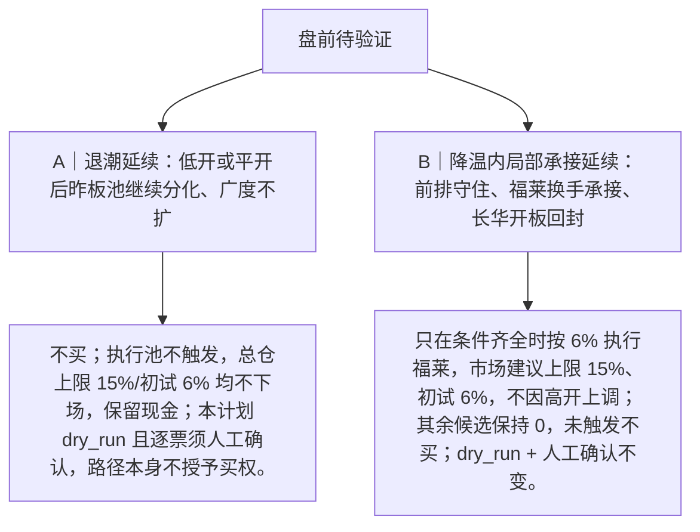

<!-- canghai:explicit-plan-report-assembly:v1 -->
# 2026-11-25 盘前预案｜盘中补交（非开盘前交付）

> 补交时间：2026-11-25T11:16:07+08:00（北京时间）。复用 09:02 定稿及同次留存的盘前分析，未读取竞价或盘中行情。以下为当时剧本，原适用窗口已过；仅供回看，不发布到执行系统。

> 价位、仓位与限制均来自本轮定稿计划；条件剧本不等于当前可买。

## 市场判断

## 一句话结论

今天不做普涨，只做一只换手核心的条件试仓：市场建议总风险敞口上限 15%、盘前初试 6%（只有福莱新材一只条件候选），系统执行额度 6%、单票 6%、板块 6%、持仓 1 只，本轮仍按 dry_run 交付——不启用自主下单、逐票须人工确认，额度不等于买权。时机上首选"退潮延续"（降温第 1 天的同景历史首位），备选才是"降温里的局部接力"——只在买区 51.19~52.22 承接，不在竞价里支付隔夜情绪。

## 详细分析

先讲风险：昨天（11/24）的盘面不是修复延续，而是一次"放量分化"。全 A 1952 涨、3498 跌、个股中位 -0.67%，两市成交 16678 亿（较前日 +6.64%），涨停 55 家、跌停 2 家，但炸板率 55.28%，68 只未回封，最高的两只 5 板全部断板收跌，现存高度只有 1 只 4 板（中京电子，一字锁价）和 4 只 3 板。指数看着不难看（上证 +0.27%、沪深 300 +0.14%），个股中位却是负的——这是典型的"权重托指数、个股在失血"。同时隔夜美股给了相反方向的压力：SOX 回吐，R4 记下 E20261125_SOX（行业级，打击面写明含海外 AI 硬件、光通信/CPO、存储、半导体设备、PCB/覆铜板）与 E20261125_NVREG（议员质疑英伟达复职，行业级）。这两条不是"某只票的利空"，而是直接压住今天 PCB、CPO、半导体链的高开空间，所以我把这几条线全部留在观察，不进执行。

再看唯一还在的赚钱效应：11/23 的涨停池在 11/24 有 109/146 收红、收盘中位 +3.26%、30 只续板、开盘溢价中位 +3.72%，但盘中相对开盘的中位收益是 0.00%。这句话翻译成交易语言：钱是在开盘那一刻挣到的，之后没有增量承接。今天再买，付的是昨天开盘的溢价，赌的是明天有人接——这正是 T+1 博弈的核心，也是我把仓位压到 15%/初试 6% 的原因。

情绪阶段我只用本轮绑定的原生六态：阶段=降温、事实日 2026-11-24、phase_schema=lianban_six_v1、盘中观察缺失（intraday_status=missing）。展示先验是退潮 31% / 降温 17% / 高潮 17% / 升温 16% / 修复 11% / 冰点 7%（页面取整、合计 99%，不归一、不补余量）；同景是"降温第 1 天、上证在年线下"82 例，历史首位退潮 34%、次位高潮 17%。所以目标日我写"首选退潮、备选降温"——这不是把 31% 当概率，而是同景的常态方向；最强的反证是跌停只有 2 家、昨板池仍 109/146 红、二板数量增加（25 只），说明局部奖励还没死，这也是"备选降温"存在的理由。

资金四象限只看已核数：11/24 东财电子 +64.73 亿、印制电路板 +33.92 亿（5 日 +151.87 亿）、元件 +30.47 亿（5 日 +152.72 亿），但计算机 -22.95 亿（5 日 -102.62 亿）。机器人这条线是"当日回流、五日仍出"：宽概念当日 +20.80 亿而 5 日 -117.18 亿、人形 +8.90/-38.18 亿、执行器 -1.49 亿、同花顺宽机器人 -58.24 亿。个股层更清楚：沪电 5 日 +29.18 亿、中京 +9.96 亿、福莱 +3.87 亿（东财 +3.85 亿，双口径偏差 <5% 无冲突），长华只有 +0.60 亿且换手 1.06%。钱在容量票和换手核心，不在高度锁价票——这就是取舍的起点。

基本面估值这一格不能当全局否决，但要逐票看：福莱 PE 224.44、PS 4.55（同业历史分位 99%/98%）、Q3 归母 0.56 亿、净利同比 -13.17%；长华 PE 161.43、净利 -96.95%、公告自述执行器收入约 8.8 万元、丝杠在研无定点；中京亏损且 R6 模式 7 四项红旗（F3/F4/F9/F10）；沪电 PE 24.19、净利 +106.87% 但价格破位。结论不是"估值高就不能做"，而是"机器人两支只能短线换手博弈、不能当价值买入"，所以仓位小、止损硬、T+1 走。

结构这一格决定选谁：机器人 19 家涨停仍是 R2 第一主线（score 77），但这条线的结构是"长华 3 板一字锁价（成交极低）+ 福莱 2 板换手（成交 10.08 亿、09:33 首封、开板 1 次后回封）"，真实筹码在福莱；PCB（score 74）资金最实却价格回吐、高度只有 2 家涨停且中京是一字 4 板，属"钱在、价不认"；算力 6→7 家是少数逆向扩散但液冷 5 日 -97.27 亿；CPO 容量账面正流入、价格开收 -9.97%。所以执行池只放福莱一只：买区 51.19~52.22（昨收 51.45 的 -0.5%~+1.5%），触发 51.45，止损 49.61（距买区上沿 -5% 内，且低于日 K 第一支撑 49.77），止盈 57.44（2R），RR=2.0，条件建议仓 6%。引擎另给最高接受价 55.05（约 +7% 的溢价容忍），那是执行端的容忍记录，不是追高价；买区上沿仍是 52.22，站上 52.4~53.8 的密集区之前不追——识图复核给出的日 K 压力带正好在 52.4~53.8，与引擎买区上沿构成冲突，按规则标了人工复核，不改价、不改资格。

不选的对象要写清楚，因为它们在盘面上看起来更热：长华集团是机器人龙一、唯一 3 板，但一字锁价没有有效买点（今天要买只能等开板，等于追 4 板），R6 三处强提示（M1 等开板换手、M7 存货与利润质量、M9 不认为目标日已触及更高板），公告业务体量极小——只作高度温度计，建议仓 0。中京电子是 PCB 龙一、唯一 4 板，但 R6 模式 7 原文明确"若 D1 拟纳入且本证据仍有效，命中模式 7 既有 ≥4 硬拒条件，不得无理由覆盖"，叠加 PCB 处行业级负面射程、一字无买点——观察，不进执行。沪电是 PCB 容量核心、五日资金最实，但 11/24 盘中 90.7 收 84.13（收对开 -7.20%、约 6.5 元长上影），R5 技术判"破位"（20 日 -15.19%、MA 空头排列），R6 模式 1 强提示"降级为容量验证"——观察，不进执行。同星科技（买区需上破 +7.7%）、寒武纪（需 +6.0% 且现金兑现是硬反证）、中际旭创（开收 -9.97%、资金口径冲突）、克来机电（公告不涉人形、R6 三处"不进"）、联创电子（0 开板但成交仅 0.45 亿）、奥尼电子、浙文影业、行云科技（买区需 +18.1%、回款未核）都不具备今天的执行条件；锋龙、科森、襄阳、宝鼎、合锻属龙三以下或资金未翻正，按纪律不递补。七匹狼是用户 11/04 的旧线索，本轮 R2 查了 94 篇公众号与 397 条群文本，关键词未命中羊年/七匹狼/字辈的当期传播，11/24 只 +3.41% 未封、无梯队，所以不采纳模型联想，留观察等当期传播出现。一彬科技（实核流通约 12.61 亿 < 20 亿硬线）与 ST 中路（风险警示）按硬线/合规剔除；R6 四只硬否决（大烨智能、神雾节能 11/25 停牌并将戴帽，瑞茂通债务逾期仍有终止上市风险，美丽生态面值退市风险）不进任何池。

竞价怎么应对已经写进 JSON 三档：福莱预期带 50.68~52.47（昨收 -1.5%~+2%）；低于 50.68 放弃（除非快速收回 51.45 并放量重评）；+2%~+5% 只等回踩 52.22 以内成交，>+5%（54.02）不追。开盘后还要两个确认：机器人同向至少 1 只（长华开板回封 / 宁波东力 / 光洋 / 锋龙）同步走强，板块红盘 ≥3 家；只有福莱独强而同伴转弱，就不接。新增仓当日 T+1 不可卖，所以 49.61 是次日开盘的执行参考，不是当日止损；到 2R 先减半，余仓走量价与板块退出。

B 计划三个方向，都在盘前点名、都要独立确认才启用：一是 PCB 容量修复（沪电、胜宏），条件是机器人方向失效、且 PCB 出现"有效成交收复回吐 + 中京开板回封 + 至少 1 家封板"，同时竞价要反证 SOX/NVREG 的行业级负面；二是国产算力/液冷独立轮动（同星、寒武纪），条件是同星放量上破 46.65、液冷同向 ≥2 家；三是防守反向（银行/红利/农业），本轮没有合资格候选，只写方向与触发、不点名任何票。共同作废条件：两条路径同时走弱——涨面 <50%、炸板率升破 25%、最高标断板后无接力——全市场降档，执行池整体后置或空仓，不换票、不以低位杂毛递补。

最后交代数据边界：本轮七份主研究按 artifacts 与 input_manifest 同版绑定通过，但内容多为 partial/degraded（R1 degraded、R7 confidence 0.35、R6 formal_review_completed=false 且专题交接 prepare 失败）；辅助的 attention（信号日 11/24、使用日 11/25）与 emotion_cycle 可用，催化剂日历在 06:10 绑定时不存在（实际 07:45 才落盘），绑定记录为 unavailable，我没有现场重建绑定、也没有读取它——事件窗口是未知，只记缺口交回日历 owner。R4 的 contract_failures 记录多条事件缺 stop_loss，事件事实可用但不据此生成委托价。按用户本轮边界，我没有展开错题本/观察跟踪通配符，也不声称"无同类错误"。

## 盘前路径图

- 六态基线：事实日=2026-11-24；阶段=降温
- 目标日判断：首选=退潮；备选=降温

### A｜退潮延续：低开或平开后昨板池继续分化、广度不扩

- 依据：11/24 全 A 1952 涨/3498 跌、中位 -0.67%、炸板率 55.28%、68 只未回封；昨板池开盘溢价中位 +3.72% 而盘中中位 0.00%，收益在开盘前形成；隔夜 SOX 回吐与 E20261125_NVREG/E20261125_SOX（行业级，打 PCB/CPO/半导体设备）压制高开兑现；原生六态降温第 1 天，同景 82 例历史首位退潮 34%。
- 仓位态度：不买；执行池不触发，总仓上限 15%/初试 6% 均不下场，保留现金；本计划 dry_run 且逐票须人工确认，路径本身不授予买权。
- 观察方向/票：福莱新材(605488.SH) 只看 51.19~52.22 是否被承接；长华集团(605018.SH) 一字是否守住、开板后能否回封；中京电子(002579.SZ)、沪电股份(002463.SZ) 作为 PCB 温度计，只看不买。
- 价位：福莱 买区 51.19~52.22／触发 51.45／T+1 风险参考 49.61／引擎溢价容忍 55.05 不作追高价；中京观察失效 15.62、沪电观察失效 81.67（引擎风险参考，不是买点）。
- 取消：若开盘后涨面回到 50% 以上、昨板池红盘站稳、机器人同向 ≥2 只转强，则改看 B；本支与 B 互斥，不加仓、不叠加。

### B｜降温内局部承接延续：前排守住、福莱换手承接、长华开板回封

- 依据：11/23 涨停池在 11/24 仍有 109/146 收红、30 只续板、收盘中位 +3.26%，跌停仅 2 家；机器人 19 家涨停仍是 R2 第一主线（77 分），福莱 2 板换手成交 10.08 亿、五日大单 +3.87 亿双口径一致，长华 3 板一字代表抛压轻；这是"局部奖励还没死"的反证路径。
- 仓位态度：只在条件齐全时按 6% 执行福莱，市场建议上限 15%、初试 6%，不因高开上调；其余候选保持 0，未触发不买；dry_run + 人工确认不变。
- 观察方向/票：福莱新材(605488.SH) 为主；长华集团(605018.SH) 开板回封、宁波东力(002164.SZ)、光洋股份(002708.SZ)、锋龙股份(002931.SZ) 为同向确认，任一同步走强才成立，不拿龙三递补。
- 价位：福莱 买区 51.19~52.22／触发 51.45／止损 49.61（T+1 次日参考）／止盈 57.44（2R）／RR=2.0；长华一字带 12.36~12.61 仅作观察，不建议在 52.4~53.8 压力带上方追。
- 取消：福莱竞价低于 50.68，或开盘跌破 49.61，或长华断板且同向队列同步转弱、机器人红盘 <3 家——当日不进，不换票；若同时涨面 <50% 且炸板率升破 25%，回到 A 并整体后置。

交易日：20261125；事实时点：2026-11-24T15:00:00+08:00；有效期至：2026-11-25T10:00:00+08:00。到期或条件取消须重评；分支仅供观察，不授予买权。

## 同版计划速览

> 原序、原池展示；观察／Plan B 不自动晋级，场景互斥不累加仓位。新增仓 T+1 当日不可卖；底仓可卖量未知，触价不保证成交。静态价位非实时，未知不作零。最高接受价不放宽买区，实际买价须另核盈亏比。

### 市场建议（不扣减未知账户持仓，非执行额度）

**盘前市场决定：有条件开仓候选，未触发不买。** 11/24事实日（R1/R7同窗）：广度35.01%（1952涨/3498跌，中位-0.67%）、涨停55/跌停2、炸板率55.28%、最高4板、旧双5板全部断板收跌；昨板池109/146收红、中位+3.26%、开盘溢价中位+3.72%但盘中中位0%——钱在开盘前就挣完了。原生六态=降温第1天（fact_date 2026-11-24），同景82例历史首位退潮34%、次位高潮17%，展示先验退潮31%/降温17%。隔夜SOX回吐+议员质疑英伟达（行业级，打PCB/CPO/半导体设备）。在R2/R5/R6逐票比较后，只有福莱新材同时满足：机器人第一主线（19家涨停、score77）龙二、2板换手核心（09:33首封、开板1次回封、成交10.08亿）、五日大单+3.87亿双口径一致、不在行业级负面射程、板型不触发关4拒绝（open_times=1）、引擎买区51.19~52.22压在昨收附近且RR=2.0、R6无逐票硬否决。其余逐票被明确排除而非凑数：长华3板一字无有效买点且R6 M7/M9强提示（观察最高级）；中京4板一字被R6模式7四项红旗条件硬拒+PCB行业级射程双重限制；沪电技术破位（收对开-7.20%、MA空头）且同处射程；同星/寒武纪买区需上破+7.7%/+6.0%；中际/克来/联创/奥尼/浙文不具龙一龙二身位或无独立承接。故 outcome=conditional_entries，只有一只条件候选：触发才买、未触发不买；账户额度与执行权限不由此推定。

| 市场总仓上限建议 | 初始试探建议 | 依据与条件 |
|---|---|---|
| 15% | 6% | 依据：11/24事实日（R1/R7同窗）：全A 1952涨/3498跌、个股中位-0.67%、成交1.67万亿（+6.64%）、涨停55/跌停2、炸板率55.28%、最高4板、梯队4板1只/3板4只/2板25只；旧双5板全部断板收跌、68只未回封。原生六态=降温第1天（fact_date 2026-11-24，lianban_six_v1），同景82例历史首位退潮34%、次位高潮17%，展示先验退潮31%/降温17%——温度大概率继续往下，不是升温。唯一还在的赚钱效应是『昨日涨停池109/146收红、中位+3.26%、30只续板』以及机器人19家涨停的局部接力，但那是T-1的收益，盘中中位0%说明钱在开盘前就挣完了。隔夜SOX回吐与议员质疑英伟达（行业级，打击PCB/CPO/半导体设备）压制今天的高开兑现空间。所以市场建议只给15%上限、6%初试：不是看空全市场，而是只承认『一只换手核心在承接成立时的小仓试错』；其余额度留给开盘后广度与同向梯队确认，不给未验证对象预分配。；条件：09:25竞价：福莱落在50.68~52.47（-1.5%~+2%）且长华不低开破位，才谈承接；沪深上涨家数回到50%以上、昨板池红盘站稳，才允许按买区执行；09:30-10:00：福莱需在51.19~52.22成交且机器人同向≥1只（长华开板回封/宁波东力/光洋/锋龙）同步走强、板块红盘≥3家；只有它独强而同伴转弱则不接；账户可用现金/可卖量/真实报价未核：本建议是市场风险敞口，不是账户额度，也不证明成交条件成立；执行端仍按dry_run与人工确认；事实时点：2026-11-24T15:00:00+08:00；有效期：2026-11-25T10:00:00+08:00 |

- 仓位对账：已分配 6%；未分配 9%；预算利用率 40%
- 保留现金原因：市场建议上限15%、初试6%；保留9%不分配，因为本轮只有福莱一只同时通过板型(open_times=1)、资金(五日+3.87亿双口径一致)、板块(R2第一主线77分龙二)与RR(2.0)；长华3板一字无有效买点、中京被R6模式7四旗条件硬拒且处PCB行业级射程、沪电技术破位同处射程。其余额度等开盘后承接与同向梯队确认再谈，不为凑仓位给未验证对象预分配。
- 对账生成时点：2026-11-25T09:02:48+08:00

### 执行池｜今日重点

| 顺序 | 代码／名称 | 安排 | 建议仓位 | 为什么盯 | 竞价／承接看什么 | 什么情况放弃 |
|---|---|---|---|---|---|---|
| 1 | 605488.SH 福莱新材 | 条件成立才参与 | 6% | 机器人龙二、2板换手核心：09:33首封+开板1次回封、成交10.08亿，五日大单+3.87亿（东财+3.85亿，双口径偏差&lt;5%无冲突）、双平台人气在榜；R2第一主线(77分)且不落行业级负面射程；R6只有M1/M3软反证，无逐票硬否决。这是今天唯一一只『位置、资金、板型、盈亏比』四项同时成立的票。 | 竞价50.68~52.47（昨收-1.5%~+2%）为可用起点；+2%~+5%只在回踩52.22以内成交，&gt;+5%（54.02）不追。开盘后需在51.19~52.22放量承接、机器人同向至少1只（长华开板回封/宁波东力/光洋/锋龙）同步走强、板块红盘≥3家，才按6%执行；若只有它独强而同伴转弱，不接。 | 竞价低于50.68，或开盘跌破49.61（T+1次日参考位，当日不可卖），或长华断板且同向队列同步转弱、机器人红盘&lt;3家——当日不进，不换票递补。 |
| 2 | 605018.SH 长华集团 | 仅盯盘 | 0% | 机器人龙一、唯一3板高度、一字锁价（换手1.06%、量0.57×5日均量），是这条线的温度计：它守住=接力还在，它断板=整组降档。R6 M1/M7/M9三处强提示、公告执行器收入仅8.8万元且丝杠无定点、PE161.43/净利-96.95%——所以只盯不做。 | 只观察不参与：09:25看它是否仍一字（封单与未匹配量）；若开板，看开板后能否在12.36~12.61（一字锁价带）换手回封，且福莱同向不弱、宁波东力/光洋封单未散——回封=机器人线可继续按福莱剧本；开板后放量失守11.98（引擎风险参考）则整线降档。 | 一字全天不参与；开板后不能回封、或同向队列先散，本票当日从重点移除，且福莱的板块确认条件视为不成立。 |
| 3 | 002579.SZ 中京电子 | 仅盯盘 | 0% | PCB龙一、唯一4板、09:25封0开板、成交8.33亿、五日+9.96亿、人气东财第4；但R6模式7四项红旗（F3/F4/F9/F10）原文明确『若纳入命中≥4硬拒条件』，且PCB处SOX/NVREG行业级射程、一字无有效买点——所以它是PCB温度计，不是买点。 | 只读温度：开板后能否回封、成交能否放大到8.33亿以上、沪电/胜宏/生益是否同向；它开板回封=PCB线还有余温（B计划的PCB方向才可看），开板不回封=PCB整线降档。 | 一字全天只读；开板后跌破15.62（引擎风险参考）＝PCB高度失效，本票与B计划PCB方向当日作废。 |
| 4 | 002463.SZ 沪电股份 | 仅盯盘 | 0% | PCB龙二容量、五日大单+29.18亿（东财+29.02亿）为已核对象最实的一笔；但11/24盘中90.7收84.13（收对开-7.20%、约6.5元长上影），R5技术判破位（20日-15.19%、MA空头排列），R6 M1强提示『降级为容量验证』，PCB又处行业级负面射程——只看钱能不能变成价格承接。 | 只盯不参与：开盘后需放量站上84.13并上破85.39（引擎买区上沿）、PCB≥1家封板且中京不回封，才算容量修复成立（届时属B计划，不自动晋级执行池）；不满足不参与。 | 若再冲高回落并跌破81.67（引擎风险参考），PCB容量逻辑当日作废，B计划PCB方向亦不启用。 |

### 执行约束（不是市场看空判断）

- 模式：dry_run；禁止新开仓：否；允许自主交易：否；须用户确认：是
- 持仓数上限：1；每日买单上限：1；单票每日订单上限：2；禁入代码前缀：920；禁止ST：是；熔断开关：data/runtime/KILL_SWITCH
- 执行总仓上限：6%
- 不交易条件：20261125 催化剂日历在06:10绑定时刻不存在（07:45才落盘），绑定记录为unavailable；本轮未读取、未现场重建绑定，只记缺口并交回日历owner，不全局禁买；未触发
- 不交易条件：R6 formal_review_completed=false，17个对象逐票反证已评估但未认证完成；研究覆盖披露，不是禁买；未触发
- 不交易条件：R6 专题交接 prepare 失败（status=unknown、无context_sha256）；主JSON反证照常消费，专题上下文不冒充已读；未触发
- 不交易条件：R4 contract_failures 记录多条事件缺 stop_loss 价位；事件事实与打击面照常作证据，但不据此生成个股委托价；未触发
- 不交易条件：本轮无错题本/观察跟踪读取授权，未展开通配符；不声称无同类错误，也不据此禁买；未触发
- 不交易条件：ETF份额与两融止于11/23、DataPro 4013、北向不参与；资金面部分维度未核，不全局禁买；未触发
- 不交易条件：未读取账户现金/可卖量/真实报价；该保护只限制执行，不归零市场建议，也不删候选；未触发
- 板块 机器人／执行器：确认：福莱51.19~52.22放量承接 + 长华开板回封或宁波东力/光洋维持封单 + 板块红盘≥3家；共同失效：长华断板且同向队列失守、福莱放量回吐、机器人五日资金继续净出
- 板块 PCB／覆铜板：确认：中京开板回封 + 沪电有效成交收复84.13并站上85.39 + PCB≥1家封板；共同失效：中京断板不回封且沪电/胜宏同步转弱、PCB资金转负
- 板块 国产算力／液冷：确认：同星放量上破46.65 + 液冷/算力同向≥2家；寒武纪有效量维持并上破1048.68；共同失效：同星失回封或容量不联动、液冷资金继续流出
- 板块 光通信／CPO：确认：有效成交收复开盘失地、CPO同伴扩散且SOX/NVREG被竞价反证；共同失效：再次高开低走、CPO同伴不扩散
- 板块 消费电子／端侧：确认：打开一字后有效换手 + 端侧独立梯队≥2家；共同失效：继续锁价无换手、端侧无独立队列
- 板块 AI应用／短剧：确认：发布/部署原件 + 板块扩散共同出现；共同失效：资金与扩散继续收缩

### 机器执行明细

| 代码／名称 | 通道 | 买区 | 确认条件／价格锚 | T+1风险参考 | 目标价 | 条件建议仓位 |
|---|---|---|---|---|---|---|
| 605488.SH 福莱新材 | 突破跟随 | 51.19 ~ 52.22 | 量价：买区覆盖现价：51.19~52.22承接，需机器人同向≥1只同步走强且板块红盘≥3家；RR=2.0（买区上沿口径，实际委托价须另算）；窗口：09:30-10:30；触发价 51.45；最高接受价 55.05 | 风险位 49.61 | 57.44 | 6% |

- **605488.SH 福莱新材**：理由：机器人／执行器龙二、2板换手核心：11/24 09:33首封、开板1次后回封（open_times=1，未触发关4回封板≥2拒绝），成交10.08亿、量能0.52×5日均量，是长华一字锁价之外唯一有真实换手的核心。R5五日大单+3.87亿、东财+3.85亿，双口径偏差&lt;5%无来源冲突；人气双平台在榜（东财21/同花顺40）。R6只有M1/M3软反证（身位需独立价量响应、估值贵），无逐票硬否决；不落R4行业级负面射程。反证：PE224.44/PS4.55（同业历史分位99/98%，极贵），Q3归母0.56亿、净利同比-13.17%——这是短线换手博弈，不是估值买入，因此只给6%、止损-3.6%、T+1，不加仓不摊薄。买区51.19~52.22压在昨收附近（溢价≤+1.5%），RR=2.0；最高接受价55.05是执行端溢价容忍，不是追高买价。；逻辑：机器人19家涨停仍是R2第一主线（score77），高度在长华（3板一字）、换手在福莱（10.08亿），两者分工清楚；福莱五日大单+3.87亿且双口径一致，是这条线里最实的可核资金，不是单日热度；买区压在昨收51.45附近，不在竞价里支付隔夜情绪；止损49.61距买区上沿-5%内，T+1可执行；T+1判断：未知；原状态：watch_pool_wait_for_entry；允许自动交易：否；须用户确认：是；买入资格：原资格通过（非下单授权）；资格依据：RR_PASS_NOT_TRADE_AUTHORIZATION；资格须复核：否；系统单票上限：6%；场景1执行限制：须盘中确认：是；一字不追：否；最高溢价：1.5%；系统执行分配：6%；个股共用退出：stop_loss_break；价 49.61；条件：次日开盘跌破49.61即离场；当日买入T+1不可卖，当日跌破只作次日执行参考；依据：引擎止损：买价×0.95/熊线×0.99/MA10×0.99 三者取最高；无底仓新增仓当日不可卖；生效：T+1；数量 100%；个股共用退出：take_profit_hit；价 57.44；条件：盘中触及2R目标57.44先减半，余仓走量价/板块退出；依据：2R目标；不设长目标；生效：T+1；数量 50%；个股共用退出：sector_switch_exit；价 未知；条件：机器人线转弱（长华断板且同向队列失守、板块红盘&lt;3家）→无条件退出；依据：板块/主线失效退出，不需价格触发；生效：T+1；数量 100%

### 观察候选（保留全部原身份）

| 代码／名称 | 理由／风险／当前限定 | 观察条件与价位 | 条件建议仓位 |
|---|---|---|---|
| 605018.SH 长华集团 | 理由：机器人龙一、3板一字锁价（09:25首封、0开板、换手1.06%、量0.57×5日均量）：一字没有有效买点，开板才谈承接，且3板+按用户纪律不顶一字。R6三处强提示：M1『先等开板换手、回封与同伴承接』、M7存货与利润质量（F3/F4/F6）、M9『不认为目标日已触及更高板』；公告自述执行器收入约8.8万元、行星滚柱丝杠在研无定点无营收；PE161.43、归母同比-96.95%。只作机器人温度计：它开板回封=线还活着，它断板=整组降档。；逻辑：高度唯一（3板）且人气rank_jump+17，但成交与换手极低，代表『抛压轻』不代表『承接强』；原状态：仅观察；允许自动交易：否；须用户确认：是；买入资格：当前受阻／禁止新买（非永久否决）；资格依据：MISSING_OR_INVALID_RR_PRICES；等待开板承接；资格须复核：否；系统单票上限：0%；等待开板承接；触发中；场景1执行限制：系统执行分配：0% | 突破跟随；买区 12.36 ~ 12.61；量价：规则引擎: 买区覆盖现价，按盘中承接执行；RR=2.0 (pass)；触发价 未知；最高接受价 13.29；风险位 11.98；目标 13.87 | 0% |
| 002579.SZ 中京电子 | 理由：PCB龙一、市场唯一4板、09:25封0开板、成交8.33亿（0.79×5日均量）、人气东财第4/同花顺第12、五日大单+9.96亿。不进执行的三条硬理由：①R6模式7四项红旗F3/F4/F9/F10，原文明确『若D1拟纳入且本证据仍有效，命中模式7既有≥4硬拒条件，不得无理由覆盖』；②PCB/覆铜板在E20261125_SOX行业级负面射程内；③一字锁价无有效买点、R6模式9『不认为目标日已触及更高板』。只作PCB高度锚：开板回封=线还在，断板=整线降档。；逻辑：4板高度独一，但板块广度只有2家涨停、容量票高开回吐，高度与容量背离；原状态：仅观察；允许自动交易：否；须用户确认：是；买入资格：当前受阻／禁止新买（非永久否决）；资格依据：MISSING_OR_INVALID_RR_PRICES；等待开板承接；资格须复核：否；系统单票上限：0%；等待开板承接；触发中；场景1执行限制：系统执行分配：0% | 突破跟随；买区 16.12 ~ 16.44；量价：规则引擎: 买区覆盖现价，按盘中承接执行；RR=2.0 (pass)；触发价 未知；最高接受价 17.33；风险位 15.62；目标 18.08 | 0% |
| 002463.SZ 沪电股份 | 理由：PCB龙二容量核心、五日大单+29.18亿（东财+29.02亿）为已核对象最实的一笔；但11/24盘中最髙90.7、收84.13，收对开-7.20%留下约6.5的长上影，R5技术判『破位』（20日-15.19%、MA5/10/30空头排列）。R6模式1强提示『降级为容量验证，须有效成交收复回吐并有中京/同板块反馈』；PCB处于SOX/NVREG行业级负面射程。只观察『资金能不能变成价格承接』，不给执行买点。；逻辑：容量身份真实（成交巨大、五日资金居首），但价格仍在回吐，先看承接再谈参与；原状态：仅观察；允许自动交易：否；须用户确认：是；买入资格：未知／待复核（非已审否决）；资格依据：MISSING_OR_INVALID_RR_PRICES；资格须复核：否；系统单票上限：0%；场景1执行限制：系统执行分配：0% | 突破跟随；买区 83.71 ~ 85.39；量价：规则引擎: 买区覆盖现价，按盘中承接执行；RR=2.0 (pass)；触发价 84.13；最高接受价 90.02；风险位 81.67；目标 92.83 | 0% |
| 301252.SZ 同星科技 | 理由：液冷20cm换手二板（两次开板、流通57.6亿），是这条线唯一可换手对照；但引擎买区45.73~46.65需上破+7.7%才成立（现在不能买），且液冷分支5日净流出-97.27亿、行云合同未到款。R6 M1/M7软提示：核应收收现与质押，不用别家合同推本票。只作次线弹性反证锚。；逻辑：20cm换手板提供弹性，但资金五日净出与+7.7%的买区距离都不支持今天接力；原状态：仅观察；允许自动交易：否；须用户确认：是；买入资格：未知／待复核（非已审否决）；资格依据：MISSING_OR_INVALID_RR_PRICES；资格须复核：否；系统单票上限：0%；场景1执行限制：系统执行分配：0% | 突破跟随；买区 45.73 ~ 46.65；量价：规则引擎: 需上破 +7.7% 站上买区才成立（不是现在能买）；RR=2.0 (pass)；触发价 45.96；最高接受价 49.18；风险位 42.92；目标 54.11 | 0% |
| 688256.SH 寒武纪 | 理由：国产算力容量（+6.03%、成交143.21亿），但引擎买区1028.01~1048.68需上破+6.0%；R6模式7强提示P0现金兑现（利润不能转现则国产反弹不升级）；隔夜半导体行业级回吐。只作容量与主线分离观察，不给买点。；逻辑：容量身份明确，但价格需要+6%才进入原买区，且现金兑现是硬反证；原状态：仅观察；允许自动交易：否；须用户确认：是；买入资格：未知／待复核（非已审否决）；资格依据：MISSING_OR_INVALID_RR_PRICES；资格须复核：否；系统单票上限：0%；场景1执行限制：系统执行分配：0% | 突破跟随；买区 1028.01 ~ 1048.68；量价：规则引擎: 需上破 +6.0% 站上买区才成立（不是现在能买）；RR=2.0 (pass)；触发价 1033.18；最高接受价 1105.50；风险位 964.79；目标 1216.46 | 0% |
| 300308.SZ 中际旭创 | 理由：CPO容量（成交285.83亿），但11/24开463.20收417.00、开到收-9.97%，东财与xTick资金方向冲突；回购只是报告书程序不是实施。R6 M1强提示『降级为反向容量锚』。处NVREG/SOX行业级负面射程。只观察有效成交能否收复开盘失地。；逻辑：资金账面正流入但价格几乎全吐，是典型的『钱在账上、价不认』；原状态：仅观察；允许自动交易：否；须用户确认：是；买入资格：未知／待复核（非已审否决）；资格依据：MISSING_OR_INVALID_RR_PRICES；资格须复核：否；系统单票上限：0%；场景1执行限制：系统执行分配：0% | 突破跟随；买区 414.92 ~ 423.25；量价：规则引擎: 买区覆盖现价，按盘中承接执行；RR=2.0 (pass)；触发价 417.00；最高接受价 446.19；风险位 389.39；目标 490.97 | 0% |
| 603960.SH 克来机电 | 理由：三板一字16.91（流通44.34亿），公开归光模块但行业为汽零；公司公告明确不涉人形机器人产品，也未核光通信利润是核心来源。R6 M1/M7/M9三处强提示『不进；保留分离反证』。只作分离反证：独立封板不等于修复主线逻辑。；逻辑：题材归属与公司披露不一致，只能当反证不能当主线核心；原状态：仅观察；允许自动交易：否；须用户确认：是；买入资格：当前受阻／禁止新买（非永久否决）；资格依据：MISSING_OR_INVALID_RR_PRICES；等待开板承接；资格须复核：否；系统单票上限：0%；等待开板承接；触发中；场景1执行限制：系统执行分配：0% | 突破跟随；买区 16.83 ~ 17.16；量价：规则引擎: 买区覆盖现价，按盘中承接执行；RR=2.0 (pass)；触发价 未知；最高接受价 18.09；风险位 16.30；目标 18.88 | 0% |
| 002036.SZ 联创电子 | 理由：端侧/车载映射二板，0开板但成交仅0.45亿=锁价无真实承接；华为Mate X8是真催化但不是供应商订单。R6 M1软提示『观察打开一字后的有效交易及端侧独立梯队，未验证不递补』。只观察。；逻辑：事件真实但映射链未证，成交太小无法验证承接；原状态：仅观察；允许自动交易：否；须用户确认：是；买入资格：当前受阻／禁止新买（非永久否决）；资格依据：MISSING_OR_INVALID_RR_PRICES；等待开板承接；资格须复核：否；系统单票上限：0%；等待开板承接；触发中；场景1执行限制：系统执行分配：0% | 突破跟随；买区 5.33 ~ 5.44；量价：规则引擎: 买区覆盖现价，按盘中承接执行；RR=2.0 (pass)；触发价 未知；最高接受价 5.74；风险位 5.30；目标 5.72 | 0% |
| 301189.SZ 奥尼电子 | 理由：消费电子首板20cm（对照维信诺14:40尾板），人气首进榜；但公开同时贴英伟达标签，不重复计独立题材，端侧队列未形成。只观察是否出现独立端侧梯队与真实供应商披露。；逻辑：首板弹性候选，但题材归属重叠、无独立队列；原状态：仅观察；允许自动交易：否；须用户确认：是；买入资格：未知／待复核（非已审否决）；资格依据：MISSING_OR_INVALID_RR_PRICES；资格须复核：否；系统单票上限：0%；场景1执行限制：系统执行分配：0% | 突破跟随；买区 43.50 ~ 44.38；量价：规则引擎: 买区覆盖现价，按盘中承接执行；RR=2.0 (pass)；触发价 43.72；最高接受价 46.78；风险位 41.47；目标 50.20 | 0% |
| 601599.SH 浙文影业 | 理由：AI视频二板（46.65亿流通）但开板5次，板块17→4家、东财AI应用-12.92亿、短剧互动游戏5日-27.34亿；R6 M1软提示『留弱主题锚，不进无容量梯队接力』。只作弱主题观察。；逻辑：二板身位优于文投尾板与横店9次开板，但板块与资金同弱；原状态：仅观察；允许自动交易：否；须用户确认：是；买入资格：未知／待复核（非已审否决）；资格依据：MISSING_OR_INVALID_RR_PRICES；资格须复核：否；系统单票上限：0%；场景1执行限制：系统执行分配：0% | 突破跟随；买区 4.00 ~ 4.08；量价：规则引擎: 买区覆盖现价，按盘中承接执行；RR=2.0 (pass)；触发价 4.02；最高接受价 4.30；风险位 3.88；目标 4.48 | 0% |
| 300209.SZ 行云科技 | 理由：签五年算力服务合同（32套GPU、服务器已验收）是真实单票时钟，但首笔/履约保证金到账未核；11/24成交23.21亿、开23.01收21.71（+0.05%），引擎买区25.63~26.15需上破+18.1%。R6 M1强提示『交D1核首笔回款及公告后独立量价，不把事实日涨幅归因公告』。故只观察。；逻辑：合同真实但没有回款证据，价格也没给出公告后正反应；原状态：仅观察；允许自动交易：否；须用户确认：是；买入资格：未知／待复核（非已审否决）；资格依据：MISSING_OR_INVALID_RR_PRICES；资格须复核：否；系统单票上限：0%；场景1执行限制：系统执行分配：0% | 突破跟随；买区 25.63 ~ 26.15；量价：规则引擎: 需上破 +18.1% 站上买区才成立（不是现在能买）；RR=2.0 (pass)；触发价 25.76；最高接受价 27.56；风险位 24.06；目标 30.33 | 0% |
| 002931.SZ 锋龙股份 | 理由：机器人历史锚第二、二板开板一次、成交2.41亿；人气rank_jump+32（90日15天在榜）。R2定为候补（filtered_out，龙三以下），R6 M1软提示『只留历史锚，不替换换手核心』。只观察，不递补。；逻辑：历史股性与人气在，但成交低于福莱，不构成当日换手核心；原状态：仅观察；允许自动交易：否；须用户确认：是；买入资格：未知／待复核（非已审否决）；资格依据：MISSING_OR_INVALID_RR_PRICES；资格须复核：否；系统单票上限：0%；场景1执行限制：系统执行分配：0% | 突破跟随；买区 46.48 ~ 47.41；量价：规则引擎: 买区覆盖现价，按盘中承接执行；RR=2.0 (pass)；触发价 46.71；最高接受价 49.98；风险位 45.89；目标 50.45 | 0% |
| 603626.SH 科森科技 | 理由：机器人候补早封二板、端侧交叉；但五日流向为负（R2原文），R6 M1『观察端侧/机器人贡献可否分开、连续净额能否翻正，不递补』。只观察，不占执行。；逻辑：早板是助攻证据，但资金未翻正、题材重叠，不能当第二核心；原状态：仅观察；允许自动交易：否；须用户确认：是；买入资格：未知／待复核（非已审否决）；资格依据：MISSING_OR_INVALID_RR_PRICES；资格须复核：否；系统单票上限：0%；场景1执行限制：系统执行分配：0% | 突破跟随；买区 26.09 ~ 26.61；量价：规则引擎: 买区覆盖现价，按盘中承接执行；RR=2.0 (pass)；触发价 26.22；最高接受价 28.06；风险位 25.28；目标 29.27 | 0% |
| 000678.SZ 襄阳轴承 | 理由：+4.82%未封、冲高回落、换手33.84%、东财当日-2.17亿；R6 M1『仅留反向锚，不把净卖断成派发』。只作反向温度计。；逻辑：反向锚：它若继续走弱，说明机器人线在缩圈；原状态：仅观察；允许自动交易：否；须用户确认：是；买入资格：未知／待复核（非已审否决）；资格依据：MISSING_OR_INVALID_RR_PRICES；资格须复核：否；系统单票上限：0%；场景1执行限制：系统执行分配：0% | 突破跟随；买区 19.48 ~ 19.87；量价：规则引擎: 买区覆盖现价，按盘中承接执行；RR=2.0 (pass)；触发价 19.58；最高接受价 20.95；风险位 18.88；目标 21.85 | 0% |
| 002552.SZ 宝鼎科技 | 理由：PCB历史锚第二，但11/24收-4.21%、五日流量与当日梯队不足以升位；R6 M1『不进接力；等本票修复且容量同步』。只观察。；逻辑：线内强弱参照，不构成候选；原状态：仅观察；允许自动交易：否；须用户确认：是；买入资格：未知／待复核（非已审否决）；资格依据：MISSING_OR_INVALID_RR_PRICES；资格须复核：否；系统单票上限：0%；场景1执行限制：系统执行分配：0% | 突破跟随；买区 27.86 ~ 28.42；量价：规则引擎: 买区覆盖现价，按盘中承接执行；RR=2.0 (pass)；触发价 28.00；最高接受价 29.96；风险位 27.00；目标 31.26 | 0% |
| 603011.SH 合锻智能 | 理由：PCB历史锚第三，但行业归属为专用机械、未证实PCB收入传导，11/24 +0.91%未封；R2判杂毛（资金日/五日双负）。只作对照。；逻辑：题材贴标但传导未证，不能按PCB核心处理；原状态：仅观察；允许自动交易：否；须用户确认：是；买入资格：未知／待复核（非已审否决）；资格依据：MISSING_OR_INVALID_RR_PRICES；资格须复核：否；系统单票上限：0%；场景1执行限制：系统执行分配：0% | 突破跟随；买区 14.40 ~ 14.69；量价：规则引擎: 买区覆盖现价，按盘中承接执行；RR=2.0 (pass)；触发价 14.47；最高接受价 15.48；风险位 13.96；目标 16.15 | 0% |
| 002164.SZ 宁波东力 | 理由：机器人二板09:25竞价同封、0开板、成交0.50亿：与福莱的换手路线是两种承接样本；R2明确不以静态封单替换换手前排。只观察它的封单能否维持。；逻辑：封单型样本，用来判断『锁价』与『换手』谁更能带动；原状态：仅观察；允许自动交易：否；须用户确认：是；买入资格：未知／待复核（非已审否决）；资格依据：MISSING_OR_INVALID_RR_PRICES；资格须复核：否；系统单票上限：0%；场景1执行限制：系统执行分配：0% | 突破跟随；买区 19.63 ~ 20.03；量价：规则引擎: 买区覆盖现价，按盘中承接执行；RR=2.0 (pass)；触发价 19.73；最高接受价 21.11；风险位 19.03；目标 22.03 | 0% |
| 002708.SZ 光洋股份 | 理由：汽零执行器二板竞价同封、成交1亿；与长华同向温度证据。只观察，不把静态封单当承接。；逻辑：同向温度样本，不作独立核心；原状态：仅观察；允许自动交易：否；须用户确认：是；买入资格：未知／待复核（非已审否决）；资格依据：MISSING_OR_INVALID_RR_PRICES；资格须复核：否；系统单票上限：0%；场景1执行限制：系统执行分配：0% | 突破跟随；买区 22.97 ~ 23.44；量价：规则引擎: 买区覆盖现价，按盘中承接执行；RR=2.0 (pass)；触发价 23.09；最高接受价 24.71；风险位 22.57；目标 25.18 | 0% |
| 002242.SZ 九阳股份 | 理由：人气双榜第1（东财1/同花顺1）、5天3板、267亿流通；但R2原文：两日同面并非连续第一、家电公开仅1板，不能以『阳』字推字辈炒作，也不等同白马/红利切换。本轮R2查看94篇公众号与397条群文本，关键词未命中羊年/九阳字辈的当期传播。只作情绪温度，不参与。；逻辑：纯情绪辨识需要当期传播与助攻，本轮两者都缺；原状态：仅观察；允许自动交易：否；须用户确认：是；买入资格：未知／待复核（非已审否决）；资格依据：MISSING_OR_INVALID_RR_PRICES；资格须复核：否；系统单票上限：0%；场景1执行限制：系统执行分配：0% | 突破跟随；买区 34.87 ~ 35.58；量价：规则引擎: 买区覆盖现价，按盘中承接执行；RR=2.0 (pass)；触发价 35.05；最高接受价 37.50；风险位 33.80；目标 39.14 | 0% |
| 002685.SZ 华东重机 | 理由：8天6板但开板7次、换手49.15%、东财单日-3.71亿：高换手+净出，R2明确不能与连续4板并排数。只作高换手反证。；逻辑：板数多但质量差，是『看起来热』的陷阱样本；原状态：仅观察；允许自动交易：否；须用户确认：是；买入资格：未知／待复核（非已审否决）；资格依据：MISSING_OR_INVALID_RR_PRICES；资格须复核：否；系统单票上限：0%；场景1执行限制：系统执行分配：0% | 突破跟随；买区 8.91 ~ 9.08；量价：规则引擎: 买区覆盖现价，按盘中承接执行；RR=2.0 (pass)；触发价 8.95；最高接受价 9.58；风险位 8.63；目标 9.98 | 0% |
| 002122.SZ 汇洲智能 | 理由：公告名变更后独立二板；R2判定成长旧报未认收入质量、与主线同涨不算机器人合力。只观察摘帽线能否独立。；逻辑：摘帽事件独立，但质量未证；原状态：仅观察；允许自动交易：否；须用户确认：是；买入资格：未知／待复核（非已审否决）；资格依据：MISSING_OR_INVALID_RR_PRICES；资格须复核：否；系统单票上限：0%；场景1执行限制：系统执行分配：0% | 突破跟随；买区 3.24 ~ 3.31；量价：规则引擎: 买区覆盖现价，按盘中承接执行；RR=2.0 (pass)；触发价 3.26；最高接受价 3.49；风险位 3.14；目标 3.65 | 0% |
| 300476.SZ 胜宏科技 | 理由：PCB容量+6.27%收122.32（盘中130回落），问财5日样本前列；R2以沪电的同口径累积作主对照，胜宏作容量对照而非接力替代。只观察容量修复。；逻辑：容量票，涨幅在但收在日内低位，需看能否收复；原状态：仅观察；允许自动交易：否；须用户确认：是；买入资格：未知／待复核（非已审否决）；资格依据：MISSING_OR_INVALID_RR_PRICES；资格须复核：否；系统单票上限：0%；场景1执行限制：系统执行分配：0% | 突破跟随；买区 121.71 ~ 124.15；量价：规则引擎: 买区覆盖现价，按盘中承接执行；RR=2.0 (pass)；触发价 122.32；最高接受价 130.88；风险位 118.33；目标 135.79 | 0% |
| 688519.SH 南亚新材 | 理由：董事会通过28.8亿覆铜板建设计划（尚待审批投产），11/24收-1.80%；消息发生在11/24盘后/晚间，价格反应未发生。只作硬资本开支事件对照，不当订单。；逻辑：产业资本开支真实，但与本轮标的的收入传导无关；原状态：仅观察；允许自动交易：否；须用户确认：是；买入资格：未知／待复核（非已审否决）；资格依据：MISSING_OR_INVALID_RR_PRICES；资格须复核：否；系统单票上限：0%；场景1执行限制：系统执行分配：0% | 突破跟随；买区 144.23 ~ 147.12；量价：规则引擎: 买区覆盖现价，按盘中承接执行；RR=2.0 (pass)；触发价 144.95；最高接受价 155.10；风险位 135.35；目标 170.66 | 0% |
| 688387.SH 信科移动 | 理由：6G部省协同试点启动+控股股东首次增持是有效线索；但公告前成交盘不证明试点带动、未见独立涨停梯队。只观察6G是否形成独立方向。；逻辑：政策与增持双线索，但盘面未响应；原状态：仅观察；允许自动交易：否；须用户确认：是；买入资格：未知／待复核（非已审否决）；资格依据：MISSING_OR_INVALID_RR_PRICES；资格须复核：否；系统单票上限：0%；场景1执行限制：系统执行分配：0% | 突破跟随；买区 9.40 ~ 9.59；量价：规则引擎: 买区覆盖现价，按盘中承接执行；RR=2.0 (pass)；触发价 9.45；最高接受价 10.11；风险位 8.82；目标 11.13 | 0% |
| 001229.SZ 魅视科技 | 理由：液冷一字二板、流通22.5亿、成交仅0.25亿：静态封单样本，与同星的可换手形成对照。只观察。；逻辑：小流通锁价，不能当承接证据；原状态：仅观察；允许自动交易：否；须用户确认：是；买入资格：当前受阻／禁止新买（非永久否决）；资格依据：MISSING_OR_INVALID_RR_PRICES；等待开板承接；资格须复核：否；系统单票上限：0%；等待开板承接；触发中；场景1执行限制：系统执行分配：0% | 突破跟随；买区 30.33 ~ 30.94；量价：规则引擎: 买区覆盖现价，按盘中承接执行；RR=2.0 (pass)；触发价 未知；最高接受价 32.61；风险位 30.13；目标 32.56 | 0% |
| 603580.SH 艾艾精工 | 理由：历史股性首24与消费电子历史锚；但11/24 +8.17%未封，R2明确『不代表今日地位』。只作历史股性对照，不单列加权。；逻辑：历史股性不等于当日承接；原状态：仅观察；允许自动交易：否；须用户确认：是；买入资格：未知／待复核（非已审否决）；资格依据：MISSING_OR_INVALID_RR_PRICES；资格须复核：否；系统单票上限：0%；场景1执行限制：系统执行分配：0% | 突破跟随；买区 66.52 ~ 67.85；量价：规则引擎: 需上破 +4.2% 站上买区才成立（不是现在能买）；RR=2.0 (pass)；触发价 66.85；最高接受价 71.53；风险位 64.46；目标 74.63 | 0% |
| 002548.SZ 金新农 | 理由：农业3板、36.6亿流通，但猪肉分支5日-8.59亿、同主题东方海洋10次开板两主业亏损；R2：若科技走弱须看到农业广度与资金回流再确认。只观察反向切换，不因两个高标自动切换。；逻辑：反向候选，但广度与资金都未确认；原状态：仅观察；允许自动交易：否；须用户确认：是；买入资格：未知／待复核（非已审否决）；资格依据：MISSING_OR_INVALID_RR_PRICES；资格须复核：否；系统单票上限：0%；场景1执行限制：系统执行分配：0% | 突破跟随；买区 4.53 ~ 4.62；量价：规则引擎: 买区覆盖现价，按盘中承接执行；RR=2.0 (pass)；触发价 4.55；最高接受价 4.87；风险位 4.39；目标 5.08 | 0% |
| 002086.SZ 东方海洋 | 理由：3板但开板10次、换手35.23%、两主业亏损；R2判『高位回封不能替代正向队列和风险验证』。只观察。；逻辑：换手高但质量差；原状态：仅观察；允许自动交易：否；须用户确认：是；买入资格：未知／待复核（非已审否决）；资格依据：MISSING_OR_INVALID_RR_PRICES；资格须复核：否；系统单票上限：0%；场景1执行限制：系统执行分配：0% | 突破跟随；买区 4.52 ~ 4.61；量价：规则引擎: 买区覆盖现价，按盘中承接执行；RR=2.0 (pass)；触发价 4.54；最高接受价 4.86；风险位 4.38；目标 5.07 | 0% |
| 002029.SZ 七匹狼 | 理由：用户11/04旧核验线索（2026马年/2027羊年跨年主题）。本轮R2已查94篇公众号、397条群文本，未命中羊年、七匹狼、华/阳字辈或名字梗的当期传播；11/24 +3.41%未封、流通44.38亿，仅有单票动量、无梯队与助攻。故不采纳模型联想，留观察但要等当期传播与合力出现。；逻辑：跨年主题可以炒，但必须有当期传播与资金合力；本轮两者未核到；原状态：仅观察；允许自动交易：否；须用户确认：是；买入资格：未知／待复核（非已审否决）；资格依据：MISSING_OR_INVALID_RR_PRICES；资格须复核：否；系统单票上限：0%；场景1执行限制：系统执行分配：0% | 突破跟随；买区 6.64 ~ 6.77；量价：规则引擎: 买区覆盖现价，按盘中承接执行；RR=2.0 (pass)；触发价 6.67；最高接受价 7.14；风险位 6.43；目标 7.45 | 0% |

### 竞价剧本（原计划，不代表已确认）

| 候选／场景 | 预期档位 | 数值区间／条件 | 动作 |
|---|---|---|---|
| 605488.SH 福莱新材 | 预期开盘 | 昨收 51.45；预期带 50.68 ~ 52.47 | 昨收51.45；10cm主板按-1.5%~+2%定预期带（50.68~52.47）；2板换手票不放宽溢价带，超预期以承接验证而非加价 |
| 605488.SH 福莱新材 | 不及预期 | 竞价幅度：&lt;-1.5% | 动作：低开破位→当日不进；除非快速收回51.45并放量、同向队列同步转红才按原买区重评；动作类别：放弃或等待弱转强 |
| 605488.SH 福莱新材 | 符合预期 | 竞价幅度：-1.5%~+2% | 动作：按预案：51.19~52.22承接，需长华/宁波东力/光洋/锋龙至少1只同向走强且机器人红盘≥3家；动作类别：按原预案 |
| 605488.SH 福莱新材 | 超预期 | 竞价幅度：+2%~+5% | 动作：超预期不追：只在回踩52.22以内成交，否则放弃；动作类别：超预期后确认 |
| 605488.SH 福莱新材 | 高开过度 | 竞价幅度：&gt;+5% | 动作：高开过度=兑现，不追，等回踩或放弃；动作类别：放弃 |

### Plan B

总触发：触发1: 福莱竞价跌破50.68（-1.5%）或开盘跌破49.61参考位，机器人执行方向当日失效；触发2: 长华开板后不能回封且宁波东力/光洋/锋龙同向转弱，板块红盘&lt;3家；触发3: 中京开板不回封，PCB高度中断且沪电/胜宏同步转弱；互斥／共同放弃：反向提示：若A/B方向同时走弱——涨面&lt;50%、炸板率升破25%、最高标断板后无接力——全市场降档，执行池整体后置/空仓，不换票、不以低位杂毛递补。

| 方向 | 触发 | 原候选（不跨池借价） | 放弃条件 |
|---|---|---|---|
| PCB容量修复（主板内部高低切） | 机器人方向失效 + PCB资金回流且价格收复 | 002463.SZ 沪电股份：入场说明：仅当机器人执行池不及预期、且PCB出现『有效成交收复回吐+中京开板回封+至少1家封板』时启用；同时须竞价反证E20261125_SOX行业级负面；买入资格：未知／待复核（非已审否决）；资格依据：ENGINE_LEVELS_UNVERIFIED；资格须复核：否；买区 未知；风险位 未知；目标 未知 300476.SZ 胜宏科技：入场说明：容量对照，只在沪电同向且PCB≥1家封板时看，不单独使用；买入资格：未知／待复核（非已审否决）；资格依据：ENGINE_LEVELS_UNVERIFIED；资格须复核：否；买区 未知；风险位 未知；目标 未知 | 未知 |
| 国产算力／液冷独立轮动 | 液冷/算力同向≥2家 + 同星放量上破 | 301252.SZ 同星科技：入场说明：只在放量上破46.65（引擎买区上沿，+7.7%）且液冷同向≥2家走强时看；液冷5日-97.27亿是反证；买入资格：未知／待复核（非已审否决）；资格依据：ENGINE_LEVELS_UNVERIFIED；资格须复核：否；买区 未知；风险位 未知；目标 未知 688256.SH 寒武纪：入场说明：只在有效量维持且上破1048.68时看；现金兑现未改善前不作主仓；买入资格：未知／待复核（非已审否决）；资格依据：ENGINE_LEVELS_UNVERIFIED；资格须复核：否；买区 未知；风险位 未知；目标 未知 | 未知 |
| 防守反向（银行/红利/农业） | 科技与机器人双弱 + 农业/银行出现广度与资金回流（目前未核到，故不点名任何票） | 未知 | 未知 |

### 四象限（仅原判断）

| 维度 | 模型显式判断 |
|---|---|
| 资金 | 局部、分方向：11/24东财电子+64.73亿、印制电路板+33.92亿（5日+151.87亿）、元件+30.47亿/5日+152.72亿；但计算机-22.95亿/5日-102.62亿。机器人宽概念当日+20.80亿而5日-117.18亿、人形+8.90/-38.18、执行器-1.49亿、同花顺宽机器人-58.24亿——当日有回流、五日仍净出。个股层：沪电5日+29.18亿、中京+9.96亿、福莱+3.87亿（双口径一致），长华仅+0.60亿。钱在容量与换手核心，不在高度锁价票。 |
| 情绪 | 原生六态=降温、事实日2026-11-24、盘中观察缺失（intraday_status=missing）；展示先验退潮31%/降温17%/高潮17%/升温16%/修复11%/冰点7%（页面取整、合计99%，不归一）；同景『降温第1天、年线下』82例，历史首位退潮34%、次位高潮17%。事实面：涨停55/跌停2、炸板率55.28%、最高4板、旧双5板断板收跌、昨板池109/146红且开盘溢价中位+3.72%、盘中中位0%。温度在往下，但还没到冰点。 |
| 基本面估值 | 逐票差异大，不作全局否决：福莱PE224.44/PS4.55（极贵、Q3净利-13.17%）、长华PE161.43/净利-96.95%、中京亏损F3/F4/F9/F10四项红旗、沪电PE24.19且净利+106.87%；机器人两支都是估值极贵的高度/换手票，只能短线博弈不能当价值买入；PCB容量的估值相对合理但价格未承接。 |
| 结构 | 机器人19家涨停仍是第一主线（score77），但结构是『长华3板一字锁价（成交极低）+福莱2板换手（10.08亿）』，真实筹码在福莱；PCB（74）资金最实（5日+151.87亿）却价格回吐、高度只有2家涨停且中京一字4板，属『钱在、价不认』；算力6→7家是少数逆向扩散、液冷5日-97.27亿；CPO容量正资金但开收-9.97%。T+1结构上，昨天收益主要在开盘前形成（盘中中位0%），今天买=押次日接力，只有换手核心有次日被接的筹码基础。 |
| 综合 | 结论：只做机器人换手核心的一只条件候选（福莱6%），不追3板一字（长华）、不接R6四项红旗的4板（中京）、不接破位容量（沪电）；市场建议上限15%、初试6%，其余保留等承接与扩散确认。 |

### 关键缺口

- 关键缺口：催化剂日历 aux 绑定不可用（06:10绑定时刻文件不存在，07:45才落盘）；未读取，未现场重建绑定。R4内嵌历史前缀只作边界；R6 formal_review_completed=false（17对象incomplete）；R6专题上下文 prepare 失败（unknown）；R4 contract_failures：多条事件缺 stop_loss 价位；事件事实可用，个股委托价不由此生成；R3 confidence 与 R1 degraded：情绪分数与风格为研究自评，非后验概率；R7 confidence 0.35，ETF/两融滞后、DataPro 4013；错题本/观察跟踪/账户无读取授权（按用户本轮边界未展开通配符）；机器人两支估值极贵（福莱PE224.44、长华PE161.43）；这是短线换手博弈而非估值买入，风险已计入仓位与止损
- 研究未完成（不等于硬否决；实际执行限制见上）

### 禁入／否决

- 300670.SZ 大烨智能：江苏证监局事先告知认定2021、2022年报存在虚假记载，拟罚公司400万元。11/25停牌一天，11/26 ST大烨复牌，涨跌幅仍20%；公告称本次不触及重大违法强制退市。
- 000820.SZ 神雾节能：江西证监局事先告知认定2024年报存在虚假记载，虚增营收6945.83万元、利润总额1296.89万元。11/25停牌，11/26 ST节能复牌，涨跌幅仍10%；公告称本次不触及重大违法强制退市。
- 600180.SH 瑞茂通：公司及子公司累计金融机构、商票及债券未按期兑付本金约62.74亿元；年报审计无法表示意见、内控否定；仍有终止上市风险。
- 000010.SZ 美丽生态：11/24收0.90元；公司原有退市风险警示及证监会立案，新增面值退市风险提示。
- 001278.SZ 一彬科技：二板但实核流通约12.61亿，命中现行&lt;20亿流通市值硬线
- 600818.SH ST中路：风险警示股，按 st_filter 阻断；身位不能覆盖实际风险警示

