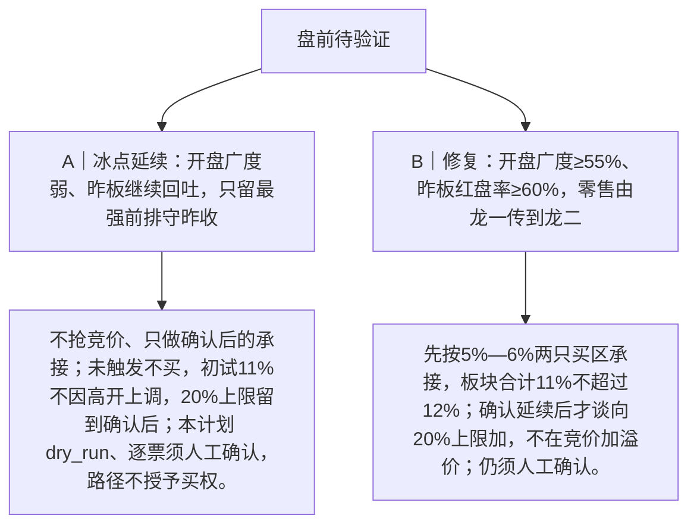

<!-- canghai:explicit-plan-report-assembly:v1 -->
# 2026-11-26 盘前预案

> 价位、仓位与限制均来自本轮定稿计划；条件剧本不等于当前可买。

## 市场判断

## 一句话结论

今天不押广度、不押高度，只做防守主线上最强两只的右侧确认：市场建议总风险敞口上限20%、盘前初试11%（杭州解百6%＋国芳集团5%，触发才买）；系统执行额度20%、单票8%、板块12%，但本轮按 dry_run 交付——不启用自主下单、逐票须人工确认，额度不是买权。时机上首选"冰点延续、只有最强前排守住昨收才有局部承接"，备选才是"修复扩散、零售从龙一传到龙二"。

## 详细分析

昨天市场在担心的是"跌完还能不能修复"。11月24日全A 1952涨/3498跌、中位-0.67%，指数已经不稳；11月25日把这个担心直接坐实：5573只里586涨、4926跌、61平，中位-3.77%，1860只跌超5%、284只跌超9%；涨停51、跌停43、收盘未回封30/81=37.04%，两市成交1.38万亿（沪深口径，-16.43%，缩量）。真正伤人的不是指数，而是"昨板的钱今天拿不回来"：11月24日涨停池55只在11月25日开盘均值还有+2.05%，收盘中位-4.47%，从开盘到收盘中位-4.67%，35只收跌；11月24日炸板池68只收盘中位-6.13%。换句话说，昨天开盘去接力的钱，绝大多数当天就亏了，这是今天所有仓位决定的第一前提。

结构上，高度只剩一个壳：2/3/4/5板是5/6/2/1，五板只有中京电子一只，而且是14:54:48才首封、42.49%换手、单日龙虎榜净卖0.549亿，PCB板块当天9/215红盘、行业资金-69.54亿。四板两只也各有问题——金新农22.57%换手、两次开板，克来机电虽是一字（09:25:01封、换手1.46%）但主营与网页给的标签不符，R2都没有把它们当候选。低阶晋级也窄，这就是"有高度、没有扩散"的典型退潮结构。

逆势只有两条线，都是防守属性。一般零售／百货：连板网页3→1→4，成分4封3未回封，29/58上涨，大单当日+4.93亿、5日+3.96亿，百货行业5日+6.61亿、今日+4.35亿；杭州解百是唯一三板（09:30:03首封、零开板，近5日大单板块第2），国芳集团是非杭州前排首板（10:06:01封、零开板，5日大单第3、当日+1.15亿，东财人气90日72天在榜）。流感／药品端：11月25日有12家医药主题终封、多集中在09:31–10:36，特一药业09:31:33首板零开板、亨迪药业09:33:24的20cm首板零开板且单日龙虎榜净买0.445亿；但这条线的资金是分叉的——东财口径流感当日+8.75亿、5日却是-18.12亿，问财口径同源大单代理当日净卖约2.42亿。也就是说，流感线有价格、有传播、没有持续性资金；零售线资金和价格是同向的。

情绪上我只用本轮绑定的原生六态：阶段=冰点、事实日2026-11-25、连续第6个交易日、收盘已核（close_verified=true），盘中观测缺失（intraday_status=missing）。展示先验是"从冰点出发：修复53%、冰点26%、高潮12%、退潮4%、升温2%、降温空白，展示合计97%，取整频率不归一、不补余量"；同景样本是"冰点连续≥4天"5例，其后冰点60%/高潮20%，指数次日均值+0.1%、上涨占比40%。R1的独立预测给首选冰点、备选修复，明确偏离宽样本"修复居首"，理由是11月25日全A下跌88.39%、缩量16.43%、昨板收盘负反馈、最晚高标是尾盘才封。我采纳这个取向：不是不承认53%，而是承认"先验排第一"与"今天可交易的东西"不是一回事——冰点第6天，先验里的修复需要开盘广度先证明，不能盘前预支。

四象限我是这样放的。资金：电子-209.37亿、半导体-126.22亿、PCB当日-69.54亿、CPO当日-61.58亿；一般零售当日+4.93亿/5日+3.96亿、百货5日+6.61亿；流感当日+8.75亿但5日-18.12亿、10日-45.69亿；白酒5日+7.20亿/10日+15.66亿而股价仍跌——钱在防守线内部做短，不在容量主线做趋势。情绪：冰点、炸板率37.04%、昨板池收盘中位-4.47%，只支持局部存量接力。基本面估值：杭州解百静态/滚动PE 24.86/23.39 对零售行业20.38/19.53、前三季营收-3.44%，且公司11/25发布2026-037交易风险提示（近三日换手显著放大、存在快速回落风险）；国芳PE(TTM)71.28/PB4.44，R6按2026三季报算出F3应收同比+227.31%（高于9M营收+8.25%的1.5倍）、F6非经常损益占归母43.75%；天孚F3应收+77.31%、F4存货周转113.7→218.6天、F9应收占9M收入40.93%。这些都是逐票风险，不是"今天不能做"的理由，但足以决定谁只能小仓、谁只能看。结构：两条防守线都是早板/午前板＋零开板，4封3未回封说明零售兑现不完整；流感线没有已确认的龙一/龙二（R2 leaders_degraded=true，明确"缺龙一/龙二不递补"）。

所以执行池只放两只，都在零售线上，且买区压在昨收附近。杭州解百：突破跟随，买区8.31~8.48、触发8.35、止损8.06、止盈9.32、RR=2.0、条件建议6%。它的止损是买价×0.95=8.06（引擎同时算了MA10×0.99=7.07、熊线×0.99=6.98，都更低，取最高的8.06），距买区上沿-5.0%，不是挪价也不是把止损放宽。国芳集团：同样是突破跟随，买区10.70~10.91、触发10.75、止损10.51（MA10×0.99，比买价×0.95=10.36更紧，属于有技术依据的更紧止损）、止盈11.71、RR=2.0、条件建议5%。两只合计11%，正好是本轮初试，板块合计11%低于12%的板块上限；引擎另给8.93和11.50的溢价容忍（约+7%），那只是执行端容忍记录，不是追高价——买区上沿仍是8.48和10.91，超出买区不成交。

为什么不选同批看起来更热的票，我逐票写：流感线没有龙一/龙二，特一虽是最先封板（09:31:33、零开板），但5日大单在流感成分只排第15/185、30日无席位，R2两项杂毛判据命中，只能当扩散时序的读数；亨迪是20cm最强弹性（飙升榜第2、龙虎榜+0.445亿），但R2列龙三，按用户"龙三不进执行池"的硬规则不进，且它有两项财务红旗；九安是原序锚1，可11月25日收-2.79%、5日大单-3.40亿（185/185），旧辨识度不敌当下撤离；海南海药+6.40%但炸板未回封、30日无席位；百花医药-1.79%、5日-0.62亿（168/185）。高度线全部只作温度计：中京电子板型模块判"尾盘板"、时间窗"尾盘投机(14:30+)"、动作"尽量不打"，叠加42.49%换手与日榜净卖；九阳股份3板7次开板，模块判"回封板(多次开板)、不碰"，还有第二次风险提示与业绩下行；金新农4板两次开板同判回封板，且公司亏损并公告提示股价偏离基本面；宁波东力3板开2次同判回封板，累计异常榜-0.249亿。家家悦首封更早（10:04:50）但5日资金第13且两项杂毛，只作非杭州宽度计数。天孚通信是本批资金最实的容量票（+7.65%、成交117.16亿、5日+29.25亿双源同号），但CPO当日-61.58亿、成分只有10/100上涨、中际-1.92%、新易盛+0.72%，20日仍大跌——这是"局部独强"，我把它放进观察和B计划，而不是硬塞进执行池。

竞价三档已经写死在同版JSON里，这里只点要点：杭州预期带8.22~8.52（昨收8.35的-1.5%~+2%），低于8.22放弃（除非10分钟内收回8.35并放量重评），8.22~8.52按买区放量承接，8.52~8.77算超预期但只等回踩8.48以内，8.77以上（+5%）不追；国芳预期带10.59~10.97，低于10.59放弃，10.59~10.97按买区执行，10.97~11.29只等回踩10.91以内，11.29以上不追。两只都不是竞价挂单就买：必须先看到"杭州守住昨收 + 国芳/家家悦至少一只同步放量红盘"，杭州不成立，国芳不单独买。

T+1上必须说清楚：这两只是无底仓的新开仓，买入当日一股都不能卖。所以止损8.06和10.51是"次日集合竞价离场参考"，不是当日止损；止盈9.32和11.71到2R先减半，余仓走量价与板块退出；当日跌破止损只是观察信号，不是当日能执行的卖点。仓位是按尾部风险倒推的：单票6%和5%，两只都在-5%止损内，组合当日最大计划内亏损约0.48个百分点。

B计划三个方向。一是容量反向：零售两只都不及预期、天孚却同向放量站上130.87、CPO上涨家数由10/100扩张、中际/新易盛至少一只转红时，才考虑天孚（买区130.22~132.83、触发130.87、参考风险123.61、2R 151.27），它只是预案内备选，不取得买权。二是防守消费（白酒/食品饮料）：R7显示白酒今日+6.12亿/5日+7.20亿/10日+15.66亿，但R2把泛防御列为discarded（score 43、食品饮料5日-6.88亿），R5没有逐票画像，所以只写方向、不造票。三是流感医药商业扩散：需要药品端前排至少一只晋级且医药商业资金由今日+2.55亿、5日-1.10亿转正，人民同泰开4次、拓新流通19.1亿低于20亿硬线、本轮无画像，同样不造票。共同作废条件：三条线同时走弱、涨面<50%、炸板率>25%——全市场降档，执行池整体后置。

R6这一轮没有已证硬否决（hard_rejects=[]），给了52条逐票反证。我对杭州采纳了"公告反证+高位触板软反证"，落到仓位6%和"必须守昨收"；对国芳采纳了F3/F6财务红旗与估值压力，落到仓位5%且"杭州不成立就不单独买"；对亨迪、特一、天孚、中京、九阳全部按"降级观察/只作温度计"处理，并在meta里逐条记了采纳与作用。没有任何一只因为"反证条数多"被机械减仓或机械不参与。R6的formal_review_completed=false 是覆盖披露，不是禁买令，也不冒充"已审完"。

连板网参考（本轮R1/R2已绑定的 knowledge_context 与 knowledge_adjudications）我采纳了三条、留了一条分歧：采纳lianban:today的宽度/高度分判（51/43、30未回封、零售4封3未回封）、lianban:mainline的相对方向（零售3→1→4、光通信2→2、机器人67→19→3）、theme_anchors的"只按题材查流感原序前三、历史分不作当日资格"；分歧的是lianban:qingxu的展示首位把"修复"放第一（53%），我按同景与当日广度把首选改成冰点、备选改修复，并在meta.knowledge_adjudications写明。一字预测（yizi_prediction）R2已记deferred，只有T-1封单/连板输入，我没有把杭州当一字处理。专题证据里stock_character、growth_pool、dividend_pool、review_feedback都是unknown/未开全表，我没有把"传递过"当"已采纳"。

数据源审计如实写：本批R1–R7同版校验通过（run_id 20261126T061055-62560-3434，summary sha256 045f1674…，artifacts与input_manifest.topic_knowledge里R1/R2/R4/R5/R6的文件sha256逐一相同），但内容是degraded/partial——R1 degraded(0.7)、R2 degraded(0.62)、R3 degraded(0.364)、R4 partial且contract_checks_passed=false（49条事件缺stop_loss价位，我只用事件事实与板块映射，不用它的价位）、R5 partial、R6 partial(formal_review_completed=false)、R7 partial(0.42)，fetch_global_severity=2。辅助输入里attention可用（信号日11/25、使用日11/26，dc_renqi 0行不可用，ths_stock/dc_biaosheng各100行，surge/cross_platform为空）与emotion_cycle可用（phase_schema=lianban_six_v1、冰点、事实日11/25）；本日催化剂日历chzl_kg/投研交易/催化剂/20261126.md在绑定时不存在（error=No such file or directory），这是真缺口：≤3个交易日的大事件窗口整体未核，R4内嵌事件里只有"外交部回应美国拟加征关税报道"接近宏观但没有行业级射程，所以不触发买点后置闸门，也不因此全局禁买——高位票的风险改用逐票竞价条件和小仓位处理。错题本、观察跟踪、账户/QMT 本轮都没有读取授权，我没有展开通配符，也不声称"没有同类错误"。

识图复核只作辅助诊断、不改价不改资格：本批 chart_coverage 只覆盖5/13（002164、002242、002548、002579、002728），杭州解百、国芳集团、亨迪药业、特一药业、九安医疗、海南海药、百花医药、家家悦、天孚通信这8只没有可比快照，全部写unknown（reason=chart_evidence_missing_or_unknown），不冒称识图确认，也没有把支撑观察位当执行止损。这一项不改变 buy_eligibility、仓位、名单、entry/exit 数值，也不新增全局禁买。

盯盘顺序已写进同版JSON的 daily_focus 五只，顺序即优先级：杭州解百、国芳集团（两只条件候选，触发才买、未触发不买），亨迪药业、特一药业（流感线读数，建议仓位显式0），天孚通信（B计划容量反向，建议仓位显式0）。它不是新候选池，不挪池、不给买点，只把"今天先看谁"钉在同一份计划里。

剩下的不确定性摆在台面：一是冰点第6天同景样本只有5例（冰点60%/高潮20%），宽样本先验又是修复53%，两个先验互相打架，所以只能用"开盘广度≥55%且昨板红盘率≥60%"这类可验证条件分批改判，不预支；二是两只执行票都属同一板块，板块合计11%已接近12%上限，若零售线整体转弱，两只同时取消、当日空仓是正常结果；三是杭州是三板高位，公司自己提示了回落风险，它能不能买取决于"守住8.35+同伴助攻"，不是取决于它昨天封得漂亮；四是国芳财务红旗、PE(TTM)71.28 是实打实的，5%仓位是试错而非重仓；五是账户可用现金、可卖量与真实报价本轮未核，11%是市场风险敞口，不是账户额度，也不证明成交条件成立。

与其他角色的关系：R1给风格（震荡分化型、情绪分59、建议0%——我只当输入，最终市场建议是我独立的20%/11%）；R2给两条主线与候选角色以及leader_filter/board_pattern的硬判（我沿用"龙三不进执行池""缺龙一/龙二不递补"）；R3给群聊与主题（医药/零售L1+L2，只作传播证据）；R4给56条事件与首板候选（流感通报、杭州解百风险提示、珠免并购三组直接决定我的取舍）；R5给13只六维画像与逐票资金（两只执行票的5日资金与财务红旗都取自这里）；R6给52条反证与0条硬否决；R7给板块与个股资金（部分维度滞后）。下游P1竞价校准与P2午盘修订沿用本版价位与取消条件，不重新选票。

## 盘前路径图

- 六态基线：事实日=2026-11-25；阶段=冰点
- 目标日判断：首选=冰点；备选=修复

### A｜冰点延续：开盘广度弱、昨板继续回吐，只留最强前排守昨收

- 依据：11月25日全A 586涨/4926跌、中位-3.77%、1860只跌逾5%，涨停51/跌停43/未回封37.04%，昨板池开到收中位-4.67%、昨炸板池-6.13%；原生六态冰点（事实日11/25、连续6日），同景"冰点≥4天"5例中冰点60%；展示先验修复53%但当日广度与昨板反馈更弱，故首选冰点而非先验首位。
- 仓位态度：不抢竞价、只做确认后的承接；未触发不买，初试11%不因高开上调，20%上限留到确认后；本计划 dry_run、逐票须人工确认，路径不授予买权。
- 观察方向/票：杭州解百(600814.SH) 与 国芳集团(601086.SH) 是唯一两个有条件参与位；亨迪药业(301211.SZ)、特一药业(002728.SZ) 只读流感线是否出二板；天孚通信(300394.SZ) 只读容量反向是否成立。
- 价位：杭州 买区8.31~8.48／触发8.35／T+1风险参考8.06／引擎容忍8.93不作追高价；国芳 10.70~10.91／10.75／10.51／容忍11.50；观察票 亨迪11.03~11.37（参考风险10.46）、特一8.31~8.48（8.22）、天孚130.22~132.83（123.61），均不构成买点。
- 取消：杭州竞价跌破8.22且10分钟内收不回8.35，或国芳跌破10.59，或两只在高开后回吐不守昨收；或涨面<50%、炸板率>25%——两只当日全部取消，不换票递补。

### B｜修复：开盘广度≥55%、昨板红盘率≥60%，零售由龙一传到龙二

- 依据：11月25日仍有51个终封、14只续板、未回封率从55.28%回落到37.04%，外盘跌幅收窄；一般零售5日+3.96亿、百货5日+6.61亿，是唯一"价格与资金同向"的防守线；若开盘广度与昨板兑现同时转正，修复先验（53%）才具备可交易的载体。
- 仓位态度：先按5%—6%两只买区承接，板块合计11%不超过12%；确认延续后才谈向20%上限加，不在竞价加溢价；仍须人工确认。
- 观察方向/票：先看杭州解百是否守住8.35并放量，再看国芳集团是否跟上；家家悦(603708.SH) 是非杭州宽度读数；流感线只在特一出二板/亨迪放量时升级为观察，不进执行池。
- 价位：杭州8.31~8.48（8.35／8.06／9.32，RR=2.0）；国芳10.70~10.91（10.75／10.51／11.71，RR=2.0）；B计划天孚130.22~132.83（130.87／123.61），只在容量同伴跟随且零售不及预期时启用，不跨池借价。
- 取消：指数放量而涨面不扩（<55%）、或零售前排冲高回落无承接、或百货资金转负——本支作废回到A；A与B互斥，不叠加仓位。

交易日：20261126；事实时点：2026-11-26T07:27:11+08:00；有效期至：2026-11-26T10:00:00+08:00。到期或条件取消须重评；分支仅供观察，不授予买权。

## 同版计划速览

> 原序、原池展示；观察／Plan B 不自动晋级，场景互斥不累加仓位。新增仓 T+1 当日不可卖；底仓可卖量未知，触价不保证成交。静态价位非实时，未知不作零。最高接受价不放宽买区，实际买价须另核盈亏比。

### 市场建议（不扣减未知账户持仓，非执行额度）

**盘前市场决定：有条件开仓候选，未触发不买。** 事实日2026-11-25：本批13只已核对象逐票比较后，只有零售龙一/龙二同时具备：①R2龙一/龙二身位（龙一 leader_rank=1、龙二=2）；②五日资金为正且板块内前3（杭州+1.68亿第2、国芳+1.10亿第3；百货5日+6.61亿）；③板型过关（杭州09:30:03秒拉板+板块4封→可排不可冲；国芳10:06零开板、模块判中军板(午前)动作可做）；④引擎买区压在昨收附近且RR=2.0。被排除者逐票有据：流感线无已确认龙一/龙二，特一5日资金第15/185+两项杂毛，亨迪为龙三；中京5板14:54尾封+42.49%换手+日榜净卖，九阳3板7开+第二次风险提示，金新农4板两开+亏损公告，宁波东力开2次+累计异常榜-0.249亿——按关4回封/尾盘规则只作温度计；天孚虽五日+29.25亿但CPO当日-61.58亿、成分10/100，只作B计划。故outcome=conditional_entries：两只触发才买、未触发不买；账户额度与执行权限不由此推定。

| 市场总仓上限建议 | 初始试探建议 | 依据与条件 |
|---|---|---|
| 20% | 11% | 依据：11/25事实日：全A 586涨/4926跌、中位-3.77%、1860只跌逾5%、跌停43对涨停51、未回封37.04%、沪深成交1.38万亿（R1/R2口径，-16.43%）；昨涨停池55只收盘中位-4.47%、开到收-4.67%，昨炸板池-6.13%。这种亏钱效应下不按常态给仓：上限压到20%、盘前初试11%（=两只条件候选6%+5%，触发才买）。仍给正建议的理由是两条逆势线有独立资金与结构证据（一般零售5日+3.96亿/百货+6.61亿；流感当日+8.75亿），但只做防守线最强两只的右侧确认，不做广度或高度押注。建议是风险敞口，不是账户额度，也不证明成交条件成立。；条件：开盘同窗广度≥55% 且 昨涨停池红盘率≥60% 才按预案执行初试；仅指数翻红而昨板继续回吐不算改判。；零售线：杭州解百须守住8.35并出现国芳/家家悦至少一只助攻；否则该票取消。；流感线无已确认龙一/龙二（R2 leaders_degraded），只观察特一/亨迪的二板与承接，不进执行池。；盘中炸板率&gt;25%或百货资金转负 → 当日不再新增；已触发仓位按T+1退出规则处理。；事实时点：2026-11-26T07:27:11+08:00；有效期：2026-11-26T10:00:00+08:00 |

- 仓位对账：已分配 11%；未分配 9%；预算利用率 55%
- 保留现金原因：保留9个百分点未分配（20%-11%）：冰点第6日、昨板负反馈、高度只剩尾封一只，先让两只条件候选在竞价/开盘证明承接，再谈向20%上限加仓；不为用满预算而降低条件。
- 对账生成时点：2026-11-26T07:27:11+08:00

### 执行池｜今日重点

| 顺序 | 代码／名称 | 安排 | 建议仓位 | 为什么盯 | 竞价／承接看什么 | 什么情况放弃 |
|---|---|---|---|---|---|---|
| 1 | 600814.SH 杭州解百 | 条件成立才参与 | 6% | 零售龙一、唯一三板（09:30:03首封零开板），5日大单板块第2；今天零售线成立与否先看它 | 竞价落在8.22~8.52且开盘不在8.35下方弱势运行；国芳或家家悦同步放量红盘；8.31~8.48放量站上8.35才买 | 低开跌破8.22且10分钟内收不回8.35；或国芳/家家悦双双转绿；或三板后首次炸板不回封 |
| 2 | 601086.SH 国芳集团 | 条件成立才参与 | 5% | 非杭州前排、首板10:06零开板、人气90日72天在榜、当日大单+1.15亿，是零售线第二承接位 | 杭州守住昨收后，国芳放量站上10.75并在10.70~10.91承接；家家悦助攻为佳 | 杭州转弱，或国芳高开&gt;5%后回吐跌破10.59 |
| 3 | 301211.SZ 亨迪药业 | 仅盯盘 | 0% | 20cm首板、东财飙升榜第2、单日龙虎榜净买0.445亿，是流感线弹性最强单票（只盯不做） | 特一或第二批首板至少1只续强，自身放量站上11.03~11.37 | 特一不能出二板或亨迪冲高回落；本票观察仓0%，不因盘中强就买 |
| 4 | 002728.SZ 特一药业 | 仅盯盘 | 0% | 药品端首封09:31:33零开板，是流感线'是否成立'的时序锚（只盯不做） | 能出二板且亨迪/人民同泰同向，板块资金由-18.12亿转正 | 首板群无一晋级，或5日资金继续净出 |
| 5 | 300394.SZ 天孚通信 | 仅盯盘 | 0% | B计划容量反向：5日+29.25亿双源正、逆势+7.65%，但CPO当日-61.58亿、成分10/100（只盯不做） | 中际/新易盛至少1只同向且CPO上涨家数扩张，天孚放量站上130.87 | 容量同伴不跟，或天孚回吐跌破123.61 |

### 执行约束（不是市场看空判断）

- 模式：dry_run；禁止新开仓：否；允许自主交易：否；须用户确认：是
- 持仓数上限：3；每日买单上限：3；单票每日订单上限：2；禁入代码前缀：920；禁止ST：是；熔断开关：data/runtime/KILL_SWITCH
- 执行总仓上限：20%
- 不交易条件：本交易日催化剂日历 chzl_kg/投研交易/催化剂/20261126.md 绑定时不存在，≤3交易日大事件窗口未知；只记缺口，不全局禁买；未触发
- 不交易条件：R6 formal_review_completed=false、13票逐项审查未完成；覆盖披露，不是禁买，也不升级为逐票否决；未触发
- 不交易条件：R4 49条事件缺 stop_loss 价位触发合同失败；事件事实与板块映射仍消费，缺失价位不用于本计划；未触发
- 不交易条件：R7 partial (0.42)：ETF份额/两融滞后一档、北向仅复盘参考、FX与托盘主体未核；资金面部分维度未核，不全局禁买；未触发
- 不交易条件：本轮无错题本/观察跟踪/账户读取授权；不声称无同类错误，也不据此禁买；未触发
- 板块 一般零售／百货：确认：杭州解百守住8.35 + 国芳或家家悦至少1只放量助攻；百货资金维持净入；共同失效：杭州开板不回封、国芳无承接、百货资金转负
- 板块 流感／药品端（医药商业为扩散对照）：确认：特一出二板或亨迪放量续强 + 第二梯队首板≥2家；流感板块资金由-18.12亿转正；共同失效：首板群无一晋级、药品前排回吐、板块资金继续净出

### 机器执行明细

| 代码／名称 | 通道 | 买区 | 确认条件／价格锚 | T+1风险参考 | 目标价 | 条件建议仓位 |
|---|---|---|---|---|---|---|
| 600814.SH 杭州解百 | 突破跟随 | 8.31 ~ 8.48 | 量价：平开或小幅高开（竞价8.22~8.52）+ 同组国芳/家家悦至少一只同步放量红盘，放量站上8.35后按8.31~8.48承接；高开&gt;5%（8.77以上）不追；跌破8.22放弃；窗口：09:25-10:00；触发价 8.35；入场锚 8.48；最高接受价 8.93 | 风险位 8.06 | 9.32 | 6% |
| 601086.SH 国芳集团 | 突破跟随 | 10.70 ~ 10.91 | 量价：杭州解百守住8.35且国芳放量站上10.75后，在10.70~10.91承接；杭州转弱或自身高开&gt;5%（11.29以上）不追；跌破10.59放弃；窗口：09:30-10:30；触发价 10.75；入场锚 10.91；最高接受价 11.50 | 风险位 10.51 | 11.71 | 5% |

- **600814.SH 杭州解百**：理由：一般零售唯一三板（11/25 09:30:03首封、零开板），近5日大单板块第2（+1.68亿，东财+1.66亿），百货行业5日+6.61亿、今日+4.35亿，R2认定为龙一。反向证据同时成立：板块4封3未回封、宽口径新零售-0.59%；公司2026-037公告自陈近三日换手显著放大、存在快速回落风险，静态/滚动PE 24.86/23.39 高于零售行业20.38/19.53，前三季营收-3.44%。因此只作条件候选：必须守住8.35并有同伴助攻，不打无量四板。；逻辑：身位：三板+零开板为零售唯一高度，符合'只做龙头'；东财人气90日仅今日首次进榜(#42)，属弱人气，不构成加分；资金：近5日大单第2、行业当日+4.93亿/5日+3.96亿，百货5日+6.61亿（R7东财口径）；板型：09:30:03秒拉板，板块4家终封≥3 → 按关4'可排不可冲'，本计划不排板、只做放量突破跟随；反证：R6模式9高位触板+模式1公告反证（strong_suggest：保留公告反证，不等同立案/硬否）；4封3未回封说明板块兑现不完整；对照：同组国芳（首板、5日第3、人气72天）是第二承接位；家家悦5日第13、两项杂毛条件，只作宽度计；T+1：买入即押次日接力；冰点期三板次日溢价依赖板块合力和大盘不继续破位，故仓位压到6%并要求竞价确认；T+1判断：消息：零售是防守线，没有新公告催化；珠免免税并购（E20261126_016）与杭州解百自身风险提示（E20261126_037）方向相反，不能借珠免给零售背书。；预期差：若高开即被先手兑现、国芳/家家悦不跟，三板只剩分歧；若平开缩量守住8.35再放量，属资金继续做高度而非情绪扩散，可小仓跟。；买点：不打排板、不追高开：只在竞价8.22~8.52且放量站上8.35后承接；高开&gt;5%放弃，低开破8.22放弃（除非快速收回并放量重评）。；标签：龙一／零售高度锚；秒拉板+板块4封（可排不可冲）；原状态：watch_pool_wait_for_entry；允许自动交易：否；须用户确认：是；买入资格：原资格通过（非下单授权）；资格依据：RR_PASS_NOT_TRADE_AUTHORIZATION；资格须复核：否；系统单票上限：8%；场景1执行限制：须盘中确认：是；一字不追：否；最高溢价：7%；系统执行分配：6%；个股共用退出：stop_loss_break；价 8.06；条件：新仓T+1：次日集合竞价低于或贴近该位即挂单离场；买入当日一股不可卖；依据：买价基准-5%（10cm口径），原止损几何由引擎计算，不放宽；生效：T+1；数量 100%；个股共用退出：take_profit_hit；价 9.32；条件：次日盘中触及2R先减半，余仓走量价与板块退出；依据：2R目标，连板妖股不设长目标；生效：T+1；数量 50%；个股共用退出：sector_switch_exit；价 未知；条件：国芳/家家悦同步转弱或百货资金转负→次日竞价清出；板块降级不退化为当日卖出；依据：板块联动失效即退出；不因单日盘中破位而假装当日可卖；生效：T+1；数量 100%
- **601086.SH 国芳集团**：理由：同业四只涨停中的非杭州前排：首板10:06:01、零开板，板型模块判为中军板(午前)、动作'可做'，5日大单板块第3（+1.10亿，东财+1.21亿），当日+1.15/+1.29亿；东财人气90日72天在榜（历史最高第2）。反证同样清楚：20日仍-18.25%、PE(TTM)71.28/PB4.44、R6财务红旗F3（应收同比+227.31% 高于9M营收+8.25% 的1.5倍）、F6（非经损益占43.75%）。只在杭州守住昨收且自身放量时参与，不把补涨当独立行情。；逻辑：身位：R2 龙二（B计划补涨），首板10:06零开板→模块判中军板(午前)（限1板+放量0.8x5日均满足），动作'可做'，不是'必须打'的证据；资金：5日大单板块第3；问财当日+0.46亿与东财+1.15亿同向（金额口径有日内偏差，R6模式1已列）；人气：90日72天在榜（dc_renqi+ths_stock），今日热股#27，是零售线最稳定的人气标的；反证：20日下跌18.25%属修复非趋势；财务红旗F3/F6为已算实数（20260930），R6建议降级、不硬否；对照：家家悦首封10:04:50更早但5日资金第13且两项杂毛→只作宽度；中央商场开1次、5日第4→不作替补；T+1：首板次日溢价依赖龙一是否守住；国芳是第二承接位，仓位5%低于杭州；T+1判断：消息：无自身新增催化；11/18异动公告为旧信息，珠免并购属免税交易而非国芳催化，不能借来确认零售。；预期差：若杭州守住而国芳放量跟上，属零售内部高低切换；若杭州转弱而国芳独强，先核家家悦与百货广度，不自动晋为龙一。；买点：只在杭州确认后做国芳的放量突破（10.70~10.91），不做竞价追高；杭州不成立则不单独买国芳。；标签：龙二／补涨承接；中军板(午前)、0开板；原状态：watch_pool_wait_for_entry；允许自动交易：否；须用户确认：是；买入资格：原资格通过（非下单授权）；资格依据：RR_PASS_NOT_TRADE_AUTHORIZATION；资格须复核：否；系统单票上限：6%；场景1执行限制：须盘中确认：是；一字不追：否；最高溢价：7%；系统执行分配：5%；个股共用退出：stop_loss_break；价 10.51；条件：新仓T+1：次日集合竞价低于或贴近该位即挂单离场；买入当日一股不可卖；依据：买价基准-5%（10cm口径），原止损几何由引擎计算，不放宽；生效：T+1；数量 100%；个股共用退出：take_profit_hit；价 11.71；条件：次日盘中触及2R先减半，余仓走量价与板块退出；依据：2R目标，连板妖股不设长目标；生效：T+1；数量 50%；个股共用退出：sector_switch_exit；价 未知；条件：杭州开板不回封或百货资金转负→次日竞价清出；依据：板块联动失效即退出；不因单日盘中破位而假装当日可卖；生效：T+1；数量 100%

### 观察候选（保留全部原身份）

| 代码／名称 | 理由／风险／当前限定 | 观察条件与价位 | 条件建议仓位 |
|---|---|---|---|
| 301211.SZ 亨迪药业 | 理由：20cm首板09:33:24、零开板，单日龙虎榜净买0.445亿、5日大单+0.63亿，东财飙升榜第2；但问财当日净卖0.181亿、5日流感成分板块资金-18.12亿，R6财务红旗F3(应收+33.39%/营收+11.14%)与F6(非经损益63.75%)。R2列龙三且流感线无已确认龙一/龙二，按 leader_preference 龙三不进执行池；只作弹性确认。；逻辑：流感催化（E20261126_004，疾控局11/24流行季）已交易一日，不外推新增销量；弹性：20cm+龙虎榜独立净买是线内最强单票弹性，但5日资金为正不能代表板块合力；反证：板块5日-18.12亿、问财当日净卖；龙虎榜单日不等于全市场资金；对照：特一为10cm首封时序锚（5日第15/185、两项杂毛）；拓新流通19.1亿低于20亿硬线、康芝两开板均被R2剔除；资格：龙三+必要财务红旗未解除→只在观察，等二板与同组扩散；原状态：仅观察；允许自动交易：否；须用户确认：是；观察限定：leader_rank3_no_execution；买入资格：原资格通过（非下单授权）；资格依据：RR_PASS_NOT_TRADE_AUTHORIZATION；资格须复核：否；系统单票上限：0%；场景1执行限制：系统执行分配：0% | 决策线回踩；买区 11.03 ~ 11.37；量价：规则引擎: 买区覆盖现价，按盘中承接执行；RR=2.0 (pass)；触发价 11.03；最高接受价 11.60；风险位 10.46；目标 13.19 | 0% |
| 002728.SZ 特一药业 | 理由：药品端首封09:31:33、零开板，R4流行季直接价格映射；但5日大单在流感成分仅第15/185、问财当日净卖，R2命中两项杂毛判据（主力5日top3外+30日无席位），R6 F3/F4财务红旗。只作扩散时序对照，不递补龙头。；逻辑：时序：药品端最先封板，是判断'流感线是否成立'的读数；反证：5日资金第15/185、无龙虎榜席位；R6模式7 F3应收+43.77%/F4存货周转270.9→321.3天；对照：亨迪20cm弹性更强但仅龙三；人民同泰开4次只作流通扩散验证；资格：两项杂毛条件已核 → 不进执行池，二板也不追；原状态：仅观察；允许自动交易：否；须用户确认：是；观察限定：two_laggard_flags；买入资格：原资格通过（非下单授权）；资格依据：RR_PASS_NOT_TRADE_AUTHORIZATION；资格须复核：否；系统单票上限：0%；场景1执行限制：系统执行分配：0% | 突破跟随；买区 8.31 ~ 8.48；量价：规则引擎: 买区覆盖现价，按盘中承接执行；RR=2.0 (pass)；触发价 8.35；最高接受价 8.93；风险位 8.22；目标 9.00 | 0% |
| 603708.SH 家家悦 | 理由：首板10:04:50、零开板，59.93亿流通；但5日大单第13、30日无席位=两项杂毛，R2降级。只作非杭州扩散宽度计，不升龙二。；逻辑：宽度：与国芳同日封板，是零售扩散的计数票；反证：5日资金第13/58，不具持续度；资格：杂毛两项 → 观察；原状态：仅观察；允许自动交易：否；须用户确认：是；观察限定：two_laggard_flags；买入资格：原资格通过（非下单授权）；资格依据：RR_PASS_NOT_TRADE_AUTHORIZATION；资格须复核：否；系统单票上限：0%；场景1执行限制：系统执行分配：0% | 突破跟随；买区 9.82 ~ 10.02；量价：规则引擎: 需上破 +1.4% 站上买区才成立（不是现在能买）；RR=2.0 (pass)；触发价 9.87；最高接受价 10.56；风险位 9.52；目标 11.02 | 0% |
| 002432.SZ 九安医疗 | 理由：流感原序锚1，但11/25收-2.79%、5日大单-3.40亿（板块185/185），历史股性不敌当前撤离；R5降级counterexample。；逻辑：只用于验证旧辨识度是否仍有效；反证：资金末位+当日下跌；资格：旧锚不作候选；原状态：仅观察；允许自动交易：否；须用户确认：是；观察限定：counterexample_only；买入资格：原资格通过（非下单授权）；资格依据：RR_PASS_NOT_TRADE_AUTHORIZATION；资格须复核：否；系统单票上限：0%；场景1执行限制：系统执行分配：0% | 突破跟随；买区 45.77 ~ 46.69；量价：规则引擎: 买区覆盖现价，按盘中承接执行；RR=2.0 (pass)；触发价 46.00；最高接受价 49.22；风险位 44.36；目标 51.35 | 0% |
| 000566.SZ 海南海药 | 理由：原序锚2，11/25 +6.40%但炸板未回封、30日无龙虎榜席位、R2判杂毛；存量承接对照，不递补。；逻辑：反证：炸板+无席位=承接不稳；资格：杂毛 → 只观察；原状态：仅观察；允许自动交易：否；须用户确认：是；观察限定：counterexample_only；买入资格：原资格通过（非下单授权）；资格依据：RR_PASS_NOT_TRADE_AUTHORIZATION；资格须复核：否；系统单票上限：0%；场景1执行限制：系统执行分配：0% | 突破跟随；买区 3.64 ~ 3.71；量价：规则引擎: 买区覆盖现价，按盘中承接执行；RR=2.0 (pass)；触发价 3.66；最高接受价 3.92；风险位 3.52；目标 4.09 | 0% |
| 600721.SH 百花医药 | 理由：原序锚3，11/25 -1.79%、5日大单-0.62亿（168/185），CRO/研发服务与药品直接受益不同；R5 risk_grade C。；逻辑：反证：负资金+主题红盘不能修补；资格：降级旧锚，不可借板块强度；原状态：仅观察；允许自动交易：否；须用户确认：是；观察限定：counterexample_only；买入资格：原资格通过（非下单授权）；资格依据：RR_PASS_NOT_TRADE_AUTHORIZATION；资格须复核：否；系统单票上限：0%；场景1执行限制：系统执行分配：0% | 突破跟随；买区 7.64 ~ 7.80；量价：规则引擎: 买区覆盖现价，按盘中承接执行；RR=2.0 (pass)；触发价 7.68；最高接受价 8.22；风险位 7.41；目标 8.58 | 0% |
| 002579.SZ 中京电子 | 理由：全市场最高标（5板）but 11/25 14:54:48才首封，板型模块判为'尾盘板'、时间窗=尾盘投机(14:30+)、动作'尽量不打'；42.49%换手、日榜净卖0.549亿、PCB板块9/215红盘、板块当日-69.54亿；R6模式9只作隔日压力验证 → 只作温度计。；逻辑：高度读数：5板高度是本轮情绪上限的压力测试；反证：尾封+高换手+资金净卖+板块收缩；对照：克来机电4板一字（09:25:01封、换手1.46%）为另一高度形态，R2因主营/标签不符不作候选；资格：板型硬拒→观察，不给买点；原状态：仅观察；允许自动交易：否；须用户确认：是；观察限定：board_pattern_rejected；买入资格：原资格通过（非下单授权）；资格依据：RR_PASS_NOT_TRADE_AUTHORIZATION；资格须复核：否；系统单票上限：0%；场景1执行限制：系统执行分配：0% | 突破跟随；买区 17.73 ~ 18.09；量价：规则引擎: 买区覆盖现价，按盘中承接执行；RR=2.0 (pass)；触发价 17.82；最高接受价 19.07；风险位 17.19；目标 19.89 | 0% |
| 002242.SZ 九阳股份 | 理由：3板7次开板=回封板(多次开板)，按关4硬拒；三榜第一+90日59天在榜，但第二次风险提示、业绩下滑、家电不扩散、小家电当日-2.48亿；R5 alpha/risk=C。；逻辑：人气：三榜第一是拥挤读数，不是买入理由；反证：7次开板+风险提示+业绩下行；资格：直接观察，不设买点；原状态：仅观察；允许自动交易：否；须用户确认：是；观察限定：board_pattern_rejected；买入资格：原资格通过（非下单授权）；资格依据：RR_PASS_NOT_TRADE_AUTHORIZATION；资格须复核：否；系统单票上限：0%；场景1执行限制：系统执行分配：0% | 突破跟随；买区 38.37 ~ 39.14；量价：规则引擎: 买区覆盖现价，按盘中承接执行；RR=2.0 (pass)；触发价 38.56；最高接受价 41.26；风险位 37.18；目标 43.06 | 0% |
| 002548.SZ 金新农 | 理由：4板但22.57%换手、2次开板=回封板（硬拒），5日大单+1.10亿虽正；猪肉板块当日+1.45亿但5日-4.88亿，公司亏损且公告提示股价偏离基本面；R6强提示保留。；逻辑：高度：4板是农业线的压力测试；反证：两开+亏损公告+农业线宽度窄（正虹流通16.9亿被硬剔）；资格：观察；原状态：仅观察；允许自动交易：否；须用户确认：是；观察限定：board_pattern_rejected；买入资格：原资格通过（非下单授权）；资格依据：RR_PASS_NOT_TRADE_AUTHORIZATION；资格须复核：否；系统单票上限：0%；场景1执行限制：系统执行分配：0% | 突破跟随；买区 4.98 ~ 5.09；量价：规则引擎: 买区覆盖现价，按盘中承接执行；RR=2.0 (pass)；触发价 5.01；最高接受价 5.36；风险位 4.84；目标 5.59 | 0% |
| 002164.SZ 宁波东力 | 理由：3板、开2次=回封板（硬拒），累计异常榜-0.249亿，机器人板块67→19→3收缩、锋龙/科森跌约6%；SCRIPTY不作为行业反转证据。；逻辑：反证：开板2次+资金净出+板块收缩；对照：铁流开12次更弱；克来机电一字但主营不符；资格：观察；原状态：仅观察；允许自动交易：否；须用户确认：是；观察限定：board_pattern_rejected；买入资格：原资格通过（非下单授权）；资格依据：RR_PASS_NOT_TRADE_AUTHORIZATION；资格须复核：否；系统单票上限：0%；场景1执行限制：系统执行分配：0% | 突破跟随；买区 21.59 ~ 22.03；量价：规则引擎: 买区覆盖现价，按盘中承接执行；RR=2.0 (pass)；触发价 21.70；最高接受价 23.22；风险位 20.93；目标 24.23 | 0% |
| 300394.SZ 天孚通信 | 理由：11/25 +7.65%、成交117.16亿，5日大单+29.25亿（东财+29.25亿/分档+29.56亿双源同号），是本批最实的容量资金；但CPO概念当日-61.58亿、成分仅10/100上涨、中际-1.92%、新易盛+0.72%，20日仍大跌；R6 F3/F4/F9财务红旗。只作B计划反向剧本与观察，不进执行池。；逻辑：容量：5日资金双源同号、逆势强度最先出现；反证：板块资金净出+同伴不跟=局部独强；20日仍下跌属修复；对照：中际/新易盛容量未走强，不能用戴尔订单证据替代本票订单；资格：B计划需竞价/量价确认，研究位不授买权；原状态：仅观察；允许自动交易：否；须用户确认：是；观察限定：capacity_b_plan_only；买入资格：原资格通过（非下单授权）；资格依据：RR_PASS_NOT_TRADE_AUTHORIZATION；资格须复核：否；系统单票上限：0%；场景1执行限制：系统执行分配：0% | 突破跟随；买区 130.22 ~ 132.83；量价：规则引擎: 买区覆盖现价，按盘中承接执行；RR=2.0 (pass)；触发价 130.87；最高接受价 140.03；风险位 123.61；目标 151.27 | 0% |

### 竞价剧本（原计划，不代表已确认）

| 候选／场景 | 预期档位 | 数值区间／条件 | 动作 |
|---|---|---|---|
| 600814.SH 杭州解百 | 预期开盘 | 昨收 8.35；预期带 8.22 ~ 8.52 | 预期带按±1.5~2%：冰点市场不给高位板溢价；+2%~+5%视为超预期但只接受回踩买区，+5%以上按先手兑现处理。 |
| 600814.SH 杭州解百 | 不及预期 | 竞价幅度：&lt;-1.5%；价格带 8.05 ~ 8.22 | 动作：低开破位→放弃；仅当10分钟内收回8.35并放量才按弱转强重评；动作类别：放弃或等待弱转强 |
| 600814.SH 杭州解百 | 符合预期 | 竞价幅度：-1.5%~+2%；价格带 8.22 ~ 8.52 | 动作：按预案执行：8.31~8.48放量承接才买，未放量不买；动作类别：按原预案 |
| 600814.SH 杭州解百 | 超预期 | 竞价幅度：+2%~+5%；价格带 8.52 ~ 8.77 | 动作：超预期→等回踩8.48以内再执行，不在竞价加价；动作类别：超预期后确认 |
| 600814.SH 杭州解百 | 高开过度 | 竞价幅度：&gt;+5%；价格带 8.77 ~ 8.93 | 动作：高开过度→不追（先手兑现风险），等回踩或放弃；动作类别：放弃 |
| 601086.SH 国芳集团 | 预期开盘 | 昨收 10.75；预期带 10.59 ~ 10.97 | 首板次日预期带同按±1.5~2%；国芳是第二承接位，超预期也不加价。 |
| 601086.SH 国芳集团 | 不及预期 | 竞价幅度：&lt;-1.5%；价格带 10.36 ~ 10.59 | 动作：低开破位→放弃（补涨票低开即失去承接假设）；动作类别：放弃或等待弱转强 |
| 601086.SH 国芳集团 | 符合预期 | 竞价幅度：-1.5%~+2%；价格带 10.59 ~ 10.97 | 动作：按预案执行：杭州确认后10.70~10.91放量承接；动作类别：按原预案 |
| 601086.SH 国芳集团 | 超预期 | 竞价幅度：+2%~+5%；价格带 10.97 ~ 11.29 | 动作：超预期→等回踩10.91以内，不追；动作类别：超预期后确认 |
| 601086.SH 国芳集团 | 高开过度 | 竞价幅度：&gt;+5%；价格带 11.29 ~ 11.83 | 动作：高开过度→不追，等回踩或放弃；动作类别：放弃 |

### Plan B

总触发：执行池两只零售票竞价不及预期（杭州跌破8.22 或 国芳跌破10.59），或高开后回吐不守昨收；一般零售/百货资金由正转负、杭州开板不回封；炸板率升破25% 或 涨面&lt;50%；互斥／共同放弃：A、B两向同时走弱（涨面&lt;50%、炸板率&gt;25%、两条线前排均回吐）→ 全市场降档：不再新增，已触发仓位按T+1退出；B与A互斥，不与A重复计仓。

| 方向 | 触发 | 原候选（不跨池借价） | 放弃条件 |
|---|---|---|---|
| 容量反向：零售/医药前排不及预期时的CPO容量承接（天孚通信） | 零售线两只均不及预期，且天孚同向放量站上130.87、CPO上涨家数由10/100扩张、中际/新易盛至少1只转红 | 300394.SZ 天孚通信：理由：B1候选：本批最实容量资金（5日+29.25亿双源），但CPO当日-61.58亿、成分10/100、20日下行；只有同伴跟随才成立；B计划只作预案内备选，不取得买权。；允许自动交易：否；须用户确认：是；观察限定：b_plan_research_only；买入资格：原资格通过（非下单授权）；资格依据：RR_PASS_NOT_TRADE_AUTHORIZATION；资格须复核：否；系统单票上限：0%；场景1执行限制：系统执行分配：0%；突破跟随；买区 130.22 ~ 132.83；量价：规则引擎: 买区覆盖现价，按盘中承接执行；触发价 130.87；最高接受价 140.03；风险位 123.61；目标 151.27 | 失效：容量同伴不跟（中际/新易盛不同向）或天孚回吐跌破123.61；或CPO资金继续净出 |
| 防守消费：白酒/食品饮料相对资金（本批无合资格个股，只写方向） | 零售与医药同向转弱且指数继续走弱，同时白酒板块资金不缩（今日+6.12亿/5日+7.20亿/10日+15.66亿） | 未知 | 失效：R2已把泛防御列为discarded（score 43，食品饮料5日-6.88亿），R5无逐票画像 → 只写方向不造票；若白酒资金转负即作废 |
| 流感医药商业扩散（同线次级，只在药品端前排成立后看） | 药品端前排（特一/亨迪）至少一只晋级且医药商业资金转正（今日+2.55亿、5日-1.10亿需转正） | 未知 | 失效：人民同泰开4次、拓新流通19.1亿低于20亿硬线、本轮无画像 → 不造候选；前排无一晋级即作废 |

### 四象限（仅原判断）

| 维度 | 模型显式判断 |
|---|---|
| 资金 | 电子-209.37亿、半导体-126.22亿、PCB当日-69.54亿、CPO当日-61.58亿；一般零售当日+4.93亿/5日+3.96亿、百货5日+6.61亿；流感当日+8.75亿但5日-18.12亿、10日-45.69亿；白酒5日+7.20亿/10日+15.66亿但股价仍跌。钱在防守线内部做短，不在容量主线做趋势。 |
| 情绪 | 原生六态冰点（事实日11/25，连续6日）；涨停51/跌停43、炸板率37.04%、1860只跌逾5%；昨板池收盘中位-4.47%、开到收-4.67%，昨炸板池-6.13%——情绪温度只支持局部存量接力。 |
| 基本面估值 | 杭州解百 PE静/滚24.86/23.39 vs 行业20.38/19.53、前三季营收-3.44%、公司风险提示；国芳 PE(TTM)71.28/PB4.44、R6 F3应收+227.31%/F6非经损益43.75%；天孚 F3应收+77.31%/F4存货周转113.7→218.6/F9应收占收入40.93%——估值与财务只作逐票风险，不做全局否决。 |
| 结构 | 高度断层：5板1只（中京14:54:48尾封、42.49%换手、日榜净卖0.549亿）、4板2只（金新农两开、克来一字）、3板6；两条防守线均为'早板/午前板+零开板'；4封3未回封说明零售兑现不完整，流感线无已确认龙一/龙二。 |
| 综合 | 既不押广度也不押高度：只在零售龙一/龙二上做'守住昨收+同伴助攻'的右侧确认，流感线留观察，容量线只作B计划；总仓20%/初试11%，触发才买。 |

### 关键缺口

- 关键缺口：催化剂日历 chzl_kg/投研交易/催化剂/20261126.md 绑定时不存在（≤3交易日大事件窗口未核）；R4 contract_failures: 49条事件缺 stop_loss 价位（事件映射可用，价位不用）；R5 chart_vision 覆盖 5/13（002164/002242/002548/002579/002728），8码识图 unknown；R6 formal_review_completed=false：13票逐项反证已消费但认证未完成；R3 confidence 0.364（群文本分页未核、OCR全超时）、R7 0.42（ETF/两融滞后）、R1 degraded；core_judge 缺板块/指数20日序列与板块内实测名次 → 执行两票判 unknown（不等于已证无核心）；本轮无错题本/观察跟踪/账户读取授权；账户可用现金、可卖量、真实报价未核；流感线无已确认龙一/龙二（R2 leaders_degraded=true），故不进执行池
- 研究未完成（不等于硬否决；实际执行限制见上）

