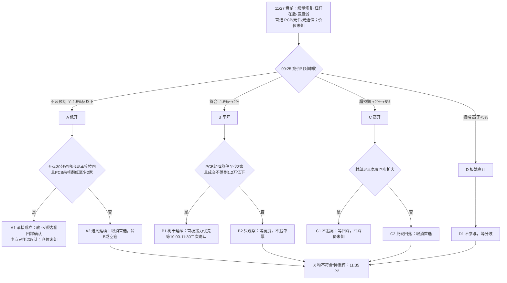

# 2026-11-27 · 盘前主预案 · 盘后回放

> 实际生成：2026-11-27T15:43:12+08:00｜仅供研究，不构成有效竞价/午盘修订，不进入交易系统。

# 2026-11-27 盘前主预案｜隔离人读回放（D1）

> 对象日 2026-11-27（周五）｜原时窗＝08:00 D1 盘前决策｜**报的是原时窗的条件推演，不是当日已验证买点**。
> 随包上游为**盘后隔离回放稿**（材料自述 15:31–15:39 生成），其内容声明只使用 11/26 事实与 08:30 前材料、不含 11/27 盘中或盘后行情；此点仅按材料自述采信，未独立核验。
> 未联机取数、未生成正式 JSON／MD、未过 schema、未执行或授权交易；**不声称原生产契约通过**。

---

## ① 一句话结论

**11/26 是“缩量修复＋杠杆在撤＋宽度仍弱”：指数尾盘回稳（沪 +0.01%／创业板 +0.29%），但下跌 3,642 家、成交 1.326 万亿再缩 667 亿，11/25 两融净减 207.42 亿证实“去杠杆”。故 11/27 更可能以平开偏弱或小幅低开检验承接，而不是主升延续；先动的方向是 PCB／元件／通信设备的“能交货”一段（不是半导体设备、不是机器人、不是零售）。首选做“首板接力＋容量确认”的 PCB 方案，不做旧高度追涨；备选是商业航天事件接力与化工扩散；反方向是修复失败、高开兑现。**

- **首选（A）**：PCB／光通信结构承接——首板接力（骏亚科技、崇达技术）＋容量确认（生益科技、中际旭创）；旧高度中京电子只作温度计。
- **备选（B，与首选不同路径）**：商业航天（利君股份、顺灏股份）或化工扩散（金牛化工、赤天化），**谁先在盘中给出宽度谁上**，不预设。
- **反方向（C）**：若前排低开不翻红、PCB 矩阵涨停不足 3 家、成交再破 1.2 万亿 → 判定退潮延续，取消首选、不接跷跷板、只观察。
- **仓位与价位**：**市场建议总仓＝未知（未形成）**，初始试探＝未知，逐票条件建议＝未知；原因见④——随包无任何逐票收盘价、均线、前高、封单，买区／触发／止损／止盈／最高接受价／RR 全部无法计算。系统执行限制：本回放不产生产物、不授权，实际执行额度＝0。**执行 0 不等于建议 0。**

**盘前路径图（首屏读图入口）**

**分支卡（编号只标识走势，不等同 B 计划选股或买入授权）**

| 编号与区分信号 | 仓位态度 | 首看方向与个股 | 条件价位 | 放弃点 | 有效期 |
|---|---|---|---|---|---|
| A1 低开后 30 分钟承接拉回、前排翻红≥2 | 未知／不授权；仅在价格补齐后另议 | PCB 首板：骏亚、崇达；温度计中京 | 全部未知 | 拉回失败、前排再破低点（绝对值未知） | 09:25–10:30 |
| A2 低开后无反抽、前排续弱 | 零新增 | 无；转 B 或空仓 | 未知 | — | 09:25–10:30 |
| B1 平开且 PCB 矩阵涨停≥3、成交不回 1.2 万亿下 | 未知／不授权 | 骏亚、崇达；容量 生益、中际 | 未知 | 宽度不达 3 家或成交再缩 | 10:00–11:30 |
| B2 平开但仅个别强、宽度不扩 | 观察 | 中京、生益作温度计 | 未知 | — | 至 P2 |
| C1 高开且封单足、宽度扩 | 不追高 | 同上，等回踩 | 回踩价未知 | 高开冲高回落 | 09:30–10:30 |
| C2／D1 高开兑现或极端高开 | 零新增 | 无 | 未知 | 封单不足、宽度不扩 | 当日 |
| X 均不符合 | 待重评 | 无 | 未知 | — | 11:35 P2 |

---

## ② 详细分析（资金、情绪、估值、结构如何导向取舍）

**昨天市场在担心什么。** 11/26 表面是指数横盘，实质是“缩量＋弱广度”：两市成交 1.326 万亿、较前日少约 657 亿，下跌 3,642 家、上涨 1,766 家；涨停 65／跌停 5／封板率 69.1%／炸板率 30.85%（留档口径，分母与回封处理未核）。前一日涨停池有局部溢价（页面列 +2.7%、样本中位数 +4.7%），但**开盘溢价字段为空**，无法判“隔日接力是否被奖励”。担心的核心不是跌，而是**没有增量**。

**新事实改变了什么。** ①11/25 两融净减 **207.42 亿**（沪 −105.19／深 −102.23／北 −0.72），买入端比偿还端少约 100 亿量级，更符合“主动降杠杆＋没人新借”，而非集中强平——这把“缩量”重新定义为“含去杠杆的缩量”；②结构切换：**印制电路板 +3.31%、元件 +3.10%、通信网络设备 +3.50%**，同日**半导体设备 −2.98%** 连续第二日跌；③外盘为**美东 11/25** 收盘：NVDA −3.91%、MU −4.53%、TSM −1.96%、AVGO −0.07%，SOX 缺失——对存储/算力硬件是情绪逆风，但不是 A 股资金流出证据；④**11/30（下一交易日）融资保证金 100%→80% 生效**，恰逢杠杆在撤，制度给额度不等于给意愿。

**还有什么压力。** 服务器发货限制报道（11/26 16:31，未见厂商通知）、2027 DRAM 合约价涨幅预测下修（10/7/5/3%→6/3/0/0%）、拟议 301 措施与 12/1 欧盟混动配额（原文未核）、沙特炼厂与海运零增长预测、以及 11/27–12/24 的解禁/停牌/终止重组密集窗口。

**为什么首选胜过备选。** 只有 PCB／光通信同时具备四项：产业侧解释（高阶板与高速材料紧缺，但协会原报告未见、仅媒体转述）、26 日价格响应（矩阵 4 家涨停、金百泽 20cm 等）、容量侧同涨（生益 +5.85%／中际 +5.18%／新易盛 +4.26%）、以及“当期交付”属性（分母收紧时市场先买能交货的）。备选航天：有高度（利君 3 板）但概念截面 **−0.08%**、早封（09:25）早于可定位的 09:30 许可报道、许可上限不等于部署更不等于订单。化工：矩阵由 2 家增至 8 家，但甲醇/尿素/染料不共享利润驱动、无容量核心。机器人：矩阵 67→19→3→8 是收缩后回补，且克来机电被公司澄清“不涉及人形机器人产品”。零售：涨停 4 家降至 3 家，宽度收缩。

**缺哪项、什么盘面能分高下。** PCB 需要三项同时：容量股不背离（生益/中际/新易盛同向且成交占比抬升）、矩阵涨停≥3 家且首板能续封、旧高度中京不出现放量破位（以 11/26 收盘为基准，**绝对值未知**）。航天需要概念由负转正＋前排续封＋新增首板。化工需要至少同一子方向 2 家以上续板或价差证据。分辨窗口在 **09:45–10:30**；11:35 P2 再评。

**事件前置闸门（Step 0.55 口径）**：≤3 个交易日内命中 **11/30**（融资保证金生效＝已定档；11 月 PMI＝**待核实，未见官方原件**；解禁 22 家＝接口口径）。据此对**连板≥3 的高位票默认降 watch**：中京电子（5 板后断板）、利君股份（3 板）、金牛化工（3 板）、杭州解百（4 板）、克来机电（5 板）；首板与非涨停票的“近 10 日涨幅>30%”门槛**未核**，不能断言豁免。上会/解禁/停牌类（联合光电上会、南特科技解禁 42.98%、\*ST春天／\*ST沐邦停牌）按事件状态处理，不当作买入理由。

---

## ③ 执行池（优先研究候选／**全部未取得买权**）

> 说明：本回放不产出 `watchlist_plan.json`，下列为“条件候选”，非正式 execution 身份。**无一只通过价位与 RR 门**；表中“资格”均为阻塞，不是放行。

| 对象 | 角色与逐票研究依据 | 反证与拦截 | 三档竞价（相对昨收，方法默认带、未校准） | 价位／资格 |
|---|---|---|---|---|
| **603386.SH 骏亚科技** | PCB 龙二／首板接力。R2：09:31 首封、首板、身位早于崇达；R6 模式1 已实审（题材响应相容，无公司新增订单）、模式2 已实审 | 早封不证换手与带动；高阶板紧缺为媒体转述；服务器发货限制是交付侧风险；模式6／7 未完成 | ≤−1.5% 弃（除低开翻红）；−1.5~+2% 承接观察；+2~+5% 等回踩不追；>+5% 不参与 | 买区/触发/止损/止盈/最高接受价/RR **全未知**；资格：未取得 |
| **002815.SZ 崇达技术** | PCB 龙三／首板，业务映射较具体（25 日互动易“已有服务器 PCB 配套”，二手摘要）；R6 模式2 已实审 | R6 模式1 **未完成**：依赖二手摘要，既有配套≠本轮新增订单；产销与毛利贡献未见 | 同上 | **全未知**；资格：未取得 |
| **600183.SH 生益科技** | PCB 材料／容量对照，26 日 +5.85% 非涨停；R2“容量核心待证” | R6 模式1 未完成：不能验证高速材料量价与成本转嫁；缺成交占比 | 同上 | **全未知**；资格：未取得 |
| **300308.SZ 中际旭创** | 光通信／容量对照，26 日 +5.18% 非涨停 | R6 模式1 未完成；R7 外盘 CPO 信号混合（AVGO −0.07%、GLW −1.60%、NVDA −3.91%）；逐企交付敞口未核 | 同上 | **全未知**；资格：未取得 |

- **温度计（不进候选）**：002579 中京电子——25 日 5 板、26 日未封 +7.91%、成交 43.44 亿。R6 模式1 已实审：涨幅与题材相容，但“旧高度无分歧延续”被其未续封反驳；同时命中事件前置闸门（连板≥3）→ 降 watch。
- **逐票建议仓位**：全部未知（因缺价位与止损距离，风险预算不可算；**不是 0、不是放行**）。
- **前置条件（全部候选共用）**：①竞价落在预期带内；②PCB 矩阵涨停≥3 家且首板能续封；③容量股不背离；④成交不回落至 1.2 万亿下方；⑤价位与 RR 另行补齐后重判。

---

## ④ 不可买 / RR_FAIL 清单

- **RR_FAIL：0 只**——因为**没有一只算得出 RR**（无买价、无止损、无 2R 止盈输入）。这是“未知”，不是“全通过”，也不是“全否决”。
- **RR 未知（全部约 22 个研究/对照对象）**：不满足“RR≥1.8”即不得进入可买层；本轮无一具备。
- **明确不纳入执行（研究性拦截，非 R6 硬否决）**：
  - 克来机电：公司澄清“不涉及人形机器人产品、工业机器人销售占比很小”实质反驳直接受益叙事；监管函与风险提示原件未核。**这拦截的是叙事，不是证券交易权限判断。**
  - 襄阳轴承：6 天 3 板的反包（非 3 连板），减速器收入约占前三季营收 **0.018%**（摘要转述，原文未核）。
  - 九阳股份：26 日 +8.66% 未封、双榜第 1 但非连续霸榜，风险提示正文未核。
  - 冰山冷热：5 天 3 板反包，媒体称两个热门概念年内几无收入（原文待核）。
  - 安邦护卫：R2 明确剔除的后排（无独立地位/容量证据）。
  - 华东重机：−10.01% 仍居双榜前列，仅作“人气≠承接”的反证。
  - 精测电子／协创数据／凌云光：**证券代码未在随包展示**，不能构造委托（精测“近 2 亿订单”、协创“验证并交付”均仅见标题）。
- **一字板**：本轮候选内无一字板记录（山鹰、珠免的一字属 11/26 已交易事件，不在候选）。
- **原因归纳**：价位缺失＋模式6／7 未完成＋事件前置闸门＋部分对象连板≥3。

---

## ⑤ 观察池（22 个有来源对象；未凑数、不足 40）

| 分组 | 对象 | 来源与关键依据 | 关键反证／缺口 |
|---|---|---|---|
| PCB／光通信（6） | 中京电子 002579、中际旭创 300308、生益科技 600183、新易盛 300502、骏亚科技 603386、崇达技术 002815 | R2 矩阵 4 家涨停＋容量同涨；R3 热榜 CPO 第 1、PCB 第 4 | 单日截面；中京断板；无成交占比、无逐票资金 |
| 商业航天（2） | 利君股份 002651、顺灏股份 002565 | 09:25 录 3 板／首板；矩阵 4 家 | 概念 −0.08%；早封早于 09:30 报道；顺灏为间接权益 |
| 化工（2） | 金牛化工 600722、赤天化 600227 | 矩阵 2→8 家；3 板／2 板 | 驱动不一；赤天化财务仅摘要（前三季营收 19.95 亿／归母 2,802.78 万） |
| 机器人（3，含降级） | 克来机电 603960、宏达高科 002144、襄阳轴承 000678 | 5 板／2 板／反包；高度标尺 | 概念均跌、收缩回补；克来叙事被澄清反驳 |
| 纯情绪（5，均降级） | 杭州解百 600814、中央商场 600280、九阳股份 002242、东方海洋 002086、冰山冷热 000530 | 4 板／2 板／未封／反包 | 零售宽度收缩、风险提示正文未核、水产无独立催化 |
| 直接事件（4，单独列） | 精测电子（无码）、协创数据（无码）、瑜欣电子 301107、凌云光（无码） | 订单／交付／拟并购／增资 | 代码未绑定或未交割；不授龙头身位 |

- **身份**：全部 `watch`／`watch_elastic`，**不进执行、不参与自动交易**；观察池不是拟持组合，不重复计仓。
- **未覆盖缺口**：“近 10 交易日涨停名单”未能拉取（无 `limit_list_d` 访问授权），故本池不是全市场人气覆盖，仅是随包可核对象。**不足 40 是覆盖结果，不是结论。**

---

## ⑥ B 计划（跷跷板／对手盘；候选已在预案点名）

**触发条件（任一）**：①执行方向≥2 票竞价不及预期（低开低于预期带或平开破位）；②PCB 矩阵涨停不足 3 家且容量股背离；③中京断板后放量下杀；④可核炸板率>35%（本轮**分母未核**，仅作待核条件）。

| 方向 | 点名候选 | 依据 | 触发与约束 |
|---|---|---|---|
| B1 PCB 内部高低切（旧高度→首板/材料） | 骏亚科技、崇达技术、生益科技 | R2 身位与首封时刻 | 中京弱、首板强时启动；仍需价位补齐 |
| B2 商业航天事件接力 | 利君股份、顺灏股份 | 矩阵 4 家、09:25 早封 | 概念转正＋前排续封；利君命中事件闸门（3 板） |
| B3 化工扩散 | 金牛化工、赤天化 | 2→8 家扩散 | 同子方向≥2 家续板；金牛命中事件闸门 |
| B4 纯情绪接力（低优先） | 杭州解百、中央商场 | 4 板／2 板梯队 | 宽度收缩，仅作对照；均命中事件闸门 |
| B5 热度跳升线索（**不具资格**） | 北纬科技 002148、常山北明 000158 | R3 跳升摘要 26→2、82→10 | 单源热度、无 R5 画像；**不点名入场**，仅作“资金新去向”识别 |

- **未点名方向**：“防守/高股息”无任何随包具体票来源（R2 次线未给票、R7 无跷跷板配对）→ **未知，不造票**。
- **反向提示（对手盘的反向）**：若 B 方向与 A 方向同步走弱、成交跌破 1.2 万亿、跌停扩散 → 全市场降档，**A/B 全部后置，只观察不接**。

---

## ⑦ 禁入名单（研究性不纳入执行，**非制度禁买**）

**本轮 R6 无 `hard_reject`、无 `strong_suggest`**，故下列均非硬否决，属状态不明或研究性拦截：

| 类别 | 对象 | 理由 |
|---|---|---|
| 交易状态 | \*ST春天 600381、\*ST沐邦 603398（11/27 停牌）、镇洋发展 603213（12/3 末交易日、12/4 起连续停牌） | 停牌/终止上市流程≠交易机会；换股比例与现金选择权未核 |
| 供给 | 南特科技 920124（11/27 解禁 42.98%） | 接口口径，非当日减持量 |
| 事件终止/风险 | 韩建河山 603616（终止重组）、\*ST瑞茂（62.74 亿逾期，标题）、富恒新材／三联虹普（账户冻结）、\*ST清越（先行赔付基金提示，非已赔付）、星图测控（军采禁入进展，起算与范围未核） | 均只读标题/索引，不作法律或财务结论；未入候选池 |
| 叙事拦截 | 克来机电、襄阳轴承、九阳股份、冰山冷热、安邦护卫、华东重机 | 见④；不构造买入，保留观察 |
| 无码不可委托 | 精测电子、协创数据、凌云光 | 代码未在随包展示 |

**七日内的确定性日程只作排期，不作买入理由**：11/27 联合光电上会（通过≠注册≠交割）、纳指类 ETF 09:30–10:30 停牌、11/28 镓锗“暂停实施”生效（接续非新放松）、12/1 欧盟混动配额生效（原文未核）、12/10 FOMC。

---

## ⑧ 四象限叉乘 + 错题本

| 维度 | 本轮事实 | 叉乘结论 |
|---|---|---|
| 资金 | 两融 11/25 −207.42 亿；成交 1.326 万亿缩 667 亿；R7 无主力净额、无龙虎榜、无 ETF 份额（PCB 相对强度 +1.1% 不是净额） | 资金×情绪＝**存量收缩下的局部修复**→ 只能做结构、不能做 β |
| 情绪 | 六态“修复第 1 天”（版本 unknown、`status=partial`、`intraday=missing`）；涨停 65／跌停 5／高度 5；炸板 30.85% 分母未核 | 情绪×结构＝修复未扩散，高度集中在少数标的，不支持“普涨” |
| 基本面估值 | 全缺：无多期三表/审计/盈利预测；仅零星摘要（克来 −544.91 万、赤天化 2,802.78 万） | 缺项是**没有意见**，不作否决也不作支持；不得据此抬仓或否票 |
| 结构 | PCB/元件/通信设备接棒设备；航天前排未扩；化工扩散驱动不一；机器人收缩回补；零售宽度收缩 | 结构×资金＝**“能交货”优于“要投钱”**，首选落在板/连接 |

**综合取舍**：结构 > 情绪 > 资金 > 基本面（基本面未知）。故只做“首板接力＋容量确认”，不做高位老龙追涨；这同时与事件前置闸门一致。

**错题本**：随包**未提供** `data/corrections/` 任何条目或已完成 E1 报告，故**未读取、未应用、不编 case_id**。仅作方法层自查（引技能原文列举类型，非已核案例）：①主线遗漏——R2 已覆盖 PCB／航天／化工／机器人／零售五方向及矩阵涨停，未见已知方向遗漏；②R6 无差别反证——本轮无 hard_reject，未按条数或模式数压低仓位；③P2 午盘强判——不适用；④大事件前夜买点后置——已按②执行。

---

## ⑨ 数据源审计（来源时点／样本段／事实-推断-缺失分层）

| 源 | 时点与事实日 | 样本段／可用性 | 限制 |
|---|---|---|---|
| R1 风格 | 自述生成 15:31:14；事实 11/26 | 收评、午报、第三方周期留档 | 未报情绪分；炸板率分母未核；“修复第1天”版本不明 |
| R2 主线 | 15:35:11；矩阵 11/13–11/26 | mainline 十交易日矩阵、热榜截面 | **无已确认主线**；身位为“暂定研究身位”；会员明细未见 |
| R3 群聊 | 15:33:26；热榜 11/26 22:30、绑定 06:05 | 榜 50/30/50/20 行；**聊天文字与 OCR 均 0 行可读** | 无 L1+L2 共振；出货警报**全部“未知”**，非阴性 |
| R4 消息 | 15:32:37；公告前 180/2649、新闻前 180/2784、公众号 90/90 | 只读标题/索引为主 | 协会原报告未见；首板首推为空；入库≠首发，转载≠独立验证 |
| R5 画像 | 15:37:01；22 对象 | 六维表，**全部部分画像、无图像** | 筹码/机构/财务/合规基本“未核”；无非得证图像 |
| R6 反证 | 15:39:05 | 11 只提名＋11 只对照 | 模式1 完成 4/11；模式2 11/11；**模式6、7 全未完成**；无 hard_reject |
| R7 资金 | 15:31:12；外盘=美东 11/25 | 公开收盘页、板块相对强度 | **无主力净额、无席位、无 ETF 份额**；SOX 缺失 |
| emotion_cycle.json | 落盘 06:05:41、as_of 06:05:40；fact_date 20261126、source_date 20261126、抓取 06:00:02 | `phase=修复`、`phase_schema=lianban_six_v1` | `status=partial`、`edition=unknown`、`intraday=missing`、`_data_complete=false`、`premium=null`；展示六格合计 96%、`uncovered_mass=null`；195 例 vs 页首“81 次”口径未厘清 |
| 催化剂日历 | 落盘 07:42:35；启动 07:30、证据截止 07:30、覆盖 11/27–12/24 | 两融、结构、政策、解禁、重组、停复牌 | 08:46 两融、09:30 工业利润在**截止外**；PMI／工业利润“待核实”；解禁为接口去重口径；`event_facts_verified=false` 本义保留 |
| **未提供** | — | — | `attention_signals.json` 独立文件、`user_preferences.yaml`／`risk_limits`、账户与持仓、`corrections`、`observation_tracking`、tushare 原始行情与均线、R5 图像、R6 模式6/7 结果、R7 净额、P1/P2/E1 报告 |

**分层声明**
- **事实**（材料自述可核）：两融 11/25 −207.42 亿；11/26 涨停 65／跌停 5／成交 1.326 万亿；PCB/元件/通信设备涨幅与半导体设备 −2.98%。
- **推断**（本轮判断）：结构修复而非全链反转；杠杆主动撤退概率高于集中强平；PCB 为首序研究。
- **传闻／二手**：强平与敲入规模（**无证据，不用**）、H200 不续约与小集群降价（未核）、克来监管函与风险提示（媒体转述，原件未核）、崇达互动易（二手摘要）。
- **缺失**：全部精确价位、RR、逐票资金/龙虎榜/ETF 份额、模式6/7 审核、逐票三表与审计、图像。

**口径纪律**：同一底稿被多份报告引用**不重复计证**；“双榜第一”不是连续霸榜；“指数翻红”不是托盘归因；页面“入库”不证明“首发”。

---

## ⑩ 不确定性 / 反证

1. **最大缺口是价位**：随包无逐票昨收、均线、前高、封单、涨停价，故本轮结论只能到“条件剧本层”，**不能到下单层**；任何买区/止损数字都会是造价。
2. **修复能否延续未知**：11/26 是“缩量修复”，量能跟不上则只是退潮中的一天；验证窗口在 09:45–10:30 与 11:35 P2。
3. **炸板率不可判**：30.85% 分母与回封口径未核，**不能确认也不能排除 35% 纪律**。
4. **六态“修复第1天”版本不明**：195 例历史频率（次日上证均值 +0.01%、上涨率 49%、去向退潮 32%／升温 16%）**不是明日概率、不是个股胜率**。
5. **杠杆方向未知**：−207.42 亿是 11/25 事实；11/26 数据在 08:46 截止外，是否延续不猜；11/30 新规后要看“融资买入额占成交比重”而非余额。
6. **外盘口径**：美东 11/25 收盘、SOX 缺失，传导未证；CPO 信号混合，不能外推为全链下跌或全链修复。
7. **航天归因不成立**：09:25 早封早于可定位的 09:30 许可报道，不能用后者解释前者；许可上限≠部署≠A 股订单。
8. **事件闸门覆盖面未满**：连板≥3 已按实据降级，但首板/非涨停票“近 10 日涨幅>30%”门槛未核，可能仍有高位票未被识别。
9. **无 hard_reject ≠ 通过**：R6 模式6/7 全未完成、R5 全部部分画像；未完成是“没有意见”，不是阴性，也不是放行。
10. **反向剧本（与首选相反）**：若开盘 PCB 前排低开不翻红、中京放量下杀、成交再破 1.2 万亿 → **首选彻底失效**，此时即便航天/化工走强也不追（无价位、无画像、无宽度证据），正确动作是空仓等 P2。

---

## ⑪ 与其他 R/D/E 的关系

- **消费关系**：D1 只读 R1–R7 已完成回放稿＋两项辅助（emotion_cycle、催化剂日历），**不覆盖** R6（本轮无 hard_reject 可覆盖），不替 R5/R6 补造完成证明。
- **R1→温度**：震荡分化、修复未扩散；**未映射为任何固定仓位档位或打法白名单**。
- **R2→板块公共判断与候选**：复用树干模板与“暂定研究身位”，最终池角色不冒充 R2 原角色；板块条件（容量延续、宽度、驱动）与本轮逐票条件一致。
- **R3→人气/出货**：警报全部“未知”，**不作阴性**；榜位只作注意力，不证明资金。
- **R4→消息与风险**：直接事件（精测、协创）留观察；行业负面（服务器交付、DRAM 下修、301、欧盟配额）进入统一风险取舍，未机械打折。
- **R5→画像**：全部部分画像，档位缺失不当作低评级或否决票。
- **R6→反证**：无硬否决；`selected_review_completed=false`、`formal_review_completed=false` 真值保留，**不伪写 true**，也不因缺席自动禁买。
- **R7→资金**：无净额，不推断大资金意图；外盘仅背景。
- **P1（09:25–09:29 竞价校准）**：本回放**未生成**；上述三档为盘前条件，需 P1 用真实竞价补齐（原 4 分钟时限不在此执行）。
- **P2（11:35–12:05 午盘修订）**：分支卡有效期止于 10:30，其后交 P2 重评。
- **E1／错题本**：未提供，未应用。
- **边界**：正建议不授实盘；观察不自动晋级；规则兜底不获得自主交易；**本回放不构成任何执行授权**。

---

## ⑫ Sub-Agent 元数据

| 项 | 内容 |
|---|---|
| 角色 | D1 主决策（canghai-plan）· **隔离人读回放** |
| 上下文 | fresh context；未携带 R1–R7 中间推理，仅读其完成稿与本轮判断 |
| 输入 | R1–R7 回放稿（available，hash 前缀：R1 `39485b…`／R2 `7d6e99…`／R3 `f7bebe…`／R4 `dee049…`／R5 `3b8d4e…`／R6 `459e7c…`／R7 `d7a6d7…`）；emotion_cycle `76589e…`；日历 `360ef6…` |
| 工具 | 未调用任何实时工具／MCP／文件写入；未展开通配符；未读未绑定目录 |
| 产物 | **无**：未写 `watchlist_plan.json`、未写 KG 主 MD、未写价位推导 MD |
| 校验 | 未运行 schema／loader／发布门禁；未声明 production_ready |
| 权限 | 未下单、未授权、未改预算、未改政策 |
| 声明 | 数据留档可见性不等于每条事实独立核实；不声称原生产契约通过；不写虚构生成时刻 |

**未生成、未执行、未授权。**
